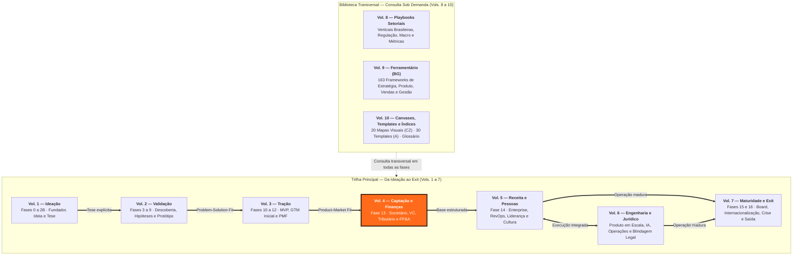
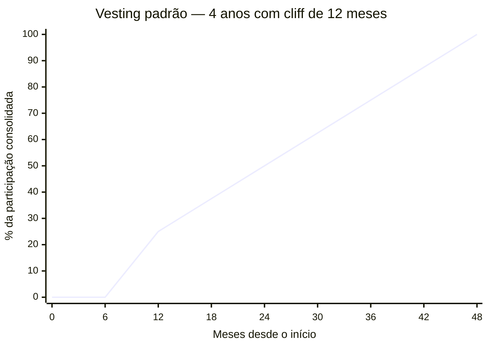
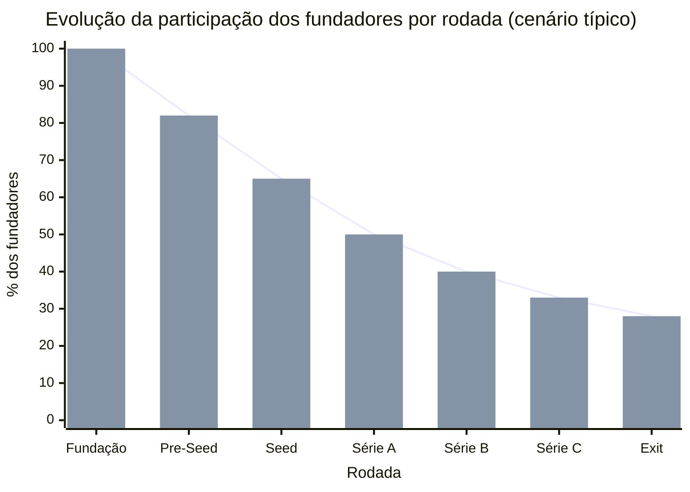
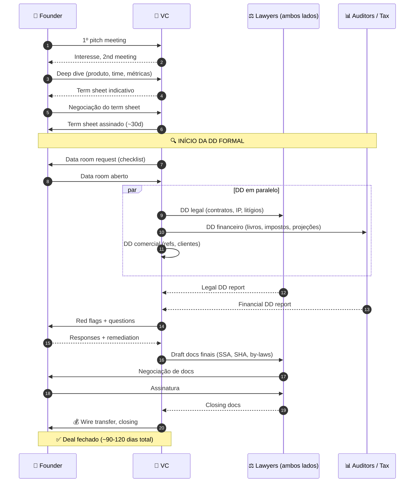
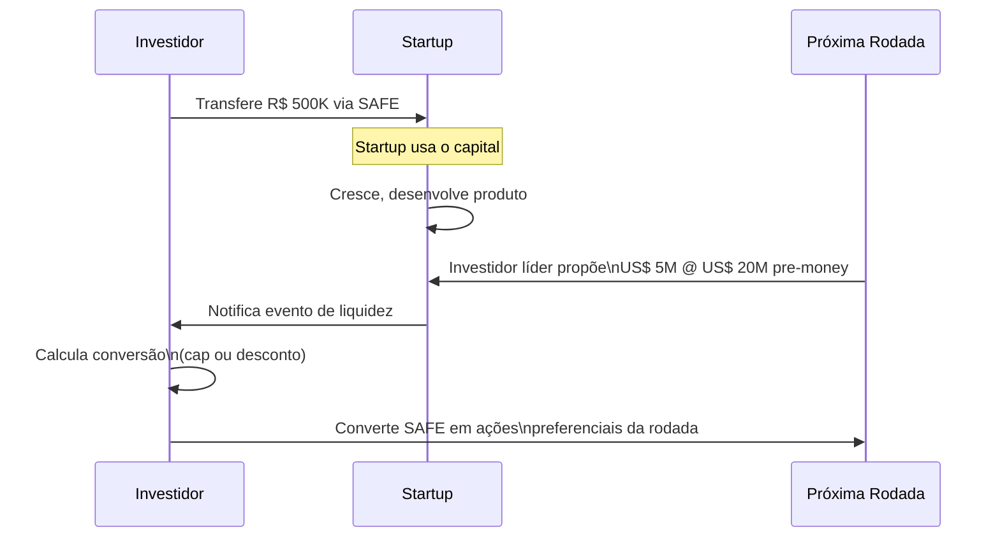
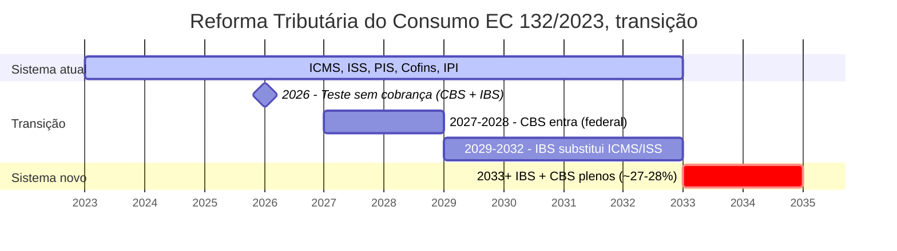
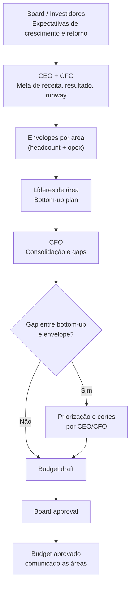
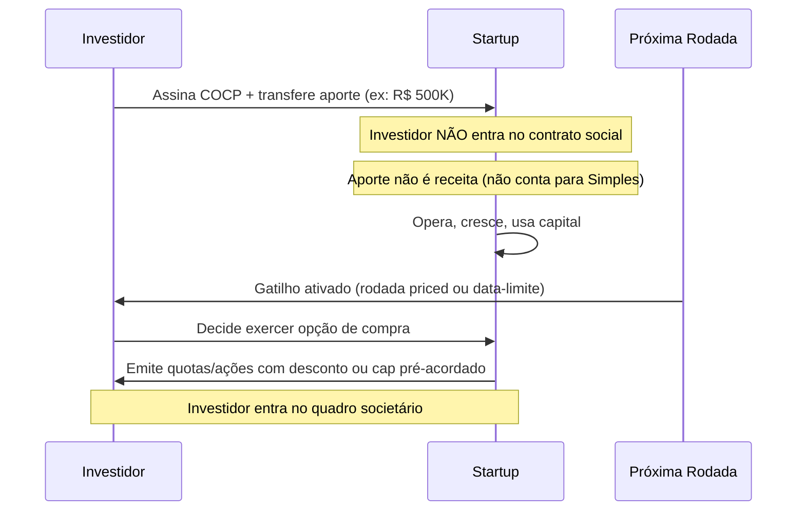
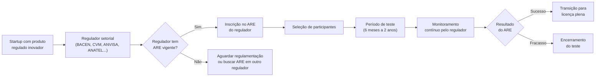

# IGNIÇÃO — Volume 4: Captação e Finanças

*Estruturação Societária, Venture Capital, Tributário e FP&A (Fase 13)*

> [!tip] Dica para leitura no Obsidian e GitHub
> Este volume faz parte da coleção **IGNIÇÃO** (10 volumes). Os links para seções deste mesmo volume usam âncoras diretas (`[[#Seção]]`) e os links para outros volumes apontam para o arquivo correspondente (`[[IGNICAO-Vol-X-Nome#Seção]]`).

---

## Sobre este Volume

Este é o **Volume 4 (Captação e Finanças)** da coleção **IGNIÇÃO — O manual operacional do empreendedor brasileiro** (10 volumes).

Primeiro volume da tríade de Escala (Volumes 4, 5 e 6). Cobre a estruturação jurídica, societária, contábil e financeira pós-PMF (Fase 13) e 18 apêndices dedicados à arquitetura de capital e finanças corporativas no Brasil: captação de Venture Capital, planejamento de rodada como processo, métodos de valuation, instrumentos conversíveis (SAFE/mútuo), financiamento não-diluitivo (FINEP/BNDES/FAPESP), venture debt, crowdfunding, tokenização, relações com investidores, regimes fiscais e Reforma Tributária, FP&A, revenue forecasting, capital de giro, relacionamento bancário, gestão de riscos/seguros, Marco Legal das Startups (LC 182/2021) e proteção patrimonial dos sócios.

> [!note] Consulta transversal e navegação entre os 10 volumes
> Cada volume da coleção IGNIÇÃO reúne as **Fases**, as **Introduções de Domínio** e os **Apêndices temáticos** do seu respectivo estágio ou disciplina. Para métricas por fase e playbooks de verticais brasileiras, consulte o **[[IGNICAO-Vol-8-Playbooks-Setoriais#APÊNDICE C — CATÁLOGO DE MÉTRICAS POR FASE|Volume 8 — Playbooks Setoriais (Vol. 8)]]**. Para os 163 frameworks de gestão e produto, consulte o **[[IGNICAO-Vol-9-Ferramentario#APÊNDICE BG — FERRAMENTÁRIO COMPLETO DO EMPREENDEDOR|Volume 9 — Ferramentário (BG) (Vol. 9)]]**. Para canvases visuais (CZ), templates copiáveis (A) e glossário geral, consulte o **[[IGNICAO-Vol-10-Canvases-e-Templates#APÊNDICE CZ — CANVASES E MAPAS VISUAIS DE MODELO|Volume 10 — Canvases, Templates e Índices (Vol. 10)]]**. A Nota do Autor e o guia geral de uso da obra encontram-se na abertura do **[[IGNICAO-Vol-1-Ideacao#Nota do autor|Volume 1 — Ideação (Vol. 1)]]**.

---

## Mapa da Coleção IGNIÇÃO



---

## Sumário deste Volume

### Fase da Etapa (Estruturação)

- [[#FASE 13 — ESTRUTURAÇÃO JURÍDICA, FINANCEIRA E OPERACIONAL]]

### Captação de Capital, Valuation e Relação com Investidores

- [[#APÊNDICE V — CAPTAÇÃO DE EQUITY, PITCH E RELACIONAMENTO COM INVESTIDORES]]
- [[#APÊNDICE CF — PLANEJAMENTO DE RODADA COMO PROCESSO: FUNDRAISING COMO PROJETO ESTRUTURADO]]
- [[#APÊNDICE CE — VALUATION METHODS: COMO INVESTIDORES CALCULAM E COMO VOCÊ CALCULA PARA NEGOCIAR]]
- [[#APÊNDICE DF — INSTRUMENTOS DE CAPTAÇÃO: SAFE, NOTA CONVERSÍVEL E MÚTUO CONVERSÍVEL]]
- [[#APÊNDICE P — FINANCIAMENTO NÃO-DILUITIVO]]
- [[#APÊNDICE BB — VENTURE DEBT E REVENUE-BASED FINANCING (RBF)]]
- [[#APÊNDICE CI — EQUITY CROWDFUNDING NO BRASIL: CAPTAÇÃO PÚBLICA DE PEQUENOS INVESTIDORES]]
- [[#APÊNDICE CJ — TOKENIZAÇÃO PARA FOUNDERS: ATIVOS DIGITAIS, SECURITY TOKENS E QUANDO NÃO É HYPE]]
- [[#APÊNDICE DD — INVESTOR RELATIONS PÓS-RODADA]]

### Finanças em Escala, Planejamento, Tributário, Crédito e Riscos

- [[#APÊNDICE W — CONTABILIDADE, TRIBUTÁRIO E REGIMES FISCAIS PARA STARTUP BRASILEIRA]]
- [[#APÊNDICE EN — TRIBUTÁRIO ESTRATÉGICO PARA STARTUPS]]
- [[#APÊNDICE EC — PLANEJAMENTO FINANCEIRO E ORÇAMENTO]]
- [[#APÊNDICE EG — REVENUE FORECASTING: MODELOS, ACURÁCIA E PROCESSO PARA O FOUNDER]]
- [[#APÊNDICE EZ — CAPITAL DE GIRO E RECEBÍVEIS]]
- [[#APÊNDICE FA — RELAÇÕES BANCÁRIAS E CRÉDITO NO BRASIL]]
- [[#APÊNDICE EY — GESTÃO DE RISCO E SEGUROS PARA STARTUPS]]

### Marco Legal e Responsabilidade Societária na Estruturação

- [[#APÊNDICE DA — MARCO LEGAL DAS STARTUPS: LC 182/2021]]
- [[#APÊNDICE EP — RESPONSABILIDADE DO SÓCIO E DO ADMINISTRADOR]]

---

# FASE DA ETAPA — ESTRUTURAÇÃO PARA A ESCALA

---

### Arquitetura deste Domínio: A Fundação Societária, Fiscal e Financeira da Escala

Com o Product-Market Fit comprovado no Volume 3, a empresa entra na etapa de **Escala**, que nesta coleção é dividida em três volumes complementares e focados:
- **Volume 4 — Captação e Finanças (este volume):** A [[#FASE 13 — ESTRUTURAÇÃO JURÍDICA, FINANCEIRA E OPERACIONAL|Fase 13]] e os 18 apêndices de fundraising, Venture Capital, valuation, instrumentos conversíveis, dívida, contabilidade, planejamento tributário, FP&A, capital de giro e responsabilidade societária.
- **Volume 5 — Receita e Pessoas:** A [[IGNICAO-Vol-5-Receita-e-Pessoas#FASE 14 — ESCALA: TIME, OPERAÇÕES, CRESCIMENTO E CAPITAL|Fase 14 (Vol. 5)]] e os 19 apêndices de crescimento em escala, vendas enterprise, RevOps, parcerias corporativas, marca, liderança executiva, contratação de C-level, remuneração/ESOP e cultura.
- **Volume 6 — Engenharia, Operações e Jurídico:** Os 23 apêndices técnicos, organizacionais e legais para escalar produto, arquitetura de software, IA, design organizacional, processos e blindagem contratual, trabalhista, LGPD e regulatória.

Por que a [[#FASE 13 — ESTRUTURAÇÃO JURÍDICA, FINANCEIRA E OPERACIONAL|Fase 13]] abre este Volume 4 antes de qualquer discussão sobre rodadas de investimento ou hipercrescimento? Porque tentar captar institucionalmente ou escalar faturamento sobre uma base societária informal, com cap table desorganizado, propriedade intelectual fora do CNPJ ou regime tributário errado destrói valor na *due diligence* e cria passivos pessoais para os sócios. A Fase 13 arruma a casa para que o capital e o crescimento tenham onde pousar com segurança.

---

## FASE 13 — ESTRUTURAÇÃO JURÍDICA, FINANCEIRA E OPERACIONAL

> [!note] Antes de assumir captação como rota
> Este capítulo trata estruturação para empresas que escolheram o caminho VC. A escolha fundacional entre bootstrap e venture capital é tratada em [[IGNICAO-Vol-1-Ideacao#APÊNDICE CS — BOOTSTRAP vs VENTURE CAPITAL: A ESCOLHA FUNDACIONAL|Apêndice CS (Vol. 1)]]. Empresas brasileiras como RD Station, Granatum e Conta Azul construíram negócios significativos sem VC. A escolha não é neutra.

### O que esse apêndice cobre

Consolidação das bases formais e operacionais do negócio. O entregável é a empresa estruturada: CNPJ ativo, regime tributário adequado, contratos formais, processos documentados, compliance básico, registros contábeis em dia.

> [!abstract] Resumo operacional
> **Entregável:** Empresa juridicamente constituída e operacionalmente estruturada — tipo societário, regime tributário, cap table com vesting, acordo de sócios, contratos com clientes e colaboradores, programa LGPD ativo e contabilidade mensal em dia.
>
> **Sinais de saída:**
> - Empresa constituída em formato adequado (LTDA ou S.A.) com contrato social revisado por advogado especializado em startups e cap table documentado com vesting de quatro anos com cliff de doze meses.
> - Programa LGPD básico ativo (DPO, bases legais, DPAs com operadores principais) e contratos padronizados com clientes, colaboradores e terceiros críticos.
> - Sistema contábil ativo com fechamento mensal sem pendências, marca em registro no INPI e separação total entre finanças pessoais e empresariais.
>
> **Três armadilhas mais comuns:**
> 1. Postergar formalização sob a lógica de "depois eu resolvo" — dívida fiscal e trabalhista compõe e custa mais resolver depois.
> 2. Acordo de sócios "no aperto de mão" — relações ótimas hoje viram disputas tóxicas no momento de dinheiro ou crise.
> 3. Ignorar LGPD — multas de até dois por cento do faturamento, com exposição reputacional pior que a multa.

### POR QUE

Muitos empreendedores postergam formalização. Acham que é burocracia. Na verdade, a falta de formalização gera riscos concretos. Autuações fiscais. Impossibilidade de emitir notas. Quebra de contratos por falta de amparo jurídico. Perda de funcionários por informalidade. Inviabilidade de captar investimento. Bloqueio de contas bancárias. A estruturação tarda. Mas sempre tem que acontecer. E quanto antes, melhor.

### Quando usar

Comece quando houver clientes pagantes, e receita relevante. Alguns aspectos (CNPJ) podem vir antes, se o modelo exigir emissão de notas. Termine quando os itens críticos desta fase estão concluídos. Revisite anualmente, e a cada marco (novos sócios, captação, expansão).

### Quem envolve

O executor é você. Os participantes são o contador (obrigatório), o advogado (altamente recomendado), e os sócios. O decisor é você.

### Como executar

Dez passos.

#### Passo 1, defina o tipo societário

No Brasil, as formas mais comuns para startups são quatro.

MEI. Limitado a um faturamento anual baixo (verifique o limite atual, que é atualizado periodicamente). Útil no comecinho. Geralmente insuficiente para startups em crescimento.

EIRELI (em extinção na prática), ou Sociedade Unipessoal Limitada. Você é sócio único. Limitada.

LTDA. Mais de um sócio. Mais flexível. Capital social declarado.

S/A. Estrutura para captação robusta. Mais complexa. Obrigatória para IPO.

> [!important] Para a maioria das startups iniciais, LTDA é o ponto ideal
> S/A entra em cena quando há captações de venture capital significativas. Migrar de LTDA para S/A custa entre R$ 15 mil e R$ 40 mil em honorários jurídicos para conversão simples (alteração de tipo societário, sem reestruturação de cap table (tabela de capitalização — quem tem quanto da empresa)). Para migração no contexto de Série A com reestruturação societária completa (classes de ações, ESOP, drag/tag-along, holding), a faixa sobe para R$ 30 mil a R$ 100 mil — esta é a faixa documentada no [[#APÊNDICE W — CONTABILIDADE, TRIBUTÁRIO E REGIMES FISCAIS PARA STARTUP BRASILEIRA|Apêndice W]] e se aplica ao cenário típico em que a migração efetivamente acontece. Em ambos os casos, é trivial — não vale antecipar a estrutura mais pesada.

> [!tip] Apêndice DA — Marco Legal das Startups
> O [[#APÊNDICE DA — MARCO LEGAL DAS STARTUPS: LC 182/2021|Apêndice DA — Marco Legal das Startups]] (Lei 182/2021) cobre os benefícios específicos para startups: sandbox regulatório, dispensa de licitação para contratar com governo, regime simplificado de dissolução e o enquadramento como "Empresa Inovadora" — relevante para decidir estrutura jurídica e acessar programas de fomento.

#### Passo 2, escolha o regime tributário

No Brasil, três regimes principais.

Simples Nacional. Para receitas anuais até o teto definido em lei (verifique o valor atualizado). Menor complexidade. Alíquotas variam conforme atividade e faturamento.

Lucro Presumido. Para receitas até outro patamar acima do Simples. Bom para algumas atividades com margem alta.

Lucro Real. Obrigatório para receitas acima do limite do Lucro Presumido, e para certas atividades específicas. Mais complexo.

> [!warning] Consulte o seu contador antes de decidir
> A escolha errada pode custar cinco a dez por cento de margem sem necessidade. Os limites e alíquotas dos regimes mudam periodicamente — esse manual aponta a estrutura, não os números do ano corrente.

> [!note] Tributário estratégico para startups
> O [[#APÊNDICE EN — TRIBUTÁRIO ESTRATÉGICO PARA STARTUPS|Apêndice EN — Tributário Estratégico]] cobre o Fator R do Simples Nacional (como a folha afeta o anexo de enquadramento), a Lei do Bem para P&D, e quando a estrutura de holding passa a fazer sentido — decisões com impacto direto na margem líquida dos próximos anos.

#### Passo 3, registre marca e domínio

Três providências.

Registro da marca no INPI (Brasil) para proteger nome e logo. O processo demora doze a vinte e quatro meses. Mas o protocolo já gera direitos.

Registro de domínio. .com.br, .com, e outros relevantes para o negócio.

Se operar internacionalmente, pesquise proteção internacional. Países onde a empresa terá presença, ou onde competidores podem registrar a marca antes.

#### Passo 4, estruture contratos formais

Quatro tipos de contrato.

##### Acordo de sócios, se houver sócios

Obrigatório desde o primeiro dia. Inclua sete itens. Divisão de participação. Vesting de equity (participação societária) — ninguém vira sócio pleno no dia zero, a participação se consolida ao longo de anos. Regras de saída voluntária, involuntária, e morte. Direitos de veto em decisões críticas. Mecanismos de resolução de conflito. Não-compete, e confidencialidade. Cláusula de tag-along, e drag-along, para rodadas futuras.



> [!note] Como funciona o vesting com cliff
> Nos primeiros 12 meses (o cliff (período mínimo antes de começar a adquirir participação)), nada vesta. No mês 13, 25% consolida de uma vez. Dos meses 13 a 48, o restante vesta mensalmente (~2,08% ao mês). Se o fundador sai antes de 12 meses, não leva nada. Se sai no mês 30, leva 50% da participação acordada. Isso protege a empresa de cofundadores que saem cedo mas mantêm participação grande.

> [!tip] Apêndice CZ — Capital Stack / Waterfall (CZ.17)
> Cap table com vesting é o tema central desta fase. O [[IGNICAO-Vol-10-Canvases-e-Templates#APÊNDICE CZ — CANVASES E MAPAS VISUAIS DE MODELO|Capital Stack / Waterfall Canvas (CZ.17) (Vol. 10)]] é o mapa visual da estrutura de capital — Common (fundadores), Preferred (investidores com seniority), pool de ESOP, dívida — e do waterfall em cenário de exit (preferences, participation, conversion). Use desde a primeira rodada para que decisões de term sheet (1x participating, anti-dilution full ratchet vs weighted average, ESOP top-up) tenham impacto visualmente claro no que cada parte recebe em diferentes valuations de saída.

> [!warning] Conflito entre sócios é a segunda maior causa de morte de startups no mundo
> Não pule o acordo. Casais que se separam sem contrato pré-nupcial passam por divórcio. Sócios que se separam sem acordo passam por anos de litígio. O [[IGNICAO-Vol-7-Maturidade-e-Exit#APÊNDICE BP — DISPUTA SOCIETÁRIA E SAÍDA DE SÓCIO|Apêndice BP (Vol. 7)]] cobre prevenção (cláusulas que evitam o conflito), mediação (quando o conflito chega) e mecânica jurídica de saída forçada.

###### Formalização jurídica do equity acordado

A discussão substantiva sobre divisão de equity entre fundadores — quatro fatores (ideia, comprometimento, habilidades, capital), método Slicing Pie de Mike Moyer (2012), processo estruturado de negociação em três passos, e quando 50/50 vs 60/40 vs 70/30 vs solo com pool faz sentido — está na [[IGNICAO-Vol-1-Ideacao#FASE 0 — PREPARAÇÃO DO EMPREENDEDOR|Fase 0 (Vol. 1)]] (Sócios, a decisão mais irreversível). Aqui o foco é a formalização jurídica do que foi acordado, em quatro proteções inegociáveis no acordo de sócios:

- **Vesting de 4 anos com cliff de 12 meses para todos os fundadores.** Padrão de mercado que protege a empresa de cofundador que sai antes da consolidação completa.
- **Reverse vesting**: equity não consolidado volta para o pool se o sócio sai. Sem isso, sócio que sai no mês 30 leva 50% mas a empresa fica sem o trabalho que esse equity representava.
- **Mecanismo de compra de equity do sócio que sai** (shooting mechanism ou buy-sell agreement). Define preço, prazo e fonte do dinheiro para recompra antes do conflito existir.
- **Critério explícito de casting vote em impasse**. Em divisão 50/50, um sócio precisa ter voto de minerva em categoria específica de decisão (técnica, comercial, etc.) — sem isso, impasse trava operação.

> [!tip] Não negocie equity em jantar
> A conversa de divisão de equity deve acontecer em ambiente estruturado, com documentação. Acordos verbais em jantar geram memórias diferentes seis meses depois. Use um template de acordo ou leve para advogado desde o primeiro rascunho.

> [!tip] Apêndice DB — Stock Options para Startups Brasileiras
> O [[IGNICAO-Vol-5-Receita-e-Pessoas#APÊNDICE DB — STOCK OPTIONS E ESOP NO BRASIL|Apêndice DB — Stock Options (Vol. 5)]] cobre a estrutura jurídica e fiscal das opções no Brasil: phantom shares versus opções reais, tratamento tributário no exercício, modelos de plano ESOP e como redigir a carta de oferta de equity para os primeiros funcionários — sem criar passivo fiscal inadvertido.

##### Contrato com clientes

Termos de uso. Contratos de prestação de serviço. SLAs. Revisados por advogado.

> [!note] Contratos em profundidade: MSA, NDA, DPA e IP assignment
> O [[IGNICAO-Vol-6-Engenharia-e-Juridico#APÊNDICE EU — CONTRATOS EM PROFUNDIDADE POR TIPO|Apêndice EU — Contratos em Profundidade (Vol. 6)]] cobre a anatomia de cada contrato essencial para startups — MSA (Master Service Agreement), NDA, DPA (Data Processing Agreement), LOI e acordo de advisor — com as cláusulas críticas, os erros comuns, e o que negociar antes de assinar.

##### Contrato com colaboradores

CLT, PJ, autônomo, estagiário. Cada modalidade tem regras. Informalidade aqui gera passivo trabalhista. O maior risco jurídico de empresas pequenas.

> [!note] Direito do trabalho para startups: CLT vs PJ, eSocial e rescisão
> O [[IGNICAO-Vol-6-Engenharia-e-Juridico#APÊNDICE EL — DIREITO DO TRABALHO PARA STARTUPS|Apêndice EL — Direito do Trabalho para Startups (Vol. 6)]] detalha os critérios de vínculo empregatício que transformam PJ em CLT na Justiça do Trabalho, as obrigações do eSocial desde o primeiro funcionário, o tratamento do sobreaviso em times de produto, e o custo real de cada modalidade de rescisão.

> [!note] Como estruturar a compensação dos primeiros funcionários
> O [[IGNICAO-Vol-5-Receita-e-Pessoas#APÊNDICE ED — COMPENSAÇÃO E BENEFÍCIOS NO BRASIL|Apêndice ED — Compensação e Benefícios no Brasil (Vol. 5)]] explica o multiplicador real do salário CLT (1,66x sobre o bruto), como estruturar PLR e equity para os primeiros funcionários, e quais benefícios fazem sentido em cada estágio da empresa.

##### NDAs com terceiros críticos

Parceiros, fornecedores, e potenciais investidores quando apropriado.

> [!tip] Apêndice AH — Contratos Operacionais
> O [[IGNICAO-Vol-6-Engenharia-e-Juridico#APÊNDICE AH — CONTRATOS E ASPECTOS LEGAIS OPERACIONAIS|Apêndice AH — Contratos Operacionais (Vol. 6)]] cobre os contratos de back-office que ficam fora dos contratos com clientes e colaboradores: fornecedores de tecnologia, acordos de parceria, contratos de coworking, SLAs internos e os itens de due diligence que investidores verificam em Série A — quando contratos mal-redigidos viram obstáculo ao fechamento da rodada.

#### Passo 5, adeque-se à LGPD (se trata dados pessoais)

Cinco providências. Nomeie DPO, ou encarregado. Escreva política de privacidade. Obtenha consentimento apropriado. Mantenha registro de tratamento de dados (ROPA). Tenha processo de resposta a solicitações do titular.

> [!note] Compliance mínimo viável além da LGPD
> O [[IGNICAO-Vol-6-Engenharia-e-Juridico#APÊNDICE EM — COMPLIANCE E ANTICORRUPÇÃO PARA STARTUPS|Apêndice EM — Compliance e Anticorrupção (Vol. 6)]] cobre as obrigações da Lei Anticorrupção (Lei 12.846) aplicáveis a startups, o papel do DPO, PLD/CFT para fintechs, e como montar um programa de compliance enxuto — o mínimo exigido por investidores institucionais e clientes enterprise.

#### Passo 6, instale contabilidade em dia

Quatro providências. Contador mensal. Emissão de notas fiscais corretas. Registros contábeis conforme regime. Obrigações acessórias (DCTF, DEFIS, DIRF, conforme aplicável).

> [!tip] Apêndice W — Contabilidade para Startups
> O [[#APÊNDICE W — CONTABILIDADE, TRIBUTÁRIO E REGIMES FISCAIS PARA STARTUP BRASILEIRA|Apêndice W — Contabilidade, Tributário e Regimes Fiscais]] cobre a diferença entre contabilidade gerencial e fiscal, como escolher entre Contabilizei, escritório especializado e controller interno por estágio, e o checklist de obrigações acessórias mensais que o fundador precisa acompanhar — mesmo sem entender contabilidade profundamente.

#### Passo 7, separe finanças pessoais e empresariais

Conta bancária exclusivamente da empresa. Cartão corporativo. Pró-labore definido. Dividendos, se houver, formalizados.

> [!warning] Misturar CPF e CNPJ é caminho para desorganização e risco fiscal
> Empréstimos do sócio para a empresa, ou da empresa para o sócio, sem contrato formal, geram autuação fiscal e descaracterização da pessoa jurídica em caso de litígio. Toda movimentação entre as duas pessoas (física e jurídica) precisa de contrato escrito.

> [!note] Responsabilidade do sócio e do administrador
> O [[#APÊNDICE EP — RESPONSABILIDADE DO SÓCIO E DO ADMINISTRADOR|Apêndice EP — Responsabilidade do Sócio e Administrador]] explica quando a desconsideração da personalidade jurídica se aplica, o que configura confusão patrimonial, e as obrigações legais do administrador que justificam a separação rigorosa de contas.

#### Passo 8, estabeleça processos operacionais documentados

Cinco documentos vivos. Onboarding (processo de integração do novo colaborador) de novo cliente. Onboarding de novo funcionário. Processo de suporte. Processo de venda. Políticas internas (gastos, viagens, despesas).

> [!tip] Documente o necessário, não o exaustivo
> Não precisa ser cinquenta páginas. Precisa ser claro e usado. Documento que ninguém lê é teatro de processo. Uma página por processo, em linguagem direta, vale mais do que manual elaborado que ninguém abre.

#### Passo 9, defina estrutura financeira mínima

Quatro itens. Fluxo de caixa mensal projetado para os próximos doze meses. Controle de inadimplência. Reconciliação bancária semanal. Relatório mensal de resultado.

> [!note] Capital de giro ao estruturar e captar a primeira rodada
> O [[#APÊNDICE EZ — CAPITAL DE GIRO E RECEBÍVEIS|Apêndice EZ — Capital de Giro e Recebíveis]] cobre o Ciclo de Conversão de Caixa, as modalidades de antecipação de recebíveis disponíveis no Brasil, e como o FIDC se encaixa em fintechs e marketplaces — ferramentas para não ficar com caixa represado enquanto o negócio cresce.

#### Passo 10, revise seguros

Quatro modalidades, dependendo do negócio.

Responsabilidade civil. Cobre danos causados a terceiros pela operação.

Seguro de cibersegurança, se trata dados. Cobre custos de incidentes, vazamentos, e respostas regulatórias.

Seguro de erros e omissões (E&O), se oferece serviço profissional. Cobre falhas técnicas que causem prejuízo ao cliente.

Seguro de vida para sócios-chave (key person). Em sociedades pequenas, a perda repentina de um sócio operacional pode quebrar o negócio. O seguro mitiga esse risco para os sócios remanescentes.

> [!note] Coberturas essenciais para startups: D&O, E&O, cyber e Key Man
> O [[#APÊNDICE EY — GESTÃO DE RISCO E SEGUROS PARA STARTUPS|Apêndice EY — Gestão de Risco e Seguros]] detalha quando contratar cada cobertura, o que cada apólice efetivamente protege, e os gatilhos que tornam D&O e Key Man obrigatórios — especialmente após a entrada de investidores no board.

### Os dez passos aplicados, estruturação do PadariaPro LTDA

A pessoa jurídica. O formato escolhido foi LTDA (Sociedade Limitada). Adequado até Série A. Migração para S.A. planejada se a rodada superar R$ 5 milhões. CNAE principal: 62.02-3-00 (Desenvolvimento e licenciamento de programas de computador customizáveis). Capital social: R$ 100 mil, com R$ 20 mil integralizados, e R$ 80 mil a integralizar em vinte e quatro meses.

O cap table inicial.

| Sócio | Percentual | Tipo de entrada | Vesting |
|---|---|---|---|
| Mariana (founder, CEO) | 55% | Tempo integral desde dia um | 48 meses, cliff 12m |
| Bruno (cofounder, CTO) | 35% | Tempo integral desde mês três | 48 meses, cliff 12m |
| Pedro (advisor e angel) | 5% | R$ 200 mil investidos em SAFE (pré-rodada) | — |
| ESOP (pool de equity) | 5% | Reservado para futuras contratações-chave | Por grant |

O contador. Terceirizado. Escritório especializado em startups, R$ 1.200 por mês. Fechamento mensal: DRE, e balanço gerencial. Responsável por obrigações fiscais, folha (via ferramenta integrada), e relatório gerencial.

Os contratos. Modelo de contrato PJ uniformizado para os quatro colaboradores atuais. CLT futura planejada depois da Série A. Termo de uso, mais política de privacidade, publicados no site. DPA assinado com AWS, Z-API (WhatsApp), Asaas (pagamentos), e Mailgun (e-mail transacional).

A LGPD ([[IGNICAO-Vol-6-Engenharia-e-Juridico#APÊNDICE T — LGPD, COMPLIANCE E GOVERNANÇA DE DADOS|Apêndice T (Vol. 6)]]). DPO terceirizado (DPO-as-a-Service, R$ 800 por mês). Canal `privacidade@padariapro.com.br` ativo. Mapeamento de tratamentos: catorze operações documentadas, com base legal.

O registro de marca. Pedido no INPI no dia 15 de fevereiro do ano. Protocolo em andamento. Revisão prevista em doze a dezoito meses. "PadariaPro" mais logo, em classe 9 (software) e classe 42 (serviços tecnológicos).

A contingência. Reserva líquida: R$ 150 mil (cerca de três meses de despesas fixas). Plano de contingência de quatro páginas documentado ([[IGNICAO-Vol-7-Maturidade-e-Exit#APÊNDICE CW — CRISE E CONTINUIDADE: PREVENÇÃO, RESPOSTA, RECUPERAÇÃO|Apêndice CW (Vol. 7)]]), para quatro cenários: caixa crítico, churn explosivo, perda de sócio, e regulatório.

A separação financeira. Conta PJ no Nubank Empresa. Pró-labore dos founders definido em R$ 7.500 por mês (patamar mínimo aceitável definido na [[IGNICAO-Vol-1-Ideacao#FASE 0 — PREPARAÇÃO DO EMPREENDEDOR|Fase 0 (Vol. 1)]]). Nada de "empréstimos entre sócios e empresa" sem contrato formal.

### PERGUNTAS A RESPONDER

- Qual é a estrutura societária adequada?
- Qual regime tributário minimiza carga, e atende requisitos?
- A marca e o domínio estão protegidos?
- Existe acordo de sócios assinado?
- Os contratos com clientes e colaboradores estão formalizados, e revisados?
- Estou em conformidade com a LGPD?
- A contabilidade está em dia?
- As finanças pessoal e empresarial estão separadas?
- Os processos operacionais críticos estão documentados?

### SAÍDA DESTA FASE

Você concluiu a [[#FASE 13 — ESTRUTURAÇÃO JURÍDICA, FINANCEIRA E OPERACIONAL|Fase 13]] quando todos os critérios abaixo estão cumpridos.

- [ ] Pessoa jurídica constituída em formato adequado ao estágio (LTDA ou S.A.), com regime tributário adequado e contrato social revisado por advogado especializado em startups.
- [ ] Cap table documentado com equity split e vesting de quatro anos com cliff de doze meses. Acordo de sócios assinado, com cláusulas de saída, tag-along, drag-along e resolução de conflito.
- [ ] Marca e domínio protegidos. Registro no INPI iniciado ou concluído.
- [ ] Contratos com clientes (termos de uso, SLA, política de privacidade), colaboradores (CLT ou PJ padronizados) e terceiros críticos (NDAs, fornecedores) em vigor.
- [ ] Programa LGPD básico ativo: DPO, bases legais, DPAs com operadores principais, política de privacidade, ROPA.
- [ ] Sistema contábil ativo (interno ou terceirizado) com fechamento mensal em até 10 dias do mês fechado, DRE e balanço, zero atrasos em obrigações acessórias (DCTF, DEFIS, SPED) nos últimos 6 meses, certidões negativas federais/estaduais/municipais válidas.
- [ ] Finanças pessoais e empresariais totalmente separadas (conta PJ, cartão corporativo, pró-labore definido, dividendos formalizados).
- [ ] Processos operacionais-chave documentados (onboarding cliente, onboarding funcionário, suporte, venda, políticas internas).
- [ ] Plano de contingência financeira e operacional documentado ([[IGNICAO-Vol-7-Maturidade-e-Exit#APÊNDICE CW — CRISE E CONTINUIDADE: PREVENÇÃO, RESPOSTA, RECUPERAÇÃO|Apêndice CW (Vol. 7)]]).
- [ ] Cobertura de seguros adequada ao estágio: responsabilidade civil cobrindo pelo menos 5x o faturamento mensal, cyber se trata dados, D&O após Série A ou quando houver investidores no board, Key Man se sócios são single-point-of-failure.

> [!warning] Critério de saída
> Postergar formalização não é "ganhar tempo". É acumular dívida fiscal, trabalhista e jurídica que compõe. Custa semanas no começo. Custa meses ou milhões depois.

**Primeiros passos práticos.**

1. Contrate advogado especializado em startups (não generalista) para revisar o contrato social e o cap table. Investimento de R$ 3 mil a R$ 10 mil justificável.
2. Formalize o cap table em planilha detalhada, mais o vesting dos sócios (quatro anos com cliff de doze meses é padrão).
3. Contrate contador especializado em startup, ou serviços como Contabilizei, ou Omie mais contador, para começar fechamento mensal.
4. Inicie o registro de marca no INPI. Pode levar oito a dezoito meses. Comece cedo.
5. Redija política de privacidade, mais termos de uso, mais mapeamento LGPD básico.

### Armadilhas

"Depois eu resolvo". Dívida fiscal e trabalhista compõe. Deixar para depois quase sempre é mais caro do que lidar agora.

Contador barato demais. Contador ruim custa mais do que contador caro. Escolha bem.

Acordo de sócios "no aperto de mão". Relações ótimas hoje viram disputas tóxicas no momento de dinheiro, ou crise. Formalize.

Ignorar LGPD. As multas vão até dois por cento do faturamento. E a exposição reputacional é pior.

Documentar demais, executar de menos. Processos escritos que ninguém segue são burocracia. Mantenha-os vivos.

---

### FERRAMENTAS DESTA FASE

Quatro essenciais para a fase, focadas em negociação e análise de decisão para estruturação. Canvas complementar: CZ.17 (Capital Stack / Waterfall).

**Essenciais para a Fase 13:**

- **Harvard Negotiation, BATNA e ZOPA** (Fisher e Ury, 1981) — interesses, opções de ganho mútuo, critérios objetivos. Use no acordo de sócios, primeiros contratos com clientes enterprise, e fornecedores críticos. BG.15.1.
- **Never Split the Difference** (Chris Voss, 2016) — tactical empathy, mirror, labeling, calibrated questions. Use em negociações emocionais (equity entre cofundadores, saída de sócio) ou com assimetria de poder (investidor seed, primeiros executivos sêniores). BG.15.2.
- **Getting Past No** (William Ury) — cinco passos para pessoas difíceis. Use em conflitos com cofounder e impasses no acordo de sócios. BG.15.4.
- **Cost-Benefit Analysis** — para escolha de estrutura jurídica (S.A. vs LTDA), regime tributário, e alocação inicial de capital. BG.5.6.

**Complementares (consulte conforme o caso):**

- Expected Value e Bayesian Thinking (BG.5.7), para pricing inicial e equity de contratação. As ferramentas de unit economics e finanças (Unit Economics, LTV/CAC Ratio, Cash Conversion Cycle, Burn Multiple) pertencem operacionalmente às Fases 11 e 14 e estão detalhadas em BG.18.1 a BG.18.8 — referenciadas aqui apenas porque a contabilidade montada na Fase 13 é o que torna essas métricas mensuráveis nas fases seguintes.

---

### SÍNTESE DA FASE 13

Nessa fase você formalizou o tipo societário (LTDA ou S/A), o regime tributário, o cap table com vesting, o acordo de sócios, os contratos com clientes e colaboradores, o programa LGPD e a contabilidade mensal. A diferença entre quem faz certo e quem falha está em tratar formalização como infraestrutura, não como obstáculo. Escolha de regime tributário tem efeito multimilionário em três a cinco anos. Cap table mal-feita é dor de cabeça em qualquer captação séria. Compliance LGPD é pré-requisito para vender enterprise ou captar Série A institucional.

Com essa base formalizada e com o domínio dos 18 apêndices financeiros, de captação e societários deste **Volume 4**, a [[IGNICAO-Vol-5-Receita-e-Pessoas#FASE 14 — ESCALA: TIME, OPERAÇÕES, CRESCIMENTO E CAPITAL|Fase 14 (no Volume 5 — Receita e Pessoas) (Vol. 5)]] pode ser executada: construir time, operação e máquina de crescimento sem o risco jurídico, societário e tributário de uma empresa ainda informal.

---

# CAPTAÇÃO DE CAPITAL, VALUATION E RELAÇÃO COM INVESTIDORES

---

### Arquitetura deste Domínio: O Ciclo Completo de Captação — Do Planejamento de Rodada ao Pós-Investimento

Captar recursos não é um evento de palco; é um processo estruturado de vendas B2B de altíssimo ticket onde o produto vendido é participação na sua empresa. Os nove apêndices deste bloco (**V, CF, CE, DF, P, BB, CI, CJ e DD**) cobrem todas as modalidades e etapas de financiamento disponíveis para o fundador brasileiro.

Eles se conectam em uma sequência lógica de decisão:
1. **Estratégia, Processo e Narrativa de Equity ([[#APÊNDICE V — CAPTAÇÃO DE EQUITY, PITCH E RELACIONAMENTO COM INVESTIDORES|Apêndice V]] e [[#APÊNDICE CF — PLANEJAMENTO DE RODADA COMO PROCESSO: FUNDRAISING COMO PROJETO ESTRUTURADO|Apêndice CF]]):** O Apêndice V ensina a lógica dos fundos de VC, a construção do deck, a leitura de *term sheets* e a condução de *due diligence*; o Apêndice CF transforma a rodada num projeto com funil, cronograma de 16–24 semanas e criação de tensão competitiva (acompanhado pelos templates A.17, A.32, A.33 e A.37 no Volume 10).
2. **Preço e Instrumento Jurídico ([[#APÊNDICE CE — VALUATION METHODS: COMO INVESTIDORES CALCULAM E COMO VOCÊ CALCULA PARA NEGOCIAR|Apêndice CE]] e [[#APÊNDICE DF — INSTRUMENTOS DE CAPTAÇÃO: SAFE, NOTA CONVERSÍVEL E MÚTUO CONVERSÍVEL|Apêndice DF]]):** Como calcular e defender *valuation* em diferentes estágios (CE) e como escolher entre rodada precificada, SAFE, nota conversível ou mútuo conversível brasileiro sem cair em armadilhas de diluição em cascata (DF).
3. **Alternativas e Complementos ao Venture Capital Tradicional ([[#APÊNDICE P — FINANCIAMENTO NÃO-DILUITIVO|Apêndice P]], [[#APÊNDICE BB — VENTURE DEBT E REVENUE-BASED FINANCING (RBF)|Apêndice BB]], [[#APÊNDICE CI — EQUITY CROWDFUNDING NO BRASIL: CAPTAÇÃO PÚBLICA DE PEQUENOS INVESTIDORES|Apêndice CI]] e [[#APÊNDICE CJ — TOKENIZAÇÃO PARA FOUNDERS: ATIVOS DIGITAIS, SECURITY TOKENS E QUANDO NÃO É HYPE|Apêndice CJ]]):** Subvenção econômica e fomento (FINEP, FAPESP, BNDES, EMBRAPII no Apêndice P e template A.14), dívida para startups e RBF (BB), captação pública via Resolução CVM 88 (CI) e estruturas tokenizadas (CJ).
4. **Governança Pós-Cheque ([[#APÊNDICE DD — INVESTOR RELATIONS PÓS-RODADA|Apêndice DD]]):** Como gerir investidores após o fechamento, escrever *investor updates* mensais (template A.18) e transformar o *cap table* em canal ativo de vendas, contratações e *follow-on*.

---

## APÊNDICE V — CAPTAÇÃO DE EQUITY, PITCH E RELACIONAMENTO COM INVESTIDORES

> [!note] Nota de validade
> Este apêndice reflete práticas de captação de equity no ecossistema brasileiro e internacional em abril de 2026. Os fundamentos (narrativa, unit economics, termos-chave de term sheet, cadência de investor update) são estáveis ao longo de uma década ou mais. O que muda rápido é a temperatura do mercado de capitais (valuations e disponibilidade), os termos específicos em voga (por exemplo, participating versus non-participating preference varia por ciclo) e as ferramentas de processo (plataformas de data room, pitch e investor relations). Revisar anualmente, com atenção ao ciclo de mercado vigente no momento da captação.

Este apêndice cobre captação de equity em sentido amplo (tipos de investidor, narrativa e pitch, term sheet, due diligence, relacionamento de longo prazo). Para a operação da rodada como projeto estruturado (cronograma de pré-fase e fase ativa, lista priorizada de investidores, gestão de pipeline, materiais como data room e FAQ, governança da rodada), ver [[#APÊNDICE CF — PLANEJAMENTO DE RODADA COMO PROCESSO: FUNDRAISING COMO PROJETO ESTRUTURADO|Apêndice CF — Planejamento de Rodada como Processo]].

O [[#APÊNDICE P — FINANCIAMENTO NÃO-DILUITIVO|Apêndice P]] cobre financiamento não-diluitivo. Dívida, grants, RBF e antecipação de recebíveis. Este apêndice cobre financiamento diluitivo. A venda de equity (participação societária) em troca de capital, tipicamente a investidores profissionais (anjos, fundos de venture capital, private equity, corporate venture). Os dois são complementares. Não substitutos. A maior parte das startups que escalam usa combinações dos dois ao longo do tempo.

Este apêndice é extenso, porque captação é disciplina densa, com muitos pontos não-óbvios. Os fundadores que tratam o tema de forma amadora tipicamente levantam em condições piores (valuation menor e termos pesados), consomem tempo excessivo em processos que morrem por má execução, constroem relacionamentos investidor-fundador que envenenam anos e perdem optionality em rodadas futuras por erros iniciais.

Os fundadores que tratam captação como disciplina, com preparação séria, processo estruturado, narrativa clara, perguntas praticadas e relacionamento consistente captam mais, em condições melhores. E constroem rede de investidores que gera composição ao longo da trajetória.

### Como investidores pensam, duas peças que mudam a perspectiva

Antes de entrar no processo, vale calibrar como o outro lado da mesa pensa. Há dois ensaios de Paul Graham que, quando você os interioriza, fazem captação de equity deixar de ser combate, e virar algo mais parecido com conversa técnica entre pessoas que estão na mesma matemática. Resumo abaixo os dois. Porque respeitar como o VC pensa muda tática de captação profundamente.

**Black Swan Farming, a matemática power-law do VC (Graham, 2012).**

A intuição dominante entre fundadores iniciantes é que VC é "banco que cobra muito". Dão dinheiro esperando retorno razoável, e acompanhamento de governança. Está errado. VC opera dentro de uma matemática radicalmente diferente. De cada dez empresas financiadas por um fundo de early-stage, estatisticamente, uma paga todo o fundo, e gera o lucro. Duas, ou três, empatam. Seis, ou sete, somem. A distribuição de retornos é uma power-law, não uma curva normal. Graham chama isso de "black swan farming". A atividade de investir em coisas que individualmente provavelmente falham, mas que coletivamente se pagam, porque uma, ou outra, vira múltiplo gigante.

Três consequências práticas que isso tem para o fundador.

> [!important] VC não está interessado em "sucesso modesto"
> Se a sua empresa tem potencial teto de R$ 50 milhões, ela não encaixa na matemática de um fundo com tese de múltiplo dez vezes sobre US$ 500 milhões. Não é desprezo. É matemática. Busque investidor cujo fundo faça sentido para a sua escala potencial. Anjo, family office, fundo micro-VC, ou fundo nichado.

Risco baixo é desinteressante para o VC. O fundo precisa de empresas com chance real de serem enormes. Mesmo que tenham alta probabilidade de fracasso. Fundador que, numa reunião, se esforça para "provar que não vai quebrar", está otimizando para o critério errado. O critério correto é. "Se isso der certo, dá certo em escala relevante para o seu fundo?".

Contrato de VC reflete essa matemática. Liquidation preference, anti-dilution, pro-rata rights. Tudo existe para otimizar um portfólio, onde poucas empresas precisam carregar tudo. Entender a origem do termo ajuda a negociá-lo, sem demonização.

O ensaio de Graham também argumenta que os melhores VCs estão dispostos a tolerar ideias que parecem loucas. Porque a ideia que parece óbvia já teria sido feita por alguém, e não geraria o cem vezes. Isso é licença para você não aguar a ideia, para parecer mais conservadora. A sua ideia precisa parecer grande, e levemente maluca, para ser financiável por fundo power-law.

**How to Raise Money, as táticas de Graham (ensaio de 2013, paulgraham.com/fr.html).**

Ensaio denso, que vale leitura integral antes da sua primeira captação. Sumário operacional das táticas que eu achei mais úteis.

Capte em modo fundraising, não "sempre captando". Captação é estado que consome cem por cento do CEO. Não dá para captar, e construir, ao mesmo tempo. Alternar entre modos é mais rentável do que estar em ambos simultaneamente.

Faça você mesmo processo paralelo. Não serial. Marque vinte a trinta reuniões numa janela de duas a três semanas. Não uma por vez. Isso cria urgência real (não fabricada). O segundo investidor sabe que há primeiro em fase avançada. E a concorrência entre eles fecha o round mais rápido, e em melhores condições.

Não estabeleça deadline artificial, se você não pode cumpri-lo. A mentira de "vou fechar semana que vem" morre quando a semana chega, e você continua captando. Reputação queima instantaneamente. Use deadlines reais (sair de caixa, janela de produto, decisão de contratação esperando). Ou não use deadline.

Separe fatos de esperança em projeções. Investidor experiente vê claramente a diferença entre "vendemos para 12 clientes que pagam R$ 8 mil por mês" (fato), e "o TAM é R$ 4 bilhões" (esperança). Quanto mais você enfatizar fato, mais credibilidade ganha. Esperança tem espaço. Mas nomeada como esperança.

"Expected value" da reunião importa. Cada conversa com investidor tem um valor esperado. Probabilidade de checar, vezes tamanho do cheque, vezes contribuição além-dinheiro. Se uma conversa tem expected value baixa (investidor que provavelmente não checa, cheque pequeno, e sem rede útil), declinar educadamente é racional. E libera tempo para conversas melhores.

Captar menos é frequentemente mais fácil que captar mais. Cheques menores vêm de menos pessoas. A diligência é mais leve. O processo, mais rápido. Startup early-stage deve resistir à tentação de "rodada big bang". E preferir captações menores, com frequência maior.

Investidor que diz "não" é favor. "Estamos avaliando" por três semanas destrói runway, e foco. "Não, porque X" libera você para a próxima conversa. Empurre por respostas rápidas. Aprecie o "não" mais do que o "talvez".

Duas lições que eu considero as mais importantes dos dois ensaios juntos.

> [!important] Você não está pedindo dinheiro
> Você está oferecendo uma oportunidade que encaixa na matemática do fundo do outro lado da mesa. Se não encaixa, é porque o fundo está errado. Não você. Encontre o fundo certo.

Captação é um projeto com deadline próprio. Não um estado permanente. Enquanto está captando, você não está construindo. Enquanto não está captando, não fale com VC (exceto em modo relacionamento, via update mensal). Mistura de modos destrói tanto a captação, quanto a construção.

### O que esse apêndice cobre

Captação de equity é um processo (não evento), que envolve quatro frentes.

1. Preparação. Narrativa, pitch deck, modelo financeiro, e data room.
2. Processo. Rodar timeline estruturada, com múltiplos investidores em paralelo.
3. Fechamento. Negociação de term sheet, due diligence, e documentação legal.
4. Relacionamento pós-rodada. Comunicação, governança, e preparação da próxima rodada.

Entregáveis tangíveis. Pitch Deck (doze a quinze slides), estruturado, e adaptável ao público — esqueleto SCQA pronto em [[IGNICAO-Vol-10-Canvases-e-Templates#APÊNDICE A — TEMPLATES PRONTOS PARA USO|A.17 (Vol. 10)]]. Modelo Financeiro (planilha), com unit economics, projeção três a cinco anos, e cenários. Data Room (pasta estruturada em Google Drive, Notion, ou plataforma dedicada), com documentos organizados. Investor Update mensal, ou bimestral (documento recorrente) — template em [[IGNICAO-Vol-10-Canvases-e-Templates#APÊNDICE A — TEMPLATES PRONTOS PARA USO|A.18 (Vol. 10)]]. Lista de Investidores-Alvo, com prioridade, status, e pontos de contato.

> [!note] Contexto operacional
> Captação não acontece no vácuo. A [[IGNICAO-Vol-5-Receita-e-Pessoas#FASE 14 — ESCALA: TIME, OPERAÇÕES, CRESCIMENTO E CAPITAL|Fase 14 (Vol. 5)]] é onde a empresa transita de PMF para máquina, e cobre todas as frentes simultâneas (time, operações, crescimento e capital) em que a captação é uma decisão. O [[#APÊNDICE CF — PLANEJAMENTO DE RODADA COMO PROCESSO: FUNDRAISING COMO PROJETO ESTRUTURADO|Apêndice CF]] trata o fundraising como projeto com cronograma e milestones próprios. O [[IGNICAO-Vol-1-Ideacao#APÊNDICE CS — BOOTSTRAP vs VENTURE CAPITAL: A ESCOLHA FUNDACIONAL|Apêndice CS (Vol. 1)]] trata a decisão anterior — captar equity ou não.

### POR QUE

Três razões pelas quais captação bem-feita muda a trajetória da empresa, para além do capital.

Capital é a parte menor do que você captou. O que realmente importa. A rede do investidor (portfolio, LPs, conselheiros). A credibilidade no mercado (contratações, clientes, imprensa). O acesso a investidores de rodadas futuras. Investidor ruim é capital bom. Mas tudo o resto ausente. Ou pior. Negativo.

Condições de rodada compostas. Valuation baixo em seed, liquidation preference pesada em Série A, e anti-dilution ratchet. Tudo isso compõe ao longo das rodadas. Empresa que fez term sheet ruim no seed descobre, em Série B, que os fundadores têm 18% da empresa, quando deveriam ter 40%. Mudança de jogo.

Relacionamento define optionality em crise. Os momentos difíceis (caixa crítico, pivô, perda de cliente-âncora) são quando você descobre se os investidores estão com você. Investidores que tiveram relacionamento transparente, e recorrente, ajudam em crise. Investidores que foram negligenciados reagem mal, atrasam aprovação de bridge, espalham dúvida no mercado, e bloqueiam opções.

> [!warning] Custo de pular este apêndice
> Os fundadores que aprendem captação no processo tipicamente desperdiçam dois a quatro meses de runway na primeira rodada (contra seis a dez semanas com preparação), aceitam termos que dificultam rodadas futuras e constroem relacionamentos investidor-fundador sem rigor profissional. As consequências se estendem por anos.

### Quando usar

**Quando captar equity.** O negócio tem motor de crescimento validado, que escala com capital (não "bootstrappa naturalmente"). A janela de mercado é limitada, e velocidade importa (categoria sendo disputada). A necessidade de capital excede a capacidade de dívida razoável (ver [[#APÊNDICE P — FINANCIAMENTO NÃO-DILUITIVO|Apêndice P]]). Há capacidade operacional para absorver capital, sem virar bagunça. O time está pronto para governança formal (board, e reporting).

**Quando NÃO captar equity.** Negócio bootstrap-avel (margens fortes, e crescimento orgânico). Ainda em fase de validação (Fases 2 a 8). Captação antes de PMF tende a destruir valor. O time não está pronto para board, e reporting (ou o fundador não quer esse nível de accountability). Mercado em janela ruim (valuations baixos, e termos pesados), e não é urgente.

**Timeline por estágio:**

| Rodada | Estágio típico | Valor BR típico 2024-2026 | Diluição | Uso |
|---|---|---|---|---|
| Pre-Seed | Ideia + time | R$ 500k-2M | 10-20% | Validar PMF inicial |
| Seed | PSF / primeiros sinais PMF | R$ 2-15M | 15-25% | Escalar para PMF claro |
| Série A | PMF + motor validado | R$ 15-80M | 15-25% | Escalar motor de vendas |
| Série B | Crescimento + unit economics | R$ 80-300M | 15-20% | Escala geográfica / vertical |
| Série C+ | Escala institucional | R$ 300M+ | 10-15% | Maturidade / preparação exit |

Os valores, e diluições, variam significativamente com ciclo de mercado, e setor.



> [!note] Como ler o gráfico
> Fundadores começam com 100% e cada rodada dilui a participação. No cenário típico, ao exit (IPO ou M&A), fundadores têm 25–35% se a trajetória foi eficiente. Valores muito abaixo de 20% no exit sugerem que os termos de rodadas anteriores foram desfavoráveis (liquidation preference excessiva, anti-dilution ratchets, diluição não-planejada). A participação final é consequência acumulada de cada term sheet assinado.

### Quem envolve

**Quem lidera no lado da empresa.** O CEO sempre. Captação é venda. E venda de equity só é feita pelo fundador-CEO. CFO, ou finance lead (se houver), suporta com modelo financeiro, métricas, e due diligence. Jurídico externo, especializado em VC, é obrigatório. Não negociável. Generalista custa caro em rodadas complexas.

**Tipos de investidor no ecossistema brasileiro.**

Anjos (R$ 50 mil a R$ 500 mil por cheque, pré-seed a seed). Operadores experientes, investindo capital próprio. Valor maior. Mentoria, rede, e credibilidade. Busque anjos com experiência operacional no seu setor.

Micro-VCs (fundos pequenos, R$ 500 mil a R$ 3 milhões por cheque, pré-seed a seed). Fundos com até R$ 50 milhões AUM, focados em early-stage. Valor. Mais estruturado que anjo. Menos burocracia que fundo grande.

Seed Funds (R$ 1 a R$ 10 milhões, seed). Canary, Kaszek, Monashees Seed, ACE. Expectativa de pelo menos early PMF, mais time forte.

Early-stage VCs, ou Série A (R$ 10 a R$ 80 milhões). Monashees, Kaszek, Valor, Riverwood, Endeavor Catalyst. Expectativa. PMF claro, mais motor validado.

Growth VCs, ou Série B em diante (R$ 50 milhões em diante). SoftBank LatAm, Tiger Global (quando ativo), General Atlantic. Expectativa. Escala, mais métricas defensáveis.

Corporate Venture (CVC), com tickets variados. Qualcomm Ventures, Globo Ventures, Redpoint eVentures, BTG Pactual. Valor além do capital. Acesso a canais, validação corporativa, e potencial cliente. Risco. Decisão mais lenta. Agenda corporativa pode não alinhar.

Private Equity (tickets grandes, growth, ou pre-IPO). Advent, CVC Capital, Warburg Pincus. Tipicamente para empresas com igual ou maior que R$ 50 milhões de receita, e unit economics maduros.

Family Offices, e investidores institucionais brasileiros. Crescente papel em tech brasileira. Tipicamente investem via fundos de venture, mas cada vez mais direto.

### Como executar

#### 1. Preparação da Narrativa, SCQA

SCQA (Situation, Complication, Question, Answer) é framework de storytelling formalizado por Barbara Minto (ex-McKinsey), no *Pyramid Principle*. É a espinha dorsal de qualquer comunicação persuasiva de negócio. E é particularmente poderoso em pitch, porque força o narrador a estabelecer contexto, tensão, pergunta central, e resposta, de forma sequencial, e clara.

**Estrutura.**

**S, Situação (Situation).** Descrição objetiva do estado atual do mundo, ou mercado. Fatos não contestáveis. Estabelece terreno comum com o investidor.

Exemplo (PadariaPro). "O Brasil tem cerca de 71 mil padarias, das quais cerca de 8 mil são artesanais com múltiplas lojas. Esse segmento cresceu 28% de 2020 a 2024, e movimenta R$ 14 bilhões por ano. São negócios tradicionais em digitalização tardia. 85% ainda fazem gestão de estoque em Excel, ou caderno".

**C, Complicação (Complication).** O que é insatisfatório, perigoso, ou limitante na situação atual. A tensão que torna a situação instável. Precisa ser verificável. Não retórica.

Exemplo. "Padarias com 3-5 lojas perdem em média 12-18% da margem bruta por gestão manual de estoque, ruptura de ingredientes que custa venda, e desperdício de perecíveis. ERPs horizontais não têm integração com fornecedores de padaria artesanal. Sistemas verticais brasileiros focam em caixa, ou balança. Não em gestão de compras. O dono-operador (tipicamente segunda geração, 30-45 anos, e fluente em mobile) passa 6-10 horas por semana apagando incêndios de estoque".

**Q, Questão (Question).** A pergunta central que a situação, mais a complicação, levantam. É o "então o quê?" que o investidor implicitamente está fazendo.

Exemplo. "Como trazer automação de gestão de estoque, mais integração com fornecedores, para padarias artesanais com 3-5 lojas, de forma que o dono adote em 1 semana, e veja retorno claro em 60 dias?".

**A, Resposta (Answer).** O que a empresa é, faz, e prova. A resposta à pergunta. Estrutura típica da resposta. O produto, mais por que funciona, mais evidência de que já funciona.

Exemplo. "Construímos PadariaPro. Um sistema que conecta dono, operação, e fornecedor, via WhatsApp, mais dashboard web, com previsão de demanda baseada em histórico, e confirmação de pedido em 1 clique. Hoje operamos com 103 padarias pagantes em SP, e região metropolitana. Com NPS 48, retenção mensal de 95%, e NRR 112%. A nossa cunha inicial (3-5 lojas, e Sudeste) representa TAM de cerca de 2.500 padarias, e R$ 250 milhões de ARR, em janela de 5-7 anos".

**Como aplicar SCQA ao pitch deck.** Slides 1 e 2 (Capa, mais tagline). Introduz SCQA em versão ultra-condensada. Slide 3 (Situação). S do SCQA como slide próprio. Mostra mercado. Slide 4 (Complicação). C do SCQA. Mostra o problema. Slide 5 (Questão, ou Oportunidade). Q do SCQA. Articula a pergunta que o produto responde. Slide 6 em diante. A do SCQA detalhado. Produto, tração, time, financeiro, e rodada.

> [!warning] Quando o SCQA falha
> Se a Situação é óbvia demais, a Complicação é fraca, a Questão é forçada, ou a Resposta é desproporcional à Complicação declarada, o pitch sente falso. Revisar iterativamente com mentores, antes de apresentar a investidores.

#### 2. Pitch Deck, estrutura de doze a quinze slides

Estrutura consolidada que funciona em oitenta por cento dos casos. Adaptar se setor, ou estágio, exigir variação.

**Slide 1, capa.** Nome da empresa, tagline de uma frase, data, nome do fundador, e papel. Evitar barulho visual.

**Slide 2, tagline (opcional, alguns agrupam com capa).** Uma frase descrevendo o que a empresa faz, e para quem. Exemplo. *"PadariaPro. Software de gestão de estoque, e compras, com integração a fornecedores, para padarias artesanais brasileiras com 3-5 lojas."*

**Slide 3, situação, ou mercado.** Dados do mercado em poucos números. TAM, crescimento, e estrutura (fragmentação, ou concentração).

**Slide 4, complicação, ou problema.** A dor específica que a empresa resolve. Quantificada se possível. Uma quote de cliente real é ouro aqui.

**Slide 5, questão, ou oportunidade.** A pergunta que o mercado está esperando alguém responder. A janela de "por que agora".

**Slide 6, produto, ou solução.** O que a empresa faz. Screenshots reais. Não mockups idealizados. Foco no mecanismo. Não na lista de features.

**Slide 7, tração.** Métricas fortes até hoje. Ordem típica. Número de clientes, receita (ARR ou MRR), crescimento MoM ou YoY, retenção, e NPS. Se pré-receita, métricas proxies (usuários ativos, LOIs, e pilotos).

**Slide 8, modelo de negócio, ou unit economics.** Como ganha dinheiro. Ticket, LTV:CAC, e margem. Números reais se existem. Projeções se não.

**Slide 9, canal de distribuição, ou go-to-market.** Como adquire clientes hoje. Que canais validados. Plano para os próximos 12-18 meses.

**Slide 10, competição, ou diferenciação.** Mapa competitivo (grid 2x2 é clichê, mas funciona). Honesto sobre quem são os concorrentes. O que é moat.

**Slide 11, time.** Fundadores, e contratações-chave. Background relevante. Não CV completo. Por que esse time vai executar.

**Slide 12, projeção financeira.** 3-5 anos. Receita, margem, burn, runway, e unit economics em escala. Premissas por trás.

**Slide 13, rodada.** Quanto está captando, para quê, milestones que atinge com esse capital, e cronograma até a próxima rodada.

**Slide 14, ask, ou contato.** Ponto de contato, e próximos passos.

**Slide 15, apêndice (opcional).** Slides de suporte, que aparecem só se perguntado. Detalhes de métrica, cap table, e roadmap de produto.

> [!tip] Dois pitch decks diferentes
> Teaser (cinco a dez slides). Enviado frio por e-mail, ou LinkedIn. Objetivo, gerar interesse para reunião. Sem informações sensíveis (cap table, e métricas proprietárias). Full (doze a quinze slides). Apresentado em reunião. Mais detalhado. Já pressupõe NDA, ou confiança.

#### 3. As Perguntas Mais Feitas por Investidores

Investidores sérios têm conjunto razoavelmente consistente de perguntas. Preparação significa ter respostas claras para todas, antes da primeira reunião.

**Perguntas sobre mercado.** Qual é o TAM real bottom-up, não top-down? (Mostre o cálculo). Por que agora? Que mudança externa (tecnológica, regulatória, ou comportamental) torna esse o momento? Qual é a velocidade natural do mercado? Está crescendo dez por cento ao ano, ou cinquenta por cento? Quem mais está tentando resolver esse problema?

**Perguntas sobre produto, e diferenciação.** O que especificamente o seu produto faz, que o concorrente X não faz? Qual é o moat daqui a três anos? Se concorrente com dez vezes o seu capital decide atacar, o que acontece? Qual é o insight não-óbvio que vocês têm sobre esse mercado?

**Perguntas sobre tração, e métricas.** Qual é a retenção por coorte, nos últimos doze meses? (Prepare gráfico). Qual é o NRR, e como está evoluindo? Qual é o payback de CAC, e em quais canais? O churn está subindo, estável, ou caindo? Por quê? Qual é o seu North Star Metric, e por que esse?

**Perguntas sobre time.** Por que esse time? Qual é o fundador-market-fit específico? Quais são as próximas três contratações? Quando fecha cada uma? Quem poderia sair, e destruir a empresa? Como vocês se dividem founders? Qual o cap table?

**Perguntas sobre modelo, e unit economics.** Qual é a margem bruta na escala atual? Como evolui em escala? Qual é o CAC por canal? Qual canal escala? Se o ciclo de mercado aperta, como defende o negócio?

**Perguntas sobre captação, e uso de capital.** Com esse capital, onde vocês estão em 18-24 meses? Quais são os três riscos maiores de não atingir esses milestones? Quanto vale a empresa, e por que esse valuation? Quem mais está na rodada? Para o que especificamente o dinheiro vai (percentual em produto, time, marketing)?

**Perguntas sobre exit, ou visão longa.** Qual é o caminho para R$ 1 bilhão de receita? Quem são os compradores potenciais em 5-7 anos? O que precisa ser verdade, para que essa empresa faça IPO?

**Perguntas de stress-test.** Qual é a pior coisa que poderia acontecer com a empresa, nos próximos doze meses? Que suposição-chave do seu plano está mais frágil? Como testa?

> [!important] Como responder bem
> Números concretos, sempre que existam. Sem "muito", "bastante", ou "rápido". Ignorância assumida é melhor que números inventados. "Não sei, mas vou mandar essa análise até sexta" gera confiança. Número falso destrói em due diligence. Tensões reconhecidas. "O churn está em seis por cento, e queremos chegar a quatro. Está sendo o nosso foco trimestral" é mais forte que "o churn está ótimo". Prática. Rodar "mock pitch" com mentores, ou advisors, antes de encontros reais. Gravar, assistir, e ajustar.

#### 4. Rodando o Processo de Rodada

Processo típico dura dezesseis a vinte semanas, em quatro blocos. Preparação (pitch, modelo, data room, lista de alvos), warm intros via rede, primeiras reuniões em paralelo, term sheets e fechamento. Warm intro tem taxa de resposta dez a vinte vezes maior que cold outreach, é o padrão. Paralelização é obrigatória, rodar quinze a vinte investidores ao mesmo tempo cria competição saudável e respeita timeline. FOMO real funciona, blefe destrói confiança em semanas.

Para o tratamento operacional completo (cronograma detalhado, paralelização, warm intros, fontes de intro), ver [[#APÊNDICE CF — PLANEJAMENTO DE RODADA COMO PROCESSO: FUNDRAISING COMO PROJETO ESTRUTURADO|Apêndice CF]].

#### 5. Data Room, o que incluir

Data room é estruturado em pastas numeradas (visão geral, time, produto, clientes e receita, unit economics e financeiro, legal, governança, pessoas, métricas detalhadas, materiais de mercado). Investidores sérios esperam acesso após primeira reunião positiva. Ferramentas comuns vão de Google Drive ou Notion a DocSend, Brex Data Room e plataformas dedicadas (Ansarada, iDeals) em rodadas maiores.

Para o tratamento operacional completo (data room como entregável, estrutura por pasta, logs de acesso, priorização de follow-up), ver [[#APÊNDICE CF — PLANEJAMENTO DE RODADA COMO PROCESSO: FUNDRAISING COMO PROJETO ESTRUTURADO|Apêndice CF]].

#### 6. Term Sheet, termos-chave

Term sheet é documento não-vinculante (exceto cláusulas específicas como exclusividade, e confidencialidade), que resume condições da rodada. Tamanho típico, três a seis páginas.

**Termos financeiros principais.**

Pre-money valuation. Valor da empresa antes do capital novo. Pre, mais capital, igual a Post-money. Exemplo. R$ 20 milhões pre, mais R$ 5 milhões de rodada, igual a R$ 25 milhões post. O investidor fica com vinte por cento.

Liquidation Preference. Em caso de venda, ou liquidação, quanto o investidor recebe antes dos founders. Padrão saudável. 1x non-participating (o investidor escolhe entre recuperar o cheque, OU converter, e participar pro-rata). Evitar. 2x ou 3x participating (o investidor recupera duas a três vezes, E participa pro-rata. Pode consumir exit inteiro em cenário médio).

Anti-dilution. Proteção do investidor, se rodada futura acontece em valuation menor. Dois tipos. Weighted Average (mais justo), ajuste proporcional. Full Ratchet (pesado), conversão ao preço da rodada nova, mesmo que só uma ação seja emitida a esse preço. Evitar.

Vesting de founders. os fundadores também vestam o seu equity (mesmo já tendo). Padrão. Quatro anos, com um ano de cliff. Acelerações. Single trigger (na venda). Double trigger (venda, mais demissão sem causa). Double trigger é padrão saudável.

Pool de ESOP (Employee Stock Option Pool). Ações reservadas para contratações futuras. Padrão. Dez a quinze por cento pós-rodada. Atenção. ESOP é criado pré-money. Ou seja, dilui founders. Não novos investidores.

**Termos de governança.**

Board seats. Rodadas seed tipicamente três seats (dois founders, mais um investidor). Série A cinco seats (dois founders, mais dois investidores, mais um independente). Série B em diante pode chegar a sete.

Protective Provisions. Lista de decisões que precisam de aprovação do board, ou dos investidores. Padrão. Venda da empresa, emissão de novas ações, dívida acima de X, e mudança no contrato social. Cuidado com provisions muito amplas, que limitam operação.

Information Rights. Direito do investidor a reports. Padrão. Relatório mensal, quarterly report, e annual audited. Quanto mais granular, mais trabalho operacional.

Pro-rata Rights. Direito de investidor participar de rodadas futuras, mantendo percentual. Padrão, sim.

ROFR (Right of First Refusal). Direito de investidor comprar primeiro, se o fundador vender ações. Padrão, sim em ações primárias.

**Termos brasileiros específicos.**

No-shop (exclusividade). Compromisso do fundador de não negociar com outros investidores, após assinar term sheet, por trinta a sessenta dias. Vinculante.

Conversibilidade. Ações preferenciais convertem em ordinárias, em evento de liquidez, ou automaticamente em IPO.

Cláusulas de saída. Drag-along, tag-along, e right of first offer, em venda de controle.

> [!important] Recomendação crítica
> Contrate advogado especializado em VC, antes de assinar qualquer term sheet. Não generalista. Escritórios brasileiros com especialização. Mattos Filho, Machado Meyer, Demarest, Derraik, entre outros. Custo típico em Série A, R$ 80 a R$ 200 mil. Paga-se sozinho em apenas um termo mal-negociado.

#### 6.1 Worked example, anti-dilution na pratica de um cap table BR

Anti-dilution e a clausula que mais machuca fundadores em down round, e a unica maneira de entender o efeito e simulando numericamente. Aqui esta um caso brasileiro tipico.

**Setup inicial.** Startup brasileira em S.A. fechada captou rodada seed de R$ 5 milhoes com valuation pre-money de R$ 20 milhoes (post-money R$ 25 milhoes). Cap table pos-seed, fundadores 80 por cento, investidor seed 20 por cento. Para fins de calculo, considerar 1 milhao de acoes totais. Fundadores detem 800 mil acoes. Investidor seed entrou comprando 200 mil acoes a R$ 25 cada.

**Cenario down round.** Doze meses depois, mercado contraiu. Startup precisa captar Serie A de R$ 10 milhoes, mas o melhor term sheet recebido propoe valuation pre-money de R$ 18 milhoes (post-money R$ 28 milhoes). Esse e um down round em relacao ao post-money de R$ 25 milhoes da seed. Sem clausula de anti-dilution, o investidor seed dilui pesado. Com a clausula, parte da dilucao e transferida para fundadores via ajuste do preco de conversao das acoes preferenciais.

**Tres tipos de anti-dilution.**

**Full ratchet.** Mais agressivo. O preco de conversao das acoes do seed e ajustado para o preco da nova rodada, mesmo que apenas uma acao seja emitida no novo preco. No exemplo, o preco efetivo do seed cai de R$ 25 para o preco da Serie A (R$ 18 dividido pelo numero de acoes em base ajustada). O investidor seed efetivamente recebe acoes adicionais como se tivesse pago menos, e os fundadores absorvem a dilucao integral.

**Broad-based weighted average.** Padrao mid-market e o que voce deve negociar. Formula broad-based weighted average,

NCP = OCP × (A + B) / (A + C)

onde

- NCP, novo preco de conversao
- OCP, preco original de conversao
- A, total de acoes pre-rodada (fully diluted)
- B, acoes que TERIAM sido emitidas no novo round se o preco fosse o original (ou seja, novo investimento dividido pelo OCP)
- C, acoes EFETIVAMENTE emitidas (novo investimento dividido pelo novo preco efetivo)

Aplicado ao caso, considerando 1 milhao de acoes pre-Serie A e novo investimento que efetivamente emite acoes no preco da Serie A, o ajuste e parcial. O investidor seed recupera parte do que perderia, e fundadores absorvem a parte restante.

**Narrow-based weighted average.** Variante intermediaria, em que a base de calculo exclui pool de opcoes nao alocadas e instrumentos conversiveis em transito. Resultado fica entre full ratchet e broad-based, geralmente mais proximo do broad-based.

**Resultado pratico no exemplo.** Em full ratchet, fundadores podem absorver dilucao adicional na faixa de cinco a oito pontos percentuais, alem da dilucao natural da rodada. Em broad-based, a dilucao adicional fica na faixa de um a dois pontos percentuais. A diferenca acumulada ao longo de tres ou quatro rodadas pode significar dez a quinze pontos a menos no exit.

**O que aceitar em term sheet.** Full ratchet em term sheet brasileiro de 2026 e marca de investidor agressivo, ou de fundo com tese de protecao de portfolio em mercado em contracao. Quase sempre vale a pena contra-propor broad-based, e se o fundo recusar, considerar se o investidor faz sentido como parceiro. Broad-based e padrao e e dificil recusar em rodada institucional. Aceitar broad-based, e otimizar liquidation preference (1x non-participating) e composicao do board para compensar.

Cross-ref. Para metodos de valuation que ancoram pre e post-money, ver [[#APÊNDICE CE — VALUATION METHODS: COMO INVESTIDORES CALCULAM E COMO VOCÊ CALCULA PARA NEGOCIAR|Apêndice CE]]. Para o quadro completo de negociacao da rodada incluindo trade-offs entre clausulas, ver [[#APÊNDICE CF — PLANEJAMENTO DE RODADA COMO PROCESSO: FUNDRAISING COMO PROJETO ESTRUTURADO|Apêndice CF]].

#### 7. Due Diligence, o que esperar

**Sequência típica de um processo de DD.**



*Processo típico de rodada com DD em três frentes paralelas. Sem data room organizado desde dia 1, o processo trava aqui. E trava em momento ruim. Term sheet assinado, due diligence expondo fraquezas, e bridge de capital se encerrando.*

Após o term sheet assinado, segue due diligence formal (trinta a quarenta e cinco dias típicos).

**A due diligence tipicamente cobre.**

Financial DD. Revisão de DREs, balanços, fluxo de caixa, reconciliação com sistema contábil, análise de qualidade de receita (não-recorrente versus recorrente), e contratos de top dez clientes.

Legal DD. Revisão de contrato social, todos os contratos relevantes, IP, passivos, e processos.

Tax DD. Obrigações fiscais, contencioso tributário, e benefícios fiscais usados.

HR DD. Contratos de trabalho, políticas, e passivos trabalhistas.

Technical DD. Arquitetura, dívida técnica, e processos de desenvolvimento. Em rodadas seed, ou A, pode ser leve. Em B em diante, fica sério.

Customer DD. Calls com três a cinco clientes da empresa, para validar uso, e satisfação.

Reference checks. Conversas com ex-colegas, ex-investidores, e advisors do fundador.

**Como se preparar.** Data room organizado desde o início da rodada acelera DD significativamente. Avisar cinco clientes-referência, que podem receber ligação. E garantir que são clientes felizes. Listar dez pessoas para reference check, que vão falar bem, e com substância. Não esconder problemas. A DD descobre. Proativo é melhor que reativo.

> [!warning] Armadilha comum
> A DD demora duas a três vezes o planejado, por buracos no data room, mais surpresas. Fechar rodada de R$ 20 milhões em trinta dias é padrão para empresa preparada. Vira noventa dias se a documentação estiver ruim.

### RELACIONAMENTO PÓS-RODADA

A rodada fechou. O dinheiro entrou. Agora começa a parte longa. Os fundadores que tratam fechamento como "fim" fazem pior em todas as próximas rodadas. Os fundadores que tratam fechamento como "começo do relacionamento" constroem redes, que compõem em dez a vinte anos de trajetória.

#### 1. Investor Update, o hábito mais subestimado

Investor update é comunicação recorrente, e estruturada, do CEO para todos os investidores. Frequência padrão. Mensal para early-stage. Bimestral, ou trimestral, para maduros. É o hábito mais underrated da captação. Os fundadores que o mantêm por anos captam melhor nas próximas rodadas, têm acesso a mais recursos informais (intro para clientes, candidatos, e outros investidores), e criam comunidade, em vez de contrato.

**Estrutura típica do Investor Update mensal.**

```text
ASSUNTO: [Empresa], Update [Mês/Ano]

TL;DR: [2-3 frases com o mais importante do mês]

MÉTRICAS-CHAVE:
Receita: R$ X (crescimento Y% MoM)
Clientes: N total (+X novos, -Y churn)
Burn: R$ Z / mês | Runway: M meses
North Star: [número]

DESTAQUES DO MÊS:
1. [Conquista concreta]
2. [Movimento estratégico]
3. [Contratação-chave ou perda]

DESAFIOS:
1. [Problema honesto 1]
2. [Problema honesto 2]

PEDIDOS DE AJUDA:
1. [Intro específica para Y]
2. [Candidato para posição Z]
3. [Feedback sobre decisão estratégica]

PRÓXIMOS 30 DIAS:
1. [Objetivo mensurável 1]
2. [Objetivo mensurável 2]

[Nome]
CEO, [Empresa]
```

**Princípios do bom investor update.**

Transparência radical. Compartilha problemas, junto com conquistas. A tentativa de parecer perfeito destrói credibilidade, quando as coisas quebram (e vão quebrar).

Números consistentes. Mesmas métricas em todo update. Adicionar nova métrica só com contexto.

Pedidos específicos. "Ajudem" é ruim. "Vocês conhecem alguém em [empresa X], em posição de [cargo Y]?" é acionável.

Pontualidade. Mesmo dia do mês, e consistente. Sinal de disciplina.

Tom. Profissional, mas humano. Nem robótico, nem drama.

Ferramentas. E-mail simples funciona perfeitamente (reply-all restringido). Ferramentas especializadas. Visible, Standard Metrics, Carta Investor Updates. Para começar, basta e-mail.

#### 2. Board Governance

Após a rodada, há board formal, ou informal. Como usá-lo bem.

**Reunião de board, estrutura padrão (reunião trimestral, duas a três horas).**

1. Check-in (15 min). Cada membro compartilha estado atual.
2. Métricas, e financials (30 min). O CEO apresenta resultado do trimestre versus OKRs.
3. Tópicos estratégicos (60-90 min). Dois a três tópicos em profundidade. Lista pré-circulada.
4. Decisões pendentes (15 min). O que precisa de aprovação.
5. Executive session (15-30 min). Investidores sozinhos (sem founders). Padrão saudável para discussão franca.

**Material para board, enviado 72 horas antes.** Board deck (10-20 slides), métricas, OKRs, riscos, e decisões. Report detalhado (texto, 5-15 páginas), aprofundamento das áreas. Financials do trimestre, mais projeções.

> [!important] Princípio crítico
> Board não é para o CEO buscar aprovação. É fórum para o CEO buscar input estratégico, e desafio honesto. Trate os membros como recursos. Não como supervisores.

**Quando o board vira problema.** Membro que dá opinião sem ler material (sinal de desengajamento). Membro que tenta operar a empresa (fora do papel). Dinâmica onde decisões acontecem em pre-board calls privadas, e não na reunião. Conflito entre investidores não-endereçado, que trava decisões.

**Como endereçar board disfuncional.** Conversa direta com chair (se houver), ou com cada membro um a um. Em casos extremos, renegociar composição em próxima rodada.

#### 3. Relacionamento Individual com Investidores

Para além de board, e updates formais, os relacionamentos individuais compõem ao longo do tempo.

Coffee, ou call, bimestral, com principais investidores. Informal. Atualização sem agenda fixa.

Pedidos específicos em momentos oportunos. "Estou fechando candidato. Queria a sua opinião sobre oferta". "Clientes desse perfil, conheces alguém na minha network?".

Compartilhamento de contexto. Situações complexas, que não cabem em update formal, mas merecem atenção.

Reciprocidade. Oferecer valor ao investidor também. Intro para startups do seu radar. Feedback sobre teses. Dados de mercado.

> [!warning] Armadilha comum
> CEO que só fala com investidores quando precisa de algo. Cria transacional. Não relacional. Os melhores relacionamentos founder-investor são setenta por cento conversa ampla sobre mercado, indústria, e oportunidades. E trinta por cento pedidos específicos.

#### 4. Gestão de Crise com Investidores (cross-referência [[IGNICAO-Vol-7-Maturidade-e-Exit#APÊNDICE CW — CRISE E CONTINUIDADE: PREVENÇÃO, RESPOSTA, RECUPERAÇÃO|Apêndice CW (Vol. 7)]])

Em crise, o relacionamento construído previamente é o que determina se os investidores ajudam, ou atrapalham.

**Regras.** Transparência imediata. O investidor descobre primeiro pelo CEO. Não por terceiros. Plano apresentado. "É crise. Aqui está o plano. Preciso de X de vocês". Cadência aumentada. Em crise, semanal (não mensal). Não esconder número ruim. Esconder piora quando sai.

Exemplo condensado de e-mail de crise.

*"Pessoal, estamos enfrentando caixa crítico. Runway caiu para 5 meses, com trajetória atual. Aqui está o plano [detalhes]. Precisamos de bridge round de R$ X até [data], para não parar operação. Quem topa?"*

Investidores que receberam updates honestos por dezoito meses tendem a responder. Investidores que foram negligenciados tendem a atrasar, ou recusar.

#### 5. Captação de Próxima Rodada Começa Dia 1 Pós-Atual

Ciclo típico de startup que escala. Série A fechou, depois 18-24 meses para Série B. Quem começa a captar três meses antes de acabar caixa, capta pior. Quem trabalhou relacionamento desde dia um pós-Série A, tem três a cinco fundos conversando proativamente, quando for hora de captar formalmente.

**Como preparar Série B desde o dia 1 da Série A.** Identificar dez a vinte fundos-alvo de Série B. Reunião de café semestral com cada top cinco. Sem pedir nada. Só update. Convidá-los para board observer, quando possível. Compartilhar updates do investidor, incluindo esses fundos no cc. Construir pipeline de métricas, que cada fundo específico busca, para Série B.

Quando for hora de captar, três dos cinco já conhecem a empresa profundamente. E o processo de term sheet é semanas. Não meses.

### PERGUNTAS A RESPONDER

Temos SCQA articulado, e testado com mentores? Pitch deck de doze a quinze slides está atualizado no último trimestre? Modelo financeiro, com três cenários (pessimista, realista, otimista), existe? Data room organizado permanentemente, e não só durante processo de captação? Lista de trinta a cinquenta investidores-alvo priorizada, com path to warm intro? Respostas preparadas para as trinta perguntas clássicas, praticadas em mock pitch? Investor update mensal é hábito estabelecido, ou só quando convém? Relacionamento com top investidores atuais é transacional, ou relacional? Cronograma realista para próxima rodada está claro no board? Jurídico especializado em VC está contratado, ou em short-list?

### Métricas

Do processo de captação. Tempo total do processo (primeira warm intro até fechamento), alvo igual ou menor que vinte semanas em seed. Igual ou menor que dezesseis semanas em Série A em diante. Taxa de resposta de warm intros, alvo igual ou maior que setenta por cento. Taxa de primeira reunião para segunda reunião, igual ou maior que quarenta por cento, em processo bem-calibrado. Taxa de segunda reunião para term sheet, igual ou maior que vinte por cento. Número de term sheets para escolher, alvo dois a cinco em processos competitivos. Diluição efetiva versus alvo, igual ou menor que cinco por cento acima do alvo, indica processo saudável.

Do relacionamento pós-rodada. Cadência de investor update, mensal consistente. Taxa de resposta dos investidores aos updates, igual ou maior que quarenta por cento. Reuniões individuais por trimestre com top cinco investidores, igual ou maior que uma cada. Pedidos de ajuda feitos, e atendidos, igual ou maior que três por trimestre.

### Definição de sucesso

Captação está no padrão quando os oito itens estão em pé.

1. SCQA articulado, pitch deck atualizado, e modelo financeiro com três cenários.
2. Data room organizado, e mantido permanentemente.
3. Processo de rodada foi conduzido em timeline igual ou menor que vinte semanas.
4. Rodada foi fechada em condições compatíveis com benchmarks do estágio.
5. Term sheet foi revisado por advogado especializado em VC, antes de assinar.
6. Investor update mensal é ritual estabelecido.
7. Reuniões de board acontecem no ritmo acordado, com material enviado com antecedência.
8. Relacionamento com top investidores é relacional. Não transacional.

### Armadilhas

Captar antes de PMF sólido. Quase sempre destrói valor. Valuation baixo, mais pressão investidor, em empresa ainda em descoberta, igual a receita de morte. Bootstrappar, ou não-diluitivo (ver [[#APÊNDICE P — FINANCIAMENTO NÃO-DILUITIVO|Apêndice P]]), até PMF claro.

Warm intro negligenciada. Começar cold em vez de investir duas a três semanas em ativar rede. Cold outreach é último recurso. Não padrão.

Processo serial (um investidor de cada vez). Destrói timing, e leverage. Paralelização é obrigatória.

Blefe em FOMO. Dizer "temos cinco term sheets" quando tem um. Os investidores conversam entre si, e descobrem.

Ignorar termos não-financeiros. Obsessão com valuation, ignorando liquidation preference, anti-dilution, e governança. Liquidation 2x participating pode custar exit inteiro.

Advogado generalista. Pode custar R$ 500 mil a R$ 2 milhões em termos mal-negociados, por economia de R$ 50 a R$ 100 mil em fees.

Esconder problemas em DD. Vai ser descoberto. Fechar negócio escondendo problema destrói confiança. E pode ser quebra de contrato (declarações falsas).

Investor update como obrigação, não ferramenta. Enviar update mecânico, sem pedidos, e sem substância. Desperdiça o único canal estruturado com os seus maiores aliados.

Board como palco de CEO. Usar board para "prestar contas", em vez de buscar input. O board se torna carimbo. Não recurso.

Negligenciar investidores entre rodadas. Só falar quando precisa. Transforma investidor em fornecedor. Deveria ser parceiro.

Captar da pessoa errada, mesmo com cheque bom. Investidor que não entende o setor, não tem rede aplicável, ou tem estilo que conflita com founder. Cheque é temporário. Relacionamento é longo.

Não rodar mock pitch antes de reuniões reais. Apresentar frio para os primeiros investidores é desperdício. O pitch será melhor na quinta reunião. Rodar três a cinco mocks com advisors, antes dos primeiros reais.

Esquecer de preparar próxima rodada. Fechar Série A, e esquecer que Série B começa em dezoito meses. Três meses antes de acabar caixa, começar processo sob pressão.

Confundir valuation alto com sucesso. Valuation muito acima do mercado cria pressão insustentável para próxima rodada. "Down round" é muito pior do que rodada sólida em valuation moderado.

### CHECKLIST DE PARTIDA

Para validar prontidão para captar.

- [ ] PMF confirmado ([[IGNICAO-Vol-3-Tracao#FASE 12 — PRODUCT-MARKET FIT|Fase 12 (Vol. 3)]] fechada)?
- [ ] Pitch deck atualizado, e testado em três ou mais mock pitches?
- [ ] SCQA articulado em um parágrafo?
- [ ] Modelo financeiro com três cenários existe?
- [ ] Data room organizado, e mantido?
- [ ] Lista de trinta a cinquenta investidores-alvo priorizada, com path to warm intro?
- [ ] Advisors, ou rede, ativados para introduções?
- [ ] Trinta perguntas clássicas têm respostas praticadas?
- [ ] Advogado especializado em VC contratado, ou em short-list?
- [ ] Cronograma realista comunicado ao board, ou advisors?
- [ ] Timeline de 16-20 semanas mapeado com milestones?

> [!warning] Sinal de prematuridade
> Se há três ou mais "não" nos cinco primeiros itens, captação provavelmente é prematura. Priorizar preparação, antes de iniciar warm intros.

### Ver também

[[#APÊNDICE CF — PLANEJAMENTO DE RODADA COMO PROCESSO: FUNDRAISING COMO PROJETO ESTRUTURADO|Apêndice CF]], Planejamento de rodada como processo. [[IGNICAO-Vol-7-Maturidade-e-Exit#APÊNDICE AM — BOARD E GOVERNANCE|Apêndice AM (Vol. 7)]], Board, e governance. [[#APÊNDICE CE — VALUATION METHODS: COMO INVESTIDORES CALCULAM E COMO VOCÊ CALCULA PARA NEGOCIAR|Apêndice CE]], Valuation methods. [[IGNICAO-Vol-7-Maturidade-e-Exit#APÊNDICE BA — SECONDARY E LIQUIDEZ DE FOUNDER|Apêndice BA (Vol. 7)]], Secondary, e liquidez de founder. [[#APÊNDICE BB — VENTURE DEBT E REVENUE-BASED FINANCING (RBF)|Apêndice BB]], Venture debt, e RBF.

### Escolhendo o investidor, a diligência do fundador sobre o VC

A maior parte desse apêndice trata de como captar. Pitch, processo, term sheet, e negociação. Essa seção trata de algo logicamente anterior. Como você decide se aceita o cheque, quando o investidor oferece. A diligência é bidirecional. O VC te investiga por quatro a oito semanas antes de assinar. Você deveria fazer o mesmo, por pelo menos metade desse tempo. Na prática, a maioria dos fundadores faz pouco, ou nenhum, desse trabalho. E isso produz alguns dos erros mais caros da trajetória.

Investidor errado, com cheque bom, pode destruir a empresa em três a cinco anos. Board dominado por VC tóxico impõe decisões que quebram produto, esgotam time, e aceleram timeline artificialmente. Investidor certo, com cheque menor, pode ser multiplicador, que salva a empresa em momentos críticos, abre portas, traz co-investidores, introduz primeiros clientes enterprise, e apoia nos momentos difíceis. A assimetria entre bom, e ruim, é gigante. E o custo de escolher mal é alto, porque a saída é praticamente impossível, uma vez comprometido.

**Quatro dimensões de avaliação do VC candidato.**

**1. Histórico operacional, e padrão de decisão.**

Pergunte nas suas conversas iniciais. Quantas empresas do portfólio em estágios similares ao seu? Quais delas ainda estão ativas, versus quebraram? Quantas chegaram a rodadas subsequentes? Percentual que fez exit, versus percentual que ficou no zombie status (viva, mas sem tração)? Esses dados raramente estão públicos. Você precisa perguntar diretamente. Respostas vagas, ou recusa de compartilhar, é sinal.

Além dos números. Como o VC se comporta em crises do portfólio? Ele segue investindo na empresa em rodada de follow-on? Ou abandona na primeira queda? Ele ajuda fundador a pivotar? Ou pressiona por exit fire-sale?

**2. Valor além do cheque, o que o VC realmente entrega.**

Bom VC entrega três tipos de valor. Capital (o cheque). Sinalização (a marca dele atrai talento, co-investidores, e imprensa). E trabalho operacional (apresentações a clientes, apoio em contratação, orientação estratégica, e introduções para rodadas futuras).

Capital é commodity. Cheque de um fundo é igual ao cheque de outro. A sinalização varia muito. Marca forte (Monashees, Kaszek, Valor, Lux no Brasil) abre portas que marca fraca não abre. O trabalho operacional varia enormemente entre partners do mesmo fundo. O partner que será o seu ponto de contato importa mais que o fundo em si.

Pergunte aos fundadores do portfólio. "Quanto tempo o Fulano dá por mês? O que ele efetivamente ajudou a resolver no último ano? Em que momento específico ele fez diferença?". Histórias concretas importam. Generalidades ("o Fulano é ótimo") não.

**3. Expectativa de governance, e controle.**

Cláusulas comuns no term sheet têm impacto enorme na operação. Assentos no board (quantos, com direito a voto em quais decisões), drag-along (capacidade do investidor forçar venda), liquidation preference (ordem de pagamento em exit), anti-dilution (proteção do investidor em rodada subsequente de menor valor), e vesting reset (equity do fundador volta a cliff se sair).

VC agressivo tentará maximizar essas cláusulas. VC razoável aceita padrões de mercado. Entender o que é "padrão" no seu estágio (seed, Série A, B) te protege de aceitar termos, que depois vão travar a sua flexibilidade. Advogado especialista em venture (não advogado generalista) é investimento obrigatório, antes de assinar.

**4. Reputação no ecossistema de founders.**

Fundadores de empresas que quebraram, ou em crise, falam com franqueza sobre VCs que os apoiaram, ou abandonaram. Antes de aceitar cheque, marque conversas de vinte a trinta minutos, com três a cinco fundadores de portfólio. Especialmente os que não estão nos momentos ótimos. Pergunte explicitamente. "Em que situações o VC foi mais útil? Em que foi pior do que você esperava?". Se há relutância em dar referências nessas condições, sinal fraco.

O ecossistema brasileiro de venture é pequeno. Reputação não desaparece. Lista informal de VCs "tóxicos" circula em grupos de founders. Peça aos seus mentores para te indicar essa lista, antes de fechar com alguém.

> [!warning] Red flags que devem acionar extrema cautela
> VC que oferece term sheet com prazo curto para assinar ("vence sexta"). A pressão artificial costuma esconder termos desfavoráveis, que eles esperam que você não leia com atenção. Recusa explícita de conectar você a fundadores do portfólio. Board seat com veto em decisões operacionais amplas (contratação de C-level, pivots, roadmap de produto). É estrutura para microgestão. Liquidation preference acima de 1x non-participating em seed ou Série A. O padrão de mercado é 1x. Acima disso, protege o investidor às custas do fundador. Promessas verbais que não entram no term sheet. "Vamos te ajudar com X" que não está escrito não será entregue. Valuation muito acima do mercado, acompanhado de cláusulas agressivas. O valuation alto vira ancoragem que obriga você a crescer rápido. As cláusulas garantem que você paga o custo se não conseguir.

**Quando passar em cheque, mesmo bom.**

Às vezes, o melhor movimento é recusar. Sinais de que vale passar.

Você não confia no partner que vai te acompanhar. O investidor precisa controlar demais para você executar livremente. As cláusulas te prendem em timeline, que pode não fazer sentido em dezoito meses. O cheque vem com co-investidor que você não quer (os VCs muitas vezes trazem parceiros). Você está desconfortável com a tese que o VC te impõe sobre o seu próprio negócio.

Passar em cheque dói no momento. Mas empresa quebrada por investidor errado dói por anos. O ecossistema brasileiro de venture continua a crescer. Se você tem tração, outra oportunidade virá. Fundador sem tração que aceita qualquer cheque por desespero costuma agravar o problema. Não resolvê-lo.

**Checklist rápido antes de aceitar term sheet.**

- [ ] Conversei com três ou mais fundadores do portfólio do VC, dos quais pelo menos um em situação difícil.
- [ ] Entendo exatamente quem será o meu partner de contato, e tenho boa relação com ele, ou ela.
- [ ] Revisei o term sheet com advogado especialista em venture (não generalista).
- [ ] Comparei as cláusulas com pelo menos um outro term sheet recente, no mesmo estágio.
- [ ] Entendo as implicações de cada cláusula em três cenários. Empresa cresce rápido, empresa cresce devagar, e empresa quebra.
- [ ] Confortável com valuation. Nem alto demais (pressiona a rodada subsequente). Nem baixo demais (dilui cedo).
- [ ] Sem red flags conhecidos sobre reputação do VC no ecossistema.
- [ ] Pronto para conviver com esse investidor por cinco a dez anos.

> [!info] Fases relacionadas
> Referenciado em: Fase 16.

---

## APÊNDICE CF — PLANEJAMENTO DE RODADA COMO PROCESSO: FUNDRAISING COMO PROJETO ESTRUTURADO

Este apêndice trata o "como" operacional de uma rodada como projeto: cronograma, pipeline de investidores, materiais, governança, prazos. Para os fundamentos de captação (tipos de investidor, narrativa e pitch, term sheet e cláusulas-chave, due diligence, relacionamento pós-rodada), ver [[#APÊNDICE V — CAPTAÇÃO DE EQUITY, PITCH E RELACIONAMENTO COM INVESTIDORES|Apêndice V — Captação de Equity, Pitch e Relacionamento com Investidores]].

### O QUE É

Fundraising (captação de recursos) costuma ser tratado como atividade reativa. "Preciso captar, vamos começar a conversar com VCs (venture capitalists, fundos de capital de risco)". O fundador liga para contatos, manda um pitch deck (apresentação para investidores) pouco polido, recebe feedback genérico, volta, ajusta e pitcha de novo. Processo diluído. Múltiplas rodadas de feedback sem fechamento. Meses perdidos.

Planejar rodada como processo significa tratar fundraising como projeto. Com objetivo claro (valor captado, valuation e termos). Com cronograma definido (tipicamente três a seis meses de pré-fase e seis a dez semanas de fase ativa). Com entregáveis específicos (data room, modelo financeiro e deck). Com pipeline estruturado de investidores (lista longa priorizada, não "vou conversar com quem aparecer"). Com processo formal e prazos. E com governança (governança corporativa: quem decide, quem negocia e quem comunica).

O fundador sofisticado da Série B em diante trata fundraising como M&A. Projeto de quatro a seis meses, time dedicado, advisor (banqueiro ou consultor) e processo competitivo. Isso gera múltiplas ofertas e termo melhor. O fundador iniciante em seed ou A trata como "vou ver quem investe" e fica vulnerável a oferta única, com termos ruins.

### POR QUE IMPORTA

Rodada mal planejada destrói capital do fundador. Captar a múltiplo baixo, ou com liquidation preference (preferência de liquidação: cláusula que dá ao investidor prioridade no recebimento em caso de venda) pesada, custa pontos percentuais de ownership (participação societária) em exit. Em exit de R$ 1 bilhão, cinco por cento a mais de dilution (diluição) são R$ 50 milhões a menos no bolso do fundador.

Planejamento cria leverage (poder de barganha). Processo competitivo (múltiplos investidores interessados simultaneamente) move valuation, e termos. Sem processo, o investidor faz preço.

Timing afeta valuation dramaticamente. Captar quando as métricas estão em alta, e o mercado está aquecido, versus captar em downturn (queda do mercado), muda valuation em quarenta a sessenta por cento. O planejamento inclui antecipar janela.

A comunicação interna fica ordenada. O time, e o board (conselho de administração), sabem o que esperar, quando, e com que métricas. Sem plano, o time vira refém do fundador em modo "caça capital" permanente. E perde foco operacional.

> [!warning] Diligência sem preparo trava o deal
> O investidor pede documentos, modelo, e detalhamento. Tomar três semanas para responder (porque nada estava pronto) esfria momentum. O deal morre. Data room organizado desde o dia um da fase de preparação não é luxo. É infraestrutura.

### TIMING: QUANDO COMEÇAR A PLANEJAR

Regra geral. Começar planejamento seis a doze meses antes de precisar do dinheiro. A fase ativa (pitching) começa três a seis meses antes do runway acabar.

Planejar doze meses antes. Alinhar governance interna (board, e cofundadores) sobre tese de próxima rodada. Começar métricas a evoluir na direção desejada (NRR, ARR growth, payback). Começar relações com VCs-alvo antes de precisar (conversa consultiva, não sale).

Planejar seis meses antes. Definir alvo de rodada (tamanho, e valuation target). Começar a preparar material. Mapear fundos-alvo em detalhe.

Fase ativa, três a seis meses antes do runway acabar. Lançar processo formal. Primeiras conversas, depois due diligence, depois term sheet, depois fechamento. Captar com três ou mais meses de runway restante. Margem de segurança.

> [!warning] Errado
> Começar com quatro meses de runway. Pressão evidente para o investidor. Perde leverage. A fórmula do desespero é a mais cara de todas.

### QUEM PARTICIPA

CEO. Líder do processo. Face principal com investidores. Pitcher primário. Negociador.

CFO. Modelagem, data room, e due diligence financeira. Acompanha o CEO em conversas, quando o modelo é questionado.

Cofundadores. Apoiam em áreas específicas (CTO em technical diligence, e VP Sales em GTM discussion).

Chief of Staff, ou coordenador. Organização logística, coordenação de material, agenda, e follow-ups. Sem isso, o processo vira caos.

Board advisors, ou investors existentes. Intros para novos investidores, feedback em deck, e às vezes negociação direta em nome da empresa.

Banqueiro, ou M&A advisor (Série B em diante). Em rodadas grandes (R$ 200 milhões em diante), faz sentido contratar. Custo, um a três por cento do valor captado, mais retainer. Benefício, processo estruturado, competição garantida, negociação profissional, e cobertura de universo amplo de investidores. Não contratar em Seed, ou A. É overkill, e caro.

Legal. Advogado especializado em VC (Pinheiro Neto, Demarest, Mattos Filho, Stocche Forbes, VMCA, KLA, Freitas Leite). Crítico em term sheet, e documentação. Tentar economizar aqui é penny-wise, pound-foolish.

### FASE 1, PREPARAÇÃO (6 MESES ANTES)

#### 1.1 Definir objetivo da rodada

Sem clareza do objetivo, a negociação vira vaga. Definir.

Valor. Quanto precisa. Calcular com base em 18-24 meses de runway, mais buffer. Não pegar "o que conseguir". Pode ser demais (diluição desnecessária), ou de menos (volta-em-18-meses).

Uso dos fundos. Alocação específica. Team build, GTM, expansão geográfica, ou produto. O investidor vai perguntar.

Valuation target. Faixa defensável, baseada em comparables, e modelo (ver [[#APÊNDICE CE — VALUATION METHODS: COMO INVESTIDORES CALCULAM E COMO VOCÊ CALCULA PARA NEGOCIAR|Apêndice CE]]).

Tipo de investidor ideal. Growth VC, strategic, corporate VC, ou PE? Cada um tem expectativas, e termos, diferentes.

Board seat? Quantos assentos a rodada adiciona, e quem ocupa.

#### 1.2 Preparar métricas

Investidor decide em cima de métricas. Seis meses antes, decidir. Quais métricas queremos mostrar em sua melhor forma? Então operacionalmente trabalhar para que estejam bem no dia do pitch. Exemplos.

NRR. Se está em 105%, pode melhorar via foco em expansion, para chegar a 115% em seis meses.

Burn multiple. Reduzir, ou estabilizar, queima pode melhorar a métrica.

Logo acquisition velocity. Acelerar aquisição dos últimos dois a três trimestres (mesmo que à custa de um pouco de CAC) gera linha de crescimento forte.

> [!important] Foco não é manipulação
> Não é "manipular métricas". É "focar em métricas que o investidor vai avaliar". A diferença é honestidade.

#### 1.3 Construir modelo financeiro robusto

Modelo que projeta 36 meses forward (com cenários base, upside, e downside, ver [[IGNICAO-Vol-3-Tracao#APÊNDICE CD — MODELAGEM FINANCEIRA COM COHORTS: PROJEÇÕES QUE FUNCIONAM EM EMPRESA RECORRENTE|Apêndice CD (Vol. 3)]]). Usa cohort analysis. Mostra unit economics (CAC, LTV, payback) por segmento. Tem lógica defensável (não "chuto que vai dobrar"). Tem sanity check com benchmark de setor. Bate com receita real dos últimos trimestres (modelo que projeta crescimento forte, mas contraria os últimos meses, é red flag).

O modelo precisa ser defensável em uma reunião de sessenta minutos, com VC técnico. Testar internamente antes. CTO, advisor, e CFO interrogam o modelo.

#### 1.4 Construir data room preliminar

Data room é espaço (Drive, DocSend, Dropbox, Notion), onde os documentos ficam organizados. Estrutura típica.

1. Company Overview (deck, e one-pager).
2. Financials (modelo, P&L histórico, balanço, e caixa).
3. Product (roadmap, product strategy, e technical architecture).
4. Go-to-Market (sales strategy, funil, e pipeline).
5. Customers (casos, contratos, e retention analysis).
6. Team (org chart, e key profiles).
7. Legal (cap table, contratos-chave, e IP).
8. Market (TAM analysis, e competitive cenário).

Ter preparado antes de sair em roadshow reduz friction em due diligence, de semanas para dias.

#### 1.5 Preparar pitch deck

Pitch deck curto (12-15 slides), cobrindo. Problem. Solution, ou Product. Market (TAM). Business Model. tração, ou Growth. Unit Economics. Go-to-Market. Team. Competition, ou Moat. Financials, ou Projections. Round, ou Use of Funds. Ask.

Variantes. Deck curto (dez slides, para ice breaker), enviado a VC antes de primeiro call. Deck completo (15-20 slides), para pitch presencial. Investor memo (documento de cinco a dez páginas), substituto ao deck para VCs sofisticados, que preferem narrativa escrita.

Iterar com três a cinco advisors, antes de sair em roadshow. Cada iteração melhora.

### FASE 2, MAPEAMENTO DE INVESTIDORES (4-5 MESES ANTES)

#### 2.1 Construir lista longa

Universo potencial. Trinta a oitenta fundos. Segmentar por estágio (seed, A, B, growth, PE), geografia (BR, LatAm, US, Global), tese (SaaS, fintech, marketplace, health, etc.), tamanho de cheque (Seed R$ 2 a R$ 10 milhões, A 10 a 30 milhões, B 30 a 100 milhões, C 100 a 300 milhões), e atividade recente (fundo que captou LP recentemente, versus fundo em fim de ciclo, sem dry powder — *dry powder* é o capital comprometido por LPs ao fundo mas ainda não desembolsado em investimentos, ou seja, a "munição disponível"; fundo no fim do ciclo de investimento já desembolsou a maior parte e prioriza follow-ons no portfólio existente, não novos investimentos).

Ferramentas. Crunchbase. Distrito (Brasil-focus). DealRoom. PitchBook (pago). Networking com founders em estágio similar. LinkedIn, para identificar partners ativos.

#### 2.2 Priorizar short list

De trinta a oitenta para dez a quinze alvos primários. Critérios. Tese alinhada (investe em SaaS? No seu setor?). Partner com track record relevante. Ticket size compatível. Relationship leverage (existing investor, board advisor, ou founder network, pode introduzir). Reputação no mercado (fundo que respeita founders, versus fundo que tem fama de negociação pesada).

#### 2.3 Pipeline de intros

Para cada VC-alvo, identificar o melhor caminho de intro. Existing investor na empresa, que conhece o VC, é o preferred (warm intro). Founder colega, que captou do VC recentemente, também é bom. Partner específico com histórico compatível, pesquisar e abordar. Cold outreach via Twitter, LinkedIn, ou email, é último recurso.

#### 2.4 Timing de abordagem

Plano de semana-a-semana. Semana menos doze, conversas informais com top cinco (off-the-record, "não estou captando, só conversando"). Semana menos oito, abrir processo formal, e convidar top dez a quinze para primeiro call. Semana menos seis a menos quatro, first calls agendados. Semana menos três a menos um, second meetings, product demos, e team meetings. Semana zero, term sheets.

### FASE 3, PROCESSO ATIVO (6-10 SEMANAS)

#### 3.1 Primeira reunião com cada VC

Sessenta a noventa minutos. Agenda típica. Cinco minutos, quebra-gelo. Trinta a quarenta minutos, deck pitch. Vinte a trinta minutos, Q&A.

Objetivo. Qualificar interesse. Se o VC sai sem "next steps" claros, não tem interesse. Seguir em frente.

#### 3.2 Second meetings, ou diligence

VCs interessados avançam para. Product demo profunda. Financial model deep dive. Customer references. Team meetings.

Em paralelo, o data room é acessado. Os pedidos de informação são respondidos.

#### 3.3 Partner meeting

Em grandes fundos, a decisão final requer "partner meeting", apresentação para comitê de partners. Preparar especificamente. Entender preferências de cada partner, questões que vão surgir, e como o CEO vai se apresentar.

#### 3.4 Term sheets

> [!important] Objetivo do processo
> Múltiplos term sheets competitivos, em janela de duas a três semanas. Isso exige comunicar a todos os VCs mais ou menos o mesmo timeline, manter pressão (follow-ups semanais em VCs que prometeram, mas não entregaram), e aceitar que alguns vão dropar (normal).

Com múltiplos term sheets, a negociação ganha leverage. Sem, o VC solo negocia forte.

#### 3.5 Negociação de term sheet

Term sheet contém. Valuation (pre-money, e post-money). Investment amount. Option pool (tipicamente 10-15%, expandido pre-money). Liquidation preference (1x non-participating é padrão. 2x ou participating é agressivo). Anti-dilution (broad-based weighted average é padrão. Full ratchet é predatório). Board composition (quantos assentos, e quem ocupa). Protective provisions (veto rights). Drag-along, e tag-along. Founder vesting (padrão, quatro anos com um ano cliff, em re-vest de unvested equity). Pro rata rights (o VC tem direito a preservar ownership em próxima rodada).

Term sheet bom para fundador. 1x non-participating liquidation preference. Broad-based weighted anti-dilution. Board cinco ou sete membros, com composição balanceada. Option pool expandido pre-money, mas razoável (10-12%, não 20%). Founder vesting razoável (sem reset agressivo do que já vestou).

Negociar com advogado especializado (ver [[#APÊNDICE V — CAPTAÇÃO DE EQUITY, PITCH E RELACIONAMENTO COM INVESTIDORES|Apêndice V]] sobre term sheet completo).

#### 3.6 Due diligence formal

Após o term sheet assinado, a DD formal começa. Legal DD (contratos, IP, compliance, governança). Financial DD (validação do modelo, e auditoria de MRR reportado). Commercial DD (entrevistas com clientes, e análise de mercado). Technical DD (review de tecnologia, escalabilidade, e segurança).

Duração. Quatro a dez semanas em Série B em diante. Menos em Seed, ou A. Data room bem preparado acelera.

#### 3.7 Documentação e fechamento

Os advogados dos dois lados redigem. Subscription Agreement. Shareholders Agreement. Articles of Incorporation, ou Investor Rights Agreement. Side letters específicos.

Assinatura, depois captação, depois anúncio (se for o caso).

### FASE 4, PÓS-FECHAMENTO (IMEDIATO)

#### 4.1 Comunicação interna

O time precisa saber. A rodada fechou, o que muda, prioridades, e expectativas. Sem isso, o time se sente em limbo.

#### 4.2 Onboarding do novo investidor

VC novo precisa entender operação, calendar, e comunicação. Primeiros trinta dias. Reuniões um a um com novo board member. Acesso a dashboards de métricas. Alinhamento de cadence de reporting.

#### 4.3 Comunicação externa

Anúncio (ou não). Algumas empresas preferem ficar quietas. Outras usam para recrutamento, e mídia. Em Brasil, anunciar rodada Série B em diante é praticamente obrigatório, por pressão de recrutamento, e competição.

#### 4.4 Execução do plano apresentado

Os VCs vão monitorar. "Você prometeu X para Y mês. Você entregou?". Não entregar gera desconfiança, que afeta a próxima rodada.

### MÉTRICAS DO PROCESSO

Número de VCs em lista long list (trinta a oitenta é range típico). Número de first calls agendados (cinquenta a oitenta por cento da lista). Número de second meetings (vinte a quarenta por cento das first calls). Número de term sheets recebidos (dois a cinco é processo saudável. Um é solitude. Zero é falha). Spread de valuation entre term sheets (vinte a quarenta por cento de spread indica processo competitivo). Tempo total do processo (três a seis meses é típico). Dias de diligence (15-30 dias em Série A, 30-60 em Série B, 60-90 em diante em Série C em diante).

### Armadilhas

Captar quando as métricas estão em queda. Investidor bom espera "hoje, ou nos próximos seis meses, as métricas sobem, ou caem?". Captar em queda significa aceitar desconto. Esperar (se o runway permitir), aguentar alguns meses, e voltar com tendência positiva.

Processo "one-off" com um VC. Sem competição, o VC ataca valuation. Sempre rodar cinco a dez fundos em paralelo. Mesmo se um está muito interessado.

Abrir kimono antes de processo formal. Revelar números detalhados a VC, em conversa informal, sem intenção de fechar. O VC pode usar em compete, ou contra você, em negociação futura.

Não preparar modelo financeiro com cohort. Modelo sem cohort, em SaaS B2B, revela imaturidade. Investidor sofisticado pede cohort analysis na primeira reunião.

Aceitar dilution invisível, via option pool alargado. O VC pede option pool "post-money" de quinze por cento. Vem do fundador. Não do investor. Negociar isso.

Exagerar pipeline. "Temos R$ 50 milhões de pipeline 2024". O VC valida com clientes. Descobre R$ 15 milhões. Credibilidade destruída. Ser conservador em forecast gera mais credibilidade.

Não pesquisar VCs. Cada VC tem personality, style, track record, e portfolio. Abordar sem pesquisar é insulto. E reduz chance de interest.

Negociar com advogado genérico. Advogado de PJ, sem experiência em VC brasileiro, negocia term sheet como contrato regular. Perde pontos importantes. Especialista em VC é obrigatório.

Focar só em valuation. Não em termos. Valuation alto com termos ruins (2x liquidation, full ratchet) é armadilha. Valuation dez por cento menor, com termos limpos, é muito melhor.

Subestimar complexidade de rodada internacional. Fundo americano quer estrutura Delaware, ou Cayman. Reestruturar durante rodada (em vez de antes) atrasa deal, e pode matar. Planejar estrutura societária adequada meses antes.

Fechar sem cláusula de board que faça sentido. Rodada Série B, que traz VCs novos sem ajustar composição de board (founders perdem controle), ou mantém controle intacto (VCs recusam). O equilíbrio precisa ser feito.

Captar overcapital. Receber R$ 200 milhões, quando o plano precisa de R$ 80 milhões. Dilution desnecessária. Sobre-investimento gera queima ineficiente. Disciplina para captar o necessário.

Captar undercapital, para "não diluir". Captar R$ 50 milhões, quando precisa de R$ 100 milhões. Volta em doze meses, sob pressão, com menos leverage. Captar com folga, para evitar shortfall.

Prometer inatingível. "Vamos dobrar em doze meses". O VC investe esperando isso. Realiza quarenta por cento no ano. Crise em próxima rodada, porque a narrative quebrou. Promessa defensável vem de histórico.

Ignorar regulação de captação pública. Captar R$ 200 milhões com cinquenta pequenos investidores, sem estrutura correta, cai em caos fiscal. Captar de VCs institucionais é mais simples. Captação via equity crowdfunding tem estrutura própria (ver [[#APÊNDICE CI — EQUITY CROWDFUNDING NO BRASIL: CAPTAÇÃO PÚBLICA DE PEQUENOS INVESTIDORES|Apêndice CI]] — captação pública de pequenos investidores via plataformas reguladas pela CVM).

Não ter reserva para secundária de founder. Em rodadas Série B em diante, os fundadores podem negociar liquidez parcial (cinco a quinze por cento das suas ações). Não discutir é perder oportunidade. Discutir antes de fechar é boa prática.

### Checklist

Rodada bem-sucedida quando captou o valor planejado, em valuation igual ou acima do target, com termos razoáveis (liquidation preference 1x, anti-dilution broad-based, board saudável), runway resultante de 18-30 meses, novo investidor adicionando valor além de capital, e time operacionalmente focado durante o processo. Os itens abaixo viabilizam esse resultado.

- [ ] Objetivo da rodada definido (valor, uso, valuation target), seis meses antes.
- [ ] Alinhamento com board, e cofundadores, sobre tese.
- [ ] Métricas-alvo identificadas, e operacionalizadas, seis meses antes.
- [ ] Modelo financeiro com cohort analysis robusto, e testado internamente.
- [ ] Pitch deck iterado com três a cinco advisors.
- [ ] Data room completo, e organizado, antes do processo ativo.
- [ ] Lista de trinta a oitenta VCs potenciais mapeada.
- [ ] Short list de dez a quinze primary targets definida.
- [ ] Intros quentes identificadas para cada alvo.
- [ ] Banqueiro, ou advisor, contratado (se Série B em diante, R$ 200 milhões em diante).
- [ ] Advogado especializado em VC engajado, antes de term sheet.
- [ ] Agenda de first meetings, second meetings, e partner meetings, estruturada.
- [ ] Três a cinco term sheets alvejados, em janela de duas a três semanas.
- [ ] Diligence preparada (legal, financial, commercial, e technical, ready).
- [ ] Estrutura societária adequada para investidor (BR, Delaware, ou Cayman).
- [ ] Negociação de termos, além de valuation (liquidation preference, anti-dilution, board).
- [ ] Runway target de 18-30 meses pós-rodada.
- [ ] Comunicação interna, e externa, planejada para pós-fechamento.
- [ ] Onboarding do novo investidor estruturado.
- [ ] Plan vs actual tracking estabelecido, para monitoramento pós-rodada.
- [ ] Reserva para secundária de founder considerada (Série B em diante).
- [ ] Processo concluído sem paralisar operação por três a seis meses.

### Ver também

[[#APÊNDICE V — CAPTAÇÃO DE EQUITY, PITCH E RELACIONAMENTO COM INVESTIDORES|Apêndice V]], Captação de equity, e pitch. [[#APÊNDICE CE — VALUATION METHODS: COMO INVESTIDORES CALCULAM E COMO VOCÊ CALCULA PARA NEGOCIAR|Apêndice CE]], Valuation methods. [[IGNICAO-Vol-7-Maturidade-e-Exit#APÊNDICE AM — BOARD E GOVERNANCE|Apêndice AM (Vol. 7)]], Board, e governance. [[#APÊNDICE CI — EQUITY CROWDFUNDING NO BRASIL: CAPTAÇÃO PÚBLICA DE PEQUENOS INVESTIDORES|Apêndice CI]], Equity crowdfunding como modalidade alternativa de rodada quando o público-alvo permite captação pública via plataforma.

---

> [!info] Fases relacionadas
> Referenciado em: Fase 16.

---

## APÊNDICE CE — VALUATION METHODS: COMO INVESTIDORES CALCULAM E COMO VOCÊ CALCULA PARA NEGOCIAR

### O QUE É

Valuation (avaliação do valor da empresa) é o valor atribuído a uma empresa em determinada data e em determinado contexto. Não existe "o valuation". Existe valuation em rodada de investimento, em aquisição, em IPO (oferta pública inicial de ações), em disputa societária e em planejamento fiscal. Cada contexto usa método e raciocínio diferentes. Este apêndice trata do arsenal completo. O fundador precisa entender três coisas. Por que cada método é usado em qual contexto. Qual método o investidor ou comprador está usando quando oferece um número. Como construir o próprio valuation para negociar com base sólida.

Há três categorias principais de métodos.

1. Múltiplos de mercado (comparáveis de empresas similares). O mais usado em venture capital (capital de risco institucional), e em M&A tech (fusões e aquisições no setor de tecnologia).
2. Fluxo de caixa descontado (DCF, *discounted cash flow*). Método acadêmico. Usado em empresas maduras, e em PE (*private equity*, fundos que compram participações em empresas já consolidadas).
3. Métodos específicos por estágio. Berkus, Scorecard, e Risk Factor Summation, para early-stage (estágio inicial). Venture Capital method, para Série A, ou B. LBO model (*leveraged buyout*, compra alavancada com dívida), para PE. Sum-of-the-parts (soma das partes), para conglomerados.

### POR QUE IMPORTA

Negociar mal por desconhecimento é comum, e caro. O fundador aceita o valuation que o VC propõe "porque não tem argumento". Seis meses depois, descobre que empresa similar captou com múltiplo trinta por cento maior. E era tarde. Ter modelo próprio é poder de barganha.

Entender a lógica do investidor vira argumento. "Você está usando múltiplo de seis vezes a receita. Mas a empresa X, no mesmo setor, captou a nove vezes há três meses. Por que descontando?". O argumento só funciona se o fundador entende o método.

Decisões internas dependem de valuation honesto. Quanto vale a stock option (opção de compra de ações) que estou dando ao VP? Quanto vale o equity (participação societária) que o cofundador quer em renegociação? Quanto vale o pedacinho que quero vender em secundária? Valuation interno mal calculado gera injustiça, ou surpresa.

Em exit (venda da empresa, IPO ou outro evento de liquidez), a diferença entre métodos pode ser de bilhões. Empresa com ARR (*annual recurring revenue*, receita recorrente anual) de US$ 100 milhões vale US$ 800 milhões (oito vezes receita), ou US$ 1,5 bilhão (quinze vezes receita), ou US$ 300 milhões (DCF com desconto alto). Todos "defensáveis", dependendo do método. Saber argumentar método é a diferença material.

> [!important] Em disputa societária, divórcio, ou partilha
> O juiz pede laudo de avaliação. O perito vai usar algum método. Se o fundador conhece, pode contestar. Se não, aceita o que o perito escolher. O método pode afetar o resultado em duas a três vezes.

### PRÉ-MONEY, PÓS-MONEY, E A MATEMÁTICA DE DILUIÇÃO

Essa confusão custa dinheiro real em negociações. A distinção é simples. Mas as consequências são profundas. *Diluição* é a redução do percentual de propriedade do fundador toda vez que entra capital novo na empresa em troca de equity.

**Definições.**

Pre-money valuation (valor pré-investimento) é o valor da empresa antes do investimento entrar. Post-money valuation (valor pós-investimento) é o valor da empresa depois do investimento entrar. A relação é direta.

```text
Post-money = Pre-money + Investimento
Ownership do investidor (%) = Investimento / Post-money
```

**Exemplo numérico completo.**

Cenário. Startup SaaS com ARR R$ 10 milhões. Fundador quer captar R$ 5 milhões. VC propõe valuation de R$ 20 milhões.

O fundador precisa perguntar: "R$ 20 milhões é pre-money ou post-money?".

Se R$ 20 milhões é pre-money.

```text
Post-money = R$ 20 milhões + R$ 5 milhões = R$ 25 milhões
Ownership do VC = R$ 5 M / R$ 25 M = 20%
Ownership do fundador (antes) = 100% → (depois) = 80%
```

Se R$ 20 milhões é post-money.

```text
Pre-money implícito = R$ 20 milhões − R$ 5 milhões = R$ 15 milhões
Ownership do VC = R$ 5 M / R$ 20 M = 25%
Ownership do fundador (antes) = 100% → (depois) = 75%
```

A diferença de interpretação — R$ 20 milhões pre versus post — equivale a 5% de ownership. Em exit de R$ 500 milhões, isso são R$ 25 milhões na mão do fundador, ou na mão do VC. Sempre confirmar qual dos dois está sendo discutido.

**Diluição em múltiplas rodadas.**

O fundador raramente faz só uma rodada. A diluição é cumulativa. Exemplo de trajetória real.

```text
Rodada         Pre-money   Captação   Post-money   Ownership fundador
Seed           R$ 6 M      R$ 2 M     R$ 8 M       75% (perdeu 25% da rodada)
Série A        R$ 30 M     R$ 8 M     R$ 38 M      75% × 78,9% = 59,2%
Série B        R$ 120 M    R$ 25 M    R$ 145 M     59,2% × 82,8% = 49,0%
Série C        R$ 400 M    R$ 60 M    R$ 460 M     49,0% × 87,0% = 42,6%
```

Ao chegar na Série C, o fundador com 100% no dia zero retém 42,6%. Em exit de R$ 1 bilhão, são R$ 426 milhões. A diferença de 5% em qualquer rodada, multiplicada ao longo das demais, é material. Negociar cada rodada com atenção ao pre-money é imperativo.

**Diluição pelo option pool.**

VCs frequentemente exigem "option pool shuffle". Antes de calcular o ownership, o VC pede que a empresa crie (ou amplie) um pool de stock options de dez a quinze por cento. Esse pool é criado antes da rodada, na prática reduzindo o pre-money efetivo para o fundador.

> [!warning] Option pool shuffle
> Se o VC pede um pool de 15% criado pre-money, e o pre-money é R$ 20 milhões, o pool vale R$ 3 milhões. O fundador efetivamente dilui 15% antes do VC entrar. A alocação real para o fundador é pré-calculada com esse desconto. Negociar o tamanho do pool é tão importante quanto negociar o valuation.

### MÉTODO 1, MÚLTIPLOS DE MERCADO (COMPARABLE MULTIPLES)

**Como funciona.** Identificar empresas similares (setor, estágio, tamanho), cujo valuation é conhecido. Extrair múltiplo (por exemplo, valor sobre receita, valor sobre EBITDA, valor sobre GMV, valor sobre usuário). Aplicar à sua empresa.

**Múltiplos comuns por setor.**

SaaS B2B. Early (Seed a Série A). Oito a vinte vezes ARR em períodos aquecidos. Cinco a dez vezes em períodos normais. Três a seis vezes em períodos frios (2023 a 2024, pós-correção). Growth (Série B a C). Seis a doze vezes ARR em 2025. Dez a vinte vezes em 2021. Mature (late-stage, IPO track). Cinco a dez vezes ARR. Ajustes. NRR maior que 120% adiciona vinte a quarenta por cento ao múltiplo. Growth rate maior que 100% dobra múltiplo. Rule of 40 maior que sessenta adiciona.

Marketplace, ou plataforma. Maduros. Três a seis vezes GMV em operadores clássicos. Quatro a oito vezes take rate revenue. Early. Duas a cinco vezes GMV projetado.

Fintech, ou banco digital. Early. Cinco a quinze vezes revenue run rate. Valoração por usuário em alguns modelos (US$ 200 a US$ 500 por usuário ativo). Late. Price/book value em duas a quatro vezes para bancos digitais. Múltiplos de receita em escala tech.

D2C e-commerce. Uma a três vezes revenue (e-commerce está em múltiplos comprimidos pós-2022). Ajustes por margem bruta, retention, e marca.

HealthTech, ou Biotech. Pré-revenue. Múltiplos sobre valor da tecnologia, fase de ensaio clínico, e área terapêutica. Não cabe em múltiplo simples. Revenue-stage. Cinco a quinze vezes revenue, dependendo de modelo (SaaS-like versus serviço).

HRtech, EdTech, e Construtech vertical. Similar a SaaS B2B. Ajustes por nicho, e tamanho de mercado.

**Como obter comparables.**

Fontes de comparables brasileiros. Distrito (relatórios públicos anuais). Crunchbase (rodadas globais). PitchBook (acesso pago, mais detalhado). B3 (empresas listadas). Rankings, e reports, de VCs (Astella, Kaszek, Monashees publicam análises). DealRoom Brazil. Conversas com banqueiros de investimento (BTG, Itaú BBA, XP), em setores específicos.

> [!warning] Cuidados com comparables
> Comparables perfeitos raramente existem. Ajustar por tamanho, geografia, mercado, e momento. Rodadas recentes são mais relevantes. Mercado de 2021 não é igual a mercado 2024. Public multiples (empresas listadas) tipicamente aplicados com desconto de ilíquidez de vinte a trinta por cento, para empresas privadas comparáveis.

**Exemplo prático.**

Sua empresa. SaaS B2B, ARR R$ 50 milhões, crescendo sessenta por cento ao ano, NRR 125%, e Rule of 40 igual a quarenta.

Comparables. Pipefy em sua Série B (2020). ARR R$ 15 milhões, captou US$ 75 milhões a valuation reportado de US$ 300 milhões. Múltiplo, vinte vezes (era 2020 aquecido). RD Station antes do M&A com Totvs (2021). Receita cerca de R$ 400 milhões, múltiplo reportado cerca de cinco a sete vezes em aquisição (mercado de cash-flow já maduro). ContaAzul antes de deal Stone. Receita cerca de R$ 80 milhões, valoração pré-IPO cerca de R$ 500 milhões (cerca de seis vezes).

Ajustes ao seu. Você cresce sessenta por cento. Não hiper crescimento. Mas saudável. Múltiplo mid-pack. NRR 125% alta. Prêmio de quinze a vinte e cinco por cento. Rule of 40 igual a quarenta. Saudável, mas não top decile.

Conclusão. Múltiplo razoável de sete a dez vezes ARR em 2025. Valuation defendível, R$ 350 a R$ 500 milhões. VC oferecendo cinco vezes (R$ 250 milhões) está no low-ball. Aceitar oito a nove vezes (R$ 400 a R$ 450 milhões) seria razoável.

**Armadilhas de múltiplos.** Comparables superficiais. "É SaaS, então dez vezes ARR", sem ajustar por crescimento, NRR, ou margem. Selection bias. Só olhar comparables favoráveis. Ignorar timing. Rodadas de 2021 não servem como benchmark em 2025. Confundir revenue run rate (últimos trinta dias anualizados) com ARR (contratos vigentes). A diferença pode ser substancial.

### RULE OF 40 E SUA INFLUÊNCIA EM MÚLTIPLOS SAAS (BRASIL 2024-2025)

A Rule of 40 é o indicador de saúde operacional mais citado em SaaS global, e seu impacto nos múltiplos é direto e quantificável.

**Definição.**

```text
Rule of 40 = Taxa de crescimento de receita (% a.a.) + Margem de lucro operacional (%)
```

Uma empresa SaaS é considerada saudável quando o índice é igual ou superior a quarenta. O índice permite comparar empresas em estágios diferentes, equilibrando crescimento agressivo com eficiência.

Exemplos de composição.

```text
Perfil A: 80% crescimento + (−40%) margem = 40 (aceitável, early-growth)
Perfil B: 40% crescimento + 0% margem = 40 (razoável, eficiente)
Perfil C: 20% crescimento + 25% margem = 45 (maduro, lucrativo)
Perfil D: 60% crescimento + (−10%) margem = 50 (excelente, growth eficiente)
```

**Como o índice afeta múltiplos no Brasil em 2024-2025.**

O mercado de 2021 pagava múltiplos pelo crescimento, quase independente de eficiência. O mercado de 2024 e 2025 passou a exigir ambos. O efeito nos múltiplos é observável.

```text
Rule of 40       Múltiplo ARR típico (2025)   Contexto
Abaixo de 20     3x a 5x                      Capital escasso, renegociação frequente
20 a 39          5x a 8x                      Faixa normal de mercado
40 a 59          8x a 12x                     Premium, acesso a rodadas maiores
60 ou mais       12x a 18x                    Top decile, múltiplos excepcionais
```

**Contração de múltiplos no Brasil (2023-2024).**

O ciclo de correção afetou empresas brasileiras de forma desproporcional. Empresas com Rule of 40 abaixo de vinte sofreram compressão de cinquenta a sessenta por cento nos múltiplos em relação ao pico de 2021. Empresas com Rule of 40 acima de cinquenta sofreram compressão de vinte a trinta por cento, com recuperação parcial em 2024.

O que explica a diferença. O investidor global que entra no Brasil exige prêmio de eficiência como compensação pelo risco-país. Em 2021, o prêmio de crescimento sufocava esse cálculo. Em 2024 e 2025, a eficiência voltou a ser precificada.

**Expansão de múltiplos: o que sinaliza recuperação.**

Em 2025, algumas startups brasileiras voltaram a captar com múltiplos de oito a doze vezes ARR. O padrão comum entre elas.

- Rule of 40 acima de quarenta e cinco.
- NRR acima de 115%.
- CAC payback abaixo de dezoito meses.
- Margem bruta acima de setenta e cinco por cento.
- Crescimento acima de cinquenta por cento, com path to profitability documentado.

> [!tip] Rule of 40 como argumento de negociação
> Calcular o índice antes de entrar em qualquer conversa com investidor. Se estiver acima de cinquenta, usar como anchor explícito. "Nosso Rule of 40 é cinquenta e três, top quartile do setor segundo o Bessemer Cloud Index. Por que o múltiplo que você propõe está abaixo de empresas com índice inferior?" Funciona.

**Burn multiple como complemento.**

Em 2024 e 2025, o mercado brasileiro acrescentou o burn multiple como segundo filtro de eficiência. Burn multiple igual a net burn dividido por net new ARR. Abaixo de um é excelente. Um a dois é aceitável. Acima de dois é sinal de alerta.

A combinação de Rule of 40 alto e burn multiple baixo é o perfil que maximiza múltiplo no mercado atual.

### MÉTODO 2, FLUXO DE CAIXA DESCONTADO (DCF)

**Como funciona.** Projetar fluxo de caixa livre da empresa por cinco a dez anos. Calcular valor terminal. Descontar tudo a valor presente, usando custo de capital (WACC).

Valor igual a soma de (FCF ano N, dividido por 1 mais WACC, elevado a N), mais (valor terminal, dividido por 1 mais WACC, elevado a N).

Onde. FCF é free cash flow, igual a EBITDA, menos CapEx, menos delta Working Capital, menos Impostos. WACC é weighted average cost of capital. Para startup, custo de equity é muito maior que custo de dívida. WACC típico de startup em estágio Série A, ou B, é quinze a vinte e cinco por cento. Valor terminal. Aplicar múltiplo de saída (exit multiple) ao último FCF projetado. Ou calcular como perpetuidade com crescimento.

**Quando DCF funciona.** Empresa madura com FCF previsível. Negócios com poucos cenários de ruptura. Análise de aquisição por strategic buyer, que vai operar o negócio por décadas.

**Quando DCF falha.** Startup pré-receita, ou com receita muito volátil. Mercado com alta incerteza sobre trajetória. Empresa cujo valor está em opcionalidade (patentes, dados, network effect, que pode ou não materializar).

> [!warning] DCF é sensível a premissas
> Mesmo em casos que DCF "funciona", o WACC é sensível. Variar WACC de quinze por cento para vinte por cento muda valuation em trinta por cento. Variar crescimento terminal de três por cento para dois por cento muda valuation em quinze por cento. DCF é ferramenta de ordem de grandeza. Não de precisão.

**Exemplo simplificado.**

Empresa madura com EBITDA projetado. Ano um, R$ 20 milhões. Ano dois, R$ 30 milhões. Ano três, R$ 45 milhões. Ano quatro, R$ 65 milhões. Ano cinco, R$ 85 milhões.

CapEx, R$ 3 a R$ 5 milhões por ano. WACC, quinze por cento. Valor terminal, múltiplo oito vezes EBITDA ano cinco, igual a R$ 680 milhões.

Valor presente dos FCFs, cerca de R$ 150 milhões. Valor presente do terminal, R$ 680 milhões dividido por 1,15 elevado a cinco, igual a R$ 338 milhões.

Valuation total. R$ 488 milhões.

**Para startup.** DCF de startup pré-Série B é pouco útil. Os cenários são tão amplos (a startup pode dez vezes, ou ir a zero), que as projeções parecem ficcionais. Use DCF em startup só como reference point. O motor real é múltiplo de mercado.

### MÉTODO 3, VENTURE CAPITAL METHOD

**Como funciona.** O investidor projeta valor de saída (exit) em cinco a sete anos. Aplica TIR (taxa interna de retorno) desejada para descontar. Calcula valuation atual.

Valor hoje igual a valor na saída, dividido por 1 mais TIR esperada, elevado a anos até a saída.

Onde. TIR típica de VC early-stage, trinta a cinquenta por cento ao ano (dobra do capital a cada dezoito a vinte e quatro meses). Valor na saída igual a receita no ano cinco a sete, vezes múltiplo de saída esperado (típico SaaS, oito a quinze vezes).

**Exemplo.**

Startup projeta ARR R$ 200 milhões no ano cinco. Múltiplo de saída dez vezes igual a valor na saída R$ 2 bilhões. VC quer TIR de trinta e cinco por cento ao ano. Valuation hoje igual a R$ 2 bilhões dividido por 1,35 elevado a cinco, igual a R$ 445 milhões.

Se o VC está investindo R$ 50 milhões, o ownership é R$ 50 milhões dividido por R$ 445 milhões, igual a cerca de onze por cento.

**Quando VC Method é usado.** Série A, e B. Lógica padrão de venture. Projeções, e múltiplos, saem de benchmarks. TIR sai da tese do fundo.

**Armadilhas.** TIR demanda alta reduz valuation. Fundo que quer cinquenta por cento de TIR te valoriza muito menos que fundo que aceita vinte e cinco por cento. Projeções otimistas tornam valuation irreal. Se você promete R$ 500 milhões de ARR no ano cinco, para vir a quinze vezes múltiplo, o VC deve descontar. E desconta.

### MÉTODO 4, EARLY-STAGE (BERKUS, SCORECARD, RISK FACTOR)

Para empresas pré-receita, ou muito cedo, métodos estruturados de "heurística".

**Berkus Method.** Soma de valor atribuído a cinco fatores. Cada um até US$ 500 mil. Ideia sólida, R$ 0 a R$ 500 mil. Protótipo, R$ 0 a R$ 500 mil. Time de qualidade, R$ 0 a R$ 500 mil. Relações estratégicas, R$ 0 a R$ 500 mil. Vendas iniciais, R$ 0 a R$ 500 mil. Máximo, R$ 2,5 milhões. Usado em pre-seed, ou seed, em mercados desenvolvidos. No Brasil, ajustar para R$ 1 a R$ 10 milhões em pré-receita.

**Scorecard Method.** Valuation médio do mercado em pré-seed (por exemplo, R$ 5 milhões), ajustado para cima, ou para baixo, por fatores. Qualidade do time (trinta por cento do peso). Tamanho de oportunidade (vinte e cinco por cento). Produto, ou tecnologia (quinze por cento). Ambiente competitivo (dez por cento). Marketing, vendas, e parcerias (dez por cento). Necessidade de capital adicional (cinco por cento). Outros (cinco por cento).

Cada fator. Mais ou menos X por cento do valuation base.

**Risk Factor Summation.** Valuation base ajustado por doze fatores de risco. Tecnologia, capital, regulatório, competição, gestão, etc. Cada fator menos dois a mais dois pontos. Cada ponto, mais ou menos R$ 250 mil.

Esses métodos são usados por angels, e pre-seed investors, brasileiros (Bossa Nova, Domo, KPTL), para "disciplinar" negociação em estágio muito cedo. Não são precisos. São heurística para justificar cheque.

### MÉTODO 5, MÉTODOS PARA M&A (STRATEGIC BUYER)

Comprador estratégico (corporate acquirer) usa métodos específicos.

Accretion, ou dilution analysis. O adquirente pergunta. "Essa aquisição vai aumentar, ou diminuir, o meu lucro por ação?". Impacta a decisão.

Sinergia específica. "Quanto custo consigo cortar? Quanto revenue consigo cross-sell?". O valor da sinergia, acima do stand-alone value, é pago ao vendedor como prêmio.

Strategic value acima de múltiplos. Empresa incumbent pode pagar duas a três vezes acima do múltiplo de mercado, se a aquisição é estrategicamente crítica (bloquear concorrente, entrar em mercado, adquirir tech, ou adquirir talento). RD Station vendida para Totvs. Mercado Bitcoin vendido para 2TM. Movile comprando iFood. Todos casos em que o comprador pagou acima do múltiplo tech, por razão estratégica.

### MÉTODO 6, PRIVATE EQUITY (LBO MODEL)

PE compra empresa madura, com mix equity, mais dívida. Opera por três a sete anos. Vende. Modelo.

1. LBO model. Quanta dívida a empresa consegue suportar, mais quanto equity o PE precisa colocar.
2. Return target. PE quer TIR de vinte a vinte e cinco por cento ao ano em equity investido.
3. Valuation máximo pago igual a valor de saída projetada, dividido por 1 mais TIR, elevado a anos. Menos dívida paga ao longo do período.

PE no Brasil (Actis, Patria Investimentos, Advent, HIG, KKR, Vinci) tipicamente compra empresas com EBITDA de R$ 50 milhões em diante, e múltiplos de cinco a oito vezes EBITDA. Menos relevante para startup típica. Mais relevante se a empresa atinge maturidade, e o PE vira caminho (Stone foi comprada por Advent. Arco foi IPO, mas tinha PE involvement. Netshoes, pré-IPO).

### CONTEXTO BRASILEIRO: DESCONTO APLICADO VERSUS PARES AMERICANOS

Empresa brasileira com o mesmo perfil de uma empresa americana tipicamente recebe valuation quinze a trinta e cinco por cento inferior. Não é percepção. É lógica de risco precificada sistematicamente.

**Country risk premium: o que é e como funciona.**

O country risk premium (CRP) é o retorno adicional que investidores exigem para alocar em um país com risco maior que os EUA. O modelo padrão usa o spread do CDS (credit default swap) soberano do Brasil como proxy.

No período 2024-2025, o CRP do Brasil oscilou entre 2,5% e 4,5% ao ano, dependendo do momento político e fiscal. Quando aplicado ao WACC.

```text
WACC Brasil = WACC base (EUA) + Country risk premium
WACC EUA (SaaS early-stage): 12% a 18%
WACC Brasil (mesmo perfil): 15% a 22%
```

Um WACC cinco pontos percentuais mais alto reduz o valor presente de um DCF em vinte a trinta por cento, tudo mais constante.

**Fatores específicos que investidores aplicam ao Brasil.**

Risco cambial. Startup com receita em reais e investidor em dólares: a variação do câmbio afeta diretamente o retorno. Em 2024, o real desvalorizou cerca de vinte por cento frente ao dólar. Isso apagou parte do retorno em dólar de fundos internacionais que captaram em 2022-2023. O mercado precifica esse risco como prêmio sobre a empresa.

Risco regulatório e tributário. A complexidade tributária brasileira (reforma em curso, carga efetiva alta), e a instabilidade de marcos regulatórios em setores como fintech, saúde e educação, adicionam prêmio de incerteza ao WACC.

Risco de liquidez de saída. O mercado de IPO brasileiro (B3) é menor e menos líquido que Nasdaq ou NYSE. A janela de IPO fecha com frequência. M&A local é limitado a poucos compradores estratégicos. O investidor precifica a possibilidade de um "exit difícil" adicionando desconto de iliquidez de quinze a vinte e cinco por cento.

Risco macroeconômico. Juros altos (Selic historicamente elevada), pressão fiscal, e eleições recorrentes com potencial de mudança de política econômica criam volatilidade de cenário que fundos globais descontam.

**Como reduzir o desconto país.**

Não é impossível neutralizar parte do desconto. As estratégias mais eficazes observadas em startups brasileiras.

Receita em dólar ou dolarizada. Empresa com receita em dólar, ou com contratos indexados ao dólar, elimina o risco cambial do ponto de vista do investidor. O desconto diminui substancialmente.

Estrutura Cayman. Holding no exterior com subsidiária operacional no Brasil. Permite ao investidor ter equity em veículo estrangeiro, reduzindo risco regulatório e facilitando saídas. Padrão em rodadas Série A em diante com VC internacional.

Evidência de path to exit. Mostrar que compradores estratégicos internacionais (Salesforce, SAP, Oracle, Microsoft) são acquirers naturais aumenta a percepção de liquidez e reduz o desconto.

Comparables internacionais com ajuste explícito. Apresentar valuation usando comparables internacionais e aplicar explicitamente o desconto país. "Nossa empresa vale oito vezes ARR nos EUA. Aplicamos trinta por cento de desconto Brasil. Chegamos a cinco vírgula seis vezes. Portanto, nosso ask de seis vezes é justo." Narrativa estruturada.

> [!note] O desconto país não é fixo
> Em momentos de Selic mais baixa, câmbio estável, e janela de IPO aberta (como 2020-2021), o desconto país caiu para dez a quinze por cento. Em 2024, voltou a vinte a trinta por cento. O fundador precisa calibrar o argumento de valuation ao momento macroeconômico.

### CONSTRUINDO SEU PRÓPRIO VALUATION (FRAMEWORK)

Para fundador antes de rodada, ou aquisição.

Passo 1, triangulação. Usar três ou mais métodos. Comparar resultados. Múltiplos de mercado (primário). DCF, se maduro suficiente. VC method (o que o VC usaria). Comparable transactions recentes.

Passo 2, cenários. Valuation em cenário conservador (base), cenário otimista (upside), e cenário pessimista (downside). Se o range é R$ 200 a R$ 600 milhões, a negociação será nessa faixa.

Passo 3, storytelling numérico. Valuation alto precisa ser defendido com narrativa. Por que múltiplo Y, e não X? Por que comparables Z, e não W? Por que esse crescimento é sustentável? Sem narrativa, número é só número. O VC, ou comprador, precisa "comprar a story" antes do número.

Passo 4, precedentes de mercado. Quem captou em setor similar recentemente? Qual valuation? Qual condição? Esses números são base. Desviar precisa justificar.

Passo 5, assessoria profissional (Série B em diante). Banqueiros de investimento (BTG, Itaú BBA, XP, Santander). Advisors de M&A (Stream Capital, Igah Ventures Advisory, Vinci Advisory). Consultorias de valuation (PwC, EY, KPMG, Deloitte). Honorários R$ 200 mil a R$ 2 milhões, dependendo do tamanho. Em captação Série B em diante, ou M&A de R$ 100 milhões em diante, vale muito. Em seed, caro demais.

### MÉTRICAS FLUENTEMENTE CITADAS EM NEGOCIAÇÃO

Para parecer (e ser) competente.

ARR (Annual Recurring Revenue), para SaaS. NRR (Net Revenue Retention), revela expansão. GRR (Gross Revenue Retention), revela churn puro. Rule of 40, igual a growth percentual mais profit percentual (maior que quarenta por cento é saudável para SaaS). Burn multiple, igual a net burn dividido por net new ARR (menor que dois é saudável). CAC payback em meses. LTV/CAC multiplicador. Magic Number, igual a new ARR dividido por S&M spend. Quick Ratio, igual a (new MRR mais expansion) dividido por (churn mais downgrade). Margem bruta (maior que setenta por cento é padrão SaaS). Gross margin por cohort, quando aplicável.

> [!tip] Fluência sinaliza sofisticação
> Fundador que conversa fluente nesses termos sinaliza sofisticação. Material em negociação. Os investidores ajustam expectativas para cima, quando percebem que estão lidando com alguém que entende o jogo.

### Definição de sucesso

Fundador domina valuation, quando os sete itens estão em pé.

1. Consegue calcular valuation da própria empresa, usando três ou mais métodos.
2. Identifica cinco a dez comparables relevantes do setor.
3. Entende múltiplos aplicáveis, e pode justificar ajustes.
4. Sabe o que cada tipo de investidor (early-stage VC, growth VC, strategic acquirer, PE) valoriza diferentemente.
5. Tem cenários base, upside, e downside, construídos.
6. Pode responder "por que R$ X, e não R$ Y?", com lógica defensável.
7. Consegue conversar com banqueiro, ou advisor, no mesmo nível.

### Armadilhas

Confiar em projeções muito otimistas. Valuation com projeção de duzentos por cento de growth sustentado por cinco anos vai levar a desapontamento, quando o real entrega oitenta por cento. O investidor de próxima rodada vai cobrar a promessa.

Comparar com unicórnios como benchmark. "O meu valuation tem que ser tipo Nubank". Nubank é outlier. Comparables realistas são empresas dez a cem vezes menores.

Ignorar estágio. Valuation de Série B não serve para benchmark de Seed. Múltiplos diferem por estágio.

Foco só em valuation. Não em termos. Rodada a R$ 500 milhões com liquidation preference 2x pode render menos que rodada a R$ 400 milhões com 1x. Termos importam (ver [[#APÊNDICE V — CAPTAÇÃO DE EQUITY, PITCH E RELACIONAMENTO COM INVESTIDORES|Apêndice V]]).

Negociar com dado desatualizado. O mercado mudou de 2021 para 2024. Múltiplos caíram cinquenta a setenta por cento em SaaS. Operar com 2021 numbers é negociação perdida.

Super-ajustar DCF com hockey stick. Projeção de FCF que dobra a cada ano, por cinco anos, não é realista. DCF baseado nisso é exercício fictício.

Não considerar dilution futura. Valuation hoje R$ 300 milhões. Ownership quarenta por cento. Duas rodadas adiante, dilui para vinte por cento. Em exit de R$ 1 bilhão, o fundador leva R$ 200 milhões. Saber desde já.

Aceitar "valuation é só um número", sem pushing back. O VC diz "vamos com o número, foque em crescer". Mas o ownership final é função do valuation de hoje. Cada ponto percentual de ownership em exit futuro é material.

Não formalizar avaliação em eventos especiais. Stock options, earn-outs, buyouts parciais, e secundária de sócio. Tudo requer valuation formal. Sem laudo, vira pilha de atritos depois.

Confundir pre-money com post-money. Pre-money mais rodada igual a post-money. Ownership do investidor igual a rodada dividido por post-money. Confundir é erro clássico em negociação.

Achar que valuation em mercado aquecido virou "novo normal". 2021 foi bolha. 2024 a 2025 é normalização. Valuation trinta vezes ARR em 2021 virou oito a dez vezes em 2025, para a mesma empresa. Mental model precisa acompanhar.

Ignorar o efeito do option pool sobre a diluição real. O pool criado pré-money reduz o pre-money efetivo do fundador. Negociar tamanho do pool é tão importante quanto negociar o headline valuation.

### CHECKLIST: O QUE TER PRONTO ANTES DE UMA CONVERSA DE VALUATION

Este checklist é diferente dos anteriores. Não é sobre o que construir ao longo do tempo. É sobre o que ter na mão, pronto, antes de qualquer reunião com investidor, comprador estratégico, ou advisor.

**Documentação financeira.**

- [ ] ARR atual calculado corretamente (contratos vigentes, não run rate projetado)
- [ ] MRR dos últimos doze meses, mês a mês, em planilha
- [ ] NRR e GRR calculados nos últimos quatro trimestres
- [ ] Burn rate mensal dos últimos seis meses (net burn, não gross burn)
- [ ] Burn multiple calculado (net burn dividido por net new ARR)
- [ ] Margem bruta por linha de receita, nos últimos quatro trimestres
- [ ] CAC por canal, e CAC payback em meses
- [ ] LTV por segmento de cliente (SMB, mid-market, enterprise)
- [ ] Rule of 40 calculado (crescimento mais margem operacional)

**Narrativa de valuation.**

- [ ] Cinco a dez comparables do setor levantados (rodadas recentes, preferencialmente dos últimos doze meses)
- [ ] Múltiplo de ARR de cada comparable identificado e documentado
- [ ] Ajuste de comparables feito (tamanho, estágio, NRR, Rule of 40)
- [ ] Faixa defensável de valuation calculada (mínimo, base, upside)
- [ ] Argumento escrito: por que esse múltiplo, e não o inferior que o VC vai propor
- [ ] Valuation pelo VC method simulado (para entender o que o investidor calcula internamente)
- [ ] Desconto país aplicado, e argumento de redução do desconto preparado (se aplicável)

**Cenários e projeções.**

- [ ] Projeção de ARR para três anos construída (base case, upside, downside)
- [ ] Cada premissa da projeção documentada e defendível
- [ ] Path to profitability, ou path to Rule of 40 positivo, calculado
- [ ] Uso de capital da rodada detalhado (para onde vai o dinheiro, com que impacto esperado)

**Estrutura da rodada.**

- [ ] Pre-money e post-money calculados para o ask pretendido
- [ ] Diluição do fundador pós-rodada calculada
- [ ] Diluição acumulada em duas rodadas futuras estimada
- [ ] Option pool existente e impacto de possível novo pool calculado
- [ ] Liquidation preference entendida e modelada em cenários de exit

**Postura de negociação.**

- [ ] Floor de valuation definido (abaixo do qual não vale fechar)
- [ ] Prioridades claras (valuation versus controle versus velocidade)
- [ ] Dois a três investidores alternativos identificados (para criar pressão competitiva legítima)
- [ ] Assessor ou advisor disponível para revisar term sheet, se necessário

> [!important] A preparação muda o poder de negociação
> O investidor experiente percebe em quinze minutos se o fundador fez o trabalho. O fundador que chega com comparables precisos, Rule of 40 calculado e argumento de múltiplo estruturado negocia em outro nível. O valuation final em rodadas competitivas costuma ser dez a vinte por cento mais alto para fundadores preparados, na comparação com fundadores que deixam o VC liderar o framing numérico.

### Ver também

**Ver também:** [[#APÊNDICE V — CAPTAÇÃO DE EQUITY, PITCH E RELACIONAMENTO COM INVESTIDORES|Apêndice V]], Captação de equity. [[#APÊNDICE CF — PLANEJAMENTO DE RODADA COMO PROCESSO: FUNDRAISING COMO PROJETO ESTRUTURADO|Apêndice CF]], Planejamento de rodada. [[IGNICAO-Vol-3-Tracao#APÊNDICE AN — MODELAGEM FINANCEIRA OPERACIONAL|Apêndice AN (Vol. 3)]], Modelagem financeira operacional. [[IGNICAO-Vol-3-Tracao#APÊNDICE CD — MODELAGEM FINANCEIRA COM COHORTS: PROJEÇÕES QUE FUNCIONAM EM EMPRESA RECORRENTE|Apêndice CD (Vol. 3)]], Modelagem com cohorts.

---

> [!info] Fases relacionadas
> Referenciado em: Fase 16.

---

## APÊNDICE DF — INSTRUMENTOS DE CAPTAÇÃO: SAFE, NOTA CONVERSÍVEL E MÚTUO CONVERSÍVEL

> [!note] Posição no livro
> Este apêndice detalha os instrumentos de captação pré-equity (antes da entrada formal do investidor no quadro societário) usados em rodadas iniciais. O processo completo de captação está no [[#APÊNDICE V — CAPTAÇÃO DE EQUITY, PITCH E RELACIONAMENTO COM INVESTIDORES|Apêndice V]]. O COCP (Contrato de Opção de Compra de Participação, instrumento específico do marco legal das startups brasileiro) está no [[#APÊNDICE DA — MARCO LEGAL DAS STARTUPS: LC 182/2021|Apêndice DA]]. Stock options (opções de compra de ações) e ESOP (Employee Stock Ownership Plan, ou plano de participação acionária para colaboradores) estão no [[IGNICAO-Vol-5-Receita-e-Pessoas#APÊNDICE DB — STOCK OPTIONS E ESOP NO BRASIL|Apêndice DB (Vol. 5)]].

---

### O problema de captar com equity no early stage

Em rodadas pré-seed e seed (estágios iniciais), ambas as partes têm informação insuficiente para precificar a empresa com confiança. O fundador acha que vale mais; o investidor acha que o risco não justifica o valuation (avaliação da empresa) pedido. Negociar equity direto trava o processo.

Instrumentos de captação diferida resolvem isso: o dinheiro entra agora, a conversão em equity acontece na próxima rodada, quando há mais informação (produto mais desenvolvido, primeiros clientes, outros investidores precificando). O investidor entra com desconto ou cap (teto de valuation) como compensação pelo risco de entrar antes.

---

### Os quatro instrumentos principais

| Instrumento | Origem | Tem vencimento? | Gera juros? | Converte em | Regulação brasileira |
|---|---|---|---|---|---|
| **SAFE** (Simple Agreement for Future Equity) | Y Combinator (2013) | Não | Não | Equity na próxima rodada | Sem lei específica; contrato civil |
| **Nota Conversível** | EUA (Convertible Note) | Sim (12–24 meses) | Sim (6–12% a.a. típico) | Equity na próxima rodada ou resgate | Sem lei específica; contrato civil |
| **Mútuo Conversível** | Brasil | Sim | Sim (CDI + spread) | Equity ou repagamento | Código Civil; IOF incide |
| **COCP** (Contrato de Opção de Compra de Participação) | LC 182/2021 | Até 7 anos | Não | Opção de compra de equity | Marco Legal das Startups |

> Para detalhes do COCP, ver [[#APÊNDICE DA — MARCO LEGAL DAS STARTUPS: LC 182/2021|Apêndice DA — Marco Legal das Startups]].

---

### SAFE — Simple Agreement for Future Equity

#### Como funciona

O SAFE é o instrumento mais simples: o investidor entrega o dinheiro hoje em troca do direito de receber ações no futuro, quando ocorrer um "evento de liquidez" (próxima rodada de equity, venda da empresa, ou — em algumas versões — IPO).

Não há vencimento. Não há juros. Não há data em que o fundador precisa "pagar de volta". O investidor aceita o risco de que a empresa pode nunca ter um evento de liquidez, ou pode ter um evento desfavorável.



#### Termos principais

**Cap (valuation cap):** Teto de valuation no qual o SAFE converte. Se o cap é R$ 10M e a rodada acontece a R$ 20M pre-money, o investidor converte como se o valuation fosse R$ 10M — ou seja, recebe o dobro das ações que receberia sem cap.

**Desconto:** O SAFE converte com desconto sobre o preço da próxima rodada. Desconto de 20% em uma rodada a R$ 10/ação significa que o SAFE converte a R$ 8/ação.

**Quando cap e desconto coexistem:** O investidor converte pelo que for mais favorável (menor preço de conversão).

**Exemplo numérico:**

```
SAFE: R$ 500K | Cap: R$ 8M | Desconto: 20%

Próxima rodada: R$ 2M @ R$ 16M pre-money (R$ 8/ação)

Via cap:     R$ 500K / (R$ 8M / # ações) = preço implícito = R$ 4/ação
Via desconto: R$ 8/ação × (1 - 20%) = R$ 6,40/ação

Investidor usa o cap → converte a R$ 4/ação
R$ 500K / R$ 4 = 125.000 ações

Novo investidor paga R$ 8/ação → recebe 250.000 ações por R$ 2M
```

#### Versões de SAFE

| Versão | Característica | Quando usar |
|---|---|---|
| **Pre-money SAFE** (padrão YC 2018+) | Cap é sobre valuation pre-money; múltiplos SAFEs não se diluem entre si | Padrão atual nos EUA; crescentemente adotado no Brasil |
| **Post-money SAFE** | Cap é sobre valuation incluindo o próprio SAFE; dilui fundadores mais claramente | Mais transparente para o fundador; facilita cálculo do cap table |
| **SAFE sem cap** (apenas desconto) | Sem teto de valuation; investidor confia na empresa precificar bem | Só faz sentido se a empresa tem poder de barganha considerável |

> [!warning] SAFE no Brasil tem nuances jurídicas
> O SAFE americano foi desenhado para Delaware C-Corp. No contexto brasileiro (LTDA ou SA), há questões abertas: se caracteriza ou não mútuo (com implicação de IOF), se a opção de conversão é executável judicialmente e como tratar a preferência de liquidação em caso de venda. Use advogado com experiência em venture brasileiro.

---

### Nota Conversível (Convertible Note)

#### Como funciona

A nota conversível é, tecnicamente, dívida: o investidor empresta dinheiro com prazo de vencimento e taxa de juros. A diferença de um empréstimo comum é que ela foi desenhada para converter em equity — não para ser paga em dinheiro.

Se a rodada de equity acontecer antes do vencimento, a nota converte (com desconto e/ou cap, como no SAFE). Se não acontecer, o investidor pode exigir o pagamento — o que geralmente força uma negociação e uma prorrogação.

#### Termos principais

- **Principal:** valor do aporte
- **Taxa de juros:** acumula sobre o principal durante o prazo (típico: 6–12% a.a.); converte junto com o principal
- **Vencimento (maturity):** prazo para conversão ou repagamento (típico: 18–24 meses)
- **Desconto:** igual ao SAFE — sobre o preço da próxima rodada
- **Cap:** igual ao SAFE — teto de valuation para conversão

#### SAFE vs. Nota Conversível

| Aspecto | SAFE | Nota Conversível |
|---|---|---|
| Natureza jurídica | Contrato sui generis de equity futuro | Dívida conversível |
| Vencimento | Não | Sim — cria obrigação de converter ou pagar |
| Juros | Não | Sim — acumula, converte junto |
| Pressão sobre fundador | Menor | Maior (vencimento cria deadline) |
| Proteção ao investidor | Menor | Maior (pode exigir repagamento) |
| Uso típico | Pré-seed e seed sem pressão de tempo | Seed com investidor mais conservador |
| Complexidade jurídica | Menor | Maior |

> [!tip] Qual usar?
> Se você tem poder de barganha (múltiplos interessados), prefira SAFE — é mais simples e menos coercitivo. Se o investidor insiste em nota conversível, negocie prazo de vencimento longo (24 meses) e cláusula de prorrogação automática mediante acordo de 60% dos detentores.

---

### Mútuo Conversível (instrumento brasileiro)

O mútuo conversível é o equivalente nacional da nota conversível — um contrato de empréstimo com opção de conversão em equity. É amplamente usado porque os advogados brasileiros de venture têm mais familiaridade com ele do que com SAFEs.

**Particularidades brasileiras:**

- **IOF:** Mútuos entre pessoas jurídicas ou com pessoas físicas são sujeitos a IOF. Para mútuo PF → PJ (investidor pessoa física para startup), a alíquota pode ser 0,5% a.d. sobre o saldo — custo relevante em empréstimos de prazo mais longo.
- **Taxa de juros:** Deve ser explicitada no contrato. Sem taxa explícita, aplica-se a SELIC.
- **Código Civil:** O mútuo é disciplinado pelo Código Civil (arts. 586–592). Discussão jurídica sobre se a opção de conversão é válida como condição potestativa pura depende de como o contrato é redigido.

**Quando o IOF pode ser evitado:**
- Mútuo PJ → PJ com prazo definido: alíquota reduzida
- Uso do COCP (Marco Legal das Startups) em vez do mútuo conversível: COCP é explicitamente isento de IOF para investimentos em startups (ver [[#APÊNDICE DA — MARCO LEGAL DAS STARTUPS: LC 182/2021|Apêndice DA]])

---

### Acumulação de instrumentos pré-rodada (stacking)

É comum uma startup captar múltiplos SAFEs ou notas de diferentes investidores antes da Série A. Isso cria complexidade no cap table.

**Problema do stacking:**

```
Fundadores: 70%
SAFE 1 (R$ 500K, cap R$ 8M): pendente
SAFE 2 (R$ 300K, cap R$ 10M): pendente
SAFE 3 (R$ 200K, sem cap, 20% desconto): pendente

Na Série A @ R$ 20M pre-money:
→ SAFE 1 converte primeiro (cap mais baixo = mais ações)
→ SAFE 2 converte depois
→ SAFE 3 converte com desconto
→ Cada conversão dilui os fundadores e os demais SAFEs
→ Resultado final muito diferente do que fundadores esperavam
```

**Mitigação:**

- Modele o cap table em cada cenário antes de assinar cada SAFE
- Limite o total de capital captado em instrumentos diferidos a 15–20% do valuation alvo da próxima rodada
- Use a mesma versão de SAFE (pre-money ou post-money) para todos os investidores de uma rodada
- Ferramentas: Carta, Pulley, Capshare permitem simular conversões

---

### Checklist de negociação para o fundador

**Antes de assinar qualquer instrumento:**

- [ ] Qual o cap? Está alinhado com o valuation que pretendo na próxima rodada?
- [ ] Qual o desconto? Como interage com o cap (qual é mais favorável ao investidor)?
- [ ] Há pro-rata rights (direito de participar da próxima rodada)?
- [ ] Se nota conversível: qual o vencimento? Há cláusula de prorrogação?
- [ ] O instrumento tem direitos de informação (relatórios mensais obrigatórios)?
- [ ] Há direito de veto ou aprovação sobre decisões operacionais? (Evite)
- [ ] Modelei o cap table pós-conversão em três cenários: rodada pequena, esperada e grande?
- [ ] Advogado com experiência em venture revisou o documento?

> [!info] Fases relacionadas
> Referenciado em: Fase 16.

---

### Armadilhas

1. **Cap muito baixo.** Atrai investidores mas destrói o cap table se a empresa performar bem. Em conversão a valuation alto, o investidor ganha muito, o fundador perde muito.
2. **Nota com vencimento curto.** 12 meses não é suficiente para construir o produto e fechar uma rodada. Negocie 18–24 meses.
3. **Stacking descontrolado.** Cinco SAFEs de cinco investidores diferentes, com caps diferentes, sem modelar o cap table final.
4. **Pro-rata aberta para todos.** Investidores com pro-rata direito em todas as rodadas futuras tornam a próxima rodada mais difícil de fechar — o lead quer concentrar.
5. **Ignorar o IOF.** Em mútuo conversível com PF, o IOF pode custar mais do que os juros.

**Ver também:** [[#APÊNDICE DA — MARCO LEGAL DAS STARTUPS: LC 182/2021|Apêndice DA — Marco Legal e COCP]], [[#APÊNDICE V — CAPTAÇÃO DE EQUITY, PITCH E RELACIONAMENTO COM INVESTIDORES|Apêndice V — Captação]], [[#APÊNDICE CE — VALUATION METHODS: COMO INVESTIDORES CALCULAM E COMO VOCÊ CALCULA PARA NEGOCIAR|Apêndice CE — Valuation]], [[IGNICAO-Vol-5-Receita-e-Pessoas#APÊNDICE DB — STOCK OPTIONS E ESOP NO BRASIL|Apêndice DB — Stock Options e ESOP (Vol. 5)]]

---

## APÊNDICE P — FINANCIAMENTO NÃO-DILUITIVO

Os fundadores iniciantes tratam "captação" como sinônimo de vender equity. Não é. Equity é só uma das formas de financiar uma startup. E costuma ser a mais cara, porque o custo de vender um pedaço da empresa para sempre, calculado em valor futuro, supera de longe o custo de pagar juros ou dividir receita por período limitado.

Este apêndice cobre sete instrumentos de financiamento não-diluitivo disponíveis no Brasil, quando cada um faz sentido e quais armadilhas são específicas de cada um.

> [!important] Regra geral
> Equity primeiro, quando você precisa de alguém no barco. Dívida, ou não-diluitivo, quando você precisa só do dinheiro.

### O que esse apêndice cobre

Financiamento não-diluitivo é qualquer forma de capital, que não exige venda de participação societária. Você pega dinheiro, paga de volta (com juros, com revenue share, com entrega de serviço, ou simplesmente consumindo o benefício fiscal), e continua dono do que era seu. Alguns instrumentos têm "pegadinha diluitiva" disfarçada. Warrants em venture debt, por exemplo. E esse apêndice explicita cada uma.

Entregável. Plano de Financiamento. Documento de duas a três páginas que mapeia necessidade de caixa nos próximos dezoito meses, qual fração será equity, e qual não-diluitivo, e justificativa para a escolha de cada instrumento.

### POR QUE

Três razões para priorizar não-diluitivo, antes de cada rodada de equity.

Diluição preservada para o exit. Cada ponto percentual preservado em cap table, pela [[IGNICAO-Vol-5-Receita-e-Pessoas#FASE 14 — ESCALA: TIME, OPERAÇÕES, CRESCIMENTO E CAPITAL|Fase 14 (Vol. 5)]] (Crescimento e Capital), vira valor monetário no exit. um fundador que diluiu sessenta por cento até Série C realiza metade do que realizaria, se tivesse diluído quarenta por cento. Financiamento não-diluitivo bem usado preserva cinco a quinze pontos percentuais de founders, e early team, até o exit.

Disciplina operacional. Dívida cobra juros em caixa. Revenue share consome margem. Grants exigem prestação de contas. Todos forçam disciplina, que equity não força. Equity permite queimar dinheiro com pouca cobrança de curto prazo. O que é a origem de operações infladas, que quebram quando o mercado aperta.

Bridge entre rodadas. Entre uma Série A e uma Série B, a startup frequentemente precisa de seis a doze meses extras de runway, para bater milestone. Levantar bridge round em equity é caro (valuation pressionado), e sinaliza fraqueza. Venture debt, ou receivables financing, cobrem o bridge sem o custo de sinal.

> [!warning] Custo de pular esta seção
> Os fundadores que ignoram não-diluitivo vendem equity cedo demais, para necessidade que poderia ser coberta com instrumento mais barato. Exemplo típico. A startup levanta Série A de R$ 15 milhões em valuation de R$ 50 milhões (dilui vinte e três por cento) quando R$ 5 milhões em venture debt, mais R$ 3 milhões em Lei do Bem, mais foco operacional, teriam coberto os doze meses seguintes sem diluição.

### Quando usar

Pós-PSF ([[IGNICAO-Vol-3-Tracao#FASE 12 — PRODUCT-MARKET FIT|Fase 12 (Vol. 3)]]), para a maioria dos instrumentos. Antes disso, a sua receita é pequena demais para suportar dívida. E os grants exigem estruturação que não existe.

Exceções que cabem antes. Grants específicos para ideação (editais SEBRAE, alguns FAPESP). Crowdfunding equity (CVM regulamentou para pre-seed). Lei do Bem, quando você já tem CNPJ tributado no Lucro Real, com P&D mensurável (raro pre-PMF).

Revisitar. A cada seis meses, junto com revisão de caixa. Os instrumentos mudam condição de mercado rapidamente. Spread de venture debt em 2024 é muito diferente de 2022.

### Quem envolve

Executor principal. CFO (se houver), ou CEO. Financiamento não-diluitivo tem contratos complexos, com covenants, cláusulas de aceleração, e garantias reais, ou fiduciárias. Não delegar para alguém sem fluência financeira.

Participantes. Advogado especializado em dívida corporativa, ou financiamento de startups (diferente de advogado de M&A). Contador para estruturação de incentivos fiscais. Sócios (aprovação de garantias pessoais, se exigidas).

Decisor final. CEO, ou CFO, com aprovação de board em instrumentos que criam covenants, ou garantias, sobre ativos materiais da empresa.

### Como executar

#### Os sete instrumentos não-diluitivos

**Instrumento 1, Venture Debt.**

Dívida corporativa especializada em startups VC-backed. Tipicamente levantada junto, ou imediatamente após, uma rodada de equity.

Como funciona. Empréstimo de doze a trinta e seis meses. Juros doze a vinte por cento ao ano. Geralmente acompanhado de warrants (direito de o credor comprar 0,5 a 2 por cento de equity em condições predefinidas).

Quando faz sentido. Entre Série A, e Série B, para cobrir CapEx específico (equipamento, ou infra), e para estender runway por seis a doze meses, sem nova rodada.

Requisitos típicos. Rodada de equity recente (últimos seis a doze meses), com fundo reconhecido. ARR igual ou maior que R$ 3 a R$ 10 milhões. Crescimento YoY igual ou maior que oitenta por cento. Unit economics defensáveis.

Provedores no Brasil. A55 Capital, Siclo, Kamaroopin (com fundos específicos), Monkey (receivables, mas opera dívida também). Fundos internacionais com presença LatAm (Partners for Growth, Lighter Capital).

> [!warning] Armadilhas de venture debt
> Os warrants aparentam pequenos até o exit. 1,5% em Série C vira milhões. Os covenants financeiros (burn cap, revenue floor) podem ser violados em crise, e acionam aceleração. Garantias sobre propriedade intelectual bloqueiam M&A futuro. Cross-default. Default num contrato aciona default em todos.

**Instrumento 2, Revenue-Based Financing (RBF).**

Capital em troca de percentual de receita futura, por período, ou até atingir cap de retorno.

Como funciona. O credor aporta R$ X. Em troca, recebe Y por cento da receita mensal, até receber 1,3 a 2,0 vezes o valor original (ou até passar N meses). Sem juros nominais. O custo é o cap total dividido pelo tempo de payback.

Quando faz sentido. SaaS com MRR estável, e previsível. E-commerce com margem bruta maior que quarenta por cento, e receita recorrente. Negócios em crescimento, que preferem variabilização (pagamento menor em meses piores), a parcela fixa.

Requisitos. MRR, ou receita mensal, de R$ 100 a R$ 500 mil em diante. Histórico de seis a doze meses. Margem bruta saudável. Churn documentado.

Provedores no Brasil. a55, Clearco (internacional, atuou no Brasil), Tap to Pay (Stone), e alguns bancos digitais com produto específico para SaaS.

Armadilhas. Pareceu barato no papel, ficou caro quando a empresa cresceu mais rápido que o previsto (cap pago antes, custo efetivo altíssimo). Caps acima de 1,5x em prazo curto são juros disfarçados de trinta por cento ou mais. Limita captação futura, se o RBF senior pedir exclusividade em receivables.

**Instrumento 3, Antecipação de Recebíveis (Receivables Financing).**

Você vende os recebíveis futuros, para receber à vista (com desconto). É commodity financeira. Todo banco, e boa parte das fintechs, oferece.

Como funciona. Você tem contratos, ou notas fiscais, a receber em 30, 60, ou 90 dias. A instituição adianta o valor com deságio (1 a 4 por cento ao mês tipicamente).

Quando faz sentido. Ciclo de caixa negativo em operação, que já tem receita recorrente. Preferível a dívida tradicional. Porque não entra como passivo controverso em due diligence.

Provedores. Praticamente qualquer banco (Itaú, Bradesco, Santander têm produtos). Fintechs especializadas (Monkey Exchange, Open.co, Nexoos, Capital Empreendedor).

> [!warning] Armadilha das antecipações
> O custo efetivo real precisa considerar taxa de desconto, mais tarifas, mais IOF. Os 1,5% ao mês anunciados viram 2,3% ao mês efetivos. Tomar antecipação crônica cria ciclo de dependência. Você vira escravo do próprio recebimento.

**Instrumento 4, Grants e Editais (Recursos Não-Reembolsáveis).**

Dinheiro que você recebe, e não devolve, em troca de cumprir metas predefinidas do edital.

Provedores principais no Brasil.

FINEP (Financiadora de Estudos e Projetos). Programa Centelha, Tecnova, e Inovacred. Valores de R$ 150 mil a R$ 10 milhões em diante, dependendo do edital, e tamanho da empresa.

BNDES. BNDES Startups (em parcerias), BNDES Mais Inovação, e fundos temáticos.

FAPESP, e congêneres estaduais (FAPERJ, FAPEMIG, etc.). PIPE (Pesquisa Inovativa em Pequenas Empresas), fases um, dois, e três. Com valores de R$ 200 mil a R$ 1 milhão em diante.

SEBRAE. Programa ALI Inovação, editais regionais, e co-financiamento com Finep.

EMBRAPII. Co-financiamento de projetos de desenvolvimento tecnológico, com ICT (instituições de ciência e tecnologia) credenciadas.

Inovativa Brasil, e Startup Brasil. Programas de aceleração federal, com repasses diretos, ou indiretos.

Quando faz sentido. Quase sempre. É dinheiro não-diluitivo, e não-reembolsável. A pergunta correta é. O custo de elaborar proposta, e prestar contas, compensa o valor?

Armadilhas. Prestação de contas consome cinco a quinze por cento do valor captado, em tempo, e serviços contábeis especializados. As metas do edital podem desalinhar com estratégia real. Você faz projeto "para o edital" em paralelo ao negócio. Contrapartida financeira obrigatória (você coloca vinte a cinquenta por cento do valor do projeto) exige caixa próprio. Exclusividade, ou confidencialidade, de IP gerado pode bloquear comercialização.

**Instrumento 5, Incentivos Fiscais.**

Reduções de imposto a pagar, em troca de realizar atividades específicas.

Lei do Bem (Lei 11.196/2005). Dedução de até sessenta a oitenta por cento dos gastos com P&D do Imposto de Renda, para empresas no Lucro Real. Exige CNPJ com atividade de P&D documentada, e auditável. Retorno, quinze a trinta por cento do gasto com P&D, em redução de IR/CSLL.

Lei da Informática (Lei 8.248/1991, atualizada pela 13.969/2019). Redução de IPI em hardware fabricado no Brasil, mais incentivos a P&D em bens de informática.

Programa Rota 2030 (setor automotivo), e regimes específicos para determinadas indústrias.

SUDAM, ou SUDENE. Redução de IRPJ (até setenta e cinco por cento), para empresas instaladas em áreas específicas do Norte, ou Nordeste.

ICMS estadual. TechSampa (SP), e programas similares em outros estados, para empresas de tecnologia.

> [!important] Lei do Bem é dinheiro deixado na mesa
> Qualquer empresa Lucro Real com P&D estruturado deveria aplicar Lei do Bem. É literalmente dinheiro deixado na mesa, se não aplicar.

Armadilhas. Exige documentação rigorosa de P&D (projetos, horas de pessoal, gastos). Documentação ruim é auto-de-infração na primeira fiscalização. Empresa no Simples, ou Lucro Presumido, não se beneficia da Lei do Bem. Os incentivos regionais exigem operação efetiva na região. Não apenas CNPJ.

**Instrumento 6, Crowdfunding Equity Regulamentado.**

Investimento de pequenos investidores pessoa física, em empresas early-stage, via plataformas autorizadas pela CVM.

Como funciona. Plataforma autorizada (Kria, Broota, StartMeUp, CapTable) capta entre R$ 500 mil, e R$ 15 milhões por operação. De dezenas a centenas de investidores. Em equity (ações, ou cotas), ou instrumentos conversíveis (mútuo conversível).

Regulamentação. Resolução CVM 88/2022 atualizou limites, e condições. Empresa com receita anual até R$ 40 milhões pode captar até R$ 15 milhões em doze meses, via crowdfunding.

Quando faz sentido. Early stage com comunidade orgânica de apoiadores (clientes, usuários, comunidade setorial). Impossibilidade de acessar fundos VC tradicionais. Validação social como co-benefício.

Armadilhas. Cap table com cinquenta investidores em diante vira pesadelo em rodadas futuras. Os VCs pedem consolidação. Obrigação de reporte trimestral, ou semestral, a investidores mínimos consome tempo do CEO. Percepção de mercado. Rodada via crowdfunding pode ser lida como "não conseguiu com fundos sérios". Isso é injusto, mas é real.

> [!note] Aviso
> Tecnicamente, crowdfunding equity É diluitivo. Apareceu nesse apêndice como alternativa a rodada VC tradicional. Leia com essa ressalva.

**Instrumento 7, Debêntures Conversíveis, ou Notas Conversíveis Estruturadas.**

Dívida que pode virar equity em condições predefinidas (próxima rodada, evento de liquidez, ou prazo).

Como funciona. Instrumento jurídico formal (diferente do SAFE informal), com prazo, juros, evento de conversão, valuation cap, e desconto. Estruturado via escritura de debêntures, ou nota comercial.

Quando faz sentido. Bridges entre rodadas. Aportes de investidores estratégicos, sem definir valuation imediato. Scaleups emitindo debêntures incentivadas (infraestrutura).

Provedores. Fundos de crédito privado, family offices, e corporates via corporate venture.

Armadilhas. Os juros acumulados viram equity convertido no valuation futuro. O custo real aparece só na rodada seguinte. Cláusulas de MFN (most favored nation) amarram todas as notas subsequentes nas piores condições. Se não houver evento de conversão, vira dívida pura, com resgate obrigatório.

#### Matriz comparativa, qual instrumento usar quando

| Instrumento | Dilui? | Custo aproximado | Velocidade | Estágio ideal | Principal risco |
|---|---|---|---|---|---|
| Venture Debt | Pouco (via warrants) | 12-20% a.a. + 0,5-2% warrants | 6-12 sem | Pós-Série A | Covenants/aceleração |
| RBF | Não | Cap 1,3x-2,0x em 18-36m | 4-8 sem | MRR ≥ R$ 100k | Cap pago cedo = juro disfarçado alto |
| Antecipação recebíveis | Não | 1,5-3% a.m. efetivo | 1-2 sem | Qualquer estágio com receita | Dependência crônica |
| Grants/Editais | Não | Custo de compliance 5-15% | 3-9 meses | Qualquer, incluindo pré-receita | Meta do edital desalinha da estratégia |
| Incentivos fiscais | Não | Custo de estruturação | 3-12 meses | Lucro Real com P&D | Documentação rigorosa exigida |
| Crowdfunding Equity | Sim | Taxa plataforma 7-12% | 2-4 meses | Pre-seed a Series A | Cap table poluído |
| Debêntures conversíveis | Depende | Juros + desconto de conversão | 4-8 sem | Bridge entre rodadas | Custo aparece na conversão |

#### Ordem de ataque recomendada

Para startup pós-PSF, com necessidade de caixa para dezoito meses.

1. **Primeiro, incentivos fiscais.** Implementar Lei do Bem antes de qualquer captação, se for Lucro Real com P&D. Pode render quinze a trinta por cento dos gastos de P&D em caixa economizado. Sem contrapartida, além de documentação.
2. **Segundo, grants aplicáveis.** Mapear três a cinco editais abertos, ou previstos no próximo trimestre. Priorizar pelos que exigem menos contrapartida financeira própria.
3. **Terceiro, antecipação de recebíveis** para cobrir ciclo operacional, se houver. Evita precisar levantar dinheiro para working capital puro.
4. **Quarto, RBF, ou Venture Debt**, dependendo do perfil (receita recorrente estável, igual a RBF. CapEx, ou bridge, igual a venture debt).
5. **Só depois, considerar rodada de equity** para tudo que restou. Cada etapa anterior reduz o tamanho da rodada necessária, e o valuation exigido.

### PERGUNTAS A RESPONDER

Qual é o meu caixa atual, e caixa projetado, nos próximos dezoito meses, com premissas conservadoras? Qual parcela do gap posso cobrir com incentivos fiscais, e grants, antes de ir para dívida, ou equity? A minha estrutura tributária (Simples, Presumido, Real) permite aproveitar Lei do Bem? Tenho MRR igual ou maior que R$ 100 mil estável para RBF? Tenho Série A recente para venture debt? Quais covenants eu consigo cumprir, sem comprometer flexibilidade operacional? Quais garantias estou disposto a dar (recebíveis, IP, garantia pessoal de sócio)? Qual o cenário pessimista? Se a receita cair trinta por cento, ainda consigo pagar esse instrumento?

### Métricas

Percentual de caixa captado não-diluitivo, dividido por captado total. Alvo igual ou maior que vinte por cento, em startups pós-Série A bem-geridas.

Custo efetivo anualizado (all-in cost) de cada instrumento. Deve ser sempre calculado com juros, mais warrants, mais custos de estruturação, mais compliance. Não só a taxa nominal.

Debt-to-Revenue Ratio. Dívida total dividida por receita anualizada. Saudável abaixo de 0,5x, para startup em crescimento. Alerta acima de 1x.

Runway pós-captação não-diluitiva. Quantos meses de operação o dinheiro cobre, considerando burn atual.

Cobertura de serviço da dívida. EBITDA dividido por pagamentos de dívida (juros mais principal). Saudável acima de 1,5x. Crítico abaixo de 1x.

### Definição de sucesso

Um programa de financiamento não-diluitivo está no padrão quando os seis itens estão em pé.

1. Plano de Financiamento documenta os próximos dezoito meses, com instrumentos mapeados.
2. Pelo menos dois instrumentos não-diluitivos estão ativos, ou em uso (por exemplo, Lei do Bem, mais antecipação de recebíveis).
3. Cada instrumento tem custo efetivo calculado, e comparado a custo de equity (hurdle rate da empresa).
4. Cap table preservou diluição anual de founders abaixo de vinte por cento por rodada.
5. Nenhum covenant vigente está com folga menor que vinte por cento do limite.
6. Advogado especializado em dívida corporativa revisou cada contrato, antes de assinatura.

### Armadilhas

Confundir dívida com "dinheiro fácil". Dívida cobra em caixa todo mês. Independente de o negócio estar bem. Equity não cobra. E é por isso que parece mais caro no exit. Mas é mais seguro operacionalmente.

Warrants em venture debt tratados como "taxinha pequena". 1,5% de warrant em startup, que vai para Série C, vira R$ 5 a R$ 20 milhões. Calcule custo fully diluted. Sempre.

Ignorar covenants. "Burn cap máximo de R$ 3 milhões por mês" parece generoso, até o mês em que você precisou queimar R$ 3,5 milhões para bater uma oportunidade. Default em covenant aciona aceleração. A dívida inteira vence imediatamente.

Lei do Bem sem documentação rigorosa. Os benefícios aproveitados sem projeto formal de P&D, sem apontamento de horas, e sem comprovação técnica, viram auto-de-infração, com multa de cento e cinquenta a duzentos e vinte e cinco por cento do benefício.

Grant como estratégia-mãe. Empresa que organiza estratégia em torno do próximo edital perde foco no cliente. Grants são combustível complementar. Nunca principal.

> [!warning] Garantia pessoal do sócio em venture debt
> Muitos contratos exigem. Isso transforma dívida da empresa em dívida pessoal. O sócio responde com patrimônio próprio, em caso de default. Evitar a todo custo. Se obrigatório, capped por montante específico.

Antecipação crônica de recebíveis. Usar antecipação para cobrir déficit operacional crônico (não apenas bridge) cria dependência. Você não consegue mais parar, sem quebrar.

Não atualizar estruturas, quando crescer. Instrumento que era barato em estágio X, vira caro em estágio X mais 2. Revisitar a cada rodada, se os instrumentos antigos deveriam ser liquidados, ou renegociados.

### CHECKLIST OPERACIONAL

Antes de assinar qualquer contrato não-diluitivo.

- [ ] Custo efetivo anualizado foi calculado, incluindo warrants, taxas de estruturação, compliance, e custos indiretos?
- [ ] Covenants foram simulados em cenário pessimista (receita menos trinta por cento, runway reduzido), e ainda cumpríveis?
- [ ] Há garantia pessoal exigida? Se sim, capped, e negociada?
- [ ] Garantias corporativas (IP, recebíveis, equipamento) não bloqueiam captações, ou M&A, futuros?
- [ ] Advogado especializado em dívida corporativa (não apenas societária) revisou?
- [ ] Cláusulas de aceleração foram mapeadas? O que dispara?
- [ ] Cross-default com outros instrumentos foi identificado, e quantificado?
- [ ] Impacto em cap table em caso de conversão (se for conversível) foi modelado?
- [ ] Alternativas comparadas em matriz? Esse é de fato o instrumento mais barato para esse uso?

> [!warning] Sinal de problema
> Se há três ou mais "não", renegocie, ou busque alternativa. Dívida mal-estruturada quebra startup mais rápido que falta de dinheiro.

---

> [!info] Fases relacionadas
> Referenciado em: Fase 14.

---

## APÊNDICE BB — VENTURE DEBT E REVENUE-BASED FINANCING (RBF)

> [!note] Nota de validade
> Os produtos de financiamento não-diluitivo no Brasil estão em forte evolução, 2023 a 2026. Termos, taxas, e providers mudam. Revisar anualmente.

### O que esse apêndice cobre

Alternativas a equity (participação societária) para financiar crescimento.

1. Venture debt (dívida para startups). Dívida para startups com investimento de fundos de venture capital, frequentemente com warrants (direitos futuros de comprar ações).
2. RBF (Revenue-Based Financing, ou financiamento com base em receita). Capital em troca de percentual da receita futura, até um cap (teto) definido.

### POR QUE

É não-diluitivo. O fundador preserva equity.

Pode ser mais barato que equity, dependendo do crescimento. Em retrospecto, equity sai caro se a empresa vale muito mais depois.

É útil para casos específicos. Extensão de runway (caixa para operar). Capital de giro. Aquisição. Investimento com retorno rápido.

Carrega menos peso de governança. Dívida não tem board seat (assento no conselho), ou voto.

> [!note] Instrumentos modernos alternativos
> Além de venture debt e RBF, security tokens e tokenização de recebíveis começam a aparecer como instrumento alternativo de captação não-diluitiva em casos específicos. Tratamento detalhado, regulação CVM 88 e CVM 175, e quando faz sentido versus quando é hype estão no [[#APÊNDICE CJ — TOKENIZAÇÃO PARA FOUNDERS: ATIVOS DIGITAIS, SECURITY TOKENS E QUANDO NÃO É HYPE|Apêndice CJ]].

### QUANDO USAR

**Adequado.** Pós-PMF (product-market fit, ou ajuste produto-mercado), com receita recorrente previsível. Uso específico de capital com ROI (retorno sobre investimento) claro, como capital de giro, aquisição, ou growth (crescimento) com rodada previsível. Complemento a rodada de equity, e não substituto. Extensão de runway entre rodadas.

**Inadequado.** Pré-PMF, em que a receita é imprevisível, e há risco de default (calote). Para queimar em experimentos sem retorno claro. Como alternativa a rodada impossível, porque, se equity não vem, debt (dívida) provavelmente também não.

### Como executar

**1. Venture debt (players brasileiros, e internacionais).**

BNDES (programas específicos para inovação). Taxas favoráveis. Burocracia alta. Banco Santander, BV, e Bradesco. Em programas específicos para startups venture-backed. Internacional. Silicon Valley Bank (pós-reestruturação 2023), Hercules Capital, TriplePoint, e Vector Capital. Brazilian-focused. Fintechs especializadas emergentes.

**Termos típicos.** Prazo. Vinte e quatro a quarenta e oito meses. Taxa. CDI mais três a oito por cento (dez a vinte por cento ao ano em 2025 a 2026). Warrants. Direito de comprar percentual das ações em valuation fixa (equity upside para lender). Covenants. Métricas que não podem ser violadas (mínimo de caixa, cap em burn, ou LTV:CAC mínimo). Garantias. Frequentemente tudo que a empresa tem (IP, e recebíveis).

**2. RBF (Revenue-Based Financing).**

Players brasileiros. a55, Stone Capital, Linker, Cora, e Trigg. Clearco operou BR até 2022, ou 2023. Players internacionais com BR. Pipe (descontinuou), Capchase, e Founderpath.

**Termos típicos.** Capital. R$ 100 mil a R$ 20 milhões. Cap total a pagar. 1,3 a 1,8 vezes o capital (trinta a oitenta por cento de custo efetivo). Pagamento. Percentual mensal da receita (cinco a quinze por cento do MRR tipicamente). Sem garantias pessoais (em RBF bem estruturado). Sem warrants. Decisão em uma a quatro semanas (mais rápido que equity).

**Quando RBF faz sentido.** Investimento em aquisição, paga com retorno rápido (três a nove meses). Extensão de runway de três a seis meses, entre rodadas. Capital de giro para B2B com recebimento atrasado.

> [!warning] Quando RBF é armadilha
> Uso para queimar em CAC experimental. Empresa com receita irregular (percentual vira grande em picos. Sufocante). Se usar recorrentemente, vira estrutural, e comprime unit economics.

**3. Estruturação.** Advogado financeiro (não generalista) crítico. Leia todas as cláusulas. Especialmente covenants, default, e acceleration clauses. Entenda gatilhos de chamada antecipada.

### Checklist

- [ ] Uso específico do capital com ROI claro?
- [ ] Empresa pós-PMF com receita previsível?
- [ ] Comparação de custo efetivo de dívida versus diluição equity?
- [ ] Covenants factíveis dado plano operacional?
- [ ] Advogado especializado revisou termos?
- [ ] Plano de repagamento consistente com fluxo de caixa?
- [ ] Não é substituto de equity necessário?

### Ver também

[[#APÊNDICE V — CAPTAÇÃO DE EQUITY, PITCH E RELACIONAMENTO COM INVESTIDORES|Apêndice V]], Captação de equity. [[IGNICAO-Vol-3-Tracao#APÊNDICE AT — GESTÃO DE CAIXA EM PROFUNDIDADE|Apêndice AT (Vol. 3)]], Gestão de caixa em profundidade. [[IGNICAO-Vol-7-Maturidade-e-Exit#APÊNDICE BA — SECONDARY E LIQUIDEZ DE FOUNDER|Apêndice BA (Vol. 7)]], Secondary.

---

## APÊNDICE CI — EQUITY CROWDFUNDING NO BRASIL: CAPTAÇÃO PÚBLICA DE PEQUENOS INVESTIDORES

### O QUE É

Equity crowdfunding (financiamento coletivo via venda de participação societária) é a modalidade de captação em que uma empresa vende equity (participação societária), ou instrumentos conversíveis em equity, para um número grande de investidores. Tipicamente centenas ou milhares, em um único movimento, por meio de plataforma regulamentada. Diferente da captação privada via VCs (venture capitalists, com poucos investidores, tickets grandes e negociação bilateral), equity crowdfunding é captação pública (ainda que restrita em montante e alcance). Tem divulgação padronizada, tickets pequenos (R$ 1 mil a R$ 100 mil por investidor) e processo conduzido por plataforma intermediária.

> [!note] Regulação atual no Brasil
> No Brasil, equity crowdfunding é regulado pela Resolução CVM 88, de 2022, que substituiu a Instrução CVM 588, de 2017. A regulação define teto de captação (atualmente R$ 15 milhões por empresa em doze meses), plataformas autorizadas (registradas na CVM), regras de disclosure, limites de investimento por pessoa física (baseados em renda ou patrimônio), governança e obrigações pós-captação.

Principais plataformas brasileiras em 2026. Kria (ex-EqSeed), CapTable, StartMeUp, Basement, e Bloxs. Cada uma com tese, e perfil de deal diferentes.

### POR QUE IMPORTA

Equity crowdfunding ganhou tração em Brasil para três tipos de situação.

**1. Empresas fora do radar de VC.** Negócios de economia real (alimentação, pequena indústria, varejo, e hospitalidade). SaaS verticais B2B com TAM (*total addressable market*, mercado endereçável total) pequeno. Empresas regionais. Frequentemente não são "tese" para VCs institucionais. Mas têm modelo viável, e podem captar R$ 2 milhões a R$ 10 milhões com 200 a 1.500 investidores pessoa física.

**2. Bridge antes de Série A.** Startup com tração inicial (R$ 1 milhão a R$ 5 milhões de ARR, *annual recurring revenue*, receita recorrente anual). Ainda não é robusta o suficiente para fechar Série A. Mas precisa de capital. Crowdfunding permite captar R$ 3 milhões a R$ 8 milhões, sem o padrão alto de due diligence (auditoria pré-investimento) de VCs institucionais.

**3. Captação com narrativa de comunidade.** Marcas com base de usuários, ou fãs (clubes de futebol, ventures de impacto social, ou produtos D2C, *direct-to-consumer*, com base leal). Crowdfunding vira ferramenta de engajamento além de capital. Investidor vira embaixador.

> [!warning] Quando não serve
> Equity crowdfunding não serve para quatro situações. Captações pós-Série A em que termos estruturados são necessários. Negócios complexos que exigem diligência profunda. Fundadores que não querem trezentos ou mais sócios no cap table (tabela societária, lista de quem detém quanto da empresa). Empresas com estrutura Delaware ou Cayman pré-existente (crowdfunding BR requer entidade BR).

### QUANDO CONSIDERAR

**Quando faz sentido.** Capital necessário entre R$ 1 milhão, e R$ 15 milhões (teto da regulação). Empresa tem MVP, ou produto no mercado com tração inicial. Narrativa comunicável a investidor leigo (não investidor institucional sofisticado). Sem fit imediato com fundo de VC, ou tempo até captar VC é muito longo. Comunidade, ou network de investidores pessoa física pré-existente.

**Quando NÃO faz sentido.** Precisa de capital menor que R$ 500 mil (overhead não compensa). Precisa mais que R$ 15 milhões (passa do teto. E em duas campanhas em doze meses não é possível). Tem acesso viável a VCs (crowdfunding é mais caro em diluição efetiva, e overhead). Negócio é complexo demais para explicar em pitch de cinco páginas. Não quer cap table inflado com duzentos ou mais nomes. Tem estrutura internacional (Delaware, Cayman). Precisa reestruturar para entidade BR.

### ESTRUTURA TÍPICA DE UMA RODADA

**Valor captado.** R$ 2 milhões a R$ 10 milhões é a faixa típica. R$ 15 milhões é teto atual da CVM.

**Tipo de instrumento.** Ações ordinárias (mais raro. Implica diluição imediata). Ações preferenciais (com direitos específicos). Dívida conversível (mútuo conversível). Mais comum. Converte em ações na próxima rodada qualificada. Revenue share, ou royalties. Modalidades híbridas. Algumas plataformas exploram.

**Valuation.** Pre-money definido pelo empreendedor. Validado pela plataforma. Faixa típica. R$ 10 milhões a R$ 80 milhões.

**Comissão da plataforma.** Cinco a doze por cento do valor captado, mais taxa fixa R$ 5 mil a R$ 30 mil. Varia por plataforma, e complexidade.

**Diluição efetiva.** Se empresa vale R$ 30 milhões pre-money, e capta R$ 5 milhões, o post-money é igual a R$ 35 milhões. Diluição igual a quatorze por cento para crowdfunders. (Em mútuo conversível, diluição só acontece em conversão. Tipicamente na próxima rodada).

**Investidores.** Tickets comuns. R$ 1 mil a R$ 50 mil por investidor pessoa física. Algumas rodadas têm tickets âncora de R$ 100 mil a R$ 500 mil de investidores maiores.

**Número de investidores.** Tipicamente cem a 1.500 por rodada. Uma rodada de R$ 5 milhões com ticket médio de R$ 10 mil tem cerca de quinhentos investidores.

### PROCESSO DE UMA CAMPANHA

**[[IGNICAO-Vol-1-Ideacao#FASE 2 — ARTICULAÇÃO E CAPTURA DA IDEIA|Fase 2 (Vol. 1)]], Pré-launch (oito a doze semanas antes).** Escolher plataforma (análise comparativa, taxa, ajuste com tese, e track record). Submeter empresa à plataforma (diligência básica da plataforma. Documentação legal, métricas, e contratos-chave). Definir estrutura da oferta (valor, valuation, instrumento, e direitos). Preparar material. Memorial descritivo, pitch vídeo, documentação financeira, e projeções. Comunicação. Criar comunidade de interessados (warm lead) pré-lançamento. Essencial para momentum.

**[[IGNICAO-Vol-2-Validacao#FASE 3 — DESCOBERTA DO PROBLEMA|Fase 3 (Vol. 2)]], Launch e campanha (seis a doze semanas).** Abertura oficial na plataforma. Divulgação. Mídia owned (email, e redes sociais), earned (PR), e paid (ads). Eventos online, e presenciais com investidores. Q&A aberto. Investidores fazem perguntas públicas na plataforma. Atualizações de progresso.

**[[IGNICAO-Vol-2-Validacao#FASE 4 — PESQUISA COM USUÁRIOS (CUSTOMER DISCOVERY APROFUNDADO)|Fase 4 (Vol. 2)]], Fechamento (última semana).** Confirmar intenções (investidor reserva, depois confirma, depois paga). Threshold atingido? (Maioria das plataformas tem valor mínimo. Se não atingido, rodada cancela, e dinheiro volta). Fechamento formal. Contratos assinados, transferência de recursos, e emissão de títulos.

**[[IGNICAO-Vol-2-Validacao#FASE 5 — MAPEAMENTO DE MERCADO E CONCORRÊNCIA|Fase 5 (Vol. 2)]], Pós-rodada.** Entrada dos investidores no cap table (via título, ou conversão futura). Obrigações de reporting periódico (trimestral, ou semestral). Gestão de comunicação com base ampla de investidores. Próximos eventos corporativos (rodada, exit, ou dividendos) passam por essa base.

### POR QUE É MAIS COMPLEXO DO QUE PARECE

> [!warning] Cap table com centenas de nomes
> Série A de VC tem um a três investidores. Crowdfunding tem quinhentos. Implica. Quorum em AGEs é mais difícil. Votação de decisões corporativas vira administrativa. Aprovação de futuras rodadas pode ter fricção (crowdfunders frequentemente dormem em matéria de negócio).

Solução parcial. Usar estrutura de SPV (Special Purpose Vehicle), ou sociedade em conta de participação. Crowdfunders investem em veículo agregador. Veículo tem assento de cap table único na empresa. Reduz complexidade.

Disclosure público. Empresa listou números, estratégia, e contratos-chave em plataforma. Informação fica pública (ou semi-pública). Concorrentes têm acesso.

Investidores leigos têm expectativas descalibradas. Alguns esperam retorno rápido (em dois a três anos). Outros não entendem iliquidez de startup. Outros reagem emocionalmente a notícias ruins. Gestão de relacionamento é trabalhosa.

Potencial conflito em rodada futura. VC Série A olha cap table. Vê quinhentos investidores. Pode exigir consolidação (drag-along para todos saírem), reestruturação, ou simplesmente passar do deal por complexidade.

Obrigações regulatórias pós-captação. Reporting CVM, divulgação em plataforma, e AGs regulares. Overhead administrativo.

### IMPACTO EM CAPTAÇÕES FUTURAS

**Negativo (parcial).** Cap table complicado pode desencorajar VCs que querem limpar. Alguns VCs preferem empresas que não fizeram crowdfunding, por sinalizar "não conseguiu VC antes". Valuation antigo de crowdfunding pode âncorar próxima rodada abaixo do ideal.

**Positivo.** Tração demonstrada com base de usuários, e investidores, pode virar argumento de Série A. Comunidade engajada pode acelerar growth (investidores viram usuários, ou promotores). Crowdfunding bem executado demonstra capacidade de execução, e comunicação.

Gestão. Avisar claramente em pitch de Série A que a campanha de crowdfunding foi estratégica. Com resultado mensurado. E que está sendo agregada via SPV para simplicidade. Preparado para perguntas.

### CASOS BRASILEIROS EMBLEMÁTICOS

Ambipar (antes de IPO). Fez captação via plataforma alternativa antes de entrar na bolsa.

Grupo Trigo (Spoleto, e China in Box). Fez várias rodadas via crowdfunding.

Liv Up. Crowdfunding como bridge.

Futebol, ou clubes (Santos, Flamengo, e Cruzeiro SAF). Crowdfunding para fãs.

Várias startups early-stage em agtech, edtech, e retailtech. Cada ano plataformas lançam cinquenta a cem campanhas.

> [!note] Cuidado com generalização
> Alguns têm continuidade sólida. Outros quebram (como qualquer população de startups). Sucesso de campanha é diferente de sucesso do negócio. Investidor precisa saber.

### Métricas

Valor captado versus valor alvo. Número de investidores. Ticket médio. Sobre-demanda (captação com lista de espera, ou oversubscription). Custo de aquisição de investidor (quanto gastou em marketing, ou plataforma, por investidor). NPS dos investidores pós-campanha. Engajamento em reports trimestrais. Retention em próxima rodada (quantos crowdfunders participam de extensão, ou follow-on).

### Armadilhas

Achar que é "dinheiro fácil". A campanha dá trabalho de seis meses ao fundador (comunicação, Q&A, e eventos). Custo de oportunidade real.

Valuation inflado. Empreendedor define valuation alto "porque crowdfunder não questiona". Próxima rodada VC vem, e pressiona para baixo. Crowdfunders sofrem down round. Reputação afetada. Melhor. Valuation realista desde o início.

Cap table sem SPV. Inserir quatrocentos investidores diretamente na sociedade. Inviabiliza decisões corporativas. Usar SPV desde o início.

Comunicação pós-rodada inexistente. Founder captou. Não dá satisfação. Investidores descobrem por via alternativa que empresa vai mal. Reputação destruída. Próximo crowdfunding (se necessário) fracassa. Reports trimestrais mínimos são essenciais.

Contratos genéricos da plataforma. Plataforma oferece template. Founder assina sem revisar com advogado. Cláusulas problemáticas depois. Revisão legal é obrigatória.

Ignorar CVM. Descumprir limite (mais que R$ 15 milhões, ou segunda campanha em menos que doze meses). Não seguir diligência. Disclosure insuficiente. Multas, e restrições futuras.

Não entender LGPD. Dados de quinhentos investidores. Contatos. CPFs. Se vaza, complicação regulatória.

Promessas em pitch que não cumpriu. "Vamos lançar em seis meses em cinco países". Realiza um país em doze meses. Investidores acionam. Reserva honesta é melhor.

Achar que rodada substitui VC. Crowdfunding é bridge, ou alternativa. Não substituto. Para scale substantivo, VC ou equivalente é frequentemente necessário.

Rodar crowdfunding durante inverno macro. Investidor PF retrai primeiro em recessão. Rodadas em 2023 tiveram taxa menor de fechamento. Timing de mercado importa.

Sub-contratar comunicação. Agência de marketing sem vínculo emocional com empresa não consegue gerar energia necessária. Founder precisa ser face principal.

### Checklist

Rodada bem-sucedida atinge o valor alvo em prazo planejado, com investidores diversos (não dependente de dois a três tickets âncora), base engajada pós-rodada, estrutura societária administrável (SPV ou consolidação) e cap table que não trava Série A. Rodada problemática captou abaixo do threshold (cancelada), concentrou em poucos tickets (virou captação privada com taxa de plataforma), gerou cap table caótico, ou tem investidores frustrados por silêncio pós-rodada. Os itens abaixo viabilizam o cenário bom.

- [ ] Necessidade de capital compatível com teto (R$ 15 milhões), e prazo?
- [ ] Plataforma selecionada após análise (taxas, tese, e track record)?
- [ ] Empresa estruturada como entidade brasileira (ou plano de restruturação)?
- [ ] SPV, ou veículo agregador desenhado para cap table simplificado?
- [ ] Material preparado. Deck, vídeo, memorial, projeções, e contratos-chave?
- [ ] Pré-lista de interessados (warm leads) com três a cinco vezes valor alvo?
- [ ] Estratégia de comunicação (earned, owned, e paid) planejada?
- [ ] Valuation realista validado com advisor, ou comparables?
- [ ] Instrumento definido (dívida conversível é padrão, ações em casos específicos)?
- [ ] Contratos da plataforma revisados por advogado especializado?
- [ ] CVM compliance garantido (limites, disclosure, e documentação)?
- [ ] LGPD compliance para gestão de dados de investidores?
- [ ] Plano de reporting pós-campanha (trimestral mínimo)?
- [ ] Estratégia para próxima rodada considerando cap table resultante?
- [ ] Expectativa clara com investidores sobre timeline, e risco?
- [ ] Budget para comissão de plataforma, e custos da campanha?
- [ ] Dedicação de três a seis meses de founder ao processo planejada?

> [!note] Nota de validade
> Resolução CVM 88, de 2022, está em vigor. Mas pode ser atualizada. Tetos, requisitos de disclosure, e obrigações, mudam. Consultar plataforma, e advogado especializado, sobre estado vigente. Consultar também site da CVM (cvm.gov.br) para atualizações oficiais.

### Ver também

[[#APÊNDICE V — CAPTAÇÃO DE EQUITY, PITCH E RELACIONAMENTO COM INVESTIDORES|Apêndice V]], Captação de equity. [[#APÊNDICE CJ — TOKENIZAÇÃO PARA FOUNDERS: ATIVOS DIGITAIS, SECURITY TOKENS E QUANDO NÃO É HYPE|Apêndice CJ]], Tokenização. [[IGNICAO-Vol-7-Maturidade-e-Exit#APÊNDICE BA — SECONDARY E LIQUIDEZ DE FOUNDER|Apêndice BA (Vol. 7)]], Secondary e liquidez.

---

## APÊNDICE CJ — TOKENIZAÇÃO PARA FOUNDERS: ATIVOS DIGITAIS, SECURITY TOKENS E QUANDO NÃO É HYPE

### O QUE É

Tokenização é o processo de representar um ativo (ação, título de dívida, participação em receita, obra de arte, imóvel ou commodity) como um token digital registrado em blockchain (registro distribuído de transações). O token carrega direitos econômicos ou de propriedade, e pode ser transferido, fracionado, comercializado e liquidado com custos operacionais menores que o equivalente tradicional.

Para fundadores, tokenização pode ser relevante em três contextos principais.

1. Captação de recursos via security tokens (tokens que representam valores mobiliários, como equity ou dívida da própria empresa).
2. Produto próprio baseado em tokenização (startup que cria plataforma tokenizando ativos de terceiros, imóveis, precatórios ou recebíveis).
3. Estruturação de equity (participação societária) para colaboradores via token (alternativa não-convencional a stock options, ou seja, opções de compra de ações). Raríssimo hoje, mas explorado em alguns casos.

Este apêndice foca em (1) e (3), com o fundador como captador ou estruturador. Com nota breve sobre (2) como negócio.

> [!note] Quadro regulatório no Brasil
> No Brasil, tokenização ganhou tração regulatória a partir da Resolução CVM 175, de 2022 (regula fundos de investimento, inclusive token-based), da CVM 88, de 2022 (crowdfunding que aceita emissão tokenizada) e de guidelines sobre ativos digitais que a CVM vem publicando. O Banco Central regulou stablecoins e ativos virtuais pela Lei 14.478, de 2022 (Marco Legal dos Cripto-ativos), e instruções derivadas. A implementação ocorre em etapas.

Em 2026, o quadro é. Tokenização de ativos específicos (precatórios, recebíveis, e imóveis) está operacional, e legal, via plataformas registradas. Tokenização de equity de startup ainda é experimental. E frequentemente se enquadra como security token, exigindo estruturação cuidadosa.

### POR QUE IMPORTA (E QUANDO É HYPE)

**O que tokenização resolve (de verdade).** Fracionamento de ativos caros (imóvel de R$ 50 milhões fracionado em cinco mil tokens de R$ 10 mil). Liquidez secundária (tokens podem ser revendidos em marketplace). Embora liquidez real dependa de volume real. Não de promessa. Transparência (blockchain registra histórico de propriedade). Automação (smart contracts, ou seja, contratos que executam código automaticamente em blockchain, distribuem dividendos, pagamentos, e governança). Redução de intermediários em certas operações (cartório, clearing, e custódia).

> [!warning] O que tokenização NÃO resolve
> A venda costuma cobrir cinco coisas que o token não entrega. Valuation. O token não "descobre preço" em ativo ilíquido. A negociação continua difícil. Liquidez em ativo sem demanda. Tokenizar imóvel em local sem compradores não cria compradores. Regulatório. Security token ainda é security (valor mobiliário) e segue regras tradicionais de mercado de capitais. Governança de empresa. Assembleias, votação e conflitos continuam existindo, agora com interface digital. Descentralização de risco. O risco de operação segue no emissor. Blockchain não garante performance do ativo subjacente.

**Hype versus realidade.** Em 2017 a 2018 (primeiro ciclo), e 2021 (segundo ciclo), tokenização foi vendida como revolução iminente. A maioria das ICOs (*initial coin offerings*, ofertas iniciais de moeda) e STOs (*security token offerings*, ofertas de tokens de valor mobiliário) fracassou. O que sobrevive em 2026. Stablecoins (criptomoedas atreladas a moedas fiduciárias, usadas para transferência de valor). Tokenização de ativos específicos com liquidez real (imóveis premium, títulos de dívida corporativa, precatórios, e alguns créditos). Plataformas que tokenizam recebíveis (fintech B2B).

> [!important] como fundador brasileiro deve tratar tokenização
> Founder brasileiro deve tratar tokenização como ferramenta específica para problema específico. Não como "tech da vez". Fazer tokenização sem problema claro resolve problema nenhum, e agrega risco regulatório, mais complexidade operacional.

### Marco regulatorio brasileiro de cripto e tokens

O quadro regulatorio brasileiro de cripto-ativos esta em camadas e tres reguladores se sobrepoem. Antes de construir produto, o fundador precisa entender quem regula o que e em que momento.

**BACEN como supervisor de VASPs.** Desde 2025, o Banco Central supervisiona Virtual Asset Service Providers (prestadores de servicos de ativos virtuais), sob a Lei 14.478/2022 (Marco Legal dos Cripto-ativos). As Resolucoes BCB 519, 520 e 521, todas de 10 de novembro de 2025, com vigencia a partir de 2 de fevereiro de 2026, consolidam o regime de prestadores de servicos de ativos virtuais, detalhando autorizacao, capital minimo, governanca, prevencao a lavagem de dinheiro e segregacao patrimonial. Plataforma de exchange, custodia ou intermediacao de cripto-ativo opera como VASP e precisa de autorizacao do BACEN. Operar sem autorizacao e infracao administrativa e pode configurar crime contra o sistema financeiro nacional.

**CVM e tokens com natureza de valor mobiliario.** A CVM mantem competencia sobre security tokens, isto e, tokens que representam direito sobre fluxo de caixa, participacao ou rendimento de empreendimento de terceiro. O Parecer de Orientacao 40/2022 e a Lei 6.385/1976 vigem. Token que se enquadra como valor mobiliario exige registro de oferta publica ou dispensa formal (instrucoes CVM 88/2022 para crowdfunding ou CVM 175/2022 para fundos). A CVM aplica o Howey Test adaptado a realidade brasileira.

**Receita Federal.** Trata cripto como ativo financeiro. A IN RFB 1.888/2019 obriga informacao mensal de operacoes (atualizada pela IN RFB 2.291/2025, que elevou o limite de R$ 30 mil para R$ 35 mil mensais). Ganho de capital de pessoa fisica e tributado mensalmente em aliquotas de 15 a 22,5 por cento conforme faixa. Pessoa juridica segue regime de ganhos do regime tributario (Lucro Real, Presumido ou Simples Nacional, esse com limitacoes).

**Tokenizacao de recebivel.** E securitizacao moderna. Pode usar FIDC tradicional (regulado pela CVM) ou estrutura via VASP. Se houver oferta publica ao mercado, a CVM exige registro. Sem registro, a operacao precisa de dispensa por colocacao restrita a investidor profissional ou qualificado.

**Stablecoin como meio de pagamento.** O BACEN regulou stablecoins como operacao cambial pela Resolucao BCB 521/2025 (dispositivos sobre stablecoin com vigencia a partir de 4 de maio de 2026), exigindo licenca de instituicao de pagamento se houver custodia ou conversao para fiat, com capital minimo, governanca e segregacao patrimonial.

**DeFi (Decentralized Finance).** Area cinza. O BACEN tem entendido que protocolo descentralizado sem operador identificavel nao se enquadra como VASP. Mas a fronteira esta em construcao e protocolo com governanca centralizada de fato (mesmo com narrativa de descentralizacao) pode ser enquadrado.

Recomendacao pratica para o fundador. Antes de construir produto em cripto, mapear quatro perguntas. A natureza do token (security, utility, pagamento ou hibrido). Se ha custodia de terceiro (gatilho VASP). Se ha oferta publica ou colocacao restrita. Se ha conversao para fiat (gatilho instituicao de pagamento). As respostas determinam quais autorizacoes sao necessarias e o custo regulatorio total. Cross-ref para [[IGNICAO-Vol-8-Playbooks-Setoriais#APÊNDICE AW — REGULATÓRIO SETORIAL BRASILEIRO|Apêndice AW (Vol. 8)]] (regulatorio setorial), [[#APÊNDICE CI — EQUITY CROWDFUNDING NO BRASIL: CAPTAÇÃO PÚBLICA DE PEQUENOS INVESTIDORES|Apêndice CI]] (crowdfunding pode usar token), [[#APÊNDICE V — CAPTAÇÃO DE EQUITY, PITCH E RELACIONAMENTO COM INVESTIDORES|Apêndice V]] (captacao), [[#APÊNDICE EN — TRIBUTÁRIO ESTRATÉGICO PARA STARTUPS|Apêndice EN]] (tributario) e [[IGNICAO-Vol-6-Engenharia-e-Juridico#APÊNDICE CV — SEGURANÇA DA INFORMAÇÃO: DA CERTIFICAÇÃO À ENGENHARIA|Apêndice CV (Vol. 6)]] (seguranca em wallet e custodia).

### USO 1, CAPTAÇÃO VIA SECURITY TOKEN

**O que seria.** Empresa emite token que representa ação, ou direito sobre receita futura. Investidores compram token via plataforma registrada. Empresa recebe capital. Tokens ficam em carteira digital do investidor.

**Por que raramente é melhor que alternativas.** Para volume pequeno (R$ 1 milhão a R$ 15 milhões), equity crowdfunding tradicional ([[#APÊNDICE CI — EQUITY CROWDFUNDING NO BRASIL: CAPTAÇÃO PÚBLICA DE PEQUENOS INVESTIDORES|Apêndice CI]]) é mais simples, e regulatoriamente limpo. Para volume médio, ou grande (R$ 15 milhões em diante), VCs institucionais são a rota padrão. Security token exige plataforma emissora registrada, mais custódia de cripto-ativos, mais compliance adicional. Investidores sofisticados ainda preferem estrutura legal tradicional.

**Quando pode fazer sentido.** Empresa com comunidade internacional (cripto-natives) que prefere receber tokens. Liquidez secundária via marketplace é valor percebido real (raro em fase inicial). Operação Web3, ou blockchain, onde token faz parte da narrativa.

**Plataformas no Brasil.** Liqi, Mercado Bitcoin Tokens, BasisBlockchain, BlockBR, e Ribus. Cada uma com tese, e custo próprios. Processo. Estrutura jurídica, mais documentação, mais emissão, mais distribuição.

### USO 2, PRODUTO TOKENIZANDO ATIVOS DE TERCEIROS

**Tese de produto.** Startup cria plataforma que tokeniza imóveis, precatórios, recebíveis, commodities, art, ou royalties.

**Exemplos brasileiros operacionais em 2026.** Liqi. Tokenização de precatórios, royalties de música, e créditos estruturados. Hurst. Tokenização de precatórios (conflito com iniciativas semelhantes). Tokenoveo, ou Credify. Tokenização de recebíveis. HomeBroker, ou Alter. Experiências com tokenização de fundos de investimento. KPTL Venture Builder, e Bloxs, têm iniciativas.

**Potencial real.** Tokenização de recebíveis, crédito estruturado, e alguns setores de imóveis (especialmente multifamily income), está gerando volume relevante. Rails tradicionais (contratos de cessão de crédito, FIDCs, e FIIs) têm overhead significativo. Tokenização reduz esse overhead em alguns casos.

**Desafios.** Regulatório ainda evoluindo (CVM, e BC). Liquidez secundária real depende de volume real (muitas plataformas têm volume pequeno). Investidor educado é escasso. Concorrência intensa de rails tradicionais maduros.

**para fundador considerando negócio de tokenização.** Validar que existe problema real sendo resolvido que rails tradicionais não resolvem. Tem regulatório sob controle. Tem distribuição (forma de trazer investidores, e ativos). Sem os três, é mais provável virar estudo de caso do que negócio.

### USO 3, EQUITY PARA COLABORADORES VIA TOKEN

**Ideia.** Substituir stock options tradicionais por tokens, que representam direito sobre equity, ou sobre receita futura. Pitched como mais transparente, líquido, e moderno.

**Realidade em 2026.** Estrutura legal é complexa (token é security. Regulamentado). Taxação é indefinida em muitos casos (token é rendimento? Ganho de capital? No Brasil, e no exterior?). Colaboradores sofisticados preferem stock options tradicionais (cap table claro. Estrutura conhecida). Colaboradores novos podem se encantar com token. Mas não entendem direitos reais.

> [!warning] Recomendação
> Evitar. Exceto se contexto muito específico (empresa Web3, ou crypto nativa) justifica. Stock options com boa documentação, mais vesting, mais acordo de acionistas, resolve noventa e nove por cento dos casos sem overhead regulatório adicional.

### REGULATÓRIO BRASILEIRO

**Marcos legais principais.**

Lei 14.478, de 2022 (Marco Legal dos Cripto-ativos). Definiu cripto-ativos. Deu autoridade ao BC para regular prestadores de serviços.

Instruções BC. Credenciamento de exchanges, regras de custódia, e compliance PLD, ou KYC.

Resolução CVM 175, de 2022. Integra fundos tokenizados no marco regulatório tradicional.

Ofício CVM 4, de 2018. Classificou ICOs como valor mobiliário em muitos casos (ainda vigente como orientação).

Lei 13.506, de 2017 (ainda referência). Aplicação de regras de mercado de capitais.

LGPD (Lei 13.709, de 2018). Dados de investidores.

Receita Federal, IN 1.888, de 2019 (atualizada). Declaração de cripto-ativos por pessoa física, e jurídica.

**Status prático.** Tokenização de ativos específicos tem framework regulatório mais claro. Tokenização de equity pode requerer classificação como security token, e seguir regras de oferta pública. Plataformas operando precisam de registro apropriado (VASP, Securities, etc).

> [!important] Consultoria legal especializada em cripto-ativos é imprescindível
> Escritórios com prática. Demarest, Mattos Filho, Pinheiro Neto, KLA, Cascione, BMA, e FreitasLeite.

### ASPECTOS FISCAIS

**Para pessoa jurídica emissora.** Token pode ser tratado como captação de recursos (não tributável na emissão. Mas gera obrigações). Se token representa participação em receita, distribuições podem ter tratamento específico. Despesas com plataforma, advogados, e tecnologia, são dedutíveis normais.

**Para investidor pessoa física.** Cripto-ativo tem tratamento específico. Ganhos mensais acima de R$ 35 mil por mês tributados a quinze a 22,5 por cento conforme faixa. Declaração obrigatória em IR de cripto-ativos em carteira (IN 1.888). Eventos de rendimento (dividendos tokenizados) podem ter retenção na fonte.

**Para investidor PJ.** Cripto-ativos como investimento. Regime normal de ganhos (Lucro Real, ou Presumido).

Fiscalidade evolui. Consultar contador especializado antes de estruturar.

### CUSTOS TÍPICOS

**Emissão de security token (rodada R$ 5 milhões).** Plataforma emissora. Três a oito por cento do valor captado. Smart contract development. R$ 30 mil a R$ 150 mil (se contratado separadamente). Advogado especializado. R$ 50 mil a R$ 250 mil. Auditoria de smart contract (em operação séria). R$ 50 mil a R$ 200 mil. Marketing, e distribuição. Três a dez por cento do valor captado. Compliance contínuo. R$ 5 mil a R$ 30 mil por mês.

> [!warning] Total típico
> Dez a vinte e cinco por cento do valor captado em custos diretos. Compare com crowdfunding tradicional (sete a quinze por cento), ou VC (zero a dois por cento).

### Armadilhas

Fazer para marketing. Não para resolver problema. "Vamos tokenizar porque é moderno". Custa caro. Adiciona risco. Não traz resultado.

Confundir token com liquidez. Token é representação digital. Liquidez exige comprador disposto. Mercado secundário vazio é diferente de liquidez real.

Ignorar regulamentação. "Cripto é descentralizado. Não precisa seguir CVM". Errado. Security token é security. CVM tem jurisdição.

Smart contract mal auditado. Bug em contrato pode causar perda irreversível (token travado, ou exploit). Auditoria é essencial em operação séria.

Custódia centralizada sem segurança adequada. Plataforma que custodia tokens dos investidores precisa segurança robusta. Hack causa perda de patrimônio dos investidores.

Promessas regulatórias não endossadas. "Token vai poder ser vendido em qualquer exchange do mundo". Na prática, depende de cada exchange, e cada jurisdição. Não prometer o que não controla.

Ignorar tributação para investidor. Investidor recebe token. Não entende que precisa declarar. RFB questiona anos depois. Orientação clara desde início.

Criar governança desconectada de realidade. Smart contract com votação automatizada sem entender dinâmica de governança real. Empresa trava em decisão, porque cinquenta e dois por cento dos tokens não votam.

Copiar estruturas de fora sem adaptação. Estrutura DAO (Decentralized Autonomous Organization) funciona em contextos específicos. Tentar em empresa BR tradicional vira caos jurídico.

Gastar em marketing cripto sem base sólida. Grupos Telegram, influencers cripto, airdrops, e ferramentas de hype. Sem produto, e governança sólidos, atrai investidor especulador, que fica desapontado, e vai a público reclamar.

Subestimar custos contínuos. Plataforma cobra manutenção. Compliance exige reporting. Infraestrutura requer manutenção. Custo contínuo. Não só emissão.

### Checklist

Tokenização é sucesso quando o problema específico que a motivou foi resolvido (liquidez, fracionamento ou automação), o regulatório foi seguido (sem notificações, multas ou investigações), liquidez secundária real existe se era objetivo, custos não superaram benefícios, comunicação com investidores está ordenada e a estrutura societária resultante é administrável. Tokenização é problemática quando virou "tecnologia a procura de problema", regulador questionou a estrutura, liquidez prometida não se materializou, complexidade operacional superou benefício, ou investidores se frustraram com direitos abaixo do esperado. Os itens abaixo viabilizam o cenário bom.

- [ ] Problema específico que tokenização resolve está claro, e mensurável?
- [ ] Alternativas tradicionais (crowdfunding, VC, ou dívida) avaliadas, e rejeitadas, com razão clara?
- [ ] Estrutura jurídica mapeada por advogado especializado em cripto-ativos?
- [ ] Classificação regulatória (security? Utility? Ativo virtual?) determinada?
- [ ] Plataforma emissora selecionada, e avaliada (track record, compliance, e custo)?
- [ ] Smart contract desenvolvido, e auditado externamente?
- [ ] Custódia definida (self-custody versus plataforma), com considerações de segurança?
- [ ] Marketing adequado ao público-alvo (sem hype vazio)?
- [ ] Disclosure completo aos investidores (direitos, riscos, e iliquidez)?
- [ ] Tributação mapeada para emissor, e para investidores?
- [ ] Governança desenhada pragmaticamente (evitar votos automatizados sem entender dinâmica)?
- [ ] Reporting pós-emissão planejado?
- [ ] Budget de custos total calculado (emissão, auditoria, compliance contínuo, e marketing)?
- [ ] Plano B se liquidez secundária não se materializar?
- [ ] CVM, e BC, consultados se operação é inédita, ou fronteira?
- [ ] Documentação de todas as decisões para futuras rodadas, ou M&A?

> [!note] Nota de validade importante
> Área em evolução regulatória rápida. Resolução CVM, instruções do BC, orientações da Receita Federal, Lei 14.478, tudo está sendo interpretado, e refinado continuamente. Consultar especialistas sobre estado vigente, antes de operar. Esse apêndice reflete abril de 2026. Pode estar defasado em seis a doze meses.

### Ver também

[[IGNICAO-Vol-8-Playbooks-Setoriais#APÊNDICE AW — REGULATÓRIO SETORIAL BRASILEIRO|Apêndice AW (Vol. 8)]], Regulatório setorial BR. [[#APÊNDICE CI — EQUITY CROWDFUNDING NO BRASIL: CAPTAÇÃO PÚBLICA DE PEQUENOS INVESTIDORES|Apêndice CI]], Equity crowdfunding. [[#APÊNDICE V — CAPTAÇÃO DE EQUITY, PITCH E RELACIONAMENTO COM INVESTIDORES|Apêndice V]], Captação de equity.

---

## APÊNDICE DD — INVESTOR RELATIONS PÓS-RODADA

> [!note] Posição no livro
> Este apêndice cobre o relacionamento com investidores **depois** que a rodada fecha. A captação (pitch, term sheet, ou carta de intenções, e closing, ou fechamento da rodada) está no [[#APÊNDICE V — CAPTAÇÃO DE EQUITY, PITCH E RELACIONAMENTO COM INVESTIDORES|Apêndice V]]. O planejamento da rodada está no [[#APÊNDICE CF — PLANEJAMENTO DE RODADA COMO PROCESSO: FUNDRAISING COMO PROJETO ESTRUTURADO|Apêndice CF]]. Este apêndice começa no dia seguinte ao wire (transferência do aporte).

---

### O erro mais comum pós-rodada

Fundadores tratam o investidor como cliente que precisa ser satisfeito. Resultado: relatórios inflados, problemas escondidos e reuniões de board (conselho) onde ninguém aprende nada. Isso atrasa ajuda real e cria surpresas ruins na Série A.

O modelo correto: o investidor é um parceiro com informação assimétrica. Ele só pode ajudar com o que sabe. Sua função como fundador é garantir que ele saiba o que importa, não o que parece bom.

---

### Cadência básica de comunicação

| Artefato | Frequência | Para quem | Conteúdo |
|---|---|---|---|
| Update mensal | Mensal | Todos os investidores | Métricas, progresso, pedido de ajuda |
| Board deck | Trimestral | Investidores com assento | Revisão completa + decisões (Template [[IGNICAO-Vol-10-Canvases-e-Templates#A.31 Board Deck (Apresentação para o Conselho)\|A.31 (Vol. 10)]]) |
| Update de milestone | Ad hoc | Todos | Quando algo significativo acontece |
| Chamada 1:1 | Quando necessário | Investidor lead | Decisão estratégica, problema sério |

> [!tip] Regra dos 90 dias
> Nos primeiros 90 dias após o fechamento da rodada, faça uma chamada de kick-off (abertura) individual com cada investidor. Entenda o que cada um sabe fazer, o que querem aprender sobre a empresa, e como preferem ser acionados. Isso economiza muito tempo nos meses seguintes.

---

### Estrutura do update mensal

O update mensal é o instrumento mais importante de IR (Investor Relations, ou relações com investidores) no early stage (estágio inicial). Mantenha curto (300–500 palavras), envie por e-mail, e garanta que dê para ler em 5 minutos.

```
ASSUNTO: [Empresa] — Update [Mês/Ano]

TL;DR (3 linhas)
- [Maior conquista do mês]
- [Maior problema do mês]
- [Ajuda que preciso]

MÉTRICAS
MRR: R$ ___ (vs. R$ ___ mês anterior | Δ ___%)
Clientes ativos: ___ (vs. ___ | Δ ___%)
Burn: R$ ___ | Runway: ___ meses

O QUE FOI BEM
[2-3 parágrafos sobre conquistas reais]

O QUE NÃO FOI BEM
[1-2 parágrafos honestos sobre problemas reais — este trecho é o mais importante]

PEDIDOS (lista com nome)
- Intro para: [Nome / empresa / por quê]
- Conselho sobre: [Decisão específica]
- Indicação de candidato para: [Cargo]

PRÓXIMO MÊS
[3 prioridades]
```

> [!warning] O trecho "O que não foi bem" é o mais importante
> Investidores que recebem updates perfeitos param de ler. Quando o problema chegar (e sempre chega), eles não terão contexto para ajudar. Os fundadores que são honestos sobre dificuldades recebem ajuda real, não julgamento.

---

### Pedidos de ajuda — como fazer certo

O maior desperdício de capital de relacionamento com investidores é o pedido vago: "Se tiver alguma intro que faça sentido, me avisa." Ninguém age sobre isso.

**Formato eficaz:**

```
Estou tentando chegar em [Nome], [Cargo] na [Empresa].
Contexto: [por que essa pessoa importa — 1 frase].
Você tem conexão com ela? Se sim, me manda uma bio de 3 linhas
e eu preparo o forwardable e-mail.
```

**Tipos de pedido legítimos:**

- Introductions para potenciais clientes (especifique cargo e empresa)
- Introductions para fundos da próxima rodada (especifique estágio e tese)
- Referências de candidatos (cargo específico, sênioridade, stack se técnico)
- Feedback sobre decisão estratégica (com contexto suficiente para ser útil)
- Due diligence reversa sobre parceiro ou fornecedor

**O que não pedir:**

- Validação pública sem substância ("me dá um LinkedIn post?")
- Introductions em volume sem critério
- Opinião sobre decisão que já foi tomada — só gera ruído

---

### Preparação para o board trimestral

**Semana -2 (antes da reunião):**

- [ ] Coletar métricas do período e montar slide de KPIs
- [ ] Redigir seção de roadblocks com honestidade (o que travou e por quê)
- [ ] Identificar as 2–3 decisões que precisam de input do board
- [ ] Pré-alinhar decisões polêmicas em chamadas 1:1 antes da reunião — sem surpresas no board

**Semana -1:**

- [ ] Deck finalizado e enviado (72h antes é padrão; 48h mínimo aceitável)
- [ ] Confirmar presença de todos os conselheiros
- [ ] Definir facilitador (geralmente o CEO) e timekeeper

**No dia:**

- Abra a reunião perguntando se alguém tem dúvida sobre o material — não resuma o deck
- Siga a agenda, mas deixe as decisões tomarem o tempo que precisam
- Documente cada decisão e próximo passo em tempo real

**Pós-reunião (até 24h):**

- Enviar board memo: decisões tomadas, responsáveis, prazos
- Registrar itens em aberto para o próximo board

---

### Lidando com investidores difíceis

Nem todo investidor agrega valor da mesma forma. Tipos comuns e como lidar:

**O hiperativo.** Manda mensagem toda semana, quer reunião informal além das estruturadas. Estabeleça expectativa na chamada de kick-off: "Vou te manter informado via update mensal. Para assuntos urgentes, me manda WhatsApp direto. Para o resto, vejo no board."

**O fantasma.** Nunca responde, nunca aparece no board. Quando você precisar de intro ou referência, vai ser mais difícil. Tente manter o relacionamento com check-ins esporádicos mesmo sem resposta consistente.

**O microgerenciador.** Questiona decisões operacionais que não são da alçada do board. Redirecione educadamente: "Isso é uma decisão operacional que o management tomou com base em [razão]. Se você quiser discutir o framework de decisão, podemos reservar tempo no próximo board."

**O negativo.** Vota contra todas as iniciativas, cria atrito em todas as rodadas. Este é um problema societário real — discutir com advogado especializado em venture e com outros investidores antes de qualquer ação.

> [!important] Quando pedir ajuda direta ao lead
> Situações que justificam ligar para o lead fora da cadência normal: proposta de aquisição ou term sheet recebido, saída iminente de C-level, crise de caixa com menos de 3 meses de runway, decisão que muda materialmente a estratégia. Nessas situações, o silêncio é pior que a conversa difícil.

---

### Preparação para a próxima rodada — o papel do IR atual

Um dos maiores valores do IR bem feito é que a Série A começa a ser preparada no dia em que a Seed fecha. Investidores de Série A verificam referências com seus antecessores. O que seus investidores atuais vão falar sobre você é tão importante quanto o deck.

**O que fundos de Série A verificam via back-channel:**

- O fundador comunica bem? Os updates chegam regularmente?
- Ele é honesto sobre problemas ou só aparece com boas notícias?
- Ele sabe pedir ajuda? Aproveita o capital de relacionamento disponível?
- Ele executa o que diz que vai executar?
- Como ele lida com pressão? Com feedback negativo?

**Construindo o histórico certo:**

- Updates mensais consistentes por 12–18 meses = prova de ritmo operacional
- Honestidade sobre problemas resolvidos = prova de capacidade de execução
- Board memos documentados = prova de governança

---

### Métricas de IR para acompanhar internamente

| Métrica | Como medir | Referência |
|---|---|---|
| Taxa de resposta a updates | % dos investidores que respondem | > 50% indica engajamento saudável |
| Introductions efetivadas | # de pedidos que viraram reunião real | > 30% de conversão |
| Tempo de resposta do lead | Horas até resposta para mensagens urgentes | < 4h em horário comercial |
| NPS do board | Pesquisa interna semestral | Indicador de saúde de relacionamento |

---

### Armadilhas

1. **Comunicar só quando as coisas vão bem.** Cria assimetria de informação e destrói confiança na primeira crise.
2. **Board como teatro.** Reunião onde tudo já foi decidido antes, sem debate real. Conselheiros param de aparecer.
3. **Pedir favores sem dar contexto.** "Me apresenta pra alguém de SaaS" não funciona.
4. **Tratar todos os investidores igual.** Investidor lead tem obrigação contratual de participar; anjos têm capacidade diferente de ajudar. Priorize energia de acordo.
5. **Esconder problemas até virarem crises.** A surpresa é sempre pior do que o problema em si.
6. **Não documentar decisões do board.** Sem registro, revisionism é inevitável.

**Ver também:** [[#APÊNDICE V — CAPTAÇÃO DE EQUITY, PITCH E RELACIONAMENTO COM INVESTIDORES|Apêndice V — Captação]], [[#APÊNDICE CF — PLANEJAMENTO DE RODADA COMO PROCESSO: FUNDRAISING COMO PROJETO ESTRUTURADO|Apêndice CF — Planejamento de Rodada]], [[IGNICAO-Vol-7-Maturidade-e-Exit#APÊNDICE AM — BOARD E GOVERNANCE|Apêndice AM — Board e Governance (Vol. 7)]], Template [[IGNICAO-Vol-10-Canvases-e-Templates#A.31 Board Deck (Apresentação para o Conselho)|A.31 Board Deck (Vol. 10)]]

---

# FINANÇAS EM ESCALA, PLANEJAMENTO, TRIBUTÁRIO, CRÉDITO E RISCOS

---

### Arquitetura deste Domínio: A Engenharia Financeira, Tributária e Bancária da Scaleup Brasileira

No Brasil, a diferença entre uma scaleup que gera caixa e outra que sufoca no próprio crescimento frequentemente mora na engenharia tributária, no ciclo de capital de giro e no custo do crédito. Os sete apêndices deste bloco (**W, EN, EC, EG, EZ, FA e EY**) formam o manual completo do CFO — e do CEO que acumula a cadeira financeira antes de contratar um CFO.

Veja como os sete capítulos operam em conjunto:
- **A Moldura Contábil e Fiscal ([[#APÊNDICE W — CONTABILIDADE, TRIBUTÁRIO E REGIMES FISCAIS PARA STARTUP BRASILEIRA|Apêndice W]] e [[#APÊNDICE EN — TRIBUTÁRIO ESTRATÉGICO PARA STARTUPS|Apêndice EN]]):** O Apêndice W estabelece a fundação (Simples Nacional vs. Lucro Presumido vs. Lucro Real, ISS/ICMS, PIS/COFINS, Lei do Bem e transição para a Reforma Tributária IBS/CBS); o Apêndice EN avança para o planejamento tributário estratégico em modelos SaaS, marketplaces, fintechs e grupos econômicos.
- **Previsibilidade e Alocação de Recursos ([[#APÊNDICE EC — PLANEJAMENTO FINANCEIRO E ORÇAMENTO|Apêndice EC]] e [[#APÊNDICE EG — REVENUE FORECASTING: MODELOS, ACURÁCIA E PROCESSO PARA O FOUNDER|Apêndice EG]]):** Como sair da contabilidade histórica para o FP&A ativo — ciclo de orçamento anual, *rolling forecast*, análise de variância (EC) e modelos matemáticos de previsão de receita que não enganam o conselho (EG).
- **Liquidez, Bancos e Proteção de Balanço ([[#APÊNDICE EZ — CAPITAL DE GIRO E RECEBÍVEIS|Apêndice EZ]], [[#APÊNDICE FA — RELAÇÕES BANCÁRIAS E CRÉDITO NO BRASIL|Apêndice FA]] e [[#APÊNDICE EY — GESTÃO DE RISCO E SEGUROS PARA STARTUPS|Apêndice EY]]):** Como financiar o descasamento entre pagar equipe hoje e receber do cliente enterprise em 90 dias (EZ), negociar linhas bancárias, FIDC, garantias e *spreads* no sistema financeiro nacional (FA), e blindar a operação com apólices D&O, Cyber, E&O e matrizes de risco corporativo (EY).

---

## APÊNDICE W — CONTABILIDADE, TRIBUTÁRIO E REGIMES FISCAIS PARA STARTUP BRASILEIRA

> [!note] Nota de validade
> A legislação tributária brasileira muda com frequência. Reformas, alíquotas e regimes especiais. Este apêndice reflete o cenário de abril de 2026, pós-Reforma Tributária do Consumo (EC 132/2023) em fase de transição (IBS mais CBS substituindo aos poucos ICMS, ISS, PIS, Cofins e IPI até 2033). Revisar anualmente, idealmente com contador especializado em startup. Os princípios (separação pessoal e empresarial, documentação, planejamento tributário antecipado) têm vida útil mais longa que alíquotas e regimes específicos.

A [[#FASE 13 — ESTRUTURAÇÃO JURÍDICA, FINANCEIRA E OPERACIONAL|Fase 13]] cobre constituição da empresa, cap table e contratos. Este apêndice aprofunda o que muitos fundadores brasileiros aprendem errado ou tarde. Contabilidade e tributação como disciplinas operacionais. Erros aqui podem gerar passivos de R$ 5 a R$ 50 milhões, descobertos em due diligence, e fazer exit desmoronar por questões que custariam R$ 50 mil para prevenir.

### O que esse apêndice cobre

Três camadas.

1. Contabilidade gerencial, e fiscal. Registro organizado de receitas, despesas, ativos, e passivos. Fechamento mensal. Conciliações. DRE, balanço, e DFC.
2. Tributação. Quais tributos incidem, em que regime, com qual planejamento antecipado.
3. Compliance fiscal. Obrigações acessórias (ECF, ECD, EFD, Sped, DCTF, RAIS, ou eSocial), sem atraso.

Entregáveis. Livros contábeis em dia. DRE mensal. Reconciliações. Sem pendências em receita, estadual, ou municipal. Contador terceirizado (ou interno em escala) como infraestrutura.

### POR QUE

Due diligence em M&A, ou captação, descobre tudo. Dívida oculta, passivo contingente, e crédito tributário não reconhecido. Tudo vira ajuste no valor. O comprador sério sai do deal, ou quer desconto.

Multas crescem em juros, e Selic. Atraso de três anos em obrigação acessória vira quarenta a sessenta por cento sobre tributo devido.

Benefícios fiscais exigem documentação rigorosa. Lei do Bem, incentivos regionais, e SuperSimples. Se não comprovar com papel certo, viram autuação.

> [!important] Planejamento tributário aumenta margem
> Planejamento tributário bem-feito aumenta margem líquida em dois a oito por cento, em SaaS, ou tech. Impacto direto em caixa, e valuation.

### Quando usar

Dia um da empresa. Contador especializado. Não generalista. Não "contador do meu primo".

[[IGNICAO-Vol-3-Tracao#FASE 12 — PRODUCT-MARKET FIT|Fase 12 (Vol. 3)]]. Decisão de regime tributário, com visão de dezoito a vinte e quatro meses.

[[IGNICAO-Vol-5-Receita-e-Pessoas#FASE 14 — ESCALA: TIME, OPERAÇÕES, CRESCIMENTO E CAPITAL|Fase 14 (Vol. 5)]] (Time, e Liderança, da escala inicial à Série B). Considerar trazer para dentro um controller, ou FP&A. Não substitui contador externo.

Pré-captação Série A em diante. Preparação formal para DD (livros auditados, ou revisados).

Antes de atingir R$ 4,8 milhões de faturamento por ano. Decidir Simples versus Lucro Presumido, antes do próximo ano-calendário.

### Quem envolve

Contador externo especializado em startup. Escritórios como Contabilizei (tecnologia), Conube, e CLM Controller. Especializados setoriais. Valor típico, R$ 1.500 a R$ 5.000 por mês na fase inicial.

Advogado tributarista. Consultivo. Não diário. Acionar em decisões críticas.

Controller interno. Da [[IGNICAO-Vol-5-Receita-e-Pessoas#FASE 14 — ESCALA: TIME, OPERAÇÕES, CRESCIMENTO E CAPITAL|Fase 14 (Vol. 5)]] (Operações) em diante (R$ 120 a R$ 180 mil por ano no Brasil).

FP&A (Financial Planning & Analysis). Série B em diante, para cenários, orçamento, e KPIs financeiros.

Auditoria externa. Série A em diante, ou exigência de investidor (custo R$ 30 a R$ 200 mil por ano).

### Como executar

#### 1. Regimes tributários brasileiros, escolha consciente

Três regimes principais. A escolha é anual (outubro a dezembro, para vigorar no ano seguinte). Raramente revogável no ano.

**Simples Nacional (faturamento até R$ 4,8 milhões por ano).** Alíquota unificada progressiva (seis a trinta e três por cento, no Anexo III, ou V, para serviços, ou tech). Inclui IRPJ, CSLL, IRS, PIS, Cofins, ISS, e INSS patronal. Vantagens. Simplicidade administrativa. Carga relativamente baixa, até cerca de R$ 2 milhões de faturamento. Desvantagens. Teto de faturamento. Algumas atividades excluídas. Não permite certos créditos. Fator R (só anexos III, ou V). Se a folha de pagamento é igual ou maior que vinte e oito por cento do faturamento, cai em anexo mais barato. Relevante em SaaS com time forte.

**Lucro Presumido (faturamento até R$ 78 milhões por ano).** IRPJ, e CSLL, sobre margem presumida (trinta e dois por cento para serviços. Oito por cento para comércio). PIS/Cofins cumulativo (3,65% sobre receita bruta). ISS municipal (dois a cinco por cento, dependendo da cidade, e atividade). Vantagens. Permite créditos em algumas operações. Previsibilidade. Desvantagens. Se a margem real é menor que a margem presumida, paga mais imposto que justo.

**Lucro Real (obrigatório acima de R$ 78 milhões por ano, ou atividades específicas).** IRPJ quinze por cento, mais dez por cento de adicional sobre acima de R$ 20 mil por mês de lucro. CSLL nove por cento sobre lucro. PIS/Cofins não-cumulativo (9,25% combinado, com créditos). ISS municipal. Vantagens. Tributação sobre lucro real. Permite aproveitamento de prejuízos. Créditos amplos. Desvantagens. Complexidade. Auditoria fiscal rigorosa.

> [!tip] Regra prática para regime
> Faturamento menor que R$ 2 milhões por ano, e margem alta. O Simples tende a vencer. R$ 2 a R$ 10 milhões por ano, com margem média (tech SaaS típico). O Lucro Presumido frequentemente vence. Qualquer faturamento com margem baixa, ou alto volume de custos dedutíveis. O Lucro Real vale simulação.

> [!warning] Simulação obrigatória
> Rodar cálculo do próximo ano em cada regime, antes de escolher. Diferenças de R$ 200 a R$ 500 mil por ano, em empresa de R$ 10 milhões de faturamento, são comuns.

#### 2. Reforma Tributária do Consumo, transição 2026-2033

A EC 132/2023 substitui progressivamente ICMS, ISS, PIS, Cofins, e IPI, por IBS (Imposto sobre Bens e Serviços, estadual, e municipal), mais CBS (Contribuição sobre Bens e Serviços, federal). Alíquota combinada projetada, cerca de vinte e sete a vinte e oito por cento.

**Cronograma.** 2026, teste sem cobrança. 2027 a 2028, CBS entra em vigor gradualmente. 2029 a 2032, IBS substitui ICMS, e ISS, progressivamente. 2033, sistema atual totalmente substituído.

**Cronograma visual da transição IBS, mais CBS.**



*Transição escalonada em dez anos. Planejamento empresarial deve incluir cenários de 2027 (CBS entrando), e 2033 (sistema novo totalmente vigente). Simples Nacional terá regime adaptado. Lucro Real terá créditos não-cumulativos mais amplos. Lucro Presumido deixará de existir na forma atual.*

**Impacto em startup.** SaaS hoje pagando ISS de dois a cinco por cento, pode ver carga consumo subir para cerca de vinte e sete por cento. Mas com créditos não-cumulativos mais amplos. Simplificação administrativa (um imposto no lugar de quatro).

> [!important] Planejar cenários 2027 em diante
> Planejar cenários 2027 em diante, agora, com contador tributarista.

#### 2.1 Juros sobre capital proprio (JCP) como instrumento de distribuicao tributariamente eficiente

JCP e instrumento previsto na Lei 9.249/1995, art. 9, que permite a empresa distribuir resultado para socios calculando uma remuneracao equivalente aos juros sobre o patrimonio liquido. A vantagem central, JCP e dedutivel da base de calculo de IRPJ e CSLL na empresa pagadora. Dividendo nao e.

**Mecanica do calculo.** Limite, o menor entre (a) TJLP aplicada sobre o Patrimonio Liquido (Lei 13.483/2017 art. 12 paragrafo 2 manteve a TJLP especificamente para JCP) e (b) 50 por cento do maior entre o lucro do exercicio antes do JCP e da CSLL e os lucros acumulados ou reservas. A IN RFB 2.296/2025 limitou ainda a base a lucros ja apurados em exercicios anteriores, com excecao para o lucro do exercicio em curso a partir de 2026.

**Tributacao em duas pontas.** Na empresa em Lucro Real, o JCP e despesa dedutivel, gerando economia de aproximadamente 34 por cento (15 por cento de IRPJ, mais 10 por cento de adicional sobre faixa, mais 9 por cento de CSLL). No socio pessoa fisica, ha IRRF na fonte de 15 por cento, definitivo. O socio nao reaplica em ajuste anual.

Resultado liquido para o socio PF, em vez de pagar a aliquota de PF, recebe valor ja tributado a 15 por cento, enquanto a empresa reduz sua carga em 34 por cento. Arbitragem efetiva de aproximadamente 19 pontos percentuais, em comparacao a distribuicao por dividendo classico (caso o regime de dividendos isentos perca a isencao via reforma).

**Quando vale.** Empresa lucrativa em Lucro Real, com patrimonio liquido substancial (capital integralizado, mais reservas, mais lucros acumulados). Socios pessoa fisica em alta faixa de renda. Disciplina anual de calcular e deliberar JCP em assembleia.

**Quando nao vale.** Empresa em Simples Nacional ou Lucro Presumido, onde nao ha base para deduzir o JCP. Socio pessoa juridica que e holding em Lucro Real ou Presumido, onde o tratamento na recepcao reduz o ganho liquido. Empresa em prejuizo no exercicio, onde nao ha resultado a distribuir e a deducao gera apenas prejuizo fiscal.

**Status apos reforma tributaria.** LC 224/2025 e IN RFB 2.296/2025 alteraram JCP a partir de 2026. Em paralelo, dividendos PF acima de R$ 50 mil por mes passam a ter IRRF de 10 por cento (LC 224/2025), reduzindo o gap historico entre JCP e dividendos. Decisao de uso de JCP em 2026 deve incluir cenario de transicao acelerada.

**Arbitragem JCP versus dividendos apos LC 224/2025.** Apos LC 224/2025, dividendos PF acima de R$ 50 mil por mes passam a ter IRRF de 10 por cento. O gap entre JCP (15 por cento na PF) e dividendos (anteriormente isentos para PF) diminui significativamente. A escolha entre os dois instrumentos passa a depender mais da deducao tributaria na empresa (que so JCP oferece) do que da diferenca de tributacao na PF.

> [!warning] JCP exige deliberacao formal
> JCP nao e despesa que se lanca contabilmente sem documentacao. Exige assembleia ou ata de deliberacao especifica, antes do encerramento do exercicio. Pagamento sem deliberacao formal e desconsiderado pela Receita Federal e tributado como lucro distribuido normal.

Cross-ref. Em planejamento sucessorio e holding patrimonial pre-exit, ver [[IGNICAO-Vol-7-Maturidade-e-Exit#APÊNDICE DG — TRIBUTAÇÃO DO EXIT PARA FUNDADORES BRASILEIROS|Apêndice DG (Vol. 7)]].

#### 2.2 Conversao de Ltda em S.A. fechada, momento e mecanica

A maioria das startups brasileiras nasce como sociedade limitada (Ltda) por simplicidade. Em algum momento, geralmente entre seed e Serie A, o cap table fica complexo demais e a conversao em sociedade anonima fechada (S.A.) torna-se necessaria.

**Quando converter.** Tres gatilhos praticos. Primeiro, numero de socios. Ltda nao tem limite legal de socios. Mas governanca de Ltda fica operacionalmente disfuncional acima de 10 a 30 socios pelo regime de assembleias (Codigo Civil art. 1.072 paragrafo 1, gatilho de assembleia obrigatoria com mais de 10 socios). S.A. nao tem essa friccao operacional. Segundo, demanda do investidor. Term sheet de Serie A geralmente exige conversao em S.A. para suportar acoes preferenciais com classes diferenciadas, vesting executavel, e governanca com conselho de administracao formal. Terceiro, planejamento de stock options. Plano de opcoes em S.A. tem regulacao explicita (Lei 6.404/1976, art. 168). Em Ltda, e improviso contratual.

**Mecanica em alto nivel.** Alteracao do contrato social aprovada por socios representando o quorum exigido (em geral, mais de tres quartos). Substituicao do contrato social por estatuto social. Definicao de capital em acoes (ordinarias e preferenciais). Assembleia de constituicao da S.A. com aprovacao do estatuto e eleicao do conselho. Registro na junta comercial.

**Custo e prazo.** Honorarios juridicos entre R$ 5 mil e R$ 25 mil, dependendo da complexidade do cap table existente. Custos cartoriais e de junta, acrescentar R$ 1 a R$ 3 mil. Prazo total de 60 a 90 dias, contando alinhamento entre socios, redacao de minutas, deliberacao formal, e registro.

**Implicacoes fiscais.** A transformacao de Ltda em S.A. e neutra para fins de IRPJ e CSLL. Nao gera ganho de capital (Receita reconhece como mera mudanca de tipo societario). Mas ativa novas obrigacoes. Demonstracoes financeiras formais com nivel de detalhe maior. Possivel obrigatoriedade de auditoria externa, dependendo do porte e do estatuto. Livros societarios fisicos ou digitais (livro de acoes nominativas, livro de transferencias, livro de atas).

**Stock options em transito.** Plano de opcoes que existia na Ltda como contrato anexo precisa ser reescrito como plano formal de S.A., aprovado em assembleia. Vesting que existia em quotas precisa ser convertido em vesting de acoes, com compatibilizacao do cronograma. Esse trabalho de migracao e oportunidade para limpar inconsistencias historicas e padronizar good leaver, bad leaver, e janela de exercicio. Para detalhes de vesting sob lei BR, ver [[IGNICAO-Vol-5-Receita-e-Pessoas#APÊNDICE DB — STOCK OPTIONS E ESOP NO BRASIL|Apêndice DB (Vol. 5)]].

Cross-ref. Para term sheet de Serie A que tipicamente exige a conversao, ver [[#APÊNDICE V — CAPTAÇÃO DE EQUITY, PITCH E RELACIONAMENTO COM INVESTIDORES|Apêndice V]].

#### 3. Tributação de stock options, e planos de incentivo de longo prazo (ILP)

Stock options no Brasil são tema com histórico de disputas regulatórias. O estado da arte em 2026 reflete decisões acumuladas em tribunais administrativos, e judiciais, sobre se o ganho é "natureza mercantil" (ganho de capital), ou "natureza trabalhista" (remuneração salarial). A diferença tributária é enorme. Quinze por cento, versus até 27,5%, mais encargos.

**Natureza mercantil (favorável).** O colaborador paga strike price no exercício (oneroso). Risco genuíno (a opção pode não ter valor. O strike price pode ser superior a preço de mercado). Voluntariedade (não é obrigatório participar). Tempo de vesting razoável (geralmente quatro anos). Sem vinculação direta a desempenho salarial (não é bônus em ações mascarado).

Com esses elementos, o entendimento majoritário em 2026 é tributação como ganho de capital. Quinze a 22,5%, progressivo, sobre o ganho na venda das ações. Favorável ao colaborador.

**Natureza trabalhista (desfavorável).** Plano é essencialmente bônus em ações (sem strike price, ou simbólico). Sem risco real (ações entregues gratuitamente, ou quase). Vinculado diretamente a metas de desempenho, com entrega garantida. Tempo de vesting curto, ou eventos de aceleração frequentes.

Nesse caso, tributação como salário. 7,5 a 27,5% na tabela progressiva, mais INSS (até teto), mais FGTS, mais 13º proporcional, mais encargos patronais.

**Desenho de plano que maximiza chance de classificação mercantil.**

1. Strike price igual ou maior que fair market value, no momento da concessão (FMV pode ser baseado em última rodada, ou valuation formal).
2. Vesting mínimo de quatro anos, com cliff de um ano (padrão internacional).
3. Exercício voluntário. O colaborador decide quando, e se, exerce.
4. Aprovação societária formal do plano (assembleia).
5. Plano como documento corporativo formal (não cláusula em contrato de trabalho).
6. Tratamento contábil em conta de patrimônio líquido. Não em despesa de pessoal.
7. Sem vinculação direta a salário (não é "quinze por cento do salário em ações").
8. Comunicação alinhada. Em documentos internos, e externos, tratar como participação societária.

**Modelos práticos.**

**Plano clássico de Stock Options (padrão YC adaptado).** Concessão de opções com strike price FMV. Vesting quatro anos, com cliff de um ano. Exercício em janela (tipicamente noventa dias após saída. Algumas empresas estendem para sete a dez anos, "long exercise window"). Exercício exige pagamento em dinheiro (salvo "cashless exercise" em eventos de liquidez).

**RSU, Restricted Stock Units.** Direito a receber ações após vesting (sem pagamento de strike). Por natureza, tende mais à classificação trabalhista. Usado mais em empresas listadas, ou pré-IPO. Nas estruturas Delaware Flip, RSUs no nível da holding DE podem ter tratamento diferenciado.

**Phantom Stock (modelo alternativo crescente).** Direito a receber dinheiro equivalente à valorização de ações (sem entregar ações). Tributação clara como bônus em dinheiro (remuneração). Vantagem. Sem diluição societária. Sem complexidade de registro. Desvantagem. Tributariamente desvantajoso (todo ganho é salário). Usado em empresas com sócios que não querem diluir, ou em estágios pré-captação.

**Stock Appreciation Rights (SAR).** Similar ao Phantom Stock. Menos comum no Brasil.

**Profit Sharing, ou Performance Bonus.** Não é equity. É bônus em dinheiro, baseado em lucro. Regido pela Lei 10.101/2000 (PLR). Tributação em tabela própria (mais favorável que salário). Limitado a pagamentos até duas vezes por ano. Não substitui equity. Complementa.

**Eventos tributários em stock options.**

1. Concessão (grant). Geralmente não tributada. Apenas direito de opção futura.
2. Vesting. Geralmente não tributado. Direito se consolida.
3. Exercício (exercise). Sob natureza mercantil. Sem tributação imediata (apenas custo de aquisição igual a strike price). Sob natureza trabalhista. Diferença entre FMV, e strike, é tributada como salário no momento.
4. Venda das ações. Sob natureza mercantil. Ganho de capital (FMV na venda menos strike) tributado a quinze a 22,5%. Sob natureza trabalhista. Venda apenas tributa diferença entre FMV no exercício, e FMV na venda (se existir).

**Em estrutura com Delaware Flip.** Funcionário pode ter opções sobre ações da holding DE. Tributação segue regras americanas no nível da holding. ISOs (Incentive Stock Options), e NSOs (Non-Qualified), têm tratamentos diferentes nos EUA. No Brasil, mesmo sendo ações estrangeiras, ganho de capital em alienação é tributado no Brasil (na declaração do funcionário residente).

**Casos brasileiros com decisões relevantes.** Caso Skyworks, ou Alphabet Brasil. Jurisprudência favorável à natureza mercantil. Caso IBM Brasil. Várias decisões do CARF (Conselho Administrativo de Recursos Fiscais) com vitórias para empresa, em planos bem-desenhados. Caso Petrobras. PLR em ações tratada como salário (como esperado. Era bônus, não opção).

> [!important] Recomendação operacional sobre stock options
> Plano desenhado por tributarista especializado (R$ 20 a R$ 60 mil de projeto). Pareceres tributários antes da implementação. Revisão anual do plano, considerando mudanças regulatórias. Documentação rigorosa de cada concessão, exercício, e vesting. Consciência de que tributação pode mudar. O estado da arte em 2026 pode evoluir em qualquer direção.

**Benchmark de tamanho de ESOP.** Startups em seed. Pool de dez a quinze por cento, reservado para funcionários. Série A. Ampliar para quinze a vinte por cento. Série B a C. Vinte a vinte e cinco por cento. Executivos chave (C-level). 0,5 a três por cento individual. Engineers senior. 0,1 a 0,5 por cento individual. Early employees (cinco a vinte primeiros). 0,5 a dois por cento individual.

#### 4. Benefícios fiscais para startup

**Lei do Bem (Lei 11.196/2005).** Empresa em Lucro Real pode deduzir até duzentos por cento dos gastos com P&D (pesquisa, e desenvolvimento), na apuração de IRPJ, e CSLL. Requer ser do Lucro Real, ter certificação técnica dos projetos, e documentar hora-a-hora. MCTI/SEMPI é o órgão. Benefício típico, R$ 200 mil a R$ 2 milhões de redução de imposto anual, em startup tech de R$ 30 a R$ 150 milhões de faturamento.

> [!warning] Lei do Bem sem documentação
> Sem documentação rigorosa, a autuação é garantida.

**Regionais (SUDAM, SUDENE, ZFM).** SUDAM (Norte), e SUDENE (Nordeste), oferecem redução de IRPJ para empresas em regiões específicas. Até setenta e cinco por cento de redução, por dez anos. Zona Franca de Manaus tem regime próprio (industrial, com vantagens especiais para eletrônicos).

**Setoriais.** Audiovisual. Lei do Audiovisual (Ancine). Cultura. Lei Rouanet. Inovação. Editais BNDES, FINEP, e FAPESP (combinam bem com Lei do Bem).

**Incentivos estaduais.** Vários estados têm programas de atração (Minas, Paraná, RS, Ceará). Vale a pena pesquisar, se expansão geográfica for opção.

#### 5. Rotinas operacionais mensais

**Fechamento contábil (até dia quinze do mês seguinte).** Contas a pagar, e a receber, conciliadas. Extratos bancários reconciliados. Provisões lançadas (férias, 13º, e juros). DRE gerencial produzida, e revisada.

**Obrigações acessórias (não atrasar).** eSocial (mensal). DCTF Mensal (tributos federais). SPED Fiscal (mensal, aplicável conforme regime). ECD, e ECF (anual). Relatórios estaduais, ou municipais (varia).

**Controller check mensal.** Caixa versus DRE (diferença entre regime de caixa, e competência). Margens por produto, ou segmento. Contas em variação acima de dez por cento do mês anterior (investigar).

#### 6. Investimento-anjo no Brasil, mútuo conversível, SAFE-BR, e Lei Complementar 155/2016

Investimento-anjo no Brasil opera sob regime específico, estabelecido pela Lei Complementar 155/2016 (que incluiu Art. 61-A na LC 123/2006). Confirmado posteriormente pela Lei 13.176/2015. O estado da arte em 2026 tem instrumentos maduros. Mas ainda em evolução, comparado a estruturas americanas.

Problema histórico. Antes de 2016, o investidor-anjo em Ltda brasileira tinha risco de desconsideração de personalidade jurídica. Podia ser responsabilizado pessoalmente por dívidas trabalhistas, fiscais, e civis, da empresa. Isso afastava investidores.

LC 155/2016 resolveu. O investidor-anjo NÃO é sócio formal da empresa. Não responde por dívidas da empresa (proteção patrimonial). Participa nos resultados (remuneração até cinquenta por cento do lucro, limitado). Investimento por prazo definido (até sete anos). Possibilidade de conversão em participação societária ao fim do prazo.

#### Mútuo Conversível, instrumento dominante

O que é. Contrato em que o investidor empresta capital à empresa, com direito de converter em participação societária, em evento futuro (geralmente próxima rodada de captação).

**Estrutura típica.** Valor do investimento. R$ 50 mil a R$ 5 milhões em rodadas anjo brasileiras. Prazo. Três a sete anos tipicamente. Taxa de juros. Zero por cento, a IPCA mais quatro por cento (varia muito). Evento de conversão. Próxima rodada acima de valuation, ou volume específico, ou termo do contrato. Desconto em conversão. Quinze a trinta por cento sobre valuation da próxima rodada. Cap de valuation. Limite superior do valuation de conversão (proteção ao anjo). Garantias. Em caso de inadimplência, retorno do principal mais juros.

**Vantagens para empresa.** Rápido. Fechado em dias, ou semanas. Não meses. Não dilui imediatamente. A conversão apenas em evento futuro. Sem governança imediata. O anjo geralmente é conselheiro informal. Barato. Contratos padrões existem (templates Anjos do Brasil, ABVCAP).

**Vantagens para investidor.** Proteção da LC 155/2016. Desconto em conversão (entra mais cedo, por preço melhor). Cap de valuation (se a empresa explode, o anjo não é diluído demais). Juros garantidos em caso de não-conversão.

**Cláusulas críticas em mútuo conversível.**

1. Trigger de conversão automática. Rodada acima de R$ X, e/ou com investidor qualificado.
2. Trigger de conversão opcional. O investidor pode escolher converter em certos eventos.
3. Desconto. Aplicado sobre preço por quota, ou ação, da nova rodada.
4. Valuation cap. Ceiling para proteção, em caso de mega-rodada.
5. MFN (Most Favored Nation). Se o próximo investidor tiver termos melhores, o anjo iguala.
6. Pro-rata rights. Direito de participar de rodadas futuras.
7. Informação. Relatórios periódicos, e inspeção.
8. Tag-along. Se os fundadores venderem, o anjo tem direito de vender também.
9. Anti-diluição. Proteção contra down-rounds.

> [!warning] Armadilhas em mútuo conversível
> Múltiplos mútuos sem coordenação. A conversão simultânea complica cap table. Valuation cap muito baixo. O anjo captura demais em sucesso. Valuation cap muito alto. O anjo não tem proteção real. Conversion trigger mal-definido. Ambiguidade em evento ativa disputa. Prazo sem evento. Ao fim do prazo, a empresa pode não ter capital para quitar. Juros altos. Se não converter, a empresa carrega dívida pesada.

#### SAFE adaptado ao Brasil (SAFE-BR)

SAFE (Simple Agreement for Future Equity). Instrumento criado pela Y Combinator (2013), para investimentos seed nos EUA. É promessa de equity futuro, sem ser dívida formal.

**SAFE nos EUA.** Não é mútuo (sem juros, e sem prazo de quitação). Converte em equity em próxima rodada qualificada. Simplicidade extrema (documento de cerca de cinco páginas). Funciona bem em Delaware LLC, ou Inc.

**Adaptação ao Brasil.** Estrutura SAFE pura não é juridicamente reconhecida no Brasil, como contrato societário. Tentativas de adaptação usam combinação de mútuo conversível, mais promessa de compra futura, mais opções. "SAFE-BR" é termo informal para essas adaptações. Ainda em evolução jurisprudencial.

**Quando SAFE-BR faz sentido.** Investidor internacional que conhece SAFE. Estrutura já em Delaware Flip (SAFE em DE). Rodada muito rápida, onde as partes priorizam simplicidade.

**Quando não faz sentido.** Primeiros anjos brasileiros (mútuo conversível é mais reconhecido). Valores altos com complexidade (mútuo conversível com cláusulas detalhadas é superior).

#### Outros instrumentos

Equity direto (compra de quotas, ou ações). O investidor vira sócio formal. Sem proteção da LC 155/2016 (responde por dívidas proporcionalmente). Usado em rodadas maiores, com investidores sofisticados, e estrutura de S.A.

Convertible Note (nota promissória conversível). Dívida formal, que pode ser convertida. Muito similar ao mútuo conversível, mas com registro diferente. Menos comum em rodadas anjo BR. Mais em venture debt.

Mútuo participativo. Híbrido. Parte mútuo, parte participação. Estrutura complexa. Tributariamente desafiadora. Uso limitado.

#### Termos típicos de rodada anjo BR (2026)

Ticket médio individual. R$ 100 a R$ 500 mil. Rodada anjo completa. R$ 500 mil a R$ 3 milhões. Valuation pré-money. R$ 3 a R$ 20 milhões (varia enormemente por setor, e tração). Desconto em conversão. Vinte a vinte e cinco por cento, comum. Valuation cap. Duas a três vezes o valuation atual. Prazo de conversão. 36 a 60 meses.

**Fontes de investimento-anjo no Brasil.** Anjos individuais. Alta dispersão. Rede de networking. Grupos formais. Anjos do Brasil, Harvard Angels, Gávea Angels, Anjos SP. Programas estruturados. Bossa Nova, DOMO Invest, Canary (seed). Super-anjos. Indivíduos que fazem muitos cheques (Mauricio Benvenutti, Mate Pencz, e outros). Family offices. Crescente em seed BR.

#### Considerações tributárias em investimento-anjo BR

**Para o investidor-anjo pessoa física.** Juros recebidos. Tributados como rendimento (tabela progressiva até 27,5%). Ganho em conversão (diferença entre valor investido, e valor das quotas, ou ações, recebidas). Ganho de capital (quinze a 22,5%). Venda posterior das quotas, ou ações. Ganho de capital.

**Para o investidor-anjo pessoa jurídica.** Juros recebidos. Receita financeira (IRPJ, mais CSLL, mais PIS/Cofins sobre receita). Ganho em conversão, e venda. Depende do regime tributário da PJ.

**Para a empresa.** Recebimento do valor. Não é receita tributável (é capital, ou dívida). Conversão. Não gera fato gerador de IRPJ, ou CSLL (ajuste de capital). Pagamento de juros. Dedutível (se a empresa em Lucro Real).

#### 7. Cap table brasileiro em profundidade

Cap table (capitalization table) é o mapa de propriedade da empresa. Em startup brasileira, a complexidade vem de dois lados. Tipo societário (Ltda versus S.A.), e instrumentos de investimento (mútuos, SAFEs, e opções).

#### Ltda versus S.A., impactos no cap table

**Sociedade Limitada (Ltda).** Capital dividido em quotas (não ações). Transferência de quotas. Requer alteração contratual (assinatura no contrato social). Todos os sócios geralmente constam no contrato social (público). Uma classe única de quotas, na maioria dos casos (dificulta estruturação de preferred shares). Limite informal. Cerca de dez a trinta sócios torna gestão complicada.

**Sociedade Anônima (S.A.).** Capital dividido em ações. Transferência. Via registro no livro de ações (privado, ou via certificadora). Acionistas podem permanecer confidenciais. Múltiplas classes de ações possíveis (ordinárias, preferenciais, com direitos diversos). Estrutura para centenas, ou milhares, de acionistas.

**Quando migrar de Ltda para S.A.** Captação Série A em diante, internacional. Geralmente exigida. Mais de quinze a vinte acionistas planejados. Plano de ESOP significativo (S.A. facilita). Preparação para IPO.

Custo de migração. R$ 30 a R$ 100 mil em advogados, mais custos cartoriais, mais reestruturação societária.

#### Classes de ações em S.A. brasileira

**Ações Ordinárias (ON).** Direito a voto. Dividendos proporcionais. Residuais em liquidação (última classe a receber).

**Ações Preferenciais (PN).** Geralmente sem direito a voto (exceto em casos específicos). Preferência em dividendos (mínimo legal), ou em liquidação. Podem ter direitos especiais (conversibilidade, e participação).

**Classes específicas para investidores.** PN Série A. Preferred stock estilo americano, adaptado. PN Série B (etc.). Classes posteriores, com direitos diferenciados. Liquidation preference. 1x, 2x, ou 3x (ordem de pagamento em exit). Participating versus non-participating. Participating recebe preferência, E participa do residual. Conversion rights. Converter em ON em eventos específicos. Anti-dilution. Broad-based weighted average (comum). Narrow-based. Ratchet (raro). Drag-along. Maioria pode forçar minoria a vender em exit. Tag-along. Minoria tem direito de vender, junto com majoritários.

#### Exemplo de cap table em evolução

**Estágio 0, fundação.**

```text
Fundador A: 60%
Fundador B: 40%
Total: 100%
```

**Estágio 1, após rodada anjo (R$ 1 milhão com mútuo conversível).**

Cap table "formal" (antes da conversão) permanece.

```text
Fundador A: 60%
Fundador B: 40%
```

Mas há pendente. Mútuo conversível R$ 1 milhão a converter em próxima rodada, com desconto vinte por cento, e cap R$ 8 milhões.

**Estágio 2, após Série A (R$ 10 milhões, pre-money R$ 20 milhões).**

Conversão do mútuo. Cap, R$ 8 milhões dividido por R$ 20 milhões, igual a quarenta por cento de desconto implícito via cap. O investidor converte a R$ 8 milhões de valuation. R$ 1 milhão dividido por R$ 8 milhões, igual a 12,5% da empresa, ao investidor anjo.

Nova rodada. R$ 10 milhões pre-money R$ 20 milhões, igual a 10 dividido por 30, igual a 33,3% aos investidores Série A.

Post-money cap table.

```text
Fundador A: 60% × 66,7% × 87,5% = 35,0%
Fundador B: 40% × 66,7% × 87,5% = 23,3%
Anjo: 12,5% × 66,7% = 8,3%
Série A: 33,3%
Total: 100,0%
```

Nota. ESOP pool geralmente criado antes da rodada (dez a quinze por cento). Dilui fundadores.

Pre-rodada, com ESOP quinze por cento.

```text
Fundadores pós-diluição para pool: 85% × distribuição original
Anjos (já diluídos por ESOP): proporcional
ESOP reservado: 15%
```

Post-rodada completa, com tudo.

```text
Fundador A: ~30%
Fundador B: ~20%
Anjo: ~7%
ESOP pool: ~13%
Série A: ~30%
Total: 100%
```

**Estágio 3, Série B, ou C.** Novas rodadas diluem todos proporcionalmente. Os fundadores frequentemente têm cinco a vinte por cento na Série C.

#### Ferramentas de cap table

Carta (cartainc.com). Padrão internacional. Excelente para estrutura Delaware.

Captable.io, e Pulley. Alternativas.

Eqvista, e Shareworks. Opções diferentes.

No Brasil sem flip. Planilha estruturada, mais controle formal via contrato social, ou livro de ações. Menos automatizado. Mais manual.

#### Armadilhas típicas em cap table BR

Diluição invisível. Os fundadores não percebem impacto cumulativo de rodadas.

Classes mal-desenhadas. Preferences muito agressivas em early rounds, complicam later rounds.

Múltiplos mútuos sem coordenação. Conversão simultânea com termos conflitantes.

ESOP pool não-reservado antes da rodada. Dilui fundadores na criação do pool.

Anti-diluição ratchet. Em down-round, o investidor anterior não é diluído. Os fundadores absorvem tudo.

Cláusulas de vesting reverso, sem proteção. O fundador sai, e perde ações rapidamente.

Sem acordo de acionistas formal. Disputas societárias sem resolução clara.

---

### Métricas

Pontualidade em obrigações acessórias. Cem por cento. Nada de "pagou com atraso".

Tempo de fechamento mensal. Alvo igual ou menor que dez dias úteis após fim do mês.

Percentual de reconciliações bancárias completas mensalmente. Cem por cento.

Divergências DRE gerencial versus fiscal. Igual ou menor que cinco por cento.

Créditos tributários recuperáveis identificados. Revisão trimestral.

Tempo para produzir dados em DD. Igual ou menor que uma semana, com data room em dia.

### Armadilhas

Contador generalista, ou família. "Meu tio contador" gera passivos em DD.

Regime tributário errado por preguiça. Escolher Simples só porque "todo mundo começa com Simples", sem simular. Em SaaS com alta margem, o Lucro Presumido pode ser melhor desde R$ 1 milhão de faturamento.

Benefícios fiscais sem documentação. Usar Lei do Bem sem docs de P&D gera autuação.

Stock options como remuneração, sem estrutura tributária. Vira tributação salarial, que destrói o incentivo.

Misturar pessoal, e empresarial. "PIX do CNPJ da empresa pagando Uber pessoal" vira autuação por despesa indedutível, e problema em DD.

Ignorar municipal (ISS). Cada município tem alíquota, e regras próprias. Operação em dez cidades, igual a dez compliances municipais distintos.

Reforma Tributária ignorada. Empresa não se planeja para transição 2027 a 2033, e descobre mudança abrupta de carga.

Não reconhecer prejuízos fiscais acumulados (Lucro Real). Podem compensar lucros futuros. Ativo fiscal ignorado é dinheiro na mesa.

### Checklist

Disciplina fiscal no padrão quando o contador externo especializado entrou desde dia um, o regime tributário foi escolhido com simulação anual, o fechamento mensal sai em dez dias úteis ou menos, não há pendência em Receita, Estado, Município ou INSS, stock options têm desenho de tributarista, e benefícios fiscais aplicáveis estão mapeados e em uso. Os itens abaixo sustentam isso.

- [ ] Contador especializado em startup contratado.
- [ ] Regime tributário escolhido com simulação formal do próximo ano (outubro a dezembro).
- [ ] Fechamento contábil mensal acontece em igual ou menor que dez dias úteis.
- [ ] Obrigações acessórias (DCTF, eSocial, SPED, ECF, ECD) em dia.
- [ ] Plano de stock options, se houver, foi revisado por tributarista.
- [ ] Benefícios fiscais aplicáveis (Lei do Bem, SUDAM, ou SUDENE, regionais) mapeados.
- [ ] Separação clara de pessoal, e empresarial, com políticas escritas.
- [ ] Reconciliações bancárias cem por cento mensais.
- [ ] Plano de transição da Reforma Tributária (IBS, mais CBS) mapeado.
- [ ] Advogado tributarista identificado, para questões críticas.

### Ver também

[[IGNICAO-Vol-3-Tracao#APÊNDICE AN — MODELAGEM FINANCEIRA OPERACIONAL|Apêndice AN (Vol. 3)]], Modelagem financeira. [[IGNICAO-Vol-3-Tracao#APÊNDICE AT — GESTÃO DE CAIXA EM PROFUNDIDADE|Apêndice AT (Vol. 3)]], Gestão de caixa. [[IGNICAO-Vol-7-Maturidade-e-Exit#APÊNDICE BY — TESOURARIA EM ESCALA: GESTÃO DE CAIXA MULTI-MOEDA, MULTI-PAÍS E MULTI-CONTA|Apêndice BY (Vol. 7)]], Tesouraria em escala. [[IGNICAO-Vol-7-Maturidade-e-Exit#APÊNDICE BT — HEDGING CAMBIAL E GESTÃO DE MOEDA MULTICOUNTRY|Apêndice BT (Vol. 7)]], Hedging cambial.

---

> [!info] Fases relacionadas
> Referenciado em: Fase 13.

---

## APÊNDICE EN — TRIBUTÁRIO ESTRATÉGICO PARA STARTUPS

> [!note] Aviso legal
> Este apêndice é material educacional, não assessoria tributária. A legislação tributária brasileira muda com frequência — alíquotas, regimes especiais, incentivos e jurisprudência administrativa podem ter sido alterados após a data de publicação. Nenhuma decisão de regime tributário, estrutura societária ou benefício fiscal deve ser tomada sem consulta a contador especializado e advogado tributarista. O custo de uma assessoria competente é sempre menor que o passivo gerado por uma decisão errada.

> [!note] Posição no livro
> Este apêndice complementa o [[#APÊNDICE W — CONTABILIDADE, TRIBUTÁRIO E REGIMES FISCAIS PARA STARTUP BRASILEIRA|Apêndice W — Contabilidade e Tributário]] (visão operacional e rotinas mensais), o [[IGNICAO-Vol-7-Maturidade-e-Exit#APÊNDICE DG — TRIBUTAÇÃO DO EXIT PARA FUNDADORES BRASILEIROS|Apêndice DG — Tributação do Exit (Vol. 7)]] (planejamento patrimonial pré-venda) e o [[IGNICAO-Vol-3-Tracao#APÊNDICE DR — DEMONSTRATIVOS FINANCEIROS PARA O FUNDADOR|Apêndice DR — Demonstrativos Financeiros (Vol. 3)]]. O foco aqui é decisão estratégica de regime, incentivos fiscais para tech, estrutura de holding e armadilhas cotidianas.

---

### Por que regime tributário é decisão estratégica

Tributário (área que cuida dos impostos da empresa) é decisão de fundador, não de contador. A maioria dos fundadores trata o regime tributário como burocracia. É erro caro.

O regime tributário determina:

- **Margem líquida efetiva.** Diferença de 3 a 8 pontos percentuais de margem entre regimes é comum em startups de serviços com faturamento entre R$ 3M e R$ 15M. Esse delta vale, em múltiplo de receita, centenas de milhares de reais de valuation.
- **Capacidade de contratar.** O Simples Nacional inclui o INSS patronal na guia única. Parece simples, mas esconde o custo real de cada contratação. No Lucro Presumido e no Lucro Real, o INSS patronal (20%) aparece separado e visível. Essa percepção muda a decisão de contratar ou terceirizar.
- **Acesso a incentivos fiscais.** A Lei do Bem (principal incentivo para empresas de tecnologia) está disponível apenas para empresas no Lucro Real. Quem fica no Simples por inércia renuncia a esse benefício.
- **Estrutura societária e atratividade para investidores.** Investidores institucionais (fundos Series A em diante) fazem due diligence tributária (auditoria fiscal pré-investimento). Uma empresa no Simples com faturamento próximo ao teto, sem planejamento de transição, vira sinal de alerta. Holding estruturada para proteção patrimonial do fundador, por sua vez, não é compatível com Simples Nacional.
- **Capacidade de aproveitamento de créditos.** No Simples e no Lucro Presumido (regime cumulativo), não há crédito de PIS/COFINS sobre insumos e serviços tomados. No Lucro Real (não cumulativo), esse crédito pode representar recuperação relevante para empresas com estrutura de custos baseada em serviços e cloud.

A empresa escolhe o regime uma vez por ano, entre outubro e dezembro, com vigência no ano seguinte. Raramente é possível reverter a escolha no mesmo exercício. O custo de errar se paga durante doze meses.

---

### Os três regimes em profundidade

#### Simples Nacional

**Quem pode usar:** Empresas com faturamento anual até R$ 4,8 milhões (receita bruta acumulada nos últimos 12 meses). Algumas atividades são vedadas — serviços financeiros, por exemplo.

**Como funciona:** Tributos federais (IRPJ, CSLL, PIS, COFINS), estaduais (ICMS) e municipais (ISS) são recolhidos em uma única guia (DAS), com alíquota progressiva que varia conforme o faturamento acumulado e o anexo em que a atividade se enquadra.

**Anexos relevantes para startups de software e serviços:**

| Anexo | Atividades típicas | Alíquota inicial | Alíquota máxima |
|---|---|---|---|
| **Anexo III** | SaaS, consultoria de TI (com Fator R acima de 28%) | 6,0% | 33,0% |
| **Anexo V** | SaaS, consultoria de TI (sem Fator R) | 15,5% | 30,5% |

**O Fator R — entender isso muda tudo para startups de serviços:**

O Fator R é a relação entre a folha de pagamento (pró-labore + salários + encargos) dos últimos 12 meses e a receita bruta dos últimos 12 meses. Se esse percentual for igual ou superior a 28%, a empresa de serviços intelectuais (como desenvolvimento de software) migra do Anexo V para o Anexo III — passando de alíquota inicial de 15,5% para 6,0%.

```text
Fator R = Folha de Pagamento (12 meses) / Receita Bruta (12 meses)

Exemplo:
  Receita bruta 12 meses: R$ 1.200.000
  Folha (pró-labore + salários + encargos) 12 meses: R$ 350.000
  Fator R = 350.000 / 1.200.000 = 29,2%  →  Enquadra no Anexo III (6,0%)

  Se a folha fosse R$ 290.000:
  Fator R = 290.000 / 1.200.000 = 24,2%  →  Enquadra no Anexo V (15,5%)
```

> [!important] Fator R e pró-labore
> O pró-labore dos sócios entra no cálculo do Fator R. Startups com poucos funcionários mas com pró-labore relevante dos fundadores podem usar isso para manter o enquadramento no Anexo III. Calibrar o pró-labore conscientemente — com o contador — é planejamento tributário legítimo.

**Vantagens do Simples:**

- Simplicidade administrativa: uma guia mensal, sem apuração separada por tributo
- Carga reduzida para empresas pequenas com margem alta e Fator R favorável
- INSS patronal incluído na guia (sem surpresa em folha)
- Dispensa de obrigações acessórias mais complexas (ECD, ECF em alguns casos)

**Desvantagens do Simples:**

- Impossibilidade de aproveitar créditos de PIS/COFINS sobre insumos (regime cumulativo obrigatório)
- Vedação ao uso da Lei do Bem (P&D) e da maioria dos incentivos para empresas de tecnologia
- Teto de faturamento: ultrapassar R$ 4,8M em qualquer momento do ano gera exclusão retroativa do Simples — com recolhimento retroativo dos tributos na forma do regime adequado, mais multa e juros
- Não é compatível com estruturas de holding, participação em outras empresas com regimes diferentes ou emissão de debêntures
- Alíquotas sobem rapidamente conforme o faturamento cresce — a vantagem desaparece antes do teto

#### Lucro Presumido

**Quem pode usar:** Empresas com faturamento anual até R$ 78 milhões, exceto aquelas obrigadas ao Lucro Real (financeiras, seguros, factoring, e outras).

**Como funciona:** A base de cálculo do IRPJ e da CSLL é uma **presunção de margem** sobre a receita bruta — o Fisco presume que a empresa teve certa lucratividade, independentemente do resultado real. Sobre essa margem presumida incidem os tributos.

| Atividade | Margem presumida (IRPJ) | Margem presumida (CSLL) |
|---|---|---|
| Serviços em geral (consultoria, SaaS) | 32% | 32% |
| Revenda de mercadorias | 8% | 12% |
| Indústria | 8% | 12% |
| Serviços hospitalares | 8% | 12% |

**Alíquotas sobre a base presumida:**

- IRPJ: 15% + adicional de 10% sobre parcela que exceder R$ 20.000/mês (R$ 240.000/ano)
- CSLL: 9%
- PIS/COFINS cumulativo: 3,65% sobre receita bruta (0,65% PIS + 3,0% COFINS)
- ISS: 2% a 5% (municipal)

**Quando o Lucro Presumido é vantajoso:**

Quando a **margem real** da empresa é **superior** à margem presumida. Uma startup SaaS com 40% de margem líquida, enquadrada em serviços (presunção de 32%), paga IRPJ/CSLL sobre 32% da receita, não sobre os 40% reais. O Estado presume menos do que a empresa ganha — tributação abaixo do real.

**Quando o Lucro Presumido é desvantajoso:**

Quando a margem real está abaixo da presumida. Uma empresa de serviços com margem de 10% pagará IRPJ/CSLL como se tivesse 32% de margem — tributação acima do real. Nesses casos, o Lucro Real é mais vantajoso.

#### Lucro Real

**Quem é obrigado:** Empresas com receita bruta acima de R$ 78 milhões anuais; instituições financeiras, seguros e factoring; empresas com benefícios fiscais (Lei do Bem, SUDAM, SUDENE).

**Como funciona:** A tributação incide sobre o **lucro efetivo** apurado na contabilidade, com adições e exclusões fiscais previstas em lei. O prejuízo fiscal de um exercício pode ser compensado em exercícios futuros (até 30% do lucro em cada período).

**Alíquotas:**

- IRPJ: 15% + adicional de 10% sobre lucro acima de R$ 240.000/ano
- CSLL: 9%
- PIS/COFINS não cumulativo: 9,25% (1,65% PIS + 7,6% COFINS), com direito a créditos
- ISS: 2% a 5% (municipal)

**Créditos de PIS/COFINS no Lucro Real:**

A não cumulatividade permite deduzir PIS/COFINS pago sobre insumos, serviços tomados de terceiros, locações, depreciações de ativos e outros. Para startups com despesas relevantes em:

- Cloud (AWS, GCP, Azure contratados de fornecedores que recolhem PIS/COFINS)
- Serviços de parceiros e terceiros
- Ferramentas SaaS para a operação

...o crédito pode ser relevante. Calcular se compensa o aumento de complexidade é obrigação antes de optar pelo Lucro Real voluntariamente.

**Vantagens:**

- Tributação sobre o lucro real — empresa com prejuízo não paga IRPJ/CSLL
- Compensação de prejuízos fiscais (ativo tributário diferido)
- Acesso à Lei do Bem e outros incentivos
- Créditos amplos de PIS/COFINS

**Desvantagens:**

- Complexidade administrativa significativamente maior (SPED Contábil, ECF, EFD-Contribuições)
- Custo de compliance mais alto (necessidade de controller ou contador mais especializado)
- Obrigação de apuração mensal ou trimestral do lucro real

---

### Comparativo dos três regimes — exemplo numérico

Empresa SaaS com R$ 5M de faturamento anual, margem bruta de 60%, folha de pagamento de R$ 1,2M (Fator R = 24%), sem créditos significativos de PIS/COFINS.

| Item | Simples (Anexo V) | Lucro Presumido | Lucro Real |
|---|---|---|---|
| Faturamento | R$ 5.000.000 | R$ 5.000.000 | R$ 5.000.000 |
| Alíquota efetiva aproximada (DAS ou tributos s/ receita) | ~15,5% a 18,0% | ~13,3% | Depende do lucro real |
| Tributos sobre receita (ISS + PIS/COFINS) | Incluídos no DAS | R$ 182.500 (3,65%) + ISS | R$ 462.500 (9,25%) - créditos |
| IRPJ + CSLL | Incluídos no DAS | ~R$ 384.000 (base: 32% × R$5M, alíq. 24%) | 24% × lucro real |
| **Carga tributária total estimada** | **R$ 775.000 a R$ 900.000** | **~R$ 566.500 + ISS** | **Calculado sobre lucro** |
| Acesso à Lei do Bem | Não | Não | Sim |
| Simplicidade | Alta | Média | Baixa |
| Risco de exclusão por limite | Sim (R$ 4,8M) | Não | Não |

> [!warning] Simule antes de escolher
> Esse quadro é ilustrativo. A comparação real depende de variáveis específicas da empresa: mix de receita, estrutura de custos, créditos disponíveis, benefícios fiscais aplicáveis. Rodar a simulação com o contador — em outubro, para vigência no ano seguinte — é obrigação, não opção.

---

### Ponto de indiferença tributária — quando sair do Simples

O ponto de indiferença é o faturamento (ou a configuração) em que a carga tributária do Simples Nacional se iguala à do regime alternativo. Acima desse ponto, permanecer no Simples é mais caro.

Para empresas SaaS no Anexo V (sem Fator R favorável), o ponto de indiferença com o Lucro Presumido costuma ocorrer entre R$ 1,5M e R$ 3M de faturamento anual — muito antes do teto de R$ 4,8M.

**Sinais de que é hora de simular a troca:**

- Faturamento acima de R$ 2M e margem acima de 25%
- A empresa começou a contratar fornecedores com crédito de PIS/COFINS relevante
- O contador sugere que o Lucro Presumido pode ser mais barato
- A empresa planeja usar a Lei do Bem nos próximos 12-24 meses

---

### Incentivos fiscais para empresas de tecnologia

#### Lei do Bem (Lei 11.196/2005)

O principal incentivo fiscal para startups de tecnologia no Brasil. Permite que empresas optantes do **Lucro Real** deduzam da base de cálculo do IRPJ e da CSLL entre 60% e 80% dos gastos realizados em atividades de Pesquisa, Desenvolvimento e Inovação Tecnológica (P&DI).

**Como funciona na prática:**

```text
Empresa gastou R$ 2.000.000 em P&D (salários de engenheiros, infraestrutura de desenvolvimento,
materiais, serviços técnicos).

Dedução adicional (60% dos gastos): R$ 1.200.000

Impacto no IRPJ + CSLL (alíquota combinada ~34%):
  R$ 1.200.000 × 34% = R$ 408.000 de redução de impostos no ano

Com percentual de 80% (empresas que aumentaram P&D em relação ao ano anterior):
  R$ 2.000.000 × 80% × 34% = R$ 544.000 de redução
```

**Quem pode usar:**

- Empresas tributadas pelo Lucro Real
- Com atividades de P&D que se qualifiquem como pesquisa básica, pesquisa aplicada ou desenvolvimento experimental
- Sem débitos com o INSS ou com o FGTS (exigência de regularidade fiscal)

**O que qualifica como P&D:**

- Desenvolvimento de novos produtos, processos ou serviços
- Melhoria incremental de produtos ou processos existentes com incerteza tecnológica
- Testes, protótipos, projetos-piloto com objetivo tecnológico
- Salários de engenheiros, cientistas e técnicos alocados a projetos de P&D
- Depreciação de equipamentos e infraestrutura dedicados a P&D

**O que não qualifica:**

- Manutenção de sistemas existentes sem inovação tecnológica
- Suporte técnico ou atendimento ao cliente
- Treinamento de equipes em tecnologias já existentes
- Adaptações cosméticas de produto (mudança de interface sem inovação técnica)

**Como documentar (o que a Receita Federal exige em auditoria):**

- Relatório técnico por projeto, descrevendo a incerteza tecnológica e o objetivo
- Controle de horas por projeto e por colaborador (timesheet)
- Notas fiscais de insumos e serviços alocados ao P&D
- Parecer técnico assinado por responsável qualificado (engenheiro, mestre ou doutor)
- Registro dos projetos no MCTI/SEMPI (recomendado, mas não obrigatório para a dedução)

> [!warning] Documentação ou autuação
> A Lei do Bem sem documentação é uma autuação esperando data. O Fisco fiscal não aceita alocação de despesas a P&D sem comprovação técnica. A recomendação é montar o processo de documentação antes de usar o benefício — não depois.

**Percentuais de dedução adicionais possíveis:**

| Condição | Percentual de dedução adicional |
|---|---|
| Baseline (qualquer P&D qualificado) | 60% dos gastos |
| Aumento do valor absoluto de P&D em relação ao ano anterior | 80% dos gastos |
| Contratação de pesquisadores com mestrado (exclusivo para P&D) | +adicional por pesquisador |
| Patenteamento no Brasil | +10% dos gastos no ano do depósito |
| Patenteamento no exterior | +20% dos gastos no ano do depósito |

#### Lei de Informática (Lei 10.176/2001 e atualizações)

Redução de IPI para fabricantes de produtos de tecnologia da informação que realizem investimentos em P&D no Brasil. Relevante para startups de hardware, IoT, dispositivos embarcados, wearables e afins.

**Condições principais:**

- Produção no Brasil (não apenas importação e revenda)
- Investimento mínimo em P&D (percentual variável sobre faturamento de produtos incentivados)
- Habilitação junto ao MCTI

**O benefício:** Alíquota de IPI reduzida (entre 0% e alíquota normal, dependendo do produto e da região). Para empresas fora da Zona Franca de Manaus, o benefício é progressivamente reduzido até 2029 nas regiões Sul e Sudeste, mas mantido nas demais regiões.

#### Zona Franca de Manaus

Para empresas que produzam ou instalam operações em Manaus, o regime da ZFM oferece:

- Isenção de IPI para produtos fabricados na ZFM
- Redução do Imposto de Importação (II) para insumos utilizados na produção local
- Redução de ICMS (estadual, com convênios específicos)
- Benefício adicional para empresas de software e TI que instalam operações na ZFM

**Quando considerar:**

- Empresa de hardware com volume de produção que justifique operação em Manaus
- Empresa de software com time técnico que pode ser alocado remotamente
- O custo logístico e de gestão remota deve ser calculado contra o benefício fiscal

#### PADIS e PATVD

- **PADIS** (Programa de Apoio ao Desenvolvimento Tecnológico da Indústria de Semicondutores): Isenção/redução de IPI, PIS, COFINS e II para empresas que desenvolvam ou produzam semicondutores no Brasil. Relevante para deep tech e chips especializados.
- **PATVD** (Programa de Apoio ao Desenvolvimento Tecnológico da Indústria de Equipamentos para TV Digital): Redução de tributação para fabricantes de equipamentos de TV digital.

#### Rota 2030 e incentivos automotivos

Para startups de mobilidade, veículos elétricos, tecnologia automotiva e afins: o Rota 2030 oferece incentivos via IRPJ para empresas que realizem P&D com foco em eficiência energética, segurança veicular e desenvolvimento de novas tecnologias para o setor automotivo. A habilitação exige projeto aprovado pelo MDIC.

#### Como acessar incentivos na prática

1. **Identificar o incentivo aplicável** com tributarista especializado em tech (não contador generalista)
2. **Verificar elegibilidade** — regime tributário, setor, regularidade fiscal
3. **Habilitar junto ao órgão competente** (MCTI para Lei do Bem, SUFRAMA para ZFM, MDIC para Rota 2030)
4. **Montar processo de documentação** antes de usufruir do benefício
5. **Registrar e controlar** por projeto, por colaborador, por despesa
6. **Manter obrigações acessórias** — formulários específicos na ECF (Escrituração Contábil Fiscal)

> [!tip] O benefício paga o custo de compliance
> Para uma empresa com R$ 1M em gastos de P&D, a redução de IRPJ/CSLL via Lei do Bem pode chegar a R$ 200–400K por ano. Esse valor paga com folga o custo de um controller dedicado ou de uma consultoria tributária especializada.

---

### Estrutura de holding para startups

#### Holding patrimonial versus holding operacional

**Holding patrimonial:** Detém participações societárias e ativos (imóveis, investimentos). Não tem operação própria. Objetivo principal: proteção patrimonial, planejamento sucessório e diferimento de ganho de capital em exit.

**Holding operacional:** Detém a operação (contratos, funcionários, receita). Pode ou não deter ativos. Menos comum para startups — a separação entre holding patrimonial e operação é o arranjo mais frequente.

#### Separar IP da operação — por que e como

A propriedade intelectual (software, algoritmos, marcas, patentes) é o ativo central de uma startup de tecnologia. Mantê-la na mesma entidade que opera o negócio expõe esse ativo a riscos operacionais:

- Passivos trabalhistas que alcançam patrimônio da empresa
- Desconsideração de personalidade jurídica em execuções fiscais
- Dificuldade de licenciar o IP para operações internacionais

**Estrutura típica de separação:**

```text
Holding IP (Ltda. ou S.A.)
  └─ Detém: software, marcas registradas, patentes, código-fonte

Empresa Operacional (Ltda. ou S.A.)
  └─ Detém: contratos com clientes, funcionários, receita
  └─ Licencia o IP da Holding IP mediante royalties
```

**Impacto tributário:** Os royalties pagos pela empresa operacional à holding de IP são despesa dedutível no Lucro Real. Na holding de IP, os royalties recebidos são tributados — mas com possibilidade de distribuição posterior de lucros com isenção de IRPF para o sócio pessoa física, se a holding for lucro presumido ou real com distribuição de lucros.

> [!warning] Preço de transferência em royalties intragrupo
> A Receita Federal fiscaliza contratos de royalties entre empresas do mesmo grupo (preço de transferência). O valor cobrado precisa ser compatível com o mercado e documentado. Royalties artificialmente inflados para transferir lucro da operação para a holding são desconsiderados.

#### Holding e redução de carga no exit

Uma das principais motivações para constituir holding antes de receber investimento: quando a holding vende as participações na startup, o ganho de capital pode ser retido na holding (pessoa jurídica) em vez de ser distribuído imediatamente para o fundador (pessoa física).

- O lucro dentro da holding pode ser reinvestido sem tributação adicional imediata
- A distribuição para o sócio PF, quando ocorrer, é isenta de IRPF (dividendos de PJ para PF são isentos — aguardar desdobramento da Reforma Tributária sobre tributação de dividendos)
- O diferimento pode ser de anos — o capital dentro da holding trabalha antes de ser tributado na saída do sócio

Para detalhes sobre tributação de exit, ver [[IGNICAO-Vol-7-Maturidade-e-Exit#APÊNDICE DG — TRIBUTAÇÃO DO EXIT PARA FUNDADORES BRASILEIROS|Apêndice DG — Tributação do Exit (Vol. 7)]].

#### Holding offshore — quando faz sentido

Após a Lei 14.754/2023, os lucros de entidades controladas no exterior por residentes no Brasil passam a ser tributados **anualmente** pelo IRPF (15%), independentemente de distribuição. O principal benefício do diferimento indefinido desapareceu.

**Quando offshore ainda faz sentido:**

- Empresa com operações reais e substanciais no exterior
- Estrutura de captação de investimento estrangeiro (Cayman ou Delaware para fundo americano investir na startup)
- Fundador que planeja mudança de residência fiscal antes do exit
- Delaware Flip para empresa que planeja IPO em bolsa americana

**Custos mínimos de manutenção de estrutura offshore:**

- Constituição: USD 3.000–10.000 (dependendo da jurisdição)
- Manutenção anual: USD 2.000–8.000 (agente registrado, relatórios)
- Declaração CBE (Capitais Brasileiros no Exterior) anual — obrigatória para o residente no Brasil
- Assessoria tributária especializada em estruturas internacionais

#### Holding e cap table

A constituição de holding patrimonial antes de receber investimento tem impacto direto no cap table:

- O investidor passa a deter participação na operação, não na holding
- O fundador, via holding, mantém participação indireta com camada de proteção patrimonial
- O pacto de sócios precisa prever as obrigações da holding como se fossem do fundador (vesting, lock-up, drag-along)

Constituir holding depois que a startup já tem valor gera evento tributável na transferência das cotas — o fundador "vende" para a própria holding ao valor de mercado, gerando ganho de capital. O momento ideal é na fundação ou logo após, antes de qualquer rodada que valorize a empresa.

---

### Decisões tributárias cotidianas

#### PLR — Participação nos Lucros e Resultados

A PLR (Lei 10.101/2000) permite pagar bônus a funcionários sem incidência de INSS (patronal e do empregado) e com tributação exclusiva na fonte em tabela progressiva específica (mais favorável que a tabela normal de salários).

**Regras para que a PLR não vire salário:**

- Negociação com sindicato ou comissão de empregados escolhida pelos próprios funcionários
- Acordo escrito anterior ao período de apuração
- Pagamento em até duas parcelas por ano
- Critérios objetivos de distribuição (metas de resultado, indicadores)
- Sem vinculação direta à remuneração mensal (não pode ser "13º salário disfarçado")

**O que a PLR não substitui:** PLR não é equity, não gera senso de propriedade, e não tem os mesmos efeitos de retenção de longo prazo. Funciona bem como complemento ao salário fixo, especialmente em momentos de forte crescimento quando a empresa pode distribuir parte do resultado.

#### ISS para serviços digitais — a guerra fiscal dos municípios

O ISS (Imposto Sobre Serviços) é municipal. Alíquotas variam de 2% a 5% dependendo do município. Para serviços digitais (SaaS, plataformas, APIs), a competência municipal — qual prefeitura recolhe o ISS — é objeto de disputa.

**A regra geral (LC 116/2003):** O ISS é devido ao município onde o serviço é prestado. Para serviços digitais, isso gerou décadas de litigância sobre se o ISS vai para o município do prestador ou do tomador.

**STJ e STF têm decidido:** Em serviços como SaaS prestado de forma centralizada, o ISS tende a ser devido no município do estabelecimento prestador — mas há exceções. A decisão depende da natureza específica do serviço, do contrato e do município.

**Armadilha clássica:** Registrar a empresa em um município com alíquota de 2% (mínimo legal) apenas para economizar ISS, sem operação real lá. A Receita do município do tomador pode autuar o prestador por ISS não recolhido. O resultado é ISS duplo — pago nos dois municípios durante o processo de disputa.

#### IRRF em pagamentos ao exterior

Toda remessa de pagamento para fornecedor no exterior por empresa brasileira é sujeita a análise de IRRF (Imposto de Renda Retido na Fonte) e CIDE.

| Tipo de pagamento | IRRF padrão | Com tratado |
|---|---|---|
| Royalties por uso de software | 15% | Redução possível |
| Serviços técnicos (consultoria) | 15% | Redução possível |
| Serviços sem transferência de tecnologia | 25% | Redução possível |
| Juros sobre empréstimos | 15% | Redução possível |
| Cloud (AWS, GCP, Azure — licença de uso) | Depende da classificação | Varia |

**Tratados para evitar dupla tributação:** O Brasil tem acordos com cerca de 33 países (EUA não está incluído). Com países com tratado (Portugal, Alemanha, França, Japão, Israel, entre outros), a alíquota de IRRF pode ser reduzida ou zerada, dependendo da natureza do pagamento.

**Classificação de cloud como serviço vs. royalty:** A Receita Federal tem tratado pagamentos para AWS, Google Cloud e similares como royalties (15% de IRRF) em alguns cenários, e como serviços técnicos ou locação em outros. A classificação afeta a alíquota e a possibilidade de dedução de CIDE. Consultar o regime de pagamento específico com tributarista antes de escalar contratos de cloud.

#### Remuneração de sócios — pró-labore versus distribuição de lucros

Esta é a decisão de planejamento tributário mais cotidiana e mais mal executada em startups brasileiras.

| Item | Pró-labore | Distribuição de lucros |
|---|---|---|
| Natureza | Remuneração pelo trabalho do sócio | Participação no resultado da empresa |
| IRPF | Tabela progressiva (até 27,5%) | Isento (PF) — sujeito à Reforma Tributária |
| INSS do sócio | 11% (sobre o pró-labore) | Não incide |
| INSS patronal | 20% (sobre o pró-labore) | Não incide |
| Exigência | Obrigatório para sócio que trabalha na empresa | Precisa de lucro apurado |

**A estratégia:** Em empresas lucrativas, é vantajoso manter o pró-labore no mínimo necessário (pelo menos o salário mínimo, por exigência previdenciária) e distribuir o restante como lucros. A economia em INSS e IRPF pode ser relevante.

> [!important] Atenção à Reforma Tributária da Renda
> Há proposta em tramitação de tributar dividendos distribuídos a pessoas físicas. O cenário de isenção total sobre distribuição de lucros pode mudar. Acompanhar com tributarista.

---

### O que o fundador deve acompanhar — e o que delegar

#### Acompanhar mensalmente (sem delegar)

- **Carga tributária efetiva versus planejada.** A DRE mensal deve mostrar tributos como percentual da receita — se subiu, investigar.
- **Regime tributário e aderência ao planejado.** O faturamento está dentro dos limites previstos? O Fator R está sendo monitorado?
- **Obrigações acessórias em dia.** O contador entregou tudo sem atraso? Certidões negativas estão OK?

#### Delegar ao contador especializado (mas revisar trimestralmente)

- Cálculo e recolhimento dos tributos
- Obrigações acessórias (DCTF, eSocial, SPED, ECF, ECD)
- Controle de créditos tributários
- Emissão de certidões negativas

#### Contratar advogado tributarista nas seguintes situações

- Decisão de regime tributário com diferença acima de R$ 200K/ano entre opções
- Implementação ou revisão da Lei do Bem
- Constituição de holding
- Qualquer autuação ou consulta da Receita Federal
- Estrutura de pagamento ao exterior acima de R$ 500K/ano
- Mudança de residência fiscal
- Planejamento de exit

---

### Armadilhas clássicas

**1. Permanecer no Simples por inércia além do ponto de indiferença.**
O Simples é escolhido no começo e nunca revisitado. Em startups SaaS com margem alta e faturamento crescente, o Lucro Presumido pode ser mais barato a partir de R$ 1,5–2M de receita. A revisão anual com simulação é obrigatória.

**2. Não documentar P&D para a Lei do Bem e perder o benefício na fiscalização.**
Usar a dedução sem timesheet, sem relatório técnico, sem alocação documentada. Em auditoria, o Fisco desconsidera tudo — com multa de 75% sobre o tributo não pago, mais juros (Selic).

**3. ISS no município errado.**
Registrar a empresa em município de baixa alíquota sem operação real lá. O município do tomador autua, o município do prestador mantém o recolhimento. A empresa paga duas vezes durante o litígio.

**4. Remuneração de sócios sem planejamento.**
Pagar pró-labore alto quando o correto seria distribuir lucros (ou o contrário, quando não há lucro apurado). Ambos os erros geram carga tributária desnecessária ou passivo previdenciário.

**5. Pagamentos ao exterior sem análise de IRRF.**
Tratar remessas para AWS, consultores estrangeiros e licenças de software como "só pagamento de fornecedor" sem verificar IRRF e CIDE. O risco é passivo tributário + multa em due diligence.

**6. Criar holding perto do exit.**
A Receita Federal pode questionar o propósito negocial de uma holding criada 3-6 meses antes da venda. Planejamento tardio tem risco jurídico e custo de transferência com tributação imediata.

---

### Ver também

- [[#APÊNDICE W — CONTABILIDADE, TRIBUTÁRIO E REGIMES FISCAIS PARA STARTUP BRASILEIRA|Apêndice W — Contabilidade e Tributário]]
- [[IGNICAO-Vol-7-Maturidade-e-Exit#APÊNDICE DG — TRIBUTAÇÃO DO EXIT PARA FUNDADORES BRASILEIROS|Apêndice DG — Tributação do Exit (Vol. 7)]]
- [[IGNICAO-Vol-3-Tracao#APÊNDICE DR — DEMONSTRATIVOS FINANCEIROS PARA O FUNDADOR|Apêndice DR — Demonstrativos Financeiros (Vol. 3)]]
- [[IGNICAO-Vol-5-Receita-e-Pessoas#APÊNDICE DB — STOCK OPTIONS E ESOP NO BRASIL|Apêndice DB — Stock Options e ESOP (Vol. 5)]]

---

## APÊNDICE EC — PLANEJAMENTO FINANCEIRO E ORÇAMENTO

> [!note] Nota de validade
> As práticas de budgeting (orçamentação) descritas aqui são estáveis como disciplina. O que muda com o tempo: ferramentas de FP&A — Financial Planning & Analysis, ou planejamento e análise financeira — (Anaplan, Mosaic, Pigment, etc.), taxas de encargos trabalhistas (sujeitas à legislação), e benchmarks de headcount (referências de tamanho de equipe) por estágio. Este apêndice reflete o cenário de abril de 2026. Revise benchmarks salariais e encargos anualmente.

Para os fundamentos das três demonstrações (DRE, Balanço Patrimonial e DFC), ver [[IGNICAO-Vol-3-Tracao#APÊNDICE DR — DEMONSTRATIVOS FINANCEIROS PARA O FUNDADOR|Apêndice DR — Demonstrativos Financeiros para o Fundador (Vol. 3)]] (casa canônica). Este apêndice trata especificamente do planejamento financeiro e orçamento (budget) como instrumento de gestão, headcount plan, top-down vs bottom-up e reforecast trimestral.

O [[IGNICAO-Vol-3-Tracao#APÊNDICE AN — MODELAGEM FINANCEIRA OPERACIONAL|Apêndice AN (Vol. 3)]] cobre modelagem financeira: como construir projeções a partir de drivers operacionais. O [[IGNICAO-Vol-3-Tracao#APÊNDICE DR — DEMONSTRATIVOS FINANCEIROS PARA O FUNDADOR|Apêndice DR (Vol. 3)]] cobre demonstrativos: como ler o que já aconteceu. Este apêndice cobre o planejamento financeiro: como transformar a visão do negócio em orçamento aprovado, operado por times com autonomia e revisado com frequência suficiente para ser útil.

### O que esse apêndice cobre

Três instrumentos distintos que fundadores frequentemente confundem.

1. **Modelo financeiro**: projeção de cenários futuros a partir de drivers (variáveis operacionais que dirigem o resultado). Instrumento de análise. Produza quando necessário — pré-captação, decisão estratégica, ou início de trimestre.
2. **Demonstrativos financeiros**: registro contábil do passado. Instrumento de auditoria e compliance (conformidade regulatória). O contador produz mensalmente.
3. **Orçamento (budget)**: plano operacional aprovado para um período, com metas por área, envelope de gastos, e resultado esperado. Instrumento de gestão. Produza uma vez por ano, revise trimestralmente.

Os três se alimentam. O modelo define as hipóteses. O orçamento operacionaliza o plano. Os demonstrativos reportam o que realmente aconteceu.

### Por que o orçamento importa

Sem orçamento aprovado, cada contratação é uma negociação. Cada pedido de investimento em marketing é uma discussão ad hoc. O CEO passa o tempo arbitrando alocações em vez de executar.

Com orçamento aprovado, o time opera com autonomia dentro de limites claros. O líder de engenharia sabe que tem envelope para contratar três pessoas no segundo trimestre. O time de marketing sabe que tem R$ 150 mil para o semestre. Não precisam pedir aprovação para cada decisão dentro do envelope.

O orçamento também cria linguagem comum entre fundador, CFO, e board. Quando o resultado sai diferente do esperado, a conversa é sobre desvio do plano — não sobre o que o plano deveria ter sido.

> [!important] Orçamento não é previsão. É compromisso.
> Modelo financeiro é o que você acredita que vai acontecer. Orçamento é o que você se compromete a alcançar — e dentro de quais limites de gasto. Confundir os dois leva a orçamentos que ninguém cumpre, ou a gastos autorizados que ninguém questiona porque "o modelo dizia isso".

---

### Bottom-up vs. top-down: como o orçamento é construído

Existem duas formas puras e uma híbrida.

#### Top-down

O CEO (ou board) define o crescimento esperado para o ano e distribui envelopes para cada área. "Vamos crescer 80%. Vendas recebe R$ 4 milhões de orçamento. Engenharia recebe R$ 6 milhões. G&A recebe R$ 2 milhões."

**Quando funciona**: empresa em estágio inicial sem estrutura para bottom-up, ou quando o board impõe restrições de capital rígidas que tornam o processo bottom-up inútil (qualquer proposta que saia dos parâmetros será rejeitada de qualquer forma).

**Problemas**: as áreas recebem envelopes sem validar se são executáveis. Headcount plan descolado da realidade. Resistência dos times por não terem participado.

#### Bottom-up

Cada área submete suas necessidades de pessoal, ferramentas, e operação para atingir a meta de negócio. O CFO consolida. O resultado é apresentado ao CEO e ao board.

**Quando funciona**: empresa com mais de 50 pessoas, onde os líderes têm contexto operacional que o CEO não tem mais em nível granular.

**Problemas**: áreas tendem a pedir mais do que precisam (budget maximization). O processo de consolidação é longo. O total raramente cabe no envelope disponível, gerando rodadas de corte que desgastam as áreas.

#### Híbrido (o mais comum e saudável)

1. **Top-down define a direção**: CEO e CFO estabelecem as metas de crescimento, resultado esperado, e o envelope total disponível.
2. **Bottom-up valida a viabilidade**: cada área constrói seu plano dentro do envelope, mostrando o que consegue entregar e o que precisaria de capital adicional para ir além.
3. **Calibração**: CFO e CEO revisam, priorizam, e aprovam o plano consolidado. Board aprova ou pede ajustes.



---

### Headcount plan como driver principal

Em startups de tecnologia, 60 a 80% dos custos totais são pessoas — salários, encargos, benefícios, e custos associados. Isso significa que a decisão de contratação é a decisão orçamentária mais importante que existe.

#### Custo real de uma contratação

O salário bruto é apenas o ponto de partida.

| Componente | Referência (CLT) |
|---|---|
| Salário Bruto | Base |
| Encargos patronais (FGTS, INSS patronal, RAT, SEST/SENAT, salário educação) | ~35-40% do salário bruto |
| 13º salário + 1/3 de férias | ~11% do salário bruto |
| Vale-transporte, alimentação, plano de saúde, odonto | R$ 500 a R$ 2.000/mês |
| Equipamento (notebook, periféricos) | R$ 3.000 a R$ 8.000 (amortizado em 2-3 anos) |
| Licenças de software por cabeça (GitHub, Slack, Figma, etc.) | R$ 200 a R$ 600/mês |
| Espaço físico ou auxílio home office | R$ 100 a R$ 500/mês |

> [!warning] Regra prática de custo total
> Para um planejamento conservador em CLT, use fator multiplicador de 1,7 a 1,8x sobre o salário bruto para chegar ao custo total mensal. Um engenheiro com salário bruto de R$ 12.000 custa, na prática, entre R$ 20.000 e R$ 22.000 por mês para a empresa.

**Para PJ ou cooperativa**, o fator de encargos é menor (sem FGTS, INSS patronal patronal, 13º como obrigação), mas o risco de vínculo empregatício reconhecido pela Justiça do Trabalho é real. O custo jurídico potencial precisa ser precificado.

#### Como montar o headcount plan por departamento

Para cada área, o headcount plan responde a quatro perguntas:

1. Qual o headcount atual?
2. Quais posições serão abertas, em qual trimestre?
3. Qual o motivo de cada contratação (substituição, crescimento, nova função)?
4. Qual o salário médio esperado por nível?

```text
Exemplo: headcount plan de Engenharia, 2026

Função               | Q1 | Q2 | Q3 | Q4 | Salário médio (bruto)
---------------------|----|----|----|----|----------------------
Eng. Backend Sr      |  4 |  4 |  5 |  5 | R$ 14.000
Eng. Backend Pl      |  2 |  3 |  3 |  4 | R$ 9.000
Eng. Frontend Sr     |  2 |  2 |  3 |  3 | R$ 13.000
Eng. Frontend Pl     |  1 |  2 |  2 |  2 | R$ 8.500
Tech Lead            |  1 |  1 |  2 |  2 | R$ 18.000
QA / SDET            |  1 |  1 |  1 |  2 | R$ 8.000
DevOps / SRE         |  1 |  1 |  1 |  1 | R$ 15.000
---------------------|----|----|----|----|----------------------
Total headcount      | 12 | 14 | 17 | 19 |
Custo total (×1,75)  |    |    |    |    | (calcular por mês)
```

#### Quando contratar: antes da necessidade vs. just-in-time

**Antes da necessidade** é a lógica de startup em hipercrescimento: contratar antecipado para não travar escala. O risco é contratar para crescimento que não vem, aumentando o burn sem justificativa.

**Just-in-time** é contratar quando o gargalo já apareceu. Mais conservador, preserva runway. O risco é que contratação leva de 30 a 90 dias entre início do processo e onboarding produtivo — o gargalo pode durar meses.

**Regra prática**: para posições críticas de engenharia e produto, abrir o processo com dois a três meses de antecedência em relação à necessidade. Para posições de vendas, abrir quando o pipeline já justifica o adicional de headcount (não antes). Para G&A, contratar just-in-time.

---

### Estrutura do orçamento anual

Um orçamento bem estruturado tem cinco blocos.

#### Bloco 1: Receita por produto, segmento, e canal

```text
Receita                    | Q1     | Q2     | Q3     | Q4     | Total
---------------------------|--------|--------|--------|--------|-------
Produto A — assinatura     | 500K   | 600K   | 720K   | 850K   | 2.67M
Produto B — one-time       | 100K   | 80K    | 120K   | 150K   | 450K
Serviços profissionais     | 50K    | 60K    | 70K    | 80K    | 260K
---------------------------|--------|--------|--------|--------|-------
Receita Bruta Total        | 650K   | 740K   | 910K   | 1.08M  | 3.38M
(-) Deduções (impostos)    | (65K)  | (74K)  | (91K)  | (108K) | (338K)
= Receita Líquida          | 585K   | 666K   | 819K   | 972K   | 3.04M
```

#### Bloco 2: COGS por componente

Mapear o custo de entrega por linha de receita: hosting/infraestrutura, licenças de terceiros, suporte de primeiro nível, processamento de pagamentos, e headcount de CS técnico que é alocado em COGS (não em G&A).

#### Bloco 3: Despesas por departamento e categoria

| Departamento | Headcount (EoY) | Payroll | Opex | Total |
|---|---|---|---|---|
| Engenharia & Produto | 19 | 2.8M | 400K | 3.2M |
| Vendas & Marketing | 12 | 1.6M | 600K | 2.2M |
| Customer Success | 8 | 960K | 100K | 1.06M |
| G&A | 5 | 550K | 350K | 900K |
| **Total** | **44** | **5.91M** | **1.45M** | **7.36M** |

#### Bloco 4: Capex vs. Opex

Capex (Capital Expenditure) é gasto que cria ativo de longo prazo: servidores, equipamentos, desenvolvimento de software capitalizado, aquisições. Vai ao balanço, não à DRE diretamente — é depreciado/amortizado ao longo do tempo.

Opex (Operational Expenditure) é gasto operacional recorrente: salários, aluguel, SaaS, marketing. Vai à DRE no período em que ocorre.

Em startups de software, a maioria dos gastos é Opex. Capex costuma ser pequeno (servidores se não usar cloud, ou desenvolvimento capitalizado). Mas a distinção importa para entender o EBITDA real: empresa que capitaliza agressivamente o desenvolvimento interno pode ter EBITDA artificialmente alto.

#### Bloco 5: Resultado esperado e runway implícito

```text
Receita Líquida             3.04M
(-) COGS                   (1.10M)
= Lucro Bruto               1.94M   → Margem Bruta: 63.8%
(-) Despesas Operacionais  (7.36M)
= EBITDA                   (5.42M)  → Burn mensal médio: R$ 452K
                                    → Runway com R$ 8M em caixa: 17.7 meses
```

---

### O processo de planejamento

#### Quando começar

O processo de budget para o ano seguinte começa em setembro ou outubro. Mais cedo que isso, as premissas são voláteis demais. Mais tarde, o budget não estará aprovado quando o ano virar.

**Calendário típico de planejamento.**

| Período | Atividade |
|---|---|
| Setembro | CFO e CEO definem premissas macro (crescimento esperado, envelope de caixa disponível, meta de runway) |
| Outubro | Líderes de área recebem envelope e constroem bottom-up plan |
| Novembro 1ª quinzena | CFO consolida, identifica gaps, e propõe ajustes |
| Novembro 2ª quinzena | Rodada de calibração com líderes: o que fica, o que corta, o que vai para contingência |
| Dezembro 1ª quinzena | Budget draft apresentado ao board |
| Dezembro 2ª quinzena | Board aprova (com ou sem ajustes) |
| Janeiro | Budget comunicado a todos os times. Líderes operam com autonomia dentro dos envelopes aprovados. |

#### Quem participa em cada estágio

| Estágio | Participantes |
|---|---|
| Premissas macro | CEO, CFO, board (expectativas de retorno e crescimento) |
| Envelope por área | CEO, CFO |
| Bottom-up por departamento | Líderes de área com seus diretos |
| Consolidação e gaps | CFO |
| Calibração | CEO, CFO, líderes de área |
| Aprovação | Board |
| Comunicação | CEO para toda a empresa |

#### Como calibrar entre ambição e realismo

**Armadilha 1: Budget agressivo demais.**

Board aprova crescimento de 120% porque o modelo mostra que é possível. Mas o time de vendas sabe que o pipeline não suporta. Resultado: empresa corta custo no Q3 para compensar receita que não veio, atrasa produto, e perde talentos que percebem a dissonância.

**Armadilha 2: Budget conservador demais.**

Para evitar pressão, o fundador submete budget que sabe que vai bater. Board fica confortável. Mas a empresa deixa de contratar e investir na janela certa. Concorrente toma o mercado.

**Calibração saudável**: o budget base deve ser alcançável com 70-80% de probabilidade, dado o pipeline e os recursos planejados. Cenário upside existe no modelo, mas não é o budget aprovado. O board aprova o base, não o upside.

#### O que fazer quando as áreas pedem mais do que a empresa pode dar

É o cenário padrão. Sempre há mais demanda por recursos do que recursos disponíveis.

Processo de priorização:

1. Separar pedidos em três categorias: (a) essencial para manter o negócio funcionando, (b) necessário para atingir a meta, (c) desejável se houver capital adicional.
2. Financiar completamente a categoria (a). Financiar parcialmente a categoria (b) com base no ROI esperado de cada investimento. Categoria (c) vai para lista de contingência.
3. Documentar o que foi cortado e por quê — isso evita retrabalho em discussões futuras e mantém credibilidade com os líderes.

---

### Reforecast: quando e como revisar o budget

#### Budget original vs. reforecast

**Budget original (Base Budget)** é o plano aprovado em dezembro para o ano seguinte. É o compromisso com o board. Não muda ao longo do ano — mesmo que a realidade mude, o budget original permanece como referência histórica de intenção.

**Reforecast** é uma nova projeção de como o ano vai terminar, dado o que já aconteceu e o que se sabe sobre o restante do ano. Não substitui o budget — convive com ele como coluna adicional de comparação.

```text
Comparação típica em dashboard de board:

Linha         | Budget | Q1 Real | Q2 Real | Q3 Fore | Q4 Fore | Full Year Fore | Full Year Budget | Δ%
-------------|--------|---------|---------|---------|---------|----------------|------------------|----
Receita Liq. | 3.04M  | 720K    | 800K    | 850K    | 920K    | 3.29M          | 3.04M            | +8%
EBITDA       |(5.42M) |(1.35M)  |(1.20M)  |(1.10M)  |(0.95M)  |(4.60M)         |(5.42M)           | +15%
```

#### Quando fazer reforecast

Dois gatilhos:

1. **Gatilho temporal**: trimestralmente. No final de Q1, atualizar projeção para o ano completo. Idem Q2 e Q3.
2. **Gatilho de desvio**: quando qualquer linha-chave (receita ou EBITDA) desvia mais de 10-15% do budget por dois meses consecutivos. Esperar o trimestre acabar para reportar um desvio que já é evidente desde o primeiro mês é gerenciar para trás.

#### Rolling forecast vs. budget anual fixo

| Característica | Budget Anual Fixo | Rolling Forecast (12M contínuos) |
|---|---|---|
| Horizonte | 12 meses fixos (jan-dez) | Sempre 12 meses à frente |
| Frequência de atualização | Anual (+ reforecast trimestral) | Mensal ou trimestral |
| Complexidade operacional | Menor | Maior (exige processo FP&A robusto) |
| Relevância em ambientes voláteis | Pode perder relevância em Q3-Q4 | Mantém-se relevante o ano todo |
| Adoção em startups BR | Padrão na maioria | Comum em Series B+ com CFO dedicado |

Rolling forecast é mais poderoso em negócios com alta variabilidade ou sazonalidade. Para a maioria das startups brasileiras até Series A, o budget anual com reforecast trimestral é suficiente.

#### Como comunicar reforecast para o board sem perder credibilidade

O reforecast que vai na direção certa (receita acima, burn abaixo) é fácil de comunicar. O problema é o contrário.

Três princípios para comunicar desvio negativo com credibilidade:

1. **Antecipar, não surpreender.** Board que descobre desvio pelo número, sem explicação prévia, perde confiança no fundador. O sinal de alerta deve chegar antes do número. "Estamos vendo pressão em X, projetamos que o Q2 vai fechar abaixo do budget — atualizo na board meeting."

2. **Causa raiz, não desculpa.** "O mercado desacelerou" não é causa raiz. "A taxa de conversão de trial para pago caiu de 18% para 12% em março, investigamos e identificamos problema de onboarding que está sendo corrigido" é causa raiz.

3. **Ação corretiva com prazo.** Desvio sem plano de ação é desorganização. Desvio com plano de ação é gestão. "Estamos cortando R$ 80K de opex no Q3, adiando duas contratações de vendas para Q4, e esperamos fechar o ano R$ 300K abaixo do budget original — com o reforecast aprovado de R$ 2.74M."

---

### Variações e análise de desvio

#### O que reportar para o board

Para cada linha material do orçamento, o relatório de variação inclui:

1. **Variação absoluta**: R$ acima ou abaixo do budget (ex: R$ -120K em receita).
2. **Variação percentual**: % de desvio (ex: -4,2% abaixo do budget).
3. **Causa raiz**: identificação do driver que explica o desvio.
4. **Ação corretiva**: o que está sendo feito, por quem, até quando.

#### Desvio de receita vs. desvio de custo: impactos diferentes

Desvio de receita negativo de R$ 200K significa que a empresa vai ter R$ 200K a menos para gastar — e o impacto no EBITDA é de R$ 200K direto (descontando margem variável, pode ser R$ 140-160K de impacto real no caixa).

Desvio de custo positivo (gastou menos que o budget) de R$ 200K pode parecer bom, mas merece análise: foi porque contratações atrasaram? Porque o time não executou o plano de marketing? Economizar custo por não executar o plano não é eficiência — é subexecução.

> [!warning] A armadilha de estar "no budget" cortando custo quando receita falha
> Empresa que corta R$ 500K de opex para compensar R$ 500K de miss de receita pode reportar EBITDA dentro do budget. Mas pagou com três meses de atraso de produto e pipeline de vendas menor. O board vê o número verde. O fundador sabe que o negócio foi para trás. Transparência sobre esse trade-off é parte do trabalho do CEO.

---

### Budget em diferentes estágios

#### Pré-Series A: orçamento informal

Antes de levantar uma rodada formal, o "orçamento" é uma resposta à pergunta: quanto runway temos e em que ritmo estamos queimando?

O instrumento correto é simples:

- Caixa atual
- Burn mensal (médio dos últimos três meses)
- Runway = Caixa / Burn
- Próximas doze semanas: quais despesas relevantes vêm aí? (Contratações planejadas, renovações de contrato, impostos trimestrais)

Formalizar budget anual neste estágio é overhead desnecessário. O fundador deve saber o burn de cor, não precisar consultar planilha para responder.

#### Series A: primeiro orçamento formal

Com capital de R$ 5-20M e time de 15-40 pessoas, o budget formal se torna necessário. As principais razões:

1. O board — agora com investidor institucional — espera o budget no início do ano e comparação real vs. orçado nas board meetings.
2. Com líderes de área (Head de Eng, Head de Vendas, Head de CS), é preciso dar autonomia com limites claros.
3. Com mais headcount, as decisões de contratação são suficientemente grandes para merecer planejamento formal.

Estrutura do budget em Series A: DRE simplificada (receita, COGS, despesas por área), headcount plan, e projeção de caixa. Não precisa ser mais sofisticado que isso.

#### Series B+: orçamento por departamento, eficiência como métrica secundária

Com mais de R$ 30M levantados e time de 60-150 pessoas, o budget ganha camadas:

- Orçamento por departamento com linha de responsabilidade clara
- Análise de eficiência (receita por cabeça, CAC por canal, margem por produto)
- Capex separado de Opex com decisões de capitalização de software
- Sensitivity analysis formal para o board

Neste estágio, contratar o primeiro FP&A dedicado (Financial Planning & Analysis) faz sentido. O CFO define a estratégia, o FP&A mantém o modelo, produz os relatórios mensais, e prepara os pacotes do board.

#### Quando contratar o primeiro FP&A

| Sinal | Ação |
|---|---|
| Budget não é atualizado mensalmente por falta de tempo do CFO | Contratar FP&A analista |
| Board meeting consome 3+ dias de prep do CFO todo trimestre | Contratar FP&A analista |
| Series B levantada ou em curso | FP&A sênior ou Head de FP&A |
| Empresa com múltiplos produtos ou segmentos com P&Ls separados | FP&A sênior ou manager |
| CFO passou a delegar análises de variação para o fundador | Urgência: contratar agora |

---

### Template de estrutura: DRE por trimestre com variação

A tabela abaixo representa a estrutura mínima de um relatório de budget vs. realizado para apresentação ao board.

```text
                     | Budget  | Q1 Real | Var. R$ | Var. % | Forecast FY | Budget FY | Var. FY %
---------------------|---------|---------|---------|--------|-------------|-----------|----------
RECEITA
Receita Bruta        |   750K  |   720K  |  -30K   |  -4%   |    3.05M    |   3.38M   |   -10%
(-) Deduções         |  (75K)  |  (72K)  |   +3K   |  +4%   |   (305K)    |  (338K)   |   +10%
= Receita Líquida    |   675K  |   648K  |  -27K   |  -4%   |    2.74M    |   3.04M   |   -10%

COGS
(-) Infraestrutura   |  (90K)  |  (85K)  |   +5K   |  +6%   |   (370K)    |  (375K)   |    +1%
(-) Headcount COGS   | (110K)  | (108K)  |   +2K   |  +2%   |   (430K)    |  (445K)   |    +3%
= Lucro Bruto        |   475K  |   455K  |  -20K   |  -4%   |    1.94M    |   2.22M   |   -13%
Margem Bruta %       |  70.4%  |  70.2%  |   -0.2pp|        |    70.8%    |   73.0%   |

DESPESAS
(-) Engenharia       | (260K)  | (255K)  |   +5K   |  +2%   |   (1.05M)   |  (1.04M)  |    -1%
(-) Vendas & Mkt     | (220K)  | (240K)  |  -20K   |  -9%   |   (960K)    |  (880K)   |    -9%
(-) CS               | (105K)  | (100K)  |   +5K   |  +5%   |   (410K)    |  (420K)   |    +2%
(-) G&A              |  (90K)  |  (88K)  |   +2K   |  +2%   |   (355K)    |  (360K)   |    +1%

= EBITDA             | (200K)  | (228K)  |  -28K   | -14%   |   (835K)    |  (482K)   |   -73%
Margem EBITDA %      | -29.6%  | -35.2%  |  -5.5pp |        |   -30.5%    |  -15.9%   |

CAIXA
Caixa Inicial        |  8.00M  |  8.00M  |    -    |        |    8.00M    |   8.00M   |
+/- Burn do período  | (200K)  | (228K)  |  -28K   |        |   (4.40M)   |  (3.00M)  |
= Caixa Projetado EoY|  5.00M  |   n/a   |         |        |    3.60M    |   5.00M   |
Runway (meses)       |   25.0  |   n/a   |         |        |    19.4     |   25.0    |
```

> [!note] Como usar esse template
> Preencher mensalmente. Colunas de "Real" são dados do sistema contábil. Colunas de "Forecast" são atualização manual ou do modelo financeiro. A variação percentual de FY é o número que o board vai questionar — ter causa raiz pronta para qualquer variação acima de 5%.

---

### Ver também

- [[IGNICAO-Vol-3-Tracao#APÊNDICE DR — DEMONSTRATIVOS FINANCEIROS PARA O FUNDADOR|Apêndice DR (Vol. 3)]], Demonstrativos Financeiros
- [[IGNICAO-Vol-3-Tracao#APÊNDICE AN — MODELAGEM FINANCEIRA OPERACIONAL|Apêndice AN (Vol. 3)]], Modelagem Financeira Operacional
- [[IGNICAO-Vol-7-Maturidade-e-Exit#APÊNDICE AM — BOARD E GOVERNANCE|Apêndice AM (Vol. 7)]], Board e Governance
- [[IGNICAO-Vol-3-Tracao#APÊNDICE AT — GESTÃO DE CAIXA EM PROFUNDIDADE|Apêndice AT (Vol. 3)]], Gestão de Caixa
- [[IGNICAO-Vol-5-Receita-e-Pessoas#APÊNDICE BN — EXECUTIVE HIRING: CONTRATAR LÍDERES SÊNIOR E C-LEVEL|Apêndice BN (Vol. 5)]], pacotes C-level
- [[IGNICAO-Vol-6-Engenharia-e-Juridico#APÊNDICE CO — RECRUTAMENTO TÉCNICO EM PROFUNDIDADE|Apêndice CO (Vol. 6)]], comp em recrutamento técnico
- [[IGNICAO-Vol-6-Engenharia-e-Juridico#APÊNDICE CR — ENGINEERING MANAGEMENT: GESTÃO DO TIME TÉCNICO E DEVELOPER EXPERIENCE|Apêndice CR (Vol. 6)]], comp em engenharia
- [[IGNICAO-Vol-5-Receita-e-Pessoas#APÊNDICE BU — DIVERSIDADE, EQUIDADE E INCLUSÃO (DEI) EM STARTUP BRASILEIRA|Apêndice BU (Vol. 5)]], equidade salarial
- [[IGNICAO-Vol-5-Receita-e-Pessoas#APÊNDICE DB — STOCK OPTIONS E ESOP NO BRASIL|Apêndice DB (Vol. 5)]], equity como instrumento
- [[#APÊNDICE DD — INVESTOR RELATIONS PÓS-RODADA|Apêndice DD]], orçamento como linguagem de board e comunicação com investidores pós-rodada

---

## APÊNDICE EG — REVENUE FORECASTING: MODELOS, ACURÁCIA E PROCESSO PARA O FOUNDER

> [!note] Posição no livro
> Este apêndice aprofunda a mecânica de forecasting (previsão) de receita para fundadores em estágio pré-Series A e pós-PMF (product-market fit, ajuste produto-mercado). Conecta-se ao [[IGNICAO-Vol-7-Maturidade-e-Exit#APÊNDICE AM — BOARD E GOVERNANCE|Apêndice AM — Métricas de SaaS (Vol. 7)]], ao [[IGNICAO-Vol-3-Tracao#APÊNDICE DT — CUSTOMER EXPERIENCE: DA JORNADA AO NPS AO CHURN ZERO|Apêndice DT — Customer Experience (Vol. 3)]], que cobre churn (cancelamento) como variável crítica no modelo, e ao [[IGNICAO-Vol-1-Ideacao#APÊNDICE CS — BOOTSTRAP vs VENTURE CAPITAL: A ESCOLHA FUNDACIONAL|Apêndice CS — Bootstrap vs. Venture Capital (Vol. 1)]], que discute o papel do forecast na decisão de capital.

---

### Por que forecast importa antes do Series A

Muitos fundadores em early stage (estágio inicial) tratam forecast (previsão de receita) como ritual burocrático para apresentar ao investidor. Essa leitura é um erro. Forecast bem construído serve a três audiências com necessidades distintas, e a primeira delas é o próprio fundador.

#### As três audiências

**Audiência 1: você mesmo.** O forecast força uma pergunta que ninguém mais vai fazer com a mesma urgência: "Com o que tenho hoje, quanto de receita vou gerar nos próximos doze meses, e isso é suficiente para o que preciso fazer?" Fundador sem forecast opera no escuro. Contrata baseado em sensação. Investe em canal sem saber se tem runway para esperar o retorno. Abre rodada de captação no timing errado — tarde demais, quando o runway já é curto, ou cedo demais, quando as métricas ainda não convencem.

**Audiência 2: o board ou conselho de advisors.** Board não quer o número. Quer entender a lógica por trás do número. Quer saber se o fundador entende o próprio negócio com profundidade suficiente para prever o comportamento da receita. O board que questiona o forecast não está testando a matemática — está testando a capacidade do fundador de navegar incerteza com rigor.

**Audiência 3: o investidor.** Investidor de Series A analisa forecast historicamente: compara o que foi previsto trimestre a trimestre com o que foi entregue. A precisão do forecast é proxy de qualidade de execução e de maturidade de go-to-market. Fundador que sempre previu R$ 500K e entregou R$ 300K tem problema. Fundador que previu R$ 400K e entregou R$ 420K tem credibilidade.

> [!important] Heurística do autor, regra dos 80/80
> Um bom forecast em early stage não precisa ser perfeito. Precisa ser calibrado: acertar dentro de 20% do resultado real, em 80% dos períodos. Esta é uma heurística do autor, não framework consagrado, e é atingível com rigor básico — já suficiente para criar credibilidade com board e investidor.

---

### Bottom-up vs. top-down forecast

A escolha entre os dois métodos tem impacto direto na qualidade do forecast — e o erro de usar top-down em early stage é sistemático e custoso.

#### Top-down: o método que parece razoável mas não é

Top-down parte do tamanho do mercado e aplica fatia esperada de captura:

```text
Mercado total (TAM): R$ 10 bilhões
Fatia realista em 3 anos: 0,5% = R$ 50 milhões de ARR
```

Esse número parece robusto — tem TAM, tem % de captura, tem lógica. O problema é que ele não revela nada sobre como a receita vai ser construída. Não modela conversão de pipeline, ciclo de vendas, churn, capacidade da equipe de vendas. É projeção de vontade disfarçada de análise.

> [!warning] Top-down em early stage engana o próprio fundador
> Fundador que apresenta forecast top-down para investidor sinaliza que não entende o mecanismo de geração de receita do próprio negócio. O investidor sabe disso. E o fundador, ao confiar no top-down, perde a oportunidade de identificar gargalos reais no modelo.

#### Bottom-up: o método correto para early stage

Bottom-up constrói o forecast de baixo para cima, a partir das unidades operacionais reais:

```text
Vendedores ativos: 2
Deals gerados por vendedor por mês: 15
Taxa de conversão (win rate): 20%
Ticket médio: R$ 2.500/mês (ARR: R$ 30.000)
New ARR gerado por mês: 2 × 15 × 20% × R$ 30.000 = R$ 180.000/mês
```

Esse forecast é discutível em cada componente. E isso é a vantagem: se o win rate cai para 15%, o modelo mostra o impacto imediatamente. Se o número de deals por vendedor cai por causa do recesso de janeiro, o modelo pode modelar isso.

Para benchmarks de taxa de conversão por etapa de funil que alimentam esse cálculo, ver Parte 1 do [[IGNICAO-Vol-3-Tracao#APÊNDICE CP — SALES: MOTION COMPLETA, DO OUTBOUND AO RENEWAL|Apêndice CP (Vol. 3)]].

#### Quando combinar os dois

Em estágio de escala (Series B em diante), combinar os dois métodos faz sentido: o bottom-up como base operacional e o top-down como sanity check de teto — para verificar se o crescimento projetado é plausível dado o tamanho do mercado. Em early stage, bottom-up exclusivamente.

---

### O ARR waterfall

O modelo de ARR waterfall é a representação mais precisa da dinâmica de receita recorrente. Ele decompõe a variação de ARR em seus componentes, tornando visível o que está crescendo, o que está encolhendo e por quê.

#### Fórmula e componentes

```text
ARR inicial do período
+ New ARR          (novos clientes adquiridos no período)
+ Expansion ARR    (upsell e cross-sell de clientes existentes)
- Contraction ARR  (downgrades de plano de clientes existentes)
- Churn ARR        (cancelamentos de clientes existentes)
= ARR final do período

Net New ARR = New ARR + Expansion ARR - Contraction ARR - Churn ARR
```

#### Exemplo numérico (em R$)

```text
ARR em 1/jan:                          R$ 2.400.000

New ARR (Q1):
  Janeiro: R$ 90.000
  Fevereiro: R$ 120.000
  Março: R$ 150.000
  Subtotal New ARR: R$ 360.000

Expansion ARR (Q1):
  Upsell de clientes existentes: R$ 85.000
  Cross-sell: R$ 30.000
  Subtotal Expansion: R$ 115.000

Contraction ARR (Q1):
  Downgrades de plano: - R$ 45.000

Churn ARR (Q1):
  Cancelamentos: - R$ 72.000
  (equivale a churn bruto de 3,0% no trimestre)

Net New ARR Q1: R$ 360.000 + R$ 115.000 - R$ 45.000 - R$ 72.000 = R$ 358.000

ARR em 31/mar: R$ 2.400.000 + R$ 358.000 = R$ 2.758.000

NRR (clientes que existiam em 1/jan):
  ARR dos mesmos clientes em 31/mar: (R$ 2.400.000 - R$ 72.000 - R$ 45.000 + R$ 115.000)
  = R$ 2.398.000
  NRR Q1: R$ 2.398.000 / R$ 2.400.000 = 99,9%
```

Esse nível de decomposição transforma uma conversa de "crescemos X%" em "crescemos X% com Y de churn e Z de expansão, e o gargalo está em W". É a diferença entre gestão intuitiva e gestão baseada em dados.

> [!tip] O sinal mais valioso do waterfall
> Quando Expansion ARR supera Churn ARR, o negócio começa a ter propriedade de crescimento autônomo. Isso é o NRR acima de 100%. É o sinal de maturidade de go-to-market que investidores de Series A mais valorizam.

---

### Cohort analysis para forecast

A análise de coortes é o método mais preciso para prever receita futura, porque parte de comportamento histórico real — não de premissas sobre clientes futuros.

#### Como coortes predizem receita com mais precisão do que pipeline

A lógica é direta: se a coorte de clientes adquiridos em janeiro de 2024 reteve 85% da receita em M12, 78% em M18 e 72% em M24, isso é o melhor preditor disponível de como a coorte de janeiro de 2025 vai se comportar — assumindo que o produto e o perfil de cliente não mudaram radicalmente.

Ao contrário do pipeline, que é baseado em expectativas futuras (sujeitas a viés de otimismo do vendedor), a curva de retenção por coorte é baseada em comportamento passado verificável.

#### Construindo a análise de coortes

```text
Coorte     | M0        | M3        | M6        | M9        | M12
-----------+-----------+-----------+-----------+-----------+-----------
Jan/2024   | R$ 85.000 | R$ 79.000 | R$ 74.000 | R$ 70.000 | R$ 66.000
           | (100%)    | (92,9%)   | (87,1%)   | (82,4%)   | (77,6%)
-----------+-----------+-----------+-----------+-----------+-----------
Abr/2024   | R$ 95.000 | R$ 88.000 | R$ 82.000 | R$ 78.000 | ...
           | (100%)    | (92,6%)   | (86,3%)   | (82,1%)   | ...
-----------+-----------+-----------+-----------+-----------+-----------
Jul/2024   | R$102.000 | R$ 95.000 | R$ 90.000 | ...       | ...
           | (100%)    | (93,1%)   | (88,2%)   | ...       | ...
```

Com esse histórico, a projeção de receita das coortes existentes para os próximos 12 meses é calculada aplicando a curva de retenção média ao ARR atual de cada coorte. A receita futura das coortes existentes é o "piso" da previsão — a receita mínima esperada se não houver nenhuma nova aquisição.

```text
Receita projetada de coortes existentes = soma(ARR_coorte_i × retention_rate_esperada_mês_j)
```

A receita de novas coortes (novos clientes adquiridos nos próximos meses) é então projetada separadamente com o modelo bottom-up e adicionada ao piso.

> [!note] O que coortes revelam que pipeline não revela
> Uma empresa com pipeline crescente mas curva de retenção deteriorando está construindo balde com buraco. A análise de coortes mostra o buraco. O pipeline sozinho não mostra.

---

### Pipeline-based forecast

Para o componente de New ARR, o forecast baseado em pipeline é o método padrão. A qualidade desse forecast depende de três decisões metodológicas.

#### Stage weighting

Cada estágio do funil de vendas recebe uma probabilidade de fechamento (win rate por estágio), baseada em dados históricos reais — não em intuição:

```text
Estágio         | Descrição                              | Win rate típico B2B SaaS
----------------+----------------------------------------+-------------------------
Prospectado     | Lead identificado, sem contato         | 5-10%
Qualificado     | BANT/MEDDIC confirmado, dor validada   | 15-25%
Demo realizada  | Produto demonstrado, interesse real    | 25-40%
Proposta enviada| Proposta formal enviada, em análise    | 40-60%
Negociação      | Termos sendo discutidos                | 65-80%
Verbal          | Compromisso verbal de fechamento       | 85-95%
```

O forecast ponderado é a soma de `(valor do deal × probabilidade do estágio)` para todos os deals no pipeline.

#### Commit methodology

Além do forecast ponderado (automático, baseado em stage), empresas maduras usam commit methodology: o vendedor declara explicitamente quais deals ele "comita" para fechar no período. Um commit é uma declaração de alta convicção — o vendedor está colocando sua credibilidade em jogo.

```text
Best case:  todos os deals do pipeline com probabilidade > 30%
Commit:     deals que o vendedor declara com alta convicção (> 75%)
Worst case: apenas os deals já em negociação final ou verbal
```

#### Como apresentar ao board sem mentir

A apresentação de forecast ao board tem uma armadilha específica: o fundador que quer parecer otimista usa best case como número principal. O board que já viu isso antes vai questionar. A apresentação honesta e eficaz tem:

**Número principal: commit.** O que o time se comprometeu a entregar. Baseado em dados, não em vontade.

**Upside explícito.** O que pode acontecer se os deals de best case fecharem. Não como número principal, mas como contexto.

**Risco explícito.** O que acontece se dois ou três deals principais atrasarem. Fundador que apresenta risco proativamente demonstra maturidade. O board já sabe que o risco existe — preferem ouvir de você.

**Comparação com período anterior.** Forecast deste trimestre versus resultado do trimestre anterior. Isso constrói o histórico de calibração que cria credibilidade ao longo do tempo.

---

### Sazonalidade no modelo brasileiro

O Brasil tem padrões sazonais que afetam receita de forma previsível e que precisam estar explícitos no modelo — especialmente em SaaS B2B e B2C.

#### Os quatro padrões que mais importam

**Recesso de janeiro.** Empresas brasileiras operam em velocidade reduzida de 20 de dezembro a 20 de janeiro. Ciclo de vendas B2B praticamente para. Decisões de compra são adiadas. Fundadores que constroem forecast de janeiro com o mesmo ritmo de outubro erram consistentemente. A correção: modelar janeiro com 40-50% da velocidade de pipeline normal. Deals que estão em commit em dezembro mas não fecharam frequentemente fecham em fevereiro.

**Julho: férias escolares.** Impacto menor que janeiro, mas relevante em B2C e em B2B com decisores que viajam. Semanas de 7 a 26 de julho têm queda de conversão de 15-25% em muitos segmentos. Equipes de vendas com metas mensais mensalmente deveriam ajustar expectativa de julho.

**13º salário (novembro/dezembro).** Para B2C voltado a consumo — e-commerce, apps de pagamento, marketplaces — novembro e dezembro são os meses de maior receita do ano. O 13º libera poder de compra concentrado. O modelo precisa refletir essa sazonalidade positiva para não subestimar a receita no período.

**Março/abril.** Em muitos verticais B2B, o início do ano fiscal (após o recesso de janeiro, com orçamentos aprovados) produz o trimestre mais forte de novas vendas. Março-abril é frequentemente o melhor período para fechar deals enterprise que estavam em pipeline desde o último trimestre.

#### Como modelar sazonalidade

A abordagem mais simples e eficaz:

```text
1. Coletar os dois últimos anos de receita mensal por componente (new, expansion, churn)
2. Calcular o índice sazonal de cada mês: receita_mês / média_anual_de_todos_os_meses
3. Aplicar o índice sazonal ao forecast base

Exemplo:
  Receita média mensal histórica: R$ 150.000
  Índice sazonal de janeiro (2 anos atrás): 0,62 / (ano passado): 0,68 / média: 0,65
  Forecast de janeiro = R$ 150.000 × crescimento_projetado × 0,65
```

Para empresas com menos de dois anos de histórico, usar benchmarks de setor como aproximação até ter dados próprios suficientes.

---

### Sensibilidade do modelo

O forecast não é um número — é uma distribuição de cenários. A tabela de sensibilidade transforma o forecast em ferramenta de gestão de risco: mostra o que acontece com o ARR em 12 meses se as premissas-chave variam.

#### Como construir a tabela de sensibilidade

As duas variáveis com maior impacto no ARR de longo prazo são churn rate e win rate. Construir a tabela de sensibilidade para essas duas dimensões é o exercício mínimo que qualquer modelo de forecast deve incluir.

**Impacto do churn no ARR em 12 meses (ARR base: R$ 3.000.000):**

```text
Churn mensal  | ARR em 12 meses | Diferença vs. base (2%)
--------------+-----------------+------------------------
1,0%          | R$ 4.820.000    | + R$ 560.000 (+13%)
1,5%          | R$ 4.620.000    | + R$ 360.000 (+8%)
2,0% (base)   | R$ 4.260.000    | base
2,5%          | R$ 3.940.000    | - R$ 320.000 (-8%)
3,0%          | R$ 3.640.000    | - R$ 620.000 (-15%)
3,5%          | R$ 3.350.000    | - R$ 910.000 (-21%)
```

(Assumindo New ARR constante de R$ 120K/mês e Expansion ARR de 1% da base/mês.)

**Impacto do win rate no ARR em 12 meses:**

```text
Win rate  | New ARR mensal | ARR em 12 meses | Diferença vs. base (20%)
----------+---------------+-----------------+-------------------------
15%       | R$ 90.000     | R$ 3.980.000    | - R$ 280.000 (-7%)
18%       | R$ 108.000    | R$ 4.140.000    | - R$ 120.000 (-3%)
20% (base)| R$ 120.000    | R$ 4.260.000    | base
22%       | R$ 132.000    | R$ 4.380.000    | + R$ 120.000 (+3%)
25%       | R$ 150.000    | R$ 4.540.000    | + R$ 280.000 (+7%)
```

**Tabela combinada (churn × win rate):**

```text
            | Win rate 15% | Win rate 20% | Win rate 25%
------------+--------------+--------------+--------------
Churn 1,5%  | R$ 4.400.000 | R$ 4.620.000 | R$ 4.870.000
Churn 2,0%  | R$ 3.980.000 | R$ 4.260.000 | R$ 4.540.000
Churn 2,5%  | R$ 3.580.000 | R$ 3.940.000 | R$ 4.220.000
Churn 3,0%  | R$ 3.200.000 | R$ 3.640.000 | R$ 3.910.000
```

> [!tip] Como usar a tabela com o board
> Apresente o cenário base, o cenário pessimista (churn + 1pp, win rate - 5pp) e o cenário otimista (churn - 0,5pp, win rate + 5pp). O board vai perguntar pelo pessimista de qualquer forma — melhor você construí-lo antes da reunião, com premissas explícitas, do que ter que improvisar.

---

### Forecast de headcount

Receita projeta headcount — ou deveria. O erro mais comum é contratar por entusiasmo, não por projeção calibrada. O forecast de receita deve ser o input direto do plano de contratações.

#### A Regra de Ouro de contratação

Não contratar antes de ter 6 meses de runway pós-contratação — considerando o custo total da posição (salário + encargos + benefícios + equipamento + custo de onboarding) projetado sobre o runway disponível.

O cálculo:

```text
Runway atual: R$ 1.800.000 (18 meses de burn rate atual de R$ 100K/mês)
Custo total nova posição: R$ 25.000/mês
Novo burn rate: R$ 125.000/mês
Novo runway: R$ 1.800.000 / R$ 125.000 = 14,4 meses

Pós-contratação, runway é 14,4 meses. Mínimo recomendado: 6 meses.
Esta contratação é viável.

Mas se a contratação for de 3 pessoas ao mesmo tempo:
Novo burn rate: R$ 175.000/mês
Novo runway: R$ 1.800.000 / R$ 175.000 = 10,3 meses
Ainda viável, mas deixa pouca margem para atraso de receita.
```

#### Sequência de contratações por função

O forecast de receita determina não apenas quando contratar, mas em que ordem. A sequência que maximiza retorno no early stage:

**Primeiro: quem gera receita.** Vendedor ou especialista de product-led growth que paga seu custo em 60-90 dias via New ARR gerado.

**Segundo: quem retém receita.** CS que reduz churn paga seu custo via receita preservada — mais difícil de medir, mas igualmente crítico.

**Terceiro: quem viabiliza escala.** Engenheiro adicional para feature de retenção ou automação que o CS precisa. Ops que libera tempo do fundador para atividades de maior alavancagem.

```text
Regra prática: cada posição de vendas deveria gerar New ARR suficiente para pagar
3-4x o custo total da posição em 12 meses. Se não paga, o modelo de vendas
ou o ticket médio precisam ser revisados antes de contratar mais vendedores.

CAC de headcount = custo total do vendedor em 12 meses / New ARR gerado em 12 meses
Benchmark saudável B2B SaaS: CAC de headcount ≤ 0,4x ARR gerado
```

> [!warning] O erro de contratar para o forecast otimista
> Fundador que contrata assumindo o cenário best case e entrega o cenário base fica com burn rate elevado e runway encurtado sem receita para cobrir. Contratar para o cenário base, não para o otimista.

---

### Apresentando o forecast ao board

A reunião de board com apresentação de forecast tem dinâmica própria que vai além da matemática. O que distingue uma apresentação de forecast que gera confiança de uma que gera questionamento.

#### Formato de uma página

O board não precisa de planilha de 15 abas. Precisa de clareza em cinco elementos:

```text
1. RESULTADO DO PERÍODO ANTERIOR
   ARR início / ARR fim / Componentes (New, Expansion, Churn, Contraction)
   Versus forecast do período anterior: quanto acertou e onde errou

2. ANÁLISE DO DESVIO
   O que aconteceu diferente do previsto, em uma frase por componente
   Causa raiz (não desculpa) e ação tomada

3. FORECAST DO PRÓXIMO PERÍODO
   Commit / Best case / Worst case
   Premissas explícitas de cada número

4. SENSIBILIDADE
   O que acontece com o ARR em 12 meses nos dois cenários extremos

5. HEADCOUNT E RUNWAY
   Burn rate atual / Runway atual / Próximas contratações planejadas e quando
```

#### Como explicar desvio sem parecer que está jogando defensivo

A sequência que funciona: fato primeiro, causa segundo, aprendizado terceiro, ação quarta.

"Previmos R$ 180K de New ARR em fevereiro e entregamos R$ 130K. A causa foi concentração em três deals grandes que atrasaram por processo de aprovação interna do cliente — o que não previmos. O aprendizado é que nosso pipeline tinha concentração excessiva em enterprise: três deals respondiam por 60% do commit. A ação foi diversificar: adicionamos dez contas de mid-market ao pipeline de março e ajustamos o critério de commit para não depender de deal único acima de 25% do total."

Essa estrutura demonstra que o fundador entende o negócio, que está aprendendo, e que está agindo. É o oposto de "o mercado estava difícil" ou "cliente atrasou" sem contexto.

> [!important] Nunca apresente forecast sem histórico de acurácia
> A partir do terceiro board, o forecast deve ser acompanhado de uma tabela simples: forecast do período versus resultado real, para os últimos quatro a seis períodos. Isso constrói o track record de calibração que é o ativo mais valioso que um fundador pode ter na relação com board e investidores.

---

### Ferramentas por estágio

A ferramenta de forecast deve ser a mais simples possível para o estágio da empresa. Complexidade prematura cria falsa precisão e dificulta iteração.

#### Pre-seed e seed: Excel ou Google Sheets, três abas

O modelo básico em planilha que cobre tudo que o fundador precisa:

**Aba 1: Inputs.** Premissas explícitas e editáveis: ticket médio, win rate por estágio, churn mensal, taxa de expansão, ciclo de vendas médio, sazonalidade por mês, custo por contratação planejada.

**Aba 2: ARR waterfall.** O modelo calculado automaticamente com base nos inputs. Mês a mês para os próximos 18-24 meses. Com decomposição por componente (New, Expansion, Contraction, Churn) e resultado (ARR, MRR, NRR).

**Aba 3: Dashboard.** Visualização das métricas principais: ARR atual, runway, NRR, burn rate, meses até breakeven. O que o fundador precisa ver em segundos, sem abrir a planilha de cálculo.

```text
Estrutura da aba ARR waterfall:

          | Jan   | Fev   | Mar   | Abr   | ...
----------+-------+-------+-------+-------+---
ARR início| 2.400 | 2.580 | 2.758 | 2.956 | ...
New ARR   |   90  |  120  |  150  |  160  | ...
Expansion |   35  |   40  |   45  |   50  | ...
Contração |  (15) |  (18) |  (20) |  (22) | ...
Churn     |  (30) |  (24) |  (27) |  (30) | ...
Net New   |   80  |  118  |  148  |  158  | ...
ARR fim   | 2.480 | 2.698 | 2.906 | 3.114 | ...
MRR       |   207 |   225 |   242 |   260 | ...
NRR (12m) |  103% |  104% |  105% |  106% | ...
```

(Valores em R$ mil para exemplo de clareza.)

#### Quando migrar para ferramenta dedicada

Ferramentas como Mosaic, Causal e Cube oferecem capacidades que a planilha não tem: consolidação automática de múltiplas fontes de dados, drill-down em tempo real, simulações de cenário com interface visual, e integração com CRM e ERP.

A migração faz sentido quando pelo menos dois desses critérios são atendidos:

- Equipe de mais de 3 pessoas precisa editar o modelo simultaneamente
- Dados de receita vêm de três ou mais sistemas diferentes (CRM + billing + ERP)
- O modelo tem mais de 500 linhas de fórmulas e está difícil de manter
- Board ou investidor pede análise ad-hoc frequente que exige tempo demais na planilha

Antes desse ponto, a planilha é superior em custo-benefício. Ferramenta de FP&A dedicada (Mosaic ou Causal) custa entre US$ 500 e US$ 3.000 por mês. O custo é justificável quando a equipe financeira gasta mais de 20 horas por semana construindo e mantendo a planilha.

> [!note] O modelo de planilha como artefato de pensamento
> Independentemente da ferramenta, o valor do forecast está no processo de construí-lo — não no output. Fundador que entende profundamente cada linha do modelo, que sabe por que cada premissa tem o valor que tem, que consegue defender cada número com contexto histórico, está operando em nível qualitativamente diferente de fundador que recebe o output de uma ferramenta sem entender o mecanismo.

---

### Armadilhas de forecast mais comuns

**Mesclar forecast de receita com forecast de caixa.** ARR não é caixa. Empresa com ARR de R$ 3M pode ter caixa negativo se os contratos forem anuais mas pagos mensalmente, se houver churn inesperado ou se as contas a receber estiverem presas. Manter os dois modelos separados.

**Usar pipeline total em vez de pipeline ponderado.** Pipeline de R$ 2M com win rate de 20% vale R$ 400K, não R$ 2M. Apresentar pipeline total ao board sem o fator de conversão cria expectativa errada e destrói credibilidade quando o resultado sai menor.

**Não modelar o impacto de contratações futuras no runway.** Forecast de receita ambicioso que pressupõe contratar cinco pessoas nos próximos três meses sem modelar o impacto no burn rate e no runway é forecast incompleto.

**Congelar premissas após a primeira versão do modelo.** O modelo precisa ser recalibrado mensalmente com dados reais. Win rate muda. Ciclo de vendas muda. Churn muda. Modelo que não atualiza premissas vira ficção em quatro meses.

**Forecast de receita sem forecast de churn detalhado.** New ARR previsto com precisão, mas churn modelado como "X% genérico", sem análise de quais contas estão em risco, é modelo com buraco no principal componente de variação.

**Otimismo de fundador não calibrado.** Existe literatura sobre o "planning fallacy" — a tendência humana de subestimar tempo e custo e superestimar resultados futuros. Fundadores em early stage têm esse viés amplificado pela necessidade de motivar time e convencer investidor. O antídoto é histórico: quanto o forecast do trimestre passado errou? Se errou para cima consistentemente, o modelo precisa de fator de correção explícito.

---

### Como saber que Revenue Forecasting está implementado na sua empresa

Forecasting maduro é processo, não planilha. A lista abaixo separa o que está em pé do que ainda é improviso.

- [ ] Modelo bottom-up funcional, construído a partir de pipeline real ponderado por estágio e win rate por segmento
- [ ] Modelo top-down complementar, baseado em meta, capacidade do time e premissas de crescimento, usado como sanity check
- [ ] Reconciliação entre bottom-up e top-down feita mensalmente, com explicação para divergência maior que dez por cento
- [ ] Forecast separa receita de caixa (ARR não é caixa) e modela churn detalhadamente, conta a conta no enterprise
- [ ] Pipeline ponderado por estágio aplicado em vez de pipeline total bruto
- [ ] Accuracy tracking calculado mês a mês e trimestre a trimestre (forecast versus realizado), com viés direcional documentado
- [ ] Ritual de forecast mensal com AE, sales manager e RevOps presentes, e ritual de forecast trimestral com CEO e board
- [ ] Calls de commit, best case e pipeline aplicadas em pipeline review semanal
- [ ] Ajuste explícito para fonte de bias identificada (otimismo de AE, sandbagging, planning fallacy do fundador)
- [ ] Premissas do modelo recalibradas mensalmente com dados reais (win rate, ciclo, ticket médio, churn)
- [ ] Histórico de forecast preservado em versão imutável, comparável trimestre a trimestre
- [ ] Forecast modela impacto de contratações futuras no caixa e no runway antes de aprovar headcount

---

**Ver também:** [[IGNICAO-Vol-7-Maturidade-e-Exit#APÊNDICE AM — BOARD E GOVERNANCE|Apêndice AM — Métricas de SaaS (Vol. 7)]], [[IGNICAO-Vol-3-Tracao#APÊNDICE DT — CUSTOMER EXPERIENCE: DA JORNADA AO NPS AO CHURN ZERO|Apêndice DT — Customer Experience (Vol. 3)]], [[IGNICAO-Vol-1-Ideacao#APÊNDICE CS — BOOTSTRAP vs VENTURE CAPITAL: A ESCOLHA FUNDACIONAL|Apêndice CS — Bootstrap vs. Venture Capital (Vol. 1)]], [[IGNICAO-Vol-3-Tracao#APÊNDICE AN — MODELAGEM FINANCEIRA OPERACIONAL|Apêndice AN — Funis e Conversão (Vol. 3)]]

---

## APÊNDICE EZ — CAPITAL DE GIRO E RECEBÍVEIS

> [!important] Casa canônica do diagnóstico de capital de giro
> O diagnóstico fundacional de "lucro não é caixa", ciclo de conversão de caixa (CCC) e descasamento operacional vive aqui. Os apêndices [[IGNICAO-Vol-3-Tracao#APÊNDICE AT — GESTÃO DE CAIXA EM PROFUNDIDADE|AT (Vol. 3)]] (operação diária de caixa, 13-week forecast, DSO/DPO/DIO), [[IGNICAO-Vol-7-Maturidade-e-Exit#APÊNDICE BY — TESOURARIA EM ESCALA: GESTÃO DE CAIXA MULTI-MOEDA, MULTI-PAÍS E MULTI-CONTA|BY (Vol. 7)]] (tesouraria multi-moeda em escala) e [[#APÊNDICE FA — RELAÇÕES BANCÁRIAS E CRÉDITO NO BRASIL|FA]] (relação bancária e crédito BR) tratam camadas operacionais específicas e referenciam este apêndice como base conceitual.

Capital de giro (caixa necessário para sustentar a operação no curto prazo) é o assunto que mais mata startups que já provaram o modelo. Não falta receita. Não falta cliente. Não falta NPS. Falta caixa para pagar o time enquanto o dinheiro do cliente ainda não chegou. Esse fenômeno tem nome: descasamento de caixa. É previsível, calculável e gerenciável, desde que o fundador entenda o mecanismo antes de cair no buraco.

Este apêndice cobre o ciclo de conversão de caixa, os instrumentos de financiamento de recebíveis (direitos a receber de clientes) disponíveis no Brasil, os custos reais de cada linha, a lógica do FIDC (Fundo de Investimento em Direitos Creditórios) para empresas com volume alto, os indicadores que devem estar no painel semanal de caixa e a matriz de decisão entre dívida e equity para financiar operação.

---

### 1. Lucro contábil não é caixa — e startups lucrativas morrem por essa confusão

O DRE (Demonstração de Resultado do Exercício) mostra o resultado do período pelo regime de competência. A empresa reconhece a receita quando presta o serviço ou entrega o produto, não quando o dinheiro entra na conta. Essa convenção contábil é correta para fins de apuração de resultado. Mas ela pode esconder uma empresa destruindo caixa enquanto reporta lucro.

**Exemplo concreto.** Uma startup B2B vende contratos anuais de R$ 120 mil com pagamento parcelado em 12 boletos mensais de R$ 10 mil. O contrato é assinado em janeiro. O DRE de janeiro reconhece R$ 10 mil de receita (a competência do mês). Mas o fundador comemorou o contrato de R$ 120 mil como se esse dinheiro já existisse. Ele existe como receita futura, não como caixa presente.

Se a empresa contratou dois desenvolvedores para entregar esse cliente, pagou o salário em janeiro, e o segundo boleto só vence em fevereiro, ela pagou R$ 25 mil de custo antes de receber R$ 10 mil de receita. A margem contábil pode ser positiva. O caixa é negativo.

> [!warning] O erro de leitura mais perigoso
> Fundadores em fase de crescimento leem o DRE como referência primária de saúde financeira. O fluxo de caixa fica relegado ao contador. Essa inversão é a principal causa de crise de liquidez em startups com modelo de negócio validado. O DRE diz o que você ganhou. O fluxo de caixa diz o que você tem.

**Por que o crescimento piora o descasamento.** Em uma startup em expansão, mais vendas significam mais custos adiantados: mais time contratado, mais infraestrutura provisionada, mais custo de aquisição pago antes da receita recorrente se consolidar. Startups SaaS com expansão rápida costumam ter fluxo de caixa livre negativo por 12 a 24 meses mesmo com margens brutas de 70%. Isso não é anomalia — é a matemática do crescimento no regime de caixa. O problema é não saber o número, não o número em si.

**A distinção operacional.** Toda decisão de contratação, de expansão de time comercial, de abertura de canal novo deve ser avaliada pelo seu impacto no caixa no prazo de 30, 60 e 90 dias, não apenas pelo impacto no DRE do trimestre. A pergunta correta não é "essa contratação melhora minha margem?" mas "tenho caixa para bancar esse salário pelos próximos 4 meses enquanto a receita associada ainda não chegou?"

---

### 2. Ciclo de conversão de caixa — o número que todo fundador deveria saber de cor

O Ciclo de Conversão de Caixa (CCC) mede quantos dias, em média, o dinheiro fica preso no ciclo operacional da empresa antes de se tornar caixa disponível. A fórmula é:

```text
CCC = PMR + PME - PMC

PMR  Prazo Médio de Recebimento     = quantos dias o cliente demora para pagar
PME  Prazo Médio de Estoque         = quantos dias o produto fica parado (para SaaS: zero ou próximo)
PMC  Prazo Médio de Pagamento       = quantos dias a empresa demora para pagar fornecedores

CCC positivo  → empresa financia o giro com capital próprio ou dívida
CCC negativo  → negócio autofinancia o crescimento (model de supermercado)
```

**CCC negativo é o nirvana do capital de giro.** Supermercados, e-commerces grandes e aplicativos de delivery chegam a CCC de menos 10 a menos 30 dias: cobram do cliente no ato (PMR próximo de zero), pagam fornecedor em 30 dias (PMC alto), e giram estoque rápido. O crescimento gera caixa, não consome.

**Exemplo 1 — Startup SaaS B2B brasileiro.**

```text
Cenário: SaaS de gestão para clínicas, ticket R$ 800/mês, cobrança via boleto mensal

PMR  = 22 dias (cliente paga boleto com algum atraso, média entre vencimento e liquidação)
PME  = 0 dias (software, sem estoque físico)
PMC  = 30 dias (fornecedores de infraestrutura, SaaS de terceiros pagos no boleto)

CCC  = 22 + 0 - 30 = -8 dias

Interpretação: empresa recebe antes de pagar. CCC ligeiramente negativo.
Capital de giro necessário: baixo. O crescimento não drena caixa estruturalmente.
```

**Exemplo 2 — Marketplace de serviços com repasse ao prestador.**

```text
Cenário: marketplace de reforma e construção, ticket médio R$ 8.000,
         cliente paga via cartão parcelado em 3x, marketplace repassa ao prestador em D+2 após
         conclusão do serviço (média 45 dias após pagamento do cliente)

PMR  = 32 dias (cartão crédito: liquidação em D+30 para a adquirente, mais 2 dias de processamento)
PME  = 0 dias (sem estoque)
PMC  = 15 dias (prestadores são pagos 15 dias após conclusão, antes da liquidação do cartão)

CCC  = 32 + 0 - 15 = +17 dias

Interpretação: empresa precisa bancar o repasse ao prestador por 17 dias em média
               antes de receber da adquirente. Com R$ 5M/mês em GMV, isso representa
               aproximadamente R$ 2,8M de capital de giro imobilizado permanentemente.
```

> [!note] Impacto do parcelamento no PMR brasileiro
> O parcelamento no cartão de crédito é cultural no Brasil. A liquidação para o lojista de uma compra parcelada em 6x pode chegar a D+180 nos planos padrão de adquirência. Startups de e-commerce ou marketplace que não antecipam recebíveis têm PMR naturalmente alto — e precisam financiar esse gap estruturalmente.

**Como calcular o capital de giro necessário a partir do CCC.**

```text
Capital de giro mínimo = (Receita mensal / 30) × CCC

Exemplo: startup com R$ 2M/mês de receita e CCC de +20 dias
Capital de giro mínimo = (2.000.000 / 30) × 20 = R$ 1.333.333
```

Esse valor precisa existir como reserva permanente de caixa ou como linha de crédito disponível. Não é temporário: enquanto a empresa crescer com o mesmo CCC, a necessidade de capital de giro cresce proporcionalmente à receita.

---

### 3. Recebíveis como ativo financiável — antecipação no Brasil

Recebível é um direito futuro de receber dinheiro. Esse direito pode ser vendido (cedido) a um terceiro — banco, fintech, fundo — em troca de caixa imediato com deságio. Esse mecanismo se chama antecipação de recebíveis ou desconto de recebíveis.

**Modalidades disponíveis no Brasil em 2025-2026.**

```text
Tipo de recebível     Instrumento              Prazo típico   Quem opera
─────────────────────────────────────────────────────────────────────────
Cartão de crédito     Antecipação na           D+1 a D+2      Adquirente (Cielo,
                      adquirente ou banco                     Stone, PagSeguro)
                                                              ou banco da conta

Boleto bancário       Desconto de títulos      D+1            Banco comercial,
                      (borderô)                               fintech de crédito

Duplicata             Desconto de duplicata    D+1 a D+3      Banco comercial,
                      ou cessão fiduciária                    FIDC

NF + contrato         CCB (Cédula de           D+3 a D+5      Banco, fintech
(recebível futuro)    Crédito Bancário)                       especializada
```

**Custo real da antecipação.** O mercado cita taxas em percentual ao mês sobre o valor nominal do recebível. Em 2025, com Selic na faixa de 13% a 14% ao ano, as taxas típicas são:

```text
Modalidade                         Taxa mensal típica    Equivalente CDI + spread
──────────────────────────────────────────────────────────────────────────────────
Antecipação na adquirente          1,5% a 2,8% a.m.     CDI + 2% a 8% a.a.
Desconto de boleto (banco)         1,8% a 3,2% a.m.     CDI + 4% a 10% a.a.
Desconto de duplicata (banco)      1,6% a 2,5% a.m.     CDI + 3% a 7% a.a.
Fintech de antecipação             2,0% a 4,5% a.m.     CDI + 5% a 15% a.a.
```

> [!important] Comparar taxas pelo custo efetivo total
> Taxa ao mês não é o custo efetivo total (CET). Há IOF (0,38% fixo + 0,0082% ao dia), tarifas de operação, e eventual custo de cadastro. Sempre calcule o CET antes de comparar linhas. O IOF sozinho em uma antecipação de 30 dias soma aproximadamente 0,62% ao período — relevante quando se compara opções.

**Quando faz sentido antecipar.**

A antecipação faz sentido quando o custo da antecipação é menor do que o custo da alternativa — que pode ser capital parado, atraso em fornecedor, ou perda de oportunidade de crescimento.

```text
Regra prática: antecipe se o custo do recebível antecipado for menor do que:

  (a) o custo de capital da empresa (hurdle rate)
  (b) o desconto que você perderia por não pagar fornecedor no prazo
  (c) o custo de oportunidade de não executar uma campanha ou contratação
```

Antecipação sistemática como política de caixa — antecipar tudo sempre — tende a ser cara. A abordagem mais eficiente é manter um fluxo de caixa projetado com 13 semanas de horizonte e usar antecipação cirurgicamente quando o projetado mostra risco de insuficiência.

> [!tip] Antecipação como ferramenta, não como muleta
> Empresas que antecipam recebíveis de forma sistemática sem reduzir o CCC estrutural estão pagando para manter um problema operacional. A antecipação resolve o sintoma. Renegociar prazo de pagamento com fornecedores, cobrar mais rápido, ou migrar modelo de cobrança (anual à vista com desconto) ataca a causa.

---

### 4. FIDC — Fundo de Investimento em Direitos Creditórios

O FIDC é um veículo de securitização regulado pela CVM (Instrução CVM 356 e, a partir de 2023, Resolução CVM 175) que permite a uma empresa ceder sua carteira de recebíveis para um fundo, que por sua vez emite cotas vendidas a investidores. A empresa recebe caixa imediato; os investidores recebem rendimento quando os recebíveis são liquidados.

**Estrutura simplificada de um FIDC.**

```text
  ┌─────────────┐   cede recebíveis   ┌───────────────┐
  │  Empresa    │ ─────────────────── │  FIDC         │
  │  (cedente)  │ ◄── caixa imediato ─│  (fundo)      │
  └─────────────┘                     └───────┬───────┘
                                              │ emite cotas
                                    ┌─────────┴──────────┐
                                    │ Cota sênior         │ ← investidor externo
                                    │ (prioridade de      │   (menor risco, menor retorno)
                                    │  pagamento)         │
                                    ├─────────────────────┤
                                    │ Cota subordinada    │ ← geralmente a própria
                                    │ (absorve perdas     │   empresa cedente
                                    │  primeiro)          │   (maior risco, maior alinhamento)
                                    └─────────────────────┘
```

**Quando o FIDC faz sentido para startups.**

O FIDC tem custo fixo elevado de estruturação — gestor, custodiante, auditor, advogado, registro na CVM — que varia entre R$ 200 mil e R$ 600 mil no setup inicial, mais custos correntes de R$ 150 mil a R$ 350 mil por ano. Isso só faz sentido econômico quando o volume de recebíveis cedidos é alto o suficiente para diluir esses custos.

```text
Volume mínimo para FIDC ser competitivo: R$ 8M a R$ 15M/mês em recebíveis cedidos

Abaixo desse volume: antecipação bancária ou de adquirente é mais barata (apesar
da taxa unitária maior) porque não tem custo fixo de estrutura.

Acima de R$ 15M/mês: o FIDC costuma ter custo total menor que antecipação bancária
em 1,5 a 3 pontos percentuais ao ano, com maior previsibilidade de limite.
```

**Vantagens do FIDC para startups maduras.**

- Limite de crédito baseado no volume de recebíveis, não no balanço da empresa (off-balance para o cedente em estrutura apropriada).
- Taxa travada no momento da estrutura — proteção contra alta de Selic se o FIDC for emitido com spread fixo.
- Permite securitizar recebíveis de prazo mais longo (90, 120, 180 dias) com custo menor que desconto bancário convencional.
- Investidores do FIDC aceitam recebíveis com risco de crédito pulverizado (muitos devedores pequenos) que o banco convencional não aceita como garantia limpa.

**Desvantagens e riscos.**

- Tempo de estruturação: 3 a 6 meses do início até o primeiro desembolso.
- Exige governança: relatórios mensais de desempenho da carteira, covenants de inadimplência, e subordinação mínima (a empresa precisa manter cota subordinada como "skin in the game", geralmente 10% a 20% do patrimônio líquido do fundo).
- Covenants podem restringir outros instrumentos de crédito da empresa.
- Em caso de deterioração da carteira (inadimplência acima do gatilho), o fundo pode ser bloqueado e a empresa perde acesso ao caixa.

> [!warning] FIDC não é para todas as startups
> FIDC exige contabilidade organizada, carteira de recebíveis auditável, e histórico de inadimplência. Startup sem 12 a 18 meses de dados de recebíveis limpos provavelmente não passará no processo de estruturação. O gestor do fundo fará due diligence profunda da carteira antes de montar a estrutura.

---

### 5. Crédito de capital de giro no Brasil — linhas, garantias e custo real

O mercado brasileiro oferece diversas linhas de crédito para capital de giro. As características, garantias exigidas e custo variam significativamente. Conhecer cada opção evita pagar mais caro por ignorância ou recusar crédito barato por desconhecimento.

**Mapa das linhas disponíveis.**

```text
Linha                  Operador          Taxa típica (2025)    Garantia mínima
────────────────────────────────────────────────────────────────────────────────
Capital de giro        Banco privado     CDI + 4% a 12% a.a.  Recebíveis,
convencional           (Itaú, Bradesco,                        aval dos sócios,
                       Santander, C6)                          imóvel (às vezes)

Capital de giro        Fintechs de       CDI + 6% a 18% a.a.  Recebíveis,
(fintech)              crédito           (varia muito)         dados transacionais

Pronampe               Banco agente      Selic + 6% a.a.       Aval dos sócios
                       (Caixa, BB,       (lei 13.999/2020)     (+ FGO, quando ativo)
                       outros)           — teto regulado

BNDES Giro             Banco agente      TJLP + spread         Análise do agente
                       (repassador)      banco agente          (varia por porte)

FGI (Fundo de          Banco agente      Vinculado à linha     Garantia parcial do
Garantia para          c/ habilitação    principal             fundo (complementa
Investimentos)         BNDES             contratada            garantia própria)

Crédito com            Banco privado     CDI + 2% a 6% a.a.   Ativo imobilizado
garantia real          ou BDC            (mais barato pela     ou imóvel (alienação
                                         garantia)             fiduciária)
```

**Pronampe — detalhes importantes.**

O Pronampe (Programa Nacional de Apoio às Microempresas e Empresas de Pequeno Porte) é a linha mais acessível para startups com faturamento até R$ 4,8 milhões (MEI e ME) ou até R$ 78 milhões (EPP, com variações). Em períodos de ativação pelo governo federal, oferece:

- Limite: até 30% da receita bruta anual do último exercício fiscal.
- Prazo de pagamento: 48 meses com até 11 meses de carência.
- Taxa teto: Selic + 6% a.a. (em 2025, com Selic a 13,75%, o teto é aproximadamente 19,75% a.a. — ainda abaixo do capital de giro convencional de banco privado).
- Garantia: aval solidário dos sócios (FGO cobre parte do risco para o banco).

> [!note] Pronampe não está sempre disponível
> O Pronampe opera com dotação orçamentária do governo federal. Em anos de aperto fiscal, as cotas esgotam rapidamente após a abertura. Monitorar a abertura de novas rodadas e estar com o cadastro em dia no banco operador (imposto em dia, CNPJ ativo, Certidões negativas) é o que diferencia quem acessa quem não acessa.

**Garantias: o que os bancos pedem na prática.**

Startups sem histórico de crédito longo e sem imóvel em nome da empresa raramente conseguem capital de giro sem aval pessoal dos sócios. Esse é um risco real que os fundadores precisam entender antes de assinar: em inadimplência, o banco pode executar bens pessoais dos avalistas. Alternativas para reduzir o uso de garantia pessoal:

- Cessão fiduciária de recebíveis: o banco fica com o direito de receber os recebíveis cedidos se a empresa não pagar.
- FGI/FGO: fundos de garantia governamentais que cobrem parte da exposição do banco, reduzindo ou eliminando a necessidade de aval pessoal.
- Trava de recebíveis com adquirente: o banco trava os recebíveis de cartão diretamente na adquirente como garantia da operação.

**Custo efetivo total — como calcular.**

```text
CET = taxa de juros + IOF + tarifas + seguros obrigatórios

Exemplo: capital de giro de R$ 500.000 por 12 meses
  Taxa nominal:       CDI + 5% a.a. → ~19% a.a. em 2025
  IOF:                0,38% flat + 0,0082% ao dia × 365 = ~3,38% no período
  Tarifa de abertura: R$ 2.500 (0,5% sobre o capital)
  Seguro obrigatório: 0,3% a.a. sobre saldo devedor

  CET aproximado:     ~23% a.a.
  Custo total no período: R$ 115.000 em 12 meses sobre R$ 500.000
```

> [!tip] Negociar spread é possível
> Bancos comerciais têm margem para negociar spread, especialmente se a empresa mover conta movimento, folha de pagamento e investimentos para o banco credor. Apresentar fluxo de caixa projetado, DRE e balanço atualizado demonstra organização e tende a reduzir o spread cobrado por risco percebido de inadimplência.

---

### 6. Recebíveis em marketplace — chargeback, conciliação e float de repasse

Marketplace tem dinâmica de capital de giro própria porque o operador está no meio do fluxo financeiro: recebe do comprador, retém o float por algum período, e repassa ao vendedor. Cada dia de float é capital gerenciável — mas também responsabilidade operacional e regulatória.

**O float de repasse ao seller.**

```text
  Comprador paga      Adquirente liquida     Marketplace repassa
  no cartão           para o marketplace     para o seller
  D+0                 D+28 a D+32            D+2 após liquidação
  ────────────────────────────────────────────────────────────
                                             ← float de 30 dias →
```

Esse float, enquanto está nas contas do marketplace, gera rendimento se aplicado (CDI em fundo DI, por exemplo). Para marketplace com GMV de R$ 20M/mês, um float médio de 30 dias representa R$ 20M aplicados. Com CDI a 13,75% a.a., isso gera aproximadamente R$ 230 mil/mês de receita financeira — relevante para a P&L e para a estratégia de capital de giro.

**Chargeback e seu impacto no capital de giro.**

Chargeback ocorre quando o portador do cartão contesta a transação junto à emissora. A adquirente debita o valor do marketplace. O marketplace já pode ter repassado o valor ao seller. O resultado é uma perda que deve ser absorvida pelo operador (se o seller não tiver saldo retido suficiente) ou pelo próprio seller (se houver retenção de garantia).

```text
Impacto no capital de giro:

1. Chargeback não repassado ao seller → perda direta do marketplace
2. Chargeback com retenção insuficiente → marketplace adianta e cobra depois
3. Chargeback com reserve account adequado → marketplace neutro

Taxa de chargeback saudável: < 0,5% do GMV (acima de 1% gera risco de descredenciamento)
Reserve account típica para sellers novos: 5% a 10% do GMV retido por 90 a 180 dias
```

**Conciliação de cartão como processo crítico.**

A conciliação financeira de um marketplace envolve cruzar três fluxos distintos: o fluxo do comprador (o que foi cobrado), o fluxo da adquirente (o que foi liquidado, com ou sem chargeback), e o fluxo do seller (o que foi repassado). Cada discrepância entre esses fluxos é dinheiro não rastreado — que pode ser perda, erro operacional, ou fraude.

> [!warning] Conciliação manual é armadilha de escala
> Marketplace que concilia recebíveis em planilha suporta até certo volume. A partir de R$ 3M a R$ 5M em GMV mensal, a taxa de erro manual começa a gerar perdas maiores que o custo de uma solução automatizada. Ferramentas como Celcoin, Conta Simples, ou soluções próprias de ERP financeiro se pagam rapidamente nesse ponto.

**Float e regulação de pagamentos.**

O Banco Central, via Resolução BCB 80/2021 e atualizações do marco regulatório de pagamentos, define regras de segregação de conteúdo de clientes para Instituições de Pagamento. Marketplace que opera contas de sellers e retém float por mais de 1 dia útil pode precisar de autorização como IP (Instituição de Pagamento) ou operar via parceiro autorizado. Esse risco regulatório tem impacto direto na estrutura de capital de giro do operador.

---

### 7. Indicadores de alerta de caixa — o painel que não pode faltar

O fundador que olha o extrato bancário para saber se a empresa tem caixa já chegou tarde. O painel de caixa deve ser prospectivo, não histórico. Os indicadores abaixo formam o conjunto mínimo para gestão de liquidez operacional.

**DSO — Days Sales Outstanding (Prazo Médio de Recebimento).**

```text
DSO = (Contas a receber / Receita do período) × número de dias do período

Exemplo:
  Contas a receber em aberto: R$ 480.000
  Receita dos últimos 30 dias: R$ 720.000
  DSO = (480.000 / 720.000) × 30 = 20 dias

Interpretação: clientes estão pagando, em média, 20 dias após o faturamento.
DSO crescendo sem aumento de vendas = deterioração de cobrança ou aumento de inadimplência.
```

**DPO — Days Payable Outstanding (Prazo Médio de Pagamento a Fornecedores).**

```text
DPO = (Contas a pagar / Custo das mercadorias/serviços) × número de dias

DPO alto = empresa demora para pagar = benefício temporário de caixa
DPO baixo = empresa paga rápido = possível perda de float, mas pode gerar desconto
```

**O fluxo de caixa semanal de 13 semanas.**

O instrumento mais eficaz de gestão de liquidez para startup em crescimento é o fluxo de caixa projetado para 13 semanas (90 dias) com granularidade semanal. Esse horizonte captura o ciclo operacional completo e permite ação antecipada antes que o caixa fique crítico.

```text
Estrutura mínima do fluxo semanal de 13 semanas:

  Semana        S1      S2      S3      S4     ...    S13
  ─────────────────────────────────────────────────────────
  Saldo inicial
  + Recebimentos previstos
    - Recebíveis vencendo (boletos, contratos)
    - Antecipações contratadas
    - Outras entradas
  - Desembolsos previstos
    - Folha e encargos
    - Fornecedores (datas de vencimento reais)
    - Tributos (calendário fiscal)
    - Outras saídas
  = Saldo final da semana
  = Saldo mínimo aceitável (linha de alerta)
  = Gap de caixa (negativo = ação necessária)
```

> [!important] O saldo mínimo aceitável é uma decisão de política
> Definir o piso de caixa antes da crise (ex.: 45 dias de despesas fixas) cria um gatilho automático de ação: quando o projetado cruza esse piso em qualquer semana do horizonte de 13, a equipe sabe que precisa tomar decisão (antecipar recebíveis, acionar linha de crédito, reduzir despesas discricionárias) naquela semana, não no dia em que o caixa zerar.

**Outros indicadores de alerta.**

```text
Indicador                      Sinal de alerta
──────────────────────────────────────────────────────────────────────────
DSO crescendo > 20% em 60 dias  Inadimplência aumentando ou cobrança fraca
Contas a pagar > contas a       Empresa financiando fornecedor com mais
receber (sem sazonalidade)       rapidez do que recebe de clientes
Queima mensal > 15% do saldo    Runway < 7 meses — janela de captação estreita
de caixa atual
Uso de limite de crédito        Empresa operando com liquidez de emergência,
rotativo > 60%                  não planejada
Churn de receita > 5% a.m.      Receita futura projetada superestimada;
(SaaS)                          rever projeção de recebíveis
```

---

### 8. Dívida ou equity para financiar capital de giro — matriz de decisão

A pergunta aparece em todo ciclo de crescimento: levantar rodada (equity) para ter mais caixa de giro, ou estruturar dívida? A resposta certa depende da combinação de quatro variáveis: custo, dilução, velocidade, e risco de descasamento.

**Princípio fundamental.** Capital de giro é necessidade operacional recorrente, não investimento pontual. Financiar necessidade recorrente com equity é caro (dilução permanente para resolver problema temporário). Financiar com dívida é mais barato quando a empresa tem receita previsível suficiente para servir a dívida.

```text
MATRIZ DE DECISÃO: DÍVIDA vs. EQUITY para capital de giro

                        RECEITA PREVISÍVEL?
                        Sim                     Não
                  ┌─────────────────────┬──────────────────────┐
CUSTO DA DÍVIDA   │ Dívida é a escolha  │ Equity ou redução    │
< Custo do equity │ correta. Preserve   │ de burn. Dívida sem  │
(dilução ajustada)│ o equity para capex │ receita é roleta.    │
                  │ ou crescimento não  │                      │
                  │ orgânico.           │                      │
                  ├─────────────────────┼──────────────────────┤
CUSTO DA DÍVIDA   │ Avaliar caso a caso:│ Equity obrigatório   │
> Custo do equity │ taxa muito alta =   │ se a empresa ainda   │
(ex.: empresa em  │ dívida destrói      │ for de alto risco    │
escala rápida com │ valor. Equity pode  │ e não tiver          │
múltiplo alto)    │ ser mais barato     │ acesso a dívida      │
                  │ pelo múltiplo atual.│ razoável.            │
                  └─────────────────────┴──────────────────────┘
```

**Critérios objetivos para escolher dívida.**

- A empresa tem 12+ meses de receita recorrente com churn mensal abaixo de 3%.
- O serviço da dívida (juros + amortização) representa menos de 15% da receita mensal.
- O CCC é positivo e mensurável, e a dívida financia especificamente esse gap.
- Existe garantia ou recebível para lastrear a operação (reduz taxa significativamente).
- A empresa não está em captação de rodada de equity nos próximos 6 meses (dívida não fecha rodada — ao contrário, pode complementar).

**Critérios objetivos para escolher equity.**

- A empresa está em pré-receita ou receita muito cedo (< 6 meses de dados).
- O capital será usado para investimento em produto ou time — não apenas giro.
- O crescimento esperado justifica o múltiplo: pagar 20% de dilução para crescer 5x em 18 meses é matematicamente favorável.
- A dívida disponível tem taxa acima de 24% a.a. (capital de giro de banco privado sem garantia para empresa jovem): nesse ponto, a dilução pode ser mais barata que o juro.

> [!tip] Venture Debt como híbrido
> Para startups que já levantaram rodada seed ou Série A, o Venture Debt (dívida com warrant opcional) é uma alternativa que combina acesso a capital com dilução mínima. Operadores no Brasil incluem fintechs especializadas e fundos de crédito para tecnologia. Ticket típico: R$ 2M a R$ 20M, prazo 24 a 48 meses, taxa CDI + 5% a 10% a.a. mais warrant de 1% a 5% do cap table. Faz sentido entre rodadas, quando equity está caro e a empresa tem métricas para mostrar.

**O erro mais comum: levantar equity caro para cobrir gap de caixa barato.**

Startup que levanta R$ 5M de Série A e usa R$ 2M apenas para cobrir necessidade permanente de capital de giro (que poderia ser financiada com FIDC ou linha de crédito a CDI + 5%) diluiu os sócios desnecessariamente. Essa decisão parece conservadora mas é financeiramente ineficiente. A regra prática: use a forma de capital mais barata para cada finalidade. Dívida para operação recorrente. Equity para apostas de crescimento que dívida não financia.

---

### Síntese operacional

```text
QUANDO AGIR EM CADA FRENTE DE CAPITAL DE GIRO

Situação                         Ação prioritária
────────────────────────────────────────────────────────────────────────
CCC > 30 dias e crescendo        Renegociar PMC com fornecedores;
                                 avaliar cobrança antecipada (plano anual)

Gap de caixa nos próximos 30 d   Antecipar recebíveis imediatamente;
                                 acionar linha de crédito rotativo

Volume de recebíveis > R$10M/mês Iniciar estruturação de FIDC
                                 (prazo: 3 a 6 meses)

Chargeback > 0,8% do GMV         Revisar política de antifraude e
(marketplace)                    reserve account de sellers

DSO crescendo > 25% sem          Auditar cobrança: boletos sendo
crescimento de vendas            enviados? Régua de cobrança ativa?

Rodada de equity planejada        Não use a rodada para cobrir giro
em 6 meses                       recorrente — estruture dívida agora
                                 e preserve equity para crescimento
```

> [!note] Capital de giro é gestão, não crise
> O fundador que só pensa em capital de giro quando está sem caixa já perdeu o melhor momento de agir. As decisões de estrutura — FIDC, linhas de crédito, política de antecipação, prazo de repasse ao seller — devem ser tomadas com 3 a 6 meses de antecedência. A empresa que estrutura essas linhas antes de precisar delas consegue taxas menores, condições melhores, e não negocia sob pressão.

---

**Ver também:**

- [[IGNICAO-Vol-3-Tracao#APÊNDICE EA — PRODUCT MARKETING: POSICIONAMENTO, MENSAGEM E LANÇAMENTO|Apêndice EA — Modelagem Financeira para Startups (Vol. 3)]] para construção do fluxo de caixa projetado e premissas de crescimento
- [[IGNICAO-Vol-5-Receita-e-Pessoas#APÊNDICE EB — VENDAS COMPLEXAS ENTERPRISE: CICLO LONGO, ALTO VALOR, MÚLTIPLOS DECISORES|Apêndice EB — Unit Economics e Margem de Contribuição (Vol. 5)]] para calcular o break-even por unidade antes de projetar necessidade de giro
- [[#APÊNDICE EC — PLANEJAMENTO FINANCEIRO E ORÇAMENTO|Apêndice EC — Rodadas de Captação e Term Sheet]] para entender quando equity faz sentido e como negociar termos
- [[IGNICAO-Vol-2-Validacao#APÊNDICE CK — B2B2C: QUANDO SUA EMPRESA VENDE PARA OUTRA EMPRESA QUE VENDE PARA CONSUMIDOR|Apêndice CK — Métricas de SaaS (Vol. 2)]] para DSO, churn e demais indicadores aplicados ao modelo recorrente
- [[IGNICAO-Vol-3-Tracao#FASE 11 — VALIDAÇÃO DO MODELO DE NEGÓCIO|Fase 11 — Modelo de Negócio e Monetização (Vol. 3)]] onde a estrutura de cobrança e ciclo financeiro são definidos pela primeira vez
- [[IGNICAO-Vol-5-Receita-e-Pessoas#FASE 14 — ESCALA: TIME, OPERAÇÕES, CRESCIMENTO E CAPITAL|Fase 14 — Escala Operacional (Vol. 5)]] onde a gestão de capital de giro se torna crítica com o crescimento do volume

---

## APÊNDICE FA — RELAÇÕES BANCÁRIAS E CRÉDITO NO BRASIL

Para o diagnóstico fundacional de capital de giro e ciclo de conversão de caixa, ver [[#APÊNDICE EZ — CAPITAL DE GIRO E RECEBÍVEIS|Apêndice EZ — Capital de Giro e Recebíveis]] (casa canônica). Este apêndice trata especificamente da relação bancária PJ no Brasil, score, FGI, BNDES, Pronampe e construção de histórico de crédito.

### O QUE É

Relação bancária (relacionamento formal entre empresa e instituições financeiras) é o conjunto de vínculos que uma empresa mantém com bancos e fintechs. Para o fundador, isso vai além de "ter uma conta". Inclui o acesso a crédito, o histórico construído ao longo do tempo, as garantias exigidas e a capacidade de navegar um sistema desenhado para empresas maduras com balanços robustos. Startup não se encaixa nesse molde e precisa aprender a operar nas margens e exceções do sistema.

O Brasil tem um dos sistemas bancários mais concentrados do mundo. Cinco bancos (Itaú, Bradesco, Caixa, Banco do Brasil e Santander) concentram mais de oitenta por cento do crédito total concedido ao setor privado. Em paralelo, na última década surgiu uma camada de fintechs e bancos digitais que mudou o custo de entrada na vida bancária PJ. Essa camada criou alternativas reais de crédito fora dos bancos tradicionais. Entender o que cada camada oferece de verdade, em vez do que promete no site, é o ponto de partida.

Este apêndice organiza o que o fundador precisa saber para abrir e estruturar contas PJ, acessar linhas de crédito institucionais, entender o papel do BNDES, lidar com o problema das garantias, construir score PJ saudável e cultivar relacionamento com gerente de conta. Cobre também o novo cenário de Open Finance (sistema de compartilhamento de dados financeiros entre instituições com consentimento do cliente) e fintechs de crédito.

### POR QUE IMPORTA

Ignorar o sistema bancário até precisar de crédito urgente é o erro mais caro que o fundador pode cometer. Quando você precisa de dinheiro rápido para cobrir folha, pagar fornecedor ou financiar crescimento, o banco analisa o histórico que você deveria ter construído nos doze a vinte e quatro meses anteriores. Se esse histórico não existe, é fraco ou está contaminado por mistura de PF e PJ, você não consegue crédito no momento em que mais precisa.

Há três razões pelas quais relações bancárias merecem atenção desde o primeiro mês da empresa.

A primeira é que crédito barato no Brasil é raro. Taxa Selic em dois dígitos faz com que capital de terceiros seja caro por padrão. As linhas subsidiadas que existem (BNDES, Pronampe, FCO/FNO/FNE) exigem comportamento financeiro adequado, regularidade fiscal e histórico bancário. Quem não se preparou fica restrito a crédito de mercado livre, que pode custar mais de quarenta por cento ao ano.

A segunda é que o sistema foi feito para excluir quem não tem garantia real. Fundador de startup sem imóvel, sem equipamento industrializado e sem recebível previsível é exatamente o perfil para quem o banco diz não por padrão. Entender os mecanismos de mitigação de risco (FGI, cessão de recebíveis, fundos garantidores) permite acessar crédito mesmo sem patrimônio.

A terceira é que separar as finanças PF e PJ desde o início protege o fundador. Mistura é um erro de governança que contamina os dois mundos. O banco enxerga empresa sem fluxo, o fundador perde controle das finanças pessoais e o contador tem trabalho desnecessário. Estrutura simples e separação rígida criam clareza operacional que vale mais do que qualquer conta premium.

### O SISTEMA BANCÁRIO PARA FUNDADOR

O sistema tem três camadas relevantes para startups: bancos tradicionais (os cinco grandes mais bancos médios como BTG, Sicoob, Sicredi, BRB), fintechs com conta PJ (Nubank PJ, Mercado Pago, PicPay Empresas, Boa Compra) e bancos digitais corporativos (Inter Empresas, C6 Bank PJ, Cora, Conta Simples, Neon Empresas).

Cada camada foi construída para servir um perfil de empresa diferente. Misturar as expectativas é a fonte da maioria das frustrações de fundador com o sistema financeiro.

Os bancos tradicionais têm três vantagens que a camada digital ainda não replicou completamente: acesso a linhas de crédito institucionais (BNDES, FGI, Pronampe), tarifas zero em TEDs para outros bancos do sistema (em modalidades corporativas), e gerente de conta com alçada para negociar produtos personalizados. A desvantagem é custo de manutenção elevado (mensalidades de duzentos a dois mil reais por mês em pacotes PJ intermediários) e burocracia para abertura de conta e solicitação de crédito.

Os bancos digitais corporativos têm conta gratuita ou de custo muito baixo, abertura em dias (não semanas), integração com sistemas contábeis via API, e cartão corporativo sem burocracia. A desvantagem é que crédito PJ nessas plataformas é limitado (cheque especial digital, antecipação de recebíveis, FGTS) e o relacionamento não gera o histórico bancário tradicional que os grandes bancos usam para liberar linhas de crédito subsidiado.

As fintechs de pagamentos (Nubank PJ, Mercado Pago) têm a conta mais fácil de abrir e a melhor experiência de usuário, mas são plataformas de transação, não de crédito institucional. Servem bem para receber pagamentos, pagar fornecedores e fazer gestão de caixa básica. Não servem como banco principal em empresas que precisam de acesso a crédito estruturado.

> [!note] O paradoxo do banco digital
> Abrir conta em banco digital é fácil e barato. Mas se o objetivo é conseguir crédito de BNDES, Pronampe ou FGI em vinte e quatro meses, você precisa de conta no banco agente dessas linhas. Conta digital pode ser o banco secundário. Banco tradicional precisa estar no plano desde o começo.

A estratégia prática para a maioria das startups é manter dois ou três contas em paralelo com funções distintas. Não confundir quantidade de contas com complexidade: a separação é funcional e operacionalmente simples de manter.

A primeira é a conta principal de operações em banco agente de BNDES e Pronampe. Para startup em crescimento, Itaú, Bradesco, Banco do Brasil, Sicoob ou BTG Pactual são as escolhas mais comuns. Nessa conta entram recebimentos principais, pagamentos relevantes e fluxo de caixa operacional. É aqui que o histórico bancário que importa para crédito é construído.

A segunda é a conta de pagamentos do dia a dia em banco digital (Inter Empresas, Cora, Conta Simples). Aqui ficam os pagamentos correntes de menor valor, reembolsos, adiantamentos de funcionários, pagamentos de fornecedores menores. Custo zero ou muito baixo, operação ágil via app.

A terceira é a conta de reserva ou investimento. Caixa de reserva (equivalente a três a seis meses de despesas) fica em CDB de banco digital com liquidez diária ou em fundo DI de banco tradicional. Não mistura com fluxo operacional.

### CONTA PJ: COMO ESTRUTURAR

A separação de PF e PJ não é uma preferência de organização, é um imperativo legal e financeiro. Essa distinção precisa ser compreendida em suas três dimensões: contábil, tributária e bancária.

Do ponto de vista legal, movimentar receita da empresa em conta PF ou pagar despesas pessoais com conta PJ é retirada de pró-labore ou de lucro sem registro contábil adequado. Em caso de auditoria da Receita Federal, isso gera tributação adicional e multa. Em caso de responsabilização judicial (trabalhista, cível), pode levantar a desconsideração da personalidade jurídica da empresa. O patrimônio pessoal do sócio passa a responder por dívidas da empresa.

Do ponto de vista bancário, banco que analisa crédito PJ quer ver fluxo de caixa da empresa na conta PJ. Se os últimos doze extratos mostram receita entrando em conta PF, o extrato PJ aparece vazio ou anêmico. Crédito negado ou aprovado em valor menor do que seria se a movimentação fosse toda na conta correta.

> [!warning] Mistura de PF e PJ
> O erro mais comum em startups cujo fundador acumulou savings pessoais antes de abrir a empresa é usar conta PF como caixa da empresa nos primeiros meses "para economizar tarifa". Esse erro tem custo alto: histórico bancário PJ zerado, potencial problema tributário e risco de responsabilização pessoal em litígio futuro. Abra a conta PJ na semana em que o CNPJ é emitido. Transfira o capital inicial como integralização de capital, não como pró-labore.

A estrutura mínima recomendada tem três caixas: caixa operacional (receita entra, despesas saem, folha paga), caixa de reserva (equivalente a três a seis meses de burn, não toca, só para emergência), e caixa de investimento (aplicação de sobra de caixa em CDB ou fundo DI enquanto não há destino operacional). Três contas, três finalidades, separação clara.

Ao abrir conta PJ em banco tradicional, os documentos típicos solicitados são CNPJ, contrato social ou estatuto, documentos dos sócios (RG, CPF, comprovante de residência), faturamento esperado, e CNAE da atividade. Bancos digitais pedem menos: CNPJ ativo na Receita, documentos dos sócios, selfie. O prazo varia de dois a três dias úteis (digital) a dez a quinze dias úteis (tradicional).

### LINHAS DE CRÉDITO PARA STARTUPS NO BRASIL

O mercado de crédito para startups tem três categorias com características muito distintas: linhas públicas com taxa subsidiada, linhas com garantia de fundo (FGI e similares), e crédito bancário privado a taxas de mercado.

**Pronampe (Programa Nacional de Apoio às Microempresas e Empresas de Pequeno Porte)**

O Pronampe foi criado em 2020 como resposta à pandemia e foi institucionalizado permanentemente em 2021. É o principal instrumento de crédito para pequenas empresas no Brasil.

Elegibilidade: MEI, ME e EPP com faturamento bruto de até cento e cinquenta milhões de reais no ano anterior. Empresa precisa ter CNPJ ativo e sem irregularidades na Receita Federal.

Características: taxa de juros de até Selic mais seis por cento ao ano (em 2025, com Selic a treze e setenta e cinco por cento, isso equivale a cerca de dezenove por cento ao ano), valor máximo de trinta por cento do faturamento bruto do ano anterior, prazo de quarenta e oito meses com carência de onze meses. Garantia: o Fundo de Garantia de Operações (FGO) do Banco do Brasil cobre parte do risco, reduzindo a exigência de garantia real do tomador. O banco ainda pode pedir aval dos sócios.

Como acessar: direto nos bancos credenciados (Banco do Brasil, Caixa, Bradesco, Itaú, Santander, BTG, entre outros). O processo é feito na agência ou pelo app corporate do banco. Prazo de aprovação varia de três a quinze dias úteis.

Limitação principal: como o limite é trinta por cento do faturamento do ano anterior, startups no primeiro ano de operação têm limite baixo ou zero (sem faturamento, sem Pronampe). É linha para empresa com ao menos um ano de receita comprovada.

**FGI (Fundo de Garantia para Investimentos)**

O FGI é operado pelo BNDES e funciona como garantidor de crédito para empresas que não têm garantia real suficiente. Não é linha de crédito direta: é mecanismo que permite ao banco creditar empresa com risco menor porque parte do risco é coberta pelo fundo.

Com FGI, empresa pode tomar crédito em banco parceiro do BNDES mesmo sem imóvel dado em garantia. O fundo cobre até oitenta por cento do saldo devedor em caso de inadimplência, o que aumenta a disposição do banco em emprestar.

Elegibilidade: empresas com faturamento de até trezentos milhões de reais, projetos de investimento ou capital de giro ligados a expansão. Banco credenciado faz a análise.

Custo: o FGI cobra taxa de aval (comissão pela garantia) que varia de zero vírgula seis a dois por cento ao ano sobre o saldo garantido. Esse custo entra no custo total do crédito.

Como acessar: via banco agente do BNDES (não diretamente no BNDES). O banco verifica elegibilidade e submete operação ao fundo.

**BNDES Finem e linhas BNDES (ver seção específica abaixo)**

**FCO, FNO e FNE (Fundos Constitucionais)**

Os Fundos Constitucionais de Financiamento foram criados pela Constituição de 1988 para reduzir desigualdades regionais. São três: FCO (Centro-Oeste), FNO (Norte) e FNE (Nordeste). São operados pelo Banco do Brasil (FCO), Banco da Amazônia (FNO) e Banco do Nordeste (FNE).

Para startups localizadas nas regiões cobertas, esses fundos oferecem condições excepcionais:

- Taxa de juros: de seis a dez por cento ao ano (menor que Pronampe e muito menor que crédito privado)
- Prazo: de doze a cento e vinte meses dependendo do tipo de projeto
- Carência: de seis a vinte e quatro meses
- Elegibilidade: empresa sediada na região e com atividade econômica na região coberta

O FNE Verde e o FNE Inovação têm condições especiais para projetos de tecnologia, inovação e sustentabilidade no Nordeste. Startup de tech no Ceará, Pernambuco ou Bahia deve obrigatoriamente explorar FNE antes de ir a crédito de mercado.

Limitação: aprovação lenta (trinta a noventa dias úteis), exige projeto de investimento formal, volume de documentação elevado. Não serve para necessidade urgente de caixa.

**Crédito bancário privado**

Crédito bancário sem subsidio ou fundo garantidor é a última opção para startup, não a primeira. Taxas típicas em 2025:

```text
Modalidade                    Taxa anual típica
-------------------------------------------
Capital de giro rotativo      24% a 48% a.a.
Desconto de duplicatas        18% a 36% a.a.
Antecipação de recebíveis     1,5% a 3,5% a.m.
Cheque especial PJ            7% a 12% a.m.
Crédito pessoal (sócios)      2% a 5% a.m.
```

Antecipação de recebíveis (desconto de boletos ou notas) é o crédito privado mais acessível para startup que já tem receita faturada. Banco adianta o valor de recebíveis futuros com desconto. Não exige análise de crédito aprofundada porque o risco é do recebível, não da empresa. É a porta de entrada mais rápida para capital de giro em startup de B2B com contratos assinados.

> [!tip] Sequência de acesso a crédito
> Use essa ordem de prioridade: (1) FGI com banco parceiro, (2) Pronampe se tiver faturamento, (3) FCO/FNO/FNE se for da região, (4) BNDES via agente para investimento, (5) antecipação de recebíveis para capital de giro urgente, (6) crédito privado convencional como último recurso.

### BNDES: COMO ACESSAR DE VERDADE

O BNDES é o maior banco de desenvolvimento da América Latina e o principal financiador de longo prazo no Brasil. Mas fundador de startup comete dois erros recorrentes sobre o BNDES: achar que dá para acessar diretamente (não dá, com raras exceções) e subestimar o tempo de aprovação.

**Como funciona o acesso**

O BNDES opera predominantemente via rede de agentes financeiros credenciados, que são bancos e instituições financeiras autorizados a operar linhas do BNDES. O tomador final vai ao banco agente, não ao BNDES. O banco agente analisa o crédito, estrutura a operação e repassa ao BNDES. O BNDES fornece o funding a custo baixo, o banco agente adiciona sua margem (spread).

Os principais agentes financeiros do BNDES são Banco do Brasil, Caixa Econômica Federal, Itaú, Bradesco, Santander, BTG Pactual, BNB (para Nordeste) e Basa (para Amazônia).

O acesso direto ao BNDES (sem agente) existe apenas para operações acima de dez milhões de reais via BNDES Finem Direto. Para startups em early stage, não é o caminho.

**Programas relevantes para startups**

BNDES Mais Inovação é o principal programa de crédito para startups e empresas de inovação. Financia projetos de P&D, desenvolvimento de produto, digitalização, automação industrial e adoção de tecnologias emergentes. Custo: TLP (Taxa de Longo Prazo) mais spread do agente, tipicamente doze a dezoito por cento ao ano em 2025. Prazo: até cento e vinte meses, carência de até vinte e quatro meses. Garantias: pode usar FGI para cobrir parte. Valor mínimo: cinquenta mil reais. Não tem valor máximo para MPEs.

BNDES Progeren é voltado para capital de giro ligado a expansão produtiva. Funciona para empresa que precisa de capital circulante para crescer (estoque, produção, exportação). Custo similar ao Mais Inovação. Prazo: até vinte e quatro meses.

BNDES Automático é a modalidade mais usada por PMEs. Financia investimentos físicos (máquinas, equipamentos, instalações) até cento e cinquenta milhões de reais. Via agente financeiro. Para startup que vai comprar equipamento (hardware, lab, infraestrutura física), é a linha mais adequada.

Subcrédito de Capital de Giro aparece como componente dentro de operações maiores do BNDES Automático ou Finem. Permite que até trinta por cento do valor da operação de investimento seja usado como capital de giro associado ao projeto. Util para startup que financia equipamento mas precisa também de caixa para operar enquanto a máquina não está gerando receita.

**Documentação típica exigida pelo banco agente**

Antes de iniciar qualquer processo BNDES, tenha em mãos: CNPJ ativo com situação regular na Receita Federal, contrato social atualizado, últimos três balanços patrimoniais ou declarações de IR PJ, extratos bancários dos últimos doze meses, certidões negativas de débitos federais (CND), estaduais e municipais, certidão de regularidade do FGTS, descrição do projeto de investimento com orçamento detalhado e, se houver equipamentos, cotações de três fornecedores. Banco agente pode pedir documentos adicionais dependendo do porte da operação. Ter essa documentação organizada antecipadamente reduz o tempo de análise em quinze a trinta dias.

**Tempo real de aprovação**

O BNDES não aprova em dias. Tempo médio real para operação via agente:

```text
Etapa                              Tempo típico
-------------------------------------------------
Solicitação ao banco agente        1 a 5 dias
Análise de crédito pelo agente     15 a 45 dias
Envio ao BNDES (se necessário)     5 a 10 dias
Análise BNDES                      15 a 60 dias
Assinatura e desembolso            10 a 20 dias
-------------------------------------------------
Total mínimo                       45 dias
Total típico                       90 a 150 dias
Total em operações complexas       6 a 12 meses
```

Planejamento financeiro precisa considerar esse tempo. Empresa que precisa do dinheiro em trinta dias não deve contar com BNDES. Use antecipação de recebíveis ou capital de giro bancário para urgência, e estruture BNDES como parte do planejamento de médio prazo.

> [!important] BNDES não é para necessidade imediata
> Fundador que vai pedir BNDES em março e conta com o dinheiro em abril vai ter problema. A operação mínima leva quarenta e cinco dias, a típica leva três a cinco meses. Use BNDES para projetos de investimento planejados com antecedência. Nunca como solução para crise de caixa.

### GARANTIAS NO BRASIL: O PROBLEMA REAL

O maior obstáculo ao crédito para startups no Brasil não é a taxa de juros. É a exigência de garantia real. Banco brasileiro não empresta sem garantia. A não ser que o fundador saiba como contornar isso com os mecanismos certos.

**O que o banco sempre vai pedir**

Para qualquer operação de crédito PJ acima de cem mil reais sem fundo garantidor, o banco vai pedir alguma combinação de:

- Aval dos sócios (assinatura pessoal dos sócios como garantidores da dívida)
- Imóvel em alienação fiduciária (imóvel do sócio ou da empresa como garantia)
- Cessão de recebíveis (fluxo futuro de receita cedido ao banco como garantia)
- Alienação fiduciária de equipamentos (equipamento comprado com o crédito fica em nome do banco até quitação)
- Penhor de aplicações financeiras (CDB, fundo) mantidas no próprio banco

**Aval de sócios: entenda o risco real**

Aval de sócio significa que se a empresa não pagar, o banco executa o patrimônio pessoal do sócio. Imóvel, carro, conta bancária, tudo. Isso quebra a separação entre PF e PJ que o regime de responsabilidade limitada da ltda teoricamente garante. Sócio que assina aval está colocando patrimônio pessoal na mesa.

Quando assinar: quando o crédito é estratégico, a operação financiada tem retorno esperado maior que o custo do crédito e o risco de inadimplência é baixo.

Quando não assinar: quando o aval cobre valor maior que o patrimônio pessoal do sócio, quando a operação é especulativa ou de resultado incerto, quando há sócios com participações menores que seriam aval solidário sem correspondência com benefício.

Negociar o alcance do aval: o banco pede aval ilimitado por padrão. Você pode negociar aval limitado ao valor da operação ou decrescente conforme amortização. Não é negociação fácil, mas gerente com alçada pode aceitar.

**Cessão de recebíveis: a melhor garantia para startup de receita recorrente**

Startup que tem contratos recorrentes (SaaS, contratos de serviço, mensalidades) pode ceder esses recebíveis futuros como garantia para crédito. O banco trava a receita dos próximos X meses como garantia sem exigir imóvel.

Funciona assim: empresa tem R$ 100 mil de receita recorrente mensal. Quer tomar R$ 500 mil de crédito. Cede ao banco o direito sobre os próximos seis meses de receita como garantia. Banco empresta com taxa menor porque o risco é coberto por fluxo real.

Para startup de B2B com contratos assinados, essa é a estrutura de garantia mais eficiente. Não compromete patrimônio pessoal. Não exige imóvel. Usa a própria tração da empresa como colateral.

> [!tip] Cessão de recebíveis como alavanca de crédito
> Se você tem receita recorrente documentada em contratos, apresente isso ao gerente como proposta de garantia antes que ele peça aval de imóvel. Banco aceita cessão de recebível de boa qualidade com frequência. Você mantém o imóvel fora da equação.

**FGI como substituto de garantia**

Como descrito antes, o FGI cobre parte do risco para o banco, reduzindo ou eliminando a necessidade de garantia real. Para operações até cinco milhões de reais com MPEs, o FGI com cobertura de oitenta por cento significa que o banco está aceitando apenas vinte por cento do risco. Isso muda completamente a disposição do banco em emprestar.

Custo do FGI (taxa de aval) vai de zero vírgula seis a dois por cento ao ano sobre o saldo garantido. Em operação de quinhentos mil reais, isso é três mil a dez mil reais por ano. Custo acessível para eliminar exigência de imóvel.

### SCORE DE CRÉDITO PJ: COMO FUNCIONA

O score de crédito PJ funciona de forma análoga ao score PF mas com alguns mecanismos específicos.

O principal birô de crédito para PJ é o Serasa Experian. Outros sistemas relevantes são o SCR (Sistema de Informações de Crédito) do Banco Central, que registra todas as operações de crédito acima de mil reais, e o Cadastro Positivo PJ, que compila comportamento de pagamento de forma estruturada.

**O que afeta o score PJ negativamente**

Protestos em cartório são o pior item. Fornecedor que não recebe, emite protesto. Protesto aparece imediatamente nos sistemas dos birôs e derruba o score significativamente. Empresa com protesto ativo dificilmente consegue crédito até regularização.

Cheques sem fundo ou recusados. Em conta PJ, cheque devolvido por falta de fundos gera registro no CCF (Cadastro de Emitentes de Cheques sem Fundos), que é público e vincula o CNPJ.

CNPJ irregular na Receita Federal. CNPJ com pendências (débitos não regularizados, CNPJ inapto por declaração de IR não entregue, CNPJ suspenso) é automaticamente rejeitado por sistemas de crédito. O banco faz consulta à situação cadastral antes de qualquer análise.

Dívidas com o FGTS ou INSS. Certidão Negativa de Débitos (CND) é solicitada em quase toda operação de crédito institucional. Empresa com débitos previdenciários ativos não consegue CND e não consegue crédito subsidiado.

Ações judiciais trabalhistas ou cíveis com execução. Processos com penhora em andamento aparecem nos sistemas de análise de crédito e aumentam o risco percebido.

Alta concentração de crédito sem histórico de pagamento. Empresa que nunca tomou crédito tem score baixo por falta de histórico (não por histórico ruim). Paradoxo: para construir score, precisa tomar crédito. Para tomar crédito, precisa de score.

**Como monitorar o score PJ**

Serasa Experian tem plano gratuito e pago de monitoramento de CNPJ. O plano gratuito permite consultar situação do CNPJ, ver protestos registrados e acompanhar score geral. O plano pago (Serasa Premium PJ, cerca de cento e cinquenta a trezentos reais por mês em 2025) permite alertas em tempo real de qualquer mudança no score, novos protestos, consultas feitas por terceiros e análise detalhada.

Boa Guarda, Quod e Boa Vista SCPC também têm serviços de monitoramento PJ. Em operação relevante de crédito, vale consultar todos os três antes de ir ao banco para não ser surpreendido.

**Como construir e melhorar o score PJ**

A construção do score PJ é progressiva e leva tempo. As ações mais efetivas são:

Tomar crédito pequeno e pagar em dia. Cartão de crédito PJ com limite baixo, usado regularmente e pago integralmente todo mês, constrói histórico de pagamento. BNDES Cartão (cartão de crédito do sistema BNDES com limite de até um milhão de reais para MPEs) é excelente instrumento de construção de histórico.

Manter CNPJ regular. Declarar IR PJ (IRPJ, CSLL via SPED ou Simples) todo ano, sem atraso. Pagar FGTS e INSS. Pagar DAS (Simples) sem atraso. Regularidade fiscal é o alicerce do score.

Pagar fornecedores dentro do prazo. Fornecedores que registram você no Cadastro Positivo (sistema que já é obrigatório) alimentam positivamente o score a cada pagamento no prazo.

Nunca deixar protestar. Se há dificuldade temporária com algum fornecedor, ligar antes do vencimento e negociar prazo. Protesto é o pior cenário. Título negociado diretamente não gera protesto.

Quitar protestos e negativações existentes. Protesto quitado sai do registro em cinco dias úteis após apresentação do comprovante de pagamento ao cartório. Negativação no Serasa sai em cinco dias úteis após quitação. O score melhora, mas a informação de que houve um protesto no passado pode permanecer como histórico negativo por alguns anos.

Diversificar tipos de crédito. Score PJ melhora mais rapidamente quando a empresa usa diferentes modalidades de crédito (cartão, boleto parcelado, financiamento de equipamento, capital de giro) e paga todas em dia. Concentrar tudo em um único produto de crédito tem efeito menor do que ter três ou quatro produtos diferentes com histórico limpo.

Manter proporção saudável de utilização de limite. Usar mais de oitenta por cento do limite de crédito disponível de forma consistente sinaliza dependência de crédito. O ideal é usar entre vinte e sessenta por cento do limite. Se o limite é baixo e você usa tudo todo mês, peça aumento de limite para a relação de utilização cair.

### RELACIONAMENTO COM GERENTE DE CONTA

Gerente de conta de banco PJ tem papel diferente do que a maioria dos fundadores imagina. Entender o que ele pode e não pode fazer é essencial para usar esse relacionamento bem.

**O que o gerente pode fazer**

O gerente pode liberar pré-aprovações de crédito dentro da alçada dele. Alçada típica de gerente de conta PJ em banco de médio a grande porte é de duzentos mil a quinhentos mil reais para crédito emergencial, com análise interna simplificada. Acima disso, vai para comitê.

O gerente pode agilizar análise de crédito dentro do banco, priorizando o pedido, completando documentação que faltou e defendendo o caso internamente. Com um gerente que te conhece e acredita na empresa, a análise que levaria trinta dias pode levar quinze.

O gerente pode indicar produtos adequados ao momento da empresa (antecipação de recebíveis em vez de capital de giro rotativo, por exemplo) e informar sobre condições de linhas como Pronampe e FGI antes de você precisar delas.

O gerente pode negociar condições dentro da margem do banco (spread, prazo, carência) quando o relacionamento é bom e a empresa tem histórico positivo.

**O que o gerente não pode fazer**

O gerente não pode aprovar crédito acima da alçada dele sem passar pelo comitê. Promessa de "eu vou te conseguir isso" sem passar pelo processo formal não é garantia de nada.

O gerente não controla a política de crédito do banco. Se o banco decidiu parar de emprestar para startups pré-faturamento naquele trimestre, o gerente não muda isso sozinho.

O gerente não tem acesso privilegiado a linhas do BNDES que o banco não operou antes. Se o banco não é agente ativo de determinada linha, o gerente não tem como habilitar.

**Como construir histórico de crédito progressivo**

A estratégia de construção de crédito com banco tem quatro estágios.

No primeiro estágio, do zero ao sexto mês, o objetivo é existir. Abrir conta PJ com movimentação real. Depositar capital inicial. Fazer todas as movimentações da empresa pela conta. Pegar cartão PJ com limite pequeno e usar. Pagar em dia. O banco precisa te ver como empresa ativa, não como CNPJ criado e esquecido.

No segundo estágio, do sexto ao décimo segundo mês, o objetivo é criar relacionamento. Agendar reunião com gerente para apresentar a empresa, o modelo de negócio e os planos de crescimento. Mostrar projeção de faturamento. Perguntar sobre pré-aprovações disponíveis, mesmo que não precise usar agora. O gerente que conhece a empresa antes de precisar do crédito está muito mais bem posicionado para aprovar quando você precisar.

No terceiro estágio, do décimo segundo ao vigésimo quarto mês, o objetivo é usar crédito pequeno. Pedir antecipação de recebíveis ou linha de capital de giro de valor pequeno (cinquenta a cem mil reais). Usar. Pagar antes do prazo se possível. Histórico de operação quitada é o ativo mais valioso para a próxima solicitação.

No quarto estágio, a partir do vigésimo quarto mês, o objetivo é escalar. Com dois anos de histórico, movimentação crescente e operação quitada, o banco está disposto a oferecer crédito maior. Pronampe e FGI entram aqui. Linha pré-aprovada de capital de giro.

**Quando mudar de banco**

Mudar de banco principal tem custo de relacionamento alto (recomeça o histórico do zero no novo banco), mas às vezes é necessário.

Mudar quando o banco não tem as linhas que você precisa (não é agente do BNDES para a linha que importa, não opera FGI). Mudar quando o gerente saiu e o banco não ofereceu substituto adequado por mais de noventa dias. Mudar quando o banco aumentou tarifas sem negociação ou reduziu limite de crédito sem justificativa.

Nunca mudar em crise. Banco que recebe empresa em dificuldade como novo cliente não vai emprestar. Mudar de banco em momento de saúde financeira, com tempo de sobra para construir o novo relacionamento antes de precisar de crédito.

Ao migrar, faça a transição em paralelo por pelo menos seis meses. Mantenha a conta antiga ativa com movimentação mínima enquanto constrói histórico no novo banco. Não feche a conta antiga até ter limite pré-aprovado no destino. Informe fornecedores e clientes do novo número de conta com antecedência de trinta dias para não perder recebíveis em trânsito. Transfira os débitos automáticos (DAS, FGTS, INSS) após confirmar que a nova conta está operacional.

Uma situação que merece atenção especial é a troca de banco em ano de renovação de linha de crédito. Se você tem linha de capital de giro renovável anualmente no banco atual e está pensando em mudar, aguarde a renovação, use a linha, pague, e então migre. Banco destino vai usar o histórico de operação quitada como argumento a favor na análise inicial.

> [!note] Estratégia de múltiplos bancos
> Ter conta ativa em dois bancos tradicionais diferentes (com movimentação real em ambos) é proteção estratégica. Se um banco corta limite ou muda política de crédito, você não está sem saída. Dividir fluxo de receita entre dois bancos desde o início, mesmo que um seja maior que o outro.

### OPEN FINANCE E CRÉDITO ALTERNATIVO

O Open Finance (antes chamado de Open Banking) foi implantado pelo Banco Central do Brasil entre 2021 e 2023 e está mudando estruturalmente o acesso a crédito para empresas sem histórico longo.

**Como o Open Finance muda o jogo para startups**

O princípio é simples: dados financeiros pertencem ao cliente, não ao banco. Com o consentimento da empresa, qualquer instituição financeira credenciada pode acessar o histórico de transações, saldo, créditos e investimentos de outra instituição.

Para startup, isso significa que fintech de crédito pode analisar três anos de extrato do seu banco principal (com sua autorização) e fazer oferta de crédito com base nesse histórico real, sem exigir que você já seja cliente dela. O monopólio informacional dos bancos tradicionais foi quebrado.

Na prática em 2025, o Open Finance ainda está em maturação. Muitas fintechs já usam os dados para pré-aprovação e oferta proativa. O potencial é grande: empresa com três anos de histórico sólido em banco X pode receber oferta competitiva de fintech Y sem ter conta lá, apenas por compartilhar dados via Open Finance.

Para startup, a ação prática é manter dados financeiros organizados e histórico limpo desde o início, porque esses dados são portáveis e passam a ser ativos de crédito em qualquer instituição do sistema.

Um segundo impacto do Open Finance é a possibilidade de comparação de propostas em tempo real. Plataformas como Quanto e BankFacil (agora Creditas) agregam ofertas de crédito de múltiplos bancos e fintechs e apresentam ao usuário a opção de menor custo total para o perfil financeiro compartilhado. O fundador que antes precisava visitar três bancos e aguardar análises em paralelo pode receber propostas comparáveis em uma única interface. Isso pressiona os bancos a oferecer spreads melhores para reter o cliente, o que é estruturalmente favorável para quem tomará crédito nos próximos anos.

**Fintechs de crédito PJ relevantes**

O mercado de crédito PJ via fintech cresceu substancialmente entre 2018 e 2025. As principais plataformas operam em nichos distintos.

Creditas Empresas oferece crédito com garantia de imóvel do sócio ou da empresa. Taxas menores que crédito bancário convencional (doze a vinte e quatro por cento ao ano em 2025) por causa da garantia. Para fundador com imóvel que prefere não usar banco tradicional, é alternativa real.

Nexoos opera como marketplace de empréstimo P2P (peer-to-peer) para PMEs. Conecta empresas tomadoras a investidores pessoas físicas e jurídicas. Taxa varia de dezoito a trinta e seis por cento ao ano dependendo do perfil de risco. Processo totalmente digital. Ideal para startup que não consegue crédito bancário mas tem histórico de receita.

BizCapital é fintech de crédito para pequenas empresas com foco em simplicidade. Empréstimos de dez mil a quinhentos mil reais, processo totalmente online, aprovação em quarenta e oito horas. Taxa mais alta que banco (trinta a cinquenta por cento ao ano) mas sem a burocracia e sem exigência de imóvel. Uso adequado para necessidade de capital de giro pontual.

Lendico (incorporada pelo Santander em 2019) e outras fintechs menores do setor operam em nichos de antecipação de recebíveis e crédito rotativo. Vale pesquisar no momento de necessidade porque o mercado muda rapidamente.

a55 é focada em revenue-based financing para empresas de SaaS e tech. Adianta receita futura baseada em MRR e crescimento histórico. Sem necessidade de garantia real. Modelo alinhado ao crescimento: você paga mais quando cresce mais. Adequado para startup de SaaS com MRR estável acima de cinquenta mil reais.

Divibank opera de forma similar ao a55, com foco em marketplaces e ecommerce que têm recebíveis previsíveis em plataformas (Mercado Livre, Shopee, Amazon). Antecipa receita da plataforma com desconto.

> [!warning] Custo de fintech de crédito vs banco
> Fintech de crédito é mais rápida e menos burocrática que banco, mas quase sempre mais cara. Use para necessidade pontual ou quando banco não está disponível. Nunca como substituto de longo prazo para relacionamento bancário estruturado. Custo financeiro de quarenta por cento ao ano em financiamento de crescimento destruirá sua margem se não for exceção.

**Comparativo de alternativas de crédito PJ**

```text
Instrumento          Taxa (2025)         Prazo     Garantia       Velocidade
---------------------------------------------------------------------------
Pronampe             Selic + 6% a.a.     48m       Aval sócios    15-30 dias
FGI + banco          TLP + spread        60-120m   FGI (80%)      30-60 dias
BNDES Mais Inovação  TLP + spread        120m      FGI/real       90-180 dias
FCO/FNO/FNE          6% a 10% a.a.       até 120m  Projeto        30-90 dias
Antecipação recebi.  1,5% a 3,5% a.m.   90-360d   Recebíveis     2-5 dias
Crédito privado      24% a 48% a.a.      12-36m    Aval/imóvel    7-20 dias
Fintech (BizCapital) 30% a 50% a.a.      12-24m    Nenhuma        1-3 dias
a55 / RBF            4% a 8% a.m.        12-24m    Receita futura 5-10 dias
Creditas Empresas    12% a 24% a.a.      60-120m   Imóvel         15-30 dias
```

### CHECKLIST PRÁTICO

> [!tip] Checklist de relações bancárias para fundador
> Conta PJ aberta na semana do CNPJ, jamais misturar com conta PF. Capital inicial integralizado formalmente (não transferido como pró-labore). Banco principal escolhido entre agentes do BNDES e Pronampe (Banco do Brasil, Itaú, Bradesco, Santander, BTG). Conta de pagamentos em banco digital para operação corrente de baixo custo. Caixa de reserva em conta separada com investimento automático em CDB com liquidez diária. CNPJ regular na Receita Federal (sem pendências, declarações em dia). CND (Certidão Negativa de Débitos) obtida e arquivada trimestalmente. Monitoramento do score PJ ativo no Serasa (plano gratuito no mínimo). Gerente de conta no banco principal identificado e reunião de apresentação feita nos primeiros noventa dias. Histórico de crédito iniciado com cartão PJ usado e pago integralmente. Fornecedores pagos dentro do prazo para evitar protesto. Pronampe, FGI e linhas regionais pesquisadas antes de precisar (não durante a crise). BNDES planejado com antecedência mínima de seis meses para necessidades de investimento. Cessão de recebíveis estudada como alternativa a aval de imóvel quando tiver contratos recorrentes.

### VER TAMBÉM

**Ver também:**

- [[#APÊNDICE P — FINANCIAMENTO NÃO-DILUITIVO|Apêndice P — Financiamento Não-Diluitivo]] para grants, Finep, FAPs e recursos públicos sem equity
- [[IGNICAO-Vol-3-Tracao#APÊNDICE X — PRICING STRATEGY COMO DISCIPLINA|Apêndice X — Pricing Strategy como Disciplina (Vol. 3)]] para entender como margem bruta afeta elegibilidade a crédito
- [[IGNICAO-Vol-3-Tracao#APÊNDICE CB — SUBSCRIPTION ECONOMY EM PROFUNDIDADE: ALÉM DO "COBRA MENSALMENTE"|Apêndice CB — Contabilidade e Gestão Financeira (Vol. 3)]] para estrutura de balanço que o banco analisa
- [[IGNICAO-Vol-2-Validacao#FASE 3 — DESCOBERTA DO PROBLEMA|Fase 3 — Modelo de Negócio (Vol. 2)]] para entender quando faz sentido usar dívida vs equity em cada estágio
- [[IGNICAO-Vol-5-Receita-e-Pessoas#APÊNDICE CG — GROWTH COMO FUNÇÃO ORGANIZACIONAL: TIME DE GROWTH, BUILD VS HIRE, RELAÇÃO COM PRODUTO|Apêndice CG — Simples Nacional e Tributação PJ (Vol. 5)]] para manter CNPJ regular como base do score bancário

---

## APÊNDICE EY — GESTÃO DE RISCO E SEGUROS PARA STARTUPS

> [!note] Aviso legal
> Este apêndice é material educacional, não assessoria de seguros ou consultoria de riscos. Coberturas, prêmios, exclusões e condições variam por seguradora, setor, porte e histórico da empresa. Nenhuma decisão de contratação de seguro deve ser tomada sem consulta a corretora especializada em empresas de tecnologia. As faixas de preço mencionadas refletem o mercado brasileiro de 2026 e devem ser verificadas na renovação.

> [!note] Posição no livro
> Este apêndice complementa o [[IGNICAO-Vol-6-Engenharia-e-Juridico#APÊNDICE CV — SEGURANÇA DA INFORMAÇÃO: DA CERTIFICAÇÃO À ENGENHARIA|Apêndice CV — Segurança da Informação (Vol. 6)]] (prevenção técnica), o [[#APÊNDICE EP — RESPONSABILIDADE DO SÓCIO E DO ADMINISTRADOR|Apêndice EP — Responsabilidade do Sócio e Administrador]] (exposição pessoal), o [[IGNICAO-Vol-3-Tracao#APÊNDICE AT — GESTÃO DE CAIXA EM PROFUNDIDADE|Apêndice AT — Gestão de Caixa (Vol. 3)]] (impacto financeiro de eventos adversos) e o [[IGNICAO-Vol-7-Maturidade-e-Exit#APÊNDICE CW — CRISE E CONTINUIDADE: PREVENÇÃO, RESPOSTA, RECUPERAÇÃO|Apêndice CW — Crise e Continuidade (Vol. 7)]].

---

### Por que gestão de risco não é só para grandes empresas

Gestão de risco (processo estruturado de identificar, avaliar e responder a ameaças) e seguros (transferência de risco financeiro a uma seguradora) parecem temas de empresa grande. Não são. A intuição errada mais comum: "gestão de risco é para empresa grande, com muito a perder." A realidade é o oposto. Startups são estruturalmente mais vulneráveis do que empresas estabelecidas, por três razões.

**Concentração radical.** Uma grande empresa tem dezenas de produtos, centenas de clientes, múltiplos mercados. Uma startup tem um produto (às vezes em validação), poucos clientes, um ou dois mercados. Um evento adverso, como falha de produto, cliente que cancela ou fundador que adoece, pode ser fatal.

**Ausência de reservas.** Empresas estabelecidas têm caixa, crédito e capacidade de absorver choques. Startups operam com runway (meses de caixa restantes) contado em meses. Um litígio de R$ 500K (ruído em uma empresa de R$ 100M) pode encerrar uma startup de R$ 3M.

**Dependência de pessoas específicas.** O CTO que conhece toda a arquitetura. O fundador que é o rosto do produto para os clientes. O vendedor que tem os relacionamentos. Em empresas grandes, a redundância está embutida. Em startups, a saída de uma pessoa pode travar a operação.

Gestão de risco para startup não é montar um departamento. É um processo simples — identificar, avaliar, responder, monitorar — executado com regularidade. Ignorar o processo não elimina os riscos. Só elimina a capacidade de reagir a tempo.

---

### Framework de gestão de risco em 4 etapas

#### Etapa 1 — Identificar

O inventário de riscos deve cobrir seis dimensões:

**Risco operacional:** falhas em produto ou serviço que causam perda de receita ou multas contratuais; indisponibilidade de infraestrutura; perda de dados de clientes.

**Risco financeiro:** concentração de receita em poucos clientes; inadimplência; variação cambial; custo de capital acima do planejado.

**Risco jurídico:** litígios com clientes, ex-funcionários ou parceiros; violações regulatórias (LGPD, ANPD, regulação setorial); disputas societárias.

**Risco reputacional:** cobertura negativa na imprensa; incidente público de segurança; polêmica envolvendo fundadores ou executivos nas redes sociais.

**Risco tecnológico:** obsolescência da stack; dependência de fornecedor crítico (único cloud provider, único banco de APIs); vulnerabilidade de segurança explorada.

**Risco de pessoal:** saída de fundador ou executivo crítico; processo trabalhista coletivo; dificuldade de contratar função essencial.

A identificação deve ser feita em workshop com o time de liderança, pelo menos uma vez por ano. O output é uma lista: 15–25 riscos nomeados e brevemente descritos.

#### Etapa 2 — Avaliar

Cada risco é avaliado em duas dimensões:

- **Probabilidade:** baixa (evento improvável nos próximos 12 meses), média, alta
- **Impacto:** baixo (absorvível sem dano estrutural), médio (prejudica mas não ameaça a sobrevivência), alto (ameaça existencial)

A matriz de calor resultante orienta a priorização:

```text
              IMPACTO
              Baixo     Médio      Alto
P  Alta   |  Monitorar | Mitigar  | Eliminar/Transferir |
R  Média  |  Aceitar   | Mitigar  | Mitigar/Transferir  |
O  Baixa  |  Aceitar   | Aceitar  | Monitorar           |
B
```

Os riscos no quadrante "Alta probabilidade + Alto impacto" são os que precisam de resposta imediata. Os riscos "Baixa probabilidade + Alto impacto" são os candidatos naturais para seguro — eventos raros mas devastadores se ocorrerem.

#### Etapa 3 — Responder

Quatro respostas possíveis para cada risco identificado:

**Aceitar:** o custo de mitigar supera o impacto esperado. Documentar a decisão — "aceitamos este risco conscientemente."

**Mitigar:** reduzir a probabilidade ou o impacto por mudança de processo, redundância técnica, diversificação de cliente, documentação de conhecimento. Exemplo: criar documentação técnica para reduzir dependência do CTO.

**Transferir:** contratar seguro, incluir cláusulas de limitação de responsabilidade no contrato com clientes, exigir seguro do fornecedor. O risco não desaparece — apenas a consequência financeira é transferida para terceiro.

**Eliminar:** mudar o processo que gera o risco. Exemplo: parar de aceitar pagamentos em um único método que concentra 80% da receita.

#### Etapa 4 — Monitorar

O risk register deve ser revisado trimestralmente pelo CEO, com report ao board (ou aos investidores) em cada reunião formal. O formato mínimo:

- Lista dos top 10 riscos com status atual
- Mudanças em relação ao trimestre anterior (novos riscos identificados, riscos resolvidos)
- Dono responsável por cada risco e ação em curso
- Seguros contratados e status de renovação

---

### Matriz de risco prática — 10 riscos típicos de startup

| # | Risco | Prob. | Impacto | Resposta recomendada |
|---|---|---|---|---|
| 1 | Cliente principal cancela (>30% da receita) | Média | Alto | Mitigar (diversificar base) + monitorar NPS |
| 2 | Fundador ou CTO crítico sai ou fica incapacitado | Baixa | Alto | Transferir (Key Man Insurance) + mitigar (documentação) |
| 3 | Incidente de segurança com vazamento de dados | Média | Alto | Transferir (Cyber Insurance) + mitigar ([[IGNICAO-Vol-6-Engenharia-e-Juridico#APÊNDICE CV — SEGURANÇA DA INFORMAÇÃO: DA CERTIFICAÇÃO À ENGENHARIA|Apêndice CV (Vol. 6)]]) |
| 4 | Multa regulatória (LGPD, ANPD, setor) | Média | Médio | Mitigar (compliance) + transferir (Cyber Insurance) |
| 5 | Processo trabalhista de ex-funcionário | Alta | Médio | Mitigar (RH estruturado) + aceitar residual |
| 6 | Falha do produto que gera indenização a cliente | Média | Alto | Transferir (E&O Insurance) + mitigar (SLA realista) |
| 7 | Cloud provider fora do ar por 24h+ | Baixa | Alto | Mitigar (redundância multi-região) + aceitar residual |
| 8 | Decisão de diretoria contestada por sócio ou investidor | Baixa | Alto | Transferir (D&O Insurance) + mitigar (governança) |
| 9 | Dependência de único fornecedor de API/pagamento | Média | Alto | Mitigar (fornecedor alternativo mapeado) |
| 10 | Reputação afetada por crise pública | Baixa | Alto | Mitigar (plano de crise — [[IGNICAO-Vol-7-Maturidade-e-Exit#APÊNDICE CW — CRISE E CONTINUIDADE: PREVENÇÃO, RESPOSTA, RECUPERAÇÃO|Apêndice CW (Vol. 7)]]) |

---

### Tipos de seguro relevantes para startups

#### D&O — Directors and Officers

**O que cobre:**

O D&O protege diretores e administradores contra reclamações decorrentes de decisões e omissões no exercício de suas funções. Cobre:

- Decisões de gestão contestadas por sócios, investidores ou terceiros
- Reclamações de funcionários por atos discriminatórios, demissão irregular
- Erros ou omissões em comunicações ao mercado (relevante pós-IPO)
- Custos de defesa em processo judicial ou administrativo
- Indenizações fixadas por arbitragem ou sentença

**O que não cobre:**

- Atos fraudulentos ou desonestos, provados em sentença
- Crimes intencionais
- Responsabilidade ambiental
- Conflitos com danos já conhecidos antes da contratação do seguro (exclusão de sinistro pré-existente)

**Quando contratar:**

- Obrigatório ao receber investimento institucional (fundos VCs geralmente exigem como condição do term sheet)
- Recomendado a partir de Series A, especialmente com conselho de administração formalmente constituído
- Recomendado antes de assinar qualquer contrato com cláusulas de responsabilidade do administrador

**Custo típico no Brasil (2026):**

| Porte da empresa | Custo anual estimado |
|---|---|
| Startup seed (até R$ 5M faturamento) | R$ 15.000–30.000 |
| Startup em crescimento (R$ 5M–30M) | R$ 30.000–60.000 |
| Scale-up (R$ 30M–100M) | R$ 60.000–120.000 |

**D&O e responsabilidade pessoal do administrador:**

O D&O não elimina a responsabilidade pessoal — ele a cobre financeiramente. O administrador ainda pode ser réu no processo; o seguro paga os custos de defesa e eventuais indenizações dentro do limite contratado. Para entender a extensão da responsabilidade pessoal do administrador em detalhes, ver [[#APÊNDICE EP — RESPONSABILIDADE DO SÓCIO E DO ADMINISTRADOR|Apêndice EP — Responsabilidade do Sócio e Administrador]].

> [!important] D&O cobre a pessoa, não a empresa
> Uma distinção crítica: o D&O protege o administrador pessoa física. Se a própria empresa cometeu o ato (não o administrador individualmente), o D&O pode não cobrir. A sobreposição com outros seguros (E&O, Responsabilidade Civil) precisa ser verificada.

#### Seguro D&O (Directors and Officers Liability), aprofundamento juridico-pratico

A subsecao acima descreveu coberturas e custos. Aqui o aprofundamento, base legal, estrutura tripartite das coberturas e como cotar.

**Por que importa.** A lei brasileira responsabiliza pessoalmente o administrador por culpa, dolo ou violacao de lei e estatuto. O artigo 158 da Lei 6.404/1976 estabelece que o administrador responde civilmente por prejuizos causados quando agir com culpa ou dolo, ou com violacao da lei ou do estatuto. Os artigos 1.011 (dever de diligencia) e 1.016 (responsabilidade solidaria por culpa) do Codigo Civil (Lei 10.406/2002) responsabilizam pessoalmente o administrador de sociedade limitada. Em pratica, isso significa que o patrimonio pessoal do fundador-administrador pode ser alcancado em acao por socio minoritario, credor, fisco ou autoridade administrativa.

**Quando contratar.** Obrigatorio quando ha investidor externo no cap table com assento em board ou direito de indicacao. Recomendado pre-Series A, idealmente antes da primeira reuniao de board profissional. Indispensavel quando ha conselheiro independente (esse so aceita o cargo se ha D&O ativa). Obrigatorio em S.A. de capital aberto.

**Coberturas tipicas em estrutura tripartite.** Side A, defesa juridica e indenizacao paga diretamente ao administrador quando a empresa nao pode indenizar (ex. insolvencia ou vedacao estatutaria). Side B, reembolso a empresa pelo valor que ela pagou ao administrador a titulo de indenizacao. Side C, defesa em acao securities movida contra a propria empresa, relevante pos-IPO.

**Limites de mercado BR.** R$ 5 milhoes a R$ 100 milhoes de limite agregado anual. Premio anual fica entre 0,5 e 2 por cento do limite contratado, varia conforme setor (fintech e healthtech pagam mais), maturidade da empresa, perfil do board e historico de sinistros. Startup seed em setor neutro paga proximo ao piso. Scale-up em setor regulado paga proximo ao teto.

**Exclusoes comuns.** Fraude comprovada em sentenca transitada em julgado. Dolo. Atos ilegais conscientes. Processos pre-existentes a vigencia da apolice (sinistro pre-existente). Responsabilidade ambiental (vai para apolice especifica). Disputas entre socios com participacao igual ou superior a 25 por cento (insured versus insured).

**Recomendacao pratica.** Cotar com duas a tres corretoras especializadas em linhas financeiras (Marsh, Aon, Willis Towers Watson, Howden, MDS). Pedir comparativo lado a lado de exclusoes, sublimites por tipo de cobertura, periodo de retroatividade e periodo suplementar de notificacao (run-off ou tail coverage, relevante em M&A e IPO). Revisar exclusoes com advogado societario antes de assinar. Cross-ref para [[#APÊNDICE EP — RESPONSABILIDADE DO SÓCIO E DO ADMINISTRADOR|Apêndice EP]] (responsabilidade pessoal), [[IGNICAO-Vol-7-Maturidade-e-Exit#APÊNDICE AM — BOARD E GOVERNANCE|Apêndice AM (Vol. 7)]] (board), [[IGNICAO-Vol-7-Maturidade-e-Exit#APÊNDICE BP — DISPUTA SOCIETÁRIA E SAÍDA DE SÓCIO|Apêndice BP (Vol. 7)]] (disputa societaria) e [[#APÊNDICE V — CAPTAÇÃO DE EQUITY, PITCH E RELACIONAMENTO COM INVESTIDORES|Apêndice V]] (captacao, exigido pelo investidor).

#### E&O — Erros e Omissões (Responsabilidade Civil Profissional)

**O que cobre:**

Reclamações de clientes por falhas no produto ou serviço entregue. Para startups de software:

- Indisponibilidade do sistema além do SLA contratado
- Erro no software que causa perda financeira ao cliente
- Falha em entrega de serviço profissional (consultoria, implementação)
- Custos de defesa em processo movido por cliente insatisfeito

**Diferença entre E&O e D&O:**

| E&O | D&O |
|---|---|
| Cobre reclamações por falha no produto/serviço | Cobre reclamações por decisão de gestão |
| O reclamante é o cliente | O reclamante é sócio, investidor, funcionário, regulador |
| Protege a empresa | Protege o administrador |
| Relevante para qualquer startup com clientes pagantes | Relevante a partir de governança formalizada |

**SLA como fator de precificação:**

A seguradora avalia o SLA contratado com os clientes para precificar o E&O. SLAs com penalidades severas (crédito de 10x o valor do mês para downtime acima de 1h) aumentam o prêmio. SLAs razoáveis com cláusulas de limitação de responsabilidade reduzem.

> [!tip] Alinhar SLA com cobertura de seguro
> Antes de assinar SLAs com grandes clientes, verificar se o E&O cobre as penalidades previstas. SLA que vai além da cobertura é risco descoberto.

**Custo típico:** R$ 20.000–50.000/ano para startups mid-size com faturamento entre R$ 5M e R$ 30M. Varia com SLA, setor e histórico de sinistros.

#### Cyber Insurance

**Por que o Cyber Insurance é crítico pós-LGPD:**

A Lei Geral de Proteção de Dados (LGPD) e a ANPD (Autoridade Nacional de Proteção de Dados) criaram um novo regime de responsabilidade para empresas que tratam dados pessoais. Notificação de incidente à ANPD é obrigatória. Multas chegam a 2% do faturamento (limitadas a R$ 50M por infração). O Cyber Insurance foi criado para cobrir exatamente esse ambiente.

**O que cobre:**

- **Custos de resposta ao incidente:** forense digital, contenção, comunicação com clientes e órgãos regulatórios
- **Notificação:** custo de comunicar titulares de dados afetados (exigido pela LGPD)
- **Multas regulatórias:** dependendo da apólice, pode cobrir multas aplicadas pela ANPD
- **Extorsão cibernética (ransomware):** pagamento de resgate (se a empresa decidir pagar) e suporte em negociação
- **Restauração de sistemas:** custos de recuperação de dados e sistemas comprometidos
- **Responsabilidade civil a terceiros:** indenizações a clientes ou titulares de dados por vazamento

**O que não cobre:**

- Danos à própria infraestrutura (isso é cobertura de property insurance, não cyber)
- Atos de guerra cibernética ou ataques patrocinados por estados (exclusão padrão na maioria das apólices)
- Incidentes conhecidos antes da contratação
- Negligência grosseira documentada (empresa sem controles mínimos pode ter cobertura negada)

**Como a seguradora avalia o risco:**

Antes de precificar o Cyber Insurance, a seguradora aplica um questionário de postura de segurança. Os pontos mais avaliados:

- MFA (autenticação multifator) em todos os sistemas críticos
- Política de backup e teste de restauração
- Inventário de dados pessoais tratados e finalidade
- Treinamento de colaboradores em phishing e engenharia social
- Política de acesso por privilégio mínimo
- Gestão de patches e vulnerabilidades
- Plano de resposta a incidentes documentado

Empresas sem esses controles básicos podem ter a apólice negada ou os prêmios triplicados.

> [!warning] Seguro não substitui segurança
> O Cyber Insurance cobre as consequências de um incidente, não previne o incidente. Seguradora que descobre que a empresa não tinha controles básicos declarados no questionário pode recusar o pagamento. Ver [[IGNICAO-Vol-6-Engenharia-e-Juridico#APÊNDICE CV — SEGURANÇA DA INFORMAÇÃO: DA CERTIFICAÇÃO À ENGENHARIA|Apêndice CV — Segurança da Informação (Vol. 6)]] para a base técnica.

**Custo típico (2026):**

| Perfil | Custo anual estimado |
|---|---|
| Startup com dados pessoais limitados, controles básicos | R$ 20.000–40.000 |
| Startup com base de usuários significativa (>100K usuários) | R$ 40.000–80.000 |
| Scale-up em setor regulado (saúde, fintech) | R$ 80.000–200.000+ |

#### Key Man Insurance

**O que é:**

Seguro de vida ou invalidez contratado pela empresa sobre a vida de um fundador ou executivo cuja perda causaria dano econômico significativo à operação. O beneficiário é a empresa (não a família), e o valor do seguro é usado para financiar a continuidade do negócio.

**Quando é crítico:**

- Fundador-técnico único que conhece a arquitetura do produto
- CEO que é o principal relacionamento com todos os grandes clientes
- CTO ou cientista cujo trabalho representa o core da propriedade intelectual
- Co-fundador em vesting — cuja saída involuntária geraria disputa sobre as cotas

**Como usar o valor do seguro:**

- Compra das cotas ou ações dos herdeiros do falecido (pacto de sócios deve prever o mecanismo)
- Capital para contratar e treinar o substituto
- Quitação de dívidas corporativas que o falecido havia garantido pessoalmente
- Runway adicional enquanto a empresa se reorganiza

**Cross-purchase agreement no pacto de sócios:**

Para que o Key Man Insurance funcione como mecanismo de compra das cotas do falecido, o pacto de sócios precisa prever:

- Obrigatoriedade de a empresa contratar o seguro sobre cada sócio-fundador
- Que o valor recebido será usado prioritariamente para comprar as cotas dos herdeiros
- O valor de referência para a compra (último valuation acordado, ou fórmula predefinida)
- O prazo para execução da compra após o sinistro

**Valor da apólice:**

A regra de mercado é 3x a 5x o faturamento anual da empresa, ou o valor de mercado estimado da participação do executivo segurado. Para uma startup com faturamento de R$ 8M e fundador com 40% de participação a valuation de R$ 30M, a cobertura adequada seria R$ 10–15M sobre aquele fundador.

**Custo:** Depende da idade, saúde e cobertura. Para fundadores entre 30 e 45 anos, prêmio anual de R$ 15.000–50.000 para coberturas de R$ 5–15M é comum.

#### Outros seguros relevantes

**RC Empregador (Responsabilidade Civil do Empregador):**

Cobre a empresa contra reclamações de funcionários CLT por acidentes de trabalho e doenças ocupacionais. Obrigatório para empresas com exposição a risco físico; recomendado para qualquer empresa com funcionários presenciais. Complementa o SAT (Seguro Acidente do Trabalho), que é obrigatório e pago via INSS patronal.

**Responsabilidade Civil Geral:**

Cobre danos a terceiros causados pela empresa, seus funcionários ou operações. Relevante para:

- Empresa com escritório físico visitado por clientes
- Realização de eventos
- Operações de campo (hardware, IoT com instalação física)

Custo: R$ 5.000–20.000/ano dependendo do escopo.

**Business Interruption (Lucros Cessantes):**

Cobre a perda de receita causada por evento catastrófico que interrompe a operação — incêndio no escritório, queda de estrutura, desastre natural. Relevante principalmente para empresas com:

- Data center próprio (em vez de cloud)
- Operação física crítica (manufatura, laboratório)
- Escritório concentrado sem capacidade de trabalho remoto

Para empresas 100% cloud e remote-first, o Business Interruption tem relevância menor — o risco de interrupção está mais coberto pelo Cyber Insurance.

**Garantia contratual:**

Exigida para startups que vendem para o governo via licitação. Garante ao contratante público o cumprimento das obrigações do contrato. Custo: 1% a 5% do valor do contrato. Obrigação legal — sem o seguro de garantia, a empresa não participa da licitação.

---

### Como comprar seguro

#### Corretora especializada

A diferença entre uma corretora especializada em tech e uma corretora de massa é significativa. A corretora especializada:

- Conhece as exclusões relevantes para startups (e sabe negociá-las)
- Tem relação com seguradoras que oferecem apólices adequadas para tech (não apenas seguros de pessoa física adaptados)
- Consegue estruturar coberturas combinadas (Cyber + E&O + D&O em apólice coordenada)
- Representa o segurado na negociação de sinistro — não apenas na venda

No Brasil, corretoras com presença em seguros para tech incluem Lockton, Marsh, Aon e algumas corretoras menores especializadas. Corretora de carro ou de imóvel não tem a expertise necessária.

#### O que negociar

- **Franquia:** o valor que a empresa paga antes do seguro entrar. Franquia alta reduz o prêmio, mas deixa a empresa exposta em sinistros menores. Calibrar com o caixa disponível.
- **Limite de cobertura:** o valor máximo pago pelo seguro por sinistro e no agregado anual. Subcontratar (cobrir menos do que o risco real) é erro comum para economizar no prêmio.
- **Exclusões:** ler as exclusões com atenção. A lista pode tornar a apólice inútil para o principal risco da empresa.
- **Retroatividade:** em seguros de responsabilidade civil (D&O, E&O, Cyber), a cobertura pode ser retroativa a uma data anterior à contratação. Retroatividade ampla protege contra sinistros de atos praticados antes do início formal da apólice.
- **Cláusula de extensão de reporte:** após o cancelamento ou não renovação de uma apólice, há período em que sinistros de atos anteriores ainda podem ser reportados. Negociar esse prazo.

#### Declarações pré-contratuais

Ao contratar qualquer seguro, a empresa faz declarações sobre seu estado atual. Omitir informação relevante — incidente de segurança anterior não divulgado, processo judicial em andamento, executivo com histórico de litígios — invalida a apólice.

Isso não é só questão ética. É o que determina se o seguro paga quando o sinistro ocorre.

#### Revisão anual obrigatória

O perfil de risco de uma startup muda rapidamente. A apólice contratada em seed pode estar totalmente inadequada em Series A:

- Novo produto lançado (novas responsabilidades de E&O)
- Novos mercados (novos riscos regulatórios)
- Novo executivo (novo perfil de D&O)
- Aumento de faturamento (limite de cobertura pode estar insuficiente)
- Novo contrato com cliente enterprise (pode exigir cobertura específica)

A renovação anual não é burocracia — é o momento de reavaliar se a cobertura ainda faz sentido para o estágio atual.

---

### Risco de concentração — os três mais perigosos

#### Concentração de cliente

Um cliente responsável por mais de 20–30% da receita é um risco existencial, não apenas comercial. Se esse cliente cancelar, a startup pode não ter runway para substituir a receita antes de ficar sem caixa.

**Como monitorar:** NPS e saúde contratual do top-3 de clientes; presença do CEO em QBRs (Quarterly Business Reviews) com esses clientes; dependência de um único champion dentro do cliente (se ele sair, o contrato vai junto).

**Como mitigar:** Plano ativo de diversificação de base; cláusulas de multa por rescisão antecipada; contratos de longo prazo com renovação automática.

**O que o seguro não cobre:** Não há seguro eficiente para risco de concentração de receita. A única resposta é mitigar via operação.

#### Concentração de fornecedor

Uma startup 100% dependente de um único cloud provider, de uma única plataforma de pagamento ou de uma única API crítica sem alternativa é vulnerável a:

- Mudanças unilaterais de preço (o fornecedor aumenta 40% e a empresa não tem alternativa)
- Indisponibilidade sem SLA adequado
- Encerramento ou descontinuação do produto pelo fornecedor
- Bloqueio de conta por violação de termos de uso (especialmente em pagamentos e cloud)

**Como mitigar:** Manter pelo menos um fornecedor alternativo mapeado e tecnicamente integrado (mesmo que não em produção); cláusulas de SLA com penalidades nos contratos de fornecedores críticos.

#### Concentração de pessoa

O risco mais ignorado porque envolve falar sobre as limitações de colegas.

**Sinais de alerta:**

- O código de produção só é entendido por uma pessoa
- Os relacionamentos com todos os grandes clientes passam por um único executivo
- O processo de vendas está "na cabeça" do head de vendas
- A lógica de pricing está em uma planilha que só o CFO conhece

**Mitigação:**

- Documentação técnica obrigatória como parte do processo de desenvolvimento
- Pair programming e rotação de responsabilidades
- Passagem de relacionamentos de cliente para mais de uma pessoa da empresa
- Processos documentados em runbooks, não em memória de uma pessoa

**Key Man Insurance:** O seguro cobre as consequências financeiras da perda de uma pessoa-chave. A documentação e a redundância operacional evitam que a perda cause dano irreversível.

---

### O que reportar ao board sobre riscos

O risk register é o documento central de gestão de riscos. Para startups, o formato mínimo funcional é uma tabela simples:

```text
RISK REGISTER — [EMPRESA] — [TRIMESTRE]

| # | Descrição do risco | Categoria | Prob. | Impacto | Resp. | Status | Ação em curso |
|---|---|---|---|---|---|---|---|
| 1 | Cliente X (35% da receita) cancela | Financeiro | Média | Alta | CEO | Amarelo | QBR agendado para mai/26 |
| 2 | Vazamento de dados de usuários | Tecnológico | Baixa | Alta | CTO | Verde | Pen test Q3 realizado |
| 3 | Saída do CTO fundador | Pessoal | Baixa | Alta | CEO | Verde | Key Man Insurance contratado |
...
```

**Frequência de reporte:**

- Revisão completa: trimestral (junto com reunião de board)
- Update de emergência: quando um risco muda de "Verde" para "Vermelho" fora do ciclo
- Novo risco identificado: comunicar ao board em até 30 dias

**Quem é responsável por cada risco:**

Cada risco deve ter um dono único — não "a empresa", não "o time". O dono é responsável por executar o plano de mitigação e reportar o status. CEO, CTO, CFO, CPO ou Head de RH são os candidatos naturais conforme a natureza do risco.

---

### Armadilhas

**1. Contratar seguro pelo prêmio mais baixo sem ler as exclusões.**
A apólice mais barata costuma ser a com mais exclusões. A descoberta ocorre no sinistro — quando a seguradora nega o pagamento por exclusão obscura no contrato.

**2. Não atualizar a apólice quando a empresa muda.**
A apólice contratada em seed cobre a empresa de seed. Empresa que cresceu, lançou novo produto ou entrou em novo mercado sem atualizar o seguro pode estar descoberta exatamente no risco mais relevante do estágio atual.

**3. Assumir que o seguro da empresa cobre o administrador pessoalmente.**
O E&O cobre a empresa. O D&O cobre o administrador. São coberturas distintas. Um fundador que assina como administrador e é processado pessoalmente precisa do D&O — não do E&O da empresa.

**4. Ignorar risco de reputação.**
Não há seguro eficaz para dano reputacional. Crises de imagem — fundador envolvido em polêmica, produto associado a uso nocivo, vazamento de dados que vira manchete — não são cobertas por nenhuma apólice. A única proteção é a prevenção: comunicação proativa, plano de crise documentado (ver [[IGNICAO-Vol-7-Maturidade-e-Exit#APÊNDICE CW — CRISE E CONTINUIDADE: PREVENÇÃO, RESPOSTA, RECUPERAÇÃO|Apêndice CW (Vol. 7)]]) e cultura de transparência antes que a crise ocorra.

**5. Montar o risk register uma vez e nunca revisar.**
Uma lista de riscos feita no ano 1 e nunca atualizada é pior que não ter lista — cria falsa sensação de controle enquanto os riscos reais do estágio atual ficam sem resposta.

**6. Comprar seguro sem corretora especializada.**
Contratar diretamente com a seguradora (sem corretora) parece economizar, mas o custo de uma apólice inadequada é muito maior que a comissão da corretora. No sinistro, quem representa a empresa na negociação com a seguradora é a corretora — e isso vale cada centavo da comissão.

---

### Ver também

- [[IGNICAO-Vol-6-Engenharia-e-Juridico#APÊNDICE CV — SEGURANÇA DA INFORMAÇÃO: DA CERTIFICAÇÃO À ENGENHARIA|Apêndice CV — Segurança da Informação (Vol. 6)]]
- [[#APÊNDICE EP — RESPONSABILIDADE DO SÓCIO E DO ADMINISTRADOR|Apêndice EP — Responsabilidade do Sócio e Administrador]]
- [[IGNICAO-Vol-3-Tracao#APÊNDICE AT — GESTÃO DE CAIXA EM PROFUNDIDADE|Apêndice AT — Gestão de Caixa (Vol. 3)]]
- [[IGNICAO-Vol-7-Maturidade-e-Exit#APÊNDICE CW — CRISE E CONTINUIDADE: PREVENÇÃO, RESPOSTA, RECUPERAÇÃO|Apêndice CW — Crise e Continuidade (Vol. 7)]]

---

# MARCO LEGAL E RESPONSABILIDADE SOCIETÁRIA NA ESTRUTURAÇÃO

---

### Arquitetura deste Domínio: Moldura Societária da Captação e Proteção Patrimonial dos Sócios

Fechando o Volume 4, estes dois capítulos (**Apêndices DA e EP**) conectam diretamente a estruturação da Fase 13 e os instrumentos de captação do Bloco 1 à segurança jurídica pessoal dos fundadores e investidores no Brasil.

O [[#APÊNDICE DA — MARCO LEGAL DAS STARTUPS: LC 182/2021|Apêndice DA]] disseca a Lei Complementar 182/2021: como funcionam na prática os instrumentos de investimento sem entrada imediata no quadro societário, o proteção do investidor-anjo contra desconsideração da personalidade jurídica, o Inova Simples e os *sandboxes* regulatórios. Em contrapartida, o [[#APÊNDICE EP — RESPONSABILIDADE DO SÓCIO E DO ADMINISTRADOR|Apêndice EP]] mostra onde mora o perigo real para o CPF do fundador brasileiro — desconsideração da personalidade jurídica nas esferas trabalhista, tributária e consumerista, atos *ultra vires*, confusão patrimonial e as práticas de governança e seguro D&O que separam o patrimônio da família do risco do negócio.

---

## APÊNDICE DA — MARCO LEGAL DAS STARTUPS: LC 182/2021

> [!note] Nota de validade
> A Lei Complementar 182/2021 foi promulgada em junho de 2021. Valores de receita bruta, limites de dispensa de licitação, e regulamentações setoriais do ARE podem ser atualizados por decreto ou resolução posterior. Este apêndice reflete o cenário de abril de 2026. Revisar anualmente com advogado especializado em direito empresarial e startups.

A [[#FASE 13 — ESTRUTURAÇÃO JURÍDICA, FINANCEIRA E OPERACIONAL|Fase 13]] cobre constituição, cap table (quadro societário) e vesting (período de aquisição progressiva da participação). O [[IGNICAO-Vol-6-Engenharia-e-Juridico#APÊNDICE AH — CONTRATOS E ASPECTOS LEGAIS OPERACIONAIS|Apêndice AH (Vol. 6)]] cobre contratos operacionais e IP (propriedade intelectual). O [[#APÊNDICE W — CONTABILIDADE, TRIBUTÁRIO E REGIMES FISCAIS PARA STARTUP BRASILEIRA|Apêndice W]] cobre tributário. O [[#APÊNDICE V — CAPTAÇÃO DE EQUITY, PITCH E RELACIONAMENTO COM INVESTIDORES|Apêndice V]] cobre captação. Este apêndice cobre a Lei Complementar 182/2021, o marco legal das startups, com foco nos instrumentos que ela criou e em como usá-los na prática.

### O que esse apêndice cobre

Quatro instrumentos criados ou formalizados pela LC 182/2021.

1. **COCP** — Contrato de Opção de Compra de Participação. O equivalente brasileiro do SAFE (Simple Agreement for Future Equity, ou acordo simples para equity futuro) americano.
2. **Investidor-anjo formalizado** — Proteções legais e limites do aporte pré-societário.
3. **ARE** — Ambiente Regulatório Experimental. Sandbox (ambiente isolado de teste) setorial.
4. **Dispensa de licitação** — Como órgãos públicos contratam startups sem processo licitatório completo.

Mais: a definição legal de startup, e o que muda, ou não muda, na prática do dia a dia.

### POR QUE

Antes da LC 182/2021, o fundador brasileiro usava instrumentos improvisados para captação pré-seed e seed (rodadas iniciais). Mútuo conversível com cláusulas customizadas. SAFE adaptado para o direito brasileiro sem base legal clara. Investidor-anjo sem proteção contra responsabilidade societária.

A lei criou instrumentos nativos. Usar o COCP em vez de um SAFE adaptado não é apenas elegância jurídica, é segurança legal para ambas as partes: menos risco em due diligence (auditoria prévia à transação) e menos argumento para desconto de valuation (avaliação da empresa).

Para govtech, a dispensa de licitação abriu um mercado de R$ 2 trilhões de gastos públicos anuais para startups com menos de dez anos.

O ARE é subutilizado, mas resolve o problema que mata fintech, healthtech, e edtech antes de começar: como testar produto regulado sem licença completa.

### Quando usar

[[IGNICAO-Vol-1-Ideacao#FASE 0 — PREPARAÇÃO DO EMPREENDEDOR|Fase 0 (Vol. 1)]] a [[IGNICAO-Vol-1-Ideacao#FASE 2 — ARTICULAÇÃO E CAPTURA DA IDEIA|Fase 2 (Vol. 1)]]. Verificar se a empresa já se enquadra, ou pode enquadrar, na definição de startup da lei.

[[#FASE 13 — ESTRUTURAÇÃO JURÍDICA, FINANCEIRA E OPERACIONAL|Fase 13]]. COCP como instrumento para investidores-anjo, e pré-seed. Estruturar antes da primeira captação.

[[IGNICAO-Vol-2-Validacao#FASE 7 — EXPERIMENTOS DE VALIDAÇÃO DO PROBLEMA|Fase 7 (Vol. 2)]] a [[IGNICAO-Vol-3-Tracao#FASE 10 — MVP E EXPERIMENTOS DE MERCADO|Fase 10 (Vol. 3)]] em setores regulados. ARE para testar produto sem licença plena.

[[IGNICAO-Vol-3-Tracao#FASE 10 — MVP E EXPERIMENTOS DE MERCADO|Fase 10 (Vol. 3)]] em diante para negócios B2G. Dispensa de licitação como canal de aquisição.

---

### A definição legal de startup

O art. 4º da LC 182/2021 define startup como pessoa jurídica com **até dez anos de constituição**, **receita bruta anual de até R$ 16 milhões** no exercício social anterior, que declare utilizar modelos de negócios inovadores para a geração de produtos ou serviços, ou que desenvolva produto ou serviço com potencial de ruptura em segmento existente ou novo.

> [!warning] O critério de inovação é autodeclaratório
> A lei não exige certificação externa para qualificar como startup inovadora. A empresa declara. Mas em caso de autuação ou disputa contratual, a autodeclaração precisa ter substância. Manter documentação que comprove o caráter inovador: roadmap de produto, registros de pesquisa e desenvolvimento, propriedade intelectual depositada, ou literatura técnica de suporte.

**Formas jurídicas elegíveis.** LTDA, S/A, EIRELI (extinta, mas empresas constituídas antes de 2021 mantêm o status), e sociedades cooperativas.

**O que não conta para o limite de receita.** Receita de subsidiárias ou coligadas pode ser consolidada, dependendo da estrutura. Consultar contador antes de assumir elegibilidade.

**O limite de dez anos.** Conta da data de constituição, não da data de operação. Uma empresa constituída em 2015 e operando desde 2020 tem menos anos elegíveis do que parece.

---

### COCP — Contrato de Opção de Compra de Participação

#### O que é

O COCP é um contrato pelo qual o investidor faz um aporte financeiro na startup sem se tornar sócio imediatamente. Em troca, recebe o **direito de opção** de comprar participação societária no futuro, em condições pré-definidas no contrato.

O SAFE americano (Simple Agreement for Future Equity) é o equivalente funcional. A diferença técnica: o SAFE converte automaticamente ao atingir o gatilho (próxima rodada priced, ou data). O COCP é uma opção — o investidor **decide se exerce ou não** no momento da conversão.

#### Como funciona na prática



**Elementos obrigatórios do COCP.**

| Cláusula | O que define |
|---|---|
| Valor do aporte | Capital transferido imediatamente |
| Prazo da opção | Período máximo para exercício (máx. 7 anos pela lei) |
| Gatilho de conversão | Próxima rodada priced, data fixa, ou evento específico |
| Cap de valuation | Valuation máximo para cálculo da participação |
| Desconto | % de desconto sobre o preço da próxima rodada |
| Condições de exercício | Quóruns, documentação, notificação |
| Direitos do optante | Informativos (sim), votos (não, antes do exercício) |

#### Comparativo: COCP vs. SAFE vs. Mútuo Conversível

| Critério | COCP | SAFE (adaptado) | Mútuo Conversível |
|---|---|---|---|
| Base legal brasileira | ✅ LC 182/2021 | ❌ Adaptação contratual | ✅ Código Civil |
| Natureza | Opção de equity | Futuro equity | Dívida conversível |
| Investidor é sócio? | Não, até exercício | Não, até conversão | Não (é credor) |
| Gera IOF? | Não | Não (estrutura equity) | Sim (operação de crédito) |
| Conta para limite Simples? | Não | Depende da estrutura | Não (empréstimo) |
| Responsabilidade do investidor | Limitada ao aporte | Limitada | Limitada |
| Risco de requalificação tributária | Baixo | Médio (sem lei) | Médio (juros e IOF) |
| Conforto em DD | Alto (base legal clara) | Médio | Alto |

> [!tip] Quando usar COCP vs. mútuo conversível
> COCP é preferível quando o investidor está confortável com equity puro e não quer retorno de dívida. Mútuo conversível é útil quando o investidor quer proteção adicional como credor (prioridade em liquidação), ou quando há dúvida sobre o enquadramento na definição de startup da lei.

#### Exemplo brasileiro preenchido

**Empresa**: Plantio.AI, startup de agritech com dois anos de constituição.
**Investidor**: Angel brasileiro com perfil de ex-fundador.
**Situação**: Rodada pré-seed de R$ 400 mil, antes de produto em produção.

Cláusulas do COCP:
- Aporte: R$ 400.000 (transferência imediata, sem emissão de quotas)
- Cap de valuation: R$ 6 milhões (pré-money da próxima rodada)
- Desconto: 20% sobre o preço da próxima rodada priced
- Gatilho: próxima rodada ≥ R$ 1 milhão, ou 36 meses da data de assinatura
- Prazo máximo: 5 anos
- Direitos informativos: acesso mensal a MRR, burn, e headcount

Na próxima rodada (18 meses depois), a startup levanta Série Seed de R$ 2 milhões com valuation pré-money de R$ 8 milhões. O investidor exerce a opção. Calcula-se a participação com base no menor entre: (a) cap de R$ 6M, ou (b) 80% do valuation da rodada (R$ 6,4M). Usa-se o cap (R$ 6M). R$ 400K ÷ R$ 6M = 6,67% de participação.

#### Armadilhas do COCP

**Cap mal calibrado.** Cap muito alto faz o investidor receber participação menor que o esperado (como se não houvesse cap). Cap muito baixo gera diluição excessiva para o fundador em rodadas futuras.

**Sem data-limite.** COCP sem gatilho temporal cria incerteza estrutural. O investidor tem opção aberta indefinidamente. Sempre incluir prazo máximo.

**Ignorar o impacto em rodadas futuras.** COCP no cap table cria "shadow dilution". VCs em seed e Série A calculam participação fully-diluted, incluindo COCPs não convertidos. Modelar o impacto antes de emitir.

**Investidor exercendo fora do momento certo.** COCP dá ao investidor a escolha de exercer. Se a empresa performar bem e o investidor segurar a opção, pode haver tensão no momento de uma rodada que requer cap table limpo.

---

### Investidor-anjo formalizado

A LC 182/2021 manteve e expandiu a figura do investidor-anjo, originalmente regulada pela LC 155/2016 para empresas do Simples Nacional.

#### Proteções legais

O investidor-anjo **não é sócio**. Não consta no contrato social. Não tem direito a voto em assembleia. Não responde por dívidas, obrigações tributárias, trabalhistas, ou de qualquer natureza da empresa — mesmo em falência ou desconsideração da personalidade jurídica.

Em troca, pode:
- Receber remuneração de até **50% dos lucros** da empresa, proporcional ao aporte, por até 5 anos.
- Participar de reuniões de diretoria como observador.
- Ter acesso a informações financeiras.
- Alienar o aporte para terceiros (com direito de preferência dos sócios).

**Prazo máximo**: 7 anos para resgate do aporte.

> [!important] Diferença entre investidor-anjo e COCP
> Investidor-anjo, nos termos da LC 182, é um instrumento de participação nos lucros sem entrada societária — é mais parecido com um contrato de mútuo com upside em lucros do que com equity. O COCP é explicitamente um instrumento de equity futuro. Para quem quer participação no cap table, o COCP é o instrumento certo. Para quem quer retorno em lucros sem entrar na sociedade, o formato de investidor-anjo se aplica melhor.

---

### Fundo de Investimento em Participacoes (FIP) como veiculo

#### O que e

O FIP e um fundo fechado de investimento regulado pela CVM, hoje pela Resolucao CVM 175/2022 (que substituiu a Instrucao CVM 578/2016). Ele compra participacao societaria em empresas brasileiras, geralmente acoes preferenciais com direitos politicos negociados, e e o veiculo majoritario pelo qual investidores institucionais brasileiros (fundos de pensao, family offices, gestoras locais) alocam capital em VC e private equity no pais.

Para o fundador, importa entender que quando uma gestora brasileira propoe entrar no cap table, o cheque quase sempre vem de um FIP, nao da pessoa juridica da gestora. Isso condiciona governanca, liquidez e estrutura da rodada.

#### Tres tipos relevantes

**FIP-EE (Empresas Emergentes)**. Voltado para empresas com receita bruta anual ate o limite definido pela regulamentacao (atualizado periodicamente, na faixa de centenas de milhoes de reais). E o veiculo natural para investimento em startups em estagio early e growth.

**FIP-IE (Infraestrutura)**. Para empresas com projetos em setores de infraestrutura (energia, saneamento, logistica, telecom). Tem incentivo fiscal especifico, alem do beneficio padrao de FIP.

**FIP-Multiestrategia (sob Anexo IV da Res. CVM 175/2022)**. Versao mais ampla, sem restricao de tamanho da investida. Usado por gestoras de private equity tradicional. Alguns fundos de growth tardio em tech tambem operam via Multiestrategia.

#### Implicacoes praticas

**Laudo de avaliacao**. FIP exige laudo de avaliacao independente para entrada (precificacao do aporte) e para saida (precificacao da venda). Isso afeta o calendario da rodada brasileira. O fundador deve antecipar prazo adicional de tres a seis semanas para o laudo de entrada, e contratar avaliador qualificado. Para detalhes do processo de valuation, ver [[#APÊNDICE CE — VALUATION METHODS: COMO INVESTIDORES CALCULAM E COMO VOCÊ CALCULA PARA NEGOCIAR|Apêndice CE]].

**Governanca obrigatoria**. FIP deve ter comite de investimento que aprova cada aporte e cada disposicao. Na pratica, o fundador sente isso em duas frentes. Decisoes da gestora podem demorar mais do que em fundo offshore (precisa passar pelo comite). E clausulas de protective provisions no acordo de acionistas tendem a ser mais detalhadas, refletindo a obrigacao do gestor de prestar contas ao comite.

**Tributacao para a PF investidora**. Todo FIP tem 15 por cento de IR sobre o ganho de capital na realizacao (vs 22,5 por cento de renda fixa de prazo curto). O FIP-IE (Infraestrutura) sob a Lei 11.478/2007 oferece beneficio adicional, isencao plena de IR para a pessoa fisica residente. FIP-EE nao tem aliquota especial alem dos 15 por cento gerais aplicaveis a fundo de participacao. Isso significa que o LP brasileiro tem incentivo de tributacao na realizacao via FIP em relacao a renda fixa, e o gestor tem motivo para manter o veiculo elegivel ao longo da vida do fundo.

#### Diferenca pratica em relacao a fundo offshore

Fundo offshore tipico (Cayman master-feeder, LLC americana investindo direto em Cayman holding da startup brasileira) opera com governanca mais flexivel. Sem comite obrigatorio. Sem laudo de entrada (acorda valuation por negociacao direta). Sem regra de diversificacao impondo limite por investida. O term sheet brasileiro de FIP costuma ser mais longo. As negociacoes mais lentas. E a capacidade do gestor de aceitar termos atipicos (por exemplo, side letter exclusiva ou estrutura de earnout no aporte) e mais limitada.

Cross-ref. Para term sheet detalhado, ver [[#APÊNDICE V — CAPTAÇÃO DE EQUITY, PITCH E RELACIONAMENTO COM INVESTIDORES|Apêndice V]]. Para metodos de valuation que sustentam o laudo, ver [[#APÊNDICE CE — VALUATION METHODS: COMO INVESTIDORES CALCULAM E COMO VOCÊ CALCULA PARA NEGOCIAR|Apêndice CE]].

> [!note] FIP profissional brasileiro tem dinamica diferente
> FIP profissional brasileiro tem dinamica diferente de fundo offshore e merece atencao no planejamento de rodada brasileira.

---

### ARE — Ambiente Regulatório Experimental

#### O que é

O ARE (arts. 26 a 35 da LC 182/2021) cria a base legal para que **reguladores setoriais autorizem startups a testar produtos inovadores em ambiente controlado**, por tempo determinado, sem precisar cumprir todos os requisitos regulatórios normais.

É o sandbox regulatório formalizado na lei federal. Antes da LC 182, alguns reguladores já tinham sandbox próprio (BACEN, CVM). A lei deu cobertura legal uniforme e criou incentivo para que outros reguladores adotem o modelo.

#### Como funciona



**Reguladores que implementaram ARE até 2026.**

| Regulador | Setor | Status |
|---|---|---|
| BACEN | Fintech, pagamentos, crédito | Ativo (SFN e SPB) |
| CVM | Securities, tokens, crowdfunding | Ativo (Res. CVM 29/2021 e posteriores) |
| ANATEL | Telecom, conectividade | Em implementação |
| ANS | Planos de saúde, healthtech | Discussão regulatória |
| ANVISA | Dispositivos médicos, softwares de saúde | Parcial (via RDC 657) |
| SUSEP | Insurtech, seguro digital | Ativo (Res. CNSP 407/2021) |

> [!warning] ARE não é dispensa automática de licença
> Participar de um ARE não significa operar livremente. O regulador define escopo restrito: número máximo de clientes, volume máximo de transações, prazo determinado, obrigações de reporte. Operação fora dessas condições pode gerar autuação mesmo dentro do ARE.

#### Quando faz sentido buscar o ARE

- Produto que requer licença para operar em escala, mas que ainda não está maduro o suficiente para o processo completo de licenciamento.
- Validação técnica com usuários reais antes de investir no processo regulatório pleno.
- Mercados onde o licenciamento pleno leva 18 a 36 meses (fintech, healthtech, seguro).

**Quando não faz sentido.** Se o produto pode ser testado sem regulação (B2B puro, software de gestão interna, marketplace sem intermediação financeira), o ARE é complexidade desnecessária.

---

### Dispensa de licitação para startups

#### O que é

O art. 20 da LC 182/2021 autoriza órgãos e entidades da administração pública a **contratar startups diretamente**, sem licitação, para o desenvolvimento ou a execução experimental de soluções inovadoras.

Combinado com a Lei 14.133/2021 (Nova Lei de Licitações), abre um caminho estruturado para govtech que não existia antes de 2021.

#### Como funciona na prática

O poder público não compra produto pronto. Ele contrata o **desenvolvimento ou teste de solução inovadora**. O processo é:

1. Órgão público publica **chamada pública** com o problema a ser resolvido.
2. Startups apresentam propostas técnicas e comerciais.
3. Comissão técnica avalia e seleciona (até três startups, em geral, para teste paralelo).
4. Contrato de desenvolvimento ou piloto é assinado sem licitação formal.
5. Após validação, pode seguir para contratação plena (que aí pode ou não exigir licitação dependendo do valor).

**Limites de valor.** A lei remete aos limites da Lei 14.133/2021, que são atualizados por decreto. Verificar o valor vigente de dispensa de licitação para inovação no momento da contratação. Como referência: em 2026, o limite geral de dispensa (obras e serviços comuns) era de R$ 57,5 mil, mas para contratação de soluções inovadoras via startup há previsão de valores maiores nas regulamentações específicas dos órgãos.

> [!tip] Govtech como canal de aquisição subestimado
> Prefeituras, estados, autarquias, e fundações públicas têm orçamentos dedicados a inovação. Muitos estão ativamente buscando startups para resolver problemas de gestão, saúde pública, mobilidade, e educação. O custo de aquisição via dispensa de licitação é zero (sem comissão de canal). O risco é o ciclo longo, e a dependência de um único cliente grande. Ver [[IGNICAO-Vol-3-Tracao#APÊNDICE CP — SALES: MOTION COMPLETA, DO OUTBOUND AO RENEWAL|Apêndice CP (Vol. 3)]] para gestão de concentração de receita.

#### Quem já fez

**Empresa**: DataH, startup de analytics para saúde pública.
**Contratante**: Secretaria Municipal de Saúde de Belo Horizonte.
**Mecanismo**: Chamada pública via ARE-like interno, contrato de piloto sem licitação, valor de R$ 180 mil para 6 meses.
**Resultado**: Contrato pleno de R$ 1,2 milhão após validação do piloto, via contratação direta (enquadrada como serviços de tecnologia especializada).

---

### O que a lei não resolve

**Tributação de stock options**. A LC 182/2021 não alterou o tratamento tributário de opções de compra para colaboradores. A discussão sobre IRPF vs. ganho de capital em exercício de opções continua indefinida na jurisprudência administrativa. Ver [[IGNICAO-Vol-5-Receita-e-Pessoas#APÊNDICE DB — STOCK OPTIONS E ESOP NO BRASIL|Apêndice DB (Vol. 5)]].

**Propriedade intelectual**. A lei não cria regras de IP para startups. Patentes, marcas, e cessão de código seguem legislação própria. Ver [[IGNICAO-Vol-6-Engenharia-e-Juridico#APÊNDICE DC — PROPRIEDADE INTELECTUAL E INPI|Apêndice DC (Vol. 6)]].

**Due diligence do COCP**. Usar COCP não elimina obrigações de disclosure. Investidor ainda pode questionar informações prestadas no momento da assinatura. Prepare data room mesmo para rodadas pré-seed.

**Governança interna**. A lei não resolve disputas entre cofundadores. Acordo de sócios robusto continua sendo necessário. Ver [[#FASE 13 — ESTRUTURAÇÃO JURÍDICA, FINANCEIRA E OPERACIONAL|Fase 13]].

**Acesso automático ao Simples Nacional**. Enquadrar-se como startup pela LC 182 não garante elegibilidade ao Simples. Os critérios do Simples (receita, atividade, vedações) são independentes. Ver [[#APÊNDICE W — CONTABILIDADE, TRIBUTÁRIO E REGIMES FISCAIS PARA STARTUP BRASILEIRA|Apêndice W]].

---

### Armadilhas

**Assumir que todo aporte pré-seed pode ser COCP**. Se o investidor é pessoa física com menos de R$ 10 milhões de patrimônio financeiro, há restrições de CVM sobre ofertas não registradas. Verificar enquadramento na Instrução CVM (ICVM 88/2022, crowdfunding, ou isenções específicas de oferta privada restrita).

**COCP sem advogado**. A lei criou o instrumento, mas a minuta precisa ser feita por especialista. Cláusulas de anti-diluição, drag-along parcial para o optante, e proteção em down round não estão automaticamente incluídas na lei — são negociadas contratualmente.

**Confundir ARE com licença provisória**. Startup em ARE não pode fazer publicidade como se fosse empresa licenciada. Violação das condições do ARE pode resultar em encerramento imediato e bloqueio de futura solicitação de licença.

**Govtech sem gestão de concentração**. Contrato público é receita recorrente frágil. Troca de gestão municipal cancela projetos. Nunca depender de um único contrato público para mais de 40% da receita total na fase inicial.

**Ignorar o prazo dos dez anos**. Empresa que constituiu como startup em 2018 e cresceu bem pode perder elegibilidade à LC 182 em 2028. Planejar transição antes — especialmente se houver ARE vigente ou contratos de dispensa em andamento.

> [!info] Fases relacionadas
> Referenciado em: Fase 13.

---

### Conexão com outros apêndices

| Tópico | Apêndice |
|---|---|
| Estruturação societária, vesting, cap table | [[#FASE 13 — ESTRUTURAÇÃO JURÍDICA, FINANCEIRA E OPERACIONAL|Fase 13]] |
| Contratos operacionais, IP assignment | [[IGNICAO-Vol-6-Engenharia-e-Juridico#APÊNDICE AH — CONTRATOS E ASPECTOS LEGAIS OPERACIONAIS|Apêndice AH (Vol. 6)]] |
| Tributário, Simples Nacional, Lucro Presumido | [[#APÊNDICE W — CONTABILIDADE, TRIBUTÁRIO E REGIMES FISCAIS PARA STARTUP BRASILEIRA|Apêndice W]] |
| Captação de equity, pitch, term sheet | [[#APÊNDICE V — CAPTAÇÃO DE EQUITY, PITCH E RELACIONAMENTO COM INVESTIDORES|Apêndice V]] |
| Financiamento não-diluitivo, BNDES, Finep | [[#APÊNDICE P — FINANCIAMENTO NÃO-DILUITIVO|Apêndice P]] |
| Stock options e ESOP | [[IGNICAO-Vol-5-Receita-e-Pessoas#APÊNDICE DB — STOCK OPTIONS E ESOP NO BRASIL|Apêndice DB (Vol. 5)]] |
| Propriedade intelectual, INPI | [[IGNICAO-Vol-6-Engenharia-e-Juridico#APÊNDICE DC — PROPRIEDADE INTELECTUAL E INPI|Apêndice DC (Vol. 6)]] |
| Govtech, venda para governo | [[IGNICAO-Vol-3-Tracao#APÊNDICE CP — SALES: MOTION COMPLETA, DO OUTBOUND AO RENEWAL|Apêndice CP (Vol. 3)]] |
| Regulação setorial (fintech, healthtech, agritech) | [[IGNICAO-Vol-8-Playbooks-Setoriais#APÊNDICE AW — REGULATÓRIO SETORIAL BRASILEIRO|Apêndice AW (Vol. 8)]] |

### Leitura adicional

- **LC 182/2021** — texto integral no site do Planalto. Leitura direta obrigatória antes de usar qualquer instrumento.
- **Regulamentação ARE por regulador** — cada regulador publica edital próprio. Monitorar BACEN, CVM, SUSEP, e ANS.
- **Startup Law (a.k.a. JOBS Act)** — equivalente americano para referência comparativa. Não tem aplicação direta no Brasil.
- **Deloitte / PwC / KPMG** — relatórios anuais sobre ecossistema de inovação e regulação no Brasil.
- **ABStartups** — publica atualizações sobre impacto da lei no ecossistema nacional.

---

## APÊNDICE EP — RESPONSABILIDADE DO SÓCIO E DO ADMINISTRADOR

> [!important] Para quem é este apêndice
> Este apêndice é para fundadores que já constituíram ou estão prestes a constituir uma pessoa jurídica e precisam entender exatamente onde a proteção societária começa e onde ela termina. Não substitui assessoria jurídica especializada, mas fornece o mapa conceitual sem o qual qualquer conversa com advogado fica vaga e cara.

O princípio da separação patrimonial é um dos pilares do direito empresarial moderno. A empresa tem patrimônio próprio. O sócio tem patrimônio próprio. Os credores da empresa não podem, em regra, alcançar os bens do sócio para satisfazer dívidas societárias. Esse princípio permite que pessoas assumam riscos empresariais sem apostar tudo o que possuem, o que é condição necessária para que o empreendedorismo exista em escala.

O problema é que esse princípio tem exceções, e as exceções, no direito brasileiro, são mais amplas do que a maioria dos fundadores imagina.

---

### EP.1 — Limitação de Responsabilidade na LTDA e SA: o que a blindagem protege

Na **Sociedade Limitada (LTDA)**, cada sócio responde apenas pela integralização de sua cota. Uma vez que o capital social está totalmente integralizado, a responsabilidade do sócio pelo passivo da empresa é, em regra, zero. Os credores só podem executar o patrimônio da pessoa jurídica.

Na **Sociedade Anônima (SA)**, o acionista responde apenas pelo preço de emissão das ações que subscreveu. Após a integralização, a separação é ainda mais rígida do que na LTDA.

O que a blindagem societária protege na prática:

- Dívidas comerciais com fornecedores
- Contratos inadimplidos com clientes
- Financiamentos bancários tomados pela empresa
- Aluguel de imóvel comercial locado pela PJ
- Indenizações contratuais em geral

O que a blindagem societária não protege automaticamente:

- Dívidas tributárias quando há ato de gestão irregular (ver EP.3)
- Dívidas trabalhistas em execução (ver EP.4)
- Qualquer situação em que haja confusão patrimonial ou desvio de finalidade (ver EP.2)
- Atos praticados com dolo, fraude ou abuso de poder
- Obrigações assumidas pessoalmente pelo sócio como avalista ou fiador

> [!warning] A integralização do capital importa
> Se o capital social ainda não foi totalmente integralizado e a empresa não consegue pagar seus credores, os sócios respondem solidariamente pela diferença não integralizada. Fundadores que constituem LTDA com capital de R$ 10.000 e declaram que está integralizado sem efetivamente depositar os recursos cometem irregularidade que elimina parte da proteção.

---

### EP.2 — Desconsideração da Personalidade Jurídica (Art. 50 CC)

O Art. 50 do Código Civil brasileiro, com a redação dada pela Lei 13.874/2019 (Lei da Liberdade Econômica), estabelece dois e apenas dois gatilhos para a desconsideração da personalidade jurídica no regime geral do Código Civil:

**Gatilho 1: Desvio de finalidade**

Ocorre quando os administradores ou sócios utilizam a pessoa jurídica para perseguir fins diferentes daqueles para os quais ela foi constituída, especificamente com o propósito de prejudicar credores.

Exemplos práticos de desvio de finalidade:

- Empresa constituída como holding de participações que passa a praticar atos fraudulentos para ocultar bens do controlador
- Transferência de contratos e receitas da empresa devedora para empresa nova, mantendo a devedora vazia para execução
- Uso da pessoa jurídica para simular negócios jurídicos inexistentes com finalidade de evasão fiscal

**Gatilho 2: Confusão patrimonial**

Ocorre quando há mistura entre o patrimônio da pessoa física do sócio e o patrimônio da pessoa jurídica, demonstrada por atos concretos.

Exemplos práticos de confusão patrimonial:

- Pagamento de despesas pessoais do sócio (supermercado, combustível do carro particular, viagens de lazer) com cartão corporativo ou conta da empresa
- Recebimento de receitas da empresa diretamente em conta pessoal do sócio
- Sócio que usa o CNPJ para emitir notas mas deposita o pagamento em sua conta CPF
- Compra de imóvel ou veículo no nome do sócio com dinheiro da empresa sem a devida formalização (pró-labore, dividendo ou mútuo documentado)
- Empresa que paga aluguel de imóvel residencial do sócio sem caracterizar benefício formalizado em folha

> [!note] O que a Lei da Liberdade Econômica mudou
> Antes de 2019, a jurisprudência admitia desconsideração baseada em mero encerramento irregular da empresa ou insolvência. A Lei 13.874/2019 restringiu o Art. 50: agora é necessário provar especificamente o desvio de finalidade ou a confusão patrimonial, não bastando o mero inadimplemento. Isso foi um avanço para o empreendedor — mas o artigo ainda tem dentes reais quando os gatilhos estão presentes.

A desconsideração pode ser direta (alcança os sócios a partir da empresa) ou inversa (alcança a empresa a partir dos bens do sócio). A desconsideração inversa é comum em execuções de alimentos e partilha de bens em divórcio, quando o cônjuge tenta demonstrar que bens declarados como da empresa são, na realidade, patrimônio pessoal do sócio.

**O incidente de desconsideração da personalidade jurídica (IDPJ)**

O Código de Processo Civil de 2015 criou o IDPJ (Arts. 133 a 137) para dar ao sócio o direito de contraditório antes de ter seus bens atingidos. O IDPJ deve ser instaurado a requerimento da parte ou do Ministério Público, suspende o processo principal, e o sócio tem 15 dias para apresentar defesa e produzir provas.

Esse procedimento existe em todos os ramos do direito — cível, tributário, trabalhista (com adaptações). Na prática, o IDPJ não impede a desconsideração quando os fatos são graves, mas garante ao sócio a oportunidade de provar que os requisitos legais não foram preenchidos. Fundadores que mantêm sua contabilidade em ordem e separam corretamente os patrimônios têm boas chances de êxito no IDPJ.

---

### EP.3 — Responsabilidade Tributária do Sócio-Gestor (CTN Art. 135)

O Código Tributário Nacional trata a responsabilidade tributária de forma distinta do Código Civil. O Art. 135 do CTN estabelece que são pessoalmente responsáveis pelos créditos tributários os diretores, gerentes ou representantes de pessoas jurídicas de direito privado quando resultantes de atos praticados com excesso de poderes ou infração de lei, contrato social ou estatutos.

Isso significa que o sócio-gerente da LTDA ou o diretor da SA pode ser responsabilizado pessoalmente por dívidas tributárias da empresa quando:

1. Houve dissolução irregular da empresa (encerramento de fato sem baixa regular nos órgãos competentes)
2. Houve sonegação fiscal dolosa
3. Houve prática de crimes contra a ordem tributária (Lei 8.137/1990)

**O redirecionamento fiscal**

O mecanismo prático de cobrança é o redirecionamento da execução fiscal. A Fazenda Pública (federal, estadual ou municipal) ajuíza execução contra a empresa. Se a empresa não tem bens suficientes, o Fisco pede ao juiz que redirecione a execução para o sócio-gerente, incluindo seu CPF no polo passivo.

O redirecionamento por dissolução irregular é o mais comum e o mais perigoso para o fundador. Basta que a empresa tenha encerrado suas atividades sem realizar a baixa formal (Receita Federal, Junta Comercial, prefeitura) para que a Fazenda argua dissolução irregular e peça o redirecionamento.

> [!warning] O sócio que saiu antes da dívida pode ser responsabilizado mesmo assim
> O Superior Tribunal de Justiça consolidou entendimento (Tema 962/STJ) de que o redirecionamento por dissolução irregular pode alcançar o sócio que estava na administração no momento em que a dissolução irregular se configurou, mesmo que ele já não fosse mais sócio na data do ajuizamento da execução. Isso significa que vender sua participação e sair não apaga automaticamente a responsabilidade por dívidas tributárias de gestão anteriores.

Como evitar a responsabilidade tributária pessoal:

- Manter a escrituração fiscal em dia e não acumular obrigações acessórias sem entrega
- Ao encerrar empresa, realizar a baixa formal completa: CNPJ, inscrição estadual, alvará municipal, Junta Comercial
- Ao sair da sociedade, verificar se há parcelamentos tributários em curso e garantir que estão sendo honrados
- Nunca assinar como responsável técnico ou contador de empresa que não administra de fato
- Ao assumir a gestão de empresa com histórico, solicitar certidões negativas antes de aceitar o cargo — a responsabilidade começa no momento da nomeação, não retroage, mas dívidas anteriores ocultadas pelo cedente podem gerar disputas

**O CARF e a responsabilidade nos autos de infração**

Quando a Receita Federal lavra auto de infração por sonegação ou por planejamento tributário considerado abusivo, o auditor frequentemente inclui o sócio-administrador no polo passivo como responsável solidário. A discussão no CARF (Conselho Administrativo de Recursos Fiscais) pode levar anos. Durante esse período, o CPF do sócio pode aparecer nas pesquisas de passivo — o que é distinto de uma condenação definitiva, mas é visível em due diligence e pode afetar captação.

---

### EP.4 — Responsabilidade Trabalhista: a Desconsideração Automática

A Consolidação das Leis do Trabalho e a jurisprudência trabalhista tratam a responsabilidade do sócio de forma muito mais severa do que o Código Civil.

Na Justiça do Trabalho, a desconsideração da personalidade jurídica para alcançar bens de sócios não requer a prova de desvio de finalidade ou confusão patrimonial exigida pelo Art. 50 do CC. A Súmula 205 do TST foi cancelada e hoje prevalece o entendimento de que, não encontrados bens da empresa suficientes para satisfazer a execução, o juiz pode — e ordinariamente determina — a inclusão dos sócios na execução.

A **Reforma Trabalhista de 2017 (Lei 13.467)** inseriu o Art. 855-A na CLT, que exige o incidente de desconsideração da personalidade jurídica (IDPJ) com contraditório antes de atingir o patrimônio dos sócios. Isso representou alguma proteção, mas na prática o IDPJ trabalhista é célere e o ônus do sócio de demonstrar que não houve confusão patrimonial ou dissolução irregular costuma ser alto.

> [!note] Execução trabalhista contra sócios minoritários
> A Justiça do Trabalho, ao incluir sócios na execução, não distingue automaticamente entre sócio-gerente e sócio minoritário passivo. O sócio que tinha 5% das quotas mas não participava da gestão pode ser incluído na execução e precisar apresentar sua defesa via IDPJ. Se não o fizer no prazo, a penhora pode se concretizar. Sócios minoritários que não participam da administração devem monitorar processos trabalhistas da empresa para proteger seus interesses.

**Responsabilidade solidária na terceirização**

Empresa tomadora de serviços responde subsidiariamente por créditos trabalhistas dos empregados da prestadora de serviços que não forem pagos. Se o tomador for empresa do mesmo grupo econômico que a prestadora, a responsabilidade pode ser solidária, não apenas subsidiária.

> [!important] O sócio retirante no prazo de dois anos
> O Art. 1.032 do Código Civil estabelece que o sócio que se retira da sociedade ainda responde pelas obrigações sociais anteriores à averbação da alteração do contrato social por dois anos. No direito do trabalho, esse prazo tem sido interpretado extensivamente, e sócios retirantes são frequentemente incluídos em execuções relativas a contratos de trabalho vigentes durante sua participação societária.

---

### EP.5 — Responsabilidade do Administrador Não-Sócio

Startups em crescimento frequentemente contratam administradores que não são sócios: CFO, COO, Diretor Comercial, Diretor de Operações. Essas pessoas assumem responsabilidades jurídicas específicas que precisam ser explicitadas.

**Deveres fiduciários no direito brasileiro**

A Lei das SA (Lei 6.404/1976) estabelece deveres fiduciários claros para administradores: dever de diligência (Art. 153), dever de lealdade (Art. 155) e dever de informar (Art. 157). Para LTDAs, esses deveres derivam do Código Civil e do contrato social.

O dever de diligência exige que o administrador atue com o cuidado e diligência que todo homem ativo e probo costuma empregar na administração de seus próprios negócios. Não é exigência de resultado, mas de processo decisório adequado.

O dever de lealdade proíbe o administrador de usar, em benefício próprio ou de terceiro, com ou sem prejuízo para a companhia, as oportunidades comerciais de que tenha conhecimento em razão do exercício de seu cargo.

**Atos de gestão vs. atos ultra vires**

Atos de gestão são aqueles que o administrador pratica dentro de suas atribuições estatutárias ou contratuais. Por eles, responde a empresa, não o administrador pessoalmente.

Atos ultra vires são aqueles que excedem os poderes do administrador conforme definidos no contrato social, estatuto ou procuração. Por eles, o administrador pode responder pessoalmente se a contraparte provar que sabia da limitação.

> [!note] O problema do administrador de fato
> Se uma pessoa exerce funções de administração sem ter sido formalmente nomeada — o chamado "administrador de fato" — ela pode ser responsabilizada pelos atos praticados como se fosse administrador de direito. Isso é relevante para fundadores que permanecem influenciando decisões após saírem formalmente dos cargos de gestão, situação comum em startups que recebem investimento e passam a ter CEO diferente dos fundadores.

**Quando o diretor responde pessoalmente**

O administrador não-sócio responde pessoalmente quando:

- Pratica ato com culpa ou dolo em detrimento da companhia ou de terceiros (Art. 158 LSA)
- Viola a lei, o estatuto ou o contrato social
- Age em conflito de interesses sem a devida aprovação dos sócios ou do conselho
- Celebra contratos com partes relacionadas sem observar procedimentos de alçada

A responsabilidade do administrador é subjetiva — exige prova de culpa ou dolo — e não solidária automaticamente. O credor precisa provar o ato específico que gerou o dano.

---

### EP.6 — Responsabilidade Solidária em Grupo Econômico

Quando dois ou mais estabelecimentos realizam atividades econômicas vinculadas — seja por controle societário, seja por dependência econômica relevante — a Justiça do Trabalho e a Receita Federal podem tratá-los como grupo econômico para fins de responsabilidade.

**Grupo econômico trabalhista (Art. 2º da CLT)**

Constitui grupo econômico, para efeitos trabalhistas, quando uma ou mais empresas estiverem sob a direção, controle ou administração de outra. A responsabilidade das empresas do grupo é solidária.

Na prática, isso significa que créditos trabalhistas não pagos pela empresa operacional podem ser executados contra a holding, a empresa coirmã ou qualquer outra empresa do grupo que tenha vínculo comprovado.

**Grupo econômico tributário**

O Fisco pode aplicar a responsabilidade solidária tributária entre empresas do mesmo grupo econômico de fato quando verificar:

- Administração comum (mesmos sócios ou diretores controlando as empresas)
- Endereço comum sem justificativa operacional
- Transferência de patrimônio entre empresas sem contrapartida adequada
- Compartilhamento de funcionários, equipamentos e marca sem contrato de prestação de serviços formalizado

> [!warning] Holding + operacional mal estruturadas
> A estrutura holding + empresa operacional é legítima e amplamente utilizada para planejamento patrimonial e tributário. O problema surge quando a holding não tem substância econômica própria, as empresas compartilham recursos sem documentação, e há transferências de recursos entre elas sem formalização. Nesse cenário, o Fisco tende a desconsiderar a separação e exigir que a holding responda solidariamente pelas dívidas tributárias da operacional — e vice-versa.

**Sinais de risco no portfólio de startup**

Fundadores que criam empresas paralelas — uma para captar investimento (HoldCo), uma para operar (OpCo), uma para software (TechCo) — precisam garantir que cada entidade tenha: (1) contratos intercompany formalizados por escrito com preços de mercado; (2) contas bancárias separadas sem transferências sem registro; (3) funcionários com vínculo claro em uma entidade; (4) ativos claramente alocados com os respectivos contratos de uso ou licença.

```text
ESTRUTURA SEGURA vs. ESTRUTURA DE RISCO

SEGURA                              DE RISCO
--------------------------------------------------------------------
HoldCo com contrato de licença      HoldCo que usa marca da OpCo
de marca para a OpCo                sem contrato escrito

OpCo com funcionários com           Funcionários da OpCo que
CTPS assinada pela OpCo             trabalham para a HoldCo sem
                                    vínculo formal documentado

Transferências via mútuo            Transferências sem descrição,
ou dividendo documentado            classificadas como "adiantamento"

Preços intercompany com             Serviços intercompany prestados
laudo ou comparativo de mercado     "a custo" sem documentação
```

---

### EP.7 — Como a Responsabilidade Pessoal Afeta a Captação de Investimento

Investidores profissionais — fundos de venture capital, angels com experiência e family offices — realizam due diligence sobre os fundadores, não apenas sobre a empresa. A responsabilidade pessoal é item explícito nesse processo.

**O que o due diligence verifica nos fundadores**

- Existência de execuções fiscais redirecionadas para o CPF do fundador
- Protesto de títulos em nome do CPF
- Participação em empresas encerradas irregularmente
- Ações trabalhistas em que o fundador figure como pessoa física
- Alienações patrimoniais suspeitas nos 24 meses anteriores
- Avais e fianças prestados em contratos pessoais

Fundadores com passivo pessoal relevante podem ter a rodada bloqueada ou condicionada à resolução das pendências. Alguns investidores exigem declaração de responsabilidade (rep and warranty) em que o fundador afirma não ter ações pessoais relevantes não divulgadas.

**O problema da penhora surpresa durante a rodada**

Execuções fiscais e trabalhistas antigas podem resultar em penhora de ativos durante o processo de fechamento de rodada. A penhora de quotas do fundador em uma empresa é item de busca automática nos sistemas dos cartórios, e aparece nos resultados de due diligence. Quando isso ocorre durante uma rodada, o investidor pode:

- Exigir que o fundador regularize a situação antes do closing
- Reduzir o valuation por risco de instabilidade no cap table
- Exigir escrow de parte do investimento até a resolução
- Desistir da rodada

> [!tip] Faça sua própria due diligence antes do investidor
> Antes de iniciar qualquer processo de captação, o fundador deve contratar um advogado para realizar uma busca completa de ações judiciais (PJe federal, TRT, TJ, CARF), certidões negativas de débito (CND federal, estadual, municipal, FGTS, INSS) e pesquisa de protestos em seu CPF. O custo dessa diligência prévia é uma fração do custo de descobrir o problema durante a rodada.

---

### EP.8 — Proteção Patrimonial Lícita

Proteger patrimônio pessoal não é crime. Planejamento patrimonial preventivo é prática jurídica legítima e recomendada. O que é ilícito é fazer essa proteção após já existir a dívida, com o propósito específico de fraudar credores — hipótese tipificada como fraude contra credores (Art. 158 a 165 do CC) ou fraude à execução (Art. 792 do CPC).

**Bem de família**

O imóvel residencial do devedor está protegido contra penhora pela Lei 8.009/1990. A proteção é automática — não requer nenhum ato do proprietário — e vale mesmo que o imóvel esteja registrado no nome do cônjuge ou de entidade familiar.

Exceções relevantes para o fundador: o bem de família não é impenhorável em execução de dívidas trabalhistas do empregador doméstico, crédito hipotecário sobre o próprio imóvel, e, em certos casos, execução fiscal.

**Regime de bens no casamento**

No regime de comunhão parcial de bens (regime padrão no Brasil), bens adquiridos durante o casamento com recursos comuns pertencem ao casal. Quotas societárias adquiridas durante o casamento são bens comuns, e dívidas contraídas no exercício da atividade empresarial podem, em determinadas circunstâncias, alcançar bens comuns do casal.

A separação total de bens, quando estabelecida antes do casamento (pacto antenupcial), protege os bens do cônjuge não-devedor de forma mais robusta. Mas não é escudo absoluto: se o cônjuge participou dos benefícios da atividade empresarial ou se as dívidas são anteriores ao pacto, a proteção pode ser contestada.

**Pessoa física sem patrimônio exposto**

Manter bens imóveis em nome de holding patrimonial familiar, com o sócio pessoa física sem patrimônio significativo no CPF, é estrutura legítima — desde que a holding tenha substância, os aportes sejam documentados, e a estrutura não tenha sido criada após o surgimento das dívidas que se pretende proteger.

> [!warning] O timing da proteção é tudo
> Alienar imóvel, constituir holding ou transferir ativos quando já existe processo judicial em andamento ou quando a dívida já é conhecida configura fraude à execução (se há processo) ou fraude contra credores (se ainda não há processo mas a insolvência era previsível). Tribunais anulam essas transferências retroativamente. A proteção patrimonial precisa ser constituída em momento de saúde financeira, não às vésperas de crise.

**O que é planejamento legítimo e o que pode ser anulado**

```text
PLANEJAMENTO PATRIMONIAL: MAPA DE LEGITIMIDADE

MOMENTO              INSTRUMENTO              AVALIAÇÃO
-------------------------------------------------------------------
Antes de qualquer    Holding patrimonial      Legítimo
dívida conhecida     com substância           desde que documentado

Antes de qualquer    Pacto antenupcial        Legítimo
dívida conhecida     separação total de bens  desde que registrado

Antes de qualquer    Bem de família único     Proteção automática
dívida conhecida     imóvel residencial       sem ato necessário

Após dívida          Doação de bens para      Potencialmente anulável
existente            filhos ou cônjuge        (fraude contra credores)

Após citação         Qualquer alienação       Fraude à execução
em processo          de bens relevantes       (anulável + crime)

Após penhora         Qualquer transferência   Ilícito penal
de bem               desse bem               (desobediência + estelionato)
```

**Conclusão prática sobre proteção patrimonial**

A separação entre patrimônio pessoal e empresarial não é automática nem permanente. É resultado de comportamentos contínuos: não misturar caixas, não usar a empresa para despesas pessoais, manter escrituração em dia, encerrar empresas formalmente, documentar todas as transferências intercompany. A blindagem societária é menos um escudo e mais um comportamento.

> [!tip] O planejamento patrimonial começa antes do problema
> Fundadores que procuram advogado apenas quando já estão sendo executados têm opções muito mais limitadas do que aqueles que estruturam seu patrimônio durante a fase de crescimento. O momento ideal para conversar sobre holding patrimonial familiar, regime de bens e alocação de ativos é quando o negócio está indo bem — e não quando o CNPJ está com dívida e o Fisco está batendo à porta.

---

### Quadro-resumo: quando o véu societário cai

```text
SITUAÇÃO                         FUNDAMENTO LEGAL      QUEM RESPONDE
----------------------------------------------------------------------
Confusão patrimonial PF/PJ       Art. 50 CC            Sócios envolvidos

Desvio de finalidade             Art. 50 CC            Sócios/administradores
                                                        beneficiados

Dissolução irregular             CTN Art. 135 +        Sócio-gerente na época
+ dívida tributária              jurisprudência STJ    da dissolução

Dívida trabalhista sem           CLT + IDPJ            Sócios em geral
bens da empresa                                        (com contraditório)

Ato do administrador             Art. 158 LSA          Administrador
com dolo ou culpa                                      pessoalmente

Grupo econômico                  CLT Art. 2º           Todas as empresas
trabalhista                                            do grupo solidariamente

Aval/fiança pessoal              Direito cambiário     O próprio avalista/
do sócio                                              fiador
```

---

### Relação com outros apêndices e fases

O tema da responsabilidade societária atravessa momentos diferentes da trajetória do fundador:

- Na [[IGNICAO-Vol-1-Ideacao#FASE 1 — ENCONTRAR A IDEIA|Fase 1 (constituição) (Vol. 1)]], a escolha do tipo societário e do regime de integralização já define o ponto de partida da exposição pessoal.
- No [[IGNICAO-Vol-7-Maturidade-e-Exit#APÊNDICE ES — RECUPERAÇÃO JUDICIAL E WIND-DOWN — QUANDO A STARTUP NÃO CONSEGUE CONTINUAR|Apêndice ES — Estrutura Societária (Vol. 7)]], está o detalhamento de LTDA vs. SA vs. SAS e como o tipo societário afeta a responsabilidade.
- No [[IGNICAO-Vol-1-Ideacao#APÊNDICE AJ — DINHEIRO PESSOAL DO FUNDADOR|Apêndice AJ — Dinheiro Pessoal do Fundador (Vol. 1)]], a separação de caixas PF/PJ é tratada como princípio de gestão financeira, não apenas como requisito jurídico.
- No [[#APÊNDICE DD — INVESTOR RELATIONS PÓS-RODADA|Apêndice DD — Due Diligence para Captação]], o passivo pessoal dos fundadores aparece como item de checklist do processo de verificação pré-investimento.

---

**Ver também:**

- [[IGNICAO-Vol-7-Maturidade-e-Exit#APÊNDICE ES — RECUPERAÇÃO JUDICIAL E WIND-DOWN — QUANDO A STARTUP NÃO CONSEGUE CONTINUAR|Apêndice ES — Estrutura Societária e Tipos de Empresa no Brasil (Vol. 7)]]
- [[IGNICAO-Vol-1-Ideacao#APÊNDICE AJ — DINHEIRO PESSOAL DO FUNDADOR|Apêndice AJ — Dinheiro Pessoal do Fundador (Vol. 1)]]
- [[#APÊNDICE DD — INVESTOR RELATIONS PÓS-RODADA|Apêndice DD — Due Diligence para Captação]]
- [[#APÊNDICE W — CONTABILIDADE, TRIBUTÁRIO E REGIMES FISCAIS PARA STARTUP BRASILEIRA|Apêndice W — Contabilidade, Tributário e Regimes Fiscais]]
- [[IGNICAO-Vol-1-Ideacao#FASE 1 — ENCONTRAR A IDEIA|Fase 1 — Constituição e Formalização (Vol. 1)]]
- [[IGNICAO-Vol-5-Receita-e-Pessoas#FASE 14 — ESCALA: TIME, OPERAÇÕES, CRESCIMENTO E CAPITAL|Fase 14 — Escala e Estruturação Organizacional (Vol. 5)]]
