# IGNIÇÃO — Volume 4: Escala

*Da Estruturação ao Hipercrescimento (Fases 13 e 14)*

> [!tip] Dica para leitura no Obsidian e GitHub
> Este volume faz parte da coleção **IGNIÇÃO** (6 volumes). Os links para seções deste mesmo volume usam âncoras diretas (`[[#Seção]]`) e os links para outros volumes apontam para o arquivo correspondente (`[[IGNICAO-Vol-X-Nome#Seção]]`).

---

## Sobre este Volume

Este é o **Volume 4 (Escala)** da coleção **IGNIÇÃO — O manual operacional do empreendedor brasileiro**.

Cobre a estruturação jurídica, societária, contábil e financeira pós-PMF (Fase 13) e a construção da máquina de escala (Fase 14): captação de Venture Capital e alternativas, vendas complexas enterprise, RevOps, liderança executiva, engenharia em escala, design organizacional, cultura, operações e blindagem jurídica e regulatória no Brasil.

> [!note] Consulta transversal e navegação entre volumes
> Cada volume da coleção IGNIÇÃO reúne as **Fases** e os **Apêndices temáticos** do seu respectivo estágio de maturidade. Ferramentas gerenciais detalhadas (Apêndice BG), canvases visuais (Apêndice CZ), templates operacionais (Apêndice A), catálogos de métricas (Apêndice C) e playbooks de verticais setoriais estão centralizados no **[[IGNICAO-Vol-6-Referencia#APÊNDICE BG — FERRAMENTÁRIO COMPLETO DO EMPREENDEDOR|Volume 6 — Referência]]**. A Nota do Autor e a apresentação geral da obra encontram-se na abertura do **[[IGNICAO-Vol-1-Ideacao#Nota do autor|Volume 1 — Ideação]]**.

---

## Mapa da Coleção IGNIÇÃO

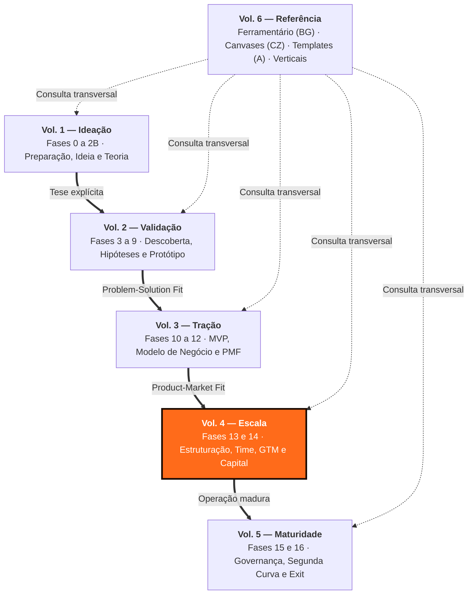

---

## Sumário deste Volume

### Fases da Etapa (Escala)

- [[#FASE 13 — ESTRUTURAÇÃO JURÍDICA, FINANCEIRA E OPERACIONAL]]
- [[#FASE 14 — ESCALA: TIME, OPERAÇÕES, CRESCIMENTO E CAPITAL]]

### Apêndices Operacionais desta Etapa

#### Captação de Capital, Valuation e Relação com Investidores

- [[#APÊNDICE V — CAPTAÇÃO DE EQUITY, PITCH E RELACIONAMENTO COM INVESTIDORES]]
- [[#APÊNDICE CF — PLANEJAMENTO DE RODADA COMO PROCESSO: FUNDRAISING COMO PROJETO ESTRUTURADO]]
- [[#APÊNDICE CE — VALUATION METHODS: COMO INVESTIDORES CALCULAM E COMO VOCÊ CALCULA PARA NEGOCIAR]]
- [[#APÊNDICE DF — INSTRUMENTOS DE CAPTAÇÃO: SAFE, NOTA CONVERSÍVEL E MÚTUO CONVERSÍVEL]]
- [[#APÊNDICE P — FINANCIAMENTO NÃO-DILUITIVO]]
- [[#APÊNDICE BB — VENTURE DEBT E REVENUE-BASED FINANCING (RBF)]]
- [[#APÊNDICE CI — EQUITY CROWDFUNDING NO BRASIL: CAPTAÇÃO PÚBLICA DE PEQUENOS INVESTIDORES]]
- [[#APÊNDICE CJ — TOKENIZAÇÃO PARA FOUNDERS: ATIVOS DIGITAIS, SECURITY TOKENS E QUANDO NÃO É HYPE]]
- [[#APÊNDICE DD — INVESTOR RELATIONS PÓS-RODADA]]

#### Finanças em Escala, Planejamento, Tributário, Crédito e Riscos

- [[#APÊNDICE W — CONTABILIDADE, TRIBUTÁRIO E REGIMES FISCAIS PARA STARTUP BRASILEIRA]]
- [[#APÊNDICE EN — TRIBUTÁRIO ESTRATÉGICO PARA STARTUPS]]
- [[#APÊNDICE EC — PLANEJAMENTO FINANCEIRO E ORÇAMENTO]]
- [[#APÊNDICE EG — REVENUE FORECASTING: MODELOS, ACURÁCIA E PROCESSO PARA O FOUNDER]]
- [[#APÊNDICE EZ — CAPITAL DE GIRO E RECEBÍVEIS]]
- [[#APÊNDICE FA — RELAÇÕES BANCÁRIAS E CRÉDITO NO BRASIL]]
- [[#APÊNDICE EY — GESTÃO DE RISCO E SEGUROS PARA STARTUPS]]

#### Crescimento em Escala, Vendas Enterprise, RevOps, Parcerias e PR

- [[#APÊNDICE CG — GROWTH COMO FUNÇÃO ORGANIZACIONAL: TIME DE GROWTH, BUILD VS HIRE, RELAÇÃO COM PRODUTO]]
- [[#APÊNDICE EB — VENDAS COMPLEXAS ENTERPRISE: CICLO LONGO, ALTO VALOR, MÚLTIPLOS DECISORES]]
- [[#APÊNDICE EH — REVENUE OPERATIONS: INFRAESTRUTURA, DADOS E PROCESSO PARA CRESCER COM PREVISIBILIDADE]]
- [[#APÊNDICE DY — BUSINESS DEVELOPMENT]]
- [[#APÊNDICE FD — PARCERIA COM GRANDES CORPORAÇÕES BRASILEIRAS]]
- [[#APÊNDICE CX — CANAIS INDIRETOS E PARCERIAS: PARCERIAS, FRANQUIAS, CHANNEL]]
- [[#APÊNDICE CQ — MARCA, PR E POSICIONAMENTO DE LONGO PRAZO]]
- [[#APÊNDICE BM — COMUNICAÇÃO PÚBLICA DO FUNDADOR: NARRATIVA, IMPRENSA E PORTA-VOZ]]
- [[#APÊNDICE CY — MARCA PESSOAL DO FUNDADOR: DISTRIBUIÇÃO, AUTORIDADE E CUSTO DE REPUTAÇÃO]]

#### Pessoas, Liderança Executiva, Cultura, Engenharia e Operações

- [[#APÊNDICE R — FOUNDER MODE, DELEGAÇÃO E QUANDO PARAR DE FAZER]]
- [[#APÊNDICE BQ — GESTÃO DE TEMPO DO FUNDADOR E OPERATING CADENCE]]
- [[#APÊNDICE DW — MANAGEMENT PARA O FUNDADOR TÉCNICO]]
- [[#APÊNDICE BN — EXECUTIVE HIRING: CONTRATAR LÍDERES SÊNIOR E C-LEVEL]]
- [[#APÊNDICE CO — RECRUTAMENTO TÉCNICO EM PROFUNDIDADE]]
- [[#APÊNDICE BZ — PERFORMANCE REVIEWS ESTRUTURADOS: CICLO, CALIBRAÇÃO E CONEXÃO COM COMPENSAÇÃO]]
- [[#APÊNDICE ED — COMPENSAÇÃO E BENEFÍCIOS NO BRASIL]]
- [[#APÊNDICE DB — STOCK OPTIONS E ESOP NO BRASIL]]
- [[#APÊNDICE AP — CULTURA COMO DISCIPLINA]]
- [[#APÊNDICE FG — CULTURA EM SITUAÇÕES ESPECIAIS: M&A, HIPERCRESCIMENTO, REMOTO]]
- [[#APÊNDICE BU — DIVERSIDADE, EQUIDADE E INCLUSÃO (DEI) EM STARTUP BRASILEIRA]]
- [[#APÊNDICE AG — REMOTE, HYBRID E DISTRIBUÍDO COMO DISCIPLINA]]
- [[#APÊNDICE FB — DESIGN ORGANIZACIONAL]]
- [[#APÊNDICE FC — GESTÃO DO CONHECIMENTO]]
- [[#APÊNDICE DZ — COMUNICAÇÃO INTERNA]]
- [[#APÊNDICE CR — ENGINEERING MANAGEMENT: GESTÃO DO TIME TÉCNICO E DEVELOPER EXPERIENCE]]
- [[#APÊNDICE BC — TECHNICAL DEBT COMO DISCIPLINA GERENCIADA]]
- [[#APÊNDICE CH — IA NA ENGENHARIA INTERNA: COPILOT, AGENTES E PRODUTIVIDADE DE DEV]]
- [[#APÊNDICE DV — OPERAÇÕES EM ESCALA]]
- [[#APÊNDICE EI — AI OPS E AUTOMAÇÃO INTELIGENTE]]

#### Jurídico, Trabalhista, Propriedade Intelectual, Compliance e Segurança

- [[#APÊNDICE DA — MARCO LEGAL DAS STARTUPS: LC 182/2021]]
- [[#APÊNDICE DC — PROPRIEDADE INTELECTUAL E INPI]]
- [[#APÊNDICE DJ — NÃO-CONCORRÊNCIA E NÃO-SOLICITAÇÃO NO BRASIL]]
- [[#APÊNDICE T — LGPD, COMPLIANCE E GOVERNANÇA DE DADOS]]
- [[#APÊNDICE AH — CONTRATOS E ASPECTOS LEGAIS OPERACIONAIS]]
- [[#APÊNDICE EU — CONTRATOS EM PROFUNDIDADE POR TIPO]]
- [[#APÊNDICE EL — DIREITO DO TRABALHO PARA STARTUPS]]
- [[#APÊNDICE EM — COMPLIANCE E ANTICORRUPÇÃO PARA STARTUPS]]
- [[#APÊNDICE EO — CONTENCIOSO E LITÍGIO PARA STARTUPS]]
- [[#APÊNDICE EP — RESPONSABILIDADE DO SÓCIO E DO ADMINISTRADOR]]
- [[#APÊNDICE EQ — DIREITO DO CONSUMIDOR E CDC PARA STARTUPS]]
- [[#APÊNDICE ET — REGULATÓRIO DE IA NO BRASIL]]
- [[#APÊNDICE BW — FRAUDE INTERNA E CONTROLES INTERNOS]]
- [[#APÊNDICE CV — SEGURANÇA DA INFORMAÇÃO: DA CERTIFICAÇÃO À ENGENHARIA]]

---

# FASES DA ETAPA — ESCALA

---

## FASE 13 — ESTRUTURAÇÃO JURÍDICA, FINANCEIRA E OPERACIONAL

> [!note] Antes de assumir captação como rota
> Este capítulo trata estruturação para empresas que escolheram o caminho VC. A escolha fundacional entre bootstrap e venture capital é tratada em [[IGNICAO-Vol-1-Ideacao#APÊNDICE CS — BOOTSTRAP vs VENTURE CAPITAL: A ESCOLHA FUNDACIONAL|Apêndice CS (Vol. 1)]]. Empresas brasileiras como RD Station, Granatum e Conta Azul construíram negócios significativos sem VC. A escolha não é neutra.

### O que esse apêndice cobre

Consolidação das bases formais e operacionais do negócio. O entregável é a empresa estruturada: CNPJ ativo, regime tributário adequado, contratos formais, processos documentados, compliance básico, registros contábeis em dia.

> [!abstract] Resumo operacional
> **Entregável:** Empresa juridicamente constituída e operacionalmente estruturada — tipo societário, regime tributário, cap table com vesting, acordo de sócios, contratos com clientes e colaboradores, programa LGPD ativo e contabilidade mensal em dia.
>
> **Sinais de saída:**
> - Empresa constituída em formato adequado (LTDA ou S.A.) com contrato social revisado por advogado especializado em startups e cap table documentado com vesting de quatro anos com cliff de doze meses.
> - Programa LGPD básico ativo (DPO, bases legais, DPAs com operadores principais) e contratos padronizados com clientes, colaboradores e terceiros críticos.
> - Sistema contábil ativo com fechamento mensal sem pendências, marca em registro no INPI e separação total entre finanças pessoais e empresariais.
>
> **Três armadilhas mais comuns:**
> 1. Postergar formalização sob a lógica de "depois eu resolvo" — dívida fiscal e trabalhista compõe e custa mais resolver depois.
> 2. Acordo de sócios "no aperto de mão" — relações ótimas hoje viram disputas tóxicas no momento de dinheiro ou crise.
> 3. Ignorar LGPD — multas de até dois por cento do faturamento, com exposição reputacional pior que a multa.

### POR QUE

Muitos empreendedores postergam formalização. Acham que é burocracia. Na verdade, a falta de formalização gera riscos concretos. Autuações fiscais. Impossibilidade de emitir notas. Quebra de contratos por falta de amparo jurídico. Perda de funcionários por informalidade. Inviabilidade de captar investimento. Bloqueio de contas bancárias. A estruturação tarda. Mas sempre tem que acontecer. E quanto antes, melhor.

### Quando usar

Comece quando houver clientes pagantes, e receita relevante. Alguns aspectos (CNPJ) podem vir antes, se o modelo exigir emissão de notas. Termine quando os itens críticos desta fase estão concluídos. Revisite anualmente, e a cada marco (novos sócios, captação, expansão).

### Quem envolve

O executor é você. Os participantes são o contador (obrigatório), o advogado (altamente recomendado), e os sócios. O decisor é você.

### Como executar

Dez passos.

#### Passo 1, defina o tipo societário

No Brasil, as formas mais comuns para startups são quatro.

MEI. Limitado a um faturamento anual baixo (verifique o limite atual, que é atualizado periodicamente). Útil no comecinho. Geralmente insuficiente para startups em crescimento.

EIRELI (em extinção na prática), ou Sociedade Unipessoal Limitada. Você é sócio único. Limitada.

LTDA. Mais de um sócio. Mais flexível. Capital social declarado.

S/A. Estrutura para captação robusta. Mais complexa. Obrigatória para IPO.

> [!important] Para a maioria das startups iniciais, LTDA é o ponto ideal
> S/A entra em cena quando há captações de venture capital significativas. Migrar de LTDA para S/A custa entre R$ 15 mil e R$ 40 mil em honorários jurídicos para conversão simples (alteração de tipo societário, sem reestruturação de cap table (tabela de capitalização — quem tem quanto da empresa)). Para migração no contexto de Série A com reestruturação societária completa (classes de ações, ESOP, drag/tag-along, holding), a faixa sobe para R$ 30 mil a R$ 100 mil — esta é a faixa documentada no [[#APÊNDICE W — CONTABILIDADE, TRIBUTÁRIO E REGIMES FISCAIS PARA STARTUP BRASILEIRA|Apêndice W]] e se aplica ao cenário típico em que a migração efetivamente acontece. Em ambos os casos, é trivial — não vale antecipar a estrutura mais pesada.

> [!tip] Apêndice DA — Marco Legal das Startups
> O [[#APÊNDICE DA — MARCO LEGAL DAS STARTUPS: LC 182/2021|Apêndice DA — Marco Legal das Startups]] (Lei 182/2021) cobre os benefícios específicos para startups: sandbox regulatório, dispensa de licitação para contratar com governo, regime simplificado de dissolução e o enquadramento como "Empresa Inovadora" — relevante para decidir estrutura jurídica e acessar programas de fomento.

#### Passo 2, escolha o regime tributário

No Brasil, três regimes principais.

Simples Nacional. Para receitas anuais até o teto definido em lei (verifique o valor atualizado). Menor complexidade. Alíquotas variam conforme atividade e faturamento.

Lucro Presumido. Para receitas até outro patamar acima do Simples. Bom para algumas atividades com margem alta.

Lucro Real. Obrigatório para receitas acima do limite do Lucro Presumido, e para certas atividades específicas. Mais complexo.

> [!warning] Consulte o seu contador antes de decidir
> A escolha errada pode custar cinco a dez por cento de margem sem necessidade. Os limites e alíquotas dos regimes mudam periodicamente — esse manual aponta a estrutura, não os números do ano corrente.

> [!note] Tributário estratégico para startups
> O [[#APÊNDICE EN — TRIBUTÁRIO ESTRATÉGICO PARA STARTUPS|Apêndice EN — Tributário Estratégico]] cobre o Fator R do Simples Nacional (como a folha afeta o anexo de enquadramento), a Lei do Bem para P&D, e quando a estrutura de holding passa a fazer sentido — decisões com impacto direto na margem líquida dos próximos anos.

#### Passo 3, registre marca e domínio

Três providências.

Registro da marca no INPI (Brasil) para proteger nome e logo. O processo demora doze a vinte e quatro meses. Mas o protocolo já gera direitos.

Registro de domínio. .com.br, .com, e outros relevantes para o negócio.

Se operar internacionalmente, pesquise proteção internacional. Países onde a empresa terá presença, ou onde competidores podem registrar a marca antes.

#### Passo 4, estruture contratos formais

Quatro tipos de contrato.

##### Acordo de sócios, se houver sócios

Obrigatório desde o primeiro dia. Inclua sete itens. Divisão de participação. Vesting de equity (participação societária) — ninguém vira sócio pleno no dia zero, a participação se consolida ao longo de anos. Regras de saída voluntária, involuntária, e morte. Direitos de veto em decisões críticas. Mecanismos de resolução de conflito. Não-compete, e confidencialidade. Cláusula de tag-along, e drag-along, para rodadas futuras.

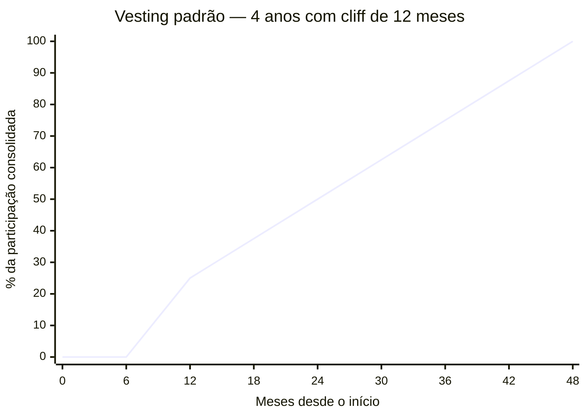

> [!note] Como funciona o vesting com cliff
> Nos primeiros 12 meses (o cliff (período mínimo antes de começar a adquirir participação)), nada vesta. No mês 13, 25% consolida de uma vez. Dos meses 13 a 48, o restante vesta mensalmente (~2,08% ao mês). Se o fundador sai antes de 12 meses, não leva nada. Se sai no mês 30, leva 50% da participação acordada. Isso protege a empresa de cofundadores que saem cedo mas mantêm participação grande.

> [!tip] Apêndice CZ — Capital Stack / Waterfall (CZ.17)
> Cap table com vesting é o tema central desta fase. O [[IGNICAO-Vol-6-Referencia#APÊNDICE CZ — CANVASES E MAPAS VISUAIS DE MODELO|Capital Stack / Waterfall Canvas (CZ.17) (Vol. 6)]] é o mapa visual da estrutura de capital — Common (fundadores), Preferred (investidores com seniority), pool de ESOP, dívida — e do waterfall em cenário de exit (preferences, participation, conversion). Use desde a primeira rodada para que decisões de term sheet (1x participating, anti-dilution full ratchet vs weighted average, ESOP top-up) tenham impacto visualmente claro no que cada parte recebe em diferentes valuations de saída.

> [!warning] Conflito entre sócios é a segunda maior causa de morte de startups no mundo
> Não pule o acordo. Casais que se separam sem contrato pré-nupcial passam por divórcio. Sócios que se separam sem acordo passam por anos de litígio. O [[IGNICAO-Vol-5-Maturidade#APÊNDICE BP — DISPUTA SOCIETÁRIA E SAÍDA DE SÓCIO|Apêndice BP (Vol. 5)]] cobre prevenção (cláusulas que evitam o conflito), mediação (quando o conflito chega) e mecânica jurídica de saída forçada.

###### Formalização jurídica do equity acordado

A discussão substantiva sobre divisão de equity entre fundadores — quatro fatores (ideia, comprometimento, habilidades, capital), método Slicing Pie de Mike Moyer (2012), processo estruturado de negociação em três passos, e quando 50/50 vs 60/40 vs 70/30 vs solo com pool faz sentido — está na [[IGNICAO-Vol-1-Ideacao#FASE 0 — PREPARAÇÃO DO EMPREENDEDOR|Fase 0 (Vol. 1)]] (Sócios, a decisão mais irreversível). Aqui o foco é a formalização jurídica do que foi acordado, em quatro proteções inegociáveis no acordo de sócios:

- **Vesting de 4 anos com cliff de 12 meses para todos os fundadores.** Padrão de mercado que protege a empresa de cofundador que sai antes da consolidação completa.
- **Reverse vesting**: equity não consolidado volta para o pool se o sócio sai. Sem isso, sócio que sai no mês 30 leva 50% mas a empresa fica sem o trabalho que esse equity representava.
- **Mecanismo de compra de equity do sócio que sai** (shooting mechanism ou buy-sell agreement). Define preço, prazo e fonte do dinheiro para recompra antes do conflito existir.
- **Critério explícito de casting vote em impasse**. Em divisão 50/50, um sócio precisa ter voto de minerva em categoria específica de decisão (técnica, comercial, etc.) — sem isso, impasse trava operação.

> [!tip] Não negocie equity em jantar
> A conversa de divisão de equity deve acontecer em ambiente estruturado, com documentação. Acordos verbais em jantar geram memórias diferentes seis meses depois. Use um template de acordo ou leve para advogado desde o primeiro rascunho.

> [!tip] Apêndice DB — Stock Options para Startups Brasileiras
> O [[#APÊNDICE DB — STOCK OPTIONS E ESOP NO BRASIL|Apêndice DB — Stock Options]] cobre a estrutura jurídica e fiscal das opções no Brasil: phantom shares versus opções reais, tratamento tributário no exercício, modelos de plano ESOP e como redigir a carta de oferta de equity para os primeiros funcionários — sem criar passivo fiscal inadvertido.

##### Contrato com clientes

Termos de uso. Contratos de prestação de serviço. SLAs. Revisados por advogado.

> [!note] Contratos em profundidade: MSA, NDA, DPA e IP assignment
> O [[#APÊNDICE EU — CONTRATOS EM PROFUNDIDADE POR TIPO|Apêndice EU — Contratos em Profundidade]] cobre a anatomia de cada contrato essencial para startups — MSA (Master Service Agreement), NDA, DPA (Data Processing Agreement), LOI e acordo de advisor — com as cláusulas críticas, os erros comuns, e o que negociar antes de assinar.

##### Contrato com colaboradores

CLT, PJ, autônomo, estagiário. Cada modalidade tem regras. Informalidade aqui gera passivo trabalhista. O maior risco jurídico de empresas pequenas.

> [!note] Direito do trabalho para startups: CLT vs PJ, eSocial e rescisão
> O [[#APÊNDICE EL — DIREITO DO TRABALHO PARA STARTUPS|Apêndice EL — Direito do Trabalho para Startups]] detalha os critérios de vínculo empregatício que transformam PJ em CLT na Justiça do Trabalho, as obrigações do eSocial desde o primeiro funcionário, o tratamento do sobreaviso em times de produto, e o custo real de cada modalidade de rescisão.

> [!note] Como estruturar a compensação dos primeiros funcionários
> O [[#APÊNDICE ED — COMPENSAÇÃO E BENEFÍCIOS NO BRASIL|Apêndice ED — Compensação e Benefícios no Brasil]] explica o multiplicador real do salário CLT (1,66x sobre o bruto), como estruturar PLR e equity para os primeiros funcionários, e quais benefícios fazem sentido em cada estágio da empresa.

##### NDAs com terceiros críticos

Parceiros, fornecedores, e potenciais investidores quando apropriado.

> [!tip] Apêndice AH — Contratos Operacionais
> O [[#APÊNDICE AH — CONTRATOS E ASPECTOS LEGAIS OPERACIONAIS|Apêndice AH — Contratos Operacionais]] cobre os contratos de back-office que ficam fora dos contratos com clientes e colaboradores: fornecedores de tecnologia, acordos de parceria, contratos de coworking, SLAs internos e os itens de due diligence que investidores verificam em Série A — quando contratos mal-redigidos viram obstáculo ao fechamento da rodada.

#### Passo 5, adeque-se à LGPD (se trata dados pessoais)

Cinco providências. Nomeie DPO, ou encarregado. Escreva política de privacidade. Obtenha consentimento apropriado. Mantenha registro de tratamento de dados (ROPA). Tenha processo de resposta a solicitações do titular.

> [!note] Compliance mínimo viável além da LGPD
> O [[#APÊNDICE EM — COMPLIANCE E ANTICORRUPÇÃO PARA STARTUPS|Apêndice EM — Compliance e Anticorrupção]] cobre as obrigações da Lei Anticorrupção (Lei 12.846) aplicáveis a startups, o papel do DPO, PLD/CFT para fintechs, e como montar um programa de compliance enxuto — o mínimo exigido por investidores institucionais e clientes enterprise.

#### Passo 6, instale contabilidade em dia

Quatro providências. Contador mensal. Emissão de notas fiscais corretas. Registros contábeis conforme regime. Obrigações acessórias (DCTF, DEFIS, DIRF, conforme aplicável).

> [!tip] Apêndice W — Contabilidade para Startups
> O [[#APÊNDICE W — CONTABILIDADE, TRIBUTÁRIO E REGIMES FISCAIS PARA STARTUP BRASILEIRA|Apêndice W — Contabilidade, Tributário e Regimes Fiscais]] cobre a diferença entre contabilidade gerencial e fiscal, como escolher entre Contabilizei, escritório especializado e controller interno por estágio, e o checklist de obrigações acessórias mensais que o fundador precisa acompanhar — mesmo sem entender contabilidade profundamente.

#### Passo 7, separe finanças pessoais e empresariais

Conta bancária exclusivamente da empresa. Cartão corporativo. Pró-labore definido. Dividendos, se houver, formalizados.

> [!warning] Misturar CPF e CNPJ é caminho para desorganização e risco fiscal
> Empréstimos do sócio para a empresa, ou da empresa para o sócio, sem contrato formal, geram autuação fiscal e descaracterização da pessoa jurídica em caso de litígio. Toda movimentação entre as duas pessoas (física e jurídica) precisa de contrato escrito.

> [!note] Responsabilidade do sócio e do administrador
> O [[#APÊNDICE EP — RESPONSABILIDADE DO SÓCIO E DO ADMINISTRADOR|Apêndice EP — Responsabilidade do Sócio e Administrador]] explica quando a desconsideração da personalidade jurídica se aplica, o que configura confusão patrimonial, e as obrigações legais do administrador que justificam a separação rigorosa de contas.

#### Passo 8, estabeleça processos operacionais documentados

Cinco documentos vivos. Onboarding (processo de integração do novo colaborador) de novo cliente. Onboarding de novo funcionário. Processo de suporte. Processo de venda. Políticas internas (gastos, viagens, despesas).

> [!tip] Documente o necessário, não o exaustivo
> Não precisa ser cinquenta páginas. Precisa ser claro e usado. Documento que ninguém lê é teatro de processo. Uma página por processo, em linguagem direta, vale mais do que manual elaborado que ninguém abre.

#### Passo 9, defina estrutura financeira mínima

Quatro itens. Fluxo de caixa mensal projetado para os próximos doze meses. Controle de inadimplência. Reconciliação bancária semanal. Relatório mensal de resultado.

> [!note] Capital de giro ao estruturar e captar a primeira rodada
> O [[#APÊNDICE EZ — CAPITAL DE GIRO E RECEBÍVEIS|Apêndice EZ — Capital de Giro e Recebíveis]] cobre o Ciclo de Conversão de Caixa, as modalidades de antecipação de recebíveis disponíveis no Brasil, e como o FIDC se encaixa em fintechs e marketplaces — ferramentas para não ficar com caixa represado enquanto o negócio cresce.

#### Passo 10, revise seguros

Quatro modalidades, dependendo do negócio.

Responsabilidade civil. Cobre danos causados a terceiros pela operação.

Seguro de cibersegurança, se trata dados. Cobre custos de incidentes, vazamentos, e respostas regulatórias.

Seguro de erros e omissões (E&O), se oferece serviço profissional. Cobre falhas técnicas que causem prejuízo ao cliente.

Seguro de vida para sócios-chave (key person). Em sociedades pequenas, a perda repentina de um sócio operacional pode quebrar o negócio. O seguro mitiga esse risco para os sócios remanescentes.

> [!note] Coberturas essenciais para startups: D&O, E&O, cyber e Key Man
> O [[#APÊNDICE EY — GESTÃO DE RISCO E SEGUROS PARA STARTUPS|Apêndice EY — Gestão de Risco e Seguros]] detalha quando contratar cada cobertura, o que cada apólice efetivamente protege, e os gatilhos que tornam D&O e Key Man obrigatórios — especialmente após a entrada de investidores no board.

### Os dez passos aplicados, estruturação do PadariaPro LTDA

A pessoa jurídica. O formato escolhido foi LTDA (Sociedade Limitada). Adequado até Série A. Migração para S.A. planejada se a rodada superar R$ 5 milhões. CNAE principal: 62.02-3-00 (Desenvolvimento e licenciamento de programas de computador customizáveis). Capital social: R$ 100 mil, com R$ 20 mil integralizados, e R$ 80 mil a integralizar em vinte e quatro meses.

O cap table inicial.

| Sócio | Percentual | Tipo de entrada | Vesting |
|---|---|---|---|
| Mariana (founder, CEO) | 55% | Tempo integral desde dia um | 48 meses, cliff 12m |
| Bruno (cofounder, CTO) | 35% | Tempo integral desde mês três | 48 meses, cliff 12m |
| Pedro (advisor e angel) | 5% | R$ 200 mil investidos em SAFE (pré-rodada) | — |
| ESOP (pool de equity) | 5% | Reservado para futuras contratações-chave | Por grant |

O contador. Terceirizado. Escritório especializado em startups, R$ 1.200 por mês. Fechamento mensal: DRE, e balanço gerencial. Responsável por obrigações fiscais, folha (via ferramenta integrada), e relatório gerencial.

Os contratos. Modelo de contrato PJ uniformizado para os quatro colaboradores atuais. CLT futura planejada depois da Série A. Termo de uso, mais política de privacidade, publicados no site. DPA assinado com AWS, Z-API (WhatsApp), Asaas (pagamentos), e Mailgun (e-mail transacional).

A LGPD ([[#APÊNDICE T — LGPD, COMPLIANCE E GOVERNANÇA DE DADOS|Apêndice T]]). DPO terceirizado (DPO-as-a-Service, R$ 800 por mês). Canal `privacidade@padariapro.com.br` ativo. Mapeamento de tratamentos: catorze operações documentadas, com base legal.

O registro de marca. Pedido no INPI no dia 15 de fevereiro do ano. Protocolo em andamento. Revisão prevista em doze a dezoito meses. "PadariaPro" mais logo, em classe 9 (software) e classe 42 (serviços tecnológicos).

A contingência. Reserva líquida: R$ 150 mil (cerca de três meses de despesas fixas). Plano de contingência de quatro páginas documentado ([[IGNICAO-Vol-5-Maturidade#APÊNDICE CW — CRISE E CONTINUIDADE: PREVENÇÃO, RESPOSTA, RECUPERAÇÃO|Apêndice CW (Vol. 5)]]), para quatro cenários: caixa crítico, churn explosivo, perda de sócio, e regulatório.

A separação financeira. Conta PJ no Nubank Empresa. Pró-labore dos founders definido em R$ 7.500 por mês (patamar mínimo aceitável definido na [[IGNICAO-Vol-1-Ideacao#FASE 0 — PREPARAÇÃO DO EMPREENDEDOR|Fase 0 (Vol. 1)]]). Nada de "empréstimos entre sócios e empresa" sem contrato formal.

### PERGUNTAS A RESPONDER

- Qual é a estrutura societária adequada?
- Qual regime tributário minimiza carga, e atende requisitos?
- A marca e o domínio estão protegidos?
- Existe acordo de sócios assinado?
- Os contratos com clientes e colaboradores estão formalizados, e revisados?
- Estou em conformidade com a LGPD?
- A contabilidade está em dia?
- As finanças pessoal e empresarial estão separadas?
- Os processos operacionais críticos estão documentados?

### SAÍDA DESTA FASE

Você concluiu a [[#FASE 13 — ESTRUTURAÇÃO JURÍDICA, FINANCEIRA E OPERACIONAL|Fase 13]] quando todos os critérios abaixo estão cumpridos.

- [ ] Pessoa jurídica constituída em formato adequado ao estágio (LTDA ou S.A.), com regime tributário adequado e contrato social revisado por advogado especializado em startups.
- [ ] Cap table documentado com equity split e vesting de quatro anos com cliff de doze meses. Acordo de sócios assinado, com cláusulas de saída, tag-along, drag-along e resolução de conflito.
- [ ] Marca e domínio protegidos. Registro no INPI iniciado ou concluído.
- [ ] Contratos com clientes (termos de uso, SLA, política de privacidade), colaboradores (CLT ou PJ padronizados) e terceiros críticos (NDAs, fornecedores) em vigor.
- [ ] Programa LGPD básico ativo: DPO, bases legais, DPAs com operadores principais, política de privacidade, ROPA.
- [ ] Sistema contábil ativo (interno ou terceirizado) com fechamento mensal em até 10 dias do mês fechado, DRE e balanço, zero atrasos em obrigações acessórias (DCTF, DEFIS, SPED) nos últimos 6 meses, certidões negativas federais/estaduais/municipais válidas.
- [ ] Finanças pessoais e empresariais totalmente separadas (conta PJ, cartão corporativo, pró-labore definido, dividendos formalizados).
- [ ] Processos operacionais-chave documentados (onboarding cliente, onboarding funcionário, suporte, venda, políticas internas).
- [ ] Plano de contingência financeira e operacional documentado ([[IGNICAO-Vol-5-Maturidade#APÊNDICE CW — CRISE E CONTINUIDADE: PREVENÇÃO, RESPOSTA, RECUPERAÇÃO|Apêndice CW (Vol. 5)]]).
- [ ] Cobertura de seguros adequada ao estágio: responsabilidade civil cobrindo pelo menos 5x o faturamento mensal, cyber se trata dados, D&O após Série A ou quando houver investidores no board, Key Man se sócios são single-point-of-failure.

> [!warning] Critério de saída
> Postergar formalização não é "ganhar tempo". É acumular dívida fiscal, trabalhista e jurídica que compõe. Custa semanas no começo. Custa meses ou milhões depois.

**Primeiros passos práticos.**

1. Contrate advogado especializado em startups (não generalista) para revisar o contrato social e o cap table. Investimento de R$ 3 mil a R$ 10 mil justificável.
2. Formalize o cap table em planilha detalhada, mais o vesting dos sócios (quatro anos com cliff de doze meses é padrão).
3. Contrate contador especializado em startup, ou serviços como Contabilizei, ou Omie mais contador, para começar fechamento mensal.
4. Inicie o registro de marca no INPI. Pode levar oito a dezoito meses. Comece cedo.
5. Redija política de privacidade, mais termos de uso, mais mapeamento LGPD básico.

### Armadilhas

"Depois eu resolvo". Dívida fiscal e trabalhista compõe. Deixar para depois quase sempre é mais caro do que lidar agora.

Contador barato demais. Contador ruim custa mais do que contador caro. Escolha bem.

Acordo de sócios "no aperto de mão". Relações ótimas hoje viram disputas tóxicas no momento de dinheiro, ou crise. Formalize.

Ignorar LGPD. As multas vão até dois por cento do faturamento. E a exposição reputacional é pior.

Documentar demais, executar de menos. Processos escritos que ninguém segue são burocracia. Mantenha-os vivos.

---

### FERRAMENTAS DESTA FASE

Quatro essenciais para a fase, focadas em negociação e análise de decisão para estruturação. Canvas complementar: CZ.17 (Capital Stack / Waterfall).

**Essenciais para a Fase 13:**

- **Harvard Negotiation, BATNA e ZOPA** (Fisher e Ury, 1981) — interesses, opções de ganho mútuo, critérios objetivos. Use no acordo de sócios, primeiros contratos com clientes enterprise, e fornecedores críticos. BG.15.1.
- **Never Split the Difference** (Chris Voss, 2016) — tactical empathy, mirror, labeling, calibrated questions. Use em negociações emocionais (equity entre cofundadores, saída de sócio) ou com assimetria de poder (investidor seed, primeiros executivos sêniores). BG.15.2.
- **Getting Past No** (William Ury) — cinco passos para pessoas difíceis. Use em conflitos com cofounder e impasses no acordo de sócios. BG.15.4.
- **Cost-Benefit Analysis** — para escolha de estrutura jurídica (S.A. vs LTDA), regime tributário, e alocação inicial de capital. BG.5.6.

**Complementares (consulte conforme o caso):**

- Expected Value e Bayesian Thinking (BG.5.7), para pricing inicial e equity de contratação. As ferramentas de unit economics e finanças (Unit Economics, LTV/CAC Ratio, Cash Conversion Cycle, Burn Multiple) pertencem operacionalmente às Fases 11 e 14 e estão detalhadas em BG.18.1 a BG.18.8 — referenciadas aqui apenas porque a contabilidade montada na Fase 13 é o que torna essas métricas mensuráveis nas fases seguintes.

---

### SÍNTESE DA FASE 13

Nessa fase você formalizou o tipo societário (LTDA ou S/A), o regime tributário, o cap table com vesting, o acordo de sócios, os contratos com clientes e colaboradores, o programa LGPD e a contabilidade mensal. A diferença entre quem faz certo e quem falha está em tratar formalização como infraestrutura, não como obstáculo. Escolha de regime tributário tem efeito multimilionário em três a cinco anos. Cap table mal-feita é dor de cabeça em qualquer captação séria. Compliance LGPD é pré-requisito para vender enterprise ou captar Série A institucional.

Com essa base formalizada, a [[#FASE 14 — ESCALA: TIME, OPERAÇÕES, CRESCIMENTO E CAPITAL|Fase 14]] pode ser executada: construir time, operação e máquina de crescimento sem o risco jurídico e tributário de uma empresa ainda informal.

---

## FASE 14 — ESCALA: TIME, OPERAÇÕES, CRESCIMENTO E CAPITAL

> [!abstract] Mapa interno da Fase 14
> Esta fase tem quatro frentes interdependentes. Use o mapa para navegar.
>
> **14A, Time e Lideranca em Escala** — primeiro management, C-level, OKRs, cadencia, performance reviews. Em geral, dois a cinco anos de trabalho continuo.
>
> **14B, Operacoes em Escala** — passar de empresa-funcionando-com-fundador para empresa-funcionando-sem-fundador-no-dia. Processos, ferramentas, governanca operacional.
>
> **14C, Maquina de Crescimento** — transformar tracao pos-PMF em crescimento previsivel e composto. Funil saudavel, retencao alavancada, escala de aquisicao.
>
> **14D, Capital para Escala** — Series A em diante. Diferente de captacao seed/PMF, esta tem expectativas de crescimento e governance maiores.
>
> As frentes nao sao sequenciais. Sao paralelas. Em geral, fundadores fortes em uma das quatro precisam buscar ajuda nas outras tres.

### O que esse apêndice cobre

A [[#FASE 14 — ESCALA: TIME, OPERAÇÕES, CRESCIMENTO E CAPITAL|Fase 14]] é o longo período em que a empresa transita de *ter PMF* para *ser máquina*. Aqui você sai do modo fundador-fazendo-tudo e entra no modo empresa-funcionando-sem-você-no-dia-a-dia. É a fase mais longa e trabalhosa da trajetória — tipicamente dois a cinco anos, com picos de atividade e platôs. É também a fase onde boa parte das empresas brasileiras com PMF genuíno trava, porque scale (crescer mantendo ou melhorando margens) exige disciplinas que não eram necessárias até aqui.

A [[#FASE 14 — ESCALA: TIME, OPERAÇÕES, CRESCIMENTO E CAPITAL|Fase 14]] tem três frentes simultâneas: Time e Liderança em Escala, Operações e Gestão em Escala, e Máquina de Crescimento, Capital e Expansão. Cada uma com lógica própria, mas inseparáveis na prática. As três evoluem em paralelo — esse capítulo as trata em subseções ordenadas por intuição operacional.

> [!abstract] Resumo operacional
> **Entregável:** Plano de Time de dezoito meses mais Carta de Valores e Cultura, Arquitetura Operacional (OKRs, cadência de reuniões, playbooks, stack) e Máquina de Crescimento com motores de aquisição previsíveis, captação alinhada a milestones e expansão (segmento, geografia ou produto) iniciada.
>
> **Sinais de saída:**
> - Contratações C-level críticas executadas com plano de doze meses em curso, cultura documentada e rituais (all-hands, 1:1, skip) rodando há dois ou mais meses; eNPS sendo medido trimestralmente.
> - OKRs trimestrais em uso com scoring, top dez processos críticos com playbook escrito, dashboard central com seis ou mais métricas atualizadas semanalmente e blameless post-mortems instituídos.
> - Motor de vendas opera sem o fundador em mais de setenta por cento dos deals, NRR cento e dez por cento ou mais, burn multiple até um vírgula cinco e Rule of 40 quarenta ou mais.
>
> **Três armadilhas mais comuns:**
> 1. Over-hiring depois da rodada — pressão para "gastar o dinheiro" destrói cultura e caixa antes da estrutura para integrar existir.
> 2. OKRs como teatro — postados no início do trimestre e ignorados até o próximo, sem rituais de check-in obrigatórios.
> 3. Escalar vendas sem playbook — contratar dez vendedores com CAC desconhecido é queimar caixa sem aprender.

### POR QUE

Sem escala, o PMF vira curiosidade histórica. Empresa que atinge PMF mas não escala é empresa que fica pequena para sempre. Possivelmente lucrativa. Possivelmente satisfatória para o fundador. Mas não é o que o ecossistema de venture capital busca financiar. Se o seu caminho é construir uma empresa de software de bilhões, a [[#FASE 14 — ESCALA: TIME, OPERAÇÕES, CRESCIMENTO E CAPITAL|Fase 14]] é onde se prova, ou não se prova.

A escala também muda quem você é como líder. Na [[IGNICAO-Vol-3-Tracao#FASE 12 — PRODUCT-MARKET FIT|Fase 12 (Vol. 3)]] você é artesão. Na [[#FASE 14 — ESCALA: TIME, OPERAÇÕES, CRESCIMENTO E CAPITAL|Fase 14]] você é industrial. O conjunto de habilidades é diferente. Às vezes oposto. Muitos fundadores tropeçam aqui. Não por falta de mérito. Mas porque insistem em operar como artesão quando a empresa precisa de industrial. Trocar de modo é parte da [[#FASE 14 — ESCALA: TIME, OPERAÇÕES, CRESCIMENTO E CAPITAL|Fase 14]].

### Quando usar

Comece quando você declarou PMF na [[IGNICAO-Vol-3-Tracao#FASE 12 — PRODUCT-MARKET FIT|Fase 12 (Vol. 3)]], e fez a estruturação formal da [[#FASE 13 — ESTRUTURAÇÃO JURÍDICA, FINANCEIRA E OPERACIONAL|Fase 13]]. Em prática, doze a dezoito meses depois do primeiro MVP validado. A [[#FASE 14 — ESCALA: TIME, OPERAÇÕES, CRESCIMENTO E CAPITAL|Fase 14]] não tem fim claro. Ela se desdobra nos apêndices operacionais deste **Volume 4 (Escala)** e, quando a empresa atinge massa crítica — tipicamente cento e cinquenta a quinhentos funcionários, operação em múltiplas frentes e governança formal, conecta-se diretamente ao **Volume 5 (Maturidade)**. A frequência de revisão é contínua. A [[#FASE 14 — ESCALA: TIME, OPERAÇÕES, CRESCIMENTO E CAPITAL|Fase 14]] não é "documento que se escreve uma vez". É rotina gerencial e estratégica permanente.

### Quem envolve

O executor principal é você, com o time executivo que começa a se formar. Primeiros VPs. Depois heads. Depois C-level. O decisor sobre arquitetura é você. O apoio externo vem de advisors, board (quando existir), e investidores (em questões de capital, e estratégia).

---

### 14A — Time e Lideranca em Escala

### TIME E LIDERANÇA EM ESCALA

#### O primeiro funcionário, a transição de fundador solo para mais um

A [[#FASE 14 — ESCALA: TIME, OPERAÇÕES, CRESCIMENTO E CAPITAL|Fase 14]] (Time e Liderança) trata time em escala com processos formais. Mas a transição do fundador solo, ou dupla, para fundador mais um funcionário é um momento específico que raramente é bem-tratado em manuais. Essa seção cobre.

> [!important] Por que é momento crítico
> Até aqui, o fundador fazia tudo, e delegava nada. A dificuldade é mais emocional que técnica. Aprender a *confiar* em alguém com coisas que antes você controlava. O primeiro funcionário define a cultura da empresa com peso desproporcional. Os valores dessa pessoa moldam os próximos cinco a quinze funcionários. Erros de contratação cedo são caros. Em tempo perdido. Em moral quebrada. Em aprendizado de gestão ainda embrionário no fundador. O primeiro funcionário frequentemente tem perfil diferente dos seguintes. Requer empreendedorismo no DNA, mesmo sendo funcionário.

> [!tip] Apêndice CZ — Org Chart Evolution (CZ.19)
> Estrutura organizacional em escala não é estática. O [[IGNICAO-Vol-6-Referencia#APÊNDICE CZ — CANVASES E MAPAS VISUAIS DE MODELO|Org Chart Evolution (CZ.19) (Vol. 6)]] é o mapa visual de como o org chart deve evoluir conforme a empresa cresce (10 → 50 → 200 → 500 pessoas), sinalizando quando criar gerência intermediária, quando descentralizar decisões e quais funções aparecem em cada estágio (CFO, CPO, VP Engineering, CHRO). Use para antecipar contratações C-level antes de elas virarem urgência reativa — contratar com seis meses de antecedência custa metade de contratar em pânico.

##### Quando contratar o primeiro funcionário

Sinais de que é hora. O fundador (ou dupla) está no gargalo há dois a três meses seguidos, sem conseguir avançar em frentes específicas. Há capital disponível para doze a dezoito meses de salário dessa pessoa. Há PMF inicial, ou claro caminho para ele (receita recorrente começando, ou grande confiança). Você sabe *exatamente* o que essa pessoa vai fazer nos próximos seis meses.

Sinais de que *não* é hora. "Seria bom ter alguém, mas não sei bem para quê" — contratar por vaidade ou ansiedade. Caixa para menos de seis meses do novo salário, sem plano de caixa claro. Ainda não tem PMF, e está iterando muito. Contratação cria pressão a manter curso, e reduz flexibilidade. A sua própria agenda está quarenta por cento livre. O fundador não está no gargalo ainda.

##### Quem contratar, perfis mais eficazes

Perfil A, ex-colega sênior que já confia em você (ideal). Você já trabalhou com essa pessoa. Sabe como ela trabalha sob pressão. Ela está trocando emprego estável por aposta. Precisa acreditar em você, e na ideia. Compensação frequentemente abaixo de mercado, mais equity significativo (um a cinco por cento dependendo de perfil).

Perfil B, generalista de alto potencial. Pessoa de três a sete anos de experiência. Adaptável. Quer aprender ampliando skills em empresa pequena. Topa fazer "tudo que aparecer" nos primeiros meses. Salário próximo de mercado, mais equity modesto (zero vírgula vinte e cinco a um por cento).

Perfil C, especialista em gargalo específico. Se o fundador é técnico, e o gargalo é vendas, contratar AE sênior. Se o fundador é comercial, e o gargalo é tech, contratar full-stack sênior. Especialista com cinco a dez anos. Salário próximo a mercado.

> [!warning] Evitar no primeiro funcionário
> Júnior que precisa de muito suporte (o fundador não tem tempo). Superstar de empresa grande sem experiência em startup (cultura choque). Parente, ou amigo próximo (conflitos são mais difíceis de resolver).

##### Onde encontrar

Rede pessoal ([[IGNICAO-Vol-1-Ideacao#APÊNDICE AL — REDE, MENTORES E ADVISORS — COMO CONSTRUIR O CAPITAL HUMANO DO EMPREENDEDOR|Apêndice AL (Vol. 1)]]). Origem de setenta por cento das primeiras contratações bem-sucedidas. LinkedIn ativo. "Estou contratando o meu primeiro funcionário, [descrição]. Quem você conhece?" Plataformas. Gupy, Revelo no Brasil. AngelList ou Wellfound internacional. Comunidades setoriais. Grupos Slack ou Discord da sua categoria.

##### Processo de contratação para primeiro funcionário

Sete passos. Descrição da vaga (trinta minutos). Título, cinco a sete responsabilidades, e três a cinco critérios de sucesso em seis meses. Sourcing (uma a duas semanas). Rede pessoal, LinkedIn, plataformas. Vinte a quarenta candidatos conversados. Tela inicial (trinta minutos cada). Cultura fit, motivação, e match básico de skills. Oito a quinze candidatos. Entrevista técnica, ou case (noventa minutos cada). Avaliação de trabalho real. Quatro a seis candidatos. Culture fit aprofundado (sessenta minutos). Conversa sobre valores, estilo de trabalho, e tolerância a ambiguidade. Dois a três candidatos. Reference check (mínimo de duas referências trabalhadas). Conversa direta. Não e-mail. Pedir exemplos concretos. Oferta, e negociação.

Prazo total: três a seis semanas, do início ao primeiro dia.

##### Oferta para primeiro funcionário, estrutura típica

Salário de oitenta a noventa e cinco por cento do mercado, para cargo equivalente. Abaixo sinaliza startup. Perto do mercado reconhece o risco que está aceitando.

> [!tip] Apêndice ED — Compensação e Benefícios
> Estrutura de salário, equity, bônus e benefícios por estágio e senioridade, benchmarks salariais para startups brasileiras, e como montar pacotes competitivos em escala.

Equity de zero vírgula cinco a cinco por cento, dependendo de perfil, senioridade, equity total disponível, e quanto a pessoa está assumindo de risco. Como conciliar com as faixas dos três perfis acima? Perfil A (ex-colega sênior trocando emprego estável) fica tipicamente em **um a cinco por cento**, com o topo da faixa reservado para o "primeiro funcionário VP-level" do tipo que vira C-level naturalmente. Perfil B (generalista de alto potencial) fica em **zero vírgula vinte e cinco a um por cento**. Perfil C (especialista para gargalo) fica em **zero vírgula cinco a dois por cento**, dependendo de quão crítico é o gargalo e quão fácil seria substituir a pessoa. A faixa ampla "zero vírgula cinco a cinco por cento" desta linha é a envoltória que cobre os três perfis — não significa que toda contratação fica entre 0,5% e 5%, mas sim que esse é o intervalo onde alguma das três combinações cabe.

Vesting de quatro anos, com um ano de cliff. Padrão inegociável.

Benefícios mínimos mas claros. Plano de saúde se possível. VR ou VA se CLT.

Modelo contratual. CLT padrão, ou PJ se realmente é estrutura de PJ (risco de pejotização, [[#APÊNDICE AH — CONTRATOS E ASPECTOS LEGAIS OPERACIONAIS|Apêndice AH]]).

##### Primeiros noventa dias, onboarding que dá certo

Dias 1-7. Apresentação a tudo. Produto, mercado, clientes atuais, métricas, e rede. Leitura de documentos-chave (pitch deck, declaração da ideia, mapa de problemas). Expectativas dos primeiros trinta, sessenta, e noventa dias escritas, e acordadas.

Dias 8-30. Observação estruturada de cliente-zero, chamadas de vendas, e produto real. Pequenos entregáveis com autonomia crescente. 1:1 semanal de sessenta minutos com fundador. Calibração constante.

Dias 31-60. Primeiro projeto substantivo com ownership. Feedback bidirecional formal. Introduções a rede (mentores, advisors, e clientes).

Dias 61-90. Revisão formal. Como está indo? O critério acordado no dia um está sendo atingido? Se sim, ampliar escopo. Se não, conversa honesta. Plano de recuperação, ou saída amigável.

##### A primeira demissão, quando acontecer

> [!tip] Apêndice BV — Layoffs e Desligamentos
> Quando e como conduzir desligamentos individuais ou coletivos: protocolo legal, comunicação ao time, impacto de moral, e como preservar a cultura durante reduções de headcount (número de funcionários).

Estatisticamente, trinta a quarenta por cento das primeiras contratações não se encaixam. Problema de fit, de timing, de expectativa, ou de momento da empresa. Esse número parece alto. Mas é normal.

Quando precisa acontecer. Fazer rápido, mas não precipitado. Demora duas semanas de reflexão, mais uma semana de preparação jurídica. Conversa direta, com respeito. Nunca por e-mail, Slack, ou WhatsApp. Pacote justo (mínimo CLT mais algo, ou PJ com aviso razoável). Transparência com o resto do time pequeno. Sem detalhes. Mas sem disfarce.

> [!note] Lições do processo de primeira demissão
> A primeira demissão ensina dez vezes mais que a primeira contratação sobre gestão. O fundador aprende a diferenciar entre três coisas. Pessoa errada. Timing errado. Ou gestão inadequada da própria pessoa. As próximas contratações beneficiam desse aprendizado.

A evolução de estrutura organizacional, de founders para dez, cinquenta, e duzentas pessoas:

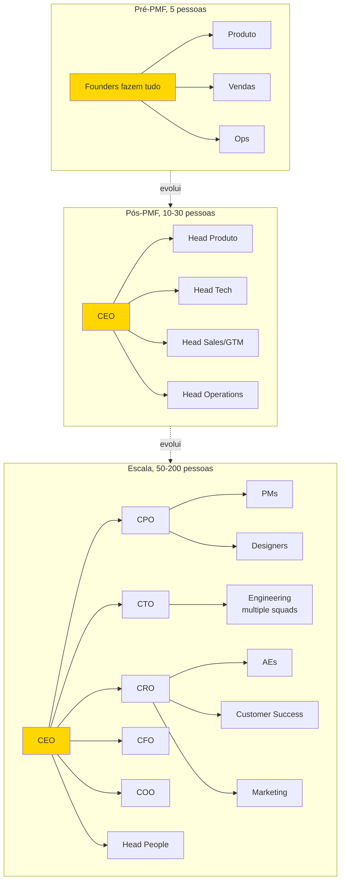

> [!warning] Transições não são suaves
> Cada salto (cinco para dez, dez para trinta, trinta para cem) exige mudança estrutural do fundador. Deixar de executar, depois liderar, depois liderar líderes. A maioria das crises organizacionais acontece nos saltos, não nos plateaus.

> [!note] Entregáveis e gates da subfase Time e Liderança
> Plano de Time de dezoito meses + Carta de Valores e Cultura + Processo de Contratação documentado. Comece com PMF confirmado (Sean Ellis ≥40%, retenção estável, crescimento orgânico). Termine quando as 5-7 contratações críticas dos próximos 12 meses estão definidas, cultura documentada, processos de hiring em operação. Revisite a cada 6 meses e a cada mudança significativa de estágio (10→30, 30→60, 60→100+ pessoas). Executor: CEO + COO se houver. Decisor: CEO, com responsabilidade compartilhada em C-level.

#### COMO (Time e Liderança)

Sete passos.

##### Passo 1, faça o diagnóstico de "onde o fundador virou gargalo"

Nos doze primeiros meses pós-PMF, quase todo fundador é gargalo em pelo menos três áreas. Identifique as suas por escrito, respondendo cinco perguntas. Em quais decisões a empresa trava esperando a minha aprovação? Em quais áreas sou competente, mas outra pessoa faria melhor? Em quais áreas sou incompetente, mas continuo fazendo? Quais reuniões eu poderia sair sem prejuízo, e saio mesmo assim? Que tipo de trabalho consome mais de trinta por cento do meu tempo, mas poderia ser delegado?

As respostas revelam as primeiras contratações críticas.

> [!warning] Sinal-alerta de gargalo
> Se você se sente indispensável em tudo, você é o maior risco estrutural da empresa.

##### Passo 2, mapeie as contratações críticas dos próximos 12 meses

Use o framework dos "três pilares" (mesmo da [[IGNICAO-Vol-1-Ideacao#FASE 0 — PREPARAÇÃO DO EMPREENDEDOR|Fase 0 (Vol. 1)]], agora em escala). Pilar Técnico: head de engenharia, VP de engenharia, ou CTO (se ainda não existe). Pilar Comercial: head of sales, head of marketing, e head of customer success. Pilar Operacional: head of finance (ou CFO), head of people, e head of operations.

A ordem típica de contratação C-level para startups SaaS B2B pós-PMF:

| Estágio | Receita aproximada | Contratações-chave |
|---|---|---|
| Pós-PMF inicial (10-20 pessoas) | R$ 1-5M ARR | Primeiros sêniores em engenharia, primeiro vendedor não-fundador, controller financeiro |
| Crescimento inicial (20-50 pessoas) | R$ 5-15M ARR | VP de Engenharia, Head of Sales, Head of Customer Success |
| Scale-up (50-100 pessoas) | R$ 15-50M ARR | CFO, Head of People, VP Marketing |
| Pré-Série B+ (100-200 pessoas) | R$ 50M+ ARR | COO, CRO (Chief Revenue Officer), General Counsel |

> [!important] Regra operacional sobre C-level
> Contrate cada C-level só quando *existir função clara e métrica associada*. Contratar um CTO sem time técnico para liderar é pagar cargo pelo ego. Contratar CFO antes de haver complexidade financeira real é peso morto no payroll.

##### Passo 3, defina critérios de contratação de C-level (diferentes dos de IC)

> [!tip] Apêndice BN — Executive Hiring
> Processo completo de busca, avaliação e onboarding de executivos C-level e VPs: scorecard, entrevistas estruturadas, reference check profundo e os primeiros noventa dias.

> [!tip] Apêndice CO — Recrutamento Técnico
> Contratação de engenheiros seniores, tech leads e CTOs: avaliação de competência técnica, desafios de coding, e como calibrar senioridade em startups sem bancada de engenharia prévia.

Contratar um primeiro vendedor é diferente de contratar um Head of Sales. Os erros mais comuns:

Contratar pela empresa anterior prestigiosa. "Veio da Google" é diferente de "vai performar aqui". Pergunte o que a pessoa fez concretamente, em que estágio e com que recursos.

Contratar só por fit cultural. É necessário, mas não suficiente. Resultado passado em contexto similar é o melhor preditor.

Manter sócio-fundador no papel apenas porque "ele é o sócio", quando ele já não é a pessoa ideal para o estágio. É uma conversa difícil, mas necessária.

Contratar rápido demais. Nunca. Senioridade exige três a oito entrevistas, pelo menos um teste prático ou case e três ou mais referências reais.

O processo padrão de contratação sênior leva quatro a seis semanas. Nove etapas. JD escrita com outcomes em três, seis, e doze meses (não só atividades). Triagem por recrutador, ou por você direto. Entrevista cultural com CEO (trinta a quarenta e cinco minutos). Entrevista técnica com profissional sênior da área, ou advisor. Case ou teste prático (quatro a oito horas de trabalho remunerado é razoável). Bar-raiser (um avaliador externo à área que tem poder de veto — garante que o padrão de contratação não caia com o tempo). Reference check rigoroso. Mínimo de três referências, idealmente cinco. Pergunte "em uma escala de um a dez, quão forte foi o desempenho dessa pessoa?". Qualquer coisa abaixo de nove merece investigação. Oferta, e negociação. Onboarding estruturado de noventa dias, com marcos claros.

##### Passo 4, evolua o papel do fundador (anti-gargalo)

Tipicamente, o CEO-fundador passa por três transições de papel.

De "faz tudo" para "faz algumas coisas bem" (em torno de vinte a cinquenta pessoas). Você delega sales ops, marketing operacional, e engenharia do dia a dia. Mantém visão, decisões estratégicas, contratações C-level, captação, e relacionamento com top 10 clientes.

De "gerencia diretos" para "gerencia gerentes" (em torno de cinquenta a cento e cinquenta pessoas). Você passa a ter seis a dez reportes diretos, que são VPs. O seu impacto é em cascata. Skip-level meetings (reuniões do gestor com o subordinado do subordinado) viram ritual.

De "operador" para "institucionalizador" (mais de cento e cinquenta pessoas). A sua função primária é construir a organização que construirá o produto. Decisões de design organizacional, sucessão, e cultura em escala.

> [!warning] Sinais de que você virou gargalo
> Decisões esperam você por mais de quarenta e oito horas. Reuniões sem você travam. Pessoas perguntam "o que o fundador quer?" em vez de decidir. Você tem mais de doze reportes diretos. Você aprovou mais de trinta decisões na última semana, que poderiam ter sido decididas sem você.

Quando três ou mais desses sinais aparecerem, pare e desenhe intervenção. A transição mais frequente é contratar um COO, ou segundo CEO operacional. Revisite mensalmente.

> [!tip] Apêndice BQ — Gestão de Tempo do Fundador
> Como o CEO aloca tempo por função (estratégia, contratação, cliente, produto) em cada estágio, técnicas de time-blocking, e como auditar o próprio calendário para identificar onde o tempo está sendo mal gasto.

##### Passo 5, documente valores e cultura antes dos primeiros 15 contratados

> [!tip] Apêndice AP — Cultura Organizacional
> Como documentar, reforçar e medir cultura em empresas de dez a quinhentas pessoas: rituais, artefatos, processo de contratação cultural e diagnóstico quando a cultura começa a derivar.

Valores escritos depois que a empresa passou de quinze pessoas já estão tarde. A cultura de fato está formada. Os "valores" viram poster de parede. Antes disso, a cultura ainda é plástica. E o documento molda comportamento real.

Valores efetivos têm três características. São específicos o suficiente para gerar disputa. "Respeitamos as pessoas" é inútil — todo mundo concorda. "Priorizamos clareza sobre cordialidade em feedbacks" é acionável. Pode haver discordância legítima. E isso orienta escolha. Têm uma versão negativa explícita. "Valorizamos X, *mesmo quando* isso significa não fazer Y". Sem trade-off, é apenas aspiração. São enforçáveis. Você está disposto a demitir alguém de alta performance por violá-los. Se não está, não é valor. É preferência.

Exemplos de valores com trade-offs explícitos. "High agency. Esperamos que você tome decisões sem pedir permissão, *mesmo que isso signifique errar mais vezes*." "Radical candor. Damos feedback duro rapidamente, *mesmo quando é desconfortável*." "Customer obsession. Escutamos cliente antes de escutar intuição interna, *mesmo quando o cliente pede o que a gente sabe que é errado*. Porque o 'errado' revela a necessidade real."

Rituais que reforçam valores na prática. All-hands semanais ou quinzenais, com CEO falando. Reconhecimento público de comportamentos exemplares (weekly shoutouts). Post-mortems sem culpa (blameless), depois de incidentes grandes. Revisões 360º anuais com feedback cruzado.

> [!tip] Apêndice BZ — Performance Reviews
> Estrutura de ciclos de avaliação (360º, calibração, PIP), como separar conversa de desenvolvimento da conversa de compensação, e cadência recomendada por tamanho de time.

##### Passo 6, construa o processo de onboarding de novos contratados

A regra. Cada pessoa que entra deve atingir "produtividade mínima" em trinta dias, e "produtividade plena" em noventa dias. Sem processo, isso leva seis a nove meses — e vira fonte de churn voluntário (saídas espontâneas).

Playbook (manual de operação padronizado) de onboarding de noventa dias. Semana 1: imersão em produto, cultura, e valores. Reuniões com lideranças de cada área. Leitura obrigatória (valores, top dez estudos de caso de clientes, e histórico de pivôs). Semanas 2-4: projeto inicial pequeno e bem definido, para gerar primeira "vitória". Mês 2: projeto médio com mais autonomia. Mês 3: check-in formal. Performing, needs support, ou mismatch. Decisão explícita.

##### Passo 7, instrumente eNPS e pesquisa de clima mensal

Cultura degrada sem medição. eNPS (Employee Net Promoter Score — índice de satisfação e recomendação dos funcionários) trimestral é o mínimo. A pergunta: "Em escala de zero a dez, quão provável é você recomendar trabalhar aqui para um amigo?".

Acompanhe também três coisas. Taxa de retenção de doze meses. Tempo médio de permanência por nível de seniority. E razão de saídas (categorize, e aprenda).

#### PERGUNTAS A RESPONDER (Time e Liderança)

- Em quais três áreas eu virei gargalo no último trimestre?
- Quais são as cinco a sete contratações críticas dos próximos doze meses?
- O meu processo de contratação de C-level consegue filtrar alguém que parece bom, mas é ruim?
- Os meus valores geram disputa (sinal de especificidade), ou todos concordam (sinal de inutilidade)?
- Qual é a minha transição de papel pessoal como CEO nos próximos doze meses?
- Quando um novo contratado atinge produtividade plena?
- Eu consigo, honestamente, demitir alguém de alta performance por violação de valores?

> [!tip] Team Canvas para formalizar o alinhamento do time antes de escalar
> Antes de formalizar a cultura da empresa (Passo 5) e a cada ciclo de expansão, uma sessão de Team Canvas (CZ.8) com os primeiros líderes revela desalinhamentos em papéis, objetivos e modos de trabalho que processos operacionais depois não conseguem corrigir. Veja instruções, estrutura dos 9 blocos e exemplo da Loggi em [[IGNICAO-Vol-6-Referencia#APÊNDICE CZ — CANVASES E MAPAS VISUAIS DE MODELO|CZ.8 (Vol. 6)]].

#### DEFINIÇÃO DE SUCESSO (Time e Liderança)

A [[#FASE 14 — ESCALA: TIME, OPERAÇÕES, CRESCIMENTO E CAPITAL|Fase 14]] (Time e Liderança) está concluída quando os sete itens abaixo estão cumpridos.

1. Diagnóstico de gargalo do fundador está escrito, e ações de delegação definidas. Decisões por semana que só você pode tomar abaixo de 5 (até 50 pessoas) ou 3 (acima de 100), com trajetória trimestral decrescente.
2. Plano de contratação de doze meses documentado, priorizado, e em execução. Tempo médio para preencher vaga crítica ≤60 dias para especialistas, ≤90 dias para C-level. Taxa de aceitação de oferta ≥70%.
3. Processo de contratação sênior está formalizado. Da JD às entrevistas, ao case, ao reference, à offer.
4. Valores e cultura estão escritos, com trade-offs explícitos. Aprovados pelo time fundador.
5. Playbook de onboarding de noventa dias está em uso. Tempo até produtividade plena ≤90 dias.
6. eNPS está sendo medido trimestralmente (≥30 saudável, ≥50 excelente, <10 preocupante).
7. Você tem menos de dez reportes diretos. Retenção em 12 meses pós-contratação ≥85% para sêniores, ≥75% para todos.

**Critérios observáveis.**

1. Organograma (org chart) documentado, com reportes claros.
2. Pelo menos uma contratação sênior realizada nos últimos noventa dias.
3. Rituais básicos (all-hands, 1:1, skip) acontecendo consistentemente por dois ou mais meses.
4. Valores escritos em uma página, e compartilhados no onboarding de novos.
5. Pipeline de contratação mapeado para os próximos seis meses.
6. Retenção voluntária de key-people nos últimos doze meses, noventa por cento ou mais.

**Checklist de avanço.**

- [ ] Mapeei as posições críticas para os próximos doze meses (aquelas cuja ausência cria gargalo)?
- [ ] Tenho plano de contratação com perfis definidos, não só cargos?
- [ ] Defini estrutura organizacional provisória (quem se reporta a quem)?
- [ ] Contratei pelo menos uma pessoa sênior em área-chave (engenharia lead, ou head de vendas)?
- [ ] Implementei rituais básicos (weekly all-hands, 1:1s, skip-level mensal)?
- [ ] Documentei cultura inicial (valores, comportamentos, e o que NÃO toleramos)?
- [ ] Defini framework de feedback (estrutura, frequência, formato)?
- [ ] Tenho retenção esperada mapeada (quem seria perda crítica, plano de risco)?

**Próximos passos.**

1. Listar as três próximas contratações em ordem de prioridade. Perfil, não só cargo.
2. Escrever "valores iniciais" em uma página. O que faz a sua empresa única? O que não aceitamos?
3. Definir cadência de rituais. Weekly all-hands de trinta minutos. 1:1s semanais com liderança. Skip-level mensal.
4. Identificar uma contratação-âncora nos próximos sessenta dias. Pessoa sênior, que eleva o padrão.

#### EXEMPLO PRÁTICO (Time e Liderança)

**Plano de Time, PadariaPro pós-PMF, crescendo para 15 pessoas.**

O time atual: cinco pessoas (dois founders mais três contratados).

**Próximas três contratações prioritárias.**

| # | Papel | Perfil | Justificativa |
|---|---|---|---|
| 1 | Head of Sales (sênior, 8-12 anos) | B2B SaaS, vendeu ticket R$ 5-20k, preferência experiência em food/retail | Founder está em 80% do tempo em vendas, gargalo claro |
| 2 | Staff Engineer | 8+ anos, tem conhecimento de integrações e sistemas distribuídos | Integrações com fornecedores são moat, precisamos de dono técnico |
| 3 | Customer Success Lead | 4+ anos em SaaS, empatia alta, bom em processo | Churn (cancelamento) vai subir se NÃO tivermos CS dedicado |

**Valores iniciais (uma página).**

Obsessão pelo dono-operador. As decisões se justificam pela pergunta: "isso devolve tempo, ou reduz estresse do dono?". Se a resposta é vaga, revisitar.

Simplicidade é virtude. O nosso diferencial é resolver problema complexo com experiência simples. Engenheiro, ou designer, que justifica complexidade por "completude" está desalinhado.

Honestidade radical. Falamos o que pensamos nos rituais apropriados. Não aceitamos política de corredor. Problema na reunião, ou em 1:1. Não em conversas privadas.

Urgência com qualidade. Velocidade sem qualidade vira churn. Qualidade sem velocidade vira irrelevância. A tensão é abraçada, não resolvida.

Dono do resultado, não da tarefa. Cada área tem resultado claro. Se para entregar resultado você precisa atravessar áreas, atravessa. Se culpa outra área, errado, resolve.

**Rituais.** Weekly all-hands: trinta minutos, segundas, 9h. Agenda fixa: métricas-chave, cliente da semana, aprendizado da semana. 1:1s liderança-time: trinta minutos, semanal, cada colaborador. Skip-level CEO com cada pessoa: uma hora, mensal (ou bimestral depois de vinte e cinco pessoas). Retrospectiva quinzenal de cada time (produto, engenharia, vendas).

**Framework de feedback.** SBI (Situação-Comportamento-Impacto) como padrão. Feedback semanal em 1:1. Obrigatório pelo menos um item construtivo. Performance review formal a cada seis meses, com calibração cruzada.

> [!note]
> Fundadores com perfil técnico que estão transitando para gestão encontram no [[#APÊNDICE DW — MANAGEMENT PARA O FUNDADOR TÉCNICO|Apêndice DW — Management para o Fundador Técnico]] o detalhamento de 1:1 eficaz, feedback SBI, delegação e career ladder.

**Risco de perda.** Bruno (CTO), crítico para arquitetura e moat. Mitigação: documentação técnica viva, mais Staff Engineer como back-up. Pedro (primeiro customer success contratado), tem relações profundas com quarenta por cento da base. Mitigação: handoff formal em contas-chave para mais pessoas.

#### ARMADILHAS (Time e Liderança)

Delegar antes de documentar. Passar responsabilidade sem processo definido gera confusão e frustração.

Contratar C-level sem operação que justifique. Cargo inflado custa caro, e atrapalha.

"Já tive cultura antes". É necessário re-formalizar a cada fase de crescimento. A cultura de dez pessoas não é a cultura de cinquenta.

Over-hiring em rodadas (contratar em massa logo após captar). Contratar antes de ter estrutura para integrar destrói cultura e queima caixa.

Tolerar C-level ruim por amizade, ou acordo antigo. O custo acumulado é altíssimo. Demita cedo, com generosidade.

Valores "motherhood and apple pie". Valores genéricos, que todo mundo aceita, são decorativos. Valores que geram discordância legítima em contratação são úteis.

---

#### CASO BRASILEIRO, Hotmart, cultura organizacional intencional

A Hotmart foi fundada em 2011 em Belo Horizonte, por João Pedro Resende e Mateus Bicalho, como plataforma de venda de infoprodutos (cursos online, ebooks, e conteúdos digitais). Foco em creators individuais, e pequenos. A empresa fez bootstrap nos primeiros anos. Sem capital de risco. O crescimento veio pela viabilidade do modelo de comissão sobre vendas dos creators usando a plataforma.

Entre 2014 e 2020, a empresa cresceu de dezenas para mais de mil funcionários. E de operação nacional para presença em múltiplos países. Com sedes em Amsterdam, além de Belo Horizonte. A pressão sobre cultura, que até então era informal — "clube de amigos" — tornou-se problema crítico.

A decisão de documentar e ritualizar cultura. Os fundadores identificaram que cultura não se mantém sozinha em empresa crescendo rapidamente, com contratações mensais. Documentaram valores explícitos. "Obsessão por creator". Comunicação direta. Autonomia com responsabilidade. Entre outros. O processo de onboarding passou a incluir imersão formal nesses valores. As contratações incorporaram avaliação cultural, além de skill técnico. A comunicação interna estruturou-se em reuniões gerais periódicas, e cartas regulares dos fundadores ao time.

O que funcionou. A cultura documentada não substituiu a cultura vivida. Mas serviu como referência durante o crescimento acelerado. Os novos contratados chegavam sabendo o que esperar. As decisões de promoção e desligamento podiam referenciar valores concretos. A narrativa de empresa tinha consistência em canais externos (recrutamento, PR, marketing).

O que exigiu ajuste. Nem toda versão inicial dos valores sobreviveu ao escalar. Alguns valores originais mostraram-se abstratos demais em escala. Outros precisaram ser reescritos para clareza de aplicação. A cultura documentada foi revisitada e ajustada ao longo dos anos. Não foi escrita uma vez, e arquivada.

A comunicação externa da cultura. Os fundadores optaram por comunicar a construção cultural publicamente. Entrevistas em podcasts. Postagens em LinkedIn. Eventos do ecossistema. Isso gerou tanto benefícios (atração de talento, marca empregadora), quanto riscos (escrutínio público quando a cultura é testada por incidentes).

**Cinco lições transferíveis.**

Cultura informal não escala. Entre trinta e cem pessoas, cultura "sabida mas não dita" começa a derivar. Documentar e ritualizar não é burocracia. É infraestrutura para preservar o que funcionou.

Valores sem aplicação concreta são decorativos. Cada valor precisa ter comportamento observável associado. "Obsessão por creator" sem critério de quando uma decisão é, ou não, obsessiva é slogan.

Cultura é processo de contratação. É mais fácil contratar pessoas que ressoam com a cultura, do que tentar converter. Entrevistas culturais formais (não só "chemistry check") fazem diferença em dezoito meses.

Cultura evolui ou estagna. Empresa em crescimento precisa revisitar valores a cada dois a três anos, para garantir que ainda servem. Valores fossilizados viram folclore.

A comunicação externa da cultura é arma de dois gumes. Atrai talento alinhado, mas expõe a empresa quando incidentes testam os valores declarados. Valores declarados precisam resistir a testes reais.

---

#### FERRAMENTAS DESTA SUBFASE (Time e Liderança)

Três essenciais para a subfase. Canvases complementares: CZ.8 (Team Canvas) e CZ.19 (Org Chart Evolution). Templates: A.34 (Job Descriptions) e A.38 (Template de 1:1).

**Essenciais para Time e Liderança:**

- **Radical Candor** (Kim Scott, 2017) — Care Personally + Challenge Directly, evita Ruinous Empathy. Base de todo feedback diário não acumulado. BG.17.1.
- **Who: A Method for Hiring** (Geoff Smart e Street, 2008) — Scorecard, Source, Select, Sell. Versão operacional do Topgrading. BG.17.5.
- **DACI/RACI/RAPID** — papéis de decisão clara quando o time cresce. Evita paralisia. BG.5.5.

**Complementares (consulte conforme o caso):**

- Situational Leadership (Hersey e Blanchard), 5 Dysfunctions of a Team (Lencioni), Topgrading (Brad Smart), Crucial Conversations (Patterson), Extreme Ownership (Willink/Babin), The Hard Things About Hard Things (Horowitz), Culture Code (Coyle), No Rules Rules (Hastings/Netflix, pós-escala), Servant Leadership (Greenleaf), Intent-Based Leadership (Marquet), Harvard Negotiation/BATNA (BG.15.1, para contratação sênior). Detalhamento em BG.17.2 a BG.17.12.

---

### Transição, do Time à Operação

> [!note]
> Conway's Law (princípio de que a arquitetura do sistema espelha a estrutura de comunicação da empresa), design de squads, spans and layers e quando executar reorgs são tratados no [[#APÊNDICE FB — DESIGN ORGANIZACIONAL|Apêndice FB — Design Organizacional]].

Com time em estrutura, e cultura declarada, o desafio seguinte vira disciplina operacional. Time bom com operação ruim vira frustração coletiva. Boas pessoas fazendo coisa errada. Ou coisa certa, sem coordenação. A frente Operações trata de montar a máquina operacional que ordena o trabalho do time que você acabou de estruturar.

---

### 14B — Operacoes em Escala

### OPERAÇÕES, PROCESSOS E GESTÃO EM ESCALA

A hierarquia OKR, do North Star aos times:

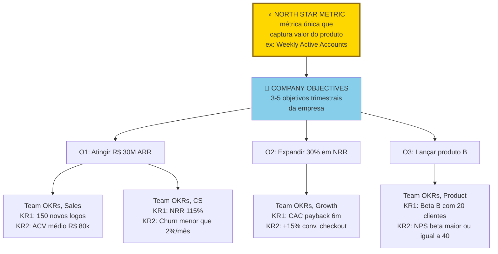

> [!important] Hierarquia descendente
> Do North Star à Company, depois aos Times. Os KRs dos times devem somar ao KR do nível acima. Senão times viram silos otimizando métricas que não movem a empresa. Revisão quinzenal de scoring (zero a um). Sweet spot: zero vírgula seis a zero vírgula sete (ambicioso, mas atingível).

> [!tip] Stack mínimo da Fase 14, frente Operações
> Em escala, stack operacional fica mais importante que stack de produto. **OKRs e gestão**: Notion, Asana, ClickUp, Linear (para times tech), ou plataformas específicas de OKR (Perdoo, Weekdone). **Documentação interna**: Notion, Confluence, Coda. **Comunicação**: Slack ou Microsoft Teams. **Videoconferência**: Google Meet, Zoom. **RH e folha**: Gupy para recrutamento. Sólides, Pipefy ou Factorial para gestão. Omie ou Conta Azul mais parceiros para folha no Brasil. **Financeiro**: Conta Azul ou Omie para ERP pequeno. Sage Intacct, NetSuite para médio. QuickBooks internacional. **Analytics de produto**: Mixpanel, Amplitude, PostHog. **CRM**: HubSpot (grátis inicial), Pipedrive, Salesforce (pesado, enterprise). **Regra**: consolidar ferramentas sempre que possível. O custo escondido de integrar vinte SaaS diferentes é altíssimo.

> [!note] Entregáveis e gates da subfase Operações
> Arquitetura Operacional: sistema de OKRs, cadência de reuniões, playbook de processos críticos, stack de ferramentas de gestão. Comece quando o time passa de ~15 pessoas, ou quando comunicação começa a gerar mais atrito do que velocidade. Termine quando processos críticos estão documentados, rituais em cadência, stack estável. Revisite a cada 6-9 meses de alta velocidade de contratação. Executor: CEO + Head of Operations (ou Chief of Staff) + lideranças de área. Decisor: CEO em cadência; lideranças em execução.

#### COMO (Operações)

Sete passos.

##### Passo 1, institua cadência de gestão em três camadas

> [!note]
> Cadência operacional — ritmo de all-hands, incidentes, automação e OKRs operacionais — é detalhada no [[#APÊNDICE DV — OPERAÇÕES EM ESCALA|Apêndice DV — Operações em Escala]].

Toda empresa em escala roda em três ciclos simultâneos.

**Ciclo anual, planejamento estratégico.** Q4 do ano: revisão do ano, mais planejamento do próximo (visão, apostas estratégicas, metas anuais, orçamento, e estrutura organizacional). Os entregáveis: documento de estratégia anual, orçamento aprovado, e OKRs anuais em esboço.

**Ciclo trimestral, OKRs.** Semana 1 de cada trimestre: lançamento formal dos OKRs com todo o time. Semanas 4 e 8: check-ins de progresso (não apenas status, recalibração). Última semana: retrospectiva e scoring (zero a um por KR, com justificativa). Os entregáveis: documento de OKRs por área, e report trimestral para board (se houver).

**Ciclo semanal, operacional.** Segunda: reunião de liderança (C-level e VPs), focada nos top três a cinco bloqueios da semana. Terça ou quarta: reuniões 1:1 (cada gestor com cada reporte direto, quarenta e cinco a sessenta minutos). Quinta: reviews de área (engenharia, vendas, e CS). Sexta: all-hands, ou newsletter interna.

> [!important] A regra de fundo
> Se você não tem reunião de liderança semanal fixa, com agenda escrita, você não tem gestão. Tem reação.

##### Passo 2, implemente OKRs corretamente

A maioria implementa errado. Os erros mais comuns, em ordem de frequência.

Confundir OKR com KPI recorrente. OKRs descrevem *mudança* ("aumentar NRR de 95% para 115%"). KPIs descrevem *nível* ("NRR mensal"). Não misture.

OKRs demais. Mais de três a cinco OKRs por time é receita para não alcançar nenhum. Forçar priorização é função do processo.

Key Results que são iniciativas. "Lançar feature X" não é KR. É iniciativa. KR é o resultado mensurável que a feature deveria produzir. Por exemplo, "aumentar retenção D30 em dez pontos percentuais".

Sandbagging (colocar metas conservadoras para garantir sucesso). OKRs ambiciosos têm sessenta a setenta por cento de atingimento como "bom". Se você bate cem por cento sempre, as metas estão baixas.

Não recalibrar mid-quarter. Se nas semanas quatro a seis fica claro que um OKR vai falhar (ou exceder muito), ajuste com justificativa escrita. Rígido é pior do que honesto.

Formato canônico de OKR.

```text
Objective: [direcional, ambicioso, memorável]
 KR1: [número inicial] → [número alvo] (por [data])
 KR2: [número inicial] → [número alvo]
 KR3: [número inicial] → [número alvo]
Owner: [uma pessoa responsável, não um time]
```

##### Passo 3, documente os 10 processos críticos operacionais

> [!note]
> Estruturação de onboarding 30/60/90, wikis e runbooks — a infraestrutura de conhecimento que torna os playbooks consultáveis — está no [[#APÊNDICE FC — GESTÃO DO CONHECIMENTO|Apêndice FC — Gestão do Conhecimento]].

Cada empresa tem processos que, se quebrados, geram dor imediata. Liste os seus. Os típicos. Onboarding de novo cliente. Faturamento e cobrança (incluindo inadimplência). Suporte técnico (SLA por tier). Desenvolvimento de feature (da ideia ao deploy). Incident response (quando o produto cai). Onboarding de novo colaborador. Off-boarding de colaborador. Contratação sênior. Deal review (sales operations). Renewal e churn prevention.

Para cada um, crie um playbook em texto simples (não precisa de software caro) com: dono do processo, passo a passo numerado, SLA por etapa, ferramentas usadas, exceções conhecidas e métrica de qualidade.

Coloque os playbooks em wiki (Notion, Confluence, GitBook) e revise-os semestralmente. Processo desatualizado é pior do que nenhum processo.

##### Passo 4, defina stack de ferramentas operacionais

A evolução do stack operacional por fase:

```mermaid
flowchart LR
 subgraph PreP["PRÉ-PMF (Fase 3-11)"]
 P1[Google Workspace]
 P2[Notion / Linear]
 P3[Slack]
 P4[GitHub]
 P5[Stripe / Pagar.me]
 P6[PostHog / Mixpanel]
 end

 subgraph PosP["PÓS-PMF (Fase 14, frente Time)"]
 PP1[Tudo do pré-PMF +]
 PP2[HubSpot / Salesforce CRM]
 PP3[Intercom / Zendesk]
 PP4[Amplitude]
 PP5[Datadog / Sentry]
 PP6[BambooHR / People]
 PP7[1Password / Vault]
 end

 subgraph Escala["ESCALA (Série B+)"]
 E1[Tudo anterior +]
 E2[CS: Gainsight / ChurnZero]
 E3[Data: Snowflake / BigQuery]
 E4[BI: Looker / Metabase]
 E5[Identity: Okta]
 E6[Security: Drata / Vanta]
 E7[Finance: NetSuite / Oracle]
 end

 PreP --> PosP --> Escala

 style PreP fill:#FFE4B5
 style PosP fill:#87CEEB
 style Escala fill:#90EE90
```

> [!warning] Não antecipar stack
> Adquirir ferramentas caras cedo é procrastinar com dinheiro. Ferramenta não resolve falta de processo. A regra: adicione ferramenta quando a ausência já custa mais que o custo anual da ferramenta.

| Função | Ferramentas típicas em 2026 |
|---|---|
| Comunicação | Slack, Discord, Teams |
| Documentação e wiki | Notion, Confluence, GitBook |
| Gestão de projetos | Linear, Jira, Asana |
| CRM | HubSpot, Salesforce, Attio |
| E-mail e calendário | Google Workspace, Microsoft 365 |
| Analytics de produto | Mixpanel, Amplitude, PostHog |
| Business intelligence | Metabase, Looker, Hex |
| Data warehouse | BigQuery, Snowflake, Redshift |
| Financeiro | Conta Azul, QuickBooks, Omie |
| RH e folha | Gupy, Sólides, Kenoby |
| Contratos | DocuSign, Clicksign, Zapsign |
| Pagamentos B2B | Iugu, Pagar.me, Stripe |

> [!important] Princípio do stack
> Menos é mais. Doze ferramentas bem-integradas valem mais que trinta ferramentas que ninguém usa direito. Cada ferramenta nova exige treinamento, integração, e custo marginal de atenção.

> [!note]
> Automação de CS, vendas e operações com IA — incluindo quando automatizar versus manter toque humano — é tratada no [[#APÊNDICE EI — AI OPS E AUTOMAÇÃO INTELIGENTE|Apêndice EI — AI Ops e Automação]].

##### Passo 5, evolua a comunicação interna de 10 para 50 e para 100 pessoas

> [!note]
> Formatos de all-hands, comunicação de RIF e protocolos async por tamanho de time estão no [[#APÊNDICE DZ — COMUNICAÇÃO INTERNA|Apêndice DZ — Comunicação Interna]].

Comunicação que funcionava com dez não funciona com cinquenta. A regra operacional: com cerca de dez pessoas, Slack no geral — todo mundo sabe o que todo mundo faz. Com cerca de trinta, times virtuais por projeto, all-hands semanais e compartilhamento de conhecimento estruturado. Com cinquenta a cem, comunicação em camadas (C-level para VPs para times), newsletter interna mensal e decisões importantes com RFC (Request for Comments) escrito. Com cem ou mais, fóruns formais (engineering review, product review, business review trimestral), townhalls mensais e comunicação executiva top-down com tempo para perguntas.

> [!warning] Sinal-vermelho na comunicação
> Se mais de vinte por cento das pessoas dizem "não sei o que está acontecendo" em pesquisa anônima, comunicação interna falhou.

##### Passo 6, construa data infrastructure mínima desde cedo

> [!tip] Apêndice AO — Dados e Analytics
> Arquitetura de dados para startups em escala: data warehouse, ETL, modelagem de dados, cultura data-driven e como estruturar a função de analytics (self-serve vs. analista centralizado).

Antes de vinte pessoas, planilhas Google resolvem. Acima disso, você precisa de quatro coisas. Data warehouse, mesmo que pequeno: BigQuery ou Snowflake, com ingestão automática de produção, mais CRM, mais financeiro. Dashboards centrais: receita, retenção, CAC e LTV, churn, e pipeline. Atualizados diariamente. Acesso controlado: nem todos precisam ver tudo. Cultura de "dados antes de opinião": decisões grandes são acompanhadas de análise de dado antes.

##### Passo 7, institua blameless post-mortems

Quando algo dá errado (produto cai, cliente grande cancela, incidente de segurança), siga este processo: escreva o post-mortem em até cinco dias, com foco no sistema, não na pessoa ("por que o processo permitiu o erro?"). Use três seções: o que aconteceu, o que causou e o que mudar. Publique internamente para toda a empresa aprender. Defina ação de melhoria com dono e prazo.

> [!important] Cultura de erro
> Cultura que pune erro gera ocultamento. Cultura que aprende do erro gera resiliência.

#### PERGUNTAS A RESPONDER (Operações)

- Tenho cadência semanal, trimestral, e anual formalizada?
- Os meus OKRs descrevem mudança, ou são KPIs disfarçados?
- Quais processos críticos ainda são "no implícito", e precisam virar playbook?
- A minha stack está enxuta (doze a quinze ferramentas), ou inflada?
- Pessoas entrando hoje conseguem saber o que está acontecendo em menos de uma semana?
- Quando o produto caiu da última vez, o que aprendemos formalmente?

#### DEFINIÇÃO DE SUCESSO (Operações)

A [[#FASE 14 — ESCALA: TIME, OPERAÇÕES, CRESCIMENTO E CAPITAL|Fase 14]] (Operações) está concluída quando os seis critérios abaixo estão cumpridos.

1. Cadência de gestão (semanal, trimestral, anual) está formalizada, e rodando há dois ou mais trimestres. Aderência (reuniões acontecendo na data, com agenda e ata) ≥90%.
2. OKRs estão em uso, com scoring trimestral. Atingimento entre 60-70% do alvo é saudável (100% indica metas baixas).
3. Os top dez processos críticos têm playbook escrito. Decisões grandes (afetam ≥10 pessoas ou custo ≥R$ 100k) com RFC escrito em ≥80% dos casos.
4. Stack operacional está estabilizada (até quinze ferramentas ativas).
5. Data infrastructure mínima está operando.
6. Blameless post-mortems estão instituídos. MTTR: P0 <1h, P1 <4h, P2 <24h, com trajetória decrescente em todas as severidades.

**Critérios observáveis.**

1. OKRs trimestrais escritos, com revisão mensal documentada.
2. Dashboard central existe, com seis ou mais métricas atualizadas semanalmente.
3. Cinco ou mais processos críticos documentados, com dono claro.
4. Reuniões seguem agenda padrão, com decisões e ações registradas.
5. Stack de SaaS inventariado, e otimizado nos últimos seis meses.
6. Documentação interna centralizada, e atualizada.

**Checklist de avanço.**

- [ ] Implementei ciclos de planejamento (OKRs trimestrais ou equivalente)?
- [ ] Tenho dashboard operacional central, com métricas-chave atualizadas semanalmente?
- [ ] Defini processos documentados para contratação, onboarding, atendimento, e operação?
- [ ] Implementei sistema de tickets ou gestão para cada área (produto, customer, operação)?
- [ ] Tenho pessoas responsáveis nomeadas por cada sistema ou processo (dono único, não compartilhado)?
- [ ] As reuniões têm agenda, dono, duração, e saída clara (decisões ou ações)?
- [ ] Stack operacional consolidado, sem proliferação descontrolada de SaaS?
- [ ] Documentação interna centralizada (Notion, Confluence, ou equivalente)?

**Próximos passos.**

1. Rodar sessão de OKRs para o próximo trimestre. Três a cinco objetivos da empresa, mais dois a quatro key results cada.
2. Criar dashboard central em Notion, ou Looker. North Star, mais cinco a sete métricas secundárias atualizadas semanalmente.
3. Listar processos críticos ainda não documentados. Escolher dois para documentar essa semana.
4. Auditar SaaS pagos. Eliminar redundância. Consolidar onde possível.

#### EXEMPLO PRÁTICO (Operações)

**OKRs Q3, PadariaPro (exemplo).**

**O1: acelerar crescimento em SP Capital e RM, com qualidade de PMF.**
KR1: crescer de oitenta para cento e cinquenta clientes pagantes no trimestre.
KR2: manter retenção mensal de noventa e cinco por cento ou mais (churn de cinco por cento ou menos).
KR3: atingir NPS de cinquenta ou mais.

**O2: reduzir dependência do fundador em vendas.**
KR1: setenta por cento das deals do trimestre fechadas sem founder no pitch (hoje: trinta por cento).
KR2: Head of Sales contratado, e ramped em noventa dias.
KR3: Playbook de vendas v1 documentado, e usado em cem por cento das deals.

**O3: preparar expansão para duas novas cidades (Campinas, Grande Rio).**
KR1: dez clientes em Campinas até fim do Q3.
KR2: um Green Angel contratado para Campinas.
KR3: decisão go ou no-go para Grande Rio documentada até fim do Q3.

**Dashboard Central, seção principal.**

| Métrica | Meta Q3 | Hoje | Tendência |
|---|---|---|---|
| North Star: Pedidos confirmados/semana | 1.200 | 820 | ↑ |
| Clientes pagantes | 150 | 103 | ↑ |
| Churn mensal | ≤ 5% | 4,2% | → |
| NPS | ≥ 50 | 48 | → |
| CAC | ≤ R$ 2.000 | R$ 1.850 | → |
| Pipeline ativo | ≥ R$ 300k | R$ 290k | ↑ |
| NPS de colaborador | ≥ 70 | 68 | → |
| Burn mensal | ≤ R$ 85k | R$ 78k | → |

**Processos documentados (amostra).**

1. Onboarding de novo cliente (v3, dono: Paula, CS).
2. Onboarding de novo colaborador (v2, dono: Mariana, CEO).
3. Processo de triagem de bug crítico (v1, dono: Bruno, CTO).
4. Fluxo de cold outbound (v1, dono: Roberto, Sales).
5. Revisão trimestral de OKRs (v1, dono: Bruno, Estratégia).
6. Processo de contratação (v2, dono: Mariana).

#### ARMADILHAS (Operações)

"Processos matam cultura". Falso. Falta de processo mata cultura. As pessoas saem por frustração. O ponto é processos *leves e úteis*, não ausência deles.

Over-tooling. Adotar toda ferramenta nova que aparece. O resultado: quarenta logins, e nada integrado.

OKRs como teatro. A organização posta OKRs no início do trimestre, e ignora até o próximo. Os rituais de check-in são obrigatórios.

Reuniões demais sem agenda. Reunião sem agenda escrita é roubo de tempo. Cancele, ou peça para reenviarem com agenda.

"Data quando precisar". Esperar para construir infra de dados depois que já precisava é sempre mais caro do que construir cedo.

---

#### CASO BRASILEIRO, Fase 14 (Operações), VTEX e internacionalização

A VTEX, plataforma brasileira de comércio eletrônico, expandiu para LatAm, Europa, e América do Norte. A decisão. Antes de internacionalizar agressivamente, consolidaram operações internas com OKRs trimestrais, playbooks de onboarding de cliente multi-idioma, infraestrutura técnica multi-região, processo de contratação em três continentes, e governança de produto com roadmap global.

O resultado foi internacionalização bem-sucedida, com IPO em Nova York em 2021. Empresas brasileiras que tentaram internacionalizar sem infraestrutura operacional madura tipicamente falharam, ou queimaram capital excessivo na tentativa.

A lição transferível. Operação escalável é pré-requisito para internacionalização. Não consequência dela. Empresas que invertem a ordem pagam caro.

---

#### FERRAMENTAS DESTA SUBFASE (Operações)

Quatro essenciais para a subfase. Templates: A.36 (OKR Cascade Anual) e A.35 (Post-Mortem blameless).

**Essenciais para Operações:**

- **OKRs** (Andy Grove, John Doerr) — Objectives qualitativos + Key Results quantitativos trimestrais. Ambiciosos (70% de atingimento é meta). Desacoplados de bônus. BG.16.1.
- **Scaling Up / Rockefeller Habits** (Verne Harnish, 2014) — People, Strategy, Execution, Cash. OPSP de uma página. Para 20-2000 funcionários. BG.16.4.
- **Amazon 6-Pager** (Bezos) — documento narrativo de seis páginas substitui PowerPoint. Primeiros 20 minutos em leitura silenciosa. Para decisões estratégicas grandes. BG.16.9.
- **DORA Metrics e SPACE Framework** (Forsgren et al.) — Deployment Frequency, Lead Time, Change Failure Rate, Time to Restore. Para engineering performance. BG.16.8.

**Complementares (consulte conforme o caso):**

- V2MOM (Benioff/Salesforce), OGSM, EOS/Tração (Wickman), MBO (Drucker), Scrum, Kanban, Weekly Business Review (Amazon), 4 Disciplines of Execution (4DX), Hoshin Kanri (cascata com catchball), Balanced Scorecard (Kaplan/Norton), Lean Analytics (Croll/Yoskovitz, OMTM), Value Stream Mapping, Toyota Kata. Detalhamento em BG.3.1 a BG.16.14.

---

### Transição, da Operação ao Crescimento

Com time estruturado, e operação rodando, o crescimento deixa de ser subproduto, para virar motor independente. Growth vira engenharia previsível. Capital externo entra como alavanca. Expansão geográfica e de produto viram opções concretas. A frente Crescimento e Capital trata do crescimento como função organizacional. E do capital que sustenta essa função.

> [!tip] Apêndice CG — Growth como Função
> Como estruturar a função de growth dentro da empresa: onde fica na estrutura (produto, marketing ou independente), ritmo de experimentação, modelo de squad de growth, e OKRs específicos para times de crescimento.

> [!tip] Capital: equity, dívida ou bootstrap
> A escolha entre venture capital institucional, financiamento alternativo e bootstrap não é técnica — é fundacional. O [[IGNICAO-Vol-1-Ideacao#APÊNDICE CS — BOOTSTRAP vs VENTURE CAPITAL: A ESCOLHA FUNDACIONAL|Apêndice CS (Vol. 1)]] trata essa decisão. Empresas com economics fortes desde cedo podem optar por bootstrap (controle, velocidade própria, sem dilution); empresas que precisam ganhar mercado rápido escolhem VC (escala, mas com expectativa de crescimento ≥3x e exit). Marca pessoal do fundador, cada vez mais relevante como canal de aquisição e credibilidade pós-PMF, é tratada no [[#APÊNDICE CY — MARCA PESSOAL DO FUNDADOR: DISTRIBUIÇÃO, AUTORIDADE E CUSTO DE REPUTAÇÃO|Apêndice CY]].

---

### 14C — Maquina de Crescimento

### MÁQUINA DE CRESCIMENTO, CAPITAL E EXPANSÃO

Growth loops, alternativa moderna ao funil linear (adicional ao Bullseye):

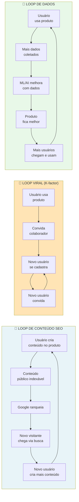

> [!important] A diferença entre funil e loop
> Funil precisa de input constante (CAC por visitante). Loop *se alimenta*. Exemplos reais. Glassdoor (loop de conteúdo). Dropbox (loop viral de referência). Spotify (loop de dados). Os melhores SaaS modernos têm dois a três loops simultâneos. Sem loop, o crescimento é linear com investimento. Com loop, é composto.

> [!question] Pergunta de FMF nessa fase
> Em escala, a tentação é delegar tudo, e virar administrador. A pergunta de FMF aqui é. *Há decisões estratégicas que só você pode tomar, porque só você tem o contexto de mercado construído?* Se sim, delegar essas é destruir valor. Se não, se qualquer executivo profissional tomaria as mesmas decisões, o seu valor marginal como fundador está em declínio. Ambas as respostas têm implicações. A primeira pede preservação de Founder Mode seletivo ([[#APÊNDICE R — FOUNDER MODE, DELEGAÇÃO E QUANDO PARAR DE FAZER|Apêndice R]]). A segunda pede consideração de sucessão, ou exit.

> [!note] Entregáveis e gates da subfase Crescimento, Capital e Expansão
> Growth Plan de 18 meses + Capital Plan + Expansion Plan (novos segmentos, geografias ou produtos). Vendas fundador-led não escala acima de R$ 5-10M ARR; marketing ad-hoc não gera previsibilidade; internacionalização intuitiva queima caixa. Comece depois da Fase 14 (Time + Operações) em operação estável. Termine quando a máquina de aquisição estiver previsível, o plano de capital executado, e a expansão (se aplicável) em curso com pelo menos uma vertical ou geografia validada. Revisite anualmente, e a cada saturação de canal (12-18 meses). Executor: CEO + Head of Sales/Marketing + CFO. Participantes: board, advisors, investidores potenciais.

#### COMO (Crescimento e Capital)

Sete passos.

> [!tip] Apêndice CZ — Pirate Canvas / AARRR em escala (CZ.10) e Network Effects Map (CZ.18)
> A máquina de crescimento opera no AARRR — cada etapa do funil (Acquisition, Activation, Retention, Referral, Revenue) tem dono e métrica em escala. O [[IGNICAO-Vol-6-Referencia#APÊNDICE CZ — CANVASES E MAPAS VISUAIS DE MODELO|Pirate Canvas (CZ.10) (Vol. 6)]] é o mapa para identificar onde investir capital marginal de growth (CAC alto sinaliza Acquisition; ativação fraca trava Retention). Em modelos de plataforma ou marketplace, o [[IGNICAO-Vol-6-Referencia#APÊNDICE CZ — CANVASES E MAPAS VISUAIS DE MODELO|Network Effects Map (CZ.18) (Vol. 6)]] classifica o tipo de efeito de rede (direto, indireto, dados, social) e identifica onde investir para fortalecer defensibilidade conforme cresce — efeito de rede é o moat mais durável em mercados winner-takes-most.

##### Passo 0, entenda o Motor de Crescimento como sistema integrado

Antes de otimizar qualquer peça específica (vendas, marketing, retenção), entenda. Um motor de crescimento é *sistema*, não componente. A formulação canônica (derivada do framework Antler) define quatro componentes interdependentes.

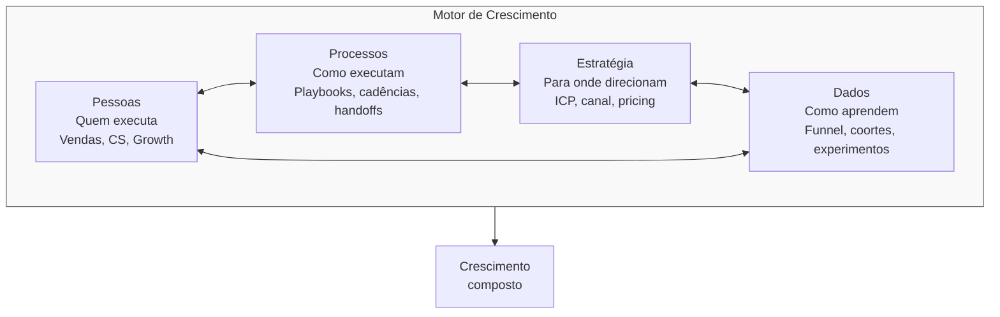

> [!warning] A regra do motor quebrado
> Se qualquer um dos quatro componentes falha, o motor inteiro gira no vazio. Pessoas certas + processos + estratégia, mas sem dados: "não sabem se estão ganhando, otimizam por intuição." Pessoas + processos + dados, mas sem estratégia: "executam bem a coisa errada, aceleram na direção do penhasco."

Diagnóstico mensal do motor. A cada trinta dias, avalie honestamente cada um dos quatro em escala de um a cinco.

| Componente | 1-2 (quebrado) | 3 (ok) | 4-5 (forte) |
|---|---|---|---|
| Pessoas | Vagas críticas abertas >6m, rotatividade >25%/ano | Vagas chave preenchidas, rotatividade aceitável | Bench forte, retenção >85%, perfil sênior atrai pares |
| Processos | Documentação ausente, handoffs informais | Top 5 processos documentados, cadência funcional | Playbooks revisados trimestralmente, onboarding sistemático |
| Estratégia | ICP difuso, canais não priorizados | ICP definido, 1-2 canais focados | Estratégia escrita, testada, revista por board |
| Dados | Decisões por opinião, sem dashboard | Dashboards principais, análise quinzenal | Data warehouse, experimentação contínua, cultura data-first |

> [!important] Quando qualquer componente fica vermelho
> Se qualquer componente marcar um a dois por dois trimestres consecutivos, *pare de escalar investimento*, e conserte antes de acelerar. Multiplicar investimento sobre motor quebrado multiplica queima. Não crescimento.

##### Passo 1, transforme venda fundador-led em motor repetível (se B2B)

Três perguntas diagnósticas. Que percentual das vendas fechadas nos últimos seis meses teve envolvimento direto do fundador? O primeiro vendedor não-fundador fecha com CAC comparável? Você tem três ou mais vendedores batendo quota consistentemente?

Se "não" para qualquer uma, você ainda está em venda fundador-led. A transição exige cinco itens.

Playbook de vendas escrito. Scripts de outbound, roteiros de discovery, tratamento de objeções, critérios de qualificação (MEDDPICC) e propostas padronizadas.

Pipeline hygiene (higiene de pipeline — manter o CRM limpo e atualizado). CRM com estágios claros, taxas de conversão conhecidas por estágio e previsão de vendas semanal.

Ramp time (tempo de rampa — período até o vendedor atingir produtividade plena) definido. O novo AE deve atingir quota em três a seis meses. Acima disso, a contratação ou o onboarding falhou.

Compensação variável. Vendedores recebem OTE (on-target earnings — remuneração total se bater quota), com cinquenta a setenta por cento de base e trinta a cinquenta por cento variável. Pague comissão por deal fechado, não só por pipeline.

Sales operations. Contrate uma pessoa dedicada a CRM, previsão de vendas e plano de comissões a partir de cerca de cinco vendedores.

Framework de maturidade da equipe de vendas:

| Estágio | Composição | O que medir |
|---|---|---|
| Fundador-led | 1 fundador vendendo | Taxa de fechamento, ACV |
| Primeira contratação | 1 AE + fundador | Se AE atinge 80% da produtividade do fundador em 6 meses |
| Time de 3 | 3 AEs + 1 SDR | Consistência: os 3 estão batendo quota? |
| Time estruturado | 5+ AEs, 2+ SDRs, 1 sales ops, 1 manager | Velocity, magic number, pipeline coverage |
| Sales machine | Times por segmento (SMB/Mid/Enterprise), regiões, verticais | NRR, win rate por segmento |

##### Passo 2, escale marketing baseado no canal validado

Lembre-se do [[IGNICAO-Vol-3-Tracao#APÊNDICE J — FRAMEWORK DE CANAIS DE AQUISIÇÃO|Apêndice J (Vol. 3)]]. Você deve ter escolhido um a dois canais validados na [[IGNICAO-Vol-3-Tracao#FASE 11 — VALIDAÇÃO DO MODELO DE NEGÓCIO|Fase 11 (Vol. 3)]]. Agora, escalar.

A estratégia por canal escalado, em seis frentes.

SEO mais content marketing. Contratar um a dois estrategistas de conteúdo, mais produtor. Produção consistente de quatro a doze pieces por mês. Keyword research estruturado. Link-building deliberado. Resultados em seis a doze meses.

Paid (Google, Meta, LinkedIn). Contratar paid specialist. Build de playbook de criativos. A/B testing contínuo. Attribution modeling (não só last-click).

Outbound. SDRs em time. Cadências estruturadas. Ferramentas (Outreach, Apollo.io, LinkedIn Sales Navigator).

Partnerships. Partnership manager, mais programa formal com tiers, comissão, MDF (Market Development Funds — verba para o parceiro investir em marketing conjunto) e co-marketing.

Comunidade. Community manager, mais rituais (eventos, Slack ou Discord, conteúdo UGC).

Events. Events manager, mais calendário anual, mais ROI por evento.

> [!warning] Regra de escala de canal
> Não escale um segundo canal até o primeiro estar saturado (atingindo setenta por cento ou mais de alocação ótima).

##### Passo 3, defina e monitore métricas de saúde financeira

Depois do PMF, as métricas financeiras passam a guiar decisões estratégicas. Acompanhe nove delas.

| Métrica | Definição | Alvo SaaS |
|---|---|---|
| ARR / MRR | Receita recorrente anualizada/mensal | Crescimento 2-3x/ano em estágio de scale-up |
| Gross Margin | (Receita - custo de entrega) / Receita | SaaS B2B: 70-85%. Serviços: 40-60% |
| NRR (Net Revenue Retention — receita líquida retida e expandida na base) | (MRR inicial + expansão - contração - churn) / MRR inicial | ≥110% excelente, 100-110% saudável, <100% vazando |
| Gross Revenue Retention (GRR) | (MRR inicial - churn - contração) / MRR inicial | ≥90% saudável |
| Burn Multiple (quantos reais você queima para gerar 1 real de receita nova) | Caixa queimado no período / ARR adicionado | <1 excelente, 1-2 bom, >3 queima caixa sem eficiência |
| Magic Number | ARR adicionado no trimestre x 4 / S&M do trimestre anterior | >1 saudável, >1.5 ótimo |
| CAC Payback | CAC / (ARR mensal x gross margin) | <12 meses B2B SaaS, <6 meses mais rápido |
| Rule of 40 | % crescimento de ARR + % EBITDA margin | ≥40 é benchmark de investidores |
| Cash runway | Caixa / burn mensal | ≥18 meses recomendado |

### 14D — Capital para Escala

##### Passo 4, estruture captação estratégica (não oportunista)

> [!note]
> Linhas de crédito PJ via Pronampe e BNDES, gestão de score PJ e relacionamento bancário em escala estão no [[#APÊNDICE FA — RELAÇÕES BANCÁRIAS E CRÉDITO NO BRASIL|Apêndice FA — Relações Bancárias e Crédito]]. Gestão do ciclo de conversão de caixa (CCC) e antecipação de recebíveis estão no [[#APÊNDICE EZ — CAPITAL DE GIRO E RECEBÍVEIS|Apêndice EZ — Capital de Giro]].

Captar capital é decisão estratégica, não sorte. Responda quatro perguntas antes de iniciar uma rodada.

Por quê. Qual o uso específico do capital? (Time, canal, M&A, runway). Vago é ruim.

Quanto. Valor para atingir o próximo milestone (dezoito a vinte e quatro meses), com buffer de trinta a cinquenta por cento. Nem mais, nem menos.

De quem. Investidor estratégico (traz conexões, expertise) versus investidor financeiro (só dinheiro). Ambos legítimos. Prioridades diferentes.

Quando. Capte com força em métricas. Não com desespero em caixa. Idealmente, comece rodada com nove a doze meses de runway. Depois dos seis meses, você está em modo sobrevivência. E perde poder de negociação.

A timeline típica de rodada Série A no Brasil e LatAm em 2026, em cinco janelas. Semanas 1-4: preparação (pitch deck, data room, modelo financeiro). Semanas 4-10: conversas iniciais com quinze a vinte e cinco fundos. Semanas 10-16: due diligence aprofundada com três a cinco fundos sérios. Semanas 16-20: term sheets e negociação. Semanas 20-28: closing (documentação legal, KYC). Total: cinco a sete meses.

> [!important] Comece cedo
> Sete meses de processo é o normal. Empresa que começa a captar com cinco meses de runway está em desespero. E os investidores percebem em dez minutos.

Os documentos necessários, em seis itens. Pitch deck (dez a quinze slides). Executive summary (resumo executivo de duas páginas). Data room (repositório com financeiros auditados, cap table, KPIs, contratos materiais e documentação legal). Modelo financeiro em Excel (base mais cenários). Deck de produto (demo mais roadmap). Referências (clientes, investidores atuais e advisors).

Os termos críticos em term sheet, que não-especialistas ignoram. Em nove pontos.

Valuation pré e pós-money. Óbvio. Mas calcule a diluição real.

Option pool. Quanto de equity fica reservado para futuros contratados, antes ou depois do investimento (afeta valuation de fundadores).

Liquidation preference (preferência de liquidação — o investidor recebe antes dos fundadores em caso de venda). Uma vez non-participating é padrão saudável. Duas vezes participating com cap é predatório.

Anti-dilution (proteção contra diluição em rodadas futuras a valuation menor). Weighted average (média ponderada, padrão) versus full-ratchet (ajuste total, predatório).

Vesting de fundadores. Re-vesting parcial (refazer o vesting sobre a parte não adquirida) é comum em Série A. Termos fora do padrão merecem atenção.

Board composition (composição do conselho). Quantos assentos os fundadores mantêm, quantos os investidores ganham e quem escolhe o(s) independente(s).

Pro-rata rights (direito de proporcionalidade). Direito de investir na mesma proporção em rodadas futuras. Padrão.

Protective provisions (cláusulas de proteção). Quais decisões precisam de aprovação do investidor (venda da empresa, novo investimento, mudança estratégica).

Drag-along, tag-along (obrigação e direito de venda conjunta, respectivamente). Obrigações e direitos em cenário de venda da empresa.

> [!warning] Recomendação firme sobre advogado
> Contrate advogado com experiência em VC (não advogado generalista) antes de assinar qualquer term sheet. Os erros mais caros que founders cometem em term sheet vêm de não ter alguém ao lado que já viu duzentos deals fecharem. A economia de R$ 15-30 mil em honorários custa, em cenário ruim, dezenas de milhões em equity de fundador.

##### Passo 5, planeje expansão em dois eixos, começando pela profundidade antes da amplitude

Quando o PMF está consolidado em um segmento, a próxima fronteira é a expansão. Mas aqui mora um erro comum: empreendedores tratam "expansão" como sinônimo de "conquistar clientes novos". Expansão tem dois eixos independentes, com economias muito diferentes. A sequência certa entre eles é o que separa crescimento sustentável de crescimento que queima caixa.

Eixo 1, intra-conta (profundidade). Vender mais para quem você já atende. O CAC é baixo (cliente já comprou antes). O ciclo é curto (relação existente). O risco é menor (produto e processo já validados).

Eixo 2, extra-conta (amplitude). Conquistar clientes novos em segmentos, geografias, ou com produtos adicionais. O CAC é alto. O ciclo é longo. O risco é maior. Todo ganho novo custa mais que o anterior.

> [!important] Esgote a profundidade antes da amplitude
> Se o seu NRR está abaixo de cento e dez por cento, você está vazando valor dos clientes que já tem. Expandir para novos clientes sem estancar esse vazamento é repor água em balde furado. Profundidade vem primeiro.

**Eixo 1, expansão intra-conta, os três caminhos.**

Caminho 1, workflow adjacente no mesmo papel. Estenda o produto para o próximo passo lógico no mesmo processo da mesma pessoa. Reuse os mesmos dados, integrações, e comprador. Por exemplo, se você automatiza revisão de KYC para *compliance managers*, o próximo caminho é monitoramento de transações, depois relatório regulatório. O mesmo papel. O mesmo comprador. A mesma infra. Só outra fatia do mesmo workflow. A vantagem: CAC marginal próximo de zero. A venda é reunião de "expansão" com cliente atual. O risco: o "próximo workflow" pode ter concorrentes diferentes, e exigir especialização técnica nova.

Caminho 2, papel adjacente na mesma organização. Uma vez estabelecido com um papel, expanda para papéis vizinhos que dependem do workflow inicial. Por exemplo, do *compliance manager* para o time de risco, depois para o *head of operations*. Use a prova interna (clientes felizes na primeira área) para encurtar o ciclo de adoção na segunda área. Cresça dentro da mesma conta antes de buscar contas novas. A vantagem: já há campeão interno. Ciclo de venda trinta a cinquenta por cento mais curto que para conta nova. O risco: cada papel novo é um novo comprador econômico, com critérios próprios. Repita o Teste de Precisão do Comprador ([[IGNICAO-Vol-2-Validacao#FASE 5 — MAPEAMENTO DE MERCADO E CONCORRÊNCIA|Fase 5 (Vol. 2)]]) antes de cada papel adicional.

Caminho 3, ownership de sistema (de ferramenta a infraestrutura). Mova-se de ferramenta pontual para infraestrutura mais ampla. Integre sistemas upstream e downstream. Introduza visibilidade de sistema. Torne-se a camada de orquestração. Por exemplo, ferramenta de workflow de compliance vira dashboard unificado de risco, depois orquestração de compliance cross-border. Esse caminho é o mais ambicioso. E a antessala de se tornar plataforma (lembre. Plataforma é *resultado* de cunha dominada, ver [[IGNICAO-Vol-2-Validacao#FASE 5 — MAPEAMENTO DE MERCADO E CONCORRÊNCIA|Fase 5 (Vol. 2)]]). A vantagem: cada integração adiciona switching cost. O cliente tem cada vez mais caro trocar. O risco: cada integração puxa complexidade técnica, e de manutenção. Só siga esse caminho depois de ter os Caminhos 1 e 2 rodando com NRR previsível.

A métrica-guia do Eixo 1 é o NRR. Com NRR entre cem e cento e dez por cento, o Caminho 1 já está rodando minimamente. Para chegar a cento e vinte ou cento e trinta por cento ou mais (nível excepcional), os três caminhos intra-conta precisam estar ativos em sequência.

**Eixo 2, expansão extra-conta, os três caminhos.**

Caminho 4, expansão de segmento (ICP adjacente). Por exemplo, validou em startups de dez a cinquenta funcionários. Expandir para cinquenta a duzentos. As mudanças esperadas. Sales motion diferente. ACV maior. CAC maior. Ciclo mais longo. O risco. Diluir foco. A defesa. Manter time core no original. Time novo no adjacente.

Caminho 5, expansão geográfica. Por exemplo, do Brasil para o México. Ou de LatAm para os EUA. As mudanças. Localização (idioma, moeda, tax, regulatório). Canais diferentes. Competição diferente. O risco é alto. Setenta por cento das expansões internacionais em seed e Série A falham. Validação cuidadosa. Não deploy em larga escala. O playbook de entrada em novo mercado, em seis meses típicos, em cinco passos. Research inicial (três a quatro semanas): tamanho, competição, regulação, e cultura comercial. Primeiras vinte entrevistas (quatro a seis semanas), com ICP local. Piloto com três a dez clientes (dois a três meses). Contratação de primeiro country lead (forte em sales local). Scale gradual.

Caminho 6, expansão de produto (novo produto, ou feature-line). Por exemplo, SaaS de gestão adiciona módulo de BI. As mudanças. P&D novo. Time adicional. Posicionamento mais complexo. O risco. Diluir marca. A defesa. Novo produto deve claramente *reforçar* a proposição central. Não divergir.

> [!tip] A regra dos 70/20/10
> Alocação de recursos por tipo de investimento. Setenta por cento em core: otimização e crescimento do negócio existente (incluindo Caminhos 1 e 2 do Eixo 1). Vinte por cento em adjacent: Caminhos 3 e 4, expansão adjacente de risco médio. Dez por cento em moonshot: Caminhos 5 e 6, apostas transformacionais de alto risco, alto retorno, e horizonte longo.

**Regra transversal. Mude uma variável por vez.**

Independente do caminho escolhido (intra ou extra-conta), respeite o princípio da variável isolada. Uma operação de expansão não deve mudar múltiplas dimensões ao mesmo tempo. As cinco dimensões relevantes são. Papel do usuário. Produto. Workflow. Segmento. E geografia.

Fazer. Mesmo papel mais mesmo produto mais workflow adjacente (muda só o workflow). Mesmo segmento mais nova geografia (muda só a geografia).

Não fazer. Novo segmento mais nova geografia mais novo produto simultaneamente. Isso é lançar uma segunda empresa. Não expandir a primeira.

Por que isso importa na prática. Quando você muda duas ou mais variáveis ao mesmo tempo, e o resultado é ruim, você não consegue atribuir a causa. Foi o novo segmento que rejeitou o produto? Foi a geografia nova que rejeitou a proposta de valor? Foi o produto novo que não encaixou com o ICP atual? Sem poder atribuir, você perde o aprendizado do experimento, e gasta as duas coisas (tempo e dinheiro) sem acumular inteligência.

Na prática, isso significa escolher *um caminho por vez* (dos seis), e executar por pelo menos um a dois trimestres antes de abrir um segundo movimento. Empresas que tentam três expansões simultaneamente geralmente terminam com três ciclos de venda estagnados, em vez de um ciclo validado.

##### Passo 6, monitore eficiência de capital (não apenas crescimento)

Em 2021 e 2022, o mercado premiava crescimento a qualquer custo. Desde 2023, premia crescimento eficiente. As métricas-chave: burn multiple abaixo de um vírgula cinco em SaaS B2B em scale; payback abaixo de doze meses (tolerável até vinte e quatro meses em B2B enterprise com ACV alto e contratos multianuais); Rule of 40 de quarenta ou mais (crescimento mais margem EBITDA); e margem bruta com trajetória de melhora conforme a escala — nunca degradando.

> [!warning] Eficiência versus crescimento bruto
> Se você está crescendo cem por cento ao ano, queimando R$ 5 para cada R$ 1 de ARR adicionado (burn multiple cinco), você vai ter dificuldade em Série B ou posterior. Se está crescendo setenta por cento ao ano, queimando R$ 1,20 por R$ 1 de ARR, investidor vai competir para entrar. Crescimento bruto, em ambiente de capital escasso, sem eficiência de fundo, é vaidade que não financia próxima rodada.

#### Aquisições como Comprador, quando a startup vira compradora

> [!tip] Tratamento aprofundado em apêndice próprio
> A [[IGNICAO-Vol-5-Maturidade#FASE 16 — EXIT STRATEGY|Fase 16 (Vol. 5)]] cobre aquisição como evento de **exit** (quando você vende a sua empresa). O caso inverso — startup pós-PMF como **adquirente** — é movimento que, bem-feito, multiplica velocidade; mal-feito, destrói valor mais rápido que qualquer outra decisão estratégica. O detalhamento operacional completo (três condições para considerar, três tipos de aquisição com preços e cuidados, processo em seis passos, estrutura típica de deal, modelos de integração, alternativas a M&A) está consolidado no [[IGNICAO-Vol-5-Maturidade#APÊNDICE BJ — M&A ATIVO E ROLL-UPS: FUNDADOR COMO COMPRADOR|Apêndice BJ — M&A como Comprador (Vol. 5)]]. Aqui, três pontos operacionais essenciais para a Fase 14.

**Três condições inegociáveis para considerar M&A.** PMF sólido com unit economics saudáveis (M&A não é resposta para fraqueza estratégica, é amplificador de força que já existe); caixa ou equity forte para pagar (pós-rodada, múltiplos em alta, ou equity com liquidez programada); tese estratégica clara escrita em uma página antes de procurar alvo (por que essa aquisição é melhor que build interno ou parceria; "ganhamos velocidade" é resposta fraca — velocidade para onde?).

**Três tipos com lógicas distintas.** *Tuck-in* (1-15 pessoas, R$ 2-20M, mix cash + equity, tipicamente para acqui-hire com produto; sinal de sucesso: ≥80% do time adquirido na empresa em 18 meses). *Horizontal* (consolidação de concorrente, 2-8x receita em SaaS saudável; canibalização de 30-60% da base é padrão — planeje sobre 50-70%). *Vertical* (fornecedor, canal ou integrador; 2-6x EBITDA em serviços, 3-8x receita em software; herda o negócio inteiro, não só a função).

**A regra combinada.** M&A é resposta quando três condições se sobrepõem: partnership não resolve (resolve 60-80% dos casos com custo zero de integração), *e* build interno levaria 18+ meses, *e* o adquirido tem ativo que você não consegue recriar (marca, time muito específico, base com troca difícil). Faltando qualquer uma, o caminho mais barato é melhor.

> [!warning] Modelo de integração antes do deal
> Escolha o modelo de integração (total, operacional com marca separada, ou subsidiária autônoma) *antes* de fechar o deal. Aquisição é evento de uma noite. Integração é processo de dois anos. 70% das aquisições destroem valor exatamente nesse ponto.

#### Critérios observáveis de sucesso

Seis critérios. Dois ou mais canais de aquisição validados, com unit economics saudáveis. Payback de CAC abaixo de dezoito meses no canal principal. NRR de cento e dez por cento ou mais, medido nos últimos doze meses. Governança mínima ativa (board ou advisory, mais reporting trimestral). Plano de Financiamento de dezoito meses documentado (Template A.14). Sistema de parcerias estratégicas operacional, com três ou mais parcerias ativas, ou em negociação.

#### Checklist de avanço

- [ ] Tenho motor de aquisição replicável e escalável (dois ou mais canais validados, sem dependência única)?
- [ ] Tenho payback de CAC abaixo de dezoito meses no canal principal?
- [ ] NRR está em cento e dez por cento ou mais?
- [ ] Tenho governança mínima (conselho, ainda que consultivo, e reporting trimestral)?
- [ ] Avaliei quais tipos de capital usar nos próximos vinte e quatro meses (equity, debt, não-diluitivo, [[#APÊNDICE P — FINANCIAMENTO NÃO-DILUITIVO|Apêndice P]])?
- [ ] Tenho plano de expansão geográfica, ou vertical, documentado, com milestones?
- [ ] Estou avaliando parcerias estratégicas sistematicamente ([[#APÊNDICE CX — CANAIS INDIRETOS E PARCERIAS: PARCERIAS, FRANQUIAS, CHANNEL|Apêndice CX]])?
- [ ] Considerei (pelo menos pensei estrategicamente) em M&A como adquirente?

#### Próximos passos

1. Mapear canais de aquisição em planilha. Percentual do pipeline, CAC, LTV, payback por canal.
2. Calcular NRR dos últimos doze meses (receita na base atual, versus base há doze meses).
3. Abrir Template A.14 (Plano de Financiamento), e definir os próximos dezoito meses de caixa.
4. Listar três a cinco parceiros potenciais que podem acelerar distribuição ([[#APÊNDICE CX — CANAIS INDIRETOS E PARCERIAS: PARCERIAS, FRANQUIAS, CHANNEL|Apêndice CX]]).

#### Caso brasileiro real, máquina de crescimento da Stone (2014-2018, escala pós-PMF até IPO)

A Stone (já tratada na Fase 5 como cunha e na Fase 10 como MVP v0) ilustra na escala três propriedades diferentes das anteriores: composição de canais validados, plano de financiamento concentrado em poucos investidores grandes, e aquisição como comprador como alavanca de cross-sell.

**Composição de canais no pico de eficiência (2016-2017):**

| Canal | % novos lojistas | CAC | Payback | Escalabilidade |
|---|---|---|---|---|
| Green Angels (venda direta) | ~55% | R$ 1.500-2.500 | 6-9 meses | Alta (replicável em nova capital adicionando hub) |
| Indicação de lojista satisfeito | ~25% | ~R$ 200 (incentivo) | 3-4 meses | Média (limitada por densidade local) |
| Parcerias com bancos regionais e contadores | ~10% | R$ 800-1.200 | 6-8 meses | Média |
| Marketing digital e brand | ~10% | Variável | 9-12 meses | Crescente (papel maior pós-IPO) |

NRR estimado da base ativa acima de 110%, via aumento de TPV e adoção de produtos adicionais (antecipação, conta digital, crédito). LTV/CAC acima de 5x, melhorando ao longo do tempo conforme indicação cresce.

**Plano de financiamento concentrado**: capital próprio + iniciais (~US$ 5-10M, 2012-13), Madrone Capital como âncora (~US$ 150M, 2014-15), PE/VCs adicionais — T. Rowe Price, Tiger Global (~US$ 330M, 2016-18), IPO na NASDAQ em out/2018 (~US$ 1,15 bi, ação de US$24 a US$32 no day-one, valuation ~US$ 9,9 bi). Captação concentrada em poucos cheques grandes — viabilizada porque o CEO tinha formação em finanças e tese clara para PE.

**M&A como comprador**: Linx adquirida por ~R$ 6,7 bi (2020-21) com tese de combinar adquirência + software de gestão para PME. A integração foi mais complexa que projetado, e a Stone enfrentou turbulência operacional em 2021-22 (Stone Mais/crédito, integração Linx, macro). Demonstra que mesmo M&A com tese sólida exige execução exemplar.

> [!important] A lição transferível da Stone em escala
> Quatro propriedades difíceis de replicar simultaneamente: wedge claro, canal próprio defensável (Green Angels), financiamento concentrado em poucos grandes, e tese de cross-sell explícita (antecipação → crédito → gestão via Linx). Empresas que copiam só uma dessas propriedades raramente escalam na mesma velocidade.

> [!quote] Heurística de operadores brasileiros experientes
> "Se não estamos dispostos a passar dois anos operando a empresa adquirida mesmo que o deal não tivesse acontecido, não deveríamos comprá-la." É rigoroso. E corrige a maioria dos erros — elimina aquisições por moda, por oportunidade, por ansiedade competitiva. Armadilhas específicas de M&A (subestimar custos de integração, integração cultural ignorada, earnouts mal desenhados, fundador adquirido sai em 12-18 meses, M&A como distração) e critérios de sucesso (tese validada em 18m, retenção de time ≥70%, retenção de clientes ≥80%) estão tratados em [[IGNICAO-Vol-5-Maturidade#APÊNDICE BJ — M&A ATIVO E ROLL-UPS: FUNDADOR COMO COMPRADOR|Apêndice BJ (Vol. 5)]].

---

#### PERGUNTAS A RESPONDER (Crescimento e Capital)

- A minha venda é repetível, ou depende de mim pessoalmente?
- O meu canal principal está saturado, ou tem headroom?
- O meu burn multiple está sustentável?
- O meu plano de capital cobre os próximos dezoito a vinte e quatro meses, com buffer?
- Se eu expandir, qual caminho (dos seis disponíveis, intra ou extra-conta) tem melhor risco-retorno no meu momento?
- Os meus termos de captação são padrão saudável, ou têm armadilhas?
- Estou alocando 70/20/10, ou concentrei tudo em core?

#### DEFINIÇÃO DE SUCESSO (Crescimento e Capital)

A [[#FASE 14 — ESCALA: TIME, OPERAÇÕES, CRESCIMENTO E CAPITAL|Fase 14]] (Crescimento e Capital) está concluída quando os cinco critérios abaixo estão cumpridos.

1. Motor de vendas, e aquisição, opera sem envolvimento direto do fundador em mais de setenta por cento dos deals. Ramp time de novo vendedor ≤6 meses; eficiência do canal primário com CAC estável ou caindo.
2. Métricas financeiras estão em faixas saudáveis: NRR ≥110%, burn multiple ≤1,5x, Rule of 40 ≥40, CAC payback <12 meses.
3. Plano de capital para dezoito a vinte e quatro meses está executado (rodada fechada), ou em execução com clareza sobre timing. Runway pós-rodada de 18-24 meses.
4. Se aplicável: expansão (segmento, geografia, ou produto) foi iniciada com primeiro piloto concluído. Receita de novo segmento, geografia ou produto ≥10% do total em 12 meses de expansão.
5. Termos de captação foram negociados com advogado especializado, e estão dentro de padrão saudável.

#### ARMADILHAS (Crescimento e Capital)

"Crescimento resolve tudo". Falso. Crescimento ineficiente acelera morte em downturn.

Escalar vendas sem playbook. Contratar dez vendedores com CAC desconhecido é queimar caixa.

Captar de fundo errado. VC de growth investindo em seed, ou vice-versa, gera expectativas desalinhadas.

Ignorar termos não-financeiros. Liquidation preference de duas vezes participating em rodada pequena pode custar o exit inteiro dos fundadores em cenário ruim.

Expansão "oportunista". "Esse cliente grande nos pediu, vamos atender", sem análise estratégica, vira distração crônica.

Over-hiring depois da rodada. A pressão para "gastar o dinheiro" destrói cultura e caixa.

Foco em vanity metrics. GMV, pageviews, e usuários totais, se não conectam a receita, são teatro.

---

> [!note] Captação progressiva como instrumento, não troféu
> O Nubank (já tratado como caso na Fase 12) ilustra captação por milestones entre 2013 e o IPO de 2021: cada rodada com Sequoia, Tiger e Berkshire foi vinculada a marco específico (PMF, expansão de produto, internacionalização, preparação de IPO), feita em momento de força (valuation alto, narrativa clara), preservando percentual de founders e early team mesmo após múltiplas rodadas. Lição transferível: rodadas são combustível para milestones específicos, não objetivo em si. Founder que se orgulha do cheque sem articular o que vai bater com ele está pedindo a vela que precede o naufrágio.

---

#### FERRAMENTAS DESTA SUBFASE (Crescimento e Capital)

Cinco essenciais para a subfase. O resto fica como referência consultiva por grupo no Apêndice BG. Templates: A.32 (Data Room), A.33 (Term Sheet Anotado), A.37 (Plano de Rodada), A.15 (Plano de Marca e PR). Canvases: CZ.10 (Pirate Canvas / AARRR), CZ.18 (Network Effects Map).

**Essenciais para Crescimento e Capital:**

- **AARRR Pirate Metrics** (McClure) — Acquisition, Activation, Retention, Referral, Revenue. Funil-base do crescimento em escala. BG.12.1.
- **Growth Loops** (Balfour) — output vira input (viral, content, paid, sales, data). Crescimento composto vs linear. BG.12.2.
- **MEDDIC/MEDDPICC** (Napoli e Dunkel) — padrão-ouro em enterprise para qualificação e fechamento. BG.14.5.
- **Unit Economics + LTV:CAC Ratio + Burn Multiple + Rule of 40** (conjunto financeiro inseparável) — decisões de scale são cegas sem essas quatro métricas em painel único. BG.18.1, 18.3, 18.4, 18.5.
- **Harvard Negotiation, BATNA e ZOPA** — para term sheet e contratos enterprise. BG.15.1.

**Complementares por grupo (consulte conforme o caso):**

- **Growth e aquisição (BG.12)**: T2D3, Bullseye Framework, Blitzscaling, Crossing the Chasm, Category Design, Lean Analytics, Growth Hacking, NFX Taxonomy, API Strategy & Developer Relations.
- **Marketing e posicionamento (BG.13)**: Positioning (Ries/Trout), Obviously Awesome (Dunford), StoryBrand, Brand Archetypes, Content Marketing Flywheel.
- **Sales (BG.14)**: BANT, SPIN Selling, Solution Selling, Challenger Sale, Sandler Selling System, Command of the Message.
- **Negociação (BG.15)**: Never Split the Difference (Voss), Ackerman Method, Getting Past No (Ury).
- **Finanças e portfolio (BG.18)**: Cohort Analysis, Magic Number, SaaS Quick Ratio, GE/McKinsey 9-Box Matrix.

---

### SÍNTESE DA FASE 14

A [[#FASE 14 — ESCALA: TIME, OPERAÇÕES, CRESCIMENTO E CAPITAL|Fase 14]] é marcada por simultaneidade. Você escalou time (contratações C-level, cultura documentada, rituais de gestão), operações (OKRs, cadência, processos críticos, stack) e máquina de crescimento (motores de aquisição previsíveis, Série A, expansão). Time sem operação tropeça. Operação sem crescimento estagna. Crescimento sem time colapsa em alguns trimestres. A arte do fundador em escala é manter as três balanceadas.

A duração típica é dois a cinco anos. Nesse período, a empresa passa de "startup" para "empresa" no olhar do mercado — e o fundador, de artesão para institucional. É nessa transição que o modelo atual começa, em algum momento, a mostrar os primeiros sinais de saturação. É aí que começa a [[IGNICAO-Vol-5-Maturidade#FASE 15 — REINVENÇÃO E SEGUNDA CURVA|Fase 15 (Vol. 5)]].

---

### Exercício aplicado — Diagnóstico organizacional (Fase 14)

A [[#FASE 14 — ESCALA: TIME, OPERAÇÕES, CRESCIMENTO E CAPITAL|Fase 14]] é a mais longa e mais difícil. Esse exercício ajuda a identificar onde você está no espectro de escala e o que precisa acontecer nos próximos noventa dias.

Passo 1 (30 minutos). Conte pessoas na empresa e use as faixas: abaixo de 20 é empresa-fundador, você conhece todos pelo nome e a cultura é transmitida por osmose diária. De 20 a 50, a primeira estrutura emerge com primeiros líderes de área e processos começando a existir. De 50 a 100 é a transição dolorosa, onde o fundador não consegue mais gerir diretamente todos. De 100 a 250 é scaleup estruturada com gerentes de gerente, processos formais e RH estabelecido. Acima de 250, empresa-organização com hierarquia real e especialização funcional clara.

Passo 2 (60 minutos). Responda honestamente quatro perguntas: você conhece o nome da última pessoa contratada, qual função ela tem e qual problema está resolvendo esta semana? Se uma decisão importante de produto acontecer esta semana, ela chega em você para aprovar ou é tomada sem seu input? Você sabe, sem perguntar ao RH, quem deixou a empresa nos últimos sessenta dias e por quê? Os seus top cinco líderes têm conversas de desenvolvimento de carreira com você pelo menos a cada três meses?

Passo 3 (30 minutos, análise). Respondeu "sim" a todas com empresa abaixo de 50 pessoas: operando bem. Respondeu "sim" a todas com empresa acima de 100: bandeira amarela, você está delegando pouco ou a empresa está pequena demais para o estágio. Respondeu "não" a várias com empresa abaixo de 50: bandeira vermelha, cultura e alinhamento estão em risco, investir em one-on-ones e comunicação. Respondeu "não" a várias com empresa acima de 100: é o esperado, garantir que as pessoas certas estão fazendo essas perguntas a quem reporta direto a elas.

Passo 4 (90 minutos, planejamento). Identifique as três mudanças organizacionais mais urgentes para os próximos noventa dias: contratar VP de Engineering, estruturar o primeiro RH, documentar processo de revisão de performance, criar primeiro framework de valores escritos, demitir alguém cujo encaixe não está funcionando há meses, criar calendário de reuniões recorrentes com lideranças-chave.

Passo 5 (comunicação). Compartilhe o plano com cofundadores e top líderes. Escala sem alinhamento gera caos, alinhamento sem execução gera letargia.

> [!warning] Armadilha específica da fase
> Fundador que resiste a deixar de ser "fundador-operador" vira gargalo. Sintoma: decisões se acumulam, reuniões multiplicam, time demora para executar. Solução: identificar conscientemente quais decisões você deve manter (estratégia, contratações sênior, cap table) e quais deve delegar (operação diária, contratações de nível médio, processos). Escrever a lista é o primeiro passo. Disciplina de seguir é o exercício real.

### O momento 20 a 100 pessoas — a transição mais difícil e menos documentada

Essa é uma das seções mais importantes da [[#FASE 14 — ESCALA: TIME, OPERAÇÕES, CRESCIMENTO E CAPITAL|Fase 14]], e merece tratamento dedicado porque representa o ponto onde muitas scaleups brasileiras quebram — não por falta de PMF, não por falta de capital, mas por não conseguir fazer a transição organizacional específica desse tamanho.

Abaixo de 20 pessoas, a empresa opera como time estendido. O fundador conhece cada pessoa, participa de cada decisão importante e a cultura é transmitida por osmose diária. Acima de 100, a empresa necessariamente tem estrutura formal, gerentes de gerentes, processos escritos e RH estabelecido. Entre 20 e 100, o fundador vive a transição mais dolorosa da trajetória: tem que deixar de ser "o fundador que sabe tudo" para ser "o CEO que confia em quem sabe". Esse ajuste organizacional é o que separa scaleup bem-sucedida de empresa que quebra em crescimento.

Os quatro pontos de fragilidade específicos desse momento são os seguintes.

O primeiro é a primeira contratação de "gerente de gerente" (em torno de 30 a 50 pessoas). Até aqui o fundador foi o gerente direto de todos os líderes de área. A primeira vez que você contrata alguém que vai gerenciar outros gerentes — tipicamente VP de Engenharia, COO ou Head de Produto sênior — é ponto de inflexão. Essa pessoa vai tomar decisões que você não vai saber sobre elas até semanas depois. Delegação real começa aqui. A contratação errada (VP que não se adapta ou que concentra poder sem performar) é o dano mais frequente desse estágio.

O segundo é a primeira crise de cultura escrita versus praticada (40 a 70 pessoas). Até 30 pessoas, cultura é o que você faz. Depois de 40 a 50, cultura é o que você tolera, e tolerar uma pessoa difícil vira modelo para todas as outras. Fundador que não age rápido em problema cultural aprende com custo alto. A primeira tentativa formal de documentar valores, comportamentos e anti-comportamentos normalmente acontece aqui, e raramente dá certo na primeira tentativa. Luiza Trajano, ao conduzir o Magazine Luiza durante a transformação de varejista tradicional em plataforma digital, construiu cultura que escalou sem perder identidade — comunicação direta com todos os níveis, cafés presenciais com funcionários de loja e presença ativa em redes sociais como canal de liderança. Para fundadores que querem aprender sobre cultura forte em escala, o caso Magazine Luiza é referência obrigatória.

O terceiro é o primeiro RH estruturado (50 a 80 pessoas). Até aqui, contratação foi feita por fundador mais manager de área. Demissões foram eventos raros, geridos diretamente. Avaliações de performance foram conversas informais. Em 50 a 80 pessoas, a ausência de estrutura começa a custar: contratações que não dão certo porque o processo é ad-hoc, demissões que viram processos trabalhistas, avaliações que geram ressentimento sem produzir desenvolvimento real. Contratar RH sênior (não assistente — profissional que vai estruturar políticas) é decisão crítica. Contratar junior cedo demais consome recursos sem resolver. Esperar demais cria dívida de processos cara de reverter.

O quarto é a primeira quebra de "transparência total" (60 a 100 pessoas). Até 50 pessoas, all-hands semanal com dados financeiros abertos era viável. Em 80 ou mais, certas informações precisam ser gerenciadas — nem tudo pode ser compartilhado com todos. A primeira decisão de reduzir transparência é politicamente carregada: funcionários veteranos sentem a perda, novos não notam. Comunicação sobre essa mudança é crítica. Executar em silêncio gera ressentimento silencioso que explode meses depois.

Os sinais de que você está errando nessa fase: taxa de turnover de veteranos subindo (pessoas que estavam há dois ou mais anos começando a sair), recrutamento cada vez mais dependente de você pessoalmente em vez de processos que rodam sem você, decisões voltando para você porque ninguém se sente confortável em decidir, reuniões multiplicando como substituto para clareza de responsabilidades, reclamações em canais informais (DMs, grupos de WhatsApp paralelos) em vez de discussão direta e contratações sênior que não ficam (VPs saindo em seis a doze meses).

- Você sentindo que está gastando mais tempo em gestão de pessoas do que em estratégia ou produto

**Movimentos que funcionam nesse estágio:**

Contrate executive coach para você mesmo, não terapeuta, coach especializado em transição CEO. Pagar R$15-30k/mês por 6-12 meses é investimento que se paga em evitar contratação ruim ou estratégia desalinhada. Ben Horowitz e muitos outros founders de referência usaram coach nesse estágio.

Documente três coisas antes que você esqueça: (a) como você decide (framework explícito de decisão, não apenas intuição), (b) quais são os 5-7 princípios culturais não-negociáveis, (c) quem decide o quê (RACI real, em escrito, atualizado).

Mapeamento explícito de "quem pode ser demitido sem dano existencial à empresa" vs "quem é ponto de falha único". Em startup 20-100 pessoas, tipicamente 5-10 pessoas são críticas a ponto de que a saída delas pararia operação. Mapear isso e mitigar (sucessor em treinamento, documentação crítica, pagamento retentivo) protege a empresa.

Implementar primeira matriz formal de performance avaliation, não complexa, mas existente. Rituais trimestrais onde líderes avaliam time, fundador avalia líderes, e feedback é dado explicitamente. Sem isso, decisões de promoção, compensação e saída viram políticas em vez de mérito.

Revisar valores e comportamentos publicamente a cada ano, não como exercício de marketing, mas como teste de realidade. Luiza Trajano no Magazine Luiza faz revisões abertas com base de funcionários grande, exemplo brasileiro de cultura viva mantida por décadas. Valores que não refletem comportamento atual precisam ser ajustados ou enforcados, fingir que cultura é a escrita quando operação é outra corrói confiança mais do que falta de valores escritos.

**Casos brasileiros instrutivos:** **Magazine Luiza** (Luiza Trajano) fez essa transição há décadas preservando cultura familiar em escala de milhares de funcionários, referência brasileira de liderança em cultura. **Creditas** entre 2018-2020 atravessou essa transição e teve período duro, turnover alto de lideranças, adaptação do fundador. **Resultados Digitais** (pré-fusão) conseguiu transição relativamente suave por investir em cultura escrita cedo. **Wildlife Studios** viveu essa fase em 2020-2022 com desafios documentados publicamente (demissões em escala, recalibração estratégica). Padrão comum: nenhuma das três fez a transição sem turbulência. Turbulência é característica da fase, não sinal de fracasso, mas turbulência sem movimento (contratar coach, documentar cultura, estruturar RH, etc) vira fracasso progressivo.

**Leitura obrigatória para este momento:** *The Hard Things About Hard Things* (Ben Horowitz), *High Output Management* (Andy Grove), *Scaling People* (Claire Hughes Johnson, 2023). Os três foram escritos para fundador transicionando de operador a gestor de gestores.

### Critérios de Transição de Papel do Fundador

A pergunta "quando o fundador deve parar de fazer X" raramente tem resposta intuitiva — a tendência natural é esperar até que a dor force a mudança. O resultado é transição tardia, com dano acumulado: produto que perdeu velocidade porque o founder ainda aprova cada spec, time de vendas sem autonomia porque o founder fecha todos os deals, produto que não escalou porque o founder nunca contratou VP de Engenharia com poder real.

A tabela abaixo traduz a transição em critérios acionáveis para cada papel operacional central:

| Papel operacional | Continue enquanto... | Inicie transição quando... | Sinal de que passou da hora |
|---|---|---|---|
| **Tech Lead / Arquiteto** | Há menos de 8 engenheiros e suas decisões são mais rápidas que qualquer contratação | Há 2+ squads com complexidades técnicas distintas ou você está atrasando decisões de arquitetura | Engenheiros sênior saindo por falta de autonomia técnica |
| **Head of Sales** | Você está fechando deals e aprendendo o que vende; ciclo de venda < 30 dias | ARR > R$ 3-5M ou ciclo > 60 dias ou você não consegue replicar o processo em paper | Pipeline estagna porque só você fecha ou tempo seu em deals < 20% do total de trabalho |
| **Head of Product** | Há menos de 1 PM e você consegue fazer entrevistas de usuário semanalmente | Time de produto > 2 PMs ou roadmap disputado por mais de 3 stakeholders | Decisões de produto esperando sua aprovação acumulam por semanas |
| **Head of Marketing / Growth** | CAC ainda em experimentação e você é a principal fonte de conteúdo/narrativa | Canal de aquisição principal validado e time > 2 pessoas em marketing | Experimentos de growth parando porque precisam da sua aprovação |
| **RH e People** | < 15 pessoas e você conhece cada pessoa pessoalmente | 20+ pessoas e contratações de mid-level acontecendo sem você | Cultura se fragmentando em times que não se conhecem |
| **CFO / Finanças** | < Série A e modelo financeiro é simples | Série A captada, múltiplas linhas de receita, ou obrigação de reporting para investidor | Decisões financeiras operacionais (budget de squad, approval de contrato) chegando a você |

**O que "iniciar transição" significa na prática.** Não é demissão do papel próprio — é contratação com mandato claro, onboarding deliberado (3-6 meses trabalhando junto), e transferência progressiva de decisões com prazo definido. Erro clássico: contratar VP de Vendas e continuar fechando todos os deals por 12 meses. A pessoa não aprende, não tem confiança, e sai. A transição real exige que o fundador deliberadamente passe para o banco e deixe a contratação errar e aprender.

**O papel que o fundador nunca delega completamente.** Cultura (comportamentos não-negociáveis), contratações C-level, cap table e decisões estruturais de equity, estratégia de longo prazo e pivôs, e o "why" da empresa. Esses permanecem com o fundador porque são ao mesmo tempo o que ninguém mais tem o contexto para decidir e o que define a identidade da empresa.

> [!important] Teste da delegação real
> Se você está de férias por duas semanas e uma decisão importante em sua área "transitada" precisa voltar para você, a transição não aconteceu — você criou um teatro de delegação. Delegação real é quando a pessoa contratada toma decisões que você discordaria em alguns casos, e você aceita isso como parte do processo de construir liderança.

---

### Transição: das Fases de Escala para os Apêndices Operacionais (Vol. 4) e o Ciclo Longo (Vol. 5)

O que você acabou de fazer ao longo dos **Volumes 3 e 4 (Fases 10 a 14)**: construiu o MVP, validou o modelo de negócio e atingiu PMF (Vol. 3), estruturou a empresa juridicamente na [[#FASE 13 — ESTRUTURAÇÃO JURÍDICA, FINANCEIRA E OPERACIONAL|Fase 13]] e entrou na máquina de escala na [[#FASE 14 — ESCALA: TIME, OPERAÇÕES, CRESCIMENTO E CAPITAL|Fase 14]] — time, operação, crescimento, capital e M&A. Essa é a travessia que separa a startup do scaleup.

O que vem a seguir neste **Volume 4 (Escala)** e no **Volume 5 (Maturidade)**: a segunda parte deste volume reúne **59 apêndices temáticos** sobre captação de capital, valuation, finanças em escala, vendas enterprise, RevOps, liderança executiva, engenharia, operações e blindagem jurídica e trabalhista. Já o **Volume 5 — Maturidade** cobre as [[IGNICAO-Vol-5-Maturidade#FASE 15 — REINVENÇÃO E SEGUNDA CURVA|Fase 15 — Reinvenção e Segunda Curva (Vol. 5)]] e [[IGNICAO-Vol-5-Maturidade#FASE 16 — EXIT STRATEGY|Fase 16 — Exit Strategy (Vol. 5)]], além de governança de conselho (Board), internacionalização, crise severa, M&A e IPO.

> [!important] Como usar os apêndices de Escala e Maturidade
> Você não lê os apêndices operacionais deste Volume 4 ou do Volume 5 do começo ao fim. Você consulta o apêndice correspondente quando o problema aparece. O sumário no início de cada volume lista todos os apêndices temáticos por categoria. Cada apêndice é autônomo e foi escrito para ser referência operacional, não leitura sequencial.

> [!info] Fases relacionadas
> Referenciado em: Fase 10, Fase 11, Fase 14.

---

# CAPTAÇÃO DE CAPITAL, VALUATION E RELAÇÃO COM INVESTIDORES

---

## APÊNDICE V — CAPTAÇÃO DE EQUITY, PITCH E RELACIONAMENTO COM INVESTIDORES

> [!note] Nota de validade
> Este apêndice reflete práticas de captação de equity no ecossistema brasileiro e internacional em abril de 2026. Os fundamentos (narrativa, unit economics, termos-chave de term sheet, cadência de investor update) são estáveis ao longo de uma década ou mais. O que muda rápido é a temperatura do mercado de capitais (valuations e disponibilidade), os termos específicos em voga (por exemplo, participating versus non-participating preference varia por ciclo) e as ferramentas de processo (plataformas de data room, pitch e investor relations). Revisar anualmente, com atenção ao ciclo de mercado vigente no momento da captação.

Este apêndice cobre captação de equity em sentido amplo (tipos de investidor, narrativa e pitch, term sheet, due diligence, relacionamento de longo prazo). Para a operação da rodada como projeto estruturado (cronograma de pré-fase e fase ativa, lista priorizada de investidores, gestão de pipeline, materiais como data room e FAQ, governança da rodada), ver [[#APÊNDICE CF — PLANEJAMENTO DE RODADA COMO PROCESSO: FUNDRAISING COMO PROJETO ESTRUTURADO|Apêndice CF — Planejamento de Rodada como Processo]].

O [[#APÊNDICE P — FINANCIAMENTO NÃO-DILUITIVO|Apêndice P]] cobre financiamento não-diluitivo. Dívida, grants, RBF e antecipação de recebíveis. Este apêndice cobre financiamento diluitivo. A venda de equity (participação societária) em troca de capital, tipicamente a investidores profissionais (anjos, fundos de venture capital, private equity, corporate venture). Os dois são complementares. Não substitutos. A maior parte das startups que escalam usa combinações dos dois ao longo do tempo.

Este apêndice é extenso, porque captação é disciplina densa, com muitos pontos não-óbvios. Os fundadores que tratam o tema de forma amadora tipicamente levantam em condições piores (valuation menor e termos pesados), consomem tempo excessivo em processos que morrem por má execução, constroem relacionamentos investidor-fundador que envenenam anos e perdem optionality em rodadas futuras por erros iniciais.

Os fundadores que tratam captação como disciplina, com preparação séria, processo estruturado, narrativa clara, perguntas praticadas e relacionamento consistente captam mais, em condições melhores. E constroem rede de investidores que gera composição ao longo da trajetória.

### Como investidores pensam, duas peças que mudam a perspectiva

Antes de entrar no processo, vale calibrar como o outro lado da mesa pensa. Há dois ensaios de Paul Graham que, quando você os interioriza, fazem captação de equity deixar de ser combate, e virar algo mais parecido com conversa técnica entre pessoas que estão na mesma matemática. Resumo abaixo os dois. Porque respeitar como o VC pensa muda tática de captação profundamente.

**Black Swan Farming, a matemática power-law do VC (Graham, 2012).**

A intuição dominante entre fundadores iniciantes é que VC é "banco que cobra muito". Dão dinheiro esperando retorno razoável, e acompanhamento de governança. Está errado. VC opera dentro de uma matemática radicalmente diferente. De cada dez empresas financiadas por um fundo de early-stage, estatisticamente, uma paga todo o fundo, e gera o lucro. Duas, ou três, empatam. Seis, ou sete, somem. A distribuição de retornos é uma power-law, não uma curva normal. Graham chama isso de "black swan farming". A atividade de investir em coisas que individualmente provavelmente falham, mas que coletivamente se pagam, porque uma, ou outra, vira múltiplo gigante.

Três consequências práticas que isso tem para o fundador.

> [!important] VC não está interessado em "sucesso modesto"
> Se a sua empresa tem potencial teto de R$ 50 milhões, ela não encaixa na matemática de um fundo com tese de múltiplo dez vezes sobre US$ 500 milhões. Não é desprezo. É matemática. Busque investidor cujo fundo faça sentido para a sua escala potencial. Anjo, family office, fundo micro-VC, ou fundo nichado.

Risco baixo é desinteressante para o VC. O fundo precisa de empresas com chance real de serem enormes. Mesmo que tenham alta probabilidade de fracasso. Fundador que, numa reunião, se esforça para "provar que não vai quebrar", está otimizando para o critério errado. O critério correto é. "Se isso der certo, dá certo em escala relevante para o seu fundo?".

Contrato de VC reflete essa matemática. Liquidation preference, anti-dilution, pro-rata rights. Tudo existe para otimizar um portfólio, onde poucas empresas precisam carregar tudo. Entender a origem do termo ajuda a negociá-lo, sem demonização.

O ensaio de Graham também argumenta que os melhores VCs estão dispostos a tolerar ideias que parecem loucas. Porque a ideia que parece óbvia já teria sido feita por alguém, e não geraria o cem vezes. Isso é licença para você não aguar a ideia, para parecer mais conservadora. A sua ideia precisa parecer grande, e levemente maluca, para ser financiável por fundo power-law.

**How to Raise Money, as táticas de Graham (ensaio de 2013, paulgraham.com/fr.html).**

Ensaio denso, que vale leitura integral antes da sua primeira captação. Sumário operacional das táticas que eu achei mais úteis.

Capte em modo fundraising, não "sempre captando". Captação é estado que consome cem por cento do CEO. Não dá para captar, e construir, ao mesmo tempo. Alternar entre modos é mais rentável do que estar em ambos simultaneamente.

Faça você mesmo processo paralelo. Não serial. Marque vinte a trinta reuniões numa janela de duas a três semanas. Não uma por vez. Isso cria urgência real (não fabricada). O segundo investidor sabe que há primeiro em fase avançada. E a concorrência entre eles fecha o round mais rápido, e em melhores condições.

Não estabeleça deadline artificial, se você não pode cumpri-lo. A mentira de "vou fechar semana que vem" morre quando a semana chega, e você continua captando. Reputação queima instantaneamente. Use deadlines reais (sair de caixa, janela de produto, decisão de contratação esperando). Ou não use deadline.

Separe fatos de esperança em projeções. Investidor experiente vê claramente a diferença entre "vendemos para 12 clientes que pagam R$ 8 mil por mês" (fato), e "o TAM é R$ 4 bilhões" (esperança). Quanto mais você enfatizar fato, mais credibilidade ganha. Esperança tem espaço. Mas nomeada como esperança.

"Expected value" da reunião importa. Cada conversa com investidor tem um valor esperado. Probabilidade de checar, vezes tamanho do cheque, vezes contribuição além-dinheiro. Se uma conversa tem expected value baixa (investidor que provavelmente não checa, cheque pequeno, e sem rede útil), declinar educadamente é racional. E libera tempo para conversas melhores.

Captar menos é frequentemente mais fácil que captar mais. Cheques menores vêm de menos pessoas. A diligência é mais leve. O processo, mais rápido. Startup early-stage deve resistir à tentação de "rodada big bang". E preferir captações menores, com frequência maior.

Investidor que diz "não" é favor. "Estamos avaliando" por três semanas destrói runway, e foco. "Não, porque X" libera você para a próxima conversa. Empurre por respostas rápidas. Aprecie o "não" mais do que o "talvez".

Duas lições que eu considero as mais importantes dos dois ensaios juntos.

> [!important] Você não está pedindo dinheiro
> Você está oferecendo uma oportunidade que encaixa na matemática do fundo do outro lado da mesa. Se não encaixa, é porque o fundo está errado. Não você. Encontre o fundo certo.

Captação é um projeto com deadline próprio. Não um estado permanente. Enquanto está captando, você não está construindo. Enquanto não está captando, não fale com VC (exceto em modo relacionamento, via update mensal). Mistura de modos destrói tanto a captação, quanto a construção.

### O que esse apêndice cobre

Captação de equity é um processo (não evento), que envolve quatro frentes.

1. Preparação. Narrativa, pitch deck, modelo financeiro, e data room.
2. Processo. Rodar timeline estruturada, com múltiplos investidores em paralelo.
3. Fechamento. Negociação de term sheet, due diligence, e documentação legal.
4. Relacionamento pós-rodada. Comunicação, governança, e preparação da próxima rodada.

Entregáveis tangíveis. Pitch Deck (doze a quinze slides), estruturado, e adaptável ao público — esqueleto SCQA pronto em [[IGNICAO-Vol-6-Referencia#APÊNDICE A — TEMPLATES PRONTOS PARA USO|A.17 (Vol. 6)]]. Modelo Financeiro (planilha), com unit economics, projeção três a cinco anos, e cenários. Data Room (pasta estruturada em Google Drive, Notion, ou plataforma dedicada), com documentos organizados. Investor Update mensal, ou bimestral (documento recorrente) — template em [[IGNICAO-Vol-6-Referencia#APÊNDICE A — TEMPLATES PRONTOS PARA USO|A.18 (Vol. 6)]]. Lista de Investidores-Alvo, com prioridade, status, e pontos de contato.

> [!note] Contexto operacional
> Captação não acontece no vácuo. A [[#FASE 14 — ESCALA: TIME, OPERAÇÕES, CRESCIMENTO E CAPITAL|Fase 14]] é onde a empresa transita de PMF para máquina, e cobre todas as frentes simultâneas (time, operações, crescimento e capital) em que a captação é uma decisão. O [[#APÊNDICE CF — PLANEJAMENTO DE RODADA COMO PROCESSO: FUNDRAISING COMO PROJETO ESTRUTURADO|Apêndice CF]] trata o fundraising como projeto com cronograma e milestones próprios. O [[IGNICAO-Vol-1-Ideacao#APÊNDICE CS — BOOTSTRAP vs VENTURE CAPITAL: A ESCOLHA FUNDACIONAL|Apêndice CS (Vol. 1)]] trata a decisão anterior — captar equity ou não.

### POR QUE

Três razões pelas quais captação bem-feita muda a trajetória da empresa, para além do capital.

Capital é a parte menor do que você captou. O que realmente importa. A rede do investidor (portfolio, LPs, conselheiros). A credibilidade no mercado (contratações, clientes, imprensa). O acesso a investidores de rodadas futuras. Investidor ruim é capital bom. Mas tudo o resto ausente. Ou pior. Negativo.

Condições de rodada compostas. Valuation baixo em seed, liquidation preference pesada em Série A, e anti-dilution ratchet. Tudo isso compõe ao longo das rodadas. Empresa que fez term sheet ruim no seed descobre, em Série B, que os fundadores têm 18% da empresa, quando deveriam ter 40%. Mudança de jogo.

Relacionamento define optionality em crise. Os momentos difíceis (caixa crítico, pivô, perda de cliente-âncora) são quando você descobre se os investidores estão com você. Investidores que tiveram relacionamento transparente, e recorrente, ajudam em crise. Investidores que foram negligenciados reagem mal, atrasam aprovação de bridge, espalham dúvida no mercado, e bloqueiam opções.

> [!warning] Custo de pular este apêndice
> Os fundadores que aprendem captação no processo tipicamente desperdiçam dois a quatro meses de runway na primeira rodada (contra seis a dez semanas com preparação), aceitam termos que dificultam rodadas futuras e constroem relacionamentos investidor-fundador sem rigor profissional. As consequências se estendem por anos.

### Quando usar

**Quando captar equity.** O negócio tem motor de crescimento validado, que escala com capital (não "bootstrappa naturalmente"). A janela de mercado é limitada, e velocidade importa (categoria sendo disputada). A necessidade de capital excede a capacidade de dívida razoável (ver [[#APÊNDICE P — FINANCIAMENTO NÃO-DILUITIVO|Apêndice P]]). Há capacidade operacional para absorver capital, sem virar bagunça. O time está pronto para governança formal (board, e reporting).

**Quando NÃO captar equity.** Negócio bootstrap-avel (margens fortes, e crescimento orgânico). Ainda em fase de validação (Fases 2 a 8). Captação antes de PMF tende a destruir valor. O time não está pronto para board, e reporting (ou o fundador não quer esse nível de accountability). Mercado em janela ruim (valuations baixos, e termos pesados), e não é urgente.

**Timeline por estágio:**

| Rodada | Estágio típico | Valor BR típico 2024-2026 | Diluição | Uso |
|---|---|---|---|---|
| Pre-Seed | Ideia + time | R$ 500k-2M | 10-20% | Validar PMF inicial |
| Seed | PSF / primeiros sinais PMF | R$ 2-15M | 15-25% | Escalar para PMF claro |
| Série A | PMF + motor validado | R$ 15-80M | 15-25% | Escalar motor de vendas |
| Série B | Crescimento + unit economics | R$ 80-300M | 15-20% | Escala geográfica / vertical |
| Série C+ | Escala institucional | R$ 300M+ | 10-15% | Maturidade / preparação exit |

Os valores, e diluições, variam significativamente com ciclo de mercado, e setor.

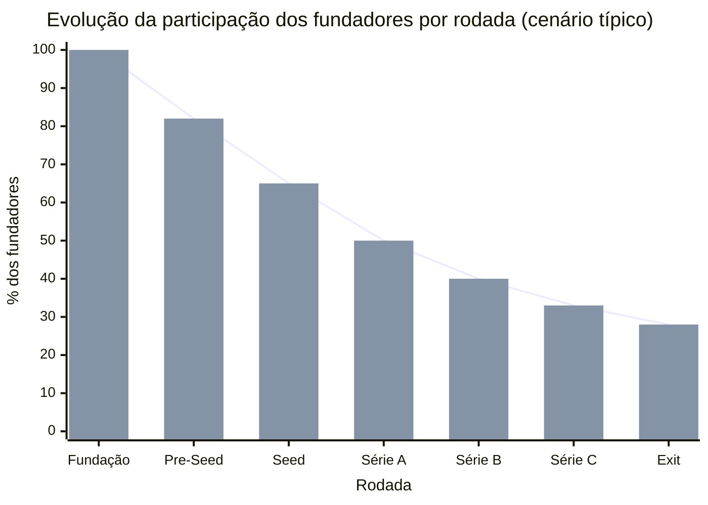

> [!note] Como ler o gráfico
> Fundadores começam com 100% e cada rodada dilui a participação. No cenário típico, ao exit (IPO ou M&A), fundadores têm 25–35% se a trajetória foi eficiente. Valores muito abaixo de 20% no exit sugerem que os termos de rodadas anteriores foram desfavoráveis (liquidation preference excessiva, anti-dilution ratchets, diluição não-planejada). A participação final é consequência acumulada de cada term sheet assinado.

### Quem envolve

**Quem lidera no lado da empresa.** O CEO sempre. Captação é venda. E venda de equity só é feita pelo fundador-CEO. CFO, ou finance lead (se houver), suporta com modelo financeiro, métricas, e due diligence. Jurídico externo, especializado em VC, é obrigatório. Não negociável. Generalista custa caro em rodadas complexas.

**Tipos de investidor no ecossistema brasileiro.**

Anjos (R$ 50 mil a R$ 500 mil por cheque, pré-seed a seed). Operadores experientes, investindo capital próprio. Valor maior. Mentoria, rede, e credibilidade. Busque anjos com experiência operacional no seu setor.

Micro-VCs (fundos pequenos, R$ 500 mil a R$ 3 milhões por cheque, pré-seed a seed). Fundos com até R$ 50 milhões AUM, focados em early-stage. Valor. Mais estruturado que anjo. Menos burocracia que fundo grande.

Seed Funds (R$ 1 a R$ 10 milhões, seed). Canary, Kaszek, Monashees Seed, ACE. Expectativa de pelo menos early PMF, mais time forte.

Early-stage VCs, ou Série A (R$ 10 a R$ 80 milhões). Monashees, Kaszek, Valor, Riverwood, Endeavor Catalyst. Expectativa. PMF claro, mais motor validado.

Growth VCs, ou Série B em diante (R$ 50 milhões em diante). SoftBank LatAm, Tiger Global (quando ativo), General Atlantic. Expectativa. Escala, mais métricas defensáveis.

Corporate Venture (CVC), com tickets variados. Qualcomm Ventures, Globo Ventures, Redpoint eVentures, BTG Pactual. Valor além do capital. Acesso a canais, validação corporativa, e potencial cliente. Risco. Decisão mais lenta. Agenda corporativa pode não alinhar.

Private Equity (tickets grandes, growth, ou pre-IPO). Advent, CVC Capital, Warburg Pincus. Tipicamente para empresas com igual ou maior que R$ 50 milhões de receita, e unit economics maduros.

Family Offices, e investidores institucionais brasileiros. Crescente papel em tech brasileira. Tipicamente investem via fundos de venture, mas cada vez mais direto.

### Como executar

#### 1. Preparação da Narrativa, SCQA

SCQA (Situation, Complication, Question, Answer) é framework de storytelling formalizado por Barbara Minto (ex-McKinsey), no *Pyramid Principle*. É a espinha dorsal de qualquer comunicação persuasiva de negócio. E é particularmente poderoso em pitch, porque força o narrador a estabelecer contexto, tensão, pergunta central, e resposta, de forma sequencial, e clara.

**Estrutura.**

**S, Situação (Situation).** Descrição objetiva do estado atual do mundo, ou mercado. Fatos não contestáveis. Estabelece terreno comum com o investidor.

Exemplo (PadariaPro). "O Brasil tem cerca de 71 mil padarias, das quais cerca de 8 mil são artesanais com múltiplas lojas. Esse segmento cresceu 28% de 2020 a 2024, e movimenta R$ 14 bilhões por ano. São negócios tradicionais em digitalização tardia. 85% ainda fazem gestão de estoque em Excel, ou caderno".

**C, Complicação (Complication).** O que é insatisfatório, perigoso, ou limitante na situação atual. A tensão que torna a situação instável. Precisa ser verificável. Não retórica.

Exemplo. "Padarias com 3-5 lojas perdem em média 12-18% da margem bruta por gestão manual de estoque, ruptura de ingredientes que custa venda, e desperdício de perecíveis. ERPs horizontais não têm integração com fornecedores de padaria artesanal. Sistemas verticais brasileiros focam em caixa, ou balança. Não em gestão de compras. O dono-operador (tipicamente segunda geração, 30-45 anos, e fluente em mobile) passa 6-10 horas por semana apagando incêndios de estoque".

**Q, Questão (Question).** A pergunta central que a situação, mais a complicação, levantam. É o "então o quê?" que o investidor implicitamente está fazendo.

Exemplo. "Como trazer automação de gestão de estoque, mais integração com fornecedores, para padarias artesanais com 3-5 lojas, de forma que o dono adote em 1 semana, e veja retorno claro em 60 dias?".

**A, Resposta (Answer).** O que a empresa é, faz, e prova. A resposta à pergunta. Estrutura típica da resposta. O produto, mais por que funciona, mais evidência de que já funciona.

Exemplo. "Construímos PadariaPro. Um sistema que conecta dono, operação, e fornecedor, via WhatsApp, mais dashboard web, com previsão de demanda baseada em histórico, e confirmação de pedido em 1 clique. Hoje operamos com 103 padarias pagantes em SP, e região metropolitana. Com NPS 48, retenção mensal de 95%, e NRR 112%. A nossa cunha inicial (3-5 lojas, e Sudeste) representa TAM de cerca de 2.500 padarias, e R$ 250 milhões de ARR, em janela de 5-7 anos".

**Como aplicar SCQA ao pitch deck.** Slides 1 e 2 (Capa, mais tagline). Introduz SCQA em versão ultra-condensada. Slide 3 (Situação). S do SCQA como slide próprio. Mostra mercado. Slide 4 (Complicação). C do SCQA. Mostra o problema. Slide 5 (Questão, ou Oportunidade). Q do SCQA. Articula a pergunta que o produto responde. Slide 6 em diante. A do SCQA detalhado. Produto, tração, time, financeiro, e rodada.

> [!warning] Quando o SCQA falha
> Se a Situação é óbvia demais, a Complicação é fraca, a Questão é forçada, ou a Resposta é desproporcional à Complicação declarada, o pitch sente falso. Revisar iterativamente com mentores, antes de apresentar a investidores.

#### 2. Pitch Deck, estrutura de doze a quinze slides

Estrutura consolidada que funciona em oitenta por cento dos casos. Adaptar se setor, ou estágio, exigir variação.

**Slide 1, capa.** Nome da empresa, tagline de uma frase, data, nome do fundador, e papel. Evitar barulho visual.

**Slide 2, tagline (opcional, alguns agrupam com capa).** Uma frase descrevendo o que a empresa faz, e para quem. Exemplo. *"PadariaPro. Software de gestão de estoque, e compras, com integração a fornecedores, para padarias artesanais brasileiras com 3-5 lojas."*

**Slide 3, situação, ou mercado.** Dados do mercado em poucos números. TAM, crescimento, e estrutura (fragmentação, ou concentração).

**Slide 4, complicação, ou problema.** A dor específica que a empresa resolve. Quantificada se possível. Uma quote de cliente real é ouro aqui.

**Slide 5, questão, ou oportunidade.** A pergunta que o mercado está esperando alguém responder. A janela de "por que agora".

**Slide 6, produto, ou solução.** O que a empresa faz. Screenshots reais. Não mockups idealizados. Foco no mecanismo. Não na lista de features.

**Slide 7, tração.** Métricas fortes até hoje. Ordem típica. Número de clientes, receita (ARR ou MRR), crescimento MoM ou YoY, retenção, e NPS. Se pré-receita, métricas proxies (usuários ativos, LOIs, e pilotos).

**Slide 8, modelo de negócio, ou unit economics.** Como ganha dinheiro. Ticket, LTV:CAC, e margem. Números reais se existem. Projeções se não.

**Slide 9, canal de distribuição, ou go-to-market.** Como adquire clientes hoje. Que canais validados. Plano para os próximos 12-18 meses.

**Slide 10, competição, ou diferenciação.** Mapa competitivo (grid 2x2 é clichê, mas funciona). Honesto sobre quem são os concorrentes. O que é moat.

**Slide 11, time.** Fundadores, e contratações-chave. Background relevante. Não CV completo. Por que esse time vai executar.

**Slide 12, projeção financeira.** 3-5 anos. Receita, margem, burn, runway, e unit economics em escala. Premissas por trás.

**Slide 13, rodada.** Quanto está captando, para quê, milestones que atinge com esse capital, e cronograma até a próxima rodada.

**Slide 14, ask, ou contato.** Ponto de contato, e próximos passos.

**Slide 15, apêndice (opcional).** Slides de suporte, que aparecem só se perguntado. Detalhes de métrica, cap table, e roadmap de produto.

> [!tip] Dois pitch decks diferentes
> Teaser (cinco a dez slides). Enviado frio por e-mail, ou LinkedIn. Objetivo, gerar interesse para reunião. Sem informações sensíveis (cap table, e métricas proprietárias). Full (doze a quinze slides). Apresentado em reunião. Mais detalhado. Já pressupõe NDA, ou confiança.

#### 3. As Perguntas Mais Feitas por Investidores

Investidores sérios têm conjunto razoavelmente consistente de perguntas. Preparação significa ter respostas claras para todas, antes da primeira reunião.

**Perguntas sobre mercado.** Qual é o TAM real bottom-up, não top-down? (Mostre o cálculo). Por que agora? Que mudança externa (tecnológica, regulatória, ou comportamental) torna esse o momento? Qual é a velocidade natural do mercado? Está crescendo dez por cento ao ano, ou cinquenta por cento? Quem mais está tentando resolver esse problema?

**Perguntas sobre produto, e diferenciação.** O que especificamente o seu produto faz, que o concorrente X não faz? Qual é o moat daqui a três anos? Se concorrente com dez vezes o seu capital decide atacar, o que acontece? Qual é o insight não-óbvio que vocês têm sobre esse mercado?

**Perguntas sobre tração, e métricas.** Qual é a retenção por coorte, nos últimos doze meses? (Prepare gráfico). Qual é o NRR, e como está evoluindo? Qual é o payback de CAC, e em quais canais? O churn está subindo, estável, ou caindo? Por quê? Qual é o seu North Star Metric, e por que esse?

**Perguntas sobre time.** Por que esse time? Qual é o fundador-market-fit específico? Quais são as próximas três contratações? Quando fecha cada uma? Quem poderia sair, e destruir a empresa? Como vocês se dividem founders? Qual o cap table?

**Perguntas sobre modelo, e unit economics.** Qual é a margem bruta na escala atual? Como evolui em escala? Qual é o CAC por canal? Qual canal escala? Se o ciclo de mercado aperta, como defende o negócio?

**Perguntas sobre captação, e uso de capital.** Com esse capital, onde vocês estão em 18-24 meses? Quais são os três riscos maiores de não atingir esses milestones? Quanto vale a empresa, e por que esse valuation? Quem mais está na rodada? Para o que especificamente o dinheiro vai (percentual em produto, time, marketing)?

**Perguntas sobre exit, ou visão longa.** Qual é o caminho para R$ 1 bilhão de receita? Quem são os compradores potenciais em 5-7 anos? O que precisa ser verdade, para que essa empresa faça IPO?

**Perguntas de stress-test.** Qual é a pior coisa que poderia acontecer com a empresa, nos próximos doze meses? Que suposição-chave do seu plano está mais frágil? Como testa?

> [!important] Como responder bem
> Números concretos, sempre que existam. Sem "muito", "bastante", ou "rápido". Ignorância assumida é melhor que números inventados. "Não sei, mas vou mandar essa análise até sexta" gera confiança. Número falso destrói em due diligence. Tensões reconhecidas. "O churn está em seis por cento, e queremos chegar a quatro. Está sendo o nosso foco trimestral" é mais forte que "o churn está ótimo". Prática. Rodar "mock pitch" com mentores, ou advisors, antes de encontros reais. Gravar, assistir, e ajustar.

#### 4. Rodando o Processo de Rodada

Processo típico dura dezesseis a vinte semanas, em quatro blocos. Preparação (pitch, modelo, data room, lista de alvos), warm intros via rede, primeiras reuniões em paralelo, term sheets e fechamento. Warm intro tem taxa de resposta dez a vinte vezes maior que cold outreach, é o padrão. Paralelização é obrigatória, rodar quinze a vinte investidores ao mesmo tempo cria competição saudável e respeita timeline. FOMO real funciona, blefe destrói confiança em semanas.

Para o tratamento operacional completo (cronograma detalhado, paralelização, warm intros, fontes de intro), ver [[#APÊNDICE CF — PLANEJAMENTO DE RODADA COMO PROCESSO: FUNDRAISING COMO PROJETO ESTRUTURADO|Apêndice CF]].

#### 5. Data Room, o que incluir

Data room é estruturado em pastas numeradas (visão geral, time, produto, clientes e receita, unit economics e financeiro, legal, governança, pessoas, métricas detalhadas, materiais de mercado). Investidores sérios esperam acesso após primeira reunião positiva. Ferramentas comuns vão de Google Drive ou Notion a DocSend, Brex Data Room e plataformas dedicadas (Ansarada, iDeals) em rodadas maiores.

Para o tratamento operacional completo (data room como entregável, estrutura por pasta, logs de acesso, priorização de follow-up), ver [[#APÊNDICE CF — PLANEJAMENTO DE RODADA COMO PROCESSO: FUNDRAISING COMO PROJETO ESTRUTURADO|Apêndice CF]].

#### 6. Term Sheet, termos-chave

Term sheet é documento não-vinculante (exceto cláusulas específicas como exclusividade, e confidencialidade), que resume condições da rodada. Tamanho típico, três a seis páginas.

**Termos financeiros principais.**

Pre-money valuation. Valor da empresa antes do capital novo. Pre, mais capital, igual a Post-money. Exemplo. R$ 20 milhões pre, mais R$ 5 milhões de rodada, igual a R$ 25 milhões post. O investidor fica com vinte por cento.

Liquidation Preference. Em caso de venda, ou liquidação, quanto o investidor recebe antes dos founders. Padrão saudável. 1x non-participating (o investidor escolhe entre recuperar o cheque, OU converter, e participar pro-rata). Evitar. 2x ou 3x participating (o investidor recupera duas a três vezes, E participa pro-rata. Pode consumir exit inteiro em cenário médio).

Anti-dilution. Proteção do investidor, se rodada futura acontece em valuation menor. Dois tipos. Weighted Average (mais justo), ajuste proporcional. Full Ratchet (pesado), conversão ao preço da rodada nova, mesmo que só uma ação seja emitida a esse preço. Evitar.

Vesting de founders. os fundadores também vestam o seu equity (mesmo já tendo). Padrão. Quatro anos, com um ano de cliff. Acelerações. Single trigger (na venda). Double trigger (venda, mais demissão sem causa). Double trigger é padrão saudável.

Pool de ESOP (Employee Stock Option Pool). Ações reservadas para contratações futuras. Padrão. Dez a quinze por cento pós-rodada. Atenção. ESOP é criado pré-money. Ou seja, dilui founders. Não novos investidores.

**Termos de governança.**

Board seats. Rodadas seed tipicamente três seats (dois founders, mais um investidor). Série A cinco seats (dois founders, mais dois investidores, mais um independente). Série B em diante pode chegar a sete.

Protective Provisions. Lista de decisões que precisam de aprovação do board, ou dos investidores. Padrão. Venda da empresa, emissão de novas ações, dívida acima de X, e mudança no contrato social. Cuidado com provisions muito amplas, que limitam operação.

Information Rights. Direito do investidor a reports. Padrão. Relatório mensal, quarterly report, e annual audited. Quanto mais granular, mais trabalho operacional.

Pro-rata Rights. Direito de investidor participar de rodadas futuras, mantendo percentual. Padrão, sim.

ROFR (Right of First Refusal). Direito de investidor comprar primeiro, se o fundador vender ações. Padrão, sim em ações primárias.

**Termos brasileiros específicos.**

No-shop (exclusividade). Compromisso do fundador de não negociar com outros investidores, após assinar term sheet, por trinta a sessenta dias. Vinculante.

Conversibilidade. Ações preferenciais convertem em ordinárias, em evento de liquidez, ou automaticamente em IPO.

Cláusulas de saída. Drag-along, tag-along, e right of first offer, em venda de controle.

> [!important] Recomendação crítica
> Contrate advogado especializado em VC, antes de assinar qualquer term sheet. Não generalista. Escritórios brasileiros com especialização. Mattos Filho, Machado Meyer, Demarest, Derraik, entre outros. Custo típico em Série A, R$ 80 a R$ 200 mil. Paga-se sozinho em apenas um termo mal-negociado.

#### 6.1 Worked example, anti-dilution na pratica de um cap table BR

Anti-dilution e a clausula que mais machuca fundadores em down round, e a unica maneira de entender o efeito e simulando numericamente. Aqui esta um caso brasileiro tipico.

**Setup inicial.** Startup brasileira em S.A. fechada captou rodada seed de R$ 5 milhoes com valuation pre-money de R$ 20 milhoes (post-money R$ 25 milhoes). Cap table pos-seed, fundadores 80 por cento, investidor seed 20 por cento. Para fins de calculo, considerar 1 milhao de acoes totais. Fundadores detem 800 mil acoes. Investidor seed entrou comprando 200 mil acoes a R$ 25 cada.

**Cenario down round.** Doze meses depois, mercado contraiu. Startup precisa captar Serie A de R$ 10 milhoes, mas o melhor term sheet recebido propoe valuation pre-money de R$ 18 milhoes (post-money R$ 28 milhoes). Esse e um down round em relacao ao post-money de R$ 25 milhoes da seed. Sem clausula de anti-dilution, o investidor seed dilui pesado. Com a clausula, parte da dilucao e transferida para fundadores via ajuste do preco de conversao das acoes preferenciais.

**Tres tipos de anti-dilution.**

**Full ratchet.** Mais agressivo. O preco de conversao das acoes do seed e ajustado para o preco da nova rodada, mesmo que apenas uma acao seja emitida no novo preco. No exemplo, o preco efetivo do seed cai de R$ 25 para o preco da Serie A (R$ 18 dividido pelo numero de acoes em base ajustada). O investidor seed efetivamente recebe acoes adicionais como se tivesse pago menos, e os fundadores absorvem a dilucao integral.

**Broad-based weighted average.** Padrao mid-market e o que voce deve negociar. Formula broad-based weighted average,

NCP = OCP × (A + B) / (A + C)

onde

- NCP, novo preco de conversao
- OCP, preco original de conversao
- A, total de acoes pre-rodada (fully diluted)
- B, acoes que TERIAM sido emitidas no novo round se o preco fosse o original (ou seja, novo investimento dividido pelo OCP)
- C, acoes EFETIVAMENTE emitidas (novo investimento dividido pelo novo preco efetivo)

Aplicado ao caso, considerando 1 milhao de acoes pre-Serie A e novo investimento que efetivamente emite acoes no preco da Serie A, o ajuste e parcial. O investidor seed recupera parte do que perderia, e fundadores absorvem a parte restante.

**Narrow-based weighted average.** Variante intermediaria, em que a base de calculo exclui pool de opcoes nao alocadas e instrumentos conversiveis em transito. Resultado fica entre full ratchet e broad-based, geralmente mais proximo do broad-based.

**Resultado pratico no exemplo.** Em full ratchet, fundadores podem absorver dilucao adicional na faixa de cinco a oito pontos percentuais, alem da dilucao natural da rodada. Em broad-based, a dilucao adicional fica na faixa de um a dois pontos percentuais. A diferenca acumulada ao longo de tres ou quatro rodadas pode significar dez a quinze pontos a menos no exit.

**O que aceitar em term sheet.** Full ratchet em term sheet brasileiro de 2026 e marca de investidor agressivo, ou de fundo com tese de protecao de portfolio em mercado em contracao. Quase sempre vale a pena contra-propor broad-based, e se o fundo recusar, considerar se o investidor faz sentido como parceiro. Broad-based e padrao e e dificil recusar em rodada institucional. Aceitar broad-based, e otimizar liquidation preference (1x non-participating) e composicao do board para compensar.

Cross-ref. Para metodos de valuation que ancoram pre e post-money, ver [[#APÊNDICE CE — VALUATION METHODS: COMO INVESTIDORES CALCULAM E COMO VOCÊ CALCULA PARA NEGOCIAR|Apêndice CE]]. Para o quadro completo de negociacao da rodada incluindo trade-offs entre clausulas, ver [[#APÊNDICE CF — PLANEJAMENTO DE RODADA COMO PROCESSO: FUNDRAISING COMO PROJETO ESTRUTURADO|Apêndice CF]].

#### 7. Due Diligence, o que esperar

**Sequência típica de um processo de DD.**

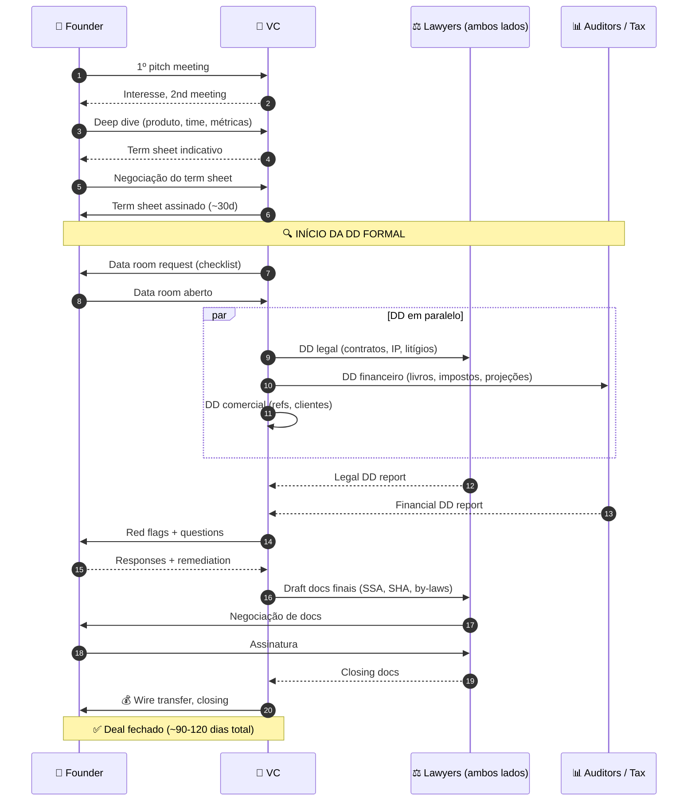

*Processo típico de rodada com DD em três frentes paralelas. Sem data room organizado desde dia 1, o processo trava aqui. E trava em momento ruim. Term sheet assinado, due diligence expondo fraquezas, e bridge de capital se encerrando.*

Após o term sheet assinado, segue due diligence formal (trinta a quarenta e cinco dias típicos).

**A due diligence tipicamente cobre.**

Financial DD. Revisão de DREs, balanços, fluxo de caixa, reconciliação com sistema contábil, análise de qualidade de receita (não-recorrente versus recorrente), e contratos de top dez clientes.

Legal DD. Revisão de contrato social, todos os contratos relevantes, IP, passivos, e processos.

Tax DD. Obrigações fiscais, contencioso tributário, e benefícios fiscais usados.

HR DD. Contratos de trabalho, políticas, e passivos trabalhistas.

Technical DD. Arquitetura, dívida técnica, e processos de desenvolvimento. Em rodadas seed, ou A, pode ser leve. Em B em diante, fica sério.

Customer DD. Calls com três a cinco clientes da empresa, para validar uso, e satisfação.

Reference checks. Conversas com ex-colegas, ex-investidores, e advisors do fundador.

**Como se preparar.** Data room organizado desde o início da rodada acelera DD significativamente. Avisar cinco clientes-referência, que podem receber ligação. E garantir que são clientes felizes. Listar dez pessoas para reference check, que vão falar bem, e com substância. Não esconder problemas. A DD descobre. Proativo é melhor que reativo.

> [!warning] Armadilha comum
> A DD demora duas a três vezes o planejado, por buracos no data room, mais surpresas. Fechar rodada de R$ 20 milhões em trinta dias é padrão para empresa preparada. Vira noventa dias se a documentação estiver ruim.

### RELACIONAMENTO PÓS-RODADA

A rodada fechou. O dinheiro entrou. Agora começa a parte longa. Os fundadores que tratam fechamento como "fim" fazem pior em todas as próximas rodadas. Os fundadores que tratam fechamento como "começo do relacionamento" constroem redes, que compõem em dez a vinte anos de trajetória.

#### 1. Investor Update, o hábito mais subestimado

Investor update é comunicação recorrente, e estruturada, do CEO para todos os investidores. Frequência padrão. Mensal para early-stage. Bimestral, ou trimestral, para maduros. É o hábito mais underrated da captação. Os fundadores que o mantêm por anos captam melhor nas próximas rodadas, têm acesso a mais recursos informais (intro para clientes, candidatos, e outros investidores), e criam comunidade, em vez de contrato.

**Estrutura típica do Investor Update mensal.**

```text
ASSUNTO: [Empresa], Update [Mês/Ano]

TL;DR: [2-3 frases com o mais importante do mês]

MÉTRICAS-CHAVE:
Receita: R$ X (crescimento Y% MoM)
Clientes: N total (+X novos, -Y churn)
Burn: R$ Z / mês | Runway: M meses
North Star: [número]

DESTAQUES DO MÊS:
1. [Conquista concreta]
2. [Movimento estratégico]
3. [Contratação-chave ou perda]

DESAFIOS:
1. [Problema honesto 1]
2. [Problema honesto 2]

PEDIDOS DE AJUDA:
1. [Intro específica para Y]
2. [Candidato para posição Z]
3. [Feedback sobre decisão estratégica]

PRÓXIMOS 30 DIAS:
1. [Objetivo mensurável 1]
2. [Objetivo mensurável 2]

[Nome]
CEO, [Empresa]
```

**Princípios do bom investor update.**

Transparência radical. Compartilha problemas, junto com conquistas. A tentativa de parecer perfeito destrói credibilidade, quando as coisas quebram (e vão quebrar).

Números consistentes. Mesmas métricas em todo update. Adicionar nova métrica só com contexto.

Pedidos específicos. "Ajudem" é ruim. "Vocês conhecem alguém em [empresa X], em posição de [cargo Y]?" é acionável.

Pontualidade. Mesmo dia do mês, e consistente. Sinal de disciplina.

Tom. Profissional, mas humano. Nem robótico, nem drama.

Ferramentas. E-mail simples funciona perfeitamente (reply-all restringido). Ferramentas especializadas. Visible, Standard Metrics, Carta Investor Updates. Para começar, basta e-mail.

#### 2. Board Governance

Após a rodada, há board formal, ou informal. Como usá-lo bem.

**Reunião de board, estrutura padrão (reunião trimestral, duas a três horas).**

1. Check-in (15 min). Cada membro compartilha estado atual.
2. Métricas, e financials (30 min). O CEO apresenta resultado do trimestre versus OKRs.
3. Tópicos estratégicos (60-90 min). Dois a três tópicos em profundidade. Lista pré-circulada.
4. Decisões pendentes (15 min). O que precisa de aprovação.
5. Executive session (15-30 min). Investidores sozinhos (sem founders). Padrão saudável para discussão franca.

**Material para board, enviado 72 horas antes.** Board deck (10-20 slides), métricas, OKRs, riscos, e decisões. Report detalhado (texto, 5-15 páginas), aprofundamento das áreas. Financials do trimestre, mais projeções.

> [!important] Princípio crítico
> Board não é para o CEO buscar aprovação. É fórum para o CEO buscar input estratégico, e desafio honesto. Trate os membros como recursos. Não como supervisores.

**Quando o board vira problema.** Membro que dá opinião sem ler material (sinal de desengajamento). Membro que tenta operar a empresa (fora do papel). Dinâmica onde decisões acontecem em pre-board calls privadas, e não na reunião. Conflito entre investidores não-endereçado, que trava decisões.

**Como endereçar board disfuncional.** Conversa direta com chair (se houver), ou com cada membro um a um. Em casos extremos, renegociar composição em próxima rodada.

#### 3. Relacionamento Individual com Investidores

Para além de board, e updates formais, os relacionamentos individuais compõem ao longo do tempo.

Coffee, ou call, bimestral, com principais investidores. Informal. Atualização sem agenda fixa.

Pedidos específicos em momentos oportunos. "Estou fechando candidato. Queria a sua opinião sobre oferta". "Clientes desse perfil, conheces alguém na minha network?".

Compartilhamento de contexto. Situações complexas, que não cabem em update formal, mas merecem atenção.

Reciprocidade. Oferecer valor ao investidor também. Intro para startups do seu radar. Feedback sobre teses. Dados de mercado.

> [!warning] Armadilha comum
> CEO que só fala com investidores quando precisa de algo. Cria transacional. Não relacional. Os melhores relacionamentos founder-investor são setenta por cento conversa ampla sobre mercado, indústria, e oportunidades. E trinta por cento pedidos específicos.

#### 4. Gestão de Crise com Investidores (cross-referência [[IGNICAO-Vol-5-Maturidade#APÊNDICE CW — CRISE E CONTINUIDADE: PREVENÇÃO, RESPOSTA, RECUPERAÇÃO|Apêndice CW (Vol. 5)]])

Em crise, o relacionamento construído previamente é o que determina se os investidores ajudam, ou atrapalham.

**Regras.** Transparência imediata. O investidor descobre primeiro pelo CEO. Não por terceiros. Plano apresentado. "É crise. Aqui está o plano. Preciso de X de vocês". Cadência aumentada. Em crise, semanal (não mensal). Não esconder número ruim. Esconder piora quando sai.

Exemplo condensado de e-mail de crise.

*"Pessoal, estamos enfrentando caixa crítico. Runway caiu para 5 meses, com trajetória atual. Aqui está o plano [detalhes]. Precisamos de bridge round de R$ X até [data], para não parar operação. Quem topa?"*

Investidores que receberam updates honestos por dezoito meses tendem a responder. Investidores que foram negligenciados tendem a atrasar, ou recusar.

#### 5. Captação de Próxima Rodada Começa Dia 1 Pós-Atual

Ciclo típico de startup que escala. Série A fechou, depois 18-24 meses para Série B. Quem começa a captar três meses antes de acabar caixa, capta pior. Quem trabalhou relacionamento desde dia um pós-Série A, tem três a cinco fundos conversando proativamente, quando for hora de captar formalmente.

**Como preparar Série B desde o dia 1 da Série A.** Identificar dez a vinte fundos-alvo de Série B. Reunião de café semestral com cada top cinco. Sem pedir nada. Só update. Convidá-los para board observer, quando possível. Compartilhar updates do investidor, incluindo esses fundos no cc. Construir pipeline de métricas, que cada fundo específico busca, para Série B.

Quando for hora de captar, três dos cinco já conhecem a empresa profundamente. E o processo de term sheet é semanas. Não meses.

### PERGUNTAS A RESPONDER

Temos SCQA articulado, e testado com mentores? Pitch deck de doze a quinze slides está atualizado no último trimestre? Modelo financeiro, com três cenários (pessimista, realista, otimista), existe? Data room organizado permanentemente, e não só durante processo de captação? Lista de trinta a cinquenta investidores-alvo priorizada, com path to warm intro? Respostas preparadas para as trinta perguntas clássicas, praticadas em mock pitch? Investor update mensal é hábito estabelecido, ou só quando convém? Relacionamento com top investidores atuais é transacional, ou relacional? Cronograma realista para próxima rodada está claro no board? Jurídico especializado em VC está contratado, ou em short-list?

### Métricas

Do processo de captação. Tempo total do processo (primeira warm intro até fechamento), alvo igual ou menor que vinte semanas em seed. Igual ou menor que dezesseis semanas em Série A em diante. Taxa de resposta de warm intros, alvo igual ou maior que setenta por cento. Taxa de primeira reunião para segunda reunião, igual ou maior que quarenta por cento, em processo bem-calibrado. Taxa de segunda reunião para term sheet, igual ou maior que vinte por cento. Número de term sheets para escolher, alvo dois a cinco em processos competitivos. Diluição efetiva versus alvo, igual ou menor que cinco por cento acima do alvo, indica processo saudável.

Do relacionamento pós-rodada. Cadência de investor update, mensal consistente. Taxa de resposta dos investidores aos updates, igual ou maior que quarenta por cento. Reuniões individuais por trimestre com top cinco investidores, igual ou maior que uma cada. Pedidos de ajuda feitos, e atendidos, igual ou maior que três por trimestre.

### Definição de sucesso

Captação está no padrão quando os oito itens estão em pé.

1. SCQA articulado, pitch deck atualizado, e modelo financeiro com três cenários.
2. Data room organizado, e mantido permanentemente.
3. Processo de rodada foi conduzido em timeline igual ou menor que vinte semanas.
4. Rodada foi fechada em condições compatíveis com benchmarks do estágio.
5. Term sheet foi revisado por advogado especializado em VC, antes de assinar.
6. Investor update mensal é ritual estabelecido.
7. Reuniões de board acontecem no ritmo acordado, com material enviado com antecedência.
8. Relacionamento com top investidores é relacional. Não transacional.

### Armadilhas

Captar antes de PMF sólido. Quase sempre destrói valor. Valuation baixo, mais pressão investidor, em empresa ainda em descoberta, igual a receita de morte. Bootstrappar, ou não-diluitivo (ver [[#APÊNDICE P — FINANCIAMENTO NÃO-DILUITIVO|Apêndice P]]), até PMF claro.

Warm intro negligenciada. Começar cold em vez de investir duas a três semanas em ativar rede. Cold outreach é último recurso. Não padrão.

Processo serial (um investidor de cada vez). Destrói timing, e leverage. Paralelização é obrigatória.

Blefe em FOMO. Dizer "temos cinco term sheets" quando tem um. Os investidores conversam entre si, e descobrem.

Ignorar termos não-financeiros. Obsessão com valuation, ignorando liquidation preference, anti-dilution, e governança. Liquidation 2x participating pode custar exit inteiro.

Advogado generalista. Pode custar R$ 500 mil a R$ 2 milhões em termos mal-negociados, por economia de R$ 50 a R$ 100 mil em fees.

Esconder problemas em DD. Vai ser descoberto. Fechar negócio escondendo problema destrói confiança. E pode ser quebra de contrato (declarações falsas).

Investor update como obrigação, não ferramenta. Enviar update mecânico, sem pedidos, e sem substância. Desperdiça o único canal estruturado com os seus maiores aliados.

Board como palco de CEO. Usar board para "prestar contas", em vez de buscar input. O board se torna carimbo. Não recurso.

Negligenciar investidores entre rodadas. Só falar quando precisa. Transforma investidor em fornecedor. Deveria ser parceiro.

Captar da pessoa errada, mesmo com cheque bom. Investidor que não entende o setor, não tem rede aplicável, ou tem estilo que conflita com founder. Cheque é temporário. Relacionamento é longo.

Não rodar mock pitch antes de reuniões reais. Apresentar frio para os primeiros investidores é desperdício. O pitch será melhor na quinta reunião. Rodar três a cinco mocks com advisors, antes dos primeiros reais.

Esquecer de preparar próxima rodada. Fechar Série A, e esquecer que Série B começa em dezoito meses. Três meses antes de acabar caixa, começar processo sob pressão.

Confundir valuation alto com sucesso. Valuation muito acima do mercado cria pressão insustentável para próxima rodada. "Down round" é muito pior do que rodada sólida em valuation moderado.

### CHECKLIST DE PARTIDA

Para validar prontidão para captar.

- [ ] PMF confirmado ([[IGNICAO-Vol-3-Tracao#FASE 12 — PRODUCT-MARKET FIT|Fase 12 (Vol. 3)]] fechada)?
- [ ] Pitch deck atualizado, e testado em três ou mais mock pitches?
- [ ] SCQA articulado em um parágrafo?
- [ ] Modelo financeiro com três cenários existe?
- [ ] Data room organizado, e mantido?
- [ ] Lista de trinta a cinquenta investidores-alvo priorizada, com path to warm intro?
- [ ] Advisors, ou rede, ativados para introduções?
- [ ] Trinta perguntas clássicas têm respostas praticadas?
- [ ] Advogado especializado em VC contratado, ou em short-list?
- [ ] Cronograma realista comunicado ao board, ou advisors?
- [ ] Timeline de 16-20 semanas mapeado com milestones?

> [!warning] Sinal de prematuridade
> Se há três ou mais "não" nos cinco primeiros itens, captação provavelmente é prematura. Priorizar preparação, antes de iniciar warm intros.

### Ver também

[[#APÊNDICE CF — PLANEJAMENTO DE RODADA COMO PROCESSO: FUNDRAISING COMO PROJETO ESTRUTURADO|Apêndice CF]], Planejamento de rodada como processo. [[IGNICAO-Vol-5-Maturidade#APÊNDICE AM — BOARD E GOVERNANCE|Apêndice AM (Vol. 5)]], Board, e governance. [[#APÊNDICE CE — VALUATION METHODS: COMO INVESTIDORES CALCULAM E COMO VOCÊ CALCULA PARA NEGOCIAR|Apêndice CE]], Valuation methods. [[IGNICAO-Vol-5-Maturidade#APÊNDICE BA — SECONDARY E LIQUIDEZ DE FOUNDER|Apêndice BA (Vol. 5)]], Secondary, e liquidez de founder. [[#APÊNDICE BB — VENTURE DEBT E REVENUE-BASED FINANCING (RBF)|Apêndice BB]], Venture debt, e RBF.

### Escolhendo o investidor, a diligência do fundador sobre o VC

A maior parte desse apêndice trata de como captar. Pitch, processo, term sheet, e negociação. Essa seção trata de algo logicamente anterior. Como você decide se aceita o cheque, quando o investidor oferece. A diligência é bidirecional. O VC te investiga por quatro a oito semanas antes de assinar. Você deveria fazer o mesmo, por pelo menos metade desse tempo. Na prática, a maioria dos fundadores faz pouco, ou nenhum, desse trabalho. E isso produz alguns dos erros mais caros da trajetória.

Investidor errado, com cheque bom, pode destruir a empresa em três a cinco anos. Board dominado por VC tóxico impõe decisões que quebram produto, esgotam time, e aceleram timeline artificialmente. Investidor certo, com cheque menor, pode ser multiplicador, que salva a empresa em momentos críticos, abre portas, traz co-investidores, introduz primeiros clientes enterprise, e apoia nos momentos difíceis. A assimetria entre bom, e ruim, é gigante. E o custo de escolher mal é alto, porque a saída é praticamente impossível, uma vez comprometido.

**Quatro dimensões de avaliação do VC candidato.**

**1. Histórico operacional, e padrão de decisão.**

Pergunte nas suas conversas iniciais. Quantas empresas do portfólio em estágios similares ao seu? Quais delas ainda estão ativas, versus quebraram? Quantas chegaram a rodadas subsequentes? Percentual que fez exit, versus percentual que ficou no zombie status (viva, mas sem tração)? Esses dados raramente estão públicos. Você precisa perguntar diretamente. Respostas vagas, ou recusa de compartilhar, é sinal.

Além dos números. Como o VC se comporta em crises do portfólio? Ele segue investindo na empresa em rodada de follow-on? Ou abandona na primeira queda? Ele ajuda fundador a pivotar? Ou pressiona por exit fire-sale?

**2. Valor além do cheque, o que o VC realmente entrega.**

Bom VC entrega três tipos de valor. Capital (o cheque). Sinalização (a marca dele atrai talento, co-investidores, e imprensa). E trabalho operacional (apresentações a clientes, apoio em contratação, orientação estratégica, e introduções para rodadas futuras).

Capital é commodity. Cheque de um fundo é igual ao cheque de outro. A sinalização varia muito. Marca forte (Monashees, Kaszek, Valor, Lux no Brasil) abre portas que marca fraca não abre. O trabalho operacional varia enormemente entre partners do mesmo fundo. O partner que será o seu ponto de contato importa mais que o fundo em si.

Pergunte aos fundadores do portfólio. "Quanto tempo o Fulano dá por mês? O que ele efetivamente ajudou a resolver no último ano? Em que momento específico ele fez diferença?". Histórias concretas importam. Generalidades ("o Fulano é ótimo") não.

**3. Expectativa de governance, e controle.**

Cláusulas comuns no term sheet têm impacto enorme na operação. Assentos no board (quantos, com direito a voto em quais decisões), drag-along (capacidade do investidor forçar venda), liquidation preference (ordem de pagamento em exit), anti-dilution (proteção do investidor em rodada subsequente de menor valor), e vesting reset (equity do fundador volta a cliff se sair).

VC agressivo tentará maximizar essas cláusulas. VC razoável aceita padrões de mercado. Entender o que é "padrão" no seu estágio (seed, Série A, B) te protege de aceitar termos, que depois vão travar a sua flexibilidade. Advogado especialista em venture (não advogado generalista) é investimento obrigatório, antes de assinar.

**4. Reputação no ecossistema de founders.**

Fundadores de empresas que quebraram, ou em crise, falam com franqueza sobre VCs que os apoiaram, ou abandonaram. Antes de aceitar cheque, marque conversas de vinte a trinta minutos, com três a cinco fundadores de portfólio. Especialmente os que não estão nos momentos ótimos. Pergunte explicitamente. "Em que situações o VC foi mais útil? Em que foi pior do que você esperava?". Se há relutância em dar referências nessas condições, sinal fraco.

O ecossistema brasileiro de venture é pequeno. Reputação não desaparece. Lista informal de VCs "tóxicos" circula em grupos de founders. Peça aos seus mentores para te indicar essa lista, antes de fechar com alguém.

> [!warning] Red flags que devem acionar extrema cautela
> VC que oferece term sheet com prazo curto para assinar ("vence sexta"). A pressão artificial costuma esconder termos desfavoráveis, que eles esperam que você não leia com atenção. Recusa explícita de conectar você a fundadores do portfólio. Board seat com veto em decisões operacionais amplas (contratação de C-level, pivots, roadmap de produto). É estrutura para microgestão. Liquidation preference acima de 1x non-participating em seed ou Série A. O padrão de mercado é 1x. Acima disso, protege o investidor às custas do fundador. Promessas verbais que não entram no term sheet. "Vamos te ajudar com X" que não está escrito não será entregue. Valuation muito acima do mercado, acompanhado de cláusulas agressivas. O valuation alto vira ancoragem que obriga você a crescer rápido. As cláusulas garantem que você paga o custo se não conseguir.

**Quando passar em cheque, mesmo bom.**

Às vezes, o melhor movimento é recusar. Sinais de que vale passar.

Você não confia no partner que vai te acompanhar. O investidor precisa controlar demais para você executar livremente. As cláusulas te prendem em timeline, que pode não fazer sentido em dezoito meses. O cheque vem com co-investidor que você não quer (os VCs muitas vezes trazem parceiros). Você está desconfortável com a tese que o VC te impõe sobre o seu próprio negócio.

Passar em cheque dói no momento. Mas empresa quebrada por investidor errado dói por anos. O ecossistema brasileiro de venture continua a crescer. Se você tem tração, outra oportunidade virá. Fundador sem tração que aceita qualquer cheque por desespero costuma agravar o problema. Não resolvê-lo.

**Checklist rápido antes de aceitar term sheet.**

- [ ] Conversei com três ou mais fundadores do portfólio do VC, dos quais pelo menos um em situação difícil.
- [ ] Entendo exatamente quem será o meu partner de contato, e tenho boa relação com ele, ou ela.
- [ ] Revisei o term sheet com advogado especialista em venture (não generalista).
- [ ] Comparei as cláusulas com pelo menos um outro term sheet recente, no mesmo estágio.
- [ ] Entendo as implicações de cada cláusula em três cenários. Empresa cresce rápido, empresa cresce devagar, e empresa quebra.
- [ ] Confortável com valuation. Nem alto demais (pressiona a rodada subsequente). Nem baixo demais (dilui cedo).
- [ ] Sem red flags conhecidos sobre reputação do VC no ecossistema.
- [ ] Pronto para conviver com esse investidor por cinco a dez anos.

> [!info] Fases relacionadas
> Referenciado em: Fase 16.

---

## APÊNDICE CF — PLANEJAMENTO DE RODADA COMO PROCESSO: FUNDRAISING COMO PROJETO ESTRUTURADO

Este apêndice trata o "como" operacional de uma rodada como projeto: cronograma, pipeline de investidores, materiais, governança, prazos. Para os fundamentos de captação (tipos de investidor, narrativa e pitch, term sheet e cláusulas-chave, due diligence, relacionamento pós-rodada), ver [[#APÊNDICE V — CAPTAÇÃO DE EQUITY, PITCH E RELACIONAMENTO COM INVESTIDORES|Apêndice V — Captação de Equity, Pitch e Relacionamento com Investidores]].

### O QUE É

Fundraising (captação de recursos) costuma ser tratado como atividade reativa. "Preciso captar, vamos começar a conversar com VCs (venture capitalists, fundos de capital de risco)". O fundador liga para contatos, manda um pitch deck (apresentação para investidores) pouco polido, recebe feedback genérico, volta, ajusta e pitcha de novo. Processo diluído. Múltiplas rodadas de feedback sem fechamento. Meses perdidos.

Planejar rodada como processo significa tratar fundraising como projeto. Com objetivo claro (valor captado, valuation e termos). Com cronograma definido (tipicamente três a seis meses de pré-fase e seis a dez semanas de fase ativa). Com entregáveis específicos (data room, modelo financeiro e deck). Com pipeline estruturado de investidores (lista longa priorizada, não "vou conversar com quem aparecer"). Com processo formal e prazos. E com governança (governança corporativa: quem decide, quem negocia e quem comunica).

O fundador sofisticado da Série B em diante trata fundraising como M&A. Projeto de quatro a seis meses, time dedicado, advisor (banqueiro ou consultor) e processo competitivo. Isso gera múltiplas ofertas e termo melhor. O fundador iniciante em seed ou A trata como "vou ver quem investe" e fica vulnerável a oferta única, com termos ruins.

### POR QUE IMPORTA

Rodada mal planejada destrói capital do fundador. Captar a múltiplo baixo, ou com liquidation preference (preferência de liquidação: cláusula que dá ao investidor prioridade no recebimento em caso de venda) pesada, custa pontos percentuais de ownership (participação societária) em exit. Em exit de R$ 1 bilhão, cinco por cento a mais de dilution (diluição) são R$ 50 milhões a menos no bolso do fundador.

Planejamento cria leverage (poder de barganha). Processo competitivo (múltiplos investidores interessados simultaneamente) move valuation, e termos. Sem processo, o investidor faz preço.

Timing afeta valuation dramaticamente. Captar quando as métricas estão em alta, e o mercado está aquecido, versus captar em downturn (queda do mercado), muda valuation em quarenta a sessenta por cento. O planejamento inclui antecipar janela.

A comunicação interna fica ordenada. O time, e o board (conselho de administração), sabem o que esperar, quando, e com que métricas. Sem plano, o time vira refém do fundador em modo "caça capital" permanente. E perde foco operacional.

> [!warning] Diligência sem preparo trava o deal
> O investidor pede documentos, modelo, e detalhamento. Tomar três semanas para responder (porque nada estava pronto) esfria momentum. O deal morre. Data room organizado desde o dia um da fase de preparação não é luxo. É infraestrutura.

### TIMING: QUANDO COMEÇAR A PLANEJAR

Regra geral. Começar planejamento seis a doze meses antes de precisar do dinheiro. A fase ativa (pitching) começa três a seis meses antes do runway acabar.

Planejar doze meses antes. Alinhar governance interna (board, e cofundadores) sobre tese de próxima rodada. Começar métricas a evoluir na direção desejada (NRR, ARR growth, payback). Começar relações com VCs-alvo antes de precisar (conversa consultiva, não sale).

Planejar seis meses antes. Definir alvo de rodada (tamanho, e valuation target). Começar a preparar material. Mapear fundos-alvo em detalhe.

Fase ativa, três a seis meses antes do runway acabar. Lançar processo formal. Primeiras conversas, depois due diligence, depois term sheet, depois fechamento. Captar com três ou mais meses de runway restante. Margem de segurança.

> [!warning] Errado
> Começar com quatro meses de runway. Pressão evidente para o investidor. Perde leverage. A fórmula do desespero é a mais cara de todas.

### QUEM PARTICIPA

CEO. Líder do processo. Face principal com investidores. Pitcher primário. Negociador.

CFO. Modelagem, data room, e due diligence financeira. Acompanha o CEO em conversas, quando o modelo é questionado.

Cofundadores. Apoiam em áreas específicas (CTO em technical diligence, e VP Sales em GTM discussion).

Chief of Staff, ou coordenador. Organização logística, coordenação de material, agenda, e follow-ups. Sem isso, o processo vira caos.

Board advisors, ou investors existentes. Intros para novos investidores, feedback em deck, e às vezes negociação direta em nome da empresa.

Banqueiro, ou M&A advisor (Série B em diante). Em rodadas grandes (R$ 200 milhões em diante), faz sentido contratar. Custo, um a três por cento do valor captado, mais retainer. Benefício, processo estruturado, competição garantida, negociação profissional, e cobertura de universo amplo de investidores. Não contratar em Seed, ou A. É overkill, e caro.

Legal. Advogado especializado em VC (Pinheiro Neto, Demarest, Mattos Filho, Stocche Forbes, VMCA, KLA, Freitas Leite). Crítico em term sheet, e documentação. Tentar economizar aqui é penny-wise, pound-foolish.

### FASE 1, PREPARAÇÃO (6 MESES ANTES)

#### 1.1 Definir objetivo da rodada

Sem clareza do objetivo, a negociação vira vaga. Definir.

Valor. Quanto precisa. Calcular com base em 18-24 meses de runway, mais buffer. Não pegar "o que conseguir". Pode ser demais (diluição desnecessária), ou de menos (volta-em-18-meses).

Uso dos fundos. Alocação específica. Team build, GTM, expansão geográfica, ou produto. O investidor vai perguntar.

Valuation target. Faixa defensável, baseada em comparables, e modelo (ver [[#APÊNDICE CE — VALUATION METHODS: COMO INVESTIDORES CALCULAM E COMO VOCÊ CALCULA PARA NEGOCIAR|Apêndice CE]]).

Tipo de investidor ideal. Growth VC, strategic, corporate VC, ou PE? Cada um tem expectativas, e termos, diferentes.

Board seat? Quantos assentos a rodada adiciona, e quem ocupa.

#### 1.2 Preparar métricas

Investidor decide em cima de métricas. Seis meses antes, decidir. Quais métricas queremos mostrar em sua melhor forma? Então operacionalmente trabalhar para que estejam bem no dia do pitch. Exemplos.

NRR. Se está em 105%, pode melhorar via foco em expansion, para chegar a 115% em seis meses.

Burn multiple. Reduzir, ou estabilizar, queima pode melhorar a métrica.

Logo acquisition velocity. Acelerar aquisição dos últimos dois a três trimestres (mesmo que à custa de um pouco de CAC) gera linha de crescimento forte.

> [!important] Foco não é manipulação
> Não é "manipular métricas". É "focar em métricas que o investidor vai avaliar". A diferença é honestidade.

#### 1.3 Construir modelo financeiro robusto

Modelo que projeta 36 meses forward (com cenários base, upside, e downside, ver [[IGNICAO-Vol-3-Tracao#APÊNDICE CD — MODELAGEM FINANCEIRA COM COHORTS: PROJEÇÕES QUE FUNCIONAM EM EMPRESA RECORRENTE|Apêndice CD (Vol. 3)]]). Usa cohort analysis. Mostra unit economics (CAC, LTV, payback) por segmento. Tem lógica defensável (não "chuto que vai dobrar"). Tem sanity check com benchmark de setor. Bate com receita real dos últimos trimestres (modelo que projeta crescimento forte, mas contraria os últimos meses, é red flag).

O modelo precisa ser defensável em uma reunião de sessenta minutos, com VC técnico. Testar internamente antes. CTO, advisor, e CFO interrogam o modelo.

#### 1.4 Construir data room preliminar

Data room é espaço (Drive, DocSend, Dropbox, Notion), onde os documentos ficam organizados. Estrutura típica.

1. Company Overview (deck, e one-pager).
2. Financials (modelo, P&L histórico, balanço, e caixa).
3. Product (roadmap, product strategy, e technical architecture).
4. Go-to-Market (sales strategy, funil, e pipeline).
5. Customers (casos, contratos, e retention analysis).
6. Team (org chart, e key profiles).
7. Legal (cap table, contratos-chave, e IP).
8. Market (TAM analysis, e competitive cenário).

Ter preparado antes de sair em roadshow reduz friction em due diligence, de semanas para dias.

#### 1.5 Preparar pitch deck

Pitch deck curto (12-15 slides), cobrindo. Problem. Solution, ou Product. Market (TAM). Business Model. tração, ou Growth. Unit Economics. Go-to-Market. Team. Competition, ou Moat. Financials, ou Projections. Round, ou Use of Funds. Ask.

Variantes. Deck curto (dez slides, para ice breaker), enviado a VC antes de primeiro call. Deck completo (15-20 slides), para pitch presencial. Investor memo (documento de cinco a dez páginas), substituto ao deck para VCs sofisticados, que preferem narrativa escrita.

Iterar com três a cinco advisors, antes de sair em roadshow. Cada iteração melhora.

### FASE 2, MAPEAMENTO DE INVESTIDORES (4-5 MESES ANTES)

#### 2.1 Construir lista longa

Universo potencial. Trinta a oitenta fundos. Segmentar por estágio (seed, A, B, growth, PE), geografia (BR, LatAm, US, Global), tese (SaaS, fintech, marketplace, health, etc.), tamanho de cheque (Seed R$ 2 a R$ 10 milhões, A 10 a 30 milhões, B 30 a 100 milhões, C 100 a 300 milhões), e atividade recente (fundo que captou LP recentemente, versus fundo em fim de ciclo, sem dry powder — *dry powder* é o capital comprometido por LPs ao fundo mas ainda não desembolsado em investimentos, ou seja, a "munição disponível"; fundo no fim do ciclo de investimento já desembolsou a maior parte e prioriza follow-ons no portfólio existente, não novos investimentos).

Ferramentas. Crunchbase. Distrito (Brasil-focus). DealRoom. PitchBook (pago). Networking com founders em estágio similar. LinkedIn, para identificar partners ativos.

#### 2.2 Priorizar short list

De trinta a oitenta para dez a quinze alvos primários. Critérios. Tese alinhada (investe em SaaS? No seu setor?). Partner com track record relevante. Ticket size compatível. Relationship leverage (existing investor, board advisor, ou founder network, pode introduzir). Reputação no mercado (fundo que respeita founders, versus fundo que tem fama de negociação pesada).

#### 2.3 Pipeline de intros

Para cada VC-alvo, identificar o melhor caminho de intro. Existing investor na empresa, que conhece o VC, é o preferred (warm intro). Founder colega, que captou do VC recentemente, também é bom. Partner específico com histórico compatível, pesquisar e abordar. Cold outreach via Twitter, LinkedIn, ou email, é último recurso.

#### 2.4 Timing de abordagem

Plano de semana-a-semana. Semana menos doze, conversas informais com top cinco (off-the-record, "não estou captando, só conversando"). Semana menos oito, abrir processo formal, e convidar top dez a quinze para primeiro call. Semana menos seis a menos quatro, first calls agendados. Semana menos três a menos um, second meetings, product demos, e team meetings. Semana zero, term sheets.

### FASE 3, PROCESSO ATIVO (6-10 SEMANAS)

#### 3.1 Primeira reunião com cada VC

Sessenta a noventa minutos. Agenda típica. Cinco minutos, quebra-gelo. Trinta a quarenta minutos, deck pitch. Vinte a trinta minutos, Q&A.

Objetivo. Qualificar interesse. Se o VC sai sem "next steps" claros, não tem interesse. Seguir em frente.

#### 3.2 Second meetings, ou diligence

VCs interessados avançam para. Product demo profunda. Financial model deep dive. Customer references. Team meetings.

Em paralelo, o data room é acessado. Os pedidos de informação são respondidos.

#### 3.3 Partner meeting

Em grandes fundos, a decisão final requer "partner meeting", apresentação para comitê de partners. Preparar especificamente. Entender preferências de cada partner, questões que vão surgir, e como o CEO vai se apresentar.

#### 3.4 Term sheets

> [!important] Objetivo do processo
> Múltiplos term sheets competitivos, em janela de duas a três semanas. Isso exige comunicar a todos os VCs mais ou menos o mesmo timeline, manter pressão (follow-ups semanais em VCs que prometeram, mas não entregaram), e aceitar que alguns vão dropar (normal).

Com múltiplos term sheets, a negociação ganha leverage. Sem, o VC solo negocia forte.

#### 3.5 Negociação de term sheet

Term sheet contém. Valuation (pre-money, e post-money). Investment amount. Option pool (tipicamente 10-15%, expandido pre-money). Liquidation preference (1x non-participating é padrão. 2x ou participating é agressivo). Anti-dilution (broad-based weighted average é padrão. Full ratchet é predatório). Board composition (quantos assentos, e quem ocupa). Protective provisions (veto rights). Drag-along, e tag-along. Founder vesting (padrão, quatro anos com um ano cliff, em re-vest de unvested equity). Pro rata rights (o VC tem direito a preservar ownership em próxima rodada).

Term sheet bom para fundador. 1x non-participating liquidation preference. Broad-based weighted anti-dilution. Board cinco ou sete membros, com composição balanceada. Option pool expandido pre-money, mas razoável (10-12%, não 20%). Founder vesting razoável (sem reset agressivo do que já vestou).

Negociar com advogado especializado (ver [[#APÊNDICE V — CAPTAÇÃO DE EQUITY, PITCH E RELACIONAMENTO COM INVESTIDORES|Apêndice V]] sobre term sheet completo).

#### 3.6 Due diligence formal

Após o term sheet assinado, a DD formal começa. Legal DD (contratos, IP, compliance, governança). Financial DD (validação do modelo, e auditoria de MRR reportado). Commercial DD (entrevistas com clientes, e análise de mercado). Technical DD (review de tecnologia, escalabilidade, e segurança).

Duração. Quatro a dez semanas em Série B em diante. Menos em Seed, ou A. Data room bem preparado acelera.

#### 3.7 Documentação e fechamento

Os advogados dos dois lados redigem. Subscription Agreement. Shareholders Agreement. Articles of Incorporation, ou Investor Rights Agreement. Side letters específicos.

Assinatura, depois captação, depois anúncio (se for o caso).

### FASE 4, PÓS-FECHAMENTO (IMEDIATO)

#### 4.1 Comunicação interna

O time precisa saber. A rodada fechou, o que muda, prioridades, e expectativas. Sem isso, o time se sente em limbo.

#### 4.2 Onboarding do novo investidor

VC novo precisa entender operação, calendar, e comunicação. Primeiros trinta dias. Reuniões um a um com novo board member. Acesso a dashboards de métricas. Alinhamento de cadence de reporting.

#### 4.3 Comunicação externa

Anúncio (ou não). Algumas empresas preferem ficar quietas. Outras usam para recrutamento, e mídia. Em Brasil, anunciar rodada Série B em diante é praticamente obrigatório, por pressão de recrutamento, e competição.

#### 4.4 Execução do plano apresentado

Os VCs vão monitorar. "Você prometeu X para Y mês. Você entregou?". Não entregar gera desconfiança, que afeta a próxima rodada.

### MÉTRICAS DO PROCESSO

Número de VCs em lista long list (trinta a oitenta é range típico). Número de first calls agendados (cinquenta a oitenta por cento da lista). Número de second meetings (vinte a quarenta por cento das first calls). Número de term sheets recebidos (dois a cinco é processo saudável. Um é solitude. Zero é falha). Spread de valuation entre term sheets (vinte a quarenta por cento de spread indica processo competitivo). Tempo total do processo (três a seis meses é típico). Dias de diligence (15-30 dias em Série A, 30-60 em Série B, 60-90 em diante em Série C em diante).

### Armadilhas

Captar quando as métricas estão em queda. Investidor bom espera "hoje, ou nos próximos seis meses, as métricas sobem, ou caem?". Captar em queda significa aceitar desconto. Esperar (se o runway permitir), aguentar alguns meses, e voltar com tendência positiva.

Processo "one-off" com um VC. Sem competição, o VC ataca valuation. Sempre rodar cinco a dez fundos em paralelo. Mesmo se um está muito interessado.

Abrir kimono antes de processo formal. Revelar números detalhados a VC, em conversa informal, sem intenção de fechar. O VC pode usar em compete, ou contra você, em negociação futura.

Não preparar modelo financeiro com cohort. Modelo sem cohort, em SaaS B2B, revela imaturidade. Investidor sofisticado pede cohort analysis na primeira reunião.

Aceitar dilution invisível, via option pool alargado. O VC pede option pool "post-money" de quinze por cento. Vem do fundador. Não do investor. Negociar isso.

Exagerar pipeline. "Temos R$ 50 milhões de pipeline 2024". O VC valida com clientes. Descobre R$ 15 milhões. Credibilidade destruída. Ser conservador em forecast gera mais credibilidade.

Não pesquisar VCs. Cada VC tem personality, style, track record, e portfolio. Abordar sem pesquisar é insulto. E reduz chance de interest.

Negociar com advogado genérico. Advogado de PJ, sem experiência em VC brasileiro, negocia term sheet como contrato regular. Perde pontos importantes. Especialista em VC é obrigatório.

Focar só em valuation. Não em termos. Valuation alto com termos ruins (2x liquidation, full ratchet) é armadilha. Valuation dez por cento menor, com termos limpos, é muito melhor.

Subestimar complexidade de rodada internacional. Fundo americano quer estrutura Delaware, ou Cayman. Reestruturar durante rodada (em vez de antes) atrasa deal, e pode matar. Planejar estrutura societária adequada meses antes.

Fechar sem cláusula de board que faça sentido. Rodada Série B, que traz VCs novos sem ajustar composição de board (founders perdem controle), ou mantém controle intacto (VCs recusam). O equilíbrio precisa ser feito.

Captar overcapital. Receber R$ 200 milhões, quando o plano precisa de R$ 80 milhões. Dilution desnecessária. Sobre-investimento gera queima ineficiente. Disciplina para captar o necessário.

Captar undercapital, para "não diluir". Captar R$ 50 milhões, quando precisa de R$ 100 milhões. Volta em doze meses, sob pressão, com menos leverage. Captar com folga, para evitar shortfall.

Prometer inatingível. "Vamos dobrar em doze meses". O VC investe esperando isso. Realiza quarenta por cento no ano. Crise em próxima rodada, porque a narrative quebrou. Promessa defensável vem de histórico.

Ignorar regulação de captação pública. Captar R$ 200 milhões com cinquenta pequenos investidores, sem estrutura correta, cai em caos fiscal. Captar de VCs institucionais é mais simples. Captação via equity crowdfunding tem estrutura própria (ver [[#APÊNDICE CI — EQUITY CROWDFUNDING NO BRASIL: CAPTAÇÃO PÚBLICA DE PEQUENOS INVESTIDORES|Apêndice CI]] — captação pública de pequenos investidores via plataformas reguladas pela CVM).

Não ter reserva para secundária de founder. Em rodadas Série B em diante, os fundadores podem negociar liquidez parcial (cinco a quinze por cento das suas ações). Não discutir é perder oportunidade. Discutir antes de fechar é boa prática.

### Checklist

Rodada bem-sucedida quando captou o valor planejado, em valuation igual ou acima do target, com termos razoáveis (liquidation preference 1x, anti-dilution broad-based, board saudável), runway resultante de 18-30 meses, novo investidor adicionando valor além de capital, e time operacionalmente focado durante o processo. Os itens abaixo viabilizam esse resultado.

- [ ] Objetivo da rodada definido (valor, uso, valuation target), seis meses antes.
- [ ] Alinhamento com board, e cofundadores, sobre tese.
- [ ] Métricas-alvo identificadas, e operacionalizadas, seis meses antes.
- [ ] Modelo financeiro com cohort analysis robusto, e testado internamente.
- [ ] Pitch deck iterado com três a cinco advisors.
- [ ] Data room completo, e organizado, antes do processo ativo.
- [ ] Lista de trinta a oitenta VCs potenciais mapeada.
- [ ] Short list de dez a quinze primary targets definida.
- [ ] Intros quentes identificadas para cada alvo.
- [ ] Banqueiro, ou advisor, contratado (se Série B em diante, R$ 200 milhões em diante).
- [ ] Advogado especializado em VC engajado, antes de term sheet.
- [ ] Agenda de first meetings, second meetings, e partner meetings, estruturada.
- [ ] Três a cinco term sheets alvejados, em janela de duas a três semanas.
- [ ] Diligence preparada (legal, financial, commercial, e technical, ready).
- [ ] Estrutura societária adequada para investidor (BR, Delaware, ou Cayman).
- [ ] Negociação de termos, além de valuation (liquidation preference, anti-dilution, board).
- [ ] Runway target de 18-30 meses pós-rodada.
- [ ] Comunicação interna, e externa, planejada para pós-fechamento.
- [ ] Onboarding do novo investidor estruturado.
- [ ] Plan vs actual tracking estabelecido, para monitoramento pós-rodada.
- [ ] Reserva para secundária de founder considerada (Série B em diante).
- [ ] Processo concluído sem paralisar operação por três a seis meses.

### Ver também

[[#APÊNDICE V — CAPTAÇÃO DE EQUITY, PITCH E RELACIONAMENTO COM INVESTIDORES|Apêndice V]], Captação de equity, e pitch. [[#APÊNDICE CE — VALUATION METHODS: COMO INVESTIDORES CALCULAM E COMO VOCÊ CALCULA PARA NEGOCIAR|Apêndice CE]], Valuation methods. [[IGNICAO-Vol-5-Maturidade#APÊNDICE AM — BOARD E GOVERNANCE|Apêndice AM (Vol. 5)]], Board, e governance. [[#APÊNDICE CI — EQUITY CROWDFUNDING NO BRASIL: CAPTAÇÃO PÚBLICA DE PEQUENOS INVESTIDORES|Apêndice CI]], Equity crowdfunding como modalidade alternativa de rodada quando o público-alvo permite captação pública via plataforma.

---

> [!info] Fases relacionadas
> Referenciado em: Fase 16.

---

## APÊNDICE CE — VALUATION METHODS: COMO INVESTIDORES CALCULAM E COMO VOCÊ CALCULA PARA NEGOCIAR

### O QUE É

Valuation (avaliação do valor da empresa) é o valor atribuído a uma empresa em determinada data e em determinado contexto. Não existe "o valuation". Existe valuation em rodada de investimento, em aquisição, em IPO (oferta pública inicial de ações), em disputa societária e em planejamento fiscal. Cada contexto usa método e raciocínio diferentes. Este apêndice trata do arsenal completo. O fundador precisa entender três coisas. Por que cada método é usado em qual contexto. Qual método o investidor ou comprador está usando quando oferece um número. Como construir o próprio valuation para negociar com base sólida.

Há três categorias principais de métodos.

1. Múltiplos de mercado (comparáveis de empresas similares). O mais usado em venture capital (capital de risco institucional), e em M&A tech (fusões e aquisições no setor de tecnologia).
2. Fluxo de caixa descontado (DCF, *discounted cash flow*). Método acadêmico. Usado em empresas maduras, e em PE (*private equity*, fundos que compram participações em empresas já consolidadas).
3. Métodos específicos por estágio. Berkus, Scorecard, e Risk Factor Summation, para early-stage (estágio inicial). Venture Capital method, para Série A, ou B. LBO model (*leveraged buyout*, compra alavancada com dívida), para PE. Sum-of-the-parts (soma das partes), para conglomerados.

### POR QUE IMPORTA

Negociar mal por desconhecimento é comum, e caro. O fundador aceita o valuation que o VC propõe "porque não tem argumento". Seis meses depois, descobre que empresa similar captou com múltiplo trinta por cento maior. E era tarde. Ter modelo próprio é poder de barganha.

Entender a lógica do investidor vira argumento. "Você está usando múltiplo de seis vezes a receita. Mas a empresa X, no mesmo setor, captou a nove vezes há três meses. Por que descontando?". O argumento só funciona se o fundador entende o método.

Decisões internas dependem de valuation honesto. Quanto vale a stock option (opção de compra de ações) que estou dando ao VP? Quanto vale o equity (participação societária) que o cofundador quer em renegociação? Quanto vale o pedacinho que quero vender em secundária? Valuation interno mal calculado gera injustiça, ou surpresa.

Em exit (venda da empresa, IPO ou outro evento de liquidez), a diferença entre métodos pode ser de bilhões. Empresa com ARR (*annual recurring revenue*, receita recorrente anual) de US$ 100 milhões vale US$ 800 milhões (oito vezes receita), ou US$ 1,5 bilhão (quinze vezes receita), ou US$ 300 milhões (DCF com desconto alto). Todos "defensáveis", dependendo do método. Saber argumentar método é a diferença material.

> [!important] Em disputa societária, divórcio, ou partilha
> O juiz pede laudo de avaliação. O perito vai usar algum método. Se o fundador conhece, pode contestar. Se não, aceita o que o perito escolher. O método pode afetar o resultado em duas a três vezes.

### PRÉ-MONEY, PÓS-MONEY, E A MATEMÁTICA DE DILUIÇÃO

Essa confusão custa dinheiro real em negociações. A distinção é simples. Mas as consequências são profundas. *Diluição* é a redução do percentual de propriedade do fundador toda vez que entra capital novo na empresa em troca de equity.

**Definições.**

Pre-money valuation (valor pré-investimento) é o valor da empresa antes do investimento entrar. Post-money valuation (valor pós-investimento) é o valor da empresa depois do investimento entrar. A relação é direta.

```text
Post-money = Pre-money + Investimento
Ownership do investidor (%) = Investimento / Post-money
```

**Exemplo numérico completo.**

Cenário. Startup SaaS com ARR R$ 10 milhões. Fundador quer captar R$ 5 milhões. VC propõe valuation de R$ 20 milhões.

O fundador precisa perguntar: "R$ 20 milhões é pre-money ou post-money?".

Se R$ 20 milhões é pre-money.

```text
Post-money = R$ 20 milhões + R$ 5 milhões = R$ 25 milhões
Ownership do VC = R$ 5 M / R$ 25 M = 20%
Ownership do fundador (antes) = 100% → (depois) = 80%
```

Se R$ 20 milhões é post-money.

```text
Pre-money implícito = R$ 20 milhões − R$ 5 milhões = R$ 15 milhões
Ownership do VC = R$ 5 M / R$ 20 M = 25%
Ownership do fundador (antes) = 100% → (depois) = 75%
```

A diferença de interpretação — R$ 20 milhões pre versus post — equivale a 5% de ownership. Em exit de R$ 500 milhões, isso são R$ 25 milhões na mão do fundador, ou na mão do VC. Sempre confirmar qual dos dois está sendo discutido.

**Diluição em múltiplas rodadas.**

O fundador raramente faz só uma rodada. A diluição é cumulativa. Exemplo de trajetória real.

```text
Rodada         Pre-money   Captação   Post-money   Ownership fundador
Seed           R$ 6 M      R$ 2 M     R$ 8 M       75% (perdeu 25% da rodada)
Série A        R$ 30 M     R$ 8 M     R$ 38 M      75% × 78,9% = 59,2%
Série B        R$ 120 M    R$ 25 M    R$ 145 M     59,2% × 82,8% = 49,0%
Série C        R$ 400 M    R$ 60 M    R$ 460 M     49,0% × 87,0% = 42,6%
```

Ao chegar na Série C, o fundador com 100% no dia zero retém 42,6%. Em exit de R$ 1 bilhão, são R$ 426 milhões. A diferença de 5% em qualquer rodada, multiplicada ao longo das demais, é material. Negociar cada rodada com atenção ao pre-money é imperativo.

**Diluição pelo option pool.**

VCs frequentemente exigem "option pool shuffle". Antes de calcular o ownership, o VC pede que a empresa crie (ou amplie) um pool de stock options de dez a quinze por cento. Esse pool é criado antes da rodada, na prática reduzindo o pre-money efetivo para o fundador.

> [!warning] Option pool shuffle
> Se o VC pede um pool de 15% criado pre-money, e o pre-money é R$ 20 milhões, o pool vale R$ 3 milhões. O fundador efetivamente dilui 15% antes do VC entrar. A alocação real para o fundador é pré-calculada com esse desconto. Negociar o tamanho do pool é tão importante quanto negociar o valuation.

### MÉTODO 1, MÚLTIPLOS DE MERCADO (COMPARABLE MULTIPLES)

**Como funciona.** Identificar empresas similares (setor, estágio, tamanho), cujo valuation é conhecido. Extrair múltiplo (por exemplo, valor sobre receita, valor sobre EBITDA, valor sobre GMV, valor sobre usuário). Aplicar à sua empresa.

**Múltiplos comuns por setor.**

SaaS B2B. Early (Seed a Série A). Oito a vinte vezes ARR em períodos aquecidos. Cinco a dez vezes em períodos normais. Três a seis vezes em períodos frios (2023 a 2024, pós-correção). Growth (Série B a C). Seis a doze vezes ARR em 2025. Dez a vinte vezes em 2021. Mature (late-stage, IPO track). Cinco a dez vezes ARR. Ajustes. NRR maior que 120% adiciona vinte a quarenta por cento ao múltiplo. Growth rate maior que 100% dobra múltiplo. Rule of 40 maior que sessenta adiciona.

Marketplace, ou plataforma. Maduros. Três a seis vezes GMV em operadores clássicos. Quatro a oito vezes take rate revenue. Early. Duas a cinco vezes GMV projetado.

Fintech, ou banco digital. Early. Cinco a quinze vezes revenue run rate. Valoração por usuário em alguns modelos (US$ 200 a US$ 500 por usuário ativo). Late. Price/book value em duas a quatro vezes para bancos digitais. Múltiplos de receita em escala tech.

D2C e-commerce. Uma a três vezes revenue (e-commerce está em múltiplos comprimidos pós-2022). Ajustes por margem bruta, retention, e marca.

HealthTech, ou Biotech. Pré-revenue. Múltiplos sobre valor da tecnologia, fase de ensaio clínico, e área terapêutica. Não cabe em múltiplo simples. Revenue-stage. Cinco a quinze vezes revenue, dependendo de modelo (SaaS-like versus serviço).

HRtech, EdTech, e Construtech vertical. Similar a SaaS B2B. Ajustes por nicho, e tamanho de mercado.

**Como obter comparables.**

Fontes de comparables brasileiros. Distrito (relatórios públicos anuais). Crunchbase (rodadas globais). PitchBook (acesso pago, mais detalhado). B3 (empresas listadas). Rankings, e reports, de VCs (Astella, Kaszek, Monashees publicam análises). DealRoom Brazil. Conversas com banqueiros de investimento (BTG, Itaú BBA, XP), em setores específicos.

> [!warning] Cuidados com comparables
> Comparables perfeitos raramente existem. Ajustar por tamanho, geografia, mercado, e momento. Rodadas recentes são mais relevantes. Mercado de 2021 não é igual a mercado 2024. Public multiples (empresas listadas) tipicamente aplicados com desconto de ilíquidez de vinte a trinta por cento, para empresas privadas comparáveis.

**Exemplo prático.**

Sua empresa. SaaS B2B, ARR R$ 50 milhões, crescendo sessenta por cento ao ano, NRR 125%, e Rule of 40 igual a quarenta.

Comparables. Pipefy em sua Série B (2020). ARR R$ 15 milhões, captou US$ 75 milhões a valuation reportado de US$ 300 milhões. Múltiplo, vinte vezes (era 2020 aquecido). RD Station antes do M&A com Totvs (2021). Receita cerca de R$ 400 milhões, múltiplo reportado cerca de cinco a sete vezes em aquisição (mercado de cash-flow já maduro). ContaAzul antes de deal Stone. Receita cerca de R$ 80 milhões, valoração pré-IPO cerca de R$ 500 milhões (cerca de seis vezes).

Ajustes ao seu. Você cresce sessenta por cento. Não hiper crescimento. Mas saudável. Múltiplo mid-pack. NRR 125% alta. Prêmio de quinze a vinte e cinco por cento. Rule of 40 igual a quarenta. Saudável, mas não top decile.

Conclusão. Múltiplo razoável de sete a dez vezes ARR em 2025. Valuation defendível, R$ 350 a R$ 500 milhões. VC oferecendo cinco vezes (R$ 250 milhões) está no low-ball. Aceitar oito a nove vezes (R$ 400 a R$ 450 milhões) seria razoável.

**Armadilhas de múltiplos.** Comparables superficiais. "É SaaS, então dez vezes ARR", sem ajustar por crescimento, NRR, ou margem. Selection bias. Só olhar comparables favoráveis. Ignorar timing. Rodadas de 2021 não servem como benchmark em 2025. Confundir revenue run rate (últimos trinta dias anualizados) com ARR (contratos vigentes). A diferença pode ser substancial.

### RULE OF 40 E SUA INFLUÊNCIA EM MÚLTIPLOS SAAS (BRASIL 2024-2025)

A Rule of 40 é o indicador de saúde operacional mais citado em SaaS global, e seu impacto nos múltiplos é direto e quantificável.

**Definição.**

```text
Rule of 40 = Taxa de crescimento de receita (% a.a.) + Margem de lucro operacional (%)
```

Uma empresa SaaS é considerada saudável quando o índice é igual ou superior a quarenta. O índice permite comparar empresas em estágios diferentes, equilibrando crescimento agressivo com eficiência.

Exemplos de composição.

```text
Perfil A: 80% crescimento + (−40%) margem = 40 (aceitável, early-growth)
Perfil B: 40% crescimento + 0% margem = 40 (razoável, eficiente)
Perfil C: 20% crescimento + 25% margem = 45 (maduro, lucrativo)
Perfil D: 60% crescimento + (−10%) margem = 50 (excelente, growth eficiente)
```

**Como o índice afeta múltiplos no Brasil em 2024-2025.**

O mercado de 2021 pagava múltiplos pelo crescimento, quase independente de eficiência. O mercado de 2024 e 2025 passou a exigir ambos. O efeito nos múltiplos é observável.

```text
Rule of 40       Múltiplo ARR típico (2025)   Contexto
Abaixo de 20     3x a 5x                      Capital escasso, renegociação frequente
20 a 39          5x a 8x                      Faixa normal de mercado
40 a 59          8x a 12x                     Premium, acesso a rodadas maiores
60 ou mais       12x a 18x                    Top decile, múltiplos excepcionais
```

**Contração de múltiplos no Brasil (2023-2024).**

O ciclo de correção afetou empresas brasileiras de forma desproporcional. Empresas com Rule of 40 abaixo de vinte sofreram compressão de cinquenta a sessenta por cento nos múltiplos em relação ao pico de 2021. Empresas com Rule of 40 acima de cinquenta sofreram compressão de vinte a trinta por cento, com recuperação parcial em 2024.

O que explica a diferença. O investidor global que entra no Brasil exige prêmio de eficiência como compensação pelo risco-país. Em 2021, o prêmio de crescimento sufocava esse cálculo. Em 2024 e 2025, a eficiência voltou a ser precificada.

**Expansão de múltiplos: o que sinaliza recuperação.**

Em 2025, algumas startups brasileiras voltaram a captar com múltiplos de oito a doze vezes ARR. O padrão comum entre elas.

- Rule of 40 acima de quarenta e cinco.
- NRR acima de 115%.
- CAC payback abaixo de dezoito meses.
- Margem bruta acima de setenta e cinco por cento.
- Crescimento acima de cinquenta por cento, com path to profitability documentado.

> [!tip] Rule of 40 como argumento de negociação
> Calcular o índice antes de entrar em qualquer conversa com investidor. Se estiver acima de cinquenta, usar como anchor explícito. "Nosso Rule of 40 é cinquenta e três, top quartile do setor segundo o Bessemer Cloud Index. Por que o múltiplo que você propõe está abaixo de empresas com índice inferior?" Funciona.

**Burn multiple como complemento.**

Em 2024 e 2025, o mercado brasileiro acrescentou o burn multiple como segundo filtro de eficiência. Burn multiple igual a net burn dividido por net new ARR. Abaixo de um é excelente. Um a dois é aceitável. Acima de dois é sinal de alerta.

A combinação de Rule of 40 alto e burn multiple baixo é o perfil que maximiza múltiplo no mercado atual.

### MÉTODO 2, FLUXO DE CAIXA DESCONTADO (DCF)

**Como funciona.** Projetar fluxo de caixa livre da empresa por cinco a dez anos. Calcular valor terminal. Descontar tudo a valor presente, usando custo de capital (WACC).

Valor igual a soma de (FCF ano N, dividido por 1 mais WACC, elevado a N), mais (valor terminal, dividido por 1 mais WACC, elevado a N).

Onde. FCF é free cash flow, igual a EBITDA, menos CapEx, menos delta Working Capital, menos Impostos. WACC é weighted average cost of capital. Para startup, custo de equity é muito maior que custo de dívida. WACC típico de startup em estágio Série A, ou B, é quinze a vinte e cinco por cento. Valor terminal. Aplicar múltiplo de saída (exit multiple) ao último FCF projetado. Ou calcular como perpetuidade com crescimento.

**Quando DCF funciona.** Empresa madura com FCF previsível. Negócios com poucos cenários de ruptura. Análise de aquisição por strategic buyer, que vai operar o negócio por décadas.

**Quando DCF falha.** Startup pré-receita, ou com receita muito volátil. Mercado com alta incerteza sobre trajetória. Empresa cujo valor está em opcionalidade (patentes, dados, network effect, que pode ou não materializar).

> [!warning] DCF é sensível a premissas
> Mesmo em casos que DCF "funciona", o WACC é sensível. Variar WACC de quinze por cento para vinte por cento muda valuation em trinta por cento. Variar crescimento terminal de três por cento para dois por cento muda valuation em quinze por cento. DCF é ferramenta de ordem de grandeza. Não de precisão.

**Exemplo simplificado.**

Empresa madura com EBITDA projetado. Ano um, R$ 20 milhões. Ano dois, R$ 30 milhões. Ano três, R$ 45 milhões. Ano quatro, R$ 65 milhões. Ano cinco, R$ 85 milhões.

CapEx, R$ 3 a R$ 5 milhões por ano. WACC, quinze por cento. Valor terminal, múltiplo oito vezes EBITDA ano cinco, igual a R$ 680 milhões.

Valor presente dos FCFs, cerca de R$ 150 milhões. Valor presente do terminal, R$ 680 milhões dividido por 1,15 elevado a cinco, igual a R$ 338 milhões.

Valuation total. R$ 488 milhões.

**Para startup.** DCF de startup pré-Série B é pouco útil. Os cenários são tão amplos (a startup pode dez vezes, ou ir a zero), que as projeções parecem ficcionais. Use DCF em startup só como reference point. O motor real é múltiplo de mercado.

### MÉTODO 3, VENTURE CAPITAL METHOD

**Como funciona.** O investidor projeta valor de saída (exit) em cinco a sete anos. Aplica TIR (taxa interna de retorno) desejada para descontar. Calcula valuation atual.

Valor hoje igual a valor na saída, dividido por 1 mais TIR esperada, elevado a anos até a saída.

Onde. TIR típica de VC early-stage, trinta a cinquenta por cento ao ano (dobra do capital a cada dezoito a vinte e quatro meses). Valor na saída igual a receita no ano cinco a sete, vezes múltiplo de saída esperado (típico SaaS, oito a quinze vezes).

**Exemplo.**

Startup projeta ARR R$ 200 milhões no ano cinco. Múltiplo de saída dez vezes igual a valor na saída R$ 2 bilhões. VC quer TIR de trinta e cinco por cento ao ano. Valuation hoje igual a R$ 2 bilhões dividido por 1,35 elevado a cinco, igual a R$ 445 milhões.

Se o VC está investindo R$ 50 milhões, o ownership é R$ 50 milhões dividido por R$ 445 milhões, igual a cerca de onze por cento.

**Quando VC Method é usado.** Série A, e B. Lógica padrão de venture. Projeções, e múltiplos, saem de benchmarks. TIR sai da tese do fundo.

**Armadilhas.** TIR demanda alta reduz valuation. Fundo que quer cinquenta por cento de TIR te valoriza muito menos que fundo que aceita vinte e cinco por cento. Projeções otimistas tornam valuation irreal. Se você promete R$ 500 milhões de ARR no ano cinco, para vir a quinze vezes múltiplo, o VC deve descontar. E desconta.

### MÉTODO 4, EARLY-STAGE (BERKUS, SCORECARD, RISK FACTOR)

Para empresas pré-receita, ou muito cedo, métodos estruturados de "heurística".

**Berkus Method.** Soma de valor atribuído a cinco fatores. Cada um até US$ 500 mil. Ideia sólida, R$ 0 a R$ 500 mil. Protótipo, R$ 0 a R$ 500 mil. Time de qualidade, R$ 0 a R$ 500 mil. Relações estratégicas, R$ 0 a R$ 500 mil. Vendas iniciais, R$ 0 a R$ 500 mil. Máximo, R$ 2,5 milhões. Usado em pre-seed, ou seed, em mercados desenvolvidos. No Brasil, ajustar para R$ 1 a R$ 10 milhões em pré-receita.

**Scorecard Method.** Valuation médio do mercado em pré-seed (por exemplo, R$ 5 milhões), ajustado para cima, ou para baixo, por fatores. Qualidade do time (trinta por cento do peso). Tamanho de oportunidade (vinte e cinco por cento). Produto, ou tecnologia (quinze por cento). Ambiente competitivo (dez por cento). Marketing, vendas, e parcerias (dez por cento). Necessidade de capital adicional (cinco por cento). Outros (cinco por cento).

Cada fator. Mais ou menos X por cento do valuation base.

**Risk Factor Summation.** Valuation base ajustado por doze fatores de risco. Tecnologia, capital, regulatório, competição, gestão, etc. Cada fator menos dois a mais dois pontos. Cada ponto, mais ou menos R$ 250 mil.

Esses métodos são usados por angels, e pre-seed investors, brasileiros (Bossa Nova, Domo, KPTL), para "disciplinar" negociação em estágio muito cedo. Não são precisos. São heurística para justificar cheque.

### MÉTODO 5, MÉTODOS PARA M&A (STRATEGIC BUYER)

Comprador estratégico (corporate acquirer) usa métodos específicos.

Accretion, ou dilution analysis. O adquirente pergunta. "Essa aquisição vai aumentar, ou diminuir, o meu lucro por ação?". Impacta a decisão.

Sinergia específica. "Quanto custo consigo cortar? Quanto revenue consigo cross-sell?". O valor da sinergia, acima do stand-alone value, é pago ao vendedor como prêmio.

Strategic value acima de múltiplos. Empresa incumbent pode pagar duas a três vezes acima do múltiplo de mercado, se a aquisição é estrategicamente crítica (bloquear concorrente, entrar em mercado, adquirir tech, ou adquirir talento). RD Station vendida para Totvs. Mercado Bitcoin vendido para 2TM. Movile comprando iFood. Todos casos em que o comprador pagou acima do múltiplo tech, por razão estratégica.

### MÉTODO 6, PRIVATE EQUITY (LBO MODEL)

PE compra empresa madura, com mix equity, mais dívida. Opera por três a sete anos. Vende. Modelo.

1. LBO model. Quanta dívida a empresa consegue suportar, mais quanto equity o PE precisa colocar.
2. Return target. PE quer TIR de vinte a vinte e cinco por cento ao ano em equity investido.
3. Valuation máximo pago igual a valor de saída projetada, dividido por 1 mais TIR, elevado a anos. Menos dívida paga ao longo do período.

PE no Brasil (Actis, Patria Investimentos, Advent, HIG, KKR, Vinci) tipicamente compra empresas com EBITDA de R$ 50 milhões em diante, e múltiplos de cinco a oito vezes EBITDA. Menos relevante para startup típica. Mais relevante se a empresa atinge maturidade, e o PE vira caminho (Stone foi comprada por Advent. Arco foi IPO, mas tinha PE involvement. Netshoes, pré-IPO).

### CONTEXTO BRASILEIRO: DESCONTO APLICADO VERSUS PARES AMERICANOS

Empresa brasileira com o mesmo perfil de uma empresa americana tipicamente recebe valuation quinze a trinta e cinco por cento inferior. Não é percepção. É lógica de risco precificada sistematicamente.

**Country risk premium: o que é e como funciona.**

O country risk premium (CRP) é o retorno adicional que investidores exigem para alocar em um país com risco maior que os EUA. O modelo padrão usa o spread do CDS (credit default swap) soberano do Brasil como proxy.

No período 2024-2025, o CRP do Brasil oscilou entre 2,5% e 4,5% ao ano, dependendo do momento político e fiscal. Quando aplicado ao WACC.

```text
WACC Brasil = WACC base (EUA) + Country risk premium
WACC EUA (SaaS early-stage): 12% a 18%
WACC Brasil (mesmo perfil): 15% a 22%
```

Um WACC cinco pontos percentuais mais alto reduz o valor presente de um DCF em vinte a trinta por cento, tudo mais constante.

**Fatores específicos que investidores aplicam ao Brasil.**

Risco cambial. Startup com receita em reais e investidor em dólares: a variação do câmbio afeta diretamente o retorno. Em 2024, o real desvalorizou cerca de vinte por cento frente ao dólar. Isso apagou parte do retorno em dólar de fundos internacionais que captaram em 2022-2023. O mercado precifica esse risco como prêmio sobre a empresa.

Risco regulatório e tributário. A complexidade tributária brasileira (reforma em curso, carga efetiva alta), e a instabilidade de marcos regulatórios em setores como fintech, saúde e educação, adicionam prêmio de incerteza ao WACC.

Risco de liquidez de saída. O mercado de IPO brasileiro (B3) é menor e menos líquido que Nasdaq ou NYSE. A janela de IPO fecha com frequência. M&A local é limitado a poucos compradores estratégicos. O investidor precifica a possibilidade de um "exit difícil" adicionando desconto de iliquidez de quinze a vinte e cinco por cento.

Risco macroeconômico. Juros altos (Selic historicamente elevada), pressão fiscal, e eleições recorrentes com potencial de mudança de política econômica criam volatilidade de cenário que fundos globais descontam.

**Como reduzir o desconto país.**

Não é impossível neutralizar parte do desconto. As estratégias mais eficazes observadas em startups brasileiras.

Receita em dólar ou dolarizada. Empresa com receita em dólar, ou com contratos indexados ao dólar, elimina o risco cambial do ponto de vista do investidor. O desconto diminui substancialmente.

Estrutura Cayman. Holding no exterior com subsidiária operacional no Brasil. Permite ao investidor ter equity em veículo estrangeiro, reduzindo risco regulatório e facilitando saídas. Padrão em rodadas Série A em diante com VC internacional.

Evidência de path to exit. Mostrar que compradores estratégicos internacionais (Salesforce, SAP, Oracle, Microsoft) são acquirers naturais aumenta a percepção de liquidez e reduz o desconto.

Comparables internacionais com ajuste explícito. Apresentar valuation usando comparables internacionais e aplicar explicitamente o desconto país. "Nossa empresa vale oito vezes ARR nos EUA. Aplicamos trinta por cento de desconto Brasil. Chegamos a cinco vírgula seis vezes. Portanto, nosso ask de seis vezes é justo." Narrativa estruturada.

> [!note] O desconto país não é fixo
> Em momentos de Selic mais baixa, câmbio estável, e janela de IPO aberta (como 2020-2021), o desconto país caiu para dez a quinze por cento. Em 2024, voltou a vinte a trinta por cento. O fundador precisa calibrar o argumento de valuation ao momento macroeconômico.

### CONSTRUINDO SEU PRÓPRIO VALUATION (FRAMEWORK)

Para fundador antes de rodada, ou aquisição.

Passo 1, triangulação. Usar três ou mais métodos. Comparar resultados. Múltiplos de mercado (primário). DCF, se maduro suficiente. VC method (o que o VC usaria). Comparable transactions recentes.

Passo 2, cenários. Valuation em cenário conservador (base), cenário otimista (upside), e cenário pessimista (downside). Se o range é R$ 200 a R$ 600 milhões, a negociação será nessa faixa.

Passo 3, storytelling numérico. Valuation alto precisa ser defendido com narrativa. Por que múltiplo Y, e não X? Por que comparables Z, e não W? Por que esse crescimento é sustentável? Sem narrativa, número é só número. O VC, ou comprador, precisa "comprar a story" antes do número.

Passo 4, precedentes de mercado. Quem captou em setor similar recentemente? Qual valuation? Qual condição? Esses números são base. Desviar precisa justificar.

Passo 5, assessoria profissional (Série B em diante). Banqueiros de investimento (BTG, Itaú BBA, XP, Santander). Advisors de M&A (Stream Capital, Igah Ventures Advisory, Vinci Advisory). Consultorias de valuation (PwC, EY, KPMG, Deloitte). Honorários R$ 200 mil a R$ 2 milhões, dependendo do tamanho. Em captação Série B em diante, ou M&A de R$ 100 milhões em diante, vale muito. Em seed, caro demais.

### MÉTRICAS FLUENTEMENTE CITADAS EM NEGOCIAÇÃO

Para parecer (e ser) competente.

ARR (Annual Recurring Revenue), para SaaS. NRR (Net Revenue Retention), revela expansão. GRR (Gross Revenue Retention), revela churn puro. Rule of 40, igual a growth percentual mais profit percentual (maior que quarenta por cento é saudável para SaaS). Burn multiple, igual a net burn dividido por net new ARR (menor que dois é saudável). CAC payback em meses. LTV/CAC multiplicador. Magic Number, igual a new ARR dividido por S&M spend. Quick Ratio, igual a (new MRR mais expansion) dividido por (churn mais downgrade). Margem bruta (maior que setenta por cento é padrão SaaS). Gross margin por cohort, quando aplicável.

> [!tip] Fluência sinaliza sofisticação
> Fundador que conversa fluente nesses termos sinaliza sofisticação. Material em negociação. Os investidores ajustam expectativas para cima, quando percebem que estão lidando com alguém que entende o jogo.

### Definição de sucesso

Fundador domina valuation, quando os sete itens estão em pé.

1. Consegue calcular valuation da própria empresa, usando três ou mais métodos.
2. Identifica cinco a dez comparables relevantes do setor.
3. Entende múltiplos aplicáveis, e pode justificar ajustes.
4. Sabe o que cada tipo de investidor (early-stage VC, growth VC, strategic acquirer, PE) valoriza diferentemente.
5. Tem cenários base, upside, e downside, construídos.
6. Pode responder "por que R$ X, e não R$ Y?", com lógica defensável.
7. Consegue conversar com banqueiro, ou advisor, no mesmo nível.

### Armadilhas

Confiar em projeções muito otimistas. Valuation com projeção de duzentos por cento de growth sustentado por cinco anos vai levar a desapontamento, quando o real entrega oitenta por cento. O investidor de próxima rodada vai cobrar a promessa.

Comparar com unicórnios como benchmark. "O meu valuation tem que ser tipo Nubank". Nubank é outlier. Comparables realistas são empresas dez a cem vezes menores.

Ignorar estágio. Valuation de Série B não serve para benchmark de Seed. Múltiplos diferem por estágio.

Foco só em valuation. Não em termos. Rodada a R$ 500 milhões com liquidation preference 2x pode render menos que rodada a R$ 400 milhões com 1x. Termos importam (ver [[#APÊNDICE V — CAPTAÇÃO DE EQUITY, PITCH E RELACIONAMENTO COM INVESTIDORES|Apêndice V]]).

Negociar com dado desatualizado. O mercado mudou de 2021 para 2024. Múltiplos caíram cinquenta a setenta por cento em SaaS. Operar com 2021 numbers é negociação perdida.

Super-ajustar DCF com hockey stick. Projeção de FCF que dobra a cada ano, por cinco anos, não é realista. DCF baseado nisso é exercício fictício.

Não considerar dilution futura. Valuation hoje R$ 300 milhões. Ownership quarenta por cento. Duas rodadas adiante, dilui para vinte por cento. Em exit de R$ 1 bilhão, o fundador leva R$ 200 milhões. Saber desde já.

Aceitar "valuation é só um número", sem pushing back. O VC diz "vamos com o número, foque em crescer". Mas o ownership final é função do valuation de hoje. Cada ponto percentual de ownership em exit futuro é material.

Não formalizar avaliação em eventos especiais. Stock options, earn-outs, buyouts parciais, e secundária de sócio. Tudo requer valuation formal. Sem laudo, vira pilha de atritos depois.

Confundir pre-money com post-money. Pre-money mais rodada igual a post-money. Ownership do investidor igual a rodada dividido por post-money. Confundir é erro clássico em negociação.

Achar que valuation em mercado aquecido virou "novo normal". 2021 foi bolha. 2024 a 2025 é normalização. Valuation trinta vezes ARR em 2021 virou oito a dez vezes em 2025, para a mesma empresa. Mental model precisa acompanhar.

Ignorar o efeito do option pool sobre a diluição real. O pool criado pré-money reduz o pre-money efetivo do fundador. Negociar tamanho do pool é tão importante quanto negociar o headline valuation.

### CHECKLIST: O QUE TER PRONTO ANTES DE UMA CONVERSA DE VALUATION

Este checklist é diferente dos anteriores. Não é sobre o que construir ao longo do tempo. É sobre o que ter na mão, pronto, antes de qualquer reunião com investidor, comprador estratégico, ou advisor.

**Documentação financeira.**

- [ ] ARR atual calculado corretamente (contratos vigentes, não run rate projetado)
- [ ] MRR dos últimos doze meses, mês a mês, em planilha
- [ ] NRR e GRR calculados nos últimos quatro trimestres
- [ ] Burn rate mensal dos últimos seis meses (net burn, não gross burn)
- [ ] Burn multiple calculado (net burn dividido por net new ARR)
- [ ] Margem bruta por linha de receita, nos últimos quatro trimestres
- [ ] CAC por canal, e CAC payback em meses
- [ ] LTV por segmento de cliente (SMB, mid-market, enterprise)
- [ ] Rule of 40 calculado (crescimento mais margem operacional)

**Narrativa de valuation.**

- [ ] Cinco a dez comparables do setor levantados (rodadas recentes, preferencialmente dos últimos doze meses)
- [ ] Múltiplo de ARR de cada comparable identificado e documentado
- [ ] Ajuste de comparables feito (tamanho, estágio, NRR, Rule of 40)
- [ ] Faixa defensável de valuation calculada (mínimo, base, upside)
- [ ] Argumento escrito: por que esse múltiplo, e não o inferior que o VC vai propor
- [ ] Valuation pelo VC method simulado (para entender o que o investidor calcula internamente)
- [ ] Desconto país aplicado, e argumento de redução do desconto preparado (se aplicável)

**Cenários e projeções.**

- [ ] Projeção de ARR para três anos construída (base case, upside, downside)
- [ ] Cada premissa da projeção documentada e defendível
- [ ] Path to profitability, ou path to Rule of 40 positivo, calculado
- [ ] Uso de capital da rodada detalhado (para onde vai o dinheiro, com que impacto esperado)

**Estrutura da rodada.**

- [ ] Pre-money e post-money calculados para o ask pretendido
- [ ] Diluição do fundador pós-rodada calculada
- [ ] Diluição acumulada em duas rodadas futuras estimada
- [ ] Option pool existente e impacto de possível novo pool calculado
- [ ] Liquidation preference entendida e modelada em cenários de exit

**Postura de negociação.**

- [ ] Floor de valuation definido (abaixo do qual não vale fechar)
- [ ] Prioridades claras (valuation versus controle versus velocidade)
- [ ] Dois a três investidores alternativos identificados (para criar pressão competitiva legítima)
- [ ] Assessor ou advisor disponível para revisar term sheet, se necessário

> [!important] A preparação muda o poder de negociação
> O investidor experiente percebe em quinze minutos se o fundador fez o trabalho. O fundador que chega com comparables precisos, Rule of 40 calculado e argumento de múltiplo estruturado negocia em outro nível. O valuation final em rodadas competitivas costuma ser dez a vinte por cento mais alto para fundadores preparados, na comparação com fundadores que deixam o VC liderar o framing numérico.

### Ver também

**Ver também:** [[#APÊNDICE V — CAPTAÇÃO DE EQUITY, PITCH E RELACIONAMENTO COM INVESTIDORES|Apêndice V]], Captação de equity. [[#APÊNDICE CF — PLANEJAMENTO DE RODADA COMO PROCESSO: FUNDRAISING COMO PROJETO ESTRUTURADO|Apêndice CF]], Planejamento de rodada. [[IGNICAO-Vol-3-Tracao#APÊNDICE AN — MODELAGEM FINANCEIRA OPERACIONAL|Apêndice AN (Vol. 3)]], Modelagem financeira operacional. [[IGNICAO-Vol-3-Tracao#APÊNDICE CD — MODELAGEM FINANCEIRA COM COHORTS: PROJEÇÕES QUE FUNCIONAM EM EMPRESA RECORRENTE|Apêndice CD (Vol. 3)]], Modelagem com cohorts.

---

> [!info] Fases relacionadas
> Referenciado em: Fase 16.

---

## APÊNDICE DF — INSTRUMENTOS DE CAPTAÇÃO: SAFE, NOTA CONVERSÍVEL E MÚTUO CONVERSÍVEL

> [!note] Posição no livro
> Este apêndice detalha os instrumentos de captação pré-equity (antes da entrada formal do investidor no quadro societário) usados em rodadas iniciais. O processo completo de captação está no [[#APÊNDICE V — CAPTAÇÃO DE EQUITY, PITCH E RELACIONAMENTO COM INVESTIDORES|Apêndice V]]. O COCP (Contrato de Opção de Compra de Participação, instrumento específico do marco legal das startups brasileiro) está no [[#APÊNDICE DA — MARCO LEGAL DAS STARTUPS: LC 182/2021|Apêndice DA]]. Stock options (opções de compra de ações) e ESOP (Employee Stock Ownership Plan, ou plano de participação acionária para colaboradores) estão no [[#APÊNDICE DB — STOCK OPTIONS E ESOP NO BRASIL|Apêndice DB]].

---

### O problema de captar com equity no early stage

Em rodadas pré-seed e seed (estágios iniciais), ambas as partes têm informação insuficiente para precificar a empresa com confiança. O fundador acha que vale mais; o investidor acha que o risco não justifica o valuation (avaliação da empresa) pedido. Negociar equity direto trava o processo.

Instrumentos de captação diferida resolvem isso: o dinheiro entra agora, a conversão em equity acontece na próxima rodada, quando há mais informação (produto mais desenvolvido, primeiros clientes, outros investidores precificando). O investidor entra com desconto ou cap (teto de valuation) como compensação pelo risco de entrar antes.

---

### Os quatro instrumentos principais

| Instrumento | Origem | Tem vencimento? | Gera juros? | Converte em | Regulação brasileira |
|---|---|---|---|---|---|
| **SAFE** (Simple Agreement for Future Equity) | Y Combinator (2013) | Não | Não | Equity na próxima rodada | Sem lei específica; contrato civil |
| **Nota Conversível** | EUA (Convertible Note) | Sim (12–24 meses) | Sim (6–12% a.a. típico) | Equity na próxima rodada ou resgate | Sem lei específica; contrato civil |
| **Mútuo Conversível** | Brasil | Sim | Sim (CDI + spread) | Equity ou repagamento | Código Civil; IOF incide |
| **COCP** (Contrato de Opção de Compra de Participação) | LC 182/2021 | Até 7 anos | Não | Opção de compra de equity | Marco Legal das Startups |

> Para detalhes do COCP, ver [[#APÊNDICE DA — MARCO LEGAL DAS STARTUPS: LC 182/2021|Apêndice DA — Marco Legal das Startups]].

---

### SAFE — Simple Agreement for Future Equity

#### Como funciona

O SAFE é o instrumento mais simples: o investidor entrega o dinheiro hoje em troca do direito de receber ações no futuro, quando ocorrer um "evento de liquidez" (próxima rodada de equity, venda da empresa, ou — em algumas versões — IPO).

Não há vencimento. Não há juros. Não há data em que o fundador precisa "pagar de volta". O investidor aceita o risco de que a empresa pode nunca ter um evento de liquidez, ou pode ter um evento desfavorável.

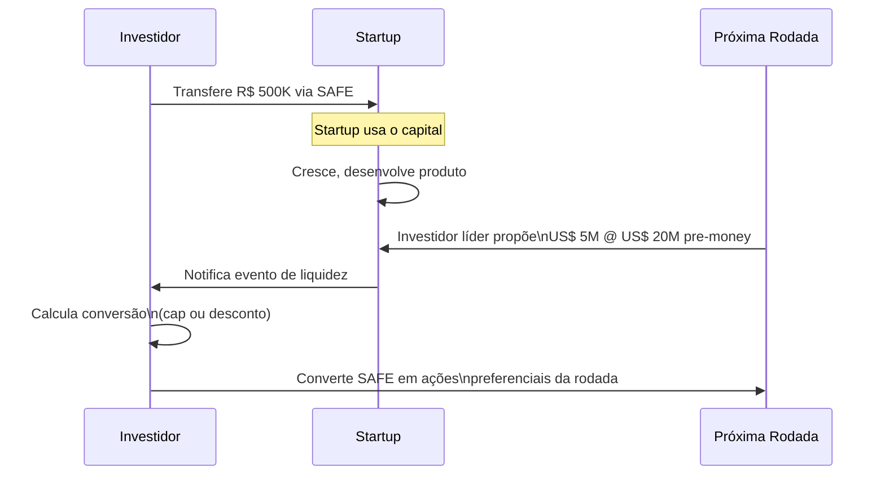

#### Termos principais

**Cap (valuation cap):** Teto de valuation no qual o SAFE converte. Se o cap é R$ 10M e a rodada acontece a R$ 20M pre-money, o investidor converte como se o valuation fosse R$ 10M — ou seja, recebe o dobro das ações que receberia sem cap.

**Desconto:** O SAFE converte com desconto sobre o preço da próxima rodada. Desconto de 20% em uma rodada a R$ 10/ação significa que o SAFE converte a R$ 8/ação.

**Quando cap e desconto coexistem:** O investidor converte pelo que for mais favorável (menor preço de conversão).

**Exemplo numérico:**

```
SAFE: R$ 500K | Cap: R$ 8M | Desconto: 20%

Próxima rodada: R$ 2M @ R$ 16M pre-money (R$ 8/ação)

Via cap:     R$ 500K / (R$ 8M / # ações) = preço implícito = R$ 4/ação
Via desconto: R$ 8/ação × (1 - 20%) = R$ 6,40/ação

Investidor usa o cap → converte a R$ 4/ação
R$ 500K / R$ 4 = 125.000 ações

Novo investidor paga R$ 8/ação → recebe 250.000 ações por R$ 2M
```

#### Versões de SAFE

| Versão | Característica | Quando usar |
|---|---|---|
| **Pre-money SAFE** (padrão YC 2018+) | Cap é sobre valuation pre-money; múltiplos SAFEs não se diluem entre si | Padrão atual nos EUA; crescentemente adotado no Brasil |
| **Post-money SAFE** | Cap é sobre valuation incluindo o próprio SAFE; dilui fundadores mais claramente | Mais transparente para o fundador; facilita cálculo do cap table |
| **SAFE sem cap** (apenas desconto) | Sem teto de valuation; investidor confia na empresa precificar bem | Só faz sentido se a empresa tem poder de barganha considerável |

> [!warning] SAFE no Brasil tem nuances jurídicas
> O SAFE americano foi desenhado para Delaware C-Corp. No contexto brasileiro (LTDA ou SA), há questões abertas: se caracteriza ou não mútuo (com implicação de IOF), se a opção de conversão é executável judicialmente e como tratar a preferência de liquidação em caso de venda. Use advogado com experiência em venture brasileiro.

---

### Nota Conversível (Convertible Note)

#### Como funciona

A nota conversível é, tecnicamente, dívida: o investidor empresta dinheiro com prazo de vencimento e taxa de juros. A diferença de um empréstimo comum é que ela foi desenhada para converter em equity — não para ser paga em dinheiro.

Se a rodada de equity acontecer antes do vencimento, a nota converte (com desconto e/ou cap, como no SAFE). Se não acontecer, o investidor pode exigir o pagamento — o que geralmente força uma negociação e uma prorrogação.

#### Termos principais

- **Principal:** valor do aporte
- **Taxa de juros:** acumula sobre o principal durante o prazo (típico: 6–12% a.a.); converte junto com o principal
- **Vencimento (maturity):** prazo para conversão ou repagamento (típico: 18–24 meses)
- **Desconto:** igual ao SAFE — sobre o preço da próxima rodada
- **Cap:** igual ao SAFE — teto de valuation para conversão

#### SAFE vs. Nota Conversível

| Aspecto | SAFE | Nota Conversível |
|---|---|---|
| Natureza jurídica | Contrato sui generis de equity futuro | Dívida conversível |
| Vencimento | Não | Sim — cria obrigação de converter ou pagar |
| Juros | Não | Sim — acumula, converte junto |
| Pressão sobre fundador | Menor | Maior (vencimento cria deadline) |
| Proteção ao investidor | Menor | Maior (pode exigir repagamento) |
| Uso típico | Pré-seed e seed sem pressão de tempo | Seed com investidor mais conservador |
| Complexidade jurídica | Menor | Maior |

> [!tip] Qual usar?
> Se você tem poder de barganha (múltiplos interessados), prefira SAFE — é mais simples e menos coercitivo. Se o investidor insiste em nota conversível, negocie prazo de vencimento longo (24 meses) e cláusula de prorrogação automática mediante acordo de 60% dos detentores.

---

### Mútuo Conversível (instrumento brasileiro)

O mútuo conversível é o equivalente nacional da nota conversível — um contrato de empréstimo com opção de conversão em equity. É amplamente usado porque os advogados brasileiros de venture têm mais familiaridade com ele do que com SAFEs.

**Particularidades brasileiras:**

- **IOF:** Mútuos entre pessoas jurídicas ou com pessoas físicas são sujeitos a IOF. Para mútuo PF → PJ (investidor pessoa física para startup), a alíquota pode ser 0,5% a.d. sobre o saldo — custo relevante em empréstimos de prazo mais longo.
- **Taxa de juros:** Deve ser explicitada no contrato. Sem taxa explícita, aplica-se a SELIC.
- **Código Civil:** O mútuo é disciplinado pelo Código Civil (arts. 586–592). Discussão jurídica sobre se a opção de conversão é válida como condição potestativa pura depende de como o contrato é redigido.

**Quando o IOF pode ser evitado:**
- Mútuo PJ → PJ com prazo definido: alíquota reduzida
- Uso do COCP (Marco Legal das Startups) em vez do mútuo conversível: COCP é explicitamente isento de IOF para investimentos em startups (ver [[#APÊNDICE DA — MARCO LEGAL DAS STARTUPS: LC 182/2021|Apêndice DA]])

---

### Acumulação de instrumentos pré-rodada (stacking)

É comum uma startup captar múltiplos SAFEs ou notas de diferentes investidores antes da Série A. Isso cria complexidade no cap table.

**Problema do stacking:**

```
Fundadores: 70%
SAFE 1 (R$ 500K, cap R$ 8M): pendente
SAFE 2 (R$ 300K, cap R$ 10M): pendente
SAFE 3 (R$ 200K, sem cap, 20% desconto): pendente

Na Série A @ R$ 20M pre-money:
→ SAFE 1 converte primeiro (cap mais baixo = mais ações)
→ SAFE 2 converte depois
→ SAFE 3 converte com desconto
→ Cada conversão dilui os fundadores e os demais SAFEs
→ Resultado final muito diferente do que fundadores esperavam
```

**Mitigação:**

- Modele o cap table em cada cenário antes de assinar cada SAFE
- Limite o total de capital captado em instrumentos diferidos a 15–20% do valuation alvo da próxima rodada
- Use a mesma versão de SAFE (pre-money ou post-money) para todos os investidores de uma rodada
- Ferramentas: Carta, Pulley, Capshare permitem simular conversões

---

### Checklist de negociação para o fundador

**Antes de assinar qualquer instrumento:**

- [ ] Qual o cap? Está alinhado com o valuation que pretendo na próxima rodada?
- [ ] Qual o desconto? Como interage com o cap (qual é mais favorável ao investidor)?
- [ ] Há pro-rata rights (direito de participar da próxima rodada)?
- [ ] Se nota conversível: qual o vencimento? Há cláusula de prorrogação?
- [ ] O instrumento tem direitos de informação (relatórios mensais obrigatórios)?
- [ ] Há direito de veto ou aprovação sobre decisões operacionais? (Evite)
- [ ] Modelei o cap table pós-conversão em três cenários: rodada pequena, esperada e grande?
- [ ] Advogado com experiência em venture revisou o documento?

> [!info] Fases relacionadas
> Referenciado em: Fase 16.

---

### Armadilhas

1. **Cap muito baixo.** Atrai investidores mas destrói o cap table se a empresa performar bem. Em conversão a valuation alto, o investidor ganha muito, o fundador perde muito.
2. **Nota com vencimento curto.** 12 meses não é suficiente para construir o produto e fechar uma rodada. Negocie 18–24 meses.
3. **Stacking descontrolado.** Cinco SAFEs de cinco investidores diferentes, com caps diferentes, sem modelar o cap table final.
4. **Pro-rata aberta para todos.** Investidores com pro-rata direito em todas as rodadas futuras tornam a próxima rodada mais difícil de fechar — o lead quer concentrar.
5. **Ignorar o IOF.** Em mútuo conversível com PF, o IOF pode custar mais do que os juros.

**Ver também:** [[#APÊNDICE DA — MARCO LEGAL DAS STARTUPS: LC 182/2021|Apêndice DA — Marco Legal e COCP]], [[#APÊNDICE V — CAPTAÇÃO DE EQUITY, PITCH E RELACIONAMENTO COM INVESTIDORES|Apêndice V — Captação]], [[#APÊNDICE CE — VALUATION METHODS: COMO INVESTIDORES CALCULAM E COMO VOCÊ CALCULA PARA NEGOCIAR|Apêndice CE — Valuation]], [[#APÊNDICE DB — STOCK OPTIONS E ESOP NO BRASIL|Apêndice DB — Stock Options e ESOP]]

---

## APÊNDICE P — FINANCIAMENTO NÃO-DILUITIVO

Os fundadores iniciantes tratam "captação" como sinônimo de vender equity. Não é. Equity é só uma das formas de financiar uma startup. E costuma ser a mais cara, porque o custo de vender um pedaço da empresa para sempre, calculado em valor futuro, supera de longe o custo de pagar juros ou dividir receita por período limitado.

Este apêndice cobre sete instrumentos de financiamento não-diluitivo disponíveis no Brasil, quando cada um faz sentido e quais armadilhas são específicas de cada um.

> [!important] Regra geral
> Equity primeiro, quando você precisa de alguém no barco. Dívida, ou não-diluitivo, quando você precisa só do dinheiro.

### O que esse apêndice cobre

Financiamento não-diluitivo é qualquer forma de capital, que não exige venda de participação societária. Você pega dinheiro, paga de volta (com juros, com revenue share, com entrega de serviço, ou simplesmente consumindo o benefício fiscal), e continua dono do que era seu. Alguns instrumentos têm "pegadinha diluitiva" disfarçada. Warrants em venture debt, por exemplo. E esse apêndice explicita cada uma.

Entregável. Plano de Financiamento. Documento de duas a três páginas que mapeia necessidade de caixa nos próximos dezoito meses, qual fração será equity, e qual não-diluitivo, e justificativa para a escolha de cada instrumento.

### POR QUE

Três razões para priorizar não-diluitivo, antes de cada rodada de equity.

Diluição preservada para o exit. Cada ponto percentual preservado em cap table, pela [[#FASE 14 — ESCALA: TIME, OPERAÇÕES, CRESCIMENTO E CAPITAL|Fase 14]] (Crescimento e Capital), vira valor monetário no exit. um fundador que diluiu sessenta por cento até Série C realiza metade do que realizaria, se tivesse diluído quarenta por cento. Financiamento não-diluitivo bem usado preserva cinco a quinze pontos percentuais de founders, e early team, até o exit.

Disciplina operacional. Dívida cobra juros em caixa. Revenue share consome margem. Grants exigem prestação de contas. Todos forçam disciplina, que equity não força. Equity permite queimar dinheiro com pouca cobrança de curto prazo. O que é a origem de operações infladas, que quebram quando o mercado aperta.

Bridge entre rodadas. Entre uma Série A e uma Série B, a startup frequentemente precisa de seis a doze meses extras de runway, para bater milestone. Levantar bridge round em equity é caro (valuation pressionado), e sinaliza fraqueza. Venture debt, ou receivables financing, cobrem o bridge sem o custo de sinal.

> [!warning] Custo de pular esta seção
> Os fundadores que ignoram não-diluitivo vendem equity cedo demais, para necessidade que poderia ser coberta com instrumento mais barato. Exemplo típico. A startup levanta Série A de R$ 15 milhões em valuation de R$ 50 milhões (dilui vinte e três por cento) quando R$ 5 milhões em venture debt, mais R$ 3 milhões em Lei do Bem, mais foco operacional, teriam coberto os doze meses seguintes sem diluição.

### Quando usar

Pós-PSF ([[IGNICAO-Vol-3-Tracao#FASE 12 — PRODUCT-MARKET FIT|Fase 12 (Vol. 3)]]), para a maioria dos instrumentos. Antes disso, a sua receita é pequena demais para suportar dívida. E os grants exigem estruturação que não existe.

Exceções que cabem antes. Grants específicos para ideação (editais SEBRAE, alguns FAPESP). Crowdfunding equity (CVM regulamentou para pre-seed). Lei do Bem, quando você já tem CNPJ tributado no Lucro Real, com P&D mensurável (raro pre-PMF).

Revisitar. A cada seis meses, junto com revisão de caixa. Os instrumentos mudam condição de mercado rapidamente. Spread de venture debt em 2024 é muito diferente de 2022.

### Quem envolve

Executor principal. CFO (se houver), ou CEO. Financiamento não-diluitivo tem contratos complexos, com covenants, cláusulas de aceleração, e garantias reais, ou fiduciárias. Não delegar para alguém sem fluência financeira.

Participantes. Advogado especializado em dívida corporativa, ou financiamento de startups (diferente de advogado de M&A). Contador para estruturação de incentivos fiscais. Sócios (aprovação de garantias pessoais, se exigidas).

Decisor final. CEO, ou CFO, com aprovação de board em instrumentos que criam covenants, ou garantias, sobre ativos materiais da empresa.

### Como executar

#### Os sete instrumentos não-diluitivos

**Instrumento 1, Venture Debt.**

Dívida corporativa especializada em startups VC-backed. Tipicamente levantada junto, ou imediatamente após, uma rodada de equity.

Como funciona. Empréstimo de doze a trinta e seis meses. Juros doze a vinte por cento ao ano. Geralmente acompanhado de warrants (direito de o credor comprar 0,5 a 2 por cento de equity em condições predefinidas).

Quando faz sentido. Entre Série A, e Série B, para cobrir CapEx específico (equipamento, ou infra), e para estender runway por seis a doze meses, sem nova rodada.

Requisitos típicos. Rodada de equity recente (últimos seis a doze meses), com fundo reconhecido. ARR igual ou maior que R$ 3 a R$ 10 milhões. Crescimento YoY igual ou maior que oitenta por cento. Unit economics defensáveis.

Provedores no Brasil. A55 Capital, Siclo, Kamaroopin (com fundos específicos), Monkey (receivables, mas opera dívida também). Fundos internacionais com presença LatAm (Partners for Growth, Lighter Capital).

> [!warning] Armadilhas de venture debt
> Os warrants aparentam pequenos até o exit. 1,5% em Série C vira milhões. Os covenants financeiros (burn cap, revenue floor) podem ser violados em crise, e acionam aceleração. Garantias sobre propriedade intelectual bloqueiam M&A futuro. Cross-default. Default num contrato aciona default em todos.

**Instrumento 2, Revenue-Based Financing (RBF).**

Capital em troca de percentual de receita futura, por período, ou até atingir cap de retorno.

Como funciona. O credor aporta R$ X. Em troca, recebe Y por cento da receita mensal, até receber 1,3 a 2,0 vezes o valor original (ou até passar N meses). Sem juros nominais. O custo é o cap total dividido pelo tempo de payback.

Quando faz sentido. SaaS com MRR estável, e previsível. E-commerce com margem bruta maior que quarenta por cento, e receita recorrente. Negócios em crescimento, que preferem variabilização (pagamento menor em meses piores), a parcela fixa.

Requisitos. MRR, ou receita mensal, de R$ 100 a R$ 500 mil em diante. Histórico de seis a doze meses. Margem bruta saudável. Churn documentado.

Provedores no Brasil. a55, Clearco (internacional, atuou no Brasil), Tap to Pay (Stone), e alguns bancos digitais com produto específico para SaaS.

Armadilhas. Pareceu barato no papel, ficou caro quando a empresa cresceu mais rápido que o previsto (cap pago antes, custo efetivo altíssimo). Caps acima de 1,5x em prazo curto são juros disfarçados de trinta por cento ou mais. Limita captação futura, se o RBF senior pedir exclusividade em receivables.

**Instrumento 3, Antecipação de Recebíveis (Receivables Financing).**

Você vende os recebíveis futuros, para receber à vista (com desconto). É commodity financeira. Todo banco, e boa parte das fintechs, oferece.

Como funciona. Você tem contratos, ou notas fiscais, a receber em 30, 60, ou 90 dias. A instituição adianta o valor com deságio (1 a 4 por cento ao mês tipicamente).

Quando faz sentido. Ciclo de caixa negativo em operação, que já tem receita recorrente. Preferível a dívida tradicional. Porque não entra como passivo controverso em due diligence.

Provedores. Praticamente qualquer banco (Itaú, Bradesco, Santander têm produtos). Fintechs especializadas (Monkey Exchange, Open.co, Nexoos, Capital Empreendedor).

> [!warning] Armadilha das antecipações
> O custo efetivo real precisa considerar taxa de desconto, mais tarifas, mais IOF. Os 1,5% ao mês anunciados viram 2,3% ao mês efetivos. Tomar antecipação crônica cria ciclo de dependência. Você vira escravo do próprio recebimento.

**Instrumento 4, Grants e Editais (Recursos Não-Reembolsáveis).**

Dinheiro que você recebe, e não devolve, em troca de cumprir metas predefinidas do edital.

Provedores principais no Brasil.

FINEP (Financiadora de Estudos e Projetos). Programa Centelha, Tecnova, e Inovacred. Valores de R$ 150 mil a R$ 10 milhões em diante, dependendo do edital, e tamanho da empresa.

BNDES. BNDES Startups (em parcerias), BNDES Mais Inovação, e fundos temáticos.

FAPESP, e congêneres estaduais (FAPERJ, FAPEMIG, etc.). PIPE (Pesquisa Inovativa em Pequenas Empresas), fases um, dois, e três. Com valores de R$ 200 mil a R$ 1 milhão em diante.

SEBRAE. Programa ALI Inovação, editais regionais, e co-financiamento com Finep.

EMBRAPII. Co-financiamento de projetos de desenvolvimento tecnológico, com ICT (instituições de ciência e tecnologia) credenciadas.

Inovativa Brasil, e Startup Brasil. Programas de aceleração federal, com repasses diretos, ou indiretos.

Quando faz sentido. Quase sempre. É dinheiro não-diluitivo, e não-reembolsável. A pergunta correta é. O custo de elaborar proposta, e prestar contas, compensa o valor?

Armadilhas. Prestação de contas consome cinco a quinze por cento do valor captado, em tempo, e serviços contábeis especializados. As metas do edital podem desalinhar com estratégia real. Você faz projeto "para o edital" em paralelo ao negócio. Contrapartida financeira obrigatória (você coloca vinte a cinquenta por cento do valor do projeto) exige caixa próprio. Exclusividade, ou confidencialidade, de IP gerado pode bloquear comercialização.

**Instrumento 5, Incentivos Fiscais.**

Reduções de imposto a pagar, em troca de realizar atividades específicas.

Lei do Bem (Lei 11.196/2005). Dedução de até sessenta a oitenta por cento dos gastos com P&D do Imposto de Renda, para empresas no Lucro Real. Exige CNPJ com atividade de P&D documentada, e auditável. Retorno, quinze a trinta por cento do gasto com P&D, em redução de IR/CSLL.

Lei da Informática (Lei 8.248/1991, atualizada pela 13.969/2019). Redução de IPI em hardware fabricado no Brasil, mais incentivos a P&D em bens de informática.

Programa Rota 2030 (setor automotivo), e regimes específicos para determinadas indústrias.

SUDAM, ou SUDENE. Redução de IRPJ (até setenta e cinco por cento), para empresas instaladas em áreas específicas do Norte, ou Nordeste.

ICMS estadual. TechSampa (SP), e programas similares em outros estados, para empresas de tecnologia.

> [!important] Lei do Bem é dinheiro deixado na mesa
> Qualquer empresa Lucro Real com P&D estruturado deveria aplicar Lei do Bem. É literalmente dinheiro deixado na mesa, se não aplicar.

Armadilhas. Exige documentação rigorosa de P&D (projetos, horas de pessoal, gastos). Documentação ruim é auto-de-infração na primeira fiscalização. Empresa no Simples, ou Lucro Presumido, não se beneficia da Lei do Bem. Os incentivos regionais exigem operação efetiva na região. Não apenas CNPJ.

**Instrumento 6, Crowdfunding Equity Regulamentado.**

Investimento de pequenos investidores pessoa física, em empresas early-stage, via plataformas autorizadas pela CVM.

Como funciona. Plataforma autorizada (Kria, Broota, StartMeUp, CapTable) capta entre R$ 500 mil, e R$ 15 milhões por operação. De dezenas a centenas de investidores. Em equity (ações, ou cotas), ou instrumentos conversíveis (mútuo conversível).

Regulamentação. Resolução CVM 88/2022 atualizou limites, e condições. Empresa com receita anual até R$ 40 milhões pode captar até R$ 15 milhões em doze meses, via crowdfunding.

Quando faz sentido. Early stage com comunidade orgânica de apoiadores (clientes, usuários, comunidade setorial). Impossibilidade de acessar fundos VC tradicionais. Validação social como co-benefício.

Armadilhas. Cap table com cinquenta investidores em diante vira pesadelo em rodadas futuras. Os VCs pedem consolidação. Obrigação de reporte trimestral, ou semestral, a investidores mínimos consome tempo do CEO. Percepção de mercado. Rodada via crowdfunding pode ser lida como "não conseguiu com fundos sérios". Isso é injusto, mas é real.

> [!note] Aviso
> Tecnicamente, crowdfunding equity É diluitivo. Apareceu nesse apêndice como alternativa a rodada VC tradicional. Leia com essa ressalva.

**Instrumento 7, Debêntures Conversíveis, ou Notas Conversíveis Estruturadas.**

Dívida que pode virar equity em condições predefinidas (próxima rodada, evento de liquidez, ou prazo).

Como funciona. Instrumento jurídico formal (diferente do SAFE informal), com prazo, juros, evento de conversão, valuation cap, e desconto. Estruturado via escritura de debêntures, ou nota comercial.

Quando faz sentido. Bridges entre rodadas. Aportes de investidores estratégicos, sem definir valuation imediato. Scaleups emitindo debêntures incentivadas (infraestrutura).

Provedores. Fundos de crédito privado, family offices, e corporates via corporate venture.

Armadilhas. Os juros acumulados viram equity convertido no valuation futuro. O custo real aparece só na rodada seguinte. Cláusulas de MFN (most favored nation) amarram todas as notas subsequentes nas piores condições. Se não houver evento de conversão, vira dívida pura, com resgate obrigatório.

#### Matriz comparativa, qual instrumento usar quando

| Instrumento | Dilui? | Custo aproximado | Velocidade | Estágio ideal | Principal risco |
|---|---|---|---|---|---|
| Venture Debt | Pouco (via warrants) | 12-20% a.a. + 0,5-2% warrants | 6-12 sem | Pós-Série A | Covenants/aceleração |
| RBF | Não | Cap 1,3x-2,0x em 18-36m | 4-8 sem | MRR ≥ R$ 100k | Cap pago cedo = juro disfarçado alto |
| Antecipação recebíveis | Não | 1,5-3% a.m. efetivo | 1-2 sem | Qualquer estágio com receita | Dependência crônica |
| Grants/Editais | Não | Custo de compliance 5-15% | 3-9 meses | Qualquer, incluindo pré-receita | Meta do edital desalinha da estratégia |
| Incentivos fiscais | Não | Custo de estruturação | 3-12 meses | Lucro Real com P&D | Documentação rigorosa exigida |
| Crowdfunding Equity | Sim | Taxa plataforma 7-12% | 2-4 meses | Pre-seed a Series A | Cap table poluído |
| Debêntures conversíveis | Depende | Juros + desconto de conversão | 4-8 sem | Bridge entre rodadas | Custo aparece na conversão |

#### Ordem de ataque recomendada

Para startup pós-PSF, com necessidade de caixa para dezoito meses.

1. **Primeiro, incentivos fiscais.** Implementar Lei do Bem antes de qualquer captação, se for Lucro Real com P&D. Pode render quinze a trinta por cento dos gastos de P&D em caixa economizado. Sem contrapartida, além de documentação.
2. **Segundo, grants aplicáveis.** Mapear três a cinco editais abertos, ou previstos no próximo trimestre. Priorizar pelos que exigem menos contrapartida financeira própria.
3. **Terceiro, antecipação de recebíveis** para cobrir ciclo operacional, se houver. Evita precisar levantar dinheiro para working capital puro.
4. **Quarto, RBF, ou Venture Debt**, dependendo do perfil (receita recorrente estável, igual a RBF. CapEx, ou bridge, igual a venture debt).
5. **Só depois, considerar rodada de equity** para tudo que restou. Cada etapa anterior reduz o tamanho da rodada necessária, e o valuation exigido.

### PERGUNTAS A RESPONDER

Qual é o meu caixa atual, e caixa projetado, nos próximos dezoito meses, com premissas conservadoras? Qual parcela do gap posso cobrir com incentivos fiscais, e grants, antes de ir para dívida, ou equity? A minha estrutura tributária (Simples, Presumido, Real) permite aproveitar Lei do Bem? Tenho MRR igual ou maior que R$ 100 mil estável para RBF? Tenho Série A recente para venture debt? Quais covenants eu consigo cumprir, sem comprometer flexibilidade operacional? Quais garantias estou disposto a dar (recebíveis, IP, garantia pessoal de sócio)? Qual o cenário pessimista? Se a receita cair trinta por cento, ainda consigo pagar esse instrumento?

### Métricas

Percentual de caixa captado não-diluitivo, dividido por captado total. Alvo igual ou maior que vinte por cento, em startups pós-Série A bem-geridas.

Custo efetivo anualizado (all-in cost) de cada instrumento. Deve ser sempre calculado com juros, mais warrants, mais custos de estruturação, mais compliance. Não só a taxa nominal.

Debt-to-Revenue Ratio. Dívida total dividida por receita anualizada. Saudável abaixo de 0,5x, para startup em crescimento. Alerta acima de 1x.

Runway pós-captação não-diluitiva. Quantos meses de operação o dinheiro cobre, considerando burn atual.

Cobertura de serviço da dívida. EBITDA dividido por pagamentos de dívida (juros mais principal). Saudável acima de 1,5x. Crítico abaixo de 1x.

### Definição de sucesso

Um programa de financiamento não-diluitivo está no padrão quando os seis itens estão em pé.

1. Plano de Financiamento documenta os próximos dezoito meses, com instrumentos mapeados.
2. Pelo menos dois instrumentos não-diluitivos estão ativos, ou em uso (por exemplo, Lei do Bem, mais antecipação de recebíveis).
3. Cada instrumento tem custo efetivo calculado, e comparado a custo de equity (hurdle rate da empresa).
4. Cap table preservou diluição anual de founders abaixo de vinte por cento por rodada.
5. Nenhum covenant vigente está com folga menor que vinte por cento do limite.
6. Advogado especializado em dívida corporativa revisou cada contrato, antes de assinatura.

### Armadilhas

Confundir dívida com "dinheiro fácil". Dívida cobra em caixa todo mês. Independente de o negócio estar bem. Equity não cobra. E é por isso que parece mais caro no exit. Mas é mais seguro operacionalmente.

Warrants em venture debt tratados como "taxinha pequena". 1,5% de warrant em startup, que vai para Série C, vira R$ 5 a R$ 20 milhões. Calcule custo fully diluted. Sempre.

Ignorar covenants. "Burn cap máximo de R$ 3 milhões por mês" parece generoso, até o mês em que você precisou queimar R$ 3,5 milhões para bater uma oportunidade. Default em covenant aciona aceleração. A dívida inteira vence imediatamente.

Lei do Bem sem documentação rigorosa. Os benefícios aproveitados sem projeto formal de P&D, sem apontamento de horas, e sem comprovação técnica, viram auto-de-infração, com multa de cento e cinquenta a duzentos e vinte e cinco por cento do benefício.

Grant como estratégia-mãe. Empresa que organiza estratégia em torno do próximo edital perde foco no cliente. Grants são combustível complementar. Nunca principal.

> [!warning] Garantia pessoal do sócio em venture debt
> Muitos contratos exigem. Isso transforma dívida da empresa em dívida pessoal. O sócio responde com patrimônio próprio, em caso de default. Evitar a todo custo. Se obrigatório, capped por montante específico.

Antecipação crônica de recebíveis. Usar antecipação para cobrir déficit operacional crônico (não apenas bridge) cria dependência. Você não consegue mais parar, sem quebrar.

Não atualizar estruturas, quando crescer. Instrumento que era barato em estágio X, vira caro em estágio X mais 2. Revisitar a cada rodada, se os instrumentos antigos deveriam ser liquidados, ou renegociados.

### CHECKLIST OPERACIONAL

Antes de assinar qualquer contrato não-diluitivo.

- [ ] Custo efetivo anualizado foi calculado, incluindo warrants, taxas de estruturação, compliance, e custos indiretos?
- [ ] Covenants foram simulados em cenário pessimista (receita menos trinta por cento, runway reduzido), e ainda cumpríveis?
- [ ] Há garantia pessoal exigida? Se sim, capped, e negociada?
- [ ] Garantias corporativas (IP, recebíveis, equipamento) não bloqueiam captações, ou M&A, futuros?
- [ ] Advogado especializado em dívida corporativa (não apenas societária) revisou?
- [ ] Cláusulas de aceleração foram mapeadas? O que dispara?
- [ ] Cross-default com outros instrumentos foi identificado, e quantificado?
- [ ] Impacto em cap table em caso de conversão (se for conversível) foi modelado?
- [ ] Alternativas comparadas em matriz? Esse é de fato o instrumento mais barato para esse uso?

> [!warning] Sinal de problema
> Se há três ou mais "não", renegocie, ou busque alternativa. Dívida mal-estruturada quebra startup mais rápido que falta de dinheiro.

---

> [!info] Fases relacionadas
> Referenciado em: Fase 14.

---

## APÊNDICE BB — VENTURE DEBT E REVENUE-BASED FINANCING (RBF)

> [!note] Nota de validade
> Os produtos de financiamento não-diluitivo no Brasil estão em forte evolução, 2023 a 2026. Termos, taxas, e providers mudam. Revisar anualmente.

### O que esse apêndice cobre

Alternativas a equity (participação societária) para financiar crescimento.

1. Venture debt (dívida para startups). Dívida para startups com investimento de fundos de venture capital, frequentemente com warrants (direitos futuros de comprar ações).
2. RBF (Revenue-Based Financing, ou financiamento com base em receita). Capital em troca de percentual da receita futura, até um cap (teto) definido.

### POR QUE

É não-diluitivo. O fundador preserva equity.

Pode ser mais barato que equity, dependendo do crescimento. Em retrospecto, equity sai caro se a empresa vale muito mais depois.

É útil para casos específicos. Extensão de runway (caixa para operar). Capital de giro. Aquisição. Investimento com retorno rápido.

Carrega menos peso de governança. Dívida não tem board seat (assento no conselho), ou voto.

> [!note] Instrumentos modernos alternativos
> Além de venture debt e RBF, security tokens e tokenização de recebíveis começam a aparecer como instrumento alternativo de captação não-diluitiva em casos específicos. Tratamento detalhado, regulação CVM 88 e CVM 175, e quando faz sentido versus quando é hype estão no [[#APÊNDICE CJ — TOKENIZAÇÃO PARA FOUNDERS: ATIVOS DIGITAIS, SECURITY TOKENS E QUANDO NÃO É HYPE|Apêndice CJ]].

### QUANDO USAR

**Adequado.** Pós-PMF (product-market fit, ou ajuste produto-mercado), com receita recorrente previsível. Uso específico de capital com ROI (retorno sobre investimento) claro, como capital de giro, aquisição, ou growth (crescimento) com rodada previsível. Complemento a rodada de equity, e não substituto. Extensão de runway entre rodadas.

**Inadequado.** Pré-PMF, em que a receita é imprevisível, e há risco de default (calote). Para queimar em experimentos sem retorno claro. Como alternativa a rodada impossível, porque, se equity não vem, debt (dívida) provavelmente também não.

### Como executar

**1. Venture debt (players brasileiros, e internacionais).**

BNDES (programas específicos para inovação). Taxas favoráveis. Burocracia alta. Banco Santander, BV, e Bradesco. Em programas específicos para startups venture-backed. Internacional. Silicon Valley Bank (pós-reestruturação 2023), Hercules Capital, TriplePoint, e Vector Capital. Brazilian-focused. Fintechs especializadas emergentes.

**Termos típicos.** Prazo. Vinte e quatro a quarenta e oito meses. Taxa. CDI mais três a oito por cento (dez a vinte por cento ao ano em 2025 a 2026). Warrants. Direito de comprar percentual das ações em valuation fixa (equity upside para lender). Covenants. Métricas que não podem ser violadas (mínimo de caixa, cap em burn, ou LTV:CAC mínimo). Garantias. Frequentemente tudo que a empresa tem (IP, e recebíveis).

**2. RBF (Revenue-Based Financing).**

Players brasileiros. a55, Stone Capital, Linker, Cora, e Trigg. Clearco operou BR até 2022, ou 2023. Players internacionais com BR. Pipe (descontinuou), Capchase, e Founderpath.

**Termos típicos.** Capital. R$ 100 mil a R$ 20 milhões. Cap total a pagar. 1,3 a 1,8 vezes o capital (trinta a oitenta por cento de custo efetivo). Pagamento. Percentual mensal da receita (cinco a quinze por cento do MRR tipicamente). Sem garantias pessoais (em RBF bem estruturado). Sem warrants. Decisão em uma a quatro semanas (mais rápido que equity).

**Quando RBF faz sentido.** Investimento em aquisição, paga com retorno rápido (três a nove meses). Extensão de runway de três a seis meses, entre rodadas. Capital de giro para B2B com recebimento atrasado.

> [!warning] Quando RBF é armadilha
> Uso para queimar em CAC experimental. Empresa com receita irregular (percentual vira grande em picos. Sufocante). Se usar recorrentemente, vira estrutural, e comprime unit economics.

**3. Estruturação.** Advogado financeiro (não generalista) crítico. Leia todas as cláusulas. Especialmente covenants, default, e acceleration clauses. Entenda gatilhos de chamada antecipada.

### Checklist

- [ ] Uso específico do capital com ROI claro?
- [ ] Empresa pós-PMF com receita previsível?
- [ ] Comparação de custo efetivo de dívida versus diluição equity?
- [ ] Covenants factíveis dado plano operacional?
- [ ] Advogado especializado revisou termos?
- [ ] Plano de repagamento consistente com fluxo de caixa?
- [ ] Não é substituto de equity necessário?

### Ver também

[[#APÊNDICE V — CAPTAÇÃO DE EQUITY, PITCH E RELACIONAMENTO COM INVESTIDORES|Apêndice V]], Captação de equity. [[IGNICAO-Vol-3-Tracao#APÊNDICE AT — GESTÃO DE CAIXA EM PROFUNDIDADE|Apêndice AT (Vol. 3)]], Gestão de caixa em profundidade. [[IGNICAO-Vol-5-Maturidade#APÊNDICE BA — SECONDARY E LIQUIDEZ DE FOUNDER|Apêndice BA (Vol. 5)]], Secondary.

---

## APÊNDICE CI — EQUITY CROWDFUNDING NO BRASIL: CAPTAÇÃO PÚBLICA DE PEQUENOS INVESTIDORES

### O QUE É

Equity crowdfunding (financiamento coletivo via venda de participação societária) é a modalidade de captação em que uma empresa vende equity (participação societária), ou instrumentos conversíveis em equity, para um número grande de investidores. Tipicamente centenas ou milhares, em um único movimento, por meio de plataforma regulamentada. Diferente da captação privada via VCs (venture capitalists, com poucos investidores, tickets grandes e negociação bilateral), equity crowdfunding é captação pública (ainda que restrita em montante e alcance). Tem divulgação padronizada, tickets pequenos (R$ 1 mil a R$ 100 mil por investidor) e processo conduzido por plataforma intermediária.

> [!note] Regulação atual no Brasil
> No Brasil, equity crowdfunding é regulado pela Resolução CVM 88, de 2022, que substituiu a Instrução CVM 588, de 2017. A regulação define teto de captação (atualmente R$ 15 milhões por empresa em doze meses), plataformas autorizadas (registradas na CVM), regras de disclosure, limites de investimento por pessoa física (baseados em renda ou patrimônio), governança e obrigações pós-captação.

Principais plataformas brasileiras em 2026. Kria (ex-EqSeed), CapTable, StartMeUp, Basement, e Bloxs. Cada uma com tese, e perfil de deal diferentes.

### POR QUE IMPORTA

Equity crowdfunding ganhou tração em Brasil para três tipos de situação.

**1. Empresas fora do radar de VC.** Negócios de economia real (alimentação, pequena indústria, varejo, e hospitalidade). SaaS verticais B2B com TAM (*total addressable market*, mercado endereçável total) pequeno. Empresas regionais. Frequentemente não são "tese" para VCs institucionais. Mas têm modelo viável, e podem captar R$ 2 milhões a R$ 10 milhões com 200 a 1.500 investidores pessoa física.

**2. Bridge antes de Série A.** Startup com tração inicial (R$ 1 milhão a R$ 5 milhões de ARR, *annual recurring revenue*, receita recorrente anual). Ainda não é robusta o suficiente para fechar Série A. Mas precisa de capital. Crowdfunding permite captar R$ 3 milhões a R$ 8 milhões, sem o padrão alto de due diligence (auditoria pré-investimento) de VCs institucionais.

**3. Captação com narrativa de comunidade.** Marcas com base de usuários, ou fãs (clubes de futebol, ventures de impacto social, ou produtos D2C, *direct-to-consumer*, com base leal). Crowdfunding vira ferramenta de engajamento além de capital. Investidor vira embaixador.

> [!warning] Quando não serve
> Equity crowdfunding não serve para quatro situações. Captações pós-Série A em que termos estruturados são necessários. Negócios complexos que exigem diligência profunda. Fundadores que não querem trezentos ou mais sócios no cap table (tabela societária, lista de quem detém quanto da empresa). Empresas com estrutura Delaware ou Cayman pré-existente (crowdfunding BR requer entidade BR).

### QUANDO CONSIDERAR

**Quando faz sentido.** Capital necessário entre R$ 1 milhão, e R$ 15 milhões (teto da regulação). Empresa tem MVP, ou produto no mercado com tração inicial. Narrativa comunicável a investidor leigo (não investidor institucional sofisticado). Sem fit imediato com fundo de VC, ou tempo até captar VC é muito longo. Comunidade, ou network de investidores pessoa física pré-existente.

**Quando NÃO faz sentido.** Precisa de capital menor que R$ 500 mil (overhead não compensa). Precisa mais que R$ 15 milhões (passa do teto. E em duas campanhas em doze meses não é possível). Tem acesso viável a VCs (crowdfunding é mais caro em diluição efetiva, e overhead). Negócio é complexo demais para explicar em pitch de cinco páginas. Não quer cap table inflado com duzentos ou mais nomes. Tem estrutura internacional (Delaware, Cayman). Precisa reestruturar para entidade BR.

### ESTRUTURA TÍPICA DE UMA RODADA

**Valor captado.** R$ 2 milhões a R$ 10 milhões é a faixa típica. R$ 15 milhões é teto atual da CVM.

**Tipo de instrumento.** Ações ordinárias (mais raro. Implica diluição imediata). Ações preferenciais (com direitos específicos). Dívida conversível (mútuo conversível). Mais comum. Converte em ações na próxima rodada qualificada. Revenue share, ou royalties. Modalidades híbridas. Algumas plataformas exploram.

**Valuation.** Pre-money definido pelo empreendedor. Validado pela plataforma. Faixa típica. R$ 10 milhões a R$ 80 milhões.

**Comissão da plataforma.** Cinco a doze por cento do valor captado, mais taxa fixa R$ 5 mil a R$ 30 mil. Varia por plataforma, e complexidade.

**Diluição efetiva.** Se empresa vale R$ 30 milhões pre-money, e capta R$ 5 milhões, o post-money é igual a R$ 35 milhões. Diluição igual a quatorze por cento para crowdfunders. (Em mútuo conversível, diluição só acontece em conversão. Tipicamente na próxima rodada).

**Investidores.** Tickets comuns. R$ 1 mil a R$ 50 mil por investidor pessoa física. Algumas rodadas têm tickets âncora de R$ 100 mil a R$ 500 mil de investidores maiores.

**Número de investidores.** Tipicamente cem a 1.500 por rodada. Uma rodada de R$ 5 milhões com ticket médio de R$ 10 mil tem cerca de quinhentos investidores.

### PROCESSO DE UMA CAMPANHA

**[[IGNICAO-Vol-1-Ideacao#FASE 2 — ARTICULAÇÃO E CAPTURA DA IDEIA|Fase 2 (Vol. 1)]], Pré-launch (oito a doze semanas antes).** Escolher plataforma (análise comparativa, taxa, ajuste com tese, e track record). Submeter empresa à plataforma (diligência básica da plataforma. Documentação legal, métricas, e contratos-chave). Definir estrutura da oferta (valor, valuation, instrumento, e direitos). Preparar material. Memorial descritivo, pitch vídeo, documentação financeira, e projeções. Comunicação. Criar comunidade de interessados (warm lead) pré-lançamento. Essencial para momentum.

**[[IGNICAO-Vol-2-Validacao#FASE 3 — DESCOBERTA DO PROBLEMA|Fase 3 (Vol. 2)]], Launch e campanha (seis a doze semanas).** Abertura oficial na plataforma. Divulgação. Mídia owned (email, e redes sociais), earned (PR), e paid (ads). Eventos online, e presenciais com investidores. Q&A aberto. Investidores fazem perguntas públicas na plataforma. Atualizações de progresso.

**[[IGNICAO-Vol-2-Validacao#FASE 4 — PESQUISA COM USUÁRIOS (CUSTOMER DISCOVERY APROFUNDADO)|Fase 4 (Vol. 2)]], Fechamento (última semana).** Confirmar intenções (investidor reserva, depois confirma, depois paga). Threshold atingido? (Maioria das plataformas tem valor mínimo. Se não atingido, rodada cancela, e dinheiro volta). Fechamento formal. Contratos assinados, transferência de recursos, e emissão de títulos.

**[[IGNICAO-Vol-2-Validacao#FASE 5 — MAPEAMENTO DE MERCADO E CONCORRÊNCIA|Fase 5 (Vol. 2)]], Pós-rodada.** Entrada dos investidores no cap table (via título, ou conversão futura). Obrigações de reporting periódico (trimestral, ou semestral). Gestão de comunicação com base ampla de investidores. Próximos eventos corporativos (rodada, exit, ou dividendos) passam por essa base.

### POR QUE É MAIS COMPLEXO DO QUE PARECE

> [!warning] Cap table com centenas de nomes
> Série A de VC tem um a três investidores. Crowdfunding tem quinhentos. Implica. Quorum em AGEs é mais difícil. Votação de decisões corporativas vira administrativa. Aprovação de futuras rodadas pode ter fricção (crowdfunders frequentemente dormem em matéria de negócio).

Solução parcial. Usar estrutura de SPV (Special Purpose Vehicle), ou sociedade em conta de participação. Crowdfunders investem em veículo agregador. Veículo tem assento de cap table único na empresa. Reduz complexidade.

Disclosure público. Empresa listou números, estratégia, e contratos-chave em plataforma. Informação fica pública (ou semi-pública). Concorrentes têm acesso.

Investidores leigos têm expectativas descalibradas. Alguns esperam retorno rápido (em dois a três anos). Outros não entendem iliquidez de startup. Outros reagem emocionalmente a notícias ruins. Gestão de relacionamento é trabalhosa.

Potencial conflito em rodada futura. VC Série A olha cap table. Vê quinhentos investidores. Pode exigir consolidação (drag-along para todos saírem), reestruturação, ou simplesmente passar do deal por complexidade.

Obrigações regulatórias pós-captação. Reporting CVM, divulgação em plataforma, e AGs regulares. Overhead administrativo.

### IMPACTO EM CAPTAÇÕES FUTURAS

**Negativo (parcial).** Cap table complicado pode desencorajar VCs que querem limpar. Alguns VCs preferem empresas que não fizeram crowdfunding, por sinalizar "não conseguiu VC antes". Valuation antigo de crowdfunding pode âncorar próxima rodada abaixo do ideal.

**Positivo.** Tração demonstrada com base de usuários, e investidores, pode virar argumento de Série A. Comunidade engajada pode acelerar growth (investidores viram usuários, ou promotores). Crowdfunding bem executado demonstra capacidade de execução, e comunicação.

Gestão. Avisar claramente em pitch de Série A que a campanha de crowdfunding foi estratégica. Com resultado mensurado. E que está sendo agregada via SPV para simplicidade. Preparado para perguntas.

### CASOS BRASILEIROS EMBLEMÁTICOS

Ambipar (antes de IPO). Fez captação via plataforma alternativa antes de entrar na bolsa.

Grupo Trigo (Spoleto, e China in Box). Fez várias rodadas via crowdfunding.

Liv Up. Crowdfunding como bridge.

Futebol, ou clubes (Santos, Flamengo, e Cruzeiro SAF). Crowdfunding para fãs.

Várias startups early-stage em agtech, edtech, e retailtech. Cada ano plataformas lançam cinquenta a cem campanhas.

> [!note] Cuidado com generalização
> Alguns têm continuidade sólida. Outros quebram (como qualquer população de startups). Sucesso de campanha é diferente de sucesso do negócio. Investidor precisa saber.

### Métricas

Valor captado versus valor alvo. Número de investidores. Ticket médio. Sobre-demanda (captação com lista de espera, ou oversubscription). Custo de aquisição de investidor (quanto gastou em marketing, ou plataforma, por investidor). NPS dos investidores pós-campanha. Engajamento em reports trimestrais. Retention em próxima rodada (quantos crowdfunders participam de extensão, ou follow-on).

### Armadilhas

Achar que é "dinheiro fácil". A campanha dá trabalho de seis meses ao fundador (comunicação, Q&A, e eventos). Custo de oportunidade real.

Valuation inflado. Empreendedor define valuation alto "porque crowdfunder não questiona". Próxima rodada VC vem, e pressiona para baixo. Crowdfunders sofrem down round. Reputação afetada. Melhor. Valuation realista desde o início.

Cap table sem SPV. Inserir quatrocentos investidores diretamente na sociedade. Inviabiliza decisões corporativas. Usar SPV desde o início.

Comunicação pós-rodada inexistente. Founder captou. Não dá satisfação. Investidores descobrem por via alternativa que empresa vai mal. Reputação destruída. Próximo crowdfunding (se necessário) fracassa. Reports trimestrais mínimos são essenciais.

Contratos genéricos da plataforma. Plataforma oferece template. Founder assina sem revisar com advogado. Cláusulas problemáticas depois. Revisão legal é obrigatória.

Ignorar CVM. Descumprir limite (mais que R$ 15 milhões, ou segunda campanha em menos que doze meses). Não seguir diligência. Disclosure insuficiente. Multas, e restrições futuras.

Não entender LGPD. Dados de quinhentos investidores. Contatos. CPFs. Se vaza, complicação regulatória.

Promessas em pitch que não cumpriu. "Vamos lançar em seis meses em cinco países". Realiza um país em doze meses. Investidores acionam. Reserva honesta é melhor.

Achar que rodada substitui VC. Crowdfunding é bridge, ou alternativa. Não substituto. Para scale substantivo, VC ou equivalente é frequentemente necessário.

Rodar crowdfunding durante inverno macro. Investidor PF retrai primeiro em recessão. Rodadas em 2023 tiveram taxa menor de fechamento. Timing de mercado importa.

Sub-contratar comunicação. Agência de marketing sem vínculo emocional com empresa não consegue gerar energia necessária. Founder precisa ser face principal.

### Checklist

Rodada bem-sucedida atinge o valor alvo em prazo planejado, com investidores diversos (não dependente de dois a três tickets âncora), base engajada pós-rodada, estrutura societária administrável (SPV ou consolidação) e cap table que não trava Série A. Rodada problemática captou abaixo do threshold (cancelada), concentrou em poucos tickets (virou captação privada com taxa de plataforma), gerou cap table caótico, ou tem investidores frustrados por silêncio pós-rodada. Os itens abaixo viabilizam o cenário bom.

- [ ] Necessidade de capital compatível com teto (R$ 15 milhões), e prazo?
- [ ] Plataforma selecionada após análise (taxas, tese, e track record)?
- [ ] Empresa estruturada como entidade brasileira (ou plano de restruturação)?
- [ ] SPV, ou veículo agregador desenhado para cap table simplificado?
- [ ] Material preparado. Deck, vídeo, memorial, projeções, e contratos-chave?
- [ ] Pré-lista de interessados (warm leads) com três a cinco vezes valor alvo?
- [ ] Estratégia de comunicação (earned, owned, e paid) planejada?
- [ ] Valuation realista validado com advisor, ou comparables?
- [ ] Instrumento definido (dívida conversível é padrão, ações em casos específicos)?
- [ ] Contratos da plataforma revisados por advogado especializado?
- [ ] CVM compliance garantido (limites, disclosure, e documentação)?
- [ ] LGPD compliance para gestão de dados de investidores?
- [ ] Plano de reporting pós-campanha (trimestral mínimo)?
- [ ] Estratégia para próxima rodada considerando cap table resultante?
- [ ] Expectativa clara com investidores sobre timeline, e risco?
- [ ] Budget para comissão de plataforma, e custos da campanha?
- [ ] Dedicação de três a seis meses de founder ao processo planejada?

> [!note] Nota de validade
> Resolução CVM 88, de 2022, está em vigor. Mas pode ser atualizada. Tetos, requisitos de disclosure, e obrigações, mudam. Consultar plataforma, e advogado especializado, sobre estado vigente. Consultar também site da CVM (cvm.gov.br) para atualizações oficiais.

### Ver também

[[#APÊNDICE V — CAPTAÇÃO DE EQUITY, PITCH E RELACIONAMENTO COM INVESTIDORES|Apêndice V]], Captação de equity. [[#APÊNDICE CJ — TOKENIZAÇÃO PARA FOUNDERS: ATIVOS DIGITAIS, SECURITY TOKENS E QUANDO NÃO É HYPE|Apêndice CJ]], Tokenização. [[IGNICAO-Vol-5-Maturidade#APÊNDICE BA — SECONDARY E LIQUIDEZ DE FOUNDER|Apêndice BA (Vol. 5)]], Secondary e liquidez.

---

## APÊNDICE CJ — TOKENIZAÇÃO PARA FOUNDERS: ATIVOS DIGITAIS, SECURITY TOKENS E QUANDO NÃO É HYPE

### O QUE É

Tokenização é o processo de representar um ativo (ação, título de dívida, participação em receita, obra de arte, imóvel ou commodity) como um token digital registrado em blockchain (registro distribuído de transações). O token carrega direitos econômicos ou de propriedade, e pode ser transferido, fracionado, comercializado e liquidado com custos operacionais menores que o equivalente tradicional.

Para fundadores, tokenização pode ser relevante em três contextos principais.

1. Captação de recursos via security tokens (tokens que representam valores mobiliários, como equity ou dívida da própria empresa).
2. Produto próprio baseado em tokenização (startup que cria plataforma tokenizando ativos de terceiros, imóveis, precatórios ou recebíveis).
3. Estruturação de equity (participação societária) para colaboradores via token (alternativa não-convencional a stock options, ou seja, opções de compra de ações). Raríssimo hoje, mas explorado em alguns casos.

Este apêndice foca em (1) e (3), com o fundador como captador ou estruturador. Com nota breve sobre (2) como negócio.

> [!note] Quadro regulatório no Brasil
> No Brasil, tokenização ganhou tração regulatória a partir da Resolução CVM 175, de 2022 (regula fundos de investimento, inclusive token-based), da CVM 88, de 2022 (crowdfunding que aceita emissão tokenizada) e de guidelines sobre ativos digitais que a CVM vem publicando. O Banco Central regulou stablecoins e ativos virtuais pela Lei 14.478, de 2022 (Marco Legal dos Cripto-ativos), e instruções derivadas. A implementação ocorre em etapas.

Em 2026, o quadro é. Tokenização de ativos específicos (precatórios, recebíveis, e imóveis) está operacional, e legal, via plataformas registradas. Tokenização de equity de startup ainda é experimental. E frequentemente se enquadra como security token, exigindo estruturação cuidadosa.

### POR QUE IMPORTA (E QUANDO É HYPE)

**O que tokenização resolve (de verdade).** Fracionamento de ativos caros (imóvel de R$ 50 milhões fracionado em cinco mil tokens de R$ 10 mil). Liquidez secundária (tokens podem ser revendidos em marketplace). Embora liquidez real dependa de volume real. Não de promessa. Transparência (blockchain registra histórico de propriedade). Automação (smart contracts, ou seja, contratos que executam código automaticamente em blockchain, distribuem dividendos, pagamentos, e governança). Redução de intermediários em certas operações (cartório, clearing, e custódia).

> [!warning] O que tokenização NÃO resolve
> A venda costuma cobrir cinco coisas que o token não entrega. Valuation. O token não "descobre preço" em ativo ilíquido. A negociação continua difícil. Liquidez em ativo sem demanda. Tokenizar imóvel em local sem compradores não cria compradores. Regulatório. Security token ainda é security (valor mobiliário) e segue regras tradicionais de mercado de capitais. Governança de empresa. Assembleias, votação e conflitos continuam existindo, agora com interface digital. Descentralização de risco. O risco de operação segue no emissor. Blockchain não garante performance do ativo subjacente.

**Hype versus realidade.** Em 2017 a 2018 (primeiro ciclo), e 2021 (segundo ciclo), tokenização foi vendida como revolução iminente. A maioria das ICOs (*initial coin offerings*, ofertas iniciais de moeda) e STOs (*security token offerings*, ofertas de tokens de valor mobiliário) fracassou. O que sobrevive em 2026. Stablecoins (criptomoedas atreladas a moedas fiduciárias, usadas para transferência de valor). Tokenização de ativos específicos com liquidez real (imóveis premium, títulos de dívida corporativa, precatórios, e alguns créditos). Plataformas que tokenizam recebíveis (fintech B2B).

> [!important] como fundador brasileiro deve tratar tokenização
> Founder brasileiro deve tratar tokenização como ferramenta específica para problema específico. Não como "tech da vez". Fazer tokenização sem problema claro resolve problema nenhum, e agrega risco regulatório, mais complexidade operacional.

### Marco regulatorio brasileiro de cripto e tokens

O quadro regulatorio brasileiro de cripto-ativos esta em camadas e tres reguladores se sobrepoem. Antes de construir produto, o fundador precisa entender quem regula o que e em que momento.

**BACEN como supervisor de VASPs.** Desde 2025, o Banco Central supervisiona Virtual Asset Service Providers (prestadores de servicos de ativos virtuais), sob a Lei 14.478/2022 (Marco Legal dos Cripto-ativos). As Resolucoes BCB 519, 520 e 521, todas de 10 de novembro de 2025, com vigencia a partir de 2 de fevereiro de 2026, consolidam o regime de prestadores de servicos de ativos virtuais, detalhando autorizacao, capital minimo, governanca, prevencao a lavagem de dinheiro e segregacao patrimonial. Plataforma de exchange, custodia ou intermediacao de cripto-ativo opera como VASP e precisa de autorizacao do BACEN. Operar sem autorizacao e infracao administrativa e pode configurar crime contra o sistema financeiro nacional.

**CVM e tokens com natureza de valor mobiliario.** A CVM mantem competencia sobre security tokens, isto e, tokens que representam direito sobre fluxo de caixa, participacao ou rendimento de empreendimento de terceiro. O Parecer de Orientacao 40/2022 e a Lei 6.385/1976 vigem. Token que se enquadra como valor mobiliario exige registro de oferta publica ou dispensa formal (instrucoes CVM 88/2022 para crowdfunding ou CVM 175/2022 para fundos). A CVM aplica o Howey Test adaptado a realidade brasileira.

**Receita Federal.** Trata cripto como ativo financeiro. A IN RFB 1.888/2019 obriga informacao mensal de operacoes (atualizada pela IN RFB 2.291/2025, que elevou o limite de R$ 30 mil para R$ 35 mil mensais). Ganho de capital de pessoa fisica e tributado mensalmente em aliquotas de 15 a 22,5 por cento conforme faixa. Pessoa juridica segue regime de ganhos do regime tributario (Lucro Real, Presumido ou Simples Nacional, esse com limitacoes).

**Tokenizacao de recebivel.** E securitizacao moderna. Pode usar FIDC tradicional (regulado pela CVM) ou estrutura via VASP. Se houver oferta publica ao mercado, a CVM exige registro. Sem registro, a operacao precisa de dispensa por colocacao restrita a investidor profissional ou qualificado.

**Stablecoin como meio de pagamento.** O BACEN regulou stablecoins como operacao cambial pela Resolucao BCB 521/2025 (dispositivos sobre stablecoin com vigencia a partir de 4 de maio de 2026), exigindo licenca de instituicao de pagamento se houver custodia ou conversao para fiat, com capital minimo, governanca e segregacao patrimonial.

**DeFi (Decentralized Finance).** Area cinza. O BACEN tem entendido que protocolo descentralizado sem operador identificavel nao se enquadra como VASP. Mas a fronteira esta em construcao e protocolo com governanca centralizada de fato (mesmo com narrativa de descentralizacao) pode ser enquadrado.

Recomendacao pratica para o fundador. Antes de construir produto em cripto, mapear quatro perguntas. A natureza do token (security, utility, pagamento ou hibrido). Se ha custodia de terceiro (gatilho VASP). Se ha oferta publica ou colocacao restrita. Se ha conversao para fiat (gatilho instituicao de pagamento). As respostas determinam quais autorizacoes sao necessarias e o custo regulatorio total. Cross-ref para [[IGNICAO-Vol-6-Referencia#APÊNDICE AW — REGULATÓRIO SETORIAL BRASILEIRO|Apêndice AW (Vol. 6)]] (regulatorio setorial), [[#APÊNDICE CI — EQUITY CROWDFUNDING NO BRASIL: CAPTAÇÃO PÚBLICA DE PEQUENOS INVESTIDORES|Apêndice CI]] (crowdfunding pode usar token), [[#APÊNDICE V — CAPTAÇÃO DE EQUITY, PITCH E RELACIONAMENTO COM INVESTIDORES|Apêndice V]] (captacao), [[#APÊNDICE EN — TRIBUTÁRIO ESTRATÉGICO PARA STARTUPS|Apêndice EN]] (tributario) e [[#APÊNDICE CV — SEGURANÇA DA INFORMAÇÃO: DA CERTIFICAÇÃO À ENGENHARIA|Apêndice CV]] (seguranca em wallet e custodia).

### USO 1, CAPTAÇÃO VIA SECURITY TOKEN

**O que seria.** Empresa emite token que representa ação, ou direito sobre receita futura. Investidores compram token via plataforma registrada. Empresa recebe capital. Tokens ficam em carteira digital do investidor.

**Por que raramente é melhor que alternativas.** Para volume pequeno (R$ 1 milhão a R$ 15 milhões), equity crowdfunding tradicional ([[#APÊNDICE CI — EQUITY CROWDFUNDING NO BRASIL: CAPTAÇÃO PÚBLICA DE PEQUENOS INVESTIDORES|Apêndice CI]]) é mais simples, e regulatoriamente limpo. Para volume médio, ou grande (R$ 15 milhões em diante), VCs institucionais são a rota padrão. Security token exige plataforma emissora registrada, mais custódia de cripto-ativos, mais compliance adicional. Investidores sofisticados ainda preferem estrutura legal tradicional.

**Quando pode fazer sentido.** Empresa com comunidade internacional (cripto-natives) que prefere receber tokens. Liquidez secundária via marketplace é valor percebido real (raro em fase inicial). Operação Web3, ou blockchain, onde token faz parte da narrativa.

**Plataformas no Brasil.** Liqi, Mercado Bitcoin Tokens, BasisBlockchain, BlockBR, e Ribus. Cada uma com tese, e custo próprios. Processo. Estrutura jurídica, mais documentação, mais emissão, mais distribuição.

### USO 2, PRODUTO TOKENIZANDO ATIVOS DE TERCEIROS

**Tese de produto.** Startup cria plataforma que tokeniza imóveis, precatórios, recebíveis, commodities, art, ou royalties.

**Exemplos brasileiros operacionais em 2026.** Liqi. Tokenização de precatórios, royalties de música, e créditos estruturados. Hurst. Tokenização de precatórios (conflito com iniciativas semelhantes). Tokenoveo, ou Credify. Tokenização de recebíveis. HomeBroker, ou Alter. Experiências com tokenização de fundos de investimento. KPTL Venture Builder, e Bloxs, têm iniciativas.

**Potencial real.** Tokenização de recebíveis, crédito estruturado, e alguns setores de imóveis (especialmente multifamily income), está gerando volume relevante. Rails tradicionais (contratos de cessão de crédito, FIDCs, e FIIs) têm overhead significativo. Tokenização reduz esse overhead em alguns casos.

**Desafios.** Regulatório ainda evoluindo (CVM, e BC). Liquidez secundária real depende de volume real (muitas plataformas têm volume pequeno). Investidor educado é escasso. Concorrência intensa de rails tradicionais maduros.

**para fundador considerando negócio de tokenização.** Validar que existe problema real sendo resolvido que rails tradicionais não resolvem. Tem regulatório sob controle. Tem distribuição (forma de trazer investidores, e ativos). Sem os três, é mais provável virar estudo de caso do que negócio.

### USO 3, EQUITY PARA COLABORADORES VIA TOKEN

**Ideia.** Substituir stock options tradicionais por tokens, que representam direito sobre equity, ou sobre receita futura. Pitched como mais transparente, líquido, e moderno.

**Realidade em 2026.** Estrutura legal é complexa (token é security. Regulamentado). Taxação é indefinida em muitos casos (token é rendimento? Ganho de capital? No Brasil, e no exterior?). Colaboradores sofisticados preferem stock options tradicionais (cap table claro. Estrutura conhecida). Colaboradores novos podem se encantar com token. Mas não entendem direitos reais.

> [!warning] Recomendação
> Evitar. Exceto se contexto muito específico (empresa Web3, ou crypto nativa) justifica. Stock options com boa documentação, mais vesting, mais acordo de acionistas, resolve noventa e nove por cento dos casos sem overhead regulatório adicional.

### REGULATÓRIO BRASILEIRO

**Marcos legais principais.**

Lei 14.478, de 2022 (Marco Legal dos Cripto-ativos). Definiu cripto-ativos. Deu autoridade ao BC para regular prestadores de serviços.

Instruções BC. Credenciamento de exchanges, regras de custódia, e compliance PLD, ou KYC.

Resolução CVM 175, de 2022. Integra fundos tokenizados no marco regulatório tradicional.

Ofício CVM 4, de 2018. Classificou ICOs como valor mobiliário em muitos casos (ainda vigente como orientação).

Lei 13.506, de 2017 (ainda referência). Aplicação de regras de mercado de capitais.

LGPD (Lei 13.709, de 2018). Dados de investidores.

Receita Federal, IN 1.888, de 2019 (atualizada). Declaração de cripto-ativos por pessoa física, e jurídica.

**Status prático.** Tokenização de ativos específicos tem framework regulatório mais claro. Tokenização de equity pode requerer classificação como security token, e seguir regras de oferta pública. Plataformas operando precisam de registro apropriado (VASP, Securities, etc).

> [!important] Consultoria legal especializada em cripto-ativos é imprescindível
> Escritórios com prática. Demarest, Mattos Filho, Pinheiro Neto, KLA, Cascione, BMA, e FreitasLeite.

### ASPECTOS FISCAIS

**Para pessoa jurídica emissora.** Token pode ser tratado como captação de recursos (não tributável na emissão. Mas gera obrigações). Se token representa participação em receita, distribuições podem ter tratamento específico. Despesas com plataforma, advogados, e tecnologia, são dedutíveis normais.

**Para investidor pessoa física.** Cripto-ativo tem tratamento específico. Ganhos mensais acima de R$ 35 mil por mês tributados a quinze a 22,5 por cento conforme faixa. Declaração obrigatória em IR de cripto-ativos em carteira (IN 1.888). Eventos de rendimento (dividendos tokenizados) podem ter retenção na fonte.

**Para investidor PJ.** Cripto-ativos como investimento. Regime normal de ganhos (Lucro Real, ou Presumido).

Fiscalidade evolui. Consultar contador especializado antes de estruturar.

### CUSTOS TÍPICOS

**Emissão de security token (rodada R$ 5 milhões).** Plataforma emissora. Três a oito por cento do valor captado. Smart contract development. R$ 30 mil a R$ 150 mil (se contratado separadamente). Advogado especializado. R$ 50 mil a R$ 250 mil. Auditoria de smart contract (em operação séria). R$ 50 mil a R$ 200 mil. Marketing, e distribuição. Três a dez por cento do valor captado. Compliance contínuo. R$ 5 mil a R$ 30 mil por mês.

> [!warning] Total típico
> Dez a vinte e cinco por cento do valor captado em custos diretos. Compare com crowdfunding tradicional (sete a quinze por cento), ou VC (zero a dois por cento).

### Armadilhas

Fazer para marketing. Não para resolver problema. "Vamos tokenizar porque é moderno". Custa caro. Adiciona risco. Não traz resultado.

Confundir token com liquidez. Token é representação digital. Liquidez exige comprador disposto. Mercado secundário vazio é diferente de liquidez real.

Ignorar regulamentação. "Cripto é descentralizado. Não precisa seguir CVM". Errado. Security token é security. CVM tem jurisdição.

Smart contract mal auditado. Bug em contrato pode causar perda irreversível (token travado, ou exploit). Auditoria é essencial em operação séria.

Custódia centralizada sem segurança adequada. Plataforma que custodia tokens dos investidores precisa segurança robusta. Hack causa perda de patrimônio dos investidores.

Promessas regulatórias não endossadas. "Token vai poder ser vendido em qualquer exchange do mundo". Na prática, depende de cada exchange, e cada jurisdição. Não prometer o que não controla.

Ignorar tributação para investidor. Investidor recebe token. Não entende que precisa declarar. RFB questiona anos depois. Orientação clara desde início.

Criar governança desconectada de realidade. Smart contract com votação automatizada sem entender dinâmica de governança real. Empresa trava em decisão, porque cinquenta e dois por cento dos tokens não votam.

Copiar estruturas de fora sem adaptação. Estrutura DAO (Decentralized Autonomous Organization) funciona em contextos específicos. Tentar em empresa BR tradicional vira caos jurídico.

Gastar em marketing cripto sem base sólida. Grupos Telegram, influencers cripto, airdrops, e ferramentas de hype. Sem produto, e governança sólidos, atrai investidor especulador, que fica desapontado, e vai a público reclamar.

Subestimar custos contínuos. Plataforma cobra manutenção. Compliance exige reporting. Infraestrutura requer manutenção. Custo contínuo. Não só emissão.

### Checklist

Tokenização é sucesso quando o problema específico que a motivou foi resolvido (liquidez, fracionamento ou automação), o regulatório foi seguido (sem notificações, multas ou investigações), liquidez secundária real existe se era objetivo, custos não superaram benefícios, comunicação com investidores está ordenada e a estrutura societária resultante é administrável. Tokenização é problemática quando virou "tecnologia a procura de problema", regulador questionou a estrutura, liquidez prometida não se materializou, complexidade operacional superou benefício, ou investidores se frustraram com direitos abaixo do esperado. Os itens abaixo viabilizam o cenário bom.

- [ ] Problema específico que tokenização resolve está claro, e mensurável?
- [ ] Alternativas tradicionais (crowdfunding, VC, ou dívida) avaliadas, e rejeitadas, com razão clara?
- [ ] Estrutura jurídica mapeada por advogado especializado em cripto-ativos?
- [ ] Classificação regulatória (security? Utility? Ativo virtual?) determinada?
- [ ] Plataforma emissora selecionada, e avaliada (track record, compliance, e custo)?
- [ ] Smart contract desenvolvido, e auditado externamente?
- [ ] Custódia definida (self-custody versus plataforma), com considerações de segurança?
- [ ] Marketing adequado ao público-alvo (sem hype vazio)?
- [ ] Disclosure completo aos investidores (direitos, riscos, e iliquidez)?
- [ ] Tributação mapeada para emissor, e para investidores?
- [ ] Governança desenhada pragmaticamente (evitar votos automatizados sem entender dinâmica)?
- [ ] Reporting pós-emissão planejado?
- [ ] Budget de custos total calculado (emissão, auditoria, compliance contínuo, e marketing)?
- [ ] Plano B se liquidez secundária não se materializar?
- [ ] CVM, e BC, consultados se operação é inédita, ou fronteira?
- [ ] Documentação de todas as decisões para futuras rodadas, ou M&A?

> [!note] Nota de validade importante
> Área em evolução regulatória rápida. Resolução CVM, instruções do BC, orientações da Receita Federal, Lei 14.478, tudo está sendo interpretado, e refinado continuamente. Consultar especialistas sobre estado vigente, antes de operar. Esse apêndice reflete abril de 2026. Pode estar defasado em seis a doze meses.

### Ver também

[[IGNICAO-Vol-6-Referencia#APÊNDICE AW — REGULATÓRIO SETORIAL BRASILEIRO|Apêndice AW (Vol. 6)]], Regulatório setorial BR. [[#APÊNDICE CI — EQUITY CROWDFUNDING NO BRASIL: CAPTAÇÃO PÚBLICA DE PEQUENOS INVESTIDORES|Apêndice CI]], Equity crowdfunding. [[#APÊNDICE V — CAPTAÇÃO DE EQUITY, PITCH E RELACIONAMENTO COM INVESTIDORES|Apêndice V]], Captação de equity.

---

## APÊNDICE DD — INVESTOR RELATIONS PÓS-RODADA

> [!note] Posição no livro
> Este apêndice cobre o relacionamento com investidores **depois** que a rodada fecha. A captação (pitch, term sheet, ou carta de intenções, e closing, ou fechamento da rodada) está no [[#APÊNDICE V — CAPTAÇÃO DE EQUITY, PITCH E RELACIONAMENTO COM INVESTIDORES|Apêndice V]]. O planejamento da rodada está no [[#APÊNDICE CF — PLANEJAMENTO DE RODADA COMO PROCESSO: FUNDRAISING COMO PROJETO ESTRUTURADO|Apêndice CF]]. Este apêndice começa no dia seguinte ao wire (transferência do aporte).

---

### O erro mais comum pós-rodada

Fundadores tratam o investidor como cliente que precisa ser satisfeito. Resultado: relatórios inflados, problemas escondidos e reuniões de board (conselho) onde ninguém aprende nada. Isso atrasa ajuda real e cria surpresas ruins na Série A.

O modelo correto: o investidor é um parceiro com informação assimétrica. Ele só pode ajudar com o que sabe. Sua função como fundador é garantir que ele saiba o que importa, não o que parece bom.

---

### Cadência básica de comunicação

| Artefato | Frequência | Para quem | Conteúdo |
|---|---|---|---|
| Update mensal | Mensal | Todos os investidores | Métricas, progresso, pedido de ajuda |
| Board deck | Trimestral | Investidores com assento | Revisão completa + decisões (Template [[IGNICAO-Vol-6-Referencia#A.31 Board Deck (Apresentação para o Conselho)\|A.31 (Vol. 6)]]) |
| Update de milestone | Ad hoc | Todos | Quando algo significativo acontece |
| Chamada 1:1 | Quando necessário | Investidor lead | Decisão estratégica, problema sério |

> [!tip] Regra dos 90 dias
> Nos primeiros 90 dias após o fechamento da rodada, faça uma chamada de kick-off (abertura) individual com cada investidor. Entenda o que cada um sabe fazer, o que querem aprender sobre a empresa, e como preferem ser acionados. Isso economiza muito tempo nos meses seguintes.

---

### Estrutura do update mensal

O update mensal é o instrumento mais importante de IR (Investor Relations, ou relações com investidores) no early stage (estágio inicial). Mantenha curto (300–500 palavras), envie por e-mail, e garanta que dê para ler em 5 minutos.

```
ASSUNTO: [Empresa] — Update [Mês/Ano]

TL;DR (3 linhas)
- [Maior conquista do mês]
- [Maior problema do mês]
- [Ajuda que preciso]

MÉTRICAS
MRR: R$ ___ (vs. R$ ___ mês anterior | Δ ___%)
Clientes ativos: ___ (vs. ___ | Δ ___%)
Burn: R$ ___ | Runway: ___ meses

O QUE FOI BEM
[2-3 parágrafos sobre conquistas reais]

O QUE NÃO FOI BEM
[1-2 parágrafos honestos sobre problemas reais — este trecho é o mais importante]

PEDIDOS (lista com nome)
- Intro para: [Nome / empresa / por quê]
- Conselho sobre: [Decisão específica]
- Indicação de candidato para: [Cargo]

PRÓXIMO MÊS
[3 prioridades]
```

> [!warning] O trecho "O que não foi bem" é o mais importante
> Investidores que recebem updates perfeitos param de ler. Quando o problema chegar (e sempre chega), eles não terão contexto para ajudar. Os fundadores que são honestos sobre dificuldades recebem ajuda real, não julgamento.

---

### Pedidos de ajuda — como fazer certo

O maior desperdício de capital de relacionamento com investidores é o pedido vago: "Se tiver alguma intro que faça sentido, me avisa." Ninguém age sobre isso.

**Formato eficaz:**

```
Estou tentando chegar em [Nome], [Cargo] na [Empresa].
Contexto: [por que essa pessoa importa — 1 frase].
Você tem conexão com ela? Se sim, me manda uma bio de 3 linhas
e eu preparo o forwardable e-mail.
```

**Tipos de pedido legítimos:**

- Introductions para potenciais clientes (especifique cargo e empresa)
- Introductions para fundos da próxima rodada (especifique estágio e tese)
- Referências de candidatos (cargo específico, sênioridade, stack se técnico)
- Feedback sobre decisão estratégica (com contexto suficiente para ser útil)
- Due diligence reversa sobre parceiro ou fornecedor

**O que não pedir:**

- Validação pública sem substância ("me dá um LinkedIn post?")
- Introductions em volume sem critério
- Opinião sobre decisão que já foi tomada — só gera ruído

---

### Preparação para o board trimestral

**Semana -2 (antes da reunião):**

- [ ] Coletar métricas do período e montar slide de KPIs
- [ ] Redigir seção de roadblocks com honestidade (o que travou e por quê)
- [ ] Identificar as 2–3 decisões que precisam de input do board
- [ ] Pré-alinhar decisões polêmicas em chamadas 1:1 antes da reunião — sem surpresas no board

**Semana -1:**

- [ ] Deck finalizado e enviado (72h antes é padrão; 48h mínimo aceitável)
- [ ] Confirmar presença de todos os conselheiros
- [ ] Definir facilitador (geralmente o CEO) e timekeeper

**No dia:**

- Abra a reunião perguntando se alguém tem dúvida sobre o material — não resuma o deck
- Siga a agenda, mas deixe as decisões tomarem o tempo que precisam
- Documente cada decisão e próximo passo em tempo real

**Pós-reunião (até 24h):**

- Enviar board memo: decisões tomadas, responsáveis, prazos
- Registrar itens em aberto para o próximo board

---

### Lidando com investidores difíceis

Nem todo investidor agrega valor da mesma forma. Tipos comuns e como lidar:

**O hiperativo.** Manda mensagem toda semana, quer reunião informal além das estruturadas. Estabeleça expectativa na chamada de kick-off: "Vou te manter informado via update mensal. Para assuntos urgentes, me manda WhatsApp direto. Para o resto, vejo no board."

**O fantasma.** Nunca responde, nunca aparece no board. Quando você precisar de intro ou referência, vai ser mais difícil. Tente manter o relacionamento com check-ins esporádicos mesmo sem resposta consistente.

**O microgerenciador.** Questiona decisões operacionais que não são da alçada do board. Redirecione educadamente: "Isso é uma decisão operacional que o management tomou com base em [razão]. Se você quiser discutir o framework de decisão, podemos reservar tempo no próximo board."

**O negativo.** Vota contra todas as iniciativas, cria atrito em todas as rodadas. Este é um problema societário real — discutir com advogado especializado em venture e com outros investidores antes de qualquer ação.

> [!important] Quando pedir ajuda direta ao lead
> Situações que justificam ligar para o lead fora da cadência normal: proposta de aquisição ou term sheet recebido, saída iminente de C-level, crise de caixa com menos de 3 meses de runway, decisão que muda materialmente a estratégia. Nessas situações, o silêncio é pior que a conversa difícil.

---

### Preparação para a próxima rodada — o papel do IR atual

Um dos maiores valores do IR bem feito é que a Série A começa a ser preparada no dia em que a Seed fecha. Investidores de Série A verificam referências com seus antecessores. O que seus investidores atuais vão falar sobre você é tão importante quanto o deck.

**O que fundos de Série A verificam via back-channel:**

- O fundador comunica bem? Os updates chegam regularmente?
- Ele é honesto sobre problemas ou só aparece com boas notícias?
- Ele sabe pedir ajuda? Aproveita o capital de relacionamento disponível?
- Ele executa o que diz que vai executar?
- Como ele lida com pressão? Com feedback negativo?

**Construindo o histórico certo:**

- Updates mensais consistentes por 12–18 meses = prova de ritmo operacional
- Honestidade sobre problemas resolvidos = prova de capacidade de execução
- Board memos documentados = prova de governança

---

### Métricas de IR para acompanhar internamente

| Métrica | Como medir | Referência |
|---|---|---|
| Taxa de resposta a updates | % dos investidores que respondem | > 50% indica engajamento saudável |
| Introductions efetivadas | # de pedidos que viraram reunião real | > 30% de conversão |
| Tempo de resposta do lead | Horas até resposta para mensagens urgentes | < 4h em horário comercial |
| NPS do board | Pesquisa interna semestral | Indicador de saúde de relacionamento |

---

### Armadilhas

1. **Comunicar só quando as coisas vão bem.** Cria assimetria de informação e destrói confiança na primeira crise.
2. **Board como teatro.** Reunião onde tudo já foi decidido antes, sem debate real. Conselheiros param de aparecer.
3. **Pedir favores sem dar contexto.** "Me apresenta pra alguém de SaaS" não funciona.
4. **Tratar todos os investidores igual.** Investidor lead tem obrigação contratual de participar; anjos têm capacidade diferente de ajudar. Priorize energia de acordo.
5. **Esconder problemas até virarem crises.** A surpresa é sempre pior do que o problema em si.
6. **Não documentar decisões do board.** Sem registro, revisionism é inevitável.

**Ver também:** [[#APÊNDICE V — CAPTAÇÃO DE EQUITY, PITCH E RELACIONAMENTO COM INVESTIDORES|Apêndice V — Captação]], [[#APÊNDICE CF — PLANEJAMENTO DE RODADA COMO PROCESSO: FUNDRAISING COMO PROJETO ESTRUTURADO|Apêndice CF — Planejamento de Rodada]], [[IGNICAO-Vol-5-Maturidade#APÊNDICE AM — BOARD E GOVERNANCE|Apêndice AM — Board e Governance (Vol. 5)]], Template [[IGNICAO-Vol-6-Referencia#A.31 Board Deck (Apresentação para o Conselho)|A.31 Board Deck (Vol. 6)]]

---

# FINANÇAS EM ESCALA, PLANEJAMENTO, TRIBUTÁRIO, CRÉDITO E RISCOS

---

## APÊNDICE W — CONTABILIDADE, TRIBUTÁRIO E REGIMES FISCAIS PARA STARTUP BRASILEIRA

> [!note] Nota de validade
> A legislação tributária brasileira muda com frequência. Reformas, alíquotas e regimes especiais. Este apêndice reflete o cenário de abril de 2026, pós-Reforma Tributária do Consumo (EC 132/2023) em fase de transição (IBS mais CBS substituindo aos poucos ICMS, ISS, PIS, Cofins e IPI até 2033). Revisar anualmente, idealmente com contador especializado em startup. Os princípios (separação pessoal e empresarial, documentação, planejamento tributário antecipado) têm vida útil mais longa que alíquotas e regimes específicos.

A [[#FASE 13 — ESTRUTURAÇÃO JURÍDICA, FINANCEIRA E OPERACIONAL|Fase 13]] cobre constituição da empresa, cap table e contratos. Este apêndice aprofunda o que muitos fundadores brasileiros aprendem errado ou tarde. Contabilidade e tributação como disciplinas operacionais. Erros aqui podem gerar passivos de R$ 5 a R$ 50 milhões, descobertos em due diligence, e fazer exit desmoronar por questões que custariam R$ 50 mil para prevenir.

### O que esse apêndice cobre

Três camadas.

1. Contabilidade gerencial, e fiscal. Registro organizado de receitas, despesas, ativos, e passivos. Fechamento mensal. Conciliações. DRE, balanço, e DFC.
2. Tributação. Quais tributos incidem, em que regime, com qual planejamento antecipado.
3. Compliance fiscal. Obrigações acessórias (ECF, ECD, EFD, Sped, DCTF, RAIS, ou eSocial), sem atraso.

Entregáveis. Livros contábeis em dia. DRE mensal. Reconciliações. Sem pendências em receita, estadual, ou municipal. Contador terceirizado (ou interno em escala) como infraestrutura.

### POR QUE

Due diligence em M&A, ou captação, descobre tudo. Dívida oculta, passivo contingente, e crédito tributário não reconhecido. Tudo vira ajuste no valor. O comprador sério sai do deal, ou quer desconto.

Multas crescem em juros, e Selic. Atraso de três anos em obrigação acessória vira quarenta a sessenta por cento sobre tributo devido.

Benefícios fiscais exigem documentação rigorosa. Lei do Bem, incentivos regionais, e SuperSimples. Se não comprovar com papel certo, viram autuação.

> [!important] Planejamento tributário aumenta margem
> Planejamento tributário bem-feito aumenta margem líquida em dois a oito por cento, em SaaS, ou tech. Impacto direto em caixa, e valuation.

### Quando usar

Dia um da empresa. Contador especializado. Não generalista. Não "contador do meu primo".

[[IGNICAO-Vol-3-Tracao#FASE 12 — PRODUCT-MARKET FIT|Fase 12 (Vol. 3)]]. Decisão de regime tributário, com visão de dezoito a vinte e quatro meses.

[[#FASE 14 — ESCALA: TIME, OPERAÇÕES, CRESCIMENTO E CAPITAL|Fase 14]] (Time, e Liderança, da escala inicial à Série B). Considerar trazer para dentro um controller, ou FP&A. Não substitui contador externo.

Pré-captação Série A em diante. Preparação formal para DD (livros auditados, ou revisados).

Antes de atingir R$ 4,8 milhões de faturamento por ano. Decidir Simples versus Lucro Presumido, antes do próximo ano-calendário.

### Quem envolve

Contador externo especializado em startup. Escritórios como Contabilizei (tecnologia), Conube, e CLM Controller. Especializados setoriais. Valor típico, R$ 1.500 a R$ 5.000 por mês na fase inicial.

Advogado tributarista. Consultivo. Não diário. Acionar em decisões críticas.

Controller interno. Da [[#FASE 14 — ESCALA: TIME, OPERAÇÕES, CRESCIMENTO E CAPITAL|Fase 14]] (Operações) em diante (R$ 120 a R$ 180 mil por ano no Brasil).

FP&A (Financial Planning & Analysis). Série B em diante, para cenários, orçamento, e KPIs financeiros.

Auditoria externa. Série A em diante, ou exigência de investidor (custo R$ 30 a R$ 200 mil por ano).

### Como executar

#### 1. Regimes tributários brasileiros, escolha consciente

Três regimes principais. A escolha é anual (outubro a dezembro, para vigorar no ano seguinte). Raramente revogável no ano.

**Simples Nacional (faturamento até R$ 4,8 milhões por ano).** Alíquota unificada progressiva (seis a trinta e três por cento, no Anexo III, ou V, para serviços, ou tech). Inclui IRPJ, CSLL, IRS, PIS, Cofins, ISS, e INSS patronal. Vantagens. Simplicidade administrativa. Carga relativamente baixa, até cerca de R$ 2 milhões de faturamento. Desvantagens. Teto de faturamento. Algumas atividades excluídas. Não permite certos créditos. Fator R (só anexos III, ou V). Se a folha de pagamento é igual ou maior que vinte e oito por cento do faturamento, cai em anexo mais barato. Relevante em SaaS com time forte.

**Lucro Presumido (faturamento até R$ 78 milhões por ano).** IRPJ, e CSLL, sobre margem presumida (trinta e dois por cento para serviços. Oito por cento para comércio). PIS/Cofins cumulativo (3,65% sobre receita bruta). ISS municipal (dois a cinco por cento, dependendo da cidade, e atividade). Vantagens. Permite créditos em algumas operações. Previsibilidade. Desvantagens. Se a margem real é menor que a margem presumida, paga mais imposto que justo.

**Lucro Real (obrigatório acima de R$ 78 milhões por ano, ou atividades específicas).** IRPJ quinze por cento, mais dez por cento de adicional sobre acima de R$ 20 mil por mês de lucro. CSLL nove por cento sobre lucro. PIS/Cofins não-cumulativo (9,25% combinado, com créditos). ISS municipal. Vantagens. Tributação sobre lucro real. Permite aproveitamento de prejuízos. Créditos amplos. Desvantagens. Complexidade. Auditoria fiscal rigorosa.

> [!tip] Regra prática para regime
> Faturamento menor que R$ 2 milhões por ano, e margem alta. O Simples tende a vencer. R$ 2 a R$ 10 milhões por ano, com margem média (tech SaaS típico). O Lucro Presumido frequentemente vence. Qualquer faturamento com margem baixa, ou alto volume de custos dedutíveis. O Lucro Real vale simulação.

> [!warning] Simulação obrigatória
> Rodar cálculo do próximo ano em cada regime, antes de escolher. Diferenças de R$ 200 a R$ 500 mil por ano, em empresa de R$ 10 milhões de faturamento, são comuns.

#### 2. Reforma Tributária do Consumo, transição 2026-2033

A EC 132/2023 substitui progressivamente ICMS, ISS, PIS, Cofins, e IPI, por IBS (Imposto sobre Bens e Serviços, estadual, e municipal), mais CBS (Contribuição sobre Bens e Serviços, federal). Alíquota combinada projetada, cerca de vinte e sete a vinte e oito por cento.

**Cronograma.** 2026, teste sem cobrança. 2027 a 2028, CBS entra em vigor gradualmente. 2029 a 2032, IBS substitui ICMS, e ISS, progressivamente. 2033, sistema atual totalmente substituído.

**Cronograma visual da transição IBS, mais CBS.**

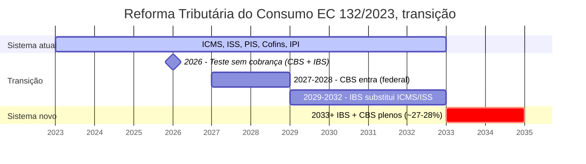

*Transição escalonada em dez anos. Planejamento empresarial deve incluir cenários de 2027 (CBS entrando), e 2033 (sistema novo totalmente vigente). Simples Nacional terá regime adaptado. Lucro Real terá créditos não-cumulativos mais amplos. Lucro Presumido deixará de existir na forma atual.*

**Impacto em startup.** SaaS hoje pagando ISS de dois a cinco por cento, pode ver carga consumo subir para cerca de vinte e sete por cento. Mas com créditos não-cumulativos mais amplos. Simplificação administrativa (um imposto no lugar de quatro).

> [!important] Planejar cenários 2027 em diante
> Planejar cenários 2027 em diante, agora, com contador tributarista.

#### 2.1 Juros sobre capital proprio (JCP) como instrumento de distribuicao tributariamente eficiente

JCP e instrumento previsto na Lei 9.249/1995, art. 9, que permite a empresa distribuir resultado para socios calculando uma remuneracao equivalente aos juros sobre o patrimonio liquido. A vantagem central, JCP e dedutivel da base de calculo de IRPJ e CSLL na empresa pagadora. Dividendo nao e.

**Mecanica do calculo.** Limite, o menor entre (a) TJLP aplicada sobre o Patrimonio Liquido (Lei 13.483/2017 art. 12 paragrafo 2 manteve a TJLP especificamente para JCP) e (b) 50 por cento do maior entre o lucro do exercicio antes do JCP e da CSLL e os lucros acumulados ou reservas. A IN RFB 2.296/2025 limitou ainda a base a lucros ja apurados em exercicios anteriores, com excecao para o lucro do exercicio em curso a partir de 2026.

**Tributacao em duas pontas.** Na empresa em Lucro Real, o JCP e despesa dedutivel, gerando economia de aproximadamente 34 por cento (15 por cento de IRPJ, mais 10 por cento de adicional sobre faixa, mais 9 por cento de CSLL). No socio pessoa fisica, ha IRRF na fonte de 15 por cento, definitivo. O socio nao reaplica em ajuste anual.

Resultado liquido para o socio PF, em vez de pagar a aliquota de PF, recebe valor ja tributado a 15 por cento, enquanto a empresa reduz sua carga em 34 por cento. Arbitragem efetiva de aproximadamente 19 pontos percentuais, em comparacao a distribuicao por dividendo classico (caso o regime de dividendos isentos perca a isencao via reforma).

**Quando vale.** Empresa lucrativa em Lucro Real, com patrimonio liquido substancial (capital integralizado, mais reservas, mais lucros acumulados). Socios pessoa fisica em alta faixa de renda. Disciplina anual de calcular e deliberar JCP em assembleia.

**Quando nao vale.** Empresa em Simples Nacional ou Lucro Presumido, onde nao ha base para deduzir o JCP. Socio pessoa juridica que e holding em Lucro Real ou Presumido, onde o tratamento na recepcao reduz o ganho liquido. Empresa em prejuizo no exercicio, onde nao ha resultado a distribuir e a deducao gera apenas prejuizo fiscal.

**Status apos reforma tributaria.** LC 224/2025 e IN RFB 2.296/2025 alteraram JCP a partir de 2026. Em paralelo, dividendos PF acima de R$ 50 mil por mes passam a ter IRRF de 10 por cento (LC 224/2025), reduzindo o gap historico entre JCP e dividendos. Decisao de uso de JCP em 2026 deve incluir cenario de transicao acelerada.

**Arbitragem JCP versus dividendos apos LC 224/2025.** Apos LC 224/2025, dividendos PF acima de R$ 50 mil por mes passam a ter IRRF de 10 por cento. O gap entre JCP (15 por cento na PF) e dividendos (anteriormente isentos para PF) diminui significativamente. A escolha entre os dois instrumentos passa a depender mais da deducao tributaria na empresa (que so JCP oferece) do que da diferenca de tributacao na PF.

> [!warning] JCP exige deliberacao formal
> JCP nao e despesa que se lanca contabilmente sem documentacao. Exige assembleia ou ata de deliberacao especifica, antes do encerramento do exercicio. Pagamento sem deliberacao formal e desconsiderado pela Receita Federal e tributado como lucro distribuido normal.

Cross-ref. Em planejamento sucessorio e holding patrimonial pre-exit, ver [[IGNICAO-Vol-5-Maturidade#APÊNDICE DG — TRIBUTAÇÃO DO EXIT PARA FUNDADORES BRASILEIROS|Apêndice DG (Vol. 5)]].

#### 2.2 Conversao de Ltda em S.A. fechada, momento e mecanica

A maioria das startups brasileiras nasce como sociedade limitada (Ltda) por simplicidade. Em algum momento, geralmente entre seed e Serie A, o cap table fica complexo demais e a conversao em sociedade anonima fechada (S.A.) torna-se necessaria.

**Quando converter.** Tres gatilhos praticos. Primeiro, numero de socios. Ltda nao tem limite legal de socios. Mas governanca de Ltda fica operacionalmente disfuncional acima de 10 a 30 socios pelo regime de assembleias (Codigo Civil art. 1.072 paragrafo 1, gatilho de assembleia obrigatoria com mais de 10 socios). S.A. nao tem essa friccao operacional. Segundo, demanda do investidor. Term sheet de Serie A geralmente exige conversao em S.A. para suportar acoes preferenciais com classes diferenciadas, vesting executavel, e governanca com conselho de administracao formal. Terceiro, planejamento de stock options. Plano de opcoes em S.A. tem regulacao explicita (Lei 6.404/1976, art. 168). Em Ltda, e improviso contratual.

**Mecanica em alto nivel.** Alteracao do contrato social aprovada por socios representando o quorum exigido (em geral, mais de tres quartos). Substituicao do contrato social por estatuto social. Definicao de capital em acoes (ordinarias e preferenciais). Assembleia de constituicao da S.A. com aprovacao do estatuto e eleicao do conselho. Registro na junta comercial.

**Custo e prazo.** Honorarios juridicos entre R$ 5 mil e R$ 25 mil, dependendo da complexidade do cap table existente. Custos cartoriais e de junta, acrescentar R$ 1 a R$ 3 mil. Prazo total de 60 a 90 dias, contando alinhamento entre socios, redacao de minutas, deliberacao formal, e registro.

**Implicacoes fiscais.** A transformacao de Ltda em S.A. e neutra para fins de IRPJ e CSLL. Nao gera ganho de capital (Receita reconhece como mera mudanca de tipo societario). Mas ativa novas obrigacoes. Demonstracoes financeiras formais com nivel de detalhe maior. Possivel obrigatoriedade de auditoria externa, dependendo do porte e do estatuto. Livros societarios fisicos ou digitais (livro de acoes nominativas, livro de transferencias, livro de atas).

**Stock options em transito.** Plano de opcoes que existia na Ltda como contrato anexo precisa ser reescrito como plano formal de S.A., aprovado em assembleia. Vesting que existia em quotas precisa ser convertido em vesting de acoes, com compatibilizacao do cronograma. Esse trabalho de migracao e oportunidade para limpar inconsistencias historicas e padronizar good leaver, bad leaver, e janela de exercicio. Para detalhes de vesting sob lei BR, ver [[#APÊNDICE DB — STOCK OPTIONS E ESOP NO BRASIL|Apêndice DB]].

Cross-ref. Para term sheet de Serie A que tipicamente exige a conversao, ver [[#APÊNDICE V — CAPTAÇÃO DE EQUITY, PITCH E RELACIONAMENTO COM INVESTIDORES|Apêndice V]].

#### 3. Tributação de stock options, e planos de incentivo de longo prazo (ILP)

Stock options no Brasil são tema com histórico de disputas regulatórias. O estado da arte em 2026 reflete decisões acumuladas em tribunais administrativos, e judiciais, sobre se o ganho é "natureza mercantil" (ganho de capital), ou "natureza trabalhista" (remuneração salarial). A diferença tributária é enorme. Quinze por cento, versus até 27,5%, mais encargos.

**Natureza mercantil (favorável).** O colaborador paga strike price no exercício (oneroso). Risco genuíno (a opção pode não ter valor. O strike price pode ser superior a preço de mercado). Voluntariedade (não é obrigatório participar). Tempo de vesting razoável (geralmente quatro anos). Sem vinculação direta a desempenho salarial (não é bônus em ações mascarado).

Com esses elementos, o entendimento majoritário em 2026 é tributação como ganho de capital. Quinze a 22,5%, progressivo, sobre o ganho na venda das ações. Favorável ao colaborador.

**Natureza trabalhista (desfavorável).** Plano é essencialmente bônus em ações (sem strike price, ou simbólico). Sem risco real (ações entregues gratuitamente, ou quase). Vinculado diretamente a metas de desempenho, com entrega garantida. Tempo de vesting curto, ou eventos de aceleração frequentes.

Nesse caso, tributação como salário. 7,5 a 27,5% na tabela progressiva, mais INSS (até teto), mais FGTS, mais 13º proporcional, mais encargos patronais.

**Desenho de plano que maximiza chance de classificação mercantil.**

1. Strike price igual ou maior que fair market value, no momento da concessão (FMV pode ser baseado em última rodada, ou valuation formal).
2. Vesting mínimo de quatro anos, com cliff de um ano (padrão internacional).
3. Exercício voluntário. O colaborador decide quando, e se, exerce.
4. Aprovação societária formal do plano (assembleia).
5. Plano como documento corporativo formal (não cláusula em contrato de trabalho).
6. Tratamento contábil em conta de patrimônio líquido. Não em despesa de pessoal.
7. Sem vinculação direta a salário (não é "quinze por cento do salário em ações").
8. Comunicação alinhada. Em documentos internos, e externos, tratar como participação societária.

**Modelos práticos.**

**Plano clássico de Stock Options (padrão YC adaptado).** Concessão de opções com strike price FMV. Vesting quatro anos, com cliff de um ano. Exercício em janela (tipicamente noventa dias após saída. Algumas empresas estendem para sete a dez anos, "long exercise window"). Exercício exige pagamento em dinheiro (salvo "cashless exercise" em eventos de liquidez).

**RSU, Restricted Stock Units.** Direito a receber ações após vesting (sem pagamento de strike). Por natureza, tende mais à classificação trabalhista. Usado mais em empresas listadas, ou pré-IPO. Nas estruturas Delaware Flip, RSUs no nível da holding DE podem ter tratamento diferenciado.

**Phantom Stock (modelo alternativo crescente).** Direito a receber dinheiro equivalente à valorização de ações (sem entregar ações). Tributação clara como bônus em dinheiro (remuneração). Vantagem. Sem diluição societária. Sem complexidade de registro. Desvantagem. Tributariamente desvantajoso (todo ganho é salário). Usado em empresas com sócios que não querem diluir, ou em estágios pré-captação.

**Stock Appreciation Rights (SAR).** Similar ao Phantom Stock. Menos comum no Brasil.

**Profit Sharing, ou Performance Bonus.** Não é equity. É bônus em dinheiro, baseado em lucro. Regido pela Lei 10.101/2000 (PLR). Tributação em tabela própria (mais favorável que salário). Limitado a pagamentos até duas vezes por ano. Não substitui equity. Complementa.

**Eventos tributários em stock options.**

1. Concessão (grant). Geralmente não tributada. Apenas direito de opção futura.
2. Vesting. Geralmente não tributado. Direito se consolida.
3. Exercício (exercise). Sob natureza mercantil. Sem tributação imediata (apenas custo de aquisição igual a strike price). Sob natureza trabalhista. Diferença entre FMV, e strike, é tributada como salário no momento.
4. Venda das ações. Sob natureza mercantil. Ganho de capital (FMV na venda menos strike) tributado a quinze a 22,5%. Sob natureza trabalhista. Venda apenas tributa diferença entre FMV no exercício, e FMV na venda (se existir).

**Em estrutura com Delaware Flip.** Funcionário pode ter opções sobre ações da holding DE. Tributação segue regras americanas no nível da holding. ISOs (Incentive Stock Options), e NSOs (Non-Qualified), têm tratamentos diferentes nos EUA. No Brasil, mesmo sendo ações estrangeiras, ganho de capital em alienação é tributado no Brasil (na declaração do funcionário residente).

**Casos brasileiros com decisões relevantes.** Caso Skyworks, ou Alphabet Brasil. Jurisprudência favorável à natureza mercantil. Caso IBM Brasil. Várias decisões do CARF (Conselho Administrativo de Recursos Fiscais) com vitórias para empresa, em planos bem-desenhados. Caso Petrobras. PLR em ações tratada como salário (como esperado. Era bônus, não opção).

> [!important] Recomendação operacional sobre stock options
> Plano desenhado por tributarista especializado (R$ 20 a R$ 60 mil de projeto). Pareceres tributários antes da implementação. Revisão anual do plano, considerando mudanças regulatórias. Documentação rigorosa de cada concessão, exercício, e vesting. Consciência de que tributação pode mudar. O estado da arte em 2026 pode evoluir em qualquer direção.

**Benchmark de tamanho de ESOP.** Startups em seed. Pool de dez a quinze por cento, reservado para funcionários. Série A. Ampliar para quinze a vinte por cento. Série B a C. Vinte a vinte e cinco por cento. Executivos chave (C-level). 0,5 a três por cento individual. Engineers senior. 0,1 a 0,5 por cento individual. Early employees (cinco a vinte primeiros). 0,5 a dois por cento individual.

#### 4. Benefícios fiscais para startup

**Lei do Bem (Lei 11.196/2005).** Empresa em Lucro Real pode deduzir até duzentos por cento dos gastos com P&D (pesquisa, e desenvolvimento), na apuração de IRPJ, e CSLL. Requer ser do Lucro Real, ter certificação técnica dos projetos, e documentar hora-a-hora. MCTI/SEMPI é o órgão. Benefício típico, R$ 200 mil a R$ 2 milhões de redução de imposto anual, em startup tech de R$ 30 a R$ 150 milhões de faturamento.

> [!warning] Lei do Bem sem documentação
> Sem documentação rigorosa, a autuação é garantida.

**Regionais (SUDAM, SUDENE, ZFM).** SUDAM (Norte), e SUDENE (Nordeste), oferecem redução de IRPJ para empresas em regiões específicas. Até setenta e cinco por cento de redução, por dez anos. Zona Franca de Manaus tem regime próprio (industrial, com vantagens especiais para eletrônicos).

**Setoriais.** Audiovisual. Lei do Audiovisual (Ancine). Cultura. Lei Rouanet. Inovação. Editais BNDES, FINEP, e FAPESP (combinam bem com Lei do Bem).

**Incentivos estaduais.** Vários estados têm programas de atração (Minas, Paraná, RS, Ceará). Vale a pena pesquisar, se expansão geográfica for opção.

#### 5. Rotinas operacionais mensais

**Fechamento contábil (até dia quinze do mês seguinte).** Contas a pagar, e a receber, conciliadas. Extratos bancários reconciliados. Provisões lançadas (férias, 13º, e juros). DRE gerencial produzida, e revisada.

**Obrigações acessórias (não atrasar).** eSocial (mensal). DCTF Mensal (tributos federais). SPED Fiscal (mensal, aplicável conforme regime). ECD, e ECF (anual). Relatórios estaduais, ou municipais (varia).

**Controller check mensal.** Caixa versus DRE (diferença entre regime de caixa, e competência). Margens por produto, ou segmento. Contas em variação acima de dez por cento do mês anterior (investigar).

#### 6. Investimento-anjo no Brasil, mútuo conversível, SAFE-BR, e Lei Complementar 155/2016

Investimento-anjo no Brasil opera sob regime específico, estabelecido pela Lei Complementar 155/2016 (que incluiu Art. 61-A na LC 123/2006). Confirmado posteriormente pela Lei 13.176/2015. O estado da arte em 2026 tem instrumentos maduros. Mas ainda em evolução, comparado a estruturas americanas.

Problema histórico. Antes de 2016, o investidor-anjo em Ltda brasileira tinha risco de desconsideração de personalidade jurídica. Podia ser responsabilizado pessoalmente por dívidas trabalhistas, fiscais, e civis, da empresa. Isso afastava investidores.

LC 155/2016 resolveu. O investidor-anjo NÃO é sócio formal da empresa. Não responde por dívidas da empresa (proteção patrimonial). Participa nos resultados (remuneração até cinquenta por cento do lucro, limitado). Investimento por prazo definido (até sete anos). Possibilidade de conversão em participação societária ao fim do prazo.

#### Mútuo Conversível, instrumento dominante

O que é. Contrato em que o investidor empresta capital à empresa, com direito de converter em participação societária, em evento futuro (geralmente próxima rodada de captação).

**Estrutura típica.** Valor do investimento. R$ 50 mil a R$ 5 milhões em rodadas anjo brasileiras. Prazo. Três a sete anos tipicamente. Taxa de juros. Zero por cento, a IPCA mais quatro por cento (varia muito). Evento de conversão. Próxima rodada acima de valuation, ou volume específico, ou termo do contrato. Desconto em conversão. Quinze a trinta por cento sobre valuation da próxima rodada. Cap de valuation. Limite superior do valuation de conversão (proteção ao anjo). Garantias. Em caso de inadimplência, retorno do principal mais juros.

**Vantagens para empresa.** Rápido. Fechado em dias, ou semanas. Não meses. Não dilui imediatamente. A conversão apenas em evento futuro. Sem governança imediata. O anjo geralmente é conselheiro informal. Barato. Contratos padrões existem (templates Anjos do Brasil, ABVCAP).

**Vantagens para investidor.** Proteção da LC 155/2016. Desconto em conversão (entra mais cedo, por preço melhor). Cap de valuation (se a empresa explode, o anjo não é diluído demais). Juros garantidos em caso de não-conversão.

**Cláusulas críticas em mútuo conversível.**

1. Trigger de conversão automática. Rodada acima de R$ X, e/ou com investidor qualificado.
2. Trigger de conversão opcional. O investidor pode escolher converter em certos eventos.
3. Desconto. Aplicado sobre preço por quota, ou ação, da nova rodada.
4. Valuation cap. Ceiling para proteção, em caso de mega-rodada.
5. MFN (Most Favored Nation). Se o próximo investidor tiver termos melhores, o anjo iguala.
6. Pro-rata rights. Direito de participar de rodadas futuras.
7. Informação. Relatórios periódicos, e inspeção.
8. Tag-along. Se os fundadores venderem, o anjo tem direito de vender também.
9. Anti-diluição. Proteção contra down-rounds.

> [!warning] Armadilhas em mútuo conversível
> Múltiplos mútuos sem coordenação. A conversão simultânea complica cap table. Valuation cap muito baixo. O anjo captura demais em sucesso. Valuation cap muito alto. O anjo não tem proteção real. Conversion trigger mal-definido. Ambiguidade em evento ativa disputa. Prazo sem evento. Ao fim do prazo, a empresa pode não ter capital para quitar. Juros altos. Se não converter, a empresa carrega dívida pesada.

#### SAFE adaptado ao Brasil (SAFE-BR)

SAFE (Simple Agreement for Future Equity). Instrumento criado pela Y Combinator (2013), para investimentos seed nos EUA. É promessa de equity futuro, sem ser dívida formal.

**SAFE nos EUA.** Não é mútuo (sem juros, e sem prazo de quitação). Converte em equity em próxima rodada qualificada. Simplicidade extrema (documento de cerca de cinco páginas). Funciona bem em Delaware LLC, ou Inc.

**Adaptação ao Brasil.** Estrutura SAFE pura não é juridicamente reconhecida no Brasil, como contrato societário. Tentativas de adaptação usam combinação de mútuo conversível, mais promessa de compra futura, mais opções. "SAFE-BR" é termo informal para essas adaptações. Ainda em evolução jurisprudencial.

**Quando SAFE-BR faz sentido.** Investidor internacional que conhece SAFE. Estrutura já em Delaware Flip (SAFE em DE). Rodada muito rápida, onde as partes priorizam simplicidade.

**Quando não faz sentido.** Primeiros anjos brasileiros (mútuo conversível é mais reconhecido). Valores altos com complexidade (mútuo conversível com cláusulas detalhadas é superior).

#### Outros instrumentos

Equity direto (compra de quotas, ou ações). O investidor vira sócio formal. Sem proteção da LC 155/2016 (responde por dívidas proporcionalmente). Usado em rodadas maiores, com investidores sofisticados, e estrutura de S.A.

Convertible Note (nota promissória conversível). Dívida formal, que pode ser convertida. Muito similar ao mútuo conversível, mas com registro diferente. Menos comum em rodadas anjo BR. Mais em venture debt.

Mútuo participativo. Híbrido. Parte mútuo, parte participação. Estrutura complexa. Tributariamente desafiadora. Uso limitado.

#### Termos típicos de rodada anjo BR (2026)

Ticket médio individual. R$ 100 a R$ 500 mil. Rodada anjo completa. R$ 500 mil a R$ 3 milhões. Valuation pré-money. R$ 3 a R$ 20 milhões (varia enormemente por setor, e tração). Desconto em conversão. Vinte a vinte e cinco por cento, comum. Valuation cap. Duas a três vezes o valuation atual. Prazo de conversão. 36 a 60 meses.

**Fontes de investimento-anjo no Brasil.** Anjos individuais. Alta dispersão. Rede de networking. Grupos formais. Anjos do Brasil, Harvard Angels, Gávea Angels, Anjos SP. Programas estruturados. Bossa Nova, DOMO Invest, Canary (seed). Super-anjos. Indivíduos que fazem muitos cheques (Mauricio Benvenutti, Mate Pencz, e outros). Family offices. Crescente em seed BR.

#### Considerações tributárias em investimento-anjo BR

**Para o investidor-anjo pessoa física.** Juros recebidos. Tributados como rendimento (tabela progressiva até 27,5%). Ganho em conversão (diferença entre valor investido, e valor das quotas, ou ações, recebidas). Ganho de capital (quinze a 22,5%). Venda posterior das quotas, ou ações. Ganho de capital.

**Para o investidor-anjo pessoa jurídica.** Juros recebidos. Receita financeira (IRPJ, mais CSLL, mais PIS/Cofins sobre receita). Ganho em conversão, e venda. Depende do regime tributário da PJ.

**Para a empresa.** Recebimento do valor. Não é receita tributável (é capital, ou dívida). Conversão. Não gera fato gerador de IRPJ, ou CSLL (ajuste de capital). Pagamento de juros. Dedutível (se a empresa em Lucro Real).

#### 7. Cap table brasileiro em profundidade

Cap table (capitalization table) é o mapa de propriedade da empresa. Em startup brasileira, a complexidade vem de dois lados. Tipo societário (Ltda versus S.A.), e instrumentos de investimento (mútuos, SAFEs, e opções).

#### Ltda versus S.A., impactos no cap table

**Sociedade Limitada (Ltda).** Capital dividido em quotas (não ações). Transferência de quotas. Requer alteração contratual (assinatura no contrato social). Todos os sócios geralmente constam no contrato social (público). Uma classe única de quotas, na maioria dos casos (dificulta estruturação de preferred shares). Limite informal. Cerca de dez a trinta sócios torna gestão complicada.

**Sociedade Anônima (S.A.).** Capital dividido em ações. Transferência. Via registro no livro de ações (privado, ou via certificadora). Acionistas podem permanecer confidenciais. Múltiplas classes de ações possíveis (ordinárias, preferenciais, com direitos diversos). Estrutura para centenas, ou milhares, de acionistas.

**Quando migrar de Ltda para S.A.** Captação Série A em diante, internacional. Geralmente exigida. Mais de quinze a vinte acionistas planejados. Plano de ESOP significativo (S.A. facilita). Preparação para IPO.

Custo de migração. R$ 30 a R$ 100 mil em advogados, mais custos cartoriais, mais reestruturação societária.

#### Classes de ações em S.A. brasileira

**Ações Ordinárias (ON).** Direito a voto. Dividendos proporcionais. Residuais em liquidação (última classe a receber).

**Ações Preferenciais (PN).** Geralmente sem direito a voto (exceto em casos específicos). Preferência em dividendos (mínimo legal), ou em liquidação. Podem ter direitos especiais (conversibilidade, e participação).

**Classes específicas para investidores.** PN Série A. Preferred stock estilo americano, adaptado. PN Série B (etc.). Classes posteriores, com direitos diferenciados. Liquidation preference. 1x, 2x, ou 3x (ordem de pagamento em exit). Participating versus non-participating. Participating recebe preferência, E participa do residual. Conversion rights. Converter em ON em eventos específicos. Anti-dilution. Broad-based weighted average (comum). Narrow-based. Ratchet (raro). Drag-along. Maioria pode forçar minoria a vender em exit. Tag-along. Minoria tem direito de vender, junto com majoritários.

#### Exemplo de cap table em evolução

**Estágio 0, fundação.**

```text
Fundador A: 60%
Fundador B: 40%
Total: 100%
```

**Estágio 1, após rodada anjo (R$ 1 milhão com mútuo conversível).**

Cap table "formal" (antes da conversão) permanece.

```text
Fundador A: 60%
Fundador B: 40%
```

Mas há pendente. Mútuo conversível R$ 1 milhão a converter em próxima rodada, com desconto vinte por cento, e cap R$ 8 milhões.

**Estágio 2, após Série A (R$ 10 milhões, pre-money R$ 20 milhões).**

Conversão do mútuo. Cap, R$ 8 milhões dividido por R$ 20 milhões, igual a quarenta por cento de desconto implícito via cap. O investidor converte a R$ 8 milhões de valuation. R$ 1 milhão dividido por R$ 8 milhões, igual a 12,5% da empresa, ao investidor anjo.

Nova rodada. R$ 10 milhões pre-money R$ 20 milhões, igual a 10 dividido por 30, igual a 33,3% aos investidores Série A.

Post-money cap table.

```text
Fundador A: 60% × 66,7% × 87,5% = 35,0%
Fundador B: 40% × 66,7% × 87,5% = 23,3%
Anjo: 12,5% × 66,7% = 8,3%
Série A: 33,3%
Total: 100,0%
```

Nota. ESOP pool geralmente criado antes da rodada (dez a quinze por cento). Dilui fundadores.

Pre-rodada, com ESOP quinze por cento.

```text
Fundadores pós-diluição para pool: 85% × distribuição original
Anjos (já diluídos por ESOP): proporcional
ESOP reservado: 15%
```

Post-rodada completa, com tudo.

```text
Fundador A: ~30%
Fundador B: ~20%
Anjo: ~7%
ESOP pool: ~13%
Série A: ~30%
Total: 100%
```

**Estágio 3, Série B, ou C.** Novas rodadas diluem todos proporcionalmente. Os fundadores frequentemente têm cinco a vinte por cento na Série C.

#### Ferramentas de cap table

Carta (cartainc.com). Padrão internacional. Excelente para estrutura Delaware.

Captable.io, e Pulley. Alternativas.

Eqvista, e Shareworks. Opções diferentes.

No Brasil sem flip. Planilha estruturada, mais controle formal via contrato social, ou livro de ações. Menos automatizado. Mais manual.

#### Armadilhas típicas em cap table BR

Diluição invisível. Os fundadores não percebem impacto cumulativo de rodadas.

Classes mal-desenhadas. Preferences muito agressivas em early rounds, complicam later rounds.

Múltiplos mútuos sem coordenação. Conversão simultânea com termos conflitantes.

ESOP pool não-reservado antes da rodada. Dilui fundadores na criação do pool.

Anti-diluição ratchet. Em down-round, o investidor anterior não é diluído. Os fundadores absorvem tudo.

Cláusulas de vesting reverso, sem proteção. O fundador sai, e perde ações rapidamente.

Sem acordo de acionistas formal. Disputas societárias sem resolução clara.

---

### Métricas

Pontualidade em obrigações acessórias. Cem por cento. Nada de "pagou com atraso".

Tempo de fechamento mensal. Alvo igual ou menor que dez dias úteis após fim do mês.

Percentual de reconciliações bancárias completas mensalmente. Cem por cento.

Divergências DRE gerencial versus fiscal. Igual ou menor que cinco por cento.

Créditos tributários recuperáveis identificados. Revisão trimestral.

Tempo para produzir dados em DD. Igual ou menor que uma semana, com data room em dia.

### Armadilhas

Contador generalista, ou família. "Meu tio contador" gera passivos em DD.

Regime tributário errado por preguiça. Escolher Simples só porque "todo mundo começa com Simples", sem simular. Em SaaS com alta margem, o Lucro Presumido pode ser melhor desde R$ 1 milhão de faturamento.

Benefícios fiscais sem documentação. Usar Lei do Bem sem docs de P&D gera autuação.

Stock options como remuneração, sem estrutura tributária. Vira tributação salarial, que destrói o incentivo.

Misturar pessoal, e empresarial. "PIX do CNPJ da empresa pagando Uber pessoal" vira autuação por despesa indedutível, e problema em DD.

Ignorar municipal (ISS). Cada município tem alíquota, e regras próprias. Operação em dez cidades, igual a dez compliances municipais distintos.

Reforma Tributária ignorada. Empresa não se planeja para transição 2027 a 2033, e descobre mudança abrupta de carga.

Não reconhecer prejuízos fiscais acumulados (Lucro Real). Podem compensar lucros futuros. Ativo fiscal ignorado é dinheiro na mesa.

### Checklist

Disciplina fiscal no padrão quando o contador externo especializado entrou desde dia um, o regime tributário foi escolhido com simulação anual, o fechamento mensal sai em dez dias úteis ou menos, não há pendência em Receita, Estado, Município ou INSS, stock options têm desenho de tributarista, e benefícios fiscais aplicáveis estão mapeados e em uso. Os itens abaixo sustentam isso.

- [ ] Contador especializado em startup contratado.
- [ ] Regime tributário escolhido com simulação formal do próximo ano (outubro a dezembro).
- [ ] Fechamento contábil mensal acontece em igual ou menor que dez dias úteis.
- [ ] Obrigações acessórias (DCTF, eSocial, SPED, ECF, ECD) em dia.
- [ ] Plano de stock options, se houver, foi revisado por tributarista.
- [ ] Benefícios fiscais aplicáveis (Lei do Bem, SUDAM, ou SUDENE, regionais) mapeados.
- [ ] Separação clara de pessoal, e empresarial, com políticas escritas.
- [ ] Reconciliações bancárias cem por cento mensais.
- [ ] Plano de transição da Reforma Tributária (IBS, mais CBS) mapeado.
- [ ] Advogado tributarista identificado, para questões críticas.

### Ver também

[[IGNICAO-Vol-3-Tracao#APÊNDICE AN — MODELAGEM FINANCEIRA OPERACIONAL|Apêndice AN (Vol. 3)]], Modelagem financeira. [[IGNICAO-Vol-3-Tracao#APÊNDICE AT — GESTÃO DE CAIXA EM PROFUNDIDADE|Apêndice AT (Vol. 3)]], Gestão de caixa. [[IGNICAO-Vol-5-Maturidade#APÊNDICE BY — TESOURARIA EM ESCALA: GESTÃO DE CAIXA MULTI-MOEDA, MULTI-PAÍS E MULTI-CONTA|Apêndice BY (Vol. 5)]], Tesouraria em escala. [[IGNICAO-Vol-5-Maturidade#APÊNDICE BT — HEDGING CAMBIAL E GESTÃO DE MOEDA MULTICOUNTRY|Apêndice BT (Vol. 5)]], Hedging cambial.

---

> [!info] Fases relacionadas
> Referenciado em: Fase 13.

---

## APÊNDICE EN — TRIBUTÁRIO ESTRATÉGICO PARA STARTUPS

> [!note] Aviso legal
> Este apêndice é material educacional, não assessoria tributária. A legislação tributária brasileira muda com frequência — alíquotas, regimes especiais, incentivos e jurisprudência administrativa podem ter sido alterados após a data de publicação. Nenhuma decisão de regime tributário, estrutura societária ou benefício fiscal deve ser tomada sem consulta a contador especializado e advogado tributarista. O custo de uma assessoria competente é sempre menor que o passivo gerado por uma decisão errada.

> [!note] Posição no livro
> Este apêndice complementa o [[#APÊNDICE W — CONTABILIDADE, TRIBUTÁRIO E REGIMES FISCAIS PARA STARTUP BRASILEIRA|Apêndice W — Contabilidade e Tributário]] (visão operacional e rotinas mensais), o [[IGNICAO-Vol-5-Maturidade#APÊNDICE DG — TRIBUTAÇÃO DO EXIT PARA FUNDADORES BRASILEIROS|Apêndice DG — Tributação do Exit (Vol. 5)]] (planejamento patrimonial pré-venda) e o [[IGNICAO-Vol-3-Tracao#APÊNDICE DR — DEMONSTRATIVOS FINANCEIROS PARA O FUNDADOR|Apêndice DR — Demonstrativos Financeiros (Vol. 3)]]. O foco aqui é decisão estratégica de regime, incentivos fiscais para tech, estrutura de holding e armadilhas cotidianas.

---

### Por que regime tributário é decisão estratégica

Tributário (área que cuida dos impostos da empresa) é decisão de fundador, não de contador. A maioria dos fundadores trata o regime tributário como burocracia. É erro caro.

O regime tributário determina:

- **Margem líquida efetiva.** Diferença de 3 a 8 pontos percentuais de margem entre regimes é comum em startups de serviços com faturamento entre R$ 3M e R$ 15M. Esse delta vale, em múltiplo de receita, centenas de milhares de reais de valuation.
- **Capacidade de contratar.** O Simples Nacional inclui o INSS patronal na guia única. Parece simples, mas esconde o custo real de cada contratação. No Lucro Presumido e no Lucro Real, o INSS patronal (20%) aparece separado e visível. Essa percepção muda a decisão de contratar ou terceirizar.
- **Acesso a incentivos fiscais.** A Lei do Bem (principal incentivo para empresas de tecnologia) está disponível apenas para empresas no Lucro Real. Quem fica no Simples por inércia renuncia a esse benefício.
- **Estrutura societária e atratividade para investidores.** Investidores institucionais (fundos Series A em diante) fazem due diligence tributária (auditoria fiscal pré-investimento). Uma empresa no Simples com faturamento próximo ao teto, sem planejamento de transição, vira sinal de alerta. Holding estruturada para proteção patrimonial do fundador, por sua vez, não é compatível com Simples Nacional.
- **Capacidade de aproveitamento de créditos.** No Simples e no Lucro Presumido (regime cumulativo), não há crédito de PIS/COFINS sobre insumos e serviços tomados. No Lucro Real (não cumulativo), esse crédito pode representar recuperação relevante para empresas com estrutura de custos baseada em serviços e cloud.

A empresa escolhe o regime uma vez por ano, entre outubro e dezembro, com vigência no ano seguinte. Raramente é possível reverter a escolha no mesmo exercício. O custo de errar se paga durante doze meses.

---

### Os três regimes em profundidade

#### Simples Nacional

**Quem pode usar:** Empresas com faturamento anual até R$ 4,8 milhões (receita bruta acumulada nos últimos 12 meses). Algumas atividades são vedadas — serviços financeiros, por exemplo.

**Como funciona:** Tributos federais (IRPJ, CSLL, PIS, COFINS), estaduais (ICMS) e municipais (ISS) são recolhidos em uma única guia (DAS), com alíquota progressiva que varia conforme o faturamento acumulado e o anexo em que a atividade se enquadra.

**Anexos relevantes para startups de software e serviços:**

| Anexo | Atividades típicas | Alíquota inicial | Alíquota máxima |
|---|---|---|---|
| **Anexo III** | SaaS, consultoria de TI (com Fator R acima de 28%) | 6,0% | 33,0% |
| **Anexo V** | SaaS, consultoria de TI (sem Fator R) | 15,5% | 30,5% |

**O Fator R — entender isso muda tudo para startups de serviços:**

O Fator R é a relação entre a folha de pagamento (pró-labore + salários + encargos) dos últimos 12 meses e a receita bruta dos últimos 12 meses. Se esse percentual for igual ou superior a 28%, a empresa de serviços intelectuais (como desenvolvimento de software) migra do Anexo V para o Anexo III — passando de alíquota inicial de 15,5% para 6,0%.

```text
Fator R = Folha de Pagamento (12 meses) / Receita Bruta (12 meses)

Exemplo:
  Receita bruta 12 meses: R$ 1.200.000
  Folha (pró-labore + salários + encargos) 12 meses: R$ 350.000
  Fator R = 350.000 / 1.200.000 = 29,2%  →  Enquadra no Anexo III (6,0%)

  Se a folha fosse R$ 290.000:
  Fator R = 290.000 / 1.200.000 = 24,2%  →  Enquadra no Anexo V (15,5%)
```

> [!important] Fator R e pró-labore
> O pró-labore dos sócios entra no cálculo do Fator R. Startups com poucos funcionários mas com pró-labore relevante dos fundadores podem usar isso para manter o enquadramento no Anexo III. Calibrar o pró-labore conscientemente — com o contador — é planejamento tributário legítimo.

**Vantagens do Simples:**

- Simplicidade administrativa: uma guia mensal, sem apuração separada por tributo
- Carga reduzida para empresas pequenas com margem alta e Fator R favorável
- INSS patronal incluído na guia (sem surpresa em folha)
- Dispensa de obrigações acessórias mais complexas (ECD, ECF em alguns casos)

**Desvantagens do Simples:**

- Impossibilidade de aproveitar créditos de PIS/COFINS sobre insumos (regime cumulativo obrigatório)
- Vedação ao uso da Lei do Bem (P&D) e da maioria dos incentivos para empresas de tecnologia
- Teto de faturamento: ultrapassar R$ 4,8M em qualquer momento do ano gera exclusão retroativa do Simples — com recolhimento retroativo dos tributos na forma do regime adequado, mais multa e juros
- Não é compatível com estruturas de holding, participação em outras empresas com regimes diferentes ou emissão de debêntures
- Alíquotas sobem rapidamente conforme o faturamento cresce — a vantagem desaparece antes do teto

#### Lucro Presumido

**Quem pode usar:** Empresas com faturamento anual até R$ 78 milhões, exceto aquelas obrigadas ao Lucro Real (financeiras, seguros, factoring, e outras).

**Como funciona:** A base de cálculo do IRPJ e da CSLL é uma **presunção de margem** sobre a receita bruta — o Fisco presume que a empresa teve certa lucratividade, independentemente do resultado real. Sobre essa margem presumida incidem os tributos.

| Atividade | Margem presumida (IRPJ) | Margem presumida (CSLL) |
|---|---|---|
| Serviços em geral (consultoria, SaaS) | 32% | 32% |
| Revenda de mercadorias | 8% | 12% |
| Indústria | 8% | 12% |
| Serviços hospitalares | 8% | 12% |

**Alíquotas sobre a base presumida:**

- IRPJ: 15% + adicional de 10% sobre parcela que exceder R$ 20.000/mês (R$ 240.000/ano)
- CSLL: 9%
- PIS/COFINS cumulativo: 3,65% sobre receita bruta (0,65% PIS + 3,0% COFINS)
- ISS: 2% a 5% (municipal)

**Quando o Lucro Presumido é vantajoso:**

Quando a **margem real** da empresa é **superior** à margem presumida. Uma startup SaaS com 40% de margem líquida, enquadrada em serviços (presunção de 32%), paga IRPJ/CSLL sobre 32% da receita, não sobre os 40% reais. O Estado presume menos do que a empresa ganha — tributação abaixo do real.

**Quando o Lucro Presumido é desvantajoso:**

Quando a margem real está abaixo da presumida. Uma empresa de serviços com margem de 10% pagará IRPJ/CSLL como se tivesse 32% de margem — tributação acima do real. Nesses casos, o Lucro Real é mais vantajoso.

#### Lucro Real

**Quem é obrigado:** Empresas com receita bruta acima de R$ 78 milhões anuais; instituições financeiras, seguros e factoring; empresas com benefícios fiscais (Lei do Bem, SUDAM, SUDENE).

**Como funciona:** A tributação incide sobre o **lucro efetivo** apurado na contabilidade, com adições e exclusões fiscais previstas em lei. O prejuízo fiscal de um exercício pode ser compensado em exercícios futuros (até 30% do lucro em cada período).

**Alíquotas:**

- IRPJ: 15% + adicional de 10% sobre lucro acima de R$ 240.000/ano
- CSLL: 9%
- PIS/COFINS não cumulativo: 9,25% (1,65% PIS + 7,6% COFINS), com direito a créditos
- ISS: 2% a 5% (municipal)

**Créditos de PIS/COFINS no Lucro Real:**

A não cumulatividade permite deduzir PIS/COFINS pago sobre insumos, serviços tomados de terceiros, locações, depreciações de ativos e outros. Para startups com despesas relevantes em:

- Cloud (AWS, GCP, Azure contratados de fornecedores que recolhem PIS/COFINS)
- Serviços de parceiros e terceiros
- Ferramentas SaaS para a operação

...o crédito pode ser relevante. Calcular se compensa o aumento de complexidade é obrigação antes de optar pelo Lucro Real voluntariamente.

**Vantagens:**

- Tributação sobre o lucro real — empresa com prejuízo não paga IRPJ/CSLL
- Compensação de prejuízos fiscais (ativo tributário diferido)
- Acesso à Lei do Bem e outros incentivos
- Créditos amplos de PIS/COFINS

**Desvantagens:**

- Complexidade administrativa significativamente maior (SPED Contábil, ECF, EFD-Contribuições)
- Custo de compliance mais alto (necessidade de controller ou contador mais especializado)
- Obrigação de apuração mensal ou trimestral do lucro real

---

### Comparativo dos três regimes — exemplo numérico

Empresa SaaS com R$ 5M de faturamento anual, margem bruta de 60%, folha de pagamento de R$ 1,2M (Fator R = 24%), sem créditos significativos de PIS/COFINS.

| Item | Simples (Anexo V) | Lucro Presumido | Lucro Real |
|---|---|---|---|
| Faturamento | R$ 5.000.000 | R$ 5.000.000 | R$ 5.000.000 |
| Alíquota efetiva aproximada (DAS ou tributos s/ receita) | ~15,5% a 18,0% | ~13,3% | Depende do lucro real |
| Tributos sobre receita (ISS + PIS/COFINS) | Incluídos no DAS | R$ 182.500 (3,65%) + ISS | R$ 462.500 (9,25%) - créditos |
| IRPJ + CSLL | Incluídos no DAS | ~R$ 384.000 (base: 32% × R$5M, alíq. 24%) | 24% × lucro real |
| **Carga tributária total estimada** | **R$ 775.000 a R$ 900.000** | **~R$ 566.500 + ISS** | **Calculado sobre lucro** |
| Acesso à Lei do Bem | Não | Não | Sim |
| Simplicidade | Alta | Média | Baixa |
| Risco de exclusão por limite | Sim (R$ 4,8M) | Não | Não |

> [!warning] Simule antes de escolher
> Esse quadro é ilustrativo. A comparação real depende de variáveis específicas da empresa: mix de receita, estrutura de custos, créditos disponíveis, benefícios fiscais aplicáveis. Rodar a simulação com o contador — em outubro, para vigência no ano seguinte — é obrigação, não opção.

---

### Ponto de indiferença tributária — quando sair do Simples

O ponto de indiferença é o faturamento (ou a configuração) em que a carga tributária do Simples Nacional se iguala à do regime alternativo. Acima desse ponto, permanecer no Simples é mais caro.

Para empresas SaaS no Anexo V (sem Fator R favorável), o ponto de indiferença com o Lucro Presumido costuma ocorrer entre R$ 1,5M e R$ 3M de faturamento anual — muito antes do teto de R$ 4,8M.

**Sinais de que é hora de simular a troca:**

- Faturamento acima de R$ 2M e margem acima de 25%
- A empresa começou a contratar fornecedores com crédito de PIS/COFINS relevante
- O contador sugere que o Lucro Presumido pode ser mais barato
- A empresa planeja usar a Lei do Bem nos próximos 12-24 meses

---

### Incentivos fiscais para empresas de tecnologia

#### Lei do Bem (Lei 11.196/2005)

O principal incentivo fiscal para startups de tecnologia no Brasil. Permite que empresas optantes do **Lucro Real** deduzam da base de cálculo do IRPJ e da CSLL entre 60% e 80% dos gastos realizados em atividades de Pesquisa, Desenvolvimento e Inovação Tecnológica (P&DI).

**Como funciona na prática:**

```text
Empresa gastou R$ 2.000.000 em P&D (salários de engenheiros, infraestrutura de desenvolvimento,
materiais, serviços técnicos).

Dedução adicional (60% dos gastos): R$ 1.200.000

Impacto no IRPJ + CSLL (alíquota combinada ~34%):
  R$ 1.200.000 × 34% = R$ 408.000 de redução de impostos no ano

Com percentual de 80% (empresas que aumentaram P&D em relação ao ano anterior):
  R$ 2.000.000 × 80% × 34% = R$ 544.000 de redução
```

**Quem pode usar:**

- Empresas tributadas pelo Lucro Real
- Com atividades de P&D que se qualifiquem como pesquisa básica, pesquisa aplicada ou desenvolvimento experimental
- Sem débitos com o INSS ou com o FGTS (exigência de regularidade fiscal)

**O que qualifica como P&D:**

- Desenvolvimento de novos produtos, processos ou serviços
- Melhoria incremental de produtos ou processos existentes com incerteza tecnológica
- Testes, protótipos, projetos-piloto com objetivo tecnológico
- Salários de engenheiros, cientistas e técnicos alocados a projetos de P&D
- Depreciação de equipamentos e infraestrutura dedicados a P&D

**O que não qualifica:**

- Manutenção de sistemas existentes sem inovação tecnológica
- Suporte técnico ou atendimento ao cliente
- Treinamento de equipes em tecnologias já existentes
- Adaptações cosméticas de produto (mudança de interface sem inovação técnica)

**Como documentar (o que a Receita Federal exige em auditoria):**

- Relatório técnico por projeto, descrevendo a incerteza tecnológica e o objetivo
- Controle de horas por projeto e por colaborador (timesheet)
- Notas fiscais de insumos e serviços alocados ao P&D
- Parecer técnico assinado por responsável qualificado (engenheiro, mestre ou doutor)
- Registro dos projetos no MCTI/SEMPI (recomendado, mas não obrigatório para a dedução)

> [!warning] Documentação ou autuação
> A Lei do Bem sem documentação é uma autuação esperando data. O Fisco fiscal não aceita alocação de despesas a P&D sem comprovação técnica. A recomendação é montar o processo de documentação antes de usar o benefício — não depois.

**Percentuais de dedução adicionais possíveis:**

| Condição | Percentual de dedução adicional |
|---|---|
| Baseline (qualquer P&D qualificado) | 60% dos gastos |
| Aumento do valor absoluto de P&D em relação ao ano anterior | 80% dos gastos |
| Contratação de pesquisadores com mestrado (exclusivo para P&D) | +adicional por pesquisador |
| Patenteamento no Brasil | +10% dos gastos no ano do depósito |
| Patenteamento no exterior | +20% dos gastos no ano do depósito |

#### Lei de Informática (Lei 10.176/2001 e atualizações)

Redução de IPI para fabricantes de produtos de tecnologia da informação que realizem investimentos em P&D no Brasil. Relevante para startups de hardware, IoT, dispositivos embarcados, wearables e afins.

**Condições principais:**

- Produção no Brasil (não apenas importação e revenda)
- Investimento mínimo em P&D (percentual variável sobre faturamento de produtos incentivados)
- Habilitação junto ao MCTI

**O benefício:** Alíquota de IPI reduzida (entre 0% e alíquota normal, dependendo do produto e da região). Para empresas fora da Zona Franca de Manaus, o benefício é progressivamente reduzido até 2029 nas regiões Sul e Sudeste, mas mantido nas demais regiões.

#### Zona Franca de Manaus

Para empresas que produzam ou instalam operações em Manaus, o regime da ZFM oferece:

- Isenção de IPI para produtos fabricados na ZFM
- Redução do Imposto de Importação (II) para insumos utilizados na produção local
- Redução de ICMS (estadual, com convênios específicos)
- Benefício adicional para empresas de software e TI que instalam operações na ZFM

**Quando considerar:**

- Empresa de hardware com volume de produção que justifique operação em Manaus
- Empresa de software com time técnico que pode ser alocado remotamente
- O custo logístico e de gestão remota deve ser calculado contra o benefício fiscal

#### PADIS e PATVD

- **PADIS** (Programa de Apoio ao Desenvolvimento Tecnológico da Indústria de Semicondutores): Isenção/redução de IPI, PIS, COFINS e II para empresas que desenvolvam ou produzam semicondutores no Brasil. Relevante para deep tech e chips especializados.
- **PATVD** (Programa de Apoio ao Desenvolvimento Tecnológico da Indústria de Equipamentos para TV Digital): Redução de tributação para fabricantes de equipamentos de TV digital.

#### Rota 2030 e incentivos automotivos

Para startups de mobilidade, veículos elétricos, tecnologia automotiva e afins: o Rota 2030 oferece incentivos via IRPJ para empresas que realizem P&D com foco em eficiência energética, segurança veicular e desenvolvimento de novas tecnologias para o setor automotivo. A habilitação exige projeto aprovado pelo MDIC.

#### Como acessar incentivos na prática

1. **Identificar o incentivo aplicável** com tributarista especializado em tech (não contador generalista)
2. **Verificar elegibilidade** — regime tributário, setor, regularidade fiscal
3. **Habilitar junto ao órgão competente** (MCTI para Lei do Bem, SUFRAMA para ZFM, MDIC para Rota 2030)
4. **Montar processo de documentação** antes de usufruir do benefício
5. **Registrar e controlar** por projeto, por colaborador, por despesa
6. **Manter obrigações acessórias** — formulários específicos na ECF (Escrituração Contábil Fiscal)

> [!tip] O benefício paga o custo de compliance
> Para uma empresa com R$ 1M em gastos de P&D, a redução de IRPJ/CSLL via Lei do Bem pode chegar a R$ 200–400K por ano. Esse valor paga com folga o custo de um controller dedicado ou de uma consultoria tributária especializada.

---

### Estrutura de holding para startups

#### Holding patrimonial versus holding operacional

**Holding patrimonial:** Detém participações societárias e ativos (imóveis, investimentos). Não tem operação própria. Objetivo principal: proteção patrimonial, planejamento sucessório e diferimento de ganho de capital em exit.

**Holding operacional:** Detém a operação (contratos, funcionários, receita). Pode ou não deter ativos. Menos comum para startups — a separação entre holding patrimonial e operação é o arranjo mais frequente.

#### Separar IP da operação — por que e como

A propriedade intelectual (software, algoritmos, marcas, patentes) é o ativo central de uma startup de tecnologia. Mantê-la na mesma entidade que opera o negócio expõe esse ativo a riscos operacionais:

- Passivos trabalhistas que alcançam patrimônio da empresa
- Desconsideração de personalidade jurídica em execuções fiscais
- Dificuldade de licenciar o IP para operações internacionais

**Estrutura típica de separação:**

```text
Holding IP (Ltda. ou S.A.)
  └─ Detém: software, marcas registradas, patentes, código-fonte

Empresa Operacional (Ltda. ou S.A.)
  └─ Detém: contratos com clientes, funcionários, receita
  └─ Licencia o IP da Holding IP mediante royalties
```

**Impacto tributário:** Os royalties pagos pela empresa operacional à holding de IP são despesa dedutível no Lucro Real. Na holding de IP, os royalties recebidos são tributados — mas com possibilidade de distribuição posterior de lucros com isenção de IRPF para o sócio pessoa física, se a holding for lucro presumido ou real com distribuição de lucros.

> [!warning] Preço de transferência em royalties intragrupo
> A Receita Federal fiscaliza contratos de royalties entre empresas do mesmo grupo (preço de transferência). O valor cobrado precisa ser compatível com o mercado e documentado. Royalties artificialmente inflados para transferir lucro da operação para a holding são desconsiderados.

#### Holding e redução de carga no exit

Uma das principais motivações para constituir holding antes de receber investimento: quando a holding vende as participações na startup, o ganho de capital pode ser retido na holding (pessoa jurídica) em vez de ser distribuído imediatamente para o fundador (pessoa física).

- O lucro dentro da holding pode ser reinvestido sem tributação adicional imediata
- A distribuição para o sócio PF, quando ocorrer, é isenta de IRPF (dividendos de PJ para PF são isentos — aguardar desdobramento da Reforma Tributária sobre tributação de dividendos)
- O diferimento pode ser de anos — o capital dentro da holding trabalha antes de ser tributado na saída do sócio

Para detalhes sobre tributação de exit, ver [[IGNICAO-Vol-5-Maturidade#APÊNDICE DG — TRIBUTAÇÃO DO EXIT PARA FUNDADORES BRASILEIROS|Apêndice DG — Tributação do Exit (Vol. 5)]].

#### Holding offshore — quando faz sentido

Após a Lei 14.754/2023, os lucros de entidades controladas no exterior por residentes no Brasil passam a ser tributados **anualmente** pelo IRPF (15%), independentemente de distribuição. O principal benefício do diferimento indefinido desapareceu.

**Quando offshore ainda faz sentido:**

- Empresa com operações reais e substanciais no exterior
- Estrutura de captação de investimento estrangeiro (Cayman ou Delaware para fundo americano investir na startup)
- Fundador que planeja mudança de residência fiscal antes do exit
- Delaware Flip para empresa que planeja IPO em bolsa americana

**Custos mínimos de manutenção de estrutura offshore:**

- Constituição: USD 3.000–10.000 (dependendo da jurisdição)
- Manutenção anual: USD 2.000–8.000 (agente registrado, relatórios)
- Declaração CBE (Capitais Brasileiros no Exterior) anual — obrigatória para o residente no Brasil
- Assessoria tributária especializada em estruturas internacionais

#### Holding e cap table

A constituição de holding patrimonial antes de receber investimento tem impacto direto no cap table:

- O investidor passa a deter participação na operação, não na holding
- O fundador, via holding, mantém participação indireta com camada de proteção patrimonial
- O pacto de sócios precisa prever as obrigações da holding como se fossem do fundador (vesting, lock-up, drag-along)

Constituir holding depois que a startup já tem valor gera evento tributável na transferência das cotas — o fundador "vende" para a própria holding ao valor de mercado, gerando ganho de capital. O momento ideal é na fundação ou logo após, antes de qualquer rodada que valorize a empresa.

---

### Decisões tributárias cotidianas

#### PLR — Participação nos Lucros e Resultados

A PLR (Lei 10.101/2000) permite pagar bônus a funcionários sem incidência de INSS (patronal e do empregado) e com tributação exclusiva na fonte em tabela progressiva específica (mais favorável que a tabela normal de salários).

**Regras para que a PLR não vire salário:**

- Negociação com sindicato ou comissão de empregados escolhida pelos próprios funcionários
- Acordo escrito anterior ao período de apuração
- Pagamento em até duas parcelas por ano
- Critérios objetivos de distribuição (metas de resultado, indicadores)
- Sem vinculação direta à remuneração mensal (não pode ser "13º salário disfarçado")

**O que a PLR não substitui:** PLR não é equity, não gera senso de propriedade, e não tem os mesmos efeitos de retenção de longo prazo. Funciona bem como complemento ao salário fixo, especialmente em momentos de forte crescimento quando a empresa pode distribuir parte do resultado.

#### ISS para serviços digitais — a guerra fiscal dos municípios

O ISS (Imposto Sobre Serviços) é municipal. Alíquotas variam de 2% a 5% dependendo do município. Para serviços digitais (SaaS, plataformas, APIs), a competência municipal — qual prefeitura recolhe o ISS — é objeto de disputa.

**A regra geral (LC 116/2003):** O ISS é devido ao município onde o serviço é prestado. Para serviços digitais, isso gerou décadas de litigância sobre se o ISS vai para o município do prestador ou do tomador.

**STJ e STF têm decidido:** Em serviços como SaaS prestado de forma centralizada, o ISS tende a ser devido no município do estabelecimento prestador — mas há exceções. A decisão depende da natureza específica do serviço, do contrato e do município.

**Armadilha clássica:** Registrar a empresa em um município com alíquota de 2% (mínimo legal) apenas para economizar ISS, sem operação real lá. A Receita do município do tomador pode autuar o prestador por ISS não recolhido. O resultado é ISS duplo — pago nos dois municípios durante o processo de disputa.

#### IRRF em pagamentos ao exterior

Toda remessa de pagamento para fornecedor no exterior por empresa brasileira é sujeita a análise de IRRF (Imposto de Renda Retido na Fonte) e CIDE.

| Tipo de pagamento | IRRF padrão | Com tratado |
|---|---|---|
| Royalties por uso de software | 15% | Redução possível |
| Serviços técnicos (consultoria) | 15% | Redução possível |
| Serviços sem transferência de tecnologia | 25% | Redução possível |
| Juros sobre empréstimos | 15% | Redução possível |
| Cloud (AWS, GCP, Azure — licença de uso) | Depende da classificação | Varia |

**Tratados para evitar dupla tributação:** O Brasil tem acordos com cerca de 33 países (EUA não está incluído). Com países com tratado (Portugal, Alemanha, França, Japão, Israel, entre outros), a alíquota de IRRF pode ser reduzida ou zerada, dependendo da natureza do pagamento.

**Classificação de cloud como serviço vs. royalty:** A Receita Federal tem tratado pagamentos para AWS, Google Cloud e similares como royalties (15% de IRRF) em alguns cenários, e como serviços técnicos ou locação em outros. A classificação afeta a alíquota e a possibilidade de dedução de CIDE. Consultar o regime de pagamento específico com tributarista antes de escalar contratos de cloud.

#### Remuneração de sócios — pró-labore versus distribuição de lucros

Esta é a decisão de planejamento tributário mais cotidiana e mais mal executada em startups brasileiras.

| Item | Pró-labore | Distribuição de lucros |
|---|---|---|
| Natureza | Remuneração pelo trabalho do sócio | Participação no resultado da empresa |
| IRPF | Tabela progressiva (até 27,5%) | Isento (PF) — sujeito à Reforma Tributária |
| INSS do sócio | 11% (sobre o pró-labore) | Não incide |
| INSS patronal | 20% (sobre o pró-labore) | Não incide |
| Exigência | Obrigatório para sócio que trabalha na empresa | Precisa de lucro apurado |

**A estratégia:** Em empresas lucrativas, é vantajoso manter o pró-labore no mínimo necessário (pelo menos o salário mínimo, por exigência previdenciária) e distribuir o restante como lucros. A economia em INSS e IRPF pode ser relevante.

> [!important] Atenção à Reforma Tributária da Renda
> Há proposta em tramitação de tributar dividendos distribuídos a pessoas físicas. O cenário de isenção total sobre distribuição de lucros pode mudar. Acompanhar com tributarista.

---

### O que o fundador deve acompanhar — e o que delegar

#### Acompanhar mensalmente (sem delegar)

- **Carga tributária efetiva versus planejada.** A DRE mensal deve mostrar tributos como percentual da receita — se subiu, investigar.
- **Regime tributário e aderência ao planejado.** O faturamento está dentro dos limites previstos? O Fator R está sendo monitorado?
- **Obrigações acessórias em dia.** O contador entregou tudo sem atraso? Certidões negativas estão OK?

#### Delegar ao contador especializado (mas revisar trimestralmente)

- Cálculo e recolhimento dos tributos
- Obrigações acessórias (DCTF, eSocial, SPED, ECF, ECD)
- Controle de créditos tributários
- Emissão de certidões negativas

#### Contratar advogado tributarista nas seguintes situações

- Decisão de regime tributário com diferença acima de R$ 200K/ano entre opções
- Implementação ou revisão da Lei do Bem
- Constituição de holding
- Qualquer autuação ou consulta da Receita Federal
- Estrutura de pagamento ao exterior acima de R$ 500K/ano
- Mudança de residência fiscal
- Planejamento de exit

---

### Armadilhas clássicas

**1. Permanecer no Simples por inércia além do ponto de indiferença.**
O Simples é escolhido no começo e nunca revisitado. Em startups SaaS com margem alta e faturamento crescente, o Lucro Presumido pode ser mais barato a partir de R$ 1,5–2M de receita. A revisão anual com simulação é obrigatória.

**2. Não documentar P&D para a Lei do Bem e perder o benefício na fiscalização.**
Usar a dedução sem timesheet, sem relatório técnico, sem alocação documentada. Em auditoria, o Fisco desconsidera tudo — com multa de 75% sobre o tributo não pago, mais juros (Selic).

**3. ISS no município errado.**
Registrar a empresa em município de baixa alíquota sem operação real lá. O município do tomador autua, o município do prestador mantém o recolhimento. A empresa paga duas vezes durante o litígio.

**4. Remuneração de sócios sem planejamento.**
Pagar pró-labore alto quando o correto seria distribuir lucros (ou o contrário, quando não há lucro apurado). Ambos os erros geram carga tributária desnecessária ou passivo previdenciário.

**5. Pagamentos ao exterior sem análise de IRRF.**
Tratar remessas para AWS, consultores estrangeiros e licenças de software como "só pagamento de fornecedor" sem verificar IRRF e CIDE. O risco é passivo tributário + multa em due diligence.

**6. Criar holding perto do exit.**
A Receita Federal pode questionar o propósito negocial de uma holding criada 3-6 meses antes da venda. Planejamento tardio tem risco jurídico e custo de transferência com tributação imediata.

---

### Ver também

- [[#APÊNDICE W — CONTABILIDADE, TRIBUTÁRIO E REGIMES FISCAIS PARA STARTUP BRASILEIRA|Apêndice W — Contabilidade e Tributário]]
- [[IGNICAO-Vol-5-Maturidade#APÊNDICE DG — TRIBUTAÇÃO DO EXIT PARA FUNDADORES BRASILEIROS|Apêndice DG — Tributação do Exit (Vol. 5)]]
- [[IGNICAO-Vol-3-Tracao#APÊNDICE DR — DEMONSTRATIVOS FINANCEIROS PARA O FUNDADOR|Apêndice DR — Demonstrativos Financeiros (Vol. 3)]]
- [[#APÊNDICE DB — STOCK OPTIONS E ESOP NO BRASIL|Apêndice DB — Stock Options e ESOP]]

---

## APÊNDICE EC — PLANEJAMENTO FINANCEIRO E ORÇAMENTO

> [!note] Nota de validade
> As práticas de budgeting (orçamentação) descritas aqui são estáveis como disciplina. O que muda com o tempo: ferramentas de FP&A — Financial Planning & Analysis, ou planejamento e análise financeira — (Anaplan, Mosaic, Pigment, etc.), taxas de encargos trabalhistas (sujeitas à legislação), e benchmarks de headcount (referências de tamanho de equipe) por estágio. Este apêndice reflete o cenário de abril de 2026. Revise benchmarks salariais e encargos anualmente.

Para os fundamentos das três demonstrações (DRE, Balanço Patrimonial e DFC), ver [[IGNICAO-Vol-3-Tracao#APÊNDICE DR — DEMONSTRATIVOS FINANCEIROS PARA O FUNDADOR|Apêndice DR — Demonstrativos Financeiros para o Fundador (Vol. 3)]] (casa canônica). Este apêndice trata especificamente do planejamento financeiro e orçamento (budget) como instrumento de gestão, headcount plan, top-down vs bottom-up e reforecast trimestral.

O [[IGNICAO-Vol-3-Tracao#APÊNDICE AN — MODELAGEM FINANCEIRA OPERACIONAL|Apêndice AN (Vol. 3)]] cobre modelagem financeira: como construir projeções a partir de drivers operacionais. O [[IGNICAO-Vol-3-Tracao#APÊNDICE DR — DEMONSTRATIVOS FINANCEIROS PARA O FUNDADOR|Apêndice DR (Vol. 3)]] cobre demonstrativos: como ler o que já aconteceu. Este apêndice cobre o planejamento financeiro: como transformar a visão do negócio em orçamento aprovado, operado por times com autonomia e revisado com frequência suficiente para ser útil.

### O que esse apêndice cobre

Três instrumentos distintos que fundadores frequentemente confundem.

1. **Modelo financeiro**: projeção de cenários futuros a partir de drivers (variáveis operacionais que dirigem o resultado). Instrumento de análise. Produza quando necessário — pré-captação, decisão estratégica, ou início de trimestre.
2. **Demonstrativos financeiros**: registro contábil do passado. Instrumento de auditoria e compliance (conformidade regulatória). O contador produz mensalmente.
3. **Orçamento (budget)**: plano operacional aprovado para um período, com metas por área, envelope de gastos, e resultado esperado. Instrumento de gestão. Produza uma vez por ano, revise trimestralmente.

Os três se alimentam. O modelo define as hipóteses. O orçamento operacionaliza o plano. Os demonstrativos reportam o que realmente aconteceu.

### Por que o orçamento importa

Sem orçamento aprovado, cada contratação é uma negociação. Cada pedido de investimento em marketing é uma discussão ad hoc. O CEO passa o tempo arbitrando alocações em vez de executar.

Com orçamento aprovado, o time opera com autonomia dentro de limites claros. O líder de engenharia sabe que tem envelope para contratar três pessoas no segundo trimestre. O time de marketing sabe que tem R$ 150 mil para o semestre. Não precisam pedir aprovação para cada decisão dentro do envelope.

O orçamento também cria linguagem comum entre fundador, CFO, e board. Quando o resultado sai diferente do esperado, a conversa é sobre desvio do plano — não sobre o que o plano deveria ter sido.

> [!important] Orçamento não é previsão. É compromisso.
> Modelo financeiro é o que você acredita que vai acontecer. Orçamento é o que você se compromete a alcançar — e dentro de quais limites de gasto. Confundir os dois leva a orçamentos que ninguém cumpre, ou a gastos autorizados que ninguém questiona porque "o modelo dizia isso".

---

### Bottom-up vs. top-down: como o orçamento é construído

Existem duas formas puras e uma híbrida.

#### Top-down

O CEO (ou board) define o crescimento esperado para o ano e distribui envelopes para cada área. "Vamos crescer 80%. Vendas recebe R$ 4 milhões de orçamento. Engenharia recebe R$ 6 milhões. G&A recebe R$ 2 milhões."

**Quando funciona**: empresa em estágio inicial sem estrutura para bottom-up, ou quando o board impõe restrições de capital rígidas que tornam o processo bottom-up inútil (qualquer proposta que saia dos parâmetros será rejeitada de qualquer forma).

**Problemas**: as áreas recebem envelopes sem validar se são executáveis. Headcount plan descolado da realidade. Resistência dos times por não terem participado.

#### Bottom-up

Cada área submete suas necessidades de pessoal, ferramentas, e operação para atingir a meta de negócio. O CFO consolida. O resultado é apresentado ao CEO e ao board.

**Quando funciona**: empresa com mais de 50 pessoas, onde os líderes têm contexto operacional que o CEO não tem mais em nível granular.

**Problemas**: áreas tendem a pedir mais do que precisam (budget maximization). O processo de consolidação é longo. O total raramente cabe no envelope disponível, gerando rodadas de corte que desgastam as áreas.

#### Híbrido (o mais comum e saudável)

1. **Top-down define a direção**: CEO e CFO estabelecem as metas de crescimento, resultado esperado, e o envelope total disponível.
2. **Bottom-up valida a viabilidade**: cada área constrói seu plano dentro do envelope, mostrando o que consegue entregar e o que precisaria de capital adicional para ir além.
3. **Calibração**: CFO e CEO revisam, priorizam, e aprovam o plano consolidado. Board aprova ou pede ajustes.

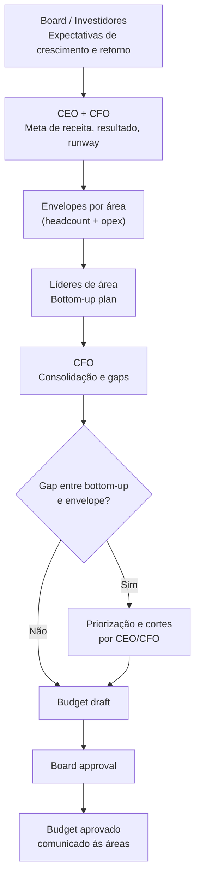

---

### Headcount plan como driver principal

Em startups de tecnologia, 60 a 80% dos custos totais são pessoas — salários, encargos, benefícios, e custos associados. Isso significa que a decisão de contratação é a decisão orçamentária mais importante que existe.

#### Custo real de uma contratação

O salário bruto é apenas o ponto de partida.

| Componente | Referência (CLT) |
|---|---|
| Salário Bruto | Base |
| Encargos patronais (FGTS, INSS patronal, RAT, SEST/SENAT, salário educação) | ~35-40% do salário bruto |
| 13º salário + 1/3 de férias | ~11% do salário bruto |
| Vale-transporte, alimentação, plano de saúde, odonto | R$ 500 a R$ 2.000/mês |
| Equipamento (notebook, periféricos) | R$ 3.000 a R$ 8.000 (amortizado em 2-3 anos) |
| Licenças de software por cabeça (GitHub, Slack, Figma, etc.) | R$ 200 a R$ 600/mês |
| Espaço físico ou auxílio home office | R$ 100 a R$ 500/mês |

> [!warning] Regra prática de custo total
> Para um planejamento conservador em CLT, use fator multiplicador de 1,7 a 1,8x sobre o salário bruto para chegar ao custo total mensal. Um engenheiro com salário bruto de R$ 12.000 custa, na prática, entre R$ 20.000 e R$ 22.000 por mês para a empresa.

**Para PJ ou cooperativa**, o fator de encargos é menor (sem FGTS, INSS patronal patronal, 13º como obrigação), mas o risco de vínculo empregatício reconhecido pela Justiça do Trabalho é real. O custo jurídico potencial precisa ser precificado.

#### Como montar o headcount plan por departamento

Para cada área, o headcount plan responde a quatro perguntas:

1. Qual o headcount atual?
2. Quais posições serão abertas, em qual trimestre?
3. Qual o motivo de cada contratação (substituição, crescimento, nova função)?
4. Qual o salário médio esperado por nível?

```text
Exemplo: headcount plan de Engenharia, 2026

Função               | Q1 | Q2 | Q3 | Q4 | Salário médio (bruto)
---------------------|----|----|----|----|----------------------
Eng. Backend Sr      |  4 |  4 |  5 |  5 | R$ 14.000
Eng. Backend Pl      |  2 |  3 |  3 |  4 | R$ 9.000
Eng. Frontend Sr     |  2 |  2 |  3 |  3 | R$ 13.000
Eng. Frontend Pl     |  1 |  2 |  2 |  2 | R$ 8.500
Tech Lead            |  1 |  1 |  2 |  2 | R$ 18.000
QA / SDET            |  1 |  1 |  1 |  2 | R$ 8.000
DevOps / SRE         |  1 |  1 |  1 |  1 | R$ 15.000
---------------------|----|----|----|----|----------------------
Total headcount      | 12 | 14 | 17 | 19 |
Custo total (×1,75)  |    |    |    |    | (calcular por mês)
```

#### Quando contratar: antes da necessidade vs. just-in-time

**Antes da necessidade** é a lógica de startup em hipercrescimento: contratar antecipado para não travar escala. O risco é contratar para crescimento que não vem, aumentando o burn sem justificativa.

**Just-in-time** é contratar quando o gargalo já apareceu. Mais conservador, preserva runway. O risco é que contratação leva de 30 a 90 dias entre início do processo e onboarding produtivo — o gargalo pode durar meses.

**Regra prática**: para posições críticas de engenharia e produto, abrir o processo com dois a três meses de antecedência em relação à necessidade. Para posições de vendas, abrir quando o pipeline já justifica o adicional de headcount (não antes). Para G&A, contratar just-in-time.

---

### Estrutura do orçamento anual

Um orçamento bem estruturado tem cinco blocos.

#### Bloco 1: Receita por produto, segmento, e canal

```text
Receita                    | Q1     | Q2     | Q3     | Q4     | Total
---------------------------|--------|--------|--------|--------|-------
Produto A — assinatura     | 500K   | 600K   | 720K   | 850K   | 2.67M
Produto B — one-time       | 100K   | 80K    | 120K   | 150K   | 450K
Serviços profissionais     | 50K    | 60K    | 70K    | 80K    | 260K
---------------------------|--------|--------|--------|--------|-------
Receita Bruta Total        | 650K   | 740K   | 910K   | 1.08M  | 3.38M
(-) Deduções (impostos)    | (65K)  | (74K)  | (91K)  | (108K) | (338K)
= Receita Líquida          | 585K   | 666K   | 819K   | 972K   | 3.04M
```

#### Bloco 2: COGS por componente

Mapear o custo de entrega por linha de receita: hosting/infraestrutura, licenças de terceiros, suporte de primeiro nível, processamento de pagamentos, e headcount de CS técnico que é alocado em COGS (não em G&A).

#### Bloco 3: Despesas por departamento e categoria

| Departamento | Headcount (EoY) | Payroll | Opex | Total |
|---|---|---|---|---|
| Engenharia & Produto | 19 | 2.8M | 400K | 3.2M |
| Vendas & Marketing | 12 | 1.6M | 600K | 2.2M |
| Customer Success | 8 | 960K | 100K | 1.06M |
| G&A | 5 | 550K | 350K | 900K |
| **Total** | **44** | **5.91M** | **1.45M** | **7.36M** |

#### Bloco 4: Capex vs. Opex

Capex (Capital Expenditure) é gasto que cria ativo de longo prazo: servidores, equipamentos, desenvolvimento de software capitalizado, aquisições. Vai ao balanço, não à DRE diretamente — é depreciado/amortizado ao longo do tempo.

Opex (Operational Expenditure) é gasto operacional recorrente: salários, aluguel, SaaS, marketing. Vai à DRE no período em que ocorre.

Em startups de software, a maioria dos gastos é Opex. Capex costuma ser pequeno (servidores se não usar cloud, ou desenvolvimento capitalizado). Mas a distinção importa para entender o EBITDA real: empresa que capitaliza agressivamente o desenvolvimento interno pode ter EBITDA artificialmente alto.

#### Bloco 5: Resultado esperado e runway implícito

```text
Receita Líquida             3.04M
(-) COGS                   (1.10M)
= Lucro Bruto               1.94M   → Margem Bruta: 63.8%
(-) Despesas Operacionais  (7.36M)
= EBITDA                   (5.42M)  → Burn mensal médio: R$ 452K
                                    → Runway com R$ 8M em caixa: 17.7 meses
```

---

### O processo de planejamento

#### Quando começar

O processo de budget para o ano seguinte começa em setembro ou outubro. Mais cedo que isso, as premissas são voláteis demais. Mais tarde, o budget não estará aprovado quando o ano virar.

**Calendário típico de planejamento.**

| Período | Atividade |
|---|---|
| Setembro | CFO e CEO definem premissas macro (crescimento esperado, envelope de caixa disponível, meta de runway) |
| Outubro | Líderes de área recebem envelope e constroem bottom-up plan |
| Novembro 1ª quinzena | CFO consolida, identifica gaps, e propõe ajustes |
| Novembro 2ª quinzena | Rodada de calibração com líderes: o que fica, o que corta, o que vai para contingência |
| Dezembro 1ª quinzena | Budget draft apresentado ao board |
| Dezembro 2ª quinzena | Board aprova (com ou sem ajustes) |
| Janeiro | Budget comunicado a todos os times. Líderes operam com autonomia dentro dos envelopes aprovados. |

#### Quem participa em cada estágio

| Estágio | Participantes |
|---|---|
| Premissas macro | CEO, CFO, board (expectativas de retorno e crescimento) |
| Envelope por área | CEO, CFO |
| Bottom-up por departamento | Líderes de área com seus diretos |
| Consolidação e gaps | CFO |
| Calibração | CEO, CFO, líderes de área |
| Aprovação | Board |
| Comunicação | CEO para toda a empresa |

#### Como calibrar entre ambição e realismo

**Armadilha 1: Budget agressivo demais.**

Board aprova crescimento de 120% porque o modelo mostra que é possível. Mas o time de vendas sabe que o pipeline não suporta. Resultado: empresa corta custo no Q3 para compensar receita que não veio, atrasa produto, e perde talentos que percebem a dissonância.

**Armadilha 2: Budget conservador demais.**

Para evitar pressão, o fundador submete budget que sabe que vai bater. Board fica confortável. Mas a empresa deixa de contratar e investir na janela certa. Concorrente toma o mercado.

**Calibração saudável**: o budget base deve ser alcançável com 70-80% de probabilidade, dado o pipeline e os recursos planejados. Cenário upside existe no modelo, mas não é o budget aprovado. O board aprova o base, não o upside.

#### O que fazer quando as áreas pedem mais do que a empresa pode dar

É o cenário padrão. Sempre há mais demanda por recursos do que recursos disponíveis.

Processo de priorização:

1. Separar pedidos em três categorias: (a) essencial para manter o negócio funcionando, (b) necessário para atingir a meta, (c) desejável se houver capital adicional.
2. Financiar completamente a categoria (a). Financiar parcialmente a categoria (b) com base no ROI esperado de cada investimento. Categoria (c) vai para lista de contingência.
3. Documentar o que foi cortado e por quê — isso evita retrabalho em discussões futuras e mantém credibilidade com os líderes.

---

### Reforecast: quando e como revisar o budget

#### Budget original vs. reforecast

**Budget original (Base Budget)** é o plano aprovado em dezembro para o ano seguinte. É o compromisso com o board. Não muda ao longo do ano — mesmo que a realidade mude, o budget original permanece como referência histórica de intenção.

**Reforecast** é uma nova projeção de como o ano vai terminar, dado o que já aconteceu e o que se sabe sobre o restante do ano. Não substitui o budget — convive com ele como coluna adicional de comparação.

```text
Comparação típica em dashboard de board:

Linha         | Budget | Q1 Real | Q2 Real | Q3 Fore | Q4 Fore | Full Year Fore | Full Year Budget | Δ%
-------------|--------|---------|---------|---------|---------|----------------|------------------|----
Receita Liq. | 3.04M  | 720K    | 800K    | 850K    | 920K    | 3.29M          | 3.04M            | +8%
EBITDA       |(5.42M) |(1.35M)  |(1.20M)  |(1.10M)  |(0.95M)  |(4.60M)         |(5.42M)           | +15%
```

#### Quando fazer reforecast

Dois gatilhos:

1. **Gatilho temporal**: trimestralmente. No final de Q1, atualizar projeção para o ano completo. Idem Q2 e Q3.
2. **Gatilho de desvio**: quando qualquer linha-chave (receita ou EBITDA) desvia mais de 10-15% do budget por dois meses consecutivos. Esperar o trimestre acabar para reportar um desvio que já é evidente desde o primeiro mês é gerenciar para trás.

#### Rolling forecast vs. budget anual fixo

| Característica | Budget Anual Fixo | Rolling Forecast (12M contínuos) |
|---|---|---|
| Horizonte | 12 meses fixos (jan-dez) | Sempre 12 meses à frente |
| Frequência de atualização | Anual (+ reforecast trimestral) | Mensal ou trimestral |
| Complexidade operacional | Menor | Maior (exige processo FP&A robusto) |
| Relevância em ambientes voláteis | Pode perder relevância em Q3-Q4 | Mantém-se relevante o ano todo |
| Adoção em startups BR | Padrão na maioria | Comum em Series B+ com CFO dedicado |

Rolling forecast é mais poderoso em negócios com alta variabilidade ou sazonalidade. Para a maioria das startups brasileiras até Series A, o budget anual com reforecast trimestral é suficiente.

#### Como comunicar reforecast para o board sem perder credibilidade

O reforecast que vai na direção certa (receita acima, burn abaixo) é fácil de comunicar. O problema é o contrário.

Três princípios para comunicar desvio negativo com credibilidade:

1. **Antecipar, não surpreender.** Board que descobre desvio pelo número, sem explicação prévia, perde confiança no fundador. O sinal de alerta deve chegar antes do número. "Estamos vendo pressão em X, projetamos que o Q2 vai fechar abaixo do budget — atualizo na board meeting."

2. **Causa raiz, não desculpa.** "O mercado desacelerou" não é causa raiz. "A taxa de conversão de trial para pago caiu de 18% para 12% em março, investigamos e identificamos problema de onboarding que está sendo corrigido" é causa raiz.

3. **Ação corretiva com prazo.** Desvio sem plano de ação é desorganização. Desvio com plano de ação é gestão. "Estamos cortando R$ 80K de opex no Q3, adiando duas contratações de vendas para Q4, e esperamos fechar o ano R$ 300K abaixo do budget original — com o reforecast aprovado de R$ 2.74M."

---

### Variações e análise de desvio

#### O que reportar para o board

Para cada linha material do orçamento, o relatório de variação inclui:

1. **Variação absoluta**: R$ acima ou abaixo do budget (ex: R$ -120K em receita).
2. **Variação percentual**: % de desvio (ex: -4,2% abaixo do budget).
3. **Causa raiz**: identificação do driver que explica o desvio.
4. **Ação corretiva**: o que está sendo feito, por quem, até quando.

#### Desvio de receita vs. desvio de custo: impactos diferentes

Desvio de receita negativo de R$ 200K significa que a empresa vai ter R$ 200K a menos para gastar — e o impacto no EBITDA é de R$ 200K direto (descontando margem variável, pode ser R$ 140-160K de impacto real no caixa).

Desvio de custo positivo (gastou menos que o budget) de R$ 200K pode parecer bom, mas merece análise: foi porque contratações atrasaram? Porque o time não executou o plano de marketing? Economizar custo por não executar o plano não é eficiência — é subexecução.

> [!warning] A armadilha de estar "no budget" cortando custo quando receita falha
> Empresa que corta R$ 500K de opex para compensar R$ 500K de miss de receita pode reportar EBITDA dentro do budget. Mas pagou com três meses de atraso de produto e pipeline de vendas menor. O board vê o número verde. O fundador sabe que o negócio foi para trás. Transparência sobre esse trade-off é parte do trabalho do CEO.

---

### Budget em diferentes estágios

#### Pré-Series A: orçamento informal

Antes de levantar uma rodada formal, o "orçamento" é uma resposta à pergunta: quanto runway temos e em que ritmo estamos queimando?

O instrumento correto é simples:

- Caixa atual
- Burn mensal (médio dos últimos três meses)
- Runway = Caixa / Burn
- Próximas doze semanas: quais despesas relevantes vêm aí? (Contratações planejadas, renovações de contrato, impostos trimestrais)

Formalizar budget anual neste estágio é overhead desnecessário. O fundador deve saber o burn de cor, não precisar consultar planilha para responder.

#### Series A: primeiro orçamento formal

Com capital de R$ 5-20M e time de 15-40 pessoas, o budget formal se torna necessário. As principais razões:

1. O board — agora com investidor institucional — espera o budget no início do ano e comparação real vs. orçado nas board meetings.
2. Com líderes de área (Head de Eng, Head de Vendas, Head de CS), é preciso dar autonomia com limites claros.
3. Com mais headcount, as decisões de contratação são suficientemente grandes para merecer planejamento formal.

Estrutura do budget em Series A: DRE simplificada (receita, COGS, despesas por área), headcount plan, e projeção de caixa. Não precisa ser mais sofisticado que isso.

#### Series B+: orçamento por departamento, eficiência como métrica secundária

Com mais de R$ 30M levantados e time de 60-150 pessoas, o budget ganha camadas:

- Orçamento por departamento com linha de responsabilidade clara
- Análise de eficiência (receita por cabeça, CAC por canal, margem por produto)
- Capex separado de Opex com decisões de capitalização de software
- Sensitivity analysis formal para o board

Neste estágio, contratar o primeiro FP&A dedicado (Financial Planning & Analysis) faz sentido. O CFO define a estratégia, o FP&A mantém o modelo, produz os relatórios mensais, e prepara os pacotes do board.

#### Quando contratar o primeiro FP&A

| Sinal | Ação |
|---|---|
| Budget não é atualizado mensalmente por falta de tempo do CFO | Contratar FP&A analista |
| Board meeting consome 3+ dias de prep do CFO todo trimestre | Contratar FP&A analista |
| Series B levantada ou em curso | FP&A sênior ou Head de FP&A |
| Empresa com múltiplos produtos ou segmentos com P&Ls separados | FP&A sênior ou manager |
| CFO passou a delegar análises de variação para o fundador | Urgência: contratar agora |

---

### Template de estrutura: DRE por trimestre com variação

A tabela abaixo representa a estrutura mínima de um relatório de budget vs. realizado para apresentação ao board.

```text
                     | Budget  | Q1 Real | Var. R$ | Var. % | Forecast FY | Budget FY | Var. FY %
---------------------|---------|---------|---------|--------|-------------|-----------|----------
RECEITA
Receita Bruta        |   750K  |   720K  |  -30K   |  -4%   |    3.05M    |   3.38M   |   -10%
(-) Deduções         |  (75K)  |  (72K)  |   +3K   |  +4%   |   (305K)    |  (338K)   |   +10%
= Receita Líquida    |   675K  |   648K  |  -27K   |  -4%   |    2.74M    |   3.04M   |   -10%

COGS
(-) Infraestrutura   |  (90K)  |  (85K)  |   +5K   |  +6%   |   (370K)    |  (375K)   |    +1%
(-) Headcount COGS   | (110K)  | (108K)  |   +2K   |  +2%   |   (430K)    |  (445K)   |    +3%
= Lucro Bruto        |   475K  |   455K  |  -20K   |  -4%   |    1.94M    |   2.22M   |   -13%
Margem Bruta %       |  70.4%  |  70.2%  |   -0.2pp|        |    70.8%    |   73.0%   |

DESPESAS
(-) Engenharia       | (260K)  | (255K)  |   +5K   |  +2%   |   (1.05M)   |  (1.04M)  |    -1%
(-) Vendas & Mkt     | (220K)  | (240K)  |  -20K   |  -9%   |   (960K)    |  (880K)   |    -9%
(-) CS               | (105K)  | (100K)  |   +5K   |  +5%   |   (410K)    |  (420K)   |    +2%
(-) G&A              |  (90K)  |  (88K)  |   +2K   |  +2%   |   (355K)    |  (360K)   |    +1%

= EBITDA             | (200K)  | (228K)  |  -28K   | -14%   |   (835K)    |  (482K)   |   -73%
Margem EBITDA %      | -29.6%  | -35.2%  |  -5.5pp |        |   -30.5%    |  -15.9%   |

CAIXA
Caixa Inicial        |  8.00M  |  8.00M  |    -    |        |    8.00M    |   8.00M   |
+/- Burn do período  | (200K)  | (228K)  |  -28K   |        |   (4.40M)   |  (3.00M)  |
= Caixa Projetado EoY|  5.00M  |   n/a   |         |        |    3.60M    |   5.00M   |
Runway (meses)       |   25.0  |   n/a   |         |        |    19.4     |   25.0    |
```

> [!note] Como usar esse template
> Preencher mensalmente. Colunas de "Real" são dados do sistema contábil. Colunas de "Forecast" são atualização manual ou do modelo financeiro. A variação percentual de FY é o número que o board vai questionar — ter causa raiz pronta para qualquer variação acima de 5%.

---

### Ver também

- [[IGNICAO-Vol-3-Tracao#APÊNDICE DR — DEMONSTRATIVOS FINANCEIROS PARA O FUNDADOR|Apêndice DR (Vol. 3)]], Demonstrativos Financeiros
- [[IGNICAO-Vol-3-Tracao#APÊNDICE AN — MODELAGEM FINANCEIRA OPERACIONAL|Apêndice AN (Vol. 3)]], Modelagem Financeira Operacional
- [[IGNICAO-Vol-5-Maturidade#APÊNDICE AM — BOARD E GOVERNANCE|Apêndice AM (Vol. 5)]], Board e Governance
- [[IGNICAO-Vol-3-Tracao#APÊNDICE AT — GESTÃO DE CAIXA EM PROFUNDIDADE|Apêndice AT (Vol. 3)]], Gestão de Caixa
- [[#APÊNDICE BN — EXECUTIVE HIRING: CONTRATAR LÍDERES SÊNIOR E C-LEVEL|Apêndice BN]], pacotes C-level
- [[#APÊNDICE CO — RECRUTAMENTO TÉCNICO EM PROFUNDIDADE|Apêndice CO]], comp em recrutamento técnico
- [[#APÊNDICE CR — ENGINEERING MANAGEMENT: GESTÃO DO TIME TÉCNICO E DEVELOPER EXPERIENCE|Apêndice CR]], comp em engenharia
- [[#APÊNDICE BU — DIVERSIDADE, EQUIDADE E INCLUSÃO (DEI) EM STARTUP BRASILEIRA|Apêndice BU]], equidade salarial
- [[#APÊNDICE DB — STOCK OPTIONS E ESOP NO BRASIL|Apêndice DB]], equity como instrumento
- [[#APÊNDICE DD — INVESTOR RELATIONS PÓS-RODADA|Apêndice DD]], orçamento como linguagem de board e comunicação com investidores pós-rodada

---

## APÊNDICE EG — REVENUE FORECASTING: MODELOS, ACURÁCIA E PROCESSO PARA O FOUNDER

> [!note] Posição no livro
> Este apêndice aprofunda a mecânica de forecasting (previsão) de receita para fundadores em estágio pré-Series A e pós-PMF (product-market fit, ajuste produto-mercado). Conecta-se ao [[IGNICAO-Vol-5-Maturidade#APÊNDICE AM — BOARD E GOVERNANCE|Apêndice AM — Métricas de SaaS (Vol. 5)]], ao [[IGNICAO-Vol-3-Tracao#APÊNDICE DT — CUSTOMER EXPERIENCE: DA JORNADA AO NPS AO CHURN ZERO|Apêndice DT — Customer Experience (Vol. 3)]], que cobre churn (cancelamento) como variável crítica no modelo, e ao [[IGNICAO-Vol-1-Ideacao#APÊNDICE CS — BOOTSTRAP vs VENTURE CAPITAL: A ESCOLHA FUNDACIONAL|Apêndice CS — Bootstrap vs. Venture Capital (Vol. 1)]], que discute o papel do forecast na decisão de capital.

---

### Por que forecast importa antes do Series A

Muitos fundadores em early stage (estágio inicial) tratam forecast (previsão de receita) como ritual burocrático para apresentar ao investidor. Essa leitura é um erro. Forecast bem construído serve a três audiências com necessidades distintas, e a primeira delas é o próprio fundador.

#### As três audiências

**Audiência 1: você mesmo.** O forecast força uma pergunta que ninguém mais vai fazer com a mesma urgência: "Com o que tenho hoje, quanto de receita vou gerar nos próximos doze meses, e isso é suficiente para o que preciso fazer?" Fundador sem forecast opera no escuro. Contrata baseado em sensação. Investe em canal sem saber se tem runway para esperar o retorno. Abre rodada de captação no timing errado — tarde demais, quando o runway já é curto, ou cedo demais, quando as métricas ainda não convencem.

**Audiência 2: o board ou conselho de advisors.** Board não quer o número. Quer entender a lógica por trás do número. Quer saber se o fundador entende o próprio negócio com profundidade suficiente para prever o comportamento da receita. O board que questiona o forecast não está testando a matemática — está testando a capacidade do fundador de navegar incerteza com rigor.

**Audiência 3: o investidor.** Investidor de Series A analisa forecast historicamente: compara o que foi previsto trimestre a trimestre com o que foi entregue. A precisão do forecast é proxy de qualidade de execução e de maturidade de go-to-market. Fundador que sempre previu R$ 500K e entregou R$ 300K tem problema. Fundador que previu R$ 400K e entregou R$ 420K tem credibilidade.

> [!important] Heurística do autor, regra dos 80/80
> Um bom forecast em early stage não precisa ser perfeito. Precisa ser calibrado: acertar dentro de 20% do resultado real, em 80% dos períodos. Esta é uma heurística do autor, não framework consagrado, e é atingível com rigor básico — já suficiente para criar credibilidade com board e investidor.

---

### Bottom-up vs. top-down forecast

A escolha entre os dois métodos tem impacto direto na qualidade do forecast — e o erro de usar top-down em early stage é sistemático e custoso.

#### Top-down: o método que parece razoável mas não é

Top-down parte do tamanho do mercado e aplica fatia esperada de captura:

```text
Mercado total (TAM): R$ 10 bilhões
Fatia realista em 3 anos: 0,5% = R$ 50 milhões de ARR
```

Esse número parece robusto — tem TAM, tem % de captura, tem lógica. O problema é que ele não revela nada sobre como a receita vai ser construída. Não modela conversão de pipeline, ciclo de vendas, churn, capacidade da equipe de vendas. É projeção de vontade disfarçada de análise.

> [!warning] Top-down em early stage engana o próprio fundador
> Fundador que apresenta forecast top-down para investidor sinaliza que não entende o mecanismo de geração de receita do próprio negócio. O investidor sabe disso. E o fundador, ao confiar no top-down, perde a oportunidade de identificar gargalos reais no modelo.

#### Bottom-up: o método correto para early stage

Bottom-up constrói o forecast de baixo para cima, a partir das unidades operacionais reais:

```text
Vendedores ativos: 2
Deals gerados por vendedor por mês: 15
Taxa de conversão (win rate): 20%
Ticket médio: R$ 2.500/mês (ARR: R$ 30.000)
New ARR gerado por mês: 2 × 15 × 20% × R$ 30.000 = R$ 180.000/mês
```

Esse forecast é discutível em cada componente. E isso é a vantagem: se o win rate cai para 15%, o modelo mostra o impacto imediatamente. Se o número de deals por vendedor cai por causa do recesso de janeiro, o modelo pode modelar isso.

Para benchmarks de taxa de conversão por etapa de funil que alimentam esse cálculo, ver Parte 1 do [[IGNICAO-Vol-3-Tracao#APÊNDICE CP — SALES: MOTION COMPLETA, DO OUTBOUND AO RENEWAL|Apêndice CP (Vol. 3)]].

#### Quando combinar os dois

Em estágio de escala (Series B em diante), combinar os dois métodos faz sentido: o bottom-up como base operacional e o top-down como sanity check de teto — para verificar se o crescimento projetado é plausível dado o tamanho do mercado. Em early stage, bottom-up exclusivamente.

---

### O ARR waterfall

O modelo de ARR waterfall é a representação mais precisa da dinâmica de receita recorrente. Ele decompõe a variação de ARR em seus componentes, tornando visível o que está crescendo, o que está encolhendo e por quê.

#### Fórmula e componentes

```text
ARR inicial do período
+ New ARR          (novos clientes adquiridos no período)
+ Expansion ARR    (upsell e cross-sell de clientes existentes)
- Contraction ARR  (downgrades de plano de clientes existentes)
- Churn ARR        (cancelamentos de clientes existentes)
= ARR final do período

Net New ARR = New ARR + Expansion ARR - Contraction ARR - Churn ARR
```

#### Exemplo numérico (em R$)

```text
ARR em 1/jan:                          R$ 2.400.000

New ARR (Q1):
  Janeiro: R$ 90.000
  Fevereiro: R$ 120.000
  Março: R$ 150.000
  Subtotal New ARR: R$ 360.000

Expansion ARR (Q1):
  Upsell de clientes existentes: R$ 85.000
  Cross-sell: R$ 30.000
  Subtotal Expansion: R$ 115.000

Contraction ARR (Q1):
  Downgrades de plano: - R$ 45.000

Churn ARR (Q1):
  Cancelamentos: - R$ 72.000
  (equivale a churn bruto de 3,0% no trimestre)

Net New ARR Q1: R$ 360.000 + R$ 115.000 - R$ 45.000 - R$ 72.000 = R$ 358.000

ARR em 31/mar: R$ 2.400.000 + R$ 358.000 = R$ 2.758.000

NRR (clientes que existiam em 1/jan):
  ARR dos mesmos clientes em 31/mar: (R$ 2.400.000 - R$ 72.000 - R$ 45.000 + R$ 115.000)
  = R$ 2.398.000
  NRR Q1: R$ 2.398.000 / R$ 2.400.000 = 99,9%
```

Esse nível de decomposição transforma uma conversa de "crescemos X%" em "crescemos X% com Y de churn e Z de expansão, e o gargalo está em W". É a diferença entre gestão intuitiva e gestão baseada em dados.

> [!tip] O sinal mais valioso do waterfall
> Quando Expansion ARR supera Churn ARR, o negócio começa a ter propriedade de crescimento autônomo. Isso é o NRR acima de 100%. É o sinal de maturidade de go-to-market que investidores de Series A mais valorizam.

---

### Cohort analysis para forecast

A análise de coortes é o método mais preciso para prever receita futura, porque parte de comportamento histórico real — não de premissas sobre clientes futuros.

#### Como coortes predizem receita com mais precisão do que pipeline

A lógica é direta: se a coorte de clientes adquiridos em janeiro de 2024 reteve 85% da receita em M12, 78% em M18 e 72% em M24, isso é o melhor preditor disponível de como a coorte de janeiro de 2025 vai se comportar — assumindo que o produto e o perfil de cliente não mudaram radicalmente.

Ao contrário do pipeline, que é baseado em expectativas futuras (sujeitas a viés de otimismo do vendedor), a curva de retenção por coorte é baseada em comportamento passado verificável.

#### Construindo a análise de coortes

```text
Coorte     | M0        | M3        | M6        | M9        | M12
-----------+-----------+-----------+-----------+-----------+-----------
Jan/2024   | R$ 85.000 | R$ 79.000 | R$ 74.000 | R$ 70.000 | R$ 66.000
           | (100%)    | (92,9%)   | (87,1%)   | (82,4%)   | (77,6%)
-----------+-----------+-----------+-----------+-----------+-----------
Abr/2024   | R$ 95.000 | R$ 88.000 | R$ 82.000 | R$ 78.000 | ...
           | (100%)    | (92,6%)   | (86,3%)   | (82,1%)   | ...
-----------+-----------+-----------+-----------+-----------+-----------
Jul/2024   | R$102.000 | R$ 95.000 | R$ 90.000 | ...       | ...
           | (100%)    | (93,1%)   | (88,2%)   | ...       | ...
```

Com esse histórico, a projeção de receita das coortes existentes para os próximos 12 meses é calculada aplicando a curva de retenção média ao ARR atual de cada coorte. A receita futura das coortes existentes é o "piso" da previsão — a receita mínima esperada se não houver nenhuma nova aquisição.

```text
Receita projetada de coortes existentes = soma(ARR_coorte_i × retention_rate_esperada_mês_j)
```

A receita de novas coortes (novos clientes adquiridos nos próximos meses) é então projetada separadamente com o modelo bottom-up e adicionada ao piso.

> [!note] O que coortes revelam que pipeline não revela
> Uma empresa com pipeline crescente mas curva de retenção deteriorando está construindo balde com buraco. A análise de coortes mostra o buraco. O pipeline sozinho não mostra.

---

### Pipeline-based forecast

Para o componente de New ARR, o forecast baseado em pipeline é o método padrão. A qualidade desse forecast depende de três decisões metodológicas.

#### Stage weighting

Cada estágio do funil de vendas recebe uma probabilidade de fechamento (win rate por estágio), baseada em dados históricos reais — não em intuição:

```text
Estágio         | Descrição                              | Win rate típico B2B SaaS
----------------+----------------------------------------+-------------------------
Prospectado     | Lead identificado, sem contato         | 5-10%
Qualificado     | BANT/MEDDIC confirmado, dor validada   | 15-25%
Demo realizada  | Produto demonstrado, interesse real    | 25-40%
Proposta enviada| Proposta formal enviada, em análise    | 40-60%
Negociação      | Termos sendo discutidos                | 65-80%
Verbal          | Compromisso verbal de fechamento       | 85-95%
```

O forecast ponderado é a soma de `(valor do deal × probabilidade do estágio)` para todos os deals no pipeline.

#### Commit methodology

Além do forecast ponderado (automático, baseado em stage), empresas maduras usam commit methodology: o vendedor declara explicitamente quais deals ele "comita" para fechar no período. Um commit é uma declaração de alta convicção — o vendedor está colocando sua credibilidade em jogo.

```text
Best case:  todos os deals do pipeline com probabilidade > 30%
Commit:     deals que o vendedor declara com alta convicção (> 75%)
Worst case: apenas os deals já em negociação final ou verbal
```

#### Como apresentar ao board sem mentir

A apresentação de forecast ao board tem uma armadilha específica: o fundador que quer parecer otimista usa best case como número principal. O board que já viu isso antes vai questionar. A apresentação honesta e eficaz tem:

**Número principal: commit.** O que o time se comprometeu a entregar. Baseado em dados, não em vontade.

**Upside explícito.** O que pode acontecer se os deals de best case fecharem. Não como número principal, mas como contexto.

**Risco explícito.** O que acontece se dois ou três deals principais atrasarem. Fundador que apresenta risco proativamente demonstra maturidade. O board já sabe que o risco existe — preferem ouvir de você.

**Comparação com período anterior.** Forecast deste trimestre versus resultado do trimestre anterior. Isso constrói o histórico de calibração que cria credibilidade ao longo do tempo.

---

### Sazonalidade no modelo brasileiro

O Brasil tem padrões sazonais que afetam receita de forma previsível e que precisam estar explícitos no modelo — especialmente em SaaS B2B e B2C.

#### Os quatro padrões que mais importam

**Recesso de janeiro.** Empresas brasileiras operam em velocidade reduzida de 20 de dezembro a 20 de janeiro. Ciclo de vendas B2B praticamente para. Decisões de compra são adiadas. Fundadores que constroem forecast de janeiro com o mesmo ritmo de outubro erram consistentemente. A correção: modelar janeiro com 40-50% da velocidade de pipeline normal. Deals que estão em commit em dezembro mas não fecharam frequentemente fecham em fevereiro.

**Julho: férias escolares.** Impacto menor que janeiro, mas relevante em B2C e em B2B com decisores que viajam. Semanas de 7 a 26 de julho têm queda de conversão de 15-25% em muitos segmentos. Equipes de vendas com metas mensais mensalmente deveriam ajustar expectativa de julho.

**13º salário (novembro/dezembro).** Para B2C voltado a consumo — e-commerce, apps de pagamento, marketplaces — novembro e dezembro são os meses de maior receita do ano. O 13º libera poder de compra concentrado. O modelo precisa refletir essa sazonalidade positiva para não subestimar a receita no período.

**Março/abril.** Em muitos verticais B2B, o início do ano fiscal (após o recesso de janeiro, com orçamentos aprovados) produz o trimestre mais forte de novas vendas. Março-abril é frequentemente o melhor período para fechar deals enterprise que estavam em pipeline desde o último trimestre.

#### Como modelar sazonalidade

A abordagem mais simples e eficaz:

```text
1. Coletar os dois últimos anos de receita mensal por componente (new, expansion, churn)
2. Calcular o índice sazonal de cada mês: receita_mês / média_anual_de_todos_os_meses
3. Aplicar o índice sazonal ao forecast base

Exemplo:
  Receita média mensal histórica: R$ 150.000
  Índice sazonal de janeiro (2 anos atrás): 0,62 / (ano passado): 0,68 / média: 0,65
  Forecast de janeiro = R$ 150.000 × crescimento_projetado × 0,65
```

Para empresas com menos de dois anos de histórico, usar benchmarks de setor como aproximação até ter dados próprios suficientes.

---

### Sensibilidade do modelo

O forecast não é um número — é uma distribuição de cenários. A tabela de sensibilidade transforma o forecast em ferramenta de gestão de risco: mostra o que acontece com o ARR em 12 meses se as premissas-chave variam.

#### Como construir a tabela de sensibilidade

As duas variáveis com maior impacto no ARR de longo prazo são churn rate e win rate. Construir a tabela de sensibilidade para essas duas dimensões é o exercício mínimo que qualquer modelo de forecast deve incluir.

**Impacto do churn no ARR em 12 meses (ARR base: R$ 3.000.000):**

```text
Churn mensal  | ARR em 12 meses | Diferença vs. base (2%)
--------------+-----------------+------------------------
1,0%          | R$ 4.820.000    | + R$ 560.000 (+13%)
1,5%          | R$ 4.620.000    | + R$ 360.000 (+8%)
2,0% (base)   | R$ 4.260.000    | base
2,5%          | R$ 3.940.000    | - R$ 320.000 (-8%)
3,0%          | R$ 3.640.000    | - R$ 620.000 (-15%)
3,5%          | R$ 3.350.000    | - R$ 910.000 (-21%)
```

(Assumindo New ARR constante de R$ 120K/mês e Expansion ARR de 1% da base/mês.)

**Impacto do win rate no ARR em 12 meses:**

```text
Win rate  | New ARR mensal | ARR em 12 meses | Diferença vs. base (20%)
----------+---------------+-----------------+-------------------------
15%       | R$ 90.000     | R$ 3.980.000    | - R$ 280.000 (-7%)
18%       | R$ 108.000    | R$ 4.140.000    | - R$ 120.000 (-3%)
20% (base)| R$ 120.000    | R$ 4.260.000    | base
22%       | R$ 132.000    | R$ 4.380.000    | + R$ 120.000 (+3%)
25%       | R$ 150.000    | R$ 4.540.000    | + R$ 280.000 (+7%)
```

**Tabela combinada (churn × win rate):**

```text
            | Win rate 15% | Win rate 20% | Win rate 25%
------------+--------------+--------------+--------------
Churn 1,5%  | R$ 4.400.000 | R$ 4.620.000 | R$ 4.870.000
Churn 2,0%  | R$ 3.980.000 | R$ 4.260.000 | R$ 4.540.000
Churn 2,5%  | R$ 3.580.000 | R$ 3.940.000 | R$ 4.220.000
Churn 3,0%  | R$ 3.200.000 | R$ 3.640.000 | R$ 3.910.000
```

> [!tip] Como usar a tabela com o board
> Apresente o cenário base, o cenário pessimista (churn + 1pp, win rate - 5pp) e o cenário otimista (churn - 0,5pp, win rate + 5pp). O board vai perguntar pelo pessimista de qualquer forma — melhor você construí-lo antes da reunião, com premissas explícitas, do que ter que improvisar.

---

### Forecast de headcount

Receita projeta headcount — ou deveria. O erro mais comum é contratar por entusiasmo, não por projeção calibrada. O forecast de receita deve ser o input direto do plano de contratações.

#### A Regra de Ouro de contratação

Não contratar antes de ter 6 meses de runway pós-contratação — considerando o custo total da posição (salário + encargos + benefícios + equipamento + custo de onboarding) projetado sobre o runway disponível.

O cálculo:

```text
Runway atual: R$ 1.800.000 (18 meses de burn rate atual de R$ 100K/mês)
Custo total nova posição: R$ 25.000/mês
Novo burn rate: R$ 125.000/mês
Novo runway: R$ 1.800.000 / R$ 125.000 = 14,4 meses

Pós-contratação, runway é 14,4 meses. Mínimo recomendado: 6 meses.
Esta contratação é viável.

Mas se a contratação for de 3 pessoas ao mesmo tempo:
Novo burn rate: R$ 175.000/mês
Novo runway: R$ 1.800.000 / R$ 175.000 = 10,3 meses
Ainda viável, mas deixa pouca margem para atraso de receita.
```

#### Sequência de contratações por função

O forecast de receita determina não apenas quando contratar, mas em que ordem. A sequência que maximiza retorno no early stage:

**Primeiro: quem gera receita.** Vendedor ou especialista de product-led growth que paga seu custo em 60-90 dias via New ARR gerado.

**Segundo: quem retém receita.** CS que reduz churn paga seu custo via receita preservada — mais difícil de medir, mas igualmente crítico.

**Terceiro: quem viabiliza escala.** Engenheiro adicional para feature de retenção ou automação que o CS precisa. Ops que libera tempo do fundador para atividades de maior alavancagem.

```text
Regra prática: cada posição de vendas deveria gerar New ARR suficiente para pagar
3-4x o custo total da posição em 12 meses. Se não paga, o modelo de vendas
ou o ticket médio precisam ser revisados antes de contratar mais vendedores.

CAC de headcount = custo total do vendedor em 12 meses / New ARR gerado em 12 meses
Benchmark saudável B2B SaaS: CAC de headcount ≤ 0,4x ARR gerado
```

> [!warning] O erro de contratar para o forecast otimista
> Fundador que contrata assumindo o cenário best case e entrega o cenário base fica com burn rate elevado e runway encurtado sem receita para cobrir. Contratar para o cenário base, não para o otimista.

---

### Apresentando o forecast ao board

A reunião de board com apresentação de forecast tem dinâmica própria que vai além da matemática. O que distingue uma apresentação de forecast que gera confiança de uma que gera questionamento.

#### Formato de uma página

O board não precisa de planilha de 15 abas. Precisa de clareza em cinco elementos:

```text
1. RESULTADO DO PERÍODO ANTERIOR
   ARR início / ARR fim / Componentes (New, Expansion, Churn, Contraction)
   Versus forecast do período anterior: quanto acertou e onde errou

2. ANÁLISE DO DESVIO
   O que aconteceu diferente do previsto, em uma frase por componente
   Causa raiz (não desculpa) e ação tomada

3. FORECAST DO PRÓXIMO PERÍODO
   Commit / Best case / Worst case
   Premissas explícitas de cada número

4. SENSIBILIDADE
   O que acontece com o ARR em 12 meses nos dois cenários extremos

5. HEADCOUNT E RUNWAY
   Burn rate atual / Runway atual / Próximas contratações planejadas e quando
```

#### Como explicar desvio sem parecer que está jogando defensivo

A sequência que funciona: fato primeiro, causa segundo, aprendizado terceiro, ação quarta.

"Previmos R$ 180K de New ARR em fevereiro e entregamos R$ 130K. A causa foi concentração em três deals grandes que atrasaram por processo de aprovação interna do cliente — o que não previmos. O aprendizado é que nosso pipeline tinha concentração excessiva em enterprise: três deals respondiam por 60% do commit. A ação foi diversificar: adicionamos dez contas de mid-market ao pipeline de março e ajustamos o critério de commit para não depender de deal único acima de 25% do total."

Essa estrutura demonstra que o fundador entende o negócio, que está aprendendo, e que está agindo. É o oposto de "o mercado estava difícil" ou "cliente atrasou" sem contexto.

> [!important] Nunca apresente forecast sem histórico de acurácia
> A partir do terceiro board, o forecast deve ser acompanhado de uma tabela simples: forecast do período versus resultado real, para os últimos quatro a seis períodos. Isso constrói o track record de calibração que é o ativo mais valioso que um fundador pode ter na relação com board e investidores.

---

### Ferramentas por estágio

A ferramenta de forecast deve ser a mais simples possível para o estágio da empresa. Complexidade prematura cria falsa precisão e dificulta iteração.

#### Pre-seed e seed: Excel ou Google Sheets, três abas

O modelo básico em planilha que cobre tudo que o fundador precisa:

**Aba 1: Inputs.** Premissas explícitas e editáveis: ticket médio, win rate por estágio, churn mensal, taxa de expansão, ciclo de vendas médio, sazonalidade por mês, custo por contratação planejada.

**Aba 2: ARR waterfall.** O modelo calculado automaticamente com base nos inputs. Mês a mês para os próximos 18-24 meses. Com decomposição por componente (New, Expansion, Contraction, Churn) e resultado (ARR, MRR, NRR).

**Aba 3: Dashboard.** Visualização das métricas principais: ARR atual, runway, NRR, burn rate, meses até breakeven. O que o fundador precisa ver em segundos, sem abrir a planilha de cálculo.

```text
Estrutura da aba ARR waterfall:

          | Jan   | Fev   | Mar   | Abr   | ...
----------+-------+-------+-------+-------+---
ARR início| 2.400 | 2.580 | 2.758 | 2.956 | ...
New ARR   |   90  |  120  |  150  |  160  | ...
Expansion |   35  |   40  |   45  |   50  | ...
Contração |  (15) |  (18) |  (20) |  (22) | ...
Churn     |  (30) |  (24) |  (27) |  (30) | ...
Net New   |   80  |  118  |  148  |  158  | ...
ARR fim   | 2.480 | 2.698 | 2.906 | 3.114 | ...
MRR       |   207 |   225 |   242 |   260 | ...
NRR (12m) |  103% |  104% |  105% |  106% | ...
```

(Valores em R$ mil para exemplo de clareza.)

#### Quando migrar para ferramenta dedicada

Ferramentas como Mosaic, Causal e Cube oferecem capacidades que a planilha não tem: consolidação automática de múltiplas fontes de dados, drill-down em tempo real, simulações de cenário com interface visual, e integração com CRM e ERP.

A migração faz sentido quando pelo menos dois desses critérios são atendidos:

- Equipe de mais de 3 pessoas precisa editar o modelo simultaneamente
- Dados de receita vêm de três ou mais sistemas diferentes (CRM + billing + ERP)
- O modelo tem mais de 500 linhas de fórmulas e está difícil de manter
- Board ou investidor pede análise ad-hoc frequente que exige tempo demais na planilha

Antes desse ponto, a planilha é superior em custo-benefício. Ferramenta de FP&A dedicada (Mosaic ou Causal) custa entre US$ 500 e US$ 3.000 por mês. O custo é justificável quando a equipe financeira gasta mais de 20 horas por semana construindo e mantendo a planilha.

> [!note] O modelo de planilha como artefato de pensamento
> Independentemente da ferramenta, o valor do forecast está no processo de construí-lo — não no output. Fundador que entende profundamente cada linha do modelo, que sabe por que cada premissa tem o valor que tem, que consegue defender cada número com contexto histórico, está operando em nível qualitativamente diferente de fundador que recebe o output de uma ferramenta sem entender o mecanismo.

---

### Armadilhas de forecast mais comuns

**Mesclar forecast de receita com forecast de caixa.** ARR não é caixa. Empresa com ARR de R$ 3M pode ter caixa negativo se os contratos forem anuais mas pagos mensalmente, se houver churn inesperado ou se as contas a receber estiverem presas. Manter os dois modelos separados.

**Usar pipeline total em vez de pipeline ponderado.** Pipeline de R$ 2M com win rate de 20% vale R$ 400K, não R$ 2M. Apresentar pipeline total ao board sem o fator de conversão cria expectativa errada e destrói credibilidade quando o resultado sai menor.

**Não modelar o impacto de contratações futuras no runway.** Forecast de receita ambicioso que pressupõe contratar cinco pessoas nos próximos três meses sem modelar o impacto no burn rate e no runway é forecast incompleto.

**Congelar premissas após a primeira versão do modelo.** O modelo precisa ser recalibrado mensalmente com dados reais. Win rate muda. Ciclo de vendas muda. Churn muda. Modelo que não atualiza premissas vira ficção em quatro meses.

**Forecast de receita sem forecast de churn detalhado.** New ARR previsto com precisão, mas churn modelado como "X% genérico", sem análise de quais contas estão em risco, é modelo com buraco no principal componente de variação.

**Otimismo de fundador não calibrado.** Existe literatura sobre o "planning fallacy" — a tendência humana de subestimar tempo e custo e superestimar resultados futuros. Fundadores em early stage têm esse viés amplificado pela necessidade de motivar time e convencer investidor. O antídoto é histórico: quanto o forecast do trimestre passado errou? Se errou para cima consistentemente, o modelo precisa de fator de correção explícito.

---

### Como saber que Revenue Forecasting está implementado na sua empresa

Forecasting maduro é processo, não planilha. A lista abaixo separa o que está em pé do que ainda é improviso.

- [ ] Modelo bottom-up funcional, construído a partir de pipeline real ponderado por estágio e win rate por segmento
- [ ] Modelo top-down complementar, baseado em meta, capacidade do time e premissas de crescimento, usado como sanity check
- [ ] Reconciliação entre bottom-up e top-down feita mensalmente, com explicação para divergência maior que dez por cento
- [ ] Forecast separa receita de caixa (ARR não é caixa) e modela churn detalhadamente, conta a conta no enterprise
- [ ] Pipeline ponderado por estágio aplicado em vez de pipeline total bruto
- [ ] Accuracy tracking calculado mês a mês e trimestre a trimestre (forecast versus realizado), com viés direcional documentado
- [ ] Ritual de forecast mensal com AE, sales manager e RevOps presentes, e ritual de forecast trimestral com CEO e board
- [ ] Calls de commit, best case e pipeline aplicadas em pipeline review semanal
- [ ] Ajuste explícito para fonte de bias identificada (otimismo de AE, sandbagging, planning fallacy do fundador)
- [ ] Premissas do modelo recalibradas mensalmente com dados reais (win rate, ciclo, ticket médio, churn)
- [ ] Histórico de forecast preservado em versão imutável, comparável trimestre a trimestre
- [ ] Forecast modela impacto de contratações futuras no caixa e no runway antes de aprovar headcount

---

**Ver também:** [[IGNICAO-Vol-5-Maturidade#APÊNDICE AM — BOARD E GOVERNANCE|Apêndice AM — Métricas de SaaS (Vol. 5)]], [[IGNICAO-Vol-3-Tracao#APÊNDICE DT — CUSTOMER EXPERIENCE: DA JORNADA AO NPS AO CHURN ZERO|Apêndice DT — Customer Experience (Vol. 3)]], [[IGNICAO-Vol-1-Ideacao#APÊNDICE CS — BOOTSTRAP vs VENTURE CAPITAL: A ESCOLHA FUNDACIONAL|Apêndice CS — Bootstrap vs. Venture Capital (Vol. 1)]], [[IGNICAO-Vol-3-Tracao#APÊNDICE AN — MODELAGEM FINANCEIRA OPERACIONAL|Apêndice AN — Funis e Conversão (Vol. 3)]]

---

## APÊNDICE EZ — CAPITAL DE GIRO E RECEBÍVEIS

> [!important] Casa canônica do diagnóstico de capital de giro
> O diagnóstico fundacional de "lucro não é caixa", ciclo de conversão de caixa (CCC) e descasamento operacional vive aqui. Os apêndices [[IGNICAO-Vol-3-Tracao#APÊNDICE AT — GESTÃO DE CAIXA EM PROFUNDIDADE|AT (Vol. 3)]] (operação diária de caixa, 13-week forecast, DSO/DPO/DIO), [[IGNICAO-Vol-5-Maturidade#APÊNDICE BY — TESOURARIA EM ESCALA: GESTÃO DE CAIXA MULTI-MOEDA, MULTI-PAÍS E MULTI-CONTA|BY (Vol. 5)]] (tesouraria multi-moeda em escala) e [[#APÊNDICE FA — RELAÇÕES BANCÁRIAS E CRÉDITO NO BRASIL|FA]] (relação bancária e crédito BR) tratam camadas operacionais específicas e referenciam este apêndice como base conceitual.

Capital de giro (caixa necessário para sustentar a operação no curto prazo) é o assunto que mais mata startups que já provaram o modelo. Não falta receita. Não falta cliente. Não falta NPS. Falta caixa para pagar o time enquanto o dinheiro do cliente ainda não chegou. Esse fenômeno tem nome: descasamento de caixa. É previsível, calculável e gerenciável, desde que o fundador entenda o mecanismo antes de cair no buraco.

Este apêndice cobre o ciclo de conversão de caixa, os instrumentos de financiamento de recebíveis (direitos a receber de clientes) disponíveis no Brasil, os custos reais de cada linha, a lógica do FIDC (Fundo de Investimento em Direitos Creditórios) para empresas com volume alto, os indicadores que devem estar no painel semanal de caixa e a matriz de decisão entre dívida e equity para financiar operação.

---

### 1. Lucro contábil não é caixa — e startups lucrativas morrem por essa confusão

O DRE (Demonstração de Resultado do Exercício) mostra o resultado do período pelo regime de competência. A empresa reconhece a receita quando presta o serviço ou entrega o produto, não quando o dinheiro entra na conta. Essa convenção contábil é correta para fins de apuração de resultado. Mas ela pode esconder uma empresa destruindo caixa enquanto reporta lucro.

**Exemplo concreto.** Uma startup B2B vende contratos anuais de R$ 120 mil com pagamento parcelado em 12 boletos mensais de R$ 10 mil. O contrato é assinado em janeiro. O DRE de janeiro reconhece R$ 10 mil de receita (a competência do mês). Mas o fundador comemorou o contrato de R$ 120 mil como se esse dinheiro já existisse. Ele existe como receita futura, não como caixa presente.

Se a empresa contratou dois desenvolvedores para entregar esse cliente, pagou o salário em janeiro, e o segundo boleto só vence em fevereiro, ela pagou R$ 25 mil de custo antes de receber R$ 10 mil de receita. A margem contábil pode ser positiva. O caixa é negativo.

> [!warning] O erro de leitura mais perigoso
> Fundadores em fase de crescimento leem o DRE como referência primária de saúde financeira. O fluxo de caixa fica relegado ao contador. Essa inversão é a principal causa de crise de liquidez em startups com modelo de negócio validado. O DRE diz o que você ganhou. O fluxo de caixa diz o que você tem.

**Por que o crescimento piora o descasamento.** Em uma startup em expansão, mais vendas significam mais custos adiantados: mais time contratado, mais infraestrutura provisionada, mais custo de aquisição pago antes da receita recorrente se consolidar. Startups SaaS com expansão rápida costumam ter fluxo de caixa livre negativo por 12 a 24 meses mesmo com margens brutas de 70%. Isso não é anomalia — é a matemática do crescimento no regime de caixa. O problema é não saber o número, não o número em si.

**A distinção operacional.** Toda decisão de contratação, de expansão de time comercial, de abertura de canal novo deve ser avaliada pelo seu impacto no caixa no prazo de 30, 60 e 90 dias, não apenas pelo impacto no DRE do trimestre. A pergunta correta não é "essa contratação melhora minha margem?" mas "tenho caixa para bancar esse salário pelos próximos 4 meses enquanto a receita associada ainda não chegou?"

---

### 2. Ciclo de conversão de caixa — o número que todo fundador deveria saber de cor

O Ciclo de Conversão de Caixa (CCC) mede quantos dias, em média, o dinheiro fica preso no ciclo operacional da empresa antes de se tornar caixa disponível. A fórmula é:

```text
CCC = PMR + PME - PMC

PMR  Prazo Médio de Recebimento     = quantos dias o cliente demora para pagar
PME  Prazo Médio de Estoque         = quantos dias o produto fica parado (para SaaS: zero ou próximo)
PMC  Prazo Médio de Pagamento       = quantos dias a empresa demora para pagar fornecedores

CCC positivo  → empresa financia o giro com capital próprio ou dívida
CCC negativo  → negócio autofinancia o crescimento (model de supermercado)
```

**CCC negativo é o nirvana do capital de giro.** Supermercados, e-commerces grandes e aplicativos de delivery chegam a CCC de menos 10 a menos 30 dias: cobram do cliente no ato (PMR próximo de zero), pagam fornecedor em 30 dias (PMC alto), e giram estoque rápido. O crescimento gera caixa, não consome.

**Exemplo 1 — Startup SaaS B2B brasileiro.**

```text
Cenário: SaaS de gestão para clínicas, ticket R$ 800/mês, cobrança via boleto mensal

PMR  = 22 dias (cliente paga boleto com algum atraso, média entre vencimento e liquidação)
PME  = 0 dias (software, sem estoque físico)
PMC  = 30 dias (fornecedores de infraestrutura, SaaS de terceiros pagos no boleto)

CCC  = 22 + 0 - 30 = -8 dias

Interpretação: empresa recebe antes de pagar. CCC ligeiramente negativo.
Capital de giro necessário: baixo. O crescimento não drena caixa estruturalmente.
```

**Exemplo 2 — Marketplace de serviços com repasse ao prestador.**

```text
Cenário: marketplace de reforma e construção, ticket médio R$ 8.000,
         cliente paga via cartão parcelado em 3x, marketplace repassa ao prestador em D+2 após
         conclusão do serviço (média 45 dias após pagamento do cliente)

PMR  = 32 dias (cartão crédito: liquidação em D+30 para a adquirente, mais 2 dias de processamento)
PME  = 0 dias (sem estoque)
PMC  = 15 dias (prestadores são pagos 15 dias após conclusão, antes da liquidação do cartão)

CCC  = 32 + 0 - 15 = +17 dias

Interpretação: empresa precisa bancar o repasse ao prestador por 17 dias em média
               antes de receber da adquirente. Com R$ 5M/mês em GMV, isso representa
               aproximadamente R$ 2,8M de capital de giro imobilizado permanentemente.
```

> [!note] Impacto do parcelamento no PMR brasileiro
> O parcelamento no cartão de crédito é cultural no Brasil. A liquidação para o lojista de uma compra parcelada em 6x pode chegar a D+180 nos planos padrão de adquirência. Startups de e-commerce ou marketplace que não antecipam recebíveis têm PMR naturalmente alto — e precisam financiar esse gap estruturalmente.

**Como calcular o capital de giro necessário a partir do CCC.**

```text
Capital de giro mínimo = (Receita mensal / 30) × CCC

Exemplo: startup com R$ 2M/mês de receita e CCC de +20 dias
Capital de giro mínimo = (2.000.000 / 30) × 20 = R$ 1.333.333
```

Esse valor precisa existir como reserva permanente de caixa ou como linha de crédito disponível. Não é temporário: enquanto a empresa crescer com o mesmo CCC, a necessidade de capital de giro cresce proporcionalmente à receita.

---

### 3. Recebíveis como ativo financiável — antecipação no Brasil

Recebível é um direito futuro de receber dinheiro. Esse direito pode ser vendido (cedido) a um terceiro — banco, fintech, fundo — em troca de caixa imediato com deságio. Esse mecanismo se chama antecipação de recebíveis ou desconto de recebíveis.

**Modalidades disponíveis no Brasil em 2025-2026.**

```text
Tipo de recebível     Instrumento              Prazo típico   Quem opera
─────────────────────────────────────────────────────────────────────────
Cartão de crédito     Antecipação na           D+1 a D+2      Adquirente (Cielo,
                      adquirente ou banco                     Stone, PagSeguro)
                                                              ou banco da conta

Boleto bancário       Desconto de títulos      D+1            Banco comercial,
                      (borderô)                               fintech de crédito

Duplicata             Desconto de duplicata    D+1 a D+3      Banco comercial,
                      ou cessão fiduciária                    FIDC

NF + contrato         CCB (Cédula de           D+3 a D+5      Banco, fintech
(recebível futuro)    Crédito Bancário)                       especializada
```

**Custo real da antecipação.** O mercado cita taxas em percentual ao mês sobre o valor nominal do recebível. Em 2025, com Selic na faixa de 13% a 14% ao ano, as taxas típicas são:

```text
Modalidade                         Taxa mensal típica    Equivalente CDI + spread
──────────────────────────────────────────────────────────────────────────────────
Antecipação na adquirente          1,5% a 2,8% a.m.     CDI + 2% a 8% a.a.
Desconto de boleto (banco)         1,8% a 3,2% a.m.     CDI + 4% a 10% a.a.
Desconto de duplicata (banco)      1,6% a 2,5% a.m.     CDI + 3% a 7% a.a.
Fintech de antecipação             2,0% a 4,5% a.m.     CDI + 5% a 15% a.a.
```

> [!important] Comparar taxas pelo custo efetivo total
> Taxa ao mês não é o custo efetivo total (CET). Há IOF (0,38% fixo + 0,0082% ao dia), tarifas de operação, e eventual custo de cadastro. Sempre calcule o CET antes de comparar linhas. O IOF sozinho em uma antecipação de 30 dias soma aproximadamente 0,62% ao período — relevante quando se compara opções.

**Quando faz sentido antecipar.**

A antecipação faz sentido quando o custo da antecipação é menor do que o custo da alternativa — que pode ser capital parado, atraso em fornecedor, ou perda de oportunidade de crescimento.

```text
Regra prática: antecipe se o custo do recebível antecipado for menor do que:

  (a) o custo de capital da empresa (hurdle rate)
  (b) o desconto que você perderia por não pagar fornecedor no prazo
  (c) o custo de oportunidade de não executar uma campanha ou contratação
```

Antecipação sistemática como política de caixa — antecipar tudo sempre — tende a ser cara. A abordagem mais eficiente é manter um fluxo de caixa projetado com 13 semanas de horizonte e usar antecipação cirurgicamente quando o projetado mostra risco de insuficiência.

> [!tip] Antecipação como ferramenta, não como muleta
> Empresas que antecipam recebíveis de forma sistemática sem reduzir o CCC estrutural estão pagando para manter um problema operacional. A antecipação resolve o sintoma. Renegociar prazo de pagamento com fornecedores, cobrar mais rápido, ou migrar modelo de cobrança (anual à vista com desconto) ataca a causa.

---

### 4. FIDC — Fundo de Investimento em Direitos Creditórios

O FIDC é um veículo de securitização regulado pela CVM (Instrução CVM 356 e, a partir de 2023, Resolução CVM 175) que permite a uma empresa ceder sua carteira de recebíveis para um fundo, que por sua vez emite cotas vendidas a investidores. A empresa recebe caixa imediato; os investidores recebem rendimento quando os recebíveis são liquidados.

**Estrutura simplificada de um FIDC.**

```text
  ┌─────────────┐   cede recebíveis   ┌───────────────┐
  │  Empresa    │ ─────────────────── │  FIDC         │
  │  (cedente)  │ ◄── caixa imediato ─│  (fundo)      │
  └─────────────┘                     └───────┬───────┘
                                              │ emite cotas
                                    ┌─────────┴──────────┐
                                    │ Cota sênior         │ ← investidor externo
                                    │ (prioridade de      │   (menor risco, menor retorno)
                                    │  pagamento)         │
                                    ├─────────────────────┤
                                    │ Cota subordinada    │ ← geralmente a própria
                                    │ (absorve perdas     │   empresa cedente
                                    │  primeiro)          │   (maior risco, maior alinhamento)
                                    └─────────────────────┘
```

**Quando o FIDC faz sentido para startups.**

O FIDC tem custo fixo elevado de estruturação — gestor, custodiante, auditor, advogado, registro na CVM — que varia entre R$ 200 mil e R$ 600 mil no setup inicial, mais custos correntes de R$ 150 mil a R$ 350 mil por ano. Isso só faz sentido econômico quando o volume de recebíveis cedidos é alto o suficiente para diluir esses custos.

```text
Volume mínimo para FIDC ser competitivo: R$ 8M a R$ 15M/mês em recebíveis cedidos

Abaixo desse volume: antecipação bancária ou de adquirente é mais barata (apesar
da taxa unitária maior) porque não tem custo fixo de estrutura.

Acima de R$ 15M/mês: o FIDC costuma ter custo total menor que antecipação bancária
em 1,5 a 3 pontos percentuais ao ano, com maior previsibilidade de limite.
```

**Vantagens do FIDC para startups maduras.**

- Limite de crédito baseado no volume de recebíveis, não no balanço da empresa (off-balance para o cedente em estrutura apropriada).
- Taxa travada no momento da estrutura — proteção contra alta de Selic se o FIDC for emitido com spread fixo.
- Permite securitizar recebíveis de prazo mais longo (90, 120, 180 dias) com custo menor que desconto bancário convencional.
- Investidores do FIDC aceitam recebíveis com risco de crédito pulverizado (muitos devedores pequenos) que o banco convencional não aceita como garantia limpa.

**Desvantagens e riscos.**

- Tempo de estruturação: 3 a 6 meses do início até o primeiro desembolso.
- Exige governança: relatórios mensais de desempenho da carteira, covenants de inadimplência, e subordinação mínima (a empresa precisa manter cota subordinada como "skin in the game", geralmente 10% a 20% do patrimônio líquido do fundo).
- Covenants podem restringir outros instrumentos de crédito da empresa.
- Em caso de deterioração da carteira (inadimplência acima do gatilho), o fundo pode ser bloqueado e a empresa perde acesso ao caixa.

> [!warning] FIDC não é para todas as startups
> FIDC exige contabilidade organizada, carteira de recebíveis auditável, e histórico de inadimplência. Startup sem 12 a 18 meses de dados de recebíveis limpos provavelmente não passará no processo de estruturação. O gestor do fundo fará due diligence profunda da carteira antes de montar a estrutura.

---

### 5. Crédito de capital de giro no Brasil — linhas, garantias e custo real

O mercado brasileiro oferece diversas linhas de crédito para capital de giro. As características, garantias exigidas e custo variam significativamente. Conhecer cada opção evita pagar mais caro por ignorância ou recusar crédito barato por desconhecimento.

**Mapa das linhas disponíveis.**

```text
Linha                  Operador          Taxa típica (2025)    Garantia mínima
────────────────────────────────────────────────────────────────────────────────
Capital de giro        Banco privado     CDI + 4% a 12% a.a.  Recebíveis,
convencional           (Itaú, Bradesco,                        aval dos sócios,
                       Santander, C6)                          imóvel (às vezes)

Capital de giro        Fintechs de       CDI + 6% a 18% a.a.  Recebíveis,
(fintech)              crédito           (varia muito)         dados transacionais

Pronampe               Banco agente      Selic + 6% a.a.       Aval dos sócios
                       (Caixa, BB,       (lei 13.999/2020)     (+ FGO, quando ativo)
                       outros)           — teto regulado

BNDES Giro             Banco agente      TJLP + spread         Análise do agente
                       (repassador)      banco agente          (varia por porte)

FGI (Fundo de          Banco agente      Vinculado à linha     Garantia parcial do
Garantia para          c/ habilitação    principal             fundo (complementa
Investimentos)         BNDES             contratada            garantia própria)

Crédito com            Banco privado     CDI + 2% a 6% a.a.   Ativo imobilizado
garantia real          ou BDC            (mais barato pela     ou imóvel (alienação
                                         garantia)             fiduciária)
```

**Pronampe — detalhes importantes.**

O Pronampe (Programa Nacional de Apoio às Microempresas e Empresas de Pequeno Porte) é a linha mais acessível para startups com faturamento até R$ 4,8 milhões (MEI e ME) ou até R$ 78 milhões (EPP, com variações). Em períodos de ativação pelo governo federal, oferece:

- Limite: até 30% da receita bruta anual do último exercício fiscal.
- Prazo de pagamento: 48 meses com até 11 meses de carência.
- Taxa teto: Selic + 6% a.a. (em 2025, com Selic a 13,75%, o teto é aproximadamente 19,75% a.a. — ainda abaixo do capital de giro convencional de banco privado).
- Garantia: aval solidário dos sócios (FGO cobre parte do risco para o banco).

> [!note] Pronampe não está sempre disponível
> O Pronampe opera com dotação orçamentária do governo federal. Em anos de aperto fiscal, as cotas esgotam rapidamente após a abertura. Monitorar a abertura de novas rodadas e estar com o cadastro em dia no banco operador (imposto em dia, CNPJ ativo, Certidões negativas) é o que diferencia quem acessa quem não acessa.

**Garantias: o que os bancos pedem na prática.**

Startups sem histórico de crédito longo e sem imóvel em nome da empresa raramente conseguem capital de giro sem aval pessoal dos sócios. Esse é um risco real que os fundadores precisam entender antes de assinar: em inadimplência, o banco pode executar bens pessoais dos avalistas. Alternativas para reduzir o uso de garantia pessoal:

- Cessão fiduciária de recebíveis: o banco fica com o direito de receber os recebíveis cedidos se a empresa não pagar.
- FGI/FGO: fundos de garantia governamentais que cobrem parte da exposição do banco, reduzindo ou eliminando a necessidade de aval pessoal.
- Trava de recebíveis com adquirente: o banco trava os recebíveis de cartão diretamente na adquirente como garantia da operação.

**Custo efetivo total — como calcular.**

```text
CET = taxa de juros + IOF + tarifas + seguros obrigatórios

Exemplo: capital de giro de R$ 500.000 por 12 meses
  Taxa nominal:       CDI + 5% a.a. → ~19% a.a. em 2025
  IOF:                0,38% flat + 0,0082% ao dia × 365 = ~3,38% no período
  Tarifa de abertura: R$ 2.500 (0,5% sobre o capital)
  Seguro obrigatório: 0,3% a.a. sobre saldo devedor

  CET aproximado:     ~23% a.a.
  Custo total no período: R$ 115.000 em 12 meses sobre R$ 500.000
```

> [!tip] Negociar spread é possível
> Bancos comerciais têm margem para negociar spread, especialmente se a empresa mover conta movimento, folha de pagamento e investimentos para o banco credor. Apresentar fluxo de caixa projetado, DRE e balanço atualizado demonstra organização e tende a reduzir o spread cobrado por risco percebido de inadimplência.

---

### 6. Recebíveis em marketplace — chargeback, conciliação e float de repasse

Marketplace tem dinâmica de capital de giro própria porque o operador está no meio do fluxo financeiro: recebe do comprador, retém o float por algum período, e repassa ao vendedor. Cada dia de float é capital gerenciável — mas também responsabilidade operacional e regulatória.

**O float de repasse ao seller.**

```text
  Comprador paga      Adquirente liquida     Marketplace repassa
  no cartão           para o marketplace     para o seller
  D+0                 D+28 a D+32            D+2 após liquidação
  ────────────────────────────────────────────────────────────
                                             ← float de 30 dias →
```

Esse float, enquanto está nas contas do marketplace, gera rendimento se aplicado (CDI em fundo DI, por exemplo). Para marketplace com GMV de R$ 20M/mês, um float médio de 30 dias representa R$ 20M aplicados. Com CDI a 13,75% a.a., isso gera aproximadamente R$ 230 mil/mês de receita financeira — relevante para a P&L e para a estratégia de capital de giro.

**Chargeback e seu impacto no capital de giro.**

Chargeback ocorre quando o portador do cartão contesta a transação junto à emissora. A adquirente debita o valor do marketplace. O marketplace já pode ter repassado o valor ao seller. O resultado é uma perda que deve ser absorvida pelo operador (se o seller não tiver saldo retido suficiente) ou pelo próprio seller (se houver retenção de garantia).

```text
Impacto no capital de giro:

1. Chargeback não repassado ao seller → perda direta do marketplace
2. Chargeback com retenção insuficiente → marketplace adianta e cobra depois
3. Chargeback com reserve account adequado → marketplace neutro

Taxa de chargeback saudável: < 0,5% do GMV (acima de 1% gera risco de descredenciamento)
Reserve account típica para sellers novos: 5% a 10% do GMV retido por 90 a 180 dias
```

**Conciliação de cartão como processo crítico.**

A conciliação financeira de um marketplace envolve cruzar três fluxos distintos: o fluxo do comprador (o que foi cobrado), o fluxo da adquirente (o que foi liquidado, com ou sem chargeback), e o fluxo do seller (o que foi repassado). Cada discrepância entre esses fluxos é dinheiro não rastreado — que pode ser perda, erro operacional, ou fraude.

> [!warning] Conciliação manual é armadilha de escala
> Marketplace que concilia recebíveis em planilha suporta até certo volume. A partir de R$ 3M a R$ 5M em GMV mensal, a taxa de erro manual começa a gerar perdas maiores que o custo de uma solução automatizada. Ferramentas como Celcoin, Conta Simples, ou soluções próprias de ERP financeiro se pagam rapidamente nesse ponto.

**Float e regulação de pagamentos.**

O Banco Central, via Resolução BCB 80/2021 e atualizações do marco regulatório de pagamentos, define regras de segregação de conteúdo de clientes para Instituições de Pagamento. Marketplace que opera contas de sellers e retém float por mais de 1 dia útil pode precisar de autorização como IP (Instituição de Pagamento) ou operar via parceiro autorizado. Esse risco regulatório tem impacto direto na estrutura de capital de giro do operador.

---

### 7. Indicadores de alerta de caixa — o painel que não pode faltar

O fundador que olha o extrato bancário para saber se a empresa tem caixa já chegou tarde. O painel de caixa deve ser prospectivo, não histórico. Os indicadores abaixo formam o conjunto mínimo para gestão de liquidez operacional.

**DSO — Days Sales Outstanding (Prazo Médio de Recebimento).**

```text
DSO = (Contas a receber / Receita do período) × número de dias do período

Exemplo:
  Contas a receber em aberto: R$ 480.000
  Receita dos últimos 30 dias: R$ 720.000
  DSO = (480.000 / 720.000) × 30 = 20 dias

Interpretação: clientes estão pagando, em média, 20 dias após o faturamento.
DSO crescendo sem aumento de vendas = deterioração de cobrança ou aumento de inadimplência.
```

**DPO — Days Payable Outstanding (Prazo Médio de Pagamento a Fornecedores).**

```text
DPO = (Contas a pagar / Custo das mercadorias/serviços) × número de dias

DPO alto = empresa demora para pagar = benefício temporário de caixa
DPO baixo = empresa paga rápido = possível perda de float, mas pode gerar desconto
```

**O fluxo de caixa semanal de 13 semanas.**

O instrumento mais eficaz de gestão de liquidez para startup em crescimento é o fluxo de caixa projetado para 13 semanas (90 dias) com granularidade semanal. Esse horizonte captura o ciclo operacional completo e permite ação antecipada antes que o caixa fique crítico.

```text
Estrutura mínima do fluxo semanal de 13 semanas:

  Semana        S1      S2      S3      S4     ...    S13
  ─────────────────────────────────────────────────────────
  Saldo inicial
  + Recebimentos previstos
    - Recebíveis vencendo (boletos, contratos)
    - Antecipações contratadas
    - Outras entradas
  - Desembolsos previstos
    - Folha e encargos
    - Fornecedores (datas de vencimento reais)
    - Tributos (calendário fiscal)
    - Outras saídas
  = Saldo final da semana
  = Saldo mínimo aceitável (linha de alerta)
  = Gap de caixa (negativo = ação necessária)
```

> [!important] O saldo mínimo aceitável é uma decisão de política
> Definir o piso de caixa antes da crise (ex.: 45 dias de despesas fixas) cria um gatilho automático de ação: quando o projetado cruza esse piso em qualquer semana do horizonte de 13, a equipe sabe que precisa tomar decisão (antecipar recebíveis, acionar linha de crédito, reduzir despesas discricionárias) naquela semana, não no dia em que o caixa zerar.

**Outros indicadores de alerta.**

```text
Indicador                      Sinal de alerta
──────────────────────────────────────────────────────────────────────────
DSO crescendo > 20% em 60 dias  Inadimplência aumentando ou cobrança fraca
Contas a pagar > contas a       Empresa financiando fornecedor com mais
receber (sem sazonalidade)       rapidez do que recebe de clientes
Queima mensal > 15% do saldo    Runway < 7 meses — janela de captação estreita
de caixa atual
Uso de limite de crédito        Empresa operando com liquidez de emergência,
rotativo > 60%                  não planejada
Churn de receita > 5% a.m.      Receita futura projetada superestimada;
(SaaS)                          rever projeção de recebíveis
```

---

### 8. Dívida ou equity para financiar capital de giro — matriz de decisão

A pergunta aparece em todo ciclo de crescimento: levantar rodada (equity) para ter mais caixa de giro, ou estruturar dívida? A resposta certa depende da combinação de quatro variáveis: custo, dilução, velocidade, e risco de descasamento.

**Princípio fundamental.** Capital de giro é necessidade operacional recorrente, não investimento pontual. Financiar necessidade recorrente com equity é caro (dilução permanente para resolver problema temporário). Financiar com dívida é mais barato quando a empresa tem receita previsível suficiente para servir a dívida.

```text
MATRIZ DE DECISÃO: DÍVIDA vs. EQUITY para capital de giro

                        RECEITA PREVISÍVEL?
                        Sim                     Não
                  ┌─────────────────────┬──────────────────────┐
CUSTO DA DÍVIDA   │ Dívida é a escolha  │ Equity ou redução    │
< Custo do equity │ correta. Preserve   │ de burn. Dívida sem  │
(dilução ajustada)│ o equity para capex │ receita é roleta.    │
                  │ ou crescimento não  │                      │
                  │ orgânico.           │                      │
                  ├─────────────────────┼──────────────────────┤
CUSTO DA DÍVIDA   │ Avaliar caso a caso:│ Equity obrigatório   │
> Custo do equity │ taxa muito alta =   │ se a empresa ainda   │
(ex.: empresa em  │ dívida destrói      │ for de alto risco    │
escala rápida com │ valor. Equity pode  │ e não tiver          │
múltiplo alto)    │ ser mais barato     │ acesso a dívida      │
                  │ pelo múltiplo atual.│ razoável.            │
                  └─────────────────────┴──────────────────────┘
```

**Critérios objetivos para escolher dívida.**

- A empresa tem 12+ meses de receita recorrente com churn mensal abaixo de 3%.
- O serviço da dívida (juros + amortização) representa menos de 15% da receita mensal.
- O CCC é positivo e mensurável, e a dívida financia especificamente esse gap.
- Existe garantia ou recebível para lastrear a operação (reduz taxa significativamente).
- A empresa não está em captação de rodada de equity nos próximos 6 meses (dívida não fecha rodada — ao contrário, pode complementar).

**Critérios objetivos para escolher equity.**

- A empresa está em pré-receita ou receita muito cedo (< 6 meses de dados).
- O capital será usado para investimento em produto ou time — não apenas giro.
- O crescimento esperado justifica o múltiplo: pagar 20% de dilução para crescer 5x em 18 meses é matematicamente favorável.
- A dívida disponível tem taxa acima de 24% a.a. (capital de giro de banco privado sem garantia para empresa jovem): nesse ponto, a dilução pode ser mais barata que o juro.

> [!tip] Venture Debt como híbrido
> Para startups que já levantaram rodada seed ou Série A, o Venture Debt (dívida com warrant opcional) é uma alternativa que combina acesso a capital com dilução mínima. Operadores no Brasil incluem fintechs especializadas e fundos de crédito para tecnologia. Ticket típico: R$ 2M a R$ 20M, prazo 24 a 48 meses, taxa CDI + 5% a 10% a.a. mais warrant de 1% a 5% do cap table. Faz sentido entre rodadas, quando equity está caro e a empresa tem métricas para mostrar.

**O erro mais comum: levantar equity caro para cobrir gap de caixa barato.**

Startup que levanta R$ 5M de Série A e usa R$ 2M apenas para cobrir necessidade permanente de capital de giro (que poderia ser financiada com FIDC ou linha de crédito a CDI + 5%) diluiu os sócios desnecessariamente. Essa decisão parece conservadora mas é financeiramente ineficiente. A regra prática: use a forma de capital mais barata para cada finalidade. Dívida para operação recorrente. Equity para apostas de crescimento que dívida não financia.

---

### Síntese operacional

```text
QUANDO AGIR EM CADA FRENTE DE CAPITAL DE GIRO

Situação                         Ação prioritária
────────────────────────────────────────────────────────────────────────
CCC > 30 dias e crescendo        Renegociar PMC com fornecedores;
                                 avaliar cobrança antecipada (plano anual)

Gap de caixa nos próximos 30 d   Antecipar recebíveis imediatamente;
                                 acionar linha de crédito rotativo

Volume de recebíveis > R$10M/mês Iniciar estruturação de FIDC
                                 (prazo: 3 a 6 meses)

Chargeback > 0,8% do GMV         Revisar política de antifraude e
(marketplace)                    reserve account de sellers

DSO crescendo > 25% sem          Auditar cobrança: boletos sendo
crescimento de vendas            enviados? Régua de cobrança ativa?

Rodada de equity planejada        Não use a rodada para cobrir giro
em 6 meses                       recorrente — estruture dívida agora
                                 e preserve equity para crescimento
```

> [!note] Capital de giro é gestão, não crise
> O fundador que só pensa em capital de giro quando está sem caixa já perdeu o melhor momento de agir. As decisões de estrutura — FIDC, linhas de crédito, política de antecipação, prazo de repasse ao seller — devem ser tomadas com 3 a 6 meses de antecedência. A empresa que estrutura essas linhas antes de precisar delas consegue taxas menores, condições melhores, e não negocia sob pressão.

---

**Ver também:**

- [[IGNICAO-Vol-3-Tracao#APÊNDICE EA — PRODUCT MARKETING: POSICIONAMENTO, MENSAGEM E LANÇAMENTO|Apêndice EA — Modelagem Financeira para Startups (Vol. 3)]] para construção do fluxo de caixa projetado e premissas de crescimento
- [[#APÊNDICE EB — VENDAS COMPLEXAS ENTERPRISE: CICLO LONGO, ALTO VALOR, MÚLTIPLOS DECISORES|Apêndice EB — Unit Economics e Margem de Contribuição]] para calcular o break-even por unidade antes de projetar necessidade de giro
- [[#APÊNDICE EC — PLANEJAMENTO FINANCEIRO E ORÇAMENTO|Apêndice EC — Rodadas de Captação e Term Sheet]] para entender quando equity faz sentido e como negociar termos
- [[IGNICAO-Vol-2-Validacao#APÊNDICE CK — B2B2C: QUANDO SUA EMPRESA VENDE PARA OUTRA EMPRESA QUE VENDE PARA CONSUMIDOR|Apêndice CK — Métricas de SaaS (Vol. 2)]] para DSO, churn e demais indicadores aplicados ao modelo recorrente
- [[IGNICAO-Vol-3-Tracao#FASE 11 — VALIDAÇÃO DO MODELO DE NEGÓCIO|Fase 11 — Modelo de Negócio e Monetização (Vol. 3)]] onde a estrutura de cobrança e ciclo financeiro são definidos pela primeira vez
- [[#FASE 14 — ESCALA: TIME, OPERAÇÕES, CRESCIMENTO E CAPITAL|Fase 14 — Escala Operacional]] onde a gestão de capital de giro se torna crítica com o crescimento do volume

---

## APÊNDICE FA — RELAÇÕES BANCÁRIAS E CRÉDITO NO BRASIL

Para o diagnóstico fundacional de capital de giro e ciclo de conversão de caixa, ver [[#APÊNDICE EZ — CAPITAL DE GIRO E RECEBÍVEIS|Apêndice EZ — Capital de Giro e Recebíveis]] (casa canônica). Este apêndice trata especificamente da relação bancária PJ no Brasil, score, FGI, BNDES, Pronampe e construção de histórico de crédito.

### O QUE É

Relação bancária (relacionamento formal entre empresa e instituições financeiras) é o conjunto de vínculos que uma empresa mantém com bancos e fintechs. Para o fundador, isso vai além de "ter uma conta". Inclui o acesso a crédito, o histórico construído ao longo do tempo, as garantias exigidas e a capacidade de navegar um sistema desenhado para empresas maduras com balanços robustos. Startup não se encaixa nesse molde e precisa aprender a operar nas margens e exceções do sistema.

O Brasil tem um dos sistemas bancários mais concentrados do mundo. Cinco bancos (Itaú, Bradesco, Caixa, Banco do Brasil e Santander) concentram mais de oitenta por cento do crédito total concedido ao setor privado. Em paralelo, na última década surgiu uma camada de fintechs e bancos digitais que mudou o custo de entrada na vida bancária PJ. Essa camada criou alternativas reais de crédito fora dos bancos tradicionais. Entender o que cada camada oferece de verdade, em vez do que promete no site, é o ponto de partida.

Este apêndice organiza o que o fundador precisa saber para abrir e estruturar contas PJ, acessar linhas de crédito institucionais, entender o papel do BNDES, lidar com o problema das garantias, construir score PJ saudável e cultivar relacionamento com gerente de conta. Cobre também o novo cenário de Open Finance (sistema de compartilhamento de dados financeiros entre instituições com consentimento do cliente) e fintechs de crédito.

### POR QUE IMPORTA

Ignorar o sistema bancário até precisar de crédito urgente é o erro mais caro que o fundador pode cometer. Quando você precisa de dinheiro rápido para cobrir folha, pagar fornecedor ou financiar crescimento, o banco analisa o histórico que você deveria ter construído nos doze a vinte e quatro meses anteriores. Se esse histórico não existe, é fraco ou está contaminado por mistura de PF e PJ, você não consegue crédito no momento em que mais precisa.

Há três razões pelas quais relações bancárias merecem atenção desde o primeiro mês da empresa.

A primeira é que crédito barato no Brasil é raro. Taxa Selic em dois dígitos faz com que capital de terceiros seja caro por padrão. As linhas subsidiadas que existem (BNDES, Pronampe, FCO/FNO/FNE) exigem comportamento financeiro adequado, regularidade fiscal e histórico bancário. Quem não se preparou fica restrito a crédito de mercado livre, que pode custar mais de quarenta por cento ao ano.

A segunda é que o sistema foi feito para excluir quem não tem garantia real. Fundador de startup sem imóvel, sem equipamento industrializado e sem recebível previsível é exatamente o perfil para quem o banco diz não por padrão. Entender os mecanismos de mitigação de risco (FGI, cessão de recebíveis, fundos garantidores) permite acessar crédito mesmo sem patrimônio.

A terceira é que separar as finanças PF e PJ desde o início protege o fundador. Mistura é um erro de governança que contamina os dois mundos. O banco enxerga empresa sem fluxo, o fundador perde controle das finanças pessoais e o contador tem trabalho desnecessário. Estrutura simples e separação rígida criam clareza operacional que vale mais do que qualquer conta premium.

### O SISTEMA BANCÁRIO PARA FUNDADOR

O sistema tem três camadas relevantes para startups: bancos tradicionais (os cinco grandes mais bancos médios como BTG, Sicoob, Sicredi, BRB), fintechs com conta PJ (Nubank PJ, Mercado Pago, PicPay Empresas, Boa Compra) e bancos digitais corporativos (Inter Empresas, C6 Bank PJ, Cora, Conta Simples, Neon Empresas).

Cada camada foi construída para servir um perfil de empresa diferente. Misturar as expectativas é a fonte da maioria das frustrações de fundador com o sistema financeiro.

Os bancos tradicionais têm três vantagens que a camada digital ainda não replicou completamente: acesso a linhas de crédito institucionais (BNDES, FGI, Pronampe), tarifas zero em TEDs para outros bancos do sistema (em modalidades corporativas), e gerente de conta com alçada para negociar produtos personalizados. A desvantagem é custo de manutenção elevado (mensalidades de duzentos a dois mil reais por mês em pacotes PJ intermediários) e burocracia para abertura de conta e solicitação de crédito.

Os bancos digitais corporativos têm conta gratuita ou de custo muito baixo, abertura em dias (não semanas), integração com sistemas contábeis via API, e cartão corporativo sem burocracia. A desvantagem é que crédito PJ nessas plataformas é limitado (cheque especial digital, antecipação de recebíveis, FGTS) e o relacionamento não gera o histórico bancário tradicional que os grandes bancos usam para liberar linhas de crédito subsidiado.

As fintechs de pagamentos (Nubank PJ, Mercado Pago) têm a conta mais fácil de abrir e a melhor experiência de usuário, mas são plataformas de transação, não de crédito institucional. Servem bem para receber pagamentos, pagar fornecedores e fazer gestão de caixa básica. Não servem como banco principal em empresas que precisam de acesso a crédito estruturado.

> [!note] O paradoxo do banco digital
> Abrir conta em banco digital é fácil e barato. Mas se o objetivo é conseguir crédito de BNDES, Pronampe ou FGI em vinte e quatro meses, você precisa de conta no banco agente dessas linhas. Conta digital pode ser o banco secundário. Banco tradicional precisa estar no plano desde o começo.

A estratégia prática para a maioria das startups é manter dois ou três contas em paralelo com funções distintas. Não confundir quantidade de contas com complexidade: a separação é funcional e operacionalmente simples de manter.

A primeira é a conta principal de operações em banco agente de BNDES e Pronampe. Para startup em crescimento, Itaú, Bradesco, Banco do Brasil, Sicoob ou BTG Pactual são as escolhas mais comuns. Nessa conta entram recebimentos principais, pagamentos relevantes e fluxo de caixa operacional. É aqui que o histórico bancário que importa para crédito é construído.

A segunda é a conta de pagamentos do dia a dia em banco digital (Inter Empresas, Cora, Conta Simples). Aqui ficam os pagamentos correntes de menor valor, reembolsos, adiantamentos de funcionários, pagamentos de fornecedores menores. Custo zero ou muito baixo, operação ágil via app.

A terceira é a conta de reserva ou investimento. Caixa de reserva (equivalente a três a seis meses de despesas) fica em CDB de banco digital com liquidez diária ou em fundo DI de banco tradicional. Não mistura com fluxo operacional.

### CONTA PJ: COMO ESTRUTURAR

A separação de PF e PJ não é uma preferência de organização, é um imperativo legal e financeiro. Essa distinção precisa ser compreendida em suas três dimensões: contábil, tributária e bancária.

Do ponto de vista legal, movimentar receita da empresa em conta PF ou pagar despesas pessoais com conta PJ é retirada de pró-labore ou de lucro sem registro contábil adequado. Em caso de auditoria da Receita Federal, isso gera tributação adicional e multa. Em caso de responsabilização judicial (trabalhista, cível), pode levantar a desconsideração da personalidade jurídica da empresa. O patrimônio pessoal do sócio passa a responder por dívidas da empresa.

Do ponto de vista bancário, banco que analisa crédito PJ quer ver fluxo de caixa da empresa na conta PJ. Se os últimos doze extratos mostram receita entrando em conta PF, o extrato PJ aparece vazio ou anêmico. Crédito negado ou aprovado em valor menor do que seria se a movimentação fosse toda na conta correta.

> [!warning] Mistura de PF e PJ
> O erro mais comum em startups cujo fundador acumulou savings pessoais antes de abrir a empresa é usar conta PF como caixa da empresa nos primeiros meses "para economizar tarifa". Esse erro tem custo alto: histórico bancário PJ zerado, potencial problema tributário e risco de responsabilização pessoal em litígio futuro. Abra a conta PJ na semana em que o CNPJ é emitido. Transfira o capital inicial como integralização de capital, não como pró-labore.

A estrutura mínima recomendada tem três caixas: caixa operacional (receita entra, despesas saem, folha paga), caixa de reserva (equivalente a três a seis meses de burn, não toca, só para emergência), e caixa de investimento (aplicação de sobra de caixa em CDB ou fundo DI enquanto não há destino operacional). Três contas, três finalidades, separação clara.

Ao abrir conta PJ em banco tradicional, os documentos típicos solicitados são CNPJ, contrato social ou estatuto, documentos dos sócios (RG, CPF, comprovante de residência), faturamento esperado, e CNAE da atividade. Bancos digitais pedem menos: CNPJ ativo na Receita, documentos dos sócios, selfie. O prazo varia de dois a três dias úteis (digital) a dez a quinze dias úteis (tradicional).

### LINHAS DE CRÉDITO PARA STARTUPS NO BRASIL

O mercado de crédito para startups tem três categorias com características muito distintas: linhas públicas com taxa subsidiada, linhas com garantia de fundo (FGI e similares), e crédito bancário privado a taxas de mercado.

**Pronampe (Programa Nacional de Apoio às Microempresas e Empresas de Pequeno Porte)**

O Pronampe foi criado em 2020 como resposta à pandemia e foi institucionalizado permanentemente em 2021. É o principal instrumento de crédito para pequenas empresas no Brasil.

Elegibilidade: MEI, ME e EPP com faturamento bruto de até cento e cinquenta milhões de reais no ano anterior. Empresa precisa ter CNPJ ativo e sem irregularidades na Receita Federal.

Características: taxa de juros de até Selic mais seis por cento ao ano (em 2025, com Selic a treze e setenta e cinco por cento, isso equivale a cerca de dezenove por cento ao ano), valor máximo de trinta por cento do faturamento bruto do ano anterior, prazo de quarenta e oito meses com carência de onze meses. Garantia: o Fundo de Garantia de Operações (FGO) do Banco do Brasil cobre parte do risco, reduzindo a exigência de garantia real do tomador. O banco ainda pode pedir aval dos sócios.

Como acessar: direto nos bancos credenciados (Banco do Brasil, Caixa, Bradesco, Itaú, Santander, BTG, entre outros). O processo é feito na agência ou pelo app corporate do banco. Prazo de aprovação varia de três a quinze dias úteis.

Limitação principal: como o limite é trinta por cento do faturamento do ano anterior, startups no primeiro ano de operação têm limite baixo ou zero (sem faturamento, sem Pronampe). É linha para empresa com ao menos um ano de receita comprovada.

**FGI (Fundo de Garantia para Investimentos)**

O FGI é operado pelo BNDES e funciona como garantidor de crédito para empresas que não têm garantia real suficiente. Não é linha de crédito direta: é mecanismo que permite ao banco creditar empresa com risco menor porque parte do risco é coberta pelo fundo.

Com FGI, empresa pode tomar crédito em banco parceiro do BNDES mesmo sem imóvel dado em garantia. O fundo cobre até oitenta por cento do saldo devedor em caso de inadimplência, o que aumenta a disposição do banco em emprestar.

Elegibilidade: empresas com faturamento de até trezentos milhões de reais, projetos de investimento ou capital de giro ligados a expansão. Banco credenciado faz a análise.

Custo: o FGI cobra taxa de aval (comissão pela garantia) que varia de zero vírgula seis a dois por cento ao ano sobre o saldo garantido. Esse custo entra no custo total do crédito.

Como acessar: via banco agente do BNDES (não diretamente no BNDES). O banco verifica elegibilidade e submete operação ao fundo.

**BNDES Finem e linhas BNDES (ver seção específica abaixo)**

**FCO, FNO e FNE (Fundos Constitucionais)**

Os Fundos Constitucionais de Financiamento foram criados pela Constituição de 1988 para reduzir desigualdades regionais. São três: FCO (Centro-Oeste), FNO (Norte) e FNE (Nordeste). São operados pelo Banco do Brasil (FCO), Banco da Amazônia (FNO) e Banco do Nordeste (FNE).

Para startups localizadas nas regiões cobertas, esses fundos oferecem condições excepcionais:

- Taxa de juros: de seis a dez por cento ao ano (menor que Pronampe e muito menor que crédito privado)
- Prazo: de doze a cento e vinte meses dependendo do tipo de projeto
- Carência: de seis a vinte e quatro meses
- Elegibilidade: empresa sediada na região e com atividade econômica na região coberta

O FNE Verde e o FNE Inovação têm condições especiais para projetos de tecnologia, inovação e sustentabilidade no Nordeste. Startup de tech no Ceará, Pernambuco ou Bahia deve obrigatoriamente explorar FNE antes de ir a crédito de mercado.

Limitação: aprovação lenta (trinta a noventa dias úteis), exige projeto de investimento formal, volume de documentação elevado. Não serve para necessidade urgente de caixa.

**Crédito bancário privado**

Crédito bancário sem subsidio ou fundo garantidor é a última opção para startup, não a primeira. Taxas típicas em 2025:

```text
Modalidade                    Taxa anual típica
-------------------------------------------
Capital de giro rotativo      24% a 48% a.a.
Desconto de duplicatas        18% a 36% a.a.
Antecipação de recebíveis     1,5% a 3,5% a.m.
Cheque especial PJ            7% a 12% a.m.
Crédito pessoal (sócios)      2% a 5% a.m.
```

Antecipação de recebíveis (desconto de boletos ou notas) é o crédito privado mais acessível para startup que já tem receita faturada. Banco adianta o valor de recebíveis futuros com desconto. Não exige análise de crédito aprofundada porque o risco é do recebível, não da empresa. É a porta de entrada mais rápida para capital de giro em startup de B2B com contratos assinados.

> [!tip] Sequência de acesso a crédito
> Use essa ordem de prioridade: (1) FGI com banco parceiro, (2) Pronampe se tiver faturamento, (3) FCO/FNO/FNE se for da região, (4) BNDES via agente para investimento, (5) antecipação de recebíveis para capital de giro urgente, (6) crédito privado convencional como último recurso.

### BNDES: COMO ACESSAR DE VERDADE

O BNDES é o maior banco de desenvolvimento da América Latina e o principal financiador de longo prazo no Brasil. Mas fundador de startup comete dois erros recorrentes sobre o BNDES: achar que dá para acessar diretamente (não dá, com raras exceções) e subestimar o tempo de aprovação.

**Como funciona o acesso**

O BNDES opera predominantemente via rede de agentes financeiros credenciados, que são bancos e instituições financeiras autorizados a operar linhas do BNDES. O tomador final vai ao banco agente, não ao BNDES. O banco agente analisa o crédito, estrutura a operação e repassa ao BNDES. O BNDES fornece o funding a custo baixo, o banco agente adiciona sua margem (spread).

Os principais agentes financeiros do BNDES são Banco do Brasil, Caixa Econômica Federal, Itaú, Bradesco, Santander, BTG Pactual, BNB (para Nordeste) e Basa (para Amazônia).

O acesso direto ao BNDES (sem agente) existe apenas para operações acima de dez milhões de reais via BNDES Finem Direto. Para startups em early stage, não é o caminho.

**Programas relevantes para startups**

BNDES Mais Inovação é o principal programa de crédito para startups e empresas de inovação. Financia projetos de P&D, desenvolvimento de produto, digitalização, automação industrial e adoção de tecnologias emergentes. Custo: TLP (Taxa de Longo Prazo) mais spread do agente, tipicamente doze a dezoito por cento ao ano em 2025. Prazo: até cento e vinte meses, carência de até vinte e quatro meses. Garantias: pode usar FGI para cobrir parte. Valor mínimo: cinquenta mil reais. Não tem valor máximo para MPEs.

BNDES Progeren é voltado para capital de giro ligado a expansão produtiva. Funciona para empresa que precisa de capital circulante para crescer (estoque, produção, exportação). Custo similar ao Mais Inovação. Prazo: até vinte e quatro meses.

BNDES Automático é a modalidade mais usada por PMEs. Financia investimentos físicos (máquinas, equipamentos, instalações) até cento e cinquenta milhões de reais. Via agente financeiro. Para startup que vai comprar equipamento (hardware, lab, infraestrutura física), é a linha mais adequada.

Subcrédito de Capital de Giro aparece como componente dentro de operações maiores do BNDES Automático ou Finem. Permite que até trinta por cento do valor da operação de investimento seja usado como capital de giro associado ao projeto. Util para startup que financia equipamento mas precisa também de caixa para operar enquanto a máquina não está gerando receita.

**Documentação típica exigida pelo banco agente**

Antes de iniciar qualquer processo BNDES, tenha em mãos: CNPJ ativo com situação regular na Receita Federal, contrato social atualizado, últimos três balanços patrimoniais ou declarações de IR PJ, extratos bancários dos últimos doze meses, certidões negativas de débitos federais (CND), estaduais e municipais, certidão de regularidade do FGTS, descrição do projeto de investimento com orçamento detalhado e, se houver equipamentos, cotações de três fornecedores. Banco agente pode pedir documentos adicionais dependendo do porte da operação. Ter essa documentação organizada antecipadamente reduz o tempo de análise em quinze a trinta dias.

**Tempo real de aprovação**

O BNDES não aprova em dias. Tempo médio real para operação via agente:

```text
Etapa                              Tempo típico
-------------------------------------------------
Solicitação ao banco agente        1 a 5 dias
Análise de crédito pelo agente     15 a 45 dias
Envio ao BNDES (se necessário)     5 a 10 dias
Análise BNDES                      15 a 60 dias
Assinatura e desembolso            10 a 20 dias
-------------------------------------------------
Total mínimo                       45 dias
Total típico                       90 a 150 dias
Total em operações complexas       6 a 12 meses
```

Planejamento financeiro precisa considerar esse tempo. Empresa que precisa do dinheiro em trinta dias não deve contar com BNDES. Use antecipação de recebíveis ou capital de giro bancário para urgência, e estruture BNDES como parte do planejamento de médio prazo.

> [!important] BNDES não é para necessidade imediata
> Fundador que vai pedir BNDES em março e conta com o dinheiro em abril vai ter problema. A operação mínima leva quarenta e cinco dias, a típica leva três a cinco meses. Use BNDES para projetos de investimento planejados com antecedência. Nunca como solução para crise de caixa.

### GARANTIAS NO BRASIL: O PROBLEMA REAL

O maior obstáculo ao crédito para startups no Brasil não é a taxa de juros. É a exigência de garantia real. Banco brasileiro não empresta sem garantia. A não ser que o fundador saiba como contornar isso com os mecanismos certos.

**O que o banco sempre vai pedir**

Para qualquer operação de crédito PJ acima de cem mil reais sem fundo garantidor, o banco vai pedir alguma combinação de:

- Aval dos sócios (assinatura pessoal dos sócios como garantidores da dívida)
- Imóvel em alienação fiduciária (imóvel do sócio ou da empresa como garantia)
- Cessão de recebíveis (fluxo futuro de receita cedido ao banco como garantia)
- Alienação fiduciária de equipamentos (equipamento comprado com o crédito fica em nome do banco até quitação)
- Penhor de aplicações financeiras (CDB, fundo) mantidas no próprio banco

**Aval de sócios: entenda o risco real**

Aval de sócio significa que se a empresa não pagar, o banco executa o patrimônio pessoal do sócio. Imóvel, carro, conta bancária, tudo. Isso quebra a separação entre PF e PJ que o regime de responsabilidade limitada da ltda teoricamente garante. Sócio que assina aval está colocando patrimônio pessoal na mesa.

Quando assinar: quando o crédito é estratégico, a operação financiada tem retorno esperado maior que o custo do crédito e o risco de inadimplência é baixo.

Quando não assinar: quando o aval cobre valor maior que o patrimônio pessoal do sócio, quando a operação é especulativa ou de resultado incerto, quando há sócios com participações menores que seriam aval solidário sem correspondência com benefício.

Negociar o alcance do aval: o banco pede aval ilimitado por padrão. Você pode negociar aval limitado ao valor da operação ou decrescente conforme amortização. Não é negociação fácil, mas gerente com alçada pode aceitar.

**Cessão de recebíveis: a melhor garantia para startup de receita recorrente**

Startup que tem contratos recorrentes (SaaS, contratos de serviço, mensalidades) pode ceder esses recebíveis futuros como garantia para crédito. O banco trava a receita dos próximos X meses como garantia sem exigir imóvel.

Funciona assim: empresa tem R$ 100 mil de receita recorrente mensal. Quer tomar R$ 500 mil de crédito. Cede ao banco o direito sobre os próximos seis meses de receita como garantia. Banco empresta com taxa menor porque o risco é coberto por fluxo real.

Para startup de B2B com contratos assinados, essa é a estrutura de garantia mais eficiente. Não compromete patrimônio pessoal. Não exige imóvel. Usa a própria tração da empresa como colateral.

> [!tip] Cessão de recebíveis como alavanca de crédito
> Se você tem receita recorrente documentada em contratos, apresente isso ao gerente como proposta de garantia antes que ele peça aval de imóvel. Banco aceita cessão de recebível de boa qualidade com frequência. Você mantém o imóvel fora da equação.

**FGI como substituto de garantia**

Como descrito antes, o FGI cobre parte do risco para o banco, reduzindo ou eliminando a necessidade de garantia real. Para operações até cinco milhões de reais com MPEs, o FGI com cobertura de oitenta por cento significa que o banco está aceitando apenas vinte por cento do risco. Isso muda completamente a disposição do banco em emprestar.

Custo do FGI (taxa de aval) vai de zero vírgula seis a dois por cento ao ano sobre o saldo garantido. Em operação de quinhentos mil reais, isso é três mil a dez mil reais por ano. Custo acessível para eliminar exigência de imóvel.

### SCORE DE CRÉDITO PJ: COMO FUNCIONA

O score de crédito PJ funciona de forma análoga ao score PF mas com alguns mecanismos específicos.

O principal birô de crédito para PJ é o Serasa Experian. Outros sistemas relevantes são o SCR (Sistema de Informações de Crédito) do Banco Central, que registra todas as operações de crédito acima de mil reais, e o Cadastro Positivo PJ, que compila comportamento de pagamento de forma estruturada.

**O que afeta o score PJ negativamente**

Protestos em cartório são o pior item. Fornecedor que não recebe, emite protesto. Protesto aparece imediatamente nos sistemas dos birôs e derruba o score significativamente. Empresa com protesto ativo dificilmente consegue crédito até regularização.

Cheques sem fundo ou recusados. Em conta PJ, cheque devolvido por falta de fundos gera registro no CCF (Cadastro de Emitentes de Cheques sem Fundos), que é público e vincula o CNPJ.

CNPJ irregular na Receita Federal. CNPJ com pendências (débitos não regularizados, CNPJ inapto por declaração de IR não entregue, CNPJ suspenso) é automaticamente rejeitado por sistemas de crédito. O banco faz consulta à situação cadastral antes de qualquer análise.

Dívidas com o FGTS ou INSS. Certidão Negativa de Débitos (CND) é solicitada em quase toda operação de crédito institucional. Empresa com débitos previdenciários ativos não consegue CND e não consegue crédito subsidiado.

Ações judiciais trabalhistas ou cíveis com execução. Processos com penhora em andamento aparecem nos sistemas de análise de crédito e aumentam o risco percebido.

Alta concentração de crédito sem histórico de pagamento. Empresa que nunca tomou crédito tem score baixo por falta de histórico (não por histórico ruim). Paradoxo: para construir score, precisa tomar crédito. Para tomar crédito, precisa de score.

**Como monitorar o score PJ**

Serasa Experian tem plano gratuito e pago de monitoramento de CNPJ. O plano gratuito permite consultar situação do CNPJ, ver protestos registrados e acompanhar score geral. O plano pago (Serasa Premium PJ, cerca de cento e cinquenta a trezentos reais por mês em 2025) permite alertas em tempo real de qualquer mudança no score, novos protestos, consultas feitas por terceiros e análise detalhada.

Boa Guarda, Quod e Boa Vista SCPC também têm serviços de monitoramento PJ. Em operação relevante de crédito, vale consultar todos os três antes de ir ao banco para não ser surpreendido.

**Como construir e melhorar o score PJ**

A construção do score PJ é progressiva e leva tempo. As ações mais efetivas são:

Tomar crédito pequeno e pagar em dia. Cartão de crédito PJ com limite baixo, usado regularmente e pago integralmente todo mês, constrói histórico de pagamento. BNDES Cartão (cartão de crédito do sistema BNDES com limite de até um milhão de reais para MPEs) é excelente instrumento de construção de histórico.

Manter CNPJ regular. Declarar IR PJ (IRPJ, CSLL via SPED ou Simples) todo ano, sem atraso. Pagar FGTS e INSS. Pagar DAS (Simples) sem atraso. Regularidade fiscal é o alicerce do score.

Pagar fornecedores dentro do prazo. Fornecedores que registram você no Cadastro Positivo (sistema que já é obrigatório) alimentam positivamente o score a cada pagamento no prazo.

Nunca deixar protestar. Se há dificuldade temporária com algum fornecedor, ligar antes do vencimento e negociar prazo. Protesto é o pior cenário. Título negociado diretamente não gera protesto.

Quitar protestos e negativações existentes. Protesto quitado sai do registro em cinco dias úteis após apresentação do comprovante de pagamento ao cartório. Negativação no Serasa sai em cinco dias úteis após quitação. O score melhora, mas a informação de que houve um protesto no passado pode permanecer como histórico negativo por alguns anos.

Diversificar tipos de crédito. Score PJ melhora mais rapidamente quando a empresa usa diferentes modalidades de crédito (cartão, boleto parcelado, financiamento de equipamento, capital de giro) e paga todas em dia. Concentrar tudo em um único produto de crédito tem efeito menor do que ter três ou quatro produtos diferentes com histórico limpo.

Manter proporção saudável de utilização de limite. Usar mais de oitenta por cento do limite de crédito disponível de forma consistente sinaliza dependência de crédito. O ideal é usar entre vinte e sessenta por cento do limite. Se o limite é baixo e você usa tudo todo mês, peça aumento de limite para a relação de utilização cair.

### RELACIONAMENTO COM GERENTE DE CONTA

Gerente de conta de banco PJ tem papel diferente do que a maioria dos fundadores imagina. Entender o que ele pode e não pode fazer é essencial para usar esse relacionamento bem.

**O que o gerente pode fazer**

O gerente pode liberar pré-aprovações de crédito dentro da alçada dele. Alçada típica de gerente de conta PJ em banco de médio a grande porte é de duzentos mil a quinhentos mil reais para crédito emergencial, com análise interna simplificada. Acima disso, vai para comitê.

O gerente pode agilizar análise de crédito dentro do banco, priorizando o pedido, completando documentação que faltou e defendendo o caso internamente. Com um gerente que te conhece e acredita na empresa, a análise que levaria trinta dias pode levar quinze.

O gerente pode indicar produtos adequados ao momento da empresa (antecipação de recebíveis em vez de capital de giro rotativo, por exemplo) e informar sobre condições de linhas como Pronampe e FGI antes de você precisar delas.

O gerente pode negociar condições dentro da margem do banco (spread, prazo, carência) quando o relacionamento é bom e a empresa tem histórico positivo.

**O que o gerente não pode fazer**

O gerente não pode aprovar crédito acima da alçada dele sem passar pelo comitê. Promessa de "eu vou te conseguir isso" sem passar pelo processo formal não é garantia de nada.

O gerente não controla a política de crédito do banco. Se o banco decidiu parar de emprestar para startups pré-faturamento naquele trimestre, o gerente não muda isso sozinho.

O gerente não tem acesso privilegiado a linhas do BNDES que o banco não operou antes. Se o banco não é agente ativo de determinada linha, o gerente não tem como habilitar.

**Como construir histórico de crédito progressivo**

A estratégia de construção de crédito com banco tem quatro estágios.

No primeiro estágio, do zero ao sexto mês, o objetivo é existir. Abrir conta PJ com movimentação real. Depositar capital inicial. Fazer todas as movimentações da empresa pela conta. Pegar cartão PJ com limite pequeno e usar. Pagar em dia. O banco precisa te ver como empresa ativa, não como CNPJ criado e esquecido.

No segundo estágio, do sexto ao décimo segundo mês, o objetivo é criar relacionamento. Agendar reunião com gerente para apresentar a empresa, o modelo de negócio e os planos de crescimento. Mostrar projeção de faturamento. Perguntar sobre pré-aprovações disponíveis, mesmo que não precise usar agora. O gerente que conhece a empresa antes de precisar do crédito está muito mais bem posicionado para aprovar quando você precisar.

No terceiro estágio, do décimo segundo ao vigésimo quarto mês, o objetivo é usar crédito pequeno. Pedir antecipação de recebíveis ou linha de capital de giro de valor pequeno (cinquenta a cem mil reais). Usar. Pagar antes do prazo se possível. Histórico de operação quitada é o ativo mais valioso para a próxima solicitação.

No quarto estágio, a partir do vigésimo quarto mês, o objetivo é escalar. Com dois anos de histórico, movimentação crescente e operação quitada, o banco está disposto a oferecer crédito maior. Pronampe e FGI entram aqui. Linha pré-aprovada de capital de giro.

**Quando mudar de banco**

Mudar de banco principal tem custo de relacionamento alto (recomeça o histórico do zero no novo banco), mas às vezes é necessário.

Mudar quando o banco não tem as linhas que você precisa (não é agente do BNDES para a linha que importa, não opera FGI). Mudar quando o gerente saiu e o banco não ofereceu substituto adequado por mais de noventa dias. Mudar quando o banco aumentou tarifas sem negociação ou reduziu limite de crédito sem justificativa.

Nunca mudar em crise. Banco que recebe empresa em dificuldade como novo cliente não vai emprestar. Mudar de banco em momento de saúde financeira, com tempo de sobra para construir o novo relacionamento antes de precisar de crédito.

Ao migrar, faça a transição em paralelo por pelo menos seis meses. Mantenha a conta antiga ativa com movimentação mínima enquanto constrói histórico no novo banco. Não feche a conta antiga até ter limite pré-aprovado no destino. Informe fornecedores e clientes do novo número de conta com antecedência de trinta dias para não perder recebíveis em trânsito. Transfira os débitos automáticos (DAS, FGTS, INSS) após confirmar que a nova conta está operacional.

Uma situação que merece atenção especial é a troca de banco em ano de renovação de linha de crédito. Se você tem linha de capital de giro renovável anualmente no banco atual e está pensando em mudar, aguarde a renovação, use a linha, pague, e então migre. Banco destino vai usar o histórico de operação quitada como argumento a favor na análise inicial.

> [!note] Estratégia de múltiplos bancos
> Ter conta ativa em dois bancos tradicionais diferentes (com movimentação real em ambos) é proteção estratégica. Se um banco corta limite ou muda política de crédito, você não está sem saída. Dividir fluxo de receita entre dois bancos desde o início, mesmo que um seja maior que o outro.

### OPEN FINANCE E CRÉDITO ALTERNATIVO

O Open Finance (antes chamado de Open Banking) foi implantado pelo Banco Central do Brasil entre 2021 e 2023 e está mudando estruturalmente o acesso a crédito para empresas sem histórico longo.

**Como o Open Finance muda o jogo para startups**

O princípio é simples: dados financeiros pertencem ao cliente, não ao banco. Com o consentimento da empresa, qualquer instituição financeira credenciada pode acessar o histórico de transações, saldo, créditos e investimentos de outra instituição.

Para startup, isso significa que fintech de crédito pode analisar três anos de extrato do seu banco principal (com sua autorização) e fazer oferta de crédito com base nesse histórico real, sem exigir que você já seja cliente dela. O monopólio informacional dos bancos tradicionais foi quebrado.

Na prática em 2025, o Open Finance ainda está em maturação. Muitas fintechs já usam os dados para pré-aprovação e oferta proativa. O potencial é grande: empresa com três anos de histórico sólido em banco X pode receber oferta competitiva de fintech Y sem ter conta lá, apenas por compartilhar dados via Open Finance.

Para startup, a ação prática é manter dados financeiros organizados e histórico limpo desde o início, porque esses dados são portáveis e passam a ser ativos de crédito em qualquer instituição do sistema.

Um segundo impacto do Open Finance é a possibilidade de comparação de propostas em tempo real. Plataformas como Quanto e BankFacil (agora Creditas) agregam ofertas de crédito de múltiplos bancos e fintechs e apresentam ao usuário a opção de menor custo total para o perfil financeiro compartilhado. O fundador que antes precisava visitar três bancos e aguardar análises em paralelo pode receber propostas comparáveis em uma única interface. Isso pressiona os bancos a oferecer spreads melhores para reter o cliente, o que é estruturalmente favorável para quem tomará crédito nos próximos anos.

**Fintechs de crédito PJ relevantes**

O mercado de crédito PJ via fintech cresceu substancialmente entre 2018 e 2025. As principais plataformas operam em nichos distintos.

Creditas Empresas oferece crédito com garantia de imóvel do sócio ou da empresa. Taxas menores que crédito bancário convencional (doze a vinte e quatro por cento ao ano em 2025) por causa da garantia. Para fundador com imóvel que prefere não usar banco tradicional, é alternativa real.

Nexoos opera como marketplace de empréstimo P2P (peer-to-peer) para PMEs. Conecta empresas tomadoras a investidores pessoas físicas e jurídicas. Taxa varia de dezoito a trinta e seis por cento ao ano dependendo do perfil de risco. Processo totalmente digital. Ideal para startup que não consegue crédito bancário mas tem histórico de receita.

BizCapital é fintech de crédito para pequenas empresas com foco em simplicidade. Empréstimos de dez mil a quinhentos mil reais, processo totalmente online, aprovação em quarenta e oito horas. Taxa mais alta que banco (trinta a cinquenta por cento ao ano) mas sem a burocracia e sem exigência de imóvel. Uso adequado para necessidade de capital de giro pontual.

Lendico (incorporada pelo Santander em 2019) e outras fintechs menores do setor operam em nichos de antecipação de recebíveis e crédito rotativo. Vale pesquisar no momento de necessidade porque o mercado muda rapidamente.

a55 é focada em revenue-based financing para empresas de SaaS e tech. Adianta receita futura baseada em MRR e crescimento histórico. Sem necessidade de garantia real. Modelo alinhado ao crescimento: você paga mais quando cresce mais. Adequado para startup de SaaS com MRR estável acima de cinquenta mil reais.

Divibank opera de forma similar ao a55, com foco em marketplaces e ecommerce que têm recebíveis previsíveis em plataformas (Mercado Livre, Shopee, Amazon). Antecipa receita da plataforma com desconto.

> [!warning] Custo de fintech de crédito vs banco
> Fintech de crédito é mais rápida e menos burocrática que banco, mas quase sempre mais cara. Use para necessidade pontual ou quando banco não está disponível. Nunca como substituto de longo prazo para relacionamento bancário estruturado. Custo financeiro de quarenta por cento ao ano em financiamento de crescimento destruirá sua margem se não for exceção.

**Comparativo de alternativas de crédito PJ**

```text
Instrumento          Taxa (2025)         Prazo     Garantia       Velocidade
---------------------------------------------------------------------------
Pronampe             Selic + 6% a.a.     48m       Aval sócios    15-30 dias
FGI + banco          TLP + spread        60-120m   FGI (80%)      30-60 dias
BNDES Mais Inovação  TLP + spread        120m      FGI/real       90-180 dias
FCO/FNO/FNE          6% a 10% a.a.       até 120m  Projeto        30-90 dias
Antecipação recebi.  1,5% a 3,5% a.m.   90-360d   Recebíveis     2-5 dias
Crédito privado      24% a 48% a.a.      12-36m    Aval/imóvel    7-20 dias
Fintech (BizCapital) 30% a 50% a.a.      12-24m    Nenhuma        1-3 dias
a55 / RBF            4% a 8% a.m.        12-24m    Receita futura 5-10 dias
Creditas Empresas    12% a 24% a.a.      60-120m   Imóvel         15-30 dias
```

### CHECKLIST PRÁTICO

> [!tip] Checklist de relações bancárias para fundador
> Conta PJ aberta na semana do CNPJ, jamais misturar com conta PF. Capital inicial integralizado formalmente (não transferido como pró-labore). Banco principal escolhido entre agentes do BNDES e Pronampe (Banco do Brasil, Itaú, Bradesco, Santander, BTG). Conta de pagamentos em banco digital para operação corrente de baixo custo. Caixa de reserva em conta separada com investimento automático em CDB com liquidez diária. CNPJ regular na Receita Federal (sem pendências, declarações em dia). CND (Certidão Negativa de Débitos) obtida e arquivada trimestalmente. Monitoramento do score PJ ativo no Serasa (plano gratuito no mínimo). Gerente de conta no banco principal identificado e reunião de apresentação feita nos primeiros noventa dias. Histórico de crédito iniciado com cartão PJ usado e pago integralmente. Fornecedores pagos dentro do prazo para evitar protesto. Pronampe, FGI e linhas regionais pesquisadas antes de precisar (não durante a crise). BNDES planejado com antecedência mínima de seis meses para necessidades de investimento. Cessão de recebíveis estudada como alternativa a aval de imóvel quando tiver contratos recorrentes.

### VER TAMBÉM

**Ver também:**

- [[#APÊNDICE P — FINANCIAMENTO NÃO-DILUITIVO|Apêndice P — Financiamento Não-Diluitivo]] para grants, Finep, FAPs e recursos públicos sem equity
- [[IGNICAO-Vol-3-Tracao#APÊNDICE X — PRICING STRATEGY COMO DISCIPLINA|Apêndice X — Pricing Strategy como Disciplina (Vol. 3)]] para entender como margem bruta afeta elegibilidade a crédito
- [[IGNICAO-Vol-3-Tracao#APÊNDICE CB — SUBSCRIPTION ECONOMY EM PROFUNDIDADE: ALÉM DO "COBRA MENSALMENTE"|Apêndice CB — Contabilidade e Gestão Financeira (Vol. 3)]] para estrutura de balanço que o banco analisa
- [[IGNICAO-Vol-2-Validacao#FASE 3 — DESCOBERTA DO PROBLEMA|Fase 3 — Modelo de Negócio (Vol. 2)]] para entender quando faz sentido usar dívida vs equity em cada estágio
- [[#APÊNDICE CG — GROWTH COMO FUNÇÃO ORGANIZACIONAL: TIME DE GROWTH, BUILD VS HIRE, RELAÇÃO COM PRODUTO|Apêndice CG — Simples Nacional e Tributação PJ]] para manter CNPJ regular como base do score bancário

---

## APÊNDICE EY — GESTÃO DE RISCO E SEGUROS PARA STARTUPS

> [!note] Aviso legal
> Este apêndice é material educacional, não assessoria de seguros ou consultoria de riscos. Coberturas, prêmios, exclusões e condições variam por seguradora, setor, porte e histórico da empresa. Nenhuma decisão de contratação de seguro deve ser tomada sem consulta a corretora especializada em empresas de tecnologia. As faixas de preço mencionadas refletem o mercado brasileiro de 2026 e devem ser verificadas na renovação.

> [!note] Posição no livro
> Este apêndice complementa o [[#APÊNDICE CV — SEGURANÇA DA INFORMAÇÃO: DA CERTIFICAÇÃO À ENGENHARIA|Apêndice CV — Segurança da Informação]] (prevenção técnica), o [[#APÊNDICE EP — RESPONSABILIDADE DO SÓCIO E DO ADMINISTRADOR|Apêndice EP — Responsabilidade do Sócio e Administrador]] (exposição pessoal), o [[IGNICAO-Vol-3-Tracao#APÊNDICE AT — GESTÃO DE CAIXA EM PROFUNDIDADE|Apêndice AT — Gestão de Caixa (Vol. 3)]] (impacto financeiro de eventos adversos) e o [[IGNICAO-Vol-5-Maturidade#APÊNDICE CW — CRISE E CONTINUIDADE: PREVENÇÃO, RESPOSTA, RECUPERAÇÃO|Apêndice CW — Crise e Continuidade (Vol. 5)]].

---

### Por que gestão de risco não é só para grandes empresas

Gestão de risco (processo estruturado de identificar, avaliar e responder a ameaças) e seguros (transferência de risco financeiro a uma seguradora) parecem temas de empresa grande. Não são. A intuição errada mais comum: "gestão de risco é para empresa grande, com muito a perder." A realidade é o oposto. Startups são estruturalmente mais vulneráveis do que empresas estabelecidas, por três razões.

**Concentração radical.** Uma grande empresa tem dezenas de produtos, centenas de clientes, múltiplos mercados. Uma startup tem um produto (às vezes em validação), poucos clientes, um ou dois mercados. Um evento adverso, como falha de produto, cliente que cancela ou fundador que adoece, pode ser fatal.

**Ausência de reservas.** Empresas estabelecidas têm caixa, crédito e capacidade de absorver choques. Startups operam com runway (meses de caixa restantes) contado em meses. Um litígio de R$ 500K (ruído em uma empresa de R$ 100M) pode encerrar uma startup de R$ 3M.

**Dependência de pessoas específicas.** O CTO que conhece toda a arquitetura. O fundador que é o rosto do produto para os clientes. O vendedor que tem os relacionamentos. Em empresas grandes, a redundância está embutida. Em startups, a saída de uma pessoa pode travar a operação.

Gestão de risco para startup não é montar um departamento. É um processo simples — identificar, avaliar, responder, monitorar — executado com regularidade. Ignorar o processo não elimina os riscos. Só elimina a capacidade de reagir a tempo.

---

### Framework de gestão de risco em 4 etapas

#### Etapa 1 — Identificar

O inventário de riscos deve cobrir seis dimensões:

**Risco operacional:** falhas em produto ou serviço que causam perda de receita ou multas contratuais; indisponibilidade de infraestrutura; perda de dados de clientes.

**Risco financeiro:** concentração de receita em poucos clientes; inadimplência; variação cambial; custo de capital acima do planejado.

**Risco jurídico:** litígios com clientes, ex-funcionários ou parceiros; violações regulatórias (LGPD, ANPD, regulação setorial); disputas societárias.

**Risco reputacional:** cobertura negativa na imprensa; incidente público de segurança; polêmica envolvendo fundadores ou executivos nas redes sociais.

**Risco tecnológico:** obsolescência da stack; dependência de fornecedor crítico (único cloud provider, único banco de APIs); vulnerabilidade de segurança explorada.

**Risco de pessoal:** saída de fundador ou executivo crítico; processo trabalhista coletivo; dificuldade de contratar função essencial.

A identificação deve ser feita em workshop com o time de liderança, pelo menos uma vez por ano. O output é uma lista: 15–25 riscos nomeados e brevemente descritos.

#### Etapa 2 — Avaliar

Cada risco é avaliado em duas dimensões:

- **Probabilidade:** baixa (evento improvável nos próximos 12 meses), média, alta
- **Impacto:** baixo (absorvível sem dano estrutural), médio (prejudica mas não ameaça a sobrevivência), alto (ameaça existencial)

A matriz de calor resultante orienta a priorização:

```text
              IMPACTO
              Baixo     Médio      Alto
P  Alta   |  Monitorar | Mitigar  | Eliminar/Transferir |
R  Média  |  Aceitar   | Mitigar  | Mitigar/Transferir  |
O  Baixa  |  Aceitar   | Aceitar  | Monitorar           |
B
```

Os riscos no quadrante "Alta probabilidade + Alto impacto" são os que precisam de resposta imediata. Os riscos "Baixa probabilidade + Alto impacto" são os candidatos naturais para seguro — eventos raros mas devastadores se ocorrerem.

#### Etapa 3 — Responder

Quatro respostas possíveis para cada risco identificado:

**Aceitar:** o custo de mitigar supera o impacto esperado. Documentar a decisão — "aceitamos este risco conscientemente."

**Mitigar:** reduzir a probabilidade ou o impacto por mudança de processo, redundância técnica, diversificação de cliente, documentação de conhecimento. Exemplo: criar documentação técnica para reduzir dependência do CTO.

**Transferir:** contratar seguro, incluir cláusulas de limitação de responsabilidade no contrato com clientes, exigir seguro do fornecedor. O risco não desaparece — apenas a consequência financeira é transferida para terceiro.

**Eliminar:** mudar o processo que gera o risco. Exemplo: parar de aceitar pagamentos em um único método que concentra 80% da receita.

#### Etapa 4 — Monitorar

O risk register deve ser revisado trimestralmente pelo CEO, com report ao board (ou aos investidores) em cada reunião formal. O formato mínimo:

- Lista dos top 10 riscos com status atual
- Mudanças em relação ao trimestre anterior (novos riscos identificados, riscos resolvidos)
- Dono responsável por cada risco e ação em curso
- Seguros contratados e status de renovação

---

### Matriz de risco prática — 10 riscos típicos de startup

| # | Risco | Prob. | Impacto | Resposta recomendada |
|---|---|---|---|---|
| 1 | Cliente principal cancela (>30% da receita) | Média | Alto | Mitigar (diversificar base) + monitorar NPS |
| 2 | Fundador ou CTO crítico sai ou fica incapacitado | Baixa | Alto | Transferir (Key Man Insurance) + mitigar (documentação) |
| 3 | Incidente de segurança com vazamento de dados | Média | Alto | Transferir (Cyber Insurance) + mitigar ([[#APÊNDICE CV — SEGURANÇA DA INFORMAÇÃO: DA CERTIFICAÇÃO À ENGENHARIA|Apêndice CV]]) |
| 4 | Multa regulatória (LGPD, ANPD, setor) | Média | Médio | Mitigar (compliance) + transferir (Cyber Insurance) |
| 5 | Processo trabalhista de ex-funcionário | Alta | Médio | Mitigar (RH estruturado) + aceitar residual |
| 6 | Falha do produto que gera indenização a cliente | Média | Alto | Transferir (E&O Insurance) + mitigar (SLA realista) |
| 7 | Cloud provider fora do ar por 24h+ | Baixa | Alto | Mitigar (redundância multi-região) + aceitar residual |
| 8 | Decisão de diretoria contestada por sócio ou investidor | Baixa | Alto | Transferir (D&O Insurance) + mitigar (governança) |
| 9 | Dependência de único fornecedor de API/pagamento | Média | Alto | Mitigar (fornecedor alternativo mapeado) |
| 10 | Reputação afetada por crise pública | Baixa | Alto | Mitigar (plano de crise — [[IGNICAO-Vol-5-Maturidade#APÊNDICE CW — CRISE E CONTINUIDADE: PREVENÇÃO, RESPOSTA, RECUPERAÇÃO|Apêndice CW (Vol. 5)]]) |

---

### Tipos de seguro relevantes para startups

#### D&O — Directors and Officers

**O que cobre:**

O D&O protege diretores e administradores contra reclamações decorrentes de decisões e omissões no exercício de suas funções. Cobre:

- Decisões de gestão contestadas por sócios, investidores ou terceiros
- Reclamações de funcionários por atos discriminatórios, demissão irregular
- Erros ou omissões em comunicações ao mercado (relevante pós-IPO)
- Custos de defesa em processo judicial ou administrativo
- Indenizações fixadas por arbitragem ou sentença

**O que não cobre:**

- Atos fraudulentos ou desonestos, provados em sentença
- Crimes intencionais
- Responsabilidade ambiental
- Conflitos com danos já conhecidos antes da contratação do seguro (exclusão de sinistro pré-existente)

**Quando contratar:**

- Obrigatório ao receber investimento institucional (fundos VCs geralmente exigem como condição do term sheet)
- Recomendado a partir de Series A, especialmente com conselho de administração formalmente constituído
- Recomendado antes de assinar qualquer contrato com cláusulas de responsabilidade do administrador

**Custo típico no Brasil (2026):**

| Porte da empresa | Custo anual estimado |
|---|---|
| Startup seed (até R$ 5M faturamento) | R$ 15.000–30.000 |
| Startup em crescimento (R$ 5M–30M) | R$ 30.000–60.000 |
| Scale-up (R$ 30M–100M) | R$ 60.000–120.000 |

**D&O e responsabilidade pessoal do administrador:**

O D&O não elimina a responsabilidade pessoal — ele a cobre financeiramente. O administrador ainda pode ser réu no processo; o seguro paga os custos de defesa e eventuais indenizações dentro do limite contratado. Para entender a extensão da responsabilidade pessoal do administrador em detalhes, ver [[#APÊNDICE EP — RESPONSABILIDADE DO SÓCIO E DO ADMINISTRADOR|Apêndice EP — Responsabilidade do Sócio e Administrador]].

> [!important] D&O cobre a pessoa, não a empresa
> Uma distinção crítica: o D&O protege o administrador pessoa física. Se a própria empresa cometeu o ato (não o administrador individualmente), o D&O pode não cobrir. A sobreposição com outros seguros (E&O, Responsabilidade Civil) precisa ser verificada.

#### Seguro D&O (Directors and Officers Liability), aprofundamento juridico-pratico

A subsecao acima descreveu coberturas e custos. Aqui o aprofundamento, base legal, estrutura tripartite das coberturas e como cotar.

**Por que importa.** A lei brasileira responsabiliza pessoalmente o administrador por culpa, dolo ou violacao de lei e estatuto. O artigo 158 da Lei 6.404/1976 estabelece que o administrador responde civilmente por prejuizos causados quando agir com culpa ou dolo, ou com violacao da lei ou do estatuto. Os artigos 1.011 (dever de diligencia) e 1.016 (responsabilidade solidaria por culpa) do Codigo Civil (Lei 10.406/2002) responsabilizam pessoalmente o administrador de sociedade limitada. Em pratica, isso significa que o patrimonio pessoal do fundador-administrador pode ser alcancado em acao por socio minoritario, credor, fisco ou autoridade administrativa.

**Quando contratar.** Obrigatorio quando ha investidor externo no cap table com assento em board ou direito de indicacao. Recomendado pre-Series A, idealmente antes da primeira reuniao de board profissional. Indispensavel quando ha conselheiro independente (esse so aceita o cargo se ha D&O ativa). Obrigatorio em S.A. de capital aberto.

**Coberturas tipicas em estrutura tripartite.** Side A, defesa juridica e indenizacao paga diretamente ao administrador quando a empresa nao pode indenizar (ex. insolvencia ou vedacao estatutaria). Side B, reembolso a empresa pelo valor que ela pagou ao administrador a titulo de indenizacao. Side C, defesa em acao securities movida contra a propria empresa, relevante pos-IPO.

**Limites de mercado BR.** R$ 5 milhoes a R$ 100 milhoes de limite agregado anual. Premio anual fica entre 0,5 e 2 por cento do limite contratado, varia conforme setor (fintech e healthtech pagam mais), maturidade da empresa, perfil do board e historico de sinistros. Startup seed em setor neutro paga proximo ao piso. Scale-up em setor regulado paga proximo ao teto.

**Exclusoes comuns.** Fraude comprovada em sentenca transitada em julgado. Dolo. Atos ilegais conscientes. Processos pre-existentes a vigencia da apolice (sinistro pre-existente). Responsabilidade ambiental (vai para apolice especifica). Disputas entre socios com participacao igual ou superior a 25 por cento (insured versus insured).

**Recomendacao pratica.** Cotar com duas a tres corretoras especializadas em linhas financeiras (Marsh, Aon, Willis Towers Watson, Howden, MDS). Pedir comparativo lado a lado de exclusoes, sublimites por tipo de cobertura, periodo de retroatividade e periodo suplementar de notificacao (run-off ou tail coverage, relevante em M&A e IPO). Revisar exclusoes com advogado societario antes de assinar. Cross-ref para [[#APÊNDICE EP — RESPONSABILIDADE DO SÓCIO E DO ADMINISTRADOR|Apêndice EP]] (responsabilidade pessoal), [[IGNICAO-Vol-5-Maturidade#APÊNDICE AM — BOARD E GOVERNANCE|Apêndice AM (Vol. 5)]] (board), [[IGNICAO-Vol-5-Maturidade#APÊNDICE BP — DISPUTA SOCIETÁRIA E SAÍDA DE SÓCIO|Apêndice BP (Vol. 5)]] (disputa societaria) e [[#APÊNDICE V — CAPTAÇÃO DE EQUITY, PITCH E RELACIONAMENTO COM INVESTIDORES|Apêndice V]] (captacao, exigido pelo investidor).

#### E&O — Erros e Omissões (Responsabilidade Civil Profissional)

**O que cobre:**

Reclamações de clientes por falhas no produto ou serviço entregue. Para startups de software:

- Indisponibilidade do sistema além do SLA contratado
- Erro no software que causa perda financeira ao cliente
- Falha em entrega de serviço profissional (consultoria, implementação)
- Custos de defesa em processo movido por cliente insatisfeito

**Diferença entre E&O e D&O:**

| E&O | D&O |
|---|---|
| Cobre reclamações por falha no produto/serviço | Cobre reclamações por decisão de gestão |
| O reclamante é o cliente | O reclamante é sócio, investidor, funcionário, regulador |
| Protege a empresa | Protege o administrador |
| Relevante para qualquer startup com clientes pagantes | Relevante a partir de governança formalizada |

**SLA como fator de precificação:**

A seguradora avalia o SLA contratado com os clientes para precificar o E&O. SLAs com penalidades severas (crédito de 10x o valor do mês para downtime acima de 1h) aumentam o prêmio. SLAs razoáveis com cláusulas de limitação de responsabilidade reduzem.

> [!tip] Alinhar SLA com cobertura de seguro
> Antes de assinar SLAs com grandes clientes, verificar se o E&O cobre as penalidades previstas. SLA que vai além da cobertura é risco descoberto.

**Custo típico:** R$ 20.000–50.000/ano para startups mid-size com faturamento entre R$ 5M e R$ 30M. Varia com SLA, setor e histórico de sinistros.

#### Cyber Insurance

**Por que o Cyber Insurance é crítico pós-LGPD:**

A Lei Geral de Proteção de Dados (LGPD) e a ANPD (Autoridade Nacional de Proteção de Dados) criaram um novo regime de responsabilidade para empresas que tratam dados pessoais. Notificação de incidente à ANPD é obrigatória. Multas chegam a 2% do faturamento (limitadas a R$ 50M por infração). O Cyber Insurance foi criado para cobrir exatamente esse ambiente.

**O que cobre:**

- **Custos de resposta ao incidente:** forense digital, contenção, comunicação com clientes e órgãos regulatórios
- **Notificação:** custo de comunicar titulares de dados afetados (exigido pela LGPD)
- **Multas regulatórias:** dependendo da apólice, pode cobrir multas aplicadas pela ANPD
- **Extorsão cibernética (ransomware):** pagamento de resgate (se a empresa decidir pagar) e suporte em negociação
- **Restauração de sistemas:** custos de recuperação de dados e sistemas comprometidos
- **Responsabilidade civil a terceiros:** indenizações a clientes ou titulares de dados por vazamento

**O que não cobre:**

- Danos à própria infraestrutura (isso é cobertura de property insurance, não cyber)
- Atos de guerra cibernética ou ataques patrocinados por estados (exclusão padrão na maioria das apólices)
- Incidentes conhecidos antes da contratação
- Negligência grosseira documentada (empresa sem controles mínimos pode ter cobertura negada)

**Como a seguradora avalia o risco:**

Antes de precificar o Cyber Insurance, a seguradora aplica um questionário de postura de segurança. Os pontos mais avaliados:

- MFA (autenticação multifator) em todos os sistemas críticos
- Política de backup e teste de restauração
- Inventário de dados pessoais tratados e finalidade
- Treinamento de colaboradores em phishing e engenharia social
- Política de acesso por privilégio mínimo
- Gestão de patches e vulnerabilidades
- Plano de resposta a incidentes documentado

Empresas sem esses controles básicos podem ter a apólice negada ou os prêmios triplicados.

> [!warning] Seguro não substitui segurança
> O Cyber Insurance cobre as consequências de um incidente, não previne o incidente. Seguradora que descobre que a empresa não tinha controles básicos declarados no questionário pode recusar o pagamento. Ver [[#APÊNDICE CV — SEGURANÇA DA INFORMAÇÃO: DA CERTIFICAÇÃO À ENGENHARIA|Apêndice CV — Segurança da Informação]] para a base técnica.

**Custo típico (2026):**

| Perfil | Custo anual estimado |
|---|---|
| Startup com dados pessoais limitados, controles básicos | R$ 20.000–40.000 |
| Startup com base de usuários significativa (>100K usuários) | R$ 40.000–80.000 |
| Scale-up em setor regulado (saúde, fintech) | R$ 80.000–200.000+ |

#### Key Man Insurance

**O que é:**

Seguro de vida ou invalidez contratado pela empresa sobre a vida de um fundador ou executivo cuja perda causaria dano econômico significativo à operação. O beneficiário é a empresa (não a família), e o valor do seguro é usado para financiar a continuidade do negócio.

**Quando é crítico:**

- Fundador-técnico único que conhece a arquitetura do produto
- CEO que é o principal relacionamento com todos os grandes clientes
- CTO ou cientista cujo trabalho representa o core da propriedade intelectual
- Co-fundador em vesting — cuja saída involuntária geraria disputa sobre as cotas

**Como usar o valor do seguro:**

- Compra das cotas ou ações dos herdeiros do falecido (pacto de sócios deve prever o mecanismo)
- Capital para contratar e treinar o substituto
- Quitação de dívidas corporativas que o falecido havia garantido pessoalmente
- Runway adicional enquanto a empresa se reorganiza

**Cross-purchase agreement no pacto de sócios:**

Para que o Key Man Insurance funcione como mecanismo de compra das cotas do falecido, o pacto de sócios precisa prever:

- Obrigatoriedade de a empresa contratar o seguro sobre cada sócio-fundador
- Que o valor recebido será usado prioritariamente para comprar as cotas dos herdeiros
- O valor de referência para a compra (último valuation acordado, ou fórmula predefinida)
- O prazo para execução da compra após o sinistro

**Valor da apólice:**

A regra de mercado é 3x a 5x o faturamento anual da empresa, ou o valor de mercado estimado da participação do executivo segurado. Para uma startup com faturamento de R$ 8M e fundador com 40% de participação a valuation de R$ 30M, a cobertura adequada seria R$ 10–15M sobre aquele fundador.

**Custo:** Depende da idade, saúde e cobertura. Para fundadores entre 30 e 45 anos, prêmio anual de R$ 15.000–50.000 para coberturas de R$ 5–15M é comum.

#### Outros seguros relevantes

**RC Empregador (Responsabilidade Civil do Empregador):**

Cobre a empresa contra reclamações de funcionários CLT por acidentes de trabalho e doenças ocupacionais. Obrigatório para empresas com exposição a risco físico; recomendado para qualquer empresa com funcionários presenciais. Complementa o SAT (Seguro Acidente do Trabalho), que é obrigatório e pago via INSS patronal.

**Responsabilidade Civil Geral:**

Cobre danos a terceiros causados pela empresa, seus funcionários ou operações. Relevante para:

- Empresa com escritório físico visitado por clientes
- Realização de eventos
- Operações de campo (hardware, IoT com instalação física)

Custo: R$ 5.000–20.000/ano dependendo do escopo.

**Business Interruption (Lucros Cessantes):**

Cobre a perda de receita causada por evento catastrófico que interrompe a operação — incêndio no escritório, queda de estrutura, desastre natural. Relevante principalmente para empresas com:

- Data center próprio (em vez de cloud)
- Operação física crítica (manufatura, laboratório)
- Escritório concentrado sem capacidade de trabalho remoto

Para empresas 100% cloud e remote-first, o Business Interruption tem relevância menor — o risco de interrupção está mais coberto pelo Cyber Insurance.

**Garantia contratual:**

Exigida para startups que vendem para o governo via licitação. Garante ao contratante público o cumprimento das obrigações do contrato. Custo: 1% a 5% do valor do contrato. Obrigação legal — sem o seguro de garantia, a empresa não participa da licitação.

---

### Como comprar seguro

#### Corretora especializada

A diferença entre uma corretora especializada em tech e uma corretora de massa é significativa. A corretora especializada:

- Conhece as exclusões relevantes para startups (e sabe negociá-las)
- Tem relação com seguradoras que oferecem apólices adequadas para tech (não apenas seguros de pessoa física adaptados)
- Consegue estruturar coberturas combinadas (Cyber + E&O + D&O em apólice coordenada)
- Representa o segurado na negociação de sinistro — não apenas na venda

No Brasil, corretoras com presença em seguros para tech incluem Lockton, Marsh, Aon e algumas corretoras menores especializadas. Corretora de carro ou de imóvel não tem a expertise necessária.

#### O que negociar

- **Franquia:** o valor que a empresa paga antes do seguro entrar. Franquia alta reduz o prêmio, mas deixa a empresa exposta em sinistros menores. Calibrar com o caixa disponível.
- **Limite de cobertura:** o valor máximo pago pelo seguro por sinistro e no agregado anual. Subcontratar (cobrir menos do que o risco real) é erro comum para economizar no prêmio.
- **Exclusões:** ler as exclusões com atenção. A lista pode tornar a apólice inútil para o principal risco da empresa.
- **Retroatividade:** em seguros de responsabilidade civil (D&O, E&O, Cyber), a cobertura pode ser retroativa a uma data anterior à contratação. Retroatividade ampla protege contra sinistros de atos praticados antes do início formal da apólice.
- **Cláusula de extensão de reporte:** após o cancelamento ou não renovação de uma apólice, há período em que sinistros de atos anteriores ainda podem ser reportados. Negociar esse prazo.

#### Declarações pré-contratuais

Ao contratar qualquer seguro, a empresa faz declarações sobre seu estado atual. Omitir informação relevante — incidente de segurança anterior não divulgado, processo judicial em andamento, executivo com histórico de litígios — invalida a apólice.

Isso não é só questão ética. É o que determina se o seguro paga quando o sinistro ocorre.

#### Revisão anual obrigatória

O perfil de risco de uma startup muda rapidamente. A apólice contratada em seed pode estar totalmente inadequada em Series A:

- Novo produto lançado (novas responsabilidades de E&O)
- Novos mercados (novos riscos regulatórios)
- Novo executivo (novo perfil de D&O)
- Aumento de faturamento (limite de cobertura pode estar insuficiente)
- Novo contrato com cliente enterprise (pode exigir cobertura específica)

A renovação anual não é burocracia — é o momento de reavaliar se a cobertura ainda faz sentido para o estágio atual.

---

### Risco de concentração — os três mais perigosos

#### Concentração de cliente

Um cliente responsável por mais de 20–30% da receita é um risco existencial, não apenas comercial. Se esse cliente cancelar, a startup pode não ter runway para substituir a receita antes de ficar sem caixa.

**Como monitorar:** NPS e saúde contratual do top-3 de clientes; presença do CEO em QBRs (Quarterly Business Reviews) com esses clientes; dependência de um único champion dentro do cliente (se ele sair, o contrato vai junto).

**Como mitigar:** Plano ativo de diversificação de base; cláusulas de multa por rescisão antecipada; contratos de longo prazo com renovação automática.

**O que o seguro não cobre:** Não há seguro eficiente para risco de concentração de receita. A única resposta é mitigar via operação.

#### Concentração de fornecedor

Uma startup 100% dependente de um único cloud provider, de uma única plataforma de pagamento ou de uma única API crítica sem alternativa é vulnerável a:

- Mudanças unilaterais de preço (o fornecedor aumenta 40% e a empresa não tem alternativa)
- Indisponibilidade sem SLA adequado
- Encerramento ou descontinuação do produto pelo fornecedor
- Bloqueio de conta por violação de termos de uso (especialmente em pagamentos e cloud)

**Como mitigar:** Manter pelo menos um fornecedor alternativo mapeado e tecnicamente integrado (mesmo que não em produção); cláusulas de SLA com penalidades nos contratos de fornecedores críticos.

#### Concentração de pessoa

O risco mais ignorado porque envolve falar sobre as limitações de colegas.

**Sinais de alerta:**

- O código de produção só é entendido por uma pessoa
- Os relacionamentos com todos os grandes clientes passam por um único executivo
- O processo de vendas está "na cabeça" do head de vendas
- A lógica de pricing está em uma planilha que só o CFO conhece

**Mitigação:**

- Documentação técnica obrigatória como parte do processo de desenvolvimento
- Pair programming e rotação de responsabilidades
- Passagem de relacionamentos de cliente para mais de uma pessoa da empresa
- Processos documentados em runbooks, não em memória de uma pessoa

**Key Man Insurance:** O seguro cobre as consequências financeiras da perda de uma pessoa-chave. A documentação e a redundância operacional evitam que a perda cause dano irreversível.

---

### O que reportar ao board sobre riscos

O risk register é o documento central de gestão de riscos. Para startups, o formato mínimo funcional é uma tabela simples:

```text
RISK REGISTER — [EMPRESA] — [TRIMESTRE]

| # | Descrição do risco | Categoria | Prob. | Impacto | Resp. | Status | Ação em curso |
|---|---|---|---|---|---|---|---|
| 1 | Cliente X (35% da receita) cancela | Financeiro | Média | Alta | CEO | Amarelo | QBR agendado para mai/26 |
| 2 | Vazamento de dados de usuários | Tecnológico | Baixa | Alta | CTO | Verde | Pen test Q3 realizado |
| 3 | Saída do CTO fundador | Pessoal | Baixa | Alta | CEO | Verde | Key Man Insurance contratado |
...
```

**Frequência de reporte:**

- Revisão completa: trimestral (junto com reunião de board)
- Update de emergência: quando um risco muda de "Verde" para "Vermelho" fora do ciclo
- Novo risco identificado: comunicar ao board em até 30 dias

**Quem é responsável por cada risco:**

Cada risco deve ter um dono único — não "a empresa", não "o time". O dono é responsável por executar o plano de mitigação e reportar o status. CEO, CTO, CFO, CPO ou Head de RH são os candidatos naturais conforme a natureza do risco.

---

### Armadilhas

**1. Contratar seguro pelo prêmio mais baixo sem ler as exclusões.**
A apólice mais barata costuma ser a com mais exclusões. A descoberta ocorre no sinistro — quando a seguradora nega o pagamento por exclusão obscura no contrato.

**2. Não atualizar a apólice quando a empresa muda.**
A apólice contratada em seed cobre a empresa de seed. Empresa que cresceu, lançou novo produto ou entrou em novo mercado sem atualizar o seguro pode estar descoberta exatamente no risco mais relevante do estágio atual.

**3. Assumir que o seguro da empresa cobre o administrador pessoalmente.**
O E&O cobre a empresa. O D&O cobre o administrador. São coberturas distintas. Um fundador que assina como administrador e é processado pessoalmente precisa do D&O — não do E&O da empresa.

**4. Ignorar risco de reputação.**
Não há seguro eficaz para dano reputacional. Crises de imagem — fundador envolvido em polêmica, produto associado a uso nocivo, vazamento de dados que vira manchete — não são cobertas por nenhuma apólice. A única proteção é a prevenção: comunicação proativa, plano de crise documentado (ver [[IGNICAO-Vol-5-Maturidade#APÊNDICE CW — CRISE E CONTINUIDADE: PREVENÇÃO, RESPOSTA, RECUPERAÇÃO|Apêndice CW (Vol. 5)]]) e cultura de transparência antes que a crise ocorra.

**5. Montar o risk register uma vez e nunca revisar.**
Uma lista de riscos feita no ano 1 e nunca atualizada é pior que não ter lista — cria falsa sensação de controle enquanto os riscos reais do estágio atual ficam sem resposta.

**6. Comprar seguro sem corretora especializada.**
Contratar diretamente com a seguradora (sem corretora) parece economizar, mas o custo de uma apólice inadequada é muito maior que a comissão da corretora. No sinistro, quem representa a empresa na negociação com a seguradora é a corretora — e isso vale cada centavo da comissão.

---

### Ver também

- [[#APÊNDICE CV — SEGURANÇA DA INFORMAÇÃO: DA CERTIFICAÇÃO À ENGENHARIA|Apêndice CV — Segurança da Informação]]
- [[#APÊNDICE EP — RESPONSABILIDADE DO SÓCIO E DO ADMINISTRADOR|Apêndice EP — Responsabilidade do Sócio e Administrador]]
- [[IGNICAO-Vol-3-Tracao#APÊNDICE AT — GESTÃO DE CAIXA EM PROFUNDIDADE|Apêndice AT — Gestão de Caixa (Vol. 3)]]
- [[IGNICAO-Vol-5-Maturidade#APÊNDICE CW — CRISE E CONTINUIDADE: PREVENÇÃO, RESPOSTA, RECUPERAÇÃO|Apêndice CW — Crise e Continuidade (Vol. 5)]]

---

# CRESCIMENTO EM ESCALA, VENDAS ENTERPRISE, REVOPS, PARCERIAS E PR

---

## APÊNDICE CG — GROWTH COMO FUNÇÃO ORGANIZACIONAL: TIME DE GROWTH, BUILD VS HIRE, RELAÇÃO COM PRODUTO

### O QUE É

Growth (crescimento), em startups modernas, não é "marketing com nome cool". É uma disciplina organizacional que combina aquisição, ativação, retenção, referral (indicação) e monetização (o funil AARRR de Dave McClure, descrito mais adiante). Usa experimentação quantitativa como metodologia. O growth team bem estruturado opera na interseção entre marketing, produto, e dados. Faz experimentos em features do produto para aumentar ativação. Roda campanhas para testar canais. Modela cohorts (grupos de usuários agrupados por período de entrada) para entender retenção. Constrói viral loops (loops virais, mecânicas em que cada usuário traz outros). Otimiza pricing (precificação).

A origem do conceito. Facebook (por volta de 2007), Airbnb, Uber, e Dropbox popularizaram "growth hacking" nos anos 2010. Sean Ellis, Andrew Chen, e Reforge formalizaram a disciplina. Hoje, empresas maduras como Canva, Notion, Figma, e ClickUp têm growth teams de trinta a cem pessoas.

No Brasil, poucas empresas têm growth function madura. Nubank, Wellhub, Hotmart (bootstrap em parte da trajetoria, com escala internacional sem dependencia de VC), iFood e RD Station têm. Muitas startups confundem growth com performance marketing, ou com product marketing. E perdem o valor combinado das duas disciplinas.

Esse apêndice trata de quatro perguntas. Quando montar growth team. Como estruturar. Como contratar. Como operar.

### POR QUE IMPORTA

Growth team bem montado destrava crescimento de forma eficiente em capital. Sem ele, o crescimento depende de escalar S&M (sales and marketing, vendas e marketing) linearmente. Mais orçamento igual a mais crescimento. Com ele, o crescimento vem de mecânicas não-lineares (viral loops, product-led growth, e abertura de canais novos). O CAC (*customer acquisition cost*, custo de aquisição de cliente) cai, ou se mantém, enquanto o volume escala.

Produto e marketing ficam desconectados sem growth. O marketing roda campanha. A landing page (página de captura) converte mal. O produto recebe usuários que não ativam. Cada função culpa a outra. O growth team é a "cola" que conecta o funil ponta a ponta, e assume responsabilidade.

A experimentação estruturada destrava aprendizado. Empresas sem growth rodam mudanças sem medir rigorosamente. "Achamos que funcionou." Growth traz disciplina de teste A/B, grupos de controle, e significância estatística. O aprendizado acumulado vira diferencial competitivo.

Entrar cedo demais, ou tarde demais, tem custo. Montar growth team em empresa de vinte pessoas é exagero. Não ter em empresa de duzentas, gerando queda de eficiência, é tarde. Timing importa.

### QUANDO MONTAR GROWTH TEAM

Estágio 1, founder-led growth (pré-seed a Seed, até R$ 3 a 5 mi de ARR). O fundador faz growth. Roda experimentos. Escolhe canais. Vende. Otimiza ativação. Não há função separada. Se o fundador não entende growth, contrata consultor, ou advisor, nessa fase. Contratar "Head of Growth" com R$ 5 mi de ARR é prematuro. Vira gargalo, sem dados suficientes para trabalhar.

Estágio 2, growth owner (Série A, R$ 5 a 15 mi de ARR). Uma pessoa (tipicamente Head of Marketing, ou VP Growth) acumula a função. Times de uma a três pessoas. Performance marketer mais data analyst mais product manager de growth (cross-functional).

Estágio 3, growth team (Série A tardia a B, R$ 15 a 50 mi de ARR). Time dedicado de cinco a dez pessoas. Head of Growth, dois a três growth PMs, um a dois growth engineers, um a dois data analysts, e performance marketers. Pode reportar ao CEO, ao CPO, ou ao CMO, dependendo da estrutura.

Estágio 4, growth organization (Série B a C, R$ 50 a 200 mi de ARR). Time de vinte a quarenta pessoas. Subdivisões. Acquisition. Activation. Retention. Monetization. Possivelmente international growth. Integra com produto, e marketing, pesado.

Estágio 5, growth org em escala (Série C em diante, R$ 200 mi de ARR ou mais). Quarenta ou mais pessoas. Especialistas em cada vertical. SEO team. Paid team. Lifecycle team. Referral, ou viral team. Pricing team. Empresas maduras (Canva, Notion) têm estruturas dessa escala.

### QUEM COMPÕE O TIME

Head of Growth, ou VP Growth. Perfil raro. Soma de marketing (entende canais, CAC, LTV), produto (pensa em features, e experiência), dados (sabe ler cohort, e rodar análise), e engineering (dialoga com tech). Tipicamente vem de background em empresas de tecnologia globais com growth team. Salário. R$ 40 a 80 mil por mês em 2025, dependendo da escala.

Growth PM (Product Manager for Growth). PM especializado em growth features. Diferente de PM tradicional (que trabalha em core product features). Roda experimentos em onboarding, referral, e cross-sell. Tipicamente, três a cinco PMs em time de growth.

Growth Engineer. Desenvolvedor que trabalha especificamente em features de growth. Precisa ser rápido (builds por experimentação, MVPs, não código altamente robusto). Tipicamente, dois a quatro engineers em time de dez pessoas.

Growth Designer. Designer que otimiza landing pages, UI de onboarding, e flows de conversão. Foco em conversão, não em estética pura.

Data Analyst de Growth. Roda análises de experimentos, cohort, e funil. Ferramentas. Amplitude, Mixpanel, SQL, Python. Critical role.

Performance Marketer. Especialista em canais pagos. Google, Meta, LinkedIn, TikTok. Embora também exista no time de marketing tradicional, performance em growth team trabalha mais integrado com produto.

Lifecycle Marketer. Email, push notification, in-app messaging. Foca em engajamento contínuo, e retention.

SEO Specialist. Otimização para busca orgânica. Canal de aquisição crítico para muitos produtos.

Referral, ou Viral PM. Especialista em mecânicas de referral, e viral loops.

### ESTRUTURA ORGANIZACIONAL

Três modelos comuns.

**Modelo 1, growth como função separada.** Head of Growth reporta ao CEO, ou ao CPO. Time cross-funcional, com as próprias PMs, engineers, e designers. Pro. Foco. Velocidade. Accountability clara. Contra. Pode criar silos com o time de produto core. "Eles constroem feature, nós construímos growth feature." Duplicação, e conflito.

**Modelo 2, growth embutido no produto.** Growth PMs estão no time de produto, mas com foco específico. Eng, e design, são compartilhados. Pro. Integração forte com produto, sem silos. Contra. Growth pode ser priorizado abaixo de features core. Perde foco em experimentação.

**Modelo 3, growth como função de serviços internos.** Growth team tem capacidade analítica, e metodológica. Empresta experts a outros times. Como "consultoria interna". Pro. Escalabilidade. Propagação de cultura de growth para toda a empresa. Contra. Sem ownership direto de output, pode virar "dá conselho, mas não constrói".

A escolha depende de maturidade da empresa. Startup em Série A a B, frequentemente, começa com modelo 1, para foco. Escala para modelo 2, ou 3, em estágios maduros.

### O FRAMEWORK AARRR: BENCHMARKS BRASILEIROS

O funil AARRR (Acquisition, Activation, Retention, Referral, Revenue) é o mapa de trabalho do growth team. Cada etapa tem benchmarks diferentes por vertical e por estágio de maturidade do mercado brasileiro.

**Acquisition (Aquisição).** O custo e a qualidade do tráfego que entra. No Brasil, o CAC médio varia muito por segmento.

```text
Benchmarks de CAC por segmento (2024-2025, Brasil)
------------------------------------------------------
SaaS SMB (ticket R$ 200-800/mês)     R$ 250 – R$ 600
SaaS Mid-market (ticket R$ 2-8k/mês) R$ 1.500 – R$ 5.000
Fintech consumer (conta digital)     R$ 20 – R$ 80
Edtech (curso avulso)                R$ 60 – R$ 200
Marketplace (comprador)              R$ 15 – R$ 50
Marketplace (vendedor)               R$ 80 – R$ 300
Saúde digital (plano ou assinatura)  R$ 120 – R$ 400
------------------------------------------------------
Estimativas indicativas baseadas em benchmarks setoriais agregados (relatórios públicos da Distrito, ABStartups, e dados consolidados de fundos brasileiros). Faixas de referência, não médias estatísticas. Validar com dados próprios antes de tomar decisão de alocação.
```

O growth team no Brasil lida com especificidades locais na aquisição. O WhatsApp é canal de aquisição e nurturing, não apenas comunicação. O CPM em Meta Brasil é trinta a cinquenta por cento mais barato que nos EUA, mas a conversão pós-clique é mais baixa (menor confiança em checkout, maior abandono). O PIX reduziu atrito em conversão e elevou taxas de finalização de compra em dez a vinte por cento em e-commerce e edtech a partir de 2021.

**Activation (Ativação).** O momento em que o usuário experimenta o "aha moment". A métrica é o percentual de usuários que ativam dentro de uma janela de tempo (D1, D3, D7). Benchmarks de ativação em SaaS brasileiro.

```text
Benchmarks de Activation Rate (D7) por categoria
---------------------------------------------------
SaaS produtividade (PLG)     55% – 75%
SaaS vertical (ERP, CRM)     30% – 50%
Marketplace (buyer)          40% – 65%
Consumer app (fintech)       60% – 80%
Consumer app (saúde/bem-estar) 25% – 45%
---------------------------------------------------
Activation = usuário completou ação-chave definida como "aha moment"
```

O desafio no Brasil é que o onboarding precisa compensar menor alfabetização digital em certos segmentos. PMEs brasileiras acostumadas ao Excel resistem a SaaS com curvas de aprendizado acentuadas. Times de growth bem-sucedidos no Brasil (RD Station, Conta Azul) investiram pesado em onboarding guiado por humanos, não apenas self-service.

**Retention (Retenção).** A saúde do produto no longo prazo. D30 retention acima de quarenta por cento é referência para apps de consumo. Em SaaS, a métrica equivalente é Annual Retention Rate (ARR Renewal).

```text
Benchmarks de Retention por modelo
-------------------------------------
Consumer app (D30)              20% – 45%
SaaS SMB (Annual Renewal)       70% – 85%
SaaS Mid-market (Annual Renewal) 80% – 92%
Marketplace (compradores ativos 
em 90 dias)                     30% – 55%
Fintech (transações mensais)    55% – 75%
-------------------------------------
Benchmarks de referência: Andreessen Horowitz,
Bessemer Venture Partners, adaptados ao BR
```

**Referral (Referência).** O K-factor mede quantos novos usuários cada usuário existente traz. K-factor acima de um significa crescimento viral (cada usuário traz mais de um novo). K-factor entre zero vírgula um e zero vírgula cinco é típico para programas de referral bem desenhados em SaaS. Consumer apps com forte componente social (WhatsApp, iFood) podem chegar a K-factor acima de zero vírgula oito.

O Brasil tem vantagem natural em referral: cultura de indicação pessoal é muito forte. O boca a boca via grupos de WhatsApp é canal informal mas de altíssima conversão. Growth teams brasileiros que formalizaram o que já acontecia informalmente (Nubank, C6 Bank) multiplicaram aquisição.

**Revenue (Monetização).** Conversion rate de free para paid em modelos freemium. Em SaaS PLG brasileiro, dois a cinco por cento de conversão free-para-paid é referência. Em SaaS com trial, dez a vinte e cinco por cento de conversão no período de trial é meta razoável.

> [!tip] Não otimize etapas isoladas
> O funil AARRR é sistêmico. Dobrar a aquisição com retenção ruim é ineficiente. O maior ROI de growth quase sempre está em ativação e retenção, não em aquisição. Para cada real gasto em adquirir um usuário novo, vale investir proporcional em garantir que esse usuário ative e fique.

### NORTH STAR METRIC E EXPERIMENTAÇÃO EM ESCALA

**A North Star Metric (NSM).** O crescimento em escala exige foco em uma única métrica que capture o valor real entregue ao usuário. Não revenue (que é lagging indicator). Não signups (que são vaidade). A North Star Metric deve responder: qual número, se crescer, indica que estamos entregando mais valor?

```text
Exemplos de North Star Metric por modelo
------------------------------------------
Spotify         Minutos de música consumidos/mês
Airbnb          Noites reservadas
Slack           Mensagens enviadas por DAU
RD Station      Leads gerados pelos clientes/mês
iFood           Pedidos completados/semana
Nubank          Transações ativas/cliente/mês
SaaS vertical   Projetos ou processos ativos/conta
------------------------------------------
```

A NSM deve ser decomposta em drivers (input metrics). Se a NSM do RD Station é "leads gerados pelos clientes por mês", os drivers são: número de clientes ativos, features de lead gen em uso por cliente, e qualidade das integrações. O growth team trabalha nos drivers, não diretamente na NSM.

**Significância estatística em experimentos.** O erro mais comum em times de growth iniciantes é declarar um experimento vencedor cedo demais, com sample size insuficiente. Isso gera falsos positivos sistemáticos.

Regras práticas para rigor estatístico.

- Defina o efeito mínimo detectável (MDE) antes de rodar. Se o experimento precisa mover a conversão de quarenta para quarenta e seis por cento (lift de quinze por cento), calcule o sample size necessário para detectar esse efeito com oitenta por cento de poder estatístico e significância de noventa e cinco por cento.
- Use calculadoras de sample size (Evan Miller's A/B Test Calculator, Statsig, Eppo) antes de ligar o experimento.
- Duração mínima de duas semanas completas para capturar variação de dia da semana. Não encerre antes mesmo que o resultado pareça claro.
- Não faça peeking contínuo. Olhar o resultado diariamente e encerrar quando "parece bom" infla a taxa de falsos positivos.

> [!warning] O problema dos efeitos de interação
> Rodar muitos experimentos simultâneos cria efeitos de interação. Se o Experimento A testa um novo onboarding e o Experimento B testa um novo pricing, um usuário pode estar em A+B, A apenas, B apenas, ou nenhum. Se A e B interagem (o novo onboarding aumenta disposição a pagar, logo B parece melhor para quem passou por A), os resultados são contaminados. A regra geral é não rodar mais de três a cinco experimentos simultâneos em partes sobrepostas do funil. Use mutex groups (grupos mutuamente exclusivos) quando o overlap for inevitável. Ferramentas como Eppo, Statsig e GrowthBook suportam isso nativamente.

O volume de experimentos correto para times de diferentes tamanhos.

```text
Capacidade de experimentação por tamanho de time
--------------------------------------------------
Time de 3-5 pessoas   2 – 5 experimentos/mês
Time de 5-10 pessoas  5 – 12 experimentos/mês
Time de 10-20 pessoas 10 – 20 experimentos/mês
Time de 20+ pessoas   20 – 40 experimentos/mês
--------------------------------------------------
Acima do limite superior, rigor cai e interações aumentam.
```

### COMO OPERAR: O CICLO DE GROWTH

Growth team opera em ciclos de experimentação, em seis passos.

**Passo 1, hipótese.** "Acreditamos que se [mudança], então [métrica] [aumentará, ou diminuirá] em X por cento, porque [razão]." Exemplo. "Acreditamos que se adicionarmos um tour guiado no primeiro login, a ativação em sete dias aumentará em quinze por cento, porque o usuário entenderá valor antes de abandonar."

**Passo 2, experimento.** Desenhar A/B test. Variante versus controle. Sample size baseado em significância estatística. Duração mínima (tipicamente, duas semanas).

**Passo 3, implementação.** Engenheiro, ou designer, constrói. PM valida. O experimento liga.

**Passo 4, análise.** Após a duração mínima, análise. Impacto em métrica primária. Impacto em métricas secundárias (não deteriorou outra?). Significância estatística.

**Passo 5, decisão.** Winner. Ship para cem por cento. Loser. Kill. Aprendizado documentado. Incerto. Estender, ou rodar variante.

**Passo 6, documentação.** Wiki de experimentos. Hipótese. Resultado. Aprendizado. Funciona como memória organizacional. Evita rodar o mesmo experimento duas vezes.

> [!important] Ritmo de ciclos
> Time bom roda cinco a quinze experimentos por mês. Menos é sub-capacidade. Mais é experimentação sem rigor. Success rate típico, dez a vinte por cento dos experimentos ganham. A maioria perde, ou é neutra, e tudo bem. Isso é aprendizado.

Ferramentas. A/B testing. Optimizely, VWO, LaunchDarkly, Statsig, Eppo, GrowthBook. Analytics. Amplitude, Mixpanel, Heap, Pendo. Customer data. Segment, mParticle, RudderStack. Landing pages. Unbounce, Instapage, Webflow. Email. Customer.io, Iterable, Braze.

### MÉTRICAS E OKRS

Growth team tem métricas claras, em quatro categorias.

**Métricas de topo de funil.** CAC por canal. CAC blended. Qualidade do tráfego (conversion rate por canal).

**Métricas de ativação.** Activation rate (usuários que atingem "aha moment" em tempo X). Time to first value. Funnel drop-off.

**Métricas de retenção.** D1, D7, D30 retention. Engagement (DAU, ou MAU). Cohort curves (NRR, ou GRR, em SaaS, ou retention em consumer).

**Métricas de monetização.** Conversion rate (free para paid). ARPU (Average Revenue per User). LTV por segmento.

**Métricas de referral, ou viral.** K-factor (quantos novos users cada user traz). Viral cycle time.

OKRs trimestrais típicos. "Aumentar activation rate (D7) de quarenta por cento para cinquenta e cinco por cento." "Reduzir CAC blended de R$ 350 para R$ 280." "Aumentar retention D30 de vinte e cinco por cento para trinta e cinco por cento." "Lançar programa de referral com K-factor maior que zero vírgula três."

### GROWTH E PRODUTO: UMA RELAÇÃO TENSA

**Growth como time de produto.** O growth team mais eficaz não é uma extensão do marketing. É um segundo time de produto, focado em métricas de crescimento em vez de métricas de core value. Os melhores growth teams têm seus próprios PMs, engineers e designers. Operam com roadmap próprio. Fazem code deploy sem depender do time de produto principal.

Essa autonomia tem custo. Cria duplicação de capacidade. Gera debates sobre quem "possui" partes do produto (a tela de onboarding é do produto ou do growth?). Requer governança clara de areas of ownership.

**O debate do "growth tax".** O conceito de "growth tax" captura a tensão real entre experimentação rápida e qualidade de produto. Growth teams que operam com autonomia total tendem a acumular technical debt e UX debt ao longo do tempo.

```text
Manifestações comuns de growth tax
-------------------------------------
- Onboarding com quatro fluxos A/B rodando simultâneos,
  nenhum deles o fluxo "oficial" do produto
- Popups e modais de upsell que degradam a experiência
  do usuário que já é cliente
- Features de referral com incentivos agressivos que
  atraem usuários de baixa qualidade
- SEO programático com páginas de baixa qualidade que
  prejudicam brand e domínio no longo prazo
- Emails de lifecycle em excesso que aumentam unsubscribe
  e reduzem deliverability
-------------------------------------
```

O growth tax se manifesta quando a métrica de growth "ganha" no curto prazo mas corrói a experiência no longo prazo. Exemplos reais. LinkedIn, por muito tempo, enviava notificações agressivas que aumentavam o DAU mas degradavam a percepção de qualidade do produto. Facebook testou feeds com mais conteúdo viral (mais engajamento de curto prazo) que eventualmente aumentaram polarização e reduziram bem-estar dos usuários.

> [!important] A regra das métricas guardiãs (guardrail metrics)
> Todo experimento de growth deve ter métricas guardiãs. Métricas que não podem piorar, mesmo que a métrica primária melhore. Se o experimento aumenta a conversão em dez por cento mas o NPS cai cinco pontos, o experimento perdeu. O growth team precisa definir, com o time de produto, quais são as guardrail metrics inegociáveis. Tipicamente: NPS, churn rate, support ticket volume, e unsubscribe rate.

**Resolução da tensão.** Empresas que resolvem bem a tensão growth-produto estabelecem três mecanismos.

Primeiro, joint roadmap reviews mensais entre growth PM e product PM, onde cada time declara o que vai construir e os dois lados ajustam para evitar conflito.

Segundo, regra de "sunset automático" para experimentos. Qualquer feature testada em A/B que não se tornar a versão padrão em noventa dias precisa ser removida ou promovida. Sem essa regra, o produto acumula variantes ativas indefinidamente.

Terceiro, ownership declarada por área do produto. O time de produto próprio o core product (feature set principal). O growth team próprio o funil (onboarding, upgrade flows, referral, notifications). A sobreposição é governada por acordo de interface, não por política.

### PLG EM B2B: PRODUCT-LED GROWTH PARA SAAS

**O modelo PLG em detalhe.** Product-Led Growth em SaaS B2B funciona em três loops sequenciais.

Loop 1, aquisição orgânica. O produto é descoberto via busca orgânica, comparadores (G2, Capterra, Software Advice), ou indicação. O usuário faz self-signup sem falar com ninguém. A fricção do signup é zero ou mínima.

Loop 2, ativação e expansão viral intra-empresa. Um usuário usa o produto. Convida colegas. O produto se espalha dentro da conta. Slack, Figma e Notion são o caso canônico. Um designer usa Figma. Convida o time. O time convida stakeholders. A conta passa de um para trinta usuários sem interação de vendas.

Loop 3, conversão para paid. O uso do free tier atinge um limite (usuários, projetos, armazenamento, features avançadas). A conta converte para paid por necessidade, não por persuasão de vendas.

```text
Funil PLG típico em SaaS B2B
------------------------------
100  visitantes únicos
 12  signups (12% de conversão)
  7  usuários ativos em D7 (58% de activation)
  3  contas que expandiram para 3+ usuários
  1  conta convertida para paid (33% das expandidas)
------------------------------
O loop de expansão é onde PLG cria vantagem sobre SLG:
um único signup pode virar uma conta de 30 usuários.
```

**Freemium versus Trial.** Dois modelos de PLG têm dinâmicas distintas.

Freemium. O produto é gratuito indefinidamente, com limitações. Funciona quando: o produto tem valor real mesmo com limitações, a expansão viral acontece facilmente, e o custo de servir usuários gratuitos é baixo (margem de infra). Figma, Canva, Notion, Trello usaram esse modelo. No Brasil, a resistência a pagar por SaaS é mais alta que nos EUA, o que torna o freemium atraente como isca, mas exige gate muito bem calibrado para converter.

Trial. O produto é gratuito por tempo limitado (quatorze ou trinta dias), depois requer pagamento. Funciona quando: o produto tem curva de aprendizado e o usuário precisa de tempo para ver valor, ou quando o custo de infra para servir gratuitos é alto. O desafio do trial é que ele cria urgência artificial — o usuário que não ativou no trial não converte, independentemente do prazo.

> [!note] O "aha moment" precisa acontecer antes do muro de pagamento
> Em PLG, o erro mais comum é colocar o paywall antes de o usuário experimentar o valor central do produto. Se o "aha moment" do produto é o terceiro relatório gerado, e o trial tem limite de dois relatórios, o usuário nunca experimenta o valor. O growth team em PLG deve mapear rigorosamente onde o "aha moment" acontece e garantir que o free tier ou trial chegue até lá.

**Expansion loops em PLG.** Além da conversão inicial, PLG gera expansão dentro da conta por três mecanismos.

Seat expansion. Mais usuários dentro da mesma conta conforme adoção cresce. Preço por seat cria alinhamento entre uso e receita.

Usage-based expansion. Preço por volume de uso (API calls, mensagens processadas, armazenamento). O cliente cresce e paga mais naturalmente. Twilio, Stripe, AWS são os casos globais. No Brasil, Zenvia e Sinch usam esse modelo em CPaaS.

Feature-based expansion. O cliente começa no plano básico e migra para planos com features avançadas conforme o uso amadurece. O growth team trabalha em "expansion triggers", momentos dentro do produto onde o usuário se depara com a limitação do plano atual de forma natural.

### PLG VERSUS SLG: QUANDO COMBINAR NO BRASIL

**PLG (Product-Led Growth).** O produto vende. O usuário faz self-signup. Usa free tier. Converte para paid dentro do produto. Slack, Notion, Figma, Canva, ClickUp. O growth team foca em freemium design, activation, in-product viral loops, e self-service upsell.

**SLG (Sales-Led Growth).** Sales vende. Lead qualificado, depois SDR, depois AE, depois deal. Salesforce, Oracle, SAP, Pipefy enterprise. O growth team foca em demand generation, MQL qualification, pipeline acceleration, e enablement de sales.

**Hybrid.** Parte do funnel é PLG (descoberta, trial). Parte é SLG (enterprise deals). HubSpot, Zendesk, Atlassian modernas. O growth team precisa dominar os dois.

No Brasil, SaaS vertical historicamente é SLG-heavy (Totvs, ContaAzul, RD Station). A tendência em novos entrantes inclui mais PLG. Em produto para consumer, PLG domina.

A decisão PLG versus SLG depende de ticket médio, complexidade do produto, tempo para "aha moment", e necessidade de customização.

```text
Guia de decisão PLG versus SLG no contexto brasileiro
-------------------------------------------------------
Ticket < R$ 500/mês           PLG ou hybrid (PLG dominante)
Ticket R$ 500 – R$ 3k/mês     Hybrid (PLG para descoberta,
                               SLG para fechar e expandir)
Ticket > R$ 3k/mês            SLG (PLG pode existir
                               como motion de land)
"Aha moment" em < 30 min      PLG viável
"Aha moment" requer onboarding
  > 2h ou customização         SLG necessário
Comprador = usuário final      PLG favorecido
Comprador = TI/Procurement     SLG necessário
> [!info] Fases relacionadas
> Referenciado em: Fase 10, Fase 12, Fase 14.

-------------------------------------------------------
```

O modelo hybrid, chamado de "product-led sales" ou PLS, é o movimento mais relevante para SaaS brasileiro em 2025. O produto atrai e ativa (PLG). Quando uma conta atinge sinais de expansão (Product Qualified Account, PQA), o sales entra para fechar um deal enterprise. O growth team é responsável por definir os PQA signals e passar o lead qualificado para o sales.

> [!note] PLG no Brasil exige ajuste cultural
> A confiança em self-service é menor no Brasil que nos EUA. PMEs brasileiras preferem "falar com alguém" antes de inserir cartão de crédito. Times de growth que implementaram PLG puro no Brasil (sem nenhum toque humano) reportam conversion rates menores que os benchmarks globais. A solução é PLG com camada de assistência humana leve: chat no produto, onboarding por vídeo gravado, ou trial call opcional. O toque humano não precisa ser custoso para ser eficaz.

### BUILD VERSUS BUY VERSUS HIRE DE GROWTH

**Build.** Treinar growth team internamente. Lento. Mas cria cultura. Útil quando a empresa tem produto viral natural, e precisa maximizar (Figma, Notion).

**Hire.** Contratar Head of Growth externo, mais time. Mais rápido. Traz know-how. Risco. Não aderir à cultura. Não entender o produto.

**Buy (agência, ou consultor).** Terceirizar growth operations para agência. Funciona em canais específicos (performance marketing via agência), mas não para estratégia core. Agências não têm accountability profunda em produto.

A combinação mais comum. Hire Head of Growth sênior de fora. Montar time interno. Usar consultores, ou agências, para canais pontuais (SEO, especialista em TikTok Ads), onde expertise vertical é rara.

### ARMADILHAS

Crescer CAC sem olhar LTV. O growth team otimiza "CAC de 300 para 250", bom? Depende. Se o LTV caiu junto (porque o cliente errado entrou), pior. Sempre olhar LTV sobre CAC. Não só CAC.

A/B tests sem significância estatística. "Variante A ganhou com cinco por cento de lift", em sample de duzentos usuários. Ruído. Rigor estatístico é essencial. Ferramentas como Eppo, GrowthBook, e Statsig forçam isso.

Growth team operando em silo. O time constrói features fora do produto core. Produto core reclama que as growth features não estão integradas. Solução. Weekly sync. Shared roadmap. Cultura de "um time".

Experimentação sem hypothesis. "Vamos mudar o CTA do botão para ver o que acontece." Sem hypothesis clara, o resultado é ruído. Cada experimento precisa de resposta a "por que vai funcionar?".

Focar só em aquisição. Times de growth em startup inicial focam em aquisição (topo do funil). Negligenciam ativação, e retenção. Que têm ROI muito maior em estágio mid. Aquisição com vinte por cento de retention é buraco.

Growth como função "mágica". O CEO contrata Head of Growth esperando "unlock 10x growth". Growth team é disciplina rigorosa. Não magia. Incrementos de dez a trinta por cento ao trimestre é bom resultado. Cem por cento acontece raramente.

Não documentar experimentos. O time roda experimento. Ninguém registra. Meses depois, o time novo roda o mesmo experimento. Desperdício. Wiki de experimentos é obrigatória.

> [!warning] Ignorar long-term consequences de growth hacks
> Dark patterns (botão "cancelar" escondido). Referral com incentivo agressivo, que atrai usuário ruim. SEO spam. Ganham curto prazo. Destroem longo prazo (reputação, churn, ban de plataforma).

Over-engineering em growth. O time constrói infraestrutura para experimentos, em vez de experimentos. "Vamos gastar seis meses montando plataforma de A/B test", enquanto Optimizely, ou GrowthBook, resolvem off-the-shelf.

Copy-paste de playbook. "Funcionou em Airbnb, vamos fazer aqui." Contexto diferente. Incentivo de referral que funciona em consumer não funciona em B2B. Playbook precisa adaptação.

Head of Growth sem poder. O CEO contrata Head of Growth, mas dá apenas a responsabilidade de marketing. Produto, e eng, não reportam. O Head vira marqueteiro, sem capacidade de alterar produto. Foge.

Métricas vaidosas. "Total de signups subiu cinquenta por cento". Se os signups não ativam, e não convertem, o total é irrelevante. As métricas que importam. Ativação, retenção, e revenue expandido.

Não alinhar com modelo de negócio. Growth team em empresa enterprise SLG foca em experimentos de onboarding self-service, que noventa por cento dos clientes não usam. Growth em PLG foca em otimizar pipeline enterprise, que é cinco por cento do volume. Alinhamento com modelo é essencial.

### CHECKLIST

- [ ] Decisão. Temos o estágio certo para montar growth team? (ARR, maturidade)
- [ ] Modelo definido. Função separada, embutida em produto, ou de serviços internos
- [ ] PLG versus SLG versus hybrid. Qual motion é dominante?
- [ ] Head of Growth contratado (ou founder assume temporariamente)
- [ ] Core team mínimo. Um PM, um analista, um engineer, um designer, um performance marketer
- [ ] Ferramentas. Analytics (Amplitude, Mixpanel), A/B testing, CDP (Segment), CRM
- [ ] Ciclo de experimentação definido. Hipótese, depois experimento, depois análise, depois decisão
- [ ] Cinco a quinze experimentos por mês rodando
- [ ] Wiki de experimentos com histórico, e aprendizados
- [ ] North Star Metric definida e decomposta em input metrics
- [ ] Métricas de aquisição, ativação, retenção, e monetização, mensuradas separadamente
- [ ] Guardrail metrics definidas (métricas que não podem piorar)
- [ ] OKRs trimestrais com métricas específicas
- [ ] Sample size calculado antes de rodar cada experimento
- [ ] Máximo de três a cinco experimentos simultâneos por área do funil
- [ ] Mutex groups configurados quando experimentos se sobrepõem
- [ ] Integração com time de produto (shared roadmap, syncs)
- [ ] Integração com marketing (brand versus performance alinhados)
- [ ] Areas of ownership declaradas entre growth e produto
- [ ] Regra de sunset para experimentos (noventa dias para promover ou remover)
- [ ] Cohort analysis sendo executada continuamente
- [ ] Experimentos rodando ao longo do funil completo (não só topo)
- [ ] Growth team com autoridade para mudar produto (não só marketing)
- [ ] Cultura de "fail fast" aceita. A maioria dos experimentos perdem. É normal
- [ ] Playbook adaptado ao contexto próprio. Não copy-paste de casos famosos
- [ ] PLG calibrado para comportamento do comprador brasileiro (toque humano leve disponível)

Referências úteis. Reforge (curso, e community, de growth). Andrew Chen (*The Cold Start Problem*). Sean Ellis (*Hacking Growth*). Brian Balfour (blog). Lenny Rachitsky (newsletter Lenny's Newsletter). Wes Bush (*Product-Led Growth*). First Round Review. No Brasil, Growth.Digital Brasil, Resultados Digitais, e palestras da Nubank, trazem perspectiva local.

**Ver também:**

[[IGNICAO-Vol-3-Tracao#APÊNDICE CP — SALES: MOTION COMPLETA, DO OUTBOUND AO RENEWAL|Apêndice CP (Vol. 3)]], Sales B2B, SMB e PLG. [[IGNICAO-Vol-3-Tracao#APÊNDICE AO — DADOS, ANALYTICS E EXPERIMENTAÇÃO|Apêndice AO (Vol. 3)]], Dados e experimentação. [[IGNICAO-Vol-3-Tracao#APÊNDICE AY — MARKETING DE PERFORMANCE EM PROFUNDIDADE|Apêndice AY (Vol. 3)]], Marketing de performance.

---

## APÊNDICE EB — VENDAS COMPLEXAS ENTERPRISE: CICLO LONGO, ALTO VALOR, MÚLTIPLOS DECISORES

Este apêndice aprofunda a Parte 2 do [[IGNICAO-Vol-3-Tracao#APÊNDICE CP — SALES: MOTION COMPLETA, DO OUTBOUND AO RENEWAL|Apêndice CP (Vol. 3)]]. CP cobre vendas enterprise como uma das quatro motions principais. Aqui o tratamento é outro: enterprise como disciplina autônoma, com profundidade operacional em ciclo longo, múltiplos decisores, MEDDPICC item a item, mapa de poder, gestão de pipeline e contratação de time especializado.

> [!note] Posição no livro
> Este apêndice complementa o [[IGNICAO-Vol-3-Tracao#APÊNDICE EA — PRODUCT MARKETING: POSICIONAMENTO, MENSAGEM E LANÇAMENTO|Apêndice EA — Product Marketing (Vol. 3)]] e o [[IGNICAO-Vol-3-Tracao#APÊNDICE DU — GTM PLAYBOOK: DA IDEIA AO PRIMEIRO MILHÃO DE ARR|Apêndice DU — GTM Playbook (Vol. 3)]]. É referência para fundadores que constroem negócios B2B com ticket acima de R$ 100 mil anuais e ciclos de venda superiores a três meses. Leia junto com a [[IGNICAO-Vol-2-Validacao#FASE 5 — MAPEAMENTO DE MERCADO E CONCORRÊNCIA|Fase 5 — Go-to-Market (Vol. 2)]] e a [[IGNICAO-Vol-2-Validacao#FASE 8 — IDEAÇÃO E PROTOTIPAGEM DE SOLUÇÕES|Fase 8 — Crescimento (Vol. 2)]].

---

### O que define uma venda enterprise no Brasil

Sales enterprise (vendas a grandes corporações) é um termo usado livremente em B2B, mas tem definição operacional precisa. No contexto brasileiro de 2026, uma venda enterprise reúne quatro características simultâneas: ticket anual superior a R$ 120 mil, ciclo de fechamento de seis a dezoito meses, participação de três ou mais pessoas no processo de decisão, e processo formal de compra com área de procurement (compras) envolvida.

Abaixo desse limiar, o processo ainda pode ser B2B complexo — mas as mecânicas são diferentes. Em deals (negócios) de R$ 20 a R$ 80 mil anuais, uma pessoa com autoridade suficiente pode assinar sozinha, o ciclo raramente passa de noventa dias, e as dinâmicas de múltiplos stakeholders (interessados) são menos acentuadas. Este apêndice trata especificamente do universo de grandes corporações brasileiras: estatais, empresas listadas na B3, multinacionais com operação no Brasil, e grandes grupos familiares com estrutura de governança formalizada.

A realidade brasileira adiciona camadas de complexidade que os frameworks americanos não contemplam. Troca de gestão após eleições presidenciais e estaduais pode eliminar um champion (defensor interno) de dentro de uma semana. A concentração regional em São Paulo, Rio e Belo Horizonte significa que times de enterprise menores conseguem cobertura geográfica adequada. A cultura relacional brasileira pesa mais na decisão final do que critérios técnicos objetivos em percentagem relevante dos processos — não como corrupção, mas como preferência genuína por fornecedores conhecidos e confiáveis.

> [!important] Venda enterprise não é venda SMB acelerada
> O maior erro de startups ao entrar em enterprise é tentar comprimir o ciclo aplicando pressão. Ciclos longos existem por razões estruturais: múltiplas aprovações, verificações de segurança, procurement, jurídico. Tentar forçar uma decisão em seis semanas num processo que tem doze etapas internas não funciona — e deteriora a relação com o champion.

---

### Mapeamento de poder: quem decide, quem bloqueia, quem usa

Em toda venda enterprise existem pelo menos cinco perfis distintos de stakeholder. Confundir qual é qual é o erro mais custoso do processo — especialmente quando o fundador ou AE passa seis meses construindo relacionamento com a pessoa errada.

#### Economic Buyer

O Economic Buyer é quem libera o orçamento. Não necessariamente quem usa o produto, nem quem lidera o processo de avaliação. É o executivo — geralmente C-level ou VP — cuja aprovação é necessária para que o contrato seja assinado. Em empresas com até R$ 2 bilhões de receita anual, o Economic Buyer frequentemente é o CFO ou o CEO. Em empresas maiores, pode ser um VP ou diretor com orçamento delegado para aquela categoria de gasto.

O Economic Buyer pensa em termos de resultado financeiro e risco organizacional, não de funcionalidades. Apresentar uma demo para o Economic Buyer é um erro clássico. A conversa correta é: qual problema de negócio esse investimento resolve, qual o retorno esperado em reais ou percentual, e qual o risco de não resolver.

O Economic Buyer raramente está acessível nas fases iniciais. Quando está, é sinal de deal de alta prioridade — ou de que o champion não tem poder suficiente para conduzir o processo sozinho.

#### Champion

O Champion é o aliado interno que acredita no seu produto e tem motivação pessoal para que a compra aconteça. Frequentemente é quem iniciou a busca, quem convidou você para a conversa, quem defende sua solução em reuniões às quais você não tem acesso.

Um champion sem poder é um aliado inútil. O champion ideal tem influência real sobre o Economic Buyer, acesso às reuniões de decisão, e motivação clara para o sucesso do projeto — frequentemente porque o sucesso do projeto beneficia diretamente sua carreira ou resolve um problema que está prejudicando seu trabalho.

A pergunta que qualifica o champion é direta: "Quando você apresentar essa solução internamente, quem vai questionar a decisão e o que você vai dizer para eles?" Uma resposta vaga ou hesitante indica que o champion não tem poder ou não está comprometido.

#### Blocker

O Blocker é quem tem incentivos para que a compra não aconteça. Pode ser o gerente de TI que vai perder controle sobre um sistema, o líder de uma área que vai ter seu trabalho substituído, o fornecedor atual que vai perder o contrato, ou o CFO que está cortando orçamento naquele trimestre.

Identificar Blockers antes que se manifestem é trabalho de inteligência. Perguntas úteis ao Champion: "Quem na empresa tem interesse em manter o status quo? Quem já questionou a necessidade de resolver esse problema?" Blockers identificados podem ser neutralizados com informação, com envolvimento no processo, ou com uma narrativa que reconhece suas preocupações.

Blockers que aparecem tarde no processo — na fase de aprovação de contrato ou durante o procurement — são os mais perigosos. A prevenção é o mapeamento sistemático no início do ciclo.

#### User

O User é quem vai operar o produto. Em vendas enterprise, os Users raramente têm poder de compra mas têm poder de veto informal — se odiarem o produto durante a PoC, o deal morre. Engajar os Users cedo, entender suas objeções específicas, e incorporá-las no design da solução proposta é parte do processo de venda, não pós-venda.

#### Technical Evaluator

O Technical Evaluator é quem avalia a adequação técnica: segurança da informação, arquitetura de integração, compliance com regulações setoriais, SLA de disponibilidade. Em empresas com área de TI estruturada, essa avaliação pode ser o gargalo mais lento do processo — especialmente quando envolve questões de LGPD, homologação com sistemas legados ou certificações de segurança como ISO 27001 ou SOC 2.

> [!tip] Construir o mapa de poder antes da terceira reunião
> Após as primeiras conversas de discovery, o AE deve ter um documento interno que mapeie cada stakeholder identificado, seu papel (Economic Buyer, Champion, Blocker, User, Technical Evaluator), seu nível de engajamento com a iniciativa, e o que move cada um. Esse mapa deve ser atualizado a cada interação. Deal sem mapa de poder é deal sem controle.

---

### MEDDPICC aplicado ao contexto brasileiro

MEDDPICC é o framework de qualificação de oportunidade mais rigoroso disponível para vendas enterprise. Desenvolvido originalmente na PTC nos anos 1990 e popularizado por empresas como Salesforce e Gong, o framework responde a uma pergunta simples mas brutal: o quanto você realmente sabe sobre essa oportunidade?

As letras representam: Metrics, Economic Buyer, Decision Criteria, Decision Process, Identify Pain, Champion, Competition. Algumas variações adicionam um segundo "C" de "Coach" — que aqui chamamos de Champion.

#### Metrics (Métricas de sucesso)

Qual o impacto quantificável que o cliente espera? No Brasil, a conversa de métricas é frequentemente evitada por compradores que não querem se comprometer com um número — e por vendedores que não querem criar expectativas. O resultado é um processo de vendas que avança sobre premissas vagas e colapsa na hora da renovação quando o cliente "não sentiu valor".

Exemplo prático em empresa industrial brasileira: fabricante de autopeças com R$ 800 milhões de receita avaliando uma plataforma de gestão de manutenção preditiva. A métrica não é "manutenção melhor" — é "redução do tempo de parada não planejada de 4,2% para abaixo de 2% da capacidade instalada, equivalendo a R$ 12 milhões de produção recuperada no primeiro ano". Com esse número, a negociação de preço tem contexto. Sem esse número, qualquer preço parece caro.

#### Economic Buyer (Comprador econômico)

Você já conversou com quem libera o orçamento? Ou só com quem recomenda? Muitos deals morrem aqui: o AE passa doze meses com o champion e descobre que o Economic Buyer nunca ficou convencido, nunca alocou orçamento, e agora o projeto foi cancelado no planejamento anual.

#### Decision Criteria (Critérios de decisão)

Quais são os critérios que o comitê de compra vai usar para escolher entre as opções? Essa lista raramente é voluntariamente compartilhada pelo comprador — precisa ser extraída ativamente. Perguntas úteis: "Se você tivesse que apresentar uma justificativa formal para a diretoria sobre por que escolheu essa solução, quais seriam os três principais argumentos?" ou "O que o fornecedor atual teria que mudar para que você não mudasse?"

#### Decision Process (Processo de decisão)

Como a decisão será tomada, por quem, em que etapas, com que aprovações? No Brasil corporativo, o processo frequentemente inclui: aprovação do gestor direto, validação técnica de TI, aprovação de procurement com cotação de pelo menos três fornecedores, revisão jurídica do contrato, aprovação do CFO, e em alguns casos aprovação do conselho para contratos acima de um determinado valor.

Mapear cada etapa e o prazo estimado para cada uma é condição para fazer forecast preciso. Deal que "fecha esse trimestre" sem mapa do processo é wishful thinking.

#### Identify Pain (Identificar a dor)

Qual é a dor específica, mensurável, que está motivando essa compra? Pain não é "gostaríamos de melhorar a eficiência". Pain é "perdemos R$ 3,4 milhões no último ano em recall por falha no processo de rastreabilidade, e o diretor industrial recebeu meta de zerar esse número até dezembro".

Pain com urgência gera movimento. Pain sem urgência gera interesse sem compra.

#### Champion (Campeão interno)

Como descrito na seção anterior, o champion precisa ter poder, motivação, e acesso. A pergunta de qualificação adicional em MEDDPICC é: "O champion já vendeu internamente por você em uma reunião à qual você não esteve presente?"

#### Competition (Competição)

Contra quem você está competindo? No Brasil enterprise, a competição raramente é só entre fornecedores de software. É contra: manter o status quo (fazer nada), construir internamente, contratar consultoria para resolver, ou postergar a decisão para o próximo ano fiscal.

Mapear a competição real — incluindo o "fazer nada" — define qual narrativa construir no processo de vendas.

> [!warning] MEDDPICC não é checklist burocrático
> O framework existe para revelar ignorância sobre o deal. Se você não sabe responder com precisão a algum dos componentes, essa é a próxima ação de vendas. Não é motivo para encerrar o deal — é sinal de onde o risco está.

---

### Gestão do ciclo longo: momentum em dezoito meses de negociação

O maior inimigo de um deal enterprise não é a competição — é o silêncio. Deals que param de se mover morrem, não porque o cliente decidiu contra, mas porque a iniciativa perdeu prioridade interna, o champion foi promovido para outra área, ou o orçamento foi realocado para uma crise que surgiu.

#### Criando momentum sem irritar

Cadência de follow-up enterprise não é o mesmo que follow-up de SDR. Ligar três vezes por semana para um VP de Operações é o caminho mais rápido para ser bloqueado. A cadência certa é baseada em marcos, não em tempo.

Cada interação precisa ter pretexto de valor real: novo case relevante do setor, insight de mercado que impacta o projeto, resposta a uma pergunta que ficou pendente, convite para evento do setor onde o champion pode expandir sua rede. O critério é: o cliente deveria agradecer por você ter entrado em contato, não tolerar.

Em ciclos de dezoito meses, estabelecer "próximos passos com data" ao final de cada reunião é obrigatório. "Vamos alinhar novamente em breve" é o início do silêncio. "Na próxima sexta-feira eu envio o mapeamento técnico que discutimos, e marcamos a sessão com o time de segurança para o dia 15" é momentum.

#### Criação de urgência legítima

Urgência artificial ("essa proposta é válida até sexta") é percebida como pressão e destrói confiança em vendas enterprise. Urgência legítima é construída a partir de consequências reais:

- **Custo da inação**: quantificar o que o cliente perde a cada mês sem resolver o problema. Se a dor é R$ 800 mil por mês em produtividade perdida, cada mês de atraso na decisão é R$ 800 mil de custo de oportunidade — não seu argumento, é matemática do cliente.
- **Evento externo**: prazo regulatório, mudança de sistema de parceiro de negócios, renovação de licença operacional.
- **Janela de orçamento**: orçamento fiscal precisa ser aprovado até determinada data para entrada no próximo ciclo; perder a janela significa um ano de espera.

> [!tip] O champion precisa sentir urgência antes de você
> Se o champion não está demonstrando urgência interna, criar urgência externamente não funciona. A pergunta é: o que tornaria essa iniciativa mais urgente para o champion pessoalmente? A resposta geralmente revela o que está faltando em termos de alinhamento de incentivos.

---

### RFP e RFI: quando participar, quando recusar, como influenciar

#### O que é e por que existe

RFP (Request for Proposal) e RFI (Request for Information) são instrumentos formais de compra usados por grandes empresas para criar processo competitivo documentado. Em empresas públicas e semipúblicas, são frequentemente obrigatórios por lei. Em empresas privadas de grande porte, são policy de governance para compras acima de determinado valor.

Um RFP bem-construído especifica com precisão o que a empresa precisa, os critérios de avaliação, e o processo de escolha. Um RFP mal-construído especifica o produto de um fornecedor específico com terminologia disfarçada — e o vendedor que não influenciou o processo dificilmente ganhará.

#### Quando participar

Participar de um RFP ao qual você não foi consultado antes da publicação é, na maioria dos casos, perda de tempo. O ganhador foi escolhido antes do início do processo formal — o RFP existe para documentar a decisão, não para tomá-la.

Os sinais de que vale a pena participar de um RFP frio:

- O processo é genuinamente aberto (empresa nova no mercado, comprador insatisfeito com fornecedor atual, mandato regulatório de renovação de contrato).
- Você consegue identificar um champion dentro da empresa disposto a orientá-lo sobre o que o comitê realmente valoriza.
- O tamanho do deal justifica o custo de preparação de uma resposta de qualidade (tipicamente quarenta a oitenta horas de trabalho para um RFP enterprise bem-feito).

#### Como influenciar o RFP antes de ser publicado

A única forma legítima de ganhar um RFP enterprise com alta frequência é ter influenciado os critérios antes de o documento ser publicado. Isso não é manipulação — é a consequência natural de um relacionamento consultivo estabelecido antes que o processo formal começasse.

Prática: quando você identifica que uma empresa está próxima de abrir um processo formal de compra, o objetivo das reuniões não é mais "convencer" — é ajudar o champion a construir o business case e os critérios de avaliação. Você está na prática ajudando a escrever o RFP. Isso é legítimo, útil para o comprador, e cria vantagem competitiva sustentável.

> [!warning] Single-threading mata deals
> Single-threading é depender de um único contato dentro da empresa compradora. Quando esse contato sai, vai de férias, ou perde interesse no projeto, o deal some. Em vendas enterprise, o objetivo é ter pelo menos três relacionamentos ativos em diferentes níveis da organização compradora. Isso não é politicagem — é resiliência de deal.

---

### Prova de conceito (PoC): ferramenta de venda ou de implementação

Uma PoC bem-estruturada é o melhor fechador de deal enterprise disponível. Uma PoC mal-estruturada é o maior destruidor de tempo em vendas complexas.

#### O erro fundamental da PoC

A maioria das PoCs fracassa não porque o produto falhou — mas porque os critérios de sucesso não foram definidos antes de começar. O cliente avalia informalmente, sem critérios claros, e ao final diz "foi interessante, mas precisamos pensar mais". O vendedor interpretou "vamos fazer uma PoC" como compromisso de compra. O cliente interpretou como "exploração sem custo".

#### Como estruturar uma PoC que vende

Antes de iniciar qualquer PoC, exija que os seguintes elementos sejam documentados e aprovados por ambas as partes:

**Critérios de sucesso**: o que precisa acontecer durante a PoC para que o cliente considere a compra justificada. Esses critérios devem ser específicos, mensuráveis, e ligados às métricas de negócio identificadas no MEDDPICC. "O sistema precisa processar mil transações por segundo com latência abaixo de 50 milissegundos" é critério de sucesso. "Precisamos ver se funciona bem" não é.

**Escopo e duração**: o que entra e o que não entra na PoC, e qual o prazo máximo. PoCs abertas são ciclos de venda infinitos. PoC com prazo de trinta dias e escopo definido tem data de decisão.

**Recursos alocados**: quem da empresa compradora vai participar, quanto tempo por semana, quem aprova o resultado. PoC onde o cliente não aloca recurso não é PoC — é instalação de demo sem compromisso.

**Decisão pós-PoC**: o que acontece se os critérios forem atingidos? Formalizar isso antes de começar transforma a PoC em mecanismo de fechamento. Se o cliente não aceitar dar esse compromisso, a PoC provavelmente não está sendo usada como instrumento de decisão.

> [!important] PoC gratuita tem custo
> Para o fornecedor, uma PoC enterprise pode custar de cinquenta a duzentas horas de trabalho técnico e comercial. Essa não é uma doação — é investimento que precisa de retorno. Exigir comprometimento do comprador (alocação de tempo, critérios definidos, prazo de decisão) não é arrogância, é profissionalismo que sinaliza maturidade como fornecedor.

---

### Procurement e jurídico: onde deals morrem devagar

Em empresas de médio e grande porte no Brasil, o contrato passa por pelo menos três etapas após a decisão de compra ser tomada: aprovação de procurement (comparação de fornecedores, verificação de compliance fiscal), revisão jurídica (contrato sendo marcado pelo advogado interno), e aprovação final do signatário autorizado. Em empresas maiores, pode haver auditoria de segurança da informação e aprovação do comitê de contratos.

Esse processo frequentemente leva de sessenta a cento e oitenta dias após o "sim" verbal. Startups que não antecipam isso constroem forecast errado e comprometem caixa que ainda não entrou.

#### O que o advogado do cliente realmente quer

O advogado interno do comprador tem um objetivo simples: reduzir o risco legal da empresa dele. Ele não está tentando destruir o negócio — está protegendo seu empregador. Entender isso muda a forma de negociar.

As cláusulas mais disputadas em contratos enterprise brasileiros:

**SLA com penalidades de 100% do contrato**: cláusula que prevê devolução integral do valor contratado em caso de descumprimento de SLA. Para uma startup, isso significa que um incidente de indisponibilidade pode eliminar toda a receita do contrato. O contra-argumento técnico: SLA de indisponibilidade é baseado em percentual do período (99,9% uptime equivale a 8,7 horas de downtime por ano). Proposta razoável: crédito proporcional ao tempo de indisponibilidade que exceder o SLA, com cap de 10% a 20% do valor do contrato por período.

**Indenização irrestrita**: cláusula que faz o fornecedor responsável por todos os danos causados, sem limitação de valor. Para startups com receita anual de R$ 5 milhões, assinar indenização irrestrita em contrato de R$ 500 mil é risco existencial. Contra-proposta padrão: limitação de responsabilidade ao valor total pago no contrato nos últimos doze meses.

**Foro exclusivo em cidade remota**: foro de Goiânia, Manaus, ou Belém em contrato com empresa de São Paulo. Impacto prático: qualquer disputa judicial será conduzida a centenas ou milhares de quilômetros do escritório do fornecedor, inviabilizando contestação na prática. Contra-proposta: foro da cidade onde a empresa contratante tem sede, ou foro neutro (Brasília para questões federais).

**Propriedade intelectual ampla**: cláusula que transfere para o comprador todos os direitos sobre customizações desenvolvidas durante o contrato, potencialmente incluindo o código-base do produto. Limite: ceder direitos sobre customizações específicas feitas para aquele cliente; nunca ceder direitos sobre o produto core.

> [!warning] Não ceda nas cláusulas que criam risco existencial
> Perder um deal por não ceder em indenização irrestrita é melhor do que ganhar o deal e estar exposto a uma única ação judicial que liquida a empresa. Toda startup enterprise precisa de advogado especializado em contratos B2B que possa rever e negociar esses documentos. Não é gasto — é seguro obrigatório.

---

### Precificação e desconto em enterprise

#### Defender preço em enterprise

A pressão por desconto em enterprise é estrutural — procurement tem meta de redução de custo, o champion precisa mostrar para o chefe que negociou bem. Ceder imediatamente sinaliza que o preço original era inflado, o que cria desconfiança sobre o valor real da solução.

A defesa de preço começa na construção do business case. Quando o ROI documentado é de R$ 4 milhões no primeiro ano e o preço do contrato é R$ 400 mil, a discussão sobre desconto de 10% (R$ 40 mil) fica em perspectiva. O comprador está discutindo 1% do valor gerado. Esse é o contexto correto para a negociação.

#### Quando e como dar desconto

Desconto pode ser dado — mas em troca de algo. Os mecanismos mais comuns:

- **Multi-year em troca de desconto**: desconto de 15% a 20% em exchange por compromisso de dois ou três anos. Cria previsibilidade de receita para o fornecedor e protege o contrato de renegociação anual.
- **Pagamento antecipado**: desconto para pagamento no início do contrato (versus mensalidades). Melhora o caixa do fornecedor.
- **Expansão de escopo**: ao invés de desconto no produto A, incluir o produto B no contrato a custo reduzido — aumentando o valor total do contrato ao invés de reduzir o preço unitário.
- **Referência formal**: desconto em troca de compromisso de referência (case study publicado, participação em evento, ligação de referência para prospects).

O que nunca fazer: dar desconto sem contrapartida, ou ceder no preço de lista (muda a base para todas as negociações futuras com o mesmo cliente).

---

### Time de enterprise: quem contratar primeiro

A arquitetura do time de enterprise é uma das decisões mais caras e menos reversíveis da startup. Contratar na ordem errada cria estrutura que não funciona.

#### Os papéis e suas funções

**AE (Account Executive)**: fecha deals. Responsável pelo processo comercial desde a qualificação até a assinatura. Não implementa, não renova, não gerencia. Fechou — passa para o próximo.

**SE (Sales Engineer / Solutions Engineer)**: suporte técnico ao AE durante o ciclo de venda. Conduz demos técnicas, lidera PoCs, responde questões de arquitetura e segurança. Não é implementador — é vendedor técnico. A distinção importa: SE bom fecha deals; implementador bom entrega projetos.

**CSM (Customer Success Manager)**: responsável pelo sucesso pós-venda. Garante que o cliente está atingindo as métricas de sucesso definidas, identifica oportunidade de expansão, e atua como primeira linha de retenção. O CSM não é suporte técnico — é gestor de relacionamento focado em resultado de negócio.

**AM (Account Manager)**: em algumas estruturas, gerencia a renovação e expansão de contas existentes. Em estruturas menores, o CSM acumula essa função.

#### Quem contratar primeiro

A ordem certa depende do estágio:

Até o primeiro deal enterprise fechado pelo fundador: não contrate AE. O fundador precisa entender o processo de venda enterprise em primeira mão antes de contratar alguém para fazer isso.

Depois dos primeiros dois ou três deals: contrate um AE sênior que já vendeu para o mesmo perfil de cliente no Brasil. Sênior porque o aprendizado em enterprise é lento e o custo de um AE júnior que demora dezoito meses para fechar seu primeiro deal é proibitivo.

Com a primeira carteira de clientes enterprise: contrate CSM antes do segundo AE. Churn em enterprise é catastrófico — perder um cliente que levou um ano para fechar destrói math de crescimento. CSM protege a base antes de expandir aquisição.

> [!tip] SE pode ser contratado mais tarde do que parece
> Nas fases iniciais, o fundador técnico (ou CTO) pode fazer o papel de SE. O SE dedicado faz sentido quando os deals chegam em volume suficiente para que o fundador não consiga cobrir todos os processos técnicos simultaneamente.

---

### Erros clássicos em vendas enterprise

**Single-threading**: construir relacionamento com um único contato. Quando esse contato sai, vai de férias, ou perde o interesse, o deal para. Em deals enterprise, ter três ou mais relacionamentos ativos na organização compradora é padrão mínimo.

**PoC sem critérios de sucesso**: como descrito acima. PoC que começa sem definição do que "funcionar" significa nunca termina formalmente — ou termina com "foi interessante" e sem compra.

**Desconto como primeiro recurso**: ceder preço imediatamente ao primeiro sinal de pressão. Sinaliza que o preço original era arbitrário e abre espaço para o comprador pedir mais. Desconto dado sem contrapartida é rendição, não negociação.

**Proposta enviada por email sem apresentação verbal**: a proposta enterprise deve ser apresentada ao champion (e idealmente ao Economic Buyer) verbalmente, com espaço para perguntas e objeções, antes de ser enviada formalmente. Proposta enviada por email sem apresentação é descartada — ou pior, avaliada sem o contexto que você construiu durante o processo.

**Ciclo avançado sem Economic Buyer engajado**: fechar Fase 4 de um processo de cinco fases sem que o Economic Buyer tenha sido engajado em nenhum momento é risco máximo. A surpresa final — "o orçamento foi cortado" ou "o CFO não aprovou" — é prevenível quando o Economic Buyer é engajado cedo.

**Forecast baseado em feeling**: dar alta probabilidade de fechamento a deals sem MEDDPICC preenchido. O resultado é forecast que está errado todo mês e board que perde confiança no CEO.

---

### Métricas de vendas enterprise

As métricas de enterprise são diferentes das métricas de SMB ou mid-market. O volume é menor, o impacto por deal é maior, e a granularidade necessária é diferente.

**ASP (Average Selling Price)**: ticket médio por deal fechado. Em enterprise, monitorar a evolução do ASP ao longo do tempo é indicador de saúde do processo: ASP crescente indica que você está fechando deals maiores e melhorando qualidade do pipeline. ASP decrescente indica concessões de desconto ou migração para deals menores.

**Cycle time por fase**: quanto tempo o deal permanece em cada fase do pipeline. Fase que retém deals por muito mais tempo do que a média indica gargalo — seja na qualificação, na PoC, no jurídico, ou na aprovação final.

**Win rate por segmento**: percentual de deals fechados sobre deals qualificados, segmentado por indústria, tamanho de empresa, e tipo de deal (competitivo vs. não-competitivo). Win rate de 30% em deals competitivos e 70% em deals não-competitivos é informação estratégica sobre onde investir no pipeline.

**Expansion revenue**: receita gerada por upsell e cross-sell em clientes existentes. Em enterprise maduro, expansion revenue deve superar new logo revenue — sinal de que o CSM está trabalhando e que o produto entrega valor que justifica crescimento dentro da conta.

**Pipeline coverage**: razão entre pipeline total qualificado e meta de receita do período. A cobertura necessária depende do win rate: com win rate de 25%, precisa de 4x de cobertura. Com win rate de 40%, 2,5x é suficiente.

---

### Como saber que Vendas Complexas Enterprise está implementado na sua empresa

Use a lista abaixo para auditoria do estado da motion enterprise. Itens não cumpridos viram input para revisão de pipeline e plano de capacitação do time.

- [ ] MEDDPICC adotado como framework de qualificação obrigatório, com campos preenchidos no CRM antes de avanço de stage
- [ ] Mapa de poder por deal documentado, com Economic Buyer, Champion, User Buyer, Technical Buyer e influenciadores identificados
- [ ] Multi-threading aplicado em todo deal acima do ASP de referência (mínimo de três contatos ativos na conta)
- [ ] Critérios de sucesso de PoC definidos por escrito antes do início, com responsável, prazo e critério binário de sucesso
- [ ] Ciclo de venda controlado (cycle time por fase medido, deals fora da banda esperada inspecionados em pipeline review)
- [ ] Time enterprise estruturado com AE, SE, CSM e clareza de handoff entre os três
- [ ] Forecast enterprise apoiado em MEDDPICC, não em feeling, com hit rate medido mensalmente
- [ ] Política de desconto com contrapartida obrigatória (multi-year, prepago, expansão, referência), aplicada com rigor
- [ ] Win rate segmentado por indústria, tamanho e tipo de deal (competitivo versus não competitivo) acompanhado trimestralmente
- [ ] Pipeline coverage calculada com base no win rate real, não em meta otimista
- [ ] Comp plan enterprise diferenciado do comp plan SMB, com aceleradores de cota, cliffs e adjustments por strategic deal documentados
- [ ] Pipeline review semanal com inspeção qualitativa dos deals top, e deal review formal antes de proposta enviada

---

**Ver também:**

- [[IGNICAO-Vol-3-Tracao#APÊNDICE CP — SALES: MOTION COMPLETA, DO OUTBOUND AO RENEWAL|Apêndice CP (Vol. 3)]] — Sales motion completa, com enterprise como uma das quatro partes
- [[IGNICAO-Vol-3-Tracao#APÊNDICE EA — PRODUCT MARKETING: POSICIONAMENTO, MENSAGEM E LANÇAMENTO|Apêndice EA — Product Marketing: Posicionamento, Mensagem e Lançamento (Vol. 3)]]
- [[IGNICAO-Vol-3-Tracao#APÊNDICE DU — GTM PLAYBOOK: DA IDEIA AO PRIMEIRO MILHÃO DE ARR|Apêndice DU — GTM Playbook (Vol. 3)]]
- [[#APÊNDICE EH — REVENUE OPERATIONS: INFRAESTRUTURA, DADOS E PROCESSO PARA CRESCER COM PREVISIBILIDADE|Apêndice EH — Revenue Operations: Infraestrutura, Dados e Processo para Crescer com Previsibilidade]]
- [[#APÊNDICE EC — PLANEJAMENTO FINANCEIRO E ORÇAMENTO|Apêndice EC — Planejamento Financeiro e Orçamento]]
- [[IGNICAO-Vol-2-Validacao#FASE 5 — MAPEAMENTO DE MERCADO E CONCORRÊNCIA|Fase 5 — Go-to-Market (Vol. 2)]]
- [[IGNICAO-Vol-2-Validacao#FASE 8 — IDEAÇÃO E PROTOTIPAGEM DE SOLUÇÕES|Fase 8 — Crescimento (Vol. 2)]]

---

## APÊNDICE EH — REVENUE OPERATIONS: INFRAESTRUTURA, DADOS E PROCESSO PARA CRESCER COM PREVISIBILIDADE

> [!note] Posição no livro
> Este apêndice complementa o [[#APÊNDICE EB — VENDAS COMPLEXAS ENTERPRISE: CICLO LONGO, ALTO VALOR, MÚLTIPLOS DECISORES|Apêndice EB — Vendas Complexas Enterprise]] e o [[IGNICAO-Vol-5-Maturidade#APÊNDICE AM — BOARD E GOVERNANCE|Apêndice AM — Métricas de Crescimento (Vol. 5)]]. É referência para fundadores que percebem que o crescimento começa a depender mais de processo e infraestrutura do que de esforço individual. Leia junto com a [[IGNICAO-Vol-2-Validacao#FASE 8 — IDEAÇÃO E PROTOTIPAGEM DE SOLUÇÕES|Fase 8 — Crescimento (Vol. 2)]] e a [[IGNICAO-Vol-3-Tracao#FASE 10 — MVP E EXPERIMENTOS DE MERCADO|Fase 10 — Escala (Vol. 3)]].

> [!note] Relação com o Apêndice CP
> Para a visão de RevOps como uma das quatro partes da motion comercial completa, ver Parte 4 do [[IGNICAO-Vol-3-Tracao#APÊNDICE CP — SALES: MOTION COMPLETA, DO OUTBOUND AO RENEWAL|Apêndice CP (Vol. 3)]]. Este apêndice aprofunda RevOps como disciplina autônoma.

---

### O que é RevOps e por que é diferente de Sales Ops

Revenue Operations (RevOps, operações de receita) é a função que alinha marketing, vendas e customer success (sucesso do cliente) em torno de um único funil de receita. Tem infraestrutura de dados compartilhada, processos integrados e métricas que refletem a jornada completa do cliente — desde o primeiro ponto de contato até a expansão e renovação.

Sales Operations (operações de vendas) é o predecessor direto do RevOps. Surgiu nos anos 2000 como suporte operacional ao time de vendas: administração do CRM (sistema de gestão de relacionamento com cliente), relatórios de pipeline (funil de oportunidades), compensação de vendas, territory planning (planejamento de territórios). O Sales Ops vive dentro de vendas e fala com vendas.

O RevOps expande o escopo em três direções. Verticalmente, conecta o funil de ponta a ponta: um lead que entra via marketing orgânico, é qualificado pelo SDR (Sales Development Representative, representante de pré-vendas), fechado pelo AE (Account Executive, executivo de contas) e depois retido e expandido pelo CSM (Customer Success Manager, gerente de sucesso do cliente) percorre cinco ou seis sistemas diferentes, com dados fragmentados em cada um. O RevOps garante que esse dado seja coerente e que os handoffs (passagens de bastão) entre equipes funcionem. Horizontalmente, o RevOps serve marketing, vendas e CS com igual peso — não só vendas. Temporalmente, o RevOps une dados históricos (o que aconteceu), preditivos (o que vai acontecer com base no pipeline atual) e diagnósticos (por que os resultados divergiram do plano).

A diferença prática importa para o fundador porque ela define o problema a ser resolvido. Se o problema é "o time de vendas não sabe usar o CRM", é Sales Ops. Se o problema é "marketing gera leads que vendas considera ruins, vendas fecha contas que CS não consegue reter, e ninguém sabe onde está o vazamento no funil", é RevOps.

> [!important] RevOps não é sobre tecnologia — é sobre processo com suporte de tecnologia
> A armadilha mais comum ao construir RevOps é começar pela compra de ferramentas. O CRM novo, o enriquecimento de dados, a plataforma de conversação — tudo isso é inútil sem processo definido antes. Processo define quais dados coletar. Dados alimentam ferramentas. Ferramentas automatizam processo. Inverter essa ordem é desperdiçar dinheiro e tempo.

---

### Quando contratar o primeiro RevOps

A pergunta correta não é "quantos funcionários tenho para justificar RevOps?", mas "quais problemas estou experimentando que RevOps resolve?". Os sinais específicos que indicam que você precisa de RevOps:

**CRM inconsistente com dados que ninguém confia**: quando o AE fecha um deal e não atualiza o CRM, ou quando cada AE usa nomenclatura diferente para o mesmo estágio de pipeline, o dado acumulado no CRM é inútil para forecast e análise. Esse é o sinal mais precoce.

**Forecast errado todo mês**: se o CEO apresenta ao board um forecast de R$ 800 mil para o trimestre e fecha R$ 480 mil, sem surpresa, o problema geralmente não é que os AEs são ruins — é que não há metodologia de forecast rigorosa nem dados de pipeline que permitam prever com precisão.

**Handoff marketing-vendas quebrado**: marketing gera leads que vendas ignora, ou leads passados para vendas ficam sem follow-up por dias. O resultado é que marketing não sabe se o que está fazendo gera oportunidade real, e vendas não sabe o que esperar do pipeline inbound.

**CS sem dados de produto**: o Customer Success Manager visita o cliente sem saber se ele está usando o produto, qual parte está usando, e onde está travado. As conversas de QBR (Quarterly Business Review) são baseadas em anedota, não em dado.

**Métricas que mudam de definição toda semana**: quando o "MQL" significa coisas diferentes para o CMO e para o VP de Vendas, e quando o "ARR" da empresa não é calculado da mesma forma pelo financeiro e por vendas, não existe alinhamento possível sobre o que está funcionando.

A decisão de quando contratar é uma análise de custo-benefício. Em empresas com até vinte pessoas em go-to-market, o fundador ou um líder de vendas sênior geralmente consegue absorver as responsabilidades de RevOps. Entre vinte e quarenta pessoas em go-to-market, a complexidade cresce o suficiente para que um profissional dedicado gere retorno claro. Acima de quarenta pessoas, a ausência de RevOps estruturado começa a se manifestar diretamente em crescimento abaixo do potencial.

---

### A stack de RevOps para startups brasileiras

A stack tecnológica de RevOps tem quatro camadas: gestão de relacionamento (CRM), inteligência de contatos (enriquecimento e prospecção), análise de conversação (call recording e análise), e atribuição e analytics. Cada camada tem opções viáveis em diferentes estágios.

#### CRM: a espinha dorsal

A escolha do CRM é a decisão mais impactante da stack — não porque o CRM em si seja transformacional, mas porque é o sistema de record que todos os outros se conectam, e migrar CRM depois de dois anos de dados acumulados é um projeto doloroso.

**Pipedrive**: a escolha correta para a maioria das startups brasileiras até a Série A. É focado em pipeline de vendas, tem interface intuitiva que o AE usa sem treinamento prolongado, é barato (R$ 80 a R$ 200 por usuário por mês), e tem integrações suficientes para estágios iniciais. O limite do Pipedrive é a profundidade de automação e reporting — a partir de certo ponto, as análises que o RevOps precisa fazer requerem exportação de dados para BI externo.

**HubSpot**: a escolha certa quando marketing e vendas precisam estar no mesmo sistema. O HubSpot tem CRM, marketing automation, e ferramentas de CS numa plataforma integrada — o que elimina o problema de fragmentação de dados entre ferramentas. O custo sobe rapidamente com o número de contatos e usuários, mas a redução de fricção entre marketing e vendas justifica o investimento para empresas com volume de inbound significativo.

**Salesforce**: a escolha de enterprise, geralmente justificada após a Série B quando a complexidade de processo — múltiplos produtos, territórios, hierarquia de aprovações, integrações com sistemas legados — supera o que HubSpot e Pipedrive conseguem gerenciar. O erro clássico é adotar Salesforce cedo demais: o custo de licença e de administração (um Salesforce Admin sênior custa R$ 10 a 15 mil mensais) não se justifica antes de ter o processo maduro que o Salesforce foi desenhado para suportar.

> [!tip] Não migre de CRM antes de ter processo definido
> Migrar CRM para resolver um problema de processo é comprar uma mesa nova para resolver desorganização. O CRM é o espelho do processo. Corrija o processo primeiro.

#### Enriquecimento e prospecção

Para equipes de outbound, a qualidade dos dados de contato determina diretamente a eficiência da prospecção. As opções mais usadas no Brasil:

**Apollo.io**: banco de dados de contatos com funcionalidade de sequências de email outbound integrada. Forte em tecnologia e startups globais. Dado de contato brasileiro ainda incompleto em setores mais tradicionais (industrial, agro, saúde). Custo acessível para equipes pequenas.

**LinkedIn Sales Navigator**: o padrão para prospecção em B2B brasileiro. A cobertura de profissionais no LinkedIn no Brasil melhorou significativamente nos últimos anos, especialmente em cargos de diretoria e C-level. Limitação: não fornece email diretamente — requer integração com ferramenta de enriquecimento para obter contato fora do LinkedIn.

**Lusha**: enriquecimento de contatos com foco em emails e telefones diretos. Cobertura razoável para Brasil, melhor que Apollo para mercados não-tech. Útil como complemento ao LinkedIn Sales Navigator.

**Hunter.io**: ferramenta simples e barata para encontrar emails corporativos por domínio de empresa. Não tem banco de dados de contatos, mas é eficaz para equipes pequenas que precisam de emails corporativos de empresas-alvo específicas.

#### Análise de conversação

Gravar e analisar calls de vendas é uma das alavancas de melhoria de performance mais subutilizadas em startups brasileiras. As plataformas internacionais de referência são Gong e Chorus (adquirido pela ZoomInfo). Ambas gravam calls, transcrevem automaticamente, identificam padrões de linguagem associados a deals ganhos e perdidos, e geram coaching insights para líderes de vendas.

O desafio para o mercado brasileiro é que ambas as plataformas foram otimizadas para inglês. A transcrição em português melhorou mas ainda não é perfeita, especialmente com sotaques regionais fortes.

Alternativas para o mercado brasileiro: o Google Meet e o Zoom já têm gravação e transcrição em português integradas, suficientes para equipes pequenas que precisam de registro básico. Ferramentas como Fireflies.ai e Otter.ai têm suporte a português e são acessíveis para equipes em estágio inicial.

O investimento em plataforma de conversação faz sentido quando a empresa tem pelo menos quatro ou cinco AEs e o líder de vendas não consegue mais ouvir calls suficientes manualmente para identificar padrões de coaching.

---

### Definição de pipeline stages: construir para o comprador, não para o vendedor

O erro mais comum na definição de stages de pipeline é criar stages que refletem o que o vendedor fez, não o que o comprador demonstrou. "Proposta enviada" é uma ação do vendedor. "Comprador revisou proposta com stakeholders internos" é uma ação do comprador — e é radicalmente diferente em termos de comprometimento real.

#### Princípio da evidência objetiva

Cada stage deve ter um critério de entrada baseado em evidência objetiva — algo que o comprador fez ou disse, verificável, não algo que o vendedor assumiu ou inferiu.

Exemplos de critérios ruins:

- "Oportunidade identificada" (quando? por quem? com que evidência de interesse real?)
- "Em negociação" (o que isso significa exatamente? que o vendedor mandou email?)
- "Fechamento próximo" (baseado em quê?)

Exemplos de critérios corretos:

- **Stage 1 — Qualificado**: o comprador confirmou verbalmente que o problema existe, que há orçamento ou intenção de alocar orçamento, e que está avaliando soluções nos próximos noventa dias.
- **Stage 2 — Discovery completo**: o comprador participou de pelo menos uma reunião de discovery estruturada, as métricas de sucesso foram discutidas, e pelo menos dois stakeholders foram identificados.
- **Stage 3 — Solução apresentada**: a proposta de valor foi apresentada verbalmente ao champion e ao Economic Buyer. Objeções foram capturadas e respondidas.
- **Stage 4 — PoC ou validação técnica**: critérios de sucesso da PoC foram documentados e aprovados por ambas as partes.
- **Stage 5 — Proposta formal enviada**: proposta foi apresentada verbalmente, negociação de termos iniciada, prazo de decisão confirmado.
- **Stage 6 — Contrato em revisão**: proposta aceita verbalmente, contrato em revisão jurídica e procurement.
- **Stage 7 — Fechado/Ganho**: contrato assinado, primeiro pagamento recebido ou data confirmada.

A diferença entre stages baseados em ação do vendedor e stages baseados em comportamento do comprador é o forecast. Quando os stages refletem comprometimento real do comprador, a probabilidade atribuída a cada stage tem base empírica. Quando refletem ação do vendedor, a probabilidade é ficção.

---

### Lead scoring e ICP scoring antes do primeiro cientista de dados

O argumento mais comum para não implementar lead scoring é que "precisamos de mais dados" ou "precisamos de um cientista de dados". Ambos são adiamentos desnecessários. Um modelo de scoring funcional para a maioria das startups B2B pode ser construído em uma planilha em dois dias.

#### ICP scoring: quem são seus melhores clientes

O ponto de partida é analisar os clientes existentes e identificar os atributos que os melhores clientes (maior LTV, menor churn, maior expansion revenue) têm em comum. Os atributos mais relevantes geralmente são: tamanho da empresa (faturamento ou número de funcionários), setor de atuação, maturidade tecnológica (usa ferramentas SaaS ou ainda opera com planilhas), localização geográfica, e perfil do comprador (cargo, senioridade).

Com base nessa análise, crie uma matriz de pontuação simples: cada atributo positivo de ICP adiciona pontos, cada atributo de não-ICP subtrai. Leads com pontuação acima de determinado threshold são enviados direto para AE. Leads com pontuação intermediária vão para SDR. Leads abaixo do threshold são nutridos ou descartados.

#### Lead scoring: comportamento que sinaliza intenção

Além dos atributos de ICP (fit), o scoring de comportamento mede intenção. Ações que sinalizam intenção crescente:

- Visitou página de pricing (alta intenção)
- Abriu três emails seguidos (intenção crescente)
- Assistiu a webinar completo (intenção moderada)
- Solicitou demo (intenção alta — provavelmente já é SQL)
- Visitou o site uma vez (baixa intenção)

A pontuação de comportamento decai com o tempo — um lead que abriu um email há seis meses e não fez mais nada não tem a mesma intenção de um lead que abriu um email ontem.

A combinação de ICP score e behavior score gera uma matriz 2x2 simples:

```text
                  ICP SCORE
                  Alto        Baixo
               +----------+----------+
Behavior  Alto |  PRIORIDADE  | NUTRIR |
Score          |  (AE/SDR)    | MANUAL |
               +----------+----------+
          Baixo |  EDUCAR  | DESCARTAR|
               | (marketing)| (ou DQ) |
               +----------+----------+
```

O quadrante de alta prioridade (alto ICP + alto comportamento) é onde o time de vendas deve concentrar 80% do esforço de follow-up.

---

### Metodologia de forecast: do feeling para o dado

Forecast é a função de RevOps que mais diretamente afeta a confiança do board no CEO. Forecast errado todo mês não é problema de vendas — é problema de processo.

#### Forecast activity-based

Baseado no número de atividades de vendas: calls feitas, emails enviados, reuniões agendadas. A premissa é que volume de atividade prediz resultado. É o modelo mais simples e mais inadequado para ciclos enterprise, onde volume de atividade tem baixa correlação com resultado quando a qualidade dos deals varia significativamente.

Quando usar: em equipes muito jovens, sem histórico suficiente para calibrar probabilidades por stage. Quando o ciclo é curto (menos de trinta dias) e o volume é alto.

#### Forecast stage-weighted

Cada stage tem uma probabilidade associada (Stage 1 = 10%, Stage 2 = 25%, Stage 3 = 40%, Stage 4 = 60%, Stage 5 = 80%, Stage 6 = 90%). O forecast é a soma do valor de cada deal multiplicado pela probabilidade do stage.

Este é o modelo mais usado e mais mal calibrado. O problema é que a probabilidade do stage é uma média histórica, mas deals individuais têm contexto diferente: um deal no Stage 3 com champion fraco e Economic Buyer não engajado não tem 40% de probabilidade de fechamento. Um deal no Stage 3 com champion forte, Economic Buyer engajado, e critérios de MEDDPICC preenchidos pode ter 70%.

Quando usar: como linha de base para forecast, combinado com julgamento qualitativo do líder de vendas sobre deals individuais.

#### Commit methodology

Cada AE classifica suas oportunidades em três categorias: Commit (vou fechar esse deal nesse período com alta confiança), Best Case (posso fechar se tudo der certo), e Pipeline (está no funil mas provavelmente não fecha nesse período).

O forecast do commit é o mais conservador e o mais confiável quando os AEs calibram bem. O trabalho do gerente de vendas é calibrar os commits: AE que sempre commita e às vezes não fecha está sendo otimista. AE que nunca commita e sempre fecha está sendo conservador demais.

Quando usar: a partir do momento em que a empresa tem AEs experientes o suficiente para calibrar seus próprios commits. Requer cultura de honestidade sobre pipeline.

> [!important] Qual metodologia usar em qual estágio
> Até a Série A com menos de cinco AEs: stage-weighted com revisão qualitativa semanal do líder. A partir da Série A com cinco ou mais AEs: commit methodology como modelo principal, stage-weighted como sanity check. A partir da Série B com múltiplos segmentos: modelos diferentes por segmento (enterprise usa commit, SMB usa stage-weighted por volume).

---

### Handoffs: onde a receita vaza

A maior perda de receita em organizações go-to-market não acontece na aquisição nem na retenção — acontece nos handoffs entre equipes. Lead que entra por marketing e não é seguido pelo SDR em tempo adequado perde temperatura. Oportunidade fechada pelo AE e passada para o CSM sem contexto sobre o que foi prometido gera expectativas erradas na implementação. Cliente que chega ao fim do contrato sem ter recebido uma conversa de renovação churn sem aviso.

#### SLA de cada handoff

**Marketing → SDR**: o SLA padrão é follow-up em menos de cinco minutos para leads de alta intenção (formulário de demo, trial ativado). A probabilidade de contato e conversão cai exponencialmente com o tempo: lead que é contactado em cinco minutos tem probabilidade de conversão vinte e uma vezes maior do que lead contactado em trinta minutos, segundo dados clássicos do MIT.

**SDR → AE**: o SDR passa a oportunidade para o AE com mínimo de informação documentada: empresa, cargo, dor identificada, próximos passos acordados com o prospect, e o que foi prometido. A passagem sem contexto é garantia de re-discovery desnecessário e de experiência ruim para o comprador.

**AE → CSM**: este é o handoff mais crítico e mais negligenciado. O AE fechou o deal com base em uma proposta de valor. O CSM vai entregar essa proposta de valor. Se o AE prometeu algo que o produto não faz, ou se o CSM não sabe o que foi prometido, a implementação começa com expectativa errada. O handoff de qualidade inclui: notas de discovery (o que o cliente quer resolver), métricas de sucesso acordadas, stakeholders mapeados (quem é o champion, quem é o Blocker), e qualquer compromisso específico feito durante a venda.

#### MQL vs. SQL vs. SAL

Estas definições precisam ser acordadas entre marketing, vendas e RevOps, documentadas, e revisadas trimestralmente. Quando a definição é ambígua, a discussão sobre qualidade de leads se torna política interna.

**MQL (Marketing Qualified Lead)**: lead que atingiu determinado score de ICP + comportamento e que marketing considera pronto para contato comercial. Critério: objetivo, baseado em dados do CRM e do sistema de marketing automation.

**SAL (Sales Accepted Lead)**: lead que o SDR ou AE revisou e aceitou como tendo potencial real. O SAL existe para criar feedback loop entre marketing e vendas: se marketing gera muitos MQLs que vendas rejeita consistentemente, o critério de MQL está errado.

**SQL (Sales Qualified Lead)**: lead onde BANT foi confirmado (Budget, Authority, Need, Timeline) ou onde os critérios de MEDDPICC iniciais foram preenchidos. O SQL é o ponto de entrada formal no pipeline de vendas.

A medição do percentual de MQL que vira SAL (MQL-to-SAL rate) e SAL que vira SQL (SAL-to-SQL rate) é o diagnóstico de qualidade do topo do funil. MQL-to-SAL abaixo de 70% indica que marketing está qualificando mal ou que a definição de MQL está fora de calibração.

---

### Análise de cobertura de pipeline

A regra de "3x de cobertura de pipeline" é recitada em toda startup como se fosse lei da física. Não é. É um atalho que pode ser útil ou enganoso dependendo do contexto.

#### Como a cobertura certa é calculada

A cobertura necessária é função direta do win rate. Se o win rate histórico é 30%, você precisa de 3,3x de pipeline para ter alta confiança de atingir a meta. Se o win rate é 50%, 2x é suficiente. Se o win rate é 20%, você precisa de 5x.

A fórmula:

```text
Cobertura necessária = 1 / Win Rate

Win Rate 25% → cobertura necessária = 4x
Win Rate 33% → cobertura necessária = 3x
Win Rate 50% → cobertura necessária = 2x
```

A complicação adicional é que o win rate varia por segmento, por estágio de entrada, e por fonte de lead. Win rate de inbound é tipicamente o dobro do win rate de outbound. Win rate de deals referenciados por clientes existentes é tipicamente o triplo do outbound frio. Usar um único win rate para toda a organização é uma simplificação que pode levar a cobertura insuficiente em segmentos onde o win rate é baixo.

> [!warning] Pipeline inflado é pior que pipeline pequeno
> Pipeline inflado — deals que o AE mantém "vivos" por otimismo ou falta de disciplina de qualificação — cria falsa sensação de segurança e leva a forecast errado. É preferível ter um pipeline menor com deals bem-qualificados e cobertura real de 3x do que pipeline grande com deals de baixa probabilidade que nunca fecham.

---

### Os dez indicadores do dashboard de RevOps

O CEO e o board precisam de visibilidade sobre saúde da máquina de receita com frequência semanal (operacional) e mensal (estratégica). O dashboard de RevOps deve responder às perguntas fundamentais em no máximo dez métricas.

**1. Novas oportunidades criadas (volume e valor)**: quantos deals entraram no pipeline no período, e qual o valor total. Indica saúde da geração de demanda.

**2. Pipeline gerado por fonte**: qual percentual do pipeline vem de inbound orgânico, outbound, eventos, indicações, e outros canais. Indica dependência de canal e eficiência por fonte.

**3. Stage velocity (tempo médio por stage)**: quanto tempo os deals ficam em cada stage. Stage com tempo crescente indica gargalo ou deterioração de qualidade no processo.

**4. Win rate por segmento**: percentual de deals fechados sobre deals qualificados, por segmento. Indica onde a proposta de valor é mais e menos convincente.

**5. ASP (Average Selling Price)**: ticket médio de deals fechados no período. Evolução do ASP indica se a empresa está subindo no mercado ou fazendo concessões de preço.

**6. Quota attainment**: percentual dos AEs que atingiram ou superaram a cota no período. Menos de 60% dos AEs batendo cota indica problema estrutural — de quota, de processo, ou de produto.

**7. NRR (Net Revenue Retention)**: receita retida de clientes existentes após churn e expansão. NRR acima de 120% indica que a base de clientes cresce sozinha. Abaixo de 100%, a empresa perde receita para churn mesmo sem aquisição nova.

**8. Churn rate**: percentual de receita ou clientes perdidos no período. Monitorado por cohort de início de contrato para identificar se o problema é com certos segmentos ou com todas as aquisições.

**9. CAC payback period**: quantos meses de receita do cliente são necessários para recuperar o custo de aquisição. Benchmark saudável para SaaS B2B é abaixo de dezoito meses. Acima de vinte e quatro meses, o modelo econômico está sob pressão.

**10. CAC:LTV ratio**: razão entre lifetime value do cliente e custo de aquisição. Ratio acima de 3:1 indica modelo econômico saudável. Abaixo de 2:1, aquisição de clientes está custando mais do que vale.

> [!note] Dashboard não substitui análise
> O dashboard de dez métricas é o monitoramento semanal de sinais vitais. Quando um sinal vital está fora do range saudável, a análise começa — não termina. Stage velocity crescendo exige investigação de quais deals estão travados e por quê. Win rate caindo exige análise de win/loss. Dashboard é diagnóstico, não tratamento.

---

### RevOps como função: como construir o time

#### O primeiro hire: generalista de operações

O primeiro profissional de RevOps em uma startup não é especialista — é um generalista de alta capacidade analítica que consegue operar o CRM, construir relatórios, definir processos, e comunicar-se com marketing, vendas e CS com igual credibilidade.

O perfil ideal para o primeiro hire: dois a quatro anos de experiência em Sales Operations, Customer Success Operations, ou Business Intelligence em empresa B2B. Proficiência em Excel ou Google Sheets para análises rápidas, e familiaridade com pelo menos um CRM (HubSpot ou Salesforce preferencialmente). Capacidade de entrevistar stakeholders e documentar processos. A parte mais difícil de encontrar no Brasil: pensamento crítico sobre dados combinado com habilidade de comunicação executiva.

O primeiro RevOps não precisa (e provavelmente não deve) ter background de engenharia de dados. A infra de dados de uma startup em crescimento é complexa o suficiente para demandar tempo integral de um engenheiro dedicado, mas simples o suficiente para que análises operacionais sejam feitas em SQL básico e ferramentas de BI como Looker, Metabase, ou até Google Data Studio.

#### Quando especializar o time

À medida que a organização cresce, o RevOps genérico começa a fragmentar em especialidades. Os sinais de que é hora de especializar:

**Marketing Ops** se torna necessário quando o volume de leads e a complexidade das automações de marketing (sequências de email, nurture tracks, scoring automático) supera o que um RevOps genérico consegue gerenciar sem comprometer a qualidade das outras funções.

**Sales Ops** dedicado faz sentido quando o time de vendas tem mais de quinze pessoas com territórios, quotas, e planos de compensação diferentes que precisam de administração contínua.

**CS Ops** é o último a se especializar, geralmente quando o time de CS passa de dez pessoas e a complexidade de tracking de health score, onboarding automatizado e alertas de churn justifica atenção dedicada.

A sequência típica é: primeiro RevOps genérico, depois Marketing Ops + Sales Ops (pode ser uma pessoa cada), depois CS Ops, e finalmente um líder de RevOps sênior que coordena os três.

```text
ESTÁGIO          | TIME REVOPS TÍPICO
-----------------+------------------------------------------
Seed/early Série A | Nenhum ou fundador/ops generalist
Série A (10-20 GTM)| 1 RevOps generalist
Série B (20-50 GTM)| RevOps lead + Marketing Ops
Série C+ (50+ GTM) | VP RevOps + Marketing Ops + Sales Ops
                 |  + CS Ops + Data Analyst
```

#### O VP de RevOps

Em empresas com Série C e acima, o VP de RevOps (ou Chief Revenue Officer de operações, em algumas estruturas) é um executivo que reporta ao CEO ou ao CRO e tem responsabilidade sobre a totalidade da infraestrutura de receita. Esse profissional precisa ser capaz de desenhar a estratégia de go-to-market junto com o CRO, liderar a implementação tecnológica, e apresentar ao board a análise de saúde da máquina de receita com clareza e profundidade.

No Brasil de 2026, esse perfil é escasso. Os caminhos de carreira que produzem VP de RevOps são: Sales Operations em empresas americanas de SaaS que operam no Brasil (Salesforce, HubSpot, Zendesk), CROs de startups que querem se especializar no lado de operações, ou consultores de Sales Excellence de consultorias estratégicas que fizeram a transição para linha.

---

### Os erros mais caros em RevOps

**Implementar Salesforce antes de ter processo**: Salesforce é uma plataforma extremamente flexível — o que significa que adapta qualquer processo, incluindo processos ruins. Migrar para Salesforce sem antes definir o processo que o CRM deve suportar resulta em uma instância de Salesforce que é tão bagunçada quanto o Pipedrive que foi abandonado.

**Criar métricas que ninguém usa**: dashboards elaborados com trinta métricas que o CEO olha uma vez por mês e ignora. RevOps eficaz tem menos métricas, mais frequência de uso, e mais ação derivada de cada número.

**RevOps sem autoridade para fazer mudanças de processo**: colocar um RevOps como "analista" que produz relatórios mas não tem autoridade para mudar definições de stage ou SLA de handoff é um emprego de suporte, não de operações. RevOps eficaz precisa de mandato para definir e enforçar processo — o que requer respaldo explícito do CEO.

**Ignorar a qualidade dos dados na origem**: garbage in, garbage out. RevOps constrói análises sobre os dados que o AE insere no CRM. Se o AE não atualiza os dados, as análises são inúteis. A solução não é ter mais ferramentas de analytics — é ter processo de CRM hygiene que o AE e o gerente de vendas sigam. Revisão semanal de pipeline com dados obrigatórios antes de reunião de forecast é o mecanismo mais eficaz.

**Definir SLAs sem enforcement**: criar SLA de "follow-up em cinco minutos" que nunca é medido e nunca tem consequência quando descumprido é performance sem substância. O RevOps precisa medir o SLA e reportar o cumprimento — e o líder de vendas precisa actuar sobre desvios.

---

### Sales Enablement como disciplina

Sales enablement não é training pontual. É disciplina contínua que mantém o time de vendas produtivo ao longo do tempo, e que reduz o ramp time de cada nova contratação. Em organizações pequenas, o líder de vendas acumula a função. A partir de quinze a vinte vendedores, a função precisa de dono dedicado, em geral dentro de RevOps.

Quatro componentes definem a disciplina.

**Treinamento de produto, objeções e competidores.** Treino estruturado, recorrente, com avaliação. O vendedor precisa articular o produto sem decorar pitch, responder objeções de forma natural e posicionar a oferta contra o competidor sem cair em comparação direta de feature. Esse conteúdo é refeito a cada release relevante de produto, a cada movimento competitivo material e a cada mudança de pricing.

**Certificação formal.** O vendedor passa por avaliação prática (role play gravado, pitch apresentado a banca, simulação de objeção) antes de carregar quota plena. Certificação evita que o time aprenda no cliente real, e protege a marca em deals iniciais.

**Ramp time mensurável.** O ramp é o tempo entre a contratação e o primeiro mês em que o vendedor bate quota. Em B2B SaaS brasileiro, ramp típico é três a seis meses para SMB, seis a doze meses para enterprise. Medir ramp por coorte revela problemas de hiring, de onboarding ou de produto. Ramp acima da banda é sinal de gargalo, não de vendedor ruim.

**Biblioteca de casos e templates.** Repositório versionado de cases de cliente por indústria e segmento, templates de email por estágio do funil, scripts de discovery, decks por persona. Acessível dentro do CRM ou em ferramenta dedicada (Highspot, Showpad, Seismic). Sem isso, cada vendedor reinventa material, e a qualidade oscila por pessoa.

Sinais de que está na hora de contratar enablement dedicado. Time de vendas acima de quinze pessoas. Ramp time em alta sem causa óbvia. Conteúdo de produto desatualizado em campo. Onboarding feito em planilha compartilhada. Vendedores top performando, e o restante a meio caminho, sem mecanismo de transferência.

Erros comuns. Tratar enablement como evento (kickoff anual) em vez de prática contínua. Treinar só no onboarding e não manter cadência. Confundir enablement com administração de CRM. Contratar para enablement sem mandato para mudar processo de vendas.

---

### Como saber que Revenue Operations está implementado na sua empresa

A lista abaixo é o teste prático de maturidade de RevOps. O que falta vira backlog do head of RevOps ou do founder que ainda acumula a função.

- [ ] Stack básico funcionando (CRM populado e confiável, marketing automation integrado, ferramenta de sales engagement, plataforma de CS conectada ao CRM)
- [ ] Lead scoring rodando, com critérios documentados e revisão trimestral de pesos
- [ ] SLAs entre marketing, vendas e CS definidos por escrito e medidos (MQL para SDR em até X minutos, SQL para AE em até Y horas, handoff para CS em até Z dias da assinatura)
- [ ] Funil de ponta a ponta desenhado, com critérios objetivos de avanço de stage e responsável por cada handoff
- [ ] Dashboards de funil em uso semanal pelo CEO, head of sales e head of marketing (não dashboards bonitos que ninguém abre)
- [ ] Pipeline review semanal com inspeção qualitativa dos deals top e dados obrigatórios atualizados antes da reunião
- [ ] Gestão de pipeline saudável (cobertura adequada ao win rate, deals stagnados sinalizados, deals fora da banda de ciclo investigados)
- [ ] Forecast com metodologia documentada e hit rate medido mensalmente
- [ ] Comp plan auditado anualmente, com clawback de churn ativo e alinhamento ao comportamento desejado
- [ ] Sales enablement com cadência contínua (não só onboarding), certificação formal e biblioteca de casos atualizada
- [ ] Métricas de receita unificadas entre marketing, vendas e CS (uma única fonte da verdade para ARR, MRR, NRR, GRR, pipeline e bookings)
- [ ] CRM hygiene aplicada com consequência (campos obrigatórios, cadência de atualização, revisão pelo gerente antes de forecast)

---

**Ver também:**

- [[#APÊNDICE EB — VENDAS COMPLEXAS ENTERPRISE: CICLO LONGO, ALTO VALOR, MÚLTIPLOS DECISORES|Apêndice EB — Vendas Complexas Enterprise: Ciclo Longo, Alto Valor, Múltiplos Decisores]]
- [[IGNICAO-Vol-5-Maturidade#APÊNDICE AM — BOARD E GOVERNANCE|Apêndice AM — Métricas de Crescimento (Vol. 5)]]
- [[IGNICAO-Vol-3-Tracao#APÊNDICE EA — PRODUCT MARKETING: POSICIONAMENTO, MENSAGEM E LANÇAMENTO|Apêndice EA — Product Marketing: Posicionamento, Mensagem e Lançamento (Vol. 3)]]
- [[#APÊNDICE EC — PLANEJAMENTO FINANCEIRO E ORÇAMENTO|Apêndice EC — Planejamento Financeiro e Orçamento]]
- [[IGNICAO-Vol-2-Validacao#FASE 8 — IDEAÇÃO E PROTOTIPAGEM DE SOLUÇÕES|Fase 8 — Crescimento (Vol. 2)]]
- [[IGNICAO-Vol-3-Tracao#FASE 10 — MVP E EXPERIMENTOS DE MERCADO|Fase 10 — Escala (Vol. 3)]]

---

## APÊNDICE DY — BUSINESS DEVELOPMENT

**Business Development — Parcerias Estratégicas como Motor de Crescimento**

---

### 1. O que é BD vs. Vendas vs. Alianças

A confusão entre Business Development (BD — desenvolvimento de negócios), Vendas e Alianças Estratégicas custa tempo, dinheiro e energia para startups em estágio inicial. Clarificar o papel de cada função antes de contratar ou estruturar times é uma das decisões mais importantes que um fundador pode tomar.

**Vendas** é transacional e direta. O objetivo é fechar contratos com clientes finais. O ciclo começa com prospecção, passa por demonstração e proposta, e termina com assinatura e repasse ao Customer Success (sucesso do cliente). O vendedor opera dentro de um playbook (manual operacional) já validado. O produto vendido está definido. O ICP (Ideal Customer Profile — perfil de cliente ideal) está mapeado.

**Business Development** é estrutural e indireto. BD cria canais, alavancas e mecanismos que multiplicam as vendas sem que a startup precise estar presente em cada transação. Uma parceria bem desenhada com um distribuidor, uma plataforma ou um integrador pode entregar 10x o volume que a força de vendas própria entregaria no mesmo período. BD não é um vendedor que vai atrás de parceiros. É uma função que desenha modelos de colaboração que se sustentam por conta própria.

**Alianças Estratégicas** são um subconjunto de BD focado em acordos de longo prazo entre empresas com posicionamento complementar no mercado. Diferente de uma parceria de canal (onde o parceiro revende ou distribui), uma aliança estratégica normalmente envolve co-investimento, integração profunda de produtos ou posicionamento conjunto de marca.

```text
COMPARATIVO: VENDAS vs. BD vs. ALIANÇAS

Dimensão           Vendas            Business Dev       Alianças
-----------------------------------------------------------------
Foco               Cliente final     Canal/parceiro     Empresa parceira
Ciclo              Semanas           Meses              Trimestres
Resultado          Contrato          Modelo replicável  Posição de mercado
Quem opera         AE / SDR          BD Manager         C-Level / VP
Métrica central    ARR fechado       Revenue por canal  Valor estratégico
Risco              Churn             Parceiro inativo   Dependência
```

> [!important]
> BD que vira vendas indiretas sem estrutura de suporte ao parceiro é apenas uma camada de custo. Antes de iniciar qualquer movimento de BD, defina quem no seu time vai habilitar, treinar e dar suporte ao parceiro no dia a dia.

---

### 2. Tipos de Parceria

Nem toda parceria serve para o mesmo momento. Escolher o tipo errado de parceria para o estágio da startup é uma das causas mais comuns de desperdício de energia em BD.

**Parceria Tecnológica (Integração e API)**

Acontece quando dois produtos se conectam para entregar uma experiência melhor ao cliente final. Exemplos: CRM que se integra com ferramenta de automação de marketing, plataforma de pagamentos que integra com ERP, app de logística que consome API de rastreamento de transportadora.

Faz sentido quando: o cliente já usa ambos os produtos e pede a integração, ou quando a ausência da integração é motivo de churn. O custo técnico precisa ser justificado pelo impacto em retenção e expansão.

**Parceria de Canal (Revenda e Distribuição)**

O parceiro vende o produto da startup para a base de clientes dele. Pode ser uma revenda com margem, um modelo de afiliados com comissão recorrente ou um VAR (Value Added Reseller — revendedor de valor agregado) que customiza a solução antes de entregar.

Faz sentido quando: o parceiro tem acesso a um segmento que você não consegue alcançar com eficiência por vendas diretas, ou quando o custo de aquisição via canal é menor do que via força própria.

**Parceria Estratégica (Go-to-Market Conjunto)**

Duas empresas vão ao mercado juntas, co-posicionando produtos ou serviços. Pode envolver eventos co-branded, materiais conjuntos, referências cruzadas estruturadas ou bundling de ofertas.

Faz sentido quando: os ICPs se sobrepõem fortemente e nenhuma das duas empresas compete diretamente. O pipeline gerado por referência cruzada pode ter taxa de conversão muito superior ao pipeline outbound.

**Parceria de Conteúdo e Dados**

Uma empresa fornece dados, pesquisas ou conteúdo que enriquece o produto ou o posicionamento da outra. Comum em fintechs (dados de bureau), healthtechs (dados clínicos anonimizados) e plataformas de marketplace (dados de demanda).

Faz sentido quando: o dado do parceiro resolve uma lacuna de produto que você levaria meses para construir, ou quando a parceria de dados gera um diferencial competitivo defensável.

**Parceria Institucional**

Acordos com associações setoriais, órgãos governamentais, universidades ou entidades reguladoras. O objetivo não é gerar receita direta, mas credibilidade, acesso regulatório ou validação para mercados específicos.

Faz sentido quando: a startup opera em mercado regulado, precisa de legitimidade para acessar clientes corporativos ou quer escalar em segmentos onde a confiança institucional é pré-requisito de compra.

> [!note]
> Uma startup em estágio de Product-Market Fit (encaixe entre produto e mercado) deve priorizar parcerias de canal e go-to-market (chegada ao mercado) conjunto antes de investir em integrações técnicas profundas. Integração técnica sem tração comercial é custo de produto, não alavanca de crescimento.

---

### 3. Como Identificar e Qualificar Parceiros

O parceiro ideal tem três características que precisam coexistir. A ausência de qualquer uma delas torna a parceria estruturalmente fraca.

**Característica 1: Tem os clientes que você quer**

O parceiro já se relaciona com o segmento de mercado que é o seu ICP. Não basta ter volume de clientes — precisa ser o segmento certo. Um banco com 5 milhões de pessoas físicas não é necessariamente um bom parceiro para uma startup B2B de gestão de frotas.

**Característica 2: Complementa sem concorrer diretamente**

A sobreposição de produto precisa ser avaliada com cuidado. "Não concorremos hoje" não é suficiente. A pergunta correta é: "em um horizonte de 18 a 36 meses, existe probabilidade real de que este parceiro entre no nosso mercado ou que nós entremos no mercado dele?" Se a resposta for sim, estruture a parceria com cláusulas de proteção desde o início.

**Característica 3: Tem incentivo real para vender a sua solução**

O parceiro precisa ganhar algo concreto e recorrente ao levar a sua solução para a base dele. Incentivo financeiro (comissão, margem, participação em receita) é o mais óbvio, mas não é o único. O parceiro pode ter incentivo de produto (sua solução completa a oferta dele), de retenção (sua solução reduz o churn da base dele) ou estratégico (a parceria fortalece o posicionamento dele no mercado).

```text
MATRIZ DE QUALIFICAÇÃO DE PARCEIROS

Critério                          Peso    Avaliação (0-3)
----------------------------------------------------------
ICP alinhado (% da base)          Alto    0 = <10%  3 = >60%
Competição direta (ausência)      Alto    0 = direta  3 = nenhuma
Incentivo financeiro claro        Médio   0 = inexistente  3 = estruturado
Capacidade técnica de integrar    Médio   0 = sem time  3 = time dedicado
Interesse declarado da liderança  Alto    0 = operacional  3 = C-Level
Tamanho da base acessível         Médio   0 = <100  3 = >10.000
----------------------------------------------------------
Score mínimo para avançar: 12/18
```

> [!tip]
> Antes de investir tempo em negociar um acordo formal, faça uma prova de conceito comercial: peça ao parceiro que mencione a sua solução para três clientes em reuniões já agendadas. Se ele não fizer isso de forma proativa, o incentivo real ainda não existe.

---

### 4. Construindo a Proposta de Parceria

Uma proposta de parceria eficaz responde a uma pergunta que o parceiro tem mas raramente vocaliza: "por que eu deveria priorizar isso agora?"

**O que o parceiro ganha**

Antes de falar sobre a sua startup, mapeie o que o parceiro está tentando alcançar no ciclo atual. Startups cometem o erro de apresentar a parceria como uma oportunidade para o parceiro vender mais. Mas o parceiro pode não estar com problema de vendas. Pode estar com problema de retenção, de diferenciação de produto, de expansão para novos segmentos ou de cumprimento de meta regulatória.

Estruture o ganho do parceiro em três dimensões:

- **Receita nova ou protegida:** comissão sobre o que vender, aumento de ticket médio por bundle, redução de churn por produto mais completo
- **Produto mais forte:** integração que entrega funcionalidade que o parceiro não tem e levaria tempo para construir
- **Posicionamento:** associação com startup inovadora que reforça a narrativa de transformação digital que o parceiro já usa com clientes

**O que você ganha**

Seja direto internamente sobre o que a startup precisa extrair da parceria. Acesso à base de clientes? Credibilidade de marca? Distribuição em segmento específico? Capital de relacionamento para futuras rodadas? A clareza interna sobre o ganho esperado determina quais concessões fazem sentido na negociação.

**Modelos de Revenue Share no Brasil**

```text
MODELOS DE REMUNERAÇÃO DE PARCEIROS — CONTEXTO BRASILEIRO

Modelo              Estrutura                         Quando usar
---------------------------------------------------------------------
Comissão sobre      Percentual fixo (5-20%) sobre     Canal de revenda,
venda               MRR ou ARR gerado pelo parceiro   afiliados, VAR

Joint Venture       Empresa separada com CNPJ,        Parcerias de alto
                    participação societária            valor estratégico
                    proporcional                       e longo prazo

White Label         Parceiro revende com a marca       Quando o parceiro
                    dele, startup recebe fee           tem marca forte e
                    mensal ou % de receita             o ICP não conhece
                                                       a startup

Royalty por uso     Fee por transação, assento         SaaS com modelo
                    ou consumo de API                  de uso ou APIs
---------------------------------------------------------------------
```

> [!warning]
> Contrato de comissão no Brasil precisa de atenção ao enquadramento tributário. Comissão paga a pessoa jurídica (CNPJ do parceiro) tem tratamento diferente de comissão paga a pessoa física. Consulte o contador antes de estruturar o modelo. Pagamentos de comissão sem contrato formal podem ser requalificados pela Receita Federal como relação de trabalho.

O percentual de comissão no mercado brasileiro para SaaS B2B varia entre 10% e 20% do ARR gerado pelo canal, com diferenciação por volume. Parceiros que geram acima de determinado volume de ARR anual normalmente recebem rebates retroativos ou tiers diferenciados.

---

### 5. Negociando Parcerias com Grandes Empresas

Parcerias com empresas de médio e grande porte no Brasil têm um ciclo típico de seis a dezoito meses do primeiro contato até o primeiro revenue. Quem não está preparado para isso ou desperdiça o tempo achando que pode encurtar o ciclo, ou desiste antes de chegar lá.

**Quem aprova e em que ordem**

O ciclo de aprovação numa grande empresa brasileira normalmente passa pelas seguintes instâncias, nem sempre nesta ordem:

- **Champion interno:** a pessoa que quer a parceria e vai vender internamente. Sem um champion ativo, a parceria não anda.
- **Área de negócios:** o dono do orçamento e da meta que a parceria suporta. Precisa ver o case de negócio com números.
- **Jurídico:** análise de contrato, proteção de dados (LGPD), cláusulas de responsabilidade e propriedade intelectual. Em empresas reguladas (bancos, saúde, seguros), jurídico pode levar meses sozinho.
- **Compliance e Segurança da Informação:** due diligence técnica da startup, questionários de segurança, certificações exigidas (SOC 2, ISO 27001). Empresas financeiras exigem avaliação de risco de terceiros.
- **Procurement:** processo formal de homologação de fornecedor, cotações comparativas, aprovação de budget.

**Como manter momentum**

A parceria morre quando para de ser prioridade para o champion interno. Algumas práticas que funcionam no contexto brasileiro:

Estabeleça cadência de contato quinzenal com o champion. Não espere que ele te acione. Cada contato deve ter um micro-progresso: uma informação nova, um caso de uso adicional, um cliente em comum identificado.

Materialize o progresso em documentos. Ata de reunião enviada em 24 horas, sumário executivo do case atualizado, roadmap de integração com datas. Documentos viram âncoras que o champion usa para defender a parceria internamente.

Identifique e engaje um segundo interlocutor na empresa parceira. Dependência de um único champion é risco de parada total se ele sair ou mudar de área.

Crie urgência legítima. Não urgência fabricada ("só temos vagas para mais dois parceiros"). Urgência real: janela de mercado, evento do setor, resultado de piloto com prazo definido.

**O papel do Champion interno**

O champion não é um vendedor da sua startup dentro da empresa parceira. É alguém que tem um problema que a parceria resolve e que tem credibilidade e acesso às áreas de decisão. Qualificar o champion antes de investir no relacionamento é tão importante quanto qualificar o parceiro.

Perguntas para qualificar o champion:

- Ele tem o problema que a parceria resolve, ou está só explorando?
- Ele já conseguiu aprovar projetos similares antes nesta empresa?
- Ele tem acesso direto ao budget ou precisa de três níveis de aprovação?
- O que acontece com a meta dele se a parceria não sair?

> [!important]
> Em negociações com grandes empresas, o fundador da startup é um ativo. Reuniões de C-Level com o fundador desbloqueiam situações que ficaram travadas por meses no nível operacional. Use este ativo com critério — não em toda reunião, mas nos momentos críticos de desbloqueio.

---

### 6. O MOA/MOU como Instrumento

Antes de começar qualquer integração técnica, desenvolvimento conjunto ou alocação de recurso relevante, formalize o acordo em papel. O Memorando de Entendimentos (MOU) ou Acordo de Intenções (MOA — Memorandum of Agreement) não substitui o contrato definitivo, mas cumpre funções práticas importantes.

**Quando usar**

Use o MOU quando:

- A integração técnica tem custo relevante e você precisa de comprometimento mínimo do parceiro antes de alocar engenharia
- Precisa apresentar a parceria para investidores ou clientes como algo formalizado, mas o contrato definitivo ainda vai levar meses
- Quer estabelecer os termos principais (exclusividade, revenue share, responsabilidades) antes de o jurídico do parceiro entrar no processo

Não use o MOU como substituto de contrato em situações onde há transferência de dinheiro ou propriedade intelectual. Nestes casos, vá direto ao contrato definitivo.

**O que deve estar escrito antes de começar a integração técnica**

```text
CHECKLIST DE MOU ANTES DA INTEGRAÇÃO

Item                                              Obrigatório?
--------------------------------------------------------------
Objeto da parceria (o que cada parte faz)         Sim
Prazo de vigência e condições de renovação         Sim
Modelo de receita e percentuais acordados          Sim
Definição de "lead gerado pelo parceiro"           Sim
Propriedade dos dados gerados na integração        Sim
Responsabilidade por incidentes de segurança       Sim
Cláusula de exclusividade (ou ausência dela)       Sim se aplicável
SLA mínimo de disponibilidade de API               Recomendado
Processo de resolução de disputas                  Recomendado
Cláusula de não-concorrência (período e escopo)    Situacional
--------------------------------------------------------------
```

> [!note]
> A LGPD torna obrigatório definir, antes do início da integração técnica, quem é controlador e quem é operador dos dados pessoais que transitam entre os sistemas. Esta definição impacta quem responde em caso de vazamento e qual empresa precisa notificar a ANPD. Não deixe este ponto para o contrato definitivo.

O MOU não precisa ser extenso. Um documento de duas a quatro páginas com os pontos acima, assinado pelos responsáveis de ambas as empresas, já cumpre a função de alinhamento e comprometimento. O que importa é que ambas as partes leiam e assinem antes de um único hora de engenharia ser alocada.

---

### 7. Armadilhas de BD

As armadilhas de BD raramente aparecem como armadilhas. Aparecem como oportunidades empolgantes que só revelam o problema meses depois.

**O parceiro falso**

É o parceiro que participa de todas as reuniões, assina o MOU, vai ao kickoff e nunca converte um cliente. O parceiro falso existe em volume no mercado brasileiro porque assinar uma parceria tem custo político zero para ele e abre uma porta de opção para o futuro sem comprometimento real.

Sinais de alerta: o champion não tem meta atrelada à parceria, o primeiro piloto atrasa indefinidamente, as reuniões de acompanhamento sempre terminam sem próximo passo com data definida.

Diagnóstico: se em 90 dias após o kickoff não houve nenhuma oportunidade concreta gerada pelo parceiro, o custo de oportunidade já foi pago. Decida conscientemente se vale continuar.

**Exclusividade que prende**

Exclusividade pode fazer sentido em troca de comprometimento real de volume, acesso exclusivo a determinado canal ou investimento conjunto. Mas exclusividade sem gatilho de performance é uma armadilha. Se o parceiro exclusivo não performar, você ficou fora de outros canais sem nenhum benefício real.

Estruture exclusividade com: prazo máximo definido (6 a 12 meses), gatilho mínimo de performance (X clientes ou Y ARR dentro do prazo) e cláusula de saída automática se o gatilho não for atingido.

**Parceria que cria dependência fatal**

Quando um parceiro representa mais de 40% da receita da startup, a relação de poder inverteu. O parceiro sabe que pode renegociar termos, atrasar pagamentos ou ameaçar saída com impacto devastador. Esta concentração de receita também é um risco de due diligence em processos de captação e M&A.

Monitore ativamente a concentração de receita por parceiro. Defina um teto interno de 25 a 30% de concentração por fonte e planeje a diversificação antes de atingir esse limite.

**O custo de oportunidade de parcerias que não escalam**

Cada parceria que o time de BD trabalha consome tempo de produto, jurídico, suporte e liderança. Uma parceria que gera R$5.000/mês de receita adicional mas consome 20% do tempo de um BD Manager e 10% do time de engenharia para suportar a integração pode estar destruindo valor líquido.

Calcule o custo total de servir cada parceria: horas de BD, horas de suporte técnico, horas de produto para manutenção de integração, horas de jurídico para renovação de contrato. Compare com a receita gerada. Parcerias com payback acima de 18 meses raramente valem o custo de oportunidade para uma startup em crescimento acelerado.

> [!warning]
> Parcerias institucionais — com associações, governos e entidades — têm custo oculto muito alto. O retorno é indireto e de longo prazo. Antes de assinar qualquer parceria institucional, defina qual hipótese você está testando, em quanto tempo espera ver resultado e qual é o critério de descontinuação.

---

### 8. Métricas de BD

BD sem métrica é networking com um nome mais sofisticado. As métricas abaixo permitem avaliar o desempenho do canal de parceiros de forma objetiva e tomar decisões de alocação de recurso com base em dados.

**Pipeline de Parcerias**

Estruture o funil de parcerias com estágios claros e critérios de avanço definidos. Um funil típico:

```text
FUNIL DE PARCERIAS

Estágio                   Critério de entrada          Conversão esperada
--------------------------------------------------------------------------
Prospecção                Parceiro identificado e       —
                          qualificado pela matriz
Primeiro contato          Reunião realizada com         30-50% para próximo
                          interlocutor relevante        estágio
Exploração                Champion identificado,        40-60% para próximo
                          problema validado             estágio
MOU assinado              Termos principais acordados   60-80% para contrato
Contrato assinado         Acordo jurídico formalizado   70-90% para ativo
Parceiro ativo            Primeiro cliente gerado       —
                          pelo parceiro
--------------------------------------------------------------------------
```

**Time-to-First-Revenue por Tipo de Parceiro**

Mede quantos dias se passam entre o primeiro contato formal e a primeira receita atribuída ao parceiro. Baseline por tipo:

- Parceiro de canal (revenda): 60 a 120 dias
- Parceiro de integração tecnológica: 90 a 180 dias
- Parceiro estratégico (large enterprise): 180 a 540 dias
- Parceiro institucional: sem expectativa de revenue direto

Se o time-to-first-revenue estiver sistematicamente acima do baseline, investigar: o onboarding do parceiro está estruturado, os materiais de venda estão prontos, o suporte técnico à integração é adequado?

**Revenue Atribuído ao Canal Parceiro**

Percentual do ARR total gerado via canal de parceiros. Meta saudável varia por modelo de negócio, mas startups que trabalham BD de forma estruturada costumam atingir 20 a 40% de ARR via canal no terceiro ano de operação.

Atenção à atribuição: defina com clareza o que conta como "revenue do parceiro". Lead gerado pelo parceiro e fechado pela força própria de vendas? Conta como parceiro. Lead da força própria que passou pelo parceiro para chegar ao cliente? Define internamente antes de o debate surgir.

**NPS do Parceiro**

Parceiro satisfeito gera mais referências, prioriza a sua solução sobre concorrentes e contribui ativamente com feedback de produto. NPS de parceiro abaixo de 30 é sinal de que algo no modelo de suporte ou na proposta de valor está falhando.

Aplique o NPS de parceiros trimestralmente, com pergunta aberta sobre o principal obstáculo para vender mais. As respostas são insumo direto para o backlog de produto e para o programa de enablement de parceiros.

```text
DASHBOARD DE BD — INDICADORES ESSENCIAIS

Indicador                         Frequência    Meta referência
---------------------------------------------------------------
Parceiros no pipeline (total)      Semanal       —
Parceiros ativos (gerando receita) Mensal        >40% dos assinados
Time-to-first-revenue (mediana)    Trimestral    Por tipo de parceiro
ARR via canal (% do total)         Mensal        20-40% no ano 3
Revenue por parceiro ativo         Mensal        >5x custo de servir
NPS de parceiro                    Trimestral    >30
Churn de parceiros (% ao ano)      Trimestral    <20%
---------------------------------------------------------------
```

> [!tip]
> Revise trimestralmente a lista de parceiros assinados e classifique cada um como: ativo (gerou receita no trimestre), dormindo (assinou mas não gerou receita nos últimos 90 dias) ou inativo (sem movimento há mais de 180 dias). Parceiros dormindo e inativos precisam de decisão consciente: reativar com plano específico ou encerrar formalmente para liberar energia do time.

---

### Conexões com o Manual

Business Development não é uma função isolada. Ela se conecta diretamente com as decisões de distribuição, posicionamento e crescimento que permeiam todo o processo de construção da startup.

A definição do ICP, feita na [[IGNICAO-Vol-1-Ideacao#FASE 2 — ARTICULAÇÃO E CAPTURA DA IDEIA|Fase 2 — Validação de Problema e Cliente (Vol. 1)]], é o insumo mais importante para qualificar parceiros. Sem ICP claro, o critério de "o parceiro tem os clientes que eu quero" não pode ser aplicado com rigor.

O modelo de receita e as métricas de unit economics, trabalhados na [[IGNICAO-Vol-2-Validacao#FASE 5 — MAPEAMENTO DE MERCADO E CONCORRÊNCIA|Fase 5 — Modelo de Negócio e Financeiro (Vol. 2)]], determinam qual percentual de revenue share é viável sem destruir a margem. Parceria com comissão de 25% só faz sentido se o CAC via canal for suficientemente menor que o CAC via força própria para compensar a margem cedida.

O processo de go-to-market estruturado, discutido na [[IGNICAO-Vol-2-Validacao#FASE 8 — IDEAÇÃO E PROTOTIPAGEM DE SOLUÇÕES|Fase 8 — Go-to-Market e Crescimento (Vol. 2)]], define quando a startup está pronta para escalar via canal. Ativar parceiros antes de ter playbook de vendas, materiais de enablement e suporte técnico estruturado é um dos erros mais comuns e mais custosos em BD.

---

### Disciplinas operacionais de BD

Três temas que muitos times de Business Development tratam de forma reativa, e que precisam de tratamento explícito quando o canal vira parte material da receita.

**Territory planning.** Dividir territórios entre time direto e canais é decisão estrutural, não operacional. As três dimensões mais usadas são geográfica (Sudeste para o time direto, Norte e Nordeste para parceiros regionais), vertical (saúde e financeiro direto, varejo via canais) e segmento (enterprise direto, mid-market e SMB via canal). A regra que evita canibalização é simples. Cada conta tem um dono primário documentado, e o cruzamento entre direto e canal é exceção controlada, não regra. Re-territorializar quando o time direto cresce a ponto de cobrir o que o parceiro cobria, ou quando o parceiro deixa de ter capacidade no segmento atribuído. A revisão anual de territórios é higiene mínima. Em ciclos de crescimento rápido, semestral.

**Partner enablement.** É o espelho de sales enablement, voltado para canal. Treinamento de produto e de objeções, certificação formal por nível (silver, gold, platinum), acesso a materiais de venda e a ambientes de demo. MDF (Market Development Funds, recursos do fornecedor para o parceiro investir em geração de demanda) viabiliza co-marketing, eventos conjuntos e campanhas regionais. Joint go-to-market é o passo seguinte. Plano de conta a quatro mãos, com metas conjuntas e cadência de revisão. Parceiro sem enablement vira parceiro silencioso, com logo no site e zero pipeline.

**Channel conflict.** Acontece quando canal e time direto chegam no mesmo prospect, ou quando dois parceiros disputam a mesma conta. A política mais comum é deal registration. O parceiro registra a oportunidade, e ganha proteção por noventa ou cento e vinte dias se cumprir requisitos mínimos (engajamento documentado, oportunidade qualificada). Se o time direto identifica a mesma conta nesse período, há regra de split de comissão, ou de coordenação ativa. Para casos que escapam ao registro, a política de escalation precisa estar escrita, com responsável final pela decisão, normalmente o head of partnerships ou o CRO. Conflito não resolvido em até quinze dias destrói a confiança do canal mais rápido do que qualquer outra coisa.

---

### Como saber que Business Development está implementado na sua empresa

Use a lista abaixo para auditoria. Marque o que já está em pé. O que falta vira backlog do head of partnerships ou do founder responsável pela motion de canal.

- [ ] Critérios escritos de qualificação de parceiros (ICP do parceiro, capacidade técnica mínima, fit de mercado, capacidade comercial)
- [ ] Tipologia de parceria definida (revenda, referral, OEM, integração tecnológica, co-selling) com modelo econômico distinto para cada
- [ ] Contrato-padrão de parceria com cláusulas de exclusividade, território, revenue share, SLAs e rescisão revisado por advogado
- [ ] MOU e acordo de confidencialidade prontos para usar antes do contrato definitivo
- [ ] Governance de canal estruturada (QBR trimestral por parceiro estratégico, plano de conta conjunto, metas mútuas documentadas)
- [ ] Métricas de canal medidas mensalmente (parceiros ativos versus dormindo versus inativos, pipeline gerado por parceiro, time-to-first-revenue, ARR via canal)
- [ ] Política de deal registration escrita, com prazo de proteção, requisitos de qualificação e regras de split
- [ ] Política de escalation para channel conflict com responsável final nomeado
- [ ] Plano de partner enablement com treinamento, certificação e biblioteca de materiais acessível ao parceiro
- [ ] MDF ou orçamento de co-marketing alocado quando o canal é estratégico
- [ ] Revisão anual de territórios e classificação ativo, dormindo, inativo aplicada com decisão consciente sobre cada parceiro

---

**Ver também:**

- [[IGNICAO-Vol-6-Referencia#APÊNDICE CZ — CANVASES E MAPAS VISUAIS DE MODELO|Apêndice CZ — Canvases e Mapas Visuais (Vol. 6)]] — Canvas de Parceria para mapeamento visual do modelo de colaboração
- [[IGNICAO-Vol-3-Tracao#APÊNDICE DX — BRANDING E POSICIONAMENTO DE MARCA PARA STARTUPS|Apêndice DX — Contratos para Startups (Vol. 3)]] — Estrutura jurídica de contratos de parceria, MOU e revenue share
- [[#APÊNDICE DZ — COMUNICAÇÃO INTERNA|Apêndice DZ — Vendas B2B]] — Playbook de vendas que o canal de parceiros vai usar
- [[IGNICAO-Vol-3-Tracao#APÊNDICE CP — SALES: MOTION COMPLETA, DO OUTBOUND AO RENEWAL|Apêndice CP (Vol. 3)]] — motion direta de vendas, contraste com BD
- [[#APÊNDICE EB — VENDAS COMPLEXAS ENTERPRISE: CICLO LONGO, ALTO VALOR, MÚLTIPLOS DECISORES|Apêndice EB]] — quando o canal vende para enterprise, quem coordena
- [[IGNICAO-Vol-2-Validacao#FASE 5 — MAPEAMENTO DE MERCADO E CONCORRÊNCIA|Fase 5 — Modelo de Negócio (Vol. 2)]] — Unit economics e viabilidade do revenue share
- [[IGNICAO-Vol-2-Validacao#FASE 8 — IDEAÇÃO E PROTOTIPAGEM DE SOLUÇÕES|Fase 8 — Go-to-Market (Vol. 2)]] — Quando e como ativar canais de parceiros no plano de crescimento

---

## APÊNDICE FD — PARCERIA COM GRANDES CORPORAÇÕES BRASILEIRAS

> [!abstract] Posicao no livro
> Parceria corporativa como canal e como armadilha, ciclo de doze a vinte e quatro meses, governanca de inovacao versus tesouraria. Vizinhos relevantes,
> - [[#APÊNDICE CX — CANAIS INDIRETOS E PARCERIAS: PARCERIAS, FRANQUIAS, CHANNEL|Apêndice CX]], parceria como canal estruturado de distribuicao
> - [[IGNICAO-Vol-6-Referencia#APÊNDICE DK — GOVTECH: STARTUP VENDENDO PARA GOVERNO|Apêndice DK (Vol. 6)]], analogia operacional, ambos compradores institucionais com ciclo longo
> - [[IGNICAO-Vol-3-Tracao#APÊNDICE DS — NEGOCIAÇÃO COMO DISCIPLINA|Apêndice DS (Vol. 3)]], framework de negociacao para deals com elefantes
> - [[#APÊNDICE V — CAPTAÇÃO DE EQUITY, PITCH E RELACIONAMENTO COM INVESTIDORES|Apêndice V]], CVC (corporate venture capital) como vertente de investimento

**Como Navegar o Elefante**

Parceria corporativa (corporate partnership — relação comercial estruturada entre startup e grande empresa) com uma grande corporação brasileira é, para muitos fundadores, o equivalente simbólico de chegar à maioridade como empresa. O logotipo na página de clientes, a credibilidade que abre outras portas, o volume de receita que estabiliza o caixa. O problema é que o caminho até esse contrato costuma levar de doze a vinte e quatro meses, consumir um sócio quase inteiro, e terminar com condições que prendem a startup num patamar de preço e de expectativa impossível de sustentar.

Este apêndice existe para que você entre nessa relação com os olhos abertos. Se decidir entrar, entre com vantagem.

---

### 1. Por que grandes empresas brasileiras precisam de startups — e por que frequentemente não compram

A narrativa oficial do mercado é que grandes corporações precisam de startups por velocidade de inovação, cultura ágil e tecnologia de ponta. Essa narrativa é verdadeira em parte e conveniente em parte maior.

**O que é verdadeiro**

Setores como financeiro, seguros, varejo e logística enfrentam pressão competitiva real de fintechs, insurtechs e plataformas digitais. Bancos que não digitalizaram a jornada de crédito perdem fatia para o Nubank. Seguradoras que não automatizaram sinistros perdem para as insurtechs. Nesse contexto, a startup representa um atalho. Em vez de construir internamente em três anos, a empresa compra capacidade que já existe.

**O que é conveniente**

Inovação aberta (open innovation — uso de ideias e soluções externas como parte do processo de inovação da empresa) virou instrumento de relações públicas, atração de talentos e governança ESG. Ter um hub de inovação com duzentas startups cadastradas custa menos do que contratar cinquenta engenheiros seniores e gera muito mais press release. O problema é que o programa de inovação e a unidade de negócios que realmente compra tecnologia raramente se comunicam. A startup entra pelo corredor da inovação e descobre que o corredor não leva à tesouraria.

> [!warning]
> A taxa de conversão de startup participante de programa de inovação corporativa para fornecedora com contrato ativo e pagamento recorrente é, na maior parte dos programas brasileiros documentados, inferior a 8%. Antes de investir seis meses numa aceleradora corporativa, pergunte explicitamente quantas das turmas anteriores chegaram a contrato comercial.

**O gap estrutural**

Dentro de uma grande empresa brasileira coexistem dois sistemas com lógicas incompatíveis. O sistema de inovação é orientado a exploração, tolerância a risco e velocidade. O sistema operacional é orientado a previsibilidade, compliance (conformidade com regras internas e legais) e redução de variância. A startup vive no primeiro e precisa ser comprada pelo segundo. O champion (executivo interno que defende a parceria) de inovação que a apadrinhou muitas vezes não tem nem orçamento nem autoridade sobre o segundo sistema.

---

### 2. Os programas de inovação corporativa no Brasil

O ecossistema brasileiro consolidou alguns formatos recorrentes. Conhecer como cada um funciona de verdade — não como é descrito nos sites institucionais — é o primeiro filtro.

**Aceleradoras corporativas**

```text
PROGRAMA          MANTENEDOR      FORMATO                  CONVERSÃO ESTIMADA
-----------------------------------------------------------------------
Cubo Itaú         Itaú Unibanco   Hub de coworking +       Acesso a executivos;
                                  conexão com unidades      contrato depende de
                                  de negócio                unidade específica

Oxigênio          Porto Seguro    Aceleradora + mentorias  Foco em insurtech;
                                  + possibilidade de        algumas aquisições
                                  investimento              documentadas

InovaBra Habitat  Bradesco        Coworking + programa     Conecta com áreas;
                                  de mentoria               baixa conversão direta

Kick              BTG Pactual     Aceleradora focada        Voltado a fintechs
                                  em fintech                e serviços financeiros

Baxter Labs       Raízen          Programa de energia       Conversão em projetos-
                                  e mobilidade              piloto na operação
-----------------------------------------------------------------------
```

O que esses programas entregam de verdade: acesso a executivos de nível médio e sênior que dificilmente você conseguiria fora do programa, credibilidade para abrir outras portas, e — eventualmente — um piloto interno. O que eles não entregam: contrato automático, orçamento dedicado ou prioridade na fila de procurement.

**Hubs de inovação setoriais**

Além dos programas corporativos individuais, existem hubs setoriais como o Distrito (com conexões em vários setores), o ABFintechs (financeiro), o Insurtech Brasil (seguros) e iniciativas de federações como a CNI e a Fiesp. Esses hubs têm utilidade diferente: servem mais para mapeamento de mercado e acesso inicial a uma rede de contatos do que para fechar contratos diretamente.

**Editais de MVP e chamadas abertas**

Muitas grandes empresas lançam editais formais de busca de solução — no modelo "temos esse problema, queremos propostas de solução em noventa dias". Esses editais têm uma característica importante: geralmente há budget comprometido antes de o edital sair. A empresa já sabe que vai pagar por uma prova de conceito. A taxa de conversão de edital para contrato de piloto pago é significativamente maior do que a de aceleradora livre — algo entre 25% e 40% dependendo do setor.

> [!tip]
> Se você tem a opção de escolher entre entrar numa aceleradora corporativa de doze meses com outcome incerto ou responder a um edital com budget definido de três meses, escolha o edital. A clareza de objetivo e a existência de orçamento mudam tudo.

---

### 3. Quem decide numa grande empresa brasileira

O erro mais comum de fundadores de startup ao negociar com uma grande empresa é passar tempo demais com as pessoas erradas. Entender o mapa de poder interno é tão importante quanto entender o produto que você está vendendo.

**As figuras-chave**

O **champion de inovação** é quem te trouxe para dentro. Ele acredita no produto, tem interesse genuíno em fazer a parceria funcionar, e normalmente não tem orçamento próprio. Ele é necessário mas não suficiente. Tratar o champion como o decisor é o erro mais caro que um fundador pode cometer.

A **unidade de negócio** é quem sente o problema que você resolve. O head da unidade tem orçamento operacional e autoridade para contratar, mas só vai se mover quando o problema for urgente o suficiente para competir com as outras dezessete prioridades que ele já tem. Você precisa criar urgência — ou encontrar onde a dor já é aguda.

A **TI corporativa** é quem vai dizer se a sua solução pode ser integrada à infraestrutura existente. Em empresas brasileiras grandes, TI tem poder de veto informal enorme. Uma solução que exige mudança de arquitetura ou que não passa nos critérios de segurança da TI pode morrer na fase técnica mesmo depois de aprovação comercial. Envolva TI cedo, não no final.

O **procurement e jurídico** entram quando o contrato está próximo. Eles não bloqueam por malícia — bloqueiam porque têm critérios formais (homologação de fornecedor, análise contratual, compliance LGPD, SLA mínimo) que levam tempo. A maioria das startups subestima essa etapa em seis meses.

O **board e C-suite** raramente aparecem no processo de compra de uma startup, a menos que o ticket seja muito alto (acima de R$ 1 milhão por ano) ou que a solução seja estratégica o suficiente para entrar na agenda do CEO. Se você conseguir um executivo de C-suite como sponsor, o processo acelera dramaticamente — mas isso é exceção, não regra.

```text
MAPA DE INFLUÊNCIA E AUTORIDADE
---------------------------------
                    ALTA AUTORIDADE
                          |
    Board/C-suite --------+-------- (raramente envolvido)
                          |
    Head de Unidade ------+-------- (decisor de orçamento)
                          |
    TI Corporativa -------+-------- (poder de veto técnico)
                          |
    Procurement/Jurídico -+-------- (poder de veto formal)
                          |
    Champion Inovação ----+-------- (influenciador, sem budget)
                          |
                    BAIXA AUTORIDADE
```

> [!important]
> O problema do champion sem orçamento é endêmico no Brasil. Programas de inovação são frequentemente criados sem linha orçamentária própria para compras — o budget está nas unidades de negócio. Isso significa que seu champion, por mais entusiasmado que seja, precisa convencer outra área a ceder orçamento para uma aposta que não é prioridade daquela área. Entenda isso cedo e ajude o champion a construir o caso de negócio interno.

---

### 4. O ciclo de compra corporativo

O ciclo de compra de uma grande empresa brasileira tem etapas com nomes diferentes em cada empresa, mas a estrutura subjacente é consistente. Conhecer cada etapa — e saber quanto tempo leva — é o que separa o fundador que protege seu caixa do fundador que quebra esperando o contrato chegar.

**RFI — Request for Information**

A empresa quer entender o mercado antes de fazer uma RFP formal. Para a startup, isso significa preencher formulários extensos, participar de apresentações para múltiplas equipes internas, e demonstrar produto sem nenhuma garantia de continuação. Duração típica: um a três meses.

**RFP — Request for Proposal**

A empresa formalizou o que quer e está pedindo proposta a dois ou mais fornecedores. Aqui há competição explícita. O fundador que chegou antes, que já tem relacionamento com a unidade de negócio e que moldou parcialmente o que a RFP pede, tem vantagem estrutural. Duração típica: um a dois meses.

**PoC — Prova de Conceito**

Instalação técnica para validar que a solução funciona no ambiente da empresa. Em startups de software, isso geralmente significa uma integração com sistemas legados que vai durar o dobro do tempo estimado. A PoC pode ser paga ou gratuita — veja a seção 5 sobre por que você deve cobrar. Duração típica: dois a quatro meses.

**Piloto**

A PoC passou. Agora a solução vai a campo com um grupo restrito de usuários ou em uma região geográfica específica. Aqui surgem os primeiros dados de uso real e as primeiras métricas de sucesso formais. É também onde nascem os primeiros pedidos de customização que não estavam no escopo. Duração típica: três a seis meses.

**Contrato**

Piloto bem-sucedido. Agora procurement e jurídico assumem. Homologação de fornecedor (que pode exigir certidões, balanços, seguro, código de conduta assinado), negociação de cláusulas, SLA, LGPD, responsabilidade civil. Duração típica: dois a quatro meses.

```text
LINHA DO TEMPO REALISTA DO CICLO DE COMPRA CORPORATIVO BRASIL

Mês 1-3:   RFI — diagnóstico e relacionamento inicial
Mês 3-5:   RFP — proposta formal e competição
Mês 5-9:   PoC — validação técnica
Mês 9-15:  Piloto — validação de negócio
Mês 15-19: Contrato — compliance e jurídico
Mês 19+:   Primeiro pagamento recorrente

Total típico: 18 a 24 meses do primeiro contato ao primeiro cheque recorrente
```

**O que o fundador pode fazer para acelerar**

Primeiro, entre pelo problema urgente, não pelo programa de inovação. A urgência comprime o ciclo porque cria pressão interna para avançar.

Segundo, identifique quem pode liberar orçamento emergencial fora do ciclo de planejamento anual. Muitas unidades de negócio têm verbas de "projeto especial" que não passam pelo procurement padrão.

Terceiro, proponha um piloto com critérios de sucesso binários e mensuráveis definidos antes de começar. Quando o piloto termina e os critérios foram atingidos, a decisão de continuar fica mais fácil — a empresa não precisa re-decidir, precisa só executar o que foi combinado.

Quarto, aloque um sócio ou executivo sênior como responsável exclusivo pela relação corporativa. Você não pode gerenciar esse processo no tempo livre.

> [!note]
> Empresas brasileiras de grande porte têm ciclos de planejamento orçamentário anuais, geralmente entre agosto e novembro para o orçamento do ano seguinte. Se você estiver em fase de piloto em setembro, aproveite para pedir que a unidade de negócio inclua o contrato no orçamento do próximo ano. Perder essa janela significa esperar doze meses.

---

### 5. Pricing para grandes empresas

O erro de pricing mais destrutivo que uma startup pode cometer com uma grande empresa é cobrar pouco para "entrar". A lógica parece razoável — preço baixo reduz a barreira de adoção, e depois você sobe. Na prática, o que acontece é diferente.

**O problema do preço âncora**

O primeiro preço que você cobra se torna a âncora de toda negociação futura. Quando você tentar reajustar, a grande empresa vai comparar com o que pagava antes e vai perceber qualquer aumento como punição, não como ajuste. Pior: o preço baixo inicial sinaliza que seu produto não é crítico — e produtos não críticos são os primeiros a ser cortados num ciclo de redução de custos.

**Como estruturar o contrato de piloto pago**

O piloto deve ser pago. Sempre. A razão não é apenas financeira — um piloto pago muda a psicologia da relação. A empresa que pagou para testar tem interesse em que o teste funcione. A empresa que recebeu um piloto gratuito tem muito menos comprometimento.

O preço do piloto deve ser um desconto explícito sobre o preço regular, com a tabela de preços do contrato comercial presente no mesmo documento. A linguagem correta é: "O piloto de noventa dias custa R$ X, equivalente a 40% do valor do primeiro trimestre do contrato comercial. O contrato comercial subsequente terá o valor de R$ Y por mês."

> [!tip]
> Nunca negocie o preço do piloto sem apresentar o preço do contrato completo no mesmo momento. Se você apresentar só o preço do piloto, a negociação do contrato vai começar do zero — e você vai descobrir que a empresa esperava que o preço do piloto fosse o preço definitivo.

**Modelos de precificação que funcionam com grandes empresas**

O modelo por usuário ativo é o mais fácil de defender internamente porque a empresa vê o custo escalar com o valor entregue. O modelo por resultado (percentual de redução de custo, percentual de aumento de conversão) é o mais poderoso quando você tem dados históricos — e o mais difícil de implementar sem métricas de baseline bem definidas. O modelo por volume de transações é comum em fintechs e logística e facilita a aprovação em procurement porque o custo é variável e previsível.

O que evitar: preço por projeto com escopo aberto (você vai passar os próximos dois anos re-negociando escopo), e preço anual pago à vista sem cláusula de reajuste (inflação brasileira corrói a margem num contrato de três anos sem IPCA ou IGPM).

---

### 6. Compliance e jurídico corporativo

O jurídico de uma grande empresa brasileira não é seu inimigo. Ele está fazendo o trabalho dele, que é proteger a empresa de riscos que ele tem obrigação profissional de identificar. Entender o que ele realmente quer — e o que é negociável — acelera enormemente o processo.

**O que o jurídico realmente quer**

Indenização e limitação de responsabilidade são as cláusulas mais disputadas. A grande empresa vai querer que você responda por qualquer dano causado pela sua solução sem limite. Você precisa limitar sua responsabilidade ao valor pago no contrato nos últimos doze meses — essa é a posição padrão de mercado e é defensável.

SLA com multa é comum em contratos de infraestrutura e dados. Se você não tem 99,9% de uptime documentado, não assine um SLA que prometa isso com multa por indisponibilidade. É melhor negociar um SLA mais conservador que você consiga cumprir do que um SLA aspiracional que vai gerar débito contratual.

LGPD é obrigatória e não é negociável. A empresa vai exigir que você assine um Acordo de Tratamento de Dados que descreve quais dados você acessa, como armazena, por quanto tempo, e qual é o seu regime de segurança da informação. Se você não tem uma política de privacidade e um DPA (Data Processing Agreement) redigido por advogado, contrate um antes de iniciar negociação com grandes empresas.

Código de conduta de fornecedores é uma exigência crescente no Brasil, especialmente em empresas listadas na B3 ou com investidores internacionais. Você precisa assinar um documento comprometendo a empresa com práticas anticorrupção (Lei 12.846), trabalhistas e ambientais. Isso é pro forma para a maioria das startups honestas — assine sem drama.

**O que ceder**

Prazo de pagamento: grandes empresas pagam em trinta, sessenta ou noventa dias. Negociar cinquenta por cento na assinatura e cinquenta na entrega é possível em contratos de implantação, mas raro em SaaS recorrente. Aceitar trinta dias é razoável; aceitar noventa dias em contrato de alto valor é problema de fluxo de caixa que você precisa planejar.

Cláusula de exclusividade por período curto (seis a doze meses) em troca de comprometimento de volume pode fazer sentido se o volume garantido justificar o custo da exclusividade.

**O que não ceder**

Propriedade intelectual do produto base. A empresa pode ser co-titular de customizações desenvolvidas especificamente para ela, mas o núcleo do seu produto pertence a você. Qualquer cláusula que transfira propriedade do produto ou que impeça você de vender para concorrentes da empresa deve ser rejeitada ou negociada com extremo cuidado.

Cláusula de non-compete abrangente que impeça você de atender outros clientes do mesmo setor é potencialmente fatal para o crescimento. Se a empresa insistir, limite o escopo geográfico (só Brasil) e temporal (máximo doze meses após término do contrato).

> [!warning]
> Cláusulas de step-in rights são raras mas existem: permitem que a empresa assuma operação do seu produto em caso de falência ou descontinuidade. Se você aceitar isso, certifique-se de que o escrow de código está bem definido e que a empresa não pode executar o step-in enquanto você está operando normalmente.

---

### 7. Quando a parceria se torna dependência

Um cliente grande que representa 40% do ARR não é um ativo — é uma vulnerabilidade. A concentração de receita é um dos riscos mais comuns e menos discutidos em startups que cruzam o "elefante".

**O limiar dos 30%**

A regra prática amplamente usada em due diligence de venture capital é que nenhum cliente deve representar mais de 30% do ARR. Acima disso, qualquer mudança naquele cliente — churn, redução de contrato, mudança de gestão, fusão — representa risco existencial para a empresa. Investidores vão descortar sua empresa no valuation ou simplesmente recusar o cheque.

Mais importante do que a regra formal é a dinâmica de poder que se cria. Quando um cliente representa 50% da sua receita, você para de tomar decisões de produto com base no mercado e começa a tomar com base no que aquele cliente quer. A roadmap vira refém. Os engenheiros viram prestadores de serviço personalizados. A velocidade de inovação cai. E outros clientes potenciais percebem que o produto foi desviado para um caso de uso específico.

**Como diversificar sem perder o cliente âncora**

A estratégia correta não é abandonar o cliente grande — é usá-lo como proof of concept para conquistar outros clientes do mesmo porte ou de segmentos adjacentes.

Primeiro, transforme o caso de uso do cliente âncora em case documentado (com permissão) e use em conversas com outros clientes. A pergunta que abre portas é: "Você sabe que resolvemos esse problema para a empresa X? Aqui está o que aconteceu."

Segundo, identifique os dois ou três setores que têm o mesmo problema que você resolveu para o cliente âncora e entre com a credibilidade que o case traz. Não é necessário ser genérico — é necessário ser relevante para mais de um setor.

Terceiro, estabeleça internamente uma meta de concentração máxima e monitore mensalmente. Se o cliente âncora ultrapassar 35% do ARR, isso deve entrar na agenda do board como risco operacional prioritário.

> [!note]
> Startups que dependem de um único contrato corporativo grande frequentemente descobrem a vulnerabilidade quando o champion interno é promovido, transferido ou demitido. A nova gestão não tem o histórico do relacionamento e a renovação vira uma venda nova do zero. Tenha pelo menos três contatos ativos e engajados dentro do cliente âncora em diferentes níveis hierárquicos.

---

### 8. Exit via M&A corporativo

A parceria comercial com uma grande empresa brasileira frequentemente precede uma aquisição. Não porque a empresa planejou assim desde o início, mas porque a lógica é natural: depois de dois anos trabalhando juntos, a empresa conhece o produto, conhece a equipe, validou o valor entregue, e começa a calcular se é mais barato comprar do que continuar pagando.

**Como a parceria muda quando a empresa considera comprar você**

Os sinais são sutis antes de se tornarem explícitos. Perguntas sobre estrutura de cap table e composição societária em reuniões que deveriam ser operacionais. Interesse incomum do CFO em resultados financeiros. Solicitações de acesso a documentação de arquitetura que vão além do escopo do contrato. Executive sponsors que começam a aparecer em reuniões de review que antes eram gerenciais.

Quando esses sinais aparecem, o fundador entra num território delicado. Continuar vendendo como se nada fosse acontecer pode ser ingênuo. Sinalizar prematuramente que está interessado numa venda pode enfraquecer sua posição de negociação.

**O que muda na relação**

A empresa começa a analisar você como ativo potencial, não como fornecedor. Isso tem dois efeitos opostos: por um lado, o nível de atenção e de engajamento executivo aumenta, o que pode acelerar renovações e expansões de contrato; por outro lado, a empresa pode usar o processo de due diligence informal (disfarçado de integração técnica ou de governança de fornecedor) para mapear seus pontos fracos antes de fazer uma oferta.

> [!important]
> Nunca entre num processo de M&A como único comprador em conversa. Se uma grande empresa começou a conversa de aquisição, o fundador precisa imediatamente criar competição real ou percebida — seja ativando conversas com outros potenciais adquirentes, seja acelerando uma rodada de venture capital. O comprador único dita o preço e o prazo. Dois compradores em conversas paralelas mudam completamente a dinâmica.

**Preparação para o M&A que começa durante a parceria comercial**

Organize o data room antes que ele seja pedido. Documentação de propriedade intelectual, contratos de trabalho com cláusulas de IP assignment, histórico financeiro auditado (ou pelo menos com contador responsável), certidões negativas da empresa e dos sócios, código versionado com histórico limpo. Empresas brasileiras que foram adquiridas relatam que a falta de organização documental é o principal fator de queda de valuation no processo de due diligence.

Entenda o que a empresa quer comprar: o produto, a tecnologia, a equipe ou os clientes. Essa resposta muda qual parte do negócio você deve destacar nas conversas e qual o múltiplo de valuation que faz sentido defender.

Considere o earnout com cuidado. Aquisições corporativas brasileiras frequentemente estruturam parte do pagamento condicionado a metas de receita ou retenção de clientes nos dois a três anos pós-aquisição. O earnout pode ser justo se as metas forem controláveis por você. Torna-se armadilha quando as metas dependem de decisões que a compradora vai tomar e você não vai mais controlar.

---

### Síntese Operacional

Este apêndice cobre o ciclo completo de parceria com grandes corporações brasileiras — desde os programas de inovação até o M&A — com foco em pricing, compliance jurídico e gestão do risco de concentração de receita. Conecta-se à Fase 5 (modelo de negócio), ao Apêndice FA (captação institucional) e ao Apêndice FC (valuation e term sheets).

```text
CHECKLIST ANTES DE INICIAR UMA PARCERIA CORPORATIVA

ENTRADA
[ ] Identifiquei quem tem orçamento — não apenas quem tem entusiasmo
[ ] Calculei o custo real em tempo de sócio para o ciclo completo
[ ] Tenho reserva de caixa para 18-24 meses sem receita desse cliente
[ ] O contrato piloto é pago e o preço do contrato cheio está no mesmo documento

DURANTE O PROCESSO
[ ] Tenho pelo menos três contatos ativos em diferentes níveis hierárquicos
[ ] Tenho critérios de sucesso do piloto definidos em contrato antes de começar
[ ] Monitorei mensalmente a concentração de receita desse cliente
[ ] Inclui o cliente no orçamento corporativo do próximo ano antes da janela de planejamento fechar

CONTRATOS E JURÍDICO
[ ] DPA (Data Processing Agreement) redigido para LGPD
[ ] Limitação de responsabilidade ao valor contratual dos últimos 12 meses
[ ] Propriedade intelectual do produto base não transferida
[ ] SLA dentro do que consigo garantir operacionalmente

SINAIS DE M&A
[ ] Identifiquei mudança de comportamento que sugere interesse em aquisição
[ ] Ativei conversas com outros potenciais adquirentes ou investidores
[ ] Data room organizado antes de qualquer processo formal começar
```

---

**Ver também:**

- [[#APÊNDICE FA — RELAÇÕES BANCÁRIAS E CRÉDITO NO BRASIL|Apêndice FA — Captação de Recursos com Investidores Institucionais]]
- [[#APÊNDICE FB — DESIGN ORGANIZACIONAL|Apêndice FB — Contratos e Jurídico para Startups]]
- [[#APÊNDICE FC — GESTÃO DO CONHECIMENTO|Apêndice FC — Valuation e Term Sheets]]
- [[IGNICAO-Vol-6-Referencia#APÊNDICE CZ — CANVASES E MAPAS VISUAIS DE MODELO|Apêndice CZ — Canvases e Mapas Visuais de Referência (Vol. 6)]]
- [[IGNICAO-Vol-2-Validacao#FASE 5 — MAPEAMENTO DE MERCADO E CONCORRÊNCIA|Fase 5 — Modelo de Negócio e Monetização (Vol. 2)]]
- [[IGNICAO-Vol-2-Validacao#FASE 8 — IDEAÇÃO E PROTOTIPAGEM DE SOLUÇÕES|Fase 8 — Crescimento e Escala (Vol. 2)]]

---

## APÊNDICE CX — CANAIS INDIRETOS E PARCERIAS: PARCERIAS, FRANQUIAS, CHANNEL

Chega um momento, em quase toda empresa B2B (de venda entre empresas) brasileira em crescimento, em que o time comercial sozinho deixa de ser suficiente. Ou porque a capilaridade geográfica do país exige alguém em Teresina quando o time está em São Paulo. Ou porque o comprador enterprise (de grande empresa) só confia em fornecedor local que ele já conhece. Ou porque o produto começa a ser vendido junto com serviço que a sua empresa não quer entregar. Ou porque a escala desejada não cabe em venda direta. Em qualquer desses casos, a resposta é a mesma. Você precisa vender **através de terceiros**.

Vender através de terceiros tem três formatos principais no Brasil. **Parcerias estratégicas** são relações com empresas que complementam ou amplificam o seu produto, sem uma estrutura contratual de canal formal. **Franquias e licenciamento** são estruturas formais em que um parceiro opera um negócio sob a sua marca, com padrões definidos. **Channel partnerships** (parcerias de canal) é o universo técnico de revendas, integradores de sistemas, OEM (Original Equipment Manufacturer, fabricante que embute produto de terceiro no próprio) e marketplaces. É o vocabulário importado do mundo de software enterprise americano.

Esse apêndice trata os três em profundidade. A Parte 1 cobre parcerias estratégicas de forma ampla. A Parte 2 entra em franquias e licenciamento, com o marco legal brasileiro específico. A Parte 3 cobre channel partnerships clássico, com suas economics (mecânica econômica), conflitos e sistemas de gestão.

---

### Parte 1 — PARCERIAS ESTRATÉGICAS

#### O que é e quando faz sentido

Parceria estratégica, em sentido amplo, é qualquer acordo entre empresas onde ambas se beneficiam mutuamente sem que uma compre a outra. Pode ir de uma simples carta de referência até uma joint venture (sociedade conjunta) formal com capital compartilhado. Em startup brasileira, parcerias bem construídas costumam se encaixar em cinco arquétipos.

A primeira é a parceria de distribuição. Você paga comissão ou divide receita com empresa que tem acesso a cliente que você não tem. Típico em fintech vendendo para associações de classe, em edtech vendendo através de escolas, em healthtech vendendo através de operadoras.

A segunda é parceria de co-marketing. Ambas se beneficiam da audiência uma da outra. Webinar conjunto, relatório co-assinado, evento compartilhado. Custo baixo, retorno variável.

A terceira é parceria de integração tecnológica. Sua API conecta-se à plataforma deles. Útil quando o cliente comum quer os dois produtos falando entre si. Stone integrada com Conta Azul. RD Station integrada com Pipedrive.

A quarta é parceria de produto conjunto. Vocês desenvolvem algo juntos que nenhuma das duas faria sozinha. Raro, trabalhoso, poderoso quando dá certo.

A quinta é parceria de canal indireto. A empresa parceira revende, implementa ou recomenda seu produto. Quando formalizada, vira channel partnership da Parte 3 desse apêndice.

#### Armadilhas antes do parceiro existir

> [!warning] Cinco perguntas antes de assinar
> Antes de assinar qualquer parceria, passe pelas cinco perguntas. Se três ou mais respostas forem "não" ou "não sei", pause.
>
> Existe métrica clara para declarar essa parceria como bem-sucedida em seis meses? As equipes dos dois lados sabem quem é a contraparte e se falam diretamente? Existe um POC de noventa dias definido antes de compromisso formal longo? O contrato tem escopo, SLA, saída, tratamento de dados e revisão trimestral? Existe plano B caso a parceria não funcione ou o parceiro saia do jogo?
>
> Parceria assinada sem essas cinco variáveis bem pensadas vira peso morto, consome tempo de relacionamento, gera expectativas de cliente, e quando desfaz, queima confiança.

#### Como estruturar uma parceria

A estrutura recomendada tem cinco passos. Definição de tese, ou seja, por que essa empresa, qual problema compartilhado, qual acúmulo mútuo. Piloto curto de sessenta a noventa dias, com objetivo único e métrica única (evite parceria que começa "ampla" e nunca afina). Review honesto no fim do piloto, com as duas equipes decidindo entre expandir, redesenhar ou encerrar (encerrar com elegância é parte do jogo). Formalização via contrato, SLA, revisão trimestral e ponto focal em cada lado. E cadência de manutenção: relacionamento de parceria esfria quando não é regado, então reuniões mensais operacionais, trimestrais estratégicas e anuais de revisão.

---

### Parte 2 — FRANQUIAS E LICENCIAMENTO

#### Quando a franquia faz sentido

Franquia é modelo de canal formalizado por lei brasileira (Lei 13.966/2019, que revogou a antiga 8.955/1994). O franqueador é o dono da marca e do know-how. O franqueado compra o direito de operar um negócio sob aquela marca, seguindo padrões pré-definidos, em troca de taxas iniciais e royalties contínuos.

Franquia no Brasil é mercado vasto. Mais de três mil redes operando, mais de cento e oitenta mil unidades, faturamento setorial acima de R$ 220 bilhões em 2024 (dados ABF). Casos conhecidos: O Boticário (maior rede franqueadora do Brasil por décadas), Cacau Show, Espaçolaser, McDonald's, Subway, Wizard, Yázigi, Kumon.

Franquia faz sentido quando o modelo operacional é replicável (receita, processos, treinamento claro), quando existe marca forte o suficiente para que o cliente busque, quando cada unidade atende mercado local (a geografia importa), quando há valor em padronização da experiência do cliente, e quando capital de expansão é restrição (o franqueado paga para crescer).

Franquia não faz sentido se o produto exige inovação contínua que o franqueado não consegue acompanhar, se a qualidade depende de características não replicáveis (talento único, tecnologia proprietária que você não quer licenciar), ou se o mercado é nacional e digital sem aderência a território local.

#### Tipos de franquia

O formato clássico é business format franchising. Franqueado opera unidade sob sua marca, seguindo manual operacional detalhado, paga taxa inicial e royalties. McDonald's, Subway, O Boticário.

A microfranquia é franquia de baixo investimento inicial, tipicamente até R$ 100 a 150 mil. Popular no Brasil por permitir que o pequeno empreendedor entre em marca estabelecida com menos capital. Mr. Sheha, muitas redes de limpeza.

A master franquia é arranjo em que um franqueado master adquire direito regional (estado ou país) e sub-franqueia dali. Usada por redes internacionais para entrar em mercado novo. O master vira pequeno franqueador local.

A franquia de conversão é a estrutura em que empresa existente se converte em franqueada. Usa a marca estabelecida sem começar do zero. Comum em redes imobiliárias e de seguros.

#### Lei 13.966/2019: o que você precisa saber

A lei define franquia e obriga o franqueador a entregar ao candidato a franqueado, por escrito, dez dias antes de qualquer pagamento ou assinatura, a Circular de Oferta de Franquia (COF). É documento denso e importante. Se você pensa em montar franquia, deve ser redigido por advogado especializado.

> [!important] Conteúdo obrigatório da COF
> A COF deve trazer, conforme o artigo segundo da lei, histórico resumido do franqueador e da empresa, balanços e demonstrações financeiras dos últimos dois anos, pendências judiciais relevantes do franqueador e sócios, descrição detalhada da franquia e do negócio, perfil do franqueado ideal, total estimado do investimento inicial, valor da taxa inicial de adesão e das taxas periódicas (royalties, fundo de publicidade), valor aproximado do capital de giro necessário, informações sobre imóvel e território exclusivo, obrigações do franqueado com produtos, serviços e insumos, relação completa de franqueados ativos e que saíram nos últimos vinte e quatro meses, descrição das sanções previstas em caso de descumprimento, e indicação do que acontece ao fim do contrato.
>
> Omissão ou inveracidade em COF dá ao franqueado direito de anular contrato e receber de volta os valores pagos, corrigidos, mais perdas e danos. É cláusula séria.

#### Estruturação financeira de uma franquia

A taxa inicial de adesão é o valor único pago pelo franqueado para entrar na rede. Cobre direito de uso da marca, treinamento inicial, manual operacional e apoio pré-abertura. Varia enormemente: microfranquia pode ser R$ 20 mil, franquia de rede grande pode ser R$ 200 mil, franquia internacional pode passar de R$ 1 milhão.

Os royalties são pagamento recorrente sobre faturamento do franqueado, tipicamente quatro a dez por cento ao mês. O fundo de propaganda é contribuição para ações nacionais de marketing, tipicamente um a quatro por cento ao mês. A taxa de renovação é paga ao fim do contrato (normalmente cinco anos), e é menor que a adesão inicial.

#### Armadilhas em franquia

> [!warning] Quatro padrões clássicos de falha
> Franqueado como investidor, não como operador. Franqueado que não opera o negócio pessoalmente tem qualidade inferior. Rede com muitos franqueados-investidores degrada qualidade média.
>
> Expansão rápida demais. Abrir cem unidades em dezoito meses sem infraestrutura de suporte vira colapso. Franqueado mal atendido vira processo judicial e reputação destruída.
>
> Padronização insuficiente. Cada franqueado fazendo "à sua maneira" destrói a promessa da franquia. Experiência do cliente flutua, marca erode.
>
> Royalty mal dimensionado. Royalty alto demais sufoca franqueado, baixo demais não sustenta operação do franqueador.

---

### Parte 3 — CHANNEL PARTNERSHIPS: REVENDAS, INTEGRADORES, OEM, MARKETPLACES

#### O vocabulário de canal em software

Se a sua empresa vende software ou SaaS (software como serviço) e cresce a ponto de não atender todo o mercado direto, vai encontrar o vocabulário de canal técnico importado do mercado americano. Vale aprender antes de precisar.

Revendas (resellers) compram de você com desconto, revendem ao cliente pelo preço cheio e ficam com a margem. É o modelo tradicional de software on-premise (instalado no servidor do cliente) e hardware. VARs (Value-Added Resellers, revendas com valor agregado) revendem mais implementam mais customizam. E cobram pelo serviço além da venda. Comum em software B2B complexo. Integradores de sistemas (SIs) implementam soluções complexas para grandes empresas. No Brasil, Accenture, Deloitte, IBM Services, Stefanini, TIVIT, Sonda, CI&T, DB1.

OEM (Original Equipment Manufacturer, fabricante que embute produto de outro no próprio) é o caso em que o seu produto entra embutido no produto de outro, white-label (sem a sua marca) ou co-branded (com as duas marcas). Marketplaces são listagens em plataformas de terceiro: AWS Marketplace, Azure Marketplace, Salesforce AppExchange, HubSpot Marketplace. Afiliados ou indicadores empurram leads (potenciais clientes) em troca de comissão, sem tocar em venda ou entrega. Consultorias-parceiras recomendam você dentro de projetos próprios.

#### Estruturação de programa de canal

A primeira decisão é tiering. A nomenclatura varia por empresa, mas a estrutura típica fica clara em quatro níveis.

| Tier | Critério | Benefício |
|---|---|---|
| Registered | Inscrito, ainda não faturou | Material, treinamento básico |
| Silver | Faturou X, uma certificação | Margem padrão, co-marketing básico |
| Gold | Faturou YY, três ou mais certificações, case | Margem maior, MDF, beta |
| Platinum | Top cinco a dez por cento, especialização | Margem máxima, account planning, exclusividades regionais |

A economia do programa se desenha por margem e comissão. Margem direta significa que o parceiro compra com desconto, revende pelo preço cheio e fica com a diferença. Comissão de indicação é o caso em que o parceiro traz lead, você fecha e paga dez a vinte por cento do primeiro ano. Revenue share recorrente é o parceiro recebendo percentual enquanto o cliente está ativo. A regra prática é simples: canal precisa ganhar duas a três vezes o custo de venda para compensar esforço.

Deal registration é o processo formal em que o parceiro registra oportunidade antes de trabalhá-la, protegendo contra conflito com venda direta ou outro parceiro. Sem deal registration, canal morre. Parceiros não investem em prospecção se podem ser atropelados.

Enablement é o pacote de treinamento, certificação, sandbox de teste e material de vendas. Investimento pesado, mas sem ele os parceiros vendem errado e destroem reputação. MDF (Market Development Funds) é a verba para parceiros investirem em marketing do seu produto, tipicamente um a três por cento da receita gerada no ano anterior. PRM (Partner Relationship Management) é o sistema onde os parceiros acessam catálogo, deal registration, material, treinamentos e comissionamento. Impartner, Crossbeam, PartnerStack e Allbound são opções consolidadas.

#### Channel conflict, o problema central

> [!warning] Quatro tipos de conflito recorrente
> Direto contra canal. Time direto prospecta cliente que parceiro já trabalhava.
>
> Canal contra canal. Dois parceiros disputam o mesmo cliente.
>
> Canal contra self-serve. Cliente compra direto no site, parceiro reclama.
>
> Regional contra global. Parceiro brasileiro vende para subsidiária de cliente que parceiro global já atende.
>
> Mitigação: rules of engagement escritas, deal registration rigoroso, segmentação clara (SMB vai para canal, Enterprise fica direto, ou vertical X com parceiro Y exclusivo), mesa de conflito trimestral, e em alguns casos comissão dupla (direto e parceiro recebem simultaneamente).

#### Recrutamento e gestão de parceiros

O perfil ideal de parceiro é quem já vende produto adjacente para o mesmo ICP, tem time comercial e técnico, e tem presença geográfica ou vertical onde você é fraco.

Ativação nos primeiros noventa dias passa por treinamento inicial, certificação, primeiro lead compartilhado em co-venda e primeira venda fechada. Depois disso, o parceiro é real.

A regra do setenta-vinte aplica-se com fidelidade. Setenta a oitenta por cento da receita vem de vinte por cento dos parceiros. Não distribuir esforço igualmente. Channel Account Managers cobrem top parceiros com cadência semanal, tier intermediário mensalmente, long tail via portal self-serve.

Para gerenciar o pipeline de parcerias mês a mês, use a [[IGNICAO-Vol-6-Referencia#APÊNDICE A — TEMPLATES PRONTOS PARA USO|Matriz de Parcerias (Template A.13) (Vol. 6)]]: documento único com cinco a quinze parcerias em movimento, status por estágio (prospecção / discovery / POC / contrato / ativa / encerrada), métricas de sucesso 90 dias, sponsors dos dois lados e próximo passo com data. Parcerias em standby há dois ou mais trimestres devem ser encerradas formalmente ou reativadas — não deixar zumbis no pipeline.

Reciclagem é parte do programa saudável. Parceiros que não faturam em doze meses entram em conversa difícil, plano ou descontinuação. Programas saudáveis têm taxa de parceiros ativos acima de sessenta por cento. Quinhentos registrados e cinquenta ativos é vaidade.

#### Contexto brasileiro

TOTVS, SAP Brasil e Oracle Brasil operam mais de setenta por cento via parceiros. Revendas regionais são instituições em cada estado. SIs grandes (Accenture, Deloitte, IBM Services, Stefanini, TIVIT, Sonda) têm fortes verticais.

Cloud marketplaces (AWS, Azure, GCP) cresceram como canal indireto. Listar seu SaaS lá pode trazer deals enterprise que nunca chegariam direto.

Contratos públicos e grandes empresas frequentemente exigem canal local com CNPJ brasileiro e histórico. Startup estrangeira sem parceiro brasileiro não vende para Petrobras, Banco do Brasil ou governo.

A cultura também pesa. Relacionamento importa mais que contrato. Jantar, evento, presença física nas regiões onde o parceiro opera faz diferença mensurável.

---

### Checklist

> [!tip] Para qualquer modalidade
> Tese clara sobre por que esse canal para esse produto. Métrica única para declarar sucesso em seis meses. POC ou piloto curto antes de formalização. Contrato com escopo, SLA, saída e tratamento de dados. Cadência de relacionamento definida.

> [!tip] Para franquia
> COF elaborada por advogado especializado. Manual operacional completo. Programa de suporte a franqueado. Modelagem financeira para você e para franqueado. Plano de expansão dimensionado à capacidade de suporte.

> [!tip] Para channel partnerships
> Estratégia de canal definida (mix direto-indireto, segmentação, verticais). Economia calculada (margem, LTV/CAC de canal). Tiers e critérios definidos. Deal registration implementado. PRM ou sistema de tracking. Enablement com treinamento, certificação e sandbox. Rules of engagement entre direto e canal. CAMs contratados para top parceiros. Dashboard de saúde do programa.

### Ver também

[[IGNICAO-Vol-2-Validacao#APÊNDICE AE — MARKETPLACE DYNAMICS E RISCO DE PLATAFORMA|Apêndice AE (Vol. 2)]] cobre marketplace como modelo adjacente. [[IGNICAO-Vol-2-Validacao#APÊNDICE CK — B2B2C: QUANDO SUA EMPRESA VENDE PARA OUTRA EMPRESA QUE VENDE PARA CONSUMIDOR|Apêndice CK (Vol. 2)]] cobre o caso em que parte da venda é via outra empresa servindo consumidor. [[IGNICAO-Vol-5-Maturidade#APÊNDICE CU — INTERNACIONALIZAÇÃO: ESTRUTURA E PRODUTO PARA MÚLTIPLOS MERCADOS|Apêndice CU (Vol. 5)]] cobre expansão geográfica via canal.

> [!info] Fases relacionadas
> Referenciado em: Fase 14.

---

## APÊNDICE CQ — MARCA, PR E POSICIONAMENTO DE LONGO PRAZO

Marca é um daqueles temas que founders B2B tendem a subestimar por anos. Até o dia em que precisam vender para uma empresa grande cujo comprador nunca ouviu falar de você, ou contratar um executivo sênior que nunca considerou trabalhar num lugar desconhecido, ou captar Série C com um fundo que fez due diligence (auditoria de viabilidade) em toda a trilha digital da empresa. Nesse dia, você descobre que marca não era luxo de empresa madura. Era infraestrutura de credibilidade, que deveria ter começado a ser construída três anos antes.

Este apêndice trata marca em duas camadas. A primeira é marketing de marca, PR (relações públicas) e awareness (reconhecimento de marca). Cobre como construir presença pública consistente, repetível, ao longo do tempo. É o trabalho que precede e acompanha toda venda. A segunda é brand como ativo de longo prazo, patrimônio com valor econômico mensurável, que se constrói por anos e se destrói em semanas, como qualquer ativo frágil.

---

### Parte 1 — MARKETING DE MARCA, PR E AWARENESS

#### Por que marca importa, mesmo em B2B

O argumento contra investir em marca em B2B é quase sempre o mesmo. "Meu cliente é racional. Decide por ROI (retorno sobre investimento). Não por emoção." O argumento tem mérito parcial, e defeito estrutural. Mérito. Sim, o comprador B2B justifica decisões por números. Defeito. Ele escolhe quem convidar para a conversa com critérios que são, no fundo, emocionais. Confiança. Reputação. Familiaridade. Conforto. Marca é a diferença entre "vou chamar a Stone, e a PagSeguro", e "vou chamar a Stone, a PagSeguro, e uma terceira, que alguém me falou hoje". Se você é a terceira, e o comprador nunca ouviu falar, a conversa nem começa.

No Brasil, marca em B2B tem peso adicional. As nossas decisões de compra em empresa grande são mais relacionais. Mais baseadas em rede, e confiança. Menos em editais frios. Ter presença, em mídia especializada, em eventos, e em palestra, acelera venda de forma que ROI direto de marketing não captura bem.

#### Os três objetivos de marca

Qualquer ação de marca, se bem desenhada, atinge um, ou mais, de três objetivos.

**Awareness (reconhecimento).** O cliente-alvo sabe que a sua empresa existe. Métrica típica. Unaided brand recall ("liste três empresas que fazem X"), e aided brand recall ("você conhece a empresa Y?").

**Consideração (relevância).** O cliente-alvo inclui você no shortlist quando tem problema. Métrica. Menções espontâneas em RFPs. Participação em concorrências. Crescimento de pipeline inbound.

**Preferência (desejabilidade).** O cliente-alvo prefere você entre alternativas. Métrica. Win rate contra concorrentes específicos. NPS. Sentiment em social listening.

Não misture os três em uma mesma campanha. Conteúdo para awareness (quem sou, o que faço) é diferente de conteúdo para consideração (por que eu sou melhor), é diferente de conteúdo para preferência (por que o concorrente é pior, embora raramente frontal).

#### Canais de marca por tipo de empresa

Conteúdo proprietário. Blog, newsletter, podcast, e canal YouTube. Controle total. Construção lenta. Valor cumulativo. Exemplos brasileiros. Blog da RD Station. Podcast Like a Boss. Canal Warren.

Earned media (relações com imprensa). Menções em veículos que não são seus. EXAME, Valor, Folha, InfoMoney, Estadão, The Rider, Brazil Journal. Mais difícil. Maior credibilidade implícita. Envolve ter assessoria de imprensa (interna, ou agência), e estar disposto a falar com jornalistas.

Paid media. Anúncios pagos em veículos segmentados. LinkedIn Ads para B2B. Google Ads para intenção. Meta para volume. Pago garante entrega. Não garante que alguém lembre de você.

Eventos. Proprietários (o seu evento). Participação (patrocínio, ou palestra, em eventos de terceiros). Web Summit Rio, RD Summit, The Developers Conference, Campus Party, HSM Expo.

Palestras, e participação em painéis. O fundador sendo convidado para eventos da indústria. Ativa percepção de autoridade.

Aulas em universidades, e MBA. FGV, Insper, Ibmec, Fundação Dom Cabral. Formato. Aula ao vivo, ou participação em painéis de curso. Custo. Tempo. Retorno. Rede, e reputação.

Mídia social do fundador. LinkedIn como canal principal no Brasil B2B. Twitter para casos específicos (tech brasileira, fintech, crypto). Consistência importa muito mais que viralidade ocasional. Ver [[#APÊNDICE BM — COMUNICAÇÃO PÚBLICA DO FUNDADOR: NARRATIVA, IMPRENSA E PORTA-VOZ|Apêndice BM]], Comunicação Pública do Fundador, para profundidade.

Awards, e rankings. Startup Awards, Great Place to Work, 100 Startups to Watch. Validações externas.

#### Construindo uma prática de PR

PR (Public Relations, relações com a imprensa) é disciplina própria. Não derivada de marketing. Quem nunca fez PR, frequentemente, acha que "PR é vendedor chato atrás de jornalista". Na verdade, é construção de relacionamento longo prazo, com pessoas que têm poder de amplificar a sua história.

Um programa mínimo de PR envolve seis peças.

**Definir narrativa da empresa.** Qual é a sua história central? Por que vocês existem? Por que agora? Por que aqui? Essa narrativa precisa caber em trinta segundos (elevator pitch), em três minutos (pitch de podcast), e em trinta minutos (entrevista profunda). Coerência entre os três importa.

**Mapear jornalistas-alvo.** Quem cobre o seu mercado? Em quais veículos? Com que linha editorial? Ler os últimos vinte artigos deles antes de tentar pitch.

**Construir relacionamento antes de precisar.** Comentar artigos no LinkedIn. Responder tweets. Ir em evento, e apresentar-se sem pedir nada. Só pedir cobertura depois de já existir familiaridade.

**Ter materiais prontos.** Kit de imprensa (sobre a empresa, bio do fundador, fotos em alta resolução, números chave). Estudos de caso autorizados por cliente. Bordões de tendência de mercado, que você pode comentar com expertise.

**Responder rápido a pedidos.** Jornalista com deadline apertado, que pediu comentário, e você respondeu em trinta minutos, vira fã. A mesma pessoa, que ignorou, ou respondeu em dois dias, vira ex-contato.

**Agência, ou in-house.** Agências brasileiras fortes em tech. Ideal H+K, Global, Ketchum, Edelman. Custo. R$ 15 a 80 mil por mês. In-house. Profissional sênior, R$ 20 a 40 mil por mês, mais liberdade total sobre estratégia.

#### Armadilhas de marca em B2B

Pressa por resultado. Marca se constrói em anos. Qualquer métrica de ROI em noventa dias frustra. Investir em marca por três meses, e desistir porque "não trouxe cliente", é desperdiçar investimento feito.

Conteúdo sem tese. Blog genérico, com "cinco dicas para melhorar produtividade", é conteúdo de preenchimento. Conteúdo com tese forte ("por que a maioria das empresas brasileiras precifica errado", "por que o modelo freemium está morrendo em B2B") atrai, engaja, e diferencia.

Confundir volume com presença. Postar cinco vezes por dia em LinkedIn, com conteúdo fraco, destrói percepção. Melhor duas vezes por semana, com coisa boa.

Fundador ausente. Marca B2B brasileira é muito personalista. Se o fundador não aparece, a empresa parece sem alma. Mas o oposto, founder onipresente sem conteúdo, só promovendo a empresa, também queima.

Não diferenciar linguagem por persona. Técnico, comprador, e CEO consomem conteúdo diferente. Mesmo material pra todos atinge ninguém.

---

### Parte 2 — BRAND COMO ATIVO DE LONGO PRAZO

#### Brand é ativo, não despesa

Empresa que vê brand (marca) como despesa corta em momento de aperto. Com efeito de curto prazo positivo. E de médio prazo devastador. O valor da marca pode ser destruído em semanas, com decisões erradas. E sustenta prêmio de preço, velocidade de vendas, retenção, aquisição de talento e até valuation (avaliação da empresa) em captação ou exit (venda da empresa).

> [!important] Brand equity como linha do balanço
> Em empresas públicas, brand equity (valor patrimonial da marca) é linha mensurável do balanço (goodwill, ágio). Em startup, o conceito não entra na contabilidade formal. Mas está lá. E fundos de VC ajustam valuation por brand strength (força da marca), mesmo sem dizer.

#### Os elementos de brand que se acumulam no tempo

Identidade visual, e verbal. Logo consistente. Paleta de cores estável. Tipografia própria. Tom de voz consistente (você é formal, ou coloquial? Técnico, ou acessível? Irreverente, ou sério?). Tom muda em dezoito meses, igual a empresa sem identidade. Nomenclatura de produtos coerente (Apple. iPhone, iPad, iMac, iCloud. Padrão claro).

Signatures, e assinaturas. Uma frase que a empresa repete, e que o cliente internalizou. "Just Do It" da Nike. "Think Different" da Apple. No Brasil, "Acha que é só andar" da Uber, veio disso. "O Itaú é feito para você", durou décadas. Esses bordões só funcionam por repetição ao longo de anos. Trocar toda campanha queima acúmulo.

Narrativa corporativa. Por que a empresa existe. Qual é a sua missão. Quais são os seus valores. Quando isso é claro, crível, e consistente, vira magnetismo. Para cliente, para funcionário, e para investidor. Nubank construiu parte relevante do valuation em narrativa (simplicidade contra complexidade bancária). Mercado Livre em outra (empoderar vendedor brasileiro).

Prova social de longo prazo. Histórico de casos de clientes importantes. Awards, e reconhecimentos. Fundadores convidados a opinar sobre o setor. Publicações regulares de pesquisa, ou estudo próprio.

Consistência de experiência. O cliente, que interage com você pelo site, pelo app, pelo suporte, e pelo vendedor, tem todas as interações coerentes na sensação.

#### Como proteger o ativo brand

Brand book vivo. Documento interno, com identidade visual, tom de voz, exemplos de aplicação, e exemplos do que não fazer. Todo novo funcionário de marketing, produto, ou comunicação recebe.

Governança de uso. Quem pode aprovar uso do logo, e da marca, em qual contexto? Descentralizar cedo. Governar sempre.

Monitoramento de sentiment. Social listening. Análise de mídia. Pesquisa de brand health. Trimestral é ritmo saudável em empresas em crescimento.

Relacionamento com jornalistas, mesmo em momentos calmos. Relação construída ao longo de anos é o que você aciona em crise.

Crisis communications pronto. Playbook de como responder em duas, quatro, doze, e vinte e quatro horas, a diferentes tipos de crise. Testado em simulação, antes de precisar.

#### Brand, e exit

Em um M&A, o comprador paga pelo fluxo de caixa futuro. Mas avalia qualidade, e risco, desse fluxo por brand. Uma empresa com brand forte tem múltiplo mais alto, porque o comprador acredita na durabilidade da receita. Uma empresa com brand fraca tem múltiplo mais baixo, porque o comprador precifica risco de erosão competitiva.

Em IPO, brand move mais ainda. O investidor de mercado público aloca parcialmente por fundamentos, e parcialmente por narrativa. Empresa sem narrativa estruturada precifica mal. Stone, Nubank, MercadoLibre captaram com múltiplos elevados, em boa parte, por brand premium.

#### Armadilhas de brand em escala

Rebranding por impulso. Novo CMO muda logo, tom de voz, e site. Destrói acúmulo, por preferência pessoal. Rebranding precisa ser decisão de board. Não de executivo novo.

Diluição por extensões. Marca mãe forte em um produto, lançando linha de produto diferente, com o mesmo nome. Arriscado. Separar sub-marcas, se necessário.

Perder consistência em escala. Dez funcionários mantêm tom naturalmente. Quinhentos, não. Brand guidelines, e treinamento, viram obrigatórios.

Esquecer legacy audience. Crescer segmentos novos, sem atender o cliente antigo, degrada NPS cedo, ou tarde.

---

### Checklist

- [ ] Narrativa corporativa escrita, crível, e repetível
- [ ] Brand book com identidade visual, e verbal, documentados
- [ ] Conteúdo proprietário regular (blog, newsletter, podcast, ou vídeo)
- [ ] Presença em pelo menos dois veículos earned media relevantes, por ano
- [ ] LinkedIn do fundador ativo (ver [[#APÊNDICE BM — COMUNICAÇÃO PÚBLICA DO FUNDADOR: NARRATIVA, IMPRENSA E PORTA-VOZ|Apêndice BM]] — narrativa do fundador, imprensa e porta-voz)
- [ ] Relações com imprensa. Assessoria interna, ou agência. Mapa de jornalistas
- [ ] Kit de imprensa atualizado (about, bios, fotos, estudos de caso)
- [ ] Brand tracking trimestral (social listening, mais pesquisa em cliente)
- [ ] Crisis communications playbook testado
- [ ] Governance de uso de marca (quem aprova o quê)
- [ ] Revisão anual de consistência cross-canais

### Ver também

[[#APÊNDICE BM — COMUNICAÇÃO PÚBLICA DO FUNDADOR: NARRATIVA, IMPRENSA E PORTA-VOZ|Apêndice BM]], Comunicação Pública do Fundador. [[IGNICAO-Vol-3-Tracao#APÊNDICE AR — CONTENT MARKETING E SEO COMO DISCIPLINA|Apêndice AR (Vol. 3)]], Content Marketing e SEO. [[IGNICAO-Vol-3-Tracao#APÊNDICE AS — COMMUNITY BUILDING COMO DISCIPLINA|Apêndice AS (Vol. 3)]], Community Building. [[IGNICAO-Vol-3-Tracao#APÊNDICE AY — MARKETING DE PERFORMANCE EM PROFUNDIDADE|Apêndice AY (Vol. 3)]], Marketing de Performance. [[IGNICAO-Vol-5-Maturidade#APÊNDICE CW — CRISE E CONTINUIDADE: PREVENÇÃO, RESPOSTA, RECUPERAÇÃO|Apêndice CW (Vol. 5)]], Crise e continuidade.

---

## APÊNDICE BM — COMUNICAÇÃO PÚBLICA DO FUNDADOR: NARRATIVA, IMPRENSA E PORTA-VOZ

> [!abstract] Onde este apendice se posiciona no bloco de comunicacao
> O livro tem sete apendices de comunicacao com territorios distintos,
> - [[#APÊNDICE BM — COMUNICAÇÃO PÚBLICA DO FUNDADOR: NARRATIVA, IMPRENSA E PORTA-VOZ|BM]], narrativa publica e imprensa
> - [[#APÊNDICE CY — MARCA PESSOAL DO FUNDADOR: DISTRIBUIÇÃO, AUTORIDADE E CUSTO DE REPUTAÇÃO|CY]], marca pessoal e canais proprios
> - [[#APÊNDICE DZ — COMUNICAÇÃO INTERNA|DZ]], comunicacao com o time
> - [[IGNICAO-Vol-1-Ideacao#APÊNDICE EW — COMUNICAÇÃO ESCRITA PARA NEGÓCIOS|EW (Vol. 1)]], escrita executiva (memo, update, postmortem)
> - [[IGNICAO-Vol-1-Ideacao#APÊNDICE EX — APRESENTAÇÃO E FALA EM PÚBLICO|EX (Vol. 1)]], fala em publico (pitch, all-hands, board)
> - [[IGNICAO-Vol-1-Ideacao#APÊNDICE EK — INFLUÊNCIA E PERSUASÃO SEM AUTORIDADE FORMAL|EK (Vol. 1)]], persuasao sem autoridade
> - [[IGNICAO-Vol-5-Maturidade#APÊNDICE EV — COMUNICAÇÃO EM CRISE|EV (Vol. 5)]], comunicacao em crise
>
> Este apendice cobre narrativa publica do fundador, relacao com imprensa e porta-voz. Para os outros territorios, ver acima.

> [!note] Nota editorial
> Esse apêndice trata do fundador como figura pública. Material referente a figuras brasileiras citadas baseia-se em domínio público (entrevistas, livros, reportagens, postagens). Não há juízo pessoal sobre motivações, apenas análise de padrões comunicacionais observáveis.

O manual até aqui cobre comunicação como ferramenta operacional (pitch, vendas, cultura interna). Este apêndice cobre a dimensão pública, quando, como, por que (e quando não) o fundador se posiciona publicamente. É disciplina subestimada por fundadores brasileiros iniciantes. Alguns superexpõem e destroem credibilidade. Outros fogem da exposição e perdem ferramenta crítica de captação, venda e recrutamento. Os dois erros são evitáveis com método.

### O que esse apêndice cobre e por que importa

A comunicação pública do fundador envolve cinco vertentes: narrativa pessoal, imprensa (earned media, ou mídia conquistada), redes sociais e canais próprios, palestras e eventos, e crisis communication (comunicação de crise) pessoal. Os entregáveis típicos são posicionamento narrativo documentado, media kit (kit de imprensa), biblioteca de mensagens-chave, relação com 5 a 15 jornalistas-referência, cadência de postagem e protocolo de crisis comm.

Importa porque: a captação depende de narrativa clara (o investidor quer entender quem lidera); o recrutamento sênior pesquisa o fundador antes de aceitar; vendas enterprise (corporativas) fazem diligência reputacional; crise sem comunicação é crise amplificada; exposição sem estratégia queima capital reputacional; e brand (marca) pessoal e corporativo são ativos separados que precisam ser construídos deliberadamente.

### Quando usar

- **[[IGNICAO-Vol-1-Ideacao#FASE 0 — PREPARAÇÃO DO EMPREENDEDOR|Fase 0 (Vol. 1)]]-1:** narrativa interna consolidada (quem sou, por que faço isso). Ainda não exposição pública significativa.
- **[[IGNICAO-Vol-2-Validacao#FASE 5 — MAPEAMENTO DE MERCADO E CONCORRÊNCIA|Fase 5 (Vol. 2)]]-6:** começar a construir rede e presença em eventos setoriais (painel, conversa em associação). Não ainda imprensa.
- **[[IGNICAO-Vol-3-Tracao#FASE 10 — MVP E EXPERIMENTOS DE MERCADO|Fase 10 (Vol. 3)]]-10 (pós-MVP/PMF):** iniciar presença em redes próprias (LinkedIn principalmente) com cadência leve (1-2 postagens/semana).
- **[[IGNICAO-Vol-3-Tracao#FASE 12 — PRODUCT-MARKET FIT|Fase 12 (Vol. 3)]]-12 (pós-rodada relevante):** primeira onda de imprensa consciente, entrevistas planejadas, não reativas. Press release do marco (Série A), conteúdo de thought leadership.
- **[[#FASE 14 — ESCALA: TIME, OPERAÇÕES, CRESCIMENTO E CAPITAL|Fase 14]] (Time e Liderança em diante) (escala):** comunicação institucional estruturada, assessoria de imprensa contratada, porta-voz com treinamento formal, protocolo de crisis comm ativado.
- **Contínuo:** revisar narrativa anualmente, ajustar posicionamento conforme empresa evolui.
- **Em crise:** protocolo específico (ver COMO, seção crisis).

### Quem envolve

- **Fundador principal** (CEO): protagonista da comunicação pública. Não delegável no essencial.
- **Co-fundadores**: complementares. Podem ter narrativas próprias (CTO como voz técnica. CPO como voz de produto).
- **Head of Communications / assessoria de imprensa**: a partir de Série A significativa. Opções: agência boutique (Ponte Consultoria, Idea Partners, Terra Aliena, InPress, Weber Shandwick BR) ou profissional interno.
- **Ghostwriter / redator profissional**: para conteúdo longo em redes (artigos, newsletter). Comum em C-level ocupado. Não é trapaça se voz do fundador é fielmente capturada e fundador revisa e aprova.
- **Media trainer**: profissional que prepara fundador para entrevistas (TV, rádio, podcast, impresso). R$ 5-20k para workshop inicial, retainer mensal em fase crítica (pré-IPO, crise).
- **Advogado de mídia**: para crisis comm, defesa de imagem, direito de resposta. Não é "advogado geral", é especialista (Bruno Rubino, Silvia Regina, boutiques específicas).

### Como executar

#### 1. Construir narrativa pessoal fundante

O framework de narrativa do fundador tem cinco elementos. Origem: de onde você vem, em que contexto se formou como pessoa. Não é "currículo" — é "por que você virou quem é". Vale mencionar contexto familiar (empresa da família? primeiro universitário? imigração? perda?) apenas se for genuinamente formador. Evitar dramatização sem substância.

Fricção: qual dor, injustiça, ineficiência ou oportunidade você viveu pessoalmente que conecta ao problema da empresa. "Minha mãe teve dificuldade X, por isso estou resolvendo Y." "Trabalhei em empresa A e vi Z, sabia que tinha que existir forma melhor." O teste de autenticidade: se qualquer fundador no seu setor pode contar a mesma história com adaptações mínimas, a narrativa é genérica demais.

Escolha: o momento em que você decidiu fazer isso, e o que estava em jogo. Deixar emprego estável? Virar empreendedor depois de carreira em empresa? Fundar após evento pessoal marcante?

Missão: o que você está construindo e por quê. Formato curto (uma frase) e longo (trinta segundos).

Contradição útil: alguma dualidade em você que é genuína e humaniza. "Engenheiro que queria ser músico." "Descobri o problema trabalhando no setor que hoje critico." Contradições humanizam. Narrativas puras soam falsas.

Os cuidados: evitar clichês ("sempre soube que queria empreender"), superlativos ("paixão desde criança") e mitologização exagerada (garage stories inventadas).

Os exemplos brasileiros mais bem-trabalhados ilustram perfis distintos. David Vélez (Nubank): colombiano, rejeição de bancos brasileiros como cliente, Stanford, Sequoia Capital, "construir banco que não odiasse o cliente" — narrativa pessoal mais problema mais missão em três linhas. Luiza Trajano (Magazine Luiza): herdeira de empresa pequena, feminino em varejo majoritariamente masculino, transformação de loja regional em rede nacional — narrativa de continuidade mais ambição mais representatividade. Guilherme Benchimol (XP): trabalhador de corretora grande, insatisfação com modelo, criar para "democratizar" investimento — insider virado outsider ambicioso. Flavio Augusto (Wise Up): vendedor de enciclopédia, franquia de inglês, sucesso, venda, novos negócios — trabalho duro mais resultado mais reinvenção. Jorge Paulo Lemann (3G Capital/Ambev/Garantia): tênis profissional, Harvard, banco, cerveja, fast-food global — disciplina mais meritocracia mais ambição silenciosa, intencionalmente discreto por décadas.

O espectro de exposição não tem resposta universal. Muito exposto (Flavio Augusto, Thiago Nigro, Bruno Perini): brand pessoal massivo com retornos reais (reach, empresa financiada por audiência) mas risco reputacional alto. Muito discreto (Lemann, David Vélez relativamente, Guilherme Leal da Natura): comunicação calibrada onde escassez aumenta o valor de cada aparição. A escolha depende da estratégia da empresa, do setor e da personalidade. Empresa que precisa de mercado amplo (varejo, consumer tech) tende a se beneficiar mais de exposição. Fundador em setor institucional (banco, seguro, indústria) frequentemente se beneficia de moderação.

#### 2. Canais próprios — LinkedIn, X, newsletter

Canais proprios (LinkedIn, X, newsletter) sao alavanca de distribuicao mas exigem cadencia e voz que evoluem ao longo do tempo. O tratamento de marca pessoal, com niveis de presenca, frequencia, formato de post e custos reais, vive em [[#APÊNDICE CY — MARCA PESSOAL DO FUNDADOR: DISTRIBUIÇÃO, AUTORIDADE E CUSTO DE REPUTAÇÃO|Apêndice CY]]. Aqui basta saber que canais proprios sao componente de comunicacao publica e devem coordenar com imprensa e crisis comm.

#### 3. Imprensa e earned media

Os tipos de cobertura têm perfis distintos. Veículos especializados tier 1 (TechCrunch, Bloomberg, Reuters, Valor Econômico, Exame, NeoFeed, Brazil Journal) alcançam investidores, executivos e outras startups. Valem para anúncio de rodada Série A ou mais, lançamento significativo, parceria estratégica ou liderança setorial. O acesso é via assessoria de imprensa ou contato direto com o jornalista do setor.

Veículos de negócio de alcance amplo tier 2 (Folha, Estadão, O Globo, Veja, Forbes Brasil, Istoé Dinheiro) alcançam público geral, potenciais clientes B2C e reguladores. Valem para produto com apelo ao consumidor, marcos relevantes ou momento de categoria. Cuidado: jornalistas de negócios generalistas fazem perguntas difíceis e preparo é crítico.

Imprensa de nicho e setorial tier 3 (Portal do Agro, Valor Investe, PME Admin, podcasts setoriais) tem alcance menor mas segmentado, baixo risco e agenda mais fácil. Vale quase sempre.

Mídia local e regional tier 4 é útil para empresa com base geográfica clara. Constrói reputação local antes de nacional.

Para construir relacionamento com a imprensa, identificar cinco a quinze jornalistas do seu setor que escrevem relevantemente e ler tudo deles. Introduzir-se sem pauta primeiro: "queria me apresentar, coloco-me à disposição para background sobre o setor quando precisar". Jornalista guarda contato útil. Oferecer background sem querer cobertura imediata vira fonte confiável. Quando tiver pauta real, ligar ou escrever com substância: dados, acesso, exclusividade se couber. Respeitar o deadline do jornalista. Nunca pedir para "mudar" matéria publicada: jornalismo independente não funciona assim e pedidos desse tipo queimam a relação.

**Entrevistas, preparo:**

- Saber 3-5 mensagens-chave que quer transmitir. Voltar a elas nas respostas.
- Preparar com assessoria para perguntas difíceis ("sua empresa demitiu 20%, por que?"). Resposta honesta curta > resposta defensiva longa.
- **Não responder ao que não sabe.** "Não tenho esse dado agora, mando por email" é melhor que chutar.
- Gravar cópia própria da entrevista (ético fazer isso, informar o jornalista).
- Para TV: treinamento visual (olhar para câmera, postura, vestuário, luz).

**Quando recusar cobertura:**

- Pauta ruim ou negativa onde você não tem o que dizer de útil, declinar com educação.
- Veículo ruim ou sensacionalista, participação queima credibilidade.
- Momento errado da empresa (crise não resolvida), tempo não para isso.

**Crises e direito de resposta:**

- Se matéria tem erro factual: pedir correção formal (jornalista ou editor) com evidência.
- Direito de resposta: último recurso, legal, específico (Lei 13.188/2015).
- Processar jornalista: geralmente péssimo. Amplia problema e cria Streisand Effect.

#### 4. Palestras, painéis e eventos

Os formatos têm perfis de retorno bem distintos. Painel setorial em congresso tem baixo esforço e alcance segmentado. O problema é que um painel com cinco pessoas em quarenta minutos oferece três a quatro minutos de fala por pessoa — rendimento marginal. Keynote curta (quinze a trinta minutos) oferece controle narrativo e posicionamento como especialista. Requer trabalho real de roteiro, ensaio e slides, mas o ROI é alto se o conteúdo for bom. Aula em universidade (business school, MBA) tem alcance menor mas qualificado (futuros executivos e empreendedores), com retorno de longo prazo via rede de ex-alunos. O custo típico é duas a quatro horas de preparação mais uma a duas horas de aula. Fireside chat ou entrevista em evento tem formato conversacional que posiciona como líder, mas depende muito da qualidade do entrevistador.

Os eventos que valem atenção no Brasil incluem CASE (ABStartups) como o maior de startup no país, Web Summit Rio (global grande, relativamente caro e concorrido), Rio Innovation Week (crescente, bem posicionado), South Summit Brasil (desde 2023, atrai VCs internacionais) e eventos setoriais específicos como Febraban Tech (fintech), Hospitalar (healthtech), AgroBrasília e Agrishow (agro). Nas universidades, Insper, FGV, USP, PUC-Rio, PUC-RS, ITA, Inteli e vários MBAs são boas plataformas.

A regra de ouro para eventos: preparar conteúdo real (não "impressionar") e calibrar frequência. Keynote exige no mínimo oito a doze horas de preparação para estar pronto de verdade.

**Recusar convites:**

- Eventos ruins ou desalinhados queimam tempo e contexto.
- Aprender a dizer não. Critérios: audiência relevante? formato permite fala substantiva? pago? vale tempo?

#### 5. Crisis communication — quando empresa tem problema

Os tipos de crise que exigem o fundador como porta-voz têm dinâmicas próprias.

Vazamento de dados (LGPD) exige comunicação imediata obrigatória para ANPD e clientes afetados. Fundador como voz no comunicado oficial, assessoria de imprensa proativa com jornalistas principais. A qualidade da resposta de empresas brasileiras em incidentes de 2021 a 2024 variou enormemente.

Demissão em massa afeta imagem interna e externa. Fundador comunica internamente primeiro (allhands honesto) e externamente depois (com transparência calibrada). Algumas empresas comunicaram bem demissões em 2022 e 2023 (Loft, Quinto Andar em algumas rodadas), outras mal, com vazamentos internos que escalaram.

Crise financeira, rodada não-fechada ou insolvência iminente exige comunicação sequenciada para time, investidores atuais, credores e clientes, cada um em ordem e momento apropriado. Advogado de insolvência (se for o caso) e assessoria jurídica obrigatórios antes de comunicar externamente. O caso 123 Milhas em 2023 é exemplo de comunicação inicial fraca que amplificou a crise (ver [[IGNICAO-Vol-5-Maturidade#APÊNDICE BH — POST-MORTEMS BRASILEIROS: CATÁLOGO DE CASOS EM PROFUNDIDADE|Apêndice BH (Vol. 5)]]).

Escândalo (fraude, assédio, má conduta) exige investigação antes de qualquer posicionamento público. Falar sem saber vira passivo legal e reputacional maior. Advogado, RH e assessoria juntos definem narrativa. Fundador fala apenas com roteiro validado. Transparência calibrada: não mentir, mas também não especular publicamente.

Conflito com investidor, saída de sócio ou briga de board: regra geral é silêncio público. Discussão de board é privada. Se for inevitável comunicar (saída pública de cofundador), comunicado conjunto é ideal. Se impossível, comunicado factual sem ataque ao outro lado.

**Protocolo de crisis (estrutura):**

1. **Primeiras 2 horas**: convocar advogado + assessoria + co-fundadores críticos. Estabelecer fatos confirmados vs rumores.
2. **2-6 horas**: definir mensagem-chave (1-3 frases). Definir quem comunica a quem e quando.
3. **6-24 horas**: comunicação interna (time) + comunicação com stakeholders principais (investidores, clientes-chave, reguladores se aplicável).
4. **24-72 horas**: comunicação pública (release, entrevista controlada se necessário).
5. **Primeiras 2 semanas**: gerenciar follow-ups, ajustar narrativa conforme informação nova, transparência calibrada.
6. **Mês 1-3**: continuidade (mostrar correção de rota, não apenas contrição).

**Erros comuns em crisis comm:**

- **Silêncio estendido**: transfere narrativa para vácuo.
- **Negação sem base**: quando fatos aparecem depois, destrói credibilidade de forma irreversível.
- **Culpar subalternos**: sinaliza liderança fraca.
- **Comunicação defensiva-agressiva** ("jornalista está sendo injusto"), amplifica.
- **Múltiplos porta-vozes descoordenados**: mensagens contraditórias saem piores que silêncio.
- **Sumir depois do primeiro comunicado**: história continua, fundador precisa continuar também.

**Exemplo positivo comparativo**: vazamentos de dados em Nubank ao longo dos anos, comunicação transparente, rápida, com medidas de mitigação claras. Preservou confiança.

**Exemplo negativo comparativo**: Americanas 2023, comunicação inicial minimizando problema ("inconsistências contábeis" para R$ 20-40 bi de fraude) destruiu credibilidade restante. Fundadores (trio 3G) silenciaram publicamente por meses, vácuo foi preenchido por especulação e vazamentos. Ver [[IGNICAO-Vol-5-Maturidade#APÊNDICE BH — POST-MORTEMS BRASILEIROS: CATÁLOGO DE CASOS EM PROFUNDIDADE|Apêndice BH (Vol. 5)]] para análise completa.

#### 6. Brand pessoal vs corporativo

Há três razões para separar deliberadamente brand pessoal de brand corporativo. No exit, o fundador sai da empresa mas mantém vida pública — se o brand pessoal depende totalmente da empresa, exit vira crise de identidade. Em crise, o brand pessoal pode sustentar parte da reputação enquanto o corporativo é pressionado. E para próximas empresas, second-time founder com brand pessoal construído tem vantagem enorme (ver [[IGNICAO-Vol-5-Maturidade#APÊNDICE BF — SECOND-TIME FOUNDER|Apêndice BF (Vol. 5)]]).

Para construir brand pessoal separadamente: desenvolver presença em temas adjacentes que não são só da empresa (liderança, setor amplo, tecnologia em geral), participar de conselhos externos, fazer investimentos angel e mentoring, e escrever ou falar sobre temas de interesse próprio que transcendam a empresa atual.

Os cuidados necessários são três. Over-personal branding que ofusca a empresa: investidor começa a achar que o fundador "se diverte mais com a fama que com a empresa", e isso é red flag. Brand pessoal que contradiz empresa: fundador promovendo estilo de vida que contradiz valores da marca corporativa. E misturar negócios pessoais com empresa: fundador vira influencer e monetiza seguidores com produtos próprios sem clareza, criando confusão de mandato.

Luiza Trajano é exemplo de brand pessoal bem-construído no Brasil: ligado ao Magazine Luiza mas com autoridade própria em política, diversidade e questões sociais, que transcende a empresa. Carlos Wizard Martins construiu brand pessoal antes e depois da Wizard, com identidade que continua mesmo após a saída.

### Métricas

As métricas de comunicação pública incluem: narrativa pessoal documentada e testada (testar significa que três ou mais pessoas independentes descrevem sua narrativa de forma coerente depois de cinco minutos de conversa com você). Cadência de postagem em canais próprios (LinkedIn, X) com meta de uma a duas vezes por semana sustentadas por três ou mais meses. Engajamento por post (comentários substantivos, não likes), acompanhando tendência ao longo do tempo. Relacionamento com jornalistas de referência do setor: número de jornalistas que você pode ligar ou escrever quando precisar, meta de cinco a quinze em setor core. Earned media relevante por ano (entrevistas, menções em veículos de tier um e dois), com meta de quatro a doze em fase de escala e uma a três em early. Palestras e painéis, entre seis e vinte por ano em fase de escala. Tempo de preparação por evento ou entrevista: duas a quatro horas mínimas (caso contrário fica improvisado). Crisis comm readiness: protocolo documentado, advogado mais assessoria pré-contratados, mensagens-chave em draft para cenários principais. E a pergunta: você consegue articular a diferença entre brand pessoal e corporativo em trinta segundos?

### Definição de sucesso

Comunicação pública está em padrão quando a narrativa pessoal está documentada, consistente e testada externamente. Presença calibrada em um a dois canais próprios (não precisa estar em tudo). Relacionamento estruturado com cinco a quinze jornalistas de referência. Cadência de earned media compatível com estágio da empresa. Protocolo de crisis comm documentado com assessoria e advogado pré-engajados. Brand pessoal e corporativo diferenciados mas alinhados. Mídia training feito pelo menos uma vez, atualizado anualmente. E você recusa setenta por cento ou mais dos convites de exposição (sinal de calibragem, não de fuga).

### Armadilhas

> [!warning] Armadilhas de comunicação pública
> Overexposure em rede social, fundador virando influencer sem resultado na empresa. Underexposure total, fundador invisível no momento em que precisava ser visível. Inconsistência narrativa, a versão da história muda entre entrevistas, sinal de falta de introspecção ou oportunismo. Crisis comm delegada demais, fundador some em momento crítico, stakeholders sentem ausência. Crisis comm não delegada o suficiente, fundador fala sem preparo em entrevista crítica. Resposta a crítica em rede social, "respondi aquele hater" vira screenshot circulando, nunca vale. Opinião política partidária, na maioria dos casos o custo supera o benefício. Falar sobre tópico que não domina, soa raso ou erroneamente específico. Mentir ou dramatizar narrativa, origin stories inventadas aparecem em algum momento. Assessoria cara demais ainda em pre-seed. Deixar vazar informação estratégica em redes. Subestimar tempo de comunicação pública, são duas a cinco horas por semana consistentes. Media training ignorado, entrevista importante sem preparo vira gaffe viral.

> [!tip] Checklist
> Narrativa pessoal escrita em documento de uma a duas páginas? Testada externamente? Media kit pronto (bio, fotos profissionais, press kit)? Canal próprio principal escolhido e cadência estabelecida? Consistência mínima de três meses antes de avaliar? Lista de cinco a quinze jornalistas com contato e histórico? Media training feito ao menos uma vez? Assessoria de imprensa contratada em fase adequada (Série A típico)? Protocolo de crisis comm documentado? Advogado de mídia identificado para crises? Cenários de crise com mensagens-chave em draft? Brand pessoal e corporativo diferenciados? Cadência de earned media compatível com estágio? Decisão consciente sobre exposição em temas controversos? Revisão anual de narrativa e posicionamento?

### Ver também

[[#APÊNDICE CQ — MARCA, PR E POSICIONAMENTO DE LONGO PRAZO|Apêndice CQ]] cobre marketing de marca e PR. [[IGNICAO-Vol-1-Ideacao#APÊNDICE Y — SAÚDE MENTAL, DINÂMICA DE CO-FOUNDERS E HUMANIDADE DO FUNDADOR|Apêndice Y (Vol. 1)]] cobre humanidade do fundador. [[IGNICAO-Vol-5-Maturidade#APÊNDICE CW — CRISE E CONTINUIDADE: PREVENÇÃO, RESPOSTA, RECUPERAÇÃO|Apêndice CW (Vol. 5)]] cobre crise e recuperação. [[#APÊNDICE CY — MARCA PESSOAL DO FUNDADOR: DISTRIBUIÇÃO, AUTORIDADE E CUSTO DE REPUTAÇÃO|Apêndice CY]], marca pessoal. [[IGNICAO-Vol-1-Ideacao#APÊNDICE EX — APRESENTAÇÃO E FALA EM PÚBLICO|Apêndice EX (Vol. 1)]], fala em público. [[IGNICAO-Vol-5-Maturidade#APÊNDICE EV — COMUNICAÇÃO EM CRISE|Apêndice EV (Vol. 5)]], comunicação em crise. [[IGNICAO-Vol-1-Ideacao#APÊNDICE EW — COMUNICAÇÃO ESCRITA PARA NEGÓCIOS|Apêndice EW (Vol. 1)]], comunicação escrita.

---

## APÊNDICE CY — MARCA PESSOAL DO FUNDADOR: DISTRIBUIÇÃO, AUTORIDADE E CUSTO DE REPUTAÇÃO

> [!abstract] Onde este apendice se posiciona no bloco de comunicacao
> O livro tem sete apendices de comunicacao com territorios distintos,
> - [[#APÊNDICE BM — COMUNICAÇÃO PÚBLICA DO FUNDADOR: NARRATIVA, IMPRENSA E PORTA-VOZ|BM]], narrativa publica e imprensa
> - [[#APÊNDICE CY — MARCA PESSOAL DO FUNDADOR: DISTRIBUIÇÃO, AUTORIDADE E CUSTO DE REPUTAÇÃO|CY]], marca pessoal e canais proprios
> - [[#APÊNDICE DZ — COMUNICAÇÃO INTERNA|DZ]], comunicacao com o time
> - [[IGNICAO-Vol-1-Ideacao#APÊNDICE EW — COMUNICAÇÃO ESCRITA PARA NEGÓCIOS|EW (Vol. 1)]], escrita executiva (memo, update, postmortem)
> - [[IGNICAO-Vol-1-Ideacao#APÊNDICE EX — APRESENTAÇÃO E FALA EM PÚBLICO|EX (Vol. 1)]], fala em publico (pitch, all-hands, board)
> - [[IGNICAO-Vol-1-Ideacao#APÊNDICE EK — INFLUÊNCIA E PERSUASÃO SEM AUTORIDADE FORMAL|EK (Vol. 1)]], persuasao sem autoridade
> - [[IGNICAO-Vol-5-Maturidade#APÊNDICE EV — COMUNICAÇÃO EM CRISE|EV (Vol. 5)]], comunicacao em crise
>
> Este apendice cobre marca pessoal do fundador como ferramenta de negocio em canais proprios. Para os outros territorios, ver acima.

Por muito tempo, "marca pessoal" foi associada a coaches de LinkedIn e a posts genéricos de motivação corporativa. Essa associação desmotivou uma geração inteira de fundadores sérios a construir presença pública. Coisa de charlatão. Entre 2024 e 2026, esse cálculo mudou. Em vários setores brasileiros e globais, a marca pessoal do fundador virou canal real de aquisição, recrutamento, captação e defensibilidade. O fundador que ignora esse canal deixa dinheiro, talento e oportunidade na mesa.

Este apêndice trata da construção deliberada da marca pessoal do fundador. Não como vaidade, mas como ferramenta de negócio com custos, benefícios, riscos e métricas específicas. Trata também do limite dela, porque marca pessoal forte pode sair do controle e virar passivo.

### O que marca pessoal do fundador realmente produz

Em termos mensuráveis, o fundador com marca pessoal bem construída produz cinco coisas para a empresa.

**1. Canal de aquisição com CAC (custo de aquisição de cliente) marginal baixo.** Posts orgânicos do fundador no LinkedIn (no caso B2B Brasil), ou Twitter (B2B global), geram leads (potenciais clientes) inbound (entrada espontânea) sem custo direto de mídia. Fundador com 30 mil a 50 mil seguidores, e engajamento autêntico, produz pipeline significativo via DM (mensagem direta), comentário, e menção. Para startups B2B early-stage (estágio inicial), isso costuma ser o canal mais barato, e mais qualificado disponível.

**2. Vantagem em recrutamento.** Candidatos de alto nível escolhem empresa em parte pela reputação do fundador. Seguir o fundador no LinkedIn por seis meses, e ver como ele pensa, decide, e comunica, é forma direta de avaliar se a pessoa quer trabalhar nesse ambiente. Empresas com fundador conhecido fecham contratações sênior em tempo menor, e com menor desembolso em recrutamento externo.

**3. Facilidade em captação.** VC (venture capital, capital de risco) investe em pessoas. VC que segue o fundador por um a dois anos antes da rodada chega à conversa já convicto. Trajetória acompanhada é diligência acumulada. Para primeira rodada, ter investidores que te conhecem de longe via conteúdo reduz ciclo de captação de meses para semanas.

**4. Resiliência em momentos difíceis.** Empresa em crise (problema de produto, lawsuit ou processo judicial, ou crítica pública) se defende melhor quando o fundador tem rede pública de pessoas que confia nele. O inverso também é verdadeiro. Fundador sem presença pública em crise tem voz silenciosa, versus críticos amplificados.

**5. Sinalização, e distribuição em launches (lançamentos).** Produto novo da empresa, rodada anunciada, ou marcos importantes, circulam pela rede do fundador instantaneamente, e sem custo. Fundador sem rede depende de PR (relações públicas) pago, ou paid media (mídia paga), para alcançar audiência similar.

### O custo real de construir marca pessoal

O que aparece pouco nos manuais de LinkedIn. Construção de marca pessoal de verdade exige três a sete horas por semana, por pelo menos dezoito a vinte e quatro meses, antes de ter alcance relevante. Tempo escrevendo, pensando, engajando, e respondendo. Esse é tempo real subtraído da empresa.

> [!warning] O trade-off do tempo
> Existe trade-off. Fundador que dedica cinco horas por semana a marca pessoal tem cinco horas por semana a menos, para produto, vendas, e contratação. Fazer esse trade-off no timing certo é a decisão.

**Quando NÃO investir em marca pessoal.**

Pré-PMF com runway curto (menor que doze meses). Energia na empresa. Não na rede.

Setor onde cliente nem usa redes sociais (alguns verticais B2B industriais, e setor público).

Fundador desconfortável com exposição pública, ao ponto de isso ser sofrimento.

Segundo time founder que já tem rede grande de venda anterior (rede existe. Não precisa construir do zero).

**Quando INVESTIR em marca pessoal.**

Estágio próximo, ou pós-PMF, com intenção de captar Série A, ou B.

Produto B2B com ICP que usa LinkedIn ativamente (majoritário em 2026).

Setor onde expertise do fundador é diferencial (SaaS vertical, fintech, ou healthtech).

Fundadora, ou fundador first-time, que precisa construir credibilidade sem histórico prévio.

Produto com ciclo de venda longo (consultivo, ou enterprise), onde relacionamento é parte do valor.

### Os quatro níveis da marca pessoal

Marca pessoal não é binário. É espectro. Quatro níveis. Cada um com retornos, e custos diferentes.

**Nível 1, Profissional competente (baseline).** Perfil de LinkedIn atualizado, foto profissional, headline clara, e descrição da empresa. Sem conteúdo regular. Esse nível é *obrigatório*. Não fazer é sinalização negativa. Custo. Três a quatro horas, uma vez. Retorno. Evitar sinalização ruim.

**Nível 2, Contribuidor de conteúdo.** Um a dois posts por semana sobre o que a empresa faz, o que o fundador aprende, e comentários sobre notícia do setor. Sem estratégia específica. Mas consistência. Rede gradual de dois a cinco mil seguidores em doze a dezoito meses. Custo. Três a cinco horas por semana. Retorno. Algumas oportunidades inbound. Melhoria de sinalização em contratação.

**Nível 3, Voz reconhecida no setor.** Três a cinco posts por semana. Pelo menos um original, e profundo. Presença consistente em eventos (painéis, keynotes, e podcasts como convidado). Newsletter própria, ou publicação em plataforma editorial (Substack, Medium, ou newsletters setoriais). Rede de vinte a cinquenta mil seguidores em dois a três anos. Custo. Sete a dez horas por semana. Retorno. Pipeline significativo. Vantagem em captação. Convites a eventos que abrem portas.

**Nível 4, Thought leader setorial.** Voz que define direção do setor. Posts de profundidade. Talks em eventos-âncora (Web Summit Rio, ou TED-like). Livro, ou conteúdo autoral de peso. Entrevistas em mídia de massa. Rede de cem mil em diante seguidores. Custo. Quinze ou mais horas por semana. E equipe de apoio (ghostwriter, editor, e produtor de podcast). Retorno. Distribuição própria para lançar produtos. Autoridade para pivotar o setor. Oportunidades de investimento, e advisory.

A maioria dos fundadores brasileiros que operam em nível 3, ou 4, em 2024 a 2026. Cesar Carvalho (Wellhub). Rafael Perez (Loggi no começo). Pedro Arnt (Mercado Livre CFO antes de virar founder). Eric Santos (RD Station original). Pedro Englert (StartSe). Lucas Aisenberg (Kin advisory). Rebeca Vergueiro (Olist anteriormente). Fabio Povoa (CEO da NeoGrid, ou Movile, e investidor). Bruno Nardon (Kanui, ou ex-Amazon, ou consultor).

> [!tip] Estudar quem já está em nível 3 ou 4
> Observar como eles produzem conteúdo (cadência, formato, profundidade, e engajamento com comentários) ensina mais do que qualquer curso de LinkedIn.

### Os formatos que funcionam em 2026

**Post curto com insight específico (LinkedIn, 150 a 300 palavras).** Formato dominante em B2B Brasil. Estrutura. Abertura específica (não "vou falar sobre..."). Dado, ou experiência concreta. Insight derivado. Chamada para engajamento (pergunta aberta, ou convite a discordar). Evitar. Linguagem corporativa. Listas de sete motivos. Emojis em excesso.

**Post longo em formato narrativo (LinkedIn, 500 a 1.000 palavras).** Para temas complexos. Formato "story-driven". Começa com momento específico (você fez X em 2024, descobriu Y). Expande para padrão mais amplo. Conclui com lição. Funciona melhor que posts analíticos genéricos.

**Newsletter própria (Substack, Beehiiv, ou Ghost).** Para fundadores já com base de cinco mil ou mais, e disposição de escrever artigo longo semanal, ou quinzenal. Cadência consistente importa mais que qualidade perfeita. Semanal mediano supera quinzenal excelente.

**Podcast como convidado.** Maior ROI por hora em termos de construção de voz. Sessenta minutos de conversa em podcast setorial distribui para rede nova, e gera cinco a dez clips para redes sociais. Começar aceitando convites pequenos (podcasts de nicho com quinhentos a dois mil ouvintes) antes dos grandes.

**Podcast próprio.** Custo alto (editor, produtor, identidade visual, convidados, e cadência). E retorno lento. Só faz sentido se o fundador tem motivação genuína, e capacidade de manter cadência por doze ou mais meses. Podcasts abandonados no episódio oito são pior do que não ter.

**Talks em eventos.** Maior conversão por evento individual. Audiência presente está engajada por trinta a sessenta minutos. Começar por painéis menores. Evoluir para keynotes. Evitar o circuito exaustivo de eventos, que consome mais do que devolve.

### O lado sombrio, quando marca pessoal vira passivo

> [!warning] Distração do fundador
> Fundador que gasta quinze horas por semana em conteúdo e tem produto parado é marca-pessoal-sem-empresa. Conteúdo sustenta narrativa por algum tempo. As métricas da empresa acabam contradizendo a narrativa. Quando a contradição aparece, o colapso da narrativa é rápido e custoso.

Exposição de opiniões pessoais irrelevantes ao negócio. Fundador que entra em debate político, religioso, ou cultural polêmico, fora do escopo do negócio, aliena parte dos clientes, talento, ou investidores. Julgamento sobre o que expor. Tem a ver com a empresa? Contribui com valor para público? Se não, silêncio vale mais.

Crises amplificadas. Fundador com presença pública grande em crise tem cobertura massiva. Problema de produto vira thread viral. Comentário infeliz vira manchete. Exposição aumenta riscos específicos, que fundador sem marca não enfrenta.

Custo em relações internas. Time que acompanha fundador criando conteúdo sobre o que deveria ser trabalho coletivo, desenvolve ressentimento legítimo. "O fundador conta história heroica sobre decisão que eu implementei" é queixa comum. Atribuição explícita de crédito em conteúdo reduz esse problema significativamente.

Dependência do canal. O LinkedIn muda algoritmo. O Twitter é adquirido, e tem regras novas. O TikTok é banido em alguns mercados. Fundador com marca pessoal cem por cento dependente de uma plataforma, é fundador exposto a mudança fora do controle dele.

### Armadilhas específicas

Copiar conteúdo de gurus de marca pessoal. Voz emprestada soa emprestada. A audiência percebe em semanas. Voz própria (mesmo imperfeita) é requisito. Não opcional.

Ghostwriting visível. Contratar ghostwriter é aceitável em qualquer nível. Mas a voz precisa soar como a do fundador. Posts claramente terceirizados (genéricos, sem detalhes específicos) prejudicam mais do que ajudam.

Controvérsia por controvérsia. Algumas pessoas descobriram que posts polêmicos geram engajamento maior. Verdade. Mas engajamento é vaidade. Conversão de engajamento em pipeline, e recrutamento, é o que importa. Controvérsia sem substância gera ruído, que afasta audiência séria.

Over-personal branding que ofusca a empresa. Fundador mais conhecido que o produto é sinal de desequilíbrio. Investidores percebem. E red flag "ele prefere ser famoso a construir empresa" apaga rodadas.

> [!warning] Stop and start
> Construir por seis meses, parar por três, e retomar. Consistência é o único ativo que dá retorno composto. Melhor cadência baixa, e estável (um post por semana), do que alta, e errática (cinco por semana por quatro semanas, depois zero).

### Framework simples para começar

Para fundador que decide investir em marca pessoal deliberadamente, o framework que tem funcionado bem em 2024 a 2026.

**Semanas 1 a 8.** Atualizar perfil (nível um). Definir três a cinco temas sobre os quais vai falar (intersecção de expertise, mais interesse do público-alvo, mais originalidade relativa). Publicar um post por semana sobre um desses temas. Não se preocupar com alcance inicial.

**Meses 3 a 6.** Aumentar para dois posts por semana. Engajar consistentemente com dez a vinte posts de outros por dia (comentários substantivos. Não likes). Começar a ser convidado como convidado em podcasts pequenos. Primeiros sinais de inbound.

**Meses 7 a 12.** Três a quatro posts por semana. Primeira newsletter, ou primeiro artigo longo. Primeiro keynote em evento pequeno. Rede de cinco a quinze mil seguidores, com engajamento real.

**Meses 13 a 24.** Voz estabelecida. Oportunidades inbound substanciais. Decisão. Evoluir para nível 3 a 4 (com custo grande)? Ou manter nível 2 a 3, que já produz retorno sem consumir tempo demais?

> [!important] Marca pessoal é trabalho de 24 meses
> Marca pessoal não é trabalho de trinta dias. É trabalho de vinte e quatro meses, para valer a pena. Fundadores que tratam como projeto curto desistem antes do momento em que retorno começa a aparecer. O que é justamente por que muitos fundadores desacreditam da prática.

### Ver também

[[#APÊNDICE BM — COMUNICAÇÃO PÚBLICA DO FUNDADOR: NARRATIVA, IMPRENSA E PORTA-VOZ|Apêndice BM]], comunicação pública e imprensa. [[IGNICAO-Vol-1-Ideacao#APÊNDICE EX — APRESENTAÇÃO E FALA EM PÚBLICO|Apêndice EX (Vol. 1)]], fala em público. [[IGNICAO-Vol-1-Ideacao#APÊNDICE EW — COMUNICAÇÃO ESCRITA PARA NEGÓCIOS|Apêndice EW (Vol. 1)]], comunicação escrita. [[#APÊNDICE CQ — MARCA, PR E POSICIONAMENTO DE LONGO PRAZO|Apêndice CQ]], marca corporativa.

> [!info] Fases relacionadas
> Referenciado em: Fase 14.

---

# PESSOAS, LIDERANÇA EXECUTIVA, CULTURA, ENGENHARIA E OPERAÇÕES

---

## APÊNDICE R — FOUNDER MODE, DELEGAÇÃO E QUANDO PARAR DE FAZER

Este apendice trata de decisoes estrategicas de modo (qual dominio operar em founder mode, qual em manager mode). Para os instrumentos operacionais de tempo (calendar, ritual, cadence), ver [[#APÊNDICE BQ — GESTÃO DE TEMPO DO FUNDADOR E OPERATING CADENCE|Apêndice BQ]].

Uma das discussões mais intensas entre operadores nos últimos anos é a tensão entre Founder Mode e Manager Mode. Articulada por Paul Graham (YC) em 2024 após observar que CEOs fundadores que delegavam "como ensinado em MBA" costumavam destruir valor, enquanto os que mantinham envolvimento direto em decisões-chave escalaram melhor.

A discussão não é "fundador deve fazer tudo" versus "fundador deve delegar tudo". É sobre quando mudar de modo, em quais domínios e com quais mecanismos. Fundadores iniciantes perdem valor em dois extremos. Delegam cedo demais (contratam VP e saem do caminho antes da pessoa conhecer o negócio). Ou tarde demais (viram gargalo quando a empresa tem oitenta pessoas e ainda aprovam compra de cadeira).

Este apêndice mapeia os dois modos. Articula quando operar em cada um. E dá mecanismos concretos de transição, sem romantizar nenhum lado.

### A origem do termo, o que Chesky disse, e o que Graham escreveu

Vale conhecer a origem factual do debate. Porque o termo virou meme, e perdeu um pouco do significado original.

Em setembro de 2024, num evento do Y Combinator fechado para fundadores, Brian Chesky (CEO da Airbnb) fez uma fala improvisada que deveria durar trinta minutos, e se estendeu por duas horas. Ele contou que, na fase de crescimento pós-IPO, seguiu o conselho convencional repetido em todo livro de gestão. *"Contrate gente boa, e dê espaço para ela fazer o trabalho"*. E o resultado foi desastroso. O produto começou a perder consistência. As decisões viraram comitê. A empresa perdeu velocidade. A pandemia em 2020 obrigou uma reavaliação brutal. A Airbnb teve que demitir vinte e cinco por cento do time.

Foi nesse momento que Chesky teve uma conversa com Jony Ive (ex-chefe de design da Apple, e amigo próximo), que lhe disse a frase que ele cita desde então. *"Você não gerencia pessoas. Você gerencia pessoas através do trabalho"*. Chesky passou a estudar como Steve Jobs administrava a Apple, e adotou uma versão do modelo. Envolvimento direto em decisões de produto, estética, e contratações-chave. E relação direta com o time estendido.

Paul Graham estava na plateia do evento do YC. Dias depois, escreveu o ensaio *Founder Mode* (paulgraham.com/foundermode.html), nomeando o fenômeno. A plateia do evento, segundo Graham, era composta dos fundadores mais bem-sucedidos já financiados pelo YC. E a reação foi unânime. Muitos disseram ter ouvido a mesma coisa de conselheiros experientes, e ignorado. Porque contrariava todo o catecismo de "escalar com profissionalização".

> [!quote] Como Chesky descreve a prática hoje
> Fala textual em podcast do Social Radars, 2025.
>
> *"Eu trato todos eles como meus diretos. Faço skip-level, co-contrato com eles, e tomo decisões sobre se estão funcionando ou não, como hire, fire, promote e gerenciar. Pode parecer muito trabalho, mas é necessário. O conselho convencional diz para você montar um time executivo top-tier e sair do caminho. Isso, para mim, é absolutamente o que você NÃO deveria fazer. O que você precisa é ter relações com o máximo de pessoas possível na empresa."*

A Airbnb tem cerca de 7.300 funcionários. Chesky trata como "diretos" aproximadamente cinquenta pessoas. Distribuídas em vários níveis do organograma. Em empresas de produto como Airbnb, Apple, e Tesla, esse envolvimento direto do fundador é o que preserva a alma do produto, contra a derivação típica de empresas grandes.

**Crítica honesta ao conceito.** Porque nem tudo é absoluto.

O termo virou meme após o ensaio. E atraiu crítica relevante. Três pontos que vale considerar.

*Phocuswire* (setembro de 2024) publicou texto argumentando que "Founder Mode" é formulação vaga, que pode virar desculpa para CEOs abusarem de controle, sob rótulo de "visão". O crítico observa que Chesky teve um período de execução ruim, e pode estar correlacionando duas coisas separadas. Envolvimento direto, e boa execução.

O próprio Chesky, depois, tentou descolar a prática do termo viral. *"Eu nunca chamei isso de founder mode. Paul cunhou a expressão. Eu falo de estar nos detalhes sem micromanagement"*. A ironia é que a palavra colou, e virou bandeira de CEOs controladores. Que é exatamente o que Chesky não advoga.

Founder Mode é claramente mais aplicável a CEO-fundador, que a CEO profissional contratado. E é mais aplicável a empresas de produto com alta especificidade (Airbnb, Apple, Tesla), do que a negócios de operação complexa (logística, fintech pesada em regulação), onde a delegação profunda para especialistas é genuinamente necessária.

> [!important] O insight que sobrevive à crítica
> Em estágios pré-Série B, o fundador que tenta "delegar tudo" cedo demais costuma estar fugindo do trabalho que só ele pode fazer, ser a cola entre produto, cultura e time-chave. O ensaio do Graham é, nesse sentido, permissão explícita para você não adotar o conselho convencional sem pensar.

### O que esse apêndice cobre

**Founder Mode** é um estilo de liderança no qual o fundador mantém envolvimento direto em decisões operacionais. Talks diretamente com quem está duas, ou três, camadas abaixo no organograma. E não filtra informação por hierarquia formal. É o contrário do "fundador CEO que vira administrador de administradores".

**Manager Mode** (o modo tradicional de livros-texto de gestão) é delegação hierárquica. O fundador fala com C-level. C-level fala com VP. VP com diretor. Diretor com gerente. Gerente com IC. Informação sobe, e decisão desce. Filtrada em cada camada.

Ambos são válidos em contextos diferentes. A arte é saber onde, quando, e quanto, de cada.

Entregável. Mapa de Modos. Documento de duas páginas que declara explicitamente em quais áreas o fundador opera em Founder Mode, em quais em Manager Mode, e quais são os gatilhos para transição. Template pronto para preencher: [[IGNICAO-Vol-6-Referencia#APÊNDICE A — TEMPLATES PRONTOS PARA USO|A.16 (Vol. 6)]].

### POR QUE

Quatro razões pelas quais essa discussão não é acadêmica.

Delegação cedo demais destrói vantagem fundadora. O fundador tem um ativo que nenhum contratado tem. Memória de todas as decisões. Intuição de cliente, construída em milhares de conversas. Rede fora do organograma. Quando delega antes de transferir isso, delega poder sem transferir sabedoria. Resultado. O VP novo toma decisões razoáveis em média, que destroem diferencial específico.

Gargalo fundador quebra empresa depois. O oposto. Fundador que faz tudo em empresa com cinco pessoas é produtivo. Em empresa com cinquenta, vira gargalo crítico. As decisões param. Gente qualificada vai embora, por falta de autonomia. A qualidade cai.

Contratações C-level falham mais do que se admite publicamente. A taxa de rotatividade de C-level no primeiro ano em startups é significativamente alta. Ordens de grandeza maior, que em corporate maduro. Fundador que "delega e some" não cria as condições para o VP succeder.

A transição Founder para Manager Mode não é permanente, ou unidirecional. o fundador pode, e deve, voltar ao fundador Mode em áreas específicas, ou momentos específicos (crise, reinvenção, lançamento, ou entrada em segmento novo). Tratar a transição como "evolução permanente de fundador em CEO profissional" ignora a natureza oscilante da liderança em startup.

> [!warning] Custo de pular essa seção
> Fundadores que copiam o modelo de "CEO maduro distanciado" cedo demais produzem empresas medianas. Fundadores que nunca delegam produzem empresas que param em trinta pessoas. Este apêndice existe para que você decida conscientemente em qual modo operar em cada área. Não por default. Não por FOMO.

### Quando usar

Pré-PMF (até [[IGNICAO-Vol-3-Tracao#FASE 12 — PRODUCT-MARKET FIT|Fase 12 (Vol. 3)]]). Founder Mode em quase tudo. Não há nada grande o suficiente para delegar com autonomia real. Contratações de "VP de X" antes de PMF são quase sempre erros. O job ainda não existe.

PMF a Série A (Fases 11-13A). Transição seletiva. O fundador delega áreas não-diferencial (financeiro, RH operacional, e jurídico), e mantém Founder Mode em produto, principais clientes, cultura, e estratégia.

Série A em diante a Série C (13C em diante). Zona de maior risco de erro de modo. Pressão externa (board, e VCs) empurra para Manager Mode "profissionalizado". Esse é o momento em que a maioria das empresas perde alma. Resistir seletivamente. Especialmente em produto, e narrativa.

Pós-Série C. Combinação customizada. Empresas que atingem escala, preservando Founder Mode em duas a três áreas-chave (produto em muitas software companies, cliente em empresas de hospitalidade, design em empresas de consumo), mantêm diferencial. Empresas que delegam tudo viram commodities.

Crise, reinvenção ([[IGNICAO-Vol-5-Maturidade#FASE 15 — REINVENÇÃO E SEGUNDA CURVA|Fase 15 (Vol. 5)]]), entrada em mercado novo, ou captação grande. O fundador volta ao fundador Mode temporariamente. Mesmo em áreas que havia delegado. Isso não é falha. É design.

### Quem envolve

Executor principal. Fundador, ou fundadora, CEO. A decisão de modo não é delegável.

Participantes. Cofundadores (alinhamento sobre onde cada um opera em que modo). Coaches, e board observers experientes (trazem perspectiva externa, quando o fundador não vê que virou gargalo, ou que delegou demais). VPs, e C-level diretos (precisam entender onde o fundador vai continuar em Founder Mode, e aceitar isso).

Decisor final. CEO. Mas o board, e os cofundadores, devem desafiar quando o modo escolhido começa a gerar disfunção.

### Como executar

#### 1. Mapa de Modos, o exercício base

Esse é o entregável fundamental. Pegue os dez a quinze domínios operacionais da empresa, e declare explicitamente em qual modo você opera em cada.

**Domínios típicos em startup.** Produto, e roadmap. Design, e UX. Engenharia. Vendas (top clientes, e base). Marketing, e marca. Finanças, e captação. Jurídico. Operações, e processos. Pessoas, ou RH. Atendimento ao cliente. Parcerias estratégicas. Internacionalização. Inovação, ou laboratório.

Para cada, declare.

| Domínio | Modo atual | Gatilho para mudar | Quem é o delegado |
|---|---|---|---|
| Ex: Produto | Founder Mode | Quando ARR > R$ 50M e 2+ linhas de produto | Ainda não tem |
| Ex: Jurídico | Manager Mode | (permanente) | Advogada contratada externa |
| Ex: Top 10 contas | Founder Mode | Quando ARR > R$ 100M | Head de Sales |
| Ex: Contas médias | Manager Mode | | Sales rep |

> [!question] Teste honesto cada linha
> "Estou em Founder Mode aqui, porque agrega valor diferencial, ou porque não sei soltar?". E o inverso. "Estou em Manager Mode aqui, porque delega bem, ou porque quero evitar o desconforto de dizer 'não' para alguém?". Respostas honestas doem, e são úteis.

#### 2. Os três sinais de que está em Founder Mode tarde demais

**Sinal 1, decisões param quando você viaja.** Você tira duas semanas de férias. Quarenta por cento dos deals ficam em limbo. Orçamentos não são aprovados. Contratações pausam. Isso é gargalo. Não engajamento.

**Sinal 2, C-level contratados saem em menos de doze meses.** Se vários C-level pedem demissão, citando "sem autonomia", ou "não consegui ter voz", o problema não é a contratação. É você não abrindo espaço. Um caso é ruído. Três são padrão.

**Sinal 3, reuniões operacionais que não deveriam ser sua, consomem trinta por cento ou mais do seu tempo.** Revisar cada decisão de R$ 20 mil. Aprovar redação de emails externos. Revisar PRs de engenharia pontuais. Faça auditoria semanal do calendário. Quanto disso um CEO de empresa do seu estágio faria?

#### 3. Os três sinais de que delegou cedo demais

**Sinal 1, reclamações recorrentes de clientes que você nunca ouviu antes.** Antes, você conhecia cada cliente, e a dor dele. Agora descobre em QBR que quinze por cento da base reclama da mesma coisa há quatro meses, e ninguém te contou. Isso é desconexão. Não profissionalização.

**Sinal 2, decisões de produto que você não teria tomado.** O VP de Produto lança feature que não faz sentido para o cliente que você conhece. Não é que o VP está errado necessariamente. É que você perdeu o canal de informação que te permitia sentir, quando a direção estava errada, antes de virar feature lançada.

**Sinal 3, cultura mudando sem você perceber.** As contratações recentes falam de uma empresa diferente da que você construiu. Os valores têm interpretações que você não reconhece. Isso é sinal de que a camada fundadora virou folclore, e a camada operacional virou real.

#### 4. Mecanismos para operar em ambos os modos ao mesmo tempo

O verdadeiro domínio não é escolher um modo. É saber ter mecanismos que preservam o melhor dos dois simultaneamente.

**Skip-level 1:1s.** O CEO conversa diretamente, mensalmente, com pessoas duas camadas abaixo. Não para passar por cima do gerente. Mas para manter canal de informação direto. Combinação explícita com o gerente. "Vou falar direto, te faço resumo, decisões não passam no skip-level".

**Office hours semanais do CEO.** Uma a duas horas por semana, abertas para qualquer pessoa da empresa agendar quinze minutos com o CEO. Funciona como canal de calor. Problemas que não iriam subir pelo canal formal chegam.

**Cliente-tour mensal.** O CEO dedica um dia por mês para conversas com três a cinco clientes da base (top, médio, e saindo). Mesmo em empresa com quinhentas pessoas, esse ritual preserva intuição de cliente.

**Desafios rotativos.** O CEO assume pessoalmente, por trinta a noventa dias, um problema operacional que normalmente estaria delegado. Rotaciona área a cada trimestre. Isso gera aprendizado. Sinaliza aos delegados onde precisa melhorar. E evita distanciamento crônico.

> [!warning] Anti-padrão dos "all hands teatrais"
> Reuniões mensais de toda a empresa viram comunicação one-way, quando são a única interação do CEO com base. Se for o caso, é Manager Mode disfarçado de Founder Mode. Solução. Combinar all hands (necessário) com canais diretos (obrigatório).

#### 5. Como contratar C-level, sem cair no padrão "delegou e quebrou"

A taxa de fracasso de contratações C-level em startup é alta. E grande parte do problema é como a contratação é feita. Não quem é contratado.

**Período de onboarding com Founder Mode explícito.** Primeiros noventa dias. Fundador, e C-level, operam juntos em decisões do domínio. O fundador não "delega e sai". O fundador explica, deixa o C-level decidir, e discute resultado. Só depois de noventa dias há delegação real, com autonomia.

**Feedback loop formal de 30-60-90.** Em trinta, sessenta, e noventa dias, conversa formal entre fundador, e C-level. O que está funcionando. Onde o fundador ainda precisa estar envolvido. Onde o C-level precisa mais autonomia. Sem essa estrutura, as tensões se acumulam, e exploram em oito a dez meses.

**Critério de "mão-na-massa" no perfil.** Em startup pré-Série B, C-level que "não opera" não serve. O perfil deve incluir capacidade (e disposição) de operar diretamente trinta a cinquenta por cento do tempo, nos primeiros dezoito meses. Candidatos que só fazem "estratégia, e gestão de time", não encaixam no estágio.

**Transferência documentada.** Antes de delegar, o fundador escreve documento curto com. Decisões-chave tomadas historicamente. Lógica de cada uma. Clientes, e situações atípicos. Relações-chave. Transferência de sabedoria. Não só de função.

#### 6. Retornos táticos ao fundador Mode

Situações em que o fundador retoma Founder Mode em áreas delegadas. Mesmo que temporariamente.

Crise existencial. Runway crítico. Churn anômalo. Processo regulatório grave.

Reinvenção ([[IGNICAO-Vol-5-Maturidade#FASE 15 — REINVENÇÃO E SEGUNDA CURVA|Fase 15 (Vol. 5)]]). A segunda curva exige o fundador no detalhe. Porque é equivalente a iniciar outra empresa dentro da empresa.

Entrada em novo mercado. Geográfico. Segmento. Produto adjacente. Fase de descoberta exige fundador. Como foi no primeiro PMF.

Captação grande (Série B em diante). O fundador é o que o investidor compra. Delegar prospecção de investidores é romantismo. Precisa ser fundador.

Lançamento de produto estratégico. Similar a entrada em mercado.

Pós-crise de executivo-chave. Se o VP sai em momento ruim, o fundador retoma área diretamente, por três a seis meses. Até contratar substituto, ou promover interno.

> [!important] Retornos táticos não são regressão
> São design. Comunicar explicitamente ao time. "Por N meses vou voltar a estar em X. Isso não é sinal de que vocês não confiam. É sinal de que essa fase exige fundador".

### PERGUNTAS A RESPONDER

Em quais três a cinco domínios a minha presença direta gera valor diferencial inimitável, e em quais é vício de controle?

Quando foi a última vez que perdi capacidade de intuir sobre cliente, produto, ou operação, porque deleguei sem transferir sabedoria?

Meu calendário reflete o modo que declarei? Ou sou Manager Mode no discurso, e Founder Mode no comportamento (ou vice-versa)?

Meus C-level têm autonomia real, ou simulada? As decisões deles viram para mim para aprovação?

Tenho skip-level regular, office hours, cliente-tour? Ou perdi contato com a empresa viva?

Qual é o gatilho concreto, para eu voltar ao fundador Mode numa área delegada? E estou observando esse gatilho?

### Métricas

Tempo do CEO em decisões menores que R$ X. Onde X é valor abaixo do qual a decisão deveria estar delegada (varia por estágio. R$ 5 mil pré-Série A. R$ 50 mil pós-Série B). CEO passando vinte por cento ou mais do tempo em decisões abaixo de X, é gargalo.

Taxa de retenção de C-level no primeiro ano. Alvo igual ou maior que oitenta e cinco por cento. Abaixo disso, indica problema sistêmico no processo de transição.

Pulse survey "tenho autonomia para tomar decisões do meu escopo". Medido em head-level, e diretor-level. Alvo igual ou maior que sete sobre dez. Abaixo de seis, gargalo declarado pela organização.

Decisões que pararam por ausência do CEO. Medir em semanas com viagem, ou férias, do CEO. Alvo igual ou menor que duas decisões travadas por semana de ausência.

Frequência de contato direto do CEO com cliente. Três a cinco conversas profundas por mês, para CEOs pós-Série A. Abaixo disso, risco de desconexão.

### Definição de sucesso

Operar com Founder, ou Manager Mode, saudável quando os seis itens estão em pé.

1. Mapa de Modos está explícito, e compartilhado com C-level.
2. Há pelo menos três mecanismos de preservação de Founder Mode em funcionamento (skip-level, office hours, cliente-tour, ou desafios rotativos).
3. A taxa de retenção de C-level no primeiro ano está acima de oitenta e cinco por cento.
4. O calendário do CEO reflete declaração de modos. Audit semanal confirma.
5. Houve pelo menos um retorno consciente, e comunicado, ao fundador Mode em situação específica, nos últimos doze meses.
6. Sinais de gargalo (decisões paradas, C-level saindo), ou de desconexão (reclamações não escutadas, cultura derivando), não estão presentes em intensidade crítica.

### Armadilhas

Copiar modelo de CEO de empresa grande. CEO de empresa pública que "só faz estratégia" está num contexto diferente. Tentar imitar em startup de quarenta pessoas, vira abandono operacional, disfarçado de profissionalização.

Delegar para resolver desconforto pessoal. Fundador que odeia finanças contrata CFO rápido, para não ter que pensar no assunto. Problema. Quem não entende finanças não consegue avaliar CFO. Resultado típico. CFO mediano gestionando mal por dezoito meses, sem ninguém perceber.

> [!warning] Founder Mode é diferente de micromanagement
> Não é a mesma coisa. Founder Mode é envolvimento nos temas certos, em profundidade. Micromanagement é envolvimento em tudo, sem profundidade. O teste. Quando você está envolvido, está ensinando, ou decidindo? Ou está controlando?

Operar em Founder Mode permanentemente, em todas as áreas. Gargalo garantido. Founder Mode é seletivo por design. Duas a quatro áreas. Não doze.

Transitar para Manager Mode sob pressão de board. Conselheiros, e VCs, frequentemente empurram para "profissionalização", porque é o padrão que eles conhecem. Às vezes é correto. Frequentemente é prematuro. Discutir, não obedecer automaticamente.

Não comunicar retornos táticos ao fundador Mode. O fundador volta a operar área delegada, sem explicar ao time. Os C-level interpretam como perda de confiança, e pedem demissão. Retorno tático deve ser sempre comunicado, temporalizado, e explicado.

Founder Mode como narrativa, Manager Mode como prática. O fundador fala em entrevistas sobre ser "mão na massa", enquanto o calendário mostra oito reuniões por dia de status. O tempo real não mente.

### CHECKLIST OPERACIONAL

Para audit semestral de modo de operação.

- [ ] Mapa de Modos está atualizado, nos últimos seis meses?
- [ ] Cada C-level sabe em quais áreas o CEO opera em Founder Mode, e aceita isso?
- [ ] Calendário semanal do CEO reflete o mapa? (fazer audit de quatro semanas)
- [ ] Há mecanismos ativos de informação direta (skip-level, office hours, ou cliente-tour)?
- [ ] Retenção de C-level no primeiro ano está acima de oitenta e cinco por cento?
- [ ] Pulse de autonomia (head-level em diante) está acima de sete sobre dez?
- [ ] Houve retorno consciente ao fundador Mode, em área delegada, nos últimos doze meses, comunicado ao time?
- [ ] Fundador consegue articular, em três frases, por que está em Founder Mode em área X, e em Manager Mode em área Y?

> [!important] Recalibrar
> Se há três ou mais "não", há desalinhamento entre declarado, e praticado. Recalibrar.

### Ver também

[[#APÊNDICE BQ — GESTÃO DE TEMPO DO FUNDADOR E OPERATING CADENCE|Apêndice BQ]], Gestão de tempo, e operating cadence. [[#APÊNDICE AP — CULTURA COMO DISCIPLINA|Apêndice AP]], Cultura. [[#APÊNDICE BN — EXECUTIVE HIRING: CONTRATAR LÍDERES SÊNIOR E C-LEVEL|Apêndice BN]], Executive hiring. [[IGNICAO-Vol-1-Ideacao#APÊNDICE Y — SAÚDE MENTAL, DINÂMICA DE CO-FOUNDERS E HUMANIDADE DO FUNDADOR|Apêndice Y (Vol. 1)]], Saúde mental do fundador. [[IGNICAO-Vol-1-Ideacao#APÊNDICE AJ — DINHEIRO PESSOAL DO FUNDADOR|Apêndice AJ (Vol. 1)]], Dinheiro pessoal. [[#APÊNDICE DW — MANAGEMENT PARA O FUNDADOR TÉCNICO|Apêndice DW]], Management para fundador técnico.

> [!info] Fases relacionadas
> Referenciado em: Fase 14, Fase 15.

---

## APÊNDICE BQ — GESTÃO DE TEMPO DO FUNDADOR E OPERATING CADENCE

Este apendice trata de instrumentos operacionais de tempo do fundador (calendar, ritual, cadence). Para as decisoes estrategicas de qual modo operar em cada dominio, ver [[#APÊNDICE R — FOUNDER MODE, DELEGAÇÃO E QUANDO PARAR DE FAZER|Apêndice R]].

> [!note] Nota
> O conteúdo desse apêndice combina práticas consolidadas em literatura sobre execução (Bill Campbell, Andy Grove, John Doerr, e Ben Horowitz), com adaptação ao contexto brasileiro.

O [[#APÊNDICE R — FOUNDER MODE, DELEGAÇÃO E QUANDO PARAR DE FAZER|Apêndice R]] cobre founder mode (modo fundador) e delegação. Este apêndice cobre o lado que vem antes e sustenta. Como o fundador organiza o próprio tempo, o tempo do time e os ritmos da empresa para que a execução aconteça em escala. Tema subestimado por fundadores iniciantes e causa frequente de empresas que "correm muito e andam pouco".

> [!important] Tempo do fundador é vantagem competitiva estrutural
> O tempo do fundador é o recurso mais escasso da empresa early-stage. Usar bem é vantagem competitiva estrutural.

### O que esse apêndice cobre

Três dimensões integradas.

**1. Gestão de tempo pessoal do fundador.** Agenda semanal. Protocolos de foco. Política de email, ou Slack. Gestão de reuniões. Tempo de pensamento. Tempo de recuperação.

**2. Operating cadence (ritmo operacional) da empresa.** Rituais recorrentes (diários, semanais, mensais, trimestrais, e anuais), que definem como decisões são tomadas, como informações circulam, e como prioridades são revisadas.

**3. Planning (planejamento), e execution rhythm (ritmo de execução).** OKRs (Objectives and Key Results, ou objetivos e resultados-chave). Planning de sprints, trimestres, e anos. Reviews (revisões) de performance. Ajustes estratégicos.

Entregáveis. Agenda semanal padronizada do fundador. Calendário de rituais da empresa. OKRs documentados, e cascateados. Dashboards (painéis) de métricas. Mecanismo de ajuste trimestral.

### POR QUE

O tempo do fundador é o recurso mais escasso, e mais valioso. Não é dinheiro (pode levantar). Não é talento (pode contratar). Não é produto (pode desenvolver). É tempo do CEO. Desperdício aqui é desperdício de tudo.

Fundador sem agenda deliberada vira reativo. Manhã cheia de emails. Tarde cheia de reuniões. Noite cheia de catch-up. Sem espaço para pensar, decidir, ou fazer o trabalho importante. Resultado. A empresa executa mal, o que não foi pensado.

Time sem ritmo claro especula. Quando não há rituais, cada pessoa tem que adivinhar. Quando vou saber como estamos? Quando posso trazer esse tema? Quem decide o quê? Fricção constante. A velocidade cai.

Execução em escala exige sistema. Não heroísmo. Empresa de cinco pessoas coordena-se ad-hoc. Empresa de cinquenta sem sistema, para em problemas de informação, e decisão. Empresa de quinhentas sem sistema, colapsa.

Cadências mal-escolhidas geram teatro. All-hands semanal quando mensal bastaria. OKR trimestral retrabalhado todo mês. Planning anual que ninguém consulta em março. Cadência tem que servir execução. Não o contrário.

> [!important] Fundador é modelo do ritmo da empresa
> Se o CEO chega às onze, responde email às duas da manhã, e nunca tira férias, o time espelha (mal). Se o CEO é disciplinado, o time segue.

### Quando usar

Desde day um como pessoa (gestão de tempo pessoal do fundador).

Pós-MVP, ou com três ou mais pessoas no time (operating cadence básica. Pelo menos 1:1, e weekly review).

Com dez ou mais pessoas (cadence expandida. Daily standups por time. Weekly all-hands. Monthly review).

Com trinta ou mais pessoas (planning trimestral formal com OKRs. Monthly business reviews por função).

Com cem ou mais pessoas (operating rhythm de scale-up. Offsite trimestral. QBR formal. Annual planning. Operating review semanal executivo).

### Quem envolve

**Quem é responsável pela operating cadence.** CEO. Owns a cadence geral. Define frequency, formato, e participantes. Chief of Staff (a partir de Série A em diante). Operacionaliza. Prepara agendas. Documenta decisões. Garante que a cadence roda. COO (onde existe). Cuida de execução cross-funcional. Cadence de operações. Head of People. Cuida de cadence de pessoas (1:1s, performance reviews, e engagement surveys).

**Quem participa de cada cadence.** Daily standups. Times pequenos (cinco a nove pessoas). Weekly. Management team. Função-específico por time. Monthly. Leadership extended. All-hands. Quarterly. Board. QBR executivo. OKR review. Annual. Board retreat. Company offsite. Annual planning.

### Como executar

#### 1. Gestão de tempo pessoal do fundador

**Princípios fundamentais.**

**Princípio 1, proteja o que não se recupera.** Sono, exercício, relacionamentos próximos, e tempo de reflexão profunda, não são "negociáveis" quando há pressão. Fundador que sacrifica consistentemente esses itens, não está "mais comprometido". Está em caminho para decisão ruim, burnout, ou ambos.

**Princípio 2, categorize tarefas por tipo de atenção requerida.** Não todas as tarefas exigem o mesmo tipo de atenção. Trabalho de execução rasa (email, Slack, e aprovações). Cinco a quinze minutos cada. Fragmentável. Trabalho de decisão (reuniões 1:1, e decisões estratégicas específicas). Trinta a sessenta minutos cada. Focado, mas interrupcionável. Trabalho profundo (escrever estratégia, pensar em problema, ou criar algo novo). Duas a quatro horas contínuas, sem interrupção.

> [!warning] Não misturar tipos de atenção
> Bloco de trabalho profundo, fragmentado por Slack, igual a não é trabalho profundo.

**Princípio 3, agenda reflete prioridade. Não negociação.** Onde você gasta seu tempo é o que você acha prioritário. Ponto. Se você diz "prioridade é produto", mas gasta oitenta por cento em vendas, produto não é prioridade.

Olhar calendar do mês passado, e responder honestamente. Onde foi o tempo? Se não bate com estratégia declarada, a agenda está errada (ou a estratégia está).

**Princípio 4, deep work precisa de proteção ativa.** Tempo de deep work (pensar, escrever, decidir importante) não sobrevive como default. Precisa ser agendado como compromisso não-cancelável consigo mesmo. Blocos de duas a quatro horas, duas a quatro vezes por semana, em horário de maior energia cognitiva (tipicamente manhã, para a maioria).

**Princípio 5, Maker's Schedule versus Manager's Schedule (Paul Graham, 2009).**

Há uma distinção que Graham articulou num ensaio curto de 2009, e que eu só entendi de verdade depois de sofrer com ela. Existem dois modos radicalmente diferentes de usar o tempo de trabalho. E o fundador-CEO opera em ambos, muitas vezes no mesmo dia.

Manager's schedule. Dia dividido em slots de uma hora. Cada hora tem algo agendado. Trocar de contexto a cada hora é custo aceitável. O trabalho é, precisamente, tomar decisões rápidas em sequência, absorver contexto de várias fontes, e orquestrar. Reuniões são a moeda do trabalho. Bom para COO, Head of Sales, e Chief of Staff.

Maker's schedule. Dia organizado em blocos de meia-jornada (quatro ou mais horas). Escrever estratégia, pensar em produto, desenhar arquitetura, criar narrativa nova, ou resolver problema conceitual difícil. Tudo isso exige blocos longos. Porque o "custo de entrada" na tarefa (carregar contexto, e reaquecer o raciocínio) é alto. Uma reunião no meio da tarde destrói a tarde inteira. Porque quebra dois blocos produtivos de duas horas, em dois blocos improdutivos de uma hora cada.

**O que isso significa para o fundador-CEO.**

Você é as duas coisas ao mesmo tempo. Oficialmente é manager (reuniões, decisões, e alinhamentos). Mas o seu trabalho de maior alavancagem (estratégia, produto, e pensamento profundo) é trabalho de maker.

> [!warning] Calendário de oito reuniões de trinta minutos
> Quando o seu calendário vira oito reuniões de trinta minutos por dia, você não está gerenciando. Está apagando incêndios enquanto a sua capacidade de pensar se atrofia. A empresa começa a andar mais rápido e pensar pior. Fenômeno que você só percebe seis meses depois, quando olha para trás e constata que a estratégia do último semestre foi reativa, não construída.

**Regras operacionais derivadas.**

Reserve blocos de meia-jornada (idealmente manhãs inteiras, três a quatro vezes por semana) como "tempo de pensar". Intocável no calendário. Defenda com a mesma seriedade que você defenderia uma reunião com o maior cliente da empresa. Porque em termos de impacto estratégico, o valor é maior.

Agrupe reuniões em janelas específicas ("só aceito reuniões nas tardes de terça, e quinta", é razoável a partir de certa escala. Pode parecer arrogante no começo, mas salva o seu pensamento).

Use o mecanismo de office hours (proposto pelo próprio Graham no ensaio, e praticado por ele no YC). Reserve blocos fixos para "qualquer um da empresa pode agendar comigo". E fora desses blocos, esteja genuinamente indisponível. Isso canaliza o acesso informal para janelas previsíveis.

No final do dia, agrupe as tarefas de manager's schedule (email, Slack, e aprovações) em um bloco contínuo de sessenta a noventa minutos. Não "pulverize" ao longo do dia.

> [!warning] O erro clássico do fundador sênior
> Tenta responder Slack em tempo real. Aceita reuniões "rápidas de quinze minutos" entre compromissos. Topa qualquer convite para café. Resultado, calendar visualmente cheio e produtividade estratégica próxima de zero. Pior, a capacidade de dar feedback profundo em qualquer área se atrofia, porque dar feedback profundo também é trabalho de maker.

**Agenda-modelo do fundador (por estágio).**

**Pré-PMF (zero a vinte pessoas).** Cinquenta por cento de tempo, produto (visão, especificação, e validação com usuários). Trinta por cento, vendas (desde o primeiro cliente até cerca de R$ 5 milhões de ARR. Founder vende). Dez por cento, time (hiring, e 1:1 com core team). Dez por cento, administrativo, e investidores (board updates, fundraising, e operacional).

**PMF atingido, ou scale-up (vinte a cem pessoas).** Trinta por cento, produto (direção estratégica. Não dia-a-dia). Vinte e cinco por cento, time (hiring sênior, 1:1 com C-level, e cultura). Vinte por cento, clientes (key accounts, customer advisory board, e feedback direto). Quinze por cento, investidores, board, ou fundraising. Dez por cento, operações, e administrativo.

**Escala (cem a quinhentas em diante pessoas).** Trinta por cento, time, e cultura (hiring executivo, e development de liderança). Vinte e cinco por cento, estratégia (market, produto direction, e categoria). Vinte por cento, stakeholders externos (investidores, board, parceiros estratégicos, e PR). Quinze por cento, operação interna (operating reviews, e decisões grandes). Dez por cento, direto com clientes, e produto (manter pulse).

**A semana do fundador, estrutura típica.**

**Esqueleto da semana arquetípica do fundador pós-PMF**, em blocos amplos para adaptar.

**Segunda manhã.** Prioridades estratégicas, weekly review pessoal, e management team weekly (decisões da semana, blockers, e foco).

**Segunda tarde a quinta tarde.** Blocos de execução de função primária (founder em modo Maker, conforme [[#APÊNDICE R — FOUNDER MODE, DELEGAÇÃO E QUANDO PARAR DE FAZER|Apêndice R]]), com duas a quatro reuniões 1:1 e governance distribuídas. Quinta concentra externos (investidores, board, e parceiros) quando possível, para liberar terça e quarta como dias de deep work mais limpos.

**Sexta tarde.** Retrospectiva semanal pessoal, all-hands (se a cadência for semanal), e preparação da semana seguinte.

**Fim de semana.** Off operacional na maior parte dos finais de semana. Leitura estratégica leve é ok. Emails só em emergência real (definir explicitamente o que é emergência). Pelo menos um dia totalmente off.

Cada fundador desenha o próprio cronograma a partir desses blocos. A regra geral, não mais que trinta por cento do tempo total em reuniões recorrentes, no mínimo cinquenta por cento em trabalho profundo de função primária, no máximo vinte por cento em escutas externas e governance.

O cronograma detalhado minuto a minuto, para fundadores que querem modelo cru para customizar, esta no [[IGNICAO-Vol-6-Referencia#A.39 Cronograma Minuto a Minuto da Semana do Fundador (Apêndice BQ)|Template A.39 (Vol. 6)]].

> [!tip] Ajustes realistas
> Esse é modelo. Cada fundador ajusta a ritmo pessoal, cultura da empresa, e fase.

#### 2. Operating cadence, rituais recorrentes

**Daily (diário).**

Daily standup, ou scrum (para times de desenvolvimento, ou operação). Dez a quinze minutos, mesmo horário todo dia. Três perguntas. O que fiz ontem. O que vou fazer hoje. O que está bloqueando. Não é status report ao chefe. É sincronização de time. Fundador em time pequeno participa. Em time grande, só do time de C-levels.

Check-in executivo (CEO). Cinco a dez minutos no início do dia. Quais os três top priorities de hoje. Para si mesmo. Não para reportar.

**Weekly (semanal).**

Weekly 1:1s. CEO com cada direct report. Trinta a sessenta minutos por semana. Formato. Agenda construída pelo report (não pelo CEO). Força autonomia. Updates de operação (cinco a dez minutos). Discussões de decisão (trinta a quarenta minutos). Feedback em ambas as direções (cinco a dez minutos). Career development tópicos (mensalmente).

> [!important] Cancelar 1:1 é exceção
> Cancelar 1:1 é exceção, não norma. Consistência é mais importante que perfeição.

Management team weekly. CEO, mais todos direct reports (quatro a dez pessoas). Sessenta a noventa minutos. Agenda. Metrics review (dez a quinze minutos). Priorities update (cada pessoa, dois a três minutos). Topics for discussion, ou decision (trinta a sessenta minutos). Announcements, e asks (dez minutos).

Weekly all-hands (se empresa menor que cinquenta pessoas. Ajustar para menos frequente em maior). Trinta a sessenta minutos. CEO apresenta. Métricas, highlights, e próximas prioridades. Por vezes guest presenter (time específico apresenta seu trabalho). Q&A ao final (obrigatório. Sem perguntas é sinal ruim).

Weekly one-pager (CEO). Short email ao time. Highlights da semana, aprendizados, e próximos passos. Mantém alinhamento, e visibilidade.

**Monthly (mensal).**

Monthly business review (MBR). Leadership extended (C-levels, mais diretores). Duas a três horas. Métricas por função. Progresso em OKRs. Red, yellow, ou green em iniciativas. Decisões que requerem grupo maior.

Monthly all-hands (se empresa cinquenta a duzentas). Sessenta a noventa minutos. Métricas da empresa. Celebrações. Hire announcements. Guest speakers.

Monthly investor update. Email formal de uma a duas páginas. KPIs, wins, challenges, e asks. Mesmo formato mês a mês (comparável).

**Quarterly (trimestral).**

Quarterly business review (QBR). Liderança extendida, mais selected team members. Half-day, ou full-day. Review de OKRs do trimestre anterior (o que atingiu, o que não, e por quê). Aprovação de OKRs do próximo trimestre. Strategic discussions.

Board meeting. Duas a quatro horas. Agenda. Financials, progress versus plan, strategic discussions, e votes. Pre-read enviado três a cinco dias antes.

Quarterly team offsite (escala permitindo). Half-day, ou full-day. Planejamento do trimestre. Team building. Por time, ou cross-funcional.

Engagement, ou culture pulse survey. Quantitativa (eNPS, satisfação, e clareza), mais qualitativa. Resultados compartilhados abertamente. Ações visíveis.

**Annual (anual).**

Annual planning. Duas a quatro semanas de trabalho intenso (setembro a novembro tipicamente, para ano seguinte). Processo. Strategic review (onde estamos. Onde o mercado está). Goals de negócio (receita, margem, e milestones). OKRs por função. Budget, e headcount. Mapping de risco. Documentação. Annual plan de vinte a cinquenta páginas, ou equivalente.

Annual offsite. Dois a três dias com leadership team. Strategic reflection. Alinhamento profundo sobre direção.

Annual all-hands. Company-wide event. Year in review, mais year ahead. Reconhecimentos, e milestones.

Performance reviews. Formal annual review de cada pessoa. Feedback 360º (onde aplicável). Comp review em ciclo definido.

Board annual review. Review da performance do CEO pelo board. Strategic direction para o ano.

#### 3. OKRs como operating system

**OKR básico.** Objective. O que queremos atingir (qualitativo, e inspirador). Key Results. Como vamos medir (quantitativo, três a cinco por objetivo).

**Boas práticas em implementação.**

Começar com OKRs da empresa (três a cinco objectives). Cascatear para times (cada time tem três a cinco objectives, que conectam aos da empresa). Individual OKRs. Opcional em muitas empresas. Às vezes mais atrapalha que ajuda. Weekly check-in de progresso por time. Mid-quarter review para ajustes. End-of-quarter scoring (zero a um). 0,7 é "atingido" (stretch, mas possível). 1,0 é "excedeu".

> [!warning] Common pitfalls com OKRs
> OKRs como task list. "Implementar feature X" não é KR (é task). KR é "reduzir churn de cinco por cento para três por cento". OKRs cascateados top-down sem diálogo. O time recebe objetivos e key results sem input e não se sente dono. Too many OKRs. Quinze objectives equivale a zero prioridade. Três a cinco é o limite. OKRs revisados o tempo todo perdem credibilidade. Devem ser sagrados até o próximo review. Comp atrelado a OKRs incentiva sandbagging (KRs conservadores para garantir bônus).

#### 4. Meeting hygiene, regras de reuniões

**Antes da reunião.** Agenda enviada antes (mínimo vinte e quatro horas). Sem agenda, igual a sem reunião. Pre-read quando aplicável (documentos, e métricas). Participants mínimos necessários (cada pessoa extra, igual a custo multiplicado). Objetivo claro. Informar, debater, ou decidir? Se "informar", considere se pode ser email.

**Durante a reunião.** Alguém facilita. Outra pessoa anota decisões, e action items. Phones, ou laptops, só quando necessário para a reunião. Começar, e terminar, no horário (ambos são disciplina). Parking lot para tópicos que desviam.

**Depois da reunião.** Notes enviadas em vinte e quatro horas (decisions, action items com owner, e prazo). Follow-up no próximo encontro.

**Types of meetings que funcionam.** Decision meeting. Problema concreto. Stakeholders relevantes. Decide ali. Brainstorm. Gerar opções sem decidir. Só se explicitamente brainstorm. Status update. Idealmente curto. Ou substituído por documento assíncrono. 1:1. Regular, estruturado, e confidencial. All-hands. Informação, mais cultura, mais energia.

**Meetings que não deveriam acontecer.** Reunião onde o resultado esperado é "vou atualizar você" (email resolve). Reunião com quinze pessoas onde três falam (demais são audiência cara). Reunião sem agenda nem objetivo ("queria conversar sobre X"). Reunião recorrente que não tem output consistente (review periódico, cancele).

"No meeting day". Alguns times implementam quarta, ou quinta, sem reuniões. Foco profundo. Requer cultura de comunicação assíncrona forte.

#### 5. Communication cadence assíncrona

**Documentação que substitui reunião.** Product spec (para features). Problema, proposta, impacto esperado, e trade-offs. Design docs (para engenharia). Arquitetura, decisões, e alternativas consideradas. RFC (Request for Comments). Propostas com prazo para feedback. Weekly team updates. Documento semanal por time, com progress, blockers, e asks. Monthly business review (documento). Métricas, mais narrative. Strategy memos. Documentos longos sobre estratégia (style Amazon 6-pager).

**Ferramentas.** Notion, Coda, e Confluence. Knowledge management, e documentos longos. Slack, e Microsoft Teams. Comunicação em tempo real. Loom. Async video (melhor que live meeting para muitos casos). Asana, Linear, Jira, e Monday. Project, ou task management. Google Docs, e Microsoft 365. Collaborative documents.

**Princípio cultural.** Async default. Se pode resolver por texto, ou vídeo async, resolva async. Sync exception. Reuniões síncronas para. Decisões difíceis. Conversas emocionais. Brainstorming ativo. 1:1s. Eventos de cultura. Documentation culture. Nada crítico fica só em conversa.

#### 6. Brasileiros, adaptações culturais

**Especificidades do contexto brasileiro em operating cadence.**

Pontualidade. A cultura brasileira tende a ser mais flexível com horário. Reunião começar cinco a dez minutos tarde é comum. E destrói eficiência. o fundador pode elevar padrão de pontualidade, sem virar "o gringo chato", com comunicação clara.

"Sim" que significa "vou considerar". A cultura brasileira evita "não" direto. o fundador precisa ensinar o time a dar feedback direto, e a registrar decisões em documento (para evitar ambiguidade).

Sazonalidade forte. Carnaval, festas de fim de ano, julho (férias escolares), e dezembro (festas de empresa). Planejar cadence contornando esses períodos.

Horário brasileiro típico. Nove às dezoito, com uma hora de almoço. Empresas mais tradicionais têm padrão mais rígido. Startups tendem a ser mais flexíveis. Mas atenção para não virar "sempre disponível".

Cultura de presença física. Ainda há bias a favor de "estar no escritório". Em empresa híbrida, ou remote, o fundador precisa demonstrar confiança em async work, explicitamente.

### Métricas

**Métricas de gestão de tempo pessoal do fundador.** Percentual de tempo em deep work. Alvo vinte e cinco a quarenta por cento, em fase de construção estratégica. Percentual de tempo em meetings. Alvo menor que cinquenta por cento (acima é reativo). Horas de sono médias. Alvo sete a oito por noite (crônico abaixo é red flag). Exercício físico por semana. Três a cinco sessões. Days off reais por ano. Mínimo quinze (férias, mais finais de semana sem trabalho). Email, ou Slack latency target. Definir (por exemplo, respondo em vinte e quatro horas em dia útil. Quarenta e oito horas em fim de semana).

**Métricas de operating cadence.** Percentual de 1:1s realizados (versus agendados). Alvo noventa por cento ou mais. Meetings com agenda prévia. Alvo cem por cento. Meetings com notes publicados em vinte e quatro horas. Alvo cem por cento, para reuniões de decisão. Action items com owner, e prazo. Alvo cem por cento das decisões. OKRs score average final do trimestre. Alvo 0,6 a 0,7 (sandbagging abaixo, inatingível acima). Attendance em all-hands. Alvo oitenta e cinco por cento ou mais. Engagement score, ou eNPS. Baseline, e trend.

### Armadilhas

Agenda reativa. Preenchida por terceiros, em vez de protegida por prioridades do fundador.

Sem deep work. Todas as horas são de interrupção. Pensamento estratégico fica para fim de semana (que também é invadido).

Meetings demais. Oitenta por cento do tempo em reuniões. Operação para.

Reuniões sem agenda. Conversas longas, sem decisões, e sem action items.

All-hands monótono. Repetitivo, sem novas informações, e baixo engajamento.

OKRs como placebo. Documentados, mas não consultados.

1:1s canceladas frequentemente. Quebra confiança. O direct report se sente subprioridade.

No personal time. Fundador sempre on. O time espelha. Burnout sistêmico.

Culture of exception. Tudo vira emergência. A cadência não tem autoridade.

Cadência copiada de outra empresa. Empresa Série C copia cadência do Google. Ritual sem sentido.

Cadência fixa em empresa que escala. Dez pessoas, e duzentas, na mesma cadência. Os rituais param de servir.

Planning anual não consultado. Documento de cinquenta páginas publicado em janeiro. Arquivado em fevereiro.

OKRs vinculados a comp. Sandbagging cultural.

No retrospective. Os erros repetem-se, porque ninguém pausa para aprender.

Sem pre-read para reuniões importantes. Tempo desperdiçado em contexto que podia ter sido lido antes.

### Checklist

Operating rhythm maduro quando o fundador tem agenda deliberada com deep work protegido, cada pessoa sabe o que está acontecendo em cadência previsível, decisões saem em cadence (não só em crise), OKRs cascateados e revisados, all-hands com informação real, 1:1s em noventa por cento dos casos, meeting hygiene cultural, async versus sync deliberado, cadence ajustada à escala, e o fundador consegue tirar férias sem a empresa desmoronar. Os itens abaixo sustentam isso.

**Pessoal do fundador.**

- [ ] Agenda semanal modelada, e revista trimestralmente.
- [ ] Blocos de deep work protegidos (mínimo duas a quatro vezes por semana).
- [ ] 1:1s regulares com diretos, e com mentor, ou executive coach.
- [ ] Exercício físico agendado.
- [ ] Days off explícitos no calendário.
- [ ] Policy pessoal de email, ou Slack, comunicada ao time.
- [ ] Review pessoal semanal (o que funcionou, o que não).

**Cadência operacional.**

- [ ] Daily standups onde fazem sentido?
- [ ] Weekly 1:1s agendados, e realizados em noventa por cento ou mais?
- [ ] Weekly management team meeting, com agenda, e decisões registradas?
- [ ] Weekly all-hands (ou adaptado a tamanho)?
- [ ] Monthly business review, com métricas, e OKRs?
- [ ] Monthly investor update?
- [ ] Quarterly business review, mais board meeting?
- [ ] Annual planning, com output documentado?
- [ ] Performance review annual de todos?

**OKRs.**

- [ ] Objetivos (três a cinco), e KRs (três a cinco por objective), da empresa definidos?
- [ ] Cascateamento para times?
- [ ] Weekly check-in de progresso?
- [ ] Mid-quarter review para ajustes?
- [ ] End-of-quarter scoring, e retrospective?

**Meeting hygiene.**

- [ ] Agenda, mais pre-read, obrigatórios para reuniões de decisão?
- [ ] Notes, mais action items, em vinte e quatro horas?
- [ ] Follow-up em próxima reunião?
- [ ] Participants minimizados?
- [ ] "No meeting day", ou blocks definidos?

**Async.**

- [ ] Documentation culture (specs, design docs, e RFCs)?
- [ ] Ferramentas async definidas, e em uso (Notion, Slack, e Loom)?
- [ ] Princípio "async default, sync exception" praticado?

**Brasileiro.**

- [ ] Pontualidade como valor explícito?
- [ ] "Disagree and commit" em vez de "consenso forçado"?
- [ ] Sazonalidade (Carnaval, julho, e dezembro) incorporada ao planning?
- [ ] Horário não-invasivo (email só em horário comercial, exceto emergência)?

### Ver também

[[#APÊNDICE R — FOUNDER MODE, DELEGAÇÃO E QUANDO PARAR DE FAZER|Apêndice R]], Founder mode, e delegação. [[#APÊNDICE AP — CULTURA COMO DISCIPLINA|Apêndice AP]], Cultura. [[#APÊNDICE BZ — PERFORMANCE REVIEWS ESTRUTURADOS: CICLO, CALIBRAÇÃO E CONEXÃO COM COMPENSAÇÃO|Apêndice BZ]], Performance reviews. [[IGNICAO-Vol-1-Ideacao#APÊNDICE Y — SAÚDE MENTAL, DINÂMICA DE CO-FOUNDERS E HUMANIDADE DO FUNDADOR|Apêndice Y (Vol. 1)]], Saúde mental do fundador. [[IGNICAO-Vol-1-Ideacao#APÊNDICE AJ — DINHEIRO PESSOAL DO FUNDADOR|Apêndice AJ (Vol. 1)]], Dinheiro pessoal.

---

> [!info] Fases relacionadas
> Referenciado em: Fase 0, Fase 14.

---

## APÊNDICE DW — MANAGEMENT PARA O FUNDADOR TÉCNICO

Este apendice especializa o [[#APÊNDICE CR — ENGINEERING MANAGEMENT: GESTÃO DO TIME TÉCNICO E DEVELOPER EXPERIENCE|Apêndice CR]] no tema da transicao do fundador tecnico para gestao.

Há um momento previsível na vida de todo fundador técnico, aquele em que ele percebe que parou de escrever código produtivo há seis semanas e que o time de engenharia, que era de três pessoas, agora tem oito. Os problemas que chegam até ele não são mais bugs nem decisões de arquitetura. São conflitos entre dois sêniors, a dev que entregou abaixo do esperado no último sprint (ciclo curto de entrega), o CTO (Chief Technology Officer, diretor de tecnologia) da empresa investidora querendo saber por que o time não está mais rápido.

Ninguém o preparou para isso. A escola ensinou algoritmos, não conversas difíceis. O primeiro emprego ensinou a programar bem, não a desenvolver pessoas. Os livros de gestão foram escritos para gerentes de banco, não para fundadores que ainda têm opinião sobre qual ORM (Object-Relational Mapper, biblioteca que mapeia banco para objetos) usar.

Este apêndice trata da travessia. Da pessoa que era o melhor engenheiro da empresa para quem constrói o time que constrói o produto. A travessia tem custo real, armadilhas previsíveis e ferramentas concretas. Cada uma delas vai coberta aqui.

---

### 1. A transição que ninguém te prepara

#### O que muda de verdade

A mudança fundamental não é de função. É de como você produz valor.

Como engenheiro, você cria valor escrevendo código. A relação é direta: esforço entra, feature sai. O resultado do seu trabalho é visível, mensurável, reversível. Você pode medir seu desempenho em pull requests, bugs resolvidos, sistemas entregues. Quando algo falha, você depura, encontra a causa, corrige.

Como gestor técnico, você cria valor através das pessoas. O resultado do seu trabalho é indireto, defasado no tempo e frequentemente invisível no dia a dia. Uma conversa difícil que você teve em março pode só mostrar resultado em julho, quando o engenheiro que quase saiu decide ficar e vira sênior. A decisão de contratar alguém específico molda a cultura do time por anos. A clareza que você deu sobre prioridades evita semanas de trabalho errado que nunca vão aparecer no dashboard.

Essa defasagem entre esforço e resultado desorenta fundadores técnicos. Em código, feedback é imediato: o teste passa ou falha. Em gestão, você raramente sabe na hora se tomou a decisão certa.

#### O que você precisa aprender a tolerar

Há três tolerâncias que o fundador técnico precisa desenvolver e que normalmente estão ausentes em pessoas que foram boas engenheiras.

A primeira é tolerância à ambiguidade em pessoas. Problemas técnicos têm uma causa raiz. Problemas com pessoas raramente têm. O dev que está desmotivado pode ter dez razões simultâneas, algumas que ele mesmo não sabe nomear. A dev que está entregando mal pode estar passando por algo fora do trabalho. Quem tenta depurar pessoas como se depura código vai se frustrar constantemente.

A segunda é tolerância à repetição. Em código, você resolve um problema uma vez e automatiza. Em gestão, você precisa repetir o mesmo contexto, a mesma direção, a mesma expectativa dezenas de vezes para dezenas de pessoas. Aquilo que parece óbvio para quem fundou a empresa não é óbvio para quem chegou mês passado.

A terceira é tolerância ao trabalho que não aparece. O melhor gestor técnico frequentemente parece que não fez nada. O time flui, os projetos entregam, as pessoas estão bem. O trabalho real foi feito nas conversas, nos bastidores, nas decisões invisíveis. Fundadores acostumados a ter pull requests como prova de trabalho acham isso psicologicamente difícil.

> [!important] A identidade é o problema real
> Fundadores técnicos que resistem à transição de gestão raramente resistem por preguiça ou incompetência. Resistem porque a identidade está ancorada em ser "o técnico". Ser o melhor dev do time era a fonte de respeito, segurança e autoestima. Virar gestor parece perda, não evolução. Reconhecer isso é o primeiro passo para não sabotar a transição.

#### O que você leva com você

A transição não anula o background técnico. Pelo contrário: o fundador que foi engenheiro tem vantagens estruturais que gestores sem background técnico nunca terão.

Você entende o que está sendo construído. Você sabe quando uma estimativa está sendo inflada por medo ou quando está sendo comprimida por pressão de cima. Você reconhece débito técnico quando vê, mesmo sem entrar no código. Você fala a língua dos engenheiros e sabe quando alguém está confundindo complexidade real com falta de clareza. Você entende o custo verdadeiro de uma decisão técnica tomada às pressas.

Essas vantagens só aparecem se você parar de usar o background técnico para resolver os problemas operacionais do time e começar a usar para fazer as perguntas certas.

---

### 2. O erro da gestão por admiração

#### O padrão mais comum

Existe um padrão que aparece com regularidade preocupante em fundadores técnicos que viraram gestores: o gestor continua resolvendo os problemas técnicos do time porque é mais rápido, mais prazeroso, e porque o time admira isso.

O engenheiro trava em um bug difícil. O fundador mergulha no problema, depura em quarenta minutos, o time aplaude, problema resolvido. Parece eficiente. Parece liderança.

Não é nem um nem o outro.

O que aconteceu, na prática: o engenheiro não aprendeu a resolver aquele tipo de problema. O fundador consumiu capital cognitivo que deveria estar em decisão de contratação, alinhamento de roadmap, conversa com o board. O time aprendeu que trazer problema para o fundador resolve mais rápido do que tentar resolver sozinho. O fundador criou dependência, não capacidade.

Esse padrão tem nome: gestão por admiração. Você gere pela reverência que o time tem por você como técnico, não pelo desenvolvimento que você promove nas pessoas.

#### Por que acontece

Gestão por admiração acontece por três razões simultâneas.

A primeira é que resolver problema técnico é imediato e prazeroso. A dopamina do bug resolvido, do código funcionando, é real. Conversas sobre desenvolvimento de carreira não têm essa gratificação instantânea.

A segunda é que o time encoraja ativamente. Engenheiros apreciam genuinamente quando o líder mais experiente entra e resolve. Eles pedem isso. Receber esse pedido e dizer "você consegue, o que você já tentou?" parece frio, parece abandono.

A terceira é que é invisível enquanto está acontecendo. O time não mostra sinais de alarme no curto prazo. Só seis a doze meses depois o problema aparece: o time não cresceu, ninguém sabe resolver problemas complexos sem o fundador, e o fundador está gargalo em tudo.

#### O sinal de que você está no padrão

Você está no padrão de gestão por admiração quando:

- Mais de vinte por cento do seu tempo é em tarefas técnicas operacionais (não estratégicas).
- Os engenheiros te procuram primeiro para problemas que deveriam resolver sozinhos.
- Você se sente mais produtivo nos dias em que "ajudou o time" do que nos dias em que teve conversas difíceis sobre desempenho.
- O time apresenta o mesmo tipo de problema mês após mês sem melhora incremental.
- Você não consegue tirar férias de uma semana sem o time travar em algo.

> [!warning] O custo oculto
> Cada hora que o fundador técnico passa resolvendo problema operacional do time é uma hora que ele não passou desenvolvendo a pessoa que poderia resolver esse problema sozinha daqui a três meses. O custo se inverte. O que parece eficiente hoje é o que cria ineficiência estrutural amanhã.

#### A transição de resolver para desenvolver

A mudança não é de um dia para o outro, e forçá-la de forma brusca é contraproducente. A transição saudável tem três estágios.

No primeiro estágio, você resolve junto. Em vez de resolver sozinho, você para ao lado do engenheiro e resolve em voz alta, explicando o raciocínio.

No segundo estágio, você guia sem resolver. "O que você já tentou? Qual seria o próximo passo lógico? O que você acha que está causando?" Você fica perto mas coloca a mão do engenheiro no volante.

No terceiro estágio, você não resolve mais. O engenheiro traz o problema, você pergunta o que ele já tentou, você confia no julgamento dele, você está disponível se travar de verdade.

O tempo entre os estágios depende da senioridade do engenheiro e do tipo de problema. Com júnior em problema crítico de produção, você talvez precise ficar no estágio um por mais tempo. Com sênior em problema não urgente, você devia estar no estágio três desde a primeira semana.

---

### 3. O 1:1 como ferramenta principal

#### Por que o 1:1 é a ferramenta mais importante

O 1:1 é a unidade mínima de gestão. É onde você detecta problemas antes que virem crise, onde você desenvolve as pessoas de forma individual, onde você colhe informação que nunca aparece em reunião de time, onde você constrói a confiança que permite conversas difíceis.

Fundadores técnicos costumam ter dois extremos: ou não fazem 1:1 nenhum ("não tem necessidade, estamos todos juntos o dia todo") ou transformam o 1:1 em status meeting de projeto. Os dois são erros.

O 1:1 que não acontece é o fundador sinalizando que não tem interesse genuíno no desenvolvimento individual. O 1:1 que vira status report deixa de ter a única função que não pode ser substituída por nenhuma outra reunião: o espaço da pessoa, não do projeto.

#### Cadência

A cadência recomendada é semanal para os primeiros três meses de qualquer engenheiro no time, e quinzenal depois. Reduzir para mensal só faz sentido para líderes sêniors que trabalham de forma muito autônoma, e mesmo assim com cautela.

Duração: trinta minutos por padrão, com possibilidade de estender. Nunca cortar antes do tempo sem razão legítima. Cortar 1:1 por prioridade envia mensagem forte sobre o que o gestor de fato prioriza.

> [!tip] Sobre cancelamento
> Cancelar 1:1 uma vez por mês está dentro do aceitável. Cancelar duas vezes seguidas é sinal de alerta para o engenheiro de que ele não é prioridade. Cancelar de forma sistemática é o fim da ferramenta. Se você cancela 1:1 com frequência, o problema não é sua agenda. É que você ainda não acredita que o 1:1 vale o tempo.

#### O que perguntar

A estrutura de 1:1 que funciona começa com o espaço da pessoa, não do gestor.

Abra com pergunta aberta: "Como você está?" não como protocolo social, mas como pergunta genuína que você ouve a resposta. "O que está travando você essa semana?" "Tem algo que você queria falar mas a reunião de time não era o lugar certo?"

Depois explore o que a pessoa quer explorar. Só então traga o que você quer abordar, e anuncie isso antes: "Tenho três coisas que quero falar hoje, posso trazer?"

Perguntas que acessam o que o 1:1 precisa acessar:

- O que você está aprendendo que não estava aprendendo há três meses?
- Existe alguma parte do trabalho que está consumindo energia de forma desproporcional?
- O que você acha que devíamos mudar e não mudamos ainda?
- O que você precisa de mim que não está recebendo?
- Onde você quer estar em doze meses?

Essas perguntas são desconfortáveis no começo, especialmente para engenheiros que não estão acostumados a ter espaço para isso. Persista nas primeiras semanas. O desconforto dissolve.

#### Como registrar

Documente 1:1. Não para vigilância, mas para continuidade. Sem registro, você repete as mesmas perguntas toda semana, perde fio das conversas anteriores e não consegue identificar padrões ao longo do tempo.

Formato minimalista que funciona: data, o que a pessoa trouxe, o que você trouxe, ações combinadas com responsável e prazo. Documento compartilhado entre você e o engenheiro é melhor que documento que só o gestor vê. Quando os dois têm acesso, o 1:1 vira compromisso mútuo, não auditoria.

#### Quando o 1:1 é difícil

Algumas pessoas resistem a 1:1. Engenheiros introvertidos, pessoas com histórico de gestores que usaram o 1:1 como espaço de cobrança, pessoas de culturas onde a gestão sempre foi distante. O 1:1 difícil pede calibração de formato.

Se a pessoa trava quando você pergunta "como você está?", comece com agenda mais estruturada. Se ela só fala de projeto, explore isso com profundidade, e aos poucos faça pontes para o desenvolvimento individual. Se ela claramente preferiria não ter 1:1, seja honesto: "Eu sei que pode parecer sem necessidade, mas para mim é importante ter esse espaço. O que tornaria mais útil para você?"

---

### 4. Feedback direto

#### Por que fundadores técnicos dão feedback ruim

Fundadores técnicos costumam ter um de dois padrões de feedback: ou não dão feedback nenhum (evitam a conversa, toleram comportamento problemático até não poder mais, e aí explodem), ou dão feedback de forma direta demais e abrupta (falam o problema sem qualquer consideração pela forma como vai ser recebido).

O padrão de evitar é mais comum. Ele vem de uma confusão entre ser direto e ser cruel. "Se eu disser que o trabalho dele está abaixo do esperado, vou destruir a motivação dele." O que destrói motivação não é o feedback. É a surpresa do feedback. E o que destrói confiança não é a mensagem difícil. É a mensagem que chega tarde demais, quando o dano já está feito.

#### O modelo SBI

O modelo SBI (Situação, Comportamento, Impacto) é a estrutura mais simples e mais eficaz para dar feedback específico, especialmente o difícil.

Situação é o contexto concreto. Não generalização, mas evento específico. "Na revisão de arquitetura de terça-feira" é situação. "Você sempre faz isso" não é situação, é acusação.

Comportamento é o que a pessoa fez ou disse, observável e factual. "Você interrompeu três vezes quando o Lucas estava apresentando" é comportamento. "Você foi desrespeitoso" é julgamento que vai gerar defesa imediata.

Impacto é o efeito que o comportamento teve. No time, no projeto, em você, nos outros. "O Lucas ficou visivelmente constrangido e encerrou a apresentação mais cedo do que o planejado. O restante do time ficou quieto no resto da reunião" é impacto concreto. "Isso foi um problema" não é impacto, é conclusão sem base.

A estrutura completa: "Na revisão de arquitetura de terça [situação], você interrompeu o Lucas três vezes enquanto ele apresentava [comportamento]. Ele ficou visivelmente incomodado e o restante do time ficou quieto pelo resto da reunião [impacto]. Quero entender o que estava acontecendo para você."

Essa última frase é importante. SBI não é monólogo de acusação. É abertura de conversa.

#### Feedback positivo com SBI

O SBI funciona igualmente bem para feedback positivo, e fundadores técnicos frequentemente subestimam o impacto de feedback positivo específico.

"Você fez um bom trabalho" não tem valor duradouro porque não diz à pessoa o que exatamente fazer de novo. "Na demo para o cliente na quinta [situação], você percebeu que ele estava confuso com o fluxo de onboarding e ajustou a apresentação em tempo real sem perder o fio [comportamento]. O cliente saiu com entendimento claro, e ele mencionou explicitamente que foi a demo mais clara que viu [impacto]" — isso a pessoa vai lembrar por anos.

#### Feedback negativo sem destruir confiança

Três princípios para dar feedback negativo sem destruir confiança.

O primeiro é privacidade absoluta. Feedback sobre comportamento problemático nunca em público. Nunca em reunião de time, nunca em canal aberto, nunca na frente de outros. A regra é elogiar em público, corrigir em privado.

O segundo é imediatismo relativo. Feedback dado dois meses depois do evento não serve. A pessoa não consegue conectar a mensagem ao comportamento, o gestor parece que estava guardando rancor, e não há mais nada a fazer sobre o evento específico. Dar feedback logo depois do evento, preferencialmente no mesmo dia ou na semana.

O terceiro é separar o comportamento da pessoa. "Essa entrega ficou aquém do esperado" é diferente de "você é descuidado". O primeiro abre espaço para mudar. O segundo fecha.

> [!note] Feedback como ato de respeito
> Dar feedback difícil é ato de respeito, não de crueldade. Quando você não dá feedback, sinaliza que a pessoa não pode melhorar ou que você não se importa o suficiente para investir na conversa difícil. Guardar o feedback "para não desmotivar" é, na prática, proteger o seu próprio conforto às custas do desenvolvimento da outra pessoa.

---

### 5. Delegação real vs. aparente

#### Por que fundadores não delegam de verdade

Delegação é um dos temas mais discutidos em gestão e um dos menos praticados de verdade. Fundadores técnicos têm razões específicas para não delegar que vão além das razões genéricas que qualquer gestor tem.

A primeira razão é padrão de qualidade. O fundador que construiu o sistema de zero tem padrões internalizados sobre como as coisas devem ser feitas. Quando outra pessoa faz de forma diferente, mesmo que o resultado final seja equivalente, há um desconforto visceral. Esse desconforto é frequentemente interpretado como "o resultado foi inferior", quando na realidade é "o processo foi diferente do meu".

A segunda razão é custo de transferência percebido. "Leva mais tempo explicar do que fazer eu mesmo." No curto prazo, frequentemente é verdade. No médio prazo, é a lógica que cria o gestor que nunca tem tempo para nada porque ninguém consegue fazer nada sem ele.

A terceira razão é confiança como pré-requisito. "Quando eu confiar mais nele, vou delegar mais." A lógica se inverte: confiança se constrói através de delegação progressiva, não antes dela. Você não aprende a confiar esperando. Aprende confiando em coisas pequenas e aumentando o escopo progressivamente.

#### Delegação aparente

Delegação aparente é quando você formalmente passa uma tarefa para alguém mas mantém controle tão próximo que a pessoa não tem autonomia real para decidir nada.

Os sinais de delegação aparente são claros. Você pede atualização diária sobre tarefa que você disse ter delegado. Você reverte decisões do time sem conversa, substituindo pelo que você teria feito. Você entra em tarefas técnicas quando nota que o caminho está sendo diferente do que você tomaria. Você define "como" junto com "o quê", deixando zero espaço de método para a pessoa.

Delegação aparente é mais prejudicial do que não delegar. Quem não delega, ao menos é honesto. Quem delega de forma aparente passa autonomia falsa, frustra a pessoa que achava que tinha responsabilidade real, e gera desengajamento.

#### Contrato de delegação

O contrato de delegação é uma conversa estruturada que transforma delegação de gesto vago em compromisso explícito.

O contrato cobre cinco elementos. O quê: o escopo claro da tarefa ou responsabilidade delegada. Resultado esperado: como fica quando está feito, qual o critério de sucesso. Prazo: quando você precisa do resultado, e quando quer check-ins intermediários, se quiser. Autonomia: o que a pessoa pode decidir sozinha sem consultar você. Escalação: o que deve ser escalado para você antes de decidir.

A conversa de delegação leva dez a quinze minutos. Evita semanas de retrabalho, expectativas não alinhadas e a frustração mútua de "eu pensei que você ia fazer X" e "você nunca disse que queria X".

```text
CONTRATO DE DELEGAÇÃO — ESTRUTURA

O QUÊ
  Descrição da responsabilidade delegada

RESULTADO ESPERADO
  Como fica quando está completo
  Critério de sucesso mensurável

PRAZO
  Data de entrega final
  Check-ins intermediários: [frequência] [formato]

AUTONOMIA
  Pode decidir sozinho: [lista]
  Precisa de aprovação: [lista]

ESCALAÇÃO
  Escalar se: custo acima de R$ X / impacto em cliente / risco de segurança / ...

RECURSOS
  Orçamento disponível: R$ X
  Pessoas disponíveis para ajudar: [lista]
  Informações ou acessos necessários: [lista]
```

---

### 6. Performance de engenheiros

#### Career ladder simplificado

Career ladder é o framework que define o que se espera de um engenheiro em cada nível, e o que é necessário para avançar. Sem career ladder, as conversas de promoção são subjetivas, as expectativas são implícitas e percebidas como arbitrárias, e a empresa perde pessoas que nunca entenderam o que precisavam fazer para crescer.

O ladder simplificado para startup tem quatro níveis.

```text
CAREER LADDER — ENGENHARIA (SIMPLIFICADO)

NÍVEL 1 — JÚNIOR
  Escopo: tarefas definidas, com supervisão
  Técnico: escreve código funcional com orientação, aprende padrões do time
  Colaboração: comunica bloqueios, participa de code review como revisor júnior
  Autonomia: baixa — precisa de direção clara em toda tarefa
  Promoção para N2: entrega sem supervisão em escopo definido, domina stack principal

NÍVEL 2 — PLENO
  Escopo: funcionalidades completas, com independência
  Técnico: projeta soluções para problemas de complexidade média, mentora júniors
  Colaboração: lidera discussão técnica no escopo próprio, comunica proativamente
  Autonomia: média — decide como dentro do que foi definido
  Promoção para N3: entrega consistente além do escopo, resolve problemas ambíguos

NÍVEL 3 — SÊNIOR
  Escopo: domínio técnico, influência além do time imediato
  Técnico: projeta sistemas, identifica e endereça débito técnico, eleva o time
  Colaboração: influencia decisões de produto e arquitetura, mentora plenos
  Autonomia: alta — define o como e influencia o quê
  Promoção para N4: impacto além do time, multiplica capacidade de outros

NÍVEL 4 — STAFF / PRINCIPAL
  Escopo: múltiplos times, decisões técnicas de longo prazo
  Técnico: define padrões, resolve problemas sem solução conhecida, reduz risco técnico sistêmico
  Colaboração: parceiro de produto e negócio, representa engenharia em fóruns estratégicos
  Autonomia: muito alta — define o quê e como para áreas inteiras
```

O ladder não precisa ter cinco ou seis níveis para funcionar. Um ladder com quatro níveis bem definidos é mais útil que um com oito mal definidos.

#### Separar desempenho de potencial

Desempenho é o que a pessoa entrega agora, contra expectativas do nível atual. Potencial é a velocidade e o teto até onde ela pode crescer.

A separação importa porque confundir os dois leva a dois erros opostos. O primeiro é promover quem entrega consistentemente sem checar se tem capacidade para o próximo nível. Resultado: a pessoa fica em posição para a qual não tem as competências ainda necessárias. O segundo é não promover quem mostra alto potencial porque o desempenho ainda não está no nível do próximo degrau. Resultado: a empresa perde a pessoa para outra que vai apostar nela.

A regra prática é simples: promoção exige desempenho consistente no nível atual por dois a três trimestres mais evidências claras de que está operando parcialmente no nível seguinte.

#### PIP sem surpresa

PIP (Performance Improvement Plan) é o instrumento formal de documentação de baixo desempenho e das ações necessárias para corrigi-lo. Em startup brasileira, o PIP tem importância legal além da gerencial: é documentação que pode ser necessária em eventual processo trabalhista.

O erro mais comum com PIP não é colocar alguém em PIP. É colocar alguém em PIP como surpresa.

Se o engenheiro chega ao PIP sem ter recebido feedback claro e frequente sobre o problema ao longo de dois a quatro meses, o PIP não vai funcionar. A reação vai ser choque, revolta ou paralisação, não melhoria.

PIP bem conduzido tem três pré-condições. Primeiro, meses de feedback específico documentado antes do PIP formal, com expectativas claras e ações pedidas. Segundo, conversa franca de "estamos em ponto de decisão" antes de abrir o PIP, onde a pessoa sabe o que está em jogo. Terceiro, suporte real durante o PIP, não apenas acompanhamento de não cumprimento.

O PIP em si tem estrutura clara:

- Descrição objetiva do problema de desempenho com exemplos concretos
- Expectativas específicas para os próximos trinta a noventa dias
- Ações de suporte que a empresa vai oferecer
- Critérios de sucesso para encerramento do PIP
- Consequência explícita se os critérios não forem atingidos

> [!warning] Cuidado com o PIP punitivo
> PIP usado como protocolo antes de demissão decidida é antiético e em alguns contextos pode criar passivo legal. Se a decisão de desligamento já está tomada, o caminho honesto é conversar diretamente sobre isso, não criar um PIP que a empresa não tem intenção de honrar.

---

### 7. Cultura de engenharia que você cria sem querer

#### Cultura não se declara, se pratica

Toda empresa tem cultura de engenharia, queira ou não. A diferença é se ela foi construída com intenção ou se emergiu por acidente das práticas cotidianas. Na maioria das startups, emergiu por acidente.

O fundador técnico cria cultura de engenharia não pelo que diz nos all-hands ou no Notion, mas pelo que faz e pelo que tolera todos os dias. E há quatro áreas onde isso acontece de forma especialmente visível.

#### Arquitetura como sinal cultural

As decisões de arquitetura que você toma — ou as que você permite que o time tome — ensinam como pensar sobre trade-offs.

Se você sempre opta pelo mais simples e funcional, o time aprende que pragmatismo é valor. Se você sempre opta pelo mais elegante e genérico, o time aprende que prematuridade de abstração é aceitável. Se você decide arquitetura sozinho e apresenta ao time como fato consumado, o time aprende que decisões técnicas são hierárquicas, não colaborativas.

Documentar decisões técnicas em ADRs (Architecture Decision Records) cria dois efeitos culturais importantes. Primeiro, o time aprende que decisões precisam ser explicadas, não apenas tomadas. Segundo, o histórico de decisões permite que times futuros entendam o raciocínio sem depender de quem estava presente.

#### Code review como ferramenta de desenvolvimento

Code review pode ser prática burocrática de checklist ou pode ser a principal ferramenta de desenvolvimento técnico do time. A diferença está no tom e no foco.

Code review burocrático: busca erros, aprova ou rejeita, comentários são imperativos. "Isso está errado." "Muda para X."

Code review como desenvolvimento: explora raciocínio, compartilha contexto, comentários são perguntas e sugestões. "Por que você escolheu essa abordagem? Considerei Y, que tem essa vantagem, mas pode haver razão para X que não estou vendo." "Isso funciona. Alternativa seria Z, que tem melhor performance em datasets grandes. Você quer experimentar ou manter o atual?"

O tom que o fundador usa em code review define o tom que todo o time usa. Se você revisa com imperativos, o time vai revisar com imperativos. Se você revisa com perguntas genuínas, o time vai revisar com perguntas genuínas.

#### Débito técnico e a cultura da honestidade

Como você trata débito técnico ensina ao time o que é aceitável esconder.

Startups que ignoram débito técnico até virar crise criam cultura de fingimento: o time aprende a não reportar problemas que não são urgentes, porque a resposta sempre vai ser "depois". O débito acumula, o depois nunca chega, e a crise é maior quando inevitavelmente chega.

Startups com cultura saudável de débito técnico fazem duas coisas diferentes. Primeiro, têm espaço explícito para nomear e priorizar débito sem que isso seja visto como confissão de falha. Segundo, tratam parte do débito de forma regular, mesmo sem crise, como manutenção preventiva e não como hemorragia controlada.

A forma prática de criar essa cultura é simples: no planning de cada sprint ou ciclo, reserve espaço explícito para débito. Não vinte por cento sempre, mas algum espaço, negociado e previsível. Isso sinaliza que falar de débito não é fraqueza.

#### Como você trata falha

Nada define a cultura de engenharia com mais clareza do que como o time reage quando algo falha em produção.

Se a reação default é buscar quem errou, o time aprende a esconder problemas, a trabalhar com medo e a não correr riscos. Se a reação default é entender o sistema, o time aprende que errar faz parte, que transparência é segura e que a empresa investe em melhoria estrutural.

Post-mortems blameless não são ingenuidade. São engenharia de sistema: a premissa de que, na maioria das vezes, o erro foi possível porque o sistema permitiu, não porque uma pessoa má se comportou maliciosamente. A pergunta correta não é "quem fez isso?" mas "o que no nosso sistema tornou isso possível e o que precisamos mudar?"

O fundador que na primeira falha pergunta publicamente "quem foi o responsável por isso?" destruiu a cultura de segurança psicológica para meses.

> [!note] O post-mortem como ritual cultural
> A forma como você conduz o primeiro post-mortem do time define a expectativa para todos os seguintes. Conduza bem, com foco em sistema, com curiosidade genuína, sem culpa. O time vai aprender com você como se faz.

---

### 8. Os 5 sinais de que você cresceu além do papel técnico

A transição do fundador técnico para líder de engenharia não tem um evento inaugural. É gradual, às vezes invisível, e frequentemente você só percebe olhando para trás.

Esses são os cinco sinais de que a transição aconteceu de verdade.

**Sinal 1: Você sente mais satisfação com o crescimento do time do que com seu próprio output técnico.**

Você acompanha com prazer genuíno quando um engenheiro que há seis meses travava em problemas de médio porte agora resolve problemas complexos de forma autônoma. Isso te satisfaz mais do que teria te satisfeito resolver o problema você mesmo.

**Sinal 2: Você consegue ficar uma semana de férias sem o time travar.**

Não porque você delegou tudo antes de sair e ficou verificando o celular no hotel. Mas porque você construiu um time que sabe tomar decisões no escopo correto, que tem processos claros para as situações previsíveis e que sabe o que escalar quando algo está fora do comum.

**Sinal 3: Você tem conversas difíceis no prazo certo.**

Você dá feedback negativo na semana em que o comportamento aconteceu, não no semestre seguinte. Você tem a conversa sobre desempenho abaixo do esperado antes de o problema virar crise. Você discorda de decisão de investidor, cofundador ou cliente quando tem razão para discordar, com dados e argumento, sem evitar o desconforto.

**Sinal 4: Você atrai e retém engenheiros melhores do que você.**

Esse é o sinal mais óbvio e mais revelador. Gestores que ainda estão presos na identidade de "melhor técnico do time" tendem, inconscientemente, a não contratar pessoas que os ameacem ou a não criar ambiente onde pessoas melhores queiram ficar. Quando você consegue atrair e reter engenheiros que você mesmo não consegue acompanhar em algumas dimensões técnicas, você virou gestor de verdade.

**Sinal 5: Você pensa em decisões técnicas pelo impacto no negócio e no time, não pela elegância da solução.**

Você ainda aprecia elegância técnica. Mas quando decide entre dois caminhos, a pergunta que vem primeiro não é "qual é mais elegante?" É "qual permite que o time entregue mais rápido?", "qual reduz o risco de falha para o cliente?", "qual o time consegue manter sem depender de uma pessoa específica?".

> [!important] A transição nunca termina
> Crescer além do papel técnico não é destino. É prática contínua. Haverá semanas em que você vai escorregar de volta para resolver problemas técnicos em vez de desenvolver pessoas. Haverá momentos em que a identidade técnica vai falar mais alto. O que define o gestor maduro não é nunca escorregar. É reconhecer quando escorregou e corrigir.

---

**Ver também:**

[[#APÊNDICE CR — ENGINEERING MANAGEMENT: GESTÃO DO TIME TÉCNICO E DEVELOPER EXPERIENCE|Apêndice CR]], Engineering management como raiz. [[IGNICAO-Vol-6-Referencia#APÊNDICE CZ — CANVASES E MAPAS VISUAIS DE MODELO|Apêndice CZ (Vol. 6)]], Canvases e Mapas Visuais. [[IGNICAO-Vol-5-Maturidade#APÊNDICE CW — CRISE E CONTINUIDADE: PREVENÇÃO, RESPOSTA, RECUPERAÇÃO|Apêndice CW (Vol. 5)]], Crise e Continuidade. [[#APÊNDICE AP — CULTURA COMO DISCIPLINA|Apêndice AP]], cultura organizacional. [[#APÊNDICE CV — SEGURANÇA DA INFORMAÇÃO: DA CERTIFICAÇÃO À ENGENHARIA|Apêndice CV]], Segurança da Informação. [[#APÊNDICE BN — EXECUTIVE HIRING: CONTRATAR LÍDERES SÊNIOR E C-LEVEL|Apêndice BN]], Executive hiring (CTO/VP Eng).

---

## APÊNDICE BN — EXECUTIVE HIRING: CONTRATAR LÍDERES SÊNIOR E C-LEVEL

> [!note] Nota de validade
> Compensação executiva, e práticas de executive search, evoluem. Os valores refletem realidade brasileira em abril de 2026. Revisar anualmente.

Para a metodologia geral de bandas salariais, ver [[#APÊNDICE ED — COMPENSAÇÃO E BENEFÍCIOS NO BRASIL|Apêndice ED]]. As faixas C-level deste apendice especializam ED para o nivel executivo.

O [[#APÊNDICE R — FOUNDER MODE, DELEGAÇÃO E QUANDO PARAR DE FAZER|Apêndice R]] cobre founder mode (modo fundador) e delegação. O [[#APÊNDICE AH — CONTRATOS E ASPECTOS LEGAIS OPERACIONAIS|Apêndice AH]] cobre contratos. Este apêndice cobre o que fica no meio e costuma ser mal executado: como encontrar, avaliar, contratar e integrar líderes sênior e C-levels (executivos com cargos de "Chief", como CTO, CFO). Contratações executivas ruins desaceleram a empresa da Série A em diante. Contratações executivas boas funcionam como catalisador. Os dois resultados acontecem. A diferença entre eles não é sorte. É processo.

### O que esse apêndice cobre

Executive hiring (contratação executiva) é processo estruturado para contratar VPs (vice-presidentes), e C-levels (CTO, CFO, CPO, CRO, COO, Head of Engineering, Head of Product, etc.). Em sete frentes.

Job spec (descrição de cargo) rigoroso, com clareza de outcomes (resultados) esperados nos primeiros doze a dezoito meses. Sourcing (busca de candidatos) amplo, e direcionado (network pessoal, executive search firm, ou empresa de busca executiva, LinkedIn segmentado, e referral, ou indicação). Processo de entrevista estruturado, com critérios pré-definidos, e entrevistadores treinados. Reference checks (checagem de referências) obrigatórios, e profundos. Compensation package (pacote de remuneração) estruturado, com base, bônus, equity (participação societária), e benefits (benefícios). Onboarding (integração inicial) com plano de trinta-sessenta-noventa dias, objetivos claros, e suporte do CEO. Integração cultural deliberada.

Os entregáveis. Job spec documentado. Short-list (lista curta) de três a cinco candidatos finalistas. Decisão formal registrada. Pacote de remuneração aprovado pelo board (conselho), para posições C-level. Plano de integração.

### POR QUE

> [!warning] Wrong hire (contratação errada) executivo custa seis a dezoito meses de empresa
> Não são só os meses em que a pessoa ocupa a posição. São os meses para reconhecer o problema, os meses até a saída e os meses até substituir. Numa janela de vinte e quatro meses entre Série A e B, perder doze em wrong hire é quase metade do ciclo.

O custo financeiro direto é alto. Package (pacote) executivo C-level no Brasil. R$ 40 a R$ 120 mil por mês de salário, mais bônus de trinta a cem por cento, mais equity de zero vírgula cinco a três por cento fully diluted (totalmente diluído), mais benefits. Wrong hire equivale a R$ 1 a R$ 5 milhões desperdiçados em doze meses.

O dano cultural é maior que o financeiro. Executivo errado desmobiliza o time, queima a confiança do board, e desvia a estratégia. O efeito dura mais que a passagem dele pela empresa.

Contratar o executivo certo multiplica. Líder sênior, capaz de contratar dez a cinquenta pessoas abaixo, montar função do zero, e operar sem supervisão diária, libera o fundador para decisões de nível mais um.

O processo brasileiro é diferente do americano. O mercado executivo brasileiro é menor, mais interconectado, e com compensation practices diferentes. Copiar processo de Silicon Valley sem adaptação falha.

### Quando usar

Antes da Série A. Tipicamente, ainda é o fundador fazendo cada função. Exceções. Head of engineering, se o fundador é não-técnico. Head of growth, se o negócio é heavy em aquisição.

Pós-Série A (cerca de R$ 20 a R$ 50 milhões de ARR). Primeira onda executiva. Tipicamente VP Engineering, ou CTO (se o fundador é CEO não-técnico), Head of Sales, ou CRO, e CFO.

Pré-Série B, ou em Série B. Segunda onda. VP Product, ou CPO. VP Marketing, ou CMO. VP People, ou CHRO.

Pós-Série B. Executivos de funções específicas (Legal, IT, Data, Security).

Nunca contrate executivo antes de saber exatamente qual é o outcome esperado. Se você não sabe, provavelmente ainda é você fazendo.

### Quem envolve

Quem lidera o processo. CEO é sempre o dono final da contratação de C-levels que reportam a ele. Board aprova package de C-level, e participa de entrevistas finais. Head of People (se existe) estrutura o processo. Executive search firm (external) pode ser contratada para busca. Cofundador relevante participa ativamente, especialmente CTO para engineering hires, e CPO para product.

Executive search firms no Brasil. Korn Ferry, Spencer Stuart, Egon Zehnder, Russell Reynolds. As principais firmas globais de executive search com presença no Brasil. Fee típico, trinta a trinta e três por cento do first-year cash compensation. Usadas para C-levels seniores, principalmente CFO, CEO, e board members. Heidrick & Struggles. Global, bem posicionada no Brasil. Flow Executive Finders, Talenses, Michael Page Executive, Exec. Mid-market. Fee de vinte a trinta por cento. Boas para VP, e Head-level. Boutiques em tech. Mindeq, True Search (tem presença no Brasil), Daversa (global tech-focused, opera no Brasil via network). Recrutadoras especializadas em tech. Gupy for Executives, Revelo Senior, Tawen, Matchbox (para roles de engenharia sênior).

Alternativas a firm externa. In-house recruiter sênior (executive recruiter), R$ 25 a R$ 50 mil por mês. Network do CEO, e do board. Tipicamente gratuita. Mas limitada pelo tamanho da rede. Referral do time atual. Bônus de referência de R$ 5 a R$ 20 mil por C-level bem-sucedido.

### Como executar

#### 1. Antes de começar, definir o role com rigor

Os seis documentos que precedem o início de qualquer executive search.

**a) Scorecard** (conceito de Geoff Smart, livro *Who*). Mission, frase única sobre por que essa posição existe. Outcomes, três a sete resultados mensuráveis esperados em doze a dezoito meses. Concretos. "Dobrar ARR de R$ 30 milhões para R$ 60 milhões". "Reduzir CAC em trinta por cento em dezoito meses". "Construir time de vinte e cinco engenheiros, com turnover menor que quinze por cento ao ano". Competencies, cinco a dez competências necessárias para atingir os outcomes. Habilidades técnicas, mais de liderança, mais culturais.

**b) Org chart atual, e futuro.** Como está hoje, como fica com a pessoa entrada, e como deve estar em doze meses. Quantas pessoas no direct report do novo executivo. Budget que ele vai gerir. Reporting line clara (a quem reporta, e quem reporta a ele).

**c) Compensation framework.** Range de base salary aprovado internamente (com CFO, e board). Estrutura de bônus. Faixa de equity, com vesting schedule (quatro anos, e um year cliff, é padrão). Benefits diferenciais (signing bonus, relocation, acceleration clauses).

**d) Ideal candidate profile.** Backgrounds preferidos (por exemplo, "cinco ou mais anos como VP Eng em SaaS B2B, escalando de R$ 20 milhões para R$ 100 milhões ou mais de ARR"). Backgrounds aceitáveis, com trade-offs. Backgrounds que NÃO servem (por exemplo, "corporate career sem experiência em startup" é frequentemente deal-breaker).

**e) Success and failure scenarios.** Como seria os primeiros seis meses, se der muito certo? E se der muito errado? Quais sinais (indicadores precoces) distinguiriam um do outro?

**f) Stakeholders a envolver no processo.** Quem entrevista, lista nomeada, e cada um com foco específico. Quem decide, tipicamente CEO mais board approval, para C-level. Quem dá reference check, interno ao processo (comitê), ou delegado ao CEO.

> [!important] Teste crítico de prontidão
> Se você não consegue escrever esses seis documentos, não está pronto para contratar. Feche o processo, e gaste mais duas a quatro semanas pensando.

#### 2. Sourcing, onde encontrar candidatos

**Fonte 1, network do CEO, e do board (primária).** Sessenta a oitenta por cento dos best C-level hires vêm de referral de network pessoal. Lista de trinta a cinquenta contatos de segundo grau (pessoas que o seu network conhece). Abordagem. "Estou procurando VP Engineering. Você conhece alguém que fez X, Y, Z, e poderia estar aberto a conversar?". Os investidores são fonte rica. As portfolio companies têm gente boa saindo com frequência.

**Fonte 2, executive search firm (secundária).** Usada quando o network não produziu, ou quando quer cobertura ampla. Fee típico, vinte e cinco a trinta e três por cento do first-year cash. Prazo típico, três a seis meses, do kickoff ao candidato aceito. Importante. Firm boa traz short-list de seis a dez candidatos mapeados profundamente. Não cinquenta CVs soltos.

**Fonte 3, sourcing direto (LinkedIn, cold outreach).** Efetivo para roles menos concorridos. LinkedIn Recruiter mais cold outreach calibrado (mensagem pessoal, não template). Taxa de resposta realista. Dez a vinte e cinco por cento, para C-levels, se a mensagem é boa.

**Fonte 4, referral interno.** O time atual conhece gente. Bônus de referência formalizado motiva.

**Fonte 5, talent communities, e eventos.** Comunidades como Lab Gerando Falcões, Endeavor, e aceleradoras (Cubo, Ventiur). Eventos executivos (CASE, HSM, Web Summit Rio). Academic networks (alumni de Insper, FGV, GV, MBA exterior).

A regra prática. Rodar fonte 1 primeiro, por quatro a oito semanas. Se não produziu, acionar search firm, ou sourcing direto.

#### 3. Processo de entrevista estruturado

Os estágios típicos (sete a nove semanas para C-level).

**Estágio 1, screening inicial (uma a duas semanas).** Call de trinta a quarenta e cinco minutos, com CEO, ou head of talent. Objetivo, confirmar interesse mútuo, validar fit básico com outcomes, e verificar deal-breakers (compensação, localização, timing). Saída, go, ou no-go.

**Estágio 2, deep dive com CEO (uma a duas semanas).** Conversa de noventa minutos com CEO, sem apresentação formal. Objetivo, avaliar chemistry, visão estratégica, comunicação, e capacidade de debate. Perguntas-âncora (exemplos). "Me conte sobre a coisa mais difícil que você construiu profissionalmente. O que foi hard, e como você superou?". "Me dê exemplo específico, onde você teve que tomar decisão com informação incompleta. Qual o processo, e o resultado?". "Por que essa oportunidade, especificamente, e não outras?". "O que você precisaria, para fazer essa posição uma vitória pessoal?".

**Estágio 3, entrevistas com panel (uma a duas semanas).** Quatro a sete entrevistas, com stakeholders-chave (cofundadores, outros C-levels, futuros subordinados sênior, e board member representativo). Cada entrevista, com foco pré-definido. Cofundador técnico foca em hard skills, mais cultura. Peer C-level foca em como a pessoa opera em reunião, e colabora. Futuro subordinado sênior (skip-level interview) foca em liderança, "você gostaria de trabalhar para essa pessoa?". Board member foca em visão estratégica, e maturidade executiva. Panel calibration. Os entrevistadores se encontram antes (calibração), e depois (debrief), para alinhar critérios.

**Estágio 4, case study, ou apresentação (uma semana).** O candidato prepara apresentação, ou exercício, com problema real da empresa. Exemplos. CFO, "modele cenários de rodada nos próximos dezoito meses, com base nesses dados". CTO, "revise nossa arquitetura atual, e apresente plano para escalar dez vezes". CPO, "revise nosso roadmap, e proponha mudanças, com argumentação". Apresentação de sessenta a noventa minutos, para CEO, mais panel. Objetivo, ver como a pessoa pensa sob contexto real. Não só teoriza.

**Estágio 5, reference checks (uma a duas semanas).** Mínimo de quatro a seis references. Ideal de oito a dez, para C-level. Mix. Dois a três peers (colegas do mesmo nível). Dois a três ex-chefes. Dois a três ex-subordinados. Back-channel references (pessoas que o candidato NÃO listou, mas você encontrou via network) são frequentemente mais valiosas.

> [!tip] Perguntas que funcionam melhor que "como foi trabalhar com X?"
> "Em quais três áreas X era excepcional e em quais três áreas X tinha dificuldade?". "Se você fosse contratar X de novo, faria? Em que tipo de role X brilharia e qual X deveria evitar?". "Como era X em momento de crise? E em momento de conflito?". "Me conte sobre uma decisão de X que você questionou. O que aconteceu?". "Se X tivesse que melhorar em uma coisa para chegar no próximo nível, o que seria?".

**Estágio 6, board approval, e offer (uma semana).** Para C-level, o board tipicamente aprova package. Offer letter detalhado, com todos os termos. Negociação. Assinatura.

**Estágio 7, closing (uma a duas semanas).** Mesmo após o offer aceito, o candidato pode receber counter-offer do empregador atual. "Sell side" contínuo. Reforçar motivos pela mudança, envolvimento do board, e conversas com peer executives, que já estão na empresa. Relacionamento pré-início. Convidar para dinners, reuniões estratégicas como observador, e integração leve, antes do day 1.

#### 4. Compensação executiva em startup brasileira

Estrutura típica em 2026.

Base salary (cash anual). CEO (founder), R$ 300 a R$ 800 mil (muitos founders tomam salário baixo em early stage). CEO (contratado externamente), R$ 800 mil a R$ 2,5 milhões em startups Série B em diante. CFO, R$ 500 mil a R$ 1,8 milhão, conforme estágio. CTO, ou VP Engineering, R$ 500 mil a R$ 1,5 milhão. CPO, ou VP Product, R$ 400 mil a R$ 1,2 milhão. CRO, ou VP Sales, R$ 400 mil a R$ 1,2 milhão, mais comissões. CMO, ou VP Marketing, R$ 350 mil a R$ 1 milhão. VP People, ou CHRO, R$ 300 mil a R$ 900 mil.

Bônus anual (percentual da base). Early-stage (pré-Série B), quinze a trinta por cento típico. Scale-up (Série B em diante), vinte e cinco a cinquenta por cento. Vinculado a metas específicas (company-level OKRs, role-specific KPIs).

Equity (percentual fully diluted na entrada). C-level em Série A, zero vírgula cinco a três por cento. C-level em Série B, zero vírgula dois a um por cento. C-level em Série C em diante, zero vírgula um a zero vírgula cinco por cento. Vesting padrão, quatro anos com um year cliff. Accelerations. Single-trigger (acceleration em change of control), cautela, e o board pode resistir. Double-trigger (change of control mais termination involuntary), padrão.

Benefícios, e perks típicos. Plano de saúde executivo premium (family plan), R$ 3 a R$ 8 mil por mês. Previdência privada (PGBL, ou VGBL) com match, três a dez por cento da base. Vale-refeição premium, R$ 1.500 a R$ 3.000 por mês. Vehicle allowance, ou company car (mais comum em CEOs), R$ 5 a R$ 15 mil por mês. Celular, notebook, e home office setup. Executive health check anual. Educação continuada (MBAs, executive programs), até R$ 50 a R$ 150 mil.

Signing bonus, ou joining bonus. Comum para C-level vindo de Big Tech, ou consulting, R$ 100 a R$ 500 mil one-time. Justificativa, compensa bônus, ou equity, "perdidos" ao sair do empregador anterior.

Relocation (se aplicável). Package completo, R$ 50 a R$ 200 mil mais apartamento por três a seis meses, mais flights. Para executivo vindo do exterior (Delaware Flip), mais complexo. Ver [[IGNICAO-Vol-5-Maturidade#APÊNDICE BS — VISTO E IMIGRAÇÃO PARA FUNDADOR BRASILEIRO|Apêndice BS (Vol. 5)]] (vistos de trabalho, custos e prazos para executivo internacional).

> [!tip] Negociação que fundador iniciante deveria saber
> Os candidatos C-level bons têm múltiplas ofertas. Não é a sua única chance. Equity é mais negociável que salário (você tem mais flexibilidade com equity, do que com cash). Acceleration clauses são frequentemente negociáveis. Severance package (por exemplo, seis meses de severance, se demitido sem cause) é padrão em C-level. Retention bonus (bônus pago após dois a três anos) é ferramenta de longo prazo.

#### 5. Onboarding executivo, trinta-sessenta-noventa dias

Antes do day 1. Intro meetings agendados, com todos os peers, e key stakeholders. Documentos essenciais (metas anuais, OKRs, últimas board decks, e strategic plans) enviados para leitura prévia. Laptop, acessos, e email configurados. Welcome post para o time publicado.

Days 1 a 30, aprendizado. Listen tour, conversas um a um com vinte a quarenta pessoas-chave. Shadowing de operações. Review de métricas, e dashboards. Nenhuma decisão estrutural ainda. Só observar, e entender. Weekly check-in com CEO.

Days 31 a 60, diagnóstico. Formulação de thesis sobre função (o que está funcionando, e o que não está). Apresentação preliminar de thesis para CEO. Identificação de quick wins (coisas que podem ser melhoradas em noventa dias) versus long-term bets (transformações de seis a dezoito meses). Começo de pequenas mudanças, de baixo risco.

Days 61 a 90, ação. Plano formal de doze meses apresentado ao board. Execução dos quick wins. Início de planejamento de contratações de time abaixo. Integração com peer C-levels em cadence formal.

Checkpoint noventa dias. Review formal do CEO mais board, sobre fit. Feedback explícito do executivo, sobre o que precisa para ser bem-sucedido. Ajustes (se necessários) em scope, compensation, e equipe.

#### 6. Casos brasileiros ilustrativos

Padrões de contratações executivas bem-sucedidas em startups brasileiras.

Nubank. Histórico forte de atrair executivos sêniors de Big Tech global (Google, Goldman, McKinsey) para posições de liderança. Padrão. Mission-driven storytelling, mais compensation competitiva em USD via Delaware C-corp, mais equity meaningful.

Stone. Trouxe executivos do mercado financeiro tradicional (bancos, adquirentes) para acelerar enterprise sales, e regulação.

iFood. Executivos sêniors de varejo, tech, e consumer, para diferentes fases.

Creditas. Mix de ex-McKinsey, ou Bain, mais ex-bancos, mais ex-big tech, para diferentes funções.

Padrões de contratações executivas problemáticas.

Senior hire de Big Co sem experiência em startup. A pessoa traz processos de empresa com cinquenta mil funcionários, e tenta aplicar em empresa de cinquenta. Fricção imediata. Fit cultural falha.

Executive em fase de empresa errada. VP Engineering com experiência só em Série C em diante, em empresa Seed, ou Série A. Não sabe construir do zero. Precisa de infra que ainda não existe.

C-level contratado "para dar nome" (ex-VP de empresa famosa), sem avaliação rigorosa de fit específico. A pessoa vende-se bem em entrevista. Mas não entrega, porque o role é diferente do que parecia.

Rushed hiring (pressão de investidor, ou de tempo, forçando contratação rápida). Skip em reference checks, panel interviews corridas, e decisão em cima da hora. Fracasso frequente.

### Métricas

Tempo de busca. Alvo de oito a dezesseis semanas para C-level. Mais que vinte semanas é sinal de spec errado, ou sourcing fraco.

Short-list quality. Três a cinco candidatos finalistas qualificados. Menos que três é sinal de restrição de fit, ou mercado. Mais que sete é dispersão.

Offer acceptance rate. Alvo de setenta a noventa por cento. Baixo igual a proposta não-competitiva, ou processo ruim.

Retention de C-levels (manter por dois ou mais anos). Alvo de oitenta por cento ou mais. Abaixo de sessenta por cento é sinal de hiring, ou ambiente, ruim.

Performance at 12 months. Review formal sinaliza "excedendo", "atingindo", ou "abaixo" das expectativas. Alvo de setenta por cento ou mais "atingindo, ou excedendo".

Custo total de busca. Search fee, mais tempo interno, mais signing bonus, mais onboarding. Budget C-level típico, R$ 300 a R$ 800 mil all-in.

### Armadilhas

Hiring sem scorecard. "Preciso de um CTO", sem definição de outcomes. Os candidatos se vendem para gap genérico. Wrong fit é regra. Não exceção.

Contratar para o estágio errado. VP de enterprise quando empresa é SMB. Executivo de big tech quando empresa é startup de vinte.

Rushed process. Pressão de board, ou de tempo, cortando etapas críticas (references, panel debrief, case).

Ignorar reference checks. "A pessoa parece ótima, não preciso checar" é o erro mais caro em executive hiring.

Ignorar fit cultural. A pessoa capaz tecnicamente, mas desalinhada com cultura, destrói times em seis meses.

Over-rely em search firm. A firm cobra trinta por cento, e apresenta candidatos. O fundador delega decisão, em vez de conduzir.

Comp mal-estruturada. Base alta sem equity significativo, ou equity alto sem base suficiente para a pessoa viver. Desalinhamento de incentivos.

Sem plano trinta-sessenta-noventa. O executivo chega, não sabe o que fazer, e o time não sabe o que esperar. Os primeiros três meses desperdiçados.

Contratar para resolver o seu próprio desconforto. Fundador cansado contrata "para tirar peso dele". O executivo chega, e o fundador ainda não largou operação. Fricção permanente.

Não envolver board em C-level hire. Decisão unilateral do CEO. Board surpreendido é board desconfortável.

Negociação ruim. O fundador cede em tudo, para fechar. Ou, oposto, é inflexível em detalhes. Ambos são sinais.

Wrong hire não-demitido. Reconhecer wrong hire em seis meses, e demorar outros seis meses para agir. O custo se multiplica.

### Checklist

O processo de executive hiring está maduro quando todos os itens abaixo estão cumpridos.

**Preparação:**
- [ ] Scorecard rigoroso (mission, outcomes específicos, competencies) e org chart atual + futuro mapeados.
- [ ] Compensation framework aprovado internamente, ideal candidate profile definido, stakeholders de entrevista mapeados.
- [ ] Board informado e alinhado (obrigatório em C-level).

**Sourcing:**
- [ ] Network do CEO ativado primeiro, board contatado para referrals.
- [ ] Search firm contratada se network não produzir em 4-8 semanas, múltiplos source streams em paralelo.

**Processo:**
- [ ] Entrevistas com critérios pré-definidos, panel treinado e calibrado, case study relevante preparado.
- [ ] Reference checks profundos (mínimo 4-6, ideal 8-10) com back-channel; debrief formal do panel.

**Decisão e closing:**
- [ ] Board approval para package, offer letter completo, espaço de negociação definido.
- [ ] Relacionamento mantido entre offer e start date, onboarding planejado antes do day 1.

**Onboarding e retenção:**
- [ ] Plano 30-60-90 acordado nos primeiros dias, intro meetings agendados, weekly 1:1 com CEO nos primeiros 90 dias, checkpoint 90 dias formal.
- [ ] Reviews trimestrais pelo CEO e anuais pelo board, feedback bidirecional, compensation review anual, equity acceleration discussions se apropriado.
- [ ] Retention ≥ 80% em dois anos dos C-levels contratados (alvo); abaixo de 60% indica problema sistêmico de hiring ou ambiente.

### Ver também

[[#APÊNDICE BZ — PERFORMANCE REVIEWS ESTRUTURADOS: CICLO, CALIBRAÇÃO E CONEXÃO COM COMPENSAÇÃO|Apêndice BZ]], Performance reviews. [[IGNICAO-Vol-5-Maturidade#APÊNDICE AM — BOARD E GOVERNANCE|Apêndice AM (Vol. 5)]], Board e governance. [[#APÊNDICE CO — RECRUTAMENTO TÉCNICO EM PROFUNDIDADE|Apêndice CO]], Recrutamento técnico. [[#APÊNDICE ED — COMPENSAÇÃO E BENEFÍCIOS NO BRASIL|Apêndice ED]], Compensação e benefícios. [[#APÊNDICE R — FOUNDER MODE, DELEGAÇÃO E QUANDO PARAR DE FAZER|Apêndice R]], Founder mode e delegação. [[#APÊNDICE BQ — GESTÃO DE TEMPO DO FUNDADOR E OPERATING CADENCE|Apêndice BQ]], Gestão de tempo e operating cadence.

---

> [!info] Fases relacionadas
> Referenciado em: Fase 14.

---

## APÊNDICE CO — RECRUTAMENTO TÉCNICO EM PROFUNDIDADE

Para a metodologia geral de bandas e benchmarks, ver [[#APÊNDICE ED — COMPENSAÇÃO E BENEFÍCIOS NO BRASIL|Apêndice ED]]. Aqui aprofundamos remuneracao no contexto de recrutamento tecnico.

### O QUE É

Processo completo de atrair, avaliar, contratar e integrar engenheiros e talentos técnicos (software, dados, ML ou aprendizado de máquina, produto, design técnico, SRE ou engenharia de confiabilidade, security ou segurança, platform ou plataforma). Cobre sourcing (busca de candidatos), avaliação, decisão, oferta, onboarding (integração) e retenção. E os trade-offs (compromissos) entre velocidade, qualidade e custo.

Este apêndice se distingue dos apêndices gerais de pessoas e talentos por focar nas particularidades da função técnica. Pipelines (filas de candidatos) escassos. Sinais difíceis de ler. Remuneração pressionada pelo mercado global. Avaliação que exige rigor sem virar teatro.

### POR QUE IMPORTA

Engenharia é produto. Produto é empresa. Contratar errado em engenharia degrada velocidade, qualidade e moral do time.

O mercado é global, e competitivo. Dev (desenvolvedor) sênior brasileiro compete com ofertas estrangeiras em dólar. Perder três contratações seguidas para o exterior pode custar seis a doze meses de roadmap (plano de produto).

> [!warning] Custo de erro em engenharia
> Dev ruim contratado demora seis a doze meses para sair. Deixa dívida técnica. Contamina cultura. E ainda gasta tempo de sêniors que poderiam estar construindo, em code review (revisão de código) remediativo.

A diversidade de time importa. Times homogêneos têm pontos cegos previsíveis.

Os engenheiros avaliam o processo. Processo ruim perde bons candidatos, que têm várias opções.

### QUEM CONDUZ

Founders (fundadores) ou CTO (diretor de tecnologia). Em early stage (estágio inicial), o fundador técnico conduz as entrevistas mais importantes. Não delegável antes de cerca de vinte engenheiros.

Engineering Managers (gerentes de engenharia). Hiring managers (gestores responsáveis pela contratação) responsáveis por contratações no time deles.

Senior, Staff, ou Principal Engineers. Conduzem entrevistas técnicas profundas.

Recruiters in-house (recrutadores internos), ou tech recruiters (recrutadores especializados em tecnologia). Cuidam de sourcing, triagem, coordenação e fechamento.

Agências (última opção). Caras. Mas úteis para posições críticas, e difíceis (por exemplo, staff em diante, com expertise rara). Custo de quinze a vinte e cinco por cento do salário anual.

Recruiting coordinators (coordenadores de recrutamento). Logística de entrevista em empresas maiores.

### FUNIL CLÁSSICO (E VARIAÇÕES)

Funil padrão para engenheiros, em ordem aproximada.

1. Sourcing, ou applicants. Os candidatos entram (inbound, ou outbound).
2. Recruiter screen. Vinte a trinta minutos. Filtra expectativas, motivação, e compensação.
3. Hiring manager screen. Trinta a quarenta e cinco minutos. Fit técnico, e de contexto.
4. Technical screen(s). Uma a duas sessões de sessenta a noventa minutos. Coding, system design, ou case técnico.
5. On-site (remoto, ou presencial). Três a cinco sessões em bloco. Coding, system design, behavioral, values, e tech leadership.
6. Debrief. Painel discute, e decide.
7. Reference checks. Dois a três ex-colegas, ou gestores.
8. Offer mais fechamento. Negocia, e fecha.

Taxa de conversão esperada. Sourcing para hire, cerca de um a três por cento no inbound. Outbound ativo, três a oito por cento.

### SOURCING, ONDE ENCONTRAR

**Inbound.** Página de carreiras. Objetiva, atrativa, e honesta. Descrição realista, salário (transparência vale ouro), stack, valores, e processo. LinkedIn Jobs, AngelList (Wellfound), Programa Vagas.com, Revelo, Turing, e similares. GitHub. Perfil público, issues abertas, e contribuições open source. Twitter, ou X técnico. Pessoas que escrevem sobre tech. Discord, ou Slack communities. Dev Brasil, Stack Overflow, Reactiflux, Rust, Go, etc. Referrals. Bônus para indicação (R$ 3 a R$ 10 mil é padrão). Indicações têm taxa de contratação três a cinco vezes maior que inbound frio. Eventos técnicos. RubyConf Brasil, The Developers Conference (TDC), Rust BR, PyCon, e meetups regionais.

**Outbound.** LinkedIn Recruiter. Mensagem personalizada, não template. GitHub search, mais e-mail. Funciona, se a mensagem for específica (viu projeto dele, elogio real, pergunta real). Sequences com toque humano. Lemlist, Gem, Woodpecker, são ferramentas. Mas a mensagem precisa ser de humano. Reverse-recruit (Gupy, Revelo). Os candidatos cadastrados, e você busca. Poaching ético. Mira em empresas adjacentes, com gente insatisfeita. Pesquisa via Glassdoor, LinkedIn, e network.

O que converte. Mensagem que mostra pesquisa genuína (não template). Clareza sobre o que a vaga é, e não é. Transparência de salário (mesmo que faixa ampla). Valor além de salário, o que o cara vai aprender, quem trabalhará com ele, e o impacto real.

O que não converte. Template que claramente é template. "Temos uma vaga incrível", sem dizer qual. Cold mais vaga júnior mais ping genérico mais exigência de leetcode. Processo com oito etapas.

### AVALIAÇÃO TÉCNICA, O TRADE-OFF CENTRAL

**Leetcode, ou algoritmos puros.** Prós. Escalável, mensurável, e reduz variância entre entrevistadores. Contras. Mede habilidade desligada do trabalho real. Favorece quem pode estudar, ou treinar (viés de classe). Hostil. Muitos bons engenheiros recusam. Quando faz sentido. FAANG competindo por volume massivo. Para startups, raramente faz sentido.

**Pair programming, ou live coding em problema real (não leetcode).** Prós. Mede como a pessoa pensa, colabora, debuga, e comunica. Contras. Nervosismo deforma sinal. Exige entrevistador treinado. Bom padrão. Sessenta a noventa minutos, problema real (extensão do que o seu time faz), com suporte (Google, docs permitidos, IDE local).

**Take-home challenge.** Prós. Ambiente calmo. Simula trabalho real. O candidato mostra estilo. Contras. Exige tempo do candidato (cinco a dez horas, e o sênior com oferta competitiva não faz). Difícil garantir autoria (agora com IA, ainda mais). Viés a favor de quem tem tempo. Bom padrão. Take-home pequeno (duas a três horas no máximo), com discussão pós, via call de quarenta e cinco minutos.

**System design.** Prós. Fundamental para sênior em diante. Mede abstração, trade-offs, e experiência. Contras. Exige entrevistador experiente. Sinal ruim, se mal conduzido. Bom padrão. Problema aberto, quarenta e cinco a sessenta minutos, entrevistador guia com perguntas, e o candidato projeta sistema discutindo alternativas.

**Behavioral, ou situation.** Prós. Mede cultura, comunicação, e maturidade. Contras. Fácil de fakear, sem rubric. Bom padrão. STAR method (Situation, Task, Action, Result). Perguntas comportamentais específicas. Rubric escrito. Entrevistador treinado.

**Work sample, ou projeto colaborativo.** Prós. Sinal altíssimo. O candidato passa um a dois dias dentro do time. Contras. Exige candidato disponível (raro em sênior empregado). Pagar pelo tempo. Quando. Contratações críticas (staff em diante, e fundadores técnicos adjacentes).

> [!tip] Recomendação sintética para startup brasileira
> Evite leetcode clássico. Use problemas reais. Mix indicado. Recruiter screen, hiring manager screen, um coding real, um system design (para sênior), um behavioral ou values, debrief e references. Total para o candidato, cinco a sete horas. Acima disso, você perde bons candidatos.

### O QUE AVALIAR (RUBRIC)

Sinais que realmente importam.

Qualidade do pensamento. Ordena ideias, identifica trade-offs, e considera casos de borda.

Domínio técnico. Profundidade na stack relevante mais amplitude.

Capacidade de aprender. Não precisa saber tudo. Precisa aprender rápido.

Comunicação. Explica decisões, recebe feedback, e argumenta sem ego.

Autonomia, e julgamento. Decide sozinho, ou precisa de mão na cabeça?

Entrega. Histórico de coisas completadas (não começadas).

Colaboração. Trabalha com PM, design, outras engs, e stakeholders.

Values fit. Alinha com como você trabalha (não "gosta de cerveja igual").

Ownership. Acha problema, e resolve? Ou só reclama que o time anterior era ruim?

Sinais enganosos (não confiar). Currículo impressionante, sem profundidade na conversa. Muita teoria, sem experiência prática. "Construí sistema X", sem detalhar contribuição real. Carisma alto, mais respostas vagas. Exatamente o perfil que você imaginou (viés de confirmação).

### LEVEL SETTING: JUNIOR, PLENO, SENIOR, STAFF, PRINCIPAL

Framework típico (varia por empresa).

Junior (L1 a L2). Autônomo em tarefas simples. Precisa de supervisão para projetos. Zero a dois anos.

Mid, ou Pleno (L3). Autônomo em features. Contribui para decisões técnicas. Dois a cinco anos.

Senior (L4 a L5). Autônomo em projetos grandes. Mentora plenos, e juniors. Técnico sólido mais comunicação. Cinco a dez anos.

Staff (L6). Impacto cross-team. Define arquitetura. Multiplica o time. Raro. Dez ou mais anos, com histórico excepcional.

Principal, ou Distinguished (L7 em diante). Impacto na empresa. Visão técnica de longo prazo. Muito raro. Geralmente contratação mundial.

> [!warning] Armadilha de nivelamento
> Nivelar errado na oferta. Contratar como "senior" alguém pleno, porque você precisa desesperadamente, gera frustração dos dois lados em seis meses. A pessoa pleno não entrega no nível esperado e perde confiança. A empresa frustra com a entrega e não consegue justificar o salário.

### REMUNERAÇÃO

Mercado brasileiro de engenharia (ordens de grandeza 2024 a 2026, sujeito a mudança).

Junior. R$ 4 a R$ 10 mil por mês CLT, ou R$ 8 a R$ 15 mil PJ.

Mid, ou Pleno. R$ 10 a R$ 22 mil CLT, ou R$ 18 a R$ 35 mil PJ.

Senior. R$ 20 a R$ 40 mil CLT, ou R$ 30 a R$ 60 mil PJ.

Staff. R$ 40 a R$ 80 mil CLT, ou R$ 60 a R$ 120 mil PJ.

Principal. R$ 60 a R$ 150 mil em diante, ou equivalente.

Ofertas gringa para brasileiros (cem por cento remoto). Senior, US$ 80 a US$ 180 mil (R$ 400 mil a R$ 900 mil ao ano). Competição direta. Staff em diante, US$ 200 a US$ 400 mil em diante all-in.

Decisões. CLT versus PJ. O candidato ganha mais PJ. Mas perde benefícios. Mix é comum. Em scale-up regulada, forçar CLT pode custar salário. Equity. Em startup early-stage, parte da comp é equity. Explique bem. Quanto é, strike price, vesting (quatro anos, e um cliff), e o que acontece no exit. Bônus. Menos comum em tech brasileiro do que nos EUA. Startups em crescimento, às vezes, têm bônus semestral. Benefícios. PJ sem plano de saúde, mais VR, mais VT, é oferta inferior. CLT tem CLT.

Transparência de salário. Alinhe cedo (recruiter screen). Candidato com expectativa de R$ 50 mil, sabendo que o teto é R$ 30 mil, economiza tempo de todos. Páginas de carreiras com faixas salariais convertem mais (vide empresas como Buffer, Basecamp, e muitas startups europeias).

### DIVERSIDADE

Se você não age ativamente, acaba com time de homens brancos de seis universidades. Não é acaso. É pipeline, viés de entrevista, e rede.

Ações que movem. Sourcing deliberado. Fontes específicas (PrograMaria, PretaLab, Reprograma, Code Like a Girl). Não depende só de indicações. Job description neutra. Linguagem inclusiva, sem exigir unicórnios. "Requisitos" curtos, "nice-to-have" separados. Panels diversos. Candidato mulher vê só homens no processo. Passa por cima de você. Rubric escrito. Reduz viés subjetivo. Treinamento em viés inconsciente, para entrevistadores. Meta por nível, ou time. Não "contratar mais mulheres" genérico. "Em doze meses, pipeline L3 de eng precisa ser trinta e cinco por cento mulheres, ou minorias". Paridade de oferta. Revisar ofertas por demografia. Pay gap surge por diferença de negociação.

### ONBOARDING TÉCNICO

Primeira semana. Laptop configurado no dia 1. Acessos resolvidos. Buddy técnico designado. Setup local funcional. Repositório clonado, build passa, testes rodam. Primeira PR (pequena), arrumar typo, ou adicionar teste. Objetivo. Contribuir código na primeira semana. Não no primeiro mês.

Primeiras duas a quatro semanas. Dominar primeiro serviço, ou área. Sombrear, ou pair programar, com duas a três pessoas do time. Ler documentação arquitetural, runbooks, e histórico de decisões. Participar de code reviews (passivamente primeiro).

Trinta-sessenta-noventa. Trinta dias, código em produção. Entende time, e contexto. Sessenta dias, feature pequena sua, fim-a-fim. Noventa dias, contribuição estável. Autonomia em tarefas de tamanho médio. Conversa de calibração com manager.

Red flags no onboarding. Buddy inexistente, ou desinteressado. Documentação ausente, ou errada. "Corre" já no primeiro mês. Ninguém explica "por que" das coisas. Expectativas não claras.

### RETENÇÃO

Contratar é metade da guerra. Reter é a outra metade.

Drivers de retenção técnica, em ordem de impacto. Qualidade do trabalho, problemas interessantes, tecnologia relevante, e aprendizado contínuo. Time, pessoas respeitáveis, e relações saudáveis. Manager, as pessoas saem de managers, não de empresas. Progresso de carreira, caminho visível, e promoções com critério. Compensação, dentro do mercado, e revisada. Autonomia, e propósito, confiança, impacto, e significado do trabalho. Flex, ou remoto, cultura de flexibilidade importa.

Drivers de saída, em ordem de prevalência. Manager ruim. Pouco aprendizado. Oferta melhor externa (salário, ou problema). Política interna, ou time tóxico. Falta de carreira visível. Burnout.

Intervenções. Um a um semanais regulares (manager-engineer), sem cancelar. Career conversations trimestrais. Revisão de compensação anual, idealmente duas vezes por ano para top performers. Internal mobility, mover dentro, em vez de perder. Stay interviews (perguntar "o que te manteria aqui?", antes da exit interview).

### Armadilhas

Over-hiring em bull market. Contratar cinquenta em seis meses, depois precisar demitir vinte. Destrói cultura.

Pressão por "fill the seat". Baixar barra, porque tem vaga aberta há quatro meses. Erro dolorosíssimo depois.

Processo lento. Candidato esperou três semanas pela oferta. Já tem outra.

Debrief fraco. "Ele é bom?". "Acho que sim". Decisão sem rubric.

Entrevista sem rubric. Viés vence. Qualidade desce.

Falta de bar-raiser. Ninguém responsável por manter barra, quando há pressão para contratar.

CTO que contrata por gut feeling. Funciona até os primeiros dez. Depois, quebra.

Excesso de etapas. Sete entrevistas, para um pleno.

Entrevistadores despreparados. Chegam sem ler CV. Fazem mesma pergunta cinco vezes.

"Cultural fit" sem definição. Virou proxy de "parece comigo". Define valores concretos, e avalia contra eles.

Ignorar referência. Reference check bem feito capta sinais que cinco entrevistas não pegam.

Contratar só seniors. Time sem pipeline jr, ou mid, fica caro. E tem problemas de mentoria invertida.

Contratar só juniors. Sem sêniors para mentorar, os juniors não crescem. O produto decai.

Contratar estranho "brilhante". 160 QI mais personalidade difícil afunda time inteiro.

Perder candidato bom por R$ 2 mil. Economia pontual, que custa três a seis meses de busca.

### CONTEXTO BRASIL

Mercado aquecido, para sênior em diante, que fala inglês. Competição direta com gringa.

Juniors abundantes. Pretos no mercado limitado. Formar juniors é investimento necessário. Mas não cabe em tudo.

PJ predominante em tech. CLT vira obstáculo em atração. Mas scale-ups reguladas (fintech com cuidado CARF, financeiras BCB) frequentemente forçam CLT.

Home office, ou remoto, virou default em tech pós-2020. Empresas que forçam presencial perdem talento.

Bootcamps, e programas alternativos (Reprograma, Awari, Trybe, Cubos Academy, Resilia Educacao), formam devs sem graduação tradicional. Sinal válido. Olhe portfolio, ou código.

Universidades referência. USP, Unicamp, UFMG, UFRJ, ITA, UFPE, UFRGS, UnB. Mas pedigree não é tudo. Muitos excelentes vieram de outros caminhos.

Regulatório. eSocial, e CLT, traz obrigações pesadas. PJ com exclusividade é frequentemente reclassificado pelo fisco. Risco real.

### Checklist

- [ ] JDs honestas, com salário ou faixa, stack real, e o que é, e não é
- [ ] Funil de entrevista definido (cinco a sete etapas, no máximo, para a maioria)
- [ ] Rubric escrito, por tipo de entrevista
- [ ] Entrevistadores treinados (inclusive em viés)
- [ ] Diversidade no painel
- [ ] Debrief estruturado, com decisão clara
- [ ] Reference checks antes da oferta
- [ ] Oferta rápida (idealmente vinte e quatro a quarenta e oito horas, após a decisão)
- [ ] Negociação com flexibilidade, mais equity explicada
- [ ] Onboarding com buddy, e primeira PR em uma semana
- [ ] Trinta-sessenta-noventa review com manager
- [ ] Um a um semanais estabelecidos
- [ ] Revisão de compensação pelo menos anual
- [ ] Stay interviews com top performers
- [ ] Offboarding construtivo, quando sai

### Ver também

[[#APÊNDICE BN — EXECUTIVE HIRING: CONTRATAR LÍDERES SÊNIOR E C-LEVEL|Apêndice BN]], Executive hiring. [[#APÊNDICE BZ — PERFORMANCE REVIEWS ESTRUTURADOS: CICLO, CALIBRAÇÃO E CONEXÃO COM COMPENSAÇÃO|Apêndice BZ]], Performance reviews. [[#APÊNDICE AP — CULTURA COMO DISCIPLINA|Apêndice AP]], Cultura. [[#APÊNDICE BU — DIVERSIDADE, EQUIDADE E INCLUSÃO (DEI) EM STARTUP BRASILEIRA|Apêndice BU]], DEI. [[#APÊNDICE CR — ENGINEERING MANAGEMENT: GESTÃO DO TIME TÉCNICO E DEVELOPER EXPERIENCE|Apêndice CR]], Engineering management em escala. [[#APÊNDICE ED — COMPENSAÇÃO E BENEFÍCIOS NO BRASIL|Apêndice ED]], Compensação e benefícios.

---

> [!info] Fases relacionadas
> Referenciado em: Fase 14.

---

## APÊNDICE BZ — PERFORMANCE REVIEWS ESTRUTURADOS: CICLO, CALIBRAÇÃO E CONEXÃO COM COMPENSAÇÃO

### O QUE É

Performance review (avaliação de desempenho) é o processo formal pelo qual uma empresa avalia o desempenho de seus colaboradores em um período. Documenta essa avaliação. Dá feedback explícito. E toma decisões derivadas. Promoção, aumento salarial, bônus, PIP (Performance Improvement Plan, ou plano de melhoria de desempenho), ou desligamento. Performance review estruturado significa quatro coisas. Ciclo previsível (tipicamente semestral, ou anual). Processo padronizado (mesmo formulário, mesmos critérios). Calibração entre gestores (para evitar que o gestor A seja sistematicamente mais rigoroso que o gestor B). E conexão formal entre avaliação, e decisões, de carreira, e remuneração.

Há performance review "por conversa de corredor". O gestor elogia, ou critica, quando dá. O aumento sai quando alguém ameaça pedir demissão. A promoção é decidida em almoço. E há performance review estruturado. Ciclo com data, critérios escritos, calibração formal, e decisões registradas. A diferença é material. Empresas sem estrutura perdem talento para empresas estruturadas. Talento bom quer saber onde está, e onde pode chegar.

Esse apêndice trata de performance review formal, como função organizacional. Quando montar. Como montar. Armadilhas. É diferente de um a um (conversa contínua entre gestor, e colaborador), e de feedback (comunicação imediata sobre um evento). Performance review é o agregado estruturado desses sinais.

### POR QUE IMPORTA

Sem performance review estruturado, três problemas aparecem.

Problema 1, decisões de compensação viram política. Quem fala mais alto ganha aumento. Quem tem gestor agressivo na hora da rodada de aumentos ganha. Quem tem gestor tímido é esquecido. Resultado. Alocação de compensação descorrelacionada com desempenho, gerando turnover (rotatividade) de bons, e retenção de mediocridade.

Problema 2, pessoas de alta performance não sabem que são. Sem review formal, o bom colaborador recebe feedback ambíguo. Começa a duvidar. Sai quando chega oferta externa. A empresa perde pessoa pedindo "só R$ 3 mil a mais", porque não sinalizou a tempo que estava no top (topo) dez por cento.

Problema 3, pessoas de baixa performance ficam. O gestor evita conversa difícil. Performance review estruturado força documentação. Sem documentação, demissão vira risco trabalhista elevado. Com documentação (avaliações sucessivas fracas, e PIP formal), a demissão é defensível, e justa.

Para startups, performance review estruturado vira obrigatório entre trinta, e oitenta funcionários. Menos que isso, conversa informal funciona (o CEO conhece todos). Mais que isso, sem estrutura, desigualdades viram cultura ruim, e turnover indesejado.

Adicionalmente, investidores e compradores olham em due diligence (diligência prévia). "Existe processo de performance review?". "Quando foi o último ciclo?". "Quem são os seus top performers (alto desempenho), e os low performers (baixo desempenho)?". A ausência de dados estruturados em uma empresa de duzentas pessoas é sinal de imaturidade organizacional, e deprime valuation (avaliação de empresa).

### QUANDO IMPLEMENTAR

Até trinta funcionários. Um a um semanais, mais conversa informal de carreira trimestral, mais aumento anual discutido entre founders. Não precisa de processo formal.

Trinta a oitenta funcionários. Primeiro ciclo formal, anual, e leve (auto-avaliação, mais avaliação do gestor, mais conversa de uma hora). Sem 360. Sem calibração formal. É o MVP.

Oitenta a duzentos funcionários. Semestral, com calibração entre gestores (sessão formal, onde grupos de gestores discutem ratings, para evitar inflação, ou deflação). Conexão explícita com mérito anual. Possivelmente 360 para líderes.

Duzentos a quinhentos funcionários. Semestral completo. Auto-avaliação, avaliação do gestor, 360 para cargos de liderança, calibração cross-gestor, e cross-função, e conexão formal com merit increase, e bônus. Processo documentado. People Ops (ou RH com competência) orquestra.

Quinhentos em diante. Processo maduro com Learning Management System, ou HRIS (BambooHR, Rippling, Wellhub People, Lattice, Culture Amp, 15Five). Rolling reviews em alguns casos (review em aniversário do colaborador, em vez de ciclo fixo). Processo diferenciado por tracks (engenharia, vendas, corporate).

### QUEM CONDUZ

People Ops, ou RH. Define processo, orquestra ciclo, treina gestores, consolida resultados, e cuida de sistema. Não decide avaliação. O gestor decide.

Gestor direto. Avalia. Responsabilidade indelegável. A conversa final é sempre presencial (ou videochamada para remoto). Nunca escrita só.

Skip-level (gestor do gestor). Valida avaliação. Participa de calibração. Em casos de divergência significativa entre auto-avaliação, e avaliação do gestor, pode conversar diretamente.

Comitê de calibração. Grupo de gestores (tipicamente cinco a dez) que se reúnem para revisar ratings, antes de finalizar. Objetivo. Evitar variação arbitrária entre gestores. CHRO, ou Head of People, facilita.

CEO. Aprova distribuição final. Nos primeiros ciclos, participa ativamente. Em empresas maiores que duzentos, aprova políticas (curva forçada ou não, distribuição alvo), e acompanha alto-nível.

Board. Não participa. Pode receber report sobre distribuição, retention de top talent, e cobertura do ciclo.

### COMO MONTAR (PASSO A PASSO)

#### Fase 2, design do ciclo

Decisões estruturais, antes de rolar ciclo, em cinco eixos.

**a) Frequência.** Anual, ou semestral? Semestral é o padrão emergente em startups de tecnologia. Dá ritmo. Feedback mais fresco. Ajustes mais rápidos. Anual é mais leve, mas menos responsivo. Recomendação. Semestral, a partir de oitenta pessoas.

**b) Escala de rating.** Quatro opções principais.

Escala numérica (um a cinco). Clara, e fácil de calibrar. Mas pressiona para 3 (média). Usar quatro pontos ("abaixo", "atinge", "excede", "muito excede") elimina média, e força decisão.

Labels descritivos. "Not meeting, Meeting, Exceeding, Far exceeding". Mesmo efeito da quatro pontos.

Duas dimensões. "Performance" (o que entregou), mais "Potential" (o que consegue entregar). Matriz 9-box clássica. Útil para sucessão.

Sem rating. Algumas empresas (Adobe, Deloitte) abandonaram rating, mantendo só feedback qualitativo. Funciona só em culturas muito maduras. Em startup brasileira, rating explícito funciona melhor, porque força clareza.

**c) Conexão com compensação.** Três modelos.

Direto. Rating X igual a merit increase Y. "Atinge" igual a três por cento. "Excede" igual a sete por cento. "Muito excede" igual a doze por cento. Simples, transparente, e previsível.

Indireto. O rating informa. Mas a decisão de merit é separada. CFO, ou CEO, tem discricionariedade. Menos mecânico. Mais política.

Duplo. Merit increase via rating. Bônus via atingimento de metas específicas (OKRs). Engenharia, com mais objetivos quantitativos, pode ter modelo diferente de corporate.

Para startup, modelo direto é mais limpo em fase inicial. Híbrido vem depois.

**d) Curva de distribuição.** Debate antigo. Forçar curva (por exemplo, "top vinte por cento, mid setenta por cento, bottom dez por cento"), ou deixar livre?

Curva forçada força calibração. Evita inflação de ratings. Mas gera política. Reduz moral. E em time pequeno, alinhado, pode ser injusto (todos são top performers).

Sem curva, mas com calibração real, funciona se os gestores são honestos. Em startups brasileiras, sem curva tende a inflacionar. Oitenta por cento dos colaboradores "atingem, ou excedem". O que torna o rating inútil.

> [!tip] Recomendação pragmática
> Curva-alvo não-vinculante. Política que diz "esperamos cerca de quinze a vinte por cento 'excede', sessenta a setenta por cento 'atinge' e dez a quinze por cento 'abaixo'". Com calibração que pressiona para essa distribuição sem ser lei. Força calibração sem virar cota cega.

**e) Calibração.** Pré-requisito. Sessões de calibração entre gestores, antes de os resultados irem para os colaboradores. Como funciona. Cada gestor traz propostas de rating para o seu time. O skip-level (gestor do gestor) participa. O grupo discute casos extremos. "Todos do seu time excedem? Conte-me sobre cada um". Os ajustes são feitos. O rating final sai da sala.

Sem calibração, os ratings viram reflexo do gestor. Não do colaborador. Gestor rigoroso deprime time. Gestor leniente infla. Calibração nivela.

#### Fase 3, comunicação do ciclo

Duas a três semanas antes do início. Email, ou anúncio geral, descrevendo o processo (ou lembrando, em ciclos subsequentes). Timeline clara. "Auto-avaliação aberta de X a Y. Avaliação do gestor de Z a W. Calibração em [data]. Conversas de feedback de A a B. Decisões comunicadas em C". Treinamento curto para gestores (uma hora). Como escrever avaliação. Como conduzir conversa. Como lidar com disagreement.

#### Fase 4, execução

Auto-avaliação primeiro (opcional, mas recomendado). O colaborador responde a quatro a seis perguntas. O que você acha que entregou de mais relevante? Onde ficou aquém? Onde quer crescer? Como pode melhorar?

A auto-avaliação não define rating. Mas informa. O gestor vê o que o colaborador acha de si, antes de escrever a própria avaliação. Reduz surpresas em conversa final.

Avaliação do gestor. Seis a dez perguntas, que cobrem. Desempenho em objetivos do período (específicos, se houver OKRs, ou genéricos, se não). Desempenho em competências, ou valores (três a cinco comportamentos-chave). Pontos fortes. Áreas de desenvolvimento. Rating geral. Recomendação de carreira (manter cargo, preparar para promoção em X meses, considerar mudança lateral, ou abaixo da expectativa sustentada, iniciar PIP).

#### Fase 5, calibração

Sessões por grupo de gestores, moderadas por People Ops, com skip-level presente. Ritmo típico. Meia semana de trabalho perdida em calibração, em empresas de duzentas a quinhentas pessoas. Não é perdido. É onde a qualidade da avaliação se define.

#### Fase 6, conversas de feedback

O gestor agenda uma hora com cada colaborador direto. Estrutura sugerida da conversa, em cinco blocos.

Cinco minutos. Abertura, emocional, "como você está".

Quinze minutos. Recapitulação do período, e contribuições.

Quinze minutos. Rating, justificativa, e áreas de desenvolvimento.

Quinze minutos. Próximos passos de carreira.

Dez minutos. Compensação (se for anunciada nesse momento. Em algumas empresas, separa-se em conversa posterior).

#### Fase 7, decisões de compensação

Normalmente comunicadas duas a quatro semanas após a conversa de rating. Separar evita que a pessoa deixe de processar feedback, porque está fixada em salário.

#### Fase 8, PIP quando aplicável

Colaborador classificado como "abaixo da expectativa" entra em Performance Improvement Plan. Plano formal de trinta a noventa dias, com metas específicas, reuniões semanais de acompanhamento, e documentação explícita.

> [!warning] PIP em má-fé quebra confiança do time
> PIP é instrumento sério. Se o gestor não acredita que o colaborador tenha chance real de melhorar, a conversa é outra (separação direta). PIP usado para "esfriar" ou "documentar demissão" é má-fé e quebra confiança do time. Quem está na sala vê. Quem não está vai saber.

### ESTRUTURA IDEAL DO FORMULÁRIO DE AVALIAÇÃO

Formulário de avaliação não deve ter mais que dez a doze campos. Modelos inchados (vinte ou mais perguntas) pioram qualidade. O gestor copia, ou cola. O colaborador não lê.

Estrutura que funciona, em três seções.

**Seção 1, contexto (colaborador preenche).** Principais objetivos do período. Três conquistas mais relevantes. Um aprendizado material.

**Seção 2, avaliação (gestor preenche).** Avaliação em relação a objetivos (texto livre, um a dois parágrafos). Avaliação em relação a valores, ou competências (texto livre, um a dois parágrafos). Pontos fortes (três itens). Áreas de desenvolvimento (dois itens, com plano concreto). Rating geral (escala). Recomendação de carreira (dropdown).

**Seção 3, discussão (preenchido após conversa).** Resumo da conversa. Próximos compromissos (ambos lados). Assinatura digital (colaborador, e gestor).

### RITMO DE FEEDBACK DENTRO DO CICLO

Performance review é agregado. Feedback contínuo é o que faz funcionar. Sem um a um semanais, ou quinzenais, e feedback pontual no momento, review semestral vira surpresa. E surpresa em review é falha de gestão.

> [!important] Regra inegociável
> Nada no review pode ser novidade. Se o colaborador descobre em review que está abaixo da expectativa, o gestor falhou. Deveria ter comunicado meses antes. Review é formalização. Não revelação.

### MÉTRICAS DO PROCESSO

Taxa de cobertura. Percentual de colaboradores com review completo no ciclo. Meta, maior que noventa e cinco por cento.

Taxa de calibração efetiva. Percentual de ratings revisados em calibração. Sem isso, o gestor tem cem por cento de discricionariedade.

Distribuição de ratings. Comparar com alvo. Se oitenta e cinco por cento "excede", a calibração falhou.

Tempo médio de conversa. Menos que quarenta e cinco minutos é superficial. Mais que noventa minutos pode indicar falta de feedback contínuo, ao longo do período.

NPS do processo (feedback dos colaboradores). Pesquisa pós-ciclo, sobre utilidade, clareza, e justiça percebida.

Retention correlacionada com rating. Top performers (alto rating) ficando na empresa é sinal saudável. Top performers saindo em desproporção é sinal de problema estrutural (compensação, oportunidade, liderança).

Promoção via processo. Percentual de promoções que vieram de review formal, versus ad-hoc. Alto percentual igual a processo é decisório. Baixo igual a processo é teatro.

### Sinais de falha

Performance review está falhando quando o rating médio é 4,2 em escala de 5 (inflação). Os colaboradores descrevem o processo como "teatro". Os top performers saem logo após o ciclo (provavelmente aumento abaixo de mercado). Os gestores copiam avaliações do ciclo anterior. O CEO toma decisões de promoção fora do processo. Os PIPs são usados como mecanismo de demissão. Não melhoria. Diferença de ratings entre gestores, sem justificativa (viés).

### Armadilhas

Inflação de ratings. Gestor bem-intencionado dá rating alto, para "motivar". Resultado. Os ratings perdem sinal. O top performer recebe a mesma classificação que o colega médio. Calibração bem feita é antídoto único.

Halo effect, e recency bias. O gestor avalia baseado no último mês (recency), ou em impressão geral (halo). Defesa. Ao longo do período, o gestor mantém notas sobre eventos específicos, contribuições, e incidentes. Sem isso, a avaliação vira memória seletiva.

PIP como mecanismo de demissão. Colocar pessoa em PIP, sabendo que será demitida. Legalmente útil (documentação). Eticamente duvidoso. Culturalmente destrutivo (o time vê, e perde confiança). Se a decisão de demissão já está tomada, demitir é mais honesto.

Review como surpresa. O colaborador recebe feedback crítico pela primeira vez, em conversa formal. Falha do gestor, que deveria ter dito antes. Correção. Investir em um a um, e feedback pontual.

Processos inchados. Formulário de trinta perguntas. Processo de seis semanas. Consulta a doze stakeholders, via 360. Resulta em qualidade pior. Não melhor. As pessoas se cansam, e preenchem no automático. Simplicidade com disciplina vale mais que complexidade sem rigor.

360 usado cedo demais. 360 para todos os colaboradores em empresa de oitenta pessoas é overhead enorme. 360 faz sentido para cargos de liderança, em empresas maiores que cento e cinquenta. E ainda assim deve ser focado (quatro a seis avaliadores, não quinze).

Não conectar rating com compensação. O rating existe. Mas o aumento sai "por conversa". O rating vira ornamento. Correção. Política escrita, conectando ratings a bandas de merit.

Conectar rating rigidamente demais. Fórmula rígida ignora contexto (mercado aquecido para engenharia de software exige aumento maior do que marketing. Recency de rodada afeta capacidade de aumentar). Balanço. Política com bandas amplas, e ajustes em casos específicos.

Colaboradores não veem critérios. O gestor "sabe" o que é performance de "excede". Mas o colaborador não. Força o gestor a escrever. Critérios por nível, exemplos concretos, e rubric claro. Career framework (plano de carreira formal) ajuda enormemente.

Pular ciclo. "Estamos ocupados, pulamos esse semestre". Primeiro sinal de que o processo não tem dono. Se pular uma vez, perde credibilidade. Se pular duas, vira "a gente faz quando dá". Solução. Assumir que performance review é prioridade inegociável. Com dono (VP People, ou equivalente) responsável.

Conversa de feedback escrita só. Enviar avaliação por email, e considerar "feito". A conversa presencial é onde o feedback é digerido. Onde o colaborador faz perguntas. Onde o emocional é processado. Pular isso reduz review a burocracia.

Colaborador discorda, e fica sem canal. Sem processo de appeal (recurso), o colaborador que discorda guarda ressentimento. Processo saudável permite. "Discordei da avaliação. Posso pedir reuniões com skip-level". Resolver aumenta confiança. Não resolver erode.

Não documentar decisões. O review acontece. A conversa acontece. Mas nada fica em sistema. Meses depois, ninguém lembra ratings anteriores. Mínimo. Sistema (mesmo planilha estruturada) que armazena rating, e comentários.

### Checklist

Performance review está saudável quando todos os itens abaixo estão cumpridos.

- [ ] Frequência (semestral ou anual), escala de rating (4 pontos, 5 pontos ou 9-box) e curva-alvo definidas. Ciclo acontece nas datas planejadas consistentemente.
- [ ] Formulários de auto-avaliação (4-6 perguntas) e avaliação do gestor (6-10 perguntas) desenhados; career framework com critérios por nível disponível.
- [ ] Política de conexão rating-compensação escrita; treinamento de gestores antes de cada ciclo.
- [ ] Sessões de calibração agendadas com antecedência, com skip-level presente; calibração ajusta ratings em ao menos 10-20% dos casos.
- [ ] Gestores escrevem avaliações substantivas (não parágrafo genérico); ausência de surpresas nas conversas de feedback (sinal de 1:1 saudável durante o período).
- [ ] Conversas de feedback agendadas para 100% dos colaboradores (não só email).
- [ ] Processo de PIP definido (critérios, duração, follow-up) — usado para melhoria, não como mecanismo de demissão.
- [ ] Processo de appeal documentado; colaborador que discorda tem canal formal.
- [ ] Sistema (HRIS, Lattice, Culture Amp ou planilha) armazena ratings e comentários para histórico.
- [ ] NPS do processo medido pós-ciclo; distribuição de ratings revisada por People Ops e CEO.
- [ ] Retention de top performers monitorada trimestralmente; correlação rating-promoção-retention revisada anualmente.
- [ ] Decisões de compensação e promoção derivam do processo, não de conversas paralelas.
- [ ] Board e líderes conseguem responder "quem são os nossos top 20%, e como os retemos?".
- [ ] Revisão do processo a cada dois ciclos (o que ajustar, simplificar, melhorar).

> [!note] Nota sobre amadurecimento
> Performance review maduro amadurece ao longo de ciclos. Primeiro ciclo em startup de oitenta pessoas, tipicamente, é desajeitado. A forma está lá. A qualidade do conteúdo, ainda não. Não se frustrar. É iteração. A alternativa (não fazer) é muito pior do que fazer com imperfeições.

### Ver também

[[#APÊNDICE AP — CULTURA COMO DISCIPLINA|Apêndice AP]], Cultura. [[#APÊNDICE BN — EXECUTIVE HIRING: CONTRATAR LÍDERES SÊNIOR E C-LEVEL|Apêndice BN]], Executive hiring. [[#APÊNDICE CO — RECRUTAMENTO TÉCNICO EM PROFUNDIDADE|Apêndice CO]], Recrutamento técnico.

---

> [!info] Fases relacionadas
> Referenciado em: Fase 14.

---

## APÊNDICE ED — COMPENSAÇÃO E BENEFÍCIOS NO BRASIL

> [!note] Fonte canonica
> Este apendice e a fonte canonica de bandas salariais e metodologia de comp no Brasil. Especializacoes, [[#APÊNDICE BN — EXECUTIVE HIRING: CONTRATAR LÍDERES SÊNIOR E C-LEVEL|BN]] (C-level), [[#APÊNDICE CO — RECRUTAMENTO TÉCNICO EM PROFUNDIDADE|CO]] (recrutamento tecnico), [[#APÊNDICE CR — ENGINEERING MANAGEMENT: GESTÃO DO TIME TÉCNICO E DEVELOPER EXPERIENCE|CR]] (engineering), [[#APÊNDICE DB — STOCK OPTIONS E ESOP NO BRASIL|DB]] (equity).

> [!note] Aviso legal
> Este apêndice é material educacional. Regras sobre PLR, tributação de benefícios e encargos trabalhistas têm especificidades que variam conforme o regime tributário, o setor e a convenção coletiva aplicável. As referências legislativas e valores mencionados refletem a situação em maio de 2026. Consulte contador e advogado trabalhista antes de estruturar ou alterar planos de compensação.

> [!note] Posição no livro
> Relevante para [[#APÊNDICE EL — DIREITO DO TRABALHO PARA STARTUPS|Apêndice EL — Direito do Trabalho]], [[#APÊNDICE DB — STOCK OPTIONS E ESOP NO BRASIL|Apêndice DB — Stock Options e ESOP]], [[#APÊNDICE BZ — PERFORMANCE REVIEWS ESTRUTURADOS: CICLO, CALIBRAÇÃO E CONEXÃO COM COMPENSAÇÃO|Apêndice BZ — Performance Reviews]], [[#APÊNDICE CO — RECRUTAMENTO TÉCNICO EM PROFUNDIDADE|Apêndice CO — Recrutamento Técnico]] e [[#APÊNDICE EN — TRIBUTÁRIO ESTRATÉGICO PARA STARTUPS|Apêndice EN — Tributário Estratégico]].

---

### Compensação total como estratégia

A guerra por talento em tecnologia no Brasil não se vence só com salário. O fundador que pensa em compensação apenas como "quanto pagar por mês" vai perder para concorrentes (outras startups ou empresas grandes) que entendem o pacote completo como fator decisivo de atração e retenção.

Compensação total é a soma de tudo que um colaborador recebe em troca do seu trabalho:

- Salário base.
- Bônus variável (PLR, comissão, bônus por meta).
- Equity (participação societária — opções, phantom shares, RSU).
- Benefícios tangíveis (saúde, alimentação, transporte, bem-estar).
- Benefícios intangíveis (flexibilidade de jornada, trabalho remoto, cultura, missão, crescimento).

Cada componente resolve um problema diferente. Salário base paga as contas. Bônus variável alinha comportamento com resultados. Equity cria compromisso de longo prazo. Benefícios de saúde reduzem ansiedade e aumentam a sensação de segurança. Flexibilidade muda a qualidade de vida.

Startups em estágio inicial têm menos dinheiro, mais equity e mais flexibilidade. Empresas grandes têm mais dinheiro, menos upside e menos autonomia. A proposta de valor precisa ser honesta sobre isso. Não fingir que o salário abaixo do mercado não existe, e sim explicar por que o pacote completo faz sentido.

> [!important] A conversa de compensação é a conversa sobre o que você está comprando
> Quando a empresa define um pacote de compensação, ela diz ao mercado de talentos o que valoriza e o que pode pagar. Pacote incoerente, salário alto sem equity, equity sem explicação do que vale, benefícios aleatórios sem política, cria confusão. Coerência e transparência no pacote são vantagem competitiva.

---

### Estrutura de compensação total

Os cinco componentes e como se relacionam:

| Componente | Função principal | Custo para a empresa | Risco |
|---|---|---|---|
| Salário base | Segurança, custo de vida | Alto, fixo, com encargos | Inflação, mercado |
| Bônus variável | Alinhamento com resultados | Variável, condicional | Virar passivo se não documentado |
| Equity | Retenção, alinhamento de longo prazo | Diluição, não-caixa | Tributação, expectativas irreais |
| Benefícios obrigatórios | Compliance, base | Fixo, previsível | Multas por não-cumprimento |
| Benefícios opcionais | Diferenciação, qualidade de vida | Variável, discricionário | Virar direito adquirido se não documentado |

A combinação ideal varia por estágio da empresa, posição, e perfil do colaborador. Não existe um pacote universal.

---

### Como definir o salário base

#### Bandas salariais

Banda salarial é o range de remuneração para uma posição ou nível, com um piso, um ponto médio, e um teto.

Estrutura típica de uma banda:

```text
Posição: Engenheiro de Software Pleno

Piso (P25):   R$ 12.000  — entrada na banda, profissional novo no nível
Meio (P50):   R$ 16.000  — mercado (mediana)
Teto (P75):   R$ 20.000  — senior dentro do nível, próximo da promoção
```

Bandas servem para:

- Tornar decisões salariais consistentes (não ad hoc por demanda de cada colaborador).
- Comunicar progressão dentro do nível sem promoção de cargo.
- Reduzir disparidade salarial entre pessoas que fazem o mesmo trabalho.
- Preparar a empresa para due diligence (investidor quer ver estrutura salarial, não decisões arbitrárias).

Empresas pequenas (menos de 20 pessoas) tendem a funcionar sem bandas formais. A partir de 20–30 pessoas, a ausência de bandas começa a criar inconsistências e reclamações.

Auditoria de paridade salarial por raca e genero e instrumento canonico de DEI operacional, ver [[#APÊNDICE BU — DIVERSIDADE, EQUIDADE E INCLUSÃO (DEI) EM STARTUP BRASILEIRA|Apêndice BU]].

#### Benchmarks de mercado — onde buscar dados no Brasil

- **Pesquisas de RH de VCs:** Atlantico, Canary, Kaszek publicam pesquisas anuais de compensação no ecossistema de startups brasileiro. São os dados mais contextualizados para o mercado tech.
- **Glassdoor e LinkedIn Salary Insights:** úteis como referência geral, mas com viés de auto-seleção e defasagem de atualização.
- **ABTD (Associação Brasileira de Treinamento e Desenvolvimento):** pesquisa de remuneração anual com corte por setor e porte.
- **Consultoras de RH (Mercer, Korn Ferry, Hay Group):** pesquisas pagas, mais precisas para cargos C-level e gerência.
- **Conversas diretas com recrutadores:** a fonte mais atualizada e específica para o momento do mercado.

> [!tip] Dados de compensação defasam rápido em tech
> O mercado de tecnologia no Brasil tem volatilidade salarial alta. Salários para engenheiros seniores subiram 40 a 60% entre 2020 e 2022 e ajustaram em parte em 2023 e 2024. Pesquisa de 2 anos atrás pode estar desatualizada. Calibre com ao menos uma fonte ao vivo (recrutador ativo no mercado) a cada ciclo de revisão salarial.

#### Job levels e progressão

Um sistema de níveis (leveling) permite que colaboradores entendam onde estão e como avançar, sem que toda progressão exija promoção formal.

Estrutura simples para startups:

```text
Engenharia:
  L1 — Júnior
  L2 — Pleno
  L3 — Sênior
  L4 — Staff/Tech Lead
  L5 — Principal/Arquiteto

Produto:
  P1 — Product Manager Júnior
  P2 — Product Manager
  P3 — Product Manager Sênior
  P4 — Group PM / Director of Product

Liderança:
  M1 — Manager (gerencia 4–8 pessoas)
  M2 — Senior Manager / Director (gerencia managers)
  M3 — VP / Head
  M4 — C-Level
```

Cada nível tem uma banda salarial associada. A progressão de L2 para L3 exige demonstração de critérios definidos — não apenas tempo na posição.

#### Revisão anual — tipos e política

- **Reajuste por IPCA (inflação):** repor o poder de compra, não é promoção. Obrigação implícita — não dar reajuste de inflação é redução real de salário.
- **Reajuste por mérito:** acima da inflação, para colaboradores com desempenho acima do esperado.
- **Promoção de nível:** mudança de banda, com aumento de 10–25% tipicamente.

A política deve ser clara sobre o que determina cada tipo de ajuste, em que período ocorre, e quem aprova. Sem política documentada, cada ciclo vira negociação individual — e desigualdades se acumulam.

#### Equity no lugar de salário

Em early-stage, oferecer equity como compensação pela diferença entre o que a startup pode pagar e o salário de mercado é prática legítima. Mas exige honestidade:

- O colaborador precisa entender que equity pode valer zero.
- O tradeoff deve ser explícito: "oferecemos R$ 12K vs. R$ 18K de mercado, a diferença é equity que vale X em um cenário de exit Y".
- Não prometer liquidez que não existe. Opção em startup early-stage não é dinheiro.

Ver [[#APÊNDICE DB — STOCK OPTIONS E ESOP NO BRASIL|Apêndice DB — Stock Options e ESOP]] para estruturação completa.

---

### Bônus variável

#### PLR — Participação nos Lucros e Resultados

A PLR é o instrumento de bônus mais relevante no Brasil porque, quando estruturada corretamente, tem tratamento tributário favorável: **isenta de INSS** (tanto patronal quanto do empregado) e tributada de forma separada no IR (tabela exclusiva de PLR, mais favorável que a tabela progressiva normal).

**Base legal:** Lei 10.101/2000.

**Regras para manter a isenção de INSS:**

- Deve haver acordo formal com os colaboradores — assinado com **comissão de empregados** (formada pelos próprios empregados) ou via **acordo coletivo com o sindicato**. Acordo apenas entre fundadores e empregados sem comissão ou sindicato não é válido para fins da lei.
- Periodicidade máxima: **2 pagamentos por ano**, com intervalo mínimo de 1 trimestre entre eles.
- Metas devem ser **objetivas e mensuráveis** — não "a critério da diretoria".
- O valor da PLR não pode substituir o salário (não pode ter relação de substituição salarial).

> [!warning] PLR paga sem acordo formal perde a isenção de INSS
> Se a empresa paga "bônus" chamado de PLR sem o acordo formalizado na lei, a Receita Federal pode autuá-la e cobrar INSS retroativo sobre todos os pagamentos. A isenção não é automática. Depende do cumprimento do rito da Lei 10.101/2000. Formalize o acordo antes do primeiro pagamento.

**Como estruturar a PLR:**

A PLR precisa ter gatilhos objetivos. Modelos comuns:

- PLR atrelada a resultado financeiro: "se a empresa atingir faturamento bruto de R$ X no ano, todos os colaboradores recebem 1 salário".
- PLR por metas individuais e coletivas: 50% do valor atrelado à meta da empresa, 50% à meta individual. Cada parte com critério mensurável.
- PLR em estágio pré-lucratividade: como a empresa não tem lucro, estrutura baseada em KPIs operacionais (ARR, churn, NPS) com aprovação formal dos colaboradores.

**Tributação da PLR:**

Tabela exclusiva (não se soma a outros rendimentos):

| Base de cálculo (R$) | Alíquota | Dedução (R$) |
|---|---|---|
| Até 8.214,40 | Isento | — |
| De 8.214,41 a 9.922,28 | 7,5% | 616,08 |
| De 9.922,29 a 13.167,00 | 15% | 1.360,35 |
| De 13.167,01 a 16.380,38 | 22,5% | 2.347,85 |
| Acima de 16.380,38 | 27,5% | 3.166,58 |

(Tabela IRRF/PLR de 2026 conforme Lei 14.906/2024, vigente desde set/2025.)

#### Bônus por meta individual (MBO)

MBO (Management by Objectives) é o bônus pago ao colaborador por atingimento de metas individuais definidas no início do período.

**Como estruturar metas claras:**

- SMART: Específica, Mensurável, Atingível, Relevante, Temporal.
- Definidas no início do período (não retroativamente).
- Documentadas por escrito e assinadas pelo colaborador.
- Revisadas formalmente no meio do ciclo se o contexto mudar significativamente.

**O que acontece com o MBO na demissão:**

Se o colaborador é demitido sem justa causa antes de receber o bônus:

- Se as metas foram atingidas até a data da demissão: há discussão jurídica sobre direito ao valor proporcional. Sem documentação, o colaborador pode cobrar na Justiça.
- Se as metas não foram atingidas: em geral, sem direito ao bônus — mas depende do contrato.

Para evitar litígio: o contrato ou política de bônus deve prever explicitamente o que acontece com o bônus na rescisão antes do pagamento previsto.

#### Comissão de vendas

A comissão é parcela variável da remuneração vinculada ao desempenho em vendas. A CLT protege o comissionista: a comissão é direito adquirido após a venda realizada — não pode ser retirada retroativamente por mudança de política.

**Estrutura típica:**

```text
Comissão de vendedor de SaaS B2B:

Salário fixo:             R$ 5.000/mês (base para encargos trabalhistas)
Comissão variável:        2% sobre ACV (Annual Contract Value) de novos clientes
OTE (On-Target Earnings): R$ 15.000/mês se atingir 100% da cota

Mecanismos adicionais:
- Acelerador: 3% acima de 120% da cota
- Claw-back: 50% da comissão devolvida se o cliente cancelar em menos de 90 dias
```

**O que a CLT exige sobre comissão:**

- A comissão integra o salário para todos os fins (férias, 13º, FGTS, horas extras se aplicável).
- O salário fixo deve ser ao menos o salário mínimo da categoria.
- Mudança nas condições de comissionamento exige concordância do colaborador — não pode ser imposta unilateralmente.
- Claw-back (devolução de comissão) deve estar contratualmente previsto. Não documentado, é ilegal exigir.

#### Bônus de retenção (retention bonus)

Instrumento usado para reter colaboradores-chave em momentos críticos: antes de uma rodada de investimento, processo de M&A, ou projeto de alto risco.

**Estrutura típica:**

```text
Valor: 1–3 salários mensais
Condição: permanecer na empresa até data X (tipicamente 12 meses)
Pagamento: na data de cliff, ou parcelado (metade em 6 meses, metade em 12)
Claw-back: se o colaborador pedir demissão antes do cliff, devolve integralmente
```

**Implicações tributárias:**

Retention bonus é remuneração. Incide INSS e IR como salário. Não tem o tratamento favorável da PLR. Para grandes valores, o impacto tributário é relevante — o colaborador pode receber menos do que espera após os descontos.

---

### Equity para funcionários

Equity é o componente de compensação com maior poder de retenção e alinhamento — e o mais mal explicado. Candidatos frequentemente aceitam ou recusam equity sem entender o que estão aceitando ou recusando.

#### Planos de opção (stock option plan)

O mecanismo e a estrutura são cobertos em detalhe em [[#APÊNDICE DB — STOCK OPTIONS E ESOP NO BRASIL|Apêndice DB — Stock Options e ESOP]]. Neste apêndice, o foco é na integração com a estratégia de compensação total.

Quando equity faz sentido na compensação:

- Early-stage (pré-Series A): equity compensa gap entre salário de mercado e o que a startup pode pagar.
- Contratação de executivos seniores que poderiam ganhar mais em empresa grande: equity justifica o tradeoff.
- Retenção de colaboradores fundacionais quando a empresa começa a ter capacidade de aumentar salários.

Quando equity não substitui salário de forma honesta:

- A empresa já tem receita e runway para pagar a mercado, mas prefere pagar menos "com equity como compensação".
- O equity concedido é em percentual tão pequeno que mesmo em exit otimista não representa valor material para o colaborador.

#### Phantom shares para empresas que não querem diluir

Para empresas que ainda não estruturaram plano de opções formal, ou que não querem emitir quotas reais, phantom shares são alternativa operacional. O colaborador recebe promessa de pagamento equivalente ao valor econômico de determinada participação em evento de liquidez.

Desvantagem: tributado como remuneração no pagamento (IRRF + INSS) — sem o tratamento potencialmente mais favorável das opções reais. Ver [[#APÊNDICE DB — STOCK OPTIONS E ESOP NO BRASIL|Apêndice DB]] para detalhes.

#### Como comunicar equity para candidatos que não entendem opções

A maioria dos candidatos no Brasil — mesmo em tecnologia — não entende a mecânica de opções. O fundador que explica bem transforma equity em vantagem competitiva na atração; o que não explica cria expectativas erradas que viram conflito na saída.

O que explicar no ato da oferta:

- Número de opções concedidas e percentual do total fully diluted.
- Preço de exercício e como foi determinado.
- Cronograma de vesting (4 anos, cliff de 1 ano é o padrão).
- O que acontece com as opções em caso de demissão (prazo de exercício pós-saída).
- Cenários ilustrativos de valor — "se a empresa for vendida por R$ 100M com X% seu, você teria Y" (com disclaimers claros de que é hipótese).
- A tributação esperada no exercício e na venda (ver [[#APÊNDICE DB — STOCK OPTIONS E ESOP NO BRASIL|Apêndice DB]]).

O que não prometer:

- Liquidez específica em prazo específico.
- Valuation projetado como se fosse certeza.
- Tratamento tributário sem consulta específica ao caso do colaborador.

#### Equity para contratados PJ

PJ não tem relação de emprego — recebe opções ou phantom shares da mesma forma que um advisor: via contrato de prestação de serviços com cláusula de opção, não via plano de empregados CLT. A estrutura e o tratamento tributário são diferentes. Ver [[#APÊNDICE DB — STOCK OPTIONS E ESOP NO BRASIL|Apêndice DB]] e [[#APÊNDICE DJ — NÃO-CONCORRÊNCIA E NÃO-SOLICITAÇÃO NO BRASIL|Apêndice DJ]] para detalhes.

---

### Benefícios obrigatórios — recap prático

| Benefício | Base legal | Obrigatoriedade | Desconto permitido do colaborador |
|---|---|---|---|
| Vale-Transporte | Lei 7.418/1985 | Obrigatório para todos CLT | Até 6% do salário bruto |
| FGTS | CF/88 + Lei 8.036/1990 | Obrigatório | Não (custo 100% da empresa) |
| 13º Salário | CF/88 + Lei 4.090/1962 | Obrigatório | Não |
| Férias + 1/3 | CF/88 + CLT art. 129+ | Obrigatório | Não |
| INSS do empregado | Lei 8.212/1991 | Desconto em folha | Sim (desconto do salário, repassado pelo empregador) |

**Vale-Refeição e Vale-Alimentação:** não são obrigatórios por lei geral, mas frequentemente obrigatórios por convenção coletiva da categoria. Mesmo quando não obrigatórios, a ausência é desvantagem competitiva material no mercado tech.

---

### Benefícios opcionais e seu impacto em retenção

#### Plano de saúde

O benefício opcional com maior impacto em atração e retenção no Brasil. Profissionais de tecnologia com renda acima de R$ 8.000/mês frequentemente citam o plano de saúde como segundo critério mais importante após o salário.

**Individual vs. familiar:** plano individual cobre apenas o colaborador. Plano familiar inclui dependentes (cônjuge, filhos). O custo para a empresa sobe significativamente com dependentes — mas o impacto na retenção também. Plano familiar é o padrão em startups Series A+.

**Coparticipação:** o colaborador paga parte de cada consulta/exame. Reduz o custo para a empresa, mas reduz a percepção de valor para o colaborador. A coparticipação razoável (R$ 20–40/consulta) é aceita; coparticipação alta (R$ 100+/consulta) mina o benefício.

**Custo médio:** varia muito por cidade, faixa etária, operadora e tipo de plano. Referência para São Paulo, adulto 25–35 anos, plano enfermaria:

```text
Individual: R$ 350–600/mês por colaborador
Familiar (adulto + cônjuge + 1 filho): R$ 800–1.500/mês
```

Custo anual de plano de saúde para time de 10 pessoas (individual): R$ 42.000–72.000. É despesa relevante no orçamento da startup — deve ser modelada antes de oferecer como benefício.

#### Plano odontológico

Custo baixo (R$ 30–80/colaborador/mês), percepção de valor alta. Colaboradores valorizam o odonto desproporcionalmente ao seu custo. É um benefício com excelente relação custo-benefício.

#### Seguro de vida

Obrigatório em algumas convenções coletivas. Mesmo quando não obrigatório, o custo é baixo (R$ 15–40/colaborador/mês para cobertura de 24–36 salários) e a percepção de segurança é positiva. O seguro de vida raramente influencia a decisão de aceitar ou recusar oferta — mas a ausência em empresa que deveria ter (por convenção coletiva) cria passivo.

#### Gympass / Wellhub

Subscrição corporativa que dá acesso a academias e plataformas de bem-estar. Custo: R$ 100–300/colaborador/mês dependendo do plano.

A taxa de uso real é o problema: em geral, 20–40% dos colaboradores usam efetivamente. Para os que usam, é benefício valioso. Para os que não usam, é custo sem retorno.

Recomendação: oferecer mas não tornar obrigatório. Comunicar ativamente o benefício no onboarding aumenta a taxa de adoção.

#### Auxílio home office

Com o aumento do trabalho remoto e híbrido, auxílio para cobertura de custos de home office (internet, cadeira, mesa, energia elétrica) tornou-se padrão no mercado tech.

**Tratamento tributário:**

Auxílio pago como **ressarcimento de despesas** (com comprovação ou sem, dependendo da estrutura) não incide INSS nem IR até os limites definidos pela Receita. Para isso, deve ser estruturado como "reembolso de despesas operacionais necessárias ao trabalho", não como aumento de salário.

**Valores praticados:**

- Auxílio mensal recorrente: R$ 150–400/mês.
- Auxílio único para estruturação do home office (notebook, cadeira): R$ 1.000–3.000.
- Fornecimento direto de equipamentos (notebook, monitor): o mais comum e direto.

Fornecimento de notebook pela empresa (patrimônio da empresa, devolvido na saída) é a opção mais comum e mais limpa tributariamente.

#### Auxílio educação

Investimento em desenvolvimento do colaborador com potencial de benefício fiscal para a empresa.

**Modalidades:**

- Graduação ou pós-graduação: valor anual de cursos aprovados, com política de permanência mínima após o término.
- Idiomas: inglês e espanhol são os mais comuns; custo baixo (R$ 200–400/mês).
- Cursos técnicos e certificações: especialmente relevante para times de engenharia.
- Acesso a plataformas de aprendizado (Coursera, Alura, Pluralsight): R$ 50–150/mês.

**Benefício fiscal:** despesas com educação de colaboradores podem ser deduzidas como despesa operacional no Lucro Real. Não há isenção de IR/INSS sobre os valores pagos ao colaborador como auxílio educação — incide contribuição se pago em dinheiro. Alternativa: pagar diretamente à instituição de ensino (sem transitar pelo colaborador), o que elimina a incidência.

#### Benefícios de lifestyle — o que o mercado brasileiro está oferecendo

**Day off de aniversário:** custo zero, percepção de valor positiva. Amplamente adotado em startups.

**Licença parental estendida:** a CLT prevê 120 dias de licença-maternidade e 5 dias de licença-paternidade. O Programa Empresa Cidadã (Lei 11.770/2008) permite estender para 180 dias de maternidade e 20 dias de paternidade com dedução do IRPJ para empresas no Lucro Real. Muitas startups adotam licença parental estendida e sem distinção de gênero (180 dias para qualquer cuidador primário) como diferencial.

**Semana de 4 dias:** em expansão no mercado global e com adoções crescentes no Brasil. Modelos variam: redução real de 20% da jornada (mais radical) ou 5 dias comprimidos em 4 (sem redução real). Impacto em atração é real, especialmente para candidatos com filhos ou rotina intensa. Exige maturidade operacional para implementar sem impacto em entregas.

#### Previdência privada com match

Um dos mecanismos de retenção mais poderosos e subutilizados em startups brasileiras.

**Como funciona:**

- A empresa faz contribuição adicional ao plano de previdência privada do colaborador como match da contribuição do próprio colaborador.
- Exemplo: "para cada R$ 1 que você contribui ao seu PGBL/VGBL, a empresa contribui R$ 0,50, limitado a 3% do salário".
- O match vesta gradualmente — ex: 25% ao ano por 4 anos — criando incentivo de permanência.

**Benefício fiscal para empresas no Lucro Real:** contribuições para previdência privada de colaboradores são dedutíveis como despesa operacional (com limitações). Consultar contador.

**Por que é poderoso:** o colaborador sente que a empresa está investindo no seu futuro além do período de emprego. O mecanismo de vesting do match cria retenção sem o risco de litígio trabalhista que uma cláusula de não-concorrência criaria.

---

### Compensação por estágio da empresa

A estratégia de compensação deve ser calibrada para o estágio e para o que é possível e necessário em cada momento.

| Aspecto | Pré-seed / Seed | Series A | Series B+ |
|---|---|---|---|
| Salário base | 60–80% do mercado | 80–100% do mercado | 100% ou acima do mercado |
| Equity | Alto (0,1–2% para engenheiros seniores) | Médio (0,05–0,5%) | Baixo mas com valor maior (0,01–0,1%) |
| Benefícios | Mínimos (VT, VR, saúde básica) | Estruturados, saúde individual | Completos, saúde familiar |
| PLR/Bônus | Informal ou ausente | Estruturando formalmente | Formal, com política documentada |
| Bandas salariais | Ausentes ou informais | Criando a estrutura | Formalizadas e auditadas |
| Argumento de atração | Missão, autonomia, equity, crescimento | Equilíbrio salário + equity + cultura | Salário competitivo + estrutura + marca |

> [!note] Ser honesto sobre o estágio é vantagem
> Candidatos que entendem de startups valorizam honestidade. Dizer "pagamos 75% do mercado, compensamos com equity e com a oportunidade de construir do zero" é mais eficaz do que fingir que o pacote é competitivo quando não é. A desilusão pós-contratação é o principal motor de churn precoce.

---

### O custo real de uma contratação CLT

O salário bruto é o menor número no custo de um colaborador CLT. O custo total inclui encargos obrigatórios, benefícios e infraestrutura:

**Encargos sobre a folha (empresa no Lucro Presumido ou Real, fora do Simples):**

| Encargo | Alíquota |
|---|---|
| FGTS | 8,0% |
| INSS patronal | 20,0% |
| RAT (Risco de Acidente do Trabalho) | 1,0–3,0% (média: 2%) |
| Salário Educação | 2,5% |
| SESI/SESC | 1,5% |
| SENAI/SENAC | 1,0% |
| INCRA | 0,2% |
| SEBRAE | 0,6% |
| **Total encargos** | **~36,8%** |

**Provisões obrigatórias (sobre o salário bruto):**

| Provisão | Percentual |
|---|---|
| 13º salário (1/12 por mês) | 8,33% |
| Férias + 1/3 (1/12 de 1,33 salários) | 11,11% |
| **Total provisões** | **~19,4%** |

**Custo total por salário bruto:**

```text
Salário bruto:             R$ 15.000   (100%)
Encargos (~36,8%):         R$  5.520
Provisões (~19,4%):        R$  2.910
Subtotal antes benefícios: R$ 23.430   (~156% do salário)

Benefícios estimados/mês:
- Plano de saúde:          R$    550
- VR (R$ 30/dia útil):     R$    660
- VT:                      R$    200
Total benefícios:          R$  1.410

Custo total:               R$ 24.840   (~1,66x o salário bruto)
```

Para empresa no Simples Nacional, o INSS patronal é substituído pela alíquota do Simples (que inclui outras contribuições) — o custo pode ser menor ou maior dependendo da faixa e do anexo. Calcular com contador.

> [!important] Usar 1,7x como referência rápida de orçamento
> Na fase de planejamento, orçar cada contratação CLT como 1,7x o salário bruto é uma heurística conservadora e segura. Para cargos com benefícios acima da média (plano familiar, previdência), usar 1,8x–2,0x.

---

### Armadilhas

**1. Prometer bônus sem documentar critérios.**

"Você vai ter um bônus bom no final do ano se a empresa ir bem." Sem critério objetivo e documentado, isso é obrigação não estruturada. Se a empresa for bem mas não pagar, o colaborador pode acionar judicialmente. Se a empresa for mal mas o colaborador atingiu suas metas individuais, a situação é ambígua. Documentar sempre os critérios, valores e condições de pagamento.

**2. PLR pago sem acordo formal ou em periodicidade errada.**

PLR paga três vezes por ano perde o benefício fiscal na terceira parcela. PLR paga sem acordo com comissão de empregados ou sindicato perde a isenção de INSS em todas as parcelas. O custo da multa retroativa pode superar o custo de estruturar corretamente desde o início.

**3. Benefícios informais que viram direito adquirido.**

A empresa paga auxílio "flexível" de R$ 1.000/mês para todos. Depois de 2 anos, corta. Os colaboradores protestam — alguns ajuízam, argumentando que é parcela habitual incorporada ao salário. Para benefícios discricionários (que a empresa pode cancelar), documentar explicitamente a natureza discricionária e não-incorporável ao salário. Isso não elimina o risco completamente, mas fortalece a posição da empresa.

**4. Desigualdade salarial entre gêneros e raças.**

A Lei 14.611/2023 obrigou empresas com 100+ colaboradores a divulgar relatório de igualdade salarial. Empresas menores ainda estão expostas ao risco reputacional e jurídico — o art. 461 da CLT proíbe diferença salarial por motivo de gênero para trabalho de igual valor. Fazer auditoria interna de equidade salarial antes de crescer o time é boa prática — encontrar o problema internamente é muito menos custoso do que via ação trabalhista.

**5. Aumentar salário sem formalizar na CTPS digital.**

Aumento de salário que não é atualizado no eSocial e na CTPS digital não tem registro formal. Em rescisão, o colaborador calcula verbas com base no salário registrado — se houver diferença, o colaborador pode cobrar a diferença retroativa com os encargos correspondentes. Atualizar o eSocial toda vez que houver alteração salarial.

**6. Não comunicar a tributação do equity.**

Colaborador recebe opções, faz exercício, recebe as ações, e descobre que deve IR no exercício (se tributado como remuneração) ou na venda (se mercantil). O impacto pode ser de 15–27,5% sobre o ganho. A surpresa destrói a percepção de valor do benefício e cria ressentimento. Informar a tributação esperada no ato da concessão, com disclaimer de que é baseada no entendimento atual sujeito a mudanças.

> [!info] Fases relacionadas
> Referenciado em: Fase 14.

---

**Ver também:** [[#APÊNDICE EL — DIREITO DO TRABALHO PARA STARTUPS|Apêndice EL — Direito do Trabalho]], [[#APÊNDICE DB — STOCK OPTIONS E ESOP NO BRASIL|Apêndice DB — Stock Options e ESOP]], [[#APÊNDICE BZ — PERFORMANCE REVIEWS ESTRUTURADOS: CICLO, CALIBRAÇÃO E CONEXÃO COM COMPENSAÇÃO|Apêndice BZ — Performance Reviews]], [[#APÊNDICE CO — RECRUTAMENTO TÉCNICO EM PROFUNDIDADE|Apêndice CO — Recrutamento Técnico]], [[#APÊNDICE EN — TRIBUTÁRIO ESTRATÉGICO PARA STARTUPS|Apêndice EN — Tributário Estratégico]]

---

## APÊNDICE DB — STOCK OPTIONS E ESOP NO BRASIL

> [!note] Nota de validade
> A tributação de stock options no Brasil é objeto de disputa administrativa e judicial ativa. O CARF tem proferido decisões em ambas as direções — natureza remuneratória vs. mercantil — e o tema pode ser pacificado por lei ou por decisão do STJ a qualquer momento. Este apêndice reflete o entendimento predominante em abril de 2026. Revisar com advogado tributarista especializado antes de estruturar qualquer plano.

Para faixas de salario base e benchmarks de remuneracao no Brasil, ver [[#APÊNDICE ED — COMPENSAÇÃO E BENEFÍCIOS NO BRASIL|Apêndice ED]]. Este apendice cobre equity como instrumento complementar.

A [[#FASE 13 — ESTRUTURAÇÃO JURÍDICA, FINANCEIRA E OPERACIONAL|Fase 13]] cobre cap table (quadro societário), vesting (aquisição progressiva da participação) de fundadores e estrutura societária. O [[#APÊNDICE DA — MARCO LEGAL DAS STARTUPS: LC 182/2021|Apêndice DA]] cobre o COCP e o investidor-anjo. O [[#APÊNDICE W — CONTABILIDADE, TRIBUTÁRIO E REGIMES FISCAIS PARA STARTUP BRASILEIRA|Apêndice W]] cobre tributação operacional. Este apêndice cobre os instrumentos de equity (participação societária) para colaboradores — stock options (opções de compra), phantom shares (ações fantasmas), RSUs (Restricted Stock Units, ações restritas) — com foco na estruturação jurídica e no principal problema prático, a tributação.

### O que esse apêndice cobre

Quatro camadas.

1. **Os instrumentos**. Diferenças entre stock option, phantom share, RSU, e warrant. Quando usar cada um.
2. **Tributação**. O debate entre natureza remuneratória e mercantil. O que determina qual regra se aplica. Como estruturar para reduzir risco.
3. **Estruturação do plano**. Vesting, cliff, aceleração, good/bad leaver, tamanho do pool.
4. **Operação**. Gestão do cap table, ferramentas, momento de emitir opções.

### POR QUE

Equity é a única moeda que uma startup em estágio inicial usa para atrair e reter talento de qualidade sem destruir o caixa. Engenheiro sênior que custaria R$ 30 mil por mês em salário pode aceitar R$ 18 mil com opções bem estruturadas. Não porque aceita pagar a diferença — mas porque acredita no upside (potencial de valorização).

O problema: sem estrutura correta, o que deveria ser instrumento de alinhamento vira passivo tributário descoberto em due diligence (auditoria prévia à transação). Ou pior, a empresa chega a um exit (evento de liquidez para os sócios) e o colaborador descobre que o ganho que esperava vai para a Receita Federal de formas que ninguém explicou.

Entender os instrumentos e a tributação não é burocracia. É respeito por quem está construindo junto.

### Quando usar

[[#FASE 13 — ESTRUTURAÇÃO JURÍDICA, FINANCEIRA E OPERACIONAL|Fase 13]]. Criar o plano de opções antes das primeiras contratações técnicas sênior.

[[#FASE 14 — ESCALA: TIME, OPERAÇÕES, CRESCIMENTO E CAPITAL|Fase 14]]. Revisitar o pool (reserva de opções), conceder refresh grants (novas concessões) para retenção, e preparar o plano para due diligence de Série B.

Pré-exit. Comunicar claramente a colaboradores o valor esperado, o cronograma de exercício, e a tributação antes que a notícia de M&A (fusão ou aquisição) ou IPO (oferta pública inicial) gere expectativas descontroladas.

---

### Os instrumentos disponíveis

#### 1. Stock option (opção de compra)

O colaborador recebe o **direito de comprar** participação da empresa no futuro, a um preço pré-determinado (preço de exercício), após cumprir condições de vesting.

**Mecânica**: concessão → vesting → exercício → venda (ou hold).

- No exercício, o colaborador paga o preço de exercício e recebe as ações/quotas.
- O ganho real ocorre na venda posterior (diferença entre preço de venda e preço de exercício).
- Se a empresa não crescer, a opção pode valer zero (risco real de perda — relevante para tributação, ver abaixo).

**Formas jurídicas**. Em S/A: regulado pelo art. 168, §3º da Lei 6.404/76, aprovado em assembleia. Em LTDA: sem regulação específica, estruturado via contrato de opção anexo ao contrato social, mais flexível mas com menos precedentes jurídicos.

#### 2. Phantom share (ação fantasma)

O colaborador não recebe ações reais. Recebe uma **promessa de pagamento em dinheiro** equivalente ao valor econômico de determinada participação em um evento de liquidez (M&A, IPO, ou pagamento de dividendos extraordinários).

**Quando faz sentido**. Startup em LTDA early-stage que não quer emitir quotas reais antes de ter estrutura societária definida. Empresa que quer simular equity sem diluir founders ou complicar o cap table.

**Desvantagem principal**. Tributado como remuneração (bônus) no momento do pagamento — sem discussão sobre natureza mercantil. IRRF na fonte + contribuição previdenciária.

#### 3. RSU — Restricted Stock Unit

O colaborador recebe uma **promessa de ações futuras**, sem preço de exercício. No vesting, as ações são entregues automaticamente. Não há escolha de exercer ou não.

**Diferença da stock option**. Na opção, o colaborador pode decidir não exercer se o preço de mercado caiu abaixo do preço de exercício. Na RSU, o vesting entrega ações independente do valor atual — todo o valor da RSU é ganho tributável no vesting.

**Quando faz sentido**. Empresas em estágio avançado (pós-PMF, pré-IPO) onde há liquidez clara no horizonte. Menos comum em early-stage no Brasil.

#### 4. Warrant

Instrumento híbrido: opção emitida para investidores, advisors, ou parceiros estratégicos — não para colaboradores típicos. Funciona como opção com preço de exercício, mas sem vínculo empregatício. Mais comum em negociações de dívida conversível ou parcerias estratégicas.

#### Comparativo dos instrumentos

| Instrumento | Diluição imediata | Risco de perda (para o colaborador) | Tributação | Complexidade jurídica |
|---|---|---|---|---|
| Stock option | Não (só no exercício) | Sim (pode valer zero) | Disputada (mercantil ou remuneração) | Média-alta |
| Phantom share | Não (nunca emite ações) | Não (recebe cash) | Remuneração (IRRF + INSS) | Baixa |
| RSU | Não (só no vesting) | Não (ações entregues automaticamente) | Remuneração no vesting | Média |
| Warrant | Não (só no exercício) | Sim | Ganho de capital | Baixa |

---

### Vesting no Brasil, o que a lei reconhece e o que voce contrata

Esse e o ponto que mais surpreende fundadores que estudaram modelo americano. A lei brasileira nao reconhece naturalmente o conceito de vesting de quotas em Ltda, nem em S.A. fechada na forma usada nos EUA. A solucao no Brasil e contratual, nao societaria, e isso traz consequencias praticas.

**Em Ltda.** Duas opcoes praticas. Opcao 1, emitir as quotas integralmente e adicionar clausula contratual de aquisicao gradual (clausula de vesting embutida no contrato social, ou em acordo de quotistas anexo) com obrigacao de retransferir quotas nao vested em caso de saida. Opcao 2, contrato de vesting com promessa de cessao futura, em que as quotas sao emitidas apenas a medida do vesting. A primeira tem risco de tributacao na concessao (Receita pode entender que ja houve transferencia). A segunda tem risco de inadimplemento (a empresa pode se recusar a emitir, e a execucao judicial e demorada).

**Em S.A. fechada.** Usa-se acordo de acionistas com tres camadas combinadas. Clausula de vesting (cronograma de aquisicao). Restricao de transferencia de acoes nao vested. Clausula de recompra (call option) da empresa sobre acoes nao vested em caso de saida. As acoes sao emitidas, mas a empresa tem direito de recomprar a preco simbolico aquilo que ainda nao vested.

**Risco em ambos os casos.** A Receita Federal e o CARF tem decisoes em que vesting de fundadores ou colaboradores foi reclassificado como remuneracao disfarcada, sujeitando a empresa a INSS patronal retroativo, IRRF, FGTS, e multas. Os criterios sao similares aos discutidos em stock options. Risco real de perda, voluntariedade, separacao em relacao a salario, valor justo na entrada.

**Atualizacao jurisprudencial 2024.** Em setembro de 2024 a Primeira Secao do STJ firmou no Tema 1.226 que stock options tem natureza mercantil para fins de IR (RE 2.069.644 e 2.074.564). A tributacao se da apenas na revenda das acoes, nao no exercicio. Para INSS o tema esta em aberto via Tema 1.379 do STJ. Esta decisao reduz o risco de reclassificacao tributaria mas nao elimina o risco previdenciario, que permanece em discussao.

**Phantom shares como saida operacional.** Para colaboradores, phantom shares evitam por completo o risco de reclassificacao societaria, ja que nao envolvem emissao de quotas ou acoes. O lado pratico e que tributariamente sao remuneracao no pagamento (IRRF, mais INSS, mais FGTS). Funcionam bem para retencao com horizonte ate o exit, mas perdem o efeito psicologico de "ser dono" que fundadores buscam transmitir ao time.

**Stock options formais em S.A.** Mais protegidos juridicamente, com base no art. 168 da Lei 6.404/1976, mas exigem assembleia de aprovacao, plano formal, eventual deliberacao de conselho, e custo administrativo recorrente. So fazem sentido apos a conversao para S.A.

**Recomendacao pratica.** Pre-Serie A, em Ltda, usar phantom shares para colaboradores e clausulas de vesting de fundadores via acordo de quotistas, com aceitacao consciente do risco residual. Na conversao para S.A. (ver [[#APÊNDICE W — CONTABILIDADE, TRIBUTÁRIO E REGIMES FISCAIS PARA STARTUP BRASILEIRA|Apêndice W]] sobre conversao Ltda em S.A.), migrar phantom em uso para stock options formais, com plano aprovado em assembleia.

Cross-ref. Para regime tributario que sustenta a deducao do plano, ver [[#APÊNDICE W — CONTABILIDADE, TRIBUTÁRIO E REGIMES FISCAIS PARA STARTUP BRASILEIRA|Apêndice W]]. Para tratamento no exit, ver [[IGNICAO-Vol-5-Maturidade#APÊNDICE DG — TRIBUTAÇÃO DO EXIT PARA FUNDADORES BRASILEIROS|Apêndice DG (Vol. 5)]].

---

### Tributação — o debate central

Este é o ponto mais crítico e mais mal compreendido do ecossistema brasileiro.

#### As duas posições

**Posição 1 — Natureza remuneratória (Receita Federal).**
O ganho na concessão ou exercício de stock options é remuneração disfarçada. Incide IRRF na fonte, como se fosse salário. Também incide contribuição previdenciária (INSS patronal e do empregado). Base: o plano é condicional ao emprego, cria retenção, e o preço de exercício frequentemente está abaixo do valor de mercado.

**Posição 2 — Natureza mercantil (doutrina tributária majoritária).**
A stock option é um contrato bilateral com risco real de perda. O colaborador paga pelo direito de compra (ou assume o risco de que a opção vire pó). O ganho econômico só materializa na venda das ações, e deve ser tributado como ganho de capital (15% a 22,5% de IRPF, apurado pelo próprio contribuinte na GCAP).

#### O que o CARF tem decidido

O Conselho Administrativo de Recursos Fiscais tem decisões nas duas direções. Os critérios que definem para qual lado a decisão pende:

| Critério | Indica natureza mercantil | Indica natureza remuneratória |
|---|---|---|
| Preço de exercício | Próximo ao valor justo (FMV) | Muito abaixo do mercado (subsidiado) |
| Risco de perda | Real — pode valer zero | Nulo — garantia de retorno |
| Vinculação ao emprego | Separada — advisor ou investidor também recebe | Exclusiva — só colaboradores CLT ativos |
| Quem arca com o custo | Colaborador paga para exercer | Empresa subsidia o exercício |
| Transferibilidade | Pode ceder a terceiros | Intransferível, só para o titular |

> [!warning] Não existe estrutura 100% segura em 2026
> Mesmo com plano bem estruturado, a Receita pode autuar. Risco zero não existe. O que existe é um plano com argumentos defensáveis de natureza mercantil, que reduz a probabilidade de autuação e aumenta a chance de vitória em eventual recurso no CARF ou no judiciário. Consulte advogado tributarista antes de emitir opções.

#### Estruturação para minimizar risco tributário

Quatro medidas que fortalecem a tese de natureza mercantil.

**1. Preço de exercício baseado em valor justo.** Definir o preço de exercício com base em laudo de avaliação (FMV — Fair Market Value) da empresa. No Brasil não há obrigação legal equivalente ao 409A americano, mas ter um laudo externo produzido por advisory de M&A ou big four é o principal argumento defensivo.

**2. Risco real de perda.** O colaborador deve pagar pelo exercício (não receber de graça). Mesmo que o preço seja simbólico, deve existir. E o plano não deve garantir retorno mínimo.

**3. Plano não exclusivo a CLT ativos.** Se advisors externos, investidores-anjo, e parceiros estratégicos também recebem opções no mesmo plano, o caráter remuneratório fica enfraquecido — o instrumento claramente não é só salário disfarçado.

**4. Holding para emissão das opções.** Estrutura comum em startups pré-Série A com ambição de crescimento: criar uma holding (S/A) que detém a operacional (LTDA). As opções são emitidas pela holding. Quando exercidas, o colaborador vira sócio da holding, não da operacional. Vantagem adicional: facilita o Delaware Flip no caso de internacionalização.

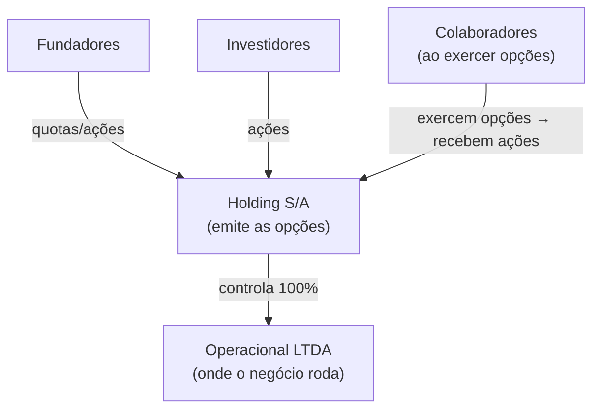

---

### Estruturando o plano de opções (ESOP)

#### Documentos necessários

1. **Plano de Opções** (documento-mãe): define regras gerais — pool total, tipos de beneficiários, condições de vesting, eventos de aceleração, definição de good/bad leaver, e procedimento de exercício.
2. **Contrato de Opção Individual** (por colaborador): especifica o número de opções concedidas, o preço de exercício, o cronograma de vesting, e referencia o Plano geral.
3. **Aprovação societária**: em S/A, assembleia. Em LTDA, alteração do contrato social ou deliberação de sócios.

#### Vesting: cliff e cronograma

**Estrutura padrão (4 anos com cliff de 1 ano).**

```
Mês 0    → Concessão. Nenhuma opção vested.
Mês 12   → Cliff. 25% das opções vestem de uma vez.
Mês 13–48 → Vesting mensal. 1/36 das opções restantes por mês.
Mês 48   → 100% vested.
```

**Por que cliff de 1 ano?** Protege a empresa de conceder equity para colaboradores que saem rápido. Também alinha incentivos: o colaborador sabe que precisa passar pelo cliff para ter algum valor.

**Variações comuns no Brasil.**
- 3 anos com cliff de 6 meses: para contratações sênior em early-stage que têm poder de barganha.
- 2 anos com cliff de 1 ano: para advisors e colaboradores de curto prazo.
- Sem cliff para cofundadores (já têm equity direto, não opção).

#### Aceleração

**Single-trigger**: aceleração automática em mudança de controle (M&A, fusão). Todas as opções vestem imediatamente quando o deal fecha.

**Problema do single-trigger para a empresa**: o acquirer sabe que no dia do closing todo o equity vesta imediatamente. Isso reduz o retention incentive pós-aquisição. Muitos acquirers descontam no preço ou exigem novo plano de retenção — o que dilui mais os founders.

**Double-trigger**: aceleração apenas se houver (1) mudança de controle E (2) demissão sem justa causa (ou rebaixamento de função) dentro de 12 a 24 meses após o evento.

> [!tip] Double-trigger é o padrão em startups bem assessoradas
> Single-trigger parece mais generoso para o colaborador, mas na prática aumenta o custo da aquisição para o acquirer — e isso reduz o preço total do deal. Double-trigger é melhor para todos se o colaborador realmente quer ficar após o exit.

#### Good leaver / bad leaver

Define o que acontece com as opções quando o colaborador sai.

| Situação | Good leaver | Bad leaver |
|---|---|---|
| Exemplos | Demissão sem justa causa, doença, morte | Demissão por justa causa, violação de NDA, concorrência |
| Opções vested | Pode exercer dentro do prazo (90–180 dias) | Empresa recompra pelo preço de exercício (ou perde) |
| Opções não-vested | Canceladas | Canceladas |

**Prazo de exercício pós-saída**. Padrão americano é 90 dias. No Brasil, recomenda-se 180 dias para dar ao colaborador tempo de resolver a situação tributária e financeira do exercício.

#### Tamanho do option pool

| Estágio | Pool recomendado (fully diluted) | Observação |
|---|---|---|
| Pré-seed / seed | 10–15% | Suficiente para primeiras 5–10 contratações técnicas |
| Série A | 15–20% | Investidores geralmente exigem expansão do pool pré-closing |
| Série B+ | 5–10% de refresh | Pool consome com o crescimento do time |

> [!warning] Pool "fully diluted" vs. "pós-investimento"
> Investidores calculam participação fully diluted — incluindo o option pool. Um pool de 15% antes da rodada significa que founders e investidores existentes já estão diluídos por esse pool antes de o novo investidor entrar. Sempre modelar o cap table com o pool incluído antes de negociar valuation.

---

### Gestão do cap table

#### O que manter atualizado

- Número total de quotas/ações emitidas.
- Opções concedidas (por colaborador, com data, preço de exercício, cronograma de vesting).
- Opções exercidas (convertidas em ações reais).
- Opções canceladas (colaboradores que saíram antes do vesting).
- COCPs e outros instrumentos conversíveis.
- Participação fully diluted de cada sócio e grupo (founders, investidores, option pool).

#### Ferramentas disponíveis no Brasil

| Ferramenta | Origem | Adequação BR | Custo |
|---|---|---|---|
| Captable.io | Brasil | Alta | Pago |
| Pulso | Brasil | Alta | Pago |
| CartaHQ (Carta) | EUA | Média (adaptação manual) | Pago |
| Planilha própria | — | Funciona até ~20 titulares | Grátis |

Para startups até Série A, planilha bem estruturada com controle de datas e cenários de diluição é suficiente. A partir de Série A, ferramenta dedicada evita erros em cálculos de liquidation preference e waterfall em exits.

#### Refresh grants

Colaboradores que se aproximam do fim do vesting (anos 3–4) perdem o incentivo de permanecer. Refresh grant é uma nova concessão de opções — com novo cronograma de vesting — para reengajar.

**Timing**: conceder quando o colaborador ainda tem 12–18 meses de vesting original restante. Não esperar até o fim.

**Tamanho**: tipicamente 25–50% do grant original, dependendo do desempenho e do estágio da empresa.

---

### Phantom shares na prática

Para startups que ainda não querem estruturar S/A ou emitir quotas, phantom shares são a saída operacional mais simples.

**Como funciona o pagamento.** Define-se um percentual econômico virtual (ex: 0,5% da empresa). Em um evento de liquidez — M&A, distribuição extraordinária — o colaborador recebe em dinheiro o equivalente a 0,5% do valor total recebido pelos sócios.

**Contrato necessário.** Acordo de phantom shares com: definição do percentual, eventos de liquidez que ativam o pagamento, vesting análogo ao de opções, e good/bad leaver.

**Tributação**. No pagamento: IRRF na fonte como remuneração variável (tabela progressiva, até 27,5%) + INSS (se colaborador CLT). Não há debate tributário — é remuneração clara.

**Quando migrar para opções reais.** Ao fechar Série A e ter S/A estruturada, converter phantom shares para stock options reais permite que o colaborador tenha instrumento com melhor tratamento tributário potencial.

---

### Armadilhas

**Emitir opções sem plano formal.** Promessa verbal ou e-mail informal não é vinculante da forma esperada. Em litígio trabalhista, o colaborador pode questionar se a opção era parte da remuneração — e a empresa não tem documento que defina os termos. Sempre formalizar.

**Não comunicar a tributação esperada.** Colaborador que recebe opções acredita que o upside é X. Na hora do exit, descobre que vai pagar IRPF sobre X e ficar com Y. A percepção de traição destrói o efeito motivacional retroativamente — e pode virar litígio. Comunicar tributação esperada no ato da concessão.

**Pool insuficiente para contratações futuras.** Founders que não criam pool grande o suficiente descobrem que precisam diluir mais na Série A do que planejado para expandir o pool. Criar pool com horizonte de 18–24 meses de contratações planejadas.

**Preço de exercício desatualizado.** Definir preço de exercício em seed e nunca atualizar. Quando a empresa cresce 10x, o preço de exercício é ínfimo — o que fortalece o argumento da Receita de que é remuneração disfarçada. Fazer laudo de FMV a cada rodada e para novas concessões.

**Vesting sem cliff para primeiras contratações.** Colaborador número 3 sai no mês 8. Sem cliff, já tem 8/48 de equity vested. Com cliff de 1 ano, saída no mês 8 resulta em equity zero. O cliff protege a concentração de equity em quem fica e constrói.

**Esquecer o exercício pós-saída.** Colaborador com 3 anos de vesting sai da empresa. Tem 90 dias para exercer. Não avisa ninguém, não é avisado, prazo vence, perde as opções. A empresa não tem obrigação de avisar ativamente — mas perda de equity por prazo expirado cria má reputação. Implementar processo de notificação formal ao desligar colaboradores com opções vested.

**Não modelar o cap table fully diluted antes de cada rodada.** Founders chegam à Série A achando que têm 40% da empresa. Com o option pool existente, os COCPs, e o novo pool exigido pelo VC, calculado fully diluted, têm 28%. A surpresa na hora do term sheet destrói negociação. Modelar sempre.

> [!info] Fases relacionadas
> Referenciado em: Fase 13.

---

### Conexão com outros apêndices

| Tópico | Apêndice |
|---|---|
| Cap table, vesting de fundadores, estrutura S/A vs LTDA | [[#FASE 13 — ESTRUTURAÇÃO JURÍDICA, FINANCEIRA E OPERACIONAL|Fase 13]] |
| Marco Legal das Startups, COCP para investidores | [[#APÊNDICE DA — MARCO LEGAL DAS STARTUPS: LC 182/2021|Apêndice DA]] |
| Tributação geral, regimes fiscais | [[#APÊNDICE W — CONTABILIDADE, TRIBUTÁRIO E REGIMES FISCAIS PARA STARTUP BRASILEIRA|Apêndice W]] |
| Captação, term sheet, liquidation preference | [[#APÊNDICE V — CAPTAÇÃO DE EQUITY, PITCH E RELACIONAMENTO COM INVESTIDORES|Apêndice V]] |
| Executive hiring, pacotes de compensação C-level | [[#APÊNDICE BN — EXECUTIVE HIRING: CONTRATAR LÍDERES SÊNIOR E C-LEVEL|Apêndice BN]] |
| Performance reviews e compensação total | [[#APÊNDICE BZ — PERFORMANCE REVIEWS ESTRUTURADOS: CICLO, CALIBRAÇÃO E CONEXÃO COM COMPENSAÇÃO|Apêndice BZ]] |
| Layoffs e encerramento de vesting | [[IGNICAO-Vol-5-Maturidade#APÊNDICE BV — LAYOFFS E DOWNSIZING: COMO DEMITIR EM ESCALA SEM DESTRUIR A EMPRESA|Apêndice BV (Vol. 5)]] |
| M&A e liquidation events | [[IGNICAO-Vol-5-Maturidade#FASE 16 — EXIT STRATEGY|Fase 16 (Vol. 5)]] |

### Leitura adicional

- **Lei 6.404/1976 (Lei das S/A), art. 168** — base legal para planos de opção em sociedades anônimas.
- **Acórdãos do CARF** — buscar por "plano de opção de compra de ações natureza" no portal do CARF para acompanhar a jurisprudência atual.
- **"Stock Options no Brasil" — Gustavo Brigagão (ABDF)** — análise tributária referenciada na doutrina.
- **Carta / Captable.io** — documentação de como modelar cap table com opções e cenários de diluição.
- **YC SAFE and Option Pool Primer** — referência conceitual (não aplicável diretamente ao direito brasileiro, mas útil para o modelo mental).

### Ver também

[[#APÊNDICE ED — COMPENSAÇÃO E BENEFÍCIOS NO BRASIL|Apêndice ED]], Compensação total. [[#APÊNDICE BN — EXECUTIVE HIRING: CONTRATAR LÍDERES SÊNIOR E C-LEVEL|Apêndice BN]], pacotes C-level. [[#APÊNDICE CR — ENGINEERING MANAGEMENT: GESTÃO DO TIME TÉCNICO E DEVELOPER EXPERIENCE|Apêndice CR]], engineering management.

---

## APÊNDICE AP — CULTURA COMO DISCIPLINA

> [!note] Nota de validade
> Princípios de construção de cultura são estáveis ao longo de décadas. Ferramentas (engagement surveys, OKRs, ferramentas de feedback) evoluem em três a cinco anos. Revisar bienalmente.

A [[#FASE 14 — ESCALA: TIME, OPERAÇÕES, CRESCIMENTO E CAPITAL|Fase 14]] (Time e Liderança) menciona "valores documentados" como entregável. O [[#APÊNDICE R — FOUNDER MODE, DELEGAÇÃO E QUANDO PARAR DE FAZER|Apêndice R]] (Founder Mode, modo fundador) toca em liderança. Cultura como disciplina gerenciada, como escrever valores que não sejam clichês, como mantê-los em escala, como medir, rituais de reforço, sinais de toxicidade, não tem apêndice dedicado. É lacuna consequente. Cultura ruim não mata empresa no curto prazo, mas erode talento, produtividade e marca empregadora ao longo de anos.

Este apêndice cobre cultura, não como "valores no cartaz", mas como comportamento agregado que pode ser gerenciado deliberadamente.

### O que esse apêndice cobre

Cultura é o que as pessoas fazem quando ninguém está olhando, somado em escala. "O jeito que as coisas são feitas aqui".

Três dimensões gerenciáveis. Valores articulados — o que a empresa declara que importa. Comportamentos reforçados — o que a empresa efetivamente recompensa e pune. Rituais e símbolos — como a cultura se renova diariamente.

Os entregáveis: documento de valores substantivo, rituais formalizados, sistema de medição (engagement, mais indicadores qualitativos) e plano de ação quando há desalinhamento.

### POR QUE

Cultura se consolida cedo e muda devagar. Os primeiros dez a cinquenta funcionários moldam padrão que vai influenciar quinhentos ou cinco mil. Erro de dez vira dívida cultural enorme em quinhentos.

"Valores" no cartaz sem prática diária é pior que nenhum valor. Os funcionários leem a hipocrisia e ficam cínicos.

Cultura é principal fator de retenção em escala. Salário compete. Cultura distingue. O Vale do Silício mostra isso há décadas.

Empresa com cultura ruim recruta errado. O talento top não entra. Quando entra, sai em dezoito meses. Custo oculto gigante.

### Quando usar

[[IGNICAO-Vol-1-Ideacao#FASE 0 — PREPARAÇÃO DO EMPREENDEDOR|Fase 0 (Vol. 1)]] (antes mesmo da primeira contratação). Os fundadores articulam valores em que acreditam.

[[#FASE 14 — ESCALA: TIME, OPERAÇÕES, CRESCIMENTO E CAPITAL|Fase 14]] (Time e Liderança), primeiros dez funcionários. A cultura se forma — deliberadamente ou por padrão.

[[#FASE 14 — ESCALA: TIME, OPERAÇÕES, CRESCIMENTO E CAPITAL|Fase 14]] (Operações, da escala inicial à Série C), dez para cem ou mais pessoas. A cultura precisa de reforço explícito: rituais, comunicação e onboarding estruturado.

Série B em diante (cem ou mais pessoas). Cultura vira função (pessoas, ou people ops, formalizado). Medição sistemática.

[[IGNICAO-Vol-5-Maturidade#FASE 15 — REINVENÇÃO E SEGUNDA CURVA|Fase 15 (Vol. 5)]] (momento de reinvenção). Cultura frequentemente precisa de recalibração.

### Quem envolve

CEO. Guardião primário da cultura. A modelagem pessoal é o principal vetor.

Liderança executiva. Multiplicadores. Se a liderança não vive os valores, ninguém mais vive.

Head of People (líder de pessoas) ou HRBP (HR Business Partner, parceiro de negócio em RH). Operacionaliza onboarding, rituais, medição e intervenção.

Peer leaders (ICs — Individual Contributors, contribuidores individuais — respeitados). Cultura horizontal, não só top-down (de cima para baixo).

Culture committee (comitê de cultura, em escala). Grupo rotativo de funcionários que defende a cultura e propõe iniciativas.

### Como executar

#### 1. Articulação de valores, não clichê

> [!important] Teste de valor real
> Se você pode inverter, e outra empresa também poderia adotar, não é valor real. É platitude.

Exemplo de clichê. "Integridade". Qual empresa diria "temos baixa integridade"? Nenhuma. Logo, não distingue.

Exemplo de valor real. "Intensidade antes de perfeição". Distingue. Outra empresa pode genuinamente valorizar "perfeição antes de intensidade". Implica escolhas diferentes de contratação, processo, e comunicação.

Outros valores com tensão real. "Transparência radical" (versus "discreto, e profissional"). "Debate acalorado, depois commit" (versus "consenso sempre"). "Ownership individual" (versus "decisão coletiva"). "Data wins arguments" (versus "experience wins arguments"). "Ship fast, fix forward" (versus "ship right, don't break").

Processo de articulação, em cinco passos.

1. Observar comportamentos que você admira na empresa hoje. Quais pessoas exemplificam o que você quer que cresça?
2. Articular o que essas pessoas fazem, que é distinto. Não generalidades. Ações específicas.
3. Testar tensão. A formulação reversa faz sentido para outra empresa? Se sim, bom.
4. Limitar a quatro a sete valores. Mais vira lista ignorada.
5. Cada valor com explicação de dois a três parágrafos. O que significa, o que NÃO significa, e exemplos concretos.

Exemplos de articulação boa (publicamente disponíveis). Netflix Culture Deck (original 2009, e revisões). Amazon Leadership Principles. Stripe's "The Stripe Way". GitLab's public handbook. Estudar, não para copiar. Mas para ver como articulam, sem clichê.

#### 2. Comportamentos reforçados, onde cultura vive

Princípio. Cultura não é o que está no documento de valores. É o que acontece quando.

Alguém entrega resultado excepcional, sendo "culturalmente estranho". Promoção, ou não? Alguém entrega ok, sendo "culturalmente ideal". Retido, ou não? Decisão difícil, prazo versus qualidade. Qual vence? Conflito entre áreas. Resolvido por hierarquia, ou por debate? Funcionário erra. Sancionado, ignorado, ou usado como aprendizado?

> [!warning] No asshole rule (Robert Sutton)
> Empresa declara "não toleramos tóxicos", mas mantém vendedor que bate meta enquanto destrói o time. Sinal claro de que os valores são performáticos. Os funcionários leem isso e adaptam comportamento ao que a empresa de fato recompensa, não ao que ela diz valorizar.

Decisões de contratar, e demitir, são os sinais mais claros de cultura real. Os funcionários leem quem fica, e quem sai, com muito mais atenção do que discursos.

#### 3. Rituais de reforço

Cultura precisa de renovação constante. Rituais específicos.

**All-hands (semanal, ou quinzenal).** Número, e métricas (transparência). Reconhecimento público (Nome X demonstrou valor Y, nessa situação específica). Perguntas, e respostas, abertas, incluindo temas difíceis. Frequência vale mais que tamanho. All-hands curto semanal vale mais que all-hands longo trimestral.

**Onboarding como "cultura bootcamp".** Primeiro dia de novo funcionário, dia de cultura. Não de produto. Sessão com fundador, sobre história, valores, e decisões difíceis passadas. Shadowing com colegas de culturas diversas na empresa. "Manual pessoal", cada funcionário escreve uma página, sobre como trabalha melhor.

**Rituais de reconhecimento.** Kudos públicos em all-hands, ou canal dedicado ("Alguém demonstrou valor X esse mês? Marque aqui"). Peer bonuses (programas onde colaboradores podem premiar uns aos outros). Histórias narradas, o CEO conta histórias específicas, de decisões culturais difíceis tomadas.

**Rituais de feedback.** Retrospectivas trimestrais abertas, sobre cultura. O que está indo bem? Onde estamos falhando contra os nossos valores? Skip-level meetings, os funcionários conversam com líder do seu líder, regularmente.

**Rituais de pertencimento.** Offsites anuais (se remote), ou retiros estratégicos. Celebração de marcos (primeira rodada, primeiro cliente âncora, aniversários de empresa). Projetos inter-áreas (hackathons, workshops), que juntam pessoas que não trabalhariam juntas.

Cuidado. Os rituais podem virar teatro. Kudos performáticos, onboarding superficial, retrospectivas onde ninguém fala a verdade. Renovar formato, quando autenticidade cair.

#### 4. Medição, como saber se cultura está saudável

Indicadores quantitativos. eNPS (Employee Net Promoter Score), "você recomendaria trabalhar aqui para amigo?". Escala menos cem a mais cem. Saudável, mais trinta a mais sessenta. Excepcional, mais sessenta em diante. Engagement score, ferramentas como CultureAmp, Lattice, Officevibe, Gallup Q12. Trimestral, ou bianual. Retention rate, um ano, dois anos, três anos. Sector-specific (tech tende a quinze a vinte por cento anual. Acima é ruim). Regrettable attrition rate, percentual de saídas que a empresa gostaria de ter retido. Alvo menor que cinquenta por cento do attrition total. Internal mobility, percentual das contratações seniores preenchidas internamente. Alvo crescente. Employee referrals, percentual de contratações vindas de referência interna. Alvo maior que trinta por cento. Alta sinaliza que os funcionários recomendam a empresa. Glassdoor, ou LinkedIn. Reviews externas. Monitorar. Não obsessar.

Indicadores qualitativos. Exit interviews, quando a pessoa sai, honestamente, o que motivou? Processo estruturado, trinta a sessenta minutos, com alguém que não é gerente direto. Stay interviews, regularmente, com pessoas-chave retidas, "por que você fica?". Skip-level observation, o líder do líder ouve pontos que o direct report não ouve. Anonymous pulse, tools dedicadas (Peakon, CultureAmp pulse), respostas anônimas semanais, ou quinzenais, sobre temas específicos.

Triangulação. Nenhum indicador sozinho é suficiente. eNPS alto, mais retenção em queda, igual a ainda tem problema escondido.

#### 5. Sinais de cultura tóxica

Red flags que exigem intervenção. Alto turnover de mulheres, ou minorias específicas. Sinaliza problemas específicos. Gossip, em vez de feedback direto. As coisas difíceis são ditas nos bastidores, não em reuniões. Fundador, ou liderança, imune a feedback. Crítica constante punida. Elogio constante recompensado. "Alto performer tóxico" tolerado. Vendedor com top number, que abusa do time, fica por "resultados". Decisões personalíssimas. Quem tem acesso ao fundador manda. O resto é excluído. Cultura of silence em conflito. Os problemas não são endereçados. Acumulam-se. Over-work celebrado como valor. Oitenta horas de semana, como sinal de "compromisso". Burnout sistêmico. Medo de falhar. Erro é punido. Então ninguém toma risco. Inovação morre. Saídas no mesmo time em seis meses. Não é coincidência. Há causa sistêmica.

Intervenção, quando detectado. Ver [[IGNICAO-Vol-5-Maturidade#APÊNDICE CW — CRISE E CONTINUIDADE: PREVENÇÃO, RESPOSTA, RECUPERAÇÃO|Apêndice CW (Vol. 5)]] (Crise). Cultura tóxica pode ser crise silenciosa, que erode a empresa por anos, antes de explodir.

#### 6. Cultura em escala, mantendo identidade

Desafios de escala (cem para quinhentos para mil ou mais pessoas).

Sem conhecer todo mundo, os valores precisam ser mais explícitos. Não implícitos.

Liderança intermediária (gerentes de gerentes) torna-se multiplicadora crítica. Seleção, e treinamento, de managers vale muito mais que onboarding de contribuidores individuais.

Distância do fundador aumenta. Rituais onde o fundador aparece regularmente (all-hands, skip-levels) preservam conexão.

Comunicação assimétrica. O que o fundador diz é amplificado. Precisa de cuidado adicional.

Sub-culturas emergem (vendas versus engenharia, squads diferentes). Saudável, se compartilham base. Problemático, se entram em conflito.

Mecanismos de preservação. Written company handbook (GitLab é referência pública). Culture stories, histórias específicas repetidas. Leadership development programs, focados em cultura, não só em skills gerenciais. Culture interview em hiring, ainda entrevista explícita sobre fit com valores (cuidado com viés, não "achei legal", "tem as disposições que buscamos").

#### 7. Quando cultura precisa de intervenção ativa

Momentos-gatilho. Após crescimento acelerado (dobrou time em doze meses). Após integração de aquisição. Após saída significativa de funcionários. Após mudança de CEO, ou C-level chave. Após crise pública ([[IGNICAO-Vol-5-Maturidade#APÊNDICE CW — CRISE E CONTINUIDADE: PREVENÇÃO, RESPOSTA, RECUPERAÇÃO|Apêndice CW (Vol. 5)]]). Após virada estratégica (expansão internacional, ou pivô).

Processo de recalibração, em cinco passos.

1. Diagnóstico. Engagement surveys, um a um estruturados, e exit interviews dos últimos seis meses.
2. Articulação. O que está desviando? Por quê?
3. Plano de ação. Mudanças estruturais (processo, rituais), e mudanças de liderança, se necessário.
4. Comunicação honesta. O fundador admite publicamente que há problema. Compromete-se com correção.
5. Follow-up. Mesmo processo, em três a seis meses. Mudanças visíveis, ou escalação.

---

#### 8. Padrões de cultura tóxica: diagnóstico e intervenção

Cultura tóxica raramente é declarada. Emerge de padrões tolerados ao longo do tempo — comportamentos que, individualmente, podem parecer menores, mas que somados definem "como as coisas são feitas aqui" de forma destrutiva.

**O problema do "brilhante difícil" (brilliant jerk).**

O brilhante difícil é o profissional de alta performance que produz resultados excepcionais enquanto deixa um rastro de dano relacional: humilha colegas em reuniões, não aceita feedback, recusa colaboração, toma crédito do trabalho alheio, ou cria ambiente de medo ao redor de si.

O dilema é real: a empresa tem resultado com essa pessoa. A pressão para tolerá-la é forte, especialmente se o resultado é visível (fechamentos de vendas, entregas técnicas, crescimento de produto).

O custo invisível é sistêmico. Pesquisa de Robert Sutton ("The No Asshole Rule") documenta que um único "asshole" em posição de influência pode reduzir a produtividade de um time inteiro em 30-40%, aumentar o turnover das pessoas ao redor e destruir a disposição de tomar riscos — porque o ambiente de humilhação torna o erro ameaçador.

Diagnóstico: perguntar "quem no time produz resultados mas em cujas reuniões as pessoas ficam em silêncio ou deixam de participar?". Fazer skip-levels com os reportes diretos da pessoa. Medir se o turnover é maior nas pessoas que trabalham diretamente com ela.

Intervenção: o CEO ou líder direto precisa nomear o comportamento explicitamente, separado do reconhecimento pelos resultados. "Você entrega muito. E seu comportamento X está destruindo o time. Precisamos mudar isso." Prazo definido para mudança comportamental mensurável. Se não houver mudança, desligamento — mesmo com resultado alto. A sinalização para o resto da empresa do que esse desligamento representa é mais valiosa do que qualquer entrega individual.

**Hero culture.**

Hero culture é o padrão onde a empresa funciona porque certas pessoas-chave resolvem tudo — estão em todo lugar, trabalham 80 horas, salvam projetos em colapso, nunca delegam. São celebradas como heróis. E de fato são indispensáveis.

O problema: heróis não escalam. A empresa se torna dependente de indivíduos não-substituíveis. Quando o herói sai — por burnout, por oferta melhor, por qualquer razão — o sistema colapsa. E enquanto está, o herói frequentemente bloqueia, mesmo que sem intenção, o desenvolvimento das pessoas ao redor, porque sempre resolve mais rápido sozinho.

Diagnóstico: identificar quem, se saísse amanhã, causaria crise operacional imediata. Se a resposta for mais de uma ou duas pessoas em uma empresa de 50, há hero culture sistêmica.

Intervenção: deliberadamente dar ao herói um projeto novo onde ele não pode resolver tudo — onde precisa construir capacidade em outros. Reconhecer explicitamente quando alguém delega bem e outro cresce em consequência. Remover a recompensa de ser insubstituível: o herói que documenta seus processos e treina substituto deve ser mais reconhecido do que o herói que acumula dependência.

**Blame culture.**

Em blame culture, quando algo dá errado, o reflexo organizacional é encontrar o responsável e puni-lo — explicitamente ou por ostracismo. O resultado é que ninguém assume risco, ninguém reporta problemas cedo, e os erros ficam escondidos até que sejam grandes demais para ignorar.

O diagnóstico mais confiável é observar o que acontece imediatamente após uma falha visível. Se a conversa dominante é "quem deixou isso acontecer?" em vez de "o que podemos aprender e como evitar?", há blame culture.

Intervenção: o CEO precisa modelar o comportamento alternativo de forma pública e consistente. Quando algo falha, narrar o processo de aprendizado — não o processo de punição. Implementar post-mortems sem culpa (blameless post-mortems), metodologia de engenharia que identifica causas sistêmicas em vez de culpados individuais. Reconhecer quem reporta problemas cedo, em vez de quem os esconde.

**Exclusão por padrão.**

Exclusão por padrão não é preconceito declarado. É o padrão onde certas pessoas — por gênero, por origem, por estilo de comunicação, por não estar na rede informal de poder — sistematicamente não são incluídas nas conversas importantes, não são consideradas para projetos visíveis, e não recebem o mesmo acesso ao desenvolvimento que os "do grupo".

Manifesta-se em: reuniões onde certas pessoas nunca são convidadas mas depois precisam executar decisões tomadas sem elas. Projetos de destaque que sempre vão para o mesmo perfil de pessoa. Feedbacks que são mais prescritivos para alguns grupos do que para outros. Promoções onde o critério informal é "parece um líder" — critério que tende a reproduzir o perfil de quem já está no topo.

Diagnóstico: analisar dados de promoção, de acesso a projetos visíveis, de participação em comitês por demografia. Se há padrão, há problema. Skip-levels com pessoas de grupos sub-representados, com pergunta direta: "Você sente que tem as mesmas oportunidades que seus pares?".

Intervenção: ver [[#APÊNDICE BU — DIVERSIDADE, EQUIDADE E INCLUSÃO (DEI) EM STARTUP BRASILEIRA|Apêndice BU]] para programa estruturado de DEI. No nível de cultura imediata: tornar critérios de promoção e acesso a projetos explícitos e públicos. Criar processos estruturados (não informais) para decisões de alocação de pessoas. Medir os outputs por demografia.

---

> [!tip] Casos especiais de cultura
> Para cultura em situacoes especificas (M&A, hipercrescimento, remoto e hibrido), ver [[#APÊNDICE FG — CULTURA EM SITUAÇÕES ESPECIAIS: M&A, HIPERCRESCIMENTO, REMOTO|Apêndice FG]]. Este apendice cobre o framework raiz de cultura como disciplina.

### Métricas

eNPS. Alvo igual ou maior que mais trinta. Excepcional igual ou maior que mais sessenta.

Retention rate, um ano. Alvo igual ou maior que oitenta e cinco por cento.

Retention rate, dois anos. Alvo igual ou maior que setenta por cento.

Regrettable attrition. Alvo menor que cinquenta por cento do attrition total.

Referral hire rate. Alvo igual ou maior que trinta por cento.

Engagement survey participation. Alvo igual ou maior que oitenta e cinco por cento.

Tempo médio no cargo, antes de promoção interna. Contextual. Mas rastreado.

Glassdoor rating. Alvo igual ou maior que quatro vírgula zero em cinco.

CEO approval rating (Glassdoor). Alvo igual ou maior que oitenta por cento.

Retenção nos primeiros 90 dias (novos contratados). Alvo igual ou maior que noventa e cinco por cento. Abaixo disso sinaliza falha de onboarding ou promessa de emprego não cumprida.

### Armadilhas

Valores no cartaz, prática diferente. A hipocrisia visível é destrutiva.

Valores copiados de Netflix, ou Amazon. Não são seus. Não viveram pela sua trajetória. Os funcionários percebem.

Cultura como perk. "Temos mesa de pebolim, e cerveja grátis", não é cultura. Isso é benefício. Cultura é comportamento agregado.

Fundador imune a feedback. Se o valor é "transparência radical", e o fundador não aceita crítica direta, a cultura é performativa.

Demitir tarde demais por "cultura". Os funcionários leem lentidão, como sinal de que os valores não importam.

Contratar rápido, e comprometer fit. Em escala, diluição é fatal.

Cultura só top-down. Os funcionários experientes, de todos os níveis, precisam ser co-criadores.

Ignorar sub-culturas tóxicas. Time pequeno problemático se propaga, se não endereçado.

Medir cultura, e não agir sobre resultados. Engagement survey com score baixo, seguido de inação. Destrói credibilidade do próprio processo.

Sobre-articular em pouco. Doze valores, ninguém decora.

Onboarding superficial. Primeiro dia com paperwork de RH, em vez de cultura, é oportunidade perdida.

Tolerar brilliant jerk por resultado de curto prazo. O custo sistêmico supera o benefício individual em quase todos os casos documentados.

### Checklist

Cultura está saudável quando todos os itens abaixo estão cumpridos.

- [ ] Valores articulados com substância (não clichês), testados com reversibilidade. Quatro a sete valores, cada um com 2-3 parágrafos de explicação.
- [ ] CEO e liderança executiva modelam valores pessoalmente nas decisões difíceis (não só no cartaz).
- [ ] Rituais de reforço formais (all-hands, onboarding, kudos, retrospectivas) acontecendo consistentemente.
- [ ] Engagement survey semestral com 85% ou mais de participação; síntese e plano de ação publicados.
- [ ] Exit interviews estruturados em 100% das saídas, com síntese regular à liderança.
- [ ] Red flags culturais monitorados (regrettable attrition, silêncio em feedback, retention < 95% em 90 dias). Plano de intervenção ativa quando sinais aparecem.
- [ ] Em empresa de 50+: written handbook (mesmo rudimentar) existe.
- [ ] Em empresa de 100+: leadership development program rodando.
- [ ] Em empresa de 200+: culture committee ou equivalente ativo.
- [ ] Brilliant jerks endereçados com prazo definido, não tolerados indefinidamente; hero culture diagnosticada e mitigada.
- [ ] CEO approval rating (Glassdoor) ≥ 80%; retenção em primeiros 90 dias ≥ 95%; cultura mantida em escala via handbook, leadership development e rituais.
- [ ] Para situações específicas (M&A, hipercrescimento, times remotos e híbridos), ver [[#APÊNDICE FG — CULTURA EM SITUAÇÕES ESPECIAIS: M&A, HIPERCRESCIMENTO, REMOTO|Apêndice FG]] e aplicar o checklist correspondente.

### Ver também

[[#APÊNDICE FG — CULTURA EM SITUAÇÕES ESPECIAIS: M&A, HIPERCRESCIMENTO, REMOTO|Apêndice FG]], cultura em situações especiais (M&A, hipercrescimento, remoto e híbrido). [[#APÊNDICE BU — DIVERSIDADE, EQUIDADE E INCLUSÃO (DEI) EM STARTUP BRASILEIRA|Apêndice BU]], DEI em profundidade. [[IGNICAO-Vol-5-Maturidade#APÊNDICE BV — LAYOFFS E DOWNSIZING: COMO DEMITIR EM ESCALA SEM DESTRUIR A EMPRESA|Apêndice BV (Vol. 5)]], Layoffs. [[#APÊNDICE BZ — PERFORMANCE REVIEWS ESTRUTURADOS: CICLO, CALIBRAÇÃO E CONEXÃO COM COMPENSAÇÃO|Apêndice BZ]], Performance reviews. [[#APÊNDICE CO — RECRUTAMENTO TÉCNICO EM PROFUNDIDADE|Apêndice CO]], Recrutamento técnico. [[IGNICAO-Vol-5-Maturidade#APÊNDICE CW — CRISE E CONTINUIDADE: PREVENÇÃO, RESPOSTA, RECUPERAÇÃO|Apêndice CW (Vol. 5)]], Crise e Continuidade. [[#APÊNDICE ED — COMPENSAÇÃO E BENEFÍCIOS NO BRASIL|Apêndice ED]], Compensação e benefícios. [[#APÊNDICE R — FOUNDER MODE, DELEGAÇÃO E QUANDO PARAR DE FAZER|Apêndice R]], Founder mode. [[#APÊNDICE AG — REMOTE, HYBRID E DISTRIBUÍDO COMO DISCIPLINA|Apêndice AG]], Remote e hybrid.

> [!info] Fases relacionadas
> Referenciado em: Fase 14.

---

## APÊNDICE FG — CULTURA EM SITUAÇÕES ESPECIAIS: M&A, HIPERCRESCIMENTO, REMOTO

> [!abstract] Posição no livro
> Este apêndice trata cultura aplicada a contextos específicos (M&A, hipercrescimento, times remotos e híbridos). Para o framework raiz de cultura como disciplina, ver [[#APÊNDICE AP — CULTURA COMO DISCIPLINA|Apêndice AP]].

> [!note] Nota de validade
> Princípios de transmissão cultural em escala e em integração de empresas são estáveis. Ferramentas (engagement surveys, plataformas de colaboração distribuída) evoluem em três a cinco anos. Revisar bienalmente.

Cultura raiz é o que [[#APÊNDICE AP — CULTURA COMO DISCIPLINA|Apêndice AP]] cobre, valores articulados, comportamentos reforçados, rituais, medição e padrões tóxicos. Mas três contextos específicos colocam cultura sob estresse de natureza diferente. Times distribuídos expõem tudo que era mantido por proximidade física. Hipercrescimento dilui matematicamente os portadores de cultura. M&A coloca duas culturas formadas em contato direto, sob pressão de integração rápida.

Cada um desses contextos exige táticas próprias. Aplicar só o framework raiz não basta. Este apêndice cobre os três casos com profundidade operacional.

### O que esse apêndice cobre

Três contextos onde cultura sofre estresse específico, e o que fazer em cada um.

Cultura em times remotos e híbridos. O que quebra primeiro quando a empresa não compartilha espaço físico, e como compensar ativamente.

Cultura em hipercrescimento. O que acontece quando o headcount dobra em seis meses, e como preservar identidade enquanto o time se expande.

Cultura em fusões e aquisições. O que acontece quando duas culturas formadas se encontram, e como conduzir integração sem destruir o valor da empresa adquirida.

### Quando usar

Em [[#FASE 14 — ESCALA: TIME, OPERAÇÕES, CRESCIMENTO E CAPITAL|Fase 14]], se a empresa opera em modelo distribuído ou híbrido. As táticas de remoto se aplicam desde a primeira contratação remota.

Em [[#FASE 14 — ESCALA: TIME, OPERAÇÕES, CRESCIMENTO E CAPITAL|Fase 14]] ou Série B em diante, ao planejar ou executar contratações em volume. As táticas de hipercrescimento se aplicam antes de acelerar o headcount, não depois.

Em [[IGNICAO-Vol-5-Maturidade#FASE 15 — REINVENÇÃO E SEGUNDA CURVA|Fase 15 (Vol. 5)]] ou em qualquer momento de M&A ativa ou passiva. As táticas de integração cultural se aplicam desde a due diligence, não só após o fechamento.

### Como executar

#### 1. Cultura em times remotos e híbridos

O trabalho distribuído não destrói cultura automaticamente. Mas expõe, com precisão cirúrgica, tudo que era mantido por proximidade física. O que dependia de corredor, calibração informal de valores, resolução de tensões face a face, transmissão de cultura por osmose, deixa de acontecer.

**O que quebra primeiro em times distribuídos.**

Alinhamento informal. Em escritório, conversas de corredor resolvem ambiguidades antes que virem conflito. No remoto, a ausência de alinhamento acumula silenciosamente por semanas, até explodir.

Senso de pertencimento. Pessoas que se juntam após o time ir remoto raramente desenvolvem o mesmo vínculo que quem se conheceu pessoalmente. A cultura "original" fica presa nas pessoas mais antigas. Os novos sentem que há um grupo interno invisível ao qual nunca pertencem de fato.

Visibilidade de contribuição. Em escritório, quem trabalha muito é visto. No remoto, quem não se promove ativamente pode ser invisível, enquanto quem aparece muito em reuniões parece mais produtivo do que é. Gera distorção nos critérios informais de reconhecimento.

Feedback espontâneo. No escritório, um "cara, isso que você fez foi ótimo" acontece naturalmente. No remoto, esse feedback precisa ser intencional, e raramente é, porque exige esforço.

> [!warning] A armadilha do "nossa cultura é boa, a gente se fala no Slack"
> Frequência de mensagens não é indicador de saúde cultural. Times podem ter canais ativos e clima fragmentado. A questão não é volume de comunicação. É qualidade do vínculo, clareza de valores e se as pessoas tomam decisões difíceis de forma consistente com o que a empresa declara que importa.

**Táticas específicas para manter cultura à distância.**

Onboarding estruturado com componente de cultura explícito. Em remoto, o novo funcionário não absorve cultura por osmose. Precisa de ritual deliberado, sessão de 1:1 com o CEO ou fundador na primeira semana (mesmo que breve), apresentação de casos históricos da empresa onde valores foram testados, buddy cultural, um colega designado para contextualizar a "forma de fazer as coisas aqui" nos primeiros 90 dias.

Rituais síncronos não-opcionais. Uma ou duas reuniões por semana onde o time aparece junto ao vivo (câmera ligada) para algo que não é revisão de status. Pode ser all-hands quinzenal com perguntas abertas, retrospectiva semanal do time, ou check-in de 15 minutos no início do dia. O objetivo é criar presença regular, não produtividade extra.

Canais assíncronos com propósito cultural. Canal de reconhecimento público (no Slack ou equivalente) onde qualquer pessoa pode nomear um colega por demonstrar um valor específico, com o nome do valor explícito, não só "parabéns". Canal de "o que aprendi" onde erros e aprendizados são compartilhados sem punição. Canal informal com regras leves (off-topic, vida fora do trabalho) que recriem parte da socialização perdida.

Offsite anual como investimento, não luxo. Para times 100% remotos, o offsite anual (2-3 dias presenciais juntos) é o momento de maior densidade cultural do ano. Deve ser prioridade orçamentária, não linha cortável quando o budget aperta. Times que nunca se encontram pessoalmente constroem vínculos mais frágeis e precisam de mais esforço para resolver conflitos.

Calibração explícita de valores em decisões distribuídas. Em escritório, quando o gestor toma uma decisão difícil, os colegas observam o processo e absorvem o critério. No remoto, esse momento de calibração precisa ser narrado. O líder documenta por escrito (em canal aberto ou handbook) a decisão tomada e o raciocínio cultural por trás dela. Isso substitui, parcialmente, a observação direta.

**Cultura híbrida, o modelo mais difícil.**

Times híbridos, parte presencial, parte remoto, tendem a criar dois grupos com experiências radicalmente diferentes. Quem está no escritório tem acesso a conversas informais, visibilidade espontânea e vínculos mais fortes com a liderança. Quem está remoto sente, com frequência, que as decisões reais acontecem "no corredor", sem eles.

A armadilha não é o modelo em si, é executar híbrido como se fosse presencial com algumas pessoas ausentes. A correção exige regras explícitas, se alguém está remoto em uma reunião, todos entram por vídeo individualmente (não "alguns na sala, um na tela"). Documentação de decisões é obrigatória para todos, não só para quem não estava presente. A paridade de experiência entre presencial e remoto é política de cultura, não preferência pessoal.

#### 2. Cultura em hipercrescimento, o que quebra quando o time dobra

Dobrar o headcount em seis meses é o estressor mais subestimado de cultura. Empresas que passam por esse ciclo, e muitas startups de Série B passam, frequentemente emergem do outro lado com uma empresa que parece diferente de dentro, mesmo que o produto e o mercado sejam os mesmos.

**Por que o hipercrescimento é destrutivo para cultura.**

A diluição é matemática. Se a empresa tinha 50 pessoas com cultura consolidada e contratou mais 60 em seis meses, os "novos" são maioria. Os valores vividos pelos veteranos não se transmitem automaticamente. Cada novo contratado traz suas próprias referências, de empresas anteriores, de culturas diferentes, de estilos de trabalho distintos. Sem mecanismos deliberados de transmissão, a cultura é redefinida por padrão, não por escolha.

O onboarding colapsa sob volume. O processo de onboarding que funcionava para 2-3 contratações por mês não escala para 10-15. A sessão com o fundador vira impossível. O buddy program é improvisado. O "cultura bootcamp" vira três horas de apresentação em PowerPoint. O resultado é que as novas pessoas entendem o produto, mas não entendem a forma de trabalhar.

Os gerentes são promovidos antes de estar prontos. Em hipercrescimento, a empresa frequentemente promove seus melhores ICs a gerentes porque precisa de liderança rápida. Esses novos managers nunca gerenciaram ninguém, não receberam treinamento, e estão gerenciando times em expansão acelerada. A cultura de cada time passa a refletir o estilo pessoal do manager, não os valores da empresa.

A liderança perde visibilidade. O CEO que conhecia todos os 50 funcionários pelo nome não consegue mais fazer isso em 110. A distância entre fundador e time operacional cresce. Decisões começam a ser tomadas sem contexto cultural. O que era implícito precisa se tornar explícito, mas raramente se torna.

> [!important] O onboarding como infraestrutura cultural
> Em hipercrescimento, onboarding não é processo de RH. É infraestrutura crítica de transmissão cultural. Precisa ser tratado com o mesmo rigor que sistema de dados ou processo de vendas. Falhar no onboarding em escala equivale a contratar 60 pessoas e apresentá-las a uma empresa diferente da que você quer construir.

**Táticas para preservar cultura em hipercrescimento.**

Escalar o onboarding antes de escalar o headcount. Antes de acelerar contratações, documentar o onboarding atual, identificar o que é insubstituível (sessão com fundador, buddy, imersão em valores) e criar versões escaláveis, vídeo do fundador gravado com qualidade, grupo de onboarding mensal em vez de individual, buddy program com treinamento.

Definir "culture carriers" explicitamente. Em cada time e em cada novo nível hierárquico, identificar quem são os portadores de cultura, pessoas que vivem os valores com consistência e têm credibilidade com os pares. Envolvê-los ativamente no onboarding de novos colegas e na calibração de comportamentos.

Treinamento de managers como prioridade máxima. Cada novo manager deve passar por programa intensivo de cultura antes de gerenciar alguém. Não curso genérico de liderança. Treinamento específico sobre os valores da empresa, sobre como tomar decisões difíceis consistentemente com esses valores, e sobre como construir rituais de cultura dentro do time.

Comunicação aumentada do fundador. Em hipercrescimento, o CEO precisa se comunicar com o time com frequência maior do que parece necessária. All-hands quinzenal se torna semanal. Memos escritos sobre decisões importantes circulam amplamente. O objetivo não é controle, é manutenção de contexto compartilhado entre pessoas que nunca se encontraram.

Métricas de cultura com maior frequência. Em vez de engagement survey semestral, pulsos mensais curtos (5 perguntas) capturam problemas antes que se consolidem. Retenção nos primeiros 90 dias é indicador crítico, se novos funcionários estão saindo nos primeiros três meses, o onboarding ou a cultura está falhando.

#### 3. Cultura em fusões e aquisições

M&A é o teste mais extremo de cultura. Duas empresas com histórias, valores, rituais e comportamentos diferentes são colocadas juntas, e a fricção cultural é frequentemente subestimada como risco. Estudos consistentes indicam que 50-70% das aquisições destroem valor, e a maioria das análises post-mortem aponta integração cultural como fator central.

**O que acontece quando duas culturas se encontram.**

Raramente há fusão de fato. Há dominância e resistência. A empresa adquirente tende a impor sua cultura, explicitamente, ou pela simples força dos seus sistemas, processos e liderança. A empresa adquirida resiste, de forma passiva ou ativa, porque sua identidade está vinculada a "como fazíamos as coisas antes".

As pessoas da empresa adquirida que mais prezavam sua cultura anterior são frequentemente as primeiras a sair, levando consigo o talento que o adquirente queria reter. O que sobra é uma mistura de conformistas e resistentes, não uma nova cultura integrada.

**Os erros mais comuns no M&A de cultura.**

Assumir que cultura vai "se resolver sozinha" com o tempo. Não resolve. Endurece. As divisões culturais que não são abordadas nos primeiros seis meses se tornam identidades entrincheiradas nos próximos anos.

Mover rápido demais em integração de sistemas sem trabalhar cultura primeiro. Quando a empresa adquirida é forçada a adotar os processos do adquirente antes de haver confiança ou entendimento cultural compartilhado, a resistência explode.

Comunicar só para o topo. Executivos das duas empresas fazem sessões de integração e chegam a acordo. O time médio e operacional, que é a maioria das pessoas, não sabe o que foi decidido, por que, e o que muda para eles.

Tratar a empresa adquirida como inferior. Mesmo que a aquisição seja amigável, a linguagem de "nós compramos vocês", implícita em processos, decisões, comunicação, cria ressentimento. As pessoas da empresa adquirida sentem que foram compradas, não que se uniram.

**O playbook de integração cultural.**

```text
FASES DA INTEGRAÇÃO CULTURAL EM M&A

FASE 1 — DIAGNÓSTICO (primeiros 30 dias)
  - Mapear valores declarados e comportamentos reais das duas empresas
  - Identificar onde há sobreposição (facilita integração)
  - Identificar onde há tensão real (requer decisão consciente)
  - Entrevistar lideranças e ICs-chave das duas empresas sobre o que
    NÃO podem perder da cultura anterior

FASE 2 — DECISÃO (dias 30-60)
  - Definir qual cultura "vence" em cada tensão identificada
    (não há fusão perfeita, há escolhas)
  - Ser honesto sobre o que vai mudar e o que não vai
  - Identificar elementos da empresa adquirida que o adquirente
    quer preservar ativamente (não fingir que tudo se integra igual)

FASE 3 — COMUNICAÇÃO (dias 60-90)
  - Comunicar decisões de cultura para todos os níveis, não só executivos
  - Dar espaço para luto real, a empresa adquirida perdeu algo
  - Narrar o que é preservado, não só o que muda

FASE 4 — RITUAIS DE INTEGRAÇÃO (meses 3-12)
  - Criar rituais que incluam pessoas das duas origens
  - Onboarding cruzado, pessoas da empresa adquirida passam por
    onboarding do adquirente, e vice-versa
  - Projetos inter-equipes deliberados que forcem colaboração
  - Liderança mista em times, evitar guetos de "antigos" e "novos"

FASE 5 — MEDIÇÃO (meses 6-18)
  - Engagement survey específico para integração
  - Medir retenção separada por origem (antigos vs. adquiridos)
  - Identificar onde as divisões persistem e intervir
```

> [!tip] A pergunta certa na due diligence cultural
> Antes de fechar uma aquisição, o adquirente deve perguntar, "Se descrevêssemos os comportamentos que essa empresa recompensa, não os valores declarados, mas o que de fato acontece, com quais dos nossos valores isso entra em conflito direto?" Conflito identificado antes é problema gerenciável. Conflito descoberto depois do fechamento é crise.

**Preservar o que é valioso na empresa adquirida.**

Toda empresa que foi construída com sucesso suficiente para ser adquirida tem algo que funcionou. Frequentemente, é exatamente esse algo que o adquirente quer capturar, velocidade de execução, cultura de inovação, forma de pensar sobre o produto. O paradoxo é que o próprio processo de integração pode destruir o que tornava a empresa valiosa.

A proteção começa na decisão consciente, identificar os dois ou três elementos da empresa adquirida que são mais críticos para o valor da transação e protegê-los explicitamente, mesmo que entrem em conflito com os processos do adquirente. Um time de produto que se movia rápido porque tinha autonomia radical não pode ser integrado em um processo de aprovação de três camadas sem perder o que o tornava valioso.

### Métricas

Em times remotos e híbridos. Participação em rituais síncronos não-opcionais (alvo igual ou maior que noventa por cento). eNPS separado por modalidade (presencial, remoto, híbrido), divergência maior que dez pontos sinaliza paridade de experiência quebrada. Comparecimento ao offsite anual (alvo igual ou maior que noventa e cinco por cento do headcount).

Em hipercrescimento. Retenção nos primeiros 90 dias de novos contratados (alvo igual ou maior que noventa e cinco por cento). Pulsos mensais de cultura (5 perguntas, alvo de oitenta por cento de participação). Tempo médio do onboarding completo (alvo, não cair quando o volume sobe). Treinamento de novos managers concluído antes de assumir time (alvo, cem por cento).

Em M&A. Retention rate da empresa adquirida nos primeiros doze meses pós-fechamento (alvo igual ou maior que oitenta por cento do headcount crítico identificado). Engagement survey específico de integração, comparativo entre origens (antigos vs. adquiridos). Diagnóstico cultural concluído nos primeiros 30 dias (alvo, sim ou não).

### Armadilhas

Em times remotos e híbridos. Assumir que remoto é igual a presencial com vídeo. As perdas culturais do trabalho distribuído exigem compensação ativa, não só ferramentas. Confundir volume de mensagens com saúde cultural. Cortar o offsite anual quando o budget aperta. Executar híbrido como presencial com algumas pessoas ausentes.

Em hipercrescimento. Acelerar contratações antes de escalar o onboarding. Promover ICs a managers sem treinamento. CEO reduzir comunicação justamente quando deveria aumentar. Substituir engagement survey semestral por nada, em vez de pulsos mais frequentes.

Em M&A. Ignorar cultura na due diligence. Conflito cultural identificado depois do fechamento custa muito mais do que identificado antes. Mover rápido em integração de sistemas sem trabalhar cultura primeiro. Comunicar só para o topo. Tratar a empresa adquirida como inferior. Destruir, no processo de integração, exatamente o que tornava a empresa adquirida valiosa.

### Checklist

- [ ] Em times remotos e híbridos, rituais síncronos não-opcionais existem e têm participação alta. Offsite anual no orçamento como prioridade. Paridade de experiência entre presencial e remoto tratada como política, não preferência.
- [ ] Em hipercrescimento, onboarding escalado antes de acelerar contratações. Culture carriers identificados em cada time. Managers novos passam por treinamento de cultura antes de gerenciar alguém. Pulsos mensais substituem engagement survey semestral durante o ciclo de expansão.
- [ ] Em M&A, due diligence cultural feita antes do fechamento. Diagnóstico cultural completo nos primeiros 30 dias pós-fechamento. Decisões de cultura comunicadas a todos os níveis, não só executivos. Retenção da empresa adquirida medida separadamente nos primeiros 12 meses. Elementos críticos da cultura adquirida explicitamente protegidos.

### Padrões a observar

Times remotos onde o onboarding é tratado como administrativo, não cultural. Sinal de que os novos contratados estão entrando em uma empresa diferente da que existia.

Hipercrescimento sem pulsos frequentes de cultura. Sinal de que a empresa só vai descobrir os problemas quando já forem identidade entrincheirada.

M&A onde a comunicação fica restrita aos executivos. Sinal de que o time operacional, que é a maioria, está construindo sua própria narrativa, sem contexto.

### Ver também

[[#APÊNDICE AP — CULTURA COMO DISCIPLINA|Apêndice AP]], cultura como disciplina raiz. [[#APÊNDICE AG — REMOTE, HYBRID E DISTRIBUÍDO COMO DISCIPLINA|Apêndice AG]], remote e hybrid como disciplina operacional. [[IGNICAO-Vol-5-Maturidade#APÊNDICE BJ — M&A ATIVO E ROLL-UPS: FUNDADOR COMO COMPRADOR|Apêndice BJ (Vol. 5)]], M&A ativo, fundador como comprador. [[IGNICAO-Vol-5-Maturidade#APÊNDICE DI — RETENÇÃO DE TALENTOS APÓS M&A: O QUE MUDA E O QUE SE PERDE|Apêndice DI (Vol. 5)]], retenção de talentos após M&A. [[IGNICAO-Vol-5-Maturidade#APÊNDICE BR — SUCESSÃO NO EXIT E TRANSIÇÃO PÓS-AQUISIÇÃO|Apêndice BR (Vol. 5)]], sucessão no exit e transição pós-aquisição. [[IGNICAO-Vol-5-Maturidade#APÊNDICE BV — LAYOFFS E DOWNSIZING: COMO DEMITIR EM ESCALA SEM DESTRUIR A EMPRESA|Apêndice BV (Vol. 5)]], layoffs e downsizing. [[#APÊNDICE BU — DIVERSIDADE, EQUIDADE E INCLUSÃO (DEI) EM STARTUP BRASILEIRA|Apêndice BU]], DEI em profundidade.

> [!info] Fases relacionadas
> Referenciado em, Fase 14, Fase 15.

---

## APÊNDICE BU — DIVERSIDADE, EQUIDADE E INCLUSÃO (DEI) EM STARTUP BRASILEIRA

> [!note] Nota de contexto
> A política DEI tornou-se tema polarizado em ecossistema global em 2024 a 2026. Esse apêndice aborda DEI como prática operacional em startup brasileira. Com racional de negócio, e com honestidade sobre trade-offs.

O [[IGNICAO-Vol-5-Maturidade#APÊNDICE AF — ESG, IMPACT E GOVERNANÇA PARA STARTUP|Apêndice AF (Vol. 5)]] cobre ESG (Environmental, Social, Governance, ou ambiental, social e governança), incluindo Social como pilar. Este apêndice entra na profundidade operacional específica de diversidade, equidade e inclusão (DEI) em startup brasileira. Muitas startups tratam o tema como retórica de PR (relações públicas). Quando feito a sério, vira ferramenta real de recrutamento, retenção e tomada de decisão.

### O que esse apêndice cobre

DEI em startup envolve três dimensões relacionadas, mas distintas.

Diversidade. Composição do time em dimensões variadas. Gênero, raça, ou cor, orientação sexual, origem regional, classe social, idade, deficiência, formação educacional, e experiência profissional.

Equidade. Processos, e oportunidades, que reconhecem pontos de partida diferentes, e ajustam para resultado justo. Não "todo mundo igual". Mas "todo mundo com acesso real".

Inclusão. Ambiente onde pessoas diversas se sentem ouvidas, respeitadas, e capazes de contribuir plenamente. Não só "presença". Mas "voz, e espaço".

Os entregáveis típicos. Dados de composição do time. Metas de contratação por faixa de diversidade. Processos de recrutamento, e promoção, auditados. Treinamento de liderança. Canal de reporte de problemas. Engagement survey com recorte demográfico.

### POR QUE

A diversidade de perspectiva melhora decisão. Times homogêneos atingem consenso mais rápido. Mas erram na mesma direção. Times diversos discutem mais, e decidem melhor, em problemas complexos. A evidência em dados de performance corporativo é robusta.

O Brasil tem talento subaproveitado em segmentos específicos. Mulheres em tech. Pretos, e pardos, em liderança. Pessoas do Norte, e Nordeste, em SP, ou RJ. Pools (poços) profundos, mas subrepresentados em startups. A empresa que sabe recrutar desses pools tem vantagem competitiva estrutural.

Os clientes são diversos. Time homogêneo tem blind spots (pontos cegos) sobre clientes. Produto financeiro com time noventa por cento classe A não entende fricções reais de classe C, ou D.

Os investidores institucionais exigem. IFC, BID, fundos ESG, e famílias de investidores sofisticados, cada vez mais perguntam sobre diversidade em due diligence (diligência prévia).

A retenção de talento underrepresented (sub-representado) depende de inclusão real. Contratar mulher preta, e deixá-la isolada em time cem por cento homem branco, gera turnover (rotatividade). E reputação negativa.

> [!warning] Risco reputacional assimétrico
> O risco de DEI mal-feita é assimétrico. Fazer bem traz upside (ganho potencial) moderado. Fazer mal, ou fingir fazer, traz downside (perda potencial) significativo (crítica pública, reputation damage, ou dano reputacional, e dificuldade de hiring, ou contratação).

É importante evitar a polarização retórica. DEI "performativa" (só branding) é atacada por ambos os lados do debate. Fazer DEI real (operacional, com métricas, com humildade) é defensável.

### Quando usar

Desde os primeiros hires. Cultura se solidifica rápido. As contratações 1 a 10 definem oitenta por cento da trajetória cultural.

Com quinze a trinta pessoas. As primeiras políticas formais fazem sentido.

Com cinquenta em diante. Métricas, processos auditados, e treinamento.

Com cem em diante. Função dedicada (Head of People com mandato DEI explícito).

Nunca como reação a crise. Fazer DEI só depois de escândalo público não funciona.

### Quem envolve

CEO. Owns commitment visível. DEI como valor declarado deve ter o CEO como líder visível.

Head of People, ou CHRO. Operacionaliza.

Managers de linha. Executam em recrutamento, um a um, e promoção.

Comitê DEI, ou ERGs (Employee Resource Groups). Em escala, times voluntários por afinidade.

Consultores externos. Auditoria, treinamento, e assessment. Por exemplo, Mulheres em Produto, Iumi, Empregos.io, e consultorias especializadas no Brasil.

### Como executar

#### 1. Diagnóstico honesto, dados primeiro

Dados de composição a coletar (voluntário, e anônimo, em compliance com LGPD). Gênero (incluindo não-binário). Raça, ou cor (autodeclaração conforme IBGE, branco, preto, pardo, amarelo, indígena). Orientação sexual (opcional, mais sensível). Pessoa com deficiência. Origem regional, ou estado. Primeira pessoa da família com ensino superior (proxy de classe social). Idade.

Por nível hierárquico. Liderança executiva (C-level). Liderança média (managers, heads). Time individual contribuidor (IC).

Por função. Engineering, Product, Design, Sales, Marketing, Operations, etc.

Benchmarks brasileiros (aproximados, variam). População brasileira, cerca de cinquenta e um por cento mulheres, e cerca de cinquenta e seis por cento negros (pretos mais pardos). Brasil tech 2025, mulheres ocupam aproximadamente 22 a 28 por cento dos cargos tecnicos (Brasscom 2024), com proporcao ainda menor em engenharia (16 a 20 por cento), cerca de vinte e cinco a trinta por cento negros, cerca de dez a quinze por cento mulheres em C-level tech, e cerca de cinco a dez por cento negros em C-level tech. O gap é estrutural. Não acidental.

#### 2. Recrutamento, onde DEI mais importa

Sourcing ampliado. Parcerias com programas específicos. Laboratória (mulheres em tech), Minas Programam, Tera (diversidade), Black Dev Exchange, Afroecobrasil, Tecnologia Preta, Programa Inclua-se, Vai na Web, {reprograma}, Mastertech, Digital House. Universidades fora do eixo. UFs de outros estados, IFs (Institutos Federais), e universidades comunitárias. Bootcamps sociais. Perfil de formação não-tradicional pode produzir talento excelente.

Job specs revisados. Remover jargão que filtra (por exemplo, "ninja", "rockstar", "guerreiro" atraem perfil específico). Remover "nice to have" que não é realmente necessário (degrees específicos, experiência em empresas específicas). Explicitar compromisso, "encorajamos aplicações de grupos sub-representados".

Panel diverso em entrevistas. Pelo menos uma pessoa de perfil diverso em cada panel. Treinamento em bias inconsciente. Structured interviews (perguntas pré-definidas, e scoring rubric) reduz bias.

Métricas de funil de recrutamento. Aplicantes por grupo, depois shortlist, depois entrevistas, depois offers, depois aceitos. Taxa de conversão em cada etapa por grupo demográfico. Queda em etapa específica igual a bias, ou fricção localizada, para investigar.

> [!important] Não quotas rígidas, mas metas aspiracionais com accountability
> Quota rígida ("trinta por cento mulheres obrigatoriamente") costuma ser contraproducente. Força compromisso em qualidade ou alimenta ressentimento. Meta aspiracional com accountability ("queremos quarenta por cento mulheres em eng em três anos, aqui estão as ações específicas") funciona melhor.

#### 3. Equidade, processos auditados

Compensação equitativa. Pay equity analysis, comparar salários por role, e nível, controlando por tempo de empresa, e performance. Gap inexplicado por grupo igual a bias sistêmico. Pay bands transparentes, faixas públicas internamente reduzem negotiation-based pay gap (pessoas de grupos minoritários frequentemente negociam menos agressivamente). Revisão anual explícita, comp review com lente de equidade. Não só mérito. Para bandas operacionais como ferramenta de equidade salarial mensuravel, ver [[#APÊNDICE ED — COMPENSAÇÃO E BENEFÍCIOS NO BRASIL|Apêndice ED]].

Promoção equitativa. Critérios de promoção documentados (não informal "ele está pronto"). Calibration sessions, promoções revistas em comitê, para identificar bias. Análise retrospectiva, quem foi promovido no último ano? Perfil demográfico, versus pool elegível?

Distribuição de oportunidades. Projetos visíveis, clientes estratégicos, speaking engagements, conferências. Quem recebe? Frequentemente, o bias aparece aqui. Oportunidades alocadas via network informal desfavorecem pessoas fora do network dominante.

#### 4. Inclusão, ambiente operacional

Normas de reunião inclusivas. Facilitação que garante voz a todos. Não interrupção sistêmica (comum, homens interrompem mulheres proporcionalmente mais). Credit atribuído corretamente (comum, ideias de mulheres atribuídas a homens que repetem).

Comunicação. Linguagem não-excludente (neutra onde possível, direcionamento claro em português, sem forçar neologismos polêmicos. Cada empresa adapta). Imagens em website, decks, e material interno. Representação visual importa.

Benefits inclusivos. Licença parental genuinamente igualitária (paternidade além do mínimo legal). Plano de saúde que cobre dependentes em arranjos familiares diversos (casais mesmo sexo, dependentes não-biológicos). Flexibilidade para responsabilidades de cuidado (filhos, pais idosos). Suporte para mulheres em pós-parto (fase de retorno, amamentação, e flexibilidade). Suporte para pessoas com deficiência (acessibilidade física, e digital).

Canal para reportar problemas. Canal formal confidencial (Ouvidoria, ethics hotline). Processo claro de investigação, e resposta. Proteção contra retaliação.

Cultural events, e espaço de celebração. Reconhecer Dia Internacional da Mulher, Consciência Negra, Pride, e Dia da Pessoa com Deficiência, com conteúdo substantivo (não só post).

#### 5. Medição, e accountability

Métricas-chave. Representação por nível (IC, manager, liderança, C-level), e função. Hiring pipeline conversion por grupo. Pay equity (gap ajustado). Promotion rate por grupo. Retention, ou turnover, por grupo. Engagement, ou inclusion scores (survey com recorte demográfico). Reports de incidentes, e resolução.

Cadência. Dashboard mensal para management. Report trimestral para board (em empresas avançadas). Annual DEI report (público, ou interno).

Accountability. Metas DEI em OKRs de liderança. Comp de liderança parcialmente atrelada a metas (controverso, funciona em alguns contextos). Review anual do CEO pelo board inclui dimensão DEI.

#### 6. Trade-offs honestos

Realidade. DEI tem custos, e trade-offs.

Tempo. Recrutamento diverso pode levar mais tempo (pool menor em certas categorias).

Custo. Programas, treinamentos, e function dedicada custam.

Atrito temporário. Mudanças culturais geram fricção durante transição.

Risk de backlash. Em ambiente polarizado, DEI pode atrair crítica interna, ou externa.

> [!tip] O que funciona para mitigar
> Comunicar racional de negócio, não só ético. "Diversidade nos torna melhores em servir clientes diversos e em tomar decisões robustas" conecta com objetivo da empresa. Treinamento real, não teatro. Workshop de duas horas com vídeo genérico não move nada. Treinamento substantivo, com follow-up, faz diferença. Liderança visível, não só RH. CEO falando honestamente sobre o próprio bias tem impacto maior que política no papel. Humildade. Admita onde você ainda está aprendendo. Over-claim gera cinismo. Under-claim com ação consistente gera trust.

### Métricas

Representação por nível (percentual mulheres, percentual negros, percentual de outros grupos específicos ao contexto).

Hiring pipeline conversion por grupo (application para offer).

Pay equity gap ajustado. Target menor que três por cento.

Promotion rate equitativo. Ratio entre grupos.

Retention diferencial. Turnover não deveria ser significativamente maior em grupos minoritários.

Inclusion score em engagement survey (pergunta específica de pertencimento), com recorte demográfico.

Tempo de resposta a incidentes reportados. Target menor que quatorze dias para investigação inicial.

### Armadilhas

Performative DEI. Post no LinkedIn, linha em website, e zero mudança operacional.

Quota rígida. Força hires que não passam da barra. Alimenta backlash.

Apenas no recrutamento. Contratar diverso, sem retenção, ou promoção, igual a revolving door.

Sem métricas. "Fazemos DEI" sem dados é retórica.

Treinamento teatral. Vídeo de compliance uma vez por ano não move nada.

Responsabilidade em RH apenas. Os line managers isentos não internalizam.

Token diverse hires. Uma mulher em board de dez homens não é diversidade. É decoração.

Ignorar inter-seccionalidade. Mulher branca classe média não é igual a mulher preta nordestina, em mesma função.

Exagerar compromisso. Over-promise leva a breach of trust.

Ignorar backlash interno. Dismiss preocupações é erro. Engagement honesto é melhor.

Reagir a crise só depois do escândalo. Instituições que fizeram DEI-washing pós-incidente são detectadas.

Sem budget real. Declaração pública sem alocação de recursos.

Esperar perfeição antes de começar. DEI é jornada. Não destino.

### Checklist

DEI é funcional quando todos os itens abaixo estão cumpridos.

**Diagnóstico:**

- [ ] Dados demográficos voluntários coletados (gênero, raça/cor, orientação, deficiência, origem regional, classe), com cuidado LGPD.
- [ ] Breakdown por nível e função; benchmarks de mercado consultados; gaps identificados e priorizados.

**Recrutamento:**

- [ ] Parcerias com programas de diversidade (Laboratória, Minas Programam, Tera, Black Dev Exchange, etc.).
- [ ] Job specs revisados (sem jargão excludente, sem requisitos não-essenciais), panel de entrevistas diverso.
- [ ] Structured interviews com rubric; pipeline tracking por grupo (taxa de conversão por etapa).

**Equidade:**

- [ ] Pay equity analysis anual com pay bands transparentes; gap pequeno e decrescente.
- [ ] Critérios de promoção documentados; calibration sessions revisitam ratings com lente de equidade.
- [ ] Distribuição de oportunidades visíveis (projetos críticos, speaking) auditada.

**Inclusão:**

- [ ] Normas de reunião inclusivas (facilitação que garante voz, não interrupção, credit correto).
- [ ] Benefits equitativos (licença parental, dependentes diversos), events e celebrations substantivos.
- [ ] Canal confidencial de reporte funcional, com responses documentadas; tempo de investigação inicial < 14 dias.

**Accountability:**

- [ ] Métricas DEI em OKRs de liderança; dashboard mensal; board review trimestral.
- [ ] Liderança diversa em crescimento (não só IC); retention equivalente entre grupos.
- [ ] Commitment público coerente com dados privados; budget real alocado, não declaração sem recursos.

### Ver também

[[#APÊNDICE AP — CULTURA COMO DISCIPLINA|Apêndice AP]], Cultura como disciplina. [[IGNICAO-Vol-5-Maturidade#APÊNDICE BV — LAYOFFS E DOWNSIZING: COMO DEMITIR EM ESCALA SEM DESTRUIR A EMPRESA|Apêndice BV (Vol. 5)]], Layoffs. [[#APÊNDICE CO — RECRUTAMENTO TÉCNICO EM PROFUNDIDADE|Apêndice CO]], Recrutamento técnico. [[#APÊNDICE AG — REMOTE, HYBRID E DISTRIBUÍDO COMO DISCIPLINA|Apêndice AG]], Remote e hybrid. [[#APÊNDICE ED — COMPENSAÇÃO E BENEFÍCIOS NO BRASIL|Apêndice ED]], Compensação e benefícios.

---

## APÊNDICE AG — REMOTE, HYBRID E DISTRIBUÍDO COMO DISCIPLINA

> [!note] Nota de validade
> Ferramentas de colaboração evoluem rapidamente. Princípios — comunicação escrita, rituais assíncronos, gestão baseada em confiança — são estáveis. Revisar a cada vinte e quatro meses.

Depois de 2020 e 2021, empresas brasileiras operam num mix de remote (remoto), hybrid (híbrido) e presencial. Decidir como operar e, mais importante, executar bem a escolha virou diferencial competitivo. Quem faz bem atrai talento nacional e internacional. Quem faz mal perde produtividade, cultura e gente.

Este apêndice cobre remote ou hybrid como disciplina operacional, não como "deixar pessoas trabalharem de casa". Os três modelos são: remote-first (sem escritório central), hybrid (escritório mais remoto com políticas claras) e office-first com flex (presencial padrão, remoto como exceção). Cada um exige disciplinas distintas. Erro clássico, operar em hybrid ou remote com práticas de office-first (meetings síncronas demais, decisões em corredores, cultura pessoal como proxy de trabalho).

O modelo importa por três razões. O pool (conjunto disponível) de talento remote é várias vezes maior que o local. Os custos de operação caem (em parte compensados por tooling, ou seja, ferramentas dedicadas). A retenção sobe quando o modelo é bem feito. Risco, quando mal executado a cultura se dilui, a produtividade cai e as decisões ficam confusas.

### Quando usar

Decisão estrutural inicial ([[#FASE 14 — ESCALA: TIME, OPERAÇÕES, CRESCIMENTO E CAPITAL|Fase 14]], Time e Liderança, ou antes).

Revisão pós-eventos grandes (Covid, contratações em outras cidades, mudança de liderança).

### Quem envolve

O CEO define o modelo estratégico. O Head of People (líder de pessoas) ou COO operacionaliza. Cada team lead aplica no próprio time.

### Como executar

#### 1. Comunicação escrita como padrão

Em remote, ou hybrid, maduro.

Default assíncrono. Tudo importante em escrito.

Meetings são minoria. Se precisa de cinco pessoas em reunião diária, provavelmente pode ser Slack, ou Notion.

Documentação viva. Notion, Confluence, Coda. Decisões, projetos, e contexto.

Readme pessoal. Cada pessoa tem doc explicando como trabalha (preferências de comunicação, horários, superpoderes, e pontos cegos).

#### 2. Rituais que mantêm cultura

All-hands quinzenal (trinta a quarenta e cinco minutos), com gravação. Um a um semanais (líder-liderado). Team sync semanal, ou quinzenal, de cada squad. Retrospectivas mensais. Virtual coffee, pareamentos aleatórios quinzenais (ferramentas, Donut bot no Slack). Encontros presenciais trimestrais, ou semestrais (offsite, workations, summit). Investimento essencial em remote puro.

#### 3. Hiring distribuído

Interview process cem por cento remote (vídeo padrão). Onboarding remote estruturado (buddy, checklist primeiros noventa dias, e reuniões pré-marcadas). Work sample (take-home) com maior peso que "feeling" do entrevistador. Time zones, decidir se aceita overlap parcial, ou exige overlap total (quatro horas mínimo, com core hours).

#### 4. Ferramentas

Comunicação. Slack, ou Teams. Docs. Notion, Confluence, Coda. Video. Google Meet, Zoom. Projetos. Linear, Jira, ClickUp, Asana. Async video. Loom, Vimeo Record. Pulse de moral. Officevibe, CultureAmp, ou questionário interno.

#### 5. Compensação distribuída

Modelos. Mesma compensação global, paga igual independente de localização (Stripe, GitLab). Ajustada por localização, paga sessenta a oitenta e cinco por cento do benchmark local. Cost of living based, ajuste contínuo por cidade.

Brasileiros em empresas globais. Tipicamente sessenta a oitenta por cento do salário equivalente nos EUA. Empresas brasileiras remote. Salário São Paulo padrão. Ou ajuste de menos dez a vinte por cento, para cidades menores.

#### 6. Jurídico remote

CLT. Trabalho remoto regulamentado (Lei 14.442/2022, MP da reforma trabalhista).

PJ. Comum em tech. Atenção a não ser pejotização (relação de emprego disfarçada).

Contratação internacional. Brazilian entity pagando pessoa em outro país igual a tributação, e compliance, complexo. Soluções. EOR (Employer of Record), Deel, Remote, Oyster.

### Métricas

Engagement score (pulse surveys). Retention rate. Meetings por semana por pessoa (alvo, menor que dez horas). NPS interno. Time-to-productivity em novos hires.

### Armadilhas

"Remote é o mesmo, mas em casa". Tentativa de replicar office virtualmente destrói ambos os modelos.

Meetings demais. "Tudo precisa de reunião" vira síncrono exaustivo.

Decisões em corredores virtuais. Três pessoas decidem em DM. O resto descobre depois.

Documentação inexistente. Conhecimento nas cabeças. A pessoa sai. Vira vácuo.

Sem encontros presenciais. A cultura se dissolve em doze a vinte e quatro meses.

Hiring só em uma cidade. Mesmo remote, viés para "a nossa turma" limita diversidade.

> [!warning] Pejotização em remote
> PJ com horário fixo, subordinação e exclusividade equivale a passivo trabalhista. Mesmo em remote, a Justiça do Trabalho brasileira reclassifica relações com sinais clássicos de vínculo empregatício. Se você precisa de cinco PJs trabalhando das nove às seis, com tarefas dadas pelo seu time e sem outros clientes, está montando passivo, não estrutura.

### Checklist

Operação remote/hybrid está madura quando todos os itens abaixo estão cumpridos.

- [ ] Modelo (remote-first, hybrid, ou office-first) declarado e comunicado explicitamente.
- [ ] Default assíncrono estabelecido: meetings são minoria, decisões importantes em escrito.
- [ ] Documentação viva (Notion, Confluence, Coda) mantida e centralizada; readme pessoal por colaborador.
- [ ] Rituais regulares (all-hands quinzenal, 1:1 semanal, sync de squad, retros mensais) acontecendo.
- [ ] Encontros presenciais periódicos (offsite, summit) no orçamento como prioridade se remote-first.
- [ ] Onboarding remote estruturado (buddy, checklist 90 dias, reuniões pré-marcadas).
- [ ] Hiring 100% remote no processo, com work sample com peso maior que "feeling".
- [ ] Política de compensação clara (global vs localizada vs cost-of-living).
- [ ] Legal (CLT, PJ ou EOR) estruturado conforme modelo, sem riscos de pejotização.
- [ ] Pulse de engagement medido regularmente com score estável ou crescente; meetings/semana monitorados (alvo < 10 horas).

---

### Aprofundamento, operação de remote em escala

O conteúdo acima cobre modelos, rituais, e ferramentas, em alto nível. Esse aprofundamento adiciona operação em escala.

#### 1. Compensação em time globalmente distribuído

Três modelos de policy.

Global flat. Paga o mesmo, independente de localização. Defendido por GitLab, e parte do Stripe. Justo em princípio. Caro em países de alto custo (SF, NYC). Over-paid em países de baixo custo relativo.

Cost-of-living indexed. Paga percentual do benchmark local. A empresa usa benchmark (Mercer, Radford) por cidade. Mais equitativo em termos de poder de compra. Complexo de operar.

Anchor-based. Define um mercado como anchor (por exemplo, SF), e aplica percentuais por localização (por exemplo, Brasil igual a cinquenta a sessenta e cinco por cento do anchor). Simples. Potencialmente injusto em percentual exato.

Brasileiro em empresa global. Tipicamente cinquenta e cinco a setenta e cinco por cento do equivalente US. Varia por função.

#### 2. Time zones, e coordenação

Categorização. Overlapping, mesma timezone mais ou menos três horas. Comunicação síncrona viável. Semi-overlap, três a seis horas de diferença. Alguma sobreposição. Maioria assíncrona. Non-overlapping, mais de oito horas de diferença. Quase cem por cento assíncrono.

Regras operacionais. Core hours, janela fixa (por exemplo, dez às quatorze locais), onde todos estão disponíveis. Fora disso, assíncrono. Rotating meeting times, meetings globais alternam horário, para não penalizar sempre a mesma região. Async by default, decisão padrão é documento, mais comentários assíncronos. Reunião só se não resolve em async.

#### 3. Hiring internacional brasileiro, estruturas legais

Empresa brasileira contratando no exterior.

EOR (Employer of Record). Deel, Remote, Oyster, Remofirst. Contrata a pessoa como se fosse funcionário do EOR, que terceiriza para a sua empresa. Custo, dez a vinte por cento sobre salário.

Entity local. Abrir filial, ou subsidiária. Complexo (R$ 50 a R$ 200 mil setup). Justifica-se com dez ou mais contratações.

Contractor direto (PJ equivalente internacional). Mais simples. Mas risco legal (misclassification pode gerar multas).

Empresa estrangeira contratando no Brasil.

EOR. Mesmas plataformas acima, operando reversamente.

Entity BR. Abrir subsidiária brasileira. Comum para empresas grandes.

Contractor (PJ). Usado, mas com risco de pejotização (ver [[#APÊNDICE AH — CONTRATOS E ASPECTOS LEGAIS OPERACIONAIS|Apêndice AH]]).

#### 4. Performance management em remote

Mais difícil do que presencial. Não há "ver pessoa em ação". Substituir por.

Outcome-based. Medir resultado. Não horas, ou atividade.

Documented goals. OKRs claros, e revisados.

Regular um a um. Quinzenais, no mínimo.

Written performance reviews. Estruturados, com input de pares (360).

Performance Improvement Plans (PIP). Escritos, claros, e time-bounded.

> [!warning] Gestão por presença não escala em remote
> Gerente que só gerencia "por presença" (Slack status, tempo online) falha em remote. Requer recalibração. Slack verde por dez horas não é entrega. Entrega de seis horas com Slack apagado pode ser excelente. Recalibrar não é opcional. É a diferença entre liderança madura e micromanagement disfarçado.

#### 5. Ritos de cultura em escala remota

Empresas de cinquenta a duzentas pessoas. All-hands quinzenal (trinta a quarenta e cinco minutos), com Q&A. Retrospectiva trimestral da empresa. Virtual coffee chats (Donut bot), emparelhamentos quinzenais aleatórios.

Empresas de duzentas a mil pessoas. All-hands mensal (tamanho limita frequência). Weeklies por time, ou departamento. Offsite anual global, três a cinco dias, todos presenciais. Investimento significativo (R$ 3 a R$ 10 mil por pessoa). Mas crítico. Mini-offsites regionais.

Empresas de mil pessoas em diante. All-hands trimestral. Structured onboarding global (remote). Hubs regionais, mini-offices em cidades com concentração de funcionários, para encontros opcionais.

#### 6. Wellbeing em remote

Problemas específicos. Isolamento, quarenta a cinquenta por cento dos trabalhadores remote reportam. Sério. Blur de trabalho, e casa, overwork. Sedentarismo, sem commute natural. Saúde mental, aumento observado em pesquisas pós-2020.

Mitigações da empresa. Mental health benefits, subsídio para terapia (R$ 300 a 800 por mes (Vittude, Zenklub corporativo, Conexa Saude)). PTO generoso, e encorajado, culturas remote saudáveis têm igual ou mais que vinte dias, mais feriados. Sabbatical, quatro a seis semanas, a cada três a cinco anos. Subsídio para home office, R$ 2 a R$ 5 mil upfront, mais R$ 200 a R$ 500 por mês, para co-working se quiser. Stipend para wellness, gym, e mindfulness apps.

#### 7. Knowledge management

Documentação escrita vira infraestrutura crítica.

Handbook central (Notion, Confluence, GitBook). Decision logs, por que decidimos X. Preserva raciocínio para futuros. Meeting notes obrigatórias, toda reunião tem notes acessíveis. Quem não esteve pode acompanhar. Search funciona, ferramentas com boa busca interna.

Exemplos públicos referência. GitLab Handbook (cerca de duas mil páginas público). Basecamp Handbook.

### Ver também

[[#APÊNDICE AP — CULTURA COMO DISCIPLINA|Apêndice AP]], Cultura. [[#APÊNDICE AH — CONTRATOS E ASPECTOS LEGAIS OPERACIONAIS|Apêndice AH]], Contratos operacionais. [[#APÊNDICE BN — EXECUTIVE HIRING: CONTRATAR LÍDERES SÊNIOR E C-LEVEL|Apêndice BN]], Executive hiring. [[#APÊNDICE FB — DESIGN ORGANIZACIONAL|Apêndice FB]], Design organizacional. [[#APÊNDICE CR — ENGINEERING MANAGEMENT: GESTÃO DO TIME TÉCNICO E DEVELOPER EXPERIENCE|Apêndice CR]], Engineering management. [[#APÊNDICE DZ — COMUNICAÇÃO INTERNA|Apêndice DZ]], Comunicação interna.

---

## APÊNDICE FB — DESIGN ORGANIZACIONAL

> [!note] Escopo deste apêndice
> Design organizacional (organizational design — desenho da estrutura e relações de uma empresa) é a arte de alinhar estrutura, poder formal, fluxos de comunicação e incentivos ao problema que a empresa precisa resolver. Este apêndice cobre os oito temas mais críticos para founders: a Lei de Conway, modelos de estrutura, spans and layers (amplitude de comando e camadas hierárquicas), squads autônomas, reorganizações, o que quebra nos saltos de escala, platform teams (times de plataforma interna) e o debate remoto-presencial no contexto brasileiro. Cada seção termina com o erro mais caro que startups cometem naquele tópico.

> [!important] Por que estrutura importa desde cedo
> Founders costumam tratar design organizacional como problema de escala. Não é. A estrutura que você improvisa com 8 pessoas cria path dependence (dependência de trajetória, em que escolhas iniciais condicionam o futuro) que persiste até os 80. Cada decisão de reporting line (linha de reporte hierárquico), cada silo tolerado, cada ambiguidade de ownership (responsabilidade primária por uma área) que passa vira dívida organizacional. Dívida organizacional é mais cara de resolver do que dívida técnica, porque envolve pessoas, expectativas e política.

---

### Mapa do ciclo de talento (talent lifecycle) na Fatia People

O fundador-leitor que tenta montar o ciclo completo de gestao de pessoas precisa atravessar varios apendices distribuidos pelo livro. Este mapa orienta a sequencia. A Fatia People reune 26 apendices organizados pelos estagios do ciclo de talento.

**Atrair e contratar**

- [[#APÊNDICE BN — EXECUTIVE HIRING: CONTRATAR LÍDERES SÊNIOR E C-LEVEL|BN]], executive hiring (C-level)
- [[#APÊNDICE CO — RECRUTAMENTO TÉCNICO EM PROFUNDIDADE|CO]], recrutamento tecnico

**Desenhar a organizacao**

- FB (este apendice), design organizacional
- [[#APÊNDICE FC — GESTÃO DO CONHECIMENTO|FC]], gestao do conhecimento
- [[#APÊNDICE AG — REMOTE, HYBRID E DISTRIBUÍDO COMO DISCIPLINA|AG]], remoto e hibrido

**Pagar e medir**

- [[#APÊNDICE ED — COMPENSAÇÃO E BENEFÍCIOS NO BRASIL|ED]], compensacao (fonte canonica de bandas)
- [[#APÊNDICE DB — STOCK OPTIONS E ESOP NO BRASIL|DB]], stock options e ESOP
- [[#APÊNDICE BZ — PERFORMANCE REVIEWS ESTRUTURADOS: CICLO, CALIBRAÇÃO E CONEXÃO COM COMPENSAÇÃO|BZ]], performance reviews

**Cultura e DEI**

- [[#APÊNDICE AP — CULTURA COMO DISCIPLINA|AP]], cultura como disciplina
- [[#APÊNDICE BU — DIVERSIDADE, EQUIDADE E INCLUSÃO (DEI) EM STARTUP BRASILEIRA|BU]], DEI

**Engineering management**

- [[#APÊNDICE CR — ENGINEERING MANAGEMENT: GESTÃO DO TIME TÉCNICO E DEVELOPER EXPERIENCE|CR]], engineering management (raiz)
- [[#APÊNDICE BC — TECHNICAL DEBT COMO DISCIPLINA GERENCIADA|BC]], debt
- [[#APÊNDICE CH — IA NA ENGENHARIA INTERNA: COPILOT, AGENTES E PRODUTIVIDADE DE DEV|CH]], IA na engenharia
- [[#APÊNDICE DW — MANAGEMENT PARA O FUNDADOR TÉCNICO|DW]], a transicao do fundador tecnico

**Founder humano**

- [[#APÊNDICE R — FOUNDER MODE, DELEGAÇÃO E QUANDO PARAR DE FAZER|R]], founder mode e delegacao
- [[#APÊNDICE BQ — GESTÃO DE TEMPO DO FUNDADOR E OPERATING CADENCE|BQ]], tempo e cadence
- [[IGNICAO-Vol-1-Ideacao#APÊNDICE AJ — DINHEIRO PESSOAL DO FUNDADOR|AJ (Vol. 1)]], dinheiro pessoal
- [[IGNICAO-Vol-1-Ideacao#APÊNDICE Y — SAÚDE MENTAL, DINÂMICA DE CO-FOUNDERS E HUMANIDADE DO FUNDADOR|Y (Vol. 1)]], saude mental e cofounders

**Comunicacao** (sete apendices, com mapa de delimitacao proprio em cada um)

- [[#APÊNDICE BM — COMUNICAÇÃO PÚBLICA DO FUNDADOR: NARRATIVA, IMPRENSA E PORTA-VOZ|BM]], publica
- [[#APÊNDICE CY — MARCA PESSOAL DO FUNDADOR: DISTRIBUIÇÃO, AUTORIDADE E CUSTO DE REPUTAÇÃO|CY]], marca pessoal
- [[#APÊNDICE DZ — COMUNICAÇÃO INTERNA|DZ]], interna
- [[IGNICAO-Vol-1-Ideacao#APÊNDICE EW — COMUNICAÇÃO ESCRITA PARA NEGÓCIOS|EW (Vol. 1)]], escrita
- [[IGNICAO-Vol-1-Ideacao#APÊNDICE EX — APRESENTAÇÃO E FALA EM PÚBLICO|EX (Vol. 1)]], fala em publico
- [[IGNICAO-Vol-1-Ideacao#APÊNDICE EK — INFLUÊNCIA E PERSUASÃO SEM AUTORIDADE FORMAL|EK (Vol. 1)]], persuasao
- [[IGNICAO-Vol-5-Maturidade#APÊNDICE EV — COMUNICAÇÃO EM CRISE|EV (Vol. 5)]], crise

**Saida**

- [[IGNICAO-Vol-5-Maturidade#APÊNDICE BV — LAYOFFS E DOWNSIZING: COMO DEMITIR EM ESCALA SEM DESTRUIR A EMPRESA|BV (Vol. 5)]], layoffs
- [[IGNICAO-Vol-5-Maturidade#APÊNDICE DI — RETENÇÃO DE TALENTOS APÓS M&A: O QUE MUDA E O QUE SE PERDE|DI (Vol. 5)]], retencao pos M&A

---

### FB.1 Lei de Conway aplicada a startups

Em 1967, o programador Melvin Conway publicou uma observação que ficou sendo citada para sempre: "As organizações que projetam sistemas são constrangidas a produzir sistemas cujos designs são cópias das estruturas de comunicação dessas organizações."

A formulação original era descritiva. O uso moderno é prescritivo. Se você sabe que sua arquitetura vai espelhar sua estrutura de comunicação, então projete a estrutura de comunicação que produz a arquitetura que você quer. É o que os engenheiros da Thoughtworks chamam de Inverse Conway Maneuver (manobra de Conway invertida — reorganizar times para induzir a arquitetura desejada). Você reorganiza os times antes de reorganizar o código, para que o código siga naturalmente.

Para uma startup, a implicação é imediata. Se você tem um único time de engenharia fazendo backend, frontend e mobile, você vai produzir um monólito com fronteiras mal definidas. Se você separar frontend e backend em times diferentes com SLAs entre si, você vai produzir uma API que vira controle de facto entre camadas. Se você criar um time por jornada do usuário (cadastro, pagamento, engajamento), a tendência é que os serviços reflitam essas jornadas.

O erro clássico é o inverso: a empresa adota uma arquitetura de microsserviços enquanto mantém um único time de 12 engenheiros que decide tudo junto em reuniões de duas horas. O resultado é a arquitetura de microsserviços com a latência de decisão de um monólito.

> [!warning] Armadilha frequente
> Copiar a arquitetura da Netflix ou do Spotify sem copiar a estrutura de times que a produziu. Você vai construir a complexidade sem os mecanismos que a tornam sustentável.

**Perguntas diagnósticas para aplicar Conway:**

- Quais times precisam se falar para entregar uma feature? Se a resposta envolver mais de dois times, a arquitetura e a estrutura estão desalinhadas.
- Onde ficam os bugs de integração mais caros? Normalmente no limite entre dois times que têm incentivos diferentes.
- Quais decisões técnicas são travadas por dependência organizacional? Essa é a dívida que Conway acumula.

A Lei de Conway não determina que estrutura criar. Ela determina que você precisa projetar estrutura e arquitetura juntas, não sequencialmente.

---

### FB.2 Modelos de estrutura

Existem três arquétipos de estrutura organizacional relevantes para startups. Eles não são estágios evolutivos lineares — são escolhas com trade-offs.

#### Estrutura funcional

Agrupa pessoas por especialidade: todos os engenheiros juntos, todos os designers juntos, todos os analistas de dados juntos. É o padrão de quase toda empresa até 30 pessoas porque reduz custo de coordenação dentro de cada função e facilita desenvolvimento de expertise.

O problema aparece quando a entrega de valor para o cliente cruza funções — o que é sempre. Uma feature de produto precisa de design, engenharia e dados. Se esses três grupos têm chefias diferentes, calendários diferentes e prioridades diferentes, a entrega fica refém da coordenação entre silos. O custo de coordenação cresce exponencialmente com o número de handoffs.

#### Estrutura divisional

Agrupa pessoas por produto, mercado ou cliente. Cada divisão tem suas próprias funções. Uma empresa com três linhas de produto tem três mini-empresas com design, engenharia e dados próprios.

Maximiza autonomia e velocidade dentro de cada divisão. O custo é duplicação de capacidade — cada divisão reinventa soluções que outra já resolveu. Plataforma, infraestrutura e ferramental interno ficam fragmentados. Funciona bem quando os produtos são realmente independentes (mercados distintos, tecnologias distintas). Falha quando há dependências técnicas ou de dados entre divisões que a estrutura força a ignorar.

#### Modelo de squads (e a crítica ao Spotify Model)

O Spotify Model virou referência em 2012 depois de dois posts de blog do Henrik Kniberg descrevendo como o Spotify organizava times. O modelo tem quatro conceitos:

- **Squad**: time pequeno (6 a 12 pessoas) com missão específica, autonomia para decidir como trabalhar, dono de uma área de produto.
- **Tribe**: conjunto de squads com afinidade de produto ou domínio, agrupadas geograficamente.
- **Chapter**: pessoas com a mesma especialidade em squads diferentes, coordenadas por um chapter lead para desenvolvimento técnico e carreira.
- **Guild**: comunidade de interesse transversal, voluntária, sem hierarquia formal.

O modelo virou benchmark porque resolvia o problema de como escalar sem perder agilidade. O problema é que o que virou referência foi a taxonomia (nomes), não a lógica (por que funciona e quando não funciona).

> [!warning] A crítica ao Spotify Model
> O próprio Spotify declarou publicamente que não usa mais o modelo exatamente como descrito nos posts originais. O modelo foi fotografia de um momento, não blueprint. Mais importante, o que funcionou no Spotify dependia de cultura específica, engenheiros seniores em todas as squads e contexto de produto relativamente coeso (streaming de música). Empresas brasileiras que adotaram a taxonomia sem a cultura colheram matrix de reporting, conflitos de capítulo versus squad e ambiguidade de autoridade.

**Quando cada modelo faz sentido:**

```text
Estágio              Modelo recomendado        Razão
-----------          ----------------------    ------------------------------
1-15 pessoas         Funcional flat            Custo de coordenação baixo
15-50 pessoas        Squads + funções shared   Autonomia sem duplicação
50-150 pessoas       Squads + platform team    Economias de escala técnica
150+ pessoas         Divisional + plataforma   Complexidade exige separação
```

A regra prática: mude de modelo quando o custo de coordenação na estrutura atual superar o custo de transição. Não mude antes.

---

### FB.3 Spans and layers

Span of control (amplitude de comando) é o número de reports diretos que um gestor tem. Layer (camada hierárquica) é cada nível entre o CEO e o colaborador individual.

#### Quanto span é razoável?

Não existe número certo. Existe contexto. Um gestor de engenharia sênior com squads maduras pode ter 8 a 10 reports e funcionar bem. Um gestor de equipe júnior em produto novo, com muito coaching necessário, satura com 4. A variável que determina o span adequado é a quantidade de intervenção que cada report precisa — não o número absoluto.

O erro mais comum é comprimir o span porque parece mais seguro ("cada gestor cuida de menos gente"). O resultado é proliferação de camadas.

#### O custo oculto de hierarquia

Cada camada adicional na hierarquia tem custos que não aparecem no organograma:

- **Latência de decisão**: toda decisão que precisa subir e descer na hierarquia leva mais tempo. Em uma empresa com 5 camadas, uma decisão que deveria durar uma hora pode durar duas semanas.
- **Distorção de sinal**: informação se degrada à medida que sobe. O gestor de primeira linha ouve o cliente; o VP ouve o gestor; o C-level ouve o VP. Cada camada filtra, interpreta e reformula.
- **Custo de salário gerencial**: gestores custam mais por hora do que ICs (individual contributors). Camadas desnecessárias são custos desnecessários.
- **Infantilização**: quanto mais camadas, menos autonomia percebida nos níveis mais baixos. Profissionais bons saem para empresas mais planas.

> [!tip] Regra prática de camadas por tamanho
> Empresas de até 50 pessoas funcionam bem com 2 camadas (CEO mais líderes de área). Empresas de 50 a 150 pessoas raramente precisam de mais de 3 camadas. Empresas de 150 a 500 pessoas chegam a 4. Cada camada acima desse referencial precisa de justificativa explícita. Não "faz sentido ter um gerente médio aqui", mas "sem essa camada, este problema específico não tem solução".

Span otimo varia conforme o time e presencial, hibrido ou totalmente distribuido. Para a disciplina de remoto e hibrido, ver [[#APÊNDICE AG — REMOTE, HYBRID E DISTRIBUÍDO COMO DISCIPLINA|Apêndice AG]].

#### Quando criar nova camada

Crie nova camada hierárquica quando:

1. Um líder está com span tão alto que não consegue fazer 1:1s mensais com todos os reports.
2. A coordenação entre reports diretos está falhando e não existe mecanismo alternativo (processo, ritual, plataforma).
3. O trabalho dos reports é suficientemente diferente em domínio para que um único líder não tenha contexto adequado para todas as áreas.

Não crie nova camada para:

- Recompensar alguém com título de gestor sem que a função gerencial seja real.
- Resolver conflito entre dois sêniors fazendo um deles "gestor do outro".
- Imitar o organograma de uma empresa maior.

---

### FB.4 Squads autônomas

Squad autônoma não é time que faz o que quer. É time com missão clara, escopo bem definido, ownership (responsabilidade primária) de uma área de produto e capacidade de entregar valor sem depender de outro time para cada decisão operacional.

#### Os quatro elementos de uma squad funcional

**Missão**: uma frase que responde "por que este time existe?", formulada em termos de problema do cliente ou do negócio, não de funcionalidade. "Garantir que nenhum usuário abandone o fluxo de pagamento por atrito técnico" é missão. "Fazer o checkout" não é.

**Escopo**: a fronteira do que pertence a esta squad e o que não pertence. Escopo mal definido é a causa raiz da maioria dos conflitos entre squads. O escopo precisa ser explícito o suficiente para que qualquer pessoa na empresa possa dizer, sem consultar ninguém, se um determinado problema pertence a esta squad ou a outra.

**Ownership**: quem é responsável pelo produto, pelo código, pelos dados e pelos resultados daquele escopo. Ownership não é "quem fez" — é "quem acorda às 3h quando o sistema quebra e quem responde pelo número no final do trimestre".

**Capacidade de entrega autônoma**: a squad precisa de todos os perfis necessários para entregar valor sem esperar por outro time. Se toda feature de produto precisa passar pela squad de design centralizado, a squad não é autônoma — é funcional com nome diferente.

#### O problema do "isso não é minha squad"

Em qualquer modelo de squads com boa maturidade, surge inevitavelmente a situação onde um problema cai no espaço entre escopos. Nenhuma squad quer pegar. É o "land of nobody" — terra de ninguém.

Esse problema tem duas causas e dois tipos de solução:

A primeira causa é escopo mal definido. A solução é clarificar os escopos e criar um mecanismo explícito para lidar com inter-squad — um "embaixador" que representa a squad em integrações, ou um protocolo de escalada para o líder de tribo.

A segunda causa é incentivo errado. Se cada squad é avaliada somente pelo seu próprio OKR, qualquer problema que cruze escopos não tem dono com incentivo para resolver. A solução é criar OKRs compartilhados para outcomes que cruzam squads, e tornar a colaboração visível e recompensada.

> [!important] Sinal de problema sistêmico
> Se você ouve "isso não é nossa squad" mais de duas vezes por mês, o problema não é de atitude. É de design. Squads bem desenhadas têm incentivo e mecanismo para resolver o que pertence ao seu domínio. Quando o comportamento de evasão se generaliza, o design organizacional está criando o comportamento.

---

### FB.5 Reorganizações

Reorganização é uma das operações mais custosas que uma empresa pode fazer. E é uma das mais usadas como escape de problemas que não são estruturais.

#### Quando reorganização é necessária

Reorganize quando a estrutura atual está ativamente impedindo a estratégia — não quando está causando desconforto ou quando parece que poderia ser melhor.

Sinais de que a estrutura está impedindo a estratégia:

- Uma oportunidade de mercado importante exige trabalho conjunto de duas áreas que, pela estrutura atual, têm objetivos conflitantes e nenhum mecanismo de coordenação.
- O produto está crescendo para um novo segmento que a estrutura funcional trata como edge case, mas que representa 40% da receita futura.
- A arquitetura técnica que a estratégia exige não pode ser construída pelos times na configuração atual.

Reorganize quando a escala quebrou os mecanismos de coordenação (ver FB.6). Não reorganize para resolver conflitos interpessoais, para acomodar ego de líderes ou porque outro founder contou que reestruturou e ficou melhor.

#### Quando reorganização é fuga de problema

Se você está reorganizando porque "a comunicação não está boa", verifique primeiro se o problema é de estrutura ou de comportamento. Comunicação ruim entre dois líderes que competem por recursos não se resolve com um novo organograma — vai continuar ruim com os mesmos líderes em qualquer estrutura.

Se você está reorganizando porque um time está entregando mal, verifique se o problema é estrutural ou de capacidade. Mover pessoas para um novo agrupamento não aumenta a capacidade delas.

> [!warning] A reorganização como sinal para o mercado de talentos
> No Brasil, onde o mercado de tech é pequeno e bem conectado, cada reorganização é visível. Founders que reorganizam mais de uma vez por ano sinalizam instabilidade para candidatos e para o time atual. Talentos com opções saem. Os que ficam, ficam porque não têm para onde ir, o pior tipo de retention.

#### Como executar uma reorganização

Se a reorganização for necessária, execute rápido e comunique honestamente.

1. **Decida em privado, mas anuncie em público de uma vez.** Reorganizações que vazam em pedaços destroem confiança. A liderança decide, comunica ao mesmo tempo para todos os afetados e explica o raciocínio.

2. **Seja explícito sobre o "por quê" estratégico.** "A estratégia mudou e precisamos que engenharia e produto trabalhem juntos por segmento de cliente" é comunicação honesta. "Queremos aumentar a colaboração" não é — parece que o problema que gerou a reorganização foi escondido.

3. **Defina claramente o novo escopo de cada time antes de anunciar.** Reorganizações que anunciam nova estrutura sem definir escopos criam semanas de ambiguidade que destroem produtividade.

4. **Aceite 6 meses de perda de velocidade.** Este é o número que poucos founders aceitam: toda reorganização custa em torno de 3 a 6 meses de produtividade, porque as pessoas precisam aprender a trabalhar em novos agrupamentos, os processos precisam ser redesenhados e as relações de confiança precisam ser reconstruídas. Se você não pode absorver essa perda agora, não reorganize agora.

---

### FB.6 Crescimento e estrutura — o que quebra em cada limiar

O número de Dunbar (Robin Dunbar, 1992) descreve os limites cognitivos de manutenção de relações sociais: 5 relações íntimas, 15 próximas, 50 confiáveis, 150 conhecidas, 500 reconhecidas. Cada limiar representa um ponto onde os mecanismos informais de coordenação falham e precisam ser substituídos por mecanismos formais.

#### O que quebra em 10 pessoas

Antes de 10 pessoas, a empresa coordena por contato direto. Todo mundo sabe o que todo mundo está fazendo porque fala com todo mundo todo dia. A estrutura é irrelevante.

Em torno de 10 pessoas, o contexto compartilhado começa a se fragmentar. O que quebra: a pessoa que entrou há três semanas não tem o mesmo contexto de produto que a pessoa que fundou a empresa. Decisões que pareciam óbvias para os fundadores precisam ser explicadas.

O que precisa ser criado: ritual mínimo de alinhamento (weekly de 30 minutos onde o contexto estratégico é compartilhado) e documentação mínima de decisões importantes.

#### O que quebra em 50 pessoas

Em torno de 50 pessoas, o limite de confiança do número de Dunbar começa a ser pressionado. Não é mais possível confiar por experiência direta em todo mundo — você confia em quem você conhece pessoalmente. Quem você não conhece é "aquele cara de engenharia" ou "a menina de produto".

O que quebra: coordenação informal falha porque depende de relações que não existem entre todos. Decisões de produto que antes eram feitas em um café começam a exigir reunião formal. Prioridades conflitam entre times que não têm mais canal direto.

O que precisa ser criado: estrutura de times com escopos definidos, OKRs que conectem trabalho ao estratégico, rituais de coordenação entre líderes de área.

#### O que quebra em 150 pessoas

Este é o limiar de Dunbar mais clássico. Em 150 pessoas, a empresa ultrapassa a capacidade cognitiva de um ser humano de manter relacionamentos conhecidos com todos.

O que quebra: cultura. Antes de 150 pessoas, a cultura se propaga pelo exemplo direto dos fundadores — cada pessoa na empresa interage com os fundadores regularmente. Depois de 150, a maioria dos colaboradores nunca fala com o CEO. A cultura precisa ser codificada, ou vai ser reinventada por cada novo gestor.

O que também quebra: processo de hiring. Com menos de 150 pessoas, o fit cultural pode ser avaliado informalmente porque todos os envolvidos em hiring têm calibração comum. Depois de 150, a calibração diverge sem processo explícito.

O que precisa ser criado: declaração explícita de valores com comportamentos concretos (não frases motivacionais), processo de hiring codificado, programa de onboarding que transmita cultura, gestão média com capacidade de multiplicar cultura.

> [!note] O paradoxo da gestão média
> Startups com cultura de "empresa plana" tendem a resistir a criar gestão média muito depois de 150 pessoas. O resultado, founders e VPs tentando gerir 20 ou mais reports diretos cada, enquanto a cultura fragmenta porque não há ninguém no meio multiplicando-a. Gestão média bem selecionada e bem treinada não burocratiza. Escala a cultura dos fundadores.

#### O que quebra em 500 pessoas

Em 500 pessoas, as economias de escala de capacidade centralizada (design, dados, infraestrutura) começam a competir com a necessidade de autonomia das unidades de produto. A estrutura funcional cria silos que impedem entrega. A estrutura divisional cria duplicação que aumenta custo.

O que quebra: agilidade. Cada feature cruzada envolve múltiplas hierarquias, múltiplos processos de priorização, múltiplos orçamentos. O time-to-market se deteriora não por falta de capacidade mas por fricção estrutural.

O que precisa ser criado: plataformas internas que permitem autonomia das unidades sem duplicação de capacidade (ver FB.7), governança de arquitetura para evitar fragmentação técnica, modelo operacional que define onde as decisões são tomadas.

---

### FB.7 Platform teams e enablement

Platform team (time de plataforma interna) é um time que existe para aumentar a velocidade de entrega de outros times. Não entrega produto diretamente para o cliente externo. A distinção é importante porque define o modelo de sucesso do time.

#### Quando criar um platform team

Crie um platform team quando:

- Múltiplos times de produto estão resolvendo o mesmo problema de infraestrutura de forma independente e incompatível.
- O custo de coordenação técnica entre times está crescendo mais rápido do que a capacidade de entrega.
- Existe conhecimento especializado (segurança, observabilidade, CI/CD, dados) que nenhum time de produto tem capacidade de desenvolver sozinho.

Não crie um platform team para:

- Centralizar controle técnico porque a liderança de engenharia está desconfortável com autonomia.
- Criar "excelência técnica" desconectada de problema de produto real.
- Terceirizar decisões difíceis sobre arquitetura.

O sinal de que você está criando o platform team cedo demais: nenhum time de produto reclama ativamente de problemas que o platform team resolveria. Se ninguém está pedindo a plataforma, você vai construir uma solução sem demanda real.

#### O tax de infraestrutura

Todo platform team tem um custo oculto que chamaremos de infrastructure tax: o tempo que os times de produto precisam gastar aprendendo, integrando e se adaptando às ferramentas e processos que o platform team produz.

Quando o platform team funciona bem, o tax é baixo e os benefícios compensam amplamente. Quando o platform team funciona mal, o tax pode superar o benefício — os times de produto passam mais tempo gerenciando a plataforma do que entregando produto.

Sinais de platform team disfuncional:

- Os times de produto constroem workarounds para as ferramentas da plataforma em vez de usá-las.
- O onboarding de um novo serviço na plataforma demora mais do que construir o serviço do zero sem a plataforma.
- O platform team define roadmap baseado em preferências técnicas próprias, não em demanda dos times de produto.

#### Modelo de produto interno

O antídoto para o platform team disfuncional é tratar a plataforma como produto interno, com times de produto como clientes. Isso significa:

- O platform team tem SLAs mensuráveis para os times de produto (tempo de resposta a incidentes, tempo de onboarding, disponibilidade).
- O roadmap do platform team é priorizado pela demanda dos times de produto, não pela visão técnica da liderança de plataforma.
- O platform team faz discovery com os times de produto da mesma forma que times de produto fazem discovery com clientes externos: entrevistas, observação de uso, análise de friction points.

> [!tip] Referência prática
> O modelo de Team Topologies (Skelton e Pais, 2019) classifica os times em quatro tipos: stream-aligned (entrega de valor direta), platform, enabling e complicated-subsystem. A lógica central é que plataforma precisa reduzir cognitive load dos times stream-aligned, não aumentá-lo. Se você está criando uma plataforma que os times de produto precisam aprender profundamente para usar, você está criando complexidade, não reduzindo.

---

### FB.8 Remoto, presencial e híbrido no contexto brasileiro

O debate remoto versus presencial no Brasil tem uma dimensão que os frameworks americanos ignoram: a CLT.

#### A dimensão CLT

A Consolidação das Leis do Trabalho cria obrigações específicas para trabalho remoto que afetam o modelo operacional da empresa. A Reforma Trabalhista de 2017 regulamentou o teletrabalho, mas deixou ambiguidades que a prática jurídica ainda está resolvendo.

Os pontos mais relevantes para startups:

- **Controle de jornada**: em trabalho remoto, o controle de jornada é tecnicamente desnecessário desde que o contrato explicite a modalidade teletrabalho com autonomia de horário. Mas a empresa precisa ter política clara para não criar passivo trabalhista de horas extras.
- **Fornecimento de equipamento**: a lei permite que o custo de equipamento e infraestrutura seja dividido entre empresa e empregado desde que contratualmente previsto. Startups que não formalizam isso ficam expostas.
- **Controle de saúde e segurança**: o empregador é responsável pela ergonomia do home office do empregado. Na prática, isso significa ter política de auxílio ergonômico e, idealmente, checklist de setup.
- **Adicional de insalubridade**: para trabalho em casa, o risco de adicional de insalubridade é baixo, mas não zero — especialmente para atividades que envolvem exposição a substâncias ou equipamentos específicos.

> [!warning] O passivo oculto do "remoto informal"
> Muitas startups brasileiras operam em remoto de facto sem ter os contratos ajustados para teletrabalho. Isso cria passivo trabalhista porque os contratos anteriores presumem trabalho presencial. A conversão formal para teletrabalho requer aditivo contratual e, em muitos casos, concordância do empregado. Consulte jurídico antes de adotar remoto permanente.

#### O que as melhores startups brasileiras fazem

A tendência entre startups brasileiras de crescimento acelerado entre 2022 e 2025 foi convergir para modelos híbridos com clareza de expectativa — não "híbrido flexible" sem regra, mas modelos como:

- **Núcleo presencial com satélites remotos**: escritório em São Paulo (ou outro hub) com presença mínima de 2 dias por semana para times de produto e liderança. Funções de suporte e operações podem ser totalmente remotas.
- **Sprints presenciais**: time 100% remoto com encontros presenciais mensais ou trimestrais de 2 a 3 dias. Funciona melhor quando o time já tem cultura forte e o produto está em fase de execução.
- **Remoto para captação de talento, presencial para cultura**: startups que enfrentam escassez de talento específico (ML, segurança, infraestrutura) adotam remoto para essas funções enquanto mantêm presencial para funções de liderança e produto.

O que não funciona no contexto brasileiro:

- **Remoto total sem ritual de encontro**: a cultura do trabalho brasileiro é mais orientada a relação do que a cultura americana ou nórdica. Times 100% remotos sem encontros presenciais regulares tendem a ter problemas de coesão mais cedo do que times em contextos com maior cultura de comunicação escrita assíncrona.
- **Presencial obrigatório sem justificativa clara**: forçar presença sem que o trabalho presencial seja claramente melhor do que o remoto gera ressentimento, especialmente em cidades como São Paulo onde o deslocamento pode consumir 3 a 4 horas por dia.
- **Híbrido sem protocolo**: "venha quando quiser" parece flexível mas cria assimetria — quem vai ao escritório tem acesso a conversas informais e a visibilidade com a liderança que quem fica em casa não tem. Isso cria dinâmicas políticas involuntárias que prejudicam quem trabalha remotamente.

#### O custo de oportunidade geográfico

O Brasil tem um dos maiores diferenciais de custo de talent entre capitais e interior do mundo. Um engenheiro sênior em São Paulo pode custar o dobro de um engenheiro equivalente em Fortaleza, Belém ou Cuiabá. Startups que adotam remoto genuíno com infraestrutura e cultura adequadas têm acesso a esse diferencial. Startups que exigem presencial em São Paulo pagam o prêmio de São Paulo para todo o time.

> [!tip] A decisão de modelo de trabalho como decisão estratégica
> A decisão sobre remoto, presencial ou híbrido não é decisão de RH — é decisão estratégica que afeta modelo de talento, cultura, velocidade de entrega e custo. Founders que tratam isso como benefício operacional perdem a dimensão estratégica. A pergunta certa não é "onde as pessoas trabalham?" mas "qual modelo de trabalho nos permite contratar e reter as pessoas que precisamos para executar esta estratégia neste momento?"

---

### Erros mais caros por tema

```text
Tema                   Erro mais caro
-------------------    -------------------------------------------------------
Conway                 Adotar arquitetura de microsserviços sem times
                       correspondentes — complexidade sem autonomia
Modelos de estrutura   Copiar taxonomia do Spotify Model sem a cultura e a
                       maturidade técnica que o modelo pressupõe
Spans and layers       Criar camadas gerenciais para recompensar seniority
                       — aumenta latência sem aumentar capacidade
Squads autônomas       Declarar autonomia sem definir escopo — a squad não
                       sabe o que pertence a ela e evita o que é difícil
Reorganizações         Reorganizar para fugir de problema interpessoal —
                       os mesmos problemas reaparecem na nova estrutura
Limiares de escala     Ignorar o limiar de 150 pessoas — cultura fragmenta
                       sem gestão média e codificação explícita de valores
Platform teams         Construir plataforma sem demanda dos times de produto
                       — infrastructure tax supera benefício
Remoto/presencial      Operar remoto de facto sem ajustar contratos CLT —
                       passivo trabalhista silencioso
```

---

### Checklist de design organizacional por estágio

```text
Estágio        O que verificar
-----------    ---------------------------------------------------------------
Pre-seed       Escopo de cada fundador está claro?
               Decisões de produto têm dono único?

Seed           Times têm missão escrita (não lista de features)?
               Existe ritual de alinhamento semanal?
               Contratos CLT refletem modalidade de trabalho real?

Serie A        Escopos de squads estão documentados e sem sobreposição?
               Spans de gestão são sustentáveis (max 8-10 reports)?
               Cultura está codificada em comportamentos concretos?

Serie B        Platform team criado com modelo de produto interno?
               Hierarquia tem no máximo 4 camadas?
               Processo de hiring tem calibração explícita de cultura?

Serie C+       Reorganização foi evitada ou executada com plano de 6 meses?
               Estrutura espelha arquitetura técnica desejada (Conway)?
               Gestão média está multiplicando cultura ou burocratizando?
```

---

**Ver também:**

- [[IGNICAO-Vol-6-Referencia#APÊNDICE CZ — CANVASES E MAPAS VISUAIS DE MODELO|Apêndice CZ (Vol. 6)]], Canvases e Mapas Visuais
- [[#APÊNDICE BQ — GESTÃO DE TEMPO DO FUNDADOR E OPERATING CADENCE|Apêndice BQ]], operating cadence e OKRs
- [[#APÊNDICE AP — CULTURA COMO DISCIPLINA|Apêndice AP]], cultura organizacional
- [[#APÊNDICE AG — REMOTE, HYBRID E DISTRIBUÍDO COMO DISCIPLINA|Apêndice AG]], remoto e hybrid afetam span
- [[#APÊNDICE CR — ENGINEERING MANAGEMENT: GESTÃO DO TIME TÉCNICO E DEVELOPER EXPERIENCE|Apêndice CR]], engineering management
- [[#APÊNDICE FC — GESTÃO DO CONHECIMENTO|Apêndice FC]], gestão do conhecimento
- [[#APÊNDICE DZ — COMUNICAÇÃO INTERNA|Apêndice DZ]], comunicação interna em escala

---

## APÊNDICE FC — GESTÃO DO CONHECIMENTO

> [!note] Nota de validade
> Os princípios de captura, organização e transferência de conhecimento têm vida útil longa. O que muda são as ferramentas específicas — versões de Notion, Confluence, GitBook. Revise a cada dezoito a vinte e quatro meses para atualizar referências de plataforma. Os fundamentos de gestão do conhecimento (knowledge management — disciplina de capturar, organizar e transferir o conhecimento de uma organização) permanecem estáveis.

Toda startup que cresce rápido enfrenta, em algum momento, a mesma crise silenciosa. A pessoa que sabia como determinada coisa funcionava foi embora, e ninguém mais sabe. O cliente que apresentou um problema inédito gerou uma solução que existiu só na cabeça de quem resolveu. A decisão de produto foi tomada, discutida em reunião, nunca registrada. Seis meses depois, o time toma a mesma decisão errada outra vez.

Gestão do conhecimento não é burocracia. É a infraestrutura que permite à empresa aprender mais rápido que a competição, integrar pessoas novas sem perder velocidade e tomar decisões melhores porque os erros anteriores estão documentados.

Este apêndice cobre como construir essa infraestrutura de forma pragmática, sem criar wikis que ninguém usa e sem transformar documentação em fim em si mesmo.

---

### 1. O CUSTO INVISÍVEL DE NÃO DOCUMENTAR

O custo de não documentar raramente aparece no P&L (profit and loss — demonstrativo de resultados). Ele se manifesta de formas que parecem normais porque todo mundo está acostumado com elas.

**Conhecimento que sai com a pessoa.** Quando um engenheiro sênior sai, ele leva consigo o mapa mental de três anos de decisões arquiteturais. Por que determinado serviço foi separado do monolito. Por que o banco de dados foi modelado daquela forma. Por que a integração com o parceiro X funciona de um jeito não óbvio. Esse conhecimento não está em lugar nenhum. O próximo engenheiro vai descobrir tudo de novo, ou vai fazer diferente e quebrar algo.

**Onboarding lento.** O tempo médio para um engenheiro novo ser produtivo em uma startup sem documentação fica entre três e seis meses. Com documentação estruturada, esse número cai para seis a oito semanas. A diferença não é uma impressão. É tempo de rampa documentado em estudos do setor de People Operations (operações de RH com foco em escala e processos). Para uma empresa que contrata dez engenheiros por ano, a diferença representa meses de produtividade perdida.

**Decisão tomada duas vezes.** Sem registro de decisões anteriores, o time repete discussões que já aconteceram. A reunião sobre "deveríamos mudar o pricing?" acontece em janeiro, em junho, e em novembro. Cada vez, as mesmas posições, os mesmos argumentos, o mesmo resultado inconclusivo. O tempo gasto é invisível porque está distribuído entre muitas pessoas em muitas reuniões.

**Dependência de pessoas específicas.** Quando o conhecimento está apenas nas cabeças de certas pessoas, essas pessoas se tornam gargalos. Elas não podem tirar férias sem que algo quebre. Elas ficam sobrecarregadas com perguntas que poderiam estar respondidas em um documento. Elas viram pontos únicos de falha operacional.

> [!important]
> O custo de não documentar é real, mas é distribuído no tempo e entre muitas pessoas, o que o torna invisível. Nenhuma linha do seu P&L vai mostrar "R$ 80.000 em produtividade perdida por ausência de documentação". Mas o número está lá.

---

### 2. TIPOS DE CONHECIMENTO

A distinção mais útil para gestão do conhecimento em startups é entre conhecimento explícito e conhecimento tácito.

**Conhecimento explícito** é o que pode ser articulado, escrito e transferido diretamente. Processos, procedimentos, especificações, manuais, políticas. É o tipo mais fácil de documentar e o que a maioria das wikis (sites colaborativos editáveis pela equipe) captura razoavelmente bem.

**Conhecimento tácito** é o que a pessoa sabe, mas não consegue descrever completamente. Como reconhecer um bom lead pelo comportamento. Por que aquele cliente específico é difícil de lidar. Como detectar que um projeto está em risco antes dos indicadores mostrarem. O julgamento que vem de anos de experiência em um domínio. É o tipo mais valioso e o mais difícil de capturar.

O problema é que a maioria das iniciativas de gestão do conhecimento foca apenas no explícito. Documenta-se o processo de vendas, mas não o instinto do vendedor sênior. Documenta-se o runbook de deployment, mas não o raciocínio do arquiteto sobre trade-offs.

**Como capturar o tácito antes que a pessoa saia.**

Entrevistas de saída focadas em conhecimento, não em satisfação. A entrevista de desligamento padrão pergunta sobre clima, liderança, e motivo da saída. Inclua uma sessão de transferência de conhecimento. Quais são os três projetos mais críticos que você tocou? Quais decisões técnicas ou de negócio que você tomou estão documentadas? Quais as coisas que você faz no piloto automático, que ninguém mais faz?

Sessões de knowledge transfer estruturadas. Quando alguém relevante sai, o gestor deve organizar pelo menos duas sessões de uma hora com o time antes do último dia. O propósito é explícito: extrair o que está na cabeça e colocar em algum lugar acessível.

Pair working antes da saída. Nas últimas duas ou três semanas de alguém que tem conhecimento crítico, faça com que ela trabalhe em par com o substituto ou com quem vai absorver aquela responsabilidade. Muito mais eficaz do que documentação.

Gravação de sessões de trabalho real. Quando a pessoa está resolvendo um problema complexo, grave a sessão (com consentimento). O raciocínio em voz alta captura tácito de forma que documentação escrita raramente consegue.

> [!tip]
> Se você identificar hoje quem são as três pessoas cujas saídas mais prejudicariam a empresa, você tem o seu mapa de risco de conhecimento tácito. Comece a captura por essas pessoas, agora, não quando elas pedirem demissão.

```text
MATRIZ DE RISCO DE CONHECIMENTO

                   CRÍTICO        MODERADO       BAIXO
POUCA COBERTURA   EMERGÊNCIA     PRIORITÁRIO    MONITORAR
COBERTURA MÉDIA   PRIORITÁRIO    ADEQUADO       ADEQUADO
BOA COBERTURA     ADEQUADO       ADEQUADO       OK
```

---

### 3. INFRAESTRUTURA DE WIKI

A pergunta "qual ferramenta de wiki usar?" é menos importante do que a pergunta "como criar uma wiki que as pessoas realmente usam?". A maioria das wikis corporativas morre por falta de uso, não por falta de funcionalidade.

**As principais opções para startups brasileiras.**

Notion é a escolha mais comum para startups em estágio inicial e médio. Interface amigável, flexível, fácil de criar páginas e bancos de dados. O problema: exatamente porque é fácil criar qualquer coisa, a estrutura tende a virar caos em seis a doze meses. Sem arquitetura de informação deliberada, o Notion se torna um cemitério de documentos que ninguém consegue encontrar.

Confluence é a escolha tradicional de empresas maiores e times de engenharia. Mais rígido, mais estruturado, mais feio visualmente. Tem integração nativa com Jira, o que é relevante para times que usam Jira para gestão de produto. O custo por usuário é mais alto que Notion. Para startups com menos de cinquenta pessoas, Confluence frequentemente é excesso de complexidade.

GitBook é a melhor opção para documentação técnica voltada para desenvolvedores, especialmente documentação pública de API. Integra com Git, tem controle de versão nativo, e gera documentação com aparência profissional. Não é ideal para documentação operacional interna não técnica.

**O problema da wiki que ninguém usa.**

Wikis morrem por três razões.

A primeira é ausência de ownership. Ninguém é responsável pela saúde da wiki. Documentos ficam desatualizados, ninguém percebe, e em seis meses ninguém confia mais no que está lá. A solução é designar um "knowledge owner" por área — não para escrever tudo, mas para garantir que o que está escrito está correto e atualizado.

A segunda é dificuldade de encontrar o que se procura. Estrutura de pastas mal planejada, sem convenção de nomenclatura, sem taxonomia consistente. A solução é investir em arquitetura de informação antes de começar a popular a wiki. Defina a estrutura de segundo e terceiro nível antes de criar os documentos.

A terceira é a wiki estar desacoplada do trabalho real. As pessoas documentam depois que o projeto acabou, como obrigação, e nunca mais acessam o que escreveram. A solução é integrar documentação no fluxo de trabalho. O ticket de produto deve ter link para o PRD. O deploy deve atualizar o runbook. A reunião de retrospectiva deve atualizar o playbook.

> [!warning]
> Wiki desatualizada é pior do que nenhuma wiki. Cria falsa sensação de que o conhecimento está documentado, quando na verdade o documento leva à decisão errada. Defina política clara de "data de revisão" para documentos críticos e estabeleça quem responde pela revisão.

**Estrutura recomendada para startups até cem pessoas.**

```text
ESTRUTURA DE WIKI

/empresa
  missao-visao-valores.md
  organograma.md
  politicas-rh.md

/produto
  /prds            — especificações de produto
  /decisoes        — registro de decisões (ADRs)
  /roadmap         — histórico de roadmap

/engenharia
  /arquitetura     — diagramas e decisões técnicas
  /runbooks        — operação de sistemas
  /onboarding-eng  — guia para novos engenheiros

/operacoes
  /playbooks       — processos repetíveis
  /postmortems     — análises de incidentes
  /fornecedores    — contratos e contatos

/vendas-cs
  /playbooks-vendas
  /materiais-cliente
  /casos-de-uso
```

---

### 4. ONBOARDING COMO SISTEMA DE CONHECIMENTO

Onboarding estruturado é a primeira e mais visível aplicação de gestão do conhecimento. É o momento em que todo o conhecimento acumulado da empresa precisa ser transferido para uma pessoa nova de forma eficiente.

O onboarding mal estruturado tem um padrão reconhecível: a pessoa nova fica os primeiros dias assistindo reuniões sem contexto, lendo documentos aleatórios que outros indicam, e tentando entender o que é esperado dela sem que ninguém deixe isso claro. Em três semanas, ela ainda não produziu nada e está frustrada.

**O modelo 30/60/90 dias.**

Trinta dias é o período de absorção. A pessoa nova não deve ser pressionada a entregar. Ela deve entender o produto profundamente, conhecer os stakeholders, aprender os processos, e fazer perguntas. O objetivo é ter clareza sobre o que é esperado dela e por quê.

Sessenta dias é o período de contribuição inicial. A pessoa nova deve estar entregando algo real, mesmo que de escopo limitado. Ela deve estar integrada ao ritmo do time. Ela deve ter identificado pelo menos uma área onde pode contribuir além do escrito na descrição da vaga.

Noventa dias é o ponto de avaliação. A pessoa deve ser produtiva de forma independente. Deve ter construído relacionamentos internos suficientes para navegar a organização. Deve ser capaz de explicar para um externo o que a empresa faz, como ela funciona, e qual é o seu papel.

**O que colocar no plano de onboarding.**

```text
TEMPLATE 30/60/90 DIAS

SEMANA 1 — ORIENTAÇÃO
  - Encontros: CEO/co-founder (contexto estratégico)
  - Encontros: gestor direto (expectativas e prioridades)
  - Encontros: pares imediatos
  - Leitura: mission, vision, values
  - Leitura: pitch deck da empresa (versão interna)
  - Leitura: OKRs do trimestre
  - Setup: ferramentas, acessos, ambientes

SEMANAS 2-4 — IMERSÃO
  - Mapeamento: stakeholders da área
  - Leitura: documentação de produto relevante
  - Shadowing: acompanhar processos chave da área
  - Primeiro entregável: pequeno, claro, de escopo definido
  - Checkpoint: reunião com gestor ao final da semana 4

DIAS 31-60 — CONTRIBUIÇÃO
  - Assumir responsabilidade de uma área definida
  - Entregar dois a três projetos de escopo médio
  - Participar de rituais de time como membro pleno
  - Identificar gap de conhecimento e propor como preencher
  - Checkpoint: reunião formal de feedback na semana 8

DIAS 61-90 — AUTONOMIA
  - Operar de forma independente na área de responsabilidade
  - Contribuir ativamente em reuniões estratégicas
  - Documentar aprendizados para próximo onboarding
  - Avaliação formal ao final do dia 90
```

**O papel do buddy.**

O buddy é um par — não o gestor direto — designado para ser o ponto de contato informal da pessoa nova. Responde perguntas que a pessoa teria vergonha de fazer ao gestor. Explica cultura e política não escrita. Facilita conexões com outras pessoas do time.

Bons buddies não são necessariamente as pessoas mais seniores. São as pessoas com boa capacidade de explicação, paciência, e que entendem bem a cultura da empresa. Rodízio de buddies é saudável porque aumenta a diversidade de perspectivas que o novo colaborador recebe.

**O que é avaliado ao final do onboarding.**

Não é apenas entrega. É também compreensão do contexto, integração cultural, e capacidade de navegar a organização. A avaliação formal de noventa dias deve cobrir quatro dimensões: entrega técnica ou funcional, compreensão do negócio e da estratégia, relacionamentos construídos, e alinhamento com valores e cultura.

> [!note]
> O onboarding documenta a si mesmo quando bem estruturado. A pessoa nova que passa por um bom onboarding tem, ao final, uma visão limpa do que a empresa podia ter explicado melhor. Colete esse feedback ativamente. É a forma mais eficaz de melhorar continuamente o processo.

---

### 5. DOCUMENTAÇÃO DE PRODUTO

Times de produto produzem diferentes tipos de documentação para diferentes propósitos. A confusão sobre quando usar cada formato gera dois problemas opostos: excesso de documentação onde não é necessária, e ausência de documentação onde é crítica.

**PRD — Product Requirements Document.**

O PRD é o documento mais formal da documentação de produto. Ele define o que será construído, por quê, para quem, e com quais critérios de sucesso. É o documento de referência durante o desenvolvimento e a base para avaliação pós-lançamento.

Um PRD completo contém: contexto e problema que está sendo resolvido, personas impactadas, requisitos funcionais e não funcionais, critérios de aceitação, métricas de sucesso, dependências e riscos, e o que está fora do escopo.

Quando usar: para features de médio e grande porte, para qualquer mudança que afete múltiplos times, para funcionalidades com impacto significativo na experiência do usuário ou na arquitetura do sistema.

**Brief de produto.**

O brief é uma versão mais curta e mais ágil do PRD. Uma a duas páginas. Contexto, objetivo, proposta de solução, critérios de sucesso, e próximos passos. Não entra em detalhes de implementação.

Quando usar: para features menores, para experimentos e testes A/B, para mudanças de UX de escopo limitado, para iterações em cima de algo já existente.

**One-pager.**

O one-pager é o documento de alinhamento estratégico, não de especificação técnica. Uma página. Problema, solução proposta, impacto esperado, recursos necessários, e prazo. O objetivo é conseguir alinhamento de stakeholders antes de investir tempo em especificação detalhada.

Quando usar: para validar se uma ideia vale ser especificada, para apresentar uma proposta a liderança, para alinhar times antes de iniciar um projeto.

```text
QUANDO USAR CADA FORMATO

ESCOPO        COMPLEXIDADE    FORMATO RECOMENDADO
Pequeno       Baixa           Brief (1-2 páginas)
Médio         Média           Brief ou PRD simplificado
Grande        Alta            PRD completo
Estratégico   Qualquer        One-pager primeiro, PRD depois
```

> [!tip]
> A regra prática: se a feature vai levar mais de duas semanas de desenvolvimento, escreva um PRD. Se vai levar menos, um brief é suficiente. Se você não sabe ainda se vai ser desenvolvida, escreva um one-pager e valide primeiro.

**Onde armazenar e como versionar.**

Toda documentação de produto deve ser versionada e associada ao ciclo de desenvolvimento correspondente. A prática recomendada é manter o PRD no mesmo repositório de gestão do projeto — no mesmo espaço do Notion ou Confluence onde o projeto está sendo gerenciado, não em uma pasta genérica de "documentos de produto".

Documentos de produto devem incluir data da última atualização e nome do responsável. PRDs de features já lançadas devem ser marcados como "concluído" com link para os resultados reais versus critérios de sucesso originais.

---

### 6. PÓS-MORTEM COMO BASE DE CONHECIMENTO

O pós-mortem é o mecanismo mais poderoso de aprendizado organizacional disponível para startups. Incidentes, falhas, e projetos que deram errado contêm informação valiosa sobre fragilidades do sistema, gaps de processo, e pontos cegos da liderança. A maioria das startups não captura essa informação de forma sistemática.

**O conceito de blameless postmortem.**

O pós-mortem sem culpa é um princípio desenvolvido em engenharia de confiabilidade de sites (SRE) no Google e disseminado pela indústria. A premissa é que sistemas complexos falham por razões complexas. Atribuir culpa a uma pessoa específica é empiricamente impreciso (porque ignorar os fatores sistêmicos que tornaram o erro possível) e é contraproducente (porque cria incentivo para esconder problemas futuros).

O pós-mortem sem culpa foca em: o que aconteceu (linha do tempo factual), por que aconteceu (causas raiz sistêmicas), qual foi o impacto, o que foi feito para resolver, e o que será feito para evitar recorrência.

O que não deve aparecer: nomes associados a erros, linguagem de julgamento, conclusões sobre incompetência ou negligência.

**Template de pós-mortem.**

```text
TEMPLATE BLAMELESS POSTMORTEM

CABEÇALHO
  Data do incidente:
  Data do postmortem:
  Severidade: (P1 crítico / P2 alto / P3 médio)
  Status: (resolvido / em andamento)
  Responsável pelo documento:

SUMÁRIO EXECUTIVO
  (2-3 linhas: o que aconteceu, impacto, status atual)

LINHA DO TEMPO
  HH:MM — evento
  HH:MM — evento
  (formato factual, sem interpretação)

IMPACTO
  Usuários afetados:
  Duração do impacto:
  Impacto em receita (se aplicável):
  Outros sistemas afetados:

CAUSA RAIZ
  Causa imediata: (o que diretamente causou o problema)
  Causas contribuintes: (fatores que tornaram o problema possível)
  Causa raiz sistêmica: (por que o sistema permitiu que isso acontecesse)

O QUE DEU CERTO
  (o que funcionou bem na detecção e resposta)

O QUE PODE MELHORAR
  (lacunas no processo, nos sistemas, no monitoramento)

ITENS DE AÇÃO
  | Ação | Responsável | Prazo | Status |
  |------|-------------|-------|--------|

LIÇÕES APRENDIDAS
  (síntese do que o time aprendeu)
```

**Onde guardar pós-mortems.**

Pós-mortems devem estar em um lugar de fácil acesso, organizado por data e por categoria de incidente. Não devem estar em pastas privadas nem em documentos restritos. O valor do pós-mortem está em ser acessível para que a pessoa que enfrentar um problema similar possa pesquisar se algo parecido já aconteceu.

A estrutura recomendada: uma pasta `/postmortems` na wiki, com subpastas por trimestre ou por categoria (infraestrutura, produto, processo, segurança). Cada pós-mortem deve ser indexado com tags para facilitar busca.

> [!important]
> O pós-mortem sem lição aprendida operacionalizada não serve. A seção de "itens de ação" deve ser acompanhada em retrospectiva. Em equipes maduras, o início de cada ciclo de retrospectiva inclui uma revisão dos itens de ação de pós-mortems anteriores que ainda estão em aberto.

A prática de pós-mortem deve se expandir além de incidentes técnicos. Projetos que atrasaram significativamente, lançamentos que ficaram aquém das metas, perdas de clientes importantes — todos esses eventos merecem o mesmo tratamento estruturado. O conhecimento gerado tem o mesmo valor.

---

### 7. RUNBOOKS E PLAYBOOKS OPERACIONAIS

Runbooks e playbooks são a documentação operacional que permite que pessoas executem processos críticos corretamente, mesmo sem experiência prévia naquele processo específico.

**A diferença entre os dois.**

Runbook é documentação operacional técnica. Descreve como executar uma tarefa técnica específica, passo a passo. Deployment em produção. Rollback de uma versão. Configuração de um novo ambiente. Resposta a um alerta específico de monitoramento. O runbook presume que a pessoa sabe o que precisa fazer — ela só precisa do guia de como fazer.

Playbook é documentação de processo de negócio. Descreve como executar um processo repetível com múltiplos participantes, decisões, e variáveis. O playbook de onboarding de clientes. O playbook de resposta a solicitação de suporte crítico. O playbook de lançamento de produto. O playbook pressupõe que a pessoa entende o contexto — ela precisa do guia de qual é o processo e quais as decisões a tomar.

```text
RUNBOOK vs. PLAYBOOK

DIMENSÃO         RUNBOOK                    PLAYBOOK
Domínio          Técnico/operacional        Negócio/processo
Público          Engenheiros, DevOps        Qualquer função
Formato          Passo a passo linear       Fluxo com decisões
Gatilho          Alerta ou tarefa           Evento de negócio
Frequência       Alta (repetido muitas      Variável (mensal,
de uso           vezes por semana)          trimestral, eventual)
Evolução         Atualizado a cada mudança  Atualizado a cada ciclo
                 de infraestrutura          de melhoria de processo
```

**O que colocar em um runbook técnico.**

Objetivo: o que esse runbook resolve. Pré-requisitos: acessos, ferramentas, e contexto necessário antes de começar. Passos: instruções numeradas, específicas, com comandos exatos onde aplicável. Verificação: como confirmar que o procedimento foi executado com sucesso. Rollback: o que fazer se algo der errado. Contato: quem acionar se o runbook não resolver.

Um runbook bom pode ser executado por um engenheiro que nunca fez aquele procedimento antes. Se requer conhecimento implícito para ser executado, ele não está completo.

**O que colocar em um playbook de processo.**

Contexto: por que esse processo existe e qual problema ele resolve. Escopo: quando esse playbook se aplica e quando não se aplica. Participantes: quem está envolvido e qual o papel de cada um. Fluxo principal: os passos do processo em ordem, com decisões mapeadas. Variações: o que fazer em casos não padrão. Métricas: como medir se o processo está funcionando bem. Histórico de revisões: data e motivo das últimas atualizações.

> [!warning]
> Runbooks e playbooks desatualizados são piores do que ausentes. Quem segue runbook desatualizado em produção pode causar incidente que não teria ocorrido se tivesse pedido ajuda. Estabeleça política clara, quem é o dono de cada documento, qual a frequência mínima de revisão e como sinalizar que um documento pode estar desatualizado.

**Manutenção da documentação operacional.**

A documentação operacional deve ser tratada como código: tem dono, tem versão, e tem processo de revisão. Cada runbook deve ter um campo "última revisão" e "próxima revisão prevista". Runbooks críticos (deployment, rollback, resposta a incidentes) devem ser revisados pelo menos a cada três meses.

Uma prática eficaz é o "game day" — simulação periódica em que membros do time executam runbooks em ambiente de staging para verificar se estão corretos e completos. Além de validar a documentação, é uma forma de treino para situações reais.

---

### 8. INDICADORES DE SAÚDE DO CONHECIMENTO

Gestão do conhecimento sem métricas é fé. É possível instrumentar o quanto a empresa está aprendendo e retendo, e usar esses dados para priorizar onde investir.

**Tempo de onboarding até produtividade plena.**

A métrica mais objetiva de gestão do conhecimento em startups é o tempo médio para uma pessoa nova atingir produtividade plena — definida como "entregando no mesmo nível que um colaborador com seis meses de casa". Essa métrica é medida por função e por área.

Benchmark geral: engenheiros de software, oito a doze semanas com onboarding estruturado. Papéis de negócio (vendas, CS, marketing), quatro a oito semanas. Gestores, doze a dezesseis semanas.

Se o tempo de sua empresa está consistentemente acima do benchmark, o problema é quase sempre documentação insuficiente, onboarding não estruturado, ou ausência de buddy.

**Frequência de perguntas repetidas.**

Uma proxy simples para medir lacunas de documentação: quantas vezes por semana as mesmas perguntas são feitas em canais de comunicação interna. Perguntas como "como faço deploy?", "qual o processo de aprovação de despesas?", "onde encontro o template de proposta comercial?" são sinais de que existe conhecimento que deveria estar documentado e facilmente acessível.

Ferramentas como Slack e Microsoft Teams permitem buscar por padrões de perguntas. Um time de gestão do conhecimento maduro monitora perguntas frequentes e as usa como insumo para priorizar o que documentar.

> [!note]
> Uma forma simples de capturar isso: peça que o time use uma tag específica (por exemplo, #wiki-needed) sempre que fizer uma pergunta que deveria estar respondida na documentação. Em um mês, você terá uma lista priorizada do que documentar.

**Satisfação do novo colaborador com onboarding.**

Uma pesquisa curta (três a cinco perguntas, escala de um a dez) aplicada no final do trigésimo e do nonagésimo dia de cada novo colaborador. As perguntas devem cobrir: clareza sobre expectativas, qualidade do material disponível, facilidade de encontrar informação, e se a pessoa sente que tem o que precisa para ser bem-sucedida.

Um NPS de onboarding abaixo de 30 é sinal de problema estrutural. Entre 30 e 50, processo funcional mas com gaps. Acima de 50, onboarding saudável.

**Taxa de atualização de documentação.**

Percentual de documentos críticos que foram revisados nos últimos noventa dias. Se a wiki tem cem documentos considerados críticos e apenas quarenta foram revisados no último trimestre, sessenta por cento do conhecimento crítico pode estar desatualizado.

```text
PAINEL DE SAÚDE DO CONHECIMENTO

INDICADOR                          META          FREQUÊNCIA
Tempo de onboarding até            8-12 semanas  Por contratação
produtividade (eng)
Tempo de onboarding até            4-6 semanas   Por contratação
produtividade (negócio)
NPS de onboarding (30 dias)        > 30          Mensal
NPS de onboarding (90 dias)        > 40          Trimestral
Perguntas repetidas em Slack       < 5/semana    Semanal
(sem resposta documentada)
Documentos críticos atualizados    > 80%         Trimestral
nos últimos 90 dias
Pós-mortems com itens de ação      > 90%         Mensal
concluídos no prazo
```

**Indicador qualitativo: o teste da bus factor.**

Bus factor (ou fator ônibus) é um indicador informal que mede quantas pessoas precisariam "ser atropeladas por um ônibus" para que um processo crítico ficasse inoperante. Bus factor igual a um é risco crítico: existe apenas uma pessoa que sabe fazer aquilo.

Mapear o bus factor de processos e sistemas críticos é uma forma de identificar onde o conhecimento está perigosamente concentrado. O objetivo não é chegar a bus factor infinito — é garantir que nenhum processo crítico tenha bus factor igual a um.

> [!tip]
> O bus factor não precisa ser resolvido apenas com documentação. Pair working, rotação de responsabilidades, e treinamento cruzado entre membros do time são formas igualmente eficazes de aumentar o bus factor sem criar burocracia documental excessiva.

---

### GESTÃO DO CONHECIMENTO NA PRÁTICA

O maior erro na implementação de gestão do conhecimento em startups é tentar fazer tudo de uma vez. O resultado é um projeto de wiki de três meses que nunca fica pronto, ou um processo de documentação tão pesado que o time rejeita.

A abordagem mais eficaz é incremental e baseada em dor real. Comece pelo que mais dói. Se o onboarding está lento, estruture o plano 30/60/90. Se um incidente recente causou impacto, implante o pós-mortem. Se a pessoa que sabe como determinado sistema funciona está cogitando sair, faça a transferência de conhecimento tácito agora.

Cada intervenção bem-sucedida cria credibilidade para a próxima. O time começa a associar documentação com valor real, não com burocracia. Essa é a condição necessária para construir uma cultura de gestão do conhecimento sustentável.

Em estágio mais avançado, gestão do conhecimento se torna vantagem competitiva. A empresa que aprende mais rápido — que captura e aplica lições de cada ciclo — itera mais rápido do que a concorrência. A velocidade de aprendizado organizacional é, em última análise, a única vantagem sustentável em mercados competitivos.

---

**Ver também:**

- [[#APÊNDICE FB — DESIGN ORGANIZACIONAL|Apêndice FB]], design organizacional
- [[#APÊNDICE AG — REMOTE, HYBRID E DISTRIBUÍDO COMO DISCIPLINA|Apêndice AG]], remote como disciplina e documentação como base
- [[#APÊNDICE DW — MANAGEMENT PARA O FUNDADOR TÉCNICO|Apêndice DW]], management para fundador técnico
- [[#APÊNDICE AP — CULTURA COMO DISCIPLINA|Apêndice AP]], cultura como disciplina
- [[#APÊNDICE DZ — COMUNICAÇÃO INTERNA|Apêndice DZ]], comunicação interna

---

## APÊNDICE DZ — COMUNICAÇÃO INTERNA

> [!abstract] Onde este apendice se posiciona no bloco de comunicacao
> O livro tem sete apendices de comunicacao com territorios distintos,
> - [[#APÊNDICE BM — COMUNICAÇÃO PÚBLICA DO FUNDADOR: NARRATIVA, IMPRENSA E PORTA-VOZ|BM]], narrativa publica e imprensa
> - [[#APÊNDICE CY — MARCA PESSOAL DO FUNDADOR: DISTRIBUIÇÃO, AUTORIDADE E CUSTO DE REPUTAÇÃO|CY]], marca pessoal e canais proprios
> - [[#APÊNDICE DZ — COMUNICAÇÃO INTERNA|DZ]], comunicacao com o time
> - [[IGNICAO-Vol-1-Ideacao#APÊNDICE EW — COMUNICAÇÃO ESCRITA PARA NEGÓCIOS|EW (Vol. 1)]], escrita executiva (memo, update, postmortem)
> - [[IGNICAO-Vol-1-Ideacao#APÊNDICE EX — APRESENTAÇÃO E FALA EM PÚBLICO|EX (Vol. 1)]], fala em publico (pitch, all-hands, board)
> - [[IGNICAO-Vol-1-Ideacao#APÊNDICE EK — INFLUÊNCIA E PERSUASÃO SEM AUTORIDADE FORMAL|EK (Vol. 1)]], persuasao sem autoridade
> - [[IGNICAO-Vol-5-Maturidade#APÊNDICE EV — COMUNICAÇÃO EM CRISE|EV (Vol. 5)]], comunicacao em crise
>
> Este apendice cobre comunicacao interna com o time, rituais e mecanismos que sustentam alinhamento em escala. Para os outros territorios, ver acima.

**Cultura, Transparência e Alinhamento em Escala**

Comunicação interna não é RH. É infraestrutura. Quando ela falha, a empresa opera com informação corrompida, cada pessoa tomando decisões com um mapa diferente da realidade. O resultado é retrabalho, desconfiança, politicagem e saída de pessoas boas que não aguentam a ambiguidade crônica.

Este apêndice cobre os mecanismos, rituais e decisões de design que constroem uma empresa onde a informação certa chega nas mãos certas na hora certa, sem depender de fofoca de corredor ou de um fundador que explica tudo na boca.

---

### 1. Por que a Comunicação Interna Quebra em 15 Pessoas

Abaixo de 10 pessoas, comunicação acontece por osmose. Todos estão na mesma sala, ouvem as mesmas conversas, participam das mesmas reuniões. Não existe lacuna de informação porque não existe distância.

Em torno de 15 pessoas, essa osmose para de funcionar. O motivo é estrutural: o número de pares de pessoas cresce exponencialmente com o headcount, mas a capacidade de comunicação direta do fundador não escala no mesmo ritmo.

```text
PARES DE COMUNICAÇÃO POR TAMANHO DE TIME

  5 pessoas  →   10 pares possíveis
 10 pessoas  →   45 pares possíveis
 15 pessoas  →  105 pares possíveis
 20 pessoas  →  190 pares possíveis
 50 pessoas  →  1225 pares possíveis

Conclusão: dobrar o time quadruplica a complexidade de comunicação.
```

O sintoma mais comum nesse ponto de inflexão é o "todo mundo sabe" — a crença de que uma informação foi comunicada só porque o fundador a mencionou uma vez em algum canal. Não foi. Comunicação efetiva exige repetição, contexto e confirmação de recebimento.

Os três padrões de falha mais comuns entre 15 e 30 pessoas:

- **Informação retida na liderança:** decisões importantes ficam no Slack do cofundador durante semanas antes de chegar ao time
- **Rumor como mecanismo de distribuição:** a notícia de uma contratação ou de um problema com cliente chega primeiro via conversa informal
- **Ausência de registro:** decisões são tomadas em reuniões sem ata, e seis semanas depois ninguém concorda sobre o que foi decidido

> [!important]
> O ponto de inflexão de 15 pessoas exige que a empresa deliberadamente construa mecanismos de comunicação — não improvise. Cada semana de atraso nessa transição custa confiança que demora meses para recuperar.

A solução não é mais reuniões. É arquitetura de informação: definir quem sabe o quê, quando, por qual canal, e com qual nível de contexto.

---

### 2. All-Hands — Frequência, Estrutura e o que Nunca Esconder

O all-hands é o ritual de alinhamento coletivo mais importante da empresa. Não é apresentação de PowerPoint para o time. É o momento em que a liderança mostra o mapa completo e convida perguntas honestas.

**Frequência recomendada por estágio:**

```text
FREQUÊNCIA DE ALL-HANDS POR ESTÁGIO

Até 20 pessoas     | Quinzenal (30-40 min)
20-50 pessoas      | Mensal    (60 min)
50-150 pessoas     | Mensal    (75-90 min) + updates assíncronos semanais
Acima de 150       | Mensal    (90 min) + all-hands por área quinzenal
```

**Estrutura recomendada (60 minutos):**

1. **Contexto do momento** — onde estamos no ciclo, o que mudou desde o último all-hands (5 min)
2. **Métricas** — as 3-5 métricas mais importantes da empresa, com comparativo do período anterior (10 min)
3. **Highlights** — o que funcionou, com atribuição de crédito clara (10 min)
4. **Lowlights** — o que não funcionou, com análise honesta de causa (10 min)
5. **Próximos passos** — o que a empresa vai fazer diferente nas próximas semanas (10 min)
6. **Q&A aberto** — perguntas do time, incluindo as enviadas anonimamente (15 min)

A seção de lowlights é onde a maioria das lideranças falha. Existe uma tentação forte de suavizar, omitir ou recontextualizar os problemas para não "desmotivar o time". Essa tentação é um erro de cálculo. O time já sabe dos problemas — eles trabalham na empresa. O que eles precisam é ver a liderança reconhecer a realidade e ter um plano.

**O que nunca esconder de um all-hands:**

- Runway atual e o que está sendo feito para estendê-lo
- Churn significativo de cliente ou perda de receita relevante
- Mudança de estratégia ou pivô (mesmo que incompleto)
- Saída de executivo ou líder importante
- Problemas sérios com produto ou infraestrutura

> [!warning]
> Esconder informação crítica em all-hands não protege o time. Protege a ansiedade da liderança. O time percebe a omissão, preenche a lacuna com rumor e perde confiança na liderança. O custo da transparência é desconforto temporário. O custo da opacidade é desconfiança permanente.

**Mecanismo de Q&A anônimo:** use um formulário aberto (Google Forms, Slido, Mentimeter) para coletar perguntas antes e durante o all-hands. Responda todas as perguntas recebidas, incluindo as difíceis. Se não souber a resposta, diga que não sabe e defina quando vai saber.

---

### 3. Comunicação de Demissão — RIF e Como Comunicar para Quem Fica

RIF (Reduction in Force — redução de quadro, ou demissão coletiva) é uma das situações de comunicação mais difíceis e mais consequentes que uma empresa enfrenta. A forma como é comunicada determina se quem fica mantém confiança na liderança ou começa a atualizar o LinkedIn.

**Princípios inegociáveis:**

- **Velocidade:** a comunicação para quem sai e para quem fica deve acontecer no mesmo dia, preferencialmente na mesma manhã
- **Sequência:** primeiro os afetados (em 1:1 com o gestor direto), depois o time imediato, depois a empresa toda
- **Clareza sobre o motivo:** dizer "decisão difícil por contexto financeiro" é aceitável. Dizer "estamos otimizando recursos humanos" é insulto à inteligência
- **Sem vagueza sobre quem saiu:** o time precisa saber quem saiu para processar a perda e reorganizar o trabalho

**Sequência de comunicação em um RIF:**

```text
SEQUÊNCIA DE COMUNICAÇÃO — RIF

Dia -1 (preparação)
  └── Cofundadores alinham mensagem e respondem Q&A interno

Dia 0 — manhã (execução simultânea)
  ├── 09h00 — 1:1s com pessoas afetadas (gestor direto + RH)
  ├── 09h30 — e-mail/mensagem para afetados com próximos passos
  └── 10h00 — comunicado para toda a empresa (all-hands emergencial ou e-mail)

Dia 0 — tarde
  ├── 1:1 ou reunião de time com quem ficou (cada gestor com seu time)
  └── Canal aberto para perguntas (síncronas ou assíncronas)

Dias 1-3
  └── Follow-up com time sobre reorganização e prioridades
```

**O que o comunicado para quem fica deve conter:**

- Quantas pessoas saíram e de quais áreas (não precisa listar nomes, mas precisa dar dimensão)
- Motivo honesto (financeiro, mudança de estratégia, redundância após aquisição)
- O que muda na estrutura e nas responsabilidades
- O que não muda — produto, missão, clientes principais
- Como o time pode tirar dúvidas

> [!note]
> O maior erro em comunicação de RIF é não reconhecer a perda humana. Quem saiu eram colegas. Dizer "desejamos sucesso a elas em suas próximas jornadas" sem reconhecer que a saída foi forçada soa cínico. Reconheça que é difícil. O time aguenta a honestidade. Não aguenta a hipocrisia.

---

### 4. Comunicação de Crise Interna

Crises não avisam. Produto caiu às 3h da manhã. Um cliente de R$2 milhões em ARR cancelou. O CTO foi demitido. Em cada cenário, a comunicação interna precisa acontecer rápido, com contexto suficiente, sem pânico e sem minimização.

**Os quatro tipos de crise interna mais comuns:**

```text
TIPO DE CRISE         | URGÊNCIA     | QUEM COMUNICA       | PRAZO
----------------------|--------------|---------------------|-------
Produto fora do ar    | Alta         | CTO / Head de Eng   | < 30 min
Saída de cliente      | Média-alta   | CEO / Head de CS    | < 4 horas
Demissão de executivo | Alta         | CEO                 | < 2 horas
Problema financeiro   | Alta         | CEO                 | < 24 horas
```

**Estrutura de comunicado de crise:**

1. **O que aconteceu** — factual, sem especulação
2. **O que já sabemos** — dados concretos disponíveis no momento
3. **O que estamos fazendo** — ações em curso, quem é o responsável
4. **O que ainda não sabemos** — honestidade sobre incerteza
5. **Quando haverá atualização** — horário concreto para próxima comunicação

> [!warning]
> Comunicar "estamos investigando" sem dar horário de retorno cria um vácuo que o time preenche com ansiedade. Mesmo que a atualização em 2 horas seja "ainda estamos investigando", ela demonstra que a liderança está no controle do processo de comunicação, mesmo que ainda não esteja no controle do problema em si.

**Crise de produto (sistema fora do ar):**

A comunicação interna deve acontecer antes da comunicação externa para clientes. O time precisa saber o que está acontecendo para não ser pego de surpresa por clientes furiosos sem contexto. O canal de incidente deve ter atualizações a cada 30 minutos até a resolução.

**Saída de executivo:**

Quando um C-level sai — seja demissão ou pedido de demissão — a comunicação precisa acontecer no mesmo dia para o time antes de qualquer anúncio público. O comunicado deve responder: quem vai assumir as responsabilidades interinamente, qual o plano de transição, e qual é o status do papel daqui para frente.

> [!tip]
> Para crises recorrentes (produto instável, por exemplo), crie um "war room" channel no Slack com postmortem público após cada incidente. Isso transforma uma crise em aprendizado documentado e demonstra que a empresa não esconde seus erros operacionais.

---

### 5. Cultura de Documentação Assíncrona

Documentação assíncrona é o mecanismo pelo qual uma empresa escala seu raciocínio coletivo sem aumentar o número de reuniões. Quando bem implementada, ela permite que alguém contratado hoje entenda decisões tomadas há 18 meses — incluindo o contexto, as alternativas consideradas e o motivo da escolha final.

**Os três formatos mais importantes:**

**RFC (Request for Comments)**

Usado para propor mudanças significativas — em produto, processo, arquitetura ou estratégia. O autor escreve a proposta, lista alternativas consideradas, e abre para comentários por um período definido (geralmente 5-10 dias úteis). Ao final, a decisão é tomada e documentada no próprio RFC.

Estrutura mínima de um RFC:

```text
RFC-[número]: [título]
Autor: [nome]
Status: [rascunho | em revisão | aprovado | rejeitado]
Data: [data de criação]

## Contexto
[Por que este RFC existe? Qual problema resolve?]

## Proposta
[O que está sendo proposto especificamente?]

## Alternativas consideradas
[O que mais foi avaliado e por que foi descartado?]

## Impactos e riscos
[O que pode dar errado? Quais áreas são afetadas?]

## Definição de sucesso
[Como saberemos que funcionou?]

## Comentários
[thread aberta para feedback estruturado]
```

**Design Doc**

Usado por times de produto e engenharia para documentar o design de uma feature antes de iniciar o desenvolvimento. Alinha stakeholders, expõe premissas, e serve como referência durante e após a implementação.

**ADR (Architecture Decision Record)**

Registro pontual e permanente de uma decisão técnica tomada. Não discute — registra. Formato mínimo: contexto, decisão, consequências. Um ADR não é editado após ser fechado — se a decisão mudou, um novo ADR é criado documentando a mudança.

**Onde fica a documentação:**

```text
REPOSITÓRIO DE DOCUMENTAÇÃO RECOMENDADO

Notion / Confluence     | Documentação de processo, playbooks, RFCs, ADRs
GitHub / GitLab Wiki    | Documentação técnica, design docs, runbooks
Google Drive            | Documentos colaborativos em edição ativa
Loom / Tella            | Explicações em vídeo para contexto complexo
```

> [!important]
> Documentação só tem valor se for encontrável. Um Notion com 800 páginas sem estrutura de navegação é pior do que nenhum Notion. Cria a ilusão de que a empresa documenta, quando na prática ninguém encontra nada. Defina estrutura de árvore antes de começar a documentar e revise a cada 6 meses.

**Quem escreve:**

A cultura de documentação não se impõe por decreto. Começa quando a liderança documenta suas próprias decisões e cobranças de forma consistente. Se o CEO toma decisões importantes em reuniões sem registro, o time aprende que documentação é burocracia, não ferramenta.

---

### 6. Slack e Teams como Infraestrutura Cultural

Ferramentas de mensageria não são neutras. A forma como os canais são organizados, as normas de uso e o que circula neles molda a cultura da empresa tão diretamente quanto os valores declarados.

**Convenções de canais recomendadas:**

```text
ESTRUTURA DE CANAIS — REFERÊNCIA

#geral             | Comunicados oficiais da empresa (apenas liderança posta)
#random            | Conversas informais, links, cultura
#anuncios          | Novidades de produto, conquistas de clientes, contratações
#ops-[area]        | Canais operacionais por área (ops-produto, ops-cs, etc.)
#proj-[nome]       | Canal temporário para projeto específico (arquivado ao final)
#incidente         | Canal de war room durante crises (pode ser criado ad hoc)
#feedback-produto  | Input do time para produto (estruturado)
#[cidade/escritório| Para empresas com múltiplos escritórios
```

**Normas de uso que precisam ser explicitadas:**

- **Tempo de resposta esperado:** Slack não é SMS. Defina se a expectativa é resposta no mesmo dia ou na mesma hora — e documente isso
- **@here e @channel:** restrito a comunicados urgentes e relevantes para todos no canal. Abuso dessas notificações treina o time a ignorá-las
- **Decisões não vivem no Slack:** qualquer decisão tomada via mensagem precisa ser registrada no sistema de documentação oficial e linkada no canal
- **Horário de silêncio:** defina explicitamente que não existe expectativa de resposta fora do horário comercial, e configure isso nas configurações de notificação da ferramenta

> [!note]
> Nunca use o Slack como repositório de conhecimento. Mensagens desaparecem do plano free, são difíceis de encontrar depois, e não têm estrutura para raciocínio complexo. O Slack é para comunicação síncrona-assíncrona de curto prazo. Para tudo que precisa durar, use a ferramenta certa.

**O que não vai para o Slack:**

- Feedback de performance (vai para 1:1 documentado)
- Decisões estratégicas importantes (vão para RFC ou ata de reunião)
- Discussões de conflito interpessoal (vão para conversa direta ou RH)
- Informações confidenciais de clientes ou investidores (vão para canais com acesso restrito ou e-mail)

**Sinais de que o Slack se tornou disfuncional:**

- Mais de 80% das mensagens importantes chegam via DM em vez de canais
- Decisões são tomadas em conversas de grupo sem registro externo
- O time tem ansiedade com notificações fora do horário
- Existe um canal não-oficial onde as conversas "reais" acontecem

---

### 7. Feedback Ascendente — Como o Time Fala com a Liderança sem Medo

O mecanismo mais importante e menos implementado de comunicação interna é o feedback ascendente — a capacidade de o time dar feedback honesto para a liderança sem consequência. Sem esse mecanismo, a empresa opera com informação filtrada: a liderança recebe a versão polida da realidade, toma decisões com dados errados, e se surpreende quando pessoas-chave pedem demissão.

**Por que o feedback ascendente é difícil:**

A assimetria de poder entre liderança e time cria um filtro automático. Mesmo em culturas declaradamente abertas, as pessoas calibram o que dizem com base em percepção de segurança. Um fundador que reage mal a críticas — mesmo de forma não-intencional — treina o time a não criticar.

**Mecanismos estruturais que funcionam:**

**Pesquisa de Engajamento (quarterly)**

Pesquisa anônima trimestral com 8-12 perguntas cobrindo: clareza de direção, confiança na liderança, qualidade do feedback recebido, equilíbrio de trabalho e vida pessoal, e intenção de permanência. Os resultados devem ser compartilhados com o time inteiro — incluindo os negativos — com plano de ação.

```text
PERGUNTAS ESSENCIAIS — PESQUISA DE ENGAJAMENTO

1. Eu entendo claramente as prioridades da empresa nos próximos 3 meses.
2. Tenho confiança que a liderança toma boas decisões para a empresa.
3. Recebo feedback útil e frequente do meu gestor direto.
4. Sinto que minha opinião é levada em consideração.
5. Estou satisfeito com o equilíbrio entre trabalho e vida pessoal.
6. Recomendaria a empresa como ótimo lugar para trabalhar.
7. Estou planejando continuar na empresa nos próximos 12 meses.

Escala: 1-5 + campo aberto para comentários em cada pergunta.
```

**Town Hall com perguntas anônimas**

Sessão mensal ou trimestral de 60-90 minutos dedicada exclusivamente a perguntas do time para a liderança. As perguntas são enviadas anonimamente antes e durante o evento. A liderança responde todas — incluindo as desconfortáveis. "Não sei" é uma resposta válida quando acompanhada de "vou descobrir e comunicar até [data]".

> [!tip]
> Publique as perguntas e respostas do Town Hall em um documento acessível a todos após o evento. Isso aumenta o valor do mecanismo para quem não pôde participar e cria um registro de transparência ao longo do tempo.

**Skip-level 1:1s**

Reuniões regulares entre um líder e pessoas dois níveis abaixo dele na hierarquia. O objetivo não é criar canal paralelo ao gestor direto, mas entender a experiência real do time e calibrar a percepção da liderança com a realidade operacional.

**Criando segurança psicológica para feedback:**

A segurança psicológica não é criada por declaração — é criada por comportamento consistente da liderança. Quando a liderança recebe feedback crítico e responde com curiosidade em vez de defensividade, o time aprende que é seguro ser honesto. Quando responde com justificativa automática ou punição velada, o time aprende a calar.

> [!important]
> Se a pesquisa de engajamento mostra que o time não confia na liderança ou não se sente seguro para dar feedback, o problema não é a pesquisa nem o time. O problema está no comportamento da liderança. Contratar coach externo ou facilitador para conduzir as conversas difíceis pode ajudar a criar o espaço de segurança necessário.

---

### 8. Como Evoluir a Comunicação de 5 para 50 para 200 Pessoas

Comunicação não tem tamanho único. O que funciona para 5 pessoas quebra em 20. O que funciona para 20 pessoas se torna burocracia insuportável em 200. O design certo para cada estágio é diferente — e a liderança precisa antecipar as transições antes que a comunicação quebre.

**Estágio 1 — 5 a 15 pessoas (osmose estruturada)**

```text
MECANISMO                  | FREQUÊNCIA     | FORMATO
---------------------------|----------------|------------------
Reunião de time completo   | Semanal        | 45-60 min, síncrona
1:1 fundador com todos     | Quinzenal      | 30 min
Decisões documentadas      | Por evento     | Notion / doc compartilhado
Canal de comunicados       | Conforme necc. | Slack #geral
```

Nesse estágio, a comunicação ainda é predominantemente síncrona. O fundador ainda consegue ter contexto de todo o time. O risco é criar dependência excessiva do fundador como único ponto de distribuição de informação.

**Estágio 2 — 15 a 50 pessoas (estrutura intencional)**

```text
MECANISMO                  | FREQUÊNCIA     | FORMATO
---------------------------|----------------|------------------
All-hands                  | Mensal         | 60 min, síncrona
1:1 líderes com seus times | Semanal        | 30 min por pessoa
Reunião de liderança       | Semanal        | 60 min, decisões documentadas
Pesquisa de engajamento    | Trimestral     | Anônima, resultados públicos
RFC para decisões grandes  | Por evento     | Template padronizado
Newsletter interna         | Quinzenal      | Assíncrona, escrita
```

Aqui a comunicação começa a depender de gestores intermediários. O risco é o "telefone sem fio" — informações que chegam distorcidas ao time porque cada camada adiciona ou remove contexto. A solução é comunicação direta da liderança sênior para o time completo em paralelo à comunicação em cascata pelos gestores.

**Estágio 3 — 50 a 200 pessoas (arquitetura de comunicação)**

```text
MECANISMO                  | FREQUÊNCIA     | FORMATO
---------------------------|----------------|------------------
All-hands empresa          | Mensal         | 75-90 min
All-hands por área         | Quinzenal      | 45 min por área
Town Hall                  | Trimestral     | 90 min, Q&A aberto
Newsletter interna         | Semanal        | Assíncrona, curada
1:1s em cascata            | Semanal        | Cada nível com o próximo
Pesquisa de engajamento    | Trimestral     | Com benchmark histórico
Onboarding estruturado     | Por contratação| Inclui cultura de comunicação
Postmortem público         | Por incidente  | Time completo tem acesso
```

Nesse estágio, a comunicação informal não consegue mais carregar o peso de alinhar a organização. A empresa precisa de uma função ou responsável dedicado à comunicação interna — não necessariamente um cargo full-time, mas alguém com mandato claro para coordenar os mecanismos.

> [!note]
> A transição mais crítica e menos antecipada é a de 50 para 100 pessoas. Nesse ponto, a empresa deixa de ser "todo mundo se conhece" e passa a ter subgrupos que não têm contato regular entre si. Culturas de produto e operações divergem. Times em cidades diferentes desenvolvem normas diferentes. Sem comunicação deliberada, a empresa começa a ter múltiplas culturas paralelas e, em algum momento, conflitantes.

**Indicadores de que a comunicação está quebrando:**

- Times diferentes têm versões diferentes da estratégia da empresa
- Novos funcionários levam mais de 30 dias para entender quem toma quais decisões
- Informações importantes chegam ao time via rumor antes de chegar via canal oficial
- A liderança sênior não sabe de problemas operacionais relevantes até que virem crise
- Funcionários antigos reclamam que "a empresa mudou" sem conseguir articular o que mudou

**O princípio central:**

Comunicação em escala não é sobre mais mensagens. É sobre informação certa, no canal certo, com o contexto certo, para as pessoas certas, no momento certo. Cada mecanismo adicionado sem propósito claro aumenta o ruído e diminui a atenção do time para o que realmente importa.

A melhor comunicação interna é aquela que o time não percebe como comunicação — percebe como clareza.

---

**Ver também:**

- [[IGNICAO-Vol-1-Ideacao#APÊNDICE EX — APRESENTAÇÃO E FALA EM PÚBLICO|Apêndice EX (Vol. 1)]], fala em público (all-hands, board)
- [[IGNICAO-Vol-1-Ideacao#APÊNDICE EW — COMUNICAÇÃO ESCRITA PARA NEGÓCIOS|Apêndice EW (Vol. 1)]], escrita executiva (memo, update, postmortem)
- [[IGNICAO-Vol-5-Maturidade#APÊNDICE BV — LAYOFFS E DOWNSIZING: COMO DEMITIR EM ESCALA SEM DESTRUIR A EMPRESA|Apêndice BV (Vol. 5)]], comunicação interna em layoff
- [[#APÊNDICE AP — CULTURA COMO DISCIPLINA|Apêndice AP]], cultura organizacional
- [[#APÊNDICE BZ — PERFORMANCE REVIEWS ESTRUTURADOS: CICLO, CALIBRAÇÃO E CONEXÃO COM COMPENSAÇÃO|Apêndice BZ]], performance reviews
- [[#APÊNDICE FB — DESIGN ORGANIZACIONAL|Apêndice FB]], desenho da estrutura

---

## APÊNDICE CR — ENGINEERING MANAGEMENT: GESTÃO DO TIME TÉCNICO E DEVELOPER EXPERIENCE

Para a metodologia geral de bandas salariais e benchmarks brasileiros, ver [[#APÊNDICE ED — COMPENSAÇÃO E BENEFÍCIOS NO BRASIL|Apêndice ED]]. As faixas tratadas neste apendice sao especializacao para engineering.

Engenharia (de software) é a função organizacional que escala de forma mais diferente das outras. As regras de um time de vendas de 20 pessoas não funcionam num time de engenharia de 20 pessoas. As ferramentas de performance management (gestão de desempenho) de marketing não cabem em avaliação técnica. A estrutura hierárquica que dá certo em operações quebra em produto de software. Fundadores não-técnicos costumam aplicar ao time de engenharia o que aprenderam em outras áreas. O resultado é saída de engenheiros bons, débito técnico crescente e time cada vez menos produtivo a cada contratação.

Este apêndice trata das duas faces da disciplina. A **Parte 1** cobre Engineering Management (gestão de engenharia) em escala. Inclui career ladders (trilhas de carreira), levels (níveis), performance reviews (avaliações de desempenho), estrutura organizacional, o que fazer com o IC (Individual Contributor, contribuidor individual) sênior que não quer ser gerente, como montar chapters (capítulos) e squads (esquadrões), como dimensionar headcount (quadro de pessoal). A **Parte 2** cobre Developer Experience (experiência do desenvolvedor) como disciplina, relevante para empresas cujo produto é consumido por desenvolvedores (APIs, SDKs ou kits de desenvolvimento, developer tools ou ferramentas para devs), com princípios que valem também para o DX (developer experience) interno da sua própria engenharia.

---

### Parte 1 — ENGINEERING MANAGEMENT EM ESCALA

#### Por que engenharia precisa de regras próprias

Três características tornam engenharia uma disciplina de gestão particular. Primeira: o produto do trabalho é código, que é inspecionável de forma diferente de uma campanha de marketing ou de uma meta de vendas. Segunda: o melhor engenheiro individual pode gerar mais valor do que cinco engenheiros medianos juntos, o que distorce a economia do time. Terceira: há uma fratura cultural persistente entre os que querem codar (programar) para sempre e os que querem gerenciar pessoas. Forçar o caminho errado destrói talento em ambos os lados.

A consequência prática dessas três características é que Engineering Management tem um conjunto de boas práticas específicas, construídas pela indústria ao longo de décadas. As principais você encontra abaixo.

#### Career ladders duais: IC e Manager

O primeiro princípio: oferecer duas trilhas paralelas de carreira, não forçar todo engenheiro a virar gerente.

**Trilha de Individual Contributor (IC).** L3 Engineer (início de carreira), L4 Senior Engineer, L5 Staff Engineer, L6 Principal Engineer, L7+ Distinguished ou Fellow. Staff+ é um IC com impacto organizacional comparável ao de um gerente, frequentemente maior. Pessoas como Jeff Dean e Sanjay Ghemawat fizeram Google ser o que é construindo trajetorias predominantemente como ICs de altissimo impacto, com momentos pontuais de lideranca tecnica formal.

**Trilha de Manager.** L4 ou L5 Engineering Manager (gerencia 5-10 reports), L6 Senior EM (gerencia outros gerentes), L7 Director, L8 VP Engineering, L9 CTO.

Três princípios tornam o sistema funcional: (1) em cada level equivalente, IC e Manager têm o **mesmo impacto esperado e a mesma compensação**: um L5 Staff Engineer ganha o mesmo que um L5 EM, (2) a pessoa pode **transicionar entre trilhas** sem perder level, um Staff que quer virar EM, ou um EM que quer voltar para IC, mantém seu nível, (3) a trilha de IC tem teto alto, um Principal Engineer pode ter mais influência na empresa do que um Director.

Sem career ladder dual explícito, você perde o top IC que não quer gerenciar, e cria pressão perversa para que bons engenheiros virem maus gerentes só para subir.

#### Levels e critérios

Cada level precisa ter critérios **explícitos e documentados** do que se espera em três dimensões:

**Escopo.** O tamanho do problema que a pessoa resolve sozinha. L3: tarefa bem definida. L4: feature. L5: sistema. L6: plataforma. L7: estratégia técnica.

**Impacto.** O alcance do resultado. L3: no próprio time. L4: no time. L5: em múltiplos times. L6: na organização. L7: na indústria.

**Autonomia.** O grau de supervisão necessário. L3: supervisionado. L4: independente. L5: define direção de time. L6: define direção de área. L7: define direção da empresa.

Os critérios têm que estar escritos e ser compartilhados. Se a pergunta "por que ele é Senior e eu não?" não tem resposta clara e comparável, você tem um sistema injusto, e funcionários saindo como consequência.

#### Compensação por level

Empresas transparentes (GitLab, Buffer, Stripe em algumas faixas) publicam as bandas. Padrão médio de SaaS brasileiro mid-size em 2025-2026:

| Level | Salário mensal (R$) | Equity inicial |
|---|---|---|
| L3 | 10-16k | 0-0,05% |
| L4 | 15-25k | 0,05-0,15% |
| L5 Staff | 22-38k | 0,15-0,3% |
| L6 Principal | 30-55k | 0,2-0,5% |

Faixas conservadoras, baseadas em mid-cap. Empresas Serie B+ bem capitalizadas (Pave 2025, Atlantico Comp Survey 2024) podem pagar 30 a 50 por cento acima destas faixas, especialmente para L5 Staff e L6 Principal. Calibrar contra benchmarks setoriais antes de adotar.

Para empresas que captam em USD e operam no Brasil, as faixas podem ser substancialmente superiores. Benchmarking com serviços especializados (Radford, Option Impact, Pave) é obrigatório para evitar pagar muito acima ou muito abaixo do mercado, os dois destroem o time de formas diferentes.

Revisar bandas anualmente. Mercado de engenharia no Brasil teve inflação salarial entre 2020-2022 (dolarização, remoto global), correção parcial em 2023-2024, manter bandas estáticas por dois anos é fonte garantida de saídas.

#### Template de Career Ladder — Critérios por Dimensão

A tabela a seguir é um template base para formalizar o career ladder. Adapte para a realidade da sua empresa, mas mantenha os três eixos (Escopo, Impacto, Autonomia) e exemplos concretos para cada level — critérios vagos produzem avaliações inconsistentes.

| Level | Escopo | Impacto | Autonomia | Exemplo concreto |
|---|---|---|---|---|
| **L3 — Engineer** | Tarefa bem definida dentro de uma feature | Dentro do próprio time | Supervisionado; precisa de direcionamento frequente | Implementa endpoint específico dado design e spec claros |
| **L4 — Senior Engineer** | Feature completa, end-to-end | No time; influencia decisões técnicas do squad | Independente em execução; pede ajuda em arquitetura | Define e implementa módulo de autenticação sem supervisão |
| **L5 — Staff Engineer** | Sistema ou plataforma que serve múltiplos times | Multiplica times; muda como a organização resolve problemas | Define direção técnica de área; influencia roadmap | Redesenha a arquitetura de dados de toda a plataforma |
| **L6 — Principal Engineer** | Estratégia técnica da empresa | Organizacional; altera trajetória técnica de longo prazo | Define direção; age com mínimo contexto | Lidera migração de monolito para microserviços em empresa de 150+ eng |
| **L4 — Engineering Manager** | Time de 5-8 engineers | Saúde e performance do time; recrutamento | Gerencia pessoas; define processo do squad | Contrata 4 engineers, reduz cycle time do squad em 30% em 6 meses |
| **L5 — Senior EM** | Múltiplos times ou squads | Cultura de engenharia em área | Gerencia outros gerentes; define estrutura organizacional | Estrutura três squads autônomos com missões claras |
| **L6 — Director of Engineering** | Área de produto completa | Alinhamento eng × produto × negócio em escala | Define estratégia técnica de produto; representa eng no board | Entrega plataforma multitenancy que habilita expansão internacional |

**Como usar o template.** Para cada avaliação, o manager preenche os critérios do nível atual da pessoa e do nível seguinte, e documenta evidências concretas para cada dimensão. A decisão de promoção compara evidências com critérios — não com a percepção de "está pronto". Sem evidências documentadas, calibration é inviável.

**Promotion process.** Promoções não devem ser surpresa — manager e engineer concordam que a pessoa está "operando no próximo nível" com consistência antes da promoção formal. O processo típico: (1) manager identifica que engineer opera consistentemente no próximo nível por 2-3 meses, (2) manager elabora dossiê com evidências por dimensão, (3) calibration com outros managers para garantir consistência, (4) aprovação do director ou VP, (5) comunicação com o timeline de início da nova compensação. Promoções surpresa ou negadas sem feedback claro são as principais causas de saída de engenheiros seniores.

#### Performance reviews

A estrutura que funciona tem cadência semestral ou anual com cinco componentes. Self-review: o engenheiro escreve o que entregou, o impacto gerado e seus pontos de desenvolvimento. Manager review: avaliação do gerente direto, alinhada aos critérios do nível. Peer 360: feedback de três a cinco colegas próximos. Skip-level: conversa com o gerente do gerente, para capturar sinal que normalmente não sobe. Calibration: managers se reúnem em grupo para comparar notas e garantir consistência entre reviewers — sem calibration, gerente severo pune o próprio time e gerente leniente favorece o dele.

Ferramentas: Lattice, 15Five, Culture Amp. Empresas menores usam templates próprios em Notion ou documentos.

#### Tech Lead vs Engineering Manager

Um dos erros mais comuns em empresas brasileiras de porte médio: acumular as duas funções na mesma pessoa. Tech Lead e EM são papéis **diferentes**:

- **Tech Lead** é um IC com responsabilidade técnica sobre um time, define arquitetura, faz code reviews críticas, bloqueia decisões técnicas importantes. Não gerencia pessoas, não aprova férias, não faz 1:1s de desenvolvimento pessoal.
- **Engineering Manager** gerencia pessoas, desenvolvimento de carreira, performance reviews, alocação, contratações. Pode ou não codar no dia a dia, se codar, tende a fazer em menor escopo.

Acumular os dois papéis normalmente leva a negligência em um deles, ou a pessoa gerencia bem e o time perde referência técnica, ou a pessoa mantém contribuição técnica forte e abandona gestão. Em times de 6-10 pessoas, separar os papéis desde o começo é investimento com retorno garantido. Para a travessia especifica do fundador tecnico que vira gestor, ver [[#APÊNDICE DW — MANAGEMENT PARA O FUNDADOR TÉCNICO|Apêndice DW]].

### O primeiro EM, do engenheiro a gestor

A travessia tratada aqui e outra. Nao e a do fundador tecnico que vira CEO de fato. E a do engenheiro senior dentro do time que aceita virar Engineering Manager pela primeira vez na carreira. As duas se parecem na superficie e divergem no conteudo.

EM novo e o cargo de maior turnover em organizacoes de engenharia em escala. Doze a dezoito meses depois da promocao, o EM novo larga o cargo, volta para IC, ou e desmontado pela propria area. Tres choques explicam a maior parte dessa mortalidade.

O primeiro choque e de identidade. O engenheiro promovido construiu reputacao sendo quem resolve. O EM precisa virar quem decide quem resolve. A diferenca parece pequena no organograma e e enorme na cabeca. Quem nao faz a passagem fica resolvendo as coisas e deixando o time sem direcao.

O segundo choque e de metricas. O IC mede valor em codigo entregue, bugs fechados, sistemas no ar. O EM mede valor em resultado do time agregado e em saude do time ao longo dos meses. O sinal demora a chegar e e ambiguo. Quem nao tolera essa defasagem volta para o que da feedback rapido, e codigo.

O terceiro choque e de tempo. O IC opera em blocos longos de foco. O EM opera em calendar fragmentado por 1:1s, contratacao, calibration, conversas de carreira. Quem tenta manter o calendario antigo entrega mal os dois lados.

O gestor do EM novo tem trabalho proprio nesse periodo. Contrato explicito de papel no dia da promocao, com escopo, expectativas e o que deixa de ser cobrado. Mentoria semanal nos primeiros seis meses, focada em situacoes concretas de pessoas e processo. Primeira avaliacao formal aos noventa dias, com criterios distintos dos que avaliaram a pessoa como IC.

O EM novo, do lado dele, precisa abandonar tres coisas. Codigo critico, mesmo que doa delegar. Reunioes tecnicas onde nao adiciona alem de presenca. E a ilusao de que pode "fazer junto" o que entregava sozinho antes. O time nao precisa de mais um IC mediano disfarcado de manager.

Sinais de fracasso aparecem cedo. EM voltando para IC sem combinado. Time sem cadence visivel de 1:1, weekly e planning. Decisoes paradas no EM por semanas. Quando dois desses sinais coexistem aos seis meses, o gestor do gestor precisa intervir, nao esperar a avaliacao anual.

EM novo nao vira gestor por treino, vira por exposicao supervisionada. O gestor do gestor define o sucesso da transicao.

Para a transicao especifica do fundador tecnico, ver [[#APÊNDICE DW — MANAGEMENT PARA O FUNDADOR TÉCNICO|Apêndice DW]].

#### Chapters, Squads e Guilds

Modelos de organização em escala. O mais famoso é o modelo Spotify (publicado em 2012-2014 e adaptado em várias empresas desde então). Squads são times cross-funcionais orientados a produto ou missão, de seis a dez pessoas, com autonomia sobre como entregar. Chapters são agrupamentos horizontais por disciplina — todos os backend engineers de todos os squads formam um chapter, e o EM de backend gerencia o chapter, não o squad. Guilds são comunidades de interesse voluntárias (quem quer discutir IA/ML, segurança ou testing se junta à guild correspondente). Tribes são agrupamentos de squads relacionados.

O modelo funciona bem em empresas com mais de cem engenheiros. Abaixo disso, é complexo demais — introduz overhead organizacional sem o benefício que justifica. Para times menores, estruturas mais simples (squads ou um único time) funcionam melhor.

#### Headcount planning

Duas razões críticas que, desbalanceadas, criam problemas:

**Ratio Sênior:Júnior.** Ideal tipicamente 60:40, 60% de sêniores. Abaixo disso, você acumula débito de mentoria e qualidade técnica cai. Acima disso, você gasta caro sem retorno proporcional e pode sufocar desenvolvimento de júniores. Empresas early-stage tendem a ter ratio distorcido para sênior (não há tempo de treinar júnior), empresas maduras podem absorver mais júnior.

**Ratio EM:IC.** Ideal 1:6-8 (um gerente para cada 6 a 8 engenheiros). Acima de 1:10, a qualidade do management cai, o gerente não consegue acompanhar cada pessoa. Abaixo de 1:5, você tem mais managers do que o necessário, com overhead e risco de micromanagement.

#### Cultura de engenharia

Além de estrutura formal, há práticas culturais que definem times de engenharia saudáveis.

Code review obrigatório: todo merge precisa de pelo menos uma revisão de par. Exceções apenas para hotfix crítico, com post-review. Deployment frequente: continuous deployment ou, no mínimo, diário — releases mensais gigantescos geram risco e concentram debugging. Blameless post-mortems: quando algo dá errado, a investigação foca em sistema e processo, não em culpados. On-call justo: rotação com compensação adequada, alertas bem calibrados e documentação de runbooks. Tempo para refatoração e débito técnico: dez a vinte por cento do tempo do time alocado para trabalho não-de-feature. E decisões técnicas documentadas: ADRs (Architecture Decision Records) ou equivalente, para que quem chega depois entenda por que algo foi feito daquele jeito.

#### Promoção: processo, não prêmio

Promover é decisão organizacional, não recompensa por lealdade. Processo saudável de promoção:

1. **Pessoa candidata** ou gerente sinaliza que a pessoa está operando em level mais alto há algum tempo.
2. **Dossiê de promoção** é construído com evidências: projetos entregues, impacto medido, peer feedback, exemplos concretos do escopo/impacto/autonomia do novo level.
3. **Comitê de promoção** (managers pares do nível alvo ou acima) revisa o dossiê, compara com candidatos em outros times, toma decisão.
4. **Promoção oficializada** com mudança de level, título e compensação, tudo junto.

Promoção anunciada sem dossiê, sem comitê, sem comparação com outros candidatos é promoção enfraquecida. A pessoa promovida sente a diferença, colegas sentem a diferença.

---

### Parte 2 — DEVELOPER EXPERIENCE: PRODUTO PARA DEVELOPERS (E INTERNO)

#### O que é DX e por que importa

Developer Experience (DX, experiência do desenvolvedor) é a disciplina de construir produtos e interfaces técnicas que geram adoção e produtividade via qualidade técnica percebida. Aplica-se em dois contextos:

**DX externo:** quando seu produto é consumido por desenvolvedores. API, SDK, CLI (interface de linha de comando), biblioteca, developer tool (ferramenta para desenvolvedor). Neste caso, DX é o equivalente do UX (user experience, experiência do usuário) para consumer (consumidor final). É a principal alavanca de adoção. Exemplos: Stripe, Twilio, Vercel, Pagar.me, Pluggy.

**DX interno:** a experiência dos engenheiros da sua empresa em trabalhar no seu próprio codebase (base de código). Quanto tempo leva para um novo dev rodar o projeto pela primeira vez? Testes passam rápido? Build (compilação) é rápido? Deploy (publicação em produção) é simples? DX interno ruim é uma das principais fontes de queda de produtividade em empresas de engenharia em escala.

Esse apêndice foca principalmente em DX externo, mas os princípios se aplicam nos dois.

#### Por que DX é decisivo em produtos para devs

Desenvolvedores não toleram produtos mal-feitos. Documentação confusa, API inconsistente, error messages (mensagens de erro) opacos, SDK com bugs. Em minutos, o developer avaliando o seu produto decide que não vai adotar, e vai para o concorrente. Não há processo de venda que compense DX ruim. A decisão técnica acontece antes do comercial.

Produtos para developers frequentemente têm padrão de adoção bottom-up (de baixo para cima). O developer descobre, experimenta, integra. Depois a empresa paga. Se o desenvolvedor individual não consegue fazer o primeiro hello world em 5 minutos, nunca haverá cliente corporativo. DX ruim compromete o funil inteiro.

#### Os pilares de DX externo

**Documentação como produto.** Documentação não é auxílio à venda. É o produto em si, do ponto de vista do comprador. Investimento equivalente ao engineering do produto. Elementos.

Quickstart. Tutorial de "Hello World" em menos de cinco minutos. Copy-paste funciona. Stripe é referência. Em quatro linhas, você cobra a primeira taxa.

Guias de uso. Narrativos, por caso de uso ("Como receber pagamento por PIX", "Como listar usuários"). Não apenas referência.

API reference completo. Todos os endpoints, parâmetros, respostas, e códigos de erro. Exemplos em múltiplas linguagens.

Exemplos executáveis. Playgrounds, sandboxes, e Postman collections.

Versioning claro. O que mudou entre versões. Deprecations com prazo. Migration guides.

Ferramentas. Stoplight, ReadMe, Mintlify, Docusaurus. Empresas mais técnicas preferem Docusaurus mais custom.

**SDKs de qualidade.** Cobrir as linguagens principais do ICP (tipicamente Python, JS, ou TS, Go, Ruby, Java, PHP, e às vezes C#, ou Elixir). Type-safe, onde a linguagem permite. Retry, rate limiting, e error handling, built-in. Auto-gerados a partir da API spec (OpenAPI) mantêm consistência. Mas requerem revisão manual de ergonomia.

**Error messages que ajudam.** Mensagem clara do que deu errado (não apenas código genérico). Sugestão de solução, ou link para doc específica. Request ID para debug. Rate limit, quando aplicável, com `Retry-After` header. Error message ruim custa hora de suporte por cliente.

**Developer portal.** Playground para testar sem credenciais. API explorer inline na documentação. Dashboard de uso, logs, e debugging. Gestão de API keys. Webhook tester.

**Developer Relations (DevRel).** Engenheiros-advocates. Não marketeiros disfarçados. Perfil. Experiência de desenvolvimento real, capacidade de escrever código, e produzir conteúdo técnico, e presença em comunidade. Papel. Conteúdo técnico, participação em eventos, resposta em HackerNews, e Stack Overflow, e criação de exemplos. DevRel bem posicionado entrega pipeline qualificado. Mal posicionado vira marketing caro.

#### Métricas de DX

DX é disciplina mensurável.

TTFHW (Time To First Hello World). Tempo médio do signup, até a primeira chamada de API bem-sucedida. Minutos. Não horas.

TTFV (Time To First Value). Tempo do signup, até a primeira integração produtiva. Dias. Não semanas.

Weekly Active Developers (WAD). Developers únicos ativos por semana.

Ticket volume por MAU. Volume de support tickets, dividido por Monthly Active Users. Baixo é bom. Alto indica documentação, ou produto, ruim.

Developer NPS. Pesquisa direta com developers. Benchmark global. Trinta ou mais é bom. Cinquenta ou mais é excelente.

#### DX interno

Se os seus próprios engineers gastam horas por dia contornando a complexidade interna do seu produto, a produtividade cai linearmente. Sinais de DX interno ruim.

Setup de ambiente leva mais de meio dia, para novo dev.

Testes locais são lentos (mais de cinco minutos, para feedback).

Build lento, ou flaky.

Deploy complexo, requer memória humana ("precisa rodar script X antes").

Documentação interna desatualizada. Ou inexistente.

Débito técnico sobrepondo a qualquer feature nova.

> [!tip] Platform Engineering como ROI mensurável
> Investir em DX interno (Platform Engineering, como às vezes é chamado) tem ROI mensurável. Um time de plataforma com dois a cinco engenheiros atendendo trinta a cinquenta engenheiros de produto pode entregar ROI de duas a cinco vezes em produtividade. A matemática é simples. Cada hora economizada por engenheiro, multiplicada por trinta a cinquenta engenheiros e por duzentos dias úteis, paga o time de plataforma em pouco tempo.

---

### ARMADILHAS EM ENGINEERING MANAGEMENT

Forçar carreira única. Toda pessoa boa "tem que virar gerente" é receita para perder IC bom.

Título sem critério. Dar Senior para todo mundo com três anos de experiência dilui o significado, e mina calibração.

Calibration ignorada. Managers severos punem times. Managers lenientes favorecem times. Sem calibration entre managers, a meritocracia é fictícia.

EM que também é tech lead de time grande. Sobrecarga garantida. Separar.

Headcount desalinhado. Crescer time sem sêniores suficientes para mentorar gera débito de qualidade.

Ignorar DX interno. Toda hora gasta contornando o produto próprio é hora não produzindo valor.

DX externo como afterthought. Em produto para dev, documentação é o produto. Tratar como "vamos fazer depois que tiver usuário" garante que não vai ter usuário.

---

#### Plano de Sucessão Técnica

"Bus factor" é o número de pessoas que, se fossem atropeladas por um ônibus, pararia um sistema crítico ou área de negócio. Bus factor de 1 é risco existencial. Em engenharia, bus factor baixo é a norma não-gerenciada: o único que sabe como o pipeline de dados funciona, o único que conhece a API legada de pagamentos, o único que consegue deployar em produção em crise.

**Diagnóstico do bus factor atual.** Para cada sistema crítico e área de conhecimento, mapear: (1) quem pode operar em produção sem ajuda, (2) quem pode debugar em crise sem ajuda, (3) quem pode refazer do zero se necessário. Qualquer coluna com apenas 1 nome é risco.

**Estratégias de redução.**

*Pair programming e mob programming rotativos*: conhecimento transfere quando duas pessoas trabalham no mesmo problema. Não precisa ser sistemático — uma sessão mensal de pair em áreas de bus factor alto é suficiente para começar. Mob programming (time inteiro em um problema complexo) é especialmente eficaz para sistemas legados opacos.

*Runbooks e incident playbooks*: o "saber como deployar em crise" é frequentemente tácito. Forçar o expert a escrever o runbook como se outra pessoa fosse usar transforma conhecimento tácito em explícito. Regra: nenhum sistema em produção sem runbook de incident response.

*Rotação de on-call*: quem não foi on-call em um sistema não conhece os modos de falha. Rotação de on-call com shadowing por engenheiros fora da squad que construiu o sistema é a melhor forma de distribuir conhecimento operacional.

*Architecture decision records (ADRs)*: documentar não apenas o que foi decidido, mas por quê — as alternativas consideradas, os trade-offs, o contexto do momento. Quem chega depois entende a história, não apenas o estado atual.

**Sucessão para papel de CTO ou Tech Lead sênior.** Para o papel mais crítico de conhecimento concentrado, o plano deve incluir: (1) identificar internamente 1-2 candidatos de longo prazo, (2) dar-lhes exposição gradual às responsabilidades de liderança técnica (representação em board, decisões de arquitetura), (3) documentar decisões estratégicas com raciocínio, para que successor entenda o "why" além do "what". Em scaleup, o CTO que não tem sucessor planejado é risco para a empresa inteira — especialmente em M&A, onde adquirente avalia dependência de pessoa-chave.

**Quando não há candidato interno.** Contratação de Staff ou Principal Engineer com mandato explícito de distribuir conhecimento antes de escalar. Consultant ou advisor técnico temporário para documentar sistemas legados. Engineering manager que faz pair sistemático com o technical lead para aprender suficiente para gerenciar em ausência.

---

### Checklist

**Engineering Management:**

- [ ] Career ladder dual (IC, mais Manager) documentado
- [ ] Levels com critérios explícitos (escopo, impacto, autonomia)
- [ ] Compensation bands definidos, e revisados anualmente
- [ ] Performance reviews com cadência fixa, e calibration
- [ ] Tech Lead, e EM, como papéis separados
- [ ] Ratio EM:IC saudável (um para seis a oito)
- [ ] Ratio sênior:júnior calibrado à fase da empresa
- [ ] Processo de promotion com dossiê, e comitê
- [ ] On-call rotation com compensação

**Developer Experience externo (se aplicável):**

- [ ] TTFHW medido, e otimizado para menos de cinco minutos
- [ ] SDKs nas linguagens principais do ICP
- [ ] API reference completo, e atualizado
- [ ] Error messages acionáveis, com request ID
- [ ] Playground, ou sandbox, funcional
- [ ] DevRel com engineering background
- [ ] Ticket volume por MAU monitorado

**Developer Experience interno:**

- [ ] Setup do ambiente menor que meio dia
- [ ] Testes locais menores que cinco minutos
- [ ] Deploy simples, e documentado
- [ ] Documentação interna viva
- [ ] Platform team proporcional à escala

### Ver também

[[#APÊNDICE BC — TECHNICAL DEBT COMO DISCIPLINA GERENCIADA|Apêndice BC]], Technical debt como disciplina. [[#APÊNDICE CH — IA NA ENGENHARIA INTERNA: COPILOT, AGENTES E PRODUTIVIDADE DE DEV|Apêndice CH]], IA na engenharia interna (Copilot, e AI tooling no time). [[#APÊNDICE CO — RECRUTAMENTO TÉCNICO EM PROFUNDIDADE|Apêndice CO]], Recrutamento técnico. [[#APÊNDICE AP — CULTURA COMO DISCIPLINA|Apêndice AP]], Cultura organizacional, incluindo cultura de engenharia. [[#APÊNDICE DW — MANAGEMENT PARA O FUNDADOR TÉCNICO|Apêndice DW]], Travessia do fundador técnico. [[#APÊNDICE BN — EXECUTIVE HIRING: CONTRATAR LÍDERES SÊNIOR E C-LEVEL|Apêndice BN]], Executive hiring (CTO/VP Eng). [[#APÊNDICE ED — COMPENSAÇÃO E BENEFÍCIOS NO BRASIL|Apêndice ED]], Bandas de comp.

---

## APÊNDICE BC — TECHNICAL DEBT COMO DISCIPLINA GERENCIADA

Este apendice especializa o [[#APÊNDICE CR — ENGINEERING MANAGEMENT: GESTÃO DO TIME TÉCNICO E DEVELOPER EXPERIENCE|Apêndice CR]] no tema de debt.

> [!note] Aplicabilidade
> Empresas pós-Série A, com time de engenharia de dez ou mais pessoas.

### O que esse apêndice cobre

Technical debt (dívida técnica) é trabalho de engenharia acumulado que, deixado em aberto, aumenta o custo de mudanças futuras. A analogia útil são juros compostos negativos em codebase (base de código).

### POR QUE

Sem gestão explícita, o tech debt (dívida técnica) acumula até travar desenvolvimento.

Os sintomas. Velocity (velocidade de entrega) caindo, bugs aumentando, contratados desistindo, e incidents (incidentes em produção) crescendo.

> [!warning] Board, e investidor, não veem
> Tech debt é problema invisível até explodir. O board (conselho) olha para velocity e roadmap (mapa de produto) sem enxergar as causas. Quando a velocity cai trinta por cento de um trimestre para o outro e o motivo é débito acumulado por dois anos, a conversa fica dolorosa. Antecipar essa conversa é parte da disciplina.

### Como executar

#### 1. Medição

Qualitativo. Ticket bugs por sprint, e tempo para adicionar feature simples.

Engineering Time Survey. Percentual de tempo em "necessário, mas não agrega valor" (manutenção, e workarounds).

SPACE framework. Satisfaction, Performance, Activity, Communication, Efficiency.

DORA metrics. Deployment frequency, lead time for changes, MTTR, e change failure rate.

#### 2. Categorização

Deliberate debt. Conscientemente contraído por prazo ("vamos arrumar depois"). Deve ter prazo de pagamento.

Accidental debt. A decisão foi boa na hora. O contexto mudou. E agora é débito.

Rot. Debt de dependências desatualizadas, linguagens, ou frameworks antigos.

#### 3. Priorização de pagamento

High frequency vezes high cost. Pagar primeiro. Code path mexido diariamente, com custo alto de mudança.

Blocker. Bloqueia features planejadas.

Risk. Segurança, e confiabilidade.

Low frequency vezes low cost. Aceitar. Não pagar.

#### 4. Alocação de capacity

> [!important] Regra dos vinte por cento
> Vinte por cento do sprint capacity dedicado a debt. Não negociável. Cair abaixo disso por mais de dois trimestres seguidos é o sinal mais claro de que a empresa prioriza velocity de curto prazo em detrimento de capacidade de execução de longo prazo. A consequência aparece seis a doze meses depois. Sempre.

Fix-it weeks. Uma a duas semanas por trimestre, dedicadas cem por cento a debt.

Rewrite versus refactor. Reescrita raramente justifica custo. Refactor incremental é norma.

#### 5. Comunicação ao board

Em termos de business. Não "temos debt técnico". Mas "velocity caiu trinta por cento, quarenta por cento do tempo vai em manutenção, e isso impacta delivery de roadmap em dois trimestres".

Tradeoff explícito. Features de produto, versus pagamento de debt. O board precisa saber.

KPIs. Deployment frequency, MTTR, e percentual de tempo em features versus manutenção.

#### 6. Prevention

Code review rigoroso. Catch debt antes de merge.

Automated testing. Regression prevention.

Architecture decisions documented (ADRs). Raciocínio preservado.

Regular refactoring. Pequenos pagamentos contínuos.

### Checklist

- [ ] Tech debt mensurado (qualitativa, ou quantitativamente)?
- [ ] Capacity dedicado regularmente (regra dos vinte por cento, ou fix-it weeks)?
- [ ] Priorização clara (high-freq vezes high-cost primeiro)?
- [ ] Comunicação estruturada ao board, ou liderança não-técnica?
- [ ] DORA metrics, ou equivalente, rastreados?
- [ ] Prevention prática (reviews, testing, ADRs)?

### Ver também

[[#APÊNDICE CH — IA NA ENGENHARIA INTERNA: COPILOT, AGENTES E PRODUTIVIDADE DE DEV|Apêndice CH]], IA na engenharia interna. [[#APÊNDICE CR — ENGINEERING MANAGEMENT: GESTÃO DO TIME TÉCNICO E DEVELOPER EXPERIENCE|Apêndice CR]], Engineering management em escala, e Developer Experience.

---

## APÊNDICE CH — IA NA ENGENHARIA INTERNA: COPILOT, AGENTES E PRODUTIVIDADE DE DEV

Este apendice especializa o [[#APÊNDICE CR — ENGINEERING MANAGEMENT: GESTÃO DO TIME TÉCNICO E DEVELOPER EXPERIENCE|Apêndice CR]] no tema de IA na engenharia.

### O QUE É

IA (inteligência artificial) na engenharia interna é o uso de ferramentas baseadas em LLMs (*large language models*, modelos de linguagem grande) e agentes autônomos dentro do fluxo de trabalho de desenvolvimento de software. Code completion, ou autocomplete de código (Copilot, Codeium, Tabnine). Geração de código assistida (Cursor, Windsurf, Cody). Agentes autônomos para tarefas (Claude Code, Devin, AI-SWE, Factory). Auxílio em code review (revisão de código, como Greptile e CodeRabbit). Documentação automática. Geração de testes. Migração de código legado. Análise de logs e debugging.

Não é "IA no produto" (chatbot do lado do cliente ou feature de ML embarcada em produto). É IA como ferramenta de produtividade interna. Os devs do time usam IA para escrever, revisar, testar e manter código.

Até 2022, IA em engenharia era marginal (autocompleters de VSCode, com qualidade razoável). GitHub Copilot (2021 a 2022) popularizou code completion baseado em LLM. Cursor (2023) introduziu uma experiência em que o LLM atua como copiloto ativo, não só como completador. Claude Code (2024 a 2025) levou ao agente autônomo que executa tarefas complexas. Em 2026, os times de engenharia que não usam IA em ao menos vinte a quarenta por cento do fluxo de trabalho ficam para trás em produtividade.

Este apêndice trata de quatro perguntas. Quando adotar. Como adotar. Quais ferramentas usar em quais contextos. Como gerenciar riscos (segurança, qualidade, dependência) e medir impacto real.

### POR QUE IMPORTA

A produtividade de dev é fator de custo massivo. Engenheiro sênior no Brasil custa R$ 20 a R$ 40 mil por mês. Em empresas globais, R$ 50 a R$ 100 mil ou mais por mês (US$ 150 a US$ 250 mil por ano). Time de trinta engenheiros custa R$ 10 a R$ 20 milhões por ano. Aumento de produtividade de vinte a trinta por cento (ordem de magnitude típica reportada) equivale a economia, ou produção adicional, de R$ 2 a R$ 6 milhões por ano.

A velocidade de execução vira vantagem competitiva. Startup que lança produto em três meses, versus concorrente que lança em seis, tem janela. IA na engenharia comprime ciclos.

A qualidade aumenta, quando usada bem. Code review assistida por IA pega bugs que humanos perderiam. Testes gerados automaticamente aumentam cobertura. Refactoring (reescrita estrutural de código sem mudar comportamento) suportado por IA reduz risco em mudanças grandes.

A qualidade diminui, quando usada mal. Devs que aceitam sugestões sem entender produzem bugs sutis. Código gerado por IA, sem revisão, pode ter problemas de segurança, performance, ou licenciamento.

Contratação e cultura mudam. O perfil de engenheiro ideal evolui. Menos "digite rápido". Mais "defina problema bem, revise criticamente, arquitete sistema". O time precisa adaptar expectativas, e processos.

### O ESTADO DA ARTE (ABRIL 2026)

> [!note] Nota de validade
> O espaço evolui em trimestres. Não em anos. Ferramentas, e capacidades descritas aqui, refletem o momento dessa edição. Revisitar anualmente.

**Tier 1, code completion.** GitHub Copilot. Maduro, integrado em VSCode, e IDEs JetBrains. Sugere próximas linhas. Útil para boilerplate, e padrões conhecidos. Codeium, ou Windsurf. Alternativa open-source-leaning. Similar em output. Cursor. Cresceu como IDE alternativa, com experiência LLM-first. Chat com código, multi-file edits, e comandos customizáveis. Claude Code. Agentes para execução de tarefas complexas (não só completar código).

**Tier 2, agentes autônomos.** Claude Code, Devin AI, Factory AI, AI Software Engineer. Recebem tarefa de alto nível ("implemente feature X"), executam com autonomia (ler código, escrever código, testar, e iterar). Produtividade substancial em tarefas bem escopadas. Ainda precisam supervisão. Copilot Workspace. Interpretação de issues, e geração de PRs. Open Interpreter, Aider. Open-source na mesma direção.

**Tier 3, ferramentas de apoio.** Code review. Greptile, CodeRabbit, Graphite AI review. Substituem, ou augmentam, revisão humana. Testes. QA Wolf, Devzero, TestGPT. Geram testes automatizados a partir de código. Debugging. Tusk, Sentry AI, Datadog AI ops. Analisam logs, e stack traces. Documentação. Mintlify, Readme AI. Geram docs a partir de código. Migration. Gemini Code Transform, Facet. Migram código de uma tecnologia para outra.

**Tier 4, infraestrutura de model.** Self-hosted LLMs (Llama, Mistral, DeepSeek Coder), em empresas sensíveis a dados. API providers (Anthropic, OpenAI, Google), para uso geral. Fine-tuned models customizados (empresas com base de código grande, e recursos, treinam modelo próprio).

### QUANDO ADOTAR

> [!important] Recomendação pragmática em 2026
> Toda empresa de software deveria estar usando code completion. Não usar é deixar de ganhar produtividade gratuita, ou muito barata (US$ 10 a US$ 30 por mês por dev).

Decisão caso-a-caso.

Code completion (tier 1). Toda empresa com time de dev de três pessoas em diante. Sem argumento a favor de não usar.

Agentes autônomos (tier 2). Empresas com pipeline de tarefas bem definidas (bug fixes, migrations simples, feature requests de estilo conhecido). Em empresas com código altamente customizado, ou domínio muito específico, a adoção ainda é experimental.

Ferramentas de apoio (tier 3). Adoção seletiva por caso de uso. Code review AI para times grandes, com alta taxa de PRs. Geração de testes para áreas com baixa cobertura. Docs AI para projetos open-source, ou APIs públicas.

Infraestrutura self-hosted (tier 4). Apenas empresas com fortes restrições de dados (healthtech, fintech, govtech, dados regulamentados de clientes). Overhead grande.

### COMO ADOTAR (FRAMEWORK)

#### Fase 2, assessment (mês 1)

Entender o que o time usa hoje, o que sabe, e o que precisa. Perguntas. Quantos devs já usam Copilot, ou similares? (Tipicamente, alguns adotaram individualmente). Quais linguagens, e frameworks dominantes? (Algumas ferramentas são melhores em certas linguagens). Quais restrições de dados? (O código pode sair para API de modelo? Cliente confidencial?). Qual o estado do onboarding de novos devs? (IA pode acelerar). Quais são os gargalos atuais, testes, revisão, bug fixing, ou feature velocity?

#### Fase 3, piloto (mês 2 a 3)

Escolher duas a três ferramentas. Testar em subset do time (cinco a dez devs). Critérios de sucesso. Os developers relatam produtividade subjetiva. Métricas. PRs mergeados por dev por semana, bugs escapando para produção, e cycle time. Custo por dev por mês, versus benefício percebido.

#### Fase 4, rollout, e governança (mês 3 a 6)

Se o piloto for sucesso, rollout para todo o time. Treinamento em boas práticas de prompting. Política de segurança, o que pode, e o que não pode, ser compartilhado com IA externa. Guidelines, quando usar IA, e quando não usar (decisões de arquitetura, código sensível). Revisão contínua, a ferramenta X está gerando valor? Substituir?

#### Fase 5, maturidade (mês 6 em diante)

Integração profunda em workflow. Modelos fine-tuned para o código-base da empresa (se justifica). Agentes autônomos para tarefas repetitivas. Medição sistemática de produtividade, e qualidade. Evolução de role descriptions de engineer, para refletir a nova realidade.

### CASOS DE USO DE ALTO IMPACTO

**Caso 1, onboarding.** Dev novo em empresa pode demorar duas a quatro semanas para entender o código-base. Com IA acessando código, mais docs, mais explicações ("explique o que faz esse módulo"), o tempo cai para três a sete dias.

**Caso 2, bug fixing.** Bug em código legado. O dev lê stack trace, e pergunta à IA "o que pode estar causando esse erro?". A IA sugere hipóteses baseadas em código. O dev investiga. Tempo de resolução de bug cai trinta a cinquenta por cento, em casos comuns.

**Caso 3, refactoring.** Tornar código mais legível, mudar padrão arquitetural, ou migrar de library antiga, para nova. Tarefas tediosas, que devs evitam. IA assistindo reduz sessenta a setenta por cento o esforço.

**Caso 4, documentation.** Dev escreve pouca documentação, por preguiça, ou pressa. IA gera documentação a partir de código. O dev revisa, e ajusta. A cobertura de docs sobe substancialmente.

**Caso 5, test generation.** Gerar unit tests para código existente. IA escreve testes baseados no código. O dev revisa qualidade. A cobertura sobe. As regressões caem.

**Caso 6, code review.** PR grande, com muitos arquivos. IA faz primeira passada de revisão (comentários sobre bugs potenciais, performance, segurança). O reviewer humano foca em partes onde a IA sinalizou. Revisão mais rápida, e mais cuidadosa.

**Caso 7, investigação de produção.** Alert de produção. Dev usa IA para correlacionar logs, stack traces, e métricas. Hipóteses de causa raiz. Resolução mais rápida.

**Caso 8, migração tecnológica.** Migrar código de Python 2 para Python 3. De AngularJS para Angular versao atual (em 2026, versao 19+). De Ruby 2 para Ruby 3. Tarefas com padrões claros, mas volume alto. IA aumenta velocidade três a cinco vezes.

**Caso 9, entendimento de código legado.** O dev precisa modificar função escrita há cinco anos, por alguém que saiu. IA lê função, explica em português, e sugere como modificar. Tempo reduzido significativamente.

**Caso 10, geração de boilerplate.** Novo endpoint REST, novo CRUD, ou nova migração de database. Padrões repetitivos. IA gera oitenta por cento do código. O dev ajusta. Tempo por task cai cinquenta a setenta por cento.

### CASOS ONDE IA É MARGINAL OU PROBLEMÁTICA

Decisões de arquitetura. "Devo usar microserviços, ou monolito?". A IA pode dar pros, e contras. Mas a decisão precisa entender contexto específico da empresa, que a IA não tem.

Código altamente customizado, com domínio. Sistema de trading, com algoritmos proprietários. A IA não tem treinamento relevante. As sugestões podem ser perigosamente erradas.

Código de segurança crítica. Criptografia, autenticação, validação de input em áreas sensíveis. Erro sutil gerado por IA pode virar vulnerabilidade. Revisão humana rigorosa é essencial.

Debugging de problemas complexos, envolvendo race conditions, ou concurrency. A IA ainda é fraca em raciocinar sobre execução multi-threaded.

Performance optimization em hot paths. Requer perfil detalhado, e trade-offs profundos. A IA pode sugerir mudança "limpa", que piora performance crítica.

Entendimento de business logic complexa, que só o dev sênior tem. A IA não substitui conhecimento tácito.

### SEGURANÇA E GOVERNANÇA

Riscos.

Vazamento de código para API externa. Dev cola código proprietário no prompt. O código vai para servidor de terceiro. Pode ser usado em treinamento de modelo futuro. GitHub Copilot Enterprise, Claude Enterprise, e outros planos, têm cláusulas de não-treinamento. As versões grátis frequentemente não.

Geração de código inseguro. IA gera SQL injection, XSS vulnerabilities, ou hardcoded credentials. O dev aceita sem revisar. Revisão de segurança é essencial.

Dependência excessiva. O dev perde skills de escrever código do zero. Em cenário de falha de IA (outage, ou API blocked), a produtividade despenca.

Viés, e desinformação. IA treinada em código antigo pode sugerir padrões deprecados. Exemplo. Sugerir jQuery, quando o padrão moderno é React. O dev precisa conhecer boas práticas, para filtrar.

Licenciamento. Código gerado por IA pode derivar de código open-source, com licença restritiva. Risco legal em alguns casos. Política. Documentar uso. Evitar copy-paste direto de sugestões em código sensível.

Alucinação. A IA gera API call que não existe, ou função de library que não existe, ou padrão sintático errado. O dev aceita. O código não compila. Ou pior, compila, mas falha em runtime. Crítico em código não testado.

> [!warning] Governança não é opcional
> Política formal de uso de IA escrita e comunicada. Ferramentas aprovadas pela empresa (lista limitada). Regra. Código sensível (auth, crypto, payment) exige revisão adicional pós-IA. Nunca colocar em prompt credenciais, dados pessoais de clientes ou IP proprietário crítico. Training de todo dev sobre boas práticas. Auditoria periódica. Como o time usa IA? Há incidentes de código ruim aceito?

### MEDIÇÃO DE IMPACTO

Medir "aumento de produtividade por IA" é difícil. Mas essencial.

Métricas úteis.

Cycle time (issue até PR merged). Reduzir indica velocidade.

PRs mergeados por dev por semana. Aumentar indica throughput.

Bug escape rate (bugs encontrados em produção, após merge). Aumentar é sinal ruim (IA gerando código com defeito). Diminuir é sinal bom.

Test coverage. Aumentar é bom (IA gerando testes).

Time-to-onboard de novos devs. Reduzir é sinal de IA ajudando.

Developer satisfaction, ou NPS. Pesquisa trimestral com time.

Tempo em code review. Reduzir por IA é bom. Aumentar indica revisão mais cuidadosa (também pode ser bom).

Custo de ferramentas por dev por mês. Comparar com ganho.

Estudos externos relevantes. GitHub reportou estudos com Copilot, mostrando trinta a cinquenta e cinco por cento de aumento em produtividade percebida, e redução de tempo em tarefas específicas. METR (Model Evaluation and Threat Research) publicou estudos mais recentes, com achados mistos. Ganhos em tarefas simples, ou padronizadas. Ganhos menores, ou nulos, em tarefas complexas, ou domain-specific. Internal studies de empresas grandes (Meta, Google, Microsoft) reportam ganhos variando quinze a quarenta por cento, dependendo de tipo de código.

> [!warning] Cuidado com gains reportados por vendors
> Os ganhos reportados por vendors são otimistas. Medição interna honesta é essencial. "Copilot aumenta produtividade em cinquenta e cinco por cento" provavelmente é exagero. Medir internamente.

### CONTRATAÇÃO E CULTURA

A IA altera o perfil do engineer ideal. Tendências.

Habilidades que sobem em valor. Arquitetura, e design de sistemas. Critical thinking, e code review. Debugging, e análise de problemas complexos. Product sense, e tradeoffs. Capacidade de escrever especificações claras (prompts bons). Skills de domínio específico.

Habilidades que descem em valor relativo. Digitação rápida. Conhecimento memorizado de sintaxe. Escrita de boilerplate. Busca em Stack Overflow (a IA substitui).

Implicações.

As entrevistas precisam evoluir. Em vez de "resolve em quadro branco sem IA", permitir uso de IA, e avaliar como o candidato usa.

Junior devs. A IA comprime aprendizado. Mas também pode mascarar falta de entendimento. Os seniors precisam mentorar, para garantir profundidade.

Ramp-up mais rápido. O time pode absorver juniors mais rapidamente.

Seniors são mais valiosos (não menos). Arquitetura, decisões, revisão de IA output. Tudo depende de senior judgment.

### CENÁRIOS BRASILEIROS ESPECÍFICOS

Custo de ferramentas em real. Copilot custa US$ 10 a US$ 20 por mês por dev (cerca de R$ 50 a R$ 100). Cursor Pro é US$ 20 por mês. Claude Code, Claude Pro, ou API. Gemini Pro. Os custos variam. Para time de trinta devs, o custo de ferramenta-IA é R$ 1.500 a R$ 3.000 por mês. Baixo, comparado a payroll de R$ 600 mil a R$ 1,2 milhão por mês. ROI é positivo, mesmo com ganho marginal.

Regulamentação LGPD. Código em empresa que processa dados pessoais (maioria das startups brasileiras) não pode ser compartilhado com API de terceiro, se contiver dados pessoais. Usar ferramenta que garanta não-treinamento é condição. Versões enterprise (Copilot Enterprise, Claude Enterprise, Cursor Business) têm garantias adequadas.

Competência do time brasileiro. Os devs brasileiros tipicamente têm bom inglês (maioria), e adaptam-se rápido a ferramentas americanas. A barreira de adoção é cultura interna ("não vou usar, prefiro pensar sozinho"), mais que competência técnica.

Escassez de talento sênior. O Brasil tem escassez estrutural de engs seniors (muitos foram para empresas gringas, com salário em dólar). A IA pode compensar parcialmente. Junior, mais IA, em algumas tarefas, substitui mid-level.

### Armadilhas

Aceitar sugestão de IA, sem revisar. O código compila. O dev assume que está correto. Bug sutil em produção. "A IA disse que estava certo" não é desculpa.

Usar IA para evitar aprender. Junior dev aceita sugestões. Mas não entende fundamentos. Dois anos depois, tem título sênior, mas não consegue debug bug fora do caminho batido. Investir em learning, mesmo com IA.

Copy-paste direto de código IA, em domínio sensível. Sistema de pagamentos, autenticação, ou encryption. A IA pode produzir código plausível, mas inseguro. Revisão humana rigorosa, mais teste de segurança, é essencial.

Ignorar custos em escala. API de modelo cobra por token. Time de cinquenta devs, usando intensivamente, pode gerar custo de dezenas de milhares por mês. Monitorar, e otimizar.

Assumir que "agora um dev rende três". Os ganhos reais tendem a quinze a quarenta por cento. Não duzentos por cento. Decisão de redução de time, baseada em premissa otimista, leva a under-staffing.

Não ter plano de contingência. O dev depende cem por cento de IA. A API fica indisponível. O time para. Manter capacidade de trabalhar sem IA.

Ignorar dimensão de segurança. O dev cola código com credenciais em prompt. A credencial vaza. O dev cola código de cliente em prompt. O dado sensível vaza. Políticas, e training, essenciais.

Não atualizar ferramentas. O espaço evolui rápido. A ferramenta líder de hoje pode ser superada em seis meses. Revisão anual mínima.

Contratar só por capacidade de usar IA. "Vibe coding" sem fundamentos gera dev que funciona em cenário simples, mas trava em complexidade. Os fundamentos continuam essenciais.

Política "só posso usar IA em código não-crítico". Muito restritiva. Os devs usam escondido. Melhor. Política específica sobre dados sensíveis. Não sobre criticidade.

Acreditar em números de vendor. Medir internamente.

Desprezar ferramentas open-source. Aider, Continue, Open Interpreter têm capacidades comparáveis para alguns casos, com melhor privacidade. Avaliar.

Ignorar que a ferramenta certa depende do caso de uso. Copilot para code completion. Cursor para refactoring grande. Claude Code para agentes autônomos em tarefas longas. Greptile para code review. Não há ferramenta única que seja melhor em tudo.

### Checklist

Time de engenharia maduro em uso de IA quando todos os itens abaixo estão cumpridos.

- [ ] Assessment do estado atual de adoção de IA no time, com revisão trimestral.
- [ ] Política formal de uso de IA escrita e comunicada (segurança, dados sensíveis, ferramentas aprovadas).
- [ ] Code completion (Copilot, Cursor, Codeium) disponível para 100% dos devs com licenças Enterprise/Business para garantir não-uso de código em training.
- [ ] Cultura de "usar IA para rascunho, revisar criticamente" estabelecida; training inicial sobre boas práticas de prompting; guidelines de quando usar e quando não usar.
- [ ] Revisão adicional de segurança para código IA-generated em áreas sensíveis (pagamento, auth, encryption).
- [ ] Agentes autônomos (Claude Code, Devin) avaliados para tarefas específicas; code review assistida por IA (Greptile, CodeRabbit) considerada.
- [ ] Ferramentas integradas no workflow (IDE, code review, CI/CD, on-call).
- [ ] Métricas de produtividade instrumentadas: cycle time, PRs por dev, bug escape rate em queda, developer satisfaction alta.
- [ ] Onboarding de novos devs com IA como parte do fluxo (alvo: produtividade em < 1 semana).
- [ ] Plano de contingência para indisponibilidade de ferramentas IA.
- [ ] Monitoramento de custo (gasto mensal em APIs e licenças); ROI positivo claro.
- [ ] Auditoria periódica (vazamento de dados sensíveis, incidentes de código ruim).
- [ ] Adaptação de entrevistas de contratação para permitir e avaliar uso de IA, mantendo fundamentos de engenharia como essenciais.

> [!note] Nota de validade crítica
> Esse apêndice descreve o estado da arte em abril de 2026. O espaço evolui em trimestres. Ferramentas, modelos, capacidades, e práticas recomendadas, mudam rapidamente. Revisar esse apêndice a cada seis a doze meses.

### Ver também

[[#APÊNDICE BC — TECHNICAL DEBT COMO DISCIPLINA GERENCIADA|Apêndice BC]], Technical debt. [[#APÊNDICE CR — ENGINEERING MANAGEMENT: GESTÃO DO TIME TÉCNICO E DEVELOPER EXPERIENCE|Apêndice CR]], Engineering management. [[IGNICAO-Vol-1-Ideacao#APÊNDICE I — IA GENERATIVA COMO ACELERADOR DO EMPREENDEDOR (2026)|Apêndice I (Vol. 1)]], IA generativa como acelerador.

---

## APÊNDICE DV — OPERAÇÕES EM ESCALA

> [!abstract] Posicao no livro
> Operacao como vantagem competitiva, processo, cadencia e instrumentacao para escala previsivel. Vizinhos relevantes,
> - [[#APÊNDICE EY — GESTÃO DE RISCO E SEGUROS PARA STARTUPS|Apêndice EY]], transferencia de risco residual via seguros
> - [[IGNICAO-Vol-5-Maturidade#APÊNDICE CW — CRISE E CONTINUIDADE: PREVENÇÃO, RESPOSTA, RECUPERAÇÃO|Apêndice CW (Vol. 5)]], BCP e DRP como camada operacional de continuidade
> - [[#APÊNDICE CV — SEGURANÇA DA INFORMAÇÃO: DA CERTIFICAÇÃO À ENGENHARIA|Apêndice CV]], seguranca como disciplina operacional
> - [[#APÊNDICE FB — DESIGN ORGANIZACIONAL|Apêndice FB]], desenho de equipes, papeis e cadencias que sustentam a operacao
> - Apendices verticais com operacao fisica (CM, CA, DL, DQ), quando o playbook exige integracao com mundo nao digital

Processos, Infraestrutura e Excelência Operacional

---

### 1. Operações como Vantagem Competitiva

A maioria dos empreendedores trata operações como custo a minimizar. Os que constroem negócios duráveis tratam operações como motor de crescimento. A cadeia causal é direta: excelência operacional reduz fricção para o cliente, fricção menor eleva NPS (Net Promoter Score, índice de recomendação), NPS alto aumenta retenção e recomendação, retenção e recomendação ampliam LTV (Lifetime Value, valor total do cliente ao longo do relacionamento) sem elevar CAC (Customer Acquisition Cost, custo de aquisição de cliente) na mesma proporção.

Essa cadeia não é teórica. Empresas como Amazon, Nubank e Loft construíram fossos competitivos principalmente via operações. O produto pode ser copiado em meses. A máquina operacional leva anos para replicar.

```text
CADEIA DE VALOR OPERACIONAL

Processo bem desenhado
       ↓
Entrega consistente e previsível
       ↓
Experiência acima da expectativa
       ↓
NPS elevado (promotores ativos)
       ↓
Menor churn + maior expansão
       ↓
LTV/CAC saudável
       ↓
Margem para reinvestir em produto e operação
```

Excelência operacional não significa burocracia. Significa que os processos críticos funcionam de forma previsível, os desvios são detectados rapidamente e as correções são aprendizadas incorporadas ao sistema.

> [!important]
> O teste de excelência operacional não é "funciona quando está tudo certo". É "quanto tempo leva para detectar e corrigir quando algo dá errado".

**Os três pilares das operações em escala:**

- Documentação: o que deve ser feito, por quem e em que sequência
- Cadência: quando revisar, decidir e comunicar
- Instrumentação: como saber se está funcionando antes que o cliente reclame

---

### 2. Documentação de Processos

#### Quando Documentar

Documentar cedo demais desperdiça energia em processos que ainda vão mudar. Documentar tarde demais deixa conhecimento preso na cabeça de pessoas específicas — o que cria gargalos, riscos de bus factor e dificuldade de onboarding.

A regra prática: documente quando o processo for executado por mais de uma pessoa, ou quando a ausência de documentação já causou erro pelo menos uma vez.

> [!tip]
> Se você está explicando o mesmo processo para a segunda pessoa diferente, é hora de documentar. Não antes.

#### Os Três Formatos e Quando Usar Cada Um

```text
FORMATOS DE DOCUMENTAÇÃO

┌─────────────┬──────────────────────────────┬───────────────────────────────┐
│ Formato     │ Para que serve               │ Quando usar                   │
├─────────────┼──────────────────────────────┼───────────────────────────────┤
│ Runbook     │ Guia passo a passo para       │ Incidentes, deploys,          │
│             │ executar uma tarefa           │ onboarding técnico            │
│             │ operacional específica        │                               │
├─────────────┼──────────────────────────────┼───────────────────────────────┤
│ SOP         │ Procedimento padrão que       │ Processos recorrentes com     │
│ (Standard   │ define quem faz o quê,        │ múltiplos responsáveis:       │
│ Operating   │ em que ordem e com quais      │ cobrança, suporte, lançamento │
│ Procedure)  │ critérios de qualidade        │                               │
├─────────────┼──────────────────────────────┼───────────────────────────────┤
│ Checklist   │ Lista de verificação para     │ Tarefas críticas onde         │
│             │ garantir que nada foi         │ esquecimento tem custo alto:  │
│             │ esquecido                     │ fechamento de mês, go-live    │
└─────────────┴──────────────────────────────┴───────────────────────────────┘
```

#### Estrutura Mínima de um SOP

Um SOP que não é usado é pior que nenhum SOP — cria falsa sensação de controle. Para ser usado, precisa ser curto, direto e acessível onde a pessoa está no momento de executar.

Campos obrigatórios de um SOP:

- Nome do processo e versão
- Responsável (dono do processo) e executores
- Trigger: o que inicia o processo
- Etapas numeradas com outputs esperados em cada uma
- Critério de conclusão: como saber que foi feito corretamente
- Escalação: o que fazer quando algo foge do padrão
- Data da última revisão

> [!warning]
> SOP sem data de revisão é SOP desatualizado. Coloque revisão semestral no calendário no momento em que o documento é criado.

#### Onde Guardar

A localização da documentação é mais importante que o formato. A regra: a documentação deve estar a no máximo dois cliques de onde o trabalho acontece. Notion, Confluence, Google Drive ou qualquer outra ferramenta funciona — o que não funciona é ter documentação espalhada em lugares diferentes sem um índice central.

---

### 3. Cadência Operacional

Cadência operacional é o ritmo de reuniões, revisões e decisões que mantém a organização alinhada e os problemas visíveis antes de se tornarem crises. A maioria das startups tem cadência fraca: reuniões demais no nível errado, revisões de lagging indicators quando deveriam olhar leading indicators.

#### O Modelo de Cadências

```text
PIRÂMIDE DE CADÊNCIAS OPERACIONAIS

ANUAL
└── Planejamento estratégico + definição de OKRs anuais
    Revisão de cultura e estrutura organizacional

TRIMESTRAL — QBR (Quarterly Business Review)
└── Performance vs. OKRs do trimestre
    Revisão de métricas financeiras e operacionais chave
    Prioridades do próximo trimestre
    Decisões de alocação de recursos
    Quem participa: liderança + founders

MENSAL
└── Revisão de métricas por área
    Análise de desvios e planos de ação
    Atualização de previsões financeiras
    Quem participa: leads de cada área + founders

SEMANAL — Weekly
└── Status de projetos em andamento
    Bloqueios que precisam de decisão
    Métricas da semana vs. semana anterior
    Comunicados da empresa
    Quem participa: time completo ou por departamento

DIÁRIO — Standup
└── O que fiz ontem | O que farei hoje | Bloqueios
    Máximo 15 minutos, em pé ou assíncrono
    Foco em bloqueios, não em relatório de atividades
```

#### O Que Vai em Cada Cadência

**Standup diário (15 min):** não é reunião de status para o gestor — é sincronização horizontal entre o time. O único output útil são bloqueios identificados e desbloqueados. Se ninguém tem bloqueio, o standup pode ser assíncrono (mensagem no Slack).

**Weekly semanal (60-90 min):** combina métricas da semana, decisões táticas e comunicação. Estruture em blocos fixos: 20 min de métricas, 40 min de tópicos com dono e decisão esperada, 10 min de comunicados. Evite transformar weekly em fórum de apresentação.

**QBR trimestral (meio dia a um dia):** é o momento de sair da execução e olhar para o padrão. Perguntas centrais: onde estamos vs. onde imaginávamos estar? O que aprendemos? O que muda nas prioridades? Erros frequentes no QBR: focar só em números positivos, não tomar decisões durante a reunião, não registrar os compromissos assumidos.

> [!note]
> Uma cadência bem executada elimina a maioria das reuniões ad hoc. Quando todo mundo sabe que o problema será discutido na weekly de quinta, ele não precisa de reunião emergencial na terça.

---

### 4. Gestão de Incidentes

Incidentes são inevitáveis em qualquer operação em escala. A diferença entre empresas que crescem e empresas que travam em crises está na capacidade de responder com rapidez e aprender sistematicamente.

#### Classificação por Severidade

```text
MATRIZ DE SEVERIDADE DE INCIDENTES

┌──────┬────────────────────────────────┬───────────────┬────────────────────┐
│ Nível│ Definição                      │ Tempo de      │ Comunicação        │
│      │                                │ resposta      │ obrigatória        │
├──────┼────────────────────────────────┼───────────────┼────────────────────┤
│  P0  │ Sistema completamente fora     │ Imediato      │ CEO + clientes     │
│      │ OU perda de dados de clientes  │ (< 15 min)    │ afetados em < 1h   │
│      │ OU problema de segurança ativo │               │                    │
├──────┼────────────────────────────────┼───────────────┼────────────────────┤
│  P1  │ Funcionalidade crítica         │ < 1 hora      │ Time interno +     │
│      │ degradada para maioria dos     │               │ clientes afetados  │
│      │ usuários                       │               │ em < 2h            │
├──────┼────────────────────────────────┼───────────────┼────────────────────┤
│  P2  │ Funcionalidade secundária      │ Próximo dia   │ Ticket interno +   │
│      │ com problema ou degradação     │ útil          │ update no canal    │
│      │ para subconjunto de usuários   │               │ de status          │
└──────┴────────────────────────────────┴───────────────┴────────────────────┘
```

#### O Papel do Incident Commander

Em incidentes P0 e P1, designe imediatamente um Incident Commander (IC). O IC não precisa ser o mais técnico da sala — precisa ser quem vai coordenar a resposta. Responsabilidades do IC:

- Manter o canal de comunicação do incidente organizado
- Garantir que cada hipótese tem alguém investigando
- Atualizar stakeholders a cada 30 minutos enquanto o incidente está ativo
- Declarar o fim do incidente e convocar o postmortem

> [!warning]
> O maior erro em incidentes P0 é todo mundo tentando resolver ao mesmo tempo sem coordenação. Isso duplica esforço, contamina os logs de investigação e atrasa a resolução. Designe um IC nos primeiros cinco minutos.

#### Blameless Postmortem

O postmortem blameless é a prática de revisar incidentes sem atribuir culpa a indivíduos. O pressuposto central: se um sistema permitiu que um erro humano causasse um incidente, o sistema precisa ser corrigido — não a pessoa.

Estrutura mínima de um postmortem:

- Linha do tempo do incidente (o que aconteceu, quando, quem detectou)
- Impacto quantificado (usuários afetados, receita impactada, duração)
- Causa raiz (com os "5 porquês" para chegar ao sistema, não à pessoa)
- Ações corretivas com responsável e prazo (não "melhorar monitoramento" — "configurar alerta X até sexta")
- O que funcionou bem na resposta ao incidente

> [!tip]
> Postmortems públicos internamente constroem cultura de segurança psicológica. Quando a liderança compartilha postmortems dos próprios erros, o time aprende que incidentes são dados, não fracassos.

#### Comunicação Durante Incidentes

A regra de ouro: comunique cedo, comunique frequentemente, nunca fique em silêncio. Um cliente que recebe atualização a cada 30 minutos tolera um incidente de 4 horas. Um cliente que fica sem notícia por 2 horas não tolera um incidente de 45 minutos.

Estrutura da comunicação de incidente:

- Status page ou canal público (para clientes)
- Canal interno dedicado (para o time resolver)
- Update executivo (para founders e investidores em P0)

---

### 5. Métricas Operacionais por Tipo de Negócio

Métricas operacionais são os sinais que indicam a saúde do motor antes que os resultados financeiros mostrem o problema. Cada modelo de negócio tem seu conjunto específico.

#### SaaS

```text
MÉTRICAS OPERACIONAIS — SaaS

┌──────────────────────┬────────────────────────────────┬──────────────────┐
│ Métrica              │ O que mede                     │ Referência sadia │
├──────────────────────┼────────────────────────────────┼──────────────────┤
│ Uptime               │ % do tempo em que o serviço    │ ≥ 99,9%          │
│                      │ está disponível                │                  │
├──────────────────────┼────────────────────────────────┼──────────────────┤
│ MTTR                 │ Tempo médio para restaurar     │ P0: < 1h         │
│ (Mean Time to        │ o serviço após incidente       │ P1: < 4h         │
│  Recovery)           │                                │                  │
├──────────────────────┼────────────────────────────────┼──────────────────┤
│ Deploy Frequency     │ Com que frequência o time      │ ≥ 1x por dia     │
│                      │ faz deploys em produção        │ (elite)          │
├──────────────────────┼────────────────────────────────┼──────────────────┤
│ Change Failure Rate  │ % de deploys que causam        │ < 5%             │
│                      │ incidente ou rollback          │                  │
├──────────────────────┼────────────────────────────────┼──────────────────┤
│ Lead Time for Change │ Tempo entre commit e deploy    │ < 1 dia (elite)  │
│                      │ em produção                    │                  │
└──────────────────────┴────────────────────────────────┴──────────────────┘
```

#### Marketplace

```text
MÉTRICAS OPERACIONAIS — Marketplace

┌──────────────────────┬────────────────────────────────────────────────────┐
│ Métrica              │ O que mede e por que importa                       │
├──────────────────────┼────────────────────────────────────────────────────┤
│ GMV                  │ Volume bruto de transações. Indica saúde do lado   │
│ (Gross Merchandise   │ da demanda. Atenção: GMV alto com take rate baixo  │
│  Value)              │ pode mascarar unit economics ruins.                │
├──────────────────────┼────────────────────────────────────────────────────┤
│ Fill Rate            │ % das requisições de compra que encontram oferta.  │
│                      │ Indicador de liquidez do marketplace. < 70%        │
│                      │ indica problema grave no lado da oferta.           │
├──────────────────────┼────────────────────────────────────────────────────┤
│ Time to Match        │ Tempo entre requisição e match confirmado.         │
│                      │ Correlaciona diretamente com conversão.            │
├──────────────────────┼────────────────────────────────────────────────────┤
│ Dispute Rate         │ % de transações com disputa. Proxy de qualidade    │
│                      │ de ambos os lados. > 3% é sinal de alerta.        │
└──────────────────────┴────────────────────────────────────────────────────┘
```

#### D2C (Direct-to-Consumer)

```text
MÉTRICAS OPERACIONAIS — D2C

┌──────────────────────┬────────────────────────────────────────────────────┐
│ Métrica              │ Definição e benchmark                              │
├──────────────────────┼────────────────────────────────────────────────────┤
│ NPS                  │ Net Promoter Score. Benchmark varia por categoria: │
│                      │ > 50 é bom, > 70 é excelente em D2C.              │
├──────────────────────┼────────────────────────────────────────────────────┤
│ OTIF                 │ On Time In Full — % de pedidos entregues no prazo  │
│ (On Time In Full)    │ e completos. Meta mínima: 95%.                     │
├──────────────────────┼────────────────────────────────────────────────────┤
│ Taxa de Devolução    │ % de pedidos devolvidos. Acima de 10% indica       │
│                      │ problema de expectativa vs. entrega.               │
├──────────────────────┼────────────────────────────────────────────────────┤
│ Custo de Fulfillment │ Custo por pedido (picking + packing + envio).      │
│ por Pedido           │ Precisa cair com escala, não crescer junto.        │
├──────────────────────┼────────────────────────────────────────────────────┤
│ Repeat Purchase Rate │ % de clientes que compram mais de uma vez em 90   │
│                      │ dias. Indicador primário de product-market fit.   │
└──────────────────────┴────────────────────────────────────────────────────┘
```

> [!note]
> Empresas que não definem suas métricas operacionais até os 50 funcionários invariavelmente passam por uma crise de gestão entre 50 e 150 pessoas. Defina antes de precisar.

---

### 6. Automação de Operações

#### Quando Automatizar vs. Contratar

A decisão entre automatizar e contratar não é técnica — é econômica e estratégica. A regra de base: automatize processos repetitivos de alta frequência, contrate para processos que requerem julgamento ou que estão evoluindo.

```text
MATRIZ DE DECISÃO — AUTOMATIZAR vs. CONTRATAR

                        PROCESSO BEM DEFINIDO?
                        Sim              Não
                   ┌────────────────┬────────────────┐
Alta     │         │                │                │
Frequência│        │  AUTOMATIZAR   │  DOCUMENTAR    │
          │        │  primeiro      │  e depois      │
          │        │                │  automatizar   │
          ├────────┼────────────────┼────────────────┤
Baixa    │         │                │                │
Frequência│        │  CHECKLIST     │  CONTRATAR     │
          │        │  ou runbook    │  ou terceirizar│
          │        │                │                │
          └────────┴────────────────┴────────────────┘
```

#### Calculando o ROI da Automação

Antes de automatizar, calcule:

- Tempo atual gasto na tarefa por semana (em horas)
- Custo hora da pessoa que executa
- Custo de construir ou assinar a automação
- Tempo de manutenção mensal esperado

Fórmula básica:

```text
Payback (meses) = Custo da automação ÷ (economia mensal em horas × custo/hora)

Exemplo:
- Processo manual: 10h/semana × R$ 50/h = R$ 500/semana = R$ 2.000/mês
- Custo da automação: R$ 3.000 (implementação)
- Manutenção: 1h/mês × R$ 50 = R$ 50/mês
- Economia líquida: R$ 2.000 - R$ 50 = R$ 1.950/mês
- Payback: R$ 3.000 ÷ R$ 1.950 = 1,5 meses
→ Automatize.
```

#### Ferramentas por Nível de Complexidade

```text
STACK DE AUTOMAÇÃO POR MATURIDADE

NÍVEL 1 — Sem código (até ~R$ 500/mês)
├── Zapier: integrações entre SaaS, ideal para notificações e sincronização
├── Make (ex-Integromat): mais flexível que Zapier, bom para fluxos complexos
└── n8n: open source, self-hosted, sem limite de execuções

NÍVEL 2 — Low code (R$ 500–5.000/mês ou equipe técnica interna)
├── Retool: dashboards internos e ferramentas operacionais com acesso a DB
├── Bubble: automação com lógica de negócio mais sofisticada
└── Airtable + automações nativas: bom para operações de conteúdo e logística

NÍVEL 3 — Código (equipe de engenharia)
├── Scripts Python/Node para automações customizadas
├── Prefect ou Airflow para orquestração de pipelines de dados
└── Integrações diretas via API com webhooks
```

> [!tip]
> Comece sempre no nível mais simples que resolve o problema. Uma automação em Zapier que funciona vale mais do que um script perfeito que nunca é entregue.

#### Armadilha da Automação Prematura

Automatizar antes de validar o processo é desperdiçar engenharia. Se o processo vai mudar daqui a 30 dias, automatizá-lo hoje cria débito técnico. A sequência correta é:

1. Executar manualmente até entender o processo completamente
2. Documentar o processo estabilizado
3. Automatizar as etapas de alta frequência e baixo julgamento
4. Manter humano no loop para exceções e casos de borda

---

### 7. Escala Não-Linear

Dobrar a receita sem dobrar o headcount é o objetivo declarado de toda startup, mas poucos têm um framework para conseguir. A pergunta central: o que, exatamente, precisa escalar para dobrar a receita?

#### O Framework PPP: Produto, Processo, Pessoa

Quando uma tarefa ou capacidade cresce para além da capacidade humana de executar manualmente, ela precisa virar produto, processo ou pessoa — nessa ordem de preferência.

```text
FRAMEWORK PPP — DECISÃO DE ESCALA

Capacidade crescendo além do manual?
              ↓
    Pode virar produto?
    (feature, automação, self-service)
              ↓ Não
    Pode virar processo?
    (SOP, runbook, treinamento escalonável)
              ↓ Não
    Contrate pessoa
    (mas com processo definido para onboarding rápido)
```

**Produto** é a forma mais eficiente de escalar. Cada novo cliente que se onborda sozinho via produto não gera custo incremental. Exemplos: onboarding self-service, central de ajuda com busca, calculadoras e configuradores de produto.

**Processo** é a forma de escalar antes do produto estar pronto. Um bom processo permite que uma pessoa júnior execute uma tarefa que antes exigia um sênior. Isso reduz custo e aumenta throughput sem aumentar headcount qualificado.

**Pessoa** é o fallback necessário para o que não pode ser produto nem processo — mas contratar sem processo é escalar caos.

> [!important]
> Cada vez que você contrata alguém para resolver um problema recorrente sem criar processo ou produto, você está adiando a escala não-linear e criando dependência de headcount.

#### O Índice de Escala Não-Linear

Uma forma de medir se você está escalando de forma saudável:

```text
Índice de Escala = Crescimento de Receita (%) ÷ Crescimento de Headcount (%)

Índice > 1,5: escala saudável (receita crescendo mais rápido que time)
Índice 1,0–1,5: atenção — crescimento linear, pressão sobre margens
Índice < 1,0: alarme — headcount crescendo mais rápido que receita
```

Monitore esse índice trimestral. Se estiver abaixo de 1,2 por dois trimestres consecutivos, revise o que está sendo resolvido com contratação que deveria ser produto ou processo.

#### O Que Normalmente Vira Produto

- Onboarding manual de novos usuários — vira wizard self-service
- FAQ respondido por humanos — vira base de conhecimento com busca
- Relatórios gerados manualmente — viram dashboards
- Aprovações manuais com critérios claros — viram workflows automatizados
- Configurações feitas pelo time técnico — viram painel de configuração para o cliente

#### O Que Normalmente Vira Processo

- Vendas consultivas complexas — viram playbook de vendas + training
- Onboarding de novos funcionários — vira trilha de onboarding documentada
- Suporte a casos de borda — vira árvore de decisão + runbook de escalação
- Controle de qualidade visual — vira checklist com critérios objetivos

---

### 8. Armadilhas Operacionais em Escala

Empresas que passam de 10 para 100 funcionários cometem erros operacionais previsíveis. Conhecê-los antecipadamente não evita todos, mas reduz o custo de aprender na prática.

#### Armadilha 1 — Processo para Tudo Antes da Hora

Processos excessivos antes da maturidade engessam a velocidade de iteração. Times pequenos precisam de velocidade, não de conformidade. A regra: processo é para repetição. Se uma tarefa ainda está sendo descoberta, não precisa de SOP — precisa de experimento.

#### Armadilha 2 — Métricas de Vaidade no Lugar de Métricas Operacionais

Número de usuários registrados, downloads, sessões — são métricas de vaidade. Elas crescem sem que o negócio melhore. Métricas operacionais são as que mudam comportamento quando ficam vermelhas. Se a equipe vê a métrica e não sabe o que fazer, é métrica de vaidade.

#### Armadilha 3 — Reuniões que Crescem com o Time

Em times pequenos, comunicação acontece por osmose. Em times de 30+ pessoas, comunicação precisa de estrutura. O erro clássico é adicionar reuniões ao invés de substituir comunicação informal por processos escritos. Antes de criar uma reunião, pergunte: isso pode ser resolvido com um documento ou uma mensagem assíncrona?

> [!warning]
> Reuniões são o custo mais oculto em operações de escala. Uma reunião de 1 hora com 8 pessoas custa 8 horas de trabalho. Trate reuniões como interrupções planejadas, não como o método padrão de trabalho.

#### Armadilha 4 — Onboarding Informal

Em startups de até 10 pessoas, o founder onborda cada pessoa diretamente. Isso não escala. Quando o onboarding é informal, cada novo funcionário aprende uma versão diferente do trabalho, da cultura e dos processos. A inconsistência se manifesta em qualidade irregular e dificuldade de diagnóstico de problemas.

Crie um onboarding estruturado antes de contratar a décima pessoa, não depois.

#### Armadilha 5 — Heroísmo Operacional

O herói operacional é a pessoa que resolve crises sozinha, trabalha de madrugada para entregar e conhece todos os atalhos do sistema. No curto prazo, parece um ativo. No médio prazo, é um passivo: cria bus factor, não compartilha conhecimento e mascara problemas sistêmicos que deveriam ser corrigidos.

> [!warning]
> Se uma operação depende de um herói para funcionar, ela não está funcionando — está sendo mantida funcionando artificialmente. O herói não é o problema, é o sintoma de um processo ausente.

#### Armadilha 6 — Automatizar Processos Quebrados

Automatizar um processo ruim cria erros em escala. Antes de automatizar, verifique se o processo produz o output correto quando executado manualmente. Se não produz, corrija o processo. Automatização amplifica o que existe — bom ou ruim.

#### Armadilha 7 — Ignorar a Dívida Operacional

Assim como dívida técnica, dívida operacional se acumula: processos gambiarra, integrações manuais entre sistemas, exceções vira regra. Em estágios iniciais, essa dívida é aceitável para ganhar velocidade. Em escala, ela vira gargalo e risco operacional. Reserve capacidade trimestral para amortizar dívida operacional — refatore processos, elimine gambiarra, consolide ferramentas.

#### Armadilha 8 — Separar Produto de Operações

Empresas que tratam produto e operações como silos distintos criam produtos que ignoram a realidade operacional e operações que não se beneficiam da tecnologia. Os melhores produtos operacionais nascem da colaboração entre quem constrói e quem opera. Inclua os operadores no processo de produto desde o início.

---

### Resumo Executivo

```text
CHECKLIST DE MATURIDADE OPERACIONAL

Fase 0–10 pessoas
□ Processos críticos documentados informalmente
□ Cadência semanal de time
□ Classificação básica de incidentes (crítico vs. não-crítico)

Fase 10–50 pessoas
□ SOPs para processos de alta frequência
□ Cadência completa: standup + weekly + monthly
□ Métricas operacionais definidas por área
□ Runbook de incidentes P0/P1 testado
□ Onboarding documentado e testado com novas contratações

Fase 50–150 pessoas
□ QBR trimestral estruturado
□ Postmortems blameless como prática sistemática
□ Stack de automação implementado para processos de alto volume
□ Índice de escala não-linear monitorado trimestralmente
□ Programa de amortização de dívida operacional ativo

Fase 150+ pessoas
□ Operações com ownership por área, não centralizado no founder
□ Métricas de DORA para times de engenharia
□ SLA formal para suporte interno e externo
□ Processo de revisão e atualização de SOPs estabelecido
```

---

**Ver também:**

- [[#APÊNDICE CX — CANAIS INDIRETOS E PARCERIAS: PARCERIAS, FRANQUIAS, CHANNEL|Apêndice CX — Experiência do Cliente e Jornada]] para como operações impactam NPS diretamente
- [[IGNICAO-Vol-3-Tracao#APÊNDICE AN — MODELAGEM FINANCEIRA OPERACIONAL|Apêndice AN — Modelagem Financeira Operacional (Vol. 3)]] para métricas financeiras que complementam as operacionais
- [[IGNICAO-Vol-6-Referencia#APÊNDICE CZ — CANVASES E MAPAS VISUAIS DE MODELO|Apêndice CZ — Canvases e Mapas Visuais (Vol. 6)]] para ferramentas visuais de mapeamento de processos
- [[IGNICAO-Vol-2-Validacao#FASE 5 — MAPEAMENTO DE MERCADO E CONCORRÊNCIA|Fase 5 — Construção (Vol. 2)]] para como configurar operações nos primeiros meses
- [[IGNICAO-Vol-2-Validacao#FASE 8 — IDEAÇÃO E PROTOTIPAGEM DE SOLUÇÕES|Fase 8 — Escala (Vol. 2)]] para o contexto estratégico em que este apêndice se insere

---

## APÊNDICE EI — AI OPS E AUTOMAÇÃO INTELIGENTE

**AI Ops e Automação Inteligente, Como Usar IA para Operar Melhor**

> [!tip] As quatro camadas de IA neste livro
> IA aparece em quatro camadas, cada uma com decisões e ferramentas distintas. Você está em **AI Ops** (camada 4). As outras três:
>
> - **Camada 1, IA como acelerador do empreendedor** ([[IGNICAO-Vol-1-Ideacao#APÊNDICE I — IA GENERATIVA COMO ACELERADOR DO EMPREENDEDOR (2026)|Apêndice I (Vol. 1)]]). Uso pessoal do fundador para escrita, pesquisa, análise.
> - **Camada 2, IA como co-piloto do fundador** ([[IGNICAO-Vol-1-Ideacao#APÊNDICE CT — IA COMO CO-PILOTO DO FUNDADOR (2026)|Apêndice CT (Vol. 1)]]). Versão atualizada de I para 2026, com casos de uso de alto ROI.
> - **Camada 3, AI no produto** ([[IGNICAO-Vol-3-Tracao#APÊNDICE Z — AI COMO PARTE DO PRODUTO (AI-NATIVE PRODUCT)|Apêndice Z (Vol. 3)]]). LLM como componente crítico do produto que vai a mercado.

---

### 1. AI Ops como vantagem operacional, não como diferencial de produto

Existe uma confusão recorrente em startups brasileiras que começam a explorar inteligência artificial: a empresa trata o uso interno de IA como se fosse o produto de IA. São estratégias distintas que exigem decisões distintas.

**AI Product** (IA como produto) é quando a IA está no núcleo da proposta de valor entregue ao cliente. O modelo é o produto, ou parte inseparável dele. Exemplos: uma plataforma de análise jurídica que usa LLM (Large Language Model, modelo de linguagem amplo) para extrair cláusulas de contratos, um SaaS (Software as a Service, software como serviço) de RH que gera descrições de vagas automaticamente, um copiloto de vendas que sugere respostas em tempo real.

**AI Ops** (operações com IA) é o uso de IA para operar a própria empresa com mais eficiência. O cliente não vê, não paga e muitas vezes não sabe que existe. Exemplos: triagem automática de tickets de suporte, resumo de chamadas de vendas para o CRM, geração do primeiro rascunho de propostas comerciais, categorização de feedbacks de usuário para o time de produto.

A distinção importa por razões práticas:

- AI Ops tem ROI mensurável em semanas, não em meses. Você reduz horas de trabalho repetitivo de pessoas que custam caro.
- AI Ops não exige produto novo, roadmap novo nem pitch novo para investidores. É operação.
- AI Ops falha silenciosamente quando a equipe não confia nas saídas da IA. AI Product falha publicamente quando o cliente não confia.
- AI Ops pode usar LLMs de terceiros sem expor propriedade intelectual core do negócio, desde que a governança de dados esteja correta.

> [!important]
> A maioria das startups em estágio inicial deveria tratar IA como AI Ops antes de tratá-la como AI Product. O ganho de eficiência operacional libera capacidade de equipe para trabalho estratégico sem aumentar headcount.

Para startups nos estágios cobertos em [[IGNICAO-Vol-2-Validacao#FASE 3 — DESCOBERTA DO PROBLEMA|Fase 3 — Tração Inicial (Vol. 2)]] e [[IGNICAO-Vol-2-Validacao#FASE 4 — PESQUISA COM USUÁRIOS (CUSTOMER DISCOVERY APROFUNDADO)|Fase 4 — Crescimento (Vol. 2)]], AI Ops é alavanca de capital: permite que uma equipe de 8 pessoas opere com a capacidade de uma equipe de 12, sem os custos de contratação, treinamento e gestão.

---

### 2. Automação de workflows com IA generativa

Nem todo trabalho é automatizável com IA. Mas cinco categorias de trabalho são substituíveis hoje, com modelos disponíveis comercialmente, sem engenharia de ponta.

**Tipo 1 — Triagem e categorização**

Qualquer fluxo em que um humano lê uma entrada (e-mail, ticket, formulário, mensagem de WhatsApp) e decide para onde ela vai é candidato a automação. A IA classifica, roteia e prioriza com precisão suficiente para eliminar o trabalho de triagem manual em volumes altos.

Exemplos práticos: categorizar tickets de suporte por tipo de problema, classificar leads inbound por segmento ou intenção, rotear mensagens de WhatsApp para o agente certo, identificar e-mails que exigem resposta urgente.

**Tipo 2 — Síntese de documentos longos**

A IA generativa lida bem com a tarefa de ler um documento extenso e produzir um resumo estruturado. Isso inclui chamadas de vendas transcritas, relatórios de pesquisa de usuário, feedbacks coletados em entrevistas, contratos, propostas de parceiros.

O ganho não é apenas velocidade. É consistência: o resumo segue sempre o mesmo formato, com os mesmos campos preenchidos, sem depender de quem fez a reunião.

**Tipo 3 — Primeiro rascunho de comunicação**

E-mails de follow-up, propostas comerciais, respostas de suporte, posts de redes sociais, atualizações para investidores. A IA produz o primeiro rascunho. O humano revisa, ajusta o tom e envia. O tempo gasto cai de 20 minutos para 4 minutos por tarefa.

> [!tip]
> Não tente eliminar o humano da etapa de revisão em comunicações externas. Use a IA para eliminar a folha em branco e o humano para garantir que o texto representa a empresa. O risco reputacional de enviar textos com erros factuais ou tom inadequado é real.

**Tipo 4 — Extração de dados estruturados**

Receber um PDF de nota fiscal e extrair CNPJ, valor, data e itens para uma planilha. Ler um currículo e preencher campos de um ATS. Processar um formulário de cadastro livre e normalizar os dados para um banco estruturado. A IA faz isso com precisão alta quando o schema de saída é bem definido no prompt.

**Tipo 5 — Suporte L1**

Responder perguntas frequentes, explicar como usar funcionalidades, esclarecer dúvidas de cobrança e conta. O modelo treinado na base de conhecimento interna responde com mais consistência e velocidade do que um agente humano para perguntas que já têm resposta documentada.

O limite do suporte L1 com IA é a consulta que exige julgamento, empatia com situação incomum ou acesso a sistemas legados mal documentados. Nesses casos, a IA deve escalar para humano, não tentar responder.

---

### 3. Stack de AI Ops para startups brasileiras

Uma stack funcional de AI Ops não exige engenheiro de ML, cientista de dados ou infraestrutura própria de GPU. O seguinte conjunto de ferramentas cobre a maioria dos casos de uso de startups em estágio inicial e de crescimento.

**LLMs — modelos de linguagem**

```text
Modelo          Fornecedor    Ponto forte para AI Ops
-------------------------------------------------------
GPT-4o          OpenAI        Velocidade, custo moderado, ampla adoção
Claude 3.5/3.7  Anthropic     Contexto longo, análise de documentos
Gemini 1.5 Pro  Google        Integração com Google Workspace
Llama 3.x       Meta (open)   Self-hosted, sem custo de API, privacidade
```

Para a maioria das tarefas de AI Ops, GPT-4o ou Claude Sonnet são suficientes. Modelos maiores (GPT-4 Turbo, Claude Opus) só se justificam quando a tarefa exige raciocínio complexo ou contexto muito longo.

**Orquestração — conectar IA com sistemas existentes**

- **n8n com IA**: plataforma de automação com nós nativos para LLMs. Permite criar workflows visuais que conectam CRM, e-mail, WhatsApp, planilhas e modelos de linguagem sem código. Versão self-hosted disponível, o que é relevante para conformidade com LGPD.
- **Make (ex-Integromat)**: alternativa ao n8n, com mais integrações prontas e curva de aprendizado menor. Versão cloud apenas.
- **LangChain**: framework em Python para construir pipelines de LLM mais complexos, como agentes com memória, RAG (retrieval-augmented generation) e chains multi-etapa. Exige desenvolvedor, mas oferece controle maior.
- **LlamaIndex**: alternativa ao LangChain, focado especificamente em RAG e conexão com bases de conhecimento.

**Bases de conhecimento vetorizadas**

Embeddings permitem que um LLM responda perguntas baseando-se na documentação interna da empresa, sem precisar treinar um modelo novo. O fluxo é:

```text
Documento interno
       |
  Chunking (divide em pedaços menores)
       |
  Embedding (converte texto em vetor numérico)
       |
  Banco vetorial (Pinecone, Qdrant, Chroma, pgvector)
       |
  Busca semântica (query do usuário vira vetor, busca os chunks mais próximos)
       |
  Prompt aumentado (chunks relevantes + pergunta do usuário → LLM)
       |
  Resposta fundamentada
```

Para startups com wiki interna no Notion, Confluence ou Google Drive, esse fluxo converte a documentação existente em um assistente conversacional sem reescrever nada.

**Interfaces — como o time interage com a IA**

- **Slack bots**: o canal onde o time já trabalha. Um bot no Slack que responde perguntas sobre a wiki interna, resume documentos colados ou classifica itens tem adoção muito maior do que uma ferramenta separada.
- **Formulários inteligentes**: formulários que usam IA para preencher campos derivados automaticamente (ex.: preenche "segmento" e "tamanho estimado de empresa" a partir do nome da empresa informado pelo usuário).
- **Interfaces embutidas no CRM**: extensões que adicionam um painel de IA dentro do HubSpot, Salesforce ou Pipedrive, acessível no contexto de trabalho.

> [!note]
> A ferramenta de AI Ops com maior ROI é quase sempre a que está onde o time já trabalha, não a que exige abrir um novo sistema.

---

### 4. Automação de operações internas

**Customer Success com IA**

Triagem de tickets: classificar por urgência, tipo de problema e cliente (plano, tempo de contrato, NPS histórico) antes de qualquer humano ver. O agente de CS abre o ticket já com contexto e prioridade definidos.

Resumo de chamadas: ferramentas como Fireflies, Otter ou integrações nativas do Zoom transcrevem e resumem chamadas automaticamente. O resumo é enviado para o CRM e para o canal do Slack do CS com próximos passos extraídos.

Sugestão de resposta: o agente vê o ticket e uma sugestão de resposta gerada com base nas últimas respostas aprovadas para casos similares. Aceita, edita ou descarta. Reduz o tempo de resposta sem reduzir a qualidade.

**Vendas com IA**

Enriquecimento de leads: ao receber um lead inbound com nome e e-mail corporativo, a IA busca informações públicas (LinkedIn, site, notícias recentes) e preenche campos no CRM automaticamente — setor, tamanho estimado, cargo do contato, tecnologias usadas.

Personalização de outreach: o SDR não escreve o e-mail do zero. Um template é preenchido com informações específicas do lead (cargo, empresa, contexto recente) pelo modelo. O SDR revisa e envia. A taxa de resposta aumenta porque o e-mail parece escrito para aquela pessoa.

Análise de calls de vendas: ferramentas como Gong, Chorus ou integrações LangChain com transcrições analisam padrões nas ligações. Quais objeções aparecem mais. Quais perguntas os melhores SDRs fazem. Onde o negócio tende a travar. Esse dado alimenta treinamento e playbook.

> [!tip]
> Antes de contratar Gong (que é caro para startups early-stage), avalie Fireflies.ai integrado com um LLM via API. O resultado é comparável para times de até 15 pessoas, com custo 10 vezes menor.

**Produto com IA**

Análise de feedback de usuário: o time de produto recebe feedbacks espalhados em NPS, Intercom, App Store, e-mail e entrevistas. Um pipeline que centraliza, classifica por tema e ranqueia por volume e severidade transforma ruído em sinal acionável.

Geração de casos de teste: dado um documento de requisitos ou uma descrição de funcionalidade, o LLM gera casos de teste em formato BDD (Given/When/Then) ou em formato de checklist manual. O QA revisa e expande. A cobertura aumenta sem aumentar o tempo de QA.

Documentação técnica: comentários de código, READMEs, changelogs e documentação de API podem ser rascunhados automaticamente a partir do código ou das histórias de usuário.

---

### 5. Governança de AI Ops

Usar LLMs externos para operar uma empresa brasileira cria obrigações legais e riscos contratuais que precisam ser gerenciados antes de escalar qualquer automação.

**LGPD e dados de clientes em LLMs externos**

A Lei Geral de Proteção de Dados (Lei 13.709/2018) classifica dados pessoais de clientes como informação protegida. Enviar esses dados para a API de um LLM externo sem base legal adequada e sem contrato de processamento de dados é violação potencial.

O que isso significa na prática:

- Antes de enviar qualquer dado de cliente para OpenAI, Anthropic ou Google, verifique se o contrato com o fornecedor inclui cláusulas de processamento de dados (Data Processing Agreement — DPA). Todos os grandes fornecedores têm DPAs disponíveis, mas é preciso assinar.
- Dados sensíveis (saúde, finanças, biometria, posição política) têm restrições adicionais. Evite enviá-los para LLMs externos sem avaliação jurídica específica.
- Informe na política de privacidade que dados podem ser processados por ferramentas de IA de terceiros. Clientes têm direito de saber.

**O que não pode entrar no prompt de um LLM de terceiro**

```text
NUNCA enviar para LLM externo:
- Senhas, tokens de API, chaves secretas
- Dados de cartão de crédito (PAN, CVV)
- CPF, RG, CNH em texto claro sem necessidade
- Dados médicos identificados
- Propriedade intelectual core do produto (algoritmos proprietários, modelos internos)
- Informações confidenciais de M&A, captação ou estratégia não pública
- Dados de menores de 18 anos sem consentimento dos responsáveis
```

**Sandbox seguro para experimentação**

Antes de colocar automação de IA em produção, valide em um ambiente controlado:

1. Use dados sintéticos ou dados anonimizados para prototipar o pipeline.
2. Defina um revisor humano obrigatório para as primeiras 200 saídas da automação antes de ativar o modo autônomo.
3. Crie um canal de feedback onde o time reporta saídas incorretas ou inadequadas. Isso alimenta a melhoria dos prompts.
4. Documente o prompt em uso, a versão do modelo e a data de ativação. Quando o comportamento mudar (e vai mudar quando o fornecedor atualizar o modelo), você saberá o que comparar.

> [!warning]
> Modelos de LLM são atualizados pelos fornecedores sem aviso prévio. O comportamento que você testou em fevereiro pode ser diferente em junho. Mantenha avaliações automatizadas (evals) para detectar regressões em automações críticas.

---

### 6. Custos e ROI de AI Ops

A reclamação mais comum de founders que abandonam AI Ops prematuramente é "ficou caro demais". Na maioria dos casos, o problema não é o custo da IA: é a ausência de medição do custo do trabalho manual que a IA substitui.

**Como calcular o custo por operação**

```text
Custo com IA (por operação):
  Tokens de entrada + tokens de saída × preço por token
  + custo da infraestrutura de orquestração (n8n, Make)
  + tempo de revisão humana (se houver)

Custo sem IA (por operação):
  Tempo médio do operador humano × custo hora
  + custo de erros e retrabalho
  + custo de atraso (ticket aberto por mais tempo, lead sem follow-up)
```

Exemplo concreto para triagem de 500 tickets por mês:

```text
SEM IA:
  Tempo por ticket: 3 minutos
  Total: 1.500 minutos = 25 horas
  Custo hora do analista: R$ 50,00
  Custo total: R$ 1.250,00/mês

COM IA (GPT-4o):
  Custo médio por ticket (prompt ~500 tokens): ~R$ 0,03
  Total: R$ 15,00/mês
  Infraestrutura (n8n cloud): R$ 100,00/mês
  Custo total: R$ 115,00/mês

Economia: R$ 1.135,00/mês — 25 horas de analista liberadas
```

> [!important]
> O ROI de AI Ops raramente aparece como redução de headcount. Aparece como capacidade liberada: o analista que triava tickets passa a resolver os casos complexos que antes ficavam sem atenção. Meça o valor do trabalho deslocado, não só o custo evitado.

**A armadilha do "caro demais"**

Founders que usam modelos premium (GPT-4 Turbo, Claude Opus) para tarefas simples, sem otimizar prompts e sem caching, podem chegar a custos 20 vezes maiores do que o necessário. Boas práticas:

- Use o modelo mais barato que resolve o problema. GPT-4o-mini resolve triagem. GPT-4o resolve síntese. Claude Opus é para casos que exigem raciocínio muito profundo.
- Ative prompt caching quando o sistema prompt é longo e repetido. A maioria dos fornecedores oferece desconto de 50 a 90% em tokens cacheados.
- Meça custo por tarefa, não custo total. Um gasto de R$ 300/mês em IA que libera 40 horas de trabalho é barato.

---

### 7. Automação de atendimento ao cliente no Brasil

O atendimento ao cliente via IA no Brasil tem particularidades que afetam a escolha de tecnologia e a conformidade regulatória.

**Chatbot vs. agente IA — a diferença que o cliente percebe**

Um chatbot tradicional opera com árvores de decisão e respostas fixas. O cliente percebe imediatamente quando sai do roteiro: o bot não entende, pede para reformular ou transfere sem contexto. A taxa de abandono é alta e o NPS do atendimento cai.

Um agente IA baseado em LLM interpreta a intenção do cliente em linguagem natural, consulta bases de conhecimento dinamicamente e compõe respostas contextualizadas. O cliente não percebe a diferença de um humano em consultas simples e médias.

```text
Chatbot tradicional          Agente IA
--------------------------   --------------------------
Fluxo fixo de perguntas      Linguagem natural livre
Falha fora do roteiro        Lida com variações
Sem memória da conversa      Contexto acumulado
Integração manual            Integração via API/RAG
Rápido de configurar         Exige prompt engineering
Barato para manter           Custo variável por uso
```

**Integração com WhatsApp Business (WABA)**

O WhatsApp é o canal de atendimento dominante no Brasil. Qualquer automação de atendimento que ignore o WhatsApp está ignorando onde o cliente prefere ser atendido.

Para integrar IA com WABA:

1. Obtenha acesso à API oficial do WhatsApp Business via Meta ou via BSP (Business Solution Provider) homologado — Zenvia, Take Blip, Infobip, Twilio são os mais usados no Brasil.
2. Use n8n, Make ou LangChain para conectar o webhook do WhatsApp ao LLM.
3. Respeite as janelas de atendimento da Meta: fora de uma conversa iniciada pelo cliente nas últimas 24 horas, só é possível enviar mensagens usando templates pré-aprovados.
4. Implemente handoff para humano com transferência de contexto. O agente humano deve receber o histórico da conversa com o bot, não começar do zero.

> [!warning]
> O uso de WhatsApp não oficial (APIs não homologadas, contas pessoais automatizadas) viola os termos de serviço da Meta e resulta em banimento do número. Startups que constroem atendimento sobre APIs não oficiais acumulam risco operacional crítico.

**Regulação do Banco Central para fintechs**

Fintechs supervisionadas pelo Banco Central (IPs, SFN, SCDs, SEPs) que usam IA em atendimento ao cliente devem observar:

- **Resolução BCB 96/2021 e complementares**: exige que o cliente seja informado quando está sendo atendido por sistema automatizado e tenha a opção de falar com humano.
- **Circular 3.461 e legislação de sigilo bancário**: dados financeiros de clientes têm proteção adicional. O processamento por LLM externo deve ser avaliado juridicamente.
- **Resolução CMN 4.949/2021 (ouvidoria)**: exige canal de ouvidoria com atendimento humano. A IA pode ser usada nas camadas anteriores, mas não substitui a ouvidoria regulada.

> [!note]
> A obrigação de informar ao cliente que está sendo atendido por sistema automatizado vale para todas as empresas reguladas. Para as não reguladas, é boa prática que aumenta confiança e reduz reclamações no Procon.

---

### 8. O risco de depender de fornecedor de IA

Toda startup que constrói operações críticas sobre APIs de terceiros assume risco de fornecedor. Com IA, esse risco tem características específicas que precisam ser gerenciadas.

**Lock-in de API**

Quando toda a lógica de processamento está amarrada a um modelo específico (prompts escritos para GPT-4, pipelines que assumem o formato de resposta do Claude), migrar para outro fornecedor exige reescrita significativa. O risco se manifesta quando:

- O fornecedor encerra o modelo ou a API sem aviso adequado (já aconteceu com GPT-3 da OpenAI).
- O fornecedor muda o comportamento do modelo em uma atualização silenciosa.
- O fornecedor aumenta o preço dramaticamente (como a OpenAI fez entre 2022 e 2023 em algumas famílias de modelos).

Estratégias de mitigação:

- Abstraia o acesso ao LLM em uma camada de serviço interna. O restante do código chama essa camada, não a API do fornecedor diretamente. Trocar o fornecedor vira mudança de uma função, não refatoração completa.
- Mantenha evals automatizados. Quando o modelo muda, você detecta a regressão antes do cliente.
- Teste o principal caso de uso com dois modelos diferentes antes de escolher. Se o segundo modelo resolve bem, a migração futura é viável.

**Mudança de pricing de LLM**

Os preços de LLM têm caído consistentemente desde 2023, mas o histórico não garante o futuro. E o custo de uso tende a aumentar à medida que você escala.

```text
Marcos de pricing da OpenAI (referência histórica):
  GPT-4 (2023): ~R$ 0,15-0,30 por 1k tokens de saída
  GPT-4o (2024): ~R$ 0,05 por 1k tokens de saída
  GPT-4o-mini (2024): ~R$ 0,003 por 1k tokens de saída

Lição: modelos mais baratos surgem rapidamente.
Risco: o modelo que você usa pode subir de preço antes do próximo.
```

Boas práticas financeiras:

- Monitore o custo de IA como linha separada no P&L, não diluído em "infra" ou "serviços".
- Defina um teto de custo por operação e alerte quando a média mensal se aproximar dele.
- Considere contratos de volume (committed use) com fornecedores se o consumo mensal for previsível e relevante.

**O que fazer quando o modelo que você usa muda**

A mudança de modelo por um fornecedor — mesmo sem mudança de versão explícita — é a causa mais comum de regressão silenciosa em AI Ops. O pipeline continua funcionando, mas a qualidade das saídas cai.

Protocolo recomendado:

1. Mantenha um conjunto de casos de teste com entradas e saídas esperadas (evals). Execute mensalmente ou a cada deploy.
2. Monitore métricas de qualidade de saída em produção: taxa de escalada para humano, tempo de resolução, nota de satisfação pós-atendimento.
3. Quando detectar regressão, compare o comportamento atual com o comportamento esperado nos evals antes de culpar o modelo. Pode ser um drift no dado de entrada.
4. Tenha um fallback documentado: se o modelo principal falha ou degrada, qual modelo alternativo assume e quais ajustes de prompt são necessários.

> [!tip]
> Guardar as versões dos prompts em um repositório Git com data de criação e modelo para o qual foram escritos é a forma mais simples de manter rastreabilidade. Quando algo muda, você compara o prompt atual com o anterior e com o comportamento do modelo.

---

### Checklist de AI Ops para startups

```text
FUNDAMENTOS
[ ] Distingui AI Ops de AI Product e tenho clareza do que estou fazendo
[ ] Mapeei os 3 workflows com maior volume de trabalho repetitivo
[ ] Calculei o custo atual (horas × valor hora) de cada workflow

STACK E IMPLEMENTAÇÃO
[ ] Escolhi um modelo LLM adequado ao caso de uso e ao orçamento
[ ] Tenho uma camada de abstração entre meu código e a API do fornecedor
[ ] Tenho ambiente de sandbox com dados sintéticos para experimentação

GOVERNANÇA E COMPLIANCE
[ ] Assinei o DPA com cada fornecedor de LLM que uso
[ ] Documentei o que não pode entrar em prompt de LLM externo
[ ] Atualizei a política de privacidade para mencionar uso de IA de terceiros
[ ] Se fintech: verifiquei conformidade com Resolução BCB 96/2021

ATENDIMENTO AO CLIENTE
[ ] Estou usando API oficial do WhatsApp (WABA) se automatizar WhatsApp
[ ] Tenho handoff para humano com transferência de contexto
[ ] Informo ao cliente quando está sendo atendido por sistema automatizado

CUSTOS E QUALIDADE
[ ] Monitoro custo de IA como linha separada no P&L
[ ] Tenho evals automatizados para detectar regressão de modelo
[ ] Defini métricas de qualidade de saída monitoradas em produção
[ ] Tenho fallback documentado para o caso de falha ou degradação do fornecedor
```

---

**Ver também:**

- [[IGNICAO-Vol-6-Referencia#APÊNDICE CA — HARDWARE E DEEP TECH: CONSTRUIR NEGÓCIO COM FABRICAÇÃO, IP E HORIZONTES LONGOS|Apêndice CA — Cultura e Gestão de Pessoas (Vol. 6)]] — como introduzir ferramentas de IA sem gerar resistência no time
- [[IGNICAO-Vol-6-Referencia#APÊNDICE CZ — CANVASES E MAPAS VISUAIS DE MODELO|Apêndice CZ — Canvases e Mapas Visuais (Vol. 6)]] — ferramentas para mapear workflows antes de automatizá-los
- [[IGNICAO-Vol-2-Validacao#FASE 3 — DESCOBERTA DO PROBLEMA|Fase 3 — Tração Inicial (Vol. 2)]] — quando AI Ops começa a fazer sentido operacional
- [[IGNICAO-Vol-2-Validacao#FASE 4 — PESQUISA COM USUÁRIOS (CUSTOMER DISCOVERY APROFUNDADO)|Fase 4 — Crescimento (Vol. 2)]] — como escalar operações com IA sem perder qualidade
- [[#APÊNDICE EC — PLANEJAMENTO FINANCEIRO E ORÇAMENTO|Apêndice EC — Planejamento Financeiro e Orçamento]] — como tratar custo de IA no P&L e no planejamento financeiro

---

# JURÍDICO, TRABALHISTA, PROPRIEDADE INTELECTUAL, COMPLIANCE E SEGURANÇA

---

## APÊNDICE DA — MARCO LEGAL DAS STARTUPS: LC 182/2021

> [!note] Nota de validade
> A Lei Complementar 182/2021 foi promulgada em junho de 2021. Valores de receita bruta, limites de dispensa de licitação, e regulamentações setoriais do ARE podem ser atualizados por decreto ou resolução posterior. Este apêndice reflete o cenário de abril de 2026. Revisar anualmente com advogado especializado em direito empresarial e startups.

A [[#FASE 13 — ESTRUTURAÇÃO JURÍDICA, FINANCEIRA E OPERACIONAL|Fase 13]] cobre constituição, cap table (quadro societário) e vesting (período de aquisição progressiva da participação). O [[#APÊNDICE AH — CONTRATOS E ASPECTOS LEGAIS OPERACIONAIS|Apêndice AH]] cobre contratos operacionais e IP (propriedade intelectual). O [[#APÊNDICE W — CONTABILIDADE, TRIBUTÁRIO E REGIMES FISCAIS PARA STARTUP BRASILEIRA|Apêndice W]] cobre tributário. O [[#APÊNDICE V — CAPTAÇÃO DE EQUITY, PITCH E RELACIONAMENTO COM INVESTIDORES|Apêndice V]] cobre captação. Este apêndice cobre a Lei Complementar 182/2021, o marco legal das startups, com foco nos instrumentos que ela criou e em como usá-los na prática.

### O que esse apêndice cobre

Quatro instrumentos criados ou formalizados pela LC 182/2021.

1. **COCP** — Contrato de Opção de Compra de Participação. O equivalente brasileiro do SAFE (Simple Agreement for Future Equity, ou acordo simples para equity futuro) americano.
2. **Investidor-anjo formalizado** — Proteções legais e limites do aporte pré-societário.
3. **ARE** — Ambiente Regulatório Experimental. Sandbox (ambiente isolado de teste) setorial.
4. **Dispensa de licitação** — Como órgãos públicos contratam startups sem processo licitatório completo.

Mais: a definição legal de startup, e o que muda, ou não muda, na prática do dia a dia.

### POR QUE

Antes da LC 182/2021, o fundador brasileiro usava instrumentos improvisados para captação pré-seed e seed (rodadas iniciais). Mútuo conversível com cláusulas customizadas. SAFE adaptado para o direito brasileiro sem base legal clara. Investidor-anjo sem proteção contra responsabilidade societária.

A lei criou instrumentos nativos. Usar o COCP em vez de um SAFE adaptado não é apenas elegância jurídica, é segurança legal para ambas as partes: menos risco em due diligence (auditoria prévia à transação) e menos argumento para desconto de valuation (avaliação da empresa).

Para govtech, a dispensa de licitação abriu um mercado de R$ 2 trilhões de gastos públicos anuais para startups com menos de dez anos.

O ARE é subutilizado, mas resolve o problema que mata fintech, healthtech, e edtech antes de começar: como testar produto regulado sem licença completa.

### Quando usar

[[IGNICAO-Vol-1-Ideacao#FASE 0 — PREPARAÇÃO DO EMPREENDEDOR|Fase 0 (Vol. 1)]] a [[IGNICAO-Vol-1-Ideacao#FASE 2 — ARTICULAÇÃO E CAPTURA DA IDEIA|Fase 2 (Vol. 1)]]. Verificar se a empresa já se enquadra, ou pode enquadrar, na definição de startup da lei.

[[#FASE 13 — ESTRUTURAÇÃO JURÍDICA, FINANCEIRA E OPERACIONAL|Fase 13]]. COCP como instrumento para investidores-anjo, e pré-seed. Estruturar antes da primeira captação.

[[IGNICAO-Vol-2-Validacao#FASE 7 — EXPERIMENTOS DE VALIDAÇÃO DO PROBLEMA|Fase 7 (Vol. 2)]] a [[IGNICAO-Vol-3-Tracao#FASE 10 — MVP E EXPERIMENTOS DE MERCADO|Fase 10 (Vol. 3)]] em setores regulados. ARE para testar produto sem licença plena.

[[IGNICAO-Vol-3-Tracao#FASE 10 — MVP E EXPERIMENTOS DE MERCADO|Fase 10 (Vol. 3)]] em diante para negócios B2G. Dispensa de licitação como canal de aquisição.

---

### A definição legal de startup

O art. 4º da LC 182/2021 define startup como pessoa jurídica com **até dez anos de constituição**, **receita bruta anual de até R$ 16 milhões** no exercício social anterior, que declare utilizar modelos de negócios inovadores para a geração de produtos ou serviços, ou que desenvolva produto ou serviço com potencial de ruptura em segmento existente ou novo.

> [!warning] O critério de inovação é autodeclaratório
> A lei não exige certificação externa para qualificar como startup inovadora. A empresa declara. Mas em caso de autuação ou disputa contratual, a autodeclaração precisa ter substância. Manter documentação que comprove o caráter inovador: roadmap de produto, registros de pesquisa e desenvolvimento, propriedade intelectual depositada, ou literatura técnica de suporte.

**Formas jurídicas elegíveis.** LTDA, S/A, EIRELI (extinta, mas empresas constituídas antes de 2021 mantêm o status), e sociedades cooperativas.

**O que não conta para o limite de receita.** Receita de subsidiárias ou coligadas pode ser consolidada, dependendo da estrutura. Consultar contador antes de assumir elegibilidade.

**O limite de dez anos.** Conta da data de constituição, não da data de operação. Uma empresa constituída em 2015 e operando desde 2020 tem menos anos elegíveis do que parece.

---

### COCP — Contrato de Opção de Compra de Participação

#### O que é

O COCP é um contrato pelo qual o investidor faz um aporte financeiro na startup sem se tornar sócio imediatamente. Em troca, recebe o **direito de opção** de comprar participação societária no futuro, em condições pré-definidas no contrato.

O SAFE americano (Simple Agreement for Future Equity) é o equivalente funcional. A diferença técnica: o SAFE converte automaticamente ao atingir o gatilho (próxima rodada priced, ou data). O COCP é uma opção — o investidor **decide se exerce ou não** no momento da conversão.

#### Como funciona na prática

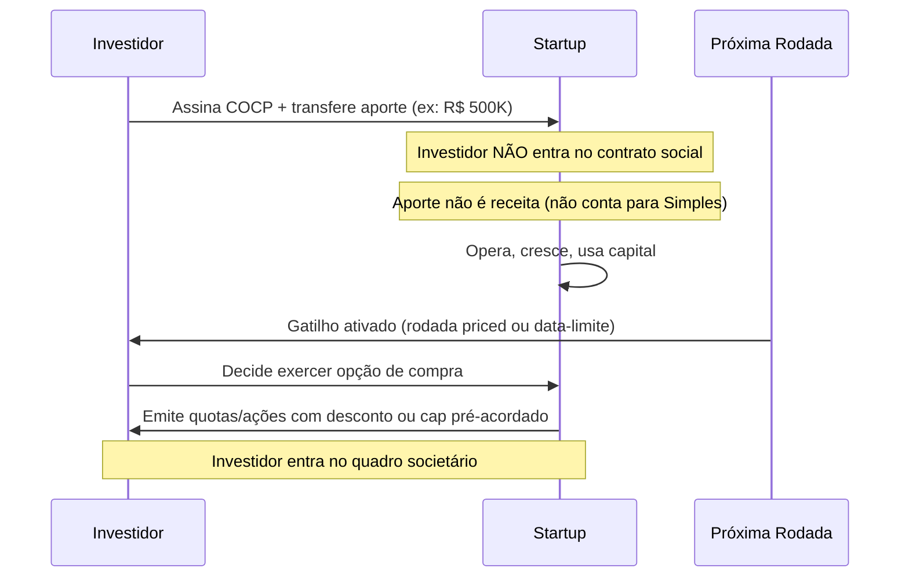

**Elementos obrigatórios do COCP.**

| Cláusula | O que define |
|---|---|
| Valor do aporte | Capital transferido imediatamente |
| Prazo da opção | Período máximo para exercício (máx. 7 anos pela lei) |
| Gatilho de conversão | Próxima rodada priced, data fixa, ou evento específico |
| Cap de valuation | Valuation máximo para cálculo da participação |
| Desconto | % de desconto sobre o preço da próxima rodada |
| Condições de exercício | Quóruns, documentação, notificação |
| Direitos do optante | Informativos (sim), votos (não, antes do exercício) |

#### Comparativo: COCP vs. SAFE vs. Mútuo Conversível

| Critério | COCP | SAFE (adaptado) | Mútuo Conversível |
|---|---|---|---|
| Base legal brasileira | ✅ LC 182/2021 | ❌ Adaptação contratual | ✅ Código Civil |
| Natureza | Opção de equity | Futuro equity | Dívida conversível |
| Investidor é sócio? | Não, até exercício | Não, até conversão | Não (é credor) |
| Gera IOF? | Não | Não (estrutura equity) | Sim (operação de crédito) |
| Conta para limite Simples? | Não | Depende da estrutura | Não (empréstimo) |
| Responsabilidade do investidor | Limitada ao aporte | Limitada | Limitada |
| Risco de requalificação tributária | Baixo | Médio (sem lei) | Médio (juros e IOF) |
| Conforto em DD | Alto (base legal clara) | Médio | Alto |

> [!tip] Quando usar COCP vs. mútuo conversível
> COCP é preferível quando o investidor está confortável com equity puro e não quer retorno de dívida. Mútuo conversível é útil quando o investidor quer proteção adicional como credor (prioridade em liquidação), ou quando há dúvida sobre o enquadramento na definição de startup da lei.

#### Exemplo brasileiro preenchido

**Empresa**: Plantio.AI, startup de agritech com dois anos de constituição.
**Investidor**: Angel brasileiro com perfil de ex-fundador.
**Situação**: Rodada pré-seed de R$ 400 mil, antes de produto em produção.

Cláusulas do COCP:
- Aporte: R$ 400.000 (transferência imediata, sem emissão de quotas)
- Cap de valuation: R$ 6 milhões (pré-money da próxima rodada)
- Desconto: 20% sobre o preço da próxima rodada priced
- Gatilho: próxima rodada ≥ R$ 1 milhão, ou 36 meses da data de assinatura
- Prazo máximo: 5 anos
- Direitos informativos: acesso mensal a MRR, burn, e headcount

Na próxima rodada (18 meses depois), a startup levanta Série Seed de R$ 2 milhões com valuation pré-money de R$ 8 milhões. O investidor exerce a opção. Calcula-se a participação com base no menor entre: (a) cap de R$ 6M, ou (b) 80% do valuation da rodada (R$ 6,4M). Usa-se o cap (R$ 6M). R$ 400K ÷ R$ 6M = 6,67% de participação.

#### Armadilhas do COCP

**Cap mal calibrado.** Cap muito alto faz o investidor receber participação menor que o esperado (como se não houvesse cap). Cap muito baixo gera diluição excessiva para o fundador em rodadas futuras.

**Sem data-limite.** COCP sem gatilho temporal cria incerteza estrutural. O investidor tem opção aberta indefinidamente. Sempre incluir prazo máximo.

**Ignorar o impacto em rodadas futuras.** COCP no cap table cria "shadow dilution". VCs em seed e Série A calculam participação fully-diluted, incluindo COCPs não convertidos. Modelar o impacto antes de emitir.

**Investidor exercendo fora do momento certo.** COCP dá ao investidor a escolha de exercer. Se a empresa performar bem e o investidor segurar a opção, pode haver tensão no momento de uma rodada que requer cap table limpo.

---

### Investidor-anjo formalizado

A LC 182/2021 manteve e expandiu a figura do investidor-anjo, originalmente regulada pela LC 155/2016 para empresas do Simples Nacional.

#### Proteções legais

O investidor-anjo **não é sócio**. Não consta no contrato social. Não tem direito a voto em assembleia. Não responde por dívidas, obrigações tributárias, trabalhistas, ou de qualquer natureza da empresa — mesmo em falência ou desconsideração da personalidade jurídica.

Em troca, pode:
- Receber remuneração de até **50% dos lucros** da empresa, proporcional ao aporte, por até 5 anos.
- Participar de reuniões de diretoria como observador.
- Ter acesso a informações financeiras.
- Alienar o aporte para terceiros (com direito de preferência dos sócios).

**Prazo máximo**: 7 anos para resgate do aporte.

> [!important] Diferença entre investidor-anjo e COCP
> Investidor-anjo, nos termos da LC 182, é um instrumento de participação nos lucros sem entrada societária — é mais parecido com um contrato de mútuo com upside em lucros do que com equity. O COCP é explicitamente um instrumento de equity futuro. Para quem quer participação no cap table, o COCP é o instrumento certo. Para quem quer retorno em lucros sem entrar na sociedade, o formato de investidor-anjo se aplica melhor.

---

### Fundo de Investimento em Participacoes (FIP) como veiculo

#### O que e

O FIP e um fundo fechado de investimento regulado pela CVM, hoje pela Resolucao CVM 175/2022 (que substituiu a Instrucao CVM 578/2016). Ele compra participacao societaria em empresas brasileiras, geralmente acoes preferenciais com direitos politicos negociados, e e o veiculo majoritario pelo qual investidores institucionais brasileiros (fundos de pensao, family offices, gestoras locais) alocam capital em VC e private equity no pais.

Para o fundador, importa entender que quando uma gestora brasileira propoe entrar no cap table, o cheque quase sempre vem de um FIP, nao da pessoa juridica da gestora. Isso condiciona governanca, liquidez e estrutura da rodada.

#### Tres tipos relevantes

**FIP-EE (Empresas Emergentes)**. Voltado para empresas com receita bruta anual ate o limite definido pela regulamentacao (atualizado periodicamente, na faixa de centenas de milhoes de reais). E o veiculo natural para investimento em startups em estagio early e growth.

**FIP-IE (Infraestrutura)**. Para empresas com projetos em setores de infraestrutura (energia, saneamento, logistica, telecom). Tem incentivo fiscal especifico, alem do beneficio padrao de FIP.

**FIP-Multiestrategia (sob Anexo IV da Res. CVM 175/2022)**. Versao mais ampla, sem restricao de tamanho da investida. Usado por gestoras de private equity tradicional. Alguns fundos de growth tardio em tech tambem operam via Multiestrategia.

#### Implicacoes praticas

**Laudo de avaliacao**. FIP exige laudo de avaliacao independente para entrada (precificacao do aporte) e para saida (precificacao da venda). Isso afeta o calendario da rodada brasileira. O fundador deve antecipar prazo adicional de tres a seis semanas para o laudo de entrada, e contratar avaliador qualificado. Para detalhes do processo de valuation, ver [[#APÊNDICE CE — VALUATION METHODS: COMO INVESTIDORES CALCULAM E COMO VOCÊ CALCULA PARA NEGOCIAR|Apêndice CE]].

**Governanca obrigatoria**. FIP deve ter comite de investimento que aprova cada aporte e cada disposicao. Na pratica, o fundador sente isso em duas frentes. Decisoes da gestora podem demorar mais do que em fundo offshore (precisa passar pelo comite). E clausulas de protective provisions no acordo de acionistas tendem a ser mais detalhadas, refletindo a obrigacao do gestor de prestar contas ao comite.

**Tributacao para a PF investidora**. Todo FIP tem 15 por cento de IR sobre o ganho de capital na realizacao (vs 22,5 por cento de renda fixa de prazo curto). O FIP-IE (Infraestrutura) sob a Lei 11.478/2007 oferece beneficio adicional, isencao plena de IR para a pessoa fisica residente. FIP-EE nao tem aliquota especial alem dos 15 por cento gerais aplicaveis a fundo de participacao. Isso significa que o LP brasileiro tem incentivo de tributacao na realizacao via FIP em relacao a renda fixa, e o gestor tem motivo para manter o veiculo elegivel ao longo da vida do fundo.

#### Diferenca pratica em relacao a fundo offshore

Fundo offshore tipico (Cayman master-feeder, LLC americana investindo direto em Cayman holding da startup brasileira) opera com governanca mais flexivel. Sem comite obrigatorio. Sem laudo de entrada (acorda valuation por negociacao direta). Sem regra de diversificacao impondo limite por investida. O term sheet brasileiro de FIP costuma ser mais longo. As negociacoes mais lentas. E a capacidade do gestor de aceitar termos atipicos (por exemplo, side letter exclusiva ou estrutura de earnout no aporte) e mais limitada.

Cross-ref. Para term sheet detalhado, ver [[#APÊNDICE V — CAPTAÇÃO DE EQUITY, PITCH E RELACIONAMENTO COM INVESTIDORES|Apêndice V]]. Para metodos de valuation que sustentam o laudo, ver [[#APÊNDICE CE — VALUATION METHODS: COMO INVESTIDORES CALCULAM E COMO VOCÊ CALCULA PARA NEGOCIAR|Apêndice CE]].

> [!note] FIP profissional brasileiro tem dinamica diferente
> FIP profissional brasileiro tem dinamica diferente de fundo offshore e merece atencao no planejamento de rodada brasileira.

---

### ARE — Ambiente Regulatório Experimental

#### O que é

O ARE (arts. 26 a 35 da LC 182/2021) cria a base legal para que **reguladores setoriais autorizem startups a testar produtos inovadores em ambiente controlado**, por tempo determinado, sem precisar cumprir todos os requisitos regulatórios normais.

É o sandbox regulatório formalizado na lei federal. Antes da LC 182, alguns reguladores já tinham sandbox próprio (BACEN, CVM). A lei deu cobertura legal uniforme e criou incentivo para que outros reguladores adotem o modelo.

#### Como funciona

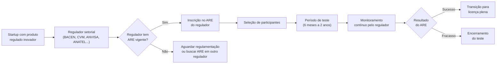

**Reguladores que implementaram ARE até 2026.**

| Regulador | Setor | Status |
|---|---|---|
| BACEN | Fintech, pagamentos, crédito | Ativo (SFN e SPB) |
| CVM | Securities, tokens, crowdfunding | Ativo (Res. CVM 29/2021 e posteriores) |
| ANATEL | Telecom, conectividade | Em implementação |
| ANS | Planos de saúde, healthtech | Discussão regulatória |
| ANVISA | Dispositivos médicos, softwares de saúde | Parcial (via RDC 657) |
| SUSEP | Insurtech, seguro digital | Ativo (Res. CNSP 407/2021) |

> [!warning] ARE não é dispensa automática de licença
> Participar de um ARE não significa operar livremente. O regulador define escopo restrito: número máximo de clientes, volume máximo de transações, prazo determinado, obrigações de reporte. Operação fora dessas condições pode gerar autuação mesmo dentro do ARE.

#### Quando faz sentido buscar o ARE

- Produto que requer licença para operar em escala, mas que ainda não está maduro o suficiente para o processo completo de licenciamento.
- Validação técnica com usuários reais antes de investir no processo regulatório pleno.
- Mercados onde o licenciamento pleno leva 18 a 36 meses (fintech, healthtech, seguro).

**Quando não faz sentido.** Se o produto pode ser testado sem regulação (B2B puro, software de gestão interna, marketplace sem intermediação financeira), o ARE é complexidade desnecessária.

---

### Dispensa de licitação para startups

#### O que é

O art. 20 da LC 182/2021 autoriza órgãos e entidades da administração pública a **contratar startups diretamente**, sem licitação, para o desenvolvimento ou a execução experimental de soluções inovadoras.

Combinado com a Lei 14.133/2021 (Nova Lei de Licitações), abre um caminho estruturado para govtech que não existia antes de 2021.

#### Como funciona na prática

O poder público não compra produto pronto. Ele contrata o **desenvolvimento ou teste de solução inovadora**. O processo é:

1. Órgão público publica **chamada pública** com o problema a ser resolvido.
2. Startups apresentam propostas técnicas e comerciais.
3. Comissão técnica avalia e seleciona (até três startups, em geral, para teste paralelo).
4. Contrato de desenvolvimento ou piloto é assinado sem licitação formal.
5. Após validação, pode seguir para contratação plena (que aí pode ou não exigir licitação dependendo do valor).

**Limites de valor.** A lei remete aos limites da Lei 14.133/2021, que são atualizados por decreto. Verificar o valor vigente de dispensa de licitação para inovação no momento da contratação. Como referência: em 2026, o limite geral de dispensa (obras e serviços comuns) era de R$ 57,5 mil, mas para contratação de soluções inovadoras via startup há previsão de valores maiores nas regulamentações específicas dos órgãos.

> [!tip] Govtech como canal de aquisição subestimado
> Prefeituras, estados, autarquias, e fundações públicas têm orçamentos dedicados a inovação. Muitos estão ativamente buscando startups para resolver problemas de gestão, saúde pública, mobilidade, e educação. O custo de aquisição via dispensa de licitação é zero (sem comissão de canal). O risco é o ciclo longo, e a dependência de um único cliente grande. Ver [[IGNICAO-Vol-3-Tracao#APÊNDICE CP — SALES: MOTION COMPLETA, DO OUTBOUND AO RENEWAL|Apêndice CP (Vol. 3)]] para gestão de concentração de receita.

#### Quem já fez

**Empresa**: DataH, startup de analytics para saúde pública.
**Contratante**: Secretaria Municipal de Saúde de Belo Horizonte.
**Mecanismo**: Chamada pública via ARE-like interno, contrato de piloto sem licitação, valor de R$ 180 mil para 6 meses.
**Resultado**: Contrato pleno de R$ 1,2 milhão após validação do piloto, via contratação direta (enquadrada como serviços de tecnologia especializada).

---

### O que a lei não resolve

**Tributação de stock options**. A LC 182/2021 não alterou o tratamento tributário de opções de compra para colaboradores. A discussão sobre IRPF vs. ganho de capital em exercício de opções continua indefinida na jurisprudência administrativa. Ver [[#APÊNDICE DB — STOCK OPTIONS E ESOP NO BRASIL|Apêndice DB]].

**Propriedade intelectual**. A lei não cria regras de IP para startups. Patentes, marcas, e cessão de código seguem legislação própria. Ver [[#APÊNDICE DC — PROPRIEDADE INTELECTUAL E INPI|Apêndice DC]].

**Due diligence do COCP**. Usar COCP não elimina obrigações de disclosure. Investidor ainda pode questionar informações prestadas no momento da assinatura. Prepare data room mesmo para rodadas pré-seed.

**Governança interna**. A lei não resolve disputas entre cofundadores. Acordo de sócios robusto continua sendo necessário. Ver [[#FASE 13 — ESTRUTURAÇÃO JURÍDICA, FINANCEIRA E OPERACIONAL|Fase 13]].

**Acesso automático ao Simples Nacional**. Enquadrar-se como startup pela LC 182 não garante elegibilidade ao Simples. Os critérios do Simples (receita, atividade, vedações) são independentes. Ver [[#APÊNDICE W — CONTABILIDADE, TRIBUTÁRIO E REGIMES FISCAIS PARA STARTUP BRASILEIRA|Apêndice W]].

---

### Armadilhas

**Assumir que todo aporte pré-seed pode ser COCP**. Se o investidor é pessoa física com menos de R$ 10 milhões de patrimônio financeiro, há restrições de CVM sobre ofertas não registradas. Verificar enquadramento na Instrução CVM (ICVM 88/2022, crowdfunding, ou isenções específicas de oferta privada restrita).

**COCP sem advogado**. A lei criou o instrumento, mas a minuta precisa ser feita por especialista. Cláusulas de anti-diluição, drag-along parcial para o optante, e proteção em down round não estão automaticamente incluídas na lei — são negociadas contratualmente.

**Confundir ARE com licença provisória**. Startup em ARE não pode fazer publicidade como se fosse empresa licenciada. Violação das condições do ARE pode resultar em encerramento imediato e bloqueio de futura solicitação de licença.

**Govtech sem gestão de concentração**. Contrato público é receita recorrente frágil. Troca de gestão municipal cancela projetos. Nunca depender de um único contrato público para mais de 40% da receita total na fase inicial.

**Ignorar o prazo dos dez anos**. Empresa que constituiu como startup em 2018 e cresceu bem pode perder elegibilidade à LC 182 em 2028. Planejar transição antes — especialmente se houver ARE vigente ou contratos de dispensa em andamento.

> [!info] Fases relacionadas
> Referenciado em: Fase 13.

---

### Conexão com outros apêndices

| Tópico | Apêndice |
|---|---|
| Estruturação societária, vesting, cap table | [[#FASE 13 — ESTRUTURAÇÃO JURÍDICA, FINANCEIRA E OPERACIONAL|Fase 13]] |
| Contratos operacionais, IP assignment | [[#APÊNDICE AH — CONTRATOS E ASPECTOS LEGAIS OPERACIONAIS|Apêndice AH]] |
| Tributário, Simples Nacional, Lucro Presumido | [[#APÊNDICE W — CONTABILIDADE, TRIBUTÁRIO E REGIMES FISCAIS PARA STARTUP BRASILEIRA|Apêndice W]] |
| Captação de equity, pitch, term sheet | [[#APÊNDICE V — CAPTAÇÃO DE EQUITY, PITCH E RELACIONAMENTO COM INVESTIDORES|Apêndice V]] |
| Financiamento não-diluitivo, BNDES, Finep | [[#APÊNDICE P — FINANCIAMENTO NÃO-DILUITIVO|Apêndice P]] |
| Stock options e ESOP | [[#APÊNDICE DB — STOCK OPTIONS E ESOP NO BRASIL|Apêndice DB]] |
| Propriedade intelectual, INPI | [[#APÊNDICE DC — PROPRIEDADE INTELECTUAL E INPI|Apêndice DC]] |
| Govtech, venda para governo | [[IGNICAO-Vol-3-Tracao#APÊNDICE CP — SALES: MOTION COMPLETA, DO OUTBOUND AO RENEWAL|Apêndice CP (Vol. 3)]] |
| Regulação setorial (fintech, healthtech, agritech) | [[IGNICAO-Vol-6-Referencia#APÊNDICE AW — REGULATÓRIO SETORIAL BRASILEIRO|Apêndice AW (Vol. 6)]] |

### Leitura adicional

- **LC 182/2021** — texto integral no site do Planalto. Leitura direta obrigatória antes de usar qualquer instrumento.
- **Regulamentação ARE por regulador** — cada regulador publica edital próprio. Monitorar BACEN, CVM, SUSEP, e ANS.
- **Startup Law (a.k.a. JOBS Act)** — equivalente americano para referência comparativa. Não tem aplicação direta no Brasil.
- **Deloitte / PwC / KPMG** — relatórios anuais sobre ecossistema de inovação e regulação no Brasil.
- **ABStartups** — publica atualizações sobre impacto da lei no ecossistema nacional.

---

## APÊNDICE DC — PROPRIEDADE INTELECTUAL E INPI

> [!note] Nota de validade
> Taxas do INPI, prazos processuais, e decisões sobre patenteabilidade de software mudam por resolução administrativa. Este apêndice reflete o cenário de abril de 2026. Verificar tabela de retribuições vigente no site do INPI antes de qualquer depósito. A interpretação sobre software patents no Brasil continua evoluindo — acompanhar as Diretrizes de Exame de Patentes do INPI.

O [[#APÊNDICE AH — CONTRATOS E ASPECTOS LEGAIS OPERACIONAIS|Apêndice AH]] cobre IP (propriedade intelectual) assignment (cessão de direitos) em contratos. O [[IGNICAO-Vol-2-Validacao#APÊNDICE BE — OPEN SOURCE COMO ESTRATÉGIA|Apêndice BE (Vol. 2)]] cobre open source (código aberto) como modelo de negócio. O [[IGNICAO-Vol-6-Referencia#APÊNDICE CA — HARDWARE E DEEP TECH: CONSTRUIR NEGÓCIO COM FABRICAÇÃO, IP E HORIZONTES LONGOS|Apêndice CA (Vol. 6)]] cobre patentes em deep tech e hardware. Este apêndice cobre a disciplina completa de propriedade intelectual: o que registrar, quando, como, a que custo, e o que acontece quando você não registra e deveria ter registrado.

### O que esse apêndice cobre

Quatro instrumentos de PI e sua aplicação prática em startups.

1. **Marca**. Registro no INPI, classes, estratégia de proteção, e expansão internacional.
2. **Patente e modelo de utilidade**. Quando patenteiam o quê, processo, custos, e software patents no Brasil.
3. **Segredo industrial**. Quando é melhor não patentear. Como proteger.
4. **Direito autoral e IP assignment**. Código, design, e conteúdo. Como garantir que pertence à empresa.

### POR QUE

PI mal estruturado mata exits (eventos de liquidez para os sócios). A due diligence de M&A (fusão ou aquisição) descobre três categorias de problema que fazem acquirers (compradores) pedirem desconto ou saírem do deal: passivo trabalhista, dívida fiscal, e PI sem ownership (titularidade) claro.

Uma startup que construiu produto por quatro anos com freelancers sem cláusula de cessão de direitos pode perder a titularidade do próprio código. Uma startup que não registrou a marca pode ser forçada a rebrandear na hora de expandir para outro estado, porque alguém registrou o nome antes. Uma startup de deep tech que não depositou patente antes de publicar artigo acadêmico perdeu o direito de prioridade.

PI não é só proteção ofensiva. É higiene operacional básica.

### Quando usar

[[IGNICAO-Vol-1-Ideacao#FASE 2 — ARTICULAÇÃO E CAPTURA DA IDEIA|Fase 2 (Vol. 1)]]. Busca prévia de marca antes de nomear a empresa. Verificar se o nome está disponível no INPI e nos principais domínios.

[[#FASE 13 — ESTRUTURAÇÃO JURÍDICA, FINANCEIRA E OPERACIONAL|Fase 13]]. Depositar pedido de marca. Revisar todos os contratos de colaboradores para cláusula de cessão de IP. Fazer inventário de PI.

[[#FASE 14 — ESCALA: TIME, OPERAÇÕES, CRESCIMENTO E CAPITAL|Fase 14]] (pré-Série B). Preparar dossiê de PI para due diligence. Avaliar estratégia de patentes se relevante para o modelo.

Antes de qualquer publicação científica ou apresentação pública de tecnologia inédita. Depositar pedido de patente antes de tornar a invenção pública — a publicação elimina o direito de prioridade.

---

### Mapa dos instrumentos de PI

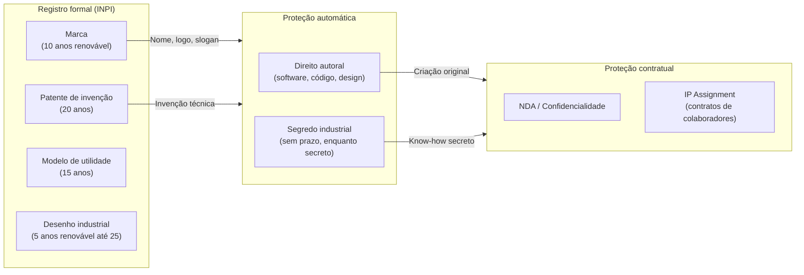

---

### Marca

#### Por que registrar primeiro

Marca é o ativo de PI mais relevante para a maioria das startups de software. Não porque protege tecnologia — mas porque protege o relacionamento com o mercado. Nome, logo, e tagline são o ponto de contato. Perder o direito a eles depois de construir audiência é devastador.

O sistema brasileiro de marcas é declaratório: **quem registra primeiro, tem prioridade** — não quem usou primeiro. Uma empresa pode usar um nome por dois anos sem registro, e perder para um concorrente que registrou depois mas antes do pedido da startup.

#### Classes: o que registrar

O INPI usa a Classificação de Nice (45 classes para produtos e serviços). Startups de tech tipicamente precisam de:

| Classe | Descrição resumida | Relevante para |
|---|---|---|
| 9 | Software, apps, hardware eletrônico | Todo produto tech |
| 42 | Serviços de TI, SaaS, cloud, design | Todo serviço tech |
| 35 | Publicidade, gestão empresarial, e-commerce | Marketplaces, B2B SaaS |
| 36 | Serviços financeiros, fintech | Fintech, insurtech |
| 38 | Telecomunicações, mensageria | Comunicação, telecom |
| 44 | Serviços médicos, healthtech | Healthtech |
| 41 | Educação, entretenimento | Edtech, jogos |

**Quanto custa**. Em 2026, cada pedido de marca no INPI custava aproximadamente R$ 355 para micro/pequena empresa (50% de desconto sobre a taxa padrão de R$ 710). Cada classe é um pedido separado. Uma startup que registra nas classes 9 e 42 paga ~R$ 710 no depósito.

#### O processo passo a passo

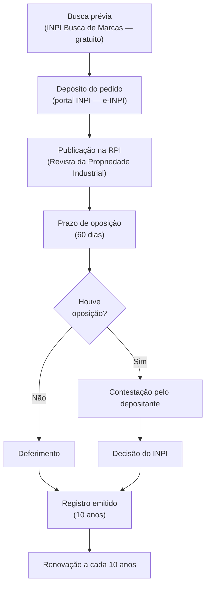

**Tempo total**: 12 a 36 meses. Pode ser mais longo se houver oposição ou exigências.

**Prioridade de depósito**: do dia do depósito em diante, a startup tem prioridade sobre qualquer pedido posterior para marca idêntica ou similar na mesma classe. Não precisa esperar o registro para ter prioridade.

> [!tip] Registrar o nome antes de lançar publicamente
> O ideal é depositar o pedido de marca antes do lançamento do produto, ou simultaneamente. O custo (~R$ 700–1.400 para duas classes) é mínimo comparado ao rebranding forçado depois de tração.

#### Busca prévia

Antes de depositar, buscar no [buscamar.inpi.gov.br](https://buscamar.inpi.gov.br) se há marca idêntica ou similar registrada na mesma classe. Busca gratuita.

Também verificar: domínios (.com.br, .com), redes sociais, e registro de CNPJ com nome idêntico na Junta Comercial.

#### Expansão internacional

**Madrid Protocol** (Protocolo de Madri): sistema centralizado da WIPO para registrar marcas em múltiplos países com uma única solicitação. Brasil é membro desde 2019.

Como funciona: depositar no INPI a marca base brasileira → solicitar extensão internacional via Madrid → escolher países designados → cada país examina de forma independente.

Custo: taxa básica da WIPO (~CHF 653 + taxas por país designado). Mais barato do que depositar individualmente em cada país.

**Quando usar**: ao iniciar expansão para EUA, União Europeia, ou outros mercados relevantes. Não antes — é custo sem retorno se o mercado ainda não está confirmado.

---

### Patentes e modelos de utilidade

#### Quando patentear

Patente protege **invenção técnica** — um novo processo, produto, ou método com aplicação industrial. No Brasil, a Lei 9.279/1996 (LPI) define os requisitos: novidade, atividade inventiva, e aplicação industrial.

**Startup de software puro**: barra de patenteabilidade alta. O INPI não concede patente para software como tal (algoritmo, método matemático, ou regra de negócio puras). Mas concede para **invenção implementada por computador** com efeito técnico identificável — ou seja, o software que controla uma máquina, otimiza um processo físico, ou produz efeito técnico além do computacional.

| Tipo de startup | Relevância de patente |
|---|---|
| SaaS puro (CRM, ERP, analytics) | Baixa — software como tal não é patenteável |
| Fintech com algoritmo de decisão | Média — se houver efeito técnico demonstrável |
| Healthtech com diagnóstico por IA | Alta — método diagnóstico com efeito técnico |
| Hardware + software (IoT, dispositivo médico) | Alta — invenção híbrida |
| Deep tech, biotech, agritech | Alta — invenção técnica clara |
| Marketplace, plataforma digital | Baixa — modelo de negócio não é patenteável |

#### Modelo de utilidade

Proteção para **melhoria funcional de objeto** de uso prático (não para processo ou método). Mais rápido e mais barato que patente de invenção. Relevante para hardware com forma física nova. Não se aplica a software.

#### O processo de patente

**Depósito**: protocolar no INPI via e-INPI com relatório descritivo, reivindicações, resumo, e desenhos (se aplicável).

**Exame**: após o depósito, o pedido fica em sigilo por 18 meses, depois é publicado. O examinador pode fazer exigências (office actions). O depositante responde. Processo de exame pode levar 4 a 10 anos no INPI (backlog histórico).

**Custos aproximados (2026)**:
- Depósito de patente de invenção (ME/EPP): ~R$ 255
- Pedido de exame: ~R$ 640
- Anuidades (por ano, a partir do 3º ano): R$ 120 a R$ 2.000 dependendo do ano
- Total até concessão (sem advogado): R$ 2.000 a R$ 5.000
- Com escritório de PI especializado: R$ 15.000 a R$ 50.000+ dependendo da complexidade

> [!important] O depósito cria a data de prioridade — não espere o exame
> A proteção conta da data do depósito, não da concessão. Depositar cedo estabelece a prioridade. Mesmo que o exame demore anos, a data do depósito é o marco legal de anterioridade.

#### PCT — Patente Internacional

O Patent Cooperation Treaty permite um único depósito que vale como pedido em até 153 países membros. O depositante tem 30 meses (a partir da data de prioridade nacional) para entrar nas fases nacionais dos países escolhidos.

**Quando usar**: quando há real intenção de operar ou licenciar em múltiplos mercados. Uma patente concedida no Brasil tem valor limitado se o produto for vendido globalmente. PCT é o passo para proteção real nos EUA (USPTO), Europa (EPO), China (CNIPA), e outros.

**Custo do PCT**: USD 1.500 a USD 3.000 (taxa da WIPO + taxas de busca). Mais fases nacionais (USD 3.000–10.000 por país, com advogado local).

---

### Segredo industrial

#### Quando é melhor do que patentear

A patente revela a invenção ao público (requisito de disclosure). Em troca de proteção temporária (20 anos), a empresa publica o método completo. Após 20 anos, qualquer um pode usar livremente.

O segredo industrial não tem prazo — dura enquanto o segredo for mantido. E não revela nada ao concorrente. O trade-off:

| Critério | Patente | Segredo industrial |
|---|---|---|
| Prazo de proteção | 20 anos | Ilimitado (enquanto secreto) |
| Disclosure | Obrigatório | Zero |
| Proteção contra reverse engineering | Sim (uso ilegal) | Não (se descoberto independentemente) |
| Proteção contra vazamento interno | Não (qualquer um pode usar após vencer) | Sim (via NDA e controles) |
| Custo de manutenção | Anuidades anuais | Controles internos + NDAs |

**Casos onde segredo supera patente**: algoritmos que não podem ser reverse-engineered facilmente (fórmula Coca-Cola, algoritmos de ranking do Google, modelos de ML proprietários). Processos que evoluem rapidamente e estariam obsoletos antes da concessão da patente. Situações onde revelar o método ensinaria ao concorrente mais do que a proteção vale.

#### Como proteger o segredo industrial

1. **NDA (Non-Disclosure Agreement)** com todos os colaboradores, fornecedores, e parceiros que têm acesso.
2. **Controle de acesso** granular: só quem precisa sabe o que precisa saber.
3. **Documentação de segredo**: registrar internamente quais informações são consideradas segredo industrial, com data e descrição. Cria evidência de que o segredo existia e era tratado como tal.
4. **Cláusula de devolução**: ao sair, colaborador devolve ou destrói todos os materiais com informação confidencial.
5. **Auditoria de acesso**: log de quem acessou o quê e quando.

---

### Direito autoral e software

#### Proteção automática

Código-fonte é protegido automaticamente pela Lei 9.609/1998 (Lei do Software) desde o momento da criação — sem necessidade de registro. O autor (ou a empresa, se criado por colaborador em contrato de trabalho) tem direitos exclusivos de reprodução, distribuição, e modificação.

**Registro voluntário no INPI**: existe, mas não é obrigatório. Cria evidência de anterioridade em disputas futuras. Custo baixo (~R$ 80). Vale em situações de litígio onde a data de criação é disputada.

#### Obra de colaborador CLT

O art. 4º da Lei 9.609/1998 estabelece: o software criado por empregado durante a vigência do contrato de trabalho, utilizando recursos da empresa, pertence ao empregador — independente de cláusula contratual específica.

Mas a proteção automática tem limites. Só vale para o que foi criado **nos limites do contrato de trabalho**. Software criado em tempo pessoal, com recursos pessoais, e sem relação com o objeto da empresa, pertence ao colaborador.

**Boa prática**: cláusula explícita de IP assignment no contrato CLT que esclareça o escopo — especialmente em empresas de tecnologia onde a linha entre "trabalho" e "projeto pessoal" é frequentemente disputada.

#### Obra de PJ e freelancer

Aqui não há proteção automática. O contrato precisa ter **cessão explícita de direitos patrimoniais**. Sem cessão no contrato, o freelancer retém os direitos sobre o código que escreveu — mesmo tendo sido pago por ele.

**Cláusula mínima necessária**:

> *"O PRESTADOR cede, em caráter irrevogável e irretratável, com exclusividade, todos os direitos patrimoniais de autor sobre as obras criadas no âmbito deste contrato, incluindo código-fonte, documentação, e materiais derivados, para a CONTRATANTE, que poderá utilizá-los, reproduzi-los, modificá-los, e sublicenciá-los sem qualquer restrição."*

> [!warning] Código de freelancer sem cessão é PI de risco
> Em due diligence de M&A ou Série A, o acquirer ou investidor vai perguntar sobre chain of title de todo o código-fonte. Se partes foram escritas por freelancers sem cessão, isso cria risco legal que pode travar o deal ou gerar desconto. Retroativamente regularizar é possível, mas requer localizar e convencer cada freelancer a assinar — o que nem sempre é viável.

#### Código open source: risco de contaminação

O uso de bibliotecas open source com licenças **copyleft** (GPL, LGPL, AGPL) pode contaminar o código proprietário. A GPL, por exemplo, exige que qualquer software que incorpore código GPL seja distribuído também sob GPL — ou seja, o código da startup se tornaria obrigatoriamente open source.

**Licenças "permissivas"** (MIT, Apache 2.0, BSD) não têm esse problema. Podem ser usadas em software proprietário sem restrição.

**Inventário de open source**: em pré-Série A, fazer um FOSS (Free and Open Source Software) audit — listar todas as bibliotecas usadas, verificar as licenças, e identificar riscos de copyleft. Ferramentas: FOSSA, Black Duck, ou análise manual com `license-checker`.

---

### IP Assignment: como fazer certo

O IP assignment é a cláusula que garante que tudo criado por colaboradores pertence à empresa. Sem ela, o IP pode estar espalhado entre ex-funcionários, freelancers, e cofundadores que saíram.

#### Checklist de IP assignment por tipo de colaborador

| Tipo | Documento | Cláusula obrigatória |
|---|---|---|
| Fundador | Acordo de fundadores (Founder Agreement) | IP assignment + non-compete + non-solicit |
| CLT | Contrato de trabalho | IP assignment explícito (reforça lei, clarifica escopo) |
| Estagiário | Termo de estágio | IP assignment explícito (lei de estágio não garante automaticamente) |
| PJ / Freelancer | Contrato de prestação de serviços | Cessão explícita de direitos patrimoniais |
| Advisor | Contrato de advisory | IP assignment para qualquer material criado |
| Pesquisador universitário | Contrato de pesquisa aplicada | IP assignment + licença para publicação acadêmica |

#### Regularização retroativa

Se a empresa tem código antigo com IP assignment ausente, é possível regularizar:
1. Identificar todos os colaboradores que criaram IP sem cessão.
2. Para CLT ativos: assinar adendo ao contrato com cessão retroativa.
3. Para ex-CLT e ex-PJ: contatar e solicitar assinatura de cessão autônoma.
4. Documentar todas as tentativas (mesmo as malsucedidas) para evidenciar due diligence.

---

### PI em due diligence

O que qualquer investidor ou acquirer vai examinar:

**1. Ownership do código-fonte (chain of title)**. Todo colaborador que escreveu código assinou IP assignment? Há freelancers sem cessão? Founders que saíram cederam o IP deles?

**2. Registro de marca**. A marca está registrada? Há conflitos com marcas similares registradas por terceiros? A marca está registrada nas classes corretas?

**3. Patentes e pedidos pendentes**. Há pedidos de patente? Estão em ordem? Há anuidades em atraso (que causariam o arquivamento do pedido)?

**4. Open source compliance**. O software usa bibliotecas GPL ou AGPL em produtos proprietários? Há conflito de licença?

**5. Litigância de PI**. Há ações judiciais ou administrativas envolvendo PI da empresa? Há cartas de C&D (cease and desist) recebidas?

**6. NDAs assinados**. Há NDAs com todos os parceiros, fornecedores, e colaboradores com acesso a informação confidencial?

> [!important] PI como valor em M&A
> Em aquisições de tech, o IP é frequentemente o principal ativo. Um acquirer comprando uma startup de R$ 50M pode estar pagando R$ 40M pelo código, marca, e patentes — e R$ 10M pelo time e receita. Problema de ownership no IP pode reduzir o valor percebido em 30–70%.

---

### Estratégia de PI para startups em diferentes estágios

| Estágio | Prioridade de PI | Ação concreta |
|---|---|---|
| Pré-seed (ideia, nome) | Baixa-Média | Busca prévia de marca. Depositar pedido quando tiver CNPJ. |
| Seed (produto em construção) | Média | Registrar marca. IP assignment em todos os contratos. FOSS audit. |
| Série A (PMF, escala inicial) | Alta | Inventário completo de PI. Regularizar retroativo. Avaliar patente se relevante. |
| Série B+ (crescimento) | Alta | Madrid Protocol se internacionalizando. Estratégia defensiva de patentes (deep tech). |
| Pré-exit (M&A ou IPO) | Crítica | PI data room completo. Resolver todo conflito de ownership antes de entrar em processo de venda. |

---

### Armadilhas

**Registrar a marca só no Brasil e não internacionalizar.** Empresa cresce, decide entrar nos EUA, e descobre que outra empresa já registrou o mesmo nome para a mesma classe. Rebranding forçado em mercado estrangeiro custa muito mais do que o Madrid Protocol teria custado antes.

**Publicar artigo científico antes de depositar patente.** A publicação coloca a invenção em domínio público. O direito de prioridade exige que o depósito preceda qualquer divulgação pública. Ordem correta: depositar → depois publicar.

**Usar nome no mercado sem registrar.** A startup cresceu, a marca tem valor, e aí um concorrente registra. O concorrente tem prioridade. A startup precisa provar uso anterior (não há proteção automática por uso no Brasil — o sistema é de registro).

**Não incluir IP assignment em contratos de estagiários.** A Lei de Estágio não tem disposição automática de ownership de IP como a CLT tem. Estagiário sem cláusula pode reivindicar direitos sobre código que escreveu.

**Acumular anuidades em atraso em patente.** Patente com pedido em andamento requer pagamento de anuidades a partir do 3º ano. Falta de pagamento causa arquivamento do pedido. Há possibilidade de restauração, mas com custo adicional e risco. Monitorar datas de anuidade com calendar automatizado.

**Confundir registro de software no INPI com patente.** Registro de software cria prova de anterioridade, mas não protege a funcionalidade ou o algoritmo — apenas a expressão específica do código. Não impede que alguém crie software diferente com função idêntica.

---

### Conexão com outros apêndices

| Tópico | Apêndice |
|---|---|
| IP assignment em contratos (visão geral de contratos) | [[#APÊNDICE AH — CONTRATOS E ASPECTOS LEGAIS OPERACIONAIS|Apêndice AH]] |
| Open source como modelo estratégico de negócio | [[IGNICAO-Vol-2-Validacao#APÊNDICE BE — OPEN SOURCE COMO ESTRATÉGIA|Apêndice BE (Vol. 2)]] |
| Patentes em deep tech, hardware, e TRL | [[IGNICAO-Vol-6-Referencia#APÊNDICE CA — HARDWARE E DEEP TECH: CONSTRUIR NEGÓCIO COM FABRICAÇÃO, IP E HORIZONTES LONGOS|Apêndice CA (Vol. 6)]] |
| PI em biotecnologia, ANVISA, ensaios | [[IGNICAO-Vol-6-Referencia#APÊNDICE CM — BIOTECH E HEALTHTECH: PLAYBOOK DE REGULAÇÃO, ENSAIOS E CAPITAL|Apêndice CM (Vol. 6)]] |
| Estruturação societária, constituição de S/A | [[#FASE 13 — ESTRUTURAÇÃO JURÍDICA, FINANCEIRA E OPERACIONAL|Fase 13]] |
| Marco Legal das Startups, COCP | [[#APÊNDICE DA — MARCO LEGAL DAS STARTUPS: LC 182/2021|Apêndice DA]] |
| Expansão internacional, estrutura holding | [[IGNICAO-Vol-5-Maturidade#APÊNDICE CU — INTERNACIONALIZAÇÃO: ESTRUTURA E PRODUTO PARA MÚLTIPLOS MERCADOS|Apêndice CU (Vol. 5)]] |
| M&A, due diligence como vendedor | [[IGNICAO-Vol-5-Maturidade#FASE 16 — EXIT STRATEGY|Fase 16 (Vol. 5)]] |

### Leitura adicional

- **Lei 9.279/1996 (LPI)** — Lei de Propriedade Industrial: marcas, patentes, desenhos industriais, e segredo industrial.
- **Lei 9.609/1998** — Lei do Software: direito autoral aplicado a programas de computador.
- **Diretrizes de Exame de Patentes do INPI** — documento que define como o INPI examina pedidos de patente de software (atualizado periodicamente, buscar versão mais recente).
- **Portal e-INPI** — para depósito de marcas, patentes, e consulta de status.
- **WIPO Madrid Monitor** — para acompanhar pedidos internacionais via Madrid Protocol.
- **"Patentes de Software no Brasil" — ABPI** — análise setorial sobre estado atual da jurisprudência.

---

## APÊNDICE DJ — NÃO-CONCORRÊNCIA E NÃO-SOLICITAÇÃO NO BRASIL

> [!note] Aviso legal
> Este apêndice é material educacional. A validade de cláusulas de não-concorrência no Brasil é questão jurídica ativa, com jurisprudência divergente. Consulte advogado trabalhista com experiência em tecnologia e startups antes de assinar ou incluir essas cláusulas.

> [!note] Posição no livro
> Relevante para [[#FASE 13 — ESTRUTURAÇÃO JURÍDICA, FINANCEIRA E OPERACIONAL|Fase 13 — Estruturação]], [[#APÊNDICE AH — CONTRATOS E ASPECTOS LEGAIS OPERACIONAIS|Apêndice AH — Contratos e Aspectos Legais]], [[#APÊNDICE CO — RECRUTAMENTO TÉCNICO EM PROFUNDIDADE|Apêndice CO — Recrutamento Técnico]] e [[IGNICAO-Vol-5-Maturidade#FASE 16 — EXIT STRATEGY|Fase 16 — Exit (Vol. 5)]] (onde o adquirente frequentemente exige não-concorrência do fundador).

---

### O estado atual da não-concorrência no Brasil

Diferente dos EUA (onde estados como Califórnia proíbem por completo a non-compete — cláusula de não-concorrência) ou da Europa (onde existe regulação específica), o Brasil não tem lei explícita sobre não-concorrência pós-emprego. O que existe é um equilíbrio tenso entre:

- **Art. 5º, XIII da Constituição Federal:** livre exercício de trabalho, ofício ou profissão
- **Art. 421 do Código Civil:** liberdade contratual limitada pela boa-fé e função social
- **Art. 482 da CLT (implicitamente):** concorrência desleal como falta grave

O resultado é que tribunais brasileiros tratam não-concorrência de forma ambígua. Algumas decisões consideram válida a cláusula; outras consideram nula por ofensa à liberdade de trabalho. O que determina o resultado é a forma como a cláusula é escrita.

---

### Tipos de restrição pós-vínculo

#### 1. Não-concorrência (non-compete)

Proíbe o ex-funcionário de trabalhar para concorrentes ou criar empresa concorrente por período determinado após o desligamento.

**Validade jurídica no Brasil:**

O TST (Tribunal Superior do Trabalho) tem decidido que a cláusula de não-concorrência pós-emprego é válida **se cumulativamente:**

- Tiver prazo determinado (máximo entendido pela maioria da doutrina: 1–2 anos)
- Tiver âmbito geográfico e setorial delimitado (não pode ser "qualquer empresa em qualquer lugar")
- Tiver **contraprestação econômica** ao ex-funcionário pelo período de restrição

A ausência de contraprestação é o principal motivo de nulidade. Cláusula que diz "você não pode trabalhar para concorrentes por 2 anos após a saída" sem pagamento pelo período é, na maioria das decisões recentes, nula.

> [!warning] Sem contraprestação = sem validade
> Se a empresa não está pagando pelo período de não-concorrência, dificilmente conseguirá executar a cláusula na Justiça do Trabalho. A maioria dos juízes entende que impedir trabalho sem pagamento viola a dignidade da pessoa humana e a liberdade de trabalho constitucionalmente garantida.

**Contraprestação mínima sugerida pela prática:**

Não há valor legal fixo. A doutrina e jurisprudência mais recentes indicam que o valor deve ser proporcional ao período e à perda efetiva de renda. Referências informais:

- 50–100% do salário mensal para cada mês de restrição é o patamar mais citado
- Para cargos de R$ 15K/mês com non-compete de 12 meses: R$ 90K–180K de contraprestação

**Como estruturar a contraprestação:**

- Paga mensalmente durante o período de restrição (melhor para o funcionário, pior para o fluxo de caixa da empresa)
- Paga de uma vez na rescisão (melhor para a empresa, mas exige capital)
- Incorporada ao salário durante o emprego (prática comum mas juridicamente questionável — o TST tem criticado)

#### 2. Não-solicitação de clientes (non-solicit clients)

Proíbe o ex-funcionário de abordar clientes da empresa anterior por período determinado.

**Validade:** Mais aceita pelos tribunais do que o non-compete puro, especialmente quando focada em clientes com os quais o funcionário teve contato direto. Exige a mesma estrutura: prazo, delimitação e (para ser robusta) contraprestação.

#### 3. Não-solicitação de funcionários (non-solicit employees)

Proíbe o ex-funcionário de recrutar colegas para outra empresa.

**Validade:** Geralmente mais aceita do que non-compete geral, pois restringe comportamento ativo (recrutar), não a mera existência de emprego paralelo.

#### 4. Confidencialidade (NDA)

Tecnicamente não é non-compete — é proteção de informação confidencial. A obrigação de não divulgar segredos industriais, dados de clientes e informações estratégicas pode ter prazo indefinido e é mais robusta juridicamente do que o non-compete.

> [!tip] NDA é mais executável do que non-compete
> Se o objetivo da empresa é proteger informação estratégica e relacionamentos com clientes, um NDA bem redigido combinado com não-solicitação tem mais chance de ser executado do que um non-compete genérico. Foque na proteção de informação, não no impedimento de trabalho.

---

### Non-compete em contratos de M&A

O contexto mais robusto para não-concorrência no Brasil é o contrato comercial (não trabalhista) entre pessoas jurídicas. Quando um fundador vende sua empresa, o adquirente quase sempre exige cláusula de não-concorrência — desta vez entre empresas, não entre empregado e empregador.

**Por que é diferente:**

- O fundador assina como sócio (PJ) vendendo participação, não como empregado
- O Código Civil admite restrições comerciais entre partes iguais com maior amplitude
- A liberdade de trabalho constitucionalmente protegida é do trabalhador; o empresário tem autonomia de vontade mais ampla
- Tribunais civis (não trabalhistas) aplicam regras diferentes

**Estrutura típica em M&A:**

```
Não-concorrência: 3–5 anos após o closing
Âmbito: produtos/serviços similares aos da empresa vendida
Geografia: Brasil + países onde a empresa opera
Contrapartida: parte do preço de venda é alocada à não-concorrência
```

**O que não se pode incluir nem em M&A:**

- Restrição vitalícia (viola liberdade de trabalho mesmo em contexto comercial, segundo doutrina dominante)
- Âmbito absolutamente genérico ("qualquer atividade empresarial") sem delimitação de setor
- Multa desproporcionalmente alta sem base econômica (pode ser reduzida pelo juiz)

---

### Não-concorrência para cofundadores e sócios

Acordos de sócios frequentemente incluem cláusula de não-concorrência para o sócio que sai. Contexto societário é diferente do trabalhista:

- Não há relação de subordinação — é acordo entre empresários
- Código Civil admite restrições desde que não sejam abusivas
- A cláusula deve ter prazo, âmbito e (para ser robusta) contraprestação

Para sócio que sai voluntariamente vs. sócio excluído: a validade pode variar. Sócio que saiu voluntariamente com pagamento pelo valor de suas cotas tem argumento para aceitar a restrição; sócio excluído sem justa causa tem argumento mais forte para contestar.

---

### Comparativo internacional (para founders com estrutura offshore)

| Jurisdição | Regime | Observação |
|---|---|---|
| **Califórnia (EUA)** | Non-compete proibido | Exceto em contexto de venda de empresa |
| **Delaware (EUA)** | Non-compete válido com limitações razoáveis | Padrão para acordos de M&A americanos |
| **Reino Unido** | Válido se razoável (prazo, âmbito, proteção de interesse legítimo) | Garden leave comum para executivos |
| **Portugal** | Código do Trabalho: non-compete pós-emprego válido com contraprestação (mínimo 50% do salário) | Similar ao Brasil |
| **Brasil** | Sem lei específica; validade dependente de jurisprudência e estrutura | Este apêndice |

---

### Checklist para o fundador — antes de assinar

**Como empregador (inserindo cláusula nos contratos do time):**

- [ ] A cláusula tem prazo determinado (máximo 24 meses para empregado)?
- [ ] Há delimitação geográfica e setorial (não pode ser "qualquer concorrente no mundo")?
- [ ] Há contraprestação explícita e proporcional ao período de restrição?
- [ ] A cláusula é de confidencialidade + não-solicitação (mais executável) ou non-compete puro (mais contestável)?
- [ ] A cláusula foi revisada por advogado trabalhista?

**Como fundador (assinando em contrato de M&A):**

- [ ] Qual o prazo? 3 anos é razoável; 5 anos é prazo que começa a ser questionado
- [ ] Qual o âmbito? "Produtos similares aos da empresa" é razoável; "qualquer negócio digital" é excessivo
- [ ] Qual a contraprestação alocada especificamente à non-compete (separada do goodwill)?
- [ ] Qual a multa por violação? Proporcional à contraprestação recebida?
- [ ] O que acontece se o adquirente me demitir antes do prazo — a non-compete persiste?
- [ ] Há exceções (ex: posso ser advisor de empresa não-concorrente)?

> [!info] Fases relacionadas
> Referenciado em: Fase 16.

---

### Armadilhas

1. **Non-compete sem contraprestação para empregados.** Juridicamente frágil; gera ônus de prova invertido para a empresa na Justiça do Trabalho.
2. **Âmbito genérico demais.** "Não pode trabalhar em tecnologia" não é executável. "Não pode trabalhar em SaaS de gestão para padarias no Brasil por 12 meses" é.
3. **Non-compete para cargos com pouco acesso a informação sensível.** Quanto menor o acesso a segredos industriais, menor a justificativa — e menor a chance de execução.
4. **Confundir NDA com non-compete.** São instrumentos diferentes para fins diferentes. NDA protege informação; non-compete protege mercado.
5. **Ignorar a non-compete do adquirente no M&A.** Assinar sem ler ou sem negociar âmbito e exceções pode prender o fundador por 5 anos.
6. **Non-compete excessivamente longa em M&A com earnout.** Se o adquirente tem meios de demitir o fundador antes do earnout terminar, a non-compete que persiste é instrumento de pressão desproporcional.

**Ver também:** [[#APÊNDICE AH — CONTRATOS E ASPECTOS LEGAIS OPERACIONAIS|Apêndice AH — Contratos]], [[#APÊNDICE DC — PROPRIEDADE INTELECTUAL E INPI|Apêndice DC — Propriedade Intelectual]], [[IGNICAO-Vol-5-Maturidade#FASE 16 — EXIT STRATEGY|Fase 16 — Exit (Vol. 5)]], [[IGNICAO-Vol-5-Maturidade#APÊNDICE BJ — M&A ATIVO E ROLL-UPS: FUNDADOR COMO COMPRADOR|Apêndice BJ — M&A (Vol. 5)]]

---

## APÊNDICE T — LGPD, COMPLIANCE E GOVERNANÇA DE DADOS

> [!abstract] Mapa da Fatia 5 — Legal, Ops e Regulatorio
> A Fatia 5 reune 45 apendices em sete familias tematicas. Use este mapa para navegar.
>
> **Governanca de dados** ([[#APÊNDICE T — LGPD, COMPLIANCE E GOVERNANÇA DE DADOS|T]] entrada, [[#APÊNDICE CV — SEGURANÇA DA INFORMAÇÃO: DA CERTIFICAÇÃO À ENGENHARIA|CV]] engenharia, [[#APÊNDICE EM — COMPLIANCE E ANTICORRUPÇÃO PARA STARTUPS|EM]] integridade)
>
> **Contratos e PI** ([[#APÊNDICE AH — CONTRATOS E ASPECTOS LEGAIS OPERACIONAIS|AH]] panorama, [[#APÊNDICE EU — CONTRATOS EM PROFUNDIDADE POR TIPO|EU]] profundidade por tipo, [[#APÊNDICE DJ — NÃO-CONCORRÊNCIA E NÃO-SOLICITAÇÃO NO BRASIL|DJ]] retencao, [[#APÊNDICE DC — PROPRIEDADE INTELECTUAL E INPI|DC]] PI)
>
> **Governanca societaria** ([[IGNICAO-Vol-5-Maturidade#APÊNDICE AM — BOARD E GOVERNANCE|AM (Vol. 5)]] entrada, [[IGNICAO-Vol-5-Maturidade#APÊNDICE BI — EMPRESA FAMILIAR E SUCESSÃO: GOVERNANÇA, DINÂMICA E PSICOLOGIA|BI (Vol. 5)]] familia, [[IGNICAO-Vol-5-Maturidade#APÊNDICE BP — DISPUTA SOCIETÁRIA E SAÍDA DE SÓCIO|BP (Vol. 5)]] disputa, [[#APÊNDICE EP — RESPONSABILIDADE DO SÓCIO E DO ADMINISTRADOR|EP]] limites, [[#APÊNDICE DA — MARCO LEGAL DAS STARTUPS: LC 182/2021|DA]] marco legal)
>
> **Ciclo de crise** ([[#APÊNDICE BW — FRAUDE INTERNA E CONTROLES INTERNOS|BW]] preparacao, [[IGNICAO-Vol-5-Maturidade#APÊNDICE CW — CRISE E CONTINUIDADE: PREVENÇÃO, RESPOSTA, RECUPERAÇÃO|CW (Vol. 5)]] resposta, [[IGNICAO-Vol-5-Maturidade#APÊNDICE EV — COMUNICAÇÃO EM CRISE|EV (Vol. 5)]] comunicacao, [[IGNICAO-Vol-5-Maturidade#APÊNDICE ES — RECUPERAÇÃO JUDICIAL E WIND-DOWN — QUANDO A STARTUP NÃO CONSEGUE CONTINUAR|ES (Vol. 5)]] encerramento, [[#APÊNDICE EY — GESTÃO DE RISCO E SEGUROS PARA STARTUPS|EY]] seguros)
>
> **Regulatorio** ([[IGNICAO-Vol-6-Referencia#APÊNDICE AW — REGULATÓRIO SETORIAL BRASILEIRO|AW (Vol. 6)]] indice, [[#APÊNDICE ET — REGULATÓRIO DE IA NO BRASIL|ET]] IA, [[IGNICAO-Vol-5-Maturidade#APÊNDICE ER — CADE E ANTITRUSTE — QUANDO O CRESCIMENTO ATRAI O REGULADOR|ER (Vol. 5)]] antitrust, [[IGNICAO-Vol-5-Maturidade#APÊNDICE FE — POLÍTICA PÚBLICA COMO ESTRATÉGIA|FE (Vol. 5)]] politica publica, [[#APÊNDICE EQ — DIREITO DO CONSUMIDOR E CDC PARA STARTUPS|EQ]] CDC)
>
> **Verticais regulados** ([[IGNICAO-Vol-6-Referencia#APÊNDICE CM — BIOTECH E HEALTHTECH: PLAYBOOK DE REGULAÇÃO, ENSAIOS E CAPITAL|CM (Vol. 6)]], [[IGNICAO-Vol-6-Referencia#APÊNDICE CA — HARDWARE E DEEP TECH: CONSTRUIR NEGÓCIO COM FABRICAÇÃO, IP E HORIZONTES LONGOS|CA (Vol. 6)]], [[IGNICAO-Vol-6-Referencia#APÊNDICE DK — GOVTECH: STARTUP VENDENDO PARA GOVERNO|DK (Vol. 6)]], [[IGNICAO-Vol-6-Referencia#APÊNDICE DL — AGRITECH: PLAYBOOK PARA O CAMPO BRASILEIRO|DL (Vol. 6)]], [[IGNICAO-Vol-6-Referencia#APÊNDICE DM — EDTECH: PLAYBOOK PARA TECNOLOGIA DE EDUCAÇÃO NO BRASIL|DM (Vol. 6)]], [[IGNICAO-Vol-6-Referencia#APÊNDICE DN — CLEANTECH E ESG: STARTUPS DE IMPACTO AMBIENTAL NO BRASIL|DN (Vol. 6)]], [[IGNICAO-Vol-6-Referencia#APÊNDICE DO — PROPTECH: TECNOLOGIA NO MERCADO IMOBILIÁRIO BRASILEIRO|DO (Vol. 6)]], [[IGNICAO-Vol-6-Referencia#APÊNDICE DP — LEGALTECH: TECNOLOGIA JURÍDICA NO BRASIL|DP (Vol. 6)]], [[IGNICAO-Vol-6-Referencia#APÊNDICE DQ — LOGTECH: TECNOLOGIA EM LOGÍSTICA E SUPPLY CHAIN NO BRASIL|DQ (Vol. 6)]])
>
> **Modelos de negocio especiais** ([[IGNICAO-Vol-2-Validacao#APÊNDICE AE — MARKETPLACE DYNAMICS E RISCO DE PLATAFORMA|AE (Vol. 2)]], [[IGNICAO-Vol-2-Validacao#APÊNDICE CC — PLATAFORMA VS PRODUTO: QUANDO CONSTRUIR PLATAFORMA E QUANDO NÃO|CC (Vol. 2)]], [[IGNICAO-Vol-2-Validacao#APÊNDICE CK — B2B2C: QUANDO SUA EMPRESA VENDE PARA OUTRA EMPRESA QUE VENDE PARA CONSUMIDOR|CK (Vol. 2)]], [[#APÊNDICE CX — CANAIS INDIRETOS E PARCERIAS: PARCERIAS, FRANQUIAS, CHANNEL|CX]], [[IGNICAO-Vol-2-Validacao#APÊNDICE BE — OPEN SOURCE COMO ESTRATÉGIA|BE (Vol. 2)]], [[#APÊNDICE FD — PARCERIA COM GRANDES CORPORAÇÕES BRASILEIRAS|FD]])
>
> **Direito do dia a dia** ([[#APÊNDICE EL — DIREITO DO TRABALHO PARA STARTUPS|EL]] trabalhista, [[#APÊNDICE EN — TRIBUTÁRIO ESTRATÉGICO PARA STARTUPS|EN]] tributario, [[#APÊNDICE EO — CONTENCIOSO E LITÍGIO PARA STARTUPS|EO]] contencioso, [[IGNICAO-Vol-5-Maturidade#APÊNDICE CU — INTERNACIONALIZAÇÃO: ESTRUTURA E PRODUTO PARA MÚLTIPLOS MERCADOS|CU (Vol. 5)]] internacional, [[IGNICAO-Vol-5-Maturidade#APÊNDICE BS — VISTO E IMIGRAÇÃO PARA FUNDADOR BRASILEIRO|BS (Vol. 5)]] visto, [[IGNICAO-Vol-5-Maturidade#APÊNDICE AF — ESG, IMPACT E GOVERNANÇA PARA STARTUP|AF (Vol. 5)]] ESG, [[IGNICAO-Vol-3-Tracao#APÊNDICE DS — NEGOCIAÇÃO COMO DISCIPLINA|DS (Vol. 3)]] negociacao, [[#APÊNDICE DV — OPERAÇÕES EM ESCALA|DV]] operacao)

> [!note] Nota de validade
> Esse apêndice reflete o estado da regulação de dados pessoais brasileira e as práticas de mercado em abril de 2026. LGPD, regulamentações da ANPD, decisões judiciais e regulações setoriais (Bacen, ANS) evoluem ano a ano. Revisar anualmente, com atenção a novas resoluções da ANPD, mudanças setoriais aplicáveis ao seu negócio e jurisprudência relevante sobre multas e responsabilidade. Quando houver divergência entre esse apêndice e a regulação atual, a regulação atual prevalece.

A [[#FASE 13 — ESTRUTURAÇÃO JURÍDICA, FINANCEIRA E OPERACIONAL|Fase 13]] (Estruturação Jurídica, Financeira e Operacional) cobre o essencial de formalização da empresa. Esse apêndice expande o tratamento de dados pessoais e compliance, tema que deixa de ser "papel do jurídico" quando a startup passa a operar com volumes relevantes de dados pessoais (tipicamente a partir da [[IGNICAO-Vol-3-Tracao#FASE 11 — VALIDAÇÃO DO MODELO DE NEGÓCIO|Fase 11 (Vol. 3)]]) e vira risco existencial se mal conduzido.

A LGPD (Lei Geral de Proteção de Dados, Lei 13.709/2018) entrou em vigor em 2020 e as sanções em 2021. Para a maioria das startups brasileiras pós-PMF, LGPD não é opcional nem "avaliar depois". É infraestrutura. As multas podem chegar a dois por cento do faturamento da pessoa jurídica, limitado a R$ 50 milhões por infração.

> [!warning] A multa é o menor dos problemas
> O risco maior é vazamento de dados, com exposição pública, que destrói reputação em semanas.

### O que esse apêndice cobre

Programa de LGPD, e governança de dados, é o conjunto de processos, pessoas, e ferramentas, que garante.

1. Bases legais claras para cada tratamento de dados (consentimento, execução de contrato, legítimo interesse, cumprimento de obrigação legal, etc.).
2. Direitos dos titulares operacionalizados. Acesso, correção, anonimização, portabilidade, revogação de consentimento, e eliminação.
3. Encarregado (DPO) formal, com canal de contato público.
4. Registro de operações (RIPD, Relatório de Impacto à Proteção de Dados), quando aplicável.
5. Resposta a incidentes de segurança envolvendo dados pessoais.

Entregável. Manual de Privacidade, e Dados. Documento interno de dez a vinte páginas, que articula política de privacidade pública, processos internos, e papéis, e responsabilidades.

### POR QUE

Risco financeiro. Multas de até dois por cento do faturamento, mais reparação civil por vazamentos. Tanto ANPD (Autoridade Nacional de Proteção de Dados), quanto ações civis individuais, e coletivas, são realidades.

Risco reputacional. Vazamento público destrói marca. Bases de clientes podem cair vinte a quarenta por cento em noventa dias, pós-incidente mal-gerido.

Risco comercial. Clientes enterprise fazem due diligence de privacidade, como pré-requisito de contrato. Sem compliance demonstrável, você não vende.

Risco em M&A. Due diligence de adquirente identifica passivo de privacidade, como motivo de ajuste de preço, ou quebra de deal.

> [!warning] Custo de pular
> Startups que ignoram LGPD até "ter tempo" costumam ter dois despertares. Um cliente enterprise pede SOC 2 e LGPD como pré-requisito. Ou ocorre incidente de segurança. Em ambos, reagir sob pressão custa cinco a dez vezes mais que implementar preventivamente.

### Quando usar

Quatro níveis de implementação, em escada crescente de maturidade. **A base mínima é obrigatória para todos** a partir da Fase 13; os níveis 2-4 são acionados por gatilhos específicos (escala de dados pessoais, setor regulado, exigência comercial), não pela passagem de fase em si.

**Nível 1 — Base mínima** (contratos, política de privacidade, termos de uso). Implementar ainda na [[#FASE 13 — ESTRUTURAÇÃO JURÍDICA, FINANCEIRA E OPERACIONAL|Fase 13]], sem exceção, junto com a constituição da empresa. Custo baixo, risco regulatório alto se faltar. **Essa é a única camada obrigatória pela passagem da Fase 13.**

**Nível 2 — DPO formal e processos operacionais.** Acionado por **volume relevante de dados pessoais** (tipicamente a partir da [[IGNICAO-Vol-3-Tracao#FASE 12 — PRODUCT-MARKET FIT|Fase 12 (Vol. 3)]] em B2C, ou da [[#FASE 14 — ESCALA: TIME, OPERAÇÕES, CRESCIMENTO E CAPITAL|Fase 14]] em B2B). Não é exigência de fase — é exigência de operação. Empresa com 10 mil usuários precisa; com 100 não.

**Nível 3 — Programa estruturado** (auditorias, RIPDs, governança). Acionado pela [[#FASE 14 — ESCALA: TIME, OPERAÇÕES, CRESCIMENTO E CAPITAL|Fase 14]] em escala média ou pelo setor (B2B enterprise, financeiro, healthtech) — antes da escala se o setor exige. SaaS B2B vendendo para grandes corporativos precisa do nível 3 mesmo em Série Seed, porque o cliente vai exigir no contrato.

**Nível 4 — Certificações** (ISO 27001, SOC 2). **Sempre guiado por demanda comercial específica**, não por estágio. Implementar quando o primeiro cliente exigir e o ROI justificar — tipicamente na [[#FASE 14 — ESCALA: TIME, OPERAÇÕES, CRESCIMENTO E CAPITAL|Fase 14]] (escala inicial até Série C).

### Quem envolve

Executor inicial. CEO, mais advogado externo especializado em proteção de dados. Não delegue para generalista.

DPO (Encarregado). Pode ser interno (a partir de certo tamanho), ou externo (comum em startups pequenas). Deve ser figura independente, com autonomia.

Área técnica. CTO, mais security engineer (pode ser freelance inicialmente), para implementação de medidas técnicas.

Jurídico. Interno, ou externo. Para contratos, cláusulas de proteção de dados com parceiros, e resposta a solicitações de titulares.

Operação (atendimento). Treinamento de quem recebe solicitações de titulares. A linha de frente precisa saber identificar, e escalonar.

### Como executar

#### 1. Bases legais, o núcleo conceitual

Toda operação com dados pessoais precisa estar em uma das dez bases legais do Art. 7º (dados pessoais), ou Art. 11 (dados sensíveis). As mais usadas em startup.

Consentimento. Explícito, específico, e revogável. Não é base padrão. É base de último recurso. Porque pode ser revogado.

Execução de contrato. Dados necessários para executar o contrato com o titular. Cobre a maior parte de operação SaaS.

Legítimo interesse. Tratamento necessário para interesse legítimo do controlador. Desde que não sobreponha direitos do titular. Exige análise, e documentação.

Cumprimento de obrigação legal. Dados obrigatórios por lei (fiscal, e trabalhista).

Exercício regular de direitos em processo. Em litígio.

> [!warning] Erro comum sobre consentimento
> Startups adotam "consentimento" como base universal. Errado. Se você coleta dado para executar contrato (por exemplo, nome, e endereço, para entregar produto), a base é "execução de contrato". Não consentimento. E o titular não pode simplesmente "revogar consentimento", para deixar de receber o produto.

#### 2. Os direitos dos titulares, operacionalizados

O titular (pessoa física cujos dados são tratados) tem direitos que a empresa obrigatoriamente precisa atender. Não basta ter política linkada no rodapé do site. Tem que ter processo.

Confirmação, e acesso. O titular pede "quais dados vocês têm sobre mim?". A empresa responde em até quinze dias.

Correção. O titular aponta dado errado. A empresa corrige.

Anonimização, bloqueio, ou eliminação, de dados desnecessários, ou tratados em desconformidade.

Portabilidade. O titular pede dados, para levar a outro serviço.

Eliminação de dados tratados com base em consentimento.

Informação sobre compartilhamento com terceiros.

Revogação de consentimento.

Entregável prático. Canal de atendimento a titulares (email dedicado, tipo `privacidade@empresa.com.br`). Fluxo documentado internamente. Prazo de quinze dias respeitado. Log de todas as solicitações.

#### 3. O papel do DPO (Encarregado)

Pessoa indicada pelo controlador, com contato público, responsável por. Receber reclamações, e comunicações, de titulares. Receber comunicações da ANPD, e prestar esclarecimentos. Orientar funcionários sobre práticas. Executar demais atribuições regulamentadas.

Pode ser interno, ou externo (DPO as a Service). Em startups até cerca de trinta pessoas, DPO externo, com contato regular, é padrão viável. Acima disso, interno faz mais sentido.

> [!important] Contato do DPO público
> O contato do DPO precisa estar público (site, e política de privacidade). Não basta ter. Precisa estar acessível.

#### 4. Medidas técnicas, o que a área de engenharia precisa garantir

Criptografia em trânsito, e em repouso. TLS obrigatório em APIs. Criptografia em banco de dados, para campos sensíveis (CPF, cartão, e saúde).

Controle de acesso por princípio de menor privilégio. Cada funcionário acessa só o que precisa. Auditoria periódica.

Logs de auditoria. Quem acessou o quê, e quando. Retenção mínima de seis meses.

Backup, e recuperação testados. Não basta ter. Tem que funcionar (teste de restore trimestral).

Segregação de ambientes. Dados reais não vão para dev, ou homologação, sem anonimização.

Resposta a incidentes documentada. Runbook claro. Quem aciona quem, em que prazo.

Em B2B enterprise, isso evolui para certificações formais (SOC 2 Tipo II, e ISO 27001). Que viram pré-requisito comercial em clientes grandes.

#### 5. Contratos com operadores (terceiros)

Qualquer fornecedor que trata dados pessoais em nome da empresa, é um operador na terminologia LGPD. E precisa de contrato com cláusulas específicas. Objeto, e finalidade, do tratamento definidos. Obrigação de seguir instruções do controlador. Confidencialidade, e medidas de segurança. Devolução, ou eliminação, de dados ao fim do contrato. Direito do controlador auditar. Subcontratação condicionada a autorização. Responsabilidade por incidentes.

Operadores típicos em startup. AWS, GCP, ou Azure. Provedores de email marketing. CRMs. Plataformas de atendimento. Processadoras de pagamento. Provedores de RH. Ferramentas de analytics.

Os contratos padrão desses provedores (DPA, Data Processing Agreement) cobrem maior parte. Revisar, e assinar DPA, de cada fornecedor principal, é trabalho inicial típico de DPO.

#### 6. Resposta a incidente de segurança

Incidente que cause risco, ou dano relevante, a titulares, exige comunicação à ANPD, e aos titulares afetados, em 3 dias uteis (6 dias para agente de pequeno porte) conforme Resolucao CD/ANPD 15/2024 (RCIS). Se a empresa nunca pensou sobre incidentes antes do primeiro, vai responder mal.

**Runbook mínimo.**

1. Detecção, e contenção técnica (engineering). Parar o vazamento. Preservar evidências.
2. Avaliação de impacto (DPO, mais jurídico). Quantos titulares afetados, que dados, e risco.
3. Comunicação à ANPD, se aplicável.
4. Comunicação aos titulares, se risco relevante.
5. Revisão pós-incidente. O que falhou. Como evitar recorrência.

> [!tip] Simulação pré-incidente
> Pré-incidente. Rodar simulação de incidente, pelo menos uma vez por ano (tabletop exercise). O time fica destravado quando acontece de verdade.

#### 7. Compliance setorial específico

A LGPD é base. Mas não basta para setores regulados.

Financeiro. Bacen (resoluções sobre cibersegurança, e Open Finance). CVM para corretoras, ou fintechs de investimento.

Saúde. LGPD, mais resoluções CFM, ou ANS, mais Lei 13.787/2018 (prontuário eletrônico). Dados de saúde são sensíveis. Regime mais rigoroso.

Menores. Art. 14 LGPD, mais ECA. Consentimento específico de responsáveis. Dificuldade estrutural de operar com menores.

Educação. LGPD, mais LDB, mais portarias setoriais.

Marketing, ou telemarketing. LGPD, mais Código de Defesa do Consumidor, mais regras do Procon.

Startup em setor regulado precisa mapear regime completo (não só LGPD) na [[#FASE 13 — ESTRUTURAÇÃO JURÍDICA, FINANCEIRA E OPERACIONAL|Fase 13]]. Idealmente com especialista do setor.

### PERGUNTAS A RESPONDER

Que bases legais usamos para cada tipo de tratamento? Está documentado?

Temos DPO formal, com contato público?

O titular consegue exercer os nove direitos em menos de quinze dias?

Os contratos com operadores principais (AWS, email marketing, CRM, etc.) têm DPA assinado?

O nosso produto, por design, trata dados mínimos necessários?

Temos runbook de incidente, testado nos últimos doze meses?

Estamos em setor regulado? Se sim, mapeamos regime completo, além da LGPD?

### Métricas

Percentual de operações de tratamento mapeadas, e com base legal definida. Alvo igual ou maior que noventa e cinco por cento.

Tempo médio de resposta a solicitações de titulares. Alvo igual ou menor que dez dias (o prazo legal é quinze).

Percentual de operadores principais com DPA assinado. Alvo cem por cento, em seis meses.

Incidentes detectados, divididos por estimados. Em empresa com bom monitoramento, razão próxima a um. Em empresa imatura, só os catastróficos chegam ao radar.

Tempo entre detecção, e contenção técnica. Alvo menor que quatro horas, para incidentes severos.

### Definição de sucesso

Programa de LGPD está no padrão, quando os sete itens estão em pé.

1. Manual de Privacidade, e Dados, existe. Atualizado nos últimos doze meses.
2. DPO formal, com canal público ativo.
3. Todas as bases legais documentadas, em mapeamento de tratamentos.
4. Direitos dos titulares operacionalizados, com SLA.
5. DPAs com todos os operadores principais.
6. Runbook de incidente testado, nos últimos doze meses.
7. Comunicação comercial (marketing) revisada, quanto a consentimentos.

### Armadilhas

Tratar LGPD como "compliance paper". Política de privacidade linda no site. Nada acontece internamente. No primeiro pedido de titular, ou incidente, desmorona.

Consentimento como base universal. Base errada para a maior parte das operações. Exporta ao titular o direito de travar a operação contratual.

DPO sem autonomia, ou sem contato público. Nomeação formal sem poder efetivo. Não atende requisito legal na prática.

Ignorar operadores. Usar Mailchimp, HubSpot, ou AWS, sem DPA assinado, é exposição direta. O fornecedor responde no contrato dele. Mas se você não tem contrato, você responde sozinho.

> [!warning] SaaS famoso não é automaticamente compliant
> Mesmo Google, AWS, e Microsoft, operam sob modelos de responsabilidade compartilhada. Configuração insegura do cliente (bucket público, ou permissão ampla) é responsabilidade do cliente.

Retenção eterna de dados. "Guardamos para análise futura", sem prazo definido, é não-conformidade. A política de retenção precisa ser específica por tipo de dado.

Treino de equipe negligenciado. O time de atendimento não reconhece solicitação de titular. Perde prazo. O titular denuncia à ANPD. A empresa é autuada.

Marketing inconsciente da LGPD. Envio de email marketing para base coletada, sem base legal adequada. Uso de cookies de tracking, sem banner adequado. Multa via Procon é corriqueira.

Vazamento tratado como problema só técnico. A engenharia contém. Mas ninguém comunica à ANPD, nem aos titulares. Autuação por falta de comunicação é padrão.

### Direito digital alem da LGPD, Marco Civil, responsabilidade de plataforma e CDC digital

LGPD nao cobre tudo. Ela protege dado pessoal. Mas a operacao digital de uma startup gera outros riscos juridicos que vivem em leis distintas. Ignorar esse perimetro e ficar exposto em frentes que o programa de LGPD nao alcanca.

**Marco Civil da Internet (Lei 12.965/2014).** Estabelece principios de neutralidade de rede, privacidade e protecao de dados na camada de conexao, e regula retencao de logs. Provedor de conexao guarda log por um ano. Provedor de aplicacao guarda log de acesso por seis meses. Esses logs viram prova em processo civil e penal, e podem ser requisitados por ordem judicial. O Marco Civil tambem define o regime de responsabilidade do provedor de aplicacao por conteudo de terceiro, que e o coracao do contencioso de plataforma no Brasil.

**STF Tema 533 (RE 1.057.258, julgado em 26 de junho de 2025 em conjunto com o Tema 987).** Consolidou que plataforma so responde por conteudo ilicito de terceiro apos notificacao especifica e descumprimento de ordem de remocao. E o regime conhecido como notice and takedown. Notificacao generica ("ha conteudo ilicito em algum lugar") nao gera responsabilidade. Notificacao com URL especifica e descricao do ilicito gera obrigacao de remover em prazo razoavel.

**STF Tema 987.** Foi decidido em 26 de junho de 2025 (8 a 3). O Supremo declarou o artigo 19 do Marco Civil parcialmente inconstitucional, criou regime de remocao por notificacao extrajudicial para crimes graves e modulou efeitos prospectivamente. O regime brasileiro pos-decisao e hibrido, nao mais notice-and-takedown puro do art. 19 original. O regime brasileiro nao segue mais o notice-and-takedown classico do art. 19 do Marco Civil. Apos a decisao do STF, e regime hibrido com remocao por notificacao extrajudicial para crimes graves.

**CDC digital (Lei 8.078/1990).** Responsabilidade objetiva por defeito do servico, aplicavel a marketplace e plataforma onde o consumidor identifica a startup como prestadora ou cadeia de fornecimento. Mesmo que o vendedor seja terceiro, o marketplace pode responder solidariamente se aparece como fornecedor para o consumidor medio. Ver [[#APÊNDICE EQ — DIREITO DO CONSUMIDOR E CDC PARA STARTUPS|Apêndice EQ]] e [[IGNICAO-Vol-2-Validacao#APÊNDICE AE — MARKETPLACE DYNAMICS E RISCO DE PLATAFORMA|Apêndice AE (Vol. 2)]].

**Decreto 11.856/2023.** Instituiu a Politica Nacional de Ciberseguranca (PNCiber), com governanca pelo GSI/PR, aplicavel a servicos publicos digitais. Em paralelo, a Lei 14.460/2022 transformou a ANPD em autarquia de natureza especial, fortalecendo o orgao. Aplica-se a servicos publicos digitais, mas estabelece padrao de mercado que clientes enterprise e governo passam a exigir em vendor onboarding.

Recomendacao pratica para o fundador. Quatro entregaveis fora do escopo classico de LGPD. Termos de uso solidos com regime de moderacao explicito (o que pode, o que nao pode, prazo para acao apos notificacao). Politica de moderacao publica com canal de notificacao acessivel. Log de notificacoes recebidas, acoes tomadas e prazo de resposta, auditavel. Processo de takedown integrado ao juridico, com SLA interno claro (24 a 72 horas para conteudo ilicito notificado, prazo legal especifico para ordem judicial). Cross-ref para [[IGNICAO-Vol-2-Validacao#APÊNDICE AE — MARKETPLACE DYNAMICS E RISCO DE PLATAFORMA|Apêndice AE (Vol. 2)]] (marketplace), [[#APÊNDICE EQ — DIREITO DO CONSUMIDOR E CDC PARA STARTUPS|Apêndice EQ]] (CDC), [[#APÊNDICE CV — SEGURANÇA DA INFORMAÇÃO: DA CERTIFICAÇÃO À ENGENHARIA|Apêndice CV]] (seguranca da informacao) e [[#APÊNDICE EO — CONTENCIOSO E LITÍGIO PARA STARTUPS|Apêndice EO]] (contencioso).

### CHECKLIST OPERACIONAL

Para validar programa de LGPD, e governança.

- [ ] Mapeamento de tratamentos, com base legal para cada operação?
- [ ] DPO formalmente nomeado, com contato público no site?
- [ ] Canal de atendimento a titulares, com SLA interno?
- [ ] DPAs com todos os operadores principais?
- [ ] Política de retenção por tipo de dado, com automação de eliminação?
- [ ] Criptografia em trânsito, e em repouso, para dados sensíveis?
- [ ] Controle de acesso por menor privilégio, mais auditoria periódica?
- [ ] Runbook de incidente, com responsáveis nomeados, testado no último ano?
- [ ] Treinamento anual obrigatório do time, sobre LGPD?
- [ ] Se setor regulado. Regime específico mapeado, além da LGPD?

> [!important] Frágil ou não
> Se há três ou mais "não", o programa está frágil. Priorizar nos próximos noventa dias.

### Ver também

[[#APÊNDICE CV — SEGURANÇA DA INFORMAÇÃO: DA CERTIFICAÇÃO À ENGENHARIA|Apêndice CV]], Segurança, e certificações. [[#APÊNDICE CV — SEGURANÇA DA INFORMAÇÃO: DA CERTIFICAÇÃO À ENGENHARIA|Apêndice CV]], Security engineering. [[IGNICAO-Vol-6-Referencia#APÊNDICE AW — REGULATÓRIO SETORIAL BRASILEIRO|Apêndice AW (Vol. 6)]], Regulatório setorial.

---

> [!info] Fases relacionadas
> Referenciado em: Fase 13.

---

## APÊNDICE AH — CONTRATOS E ASPECTOS LEGAIS OPERACIONAIS

> [!important] Relacao com o Apendice EU
> Este apendice oferece o panorama operacional de contratos para o fundador, foco em quando chamar advogado, quando assinar sem revisao, quando recusar. Para tratamento por TIPO de contrato (LOI, NDA, SLA, MSA, contrato de trabalho, contrato de socio, etc.) com clausulas standard explicadas item a item, ver [[#APÊNDICE EU — CONTRATOS EM PROFUNDIDADE POR TIPO|Apêndice EU]].

> [!note] Nota de validade
> A legislação contratual e de consumidor evolui em ciclos de cinco a dez anos. Códigos específicos (CDC, CLT e Marco Civil) mudam periodicamente. Revisar a cada vinte e quatro meses, de preferência com advogado brasileiro especializado.

A [[#FASE 13 — ESTRUTURAÇÃO JURÍDICA, FINANCEIRA E OPERACIONAL|Fase 13]] cobre constituição da empresa. O [[#APÊNDICE T — LGPD, COMPLIANCE E GOVERNANÇA DE DADOS|Apêndice T]] cobre LGPD (Lei Geral de Proteção de Dados). O [[#APÊNDICE W — CONTABILIDADE, TRIBUTÁRIO E REGIMES FISCAIS PARA STARTUP BRASILEIRA|Apêndice W]] cobre tributário. Esse apêndice cobre contratos operacionais e aspectos legais não cobertos em outros: contratos com clientes (além de política de privacidade), termos de uso robustos, contratos com fornecedores, contratos com freelancers, IP (Intellectual Property, propriedade intelectual), aspectos trabalhistas em startup e litígios.

### O que esse apêndice cobre

Cinco áreas: contratos com clientes (Termos de uso, MSA e SLA), contratos com fornecedores (SaaS vendors, consultorias e freelancers), contratos com colaboradores (CLT, PJ, estágio e ESOP — Employee Stock Ownership Plan, plano de opções de ações para colaboradores), propriedade intelectual (marca, patente, direitos autorais e código) e litígios e disputas (prevenção, gestão e documentação). Contratos ruins geram passivos que aparecem em due diligence, travam exits e consomem tempo executivo. IP mal-estruturado pode inviabilizar a venda da empresa.

### Quando usar

[[#FASE 13 — ESTRUTURAÇÃO JURÍDICA, FINANCEIRA E OPERACIONAL|Fase 13]]. Contratos base (termos de uso e contrato de trabalho padrão).

[[#FASE 14 — ESCALA: TIME, OPERAÇÕES, CRESCIMENTO E CAPITAL|Fase 14]] (Time e Liderança, em diante). Contratos customizados com clientes enterprise.

Pré-rodada. Revisão completa para DD (due diligence).

Pré-exit. Auditoria jurídica profunda.

### Quem envolve

Advogado especializado em startup, em relacionamento contínuo.

In-house counsel (advogado interno) a partir de Série B, ou cerca de oitenta pessoas.

Especialistas pontuais: trabalhista, tributário, IP ou M&A (mergers and acquisitions, fusões e aquisições), conforme necessidade.

### Due diligence reversa, o que o investidor vai pedir na fatia legal

Due diligence reversa (DD reversa) é o exercício de antecipar, do lado do fundador, o pacote de documentos e respostas que o investidor vai exigir na rodada. Em vez de reagir sob pressão na due diligence formal, o fundador organiza o data room legal antes de sair captar. Quando o investidor entra, o material esta pronto, e a velocidade de fechamento dobra.

A DD legal padrao em Series A, Series B e M&A cobre sete blocos.

1. Estrutura societaria. Contrato social ou estatuto atualizado, cap table fully diluted (incluindo opcoes outorgadas e nao outorgadas, vesting em curso, SAFEs e notas conversiveis), acordo de socios vigente, atas de reuniao de socios e de board dos ultimos vinte e quatro meses.
2. Contratos materiais. Top dez contratos com clientes por receita, contratos com fornecedores criticos (cloud, gateway de pagamento, integradores), MSAs e SOWs ativos, contratos de licenciamento de tecnologia recebida ou cedida.
3. Compliance trabalhista. Registros de CLT por colaborador, contratos de PJ com analise de risco de pejotizacao (ver [[#APÊNDICE EL — DIREITO DO TRABALHO PARA STARTUPS|Apêndice EL]]), processos trabalhistas em curso com classificacao de risco (provavel, possivel, remoto), acordos coletivos aplicaveis.
4. Compliance fiscal. Certidoes negativas federal, estadual e municipal, parcelamentos ativos (Refis, Pert, Litigio Zero), autuacoes em curso e historico de tres exercicios. Esse bloco sai em quinze a trinta dias se nao foi mantido.
5. Compliance LGPD e dados. ROPA (Registro das Atividades de Tratamento, art. 37 da LGPD, em paralelo ao Records of Processing Activities do GDPR art. 30), DPO designado e publicado, log de incidentes de seguranca dos ultimos vinte e quatro meses, contratos com operadores incluindo DPA. Ver [[#APÊNDICE T — LGPD, COMPLIANCE E GOVERNANÇA DE DADOS|Apêndice T]].
6. Propriedade intelectual. Registros INPI de marca depositados ou concedidos, registro de software (opcional mas defensavel), patentes em curso, dominios renovados em nome da pessoa juridica, contratos de cessao de PI assinados por todo colaborador e prestador que tocou codigo. Ver [[#APÊNDICE DC — PROPRIEDADE INTELECTUAL E INPI|Apêndice DC]].
7. Litigios. Mapeamento de processos ativos (judiciais e administrativos) com numero, vara, valor, fase processual e probabilidade de perda calculada por advogado externo. Esse calculo vira a provisao contabil que aparece no balanco que o investidor le.

Sinal de pre-operacional bem-feito. Data room legal pronto antes de sair captar, organizado em pastas correspondentes aos sete blocos, com indice e versionamento. O investidor entra, baixa o pacote, e em quarenta e oito horas devolve a primeira lista de pendencias. Sem data room, a primeira lista chega em duas semanas e cada item adiciona dias de atraso.

A DD reversa tambem ajuda contratos com clientes enterprise (que pedem o mesmo pacote em vendor onboarding) e M&A (que pede o pacote ampliado). Ver [[#APÊNDICE EU — CONTRATOS EM PROFUNDIDADE POR TIPO|Apêndice EU]] para clausulas-padrao por tipo de contrato, [[#APÊNDICE EM — COMPLIANCE E ANTICORRUPÇÃO PARA STARTUPS|Apêndice EM]] para programa de integridade, [[#APÊNDICE EP — RESPONSABILIDADE DO SÓCIO E DO ADMINISTRADOR|Apêndice EP]] para limites pessoais e [[#APÊNDICE V — CAPTAÇÃO DE EQUITY, PITCH E RELACIONAMENTO COM INVESTIDORES|Apêndice V]] para fluxo de captacao.

### Como executar

#### 1. Contratos com clientes

**Termos de Uso (Terms of Service).** Escopo do serviço. Condições de uso aceitável. Limitações de responsabilidade. Propriedade intelectual. Renovação, cancelamento, e reembolso. Foro, e lei aplicável. Integrado com Política de Privacidade (LGPD, [[#APÊNDICE T — LGPD, COMPLIANCE E GOVERNANÇA DE DADOS|Apêndice T]]).

**Master Service Agreement (MSA), contratos enterprise.** Base geral do relacionamento. Statements of Work (SOW) específicos para cada engajamento. SLA (Service Level Agreement), com métricas, e remédios. Data Processing Agreement (DPA), LGPD. Confidentiality, IP, e indemnities. Payment terms, renovação, e termination.

**SLA (Service Level Agreement).** Uptime target, por exemplo, 99,9% mensal igual a quarenta e três minutos de downtime permitido. Remédios. Crédito em fatura, se não atingir. Exclusions. Manutenção programada, e força maior.

> [!warning] Armadilhas em contratos enterprise BR
> Cliente exige "tudo" (uptime 99,99%, indemnity sem cap, IP amplo). Negociar caps. Auto-renewal sem notice period. Preso no contrato. SLA sem exclusões. Punição por downtime de terceiro não-atribuível.

#### 2. Contratos com fornecedores

SaaS vendors. Revisão de DPA, data residency, e termination clauses.

Consultorias. Scope of work claro, deliverables, e pagamento.

Freelancers (PJ). Cuidado com pejotização.

Infraestrutura (cloud). Cost commitments versus flexibilidade.

#### 3. Contratos de trabalho

**CLT.** Padrão no Brasil. Direitos claros. FGTS, férias, 13º, e aviso prévio. Custo total (CLT, mais encargos), cerca de setenta a oitenta e cinco por cento sobre salário bruto. Cláusulas-chave. Confidencialidade, IP assignment (código é da empresa), e non-compete razoável.

**PJ.** Comum em tech. Legítimo se a relação é genuinamente de serviço.

> [!warning] Risco de pejotização
> Se há subordinação, habitualidade, pessoalidade, exclusividade, e salário, igual a vínculo empregatício disfarçado. Passivo trabalhista enorme. Para evitar. Horário flexível. Múltiplos clientes possíveis. Não-subordinação direta. Pagamento por entrega.

**Estágio.** Lei do Estágio (Lei 11.788/2008). Bolsa, mais auxílio transporte, sem encargos trabalhistas. Atenção ao limite de carga horária.

**ESOP.** Planos de opções estruturados conforme [[#APÊNDICE W — CONTABILIDADE, TRIBUTÁRIO E REGIMES FISCAIS PARA STARTUP BRASILEIRA|Apêndice W]] (tributário). Contrato específico, com vesting, cliff, strike, e exercise window.

#### 4. Propriedade intelectual

**Marca (INPI).** Registrar cedo (pode levar doze a vinte e quatro meses). Classes aplicáveis ao seu negócio (9, e 42 para tech. Outras para setoriais). Considerar registro em Madrid Protocol, para expansão internacional.

**Patente.** Raramente aplicável em software puro (barra de patenteabilidade alta no Brasil). Relevante em hardware, biotech, e processos industriais.

**Direito autoral.** Código é automaticamente protegido por direito autoral. Obra coletiva versus individual. Atenção a contratos com freelancers (cessão de direitos explícita).

**IP Assignment.** Contratos com colaboradores (CLT, ou PJ) devem ter cláusula explícita de cessão de IP. "Tudo que você criou usando recursos da empresa, em tempo de trabalho, pertence à empresa". Freelancers. Cláusula específica de cessão de direitos autorais (não basta pagar. Precisa estar no contrato).

#### 5. Litígios

**Prevenção.** Contratos claros, revisados por advogado. Comunicação documentada (email, e Slack). Termination clauses claras. Escalation clauses (mediação antes de litígio).

**Gestão quando acontece.** Advogado especializado (não generalista). Preservação de evidências. Não falar com a parte contrária, sem advogado. Avaliar acordo versus processo (tempo, mais custo, mais risco).

**Processos trabalhistas.** Comuns em startup em escala (turnover, mais escala). Preventivo. Contratos bem-feitos. Folha correta. Horas extras documentadas. Ambiente saudável. Reativo. Resposta rápida com advogado trabalhista. Documentação completa.

### Métricas

Contratos-padrão em template (percentual de coverage).

Tempo médio para fechar contrato enterprise.

Percentual de contratos com revisão jurídica externa.

Processos em andamento (trabalhista, cível, ou tributário).

Cobertura de IP (percentual de produtos, ou marcas, com proteção formal).

### Armadilhas

Contrato genérico copiado da internet. Não cobre específicos do negócio brasileiro.

Pejotização. Vira passivo de dezenas de PJs simultaneamente.

IP Assignment ausente em contrato de colaborador. Freelancer, ou ex-funcionário, disputa ownership.

Marca não-registrada. Concorrente registra. Você precisa mudar nome, em anos críticos.

SLA irreal. Promessa de 99,99% sem arquitetura para isso. Crédito crescente.

Contratos enterprise sem cap de liability. Cliente usa serviço de R$ 100 mil, processa por R$ 10 milhões.

Não revisar contratos antes de DD. O comprador encontra problemas. O preço cai, ou o deal morre.

Negligenciar trabalhista em contratos. Demissões geram processos em massa, se os contratos foram ruins.

Litígio sem advogado especializado. Perde causa que era ganhável.

### Checklist

Disciplina contratual no padrão quando os contratos-padrão (termos de uso, CLT, NDA, MSA) estão em template atualizado, o advogado especializado tem relação contínua, SLA e DPA cobrem todo contrato enterprise, IP assignment é explícito em todo contrato de colaborador, marca está registrada (ou em processo), e contratos preventivos reduzem litígios a mínimo. Os itens abaixo sustentam isso.

- [ ] Termos de uso, e política de privacidade, atualizados.
- [ ] MSA padrão para enterprise, com DPA, e SLA.
- [ ] Contratos de trabalho (CLT), com IP assignment, e confidentiality.
- [ ] Contratos PJ estruturados, para evitar pejotização.
- [ ] ESOP com contratos específicos, e tributação otimizada.
- [ ] Marca registrada, ou em processo, no INPI.
- [ ] Contratos com fornecedores revisados (DPA, termination, e data).
- [ ] Advogado especializado em startup, com relação contínua.
- [ ] Processos preventivos (revisão anual de contratos) em prática.
- [ ] IP de freelancers, com cessão explícita de direitos autorais.

> [!info] Fases relacionadas
> Referenciado em: Fase 0, Fase 13, Fase 14.

---

## APÊNDICE EU — CONTRATOS EM PROFUNDIDADE POR TIPO

> [!important] Relacao com o Apendice AH
> Este apendice e a referencia por TIPO de contrato. Para o panorama operacional (quando chamar advogado, fluxo de aprovacao, governanca contratual no dia a dia), ver primeiro [[#APÊNDICE AH — CONTRATOS E ASPECTOS LEGAIS OPERACIONAIS|Apêndice AH]].

> [!note] Aviso legal
> Este apêndice é material educacional. Contratos têm efeitos jurídicos vinculantes e suas consequências dependem do contexto específico de cada negociação. As descrições aqui apresentadas refletem práticas de mercado e legislação brasileira vigente em maio de 2026. Consulte advogado especializado antes de assinar ou redigir contratos relevantes para a operação da empresa.

> [!note] Posição no livro
> Relevante para [[#APÊNDICE AH — CONTRATOS E ASPECTOS LEGAIS OPERACIONAIS|Apêndice AH — Contratos e Aspectos Legais]], [[#APÊNDICE T — LGPD, COMPLIANCE E GOVERNANÇA DE DADOS|Apêndice T — LGPD]], [[#APÊNDICE DJ — NÃO-CONCORRÊNCIA E NÃO-SOLICITAÇÃO NO BRASIL|Apêndice DJ — Não-concorrência]], [[#APÊNDICE DC — PROPRIEDADE INTELECTUAL E INPI|Apêndice DC — Propriedade Intelectual]] e [[#FASE 13 — ESTRUTURAÇÃO JURÍDICA, FINANCEIRA E OPERACIONAL|Fase 13 — Estruturação]].

---

### Por que o fundador precisa entender contratos, não só assinar

Existe uma ilusão confortável de que contratos são "coisa de advogado". O fundador assina onde o advogado manda e segue em frente. Essa postura funciona até o momento em que o contrato vira problema. O fundador então descobre que não entende o que assinou.

Os três erros mais caros que fundadores cometem em contratos:

**1. Assinar MSA (Master Services Agreement, contrato guarda-chuva entre empresas) com IP assignment (cessão de propriedade intelectual) irrestrito sem ler.**

Um grande cliente envia um MSA padrão. A equipe jurídica interna do cliente é bem treinada. A cláusula de propriedade intelectual diz que tudo que a startup desenvolver durante o contrato pertence ao cliente. O fundador assina sem ler. Dois anos depois, a startup percebe que funcionalidades desenvolvidas para esse cliente — e depois incorporadas ao produto base — pertencem juridicamente ao cliente. A due diligence (auditoria pré-investimento) de Série A revela o problema.

**2. Renovação automática de contrato de SaaS ou serviço com lock-in (período mínimo obrigatório) de 2 anos.**

Contrato com fornecedor crítico renova automaticamente por igual período se não houver notificação 90 dias antes. A startup não monitora o prazo. Renova por mais 2 anos um contrato que não quer mais. A rescisão antecipada tem multa de 12 meses.

**3. NDA (Non-Disclosure Agreement, acordo de confidencialidade) que não protege nada porque o confidencial não foi definido.**

A empresa assina um NDA bilateral com potencial parceiro. O contrato diz que "informações confidenciais são as assim marcadas por escrito". A startup compartilha verbalmente estratégia de produto e base de clientes em reunião, sem marcar como "confidencial". O parceiro usa a informação. A startup não tem proteção contratual porque não cumpriu os formalismos do próprio NDA.

Este apêndice desmonta os principais tipos de contrato que uma startup usa e explica o que está em jogo em cada um.

---

### Princípios gerais antes dos tipos específicos

#### Contrato é lei entre as partes

O art. 421 do Código Civil brasileiro estabelece a liberdade de contratar — e com ela, a responsabilidade pelo que foi acordado. Não existe proteção automática para a parte que leu mal o contrato. A ignorância do conteúdo não invalida as obrigações assumidas.

Isso tem uma implicação direta: toda cláusula que o fundador não entende deve ser explicada por alguém que entende, antes da assinatura — não depois.

#### Cláusulas abusivas vs. cláusulas incomuns

Nem toda cláusula dura é inválida. A nulidade por abusividade no direito civil brasileiro (diferente do CDC, que protege consumidores) é mais restrita. Entre empresas, presume-se negociação paritária. Uma cláusula draconiana que o fundador assinou porque não leu é, em geral, vinculante.

O que pode ser nulo entre empresas:

- Cláusula que viola norma de ordem pública (ex: contrato que exige descumprimento de lei).
- Cláusula que configura lesão enorme (uma parte recebe valor irrisório pelo que entrega).
- Cláusula inserida mediante dolo ou coação comprovada.

O que não invalida: cláusula que favorece muito o outro lado, se foi negociada livremente (mesmo que você não tenha lido com atenção).

#### Limitação de responsabilidade

Toda empresa de software deve incluir cláusula de limitação de responsabilidade nos seus contratos. Sem ela, a empresa fica exposta a pedidos de indenização irrestrita por danos consequenciais — que podem ser ordens de magnitude maiores do que o valor do contrato.

Estrutura padrão de limitação:

```text
A responsabilidade máxima da [EMPRESA] sob ou relacionada a este contrato
não excederá o valor total pago pelo CLIENTE nos 12 (doze) meses anteriores
ao evento que originou a responsabilidade.

Em nenhuma hipótese a [EMPRESA] será responsável por danos indiretos,
consequenciais, incidentais, punitivos ou danos por lucros cessantes,
mesmo que tenha sido avisada da possibilidade de tais danos.
```

Alguns clientes corporativos resistem a limitações de responsabilidade. A negociação é possível — mas o floor da limitação deve ser o valor do contrato, não responsabilidade ilimitada.

#### Foro e arbitragem

**Foro:** define qual comarca julgará disputas. Para empresas brasileiras, o padrão é o foro da sede do réu ou da sede do autor, com preferência pelo foro contratualmente eleito. Vantagem de escolher o foro: previsibilidade sobre onde a disputa ocorrerá.

**Arbitragem:** método alternativo de resolução de disputas — um árbitro privado (ou painel) julga em vez do Judiciário. Vantagens: mais rápido (6–18 meses vs. 3–7 anos no Judiciário), mais especializado (árbitros são técnicos no tema), sigiloso. Desvantagem: custo inicial mais alto (taxas administrativas da câmara + honorários dos árbitros).

Para contratos B2B acima de R$ 500K de valor anual ou alta complexidade técnica, arbitragem faz sentido. Para contratos menores, o custo da arbitragem pode ser desproporcional à disputa.

**Câmaras de arbitragem relevantes no Brasil:**

- CAM-CCBC (Centro de Arbitragem e Mediação da Câmara de Comércio Brasil-Canadá): referência em São Paulo.
- CAMARB: câmara com atuação nacional e custos moderados.
- FGV Câmara: especialização em disputas empresariais.

#### Legislação aplicável em contratos com empresas estrangeiras

Quando a startup brasileira contrata com empresa estrangeira (cliente, fornecedor, investidor), há escolha de lei aplicável. O Brasil adota a **Lei de Introdução às Normas do Direito Brasileiro (LINDB)**, que permite escolha de lei estrangeira para contratos internacionais desde que não viole a ordem pública brasileira.

Na prática: contratos com VCs americanos ou clientes americanos frequentemente escolhem lei de Nova York ou Delaware. Contratos com empresas europeias frequentemente escolhem lei inglesa ou de algum estado-membro da UE. Para o fundador brasileiro, isso significa que disputas nesses contratos são regidas por regras que ele provavelmente não conhece — mais uma razão para assessoria jurídica especializada antes de assinar.

---

### MSA — Master Services Agreement (contrato guarda-chuva B2B)

O MSA é o contrato base que rege toda a relação comercial com um cliente corporativo. Uma vez assinado, as transações específicas são formalizadas por Ordens de Serviço (SoW) que referenciam o MSA.

#### Estrutura do MSA

```text
MSA (Master Services Agreement)
├── Definições e interpretação
├── Escopo geral dos serviços
├── Propriedade intelectual
├── Confidencialidade
├── Representações e garantias
├── Limitação de responsabilidade
├── Indenização (indemnification)
├── Vigência e rescisão
├── Lei aplicável e foro/arbitragem
└── Anexos: SoW #1, SoW #2, DPA

SoW (Statement of Work) — por projeto/módulo
├── Descrição dos serviços específicos
├── Entregáveis e critérios de aceite
├── Cronograma
├── Valor e forma de pagamento
└── Responsabilidades de cada parte
```

#### O que deve estar no MSA — ponto por ponto

**Definições.** Criar glossário explícito das expressões usadas no contrato. Ambiguidade em definições é a origem de 80% das disputas contratuais. O que é "entregável"? O que é "defeito"? O que conta como "hora de suporte"?

**Propriedade intelectual.** Cláusula mais crítica para empresas de software. Há três abordagens possíveis:

- *IP fica com a startup (licença para o cliente):* a startup mantém a propriedade de tudo, o cliente recebe licença de uso. Ideal para produto SaaS ou desenvolvimento sobre plataforma própria.
- *IP fica com o cliente (work-for-hire):* tudo desenvolvido para o cliente pertence ao cliente. Cuidado extremo — se a startup desenvolver funcionalidade genérica que vai para o produto base, está cedendo seu próprio produto.
- *IP dividido:* a startup mantém o que é genérico (background IP), o cliente recebe o que é específico (foreground IP). É o modelo mais equilibrado para desenvolvimento customizado.

> [!warning] IP assignment irrestrito pode destruir o cap table
> Se um MSA cede ao cliente "todos os direitos sobre software desenvolvido durante o contrato", e a startup desenvolve funcionalidades para esse cliente que depois incorpora ao produto base, o cliente tem argumento jurídico sobre o produto. Isso aparece em due diligence e pode bloquear rodadas de investimento ou M&A.

**SLA e penalidades.** Define disponibilidade mínima do sistema (ex: 99,5% uptime) e as consequências do descumprimento (crédito de serviço, desconto em fatura). Negociar SLA realista — prometer 99,9% quando a infraestrutura não suporta cria passivo automático.

**Confidencialidade.** No MSA, confidencialidade recíproca com definição clara de o que é confidencial, como deve ser tratado, e prazo de vigência após o término do contrato.

**Vigência e rescisão.** Definir: prazo de vigência (se determinado ou indeterminado), condições de rescisão por justa causa (breach material não curado em X dias), rescisão imotivada com aviso prévio (tipicamente 30–90 dias), e o que acontece com SoWs em andamento na rescisão do MSA.

#### O que deve estar na SoW

A SoW é onde vive o escopo. Um MSA bem redigido com SoW mal escrita ainda causa problemas. O que uma SoW precisa definir:

- **Escopo exato dos serviços:** o que está incluído e, explicitamente, o que não está.
- **Entregáveis com critérios de aceite:** não "sistema funcionando" — "sistema que realiza as funções X, Y e Z conforme especificação em Anexo A, aprovada pelo cliente em até 5 dias úteis após entrega".
- **Cronograma com marcos:** datas específicas, não "aproximadamente".
- **Valor e forma de pagamento:** valor total, parcelamento, condição de reajuste.
- **Gestão de mudanças (change order):** o que acontece quando o cliente pede algo fora do escopo — não pode virar desconto no preço original.

**Armadilha do escopo aberto.** SoW que diz "desenvolver o sistema de gestão de estoque conforme necessidades do cliente" sem especificar funcionalidades cria escopo ilimitado. O cliente pode pedir qualquer coisa e argumentar que está no escopo. Cada funcionalidade deve ser listada explicitamente. O que não está na lista não está no escopo.

---

### DPA — Data Processing Agreement

O DPA formaliza a relação de tratamento de dados pessoais entre controlador (quem decide o que fazer com os dados) e operador (quem processa os dados a serviço do controlador).

#### Quando é obrigatório

A LGPD (Lei 13.709/2018) exige que o controlador firme contrato com operadores de dados pessoais que "preveja as obrigações do operador em relação às instruções do controlador" (art. 39). Na prática, toda relação SaaS ou de serviço gerenciado onde há tratamento de dados pessoais de terceiros exige DPA.

Exemplos que exigem DPA:

- Plataforma de RH que acessa dados de colaboradores do cliente.
- Software de CRM que armazena dados de leads e clientes do usuário.
- Serviço de analytics que processa dados comportamentais de usuários.
- Agência de marketing que acessa base de e-mails do cliente.

#### O que o DPA deve conter

```text
1. Identificação das partes (controlador / operador)
2. Finalidade do tratamento
3. Categorias de dados pessoais tratados
4. Categorias de titulares
5. Operações de tratamento realizadas
6. Instruções do controlador ao operador
7. Uso de suboperadores (subprocessadores)
8. Medidas técnicas e organizacionais de segurança
9. Notificação de incidentes de segurança (prazo e procedimento)
10. Cooperação com a ANPD
11. Retenção e exclusão de dados ao término do contrato
12. Auditoria e evidências de conformidade
13. Transferência internacional de dados (se aplicável)
```

**Medidas técnicas e organizacionais.** O DPA deve especificar (ou referenciar política separada) as salvaguardas aplicadas: criptografia em trânsito e em repouso, controle de acesso, logs de auditoria, política de senhas, backup, gestão de vulnerabilidades. Cláusula genérica "adotará medidas razoáveis de segurança" não é suficiente para demonstrar conformidade em uma auditoria.

**Suboperadores.** Se a startup usa AWS, Google Cloud, Twilio, SendGrid ou qualquer outro fornecedor que processa dados dos usuários do cliente, esses são suboperadores. O DPA deve listar os suboperadores aprovados ou exigir aprovação prévia do controlador para novos suboperadores.

**Notificação de incidentes.** A LGPD exige notificação à ANPD e ao titular em prazo razoável após descoberta do incidente. O DPA deve definir o prazo de notificação do operador ao controlador — na prática do mercado, 72 horas após descoberta do incidente é o padrão (alinhado ao GDPR europeu).

#### DPA BR vs. DPA EU

Se a startup opera com clientes europeus ou trata dados de residentes europeus, precisa de DPA conforme o GDPR — que tem requisitos mais detalhados que a LGPD.

| Aspecto | LGPD (Brasil) | GDPR (UE) |
|---|---|---|
| Prazo de notificação de incidente | "Prazo razoável" (ANPD orientou 72h para incidentes graves) | 72 horas para autoridade; sem demora injustificada para titulares |
| Suboperadores | Deve haver previsão contratual | Aprovação prévia específica ou geral com direito a objeção |
| Cláusulas contratuais padrão | Não há equivalente formal | SCCs (Standard Contractual Clauses) para transferência internacional |
| Transferência internacional | Autorização da ANPD ou salvaguardas específicas | Adequacy decisions, SCCs, ou BCRs |
| DPO obrigatório | Encarregado obrigatório para controladores (sem limiar claro) | DPO obrigatório acima de certos volumes ou categorias sensíveis |

Se a startup serve clientes nos dois mercados, o DPA pode ser estruturado para satisfazer ambos os regimes simultaneamente — incorporando as SCCs europeias como anexo quando aplicável.

---

### NDA — Acordo de Confidencialidade

#### NDA unilateral vs. bilateral

**Unilateral:** apenas uma parte divulga informação confidencial à outra, que assume obrigações de sigilo. Usado quando a relação é assimétrica — ex: startup apresentando pitch para potencial investidor ou parceiro.

**Bilateral (mutual):** ambas as partes divulgam informação confidencial entre si. Usado quando há troca recíproca de informações — ex: negociação de parceria, due diligence mútua, exploração conjunta de oportunidade.

Na dúvida, negociar bilateral — é mais equilibrado e não é mais difícil de redigir.

#### O que deve ser definido como confidencial

A definição de "informação confidencial" é a cláusula mais importante do NDA e a mais frequentemente mal redigida.

**Definição ruim:**

```text
"Qualquer informação trocada entre as partes."
```

Essa cláusula é tão ampla que é praticamente inaplicável — e pode incluir informações que uma das partes não considerou confidenciais.

**Definição ruim do outro lado:**

```text
"Apenas informações marcadas como CONFIDENCIAL por escrito no momento da divulgação."
```

Essa cláusula exige formalismo que ninguém cumpre em reuniões e e-mails. Informação estratégica compartilhada verbalmente fica desprotegida.

**Definição equilibrada:**

```text
"Informação confidencial inclui: (a) informações marcadas como confidenciais; (b)
informações divulgadas verbalmente e identificadas como confidenciais no ato
da divulgação; e (c) informações que, pela sua natureza, uma pessoa razoável
reconheceria como confidenciais, incluindo, sem limitação, tecnologia, dados de
clientes, estratégia de negócio, dados financeiros e pessoal."
```

#### Exceções à confidencialidade

Todo NDA bem redigido lista informações que não são confidenciais, mesmo que divulgadas pela outra parte:

- Informação que já era de domínio público antes da divulgação.
- Informação que se tornou pública sem culpa do receptor.
- Informação que o receptor já possuía antes da divulgação.
- Informação que o receptor recebeu legitimamente de terceiro sem obrigação de sigilo.
- Informação que o receptor desenvolveu independentemente (sem usar a informação divulgada).
- Divulgação exigida por lei ou ordem judicial (com notificação prévia à parte divulgante, se possível).

#### Prazo

NDAs com prazo vitalício ou indefinido são juridicamente questionáveis no Brasil — podem ser considerados excessivos pela doutrina e jurisprudência. O prazo razoável de mercado:

- **2 a 3 anos** após a divulgação ou término do relacionamento: padrão para informações comerciais.
- **5 anos** para informações técnicas sensíveis ou segredos industriais: justificável para tecnologia de produto.
- **Indefinido para segredos de negócio** (trade secrets): informações que não têm prazo de expiração econômico — ex: algoritmo proprietário, base de dados única — podem ter obrigação de sigilo indefinida, mas isso deve ser tratado por cláusula específica e separada do NDA geral.

#### NDA com colaboradores internos vs. externos

**Colaboradores CLT:** o dever de lealdade e confidencialidade já existe implicitamente na relação de emprego (art. 482, "g" e "h" da CLT). O NDA formaliza o dever e torna as obrigações mais claras — mas a inexistência de NDA assinado não elimina a obrigação de confidencialidade do empregado.

**Prestadores PJ:** não têm relação de emprego. A obrigação de confidencialidade existe apenas se contratualmente estabelecida. NDA é obrigatório.

**Advisors, investidores e parceiros:** não têm relação com a empresa além do contrato específico. NDA é obrigatório antes de qualquer divulgação de informação sensível.

#### NDAs que não protegem nada

- NDA assinado depois que a informação foi compartilhada.
- NDA com definição tão vaga que qualquer coisa é confidencial e nada é confidencial.
- NDA que não especifica consequências do descumprimento (ausência de multa contratual dificulta a quantificação de danos).
- NDA assinado por quem não tem poderes de representação da empresa (colaborador sem poderes de assinatura).
- NDA que exige marca "CONFIDENCIAL" por escrito, mas as partes nunca marcam nada.

> [!tip] Incluir cláusula penal no NDA
> Sem multa contratual, o descumprimento do NDA gera direito à indenização por danos — o que exige provar o dano e seu valor, o que é difícil. Com cláusula penal (ex: R$ 500.000 por violação), a empresa tem valor predefinido e exigível sem precisar provar o dano específico. Incluir cláusula penal razoável e proporcional.

---

### LOI e MOU — Letter of Intent e Memorando de Entendimento

#### A confusão sobre binding vs. non-binding

LOI (Letter of Intent) e MOU (Memorandum of Understanding) são documentos que formalizam o entendimento preliminar entre as partes sobre uma transação ou parceria. A natureza jurídica depende da linguagem — não do nome do documento.

Um documento chamado "MOU" pode ser completamente vinculante. Um documento chamado "LOI" pode ser completamente não vinculante. O que determina é o que está escrito.

**Non-binding:** as partes expressam intenção de negociar, mas sem obrigação de chegar a acordo. A recusa posterior de assinar o contrato definitivo não gera responsabilidade.

**Binding:** as partes assumem obrigação contratual sobre aquelas cláusulas específicas. O descumprimento gera responsabilidade.

Na prática, LOIs e MOUs têm um híbrido: a maioria das cláusulas é non-binding (o acordo em si é apenas intenção), mas algumas cláusulas são binding (exclusividade, confidencialidade, custos da transação).

#### O que costuma ser binding em LOI "non-binding"

Mesmo quando o LOI diz "este documento não é vinculante", as seguintes cláusulas costumam ser tratadas como vinculantes pelo mercado e pela jurisprudência:

- **Exclusividade (no-shop):** a parte que recebeu o LOI se compromete a não negociar com terceiros por determinado período. Binding quase universalmente.
- **Confidencialidade:** as informações trocadas durante a due diligence são confidenciais. Binding quase universalmente.
- **Custos da transação:** cada parte arca com seus próprios custos (advisors, advogados) durante a negociação.
- **Cláusula de good faith negotiation:** a obrigação de negociar de boa fé pode ser executável mesmo que o contrato definitivo não se concretize.

#### LOI em M&A

No contexto de aquisição de startup, o LOI define os termos indicativos da transação:

```text
Elementos típicos de um LOI de M&A:
- Valuation indicativo (ou range)
- Estrutura: compra de participação? Compra de ativos? Fusão?
- Condições para o closing (due diligence, aprovações regulatórias)
- Forma de pagamento (cash, ações do adquirente, earnout)
- Período exclusivo de due diligence (tipicamente 30–60 dias)
- Confidencialidade durante o processo
- Quais partes assumem custos da transação
- Prazo para assinar contrato definitivo após LOI
```

O LOI de M&A deve ser non-binding na maioria das cláusulas financeiras — o adquirente precisa de due diligence para confirmar o valuation. Mas a exclusividade deve ser binding, para dar ao adquirente segurança de que não está competindo enquanto faz a due diligence.

> [!warning] LOI sem prazo de exclusividade favorece o adquirente
> Se o LOI dá exclusividade ao adquirente por 60 dias sem limitação de escopo para a due diligence, a startup fica presa. Use prazo razoável (30–45 dias) com possibilidade de extensão bilateral.

#### LOI em parceria comercial

Em parceria entre startups ou entre startup e empresa, o LOI define os termos da colaboração antes do contrato definitivo. Risco principal: o LOI dá credibilidade à parceria (usada em pitch, press release, relação com investidores), mas sem contrato definitivo, não existe obrigação real.

Estrutura recomendada:

- Descrever o que cada parte fará (non-binding, mas claro).
- Estabelecer prazo para assinar contrato definitivo (binding).
- Estabelecer confidencialidade sobre a existência das negociações (binding).
- Não fazer anúncios públicos sem ambas as assinaturas no contrato definitivo.

#### Como redigir a cláusula de não-vinculatividade de forma robusta

```text
"Exceto pelas cláusulas [X, Y, Z] (exclusividade, confidencialidade e custos), este
instrumento tem caráter não vinculante e não cria obrigação para nenhuma das partes
de celebrar o Contrato Definitivo. Qualquer das partes poderá encerrar as negociações
a qualquer tempo, sem responsabilidade, mediante notificação escrita à outra parte."
```

Listar explicitamente quais cláusulas são vinculantes — não apenas dizer que "este instrumento não é vinculante".

---

### Contrato de advisor

#### Escopo de trabalho

O advisor fornece orientação estratégica, conexões e experiência — não executa trabalho operacional. O contrato deve refletir isso:

- O advisor não tem responsabilidade fiduciária (não é sócio, não é diretor).
- O advisor não tem metas de resultado — tem disponibilidade de tempo (ex: 2 horas por mês, reunião mensal).
- O advisor pode trabalhar simultaneamente com empresas concorrentes, a menos que haja restrição explícita e negociada.
- O advisor não recebe salário — recebe equity.

#### Equity de advisor

O mercado brasileiro (influenciado pelo padrão americano, especialmente o FAST Agreement) usa:

| Nível de advisor | Comprometimento mensal | Equity típico | Vesting |
|---|---|---|---|
| Standard | 1–2 horas/mês | 0,1% a 0,25% | 1–2 anos, cliff de 6 meses |
| Strategic | 2–5 horas/mês | 0,25% a 0,5% | 2 anos, cliff de 6 meses |
| Expert | 5+ horas/mês ou board observer | 0,5% a 1% | 2 anos, cliff de 6 meses |

Phantom shares ou opções são os instrumentos mais comuns para advisors (não quotas diretas). Ver [[#APÊNDICE DB — STOCK OPTIONS E ESOP NO BRASIL|Apêndice DB — Stock Options e ESOP]] para estruturação.

#### O que não incluir

- **Exclusividade:** advisors trabalham com múltiplas empresas. Pedir exclusividade setorial para um advisor que investe parte do valor no seu equity é irreal e afasta bons advisors.
- **Responsabilidade por resultados:** o advisor opina — não executa. Vincular o vesting ao atingimento de metas da empresa cria incentivo perverso e estrutura que se parece com relação de emprego.
- **Cargo executivo:** advisor com título de "Chief Advisor" ou "VP of Strategy" pode gerar questionamentos sobre relação de emprego e responsabilidade societária. Usar simplesmente "Advisor" ou "Conselheiro".

#### Cláusula de non-solicit

O contrato de advisor deve incluir cláusula de não-solicitação de colaboradores (non-solicit) pelo prazo de 12–24 meses após o encerramento. Advisor com acesso à equipe não pode sair e recrutar o time para outra empresa.

Não incluir non-compete (proibir o advisor de trabalhar em concorrentes) — viola a premissa de que o advisor tem portfolio diversificado.

#### Como encerrar um contrato de advisor que não está funcionando

O contrato deve ter cláusula de rescisão imotivada com aviso prévio de 30 dias. O que acontece com o equity depende do estágio de vesting:

- Opções vested até a data de rescisão: o advisor pode exercer dentro do prazo pós-saída (definido no contrato, tipicamente 90–180 dias).
- Opções não-vested: canceladas automaticamente.

Se não houver cláusula de rescisão explícita, a saída do advisor pode ser juridicamente mais complexa — especialmente se ele tiver equity real (não opções). Incluir sempre a cláusula de rescisão.

---

### Termos de Uso e Política de Privacidade como contratos com o usuário

#### Clickwrap vs. browsewrap

**Browsewrap:** o usuário "concorda" com os termos simplesmente usando o site ou produto. Validade jurídica baixa — tribunais brasileiros e americanos têm rejeitado browsewrap em disputas, especialmente quando os termos não eram claramente visíveis.

**Clickwrap:** o usuário marca ativamente uma caixa ("Li e aceito os Termos de Uso") ou clica em botão que claramente indica aceitação antes de concluir o cadastro. Validade jurídica muito maior — há ato afirmativo de aceitação.

Recomendação: usar clickwrap para cadastro e para atualizações materiais nos termos. Guardar logs de quando cada usuário aceitou quais versões dos termos — essa evidência é crítica em disputas.

#### O que os Termos de Uso devem cobrir

- **Escopo e descrição do serviço:** o que a plataforma faz e o que não faz.
- **Elegibilidade:** quem pode usar (idade mínima, restrições geográficas, tipos de usuário).
- **Obrigações do usuário:** o que o usuário pode e não pode fazer.
- **Proibições:** uso para fins ilegais, spam, scraping, engenharia reversa.
- **Conteúdo gerado pelo usuário:** quem é dono do conteúdo, que licença o usuário concede à plataforma para exibir/distribuir.
- **Limitação de responsabilidade:** a plataforma não garante disponibilidade ininterrupta, resultados específicos, ou adequação para fim específico.
- **Rescisão de conta:** quando e como a empresa pode suspender ou encerrar conta.
- **Foro e resolução de disputas.**

#### Política de Privacidade como contrato

A Política de Privacidade não é apenas documento de conformidade com a LGPD — é o contrato pelo qual o usuário entende e consente com o tratamento de seus dados. Deve incluir:

- Quais dados são coletados (listagem específica, não "outros dados pertinentes").
- Como são coletados (formulário, cookies, SDK, terceiros).
- Para que são usados (cada finalidade deve ser listada explicitamente).
- Bases legais para cada tratamento (consentimento, legítimo interesse, execução de contrato, etc.).
- Com quem são compartilhados (parceiros, anunciantes, suboperadores).
- Por quanto tempo são retidos.
- Direitos do titular (acesso, correção, exclusão, portabilidade, revogação do consentimento).
- Como exercer os direitos (canal de contato).
- Contato do encarregado de dados (DPO/Encarregado).

#### Atualizações — como fazer de forma legalmente válida

Atualizar os termos sem notificar usuários e esperar que aceitem passivamente é juridicamente frágil. Prática robusta:

- Notificar usuários com antecedência mínima de 30 dias antes de mudanças materiais (que afetem direitos ou forma de tratamento de dados).
- Enviar e-mail com resumo das mudanças e link para versão completa.
- Exigir novo clickwrap no próximo login após a data de vigência.
- Manter histórico de versões anteriores dos termos acessível publicamente.

---

### Contrato de fornecedor e SLA

#### O que negociar com fornecedores críticos

Fornecedores críticos são aqueles cuja interrupção paralisa a operação: provedores de cloud, gateways de pagamento, provedores de e-mail transacional, plataformas de CDN. Para esses, o contrato padrão do fornecedor não é suficiente.

O que negociar:

- **SLA com créditos:** o fornecedor deve compensar financeiramente por downtime acima do threshold definido. Créditos de 10x o valor proporcional do tempo de indisponibilidade é o padrão de mercado.
- **Prazo de notificação de incidente:** o fornecedor deve notificar dentro de X horas após descoberta de incidente de segurança.
- **Plano de continuidade:** o que o fornecedor faz em caso de desastre ou falha sistêmica.
- **Portabilidade de dados:** garantia de exportação dos dados em formato padrão (não proprietário) antes do término do contrato.
- **Prazo de saída:** o contrato deve permitir saída em 30–90 dias com acesso garantido aos dados durante o período.
- **Auditoria:** para fornecedores que tratam dados sensíveis, direito de auditar conformidade com LGPD/GDPR.

#### Cláusulas de exclusividade com fornecedores

Fornecedores tentam incluir exclusividade (a startup não pode contratar concorrentes do fornecedor). Aceitar exclusividade:

- Elimina o poder de negociação em renovações.
- Cria lock-in que pode ser difícil de dissolver.
- Pode ser problemático em due diligence (investidor pergunta por que a empresa não tem alternativa).

Recusar ou limitar exclusividade a segmentos muito específicos é o padrão de boas práticas.

#### Renovação automática — como rastrear

Contratos com renovação automática (auto-renewal) são a principal fonte de gastos indesejados em startups. O padrão: contrato de 1 ano renova automaticamente por igual período se não houver notificação 30–90 dias antes do vencimento.

Sistema mínimo de controle:

```text
Spreadsheet ou ferramenta de gestão de contratos com:
- Fornecedor
- Valor anual
- Data de vencimento
- Prazo de notificação para não-renovação
- Data limite para notificação (= data de vencimento - prazo de aviso)
- Responsável interno pelo contrato
- Alertas automáticos: 90 dias antes + 30 dias antes da data limite
```

#### Contrato com agências (marketing, desenvolvimento)

Contratos com agências merecem atenção especial porque frequentemente são redigidos pela agência — e favorecem a agência.

O que revisar:

- **IP:** quem é dono das peças criativas, código, lista de leads? Para criações sob encomenda, o IP deve pertencer à empresa contratante — mas isso precisa estar explícito. A Lei de Direitos Autorais presume que o autor é o criador, salvo cessão contratual.
- **Confidencialidade:** acesso a dados de clientes, estratégia, e marca exige NDA.
- **Critérios de entrega e aceite:** o que define que o trabalho está concluído?
- **Cláusula de saída:** com quanto de aviso a empresa pode encerrar? 30 dias é razoável.
- **Subconstratação:** a agência pode subcontratar sem autorização? Subcontratados têm acesso a dados da empresa?

---

### Checklist de revisão contratual

O que verificar em qualquer contrato antes de assinar:

- [ ] Quais são as obrigações da minha empresa? Consigo cumprir todas?
- [ ] Qual é a limitação de responsabilidade? Está do meu lado ou do outro?
- [ ] Quem é dono da propriedade intelectual gerada durante o contrato?
- [ ] Qual é o prazo de vigência? Há renovação automática?
- [ ] Como o contrato pode ser rescindido? Qual o aviso prévio?
- [ ] O que acontece se o outro lado não cumprir? Qual é a multa?
- [ ] Há cláusula de confidencialidade? Ela cobre o que precisa cobrir?
- [ ] Qual é o foro? Arbitragem ou Judiciário?
- [ ] Qual lei aplica?
- [ ] Há exclusividade? Por quê? Por quanto tempo?
- [ ] O DPA está incluído (se houver tratamento de dados pessoais)?
- [ ] Há cláusulas que limitam a capacidade de fazer negócios com terceiros?
- [ ] Um advogado leu este contrato?

---

**Ver também:** [[#APÊNDICE AH — CONTRATOS E ASPECTOS LEGAIS OPERACIONAIS|Apêndice AH — Contratos e Aspectos Legais]], [[#APÊNDICE T — LGPD, COMPLIANCE E GOVERNANÇA DE DADOS|Apêndice T — LGPD]], [[#APÊNDICE DJ — NÃO-CONCORRÊNCIA E NÃO-SOLICITAÇÃO NO BRASIL|Apêndice DJ — Não-concorrência]], [[#APÊNDICE DC — PROPRIEDADE INTELECTUAL E INPI|Apêndice DC — Propriedade Intelectual]], [[#APÊNDICE EL — DIREITO DO TRABALHO PARA STARTUPS|Apêndice EL — Direito do Trabalho]]

---

## APÊNDICE EL — DIREITO DO TRABALHO PARA STARTUPS

> [!note] Aviso legal
> Este apêndice é material educacional. A legislação trabalhista brasileira é complexa, com jurisprudência em evolução constante. As regras aqui descritas refletem a CLT, a Reforma Trabalhista (Lei 13.467/2017) e o entendimento do TST vigente em maio de 2026. Consulte advogado trabalhista especializado em startups antes de tomar qualquer decisão sobre contratação, rescisão ou estruturação de benefícios.

> [!note] Posição no livro
> Relevante para [[#FASE 13 — ESTRUTURAÇÃO JURÍDICA, FINANCEIRA E OPERACIONAL|Fase 13 — Estruturação]], [[#APÊNDICE ED — COMPENSAÇÃO E BENEFÍCIOS NO BRASIL|Apêndice ED — Compensação e Benefícios]], [[IGNICAO-Vol-5-Maturidade#APÊNDICE BV — LAYOFFS E DOWNSIZING: COMO DEMITIR EM ESCALA SEM DESTRUIR A EMPRESA|Apêndice BV — Layoffs (Vol. 5)]], [[#APÊNDICE DJ — NÃO-CONCORRÊNCIA E NÃO-SOLICITAÇÃO NO BRASIL|Apêndice DJ — Não-concorrência]] e [[#APÊNDICE EP — RESPONSABILIDADE DO SÓCIO E DO ADMINISTRADOR|Apêndice EP — Responsabilidade do Administrador]].

---

### Por que direito do trabalho é o risco jurídico mais subestimado de qualquer startup

A maioria dos fundadores descobre o direito do trabalho brasileiro da pior forma possível: recebendo uma notificação de ação trabalhista de ex-colaborador. Nesse momento, o passivo já existe, o prazo de contestação começa a correr e o custo financeiro e de tempo já é irreversível.

O problema não é má-fé. É ignorância estrutural. Fundadores com formação em tecnologia, produto ou finanças raramente estudam CLT (Consolidação das Leis do Trabalho). A suposição tácita é que "contratar PJ (pessoa jurídica) resolve" ou que "startups são diferentes". Não são.

A Justiça do Trabalho no Brasil processa em média 3,5 milhões de novos casos por ano. A taxa de procedência parcial ou total nas ações contra empresas gira em torno de 40–60%. O prazo prescricional para propor ação é de 2 anos após o desligamento, com retroatividade de até 5 anos de parcelas devidas.

Isso significa que a startup fundada em 2021, que contratou de forma irregular até 2023 e ainda não foi acionada, pode receber ações até 2025 com cálculos retroativos que remontam a 2020. O risco não desaparece com o tempo — fica amadurecendo.

Três contextos onde o fundador aprende isso da forma errada:

1. Primeiro desenvolvedor contratado como PJ exclusivo, 8h por dia, 5 dias por semana, durante 3 anos. Na saída, ele ajuíza ação pedindo reconhecimento de vínculo empregatício. A empresa perde na primeira instância.

2. Time de engenharia sem controle formal de jornada. Após demissão coletiva, ex-engenheiros ajuízam cobrando horas extras dos últimos 5 anos. A empresa não tem documentação para se defender.

3. Fundador demite com "justa causa" um colaborador problemático sem documentação de faltas. O processo é revertido em juízo. A empresa paga tudo que devia na dispensa sem justa causa, mais indenização por dano moral.

Este apêndice é o mapa do que você precisa saber antes de crescer o time.

---

### CLT vs. PJ — a decisão e seus riscos

#### Os cinco elementos da relação de emprego

A CLT (art. 3º) define empregado pela presença simultânea de cinco elementos. Se todos estiverem presentes, a relação é de emprego independente do contrato assinado — a realidade prevalece sobre o papel.

**1. Pessoalidade.** O serviço é prestado pela pessoa contratada, não por um preposto. Se o "PJ" não pode mandar outro no lugar dele, é pessoal.

**2. Não-eventualidade (habitualidade).** O trabalho ocorre de forma contínua e regular, não episódica. Se o "PJ" trabalha todos os dias úteis, é habitual.

**3. Onerosidade.** Há pagamento pelo trabalho. Todo prestador de serviço recebe — isso sempre está presente.

**4. Subordinação.** A empresa determina o que fazer, como fazer e quando fazer. Se a empresa define horário, ferramentas, metodologia e prioridades, há subordinação.

**5. Alteridade (não assunção de riscos).** O trabalhador não assume os riscos do negócio — eles ficam com o empregador. Se o "PJ" não tem outros clientes e depende exclusivamente daquela receita, o risco é do contratante.

> [!warning] Contrato não define a relação — a realidade define
> Assinar um contrato de prestação de serviços PJ não afasta o reconhecimento de vínculo empregatício se os cinco elementos estiverem presentes na prática. O TST chama isso de "princípio da primazia da realidade". O juiz trabalhista olha para o que aconteceu, não para o que está escrito.

#### O que a Reforma Trabalhista (Lei 13.467/2017) mudou

A Reforma de 2017 foi a maior mudança na CLT desde 1943. O que efetivamente mudou:

- **Trabalho intermitente:** nova modalidade contratual — o empregado é chamado quando necessário, recebendo por hora trabalhada (mínimo R$ 7,00/hora ou salário mínimo proporcional). Pouco usado na prática porque cria vínculos empregatícios com obrigações parciais.
- **Trabalho remoto (teletrabalho):** foi regulamentado (art. 75-A a 75-E da CLT). Exige contrato escrito, cláusula sobre responsabilidade por equipamentos e infraestrutura, e registro na CTPS.
- **Banco de horas:** passou a poder ser acordado individualmente (antes exigia ACT/CCT) com prazo de compensação de 6 meses.
- **Prevalência do negociado sobre o legislado:** em alguns temas, convenção ou acordo coletivo pode derrogar a CLT. Isso ampliou o espaço para negociação com sindicatos.

O que não mudou com a Reforma:

- Os cinco elementos da relação de emprego.
- O reconhecimento de vínculo quando há subordinação e habitualidade.
- As verbas rescisórias devidas na dispensa sem justa causa.
- A proteção contra discriminação e assédio.
- O prazo prescricional de 2 anos com retroatividade de 5 anos.

#### PJ para tech — quando é juridicamente sólido

Contratar PJ é legal e válido quando a relação tem as características de prestação de serviço autônoma:

- O profissional tem **múltiplos clientes simultâneos** (não exclusividade).
- O trabalho tem **escopo e prazo definidos** — um projeto, não uma função contínua.
- O profissional **determina como e quando** entrega — sem controle de jornada ou metodologia.
- A remuneração é por **resultado ou projeto**, não por hora trabalhada.
- O profissional **assume riscos** do negócio (se o projeto falhar, não recebe).

Exemplos que tendem a ser juridicamente sólidos:

- Freelancer de design contratado para criar o brand visual da empresa (projeto único, prazo definido).
- Advogado tributarista contratado para estruturar um planejamento fiscal (escopo específico).
- Consultor de marketing contratado por 3 meses para estruturar o funil (projeto, não função).

Exemplos que tendem a ser recaracterizados como CLT:

- Desenvolvedor backend que trabalha das 9h às 18h, usa Slack da empresa, atende ao CTO, e não tem outros clientes.
- Designer de produto "PJ" que participa de daily, tem metas de sprint e está no organograma.
- Analista de dados que recebe planilha de horas, cujo acesso ao sistema é bloqueado fora do horário comercial.

#### Risco de passivo trabalhista retroativo

O cálculo do passivo em caso de reconhecimento de vínculo é brutal. Para um desenvolvedor "PJ" com NF de R$ 15.000/mês durante 3 anos:

```text
Salário reconhecido (estimado):                  R$ 15.000/mês
Período retroativo (5 anos máx.):                36 meses (3 anos)

Verbas devidas (estimativa):
- 13º salário (3 anos):                          R$ 45.000
- Férias + 1/3 (3 anos):                         R$ 60.000
- FGTS não depositado (8% x 36 meses):           R$ 43.200
- Multa FGTS (40%):                              R$ 17.280
- INSS patronal não recolhido (~20%):            R$ 108.000
- Horas extras (se configuradas):                variável
- Indenização por danos morais:                  variável (R$ 5K–50K)

Total estimado:                                  R$ 273.480+
```

Esse número é para um colaborador. Se a startup tem 5 desenvolvedores PJ na mesma situação, o risco consolidado passa de R$ 1 milhão.

---

### Admissão e documentação

#### O que deve existir antes do primeiro dia

Contrato de trabalho por escrito não é obrigatório pela CLT (o vínculo pode ser verbal), mas é indispensável como prova em eventuais litígios. O contrato deve especificar:

- Nome completo e CPF/CNPJ do empregado e do empregador.
- Cargo e descrição de funções.
- Salário base e periodicidade de pagamento.
- Jornada de trabalho (dias, horários, intervalo).
- Local de trabalho (presencial, remoto, híbrido).
- Data de início e, se houver, período de experiência.
- Referência ao regime de home office, se aplicável (obrigatório por lei desde a Reforma).

Além do contrato, documentar antes do início:

- Ficha de registro do empregado (modelo no eSocial).
- Termo de responsabilidade por equipamentos fornecidos.
- Política de segurança da informação assinada.
- Termo de confidencialidade (NDA).
- Cláusula de IP assignment (ver [[#APÊNDICE DC — PROPRIEDADE INTELECTUAL E INPI|Apêndice DC — Propriedade Intelectual]]).

#### Período de experiência

O contrato de experiência tem prazo máximo de 90 dias. Pode ser prorrogado uma única vez, desde que o prazo total não ultrapasse 90 dias. Exemplos válidos:

- 45 dias + prorrogação de 45 dias = 90 dias total.
- 30 dias + prorrogação de 60 dias = 90 dias total.
- 60 dias + prorrogação de 30 dias = 90 dias total.

O que não é válido: dois contratos de 60 dias = 120 dias (ilegal) ou três contratos de 30 dias (apenas uma renovação é permitida).

Na rescisão durante o período de experiência, as verbas são reduzidas. Se a empresa rescindir sem justa causa antes do término, deve pagar indenização equivalente à metade dos dias restantes do contrato.

#### Registro na CTPS e eSocial

A CTPS (Carteira de Trabalho e Previdência Social) é hoje digital, gerenciada pelo Gov.br. O empregador não retém mais a carteira física. O registro é feito diretamente no eSocial.

**eSocial — prazos obrigatórios:**

- Admissão: deve ser informada ao eSocial **antes do início das atividades** do empregado. Não no dia — antes.
- Folha de pagamento: até o dia 7 do mês seguinte.
- Desligamento: até o 10º dia do mês seguinte ao desligamento.
- Afastamento (férias, licença): antes do início do afastamento.

**Penalidades por atraso no eSocial:**

- Admissão fora do prazo: multa de R$ 402,53 a R$ 805,06 por empregado não registrado.
- Folha fora do prazo: multa de R$ 1.812,87 ou mais, dependendo do porte da empresa.
- Reincidência: dobro das multas.

> [!warning] Admitir sem registrar no eSocial antes do início é crime
> Além das multas administrativas, manter empregado sem registro caracteriza infração penal (art. 47 da CLT). Em fiscalização do Ministério do Trabalho, cada empregado não registrado pode gerar autuação individual. Não existe "vou registrar amanhã" — o registro precede o primeiro dia de trabalho.

---

### Jornada e remuneração

#### Jornada padrão

A CLT estabelece jornada máxima de 8 horas diárias e 44 horas semanais (art. 58). O excedente é hora extra.

Regimes de jornada reduzida (6 horas, turno noturno) existem para categorias específicas e precisam constar em contrato ou convenção coletiva.

#### Horas extras

- Limite legal: 2 horas extras por dia (art. 59 da CLT).
- Adicional mínimo: 50% sobre a hora normal em dias úteis.
- Adicional em domingos e feriados: 100%.
- Hora noturna (22h às 5h): adicional de 20% sobre a hora diurna + cômputo reduzido (52 minutos e 30 segundos = 1 hora noturna).

Horas extras habituais por período superior a 1 ano **integram o salário** para todos os fins (férias, 13º, FGTS). Isso cria passivo silencioso em times que trabalham "um pouco a mais" de forma sistemática sem controle formal.

#### Banco de horas

Com a Reforma de 2017, banco de horas pode ser acordado individualmente por escrito (não precisa mais de ACT/CCT). Regras:

- Excedentes de jornada são compensados com folgas equivalentes.
- Prazo máximo para compensação: 6 meses (banco individual).
- Saldo positivo não compensado no prazo vira hora extra paga na folha.
- Se o colaborador for demitido com saldo positivo no banco, as horas são pagas como extras.

#### Sobreaviso e prontidão em tecnologia

Este é um ponto pouco conhecido e com alto risco para startups de tech.

**Sobreaviso** (art. 244, §2º da CLT): período em que o empregado permanece em casa aguardando ser chamado. Gera adicional de 1/3 da hora normal, mesmo que não haja chamada efetiva.

O TST entende (Súmula 428) que o uso de **celular ou aplicativos de mensagem fora do horário de trabalho configura sobreaviso** se o empregado fica à disposição aguardando chamados. Isso inclui:

- Estar no grupo de WhatsApp da empresa e ser esperado para responder.
- Receber alertas de monitoramento de produção e ser responsável por agir.
- Ter plantão informal via Slack sem formalização.

Para afastar o sobreaviso, a empresa precisa:

- Não criar expectativa de resposta fora do horário.
- Ter comunicação explícita de que mensagens fora do horário não precisam de resposta imediata.
- Formalizar plantões técnicos com escala, adicional específico e revezamento.

> [!tip] Formalizar plantão de engenharia protege a empresa
> Se há necessidade de plantão de infraestrutura ou suporte técnico fora do horário, criar uma escala formal com adicional de sobreaviso explicitamente pago é mais barato do que perder uma ação trabalhista onde o juiz reconhece sobreaviso informal de 3 anos para toda a equipe de engenharia.

#### Home office

Desde a Reforma de 2017, o trabalho remoto é modalidade contratual regulamentada. Exige:

- Cláusula explícita no contrato de trabalho.
- Definição de quem arca com custos de infraestrutura (internet, equipamentos, energia elétrica).
- Registro no eSocial como "teletrabalho".

A empresa pode optar por fornecer equipamentos ou pagar auxílio home office. O auxílio home office, quando pago a título de ressarcimento de despesas (não como salário), tem tratamento tributário favorável — não incide INSS nem IR até certo limite (ver [[#APÊNDICE ED — COMPENSAÇÃO E BENEFÍCIOS NO BRASIL|Apêndice ED — Compensação e Benefícios]]).

#### Salário vs. pró-labore

O sócio que trabalha ativamente na empresa recebe **pró-labore**, não salário CLT. Diferenças práticas:

- Pró-labore: não gera FGTS, não tem 13º, não tem férias obrigatórias, não tem aviso prévio. Incide INSS (11% do sócio + 20% da empresa sobre o pró-labore) e IR.
- Salário CLT: todos os encargos e benefícios aplicáveis.

Sócio com contrato de trabalho assinado (sócio-empregado) é possível mas gera camadas de complexidade tributária e trabalhista. Em geral, sócios fundadores não assinam CLT com a própria empresa.

---

### Benefícios obrigatórios e opcionais

#### Vale-Transporte

Obrigatório por lei (Lei 7.418/1985). A empresa custeia o valor integral do deslocamento casa-trabalho-casa, podendo descontar do empregado até **6% do salário bruto mensal**. O excedente é custo da empresa.

Empregado em home office integral pode não ter direito ao VT (sem deslocamento, sem necessidade). Híbrido: proporcional aos dias presenciais.

#### Vale-Refeição e Vale-Alimentação

Não são obrigatórios por lei geral — dependem de convenção ou acordo coletivo do setor. Na prática, são universais no mercado de tecnologia e startups. A ausência cria desvantagem competitiva imediata.

VR e VA pagos dentro do Programa de Alimentação do Trabalhador (PAT) têm isenção de INSS para o empregado e dedução adicional no IRPJ para empresas no Lucro Real. Vale estruturar via PAT.

#### FGTS

Obrigatório. Alíquota de **8% do salário bruto mensal** (incluindo horas extras e adicionais habituais), depositado até o dia 7 de cada mês na conta vinculada do trabalhador. Depósito fora do prazo gera multa de 5% sobre o valor + juros de mora.

#### 13º Salário

Obrigatório. Equivalente a 1/12 do salário por mês trabalhado (fração de 15 dias ou mais conta como mês cheio). Pago em duas parcelas:

- 1ª parcela: até 30 de novembro (entre 50% e 100% do valor bruto, sem desconto de INSS).
- 2ª parcela: até 20 de dezembro (restante, com desconto de INSS e IR).

Empregado demitido sem justa causa tem direito ao 13º proporcional.

#### Férias

30 dias corridos por ano de trabalho. Adicional constitucional de 1/3 sobre o valor das férias. Podem ser parceladas em até 3 períodos (com acordo do empregado), sendo que nenhum período pode ser inferior a 14 dias e os outros não inferiores a 5 dias cada.

Férias não concedidas no período concessivo (até 12 meses após o período aquisitivo) viram **férias em dobro** — o custo duplica por inação da empresa.

#### Custo total de um funcionário CLT

O custo real de um empregado CLT é significativamente superior ao salário bruto. Fator multiplicador típico:

| Componente | Percentual sobre salário bruto |
|---|---|
| Salário bruto | 100% |
| FGTS | +8% |
| INSS patronal (Lucro Presumido/Real) | +20% |
| RAT (Risco de Acidente de Trabalho) | +1% a 3% (média: 2%) |
| Contribuições a terceiros (Salário Educação, SESI/SENAI, etc.) | +5,8% |
| 13º salário | +8,33% |
| Férias + 1/3 | +11,11% |
| **Subtotal encargos** | **+55,2%** |
| Benefícios (VT + VR/VA estimado) | +R$ 800–1.500/mês |
| **Fator multiplicador (sem benefícios)** | **~1,55x** |
| **Fator multiplicador (com benefícios médios)** | **~1,7x a 2,0x** |

Para empresa no Simples Nacional, o INSS patronal é substituído pela alíquota do Simples — o custo pode ser menor dependendo do anexo e faixa de faturamento.

> [!important] Orçar headcount com fator 1,7x
> Ao planejar contratação, nunca orçar pelo salário bruto. Um engenheiro com salário de R$ 15.000 custa efetivamente R$ 25.000–28.000/mês para a empresa quando somados todos os encargos e benefícios. Ignorar isso compromete o runway.

---

### Rescisão

#### Tipos de rescisão e o que cada um paga

| Tipo | Aviso Prévio | FGTS | Multa FGTS (40%) | 13º Prop. | Férias Prop. + 1/3 | Saque FGTS |
|---|---|---|---|---|---|---|
| Pedido de demissão | Deve cumprir ou indenizar | Depositar saldo | Não | Sim | Sim | Não (só aposentadoria) |
| Dispensa sem justa causa | Empresa paga ou trabalha | Depositar saldo | **Sim** | Sim | Sim | **Sim** |
| Dispensa com justa causa | Não | Depositar saldo | Não | Não | Apenas vencidas | Não |
| Acordo (art. 484-A) | 50% do aviso | Depositar saldo | **20%** (metade) | Sim | Sim | **Sim (80% do saldo)** |
| Término de contrato (experiência) | Indenização dos dias restantes | Depositar saldo | Proporcional | Proporcional | Proporcional | Sim |

#### Aviso prévio na dispensa sem justa causa

O aviso prévio é de **30 dias** para até 1 ano de trabalho, acrescido de **3 dias por ano trabalhado**, limitado a **90 dias** no total (art. 7º, XXI da CF + Lei 12.506/2011).

Exemplos:

- 6 meses trabalhados: 30 dias de aviso.
- 2 anos trabalhados: 30 + 3 = 33 dias de aviso.
- 10 anos trabalhados: 30 + 27 = 57 dias de aviso.
- 20 anos trabalhados: limitado a 90 dias (teto).

A empresa pode optar por **aviso prévio indenizado** — paga os dias sem exigir que o colaborador trabalhe. O período de aviso conta para todos os fins trabalhistas (FGTS, férias, 13º).

#### Dispensa com justa causa

A justa causa (art. 482 da CLT) permite dispensar sem pagar a maioria das verbas rescisórias, mas exige prova robusta da falta.

Causas legais incluem: ato de improbidade, incontinência de conduta ou mau procedimento, negociação habitual por conta própria sem autorização, condenação criminal, desídia no desempenho das funções, embriaguez habitual ou em serviço, violação de segredo da empresa, ato de indisciplina ou insubordinação, abandono de emprego (30 dias sem comunicação), ato lesivo à honra ou à boa fama, agressão física, prática constante de jogos de azar.

**O que a empresa precisa para aplicar justa causa com segurança:**

- Documentação da falta (e-mail, registro formal, testemunhas).
- Aplicação do princípio da imediatidade (a punição deve ocorrer logo após a falta — punição meses depois enfraquece a tese).
- Proporcionalidade (não aplicar justa causa por primeiro episódio leve sem advertências prévias).
- Gradação: advertência escrita → suspensão → justa causa (em casos de indisciplina; em casos graves como improbidade, pode ser direta).

> [!warning] Justa causa revertida custa mais do que a dispensa sem justa causa
> Quando o juiz reverte a justa causa para dispensa imotivada, a empresa paga tudo da sem justa causa mais indenização por dano moral (pelo constrangimento da acusação indevida). A taxa de reversão no TST é alta para empresas sem documentação sólida. Use justa causa apenas com assessoria jurídica e prova robusta.

#### Acordo rescisório (art. 484-A da CLT)

Introduzido pela Reforma de 2017, o acordo permite que empregador e empregado encerrem o contrato de comum acordo com ônus reduzido para a empresa:

- Aviso prévio: 50% do que seria devido.
- Multa do FGTS: 20% (metade dos 40% normais).
- O empregado pode sacar 80% do saldo do FGTS.
- O empregado **não tem acesso ao seguro-desemprego**.

Quando usar: quando o colaborador quer sair mas a empresa não pode arcar com a dispensa sem justa causa completa, ou quando há interesse mútuo em encerrar com fluxo reduzido de saída.

Quando não usar: se o colaborador precisar do seguro-desemprego (para ele, pode ser melhor a sem justa causa).

#### Homologação da rescisão

Para contratos com mais de 1 ano, a rescisão precisa ser homologada. Com a Reforma, a homologação obrigatória pelo sindicato foi extinta — a empresa pode fazer diretamente. Porém, erros no cálculo rescisório geram ação de diferenças.

Recomendação: para rescisões de colaboradores com mais de 1 ano, contratar contador ou advogado trabalhista para conferir o Termo de Rescisão antes de assinar. O custo é muito menor do que uma ação posterior.

---

### Assédio moral e sexual

#### O que configura assédio moral

Assédio moral é a exposição do trabalhador a situações humilhantes, constrangedoras e repetitivas, que ocorrem durante a jornada e em razão do exercício das funções, com o objetivo de desestabilizar emocionalmente a vítima.

Exemplos que configuram:

- Cobrar metas impossíveis de forma pública e sistemática.
- Ignorar deliberadamente o colaborador em reuniões ou comunicações de equipe.
- Ameaçar demissão de forma constante sem fundamento objetivo.
- Ridicularizar erros de forma pública (reunião all-hands, Slack público).
- Isolar o colaborador de projetos ou informações relevantes ao seu cargo.
- Atribuir tarefas deliberadamente abaixo da qualificação para humilhar.

O que não configura assédio moral (embora seja má gestão):

- Feedback duro sobre performance, desde que dado em privado e com base objetiva.
- Demissão, desde que feita de forma digna.
- Exigência de resultados dentro de metas razoáveis.

#### O que configura assédio sexual

Conduta de natureza sexual não consentida que constranja, ofenda ou crie ambiente hostil. A CLT (art. 216-A do CP) e a Lei 9.029/1995 protegem trabalhadores de:

- Propostas sexuais com promessa de benefício ou ameaça de prejuízo.
- Comentários, gestos ou contato físico não desejados de natureza sexual.
- Exposição a material sexual no ambiente de trabalho.

Assédio sexual entre pares (horizontal, sem relação de hierarquia) também é responsabilidade da empresa se ela souber e não agir.

#### Responsabilidade da empresa

A empresa responde por assédio praticado por seus funcionários — inclusive entre pares — se:

- Tinha conhecimento da situação e não tomou providências.
- Não tinha canais de denúncia nem política de prevenção.
- O assédio ocorreu no ambiente de trabalho ou em contexto de trabalho (inclusive eventos da empresa, comunicação profissional digital).

Consequências: indenização por danos morais (R$ 10.000–200.000+, dependendo da gravidade e do salário da vítima), indenização por danos materiais (tratamento psicológico, afastamento), e responsabilidade criminal individual do assediador.

#### Como estruturar prevenção

Elementos mínimos:

- Política de conduta e anti-assédio por escrito, assinada por todos os colaboradores.
- Canal de denúncias anônimo (pode ser e-mail dedicado, formulário, ou terceiro).
- Protocolo de investigação com prazo definido.
- Treinamento anual para líderes sobre o que configura assédio.
- Consequências claras, aplicadas de forma consistente.

> [!important] Tamanho não exime responsabilidade
> Startups de 5 pessoas cometem assédio. O porte da empresa não reduz a responsabilidade jurídica — reduz apenas a probabilidade estatística de ocorrência. Uma empresa sem política de prevenção que é acionada por assédio tem pouquíssima defesa.

---

### Sindicatos e negociação coletiva

#### ACT vs. CCT

**CCT (Convenção Coletiva de Trabalho):** negociação entre o sindicato dos trabalhadores e o sindicato patronal de toda uma categoria. Aplica-se a todas as empresas do setor, independente de participação ativa.

**ACT (Acordo Coletivo de Trabalho):** negociação direta entre a empresa específica e o sindicato dos trabalhadores daquela empresa. Aplica-se apenas àquela empresa.

Para startups, a CCT do setor de tecnologia é a mais relevante — define pisos salariais, reajustes anuais, benefícios mínimos e condições de trabalho.

#### Sindicatos que representam startups de tech

A representação sindical patronal varia por estado e por atividade econômica principal (CNAE). Principais entidades:

- **SEPROSC** (Sindicato das Empresas de Serviços de Processamento de Dados, Tecnologia, Comunicação e Informação): ativo em São Paulo.
- **SINDIGITAL** (Sindicato das Empresas de Tecnologia, Informação e Comunicação): foco em empresas de tecnologia.
- **Sindicatos estaduais de TI/informática:** cada estado tem entidades próprias (ex: SEPROSC-SP, SINDPD-SP, SETI-MG).

A identificação do sindicato patronal correto depende do CNAE principal da empresa. Contratar sem saber o sindicato equivalente é risco de não aplicar a CCT vigente — o que vira passivo quando a categoria audita.

#### O que pode ser negociado coletivamente pós-Reforma

A Reforma ampliou o princípio do "negociado sobre o legislado" em temas específicos (art. 611-A da CLT). Convenção ou acordo coletivo pode estabelecer:

- Jornada de trabalho diferente (respeitando 10h diárias máximas e 44h semanais).
- Banco de horas com prazo de até 1 ano.
- Teletrabalho e condições de home office.
- Remuneração por produtividade.
- Plano de cargos e salários.
- Regulamento empresarial.

O que **não pode** ser negociado coletivamente (art. 611-B):

- Salário mínimo.
- Normas de saúde e segurança do trabalho.
- Proibições de discriminação.
- Licença maternidade/paternidade.
- 13º salário e FGTS.

#### Data-base

Cada categoria tem uma data-base — o mês em que o sindicato negocia o reajuste anual. Em TI em São Paulo, a data-base de referência é tipicamente outubro. A empresa deve aplicar o reajuste negociado a partir daquele mês, retroativamente se necessário.

Não aplicar o reajuste da data-base é passivo automático — e o colaborador pode cobrar retroativamente dentro do prazo prescricional.

---

### Armadilhas clássicas de startups

**1. PJ para desenvolvedor com exclusividade e subordinação.**

O erro mais comum. Desenvolvedor que trabalha exclusivamente para a startup, 8 horas por dia, segue metodologia definida pelo CTO, está no daily scrum, e não tem outros clientes. Isso é CLT — independente do contrato assinado. O risco existe a cada mês que passa.

**2. Não pagar horas extras de engenheiros por entender que são "cargos de confiança".**

A exceção de jornada para "cargo de confiança" (art. 62 da CLT) se aplica a gerentes com poder de mando e representação, com salário diferenciado (pelo menos 40% acima dos subordinados). Desenvolvedor sênior, líder técnico, ou head de produto **não se enquadram automaticamente**. O TST rejeita aplicação extensiva desse artigo para cargos técnicos. Se esses profissionais trabalham horas extras sistematicamente sem controle formal, o risco existe.

**3. Demitir com justa causa sem documentação.**

Já descrito acima — reversão frequente, custo mais alto do que a sem justa causa.

**4. Não registrar no eSocial em dia.**

Admitir no dia 1 e registrar no dia 5. Multa. Repetir isso para todos os colaboradores. Auditoria do Ministério do Trabalho. Custo acumulado desproporcional ao problema que era fácil de evitar.

**5. Promessas verbais de bônus ou promoção.**

Fundador diz em reunião 1-1 "você vai ter um bônus de R$ 30k no final do ano". Não está documentado. A empresa não atinge a meta, não paga. O colaborador sai e ajuíza ação cobrando o bônus prometido. Sem documento que defina critérios, a promessa pode ser reconhecida como parcela remuneratória.

**6. Benefícios informais que viram direito adquirido.**

Festa de natal com R$ 5.000 por pessoa durante 3 anos. No quarto ano, a empresa não faz. Ex-colaboradores cobram como parcela habitual incorporada ao salário. Benefícios dados de forma contínua e uniforme podem ser reconhecidos como verbas remuneratórias. Documentar sempre que um benefício é eventual, discricionário e não incorporado ao salário.

**7. Home office sem contrato escrito.**

Empregado trabalha em casa há 2 anos. Nunca foi formalizado por escrito. A empresa decide retornar ao escritório. O colaborador argumenta que o modelo remoto era condição do contrato. Sem registro formal, a empresa tem posição frágil — o empregado pode se recusar a retornar presencialmente e ter razão.

---

### Checklist do empregador tech

O que ter em ordem antes de crescer o time além dos primeiros 5 colaboradores:

- [ ] Todos os empregados CLT registrados no eSocial antes do primeiro dia.
- [ ] Contratos de trabalho por escrito, assinados, com cargo, jornada, salário e local definidos.
- [ ] Colaboradores PJ com escopo limitado, múltiplos clientes documentáveis, e sem subordinação diária.
- [ ] Controle de jornada implementado (sistema, planilha, ou ponto eletrônico) para todos os CLT.
- [ ] Banco de horas com acordo individual escrito, se utilizado.
- [ ] Contratos de home office formalizados e registrados no eSocial.
- [ ] Plantões técnicos com escala formal e adicional de sobreaviso.
- [ ] FGTS depositado mensalmente até o dia 7.
- [ ] Vale-Transporte ativo e desconto dentro do limite de 6%.
- [ ] Sindicato patronal identificado e CCT do setor monitorada.
- [ ] Data-base registrada e reajuste anual aplicado.
- [ ] Política de conduta e anti-assédio assinada por todos.
- [ ] Canal de denúncias implementado (mesmo que simples).
- [ ] Processo de offboarding com cálculo rescisório conferido antes da assinatura.
- [ ] Advogado trabalhista de confiança com experiência em tech.

---

**Ver também:** [[#APÊNDICE ED — COMPENSAÇÃO E BENEFÍCIOS NO BRASIL|Apêndice ED — Compensação e Benefícios]], [[IGNICAO-Vol-5-Maturidade#APÊNDICE BV — LAYOFFS E DOWNSIZING: COMO DEMITIR EM ESCALA SEM DESTRUIR A EMPRESA|Apêndice BV — Layoffs (Vol. 5)]], [[#APÊNDICE DJ — NÃO-CONCORRÊNCIA E NÃO-SOLICITAÇÃO NO BRASIL|Apêndice DJ — Não-concorrência]], [[#APÊNDICE EP — RESPONSABILIDADE DO SÓCIO E DO ADMINISTRADOR|Apêndice EP — Responsabilidade do Administrador]], [[#APÊNDICE DB — STOCK OPTIONS E ESOP NO BRASIL|Apêndice DB — Stock Options e ESOP]]

---

## APÊNDICE EM — COMPLIANCE E ANTICORRUPÇÃO PARA STARTUPS

Compliance (conformidade regulatória) é a categoria que todo fundador sabe que existe, acha que é coisa de banco ou empresa listada e descobre que importa na pior hora possível. O momento da descoberta pode ser um due diligence (auditoria pré-investimento) travado, um processo administrativo, um investidor americano pedindo políticas que não existem, ou um incidente de dados que a empresa não sabe nem como notificar. Este apêndice trata compliance como disciplina operacional para startups: o que você precisa, quando precisa e como construir sem travar a operação.

O argumento central é simples. A não-conformidade é cara, não só por multa, mas por oportunidade perdida. O custo de não ter um programa de integridade aparece no valuation (avaliação de valor) em M&A (fusões e aquisições), na diligência do Series A americano, na negociação com cliente enterprise, no onboarding (integração inicial) de parceiro multinacional. Compliance não é obstáculo à velocidade. É infraestrutura de crescimento.

---

### 1. Por que compliance importa para startups — o custo da não-conformidade

A premissa de que compliance é coisa de empresa grande está errada em pelo menos três dimensões: legal, comercial e reputacional.

#### A dimensão legal: responsabilidade objetiva

A Lei 12.846/2013 (Lei Anticorrupção) é o texto mais importante que a maioria dos fundadores brasileiros nunca leu. Ela introduziu no direito brasileiro a responsabilidade objetiva da pessoa jurídica por atos lesivos à administração pública. Isso significa que a empresa responde independentemente de culpa ou dolo. Não importa se o fundador não sabia. Não importa se um vendedor de campo sem supervisão direta cometeu o ato. A empresa é responsável.

As sanções chegam a vinte por cento do faturamento bruto do último exercício anterior à instauração do processo administrativo. Quando não for possível usar a base de faturamento, o teto vai a sessenta milhões de reais. Além da multa, a lei prevê publicação extraordinária da decisão condenatória, proibição de receber incentivos, subsídios, subvenções, doações ou empréstimos de órgãos e entidades públicas — o que inclui FINEP, BNDES, Embrapii e editais de inovação dos quais startups dependem.

> [!warning]
> A multa de vinte por cento do faturamento se aplica ao faturamento bruto, não ao lucro. Para uma startup em crescimento com faturamento de R$ 10 milhões e margem negativa, a multa pode ser de R$ 2 milhões — uma quantia capaz de encerrar a operação antes do próximo aporte.

#### A dimensão comercial: due diligence de M&A e IPO

Quando um acquirer estratégico ou um fundo de private equity faz due diligence, o trabalho de compliance não é formalidade. É verificação de passivo oculto. Uma empresa sem programa de integridade documentado é tratada como uma empresa de risco desconhecido — e risco desconhecido entra no preço. Desconto de valuation entre cinco e quinze por cento por ausência de controles de compliance é documentado em transações brasileiras.

Para IPO, a situação é ainda mais explícita. A CVM exige, para companhias abertas, divulgação de práticas de governança e gestão de riscos incluindo anticorrupção. Empresas que chegam ao processo de abertura sem histórico de conformidade precisam fazer remediação onerosa — ou atrasar a operação.

O mesmo vale para o investidor americano. Fundos com LP americano operam sob FCPA (Foreign Corrupt Practices Act) e têm obrigação própria de diligência sobre práticas anticorrupção das empresas investidas. Um fundo americano que investe em startup brasileira sem política anticorrupção está assumindo risco que precisa reportar. Isso trava o fechamento.

#### A dimensão reputacional

Escândalos de compliance destroem mais do que multa. Destroem pipeline, parceria e talento. A Odebrecht, a JBS e dezenas de empresas de médio porte que foram investigadas a partir da Operação Lava Jato perderam contratos, acesso a crédito e capacidade de contratar antes de qualquer condenação definitiva. O anúncio de investigação foi suficiente para travar operações.

Para startup, a escala é menor mas o efeito é proporcionalmente mais grave. Uma rodada em andamento trava. Um cliente enterprise pausa a negociação. O head de engenharia que estava em oferta retira o interesse.

---

### 2. Lei Anticorrupção Brasileira (Lei 12.846/2013)

#### O que é ato lesivo à administração pública

A lei lista atos lesivos no artigo segundo. O núcleo são cinco categorias:

- Prometer, oferecer ou dar vantagem indevida a agente público, nacional ou estrangeiro
- Financiar, custear, patrocinar ou de qualquer forma subvencionar a prática dos atos ilícitos da lei
- Utilizar-se de interposta pessoa física ou jurídica para ocultar ou dissimular seus reais interesses ou a identidade dos beneficiários dos atos praticados
- Atuar de forma lesiva nas licitações e nos contratos administrativos (fraude, conluio, manipulação)
- Dificultar atividade de investigação ou fiscalização de órgãos, entidades ou agentes públicos

> [!note]
> "Agente público" na lei inclui qualquer pessoa que, mesmo que transitoriamente ou sem remuneração, exerça cargo, emprego ou função em entidade de direito público — o que abrange conselheiros de agências reguladoras, membros de comitês técnicos de editais, servidores de universidades públicas, e qualquer funcionário de empresa estatal mesmo que de capital misto.

A lei também se aplica a atos praticados contra administração pública estrangeira. Uma startup brasileira que suborna um funcionário público em Portugal, nos Estados Unidos ou no México está sob o alcance da Lei 12.846/2013 — além de possivelmente estar sob o alcance do FCPA e do UK Bribery Act, conforme discutido na seção 4.

#### Responsabilidade objetiva da pessoa jurídica

O artigo segundo da lei é explícito: as pessoas jurídicas serão responsabilizadas objetivamente, nos âmbitos administrativo e civil, pelos atos lesivos previstos nesta Lei praticados em seu interesse ou benefício, exclusivo ou não. A expressão-chave é "em seu interesse ou benefício". A empresa responde se o ato beneficiou a empresa — mesmo que o agente tenha agido por conta própria, mesmo que a empresa não tenha ordenado, mesmo que a empresa nem soubesse.

A única defesa disponível não é a de ausência de culpa — é a de que o programa de integridade é suficientemente robusto para ter sido capaz de prevenir o ato. E mesmo isso não isenta a empresa: o artigo sétimo permite que o programa de integridade seja considerado como atenuante nas sanções, não como excludente de responsabilidade.

#### O programa de integridade como atenuante

O Decreto 8.420/2015, que regulamentou a lei, estabelece parâmetros para avaliação do programa de integridade. O Ministério da Transparência publica notas metodológicas que detalham o que é considerado adequado. Um programa bem estruturado pode reduzir a multa em até dois terços no cálculo das sanções administrativas.

Os parâmetros do decreto cobrem:

- Comprometimento da alta direção
- Padrões de conduta e código de ética
- Treinamento periódico
- Canais de denúncia
- Due diligence de terceiros e fornecedores
- Controles internos e registros contábeis precisos
- Auditoria e monitoramento
- Processo disciplinar
- Mecanismos de remediação

A CGU (Controladoria-Geral da União) publica um programa de avaliação e certificação do programa de integridade (PRO-ÉTICA) para o qual empresas podem se candidatar. Estar no PRO-ÉTICA funciona como sinal público de maturidade de compliance e tem peso em licitações públicas.

---

### 3. Programa de integridade mínimo viável para startup

O erro frequente é tentar replicar o programa de uma empresa grande numa startup. Programa burocrático demais não é adotado, não é cumprido, e não protege. O objetivo do MVP de compliance é cobrir os vetores de risco reais da empresa no estágio atual, com controles que funcionam na prática.

#### Código de conduta — o que precisa ter

O código de conduta não é o documento que a empresa exibe no site. É o documento que o time lê, entende, e sabe aplicar em situações concretas. Um código eficaz para startup tem menos de dez páginas, usa linguagem direta, e cobre situações reais que o time vai encontrar.

O conteúdo mínimo obrigatório inclui:

- Definição de "agente público" e restrições a pagamentos, presentes e hospitalidade
- Política de brindes e hospitalidade — valores máximos aceitáveis, proibições absolutas
- Conflito de interesses — definição e processo de declaração
- Uso de ativos e informações da empresa
- Relação com fornecedores e parceiros — restrição a relações pessoais com poder de decisão
- Política de contribuições políticas (a lei veda diretamente, mas a empresa precisa declarar explicitamente)
- Canal de denúncias — como usar, proteção ao denunciante
- Consequências por descumprimento

> [!tip]
> A CGU disponibiliza um guia para elaboração de código de ética e conduta empresarial (disponível em cgu.gov.br) com templates adaptáveis. Para startups em estágio inicial, é possível adaptar o template da CGU em dois dias de trabalho de um advogado com experiência em compliance.

#### Canal de denúncias — requisitos legais e práticos

A Lei 13.608/2018 (Lei do Disque-Denúncia) e o Decreto 9.492/2018 estabelecem parâmetros para canais de denúncia em órgãos públicos. Para empresas privadas, os requisitos formais são menores — mas o Decreto 8.420/2015 lista canal de denúncia como componente do programa de integridade para fins de atenuação de sanções.

Os requisitos práticos para um canal eficaz são:

- Anonimato: o denunciante precisa poder relatar sem se identificar
- Acessibilidade: não pode depender de aprovação de um superior para ser acionado
- Independência: a pessoa que recebe a denúncia não pode ser o alvo potencial da denúncia
- Rastreabilidade interna: a empresa precisa demonstrar que investigou e deu retorno
- Proteção ao denunciante: represália documentada contra quem denunciou de boa-fé deve ter consequência disciplinar

Para startups, a solução prática inicial é um email dedicado (compliance@empresa.com.br) gerenciado por pessoa que não seja o CEO ou o sócio com maior poder operacional — idealmente um conselheiro independente ou advogado externo. Ao crescer além de cinquenta funcionários, plataformas como EthicsPoint, NAVEX ou soluções brasileiras como a GRC da Totvs oferecem canais com anonimato técnico garantido.

> [!important]
> Canal de denúncias sem protocolo de investigação é teatro de compliance. O que protege a empresa é a cadeia: denúncia recebida, avaliada, investigada com prazo definido, com conclusão documentada, e com retorno ao denunciante (ainda que anonimizado). A ausência de protocolo de investigação é o item mais frequentemente apontado pela CGU como deficiência em avaliações de programas.

#### Due diligence de fornecedores e parceiros — terceiros como vetor de corrupção

Terceiros são o vetor mais comum de corrupção em empresas privadas. O caso Odebrecht mostrou isso em escala macro — intermediários e agentes comerciais foram os canais principais. Para startups, os vetores típicos são outros: representantes comerciais para venda a governo, lobistas de regulamentação, consultores de acesso a editais públicos, e parceiros locais em expansão regional.

O processo básico de due diligence de terceiros cobre:

```text
CHECKLIST DE DDQ (DUE DILIGENCE QUESTIONNAIRE) BÁSICO

Identificação e estrutura
[ ] Razão social, CNPJ, sócios identificados (não há PEP ou lista restritiva?)
[ ] Histórico de processos administrativos ou judiciais (CEIS, CNEP, SICAF)
[ ] Beneficiários finais declarados (CVM, Receita Federal, BACEN)

Reputação e antecedentes
[ ] Consulta ao CEIS (Cadastro de Empresas Inidôneas e Suspensas - CGU)
[ ] Consulta ao CNEP (Cadastro Nacional de Empresas Punidas - CGU)
[ ] Pesquisa em mídia estruturada (últimos 5 anos, palavras: fraude, lavagem, corrupção)
[ ] Listas de sanções internacionais (OFAC, UN, EU) se houver exposição estrangeira

Capacidade e proporcionalidade
[ ] O parceiro tem estrutura operacional compatível com o serviço prestado?
[ ] A remuneração é proporcional ao mercado? Comissões acima de 15-20% em contratos
    públicos são sinal de alerta
[ ] Há justificativa documentada para a escolha deste parceiro específico?

Comprometimento com compliance
[ ] O contrato contém cláusula anticorrupção (representação e compliance)
[ ] O parceiro tem código de conduta ou política anticorrupção própria?
[ ] Há previsão contratual de auditoria e rescisão por violação?
```

A frequência de due diligence deve ser proporcional ao risco: parceiros com acesso a contratos públicos ou com poder de representação perante reguladores merecem revisão anual; fornecedores de insumos padrão de mercado podem ter revisão bienal ou por renovação contratual.

---

### 4. FCPA e UK Bribery Act — quando a legislação estrangeira alcança a startup brasileira

#### Quando o FCPA se aplica

O Foreign Corrupt Practices Act americano de 1977, com emendas de 1988 e 1998, tem alcance extraterritorial explícito. Ele se aplica a:

- Issuers: empresas com valores mobiliários listados em bolsas americanas ou registradas na SEC
- Domestic concerns: qualquer empresa ou cidadão americano
- Qualquer empresa ou pessoa que use o sistema financeiro americano ou pratique ato em território americano enquanto comete o suborno

Para a startup brasileira, os gatilhos práticos são:

- Fundo americano no cap table: o fundo opera como US domestic concern e precisa garantir que as investidas não pratiquem atos que criem liability para o fundo. O LP agreement tipicamente inclui representações de compliance e direito de auditoria.
- Transação em dólar que passa pelo sistema bancário americano: pagamentos em USD entre partes não-americanas frequentemente passam por correspondent banks nos EUA, criando jurisdição.
- Operação ou filial nos Estados Unidos: qualquer atividade física ou jurídica em território americano ativa jurisdição direta.
- Funcionário americano que toma decisão: se um diretor americano da empresa toma decisão relacionada ao ato corrupto, o FCPA alcança a empresa.

O DOJ (Department of Justice) americano e a SEC têm histórico de processar empresas não-americanas. Embraer pagou USD 205 milhões em 2016 para resolver violações de FCPA em transações com Angola, Moçambique, República Dominicana e Arábia Saudita. Braskem pagou USD 957 milhões em 2016 em resolução conjunta com autoridades americanas, brasileiras e suíças.

> [!warning]
> Pensar que "somos uma startup brasileira, o FCPA não nos pega" é o erro de avaliação mais comum. O gatilho não é o tamanho — é o nexo com o sistema financeiro americano ou com pessoas sujeitas à jurisdição americana. Qualquer rodada com fundo americano cria nexo suficiente para que o fundo exija representações de compliance compatíveis com FCPA.

#### UK Bribery Act

O UK Bribery Act de 2010 é mais amplo que o FCPA em dois aspectos: proíbe suborno tanto de agentes públicos quanto de agentes privados, e cria responsabilidade para empresa por falha em prevenir suborno (Section 6) com uma defesa específica de "adequate procedures" — análoga ao programa de integridade brasileiro.

A jurisdição se aplica quando há nexo com o Reino Unido: empresa com sede ou operação britânica, cidadão ou residente britânico envolvido, transação que passa pelo sistema financeiro britânico, ou cliente no Reino Unido.

Para startup brasileira, os gatilhos são similares ao FCPA: fundo britânico no cap table, cliente enterprise britânico, parceiro de distribuição no Reino Unido.

#### O que fazer na prática

Quando a startup recebe investimento de fundo americano ou britânico, o processo típico inclui:

- Assinatura de representações anticorrupção no contrato de investimento
- Entrega de código de conduta ou política anticorrupção
- Compromisso de notificação de investigações governamentais
- Direito de auditoria do fundo em caso de suspeita

Um programa de integridade minimamente viável nos termos da seção 3 deste apêndice é suficiente para satisfazer a maioria das exigências de due diligence de fundos americanos em early stage. A partir do Series B, fundos esperam políticas mais elaboradas, treinamento documentado, e evidência de que o programa está operando, não apenas existindo no papel.

---

### 5. LGPD como compliance de dado

A Lei Geral de Proteção de Dados Pessoais (Lei 13.709/2018) entrou em vigor em setembro de 2020. As sanções administrativas, incluindo a multa de dois por cento da receita com teto de cinquenta milhões por infração, estão vigentes desde agosto de 2021. A ANPD (Autoridade Nacional de Proteção de Dados) escalou suas atividades de fiscalização e começou a publicar decisões de relevância a partir de 2023.

#### O que o DPO precisa fazer nos primeiros 90 dias

O Data Protection Officer (DPO), ou Encarregado de Proteção de Dados no vocabulário da LGPD, é a figura que a lei prevê como ponto de contato entre a empresa, os titulares de dados e a ANPD. Para startups, o DPO pode ser um funcionário interno (não precisa ser advogado, mas precisa ter conhecimento da lei) ou um serviço externo (DPO as-a-Service).

```text
PLANO DE 90 DIAS DO DPO

Dias 1-30: Mapeamento
- Inventário de dados pessoais tratados (quais dados, de quem, para qual finalidade)
- Mapeamento de fluxo de dados (onde são coletados, onde ficam, com quem são compartilhados)
- Identificação de bases legais para cada tratamento (consentimento, legítimo interesse,
  contrato, obrigação legal, etc.)
- Levantamento de contratos com fornecedores que acessam dados pessoais (DPAs pendentes)

Dias 31-60: Documentação e políticas
- Política de privacidade pública (site, app) — linguagem clara, bases legais declaradas
- Política interna de proteção de dados (acesso, retenção, descarte)
- Contratos de DPA (Data Processing Agreement) com fornecedores críticos
- Aviso de privacidade para colaboradores
- Formulário de resposta a solicitações de titulares (acesso, correção, exclusão, portabilidade)

Dias 61-90: Controles e resposta a incidentes
- Processo de resposta a solicitações de titulares (prazo legal: 15 dias)
- Plano de resposta a incidentes de dados
- Treinamento básico do time (o que é dado pessoal, o que não fazer)
- Definição de processo para RIPD quando aplicável
- Notificação da identidade do DPO à ANPD (via sistema SIGEN)
```

#### RIPD — quando é exigido

O Relatório de Impacto à Proteção de Dados (RIPD) é exigido pela LGPD no artigo 38 quando o tratamento tem "potencial de causar impacto" aos titulares. A ANPD publicou a Resolução CD/ANPD 02/2022 que detalha os casos em que o RIPD é obrigatório ou recomendado.

Os casos que tipicamente afetam startups:

- Tratamento de dados sensíveis (saúde, biometria, orientação sexual, origem racial, dados financeiros) em escala
- Perfilamento de usuários para decisões automatizadas com impacto significativo
- Tratamento de dados de crianças e adolescentes
- Vigilância sistemática (geolocalização contínua, monitoramento de comportamento)
- Tecnologias emergentes com impacto ainda não totalmente avaliado (IA generativa sobre dados pessoais, por exemplo)

O RIPD documenta: natureza do tratamento, necessidade e proporcionalidade, riscos identificados, medidas de mitigação adotadas. Não é público (exceto quando a ANPD requisita), mas precisa estar disponível para apresentação à autoridade.

#### Incidente de dados — notificação obrigatória em 72 horas

A ANPD publicou a Resolução CD/ANPD 04/2023 estabelecendo que incidentes de segurança com dados pessoais que possam causar risco ou dano relevante aos titulares devem ser comunicados à autoridade em até 72 horas após o conhecimento do incidente pelo controlador.

```text
PROTOCOLO DE RESPOSTA A INCIDENTE DE DADOS

Hora 0: Detecção
- Confirmar que é um incidente de segurança com dados pessoais
- Acionar o DPO e o responsável de segurança
- Isolar o vetor (desligar sistema comprometido, revogar credencial, etc.)
- Iniciar log de linha do tempo do incidente

Horas 0-24: Contenção e avaliação inicial
- Determinar: quais dados foram afetados? De quantos titulares? Que tipo de dado?
- Determinar: há risco de dano relevante aos titulares? (fraude, discriminação, dano físico?)
- Se sim → acionar protocolo de notificação à ANPD
- Preservar evidências (logs, snapshots) — não destruir antes de documentar

Horas 24-72: Notificação à ANPD
- Preencher formulário de notificação preliminar no sistema SIGEN da ANPD
- Conteúdo mínimo: data/hora do incidente, natureza dos dados, número aproximado de titulares,
  medidas adotadas, contato do DPO
- Nota: notificação é preliminar — ANPD aceita atualização posterior com informações completas

Após 72 horas: Notificação aos titulares
- Decidir se há obrigação ou conveniência de notificar os titulares afetados
- Se sim: notificação direta (email, push), linguagem clara, o que aconteceu, o que a empresa fez,
  o que o titular pode fazer
- Documentar todo o processo para eventual auditoria

Semanas 1-4: Remediação e relatório final
- Relatório interno documentando causa raiz, impacto, medidas corretivas
- Atualização de processos e controles para prevenir recorrência
- Complemento da notificação à ANPD com informações definitivas
```

> [!important]
> O prazo de 72 horas é contado a partir do momento em que a empresa tem conhecimento do incidente. "Não tínhamos certeza de que era um incidente" não é defesa sólida se houver evidência de que os sistemas de alerta sinalizaram algo e a empresa não investigou com diligência. A ANPD pode — e tem — responsabilizado empresas não só pelo incidente mas pela demora na notificação.

---

### 6. PLD/CFT — Prevenção à Lavagem de Dinheiro e Financiamento ao Terrorismo

#### Quais startups têm obrigação regulatória

A Lei 9.613/1998 (Lei de Lavagem de Dinheiro), com emendas relevantes pela Lei 12.683/2012, e as regulamentações setoriais do COAF (Conselho de Controle de Atividades Financeiras) definem quais pessoas jurídicas são obrigadas a implementar programas de PLD/CFT e reportar operações suspeitas.

Para startups, os setores obrigados mais relevantes são:

- Fintechs com autorização do BACEN (IPs, SEPs, SCD, SCFI): regulamentadas pela Circular BACEN 3.978/2020 e Resolução BCB 44/2021
- Exchanges de criptoativos: regulamentadas pela Lei 14.478/2022 (Marco Legal dos Criptoativos) e Resolução BCB 455/2023
- Corretoras de seguros e plataformas de distribuição de seguros: regulamentadas pela SUSEP
- Plataformas de crédito (gestoras, SCDs): Resolução CMN 4.557/2017 e normas BACEN
- Startups de mercado imobiliário (proptech com intermediação): COAF Resolução 36/2021
- Joalherias e negócios de alto valor (acima de R$ 10.000 em transação): COAF
- Factoring e securitizadoras
- Consultorias especializadas em gestão patrimonial

> [!note]
> A dúvida sobre obrigatoriedade de registro no COAF é mais comum do que deveria ser. A regra prática é: se sua startup movimenta dinheiro de terceiros, intermedia transações financeiras, ou opera em setor listado na Lei 9.613/1998, consulte um advogado especializado antes de lançar. Operar sem registro quando obrigado é infração administrativa com multa e pode caracterizar o próprio crime de lavagem por omissão.

#### Cadastro no COAF

Pessoas obrigadas precisam se cadastrar no sistema SISCOAF e enviar Relatórios de Inteligência Financeira (RIF) quando identificam operações suspeitas. O COAF disponibiliza o Manual do Usuário do SISCOAF com instruções de cadastro e operação.

O cadastro envolve: registro da empresa, indicação do responsável pela comunicação ao COAF, e configuração para envio de comunicações periódicas (operações em espécie acima de limites legais) e comunicações de operações suspeitas.

#### Programa PLD básico

Um programa PLD mínimo viável para startup financeiramente regulada inclui:

```text
COMPONENTES DO PROGRAMA PLD BÁSICO

1. Política de PLD/CFT
   - Aprovada pela alta direção
   - Define abordagem baseada em risco
   - Cobre clientes, produtos, canais e geografias

2. KYC (Know Your Customer)
   - Identificação e verificação de identidade (CPF/CNPJ, documento, biometria)
   - Qualificação (renda, patrimônio, atividade econômica declarada)
   - Atualização cadastral periódica (mínimo anual para clientes de risco alto)
   - Consulta a listas restritivas (PEPs, OFAC, ONU, listas de terrorismo)

3. KYB (Know Your Business) para PJs
   - Identificação de beneficiários finais (acima de 25% de participação)
   - Consulta ao Cadastro de Beneficiários Finais do BACEN (quando disponível)
   - Due diligence aprimorada para estruturas complexas

4. Monitoramento de transações
   - Regras de alerta para transações fora do perfil
   - Monitoramento de operações fracionadas (evasão de limite)
   - Revisão de alertas com prazo definido

5. Comunicações ao COAF
   - Operações em espécie acima de R$ 50.000 (obrigatório, prazo 24h)
   - Operações suspeitas (prazo: até 24h após tomada de decisão de comunicar)

6. Treinamento
   - Integração: todo colaborador que lida com clientes ou transações
   - Atualização anual
   - Registro de conclusão
```

---

### 7. SOX-lite para startups que recebem investimento americano

#### O que é SOX e por que não se aplica diretamente

A Sarbanes-Oxley Act de 2002 se aplica a empresas com valores mobiliários registrados na SEC. Uma startup brasileira em Series A não está obrigada legalmente à SOX. Mas os fundos americanos que investem nela aplicam princípios análogos como condição de investimento — não por exigência legal, mas por gestão de risco própria.

O que VCs americanos chamam de "SOX-like controls" ou "investor-grade financials" é um conjunto de controles internos financeiros que permitem ao fundo:

- Verificar que os números reportados são confiáveis
- Identificar erros e fraudes antes que se acumulem
- Preparar a empresa para auditoria de crescimento acelerado
- Reduzir o risco de restatement (revisão dos números) que destrói credibilidade

#### Controles que VCs americanos esperam ver antes do Series A/B

```text
CONTROLES INTERNOS FINANCEIROS — CHECKLIST SÉRIE A/B

Segregação de funções
[ ] A pessoa que aprova pagamentos não é a mesma que os executa
[ ] A pessoa que registra transações no sistema não tem acesso ao banco
[ ] Reconciliações bancárias são feitas por pessoa diferente de quem faz os pagamentos
[ ] Aprovação dupla para pagamentos acima de limite definido (ex: R$ 10.000)

Contabilidade e fechamento
[ ] Fechamento mensal dentro de 10 dias úteis após o mês
[ ] Reconciliação de contas a receber, contas a pagar, caixa e aplicações mensalmente
[ ] Demonstrações financeiras em IFRS ou BR-GAAP consistentemente aplicados
[ ] Controle de estoque ou ativos intangíveis (SaaS: MRR, ARR, churn documentados)

Auditoria externa
[ ] Auditoria anual por firma de auditoria independente (não precisa ser Big Four para Series A)
[ ] Carta de representação da administração
[ ] Ausência de ressalvas materiais ou, se houver, plano de remediação documentado

Despesas e reembolsos
[ ] Política de despesas escrita com limites por categoria
[ ] Aprovação de despesas com hierarquia definida
[ ] Notas fiscais ou recibos para toda despesa reembolsável
[ ] Cartão corporativo com fatura revisada mensalmente

Acesso a sistemas financeiros
[ ] MFA em todos os sistemas financeiros (banco, ERP, folha)
[ ] Revisão de acessos a sistemas financeiros semestralmente
[ ] Acesso de ex-funcionários revogado no dia do desligamento
[ ] Log de acessos e transações preservado por mínimo 5 anos

Transações com partes relacionadas
[ ] Registro e divulgação de todas as transações entre a empresa e seus sócios/diretores
[ ] Aprovação do conselho ou board para transações com partes relacionadas
[ ] Preços de mercado documentados para serviços prestados por partes relacionadas
```

> [!tip]
> A maioria dos controles acima não requer sistema caro. Requer processo documentado, aprovação dupla e segregação real de funções. Uma startup de dez pessoas consegue implementar todos os controles da lista com spreadsheets e WhatsApp aprovado — o que importa é o processo consistente, não a ferramenta.

#### O que não é SOX mas parece SOX

Fundos americanos frequentemente usam linguagem como "precisamos de SOX-compliant controls" ou "nosso LP exige controles SOX-like". Isso não significa literalmente Sarbanes-Oxley — significa os princípios de controle interno que a SOX codificou para empresas públicas, aplicados com proporcionalidade ao estágio da empresa. O framework COSO (Committee of Sponsoring Organizations) é a referência técnica por trás da SOX e está disponível publicamente. Para a maioria das startups em Series A, o checklist acima cobre o essencial.

---

### 8. Construindo a cultura de compliance

#### O papel do fundador como "tone from the top"

Programas de compliance falham quando existem no papel mas não na prática. A causa mais frequente de falha é liderança que trata compliance como custo de conformidade — algo que se assina, se arquiva, e se esquece até o próximo due diligence. Nenhum código de conduta muda comportamento se o fundador fecha o olho para o parceiro que tem "jeito" de resolver licitações, ou se o COO paga "taxa de agilização" para destravar uma licença municipal.

O conceito de "tone from the top" é simples: o que a liderança faz define o que a empresa considera aceitável, independentemente do que o código diz. Um fundador que diz não para um contrato com cheiro de corrupção, explica o motivo para o time, e sustenta a posição mesmo perdendo receita — esse ato único de liderança vale mais do que dois dias de treinamento.

Os comportamentos concretos que definem o tom:

- O fundador ou CEO assina o código de conduta como primeiro signatário, antes do resto do time
- Decisões de negócio com implicação ética são discutidas em reuniões de liderança, não apenas resolvidas individualmente
- Quando alguém denuncia um problema pelo canal de denúncias, há resposta visível — não necessariamente pública, mas o denunciante sabe que foi ouvido
- Desligamentos por violação de ética são comunicados ao time (sem detalhes, mas com clareza de que houve violação e houve consequência)

#### Como treinamento de compliance não é workshop de 1 hora por ano

Treinamento de compliance de uma hora por ano, seguido de clique em "concluir" numa plataforma LMS, não muda comportamento. É teatro regulatório que protege a empresa em auditoria mas não previne violações.

Treinamento eficaz de compliance é:

- Frequente e curto: microlearning de cinco a dez minutos mensalmente supera um workshop anual de oito horas em retenção e mudança de comportamento
- Situacional: dilemas reais ("o fornecedor ofereceu um jantar caro antes da renovação do contrato — o que você faz?") são mais eficazes do que definições legais
- Aplicado ao papel: o vendedor precisa saber o que fazer quando o prospect é um agente público; o time financeiro precisa saber como documentar despesas de relacionamento; o recrutador precisa saber como triar parceiros de seleção
- Com consequência visível: treinamento que nunca resulta em ação disciplinar quando violado ensina que não há consequência

Uma startup de vinte pessoas não precisa de plataforma sofisticada. Precisa de trinta minutos por mês em reunião de all-hands discutindo um dilema ético real, com o fundador dando sua perspectiva e ouvindo o time.

#### Métricas de maturidade de compliance por estágio

```text
MATURIDADE DE COMPLIANCE POR ESTÁGIO

PRÉ-SEED / SEED (1-10 pessoas)
Nível esperado: Fundação básica
- Código de conduta assinado por todos os sócios e primeiros colaboradores
- Política de conflito de interesses dos fundadores documentada
- Política de privacidade pública no site/app (LGPD)
- Aviso de privacidade para colaboradores
- DPO designado (pode ser um dos fundadores)
- Sem necessidade de canal de denúncias formal neste estágio

SÉRIE A (10-50 pessoas)
Nível esperado: Controles operacionais
- Todos os itens do estágio anterior
- Canal de denúncias com anonimato (email externo ou plataforma simples)
- Due diligence documentada de parceiros e fornecedores com acesso a governo
- Controles internos financeiros básicos (checklist da seção 7)
- Auditoria externa anual
- Treinamento de compliance documentado (mesmo que informal)
- DPO com dedicação parcial definida

SÉRIE B (50-200 pessoas)
Nível esperado: Programa estruturado
- Todos os itens do estágio anterior
- Programa de integridade nos termos do Decreto 8.420/2015
- Política anticorrupção endereçando FCPA/UK Bribery Act se aplicável
- Canal de denúncias com plataforma dedicada e protocolo de investigação
- DDQ padronizado para terceiros com processo de aprovação
- Compliance Officer ou Comitê de Compliance com reuniões documentadas
- Treinamento periódico com registro de conclusão
- RIPD para tratamentos de alto risco
- Revisão de acessos a sistemas (trimestral)

GROWTH / PRÉ-IPO (200+ pessoas)
Nível esperado: Programa auditável
- Todos os itens do estágio anterior
- Auditoria de compliance por firma independente
- Comitê de Auditoria com independente no conselho
- Certificação ou participação em programas como PRO-ÉTICA (CGU)
- Integração de compliance com avaliação de risco ESG
- Divulgação de práticas de integridade no relatório anual
- Programa PLD/CFT completo se em setor regulado
- Compliance data: métricas de denúncias, investigações, treinamentos no dashboard do board
```

> [!note]
> A coluna "nível esperado" não é o mínimo legal — é o que investidores, acquirers e parceiros estratégicos esperam de uma empresa no estágio correspondente. Empresas que chegam ao Series B com programa de compliance de Seed-stage encontram isso como ponto de negociação (no melhor caso) ou como bloqueio de deal (no pior caso).

#### O argumento econômico final

Construir um programa de compliance custa. Para a maioria das startups em estágio inicial, o custo anual de um programa básico — advogado externo de compliance em regime de consultoria, plataforma de canal de denúncias simples, DPO as-a-service — fica entre R$ 30.000 e R$ 80.000 por ano.

A multa mínima por ato lesivo à administração pública sob a Lei 12.846/2013 é de R$ 6.000. A multa máxima é vinte por cento do faturamento. Um único incidente de dados notificado à ANPD com evidência de ausência de controles pode resultar em sanção de R$ 500.000 a R$ 1.000.000 para uma empresa de médio porte.

A conta não fecha a favor de ignorar compliance. Fecha a favor de construir cedo, com proporcionalidade ao estágio, e crescer o programa conforme o risco cresce.

---

**Ver também:**

- [[#APÊNDICE CV — SEGURANÇA DA INFORMAÇÃO: DA CERTIFICAÇÃO À ENGENHARIA|Apêndice CV — Segurança da Informação: Da Certificação à Engenharia]] — complementa a LGPD com a dimensão técnica de proteção de dados
- [[IGNICAO-Vol-2-Validacao#APÊNDICE CK — B2B2C: QUANDO SUA EMPRESA VENDE PARA OUTRA EMPRESA QUE VENDE PARA CONSUMIDOR|Apêndice CK — Governança Corporativa (Vol. 2)]] — conselhos, conselheiros independentes e o papel do board em compliance
- [[IGNICAO-Vol-1-Ideacao#APÊNDICE CN — DIVERSIDADE DE JORNADAS: CASOS ALÉM DO CÂNONE|Apêndice CN — Estrutura Jurídica e Societária (Vol. 1)]] — CNPJ, escolha de tipo societário e implicações para responsabilidade
- [[#FASE 14 — ESCALA: TIME, OPERAÇÕES, CRESCIMENTO E CAPITAL|Fase 14 — Escala e Governança]] — quando compliance entra na agenda estratégica do crescimento
- [[IGNICAO-Vol-5-Maturidade#FASE 16 — EXIT STRATEGY|Fase 16 — Saída e Liquidez (Vol. 5)]] — due diligence de M&A e IPO onde o histórico de compliance é auditado

---

## APÊNDICE EO — CONTENCIOSO E LITÍGIO PARA STARTUPS

> [!abstract] Posicao no livro
> Gestao do passivo contingente e do litigio em curso, trabalhista, civel, tributario e consumerista. Vizinhos relevantes,
> - [[IGNICAO-Vol-5-Maturidade#APÊNDICE BP — DISPUTA SOCIETÁRIA E SAÍDA DE SÓCIO|Apêndice BP (Vol. 5)]], conflito societario como vertente especifica de litigio
> - [[#APÊNDICE EP — RESPONSABILIDADE DO SÓCIO E DO ADMINISTRADOR|Apêndice EP]], limites pessoais quando a personalidade juridica e desconsiderada
> - [[#APÊNDICE EU — CONTRATOS EM PROFUNDIDADE POR TIPO|Apêndice EU]], clausulas que evitam ou determinam disputa, foro e arbitragem
> - [[#APÊNDICE AH — CONTRATOS E ASPECTOS LEGAIS OPERACIONAIS|Apêndice AH]], panorama operacional, prevencao no dia a dia

**Como Lidar com Processos sem Paralisar**

---

### 1. A inevitabilidade do litígio

Contencioso (área que cuida dos processos judiciais e administrativos da empresa) é parte da operação de qualquer startup que cresce. Toda startup que escala enfrenta processos. Não existe empresa com cinco ou mais anos de operação, folha de pagamento relevante e base de clientes significativa sem ao menos um processo trabalhista em andamento. Ações consumeristas, autos de infração tributária e disputas com fornecedores chegam depois. É só questão de tempo e escala.

O objetivo não é zero litígios. Esse alvo é inatingível e economicamente irracional. Tentar eliminar qualquer risco de processo significa contratos tão defensivos que afastam parceiros, ou compliance (conformidade regulatória) tão caro que inviabiliza o crescimento. O objetivo correto é gerir o risco jurídico de forma inteligente: identificar as exposições mais prováveis, quantificá-las, provisioná-las adequadamente e ter processos que reduzam a frequência e a severidade dos sinistros jurídicos.

> [!important]
> Litígio não gerenciado mata startup. Não pelo custo da condenação em si — que muitas vezes é suportável — mas pelo desvio de atenção dos fundadores, pelo impacto em rodadas de captação e pela paralisação operacional que ações cautelares podem causar.

Este apêndice cobre os quatro grandes vetores de contencioso que afetam startups brasileiras (trabalhista, cível, tributário e consumerista), como gerir o passivo contingente (dívida potencial dependente de evento futuro) no balanço e como escolher o advogado certo para cada tipo de batalha.

---

### Arbitragem e mediacao como alternativa ao judiciario

Antes de mergulhar na mecanica judicial por vetor, vale entender duas vias paralelas que retiram disputa do Judiciario e geralmente entregam resultado melhor para a startup quando o ticket e relevante.

**Arbitragem (Lei 9.307/1996, atualizada pela Lei 13.129/2015).** Jurisdicao privada com forca de coisa julgada. O pre-requisito e clausula compromissoria assinada em contrato (ou compromisso arbitral firmado apos a disputa). As partes escolhem o tribunal arbitral, os arbitros, a sede e o regulamento aplicavel. Sentenca arbitral e titulo executivo judicial e nao cabe recurso de merito.

Vantagens. Sigilo (processo nao publico, relevante em disputa societaria ou de PI). Especializacao (arbitros escolhidos pelas partes, tipicamente com expertise no tema). Velocidade (12 a 18 meses, contra cinco a dez anos do Judiciario brasileiro em primeira instancia mais recurso). Executoriedade internacional via Convencao de Nova York (1958), reconhecida em mais de 170 paises, util para contratos cross-border.

Custos. Taxas administrativas das camaras (CCBC, CAM-CCBC, AmCham, ICC, CAMARB) variam de R$ 50 mil para causas medias a multiplos milhoes em causas grandes. Honorarios de arbitros somam de USD 5 mil a USD 15 mil por arbitro por dia em casos complexos, com painel tipicamente de tres arbitros. Custo total fica em tres a oito por cento do valor em disputa, pago em parcelas ao longo do procedimento.

Quando vale. Disputa societaria entre socios ou contra investidor. M&A com earnout em disputa. Contrato de fornecimento estrategico de ticket alto. Joint venture com conflito de governanca. Operacao com contraparte estrangeira.

Quando nao vale. Causa abaixo de R$ 500 mil (custo desproporcional ao valor em disputa). Conflito de baixa especificidade tecnica em que o Judiciario decide rapido. Disputa trabalhista (Justica do Trabalho tem jurisdicao especializada e arbitragem trabalhista e restrita).

**Mediacao (Lei 13.140/2015).** Processo voluntario com mediador neutro que ajuda as partes a construir acordo. Sem decisao imposta. Sem forca de coisa julgada se nao houver homologacao judicial ou registro em camara. Custo baixo (mediador cobra hora, R$ 500 a R$ 2 mil), prazo curto (60 a 120 dias). Camaras como CNDM relatam taxa de sucesso de 60 a 70 por cento em disputas contratuais.

Recomendacao pratica. Contratos com ticket acima de R$ 500 mil e disputa potencial complexa devem ter clausula escalonada. Negociacao direta de 30 dias, mediacao de 60 dias, arbitragem em caso de impasse. Essa estrutura resolve a maior parte das disputas antes de chegar ao painel arbitral. Cross-ref para [[#APÊNDICE AH — CONTRATOS E ASPECTOS LEGAIS OPERACIONAIS|Apêndice AH]] (contratos), [[IGNICAO-Vol-5-Maturidade#APÊNDICE BP — DISPUTA SOCIETÁRIA E SAÍDA DE SÓCIO|Apêndice BP (Vol. 5)]] (disputa societaria), [[#APÊNDICE EU — CONTRATOS EM PROFUNDIDADE POR TIPO|Apêndice EU]] (clausulas standard) e [[#APÊNDICE EP — RESPONSABILIDADE DO SÓCIO E DO ADMINISTRADOR|Apêndice EP]] (responsabilidade).

---

### 2. Trabalhista: a maior fonte de passivo

A área trabalhista concentra o maior passivo contingente em startups operacionais. Três razões explicam:

- O modelo de contratação de startups frequentemente usa PJ, MEI ou prestadores autônomos onde a realidade fática pode caracterizar vínculo empregatício
- A rotatividade de pessoal em fases de crescimento acelerado aumenta o volume de ex-colaboradores com potencial reclamatório
- O prazo prescricional é de dois anos após a extinção do contrato, mas o período que pode ser cobrado retroativamente é de cinco anos — gerando passivo potencial muito superior ao que os fundadores imaginam

**Como funciona o reconhecimento de vínculo**

A Justiça do Trabalho analisa quatro elementos do artigo 3o da CLT: pessoalidade, não eventualidade, onerosidade e subordinação. Contratos PJ que apresentem subordinação técnica ou organizacional, exclusividade e cumprimento de jornada têm altíssima taxa de reconhecimento de vínculo — historicamente acima de 60% nas reclamatórias que chegam ao mérito.

O risco do fundador como devedor solidário é frequentemente subestimado. Em empresas de pequeno porte, o juiz pode desconsiderar a personalidade jurídica e redirecionar a execução aos sócios-administradores, especialmente quando a empresa está sem ativos. Fundadores que distribuíram dividendos ou retiraram pró-labore enquanto deixaram passivos trabalhistas acumulados estão particularmente expostos.

**Cálculo do passivo potencial**

Para provisionar corretamente, calcule por cabeça:

```text
CÁLCULO SIMPLIFICADO DE PASSIVO TRABALHISTA POR PRESTADOR PJ

Remuneração mensal média (R$):          __________
x 5 anos retroativos:                   x 60 meses
= Base de cálculo bruta:                __________

Verbas adicionais estimadas:
  13o salário (8,33% ao ano):           __________
  Férias + 1/3 (11,11% ao ano):         __________
  FGTS 8% sobre tudo:                   __________
  Multa 40% FGTS em rescisão:           __________
  Horas extras estimadas (20%):         __________

Total estimado por colaborador:         __________
x Número de prestadores PJ:             __________
= Passivo trabalhista potencial total:  __________
```

Aplique um fator de probabilidade baseado nos elementos de subordinação presentes. Se o prestador tinha exclusividade e cumpria jornada, use probabilidade alta (acima de 70%). Se era genuinamente autônomo com múltiplos clientes, use probabilidade baixa (abaixo de 30%).

**Provisão no balanço**

O CPC 25 classifica o risco trabalhista em três categorias:

- Provável: probabilidade acima de 50% — deve ser provisionado no balanço como passivo certo
- Possível: probabilidade entre 10% e 50% — divulgado em nota explicativa sem provisão
- Remoto: probabilidade abaixo de 10% — apenas mencionado se material

> [!warning]
> Auditores de rodadas Series A em diante pedem lista completa de processos com classificação de risco e montante provisionado. Startups que chegam a due diligence com passivo trabalhista não provisionado perdem valuation e às vezes perdem a rodada.

---

### 3. Cível e contratual

Disputas contratuais com clientes, fornecedores e parceiros chegam mais cedo do que os fundadores esperam. Um contrato de SaaS mal redigido, um SLA descumprido, um fornecedor que entregou produto defeituoso — qualquer um desses eventos pode gerar ação judicial.

**Foro de eleição e sua eficácia**

Todo contrato B2B deve conter cláusula de foro de eleição. A finalidade é concentrar eventuais litígios na comarca onde a startup tem sua sede — reduzindo o custo logístico de se defender em cidades remotas onde o cliente está localizado. Nos contratos B2C (consumidor final), a cláusula de foro é relativa e o juiz pode declinar para o domicílio do consumidor, mas em B2B ela é amplamente respeitada.

**Mediação e arbitragem como alternativas**

Para contratos de valor relevante (acima de R$ 100 mil em disputas), a arbitragem é frequentemente mais eficiente que a Justiça comum:

```text
COMPARATIVO: ARBITRAGEM vs. JUSTIÇA COMUM

                          ARBITRAGEM    JUSTIÇA COMUM
Tempo médio até decisão:  6-18 meses    3-7 anos (1a instância)
Custo total estimado:     3-8% do valor Variável, frequentemente
  (taxa + honorários)     em disputa    maior em termos de tempo
Confidencialidade:        Sim           Não (processo público)
Executividade:            Título        Requer transitar em
                          executivo     julgado
Especialização do árbitro: Alta         Variável
```

A câmara arbitral mais adequada para startups em disputas de menor valor é o CAM-CCBC, CAMARB ou câmaras estaduais — com custos menores que as câmaras internacionais. Para disputas acima de R$ 500 mil com componente societário ou contratual complexo, considere câmaras como CIESP/FIESP ou CAMARB.

A mediação é ainda mais barata e deve ser o primeiro recurso antes de qualquer arbitragem ou processo judicial. Câmaras como o CNDM (Conselho Nacional de Mediação e Arbitragem) oferecem mediação com taxa de sucesso entre 60% e 70% em disputas contratuais.

> [!tip]
> Inclua cláusula escalonada nos contratos relevantes: primeiro tentativa de negociação direta (30 dias), depois mediação (60 dias), depois arbitragem. Essa cláusula elimina a maioria das disputas antes de chegarem ao árbitro.

**Ações cautelares e tutelas de urgência**

O risco cível mais agudo para startups é uma liminar que paralisa operações. Concorrentes mal intencionados, parceiros insatisfeitos ou clientes que não tiveram demanda atendida podem buscar tutelas de urgência alegando risco de dano irreparável. Ter advogado contencioso de confiança em stand-by para responder a uma liminar em 24 a 48 horas é essencial — o prazo para o contraditório em tutela de urgência é curto e a inércia pode significar decisão desfavorável mantida por meses.

---

### 4. Tributário: autos de infração e defesa administrativa

O contencioso tributário tem uma característica que o distingue de outros: existe toda uma esfera administrativa antes da judicialização, e aproveitá-la corretamente reduz custo e aumenta chance de êxito.

**Os três níveis de fiscalização**

- Federal (Receita Federal do Brasil): autuações por IRPJ, CSLL, PIS/COFINS, contribuições previdenciárias. Valores costumam ser expressivos — multas de 75% a 150% sobre o tributo exigido, mais juros SELIC
- Estadual (SEFAZ): autuações por ICMS, DIFAL, SPED inconsistente. Startups de e-commerce e com operações multiestado são alvos frequentes
- Municipal (Prefeitura): autuações por ISS, especialmente em modelos onde o enquadramento do serviço é disputado

**Defesa administrativa: o primeiro campo de batalha**

Antes de qualquer judicialização, o auto de infração passa por uma fase administrativa obrigatória:

```text
RITO ADMINISTRATIVO FEDERAL (CARF)

Auto de Infração (Receita)
       |
       v
Impugnação administrativa (30 dias)
       |
       v
Delegacia da Receita — 1a instância
       |
       v
CARF — 2a instância administrativa
  (Câmaras e Turmas especializadas)
       |
       v
CSRF — Câmara Superior (casos relevantes)
       |
       v
Judicial (se esgotado administrativo)
```

A defesa administrativa no CARF tem taxa de êxito historicamente entre 30% e 50% dependendo da matéria. O investimento em advogado tributarista para a fase administrativa é muito menor que para a judicial, e uma decisão favorável administrativa encerra o caso definitivamente.

> [!note]
> Parcelamentos especiais (REFIS federal, Pert e programas estaduais equivalentes) reabrem periodicamente. Monitorar essas janelas com seu advogado tributário pode reduzir multas e juros em 50% a 100% sobre o valor principal. A adesão, porém, implica confissão de dívida — avalie o mérito da tese antes de aderir.

**Riscos específicos de startups**

Startups com Simples Nacional que cresceram e saíram do regime sem planejamento adequado frequentemente têm autuações por diferenças de apuração no período de transição. Startups que distribuíram lucros antes de fechar balanço positivo auditado têm risco de autuação previdenciária sobre a parcela que a Receita entenda como pró-labore disfarçado.

---

### 5. Consumerista e CDC

O Código de Defesa do Consumidor cria responsabilidade objetiva por defeito do produto ou serviço — não é necessário provar culpa da empresa para que ela seja condenada. Para startups B2C, esse é um vetor de litígio subestimado.

**Os três canais de demanda consumerista**

- PROCON: instância administrativa. Notificação do PROCON deve ser respondida em prazo (geralmente 10 dias úteis) ou a empresa leva multa administrativa. A ausência de resposta é frequentemente tratada como confissão de infração
- Juizado Especial Cível (JEC): ações de até 40 salários mínimos sem advogado, até 20 salários mínimos sem custas. É o principal canal de ações individuais de consumidores. Decisões são rápidas (3 a 6 meses) e a empresa sempre precisa de advogado para se defender
- Ação Civil Pública / Ação Coletiva: movida pelo Ministério Público, Defensorias ou associações de consumidores. Diferentemente das ações individuais, a condenação aqui vale para toda a coletividade afetada — o passivo pode ser ordens de grandeza maior

> [!warning]
> Uma ação coletiva bem sucedida pode condenar a empresa a indenizar todos os consumidores afetados por determinada prática, retroativamente. Startups de fintech, edutech e healthtech com base de usuários grande devem monitorar de perto a jurisprudência sobre suas práticas contratuais e de pricing.

**Estratégia de resposta por canal**

```text
CANAL           PRAZO TÍPICO   RESPOSTA PRIORITÁRIA

PROCON          10 dias úteis  Designar responsável interno,
                               responder sempre por escrito,
                               propor acordo quando possível

JEC individual  Audiência em   Advogado presente, levar
                30-60 dias     documentação completa,
                               avaliar acordo antes da audiência

Ação coletiva   Citação        Advogado especialista em
                               class actions imediatamente,
                               mapear escopo do dano potencial
```

Para startups com volume alto de reclamações no JEC, vale analisar o perfil das ações: se mais de 70% das condenações são sobre o mesmo tema (cancelamento, cobrança indevida, prazo de entrega), o problema é operacional, não jurídico. Resolver a causa raiz é mais barato que continuar pagando condenações em série.

---

### 6. Gestão do passivo contingente

O passivo contingente é o conjunto de obrigações potenciais que podem ou não se materializar dependendo de eventos futuros — uma decisão judicial desfavorável, a confirmação de uma autuação fiscal, o reconhecimento de um vínculo trabalhista.

**Classificação conforme CPC 25 / IAS 37**

```text
CLASSIFICAÇÃO DE RISCO CONTINGENTE

CLASSIFICAÇÃO  PROBABILIDADE  TRATAMENTO CONTÁBIL

Provável       > 50%          Provisionar no passivo
                              (reduz resultado)

Possível       10% a 50%      Divulgar em nota explicativa
                              sem provisão no balanço

Remoto         < 10%          Apenas menção se o valor
                              for materialmente relevante
```

A classificação deve ser feita pelo advogado responsável pelo processo com base no mérito jurídico, e revisada a cada demonstração financeira. Advogados que classificam tudo como "possível" para não criar provisão estão prestando um desserviço à empresa — e ao fundador que vai usar essas demonstrações para captar.

**O que auditor e investidor perguntam sobre litígios**

Em due diligence de rodada, o investidor (ou seu advogado) vai pedir:

- Lista completa de processos com número, vara, assunto e valor da causa
- Classificação de risco (provável, possível, remoto) por processo
- Montante provisionado no balanço por categoria
- Processos com tutela de urgência ativa
- Processos administrativos fiscais em andamento (CARF, SEFAZ)
- Se há pessoal em regime PJ com características de vínculo

> [!important]
> Omitir ou minimizar passivos contingentes em due diligence é quebra de representação e pode anular o investimento ou gerar responsabilidade pessoal do fundador. Seja transparente e apresente o passivo com o plano de mitigação — investidores entendem risco, mas não toleram surpresa.

**Índice de cobertura do passivo**

Uma métrica útil para gestão interna: passivo provisionado / passivo potencial total classificado como provável. Empresas maduras geralmente provisionam entre 70% e 100% do passivo provável. Startups em fase inicial frequentemente provisionam menos por restrição de caixa — o que é compreensível, desde que a nota explicativa seja clara.

---

### 7. Prevenção é mais barata que litigar

O custo de um advogado preventivo é uma fração do custo de um advogado contencioso. A afirmação é óbvia mas frequentemente ignorada por startups que otimizam custo de curto prazo.

**Os 5 documentos que eliminam 80% do contencioso trabalhista**

A maioria das reclamatórias trabalhistas prospera por ausência de documentação que comprove o cumprimento de obrigações. Esses cinco documentos, quando bem mantidos, eliminam a maior parte do risco:

1. Contrato de trabalho ou contrato de prestação de serviços com descrição clara das condições — data de admissão, remuneração, jornada, cargo
2. Registro de ponto eletrônico com backup — ausência de ponto é presunção de jornada máxima legal mais horas extras
3. Comprovantes de pagamento de verbas rescisórias assinados pelo colaborador — quitação expressa de cada rubrica
4. Comprovantes de homologação de rescisão (quando aplicável) ou recibo de entrega de TRCT
5. Política de remuneração variável documentada e assinada — ausência de clareza sobre metas e comissões é a segunda maior fonte de reclamatória depois de horas extras

> [!tip]
> Para equipes 100% PJ, documente também: as outras fontes de renda do prestador (outros clientes), a ausência de exclusividade, a liberdade de horário e a assunção de risco pelo prestador. Esses elementos afastam o reconhecimento de vínculo.

**O checklist contratual que evita litígio com clientes**

Um contrato B2B bem redigido deve conter, no mínimo:

- Descrição objetiva do escopo entregável com critérios de aceite mensuráveis
- SLA com tolerâncias explícitas e consequências por descumprimento (penalidade limitada ao valor pago, não ao dano futuro do cliente)
- Cláusula de limitação de responsabilidade (cap de indenização igual ao valor total pago nos últimos 12 meses)
- Exclusão de danos indiretos, lucros cessantes e perda de oportunidade
- Procedimento de resolução de disputas escalonado (negociação, mediação, arbitragem ou foro)
- Cláusula de confidencialidade com prazo e definição de informação confidencial
- Condições de rescisão com aviso prévio e consequências financeiras claras

> [!note]
> Para contratos com grandes empresas, o cliente frequentemente impõe seu próprio contrato. Identifique as cláusulas de risco (indenização ilimitada, foro do cliente, penalidades sem cap) e negocie explicitamente cada uma antes de assinar — não apenas aceit as condições padrão por conveniência comercial.

---

### 8. Escolhendo o advogado contencioso

O advogado contencioso é diferente do advogado preventivo. Contencioso exige habilidade técnica específica em cada área (trabalhista, cível, tributário), conhecimento da vara e dos juízes, e disposição para litigar — que não é uma habilidade universal entre advogados.

**Contingência vs. hora**

A remuneração por contingência (percentual sobre o resultado favorável) é comum em trabalhista e cível. O honorário variável tipicamente fica entre 20% e 35% do valor da condenação evitada ou obtida, dependendo da complexidade e do risco.

```text
QUANDO USAR CADA MODELO

MODELO          QUANDO FAZ SENTIDO

Contingência    Processos com valor definido e alto risco
                de condenação. Alinha incentivo do advogado
                com o resultado da empresa.

Hora            Litígios tributários (valor incerto),
                due diligence, contratos complexos. Mais
                previsível para planejamento de caixa.

Fee mensal      Para empresas com volume alto de processos
(retainer)      — contrata capacidade, não processo isolado.
                Funciona bem a partir de 20-30 processos
                ativos simultâneos.
```

**Escritório especializado vs. generalista**

Para passivo trabalhista relevante (acima de 50 processos simultâneos ou valor consolidado acima de R$ 500 mil), contrate escritório especializado em trabalhista. A especialização vale o custo adicional — um especialista conhece a jurisprudência das varas locais, o perfil dos juízes e os argumentos que funcionam em cada câmara.

Para tributário federal, especialmente CARF, o escritório precisa ter advogados que já tenham atuado no próprio CARF — ex-conselheiros são especialmente valiosos porque conhecem a dinâmica interna de votação das câmaras.

Para ações consumeristas individuais no JEC, um escritório generalista ou uma operação de correspondentes locais é mais eficiente que um especialista caro — o valor de cada causa não comporta honorário elevado.

> [!warning]
> O custo de trocar advogado no meio de um processo é alto. Além dos honorários do advogado sainte (que frequentemente tem direito a honorários sobre eventual êxito mesmo após a substituição, pelo artigo 24 do EOAB), o novo advogado demora de 30 a 90 dias para absorver o processo e pode cometer erros em prazos processuais durante a transição. Só troque quando o problema for estrutural — ausência de comunicação, perda de prazos ou conflito de interesse.

**Sinais de que o advogado não está entregando**

- Nenhuma atualização espontânea por mais de 60 dias em processo ativo
- Impossibilidade de explicar a estratégia de defesa em linguagem que o fundador entenda
- Classificação sistemática de todos os processos como "possível" — ausência de opinião técnica real
- Ausência de planilha consolidada de passivo contingente com atualização trimestral
- Nunca recomendar acordo quando o cálculo econômico claramente favorece a transação

> [!tip]
> Peça relatório trimestral de todos os processos ativos com: estado atual, próxima movimentação esperada, prazo, risco atualizado e valor provisionado. Se o advogado recusar ou não conseguir entregar, é um sinal relevante sobre a qualidade da gestão.

---

### Resumo executivo

```text
MAPA DE RISCOS JURÍDICOS PARA STARTUPS

VETOR         PROBABILIDADE   IMPACTO      AÇÃO PRIORITÁRIA
              (startup típica)

Trabalhista   Alta            Alto         Documentar tudo,
                                           provisionar PJ,
                                           contratar especialista

Cível/        Média           Médio-Alto   Contratos com cap,
Contratual                                 cláusula arbitral,
                                           mediação prévia

Tributário    Média           Alto         Defesa administrativa
                                           antes de judicializar,
                                           monitorar janelas REFIS

Consumerista  Alta (B2C)      Médio        Responder PROCON sempre,
              Baixa (B2B)                  monitorar JEC por tema,
                                           vigilância ação coletiva
```

Este apêndice cobre os quatro vetores de contencioso (trabalhista, cível, tributário e consumerista), a gestão contábil do passivo contingente (CPC 25) e os critérios para escolha de advogado. Ele se conecta à Fase 5 (estrutura jurídica), ao Apêndice EC (compliance trabalhista) e ao Apêndice ED (planejamento tributário), onde a prevenção começa antes de qualquer processo ser aberto.

---

**Ver também:**

- [[#APÊNDICE EB — VENDAS COMPLEXAS ENTERPRISE: CICLO LONGO, ALTO VALOR, MÚLTIPLOS DECISORES|Apêndice EB — Contratos Essenciais para Startups]] — modelos de contrato que reduzem risco contratual na origem
- [[#APÊNDICE EC — PLANEJAMENTO FINANCEIRO E ORÇAMENTO|Apêndice EC — Compliance Trabalhista e Gestão de Pessoas]] — estruturação da área de RH para evitar passivo
- [[#APÊNDICE ED — COMPENSAÇÃO E BENEFÍCIOS NO BRASIL|Apêndice ED — Planejamento Tributário para Startups]] — escolha de regime e gestão do risco fiscal
- [[IGNICAO-Vol-2-Validacao#APÊNDICE EE — INTELIGÊNCIA COMPETITIVA — MONITORAMENTO, ANÁLISE E RESPOSTA|Apêndice EE — Proteção de Dados e LGPD (Vol. 2)]] — litígios regulatórios e responsabilidade por dados
- [[IGNICAO-Vol-2-Validacao#FASE 5 — MAPEAMENTO DE MERCADO E CONCORRÊNCIA|Fase 5 — Estrutura Jurídica e Societária (Vol. 2)]] — fundamentos da estruturação legal da empresa
- [[IGNICAO-Vol-6-Referencia#APÊNDICE CZ — CANVASES E MAPAS VISUAIS DE MODELO|Apêndice CZ — Canvases e Mapas Visuais (Vol. 6)]] — ferramentas de diagnóstico para mapeamento de risco operacional

---

## APÊNDICE EP — RESPONSABILIDADE DO SÓCIO E DO ADMINISTRADOR

> [!important] Para quem é este apêndice
> Este apêndice é para fundadores que já constituíram ou estão prestes a constituir uma pessoa jurídica e precisam entender exatamente onde a proteção societária começa e onde ela termina. Não substitui assessoria jurídica especializada, mas fornece o mapa conceitual sem o qual qualquer conversa com advogado fica vaga e cara.

O princípio da separação patrimonial é um dos pilares do direito empresarial moderno. A empresa tem patrimônio próprio. O sócio tem patrimônio próprio. Os credores da empresa não podem, em regra, alcançar os bens do sócio para satisfazer dívidas societárias. Esse princípio permite que pessoas assumam riscos empresariais sem apostar tudo o que possuem, o que é condição necessária para que o empreendedorismo exista em escala.

O problema é que esse princípio tem exceções, e as exceções, no direito brasileiro, são mais amplas do que a maioria dos fundadores imagina.

---

### EP.1 — Limitação de Responsabilidade na LTDA e SA: o que a blindagem protege

Na **Sociedade Limitada (LTDA)**, cada sócio responde apenas pela integralização de sua cota. Uma vez que o capital social está totalmente integralizado, a responsabilidade do sócio pelo passivo da empresa é, em regra, zero. Os credores só podem executar o patrimônio da pessoa jurídica.

Na **Sociedade Anônima (SA)**, o acionista responde apenas pelo preço de emissão das ações que subscreveu. Após a integralização, a separação é ainda mais rígida do que na LTDA.

O que a blindagem societária protege na prática:

- Dívidas comerciais com fornecedores
- Contratos inadimplidos com clientes
- Financiamentos bancários tomados pela empresa
- Aluguel de imóvel comercial locado pela PJ
- Indenizações contratuais em geral

O que a blindagem societária não protege automaticamente:

- Dívidas tributárias quando há ato de gestão irregular (ver EP.3)
- Dívidas trabalhistas em execução (ver EP.4)
- Qualquer situação em que haja confusão patrimonial ou desvio de finalidade (ver EP.2)
- Atos praticados com dolo, fraude ou abuso de poder
- Obrigações assumidas pessoalmente pelo sócio como avalista ou fiador

> [!warning] A integralização do capital importa
> Se o capital social ainda não foi totalmente integralizado e a empresa não consegue pagar seus credores, os sócios respondem solidariamente pela diferença não integralizada. Fundadores que constituem LTDA com capital de R$ 10.000 e declaram que está integralizado sem efetivamente depositar os recursos cometem irregularidade que elimina parte da proteção.

---

### EP.2 — Desconsideração da Personalidade Jurídica (Art. 50 CC)

O Art. 50 do Código Civil brasileiro, com a redação dada pela Lei 13.874/2019 (Lei da Liberdade Econômica), estabelece dois e apenas dois gatilhos para a desconsideração da personalidade jurídica no regime geral do Código Civil:

**Gatilho 1: Desvio de finalidade**

Ocorre quando os administradores ou sócios utilizam a pessoa jurídica para perseguir fins diferentes daqueles para os quais ela foi constituída, especificamente com o propósito de prejudicar credores.

Exemplos práticos de desvio de finalidade:

- Empresa constituída como holding de participações que passa a praticar atos fraudulentos para ocultar bens do controlador
- Transferência de contratos e receitas da empresa devedora para empresa nova, mantendo a devedora vazia para execução
- Uso da pessoa jurídica para simular negócios jurídicos inexistentes com finalidade de evasão fiscal

**Gatilho 2: Confusão patrimonial**

Ocorre quando há mistura entre o patrimônio da pessoa física do sócio e o patrimônio da pessoa jurídica, demonstrada por atos concretos.

Exemplos práticos de confusão patrimonial:

- Pagamento de despesas pessoais do sócio (supermercado, combustível do carro particular, viagens de lazer) com cartão corporativo ou conta da empresa
- Recebimento de receitas da empresa diretamente em conta pessoal do sócio
- Sócio que usa o CNPJ para emitir notas mas deposita o pagamento em sua conta CPF
- Compra de imóvel ou veículo no nome do sócio com dinheiro da empresa sem a devida formalização (pró-labore, dividendo ou mútuo documentado)
- Empresa que paga aluguel de imóvel residencial do sócio sem caracterizar benefício formalizado em folha

> [!note] O que a Lei da Liberdade Econômica mudou
> Antes de 2019, a jurisprudência admitia desconsideração baseada em mero encerramento irregular da empresa ou insolvência. A Lei 13.874/2019 restringiu o Art. 50: agora é necessário provar especificamente o desvio de finalidade ou a confusão patrimonial, não bastando o mero inadimplemento. Isso foi um avanço para o empreendedor — mas o artigo ainda tem dentes reais quando os gatilhos estão presentes.

A desconsideração pode ser direta (alcança os sócios a partir da empresa) ou inversa (alcança a empresa a partir dos bens do sócio). A desconsideração inversa é comum em execuções de alimentos e partilha de bens em divórcio, quando o cônjuge tenta demonstrar que bens declarados como da empresa são, na realidade, patrimônio pessoal do sócio.

**O incidente de desconsideração da personalidade jurídica (IDPJ)**

O Código de Processo Civil de 2015 criou o IDPJ (Arts. 133 a 137) para dar ao sócio o direito de contraditório antes de ter seus bens atingidos. O IDPJ deve ser instaurado a requerimento da parte ou do Ministério Público, suspende o processo principal, e o sócio tem 15 dias para apresentar defesa e produzir provas.

Esse procedimento existe em todos os ramos do direito — cível, tributário, trabalhista (com adaptações). Na prática, o IDPJ não impede a desconsideração quando os fatos são graves, mas garante ao sócio a oportunidade de provar que os requisitos legais não foram preenchidos. Fundadores que mantêm sua contabilidade em ordem e separam corretamente os patrimônios têm boas chances de êxito no IDPJ.

---

### EP.3 — Responsabilidade Tributária do Sócio-Gestor (CTN Art. 135)

O Código Tributário Nacional trata a responsabilidade tributária de forma distinta do Código Civil. O Art. 135 do CTN estabelece que são pessoalmente responsáveis pelos créditos tributários os diretores, gerentes ou representantes de pessoas jurídicas de direito privado quando resultantes de atos praticados com excesso de poderes ou infração de lei, contrato social ou estatutos.

Isso significa que o sócio-gerente da LTDA ou o diretor da SA pode ser responsabilizado pessoalmente por dívidas tributárias da empresa quando:

1. Houve dissolução irregular da empresa (encerramento de fato sem baixa regular nos órgãos competentes)
2. Houve sonegação fiscal dolosa
3. Houve prática de crimes contra a ordem tributária (Lei 8.137/1990)

**O redirecionamento fiscal**

O mecanismo prático de cobrança é o redirecionamento da execução fiscal. A Fazenda Pública (federal, estadual ou municipal) ajuíza execução contra a empresa. Se a empresa não tem bens suficientes, o Fisco pede ao juiz que redirecione a execução para o sócio-gerente, incluindo seu CPF no polo passivo.

O redirecionamento por dissolução irregular é o mais comum e o mais perigoso para o fundador. Basta que a empresa tenha encerrado suas atividades sem realizar a baixa formal (Receita Federal, Junta Comercial, prefeitura) para que a Fazenda argua dissolução irregular e peça o redirecionamento.

> [!warning] O sócio que saiu antes da dívida pode ser responsabilizado mesmo assim
> O Superior Tribunal de Justiça consolidou entendimento (Tema 962/STJ) de que o redirecionamento por dissolução irregular pode alcançar o sócio que estava na administração no momento em que a dissolução irregular se configurou, mesmo que ele já não fosse mais sócio na data do ajuizamento da execução. Isso significa que vender sua participação e sair não apaga automaticamente a responsabilidade por dívidas tributárias de gestão anteriores.

Como evitar a responsabilidade tributária pessoal:

- Manter a escrituração fiscal em dia e não acumular obrigações acessórias sem entrega
- Ao encerrar empresa, realizar a baixa formal completa: CNPJ, inscrição estadual, alvará municipal, Junta Comercial
- Ao sair da sociedade, verificar se há parcelamentos tributários em curso e garantir que estão sendo honrados
- Nunca assinar como responsável técnico ou contador de empresa que não administra de fato
- Ao assumir a gestão de empresa com histórico, solicitar certidões negativas antes de aceitar o cargo — a responsabilidade começa no momento da nomeação, não retroage, mas dívidas anteriores ocultadas pelo cedente podem gerar disputas

**O CARF e a responsabilidade nos autos de infração**

Quando a Receita Federal lavra auto de infração por sonegação ou por planejamento tributário considerado abusivo, o auditor frequentemente inclui o sócio-administrador no polo passivo como responsável solidário. A discussão no CARF (Conselho Administrativo de Recursos Fiscais) pode levar anos. Durante esse período, o CPF do sócio pode aparecer nas pesquisas de passivo — o que é distinto de uma condenação definitiva, mas é visível em due diligence e pode afetar captação.

---

### EP.4 — Responsabilidade Trabalhista: a Desconsideração Automática

A Consolidação das Leis do Trabalho e a jurisprudência trabalhista tratam a responsabilidade do sócio de forma muito mais severa do que o Código Civil.

Na Justiça do Trabalho, a desconsideração da personalidade jurídica para alcançar bens de sócios não requer a prova de desvio de finalidade ou confusão patrimonial exigida pelo Art. 50 do CC. A Súmula 205 do TST foi cancelada e hoje prevalece o entendimento de que, não encontrados bens da empresa suficientes para satisfazer a execução, o juiz pode — e ordinariamente determina — a inclusão dos sócios na execução.

A **Reforma Trabalhista de 2017 (Lei 13.467)** inseriu o Art. 855-A na CLT, que exige o incidente de desconsideração da personalidade jurídica (IDPJ) com contraditório antes de atingir o patrimônio dos sócios. Isso representou alguma proteção, mas na prática o IDPJ trabalhista é célere e o ônus do sócio de demonstrar que não houve confusão patrimonial ou dissolução irregular costuma ser alto.

> [!note] Execução trabalhista contra sócios minoritários
> A Justiça do Trabalho, ao incluir sócios na execução, não distingue automaticamente entre sócio-gerente e sócio minoritário passivo. O sócio que tinha 5% das quotas mas não participava da gestão pode ser incluído na execução e precisar apresentar sua defesa via IDPJ. Se não o fizer no prazo, a penhora pode se concretizar. Sócios minoritários que não participam da administração devem monitorar processos trabalhistas da empresa para proteger seus interesses.

**Responsabilidade solidária na terceirização**

Empresa tomadora de serviços responde subsidiariamente por créditos trabalhistas dos empregados da prestadora de serviços que não forem pagos. Se o tomador for empresa do mesmo grupo econômico que a prestadora, a responsabilidade pode ser solidária, não apenas subsidiária.

> [!important] O sócio retirante no prazo de dois anos
> O Art. 1.032 do Código Civil estabelece que o sócio que se retira da sociedade ainda responde pelas obrigações sociais anteriores à averbação da alteração do contrato social por dois anos. No direito do trabalho, esse prazo tem sido interpretado extensivamente, e sócios retirantes são frequentemente incluídos em execuções relativas a contratos de trabalho vigentes durante sua participação societária.

---

### EP.5 — Responsabilidade do Administrador Não-Sócio

Startups em crescimento frequentemente contratam administradores que não são sócios: CFO, COO, Diretor Comercial, Diretor de Operações. Essas pessoas assumem responsabilidades jurídicas específicas que precisam ser explicitadas.

**Deveres fiduciários no direito brasileiro**

A Lei das SA (Lei 6.404/1976) estabelece deveres fiduciários claros para administradores: dever de diligência (Art. 153), dever de lealdade (Art. 155) e dever de informar (Art. 157). Para LTDAs, esses deveres derivam do Código Civil e do contrato social.

O dever de diligência exige que o administrador atue com o cuidado e diligência que todo homem ativo e probo costuma empregar na administração de seus próprios negócios. Não é exigência de resultado, mas de processo decisório adequado.

O dever de lealdade proíbe o administrador de usar, em benefício próprio ou de terceiro, com ou sem prejuízo para a companhia, as oportunidades comerciais de que tenha conhecimento em razão do exercício de seu cargo.

**Atos de gestão vs. atos ultra vires**

Atos de gestão são aqueles que o administrador pratica dentro de suas atribuições estatutárias ou contratuais. Por eles, responde a empresa, não o administrador pessoalmente.

Atos ultra vires são aqueles que excedem os poderes do administrador conforme definidos no contrato social, estatuto ou procuração. Por eles, o administrador pode responder pessoalmente se a contraparte provar que sabia da limitação.

> [!note] O problema do administrador de fato
> Se uma pessoa exerce funções de administração sem ter sido formalmente nomeada — o chamado "administrador de fato" — ela pode ser responsabilizada pelos atos praticados como se fosse administrador de direito. Isso é relevante para fundadores que permanecem influenciando decisões após saírem formalmente dos cargos de gestão, situação comum em startups que recebem investimento e passam a ter CEO diferente dos fundadores.

**Quando o diretor responde pessoalmente**

O administrador não-sócio responde pessoalmente quando:

- Pratica ato com culpa ou dolo em detrimento da companhia ou de terceiros (Art. 158 LSA)
- Viola a lei, o estatuto ou o contrato social
- Age em conflito de interesses sem a devida aprovação dos sócios ou do conselho
- Celebra contratos com partes relacionadas sem observar procedimentos de alçada

A responsabilidade do administrador é subjetiva — exige prova de culpa ou dolo — e não solidária automaticamente. O credor precisa provar o ato específico que gerou o dano.

---

### EP.6 — Responsabilidade Solidária em Grupo Econômico

Quando dois ou mais estabelecimentos realizam atividades econômicas vinculadas — seja por controle societário, seja por dependência econômica relevante — a Justiça do Trabalho e a Receita Federal podem tratá-los como grupo econômico para fins de responsabilidade.

**Grupo econômico trabalhista (Art. 2º da CLT)**

Constitui grupo econômico, para efeitos trabalhistas, quando uma ou mais empresas estiverem sob a direção, controle ou administração de outra. A responsabilidade das empresas do grupo é solidária.

Na prática, isso significa que créditos trabalhistas não pagos pela empresa operacional podem ser executados contra a holding, a empresa coirmã ou qualquer outra empresa do grupo que tenha vínculo comprovado.

**Grupo econômico tributário**

O Fisco pode aplicar a responsabilidade solidária tributária entre empresas do mesmo grupo econômico de fato quando verificar:

- Administração comum (mesmos sócios ou diretores controlando as empresas)
- Endereço comum sem justificativa operacional
- Transferência de patrimônio entre empresas sem contrapartida adequada
- Compartilhamento de funcionários, equipamentos e marca sem contrato de prestação de serviços formalizado

> [!warning] Holding + operacional mal estruturadas
> A estrutura holding + empresa operacional é legítima e amplamente utilizada para planejamento patrimonial e tributário. O problema surge quando a holding não tem substância econômica própria, as empresas compartilham recursos sem documentação, e há transferências de recursos entre elas sem formalização. Nesse cenário, o Fisco tende a desconsiderar a separação e exigir que a holding responda solidariamente pelas dívidas tributárias da operacional — e vice-versa.

**Sinais de risco no portfólio de startup**

Fundadores que criam empresas paralelas — uma para captar investimento (HoldCo), uma para operar (OpCo), uma para software (TechCo) — precisam garantir que cada entidade tenha: (1) contratos intercompany formalizados por escrito com preços de mercado; (2) contas bancárias separadas sem transferências sem registro; (3) funcionários com vínculo claro em uma entidade; (4) ativos claramente alocados com os respectivos contratos de uso ou licença.

```text
ESTRUTURA SEGURA vs. ESTRUTURA DE RISCO

SEGURA                              DE RISCO
--------------------------------------------------------------------
HoldCo com contrato de licença      HoldCo que usa marca da OpCo
de marca para a OpCo                sem contrato escrito

OpCo com funcionários com           Funcionários da OpCo que
CTPS assinada pela OpCo             trabalham para a HoldCo sem
                                    vínculo formal documentado

Transferências via mútuo            Transferências sem descrição,
ou dividendo documentado            classificadas como "adiantamento"

Preços intercompany com             Serviços intercompany prestados
laudo ou comparativo de mercado     "a custo" sem documentação
```

---

### EP.7 — Como a Responsabilidade Pessoal Afeta a Captação de Investimento

Investidores profissionais — fundos de venture capital, angels com experiência e family offices — realizam due diligence sobre os fundadores, não apenas sobre a empresa. A responsabilidade pessoal é item explícito nesse processo.

**O que o due diligence verifica nos fundadores**

- Existência de execuções fiscais redirecionadas para o CPF do fundador
- Protesto de títulos em nome do CPF
- Participação em empresas encerradas irregularmente
- Ações trabalhistas em que o fundador figure como pessoa física
- Alienações patrimoniais suspeitas nos 24 meses anteriores
- Avais e fianças prestados em contratos pessoais

Fundadores com passivo pessoal relevante podem ter a rodada bloqueada ou condicionada à resolução das pendências. Alguns investidores exigem declaração de responsabilidade (rep and warranty) em que o fundador afirma não ter ações pessoais relevantes não divulgadas.

**O problema da penhora surpresa durante a rodada**

Execuções fiscais e trabalhistas antigas podem resultar em penhora de ativos durante o processo de fechamento de rodada. A penhora de quotas do fundador em uma empresa é item de busca automática nos sistemas dos cartórios, e aparece nos resultados de due diligence. Quando isso ocorre durante uma rodada, o investidor pode:

- Exigir que o fundador regularize a situação antes do closing
- Reduzir o valuation por risco de instabilidade no cap table
- Exigir escrow de parte do investimento até a resolução
- Desistir da rodada

> [!tip] Faça sua própria due diligence antes do investidor
> Antes de iniciar qualquer processo de captação, o fundador deve contratar um advogado para realizar uma busca completa de ações judiciais (PJe federal, TRT, TJ, CARF), certidões negativas de débito (CND federal, estadual, municipal, FGTS, INSS) e pesquisa de protestos em seu CPF. O custo dessa diligência prévia é uma fração do custo de descobrir o problema durante a rodada.

---

### EP.8 — Proteção Patrimonial Lícita

Proteger patrimônio pessoal não é crime. Planejamento patrimonial preventivo é prática jurídica legítima e recomendada. O que é ilícito é fazer essa proteção após já existir a dívida, com o propósito específico de fraudar credores — hipótese tipificada como fraude contra credores (Art. 158 a 165 do CC) ou fraude à execução (Art. 792 do CPC).

**Bem de família**

O imóvel residencial do devedor está protegido contra penhora pela Lei 8.009/1990. A proteção é automática — não requer nenhum ato do proprietário — e vale mesmo que o imóvel esteja registrado no nome do cônjuge ou de entidade familiar.

Exceções relevantes para o fundador: o bem de família não é impenhorável em execução de dívidas trabalhistas do empregador doméstico, crédito hipotecário sobre o próprio imóvel, e, em certos casos, execução fiscal.

**Regime de bens no casamento**

No regime de comunhão parcial de bens (regime padrão no Brasil), bens adquiridos durante o casamento com recursos comuns pertencem ao casal. Quotas societárias adquiridas durante o casamento são bens comuns, e dívidas contraídas no exercício da atividade empresarial podem, em determinadas circunstâncias, alcançar bens comuns do casal.

A separação total de bens, quando estabelecida antes do casamento (pacto antenupcial), protege os bens do cônjuge não-devedor de forma mais robusta. Mas não é escudo absoluto: se o cônjuge participou dos benefícios da atividade empresarial ou se as dívidas são anteriores ao pacto, a proteção pode ser contestada.

**Pessoa física sem patrimônio exposto**

Manter bens imóveis em nome de holding patrimonial familiar, com o sócio pessoa física sem patrimônio significativo no CPF, é estrutura legítima — desde que a holding tenha substância, os aportes sejam documentados, e a estrutura não tenha sido criada após o surgimento das dívidas que se pretende proteger.

> [!warning] O timing da proteção é tudo
> Alienar imóvel, constituir holding ou transferir ativos quando já existe processo judicial em andamento ou quando a dívida já é conhecida configura fraude à execução (se há processo) ou fraude contra credores (se ainda não há processo mas a insolvência era previsível). Tribunais anulam essas transferências retroativamente. A proteção patrimonial precisa ser constituída em momento de saúde financeira, não às vésperas de crise.

**O que é planejamento legítimo e o que pode ser anulado**

```text
PLANEJAMENTO PATRIMONIAL: MAPA DE LEGITIMIDADE

MOMENTO              INSTRUMENTO              AVALIAÇÃO
-------------------------------------------------------------------
Antes de qualquer    Holding patrimonial      Legítimo
dívida conhecida     com substância           desde que documentado

Antes de qualquer    Pacto antenupcial        Legítimo
dívida conhecida     separação total de bens  desde que registrado

Antes de qualquer    Bem de família único     Proteção automática
dívida conhecida     imóvel residencial       sem ato necessário

Após dívida          Doação de bens para      Potencialmente anulável
existente            filhos ou cônjuge        (fraude contra credores)

Após citação         Qualquer alienação       Fraude à execução
em processo          de bens relevantes       (anulável + crime)

Após penhora         Qualquer transferência   Ilícito penal
de bem               desse bem               (desobediência + estelionato)
```

**Conclusão prática sobre proteção patrimonial**

A separação entre patrimônio pessoal e empresarial não é automática nem permanente. É resultado de comportamentos contínuos: não misturar caixas, não usar a empresa para despesas pessoais, manter escrituração em dia, encerrar empresas formalmente, documentar todas as transferências intercompany. A blindagem societária é menos um escudo e mais um comportamento.

> [!tip] O planejamento patrimonial começa antes do problema
> Fundadores que procuram advogado apenas quando já estão sendo executados têm opções muito mais limitadas do que aqueles que estruturam seu patrimônio durante a fase de crescimento. O momento ideal para conversar sobre holding patrimonial familiar, regime de bens e alocação de ativos é quando o negócio está indo bem — e não quando o CNPJ está com dívida e o Fisco está batendo à porta.

---

### Quadro-resumo: quando o véu societário cai

```text
SITUAÇÃO                         FUNDAMENTO LEGAL      QUEM RESPONDE
----------------------------------------------------------------------
Confusão patrimonial PF/PJ       Art. 50 CC            Sócios envolvidos

Desvio de finalidade             Art. 50 CC            Sócios/administradores
                                                        beneficiados

Dissolução irregular             CTN Art. 135 +        Sócio-gerente na época
+ dívida tributária              jurisprudência STJ    da dissolução

Dívida trabalhista sem           CLT + IDPJ            Sócios em geral
bens da empresa                                        (com contraditório)

Ato do administrador             Art. 158 LSA          Administrador
com dolo ou culpa                                      pessoalmente

Grupo econômico                  CLT Art. 2º           Todas as empresas
trabalhista                                            do grupo solidariamente

Aval/fiança pessoal              Direito cambiário     O próprio avalista/
do sócio                                              fiador
```

---

### Relação com outros apêndices e fases

O tema da responsabilidade societária atravessa momentos diferentes da trajetória do fundador:

- Na [[IGNICAO-Vol-1-Ideacao#FASE 1 — ENCONTRAR A IDEIA|Fase 1 (constituição) (Vol. 1)]], a escolha do tipo societário e do regime de integralização já define o ponto de partida da exposição pessoal.
- No [[IGNICAO-Vol-5-Maturidade#APÊNDICE ES — RECUPERAÇÃO JUDICIAL E WIND-DOWN — QUANDO A STARTUP NÃO CONSEGUE CONTINUAR|Apêndice ES — Estrutura Societária (Vol. 5)]], está o detalhamento de LTDA vs. SA vs. SAS e como o tipo societário afeta a responsabilidade.
- No [[IGNICAO-Vol-1-Ideacao#APÊNDICE AJ — DINHEIRO PESSOAL DO FUNDADOR|Apêndice AJ — Dinheiro Pessoal do Fundador (Vol. 1)]], a separação de caixas PF/PJ é tratada como princípio de gestão financeira, não apenas como requisito jurídico.
- No [[#APÊNDICE DD — INVESTOR RELATIONS PÓS-RODADA|Apêndice DD — Due Diligence para Captação]], o passivo pessoal dos fundadores aparece como item de checklist do processo de verificação pré-investimento.

---

**Ver também:**

- [[IGNICAO-Vol-5-Maturidade#APÊNDICE ES — RECUPERAÇÃO JUDICIAL E WIND-DOWN — QUANDO A STARTUP NÃO CONSEGUE CONTINUAR|Apêndice ES — Estrutura Societária e Tipos de Empresa no Brasil (Vol. 5)]]
- [[IGNICAO-Vol-1-Ideacao#APÊNDICE AJ — DINHEIRO PESSOAL DO FUNDADOR|Apêndice AJ — Dinheiro Pessoal do Fundador (Vol. 1)]]
- [[#APÊNDICE DD — INVESTOR RELATIONS PÓS-RODADA|Apêndice DD — Due Diligence para Captação]]
- [[#APÊNDICE W — CONTABILIDADE, TRIBUTÁRIO E REGIMES FISCAIS PARA STARTUP BRASILEIRA|Apêndice W — Contabilidade, Tributário e Regimes Fiscais]]
- [[IGNICAO-Vol-1-Ideacao#FASE 1 — ENCONTRAR A IDEIA|Fase 1 — Constituição e Formalização (Vol. 1)]]
- [[#FASE 14 — ESCALA: TIME, OPERAÇÕES, CRESCIMENTO E CAPITAL|Fase 14 — Escala e Estruturação Organizacional]]

---

## APÊNDICE EQ — DIREITO DO CONSUMIDOR E CDC PARA STARTUPS

> [!abstract] Posicao no livro
> CDC e a moldura que rege a relacao com o consumidor final, pessoa fisica ou pequena empresa em vulnerabilidade. Vizinhos relevantes,
> - [[#APÊNDICE T — LGPD, COMPLIANCE E GOVERNANÇA DE DADOS|Apêndice T]], dado pessoal do consumidor, base legal e direitos
> - [[#APÊNDICE EU — CONTRATOS EM PROFUNDIDADE POR TIPO|Apêndice EU]], termos de uso, contratos de adesao e clausulas abusivas
> - [[#APÊNDICE EO — CONTENCIOSO E LITÍGIO PARA STARTUPS|Apêndice EO]], reclamacoes consumeristas, juizado especial e provisao de passivo
> - [[IGNICAO-Vol-2-Validacao#APÊNDICE AE — MARKETPLACE DYNAMICS E RISCO DE PLATAFORMA|Apêndice AE (Vol. 2)]], responsabilidade solidaria do marketplace pelo lojista terceiro

**Compliance, Riscos e Relacionamento com o Cliente**

O CDC (Código de Defesa do Consumidor, Lei 8.078/1990) é uma das legislações mais agressivas do mundo em favor do consumidor. Para startups que vendem direto ao público ou operam em cadeias que chegam ao usuário final, ignorar o CDC não é opção. É passivo acumulando juros. Este apêndice traduz os pontos críticos em linguagem operacional.

---

### 1. Quando o CDC se Aplica: Consumidor, Fornecedor e a Linha Tênue no B2B2C

O CDC define **consumidor** como "toda pessoa física ou jurídica que adquire ou utiliza produto ou serviço como destinatário final" (Art. 2º). A palavra-chave é "destinatário final" — quem usa o produto ou serviço para consumo próprio, sem repassar a terceiros nem incorporar em cadeia produtiva.

**Fornecedor** é qualquer pessoa física ou jurídica que desenvolva atividade de produção, montagem, criação, construção, transformação, importação, exportação, distribuição ou comercialização de produtos ou prestação de serviços (Art. 3º). Se sua startup cobra por um produto ou serviço, você é fornecedor.

**A linha tênue no B2B2C**

O modelo B2B2C cria ambiguidade relevante: sua startup vende para uma empresa (B2B), mas o produto chega a usuários finais (C). Neste caso, o CDC se aplica à relação entre a empresa-cliente e o consumidor final. Você pode estar indiretamente obrigado por contrato com seu parceiro B2B a cumprir exigências derivadas do CDC — e pode ser solidariamente responsável por vícios que causem dano ao consumidor final.

> [!important]
> Pessoa jurídica também pode ser consumidora. O STJ consolidou que pequenas empresas que adquirem produto ou serviço fora de sua área de expertise, em posição de vulnerabilidade técnica ou econômica, são tratadas como consumidoras. Marketplace que vende software de gestão para MEI: o MEI é consumidor.

**Situações práticas de aplicação do CDC:**

- Plataforma SaaS vendida a pessoa física: sempre CDC
- Plataforma SaaS vendida a empresa de médio porte para uso interno: depende da vulnerabilidade e da especialidade do contratante
- Fintech que concede crédito a pessoa física: sempre CDC, com legislação adicional do Banco Central
- Marketplace: fornecedor direto ao consumidor final, mesmo que o produto venha de terceiro lojista
- Aplicativo de delivery com restaurantes parceiros: a relação com o usuário final é regida pelo CDC

---

### 2. Direitos do Consumidor que Toda Startup Deve Conhecer

**Direito de arrependimento — Art. 49 do CDC**

O consumidor que contrata fora do estabelecimento comercial — o que inclui toda venda por internet, telefone ou domicílio — tem direito de desistir do contrato em até **7 dias corridos** a partir da assinatura ou do recebimento do produto. Sem necessidade de justificativa. Sem custo ao consumidor. Sem retenção de valores.

Pontos operacionais críticos:

- O prazo começa no momento da contratação, não da entrega
- Para assinaturas SaaS, o prazo começa na data da adesão
- A devolução de valores deve ser integral, incluindo frete
- Nos serviços já iniciados (streaming, acesso imediato a software), o STJ tem decidido caso a caso — políticas claras no Termo de Uso ajudam, mas não eliminam o risco
- O fornecedor deve informar o direito de arrependimento de forma ostensiva

> [!warning]
> Cobrar taxa de cancelamento dentro do período de 7 dias, reter valores parciais ou dificultar o exercício do arrependimento configura prática abusiva (Art. 51) e pode gerar autuação pelo PROCON e ação individual ou coletiva.

**Vício do produto ou serviço**

O consumidor pode reclamar de vício (defeito) do produto ou serviço nos seguintes prazos (Art. 26):

- **30 dias** para produtos e serviços não duráveis
- **90 dias** para produtos e serviços duráveis

Para software e plataformas SaaS, o STJ tem classificado como serviço durável em regra — aplica-se o prazo de 90 dias. O prazo começa a contar a partir do momento em que o vício se torna aparente.

Quando o consumidor reclama de vício, o fornecedor tem **30 dias** para sanar o problema. Se não sanar, o consumidor pode exigir substituição do produto, restituição do valor pago ou abatimento proporcional (Art. 18).

Para serviços, o prazo para reexecução, restituição ou abatimento é imediato após a reclamação não atendida.

**Publicidade enganosa e abusiva**

O CDC proíbe duas modalidades distintas (Arts. 37 e 38):

- **Enganosa:** qualquer publicidade que contenha informação falsa ou que, mesmo verdadeira, seja capaz de induzir o consumidor ao erro — incluindo omissões relevantes. A responsabilidade é objetiva: não importa se foi intencional.
- **Abusiva:** publicidade discriminatória, que incite violência, explore o medo ou superstição, abuse da falta de julgamento de crianças, ou desrespeite valores ambientais.

O ônus da prova da veracidade da publicidade é do anunciante (Art. 38). Guarde evidências de tudo que você anuncia.

> [!note]
> Dark patterns — como urgência falsa ("apenas 3 vagas restam" quando há dezenas), contagem regressiva reiniciando, ou botão de cancelamento propositalmente difícil de encontrar — configuram publicidade enganosa por omissão e prática abusiva. A SENACON tem autuado por essas práticas com frequência crescente desde 2022.

---

### 3. Termo de Uso e Política de Privacidade como Contratos com o Consumidor

Termos de Uso e Políticas de Privacidade são contratos de adesão — o consumidor não negocia as cláusulas. O CDC estabelece regras específicas para contratos de adesão e lista cláusulas que são **nulas de pleno direito** independentemente de assinatura ou aceite (Art. 51).

**Cláusulas que o CDC invalida automaticamente:**

- Renúncia a direitos garantidos pelo CDC (ex.: "ao aceitar estes termos, o usuário renuncia ao direito de arrependimento")
- Foro de eleição que dificulte o acesso do consumidor à Justiça — foro em outra cidade do consumidor, por exemplo, é abusivo quando não há justificativa razoável
- Limitação desproporcional de responsabilidade por danos causados ao consumidor
- Cláusula que permita alteração unilateral do preço ou das condições sem consentimento do consumidor
- Imposição de representante sem liberdade de escolha
- Cláusula que obrigue o consumidor a recorrer apenas a arbitragem para todos os conflitos, quando isso dificulta o acesso à Justiça

> [!important]
> O fato de a cláusula ser nula não invalida o contrato inteiro — apenas a cláusula é desconsiderada. O contrato segue vigente sem ela. Isso significa que sua startup pode ser obrigada a honrar obrigações que seu Termo de Uso tentou excluir.

**Boas práticas para Termos de Uso CDC-compatíveis:**

- Linguagem clara e acessível — a interpretação de cláusula ambígua é sempre feita a favor do consumidor (Art. 47)
- Seção explícita sobre direito de arrependimento com instruções claras de como exercê-lo
- Política de cancelamento transparente, sem burocracia desproporcional
- Informação sobre canais de atendimento com prazos de resposta definidos
- Revisão jurídica específica para CDC, não apenas para proteção da empresa

**Política de Privacidade e LGPD**

A Política de Privacidade é complementar ao Termo de Uso e tem superposição com a LGPD (ver [[#APÊNDICE EP — RESPONSABILIDADE DO SÓCIO E DO ADMINISTRADOR|Apêndice EP — LGPD para Startups]]). O CDC exige transparência sobre coleta e uso de dados — qualquer uso de dados pessoais para fins que o consumidor não esperaria ao contratar configura prática abusiva.

---

### 4. PROCON: Notificação, Resposta e Defesa Administrativa

O PROCON (Programa de Proteção e Defesa do Consumidor) é o órgão estadual ou municipal de fiscalização do CDC. Cada estado tem o seu, com autonomia para autuações e multas dentro de seu território.

**Como funciona uma notificação do PROCON**

Quando um consumidor registra reclamação no PROCON, o processo segue este fluxo:

```text
CONSUMIDOR registra reclamação
        |
PROCON analisa admissibilidade
        |
NOTIFICAÇÃO ao fornecedor (prazo: 10 dias corridos para resposta)
        |
FORNECEDOR responde com defesa e documentos
        |
PROCON tenta conciliação em audiência
        |
Se não resolvido: processo administrativo com possibilidade de multa
        |
Decisão administrativa (recurso possível internamente)
        |
Se necessário: encaminhamento ao MP ou ação civil pública
```

**Prazo de resposta: 10 dias**

O prazo padrão é de 10 dias corridos a partir do recebimento da notificação. Algumas notificações concedем prazo diferente — sempre leia o documento com atenção. Solicitar prorrogação é possível em casos complexos, mas deve ser feito formalmente antes do vencimento.

> [!warning]
> Ignorar uma notificação do PROCON é o erro mais caro que uma startup pode cometer. A não-resposta configura infração autônoma, independente do mérito da reclamação original. Multas por não-resposta no PROCON-SP, por exemplo, variam de R$ 880 a R$ 13,2 milhões dependendo do porte da empresa.

**O que acontece se ignorar**

- Multa por não-resposta ao PROCON
- Presunção relativa de veracidade dos fatos alegados pelo consumidor
- Agravante em eventual condenação
- Inscrição no cadastro de fornecedores com histórico negativo
- Em casos graves, possibilidade de ação civil pública pelo PROCON ou pelo MP

**Como montar a defesa administrativa**

Uma boa defesa ao PROCON deve conter:

- Identificação completa da empresa e do representante legal
- Narrativa dos fatos do ponto de vista da empresa, com linha do tempo
- Documentação de suporte: contrato assinado, histórico de atendimento, registros de entrega, protocolos de suporte
- Tese jurídica, se aplicável (ex.: produto entregue conforme especificado, prazo de garantia já expirado, direito de arrependimento exercido fora do prazo legal)
- Proposta de solução, quando cabível — o PROCON valoriza fornecedores que chegam à audiência com proposta concreta

> [!tip]
> Em startups de até 3 anos, o custo de contratar um advogado especializado em defesa do consumidor para lidar com as primeiras notificações do PROCON compensa amplamente. A defesa bem feita nos primeiros casos cria precedentes internos e reduz o risco em casos futuros.

---

### 5. Reclame Aqui como Tribunal Informal

O Reclame Aqui não tem poder legal, mas tem poder econômico. Estudos setoriais indicam que consumidores consultam o índice de reputação da plataforma antes de comprar, especialmente em tickets acima de R$ 200. Uma nota baixa no Reclame Aqui pode reduzir significativamente a taxa de conversão.

**Métricas que importam na plataforma**

```text
ÍNDICE RA 1000 (metodologia pública da plataforma)
├── % de reclamações respondidas (peso alto)
├── Nota média de satisfação pós-resposta (peso alto)
├── % de reclamações com status "Resolvido" (peso médio)
├── Tempo médio de resposta (peso médio)
└── % de reclamações voltando após resposta (peso negativo)
```

**Como responder publicamente com eficácia**

A resposta pública no Reclame Aqui é lida por todos os consumidores que pesquisam sua empresa — não apenas pelo reclamante. Ela é, na prática, material de marketing.

Estrutura de resposta eficaz:

- Agradecimento objetivo pela manifestação (sem bajulação)
- Reconhecimento do problema ou da percepção do consumidor, sem admitir culpa precipitada
- Explicação clara do que aconteceu, quando aplicável
- Ação tomada ou proposta de resolução com prazo definido
- Canal para contato direto (e-mail, telefone, chat) — mover para canal privado para dados sensíveis
- Tom humano, sem juridiquês e sem linguagem de call center

> [!warning]
> O que nunca fazer numa resposta pública no Reclame Aqui:
> - Questionar a veracidade do relato do consumidor publicamente
> - Usar linguagem técnica ou jurídica agressiva
> - Copiar e colar respostas genéricas — consumidores percebem e avaliam negativamente
> - Pedir dados pessoais na resposta pública
> - Ignorar o problema e apenas convidar para "entrar em contato"
> - Culpar o consumidor pelo problema

**Política de "Resolvido" vs. "Avaliado"**

No Reclame Aqui, "Resolvido" significa que o consumidor marcou o problema como solucionado. "Avaliado" significa que o consumidor deu uma nota, mas pode não ter marcado como resolvido. Para o índice RA 1000, resolução importa mais que avaliação. Meta operacional razoável: 75% de taxa de resolução ou mais.

---

### 6. Ação Coletiva e Dano Moral Coletivo

Quando um problema afeta um grupo de consumidores com características similares, o PROCON, o Ministério Público ou associações de defesa do consumidor podem mover **ação civil pública** em nome do grupo — sem que cada consumidor precise entrar individualmente com sua ação.

**Quem pode mover ação coletiva**

- Ministério Público (MP) — principal ator em casos de grande repercussão
- PROCON estadual ou municipal
- Defensoria Pública
- Associações de defesa do consumidor com mais de um ano de constituição
- A própria União, estados ou municípios

**O que determina o valor da indenização coletiva**

A indenização por dano moral coletivo não é a soma de danos individuais. Os tribunais consideram:

- Extensão do dano (quantos consumidores afetados)
- Gravidade da conduta do fornecedor
- Caráter pedagógico da condenação — a indenização deve desestimular a repetição
- Porte econômico do fornecedor
- Duração do comportamento lesivo

Para fintechs e e-commerces, condenações em ação coletiva têm variado de R$ 500 mil a dezenas de milhões, dependendo do porte da empresa e da extensão do dano.

**Casos relevantes no segmento de fintechs e e-commerces**

- Fintechs de crédito que cobraram tarifas não informadas previamente no CET (Custo Efetivo Total) foram alvo de ações coletivas movidas pelo MP de diversos estados, com condenações em dano moral coletivo revertido ao Fundo de Defesa dos Direitos Difusos
- Plataformas de e-commerce que cancelaram pedidos unilateralmente durante picos de demanda (como Black Friday) após confirmar o pagamento foram autuadas pelo SENACON e enfrentaram ações coletivas estaduais
- Empresas SaaS B2C que alteraram planos de assinatura sem aviso adequado enfrentaram ações coletivas baseadas no Art. 6º, III (direito à informação adequada e clara)

> [!note]
> O valor da condenação em dano moral coletivo não vai para os consumidores individualmente — vai para o Fundo de Defesa dos Direitos Difusos (FDD), gerido pelo Ministério da Justiça. Os consumidores individuais precisam entrar com ações próprias para receber indenização pessoal.

---

### 7. Publicidade Digital e CDC

**Regras do CONAR para influenciadores**

O CONAR (Conselho Nacional de Autorregulamentação Publicitária) emitiu o Código Brasileiro de Autorregulamentação Publicitária com regras específicas para publicidade digital por influenciadores. As exigências principais:

- Uso de marcação explícita de conteúdo pago: #publi, #publicidade, #ad, ou equivalente em posição visível
- A marcação deve aparecer antes de qualquer "saiba mais" ou corte no texto
- Em vídeos, a identificação visual deve aparecer no início e durar tempo suficiente para ser lida
- A marca anunciante é corresponsável pela publicidade do influenciador — se o conteúdo for enganoso, a empresa também responde

O SENACON tem colaborado com o CONAR e tem poder legal de autuar empresas (não apenas influenciadores) por publicidade enganosa veiculada por terceiros a seu mando.

**Dark patterns e publicidade enganosa digital**

A SENACON publicou nota técnica em 2023 identificando práticas recorrentes de dark patterns em plataformas digitais brasileiras. As que mais geraram autuações:

```text
DARK PATTERN                        ENQUADRAMENTO CDC
─────────────────────────────────────────────────────
Urgência falsa (timer reiniciante)  Art. 37, §1º — publicidade enganosa
Escassez falsa ("só 2 restam")     Art. 37, §1º — publicidade enganosa
Cancelamento proposit. difícil      Art. 51, IV — prática abusiva
Pré-seleção de cobranças extras     Art. 39, III — prática abusiva
Confirmshaming (opt-out pejorativo) Art. 37, §2º — publicidade abusiva
Roach motel (fácil entrar, difícil sair) Art. 51 — cláusula abusiva
```

> [!important]
> A proibição de dark patterns não é apenas ética — é legal. O CDC, combinado com o Marco Civil da Internet e a LGPD, cria base legal suficiente para autuação e condenação de plataformas que usem técnicas de manipulação na interface. A ANPD também tem investigado dark patterns no contexto de consentimento para coleta de dados.

**Regras para publicidade de crédito**

Para fintechs que anunciam crédito ao consumidor, o Banco Central exige que toda publicidade informe o CET (Custo Efetivo Total) de forma clara, incluindo:

- Taxa de juros mensal e anual
- Todas as tarifas aplicáveis
- IOF e outros tributos
- Prazo total da operação

Omitir qualquer desses elementos em publicidade configura infração ao CDC e às regulações do Banco Central simultaneamente.

---

### 8. Checklist de Compliance CDC por Tipo de Negócio

**E-commerce (venda direta ao consumidor final)**

- [ ] Informar direito de arrependimento de 7 dias de forma ostensiva na página de checkout
- [ ] Canal de atendimento funcional com prazo de resposta de até 5 dias úteis (boa prática; PROCON espera até 10 dias corridos)
- [ ] Política de devolução e reembolso clara, sem taxa de cancelamento dentro do prazo de arrependimento
- [ ] Prazo de entrega informado antes da conclusão da compra
- [ ] NF-e emitida e enviada ao consumidor
- [ ] Termo de Uso sem cláusulas nulas pelo Art. 51
- [ ] Publicidade com preços corretos e sem urgência falsa
- [ ] CNPJ, endereço e telefone visíveis no site (Lei do E-commerce, Decreto 7.962/2013)
- [ ] Registro ativo no PROCON do estado de operação (recomendado)

**SaaS B2C (software como serviço para pessoa física)**

- [ ] Direito de arrependimento de 7 dias com cancelamento em um clique ou processo simples
- [ ] Política de cancelamento sem fidelização mínima abusiva ou multa desproporcional
- [ ] Notificação prévia de 30 dias para alterações de preço ou plano
- [ ] Suporte responsivo com SLA público
- [ ] Termo de Uso sem renúncia de direitos do CDC
- [ ] Política de Privacidade em conformidade com LGPD e CDC
- [ ] Reembolso proporcional em caso de downtime significativo (definir threshold no Termo de Uso)
- [ ] Ausência de dark patterns no fluxo de cadastro, upgrade e cancelamento

**Marketplace (plataforma que conecta vendedores e compradores)**

- [ ] Responsabilidade solidária do marketplace com lojistas por vícios e danos ao consumidor (Art. 7º, parágrafo único do CDC)
- [ ] Mecanismo de mediação de conflitos entre consumidor e lojista
- [ ] Canal de atendimento do marketplace como ponto de contato do consumidor
- [ ] Critérios de curadoria de lojistas que incluam exigências de compliance com CDC
- [ ] Política clara sobre quem responde pelo direito de arrependimento (lojista, marketplace ou ambos)
- [ ] Avaliações de produto sem manipulação ou supressão de avaliações negativas

**Fintech de crédito ao consumidor**

- [ ] CET informado de forma clara antes da contratação e na publicidade
- [ ] Direito de arrependimento de 7 dias para crédito contratado online
- [ ] Proibição de cobrar mais de uma comissão de permanência por período
- [ ] Informação clara sobre todas as tarifas antes da assinatura do contrato
- [ ] Limite de cobrança de juros de mora (2% ao mês, Art. 52 do CDC)
- [ ] Cláusula de liquidação antecipada com redução proporcional de juros (Lei 10.931/2004)
- [ ] Vedação à negativação do consumidor sem notificação prévia
- [ ] Atendimento humano disponível para reclamações — não apenas bot
- [ ] Conformidade com as resoluções do Banco Central sobre transparência de preços de serviços bancários

> [!tip]
> Para startups em fase inicial, o investimento mínimo em compliance CDC é: (1) revisar Termo de Uso e Política de Privacidade com advogado especializado; (2) implementar fluxo de cancelamento simples; (3) criar protocolo de resposta a notificações do PROCON com SLA interno de 3 dias úteis para triagem. Esse conjunto cobre os riscos de maior probabilidade e maior impacto financeiro.

---

### Referências Normativas

```text
NORMA                              CONTEÚDO RELEVANTE
──────────────────────────────────────────────────────────────────
CDC — Lei 8.078/1990               Base de todo o sistema
Decreto 7.962/2013                 Lei do E-commerce
Lei 12.965/2014 (Marco Civil)      Responsabilidade de plataformas
Lei 13.709/2018 (LGPD)             Dados pessoais — interseção com CDC
Res. BCB 6/2021                    Tarifas e CET em crédito digital
Nota Técnica SENACON 2023          Dark patterns — enquadramento legal
Código CONAR — Anexo P             Publicidade digital e influenciadores
```

---

**Ver também:**

- [[#APÊNDICE EP — RESPONSABILIDADE DO SÓCIO E DO ADMINISTRADOR|Apêndice EP — LGPD para Startups]] — proteção de dados pessoais e interface com o CDC
- [[IGNICAO-Vol-5-Maturidade#APÊNDICE ER — CADE E ANTITRUSTE — QUANDO O CRESCIMENTO ATRAI O REGULADOR|Apêndice ER — Contratos Digitais e Validade Jurídica (Vol. 5)]] — Termos de Uso, assinatura eletrônica e validade probatória
- [[IGNICAO-Vol-5-Maturidade#APÊNDICE ES — RECUPERAÇÃO JUDICIAL E WIND-DOWN — QUANDO A STARTUP NÃO CONSEGUE CONTINUAR|Apêndice ES — Propriedade Intelectual para Startups (Vol. 5)]] — proteção de marca e software
- [[IGNICAO-Vol-2-Validacao#FASE 3 — DESCOBERTA DO PROBLEMA|Fase 3 — Validação com Clientes Reais (Vol. 2)]] — momento em que a relação de consumo se inicia de fato
- [[IGNICAO-Vol-2-Validacao#FASE 5 — MAPEAMENTO DE MERCADO E CONCORRÊNCIA|Fase 5 — Produto e Operação (Vol. 2)]] — implementação de compliance operacional no produto

---

## APÊNDICE ET — REGULATÓRIO DE IA NO BRASIL

> [!note] Escopo deste apêndice
> Este apêndice trata do ambiente regulatório de inteligência artificial relevante para startups e empresas brasileiras em 2025-2026. Cobre o cenário global (EU AI Act, OCDE), o projeto de lei brasileiro em tramitação, a interface com a LGPD, regras setoriais (Banco Central, SUSEP, ANPD), riscos de viés algorítmico, propriedade intelectual gerada por IA e o que analisar em contratos com fornecedores de modelos. Termina com um checklist de AI governance que permite crescer sem surpresa regulatória.

Regulatório (conjunto de leis e normas que governam um setor) de IA (inteligência artificial) é o tema que mais fundadores deixam para depois. E que costuma voltar como problema no pior momento, quando o produto já está em produção, o dado de cliente já circula e o contrato com o fornecedor do modelo já foi assinado sem leitura.

O ambiente regulatório de IA está em formação. Não está finalizado. Esse é o motivo pelo qual agir agora custa menos. As obrigações de compliance (conformidade regulatória) são mais simples antes de você ter escala, antes de o regulador ter dentes e antes de um incidente público criar pressão sobre o setor inteiro.

---

### 1. O cenário regulatório global de IA

O mapa regulatório global tem três camadas relevantes para uma empresa brasileira.

**EU AI Act — em vigor a partir de 2024-2025**

O EU AI Act é a primeira regulação abrangente de IA no mundo. Publicada como Regulamento (UE) 2024/1689, entrou em vigor em agosto de 2024, com implementação faseada até agosto de 2026. A lógica central é baseada em risco: quanto maior o risco de dano ao ser humano, maior a obrigação do sistema de IA.

A relevância para uma empresa brasileira não é óbvia à primeira vista. Mas é real. Qualquer empresa que:

- vende um produto com IA para usuários ou empresas na União Europeia
- usa IA em decisões que afetam cidadãos europeus
- tem parceiro ou investidor europeu que exige adequação

...está sujeita ao EU AI Act, independentemente de onde está incorporada. O princípio é o mesmo do GDPR: a lei segue o dado e o titular, não a sede da empresa.

As categorias do EU AI Act são:

```text
CATEGORIA          EXEMPLOS                          OBRIGAÇÃO
-----------------------------------------------------------------------
Proibida           Sistemas de crédito social,       Não pode existir
                   manipulação subliminar
Alto risco         Recrutamento, crédito,            Conformidade completa:
                   infraestrutura crítica,           avaliação de risco,
                   decisões de migração              documentação, supervisão
                                                     humana, registro na EU
Risco limitado     Chatbots, deepfakes               Transparência ao usuário
                   (conteúdo gerado por IA)          (aviso que é IA)
Risco mínimo       Filtros de spam,                  Nenhuma (conduta
                   recomendações de conteúdo         voluntária)
```

Para sistemas de alto risco, as obrigações incluem: avaliação de conformidade antes do lançamento, documentação técnica detalhada, registro em banco de dados europeu, supervisão humana obrigatória, monitoramento pós-mercado, e relatório de incidentes graves.

As multas chegam a 35 milhões de euros ou 7% do faturamento global anual para sistemas proibidos, e 15 milhões ou 3% para outros sistemas de alto risco.

**Princípios da OCDE sobre IA**

Os Princípios da OCDE sobre IA (2019, atualizados 2024) não são regulação vinculante, mas funcionam como referência global de soft law adotada por mais de 40 países. O Brasil é signatário. Os princípios cobrem: IA inclusiva e sustentável, valores centrados no ser humano, transparência e explicabilidade, robustez e segurança, e responsabilização. Qualquer empresa que vende para grandes corporações ou governo brasileiro já encontra esses princípios refletidos em editais, RFPs, e avaliações de due diligence de fornecedores.

**PL 2338/2023 — o projeto de lei brasileiro**

O Brasil não tem, ainda, lei de IA. O PL 2338/2023 está em tramitação no Senado Federal desde 2023. Foi aprovado na Comissão Especial do Senado em 2024 e aguarda votação no plenário. Pode ser aprovado em 2025 ou 2026, com período de vacatio legis de 18 a 24 meses após promulgação.

> [!warning] PL 2338/2023 ainda não é lei
> O conteúdo descrito neste apêndice reflete o texto do substitutivo aprovado em comissão em 2024. O texto final pode mudar na votação em plenário ou na sanção presidencial. Consulte a versão mais recente disponível no site do Senado Federal antes de tomar qualquer decisão de compliance baseada neste apêndice.

---

### 2. PL 2338/2023 em detalhes

O PL 2338/2023 adota a mesma abordagem baseada em risco do EU AI Act, com adaptações ao contexto brasileiro. A lógica central: sistemas de IA que podem causar dano significativo a pessoas têm obrigações mais pesadas.

**Três categorias de risco**

```text
NÍVEL DE RISCO    DEFINIÇÃO                            CONSEQUÊNCIA
----------------------------------------------------------------------
Alto risco        Pode afetar direitos fundamentais,   Obrigações de
                  saúde, segurança, subsistência       compliance completas
                  ou acesso a serviços essenciais

Risco limitado    Interação com humano sem             Transparência
                  decisão significativa sobre           obrigatória ao usuário
                  direitos ou acesso

Risco mínimo      Demais sistemas                      Código de conduta
                                                       voluntário
```

**Sistemas de alto risco no contexto brasileiro**

O PL lista explicitamente sistemas de IA de alto risco. Os mais relevantes para startups:

- Concessão de crédito, scoring de crédito, avaliação de solvência e seguros
- Contratação, seleção, avaliação de desempenho e demissão de trabalhadores
- Triagem, diagnóstico e tratamento em saúde
- Educação: admissão, avaliação, certificação, personalização de trilhas
- Segurança pública: identificação biométrica, avaliação de risco criminal, monitoramento
- Benefícios sociais: elegibilidade a programas governamentais

Para uma fintech de crédito, um RH-tech com triagem automatizada de candidatos, uma healthtech com triagem de sintomas, ou uma edtech com avaliação automatizada de aprendizado: o produto principal é quase certamente de alto risco segundo o PL.

**Obrigações dos desenvolvedores vs. implantadores**

O PL distingue dois papéis com obrigações diferentes.

O desenvolvedor (quem cria o modelo ou sistema) é responsável por: documentação técnica do modelo, avaliação de conformidade, monitoramento de desempenho pós-lançamento, e informar implantadores sobre limitações e riscos.

O implantador (quem usa o modelo ou sistema em contexto real) é responsável por: avaliar a adequação do sistema ao uso específico, garantir supervisão humana, manter registros de uso, comunicar incidentes, e assegurar que os usuários finais saibam que interagem com IA.

> [!important] Quem usa API de IA de terceiro é implantador
> Se sua startup usa GPT-4, Claude, Gemini ou qualquer modelo via API para tomar ou recomendar decisões sobre usuários, você é implantador segundo o PL 2338/2023. Isso significa que as obrigações de alto risco recaem sobre você, não sobre a OpenAI ou a Anthropic. A empresa que integra o modelo na decisão é quem responde perante o usuário e o regulador brasileiro.

**Sanções previstas**

As sanções do PL são graduadas:

- Advertência com prazo para correção
- Multa de até 2% do faturamento bruto do grupo econômico no Brasil no último exercício, limitada a R$ 50 milhões por infração
- Suspensão temporária da atividade de IA que causou o dano
- Proibição de atividade de IA em casos graves e reincidentes

> [!note] Comparação com LGPD
> A estrutura sancionatória do PL 2338/2023 espelha a da LGPD, com multa de até 2% do faturamento. A ANPD (Autoridade Nacional de Proteção de Dados) aparece como candidata natural ao papel de autoridade regulatória de IA no Brasil, embora o PL ainda deixe isso em aberto.

---

### 3. LGPD e IA: o que já existe hoje

Mesmo sem o PL aprovado, a LGPD já cria obrigações relevantes para sistemas de IA. O artigo 20 é o mais importante.

**Art. 20 da LGPD — Decisões automatizadas**

O Art. 20 da LGPD estabelece que o titular de dados tem direito de "solicitar a revisão de decisões tomadas unicamente com base em tratamento automatizado de dados pessoais que afetem seus interesses, incluídas as decisões destinadas a definir o seu perfil pessoal, profissional, de consumo e de crédito ou os aspectos de sua personalidade."

Três pontos práticos sobre o Art. 20:

Primeiro, o direito de revisão humana é do titular, não uma obrigação proativa da empresa. A empresa não precisa automaticamente revisar toda decisão automatizada. Mas precisa ter mecanismo funcional para atender a pedido de revisão.

Segundo, a LGPD exige que, quando solicitado, a empresa informe "os critérios e os procedimentos utilizados para a decisão automatizada". Na prática, isso significa que você precisa ser capaz de explicar a lógica do modelo ao titular. Não é necessário revelar o modelo inteiro, mas é obrigatório explicar quais fatores influenciaram a decisão específica.

Terceiro, o que "lógica utilizada" significa na prática:

```text
EXIGÊNCIA LEGAL     O QUE SIGNIFICA NA PRÁTICA
----------------------------------------------------------------
"Critérios          Quais variáveis o modelo considerou
utilizados"         (ex.: histórico de pagamento, renda, região)

"Procedimentos      Qual foi o processo de decisão — modelo de
utilizados"         crédito, algoritmo de scoring, política de
                    corte, supervisão humana envolvida

"Revisão humana"    Ter alguém capaz de analisar o caso
                    específico e tomar decisão diferente da
                    automática se pertinente
```

**Quando o Art. 20 é ativado**

O Art. 20 se aplica quando a decisão:

- é tomada unicamente com base em tratamento automatizado (sem intervenção humana real)
- usa dados pessoais do titular
- afeta interesses do titular de forma relevante

Isso inclui: recusa de crédito automatizada, rejeição de candidatura por triagem algorítmica, precificação diferenciada por perfil, e personalização que resulta em exclusão de oferta.

> [!tip] Documente a "lógica" antes de precisar explicar
> A maioria das startups não sabe exatamente o que o modelo usa para tomar uma decisão — especialmente se o modelo foi treinado por terceiro ou mudou desde o lançamento. Antes de escalar um sistema de decisão automatizada, documente: quais features entram no modelo, como o score é calculado, qual o threshold de corte, e quem pode fazer override. Essa documentação serve ao Art. 20, ao PL 2338/2023 e a qualquer due diligence de investidor.

---

### 4. Setores regulados com regras específicas de IA

Além do framework geral, três reguladores setoriais já publicaram orientações específicas sobre IA.

**Banco Central — Resolução CMN 4.557**

A Resolução CMN 4.557/2017 (Estrutura de Gerenciamento de Riscos e Capital) exige que instituições financeiras reguladas pelo Banco Central — fintechs com licença bancária, IPs, SCDs, SEPs — mantenham estrutura de gerenciamento de risco que inclui modelos usados em decisões de crédito e operação.

O BCB já publicou orientações adicionais (Carta Circular 3.978 sobre prevenção à lavagem de dinheiro com uso de IA, e Resolução BCB 85/2021 sobre critérios para uso de modelos em gestão de riscos) que impõem:

- Governança do ciclo de vida do modelo: desenvolvimento, validação, aprovação, monitoramento e descontinuação
- Validação independente: quem valida o modelo não pode ser quem o desenvolveu
- Backtesting: comparação periódica entre previsões do modelo e resultados reais
- Plano de contingência para falha de modelo crítico

Para fintechs que usam scoring de crédito com ML: a validação independente de modelo não é opcional, é obrigação regulatória do BCB. E o regulador tem pedido explicações sobre modelos de crédito em exames temáticos.

**SUSEP — seguradoras usando IA para precificação**

A SUSEP publicou a Circular 638/2021 e orientações posteriores sobre uso de modelos de ML em precificação de seguros. Os pontos centrais:

- O modelo precificador precisa ser explicável ao regulador
- Variáveis proxies de raça, gênero ou origem regional que não sejam atuarialmente justificadas são vedadas
- Backtesting obrigatório com frequência definida pela própria seguradora e reportada à SUSEP
- Seguradoras devem conseguir explicar, por escrito, por que uma apólice foi recusada ou precificada de determinada forma

Para insurtechs: o produto de IA que você chama de "modelo proprietário de risco" provavelmente já está no radar da SUSEP. Prepare-se para explicá-lo.

**ANPD — orientação sobre tratamento de dados em IA**

A Autoridade Nacional de Proteção de Dados publicou em 2024 o Guia Orientativo sobre IA e Proteção de Dados Pessoais. Os pontos práticos:

- Toda atividade de treinamento de modelo com dados pessoais exige base legal na LGPD (consentimento, legítimo interesse, ou obrigação legal)
- Dados usados para treinar modelos são "tratamento de dados" para fins da LGPD — mesmo que o modelo final não exponha os dados individualmente
- Transfer learning com modelos pré-treinados em dados de terceiros cria risco de vazamento de dados pessoais via "ataques de extração de membros"
- A ANPD considera que dados biométricos usados em IA (reconhecimento facial, de voz) são dados sensíveis e exigem consentimento explícito

> [!warning] Retreinamento com dados de usuário
> Se a sua empresa usa dados de usuários para retreinar ou ajustar o modelo de IA, essa atividade precisa de base legal LGPD e precisa estar descrita na política de privacidade. A maioria das startups não faz isso. A ANPD tem priorizado esse tema em sua agenda de fiscalização para 2025-2026.

---

### 5. Viés algorítmico como risco jurídico

Viés algorítmico é um problema técnico. Mas já é também um problema jurídico. E vai se tornar mais explicitamente um problema jurídico à medida que o PL 2338/2023 for aprovado.

**O que é viés algorítmico relevante do ponto de vista jurídico**

Viés jurídico relevante é quando um sistema de IA produz resultados sistematicamente desfavoráveis para grupos protegidos por lei, sem justificativa objetiva. O problema não é ter um modelo imperfeito. O problema é ter um modelo que discrimina de forma sistemática e injustificada.

**Crédito**

Um modelo de crédito que usa CEP como variável pode estar usando um proxy de raça e renda sem intenção. No Brasil, o CEP 08000 (Zona Leste de São Paulo) concentra população negra e de baixa renda de forma muito mais pronunciada que o CEP 01310. Um modelo que nega crédito mais frequentemente para CEP 08000 que para CEP 01310, com mesma faixa de renda e histórico, pode estar discriminando por raça indiretamente.

Isso não é ilegal de forma explícita no Brasil hoje — mas é um risco que cresce. A Lei 12.865/2013 e as regulações do BCB proíbem discriminação em serviços financeiros. E o Código de Defesa do Consumidor protege contra práticas comerciais abusivas.

**Seguros**

O mesmo raciocínio aplica-se a modelos de precificação de seguros que usam variáveis de localização, comportamento de navegação, ou histórico de consumo como proxies. A SUSEP já sinalizou que variáveis não atuarialmente justificadas são vedadas. Isso é, na prática, uma vedação a proxies discriminatórios.

**Contratação**

Sistemas de triagem de candidatos com IA são os mais expostos no Brasil. A Lei 9.029/1995 proíbe práticas discriminatórias em contratação por motivo de sexo, origem, raça, cor, estado civil, situação familiar, deficiência, reabilitação profissional, idade ou gravidez. Um sistema que treina com histórico de contratações passadas da empresa pode perpetuar vieses históricos de quem foi contratado.

A CF Art. 5, I (igualdade perante a lei) e Art. 7, XXX (proibição de diferença de salários por motivo de sexo, etnia, cor ou estado civil) criam base constitucional para contestar discriminação algorítmica.

**Casos internacionais como sinal**

- Amazon descontinuou em 2018 um sistema de triagem de CVs com IA que penalizava CVs com a palavra "feminino" e candidatas de faculdades femininas
- O caso COMPAS nos EUA (algoritmo de reincidência criminal) gerou decisões judiciais questionando o uso de IA em sentenças por viés racial documentado
- A Holanda teve sistema governamental de IA de benefícios sociais (SyRI) declarado ilegal por tribunal em 2020 por violar direitos humanos

O Brasil não tem jurisprudência consolidada sobre discriminação algorítmica. Mas a ausência de jurisprudência não é ausência de risco. É apenas ausência de precedente — que será criado quando o primeiro caso chegar ao Judiciário.

> [!important] Auditoria de viés é proteção, não compliance
> Auditar o modelo para viés não é só evitar multa. É evitar que o produto cause dano real a pessoas reais. E é evitar o risco reputacional de um jornalismo investigativo revelar que a sua fintech nega crédito para negros com o mesmo perfil financeiro de brancos. Esse risco reputacional mata empresas.

---

### 6. Propriedade intelectual e IA

**Quem é autor do conteúdo gerado por IA no Brasil**

A Lei 9.610/1998 (Lei de Direitos Autorais) exige que o autor de obra protegida seja pessoa natural. Isso é: um ser humano, não uma máquina. Em 2025, o Brasil não tem lei que atribua autoria a conteúdo gerado por IA. O que isso significa na prática:

- Texto, imagem, código, música ou outro conteúdo gerado inteiramente por IA não tem proteção autoral no Brasil
- Qualquer pessoa pode copiar, distribuir e vender esse conteúdo sem violação de direitos autorais
- Se você vende um produto cujo diferencial é conteúdo gerado por IA, esse conteúdo não está protegido

A exceção relevante: se um ser humano fez escolhas criativas relevantes na produção do resultado (seleção, curadoria, edição substancial, combinação com elementos originais humanos), a obra resultante pode ter proteção parcial pela contribuição humana. Mas a parte gerada por IA em si não está protegida.

> [!warning] Estratégia de IP que depende de conteúdo gerado por IA
> Se o seu moat competitivo é "a IA gera conteúdo único que a concorrência não tem", esse moat não existe do ponto de vista jurídico. A concorrência pode copiar todo o conteúdo gerado. A proteção real nesse cenário vem de: velocidade de geração, qualidade da curadoria humana, relacionamento com usuário, e rede de distribuição — não de IP formal.

**IP de modelos proprietários vs. open source**

Modelos de ML têm duas camadas de IP relevantes: a arquitetura (código) e os pesos (parâmetros treinados).

A arquitetura pode ser protegida como software — sujeita à Lei 9.609/1998 (Software) e à proteção de segredo industrial se não for publicada.

Os pesos treinados são a camada mais valiosa e a mais ambígua. O investimento em computação e dados para treinar o modelo é economicamente relevante, mas a proteção jurídica é incerta. Modelos open source (LLaMA, Mistral, Qwen) têm licenças específicas que variam de totalmente livres a restrições de uso comercial ou derivação. Ler as licenças antes de usar é obrigação, não opcional.

```text
LICENÇA             USO COMERCIAL     DERIVAÇÃO     REDISTRIBUIÇÃO
-------------------------------------------------------------------
MIT / Apache 2.0    Permitido         Permitida     Permitida
CC BY-SA            Permitido         SA obrigatório Permitida
Llama 3 Community   Permitido*        Permitida     Permitida*
  (* exceto empresas com >700M MAU)
OpenRAIL            Permitido         Permitida     Com restrições
                    (com restrições   (com cláusulas de uso)
                    de uso)
Proprietária        Depende do        Geralmente    Geralmente não
(OpenAI, Anthropic) contrato          não           permitida
```

**O risco de treinar com dados de terceiros**

Treinar um modelo com dados que você não tem direito de usar é um risco crescente. As ações judiciais no exterior:

- Getty Images vs. Stability AI: alegação de uso de imagens sem licença para treinar Stable Diffusion
- New York Times vs. OpenAI: alegação de uso de artigos para treinar GPT
- Grupo de autores vs. OpenAI e Meta: uso de livros para treinar LLMs

No Brasil, a Lei de Direitos Autorais não tem exceção explícita para treinamento de IA. Isso significa que treinar com conteúdo protegido sem licença pode ser infração autoral. E mesmo que a lei ainda não tenha jurisprudência consolidada nesse sentido, o risco em due diligence de aquisição ou investimento é real: um investidor sério vai perguntar sobre a origem dos dados de treinamento.

> [!tip] Documente a origem dos dados de treinamento
> Para cada conjunto de dados usado no treinamento, documente: fonte, licença, base legal para uso, e qualquer anonimização ou transformação aplicada. Essa documentação tem duas utilidades: responder ao regulador (ANPD, Art. 20 LGPD) e responder ao investidor em due diligence.

---

### 7. Contratos com fornecedores de IA

Usar a API do OpenAI, Anthropic ou Google não é uma decisão de infraestrutura. É uma decisão jurídica. Os Termos de Uso desses fornecedores têm cláusulas que afetam sua posição perante usuários, reguladores e a própria LGPD.

**Uso de prompts para retreinamento**

A OpenAI, historicamente, usou dados de conversas para melhorar seus modelos. A API (uso comercial) tem política diferente do produto consumer: dados enviados via API não são usados para treinamento por padrão desde 2023. Mas essa política pode mudar. E a versão gratuita de qualquer produto consumer tem regras distintas da API.

A Anthropic tem política similar: dados da API não são usados para treinamento por padrão, com possibilidade de opt-in. O Google tem variações dependendo do produto (Gemini API via Google AI Studio vs. Vertex AI têm políticas diferentes de retenção e uso).

O que verificar nos Termos de Uso de qualquer fornecedor de modelo de IA:

```text
CLÁUSULA A VERIFICAR         PERGUNTA RELEVANTE
--------------------------------------------------------------
Uso de dados para            Meus prompts e outputs podem
retreinamento                ser usados para treinar o modelo?
                             É opt-in ou opt-out?

Retenção de dados            Por quanto tempo o fornecedor
                             retém os dados enviados na API?

Propriedade do output        Quem é dono do conteúdo gerado?
                             O fornecedor tem alguma licença
                             sobre os outputs?

Subprocessadores             O fornecedor usa terceiros para
                             processar os dados? Quem são?

DPA (Data Processing         Existe acordo de processamento
Agreement)                   de dados compatível com LGPD?

Lei aplicável e foro         Em caso de disputa, qual lei
                             aplica? Qual o foro?

Limitação de                 Qual o cap de responsabilidade
responsabilidade             do fornecedor em caso de falha
                             ou vazamento?
```

**DPA para LGPD**

A LGPD exige que, quando uma empresa contrata terceiro para processar dados pessoais em seu nome, exista um contrato (ou aditivo) que estabeleça as obrigações do operador — o fornecedor de IA nesse caso. Esse documento é chamado de DPA (Data Processing Agreement) ou, na linguagem da LGPD, contrato de operação de dados.

OpenAI, Anthropic e Google oferecem DPAs para clientes enterprise. Para clientes de planos básicos de API, a cobertura contratual é menor. Se sua startup processa dados pessoais de usuários brasileiros via API de IA, você precisa de um DPA compatível com a LGPD com o fornecedor. Sem isso, você está operando sem a formalização exigida por lei.

> [!important] Versão enterprise vs. versão básica de API
> A diferença entre o plano básico de API do OpenAI e o ChatGPT Enterprise, do ponto de vista regulatório, é substancial. O Enterprise inclui: dados não usados para treinamento, retenção configurável, DPA disponível, acordo de confidencialidade, e suporte para compliance. Para qualquer produto que processe dados pessoais relevantes (saúde, financeiro, crédito), usar a versão enterprise — ou equivalente em outro fornecedor — não é luxo, é necessidade de compliance.

---

### 8. Como se preparar hoje: o checklist de AI governance

AI governance soa como burocracia corporativa. Na prática, é a diferença entre crescer com controle e ter que parar para apagar incêndio regulatório no momento em que você menos quer distrações — geralmente numa rodada de captação ou numa expansão internacional.

O checklist a seguir é calibrado para startups em estágio inicial e crescimento. Não para grandes corporações. O nível de formalidade e documentação deve ser proporcional ao estágio da empresa.

**Passo 1 — Inventário de sistemas de IA**

Antes de qualquer análise de risco, faça um inventário. Para cada sistema de IA em uso (modelos próprios, APIs de terceiros, ferramentas SaaS com IA embutida):

```text
CAMPO DO INVENTÁRIO          EXEMPLO
--------------------------------------------------------------
Nome/Identificação           "Modelo de scoring de crédito v3"

Função no produto            Recomendar limite de crédito para
                             novos usuários

Tipo de dado processado      CPF, histórico de pagamento,
                             renda declarada, CEP

Desenvolvedor                Interno (squad de dados)

Fornecedores externos        AWS SageMaker (infraestrutura),
                             bureau de crédito X (dados)

Usuários afetados            Todos os usuários que solicitam
                             crédito — atualmente 12 mil/mês

Data da última atualização   Outubro 2024

Responsável interno          Head de dados
```

**Passo 2 — Avaliação de risco por sistema**

Com o inventário em mãos, classifique cada sistema:

```text
PERGUNTA DE RISCO                          SIM / NÃO / PARCIAL
--------------------------------------------------------------
O sistema toma ou recomenda decisões
que afetam direitos de pessoas?

A decisão pode negar acesso a crédito,
trabalho, saúde ou serviço essencial?

O sistema usa dados pessoais de usuários?

A decisão é tomada "unicamente" por
algoritmo, sem revisão humana real?

O sistema opera em setor regulado
(financeiro, saúde, seguros, educação)?

Os dados de treinamento incluem grupos
sub-representados (risco de viés)?

O produto atende usuários europeus
(risco EU AI Act)?
```

Cada "sim" sobe o nível de risco. Sistemas com três ou mais "sim" em perguntas críticas requerem documentação de modelo, avaliação de viés e mecanismo de revisão humana antes de escalar.

**Passo 3 — Documentação de modelo**

Para cada sistema de alto risco, crie e mantenha um Model Card — documento de uma a três páginas que descreve:

- Propósito e escopo de uso
- Dados de treinamento: fonte, período, processo de limpeza
- Features de entrada: quais variáveis o modelo usa
- Métrica de desempenho: como o modelo é avaliado e qual o benchmark atual
- Limites conhecidos: o que o modelo não faz bem, onde falha mais
- Viés documentado: grupos onde a taxa de erro é diferente da média
- Versão e histórico de mudanças

Esse documento serve a três fins: onboarding de novos engenheiros, due diligence de investidor, e resposta ao Art. 20 da LGPD.

**Passo 4 — Mecanismo de revisão humana**

Para sistemas de alto risco, o mecanismo de revisão humana precisa ser real, não cosmético. Isso significa:

- Existe um canal claro pelo qual o usuário pode solicitar revisão da decisão
- Existe uma pessoa ou equipe capaz de fazer a revisão
- Essa pessoa tem autoridade para mudar a decisão do algoritmo
- O tempo de resposta é razoável (dias, não semanas)
- O resultado da revisão é registrado

Revisão humana cosmética — onde um humano "aprova" a decisão do algoritmo sem análise real — não atende o Art. 20 da LGPD nem o PL 2338/2023. O regulador vai perguntar quantas revisões foram feitas, em quanto tempo, e qual a taxa de reversão.

**Passo 5 — Monitoramento de desempenho e viés pós-lançamento**

Modelo que vai bem no dia do lançamento pode degradar com o tempo. Dados de produção mudam. Comportamento do usuário muda. A distribuição de entrada pode sair do domínio de treinamento. Para cada sistema crítico:

- Defina as métricas que você vai monitorar (acurácia, precisão, recall, taxa de falso positivo por grupo demográfico)
- Estabeleça limites de alerta (se a métrica cai abaixo de X, aciona revisão)
- Faça backtesting periódico (compare previsões do modelo com resultados reais observados)
- Registre os resultados e as ações tomadas

**Passo 6 — Gestão de fornecedores de IA**

Para cada API de IA ou fornecedor de modelo:

- Verifique e arquive o DPA atual (atualize quando o fornecedor revisar os termos)
- Confirme a política de uso de dados para retreinamento
- Avalie se a versão em uso (consumer vs. enterprise) é adequada para o dado processado
- Verifique a licença do modelo se for open source
- Documente a origem dos dados de treinamento se o modelo for próprio

**Passo 7 — Política interna de uso de IA**

Se a sua equipe usa IA generativa no trabalho (e usa), defina uma política interna que cubra:

- Quais dados podem ser enviados a ferramentas de IA externas (e quais não podem)
- Quais ferramentas são permitidas (e quais são vedadas por falta de DPA)
- Como atribuir conteúdo gerado por IA (quando e como divulgar ao cliente)
- Como revisar outputs antes de usar em produto, comunicação ou decisão

Não precisa ser longa. Uma página é suficiente para empresa de até 50 pessoas. O objetivo é que todos saibam o que é permitido sem precisar perguntar toda vez.

**Passo 8 — Responsável por AI governance**

Alguém precisa ser o dono desse processo. Em empresas pequenas, pode ser o CTO ou o Head de Dados. Em empresas maiores, pode ser um AI Governance Lead dedicado ou um comitê. O importante é que exista uma pessoa identificada que:

- Mantém o inventário atualizado
- Monitora novidades regulatórias (PL 2338/2023, ANPD, BCB, SUSEP)
- Conduz as avaliações de risco de novos sistemas antes do lançamento
- Responde a pedidos de revisão humana (Art. 20 LGPD)
- É o ponto de contato em caso de incidente

> [!tip] Não espere o regulador bater na porta
> O custo de implementar AI governance desde o início é baixo. O custo de retroativamente documentar, corrigir e explicar um sistema que já está em produção e já causou dano é alto — tanto em tempo quanto em reputação. A janela de menor custo é agora, quando o sistema é novo, a equipe é pequena, e o regulador ainda está formulando as regras.

---

### Linha do tempo regulatória

```text
DATA                MARCO
--------------------------------------------------------------
Ago 2024            EU AI Act em vigor (início implementação
                    faseada)

Ago 2025            EU AI Act: obrigações de sistemas de alto
                    risco para novos lançamentos

Ago 2026            EU AI Act: plena implementação (todos os
                    sistemas existentes)

2025 (estimado)     PL 2338/2023: votação no plenário do Senado

2026-2027           PL 2338/2023: possível vacatio legis
(estimado)          (18-24 meses após promulgação)

2027-2028           Primeiras obrigações do PL 2338/2023
(estimado)          plenamente em vigor no Brasil

Contínuo            LGPD Art. 20: já em vigor, sem data futura
                    a aguardar — aplica-se hoje
```

> [!note] Data de referência deste apêndice
> Este apêndice foi escrito com referência a maio de 2026. O ambiente regulatório de IA está em rápida evolução. A situação do PL 2338/2023, as orientações da ANPD e as resoluções do BCB podem ter mudado após essa data. Consulte fontes primárias para decisões de compliance.

---

**Ver também:**

- [[IGNICAO-Vol-1-Ideacao#APÊNDICE CT — IA COMO CO-PILOTO DO FUNDADOR (2026)|Apêndice CT — IA como Co-Piloto do Fundador (2026) (Vol. 1)]] — uso prático de IA no dia a dia do fundador
- [[#APÊNDICE CV — SEGURANÇA DA INFORMAÇÃO: DA CERTIFICAÇÃO À ENGENHARIA|Apêndice CV — Compliance e Regulatório para Startups]] — framework geral de compliance, não específico de IA
- [[IGNICAO-Vol-6-Referencia#APÊNDICE CZ — CANVASES E MAPAS VISUAIS DE MODELO|Apêndice CZ — Canvases e Mapas Visuais de Modelo (Vol. 6)]] — ferramentas visuais de análise, incluindo Risk Canvas
- [[IGNICAO-Vol-1-Ideacao#FASE 2 — ARTICULAÇÃO E CAPTURA DA IDEIA|Fase 2 — Articulação do Modelo de Negócio (Vol. 1)]] — onde as decisões sobre sistemas de IA são tomadas inicialmente
- [[IGNICAO-Vol-3-Tracao#FASE 11 — VALIDAÇÃO DO MODELO DE NEGÓCIO|Fase 11 — Modelo de Receita e Unit Economics (Vol. 3)]] — onde modelos de crédito e precificação com IA aparecem com maior frequência

---

## APÊNDICE BW — FRAUDE INTERNA E CONTROLES INTERNOS

> [!abstract] Posicao no livro
> Preparacao e detecao de fraude interna, controles, segregacao de funcoes, canal de denuncia. Primeiro estagio do ciclo de crise. Vizinhos relevantes,
> - [[IGNICAO-Vol-5-Maturidade#APÊNDICE CW — CRISE E CONTINUIDADE: PREVENÇÃO, RESPOSTA, RECUPERAÇÃO|Apêndice CW (Vol. 5)]], resposta operacional quando a fraude vira crise
> - [[#APÊNDICE EM — COMPLIANCE E ANTICORRUPÇÃO PARA STARTUPS|Apêndice EM]], programa de integridade e Lei Anticorrupcao
> - [[#APÊNDICE CV — SEGURANÇA DA INFORMAÇÃO: DA CERTIFICAÇÃO À ENGENHARIA|Apêndice CV]], controle tecnico de acesso e auditoria de logs
> - [[#APÊNDICE EY — GESTÃO DE RISCO E SEGUROS PARA STARTUPS|Apêndice EY]], seguro D&O e cyber para transferencia de risco residual

> [!warning] Tema sensível
> Fraude interna é tema que fundadores subestimam de forma quase universal. Probabilidade e impacto reais são maiores do que a intuição diz. Esse apêndice é mapa preventivo, não exercício de paranoia.

[[IGNICAO-Vol-5-Maturidade#APÊNDICE CW — CRISE E CONTINUIDADE: PREVENÇÃO, RESPOSTA, RECUPERAÇÃO|Apêndice CW (Vol. 5)]] e [[IGNICAO-Vol-3-Tracao#APÊNDICE CP — SALES: MOTION COMPLETA, DO OUTBOUND AO RENEWAL|Apêndice CP (Vol. 3)]] tocam tangencialmente em controles internos. Esse apêndice trata em profundidade o que é fraude interna, como se previne, como se detecta e como se responde quando acontece. É tema que o fundador cedo resiste a tratar (alegando confiança no time) e que scale-ups (empresas em escala) descobrem, caro, que deveriam ter estruturado antes.

### O que é fraude interna

Fraude interna é ato intencional de colaborador, prestador ou terceiro com acesso privilegiado que causa dano financeiro ou reputacional à empresa. As categorias principais são seis e cobrem quase todos os casos vistos.

A primeira é apropriação de ativos. Roubo de caixa ou valores. Fraude em reembolsos via notas fiscais falsas. Uso indevido de cartões corporativos. Desvio de inventário ou bens.

A segunda é corrupção. Suborno (receber ou pagar em troca de benefícios). Conflito de interesse não declarado, como fornecedor que é parente, ou negociação com empresa de sócio oculto. Kickback, que é a comissão paga a funcionário por fornecedor.

A terceira é fraude em demonstrações financeiras. Reconhecimento de receita inflado. Despesas mascaradas ou diferidas indevidamente. Ativos superavaliados. Tipicamente envolve gestão sênior e tem motivação ligada a meta, valuation, bônus.

A quarta é fraude em pagamentos. Transferências para contas pessoais disfarçadas de pagamentos a fornecedores. Fornecedor fantasma, ou seja, empresa fictícia que fatura. Payroll fantasma, ou seja, funcionário que não existe recebendo salário.

A quinta é roubo de IP ou de informação. Vazamento de código, dados de clientes, planos estratégicos. Venda ou uso para concorrente.

A sexta é cyber-fraud interno. Acesso não autorizado a sistemas. Manipulação de dados. Facilitação de ataques externos por insider.

### Por que importa

Fraude é mais comum do que fundadores acreditam. Estatísticas globais da ACFE (Association of Certified Fraud Examiners) indicam que empresas típicas perdem cerca de cinco por cento de receita anual para fraude interna. Em startups em crescimento rápido com controles frágeis, a taxa pode ser maior.

A frequência aumenta em fases de crescimento acelerado. O time expande, o volume de transações cresce, e os controles não acompanham. A janela de oportunidade para fraude se abre.

O fundador é alvo específico. Atacantes externos sabem que o fundador está distraído construindo produto. Ataques de Business Email Compromise (BEC, ou comprometimento de email corporativo) exploram isso de forma sistemática. Email falso do CEO pedindo transferência urgente é vetor recorrente.

O impacto vai além de perda financeira. A confiança do time, de clientes e de investidores é abalada. O founder pode enfrentar responsabilização pessoal se os controles eram claramente inexistentes. A evidência de "due care" (cuidado devido) é requerida por investidores. Rodada Série B em diante exige controles formais. Compliance (conformidade) regulatório (PCI DSS, GDPR, LGPD, SOC 2, ISO 27001) também exige framework (estrutura de referência) de controles.

### Quando estruturar

Desde o primeiro funcionário cabe segregação de funções básica, mesmo informal. Com dez a vinte pessoas, surgem os primeiros controles formais (aprovações, política de reembolso, expense approval). Com cinquenta ou mais, framework de controles internos documentado. Com cem ou mais, ou pré-Série B, vem a função formal (controller, compliance officer, internal audit). Pós-Série B e pré-IPO, SOC 2, ISO 27001 e possivelmente SOX readiness.

### Quem responde

CFO ou Controller é dono do framework de controles internos. CTO ou CISO cuida dos controles de TI e segurança. Head of Legal ou Compliance Officer cuida do framework ético, do canal whistleblower e das investigações. Auditoria interna, em escala, é independente e reporta ao board. Big 4 ou boutique faz auditoria externa, SOC 2 e advisory. Forensic accountant entra em cena se fraude é detectada, na investigação. Advogado criminal entra se a fraude é severa o bastante para gerar ação criminal. Seguro D&O e cyber insurance cobrem parte do risco financeiro.

### Framework de controles internos

O padrão internacional de referência é o COSO (Committee of Sponsoring Organizations), que organiza controles em cinco componentes que funcionam em conjunto.

O primeiro é o ambiente de controle. Tone at the top, com liderança demonstrando integridade. Código de ética. Políticas de RH com background checks e compliance no hiring. Estrutura organizacional com autoridades claras.

O segundo é avaliação de riscos. Identificar onde fraude pode ocorrer. Avaliar probabilidade e impacto. Priorizar áreas de maior risco.

O terceiro é atividades de controle. Segregação de funções. Aprovações com limites em camadas. Reconciliação regular de contas bancárias e caixa. Segurança física de ativos e documentos. Controles gerais de TI sobre acesso, mudança e backup.

O quarto é informação e comunicação. Reporting acurado e tempestivo. Canais de comunicação que incluem o whistleblower. Documentação de políticas.

O quinto é monitoramento. Supervisão de controles. Auditoria interna. Follow-up de exceções e violações.

### Controles específicos

Os controles financeiros começam pela segregação de funções. Quem aprova não pode executar, quem executa não pode reconciliar. O funcionário que paga fornecedor não pode ser o mesmo que aprova nota fiscal. CFO não deve ter acesso a executar pagamentos e reconciliar contas simultaneamente.

Os limites de aprovação em camadas dão estrutura previsível. Até R$ 5 mil, qualquer manager aprova. De R$ 5 mil a R$ 50 mil, exige aprovação de VP ou diretor mais CFO. De R$ 50 mil a R$ 200 mil, CFO mais CEO. Acima de R$ 200 mil, CEO mais board ou mandatários. Os valores são exemplos a ajustar pelo perfil da empresa.

Dual signature em transferências acima de valor limite é controle simples e eficaz. Reconciliação bancária semanal ou mensal por pessoa independente de quem faz pagamentos é outro controle de baixo custo e alto impacto. Reviews de expense reports passam por manager mais RH ou compliance. Validação de fornecedores via KYC do fornecedor (CNPJ ativo, pessoas físicas não duplicadas com funcionários, endereço legítimo) bloqueia o vetor de fornecedor fantasma. Rotação de funções, onde possível, evita acumulação de conhecimento e acesso não auditado.

Os controles operacionais incluem inventory counts regulares quando aplicável, key controls documentados e testados em processos críticos, e canal whistleblower confidencial hospedado por terceiro.

Os controles de TI funcionam em camadas. Least privilege access, com pessoas tendo acesso apenas ao necessário. MFA obrigatório em sistemas críticos. Access reviews trimestrais. Remoção imediata de acesso ao desligamento. Logging e monitoring de atividades privilegiadas. Separação de ambientes de dev, staging e produção.

Os controles de RH abrangem background checks pré-hire (especialmente para roles com acesso a valores ou dados sensíveis), reference checks obrigatórias, code of conduct assinado por todos, compliance training anual e performance management que identifica outliers.

### Áreas de maior risco em startup brasileira

> [!warning] Sete focos de risco recorrentes
> **Reembolsos.** Colaborador reembolsa despesas pessoais ou fictícias. Controle: review por manager mais amostragem por compliance, corporate card com auto-reconciliação (Vexpenses, Clicko), categorização mandatória.
>
> **Fornecedores.** Fornecedor-fantasma (empresa fictícia que fatura), fornecedor real com kickback. Controle: KYC obrigatório, detecção de duplicidade por CNPJ, endereço e titular, verificação de conta bancária, auditorias aleatórias.
>
> **Payroll.** Funcionário fantasma, ajustes indevidos de salário. Controle: review mensal por manager, aprovação separada por RH e Finance, anomaly detection.
>
> **Caixa.** Pequeno caixa sem controles. Controle: reconciliação semanal, petty cash com limite pequeno, eliminar dinheiro físico onde possível.
>
> **BEC (Business Email Compromise).** Email falso do CEO pedindo transferência urgente. Controle: protocolos de verificação com call-back para números conhecidos antes de transferências grandes, training de awareness.
>
> **Acesso privilegiado em sistemas.** Admin de tech roubando dados ou manipulando. Controle: logging extenso, segregação de funções em DevOps, controles tipo SOC 2.
>
> **Vendor invoices duplicadas.** Fornecedor (ou cúmplice interno) envia nota duas vezes. Controle: AP software com detecção de duplicatas, approval workflow.

### Ferramentas e software

Em ERP e contabilidade vão Omie, Conta Azul, Sage e SAP no nível enterprise, todos com controles nativos. Em AP automation entram Tipalti, Bill.com, Pleo e Okoa, com approval workflows. Em expense management entram Expensify, Ramp, Vexpenses e Clicko, com integração de corporate card. Em procurement enterprise vão Coupa e Oracle Procurement. Em audit tools, AuditBoard e Workiva. Em whistleblower, EthicsPoint, Convercent e Navex. Em access management, Okta, OneLogin e Auth0. Em logging e SIEM, Splunk, Datadog Security e Panther.

### Detecção de fraude em curso

Os red flags financeiros são variações inusitadas em contas, pagamentos round-number (R$ 50.000,00 exato versus R$ 48.342,50), fornecedores novos com volume crescente rápido. Os comportamentais incluem funcionário que nunca tira férias (sinal clássico, pode estar ocultando ato contínuo), lifestyle acima do salário, fornecedor exclusivo com um funcionário como contato. Os operacionais incluem reconciliação demorada ou não feita, exceptions acumuladas, acesso fora de horário inusitado. Em métricas, outliers em expense reports, cartão corporativo usado em fins de semana em locais não relacionados a trabalho, aprovações após o expediente.

Em analytics, Lei de Benford (frequência de dígitos em dados financeiros) detecta desvios que indicam manipulação. Anomaly detection com ML. Data analytics em auditoria via ACL ou IDEA.

> [!important] Whistleblower é o canal número um de detecção
> Globalmente, cerca de quarenta por cento das fraudes grandes são descobertas via tip. Cultura de não retaliação é essencial. Sem ela, o canal fica silenciado e a detecção depende exclusivamente de auditoria, que costuma ser tarde demais.

### Resposta a fraude detectada

Quando evidência preliminar de fraude aparece, a resposta tem fases.

A contenção, nas primeiras vinte e quatro a setenta e duas horas, começa com reunião confidencial entre CEO, CFO, Legal, CHRO se envolvido, e outside counsel. Não confrontar a pessoa suspeita imediatamente. Confrontação prematura destrói evidências. Preservar evidências (emails, logs, documentos). Considerar forensic specialist para preservação. Suspender acessos do suspeito se necessário, com justificativa neutra. Comunicação zero ao time até a estratégia estar clara.

A investigação leva tipicamente uma a doze semanas. Forensic accountant mais advogado mais investigador interno ou externo. Revisão de documentos, emails, transações. Entrevistas com pessoas não suspeitas que tenham informação. Entrevista formal com suspeito (com representação legal própria, com documentação rigorosa). Quantificação da perda.

A ação depende do que a investigação confirmar. Se confirmado, demissão por justa causa (CLT Art. 482, inciso "a", ato de improbidade). Ação civil para recuperar valores via processo de cobrança e penhora de bens. Possibilidade de ação criminal por estelionato, apropriação indébita ou lavagem em alguns casos. Notificação a autoridades (Polícia, Receita Federal, BCB se aplicável, CVM se empresa listada). Reporting a investidores e board. Claim em seguro se houver cobertura.

A remediação fecha o ciclo. Fortalecer os controles que falharam. Training para o time. Comunicação ao time, balanceando transparência e privacidade. Comunicação externa se necessário. Lessons learned documentadas.

> [!info] Timeline e custo
> Do detect ao caso fechado, seis a dezoito meses. Forensic e legal somam de R$ 100 mil a R$ 500 mil tipicamente. Loss direto é variável, com mediana global da ACFE em US$ 150 mil para SMBs. O impacto reputacional é difícil de quantificar mas real.

### Governance de controles

Em startup Série A ou B, CFO ou controller é o owner, com review anual de framework e board audit committee se o board for sofisticado.

Em escala (Série C ou pré-IPO), surgem internal audit function, audit committee formal no board, external audit anual via Big 4, SOC 2 Type II ou similar e SOX readiness se IPO se aproxima.

### Métricas

Loss por fraude detectada, em porcentagem de receita, comparada a benchmarks. Tempo médio de detecção do ato à descoberta, com target abaixo de doze meses. Porcentagem de tips investigados (todos devem ser tratados com rigor). Internal audit coverage, ou seja, porcentagem de áreas críticas auditadas anualmente. Completude de access reviews realizados no trimestre. Compliance training completion. Time-to-remediation de exceções encontradas até fechamento.

### Armadilhas

> [!warning] Padrões que falham com regularidade
> A síndrome do "confio no meu time" garante que controles nunca sejam estruturados. Sem controles, fraude vira questão de tempo.
>
> Founder com acesso total ironicamente é o maior risco. CEO costuma ser quem cria a maior exposição.
>
> Sem segregação de funções, mesma pessoa executa e aprova. Sistema falha por design.
>
> Approval limits muito altos fazem com que tudo passe sem review real. Limites desenhados para conveniência viram convite à fraude.
>
> Reconciliação bancária atrasada deixa manipulação sem detecção em tempo útil.
>
> Vendor master contaminado, com duplicatas e fictícios acumulados, é vetor clássico que ninguém limpa.
>
> Whistleblower canal não confidencial não é usado. Detecção fica para auditoria anual, tarde demais.
>
> Cultura de retaliação seca o pipeline de tips. Quem reportaria é punido, então ninguém reporta.
>
> Resposta desorganizada. Fraude detectada e confrontação impulsiva produz evidências destruídas.
>
> Sem forensic profissional, investigação amadora produz caso inconsistente no tribunal.
>
> Sem seguro D&O ou crime, perda não recuperada vira perda definitiva.
>
> Só tecnologia sem cultura. Sistemas sofisticados sem tone at the top falham.

### Checklist

Programa de controles funciona quando há framework documentado baseado em COSO ou similar, segregação de funções em processos críticos, limites de aprovação definidos e seguidos, reconciliações regulares feitas por pessoas independentes, access management com least privilege e reviews, canal whistleblower operacional e confidencial, compliance training anual para todos, audit trail digital para transações críticas, plano de resposta a fraude pronto antes de precisar, e incidents baixos e bem-resolvidos quando acontecem. Os itens abaixo sustentam isso.

> [!tip] Auditoria de controles internos
> **Fundação.** Código de ética escrito e assinado, framework de controles documentado, risk assessment anual, segregação de funções em processos financeiros.
>
> **Controles financeiros.** Limites de aprovação em camadas, dual signature acima de threshold, reconciliação bancária mensal por pessoa independente, review de expense reports, vendor master com KYC, validação de payroll independente.
>
> **Controles de TI.** Least privilege access, MFA obrigatório, access reviews trimestrais, remoção imediata de acesso em desligamento, logging de atividades privilegiadas.
>
> **RH.** Background checks para roles sensíveis, code of conduct assinado, compliance training anual, performance reviews com sinais de anomalia observados.
>
> **Detecção.** Whistleblower channel confidencial, analytics de red flags, auditoria interna ou outsourced, dashboard de exceções.
>
> **Resposta.** Response plan documentado, outside counsel identificado preemptivamente, forensic partner identificado, seguro D&O e crime em vigor.
>
> **Governance.** CFO ou controller responsável formal, audit committee em board (em escala), external audit anual, SOC 2 ou ISO 27001 (em escala).

### Ver também

[[IGNICAO-Vol-5-Maturidade#APÊNDICE AM — BOARD E GOVERNANCE|Apêndice AM (Vol. 5)]] cobre board e governance. [[#APÊNDICE CV — SEGURANÇA DA INFORMAÇÃO: DA CERTIFICAÇÃO À ENGENHARIA|Apêndice CV]] cobre segurança da informação e security engineering. [[#APÊNDICE T — LGPD, COMPLIANCE E GOVERNANÇA DE DADOS|Apêndice T]] cobre LGPD em detalhe.

---

## APÊNDICE CV — SEGURANÇA DA INFORMAÇÃO: DA CERTIFICAÇÃO À ENGENHARIA

Segurança da informação é aquele tema que todo fundador trata como importante em abstrato e adia em concreto. Até o dia em que um cliente enterprise pede o seu SOC 2 (certificação de controles de segurança). Até o dia em que alguém comete o primeiro incidente. Ou até o dia em que a ANPD ativa uma investigação após um vazamento. Nesse dia, a empresa costuma descobrir que segurança não era linha de despesa opcional. Era infraestrutura de sobrevivência.

Esse apêndice se divide em duas partes. A Parte 1 cobre a visão geral da segurança como disciplina: o que você precisa implementar, certificações relevantes, frameworks (modelos), decisões básicas. É o que todo fundador precisa entender, mesmo que nunca contrate um security engineer (engenheiro de segurança). A Parte 2 entra em profundidade na engenharia de segurança como disciplina organizacional: como montar um programa que escala, como responder a incidentes, como pensar em arquitetura zero-trust (modelo de "confiança zero", em que nada é confiável por padrão).

---

### Parte 1 — Segurança da informação: visão geral e certificações

#### Por que segurança importa cedo

Em startups, a tentação é tratar segurança como "coisa de empresa grande". Essa é uma tentação perigosa por três razões.

A primeira é regulação. A LGPD (Lei 13.709 de 2018), vigente desde 2020, atribui responsabilidades a qualquer empresa que trate dados pessoais de brasileiros. Multas podem chegar a dois por cento da receita anual, com teto de cinquenta milhões de reais por infração. A ANPD começou fiscalização ativa em 2022 e escalou desde então. Startup brasileira que trata dados de cliente brasileiro tem de cumprir.

A segunda é venda. Qualquer cliente enterprise (grande empresa) vai pedir, antes ou durante a diligência, o seu relatório de segurança. Se você não tem SOC 2 Type II ou ISO 27001, o ciclo de venda trava, e às vezes termina. Empresas que deixam a certificação para quando um cliente pede descobrem que ela leva seis a doze meses. E o cliente já fechou com o concorrente.

A terceira é risco concreto. Ataques acontecem. Ransomware (sequestro de dados por resgate) virou indústria bilionária. Empresas brasileiras são alvos conhecidos. JBS pagou onze milhões de dólares em 2021. Renner, Havan, Lojas Americanas, CVC e órgãos de governo sofreram ataques de grande escala. Startup média sem postura de segurança é alvo fácil. O incidente custa cinco a vinte vezes o que teria custado prevenção.

#### A fundação mínima que qualquer empresa precisa

Mesmo uma empresa com cinco funcionários tem obrigações de segurança que não podem ser adiadas. A base é estável e conhecida.

Controle de acesso é o primeiro item. Todos os sistemas críticos precisam de autenticação multi-fator (MFA). Email, produção, admin panels, VPN. Use authenticator app ou chave de hardware (Yubikey). SMS é fraco e deve ser evitado. Single Sign-On (SSO) via Okta, Google Workspace ou Azure AD unifica acesso a aplicativos corporativos e reduz vetor de ataque.

Gerenciamento de senhas é o segundo. Password manager corporativo (1Password, Bitwarden) é obrigatório. Senha compartilhada via Slack é erro fatal recorrente.

Princípio do menor privilégio é o terceiro. Ninguém tem mais acesso do que precisa para fazer seu trabalho. Acesso a produção é restrito a quem opera, revisado mensalmente.

Criptografia em repouso e em trânsito é o quarto. TLS em todas as conexões, discos criptografados, dados sensíveis em banco também criptografados.

Gestão de secrets é o quinto. Credenciais e chaves de API vivem em gerenciador de secrets (AWS Secrets Manager, HashiCorp Vault), nunca em código. Arquivo `.env` commitado no Git é erro infantil com consequências graves.

Logs centralizados são o sexto. CloudWatch, Datadog, Splunk, ELK. Sem logs, você não consegue investigar incidente. Retenção mínima: um ano.

Backup com teste de restore é o sétimo. Backup que nunca foi restaurado é esperança, não segurança. Teste trimestralmente.

Offboarding rigoroso é o oitavo. Quando funcionário sai, acessos revogados em menos de vinte e quatro horas. Lista de sistemas para revogar documentada.

Patching automatizado é o nono. Sistemas operacionais e aplicações atualizados automaticamente. Vulnerabilidades conhecidas não remediadas são o vetor número um de ataques.

#### As certificações que importam no Brasil

Uma vez que a fundação está em pé, sua empresa eventualmente vai buscar certificação formal. As três mais relevantes no contexto brasileiro são SOC 2 Type II, ISO 27001 e PCI DSS.

SOC 2 Type II é o padrão americano da AICPA. Avalia desenho e operação efetiva de controles em cinco critérios (segurança, disponibilidade, integridade, confidencialidade, privacidade). Auditoria externa em janela de seis a doze meses. Custo típico: oitenta a trezentos mil reais por ano de auditoria, mais trinta a cem mil reais por ano de plataforma (Vanta, Drata, SecureFrame), mais tempo interno. Quando fazer: quando primeiros clientes enterprise pedem, o que em fintech e SaaS B2B acontece cedo.

ISO 27001 é o padrão internacional (ISO/IEC). Baseia-se em um Sistema de Gestão de Segurança da Informação (SGSI). Preferida em mercados europeus e em setores regulados no Brasil. Auditoria por certificadora acreditada (BSI, BVQI, DNV, TÜV). Custo e prazo similares ao SOC 2.

PCI DSS é obrigatório para qualquer empresa que processa, armazena ou transmite dados de cartão de crédito, não apenas processadoras. Use tokenização via Stripe, Pagar.me, MercadoPago ou Cielo para reduzir o escopo e, idealmente, sair dele.

Além dessas, em contextos específicos, há HIPAA (se você atende clientes americanos na área de saúde), LGPD (obrigatória no Brasil, não é certificação mas é lei) e Marco Civil da Internet (responsabilidades de guarda de logs e notificação).

#### Maturidade média: a camada de crescimento

Quando você tem cinquenta ou mais funcionários e atende B2B com dados sensíveis, a fundação mínima não basta. Você precisa de oito coisas adicionais. Vulnerability management com scanners contínuos (Snyk, Dependabot, AWS Inspector, Qualys, Tenable) e SLA para corrigir críticos e altos. SAST, DAST, SCA, ferramentas de análise de código estático, dinâmico e de dependências no pipeline. WAF e DDoS protection (Cloudflare, AWS WAF, Akamai). Endpoint Detection and Response (EDR) em todo laptop corporativo (CrowdStrike, SentinelOne, Microsoft Defender for Endpoint). DLP (Data Loss Prevention) que controla onde dados sensíveis podem ir. Security awareness training (KnowBe4, Hoxhunt, Ninjio) com phishing simulado trimestral. Incident Response Plan escrito e testado via tabletop exercises. E on-call de segurança, alguém que atenda às três da manhã se der ataque.

---

### Parte 2 — Security engineering: como defender uma empresa que cresce

#### Segurança como disciplina organizacional

A Parte 1 desse apêndice descreveu o que. A Parte 2 trata do como. Como construir um programa de segurança que escala. Quem contratar. Em que ordem. Como responder quando algo dá errado. Essa é a visão de engenheiro de segurança, não de compliance officer (responsável por conformidade regulatória).

Security Engineering, como disciplina, tem oito sub-áreas que eventualmente viram especialidades separadas em empresas grandes. Application Security (AppSec) cuida da segurança do código que você escreve. Infrastructure Security (InfraSec ou Cloud Security) cuida da infraestrutura (AWS, GCP, Kubernetes, redes). Identity and Access Management (IAM) cuida de quem tem acesso a quê. Data Security cobre criptografia, classificação, DLP. Endpoint Security cuida de laptops e celulares de funcionários. Security Operations (SecOps, SOC) faz monitoramento, detecção, resposta. Governance, Risk and Compliance (GRC) cuida de políticas, auditoria, certificações. E Privacy Engineering cuida de LGPD, GDPR, tratamento de dados pessoais.

#### Escalonamento do time de segurança

Como em quase toda função, a pergunta certa não é "quando contratar um CISO", mas "qual é o nível de investimento em segurança para minha fase".

Em estágio early (zero a quinze funcionários), o fundador cuida. Básico: MFA, password manager, backup, revisão de código por par. Sem CISO.

Em growth (quinze a cinquenta), um engenheiro de plataforma ou DevOps acumula responsabilidade de segurança. Começa a consultar consultor externo especializado.

De cinquenta a cento e cinquenta funcionários, vem o primeiro contrato de security engineer dedicado, ou head of security part-time. Início de SOC 2 ou ISO 27001. Formalização de políticas.

De cento e cinquenta a quinhentos, time de três a oito pessoas. Normalmente um líder, um a dois AppSec, um a dois InfraSec, um GRC, um SecOps. CISO dedicado entra nesse range.

Acima de quinhentos, organização completa: AppSec, InfraSec, IAM, SecOps/SOC, GRC, Privacy, Red Team, DFIR (Digital Forensics and Incident Response). CISO reporta ao CEO, COO, ou às vezes ao Conselho diretamente.

#### Maturidade alta: os elementos de enterprise-grade

Quando sua empresa tem duzentas ou mais pessoas e vende para enterprise, a camada de maturidade alta inclui várias práticas adicionais.

Zero Trust Architecture significa que ninguém é confiável por localização, nem mesmo na rede interna. Cada acesso é autenticado, autorizado e registrado. A referência canônica é o BeyondCorp do Google.

Privileged Access Management (PAM) trata acesso a sistemas críticos como just-in-time e gravado. Ferramentas: CyberArk, BeyondTrust.

Threat intelligence monitora ameaças relevantes ao seu setor. Intel 471, Recorded Future, SOCRadar.

SIEM (Security Information and Event Management) correlaciona logs de toda a operação. Splunk, Sumo Logic, Datadog Security Monitoring, Panther.

SOC 24/7, próprio ou terceirizado (MDR, Managed Detection and Response). No Brasil: Tempest, CIPHER, NEC. Globais: CrowdStrike Falcon Complete, Arctic Wolf.

Red team e pentest recorrente. Pentest anual no mínimo. Red team interno ou contratado em empresas maiores.

Bug bounty via plataformas (HackerOne, Bugcrowd) ou programa próprio. Hackers éticos reportam falhas em troca de recompensa, tipicamente de quinhentos a cinquenta mil reais por bug, dependendo da severidade.

Supply chain security parte de uma constatação simples: você é tão seguro quanto seus fornecedores. Pedir SOC 2 ou ISO de vendors críticos, vendor risk management.

Privacy by design. DPO dedicado, LGPD compliance estruturado, DPIA (Data Protection Impact Assessment) em tratamentos de risco, registro de operações.

#### Resposta a incidentes

Mesmo em programas maduros, incidentes acontecem. A diferença entre empresas que sobrevivem e empresas que não é a qualidade da resposta.

O framework de referência é NIST SP 800-61, em quatro fases. Preparação (plano, ferramentas, runbooks, contatos, feito antes). Detecção e análise (SOC recebe alerta, triage, escalação). Contenção, erradicação e recuperação (isolar, remover causa, restaurar). E pós-incidente (análise de causa raiz, lições aprendidas, atualização de controles).

> [!warning] Decisões críticas em tempo real
> Comunique cedo e claro. Ocultar resulta pior do que admitir. A LGPD exige comunicação à ANPD e a titulares em prazo razoável (a ANPD aplicou multas em casos com dias ou semanas de delay). O GDPR exige setenta e duas horas.
>
> Pagamento de ransomware é controverso. FBI e polícia geralmente orientam não pagar. Backup testado evita precisar. OFAC nos EUA pode penalizar pagamento a entidades sancionadas.
>
> Acionar autoridades. Polícia Federal (DCIBER), ANPD (vazamento), CVM ou BCB se aplicável ao setor.
>
> PR e comunicação. Pré-defina porta-voz e template de comunicado.
>
> Forense. Preservar evidências. Contratar DFIR (Mandiant, CrowdStrike Services, Deloitte, Big 4. Brasileiras: Apura, Tempest).
>
> Jurídico. Notificar seguradora (cyber insurance), preparar defesa contra processos.

#### Métricas de segurança

Um programa de segurança sem métricas é fé, não disciplina. As métricas que importam começam por MTTD (Mean Time To Detect), do início do ataque à detecção. Excelente é abaixo de uma hora, bom é abaixo de vinte e quatro horas, ruim é dias ou semanas. Em seguida vem MTTR (Mean Time To Respond), da detecção até contenção e recuperação. Depois, número de vulnerabilidades por severidade e tempo para remediar (SLA por severidade). Percentual de funcionários com MFA ativado. Percentual de cobertura de logs. Taxa de cliques em phishing simulado (decrescente ao longo do tempo significa awareness funcionando). Conformidade com controles SOC 2 ou ISO 27001. Risk score interno.

#### Armadilhas em segurança

> [!warning] Armadilhas recorrentes
> Security theater. Processos burocráticos sem redução real de risco. Auditoria feliz, empresa insegura.
>
> "Vamos terceirizar tudo". MSSP (provedor gerenciado) sem dono interno significa que ninguém é responsável. Você precisa de pelo menos um cérebro interno, mesmo que pequeno.
>
> CISO sem poder. Se o CISO não pode vetar lançamento ou exigir mudança de processo, é figurante.
>
> Segurança depois do crescimento. Deixar para "quando crescer". O débito fica impagável e um vazamento chega antes.
>
> Confiar apenas em firewall. Firewall é um de muitos controles, não THE control. Zero trust assume que rede interna também é hostil.
>
> Ex-funcionários com acesso. Offboarding mal feito é breach esperando acontecer.
>
> Logs sem análise. Coletar sem olhar vira espelho para auditor, não segurança real.
>
> Certificação como fim em si. Passar em SOC 2 não significa estar seguro. Significa passar em SOC 2. São coisas diferentes.

---

### Contexto brasileiro

A ANPD está ativa desde 2020, e a fiscalização acelerou em 2022 e 2023. Casos conhecidos: Serasa Experian, Decolar, entre outros sob investigação.

O framework regulatório brasileiro é composto por LGPD, Marco Civil da Internet, e resoluções específicas setoriais (CMN e BCB para bancário, Circular SUSEP para seguros, RDC ANVISA para saúde).

Fraude e engenharia social têm incidência alta no Brasil. PIX, boleto falso, SIM swap. Fintechs precisam de time antifraude separado de cybersec clássico.

O mercado de fornecedores brasileiros inclui Tempest, Apura, Kryptus, CIPHER, Blockbit. Multinacionais bem estabelecidas: CrowdStrike, Palo Alto, Fortinet, Cisco Talos.

Cyber insurance é mercado nascente no Brasil, e cresceu pós-2020. Apólices exigem comprovação de maturidade (auditorias, controles) antes da contratação.

A Polícia Federal Cibercrime (DCIBER) responde, mas com capacidade limitada. Casos grandes são encaminhados para lá.

> [!tip] Checklist mínimo aplicável a qualquer empresa
>
> - MFA obrigatório em todos os sistemas críticos
> - SSO implementado
> - Password manager corporativo
> - Acesso a produção restrito e auditado
> - Backup automatizado com teste de restore periódico
> - Logs centralizados (mínimo um ano de retenção)
> - Vulnerability scanning contínuo em código e infraestrutura
> - Secrets fora do código, em vault
> - WAF e DDoS protection em apps públicas
> - EDR em laptops
> - Awareness training e phishing simulado
> - Incident Response Plan escrito e testado
> - Políticas formais (acesso, senha, incidente, BYOD)
> - LGPD compliance: DPO (se aplicável), registro de tratamento, canal titular
> - Vendor risk management para fornecedores críticos
> - Cyber insurance cotada
> - Offboarding checklist (revogação de acesso em até vinte e quatro horas)
> - Plano de continuidade em caso de ransomware

### Ver também

[[#APÊNDICE T — LGPD, COMPLIANCE E GOVERNANÇA DE DADOS|Apêndice T]] cobre a camada legal de LGPD e governança de dados. [[#APÊNDICE BW — FRAUDE INTERNA E CONTROLES INTERNOS|Apêndice BW]] cobre segurança contra fraude interna, não apenas cyber. [[IGNICAO-Vol-5-Maturidade#APÊNDICE CW — CRISE E CONTINUIDADE: PREVENÇÃO, RESPOSTA, RECUPERAÇÃO|Apêndice CW (Vol. 5)]] cobre resposta a incidentes em escopo maior. [[#APÊNDICE CR — ENGINEERING MANAGEMENT: GESTÃO DO TIME TÉCNICO E DEVELOPER EXPERIENCE|Apêndice CR]] cobre cultura de segurança no time de engenharia.

---
