# IGNIÇÃO: Volume 4: Tração, Go-to-Market e Product-Market Fit

**Do MVP em Produção ao PMF, Canais, Vendas e Precificação (Fases 11 a 13 e Capítulos 1 a 11)**

*João Prado · 2026 · Edição Narrativa Enxuta (v5.3)*

---

## Sobre este Volume

Este é o **Volume 4 (IGNIÇÃO: Volume 4: Tração, Go-to-Market e Product-Market Fit)** da coleção IGNIÇÃO: O manual operacional do empreendedor brasileiro (11 volumes).

Este volume cobre as Fases 11 a 13 da jornada, da entrada do MVP em produção até a comprovação do Product-Market Fit: Operação de MVP e Experimentos de Mercado (Fase 11), Validação do Modelo de Negócio (Fase 12) e Product-Market Fit (Fase 13). Os frameworks passo a passo, os quadros visuais preenchidos (Pirate Canvas/AARRR e Risk Canvas) e os templates operacionais (Checklist de Pré-Lançamento e Scorecard de PMF) ficam integrados dentro de cada fase. Na sequência, onze capítulos aprofundam GTM e arquitetura de canais até R$ 1 milhão de ARR, crescimento orgânico (SEO, conteúdo e comunidades), mídia paga, posicionamento e marketing de produto (PMM), vendas B2B consultivas, precificação e receita recorrente, negociação, sucesso e experiência do cliente (CS e CX), infraestrutura de dados e experimentação, produto nativo em IA e execução de pivô.

---

## Mapa da Coleção IGNIÇÃO

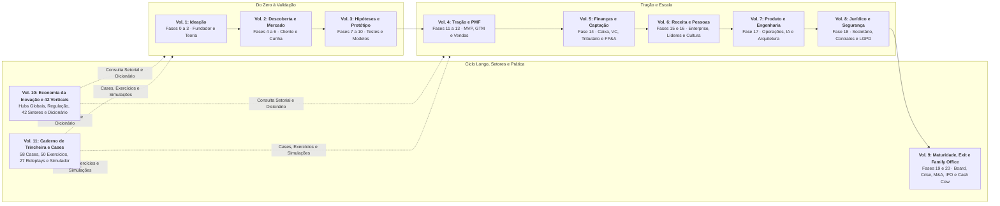

---

## Sumário deste Volume

### Fases da Etapa (Fases 11 a 13)

- [[#FASE 11: MVP E EXPERIMENTOS DE MERCADO|FASE 11: MVP E EXPERIMENTOS DE MERCADO]]
- [[#FASE 12: VALIDAÇÃO DO MODELO DE NEGÓCIO|FASE 12: VALIDAÇÃO DO MODELO DE NEGÓCIO]]
- [[#FASE 13: PRODUCT-MARKET FIT|FASE 13: PRODUCT-MARKET FIT]]

### Go-to-Market Inicial, Canais de Aquisição e Marketing (Capítulos 1 a 4)

- [[#CAPÍTULO 1: GTM PLAYBOOK E ARQUITETURA DE CANAIS: DA PRIMEIRA VENDA AO PRIMEIRO MILHÃO DE ARR|CAPÍTULO 1: GTM PLAYBOOK E ARQUITETURA DE CANAIS: DA PRIMEIRA VENDA AO PRIMEIRO MILHÃO DE ARR]]
- [[#CAPÍTULO 2: CRESCIMENTO ORGÂNICO COMPOSTO: CONTENT MARKETING, SEO E COMMUNITY BUILDING|CAPÍTULO 2: CRESCIMENTO ORGÂNICO COMPOSTO: CONTENT MARKETING, SEO E COMMUNITY BUILDING]]
- [[#CAPÍTULO 3: MARKETING DE PERFORMANCE EM PROFUNDIDADE|CAPÍTULO 3: MARKETING DE PERFORMANCE EM PROFUNDIDADE]]
- [[#CAPÍTULO 4: BRANDING, POSICIONAMENTO DE MARCA E PRODUCT MARKETING (PMM)|CAPÍTULO 4: BRANDING, POSICIONAMENTO DE MARCA E PRODUCT MARKETING (PMM)]]

### Vendas Consultivas, Pricing, Receita Recorrente e Sucesso do Cliente (Capítulos 5 a 8)

- [[#CAPÍTULO 5: SALES: MOTION COMPLETA, DO OUTBOUND AO RENEWAL|CAPÍTULO 5: SALES: MOTION COMPLETA, DO OUTBOUND AO RENEWAL]]
- [[#CAPÍTULO 6: PRICING STRATEGY E ECONOMIA DA RECORRÊNCIA (SUBSCRIPTION ECONOMY)|CAPÍTULO 6: PRICING STRATEGY E ECONOMIA DA RECORRÊNCIA (SUBSCRIPTION ECONOMY)]]
- [[#CAPÍTULO 7: NEGOCIAÇÃO COMO DISCIPLINA|CAPÍTULO 7: NEGOCIAÇÃO COMO DISCIPLINA]]
- [[#CAPÍTULO 8: CUSTOMER SUCCESS (CS) E CUSTOMER EXPERIENCE (CX): DA JORNADA À RETENÇÃO SUSTENTÁVEL E NRR ACIMA DE 100%|CAPÍTULO 8: SUCESSO E EXPERIÊNCIA DO CLIENTE (CS E CX): DA JORNADA À RETENÇÃO LÍQUIDA ACIMA DE 100%]]

### Instrumentação de Dados, Produto AI-Native e Anatomia do Pivô (Capítulos 9 a 11)

- [[#CAPÍTULO 9: DADOS, ANALYTICS E EXPERIMENTAÇÃO|CAPÍTULO 9: DADOS, ANALYTICS E EXPERIMENTAÇÃO]]
- [[#CAPÍTULO 10: AI COMO PARTE DO PRODUTO (AI-NATIVE PRODUCT)|CAPÍTULO 10: AI COMO PARTE DO PRODUTO (AI-NATIVE PRODUCT)]]
- [[#CAPÍTULO 11: PIVOT: TIPOLOGIA, DECISÃO E EXECUÇÃO|CAPÍTULO 11: PIVOT: TIPOLOGIA, DECISÃO E EXECUÇÃO]]

### Prática, Cases e Simulações Desta Etapa (Volume 11: Capítulos 10 a 12)

- [[IGNICAO-Vol-11-Workbook-Cases-e-Exercicios#CAPÍTULO 10: CASES GLOBAIS E BRASILEIROS DE GO-TO-MARKET, PLG, VENDAS B2B, PRICING E PIVÔ PARA O PMF|CAPÍTULO 10: CASES GLOBAIS E BRASILEIROS DE GO-TO-MARKET, PLG, VENDAS B2B, PRICING E PIVÔ PARA O PMF (Vol. 11)]]
- [[IGNICAO-Vol-11-Workbook-Cases-e-Exercicios#CAPÍTULO 11: CADERNO DE EXERCÍCIOS COM GABARITO COMENTADO: COORTES, LTV/CAC/PAYBACK, PRICING E FUNIL COMERCIAL|CAPÍTULO 11: CADERNO DE EXERCÍCIOS COM GABARITO COMENTADO: COORTES, LTV/CAC/PAYBACK, PRICING E FUNIL COMERCIAL (Vol. 11)]]
- [[IGNICAO-Vol-11-Workbook-Cases-e-Exercicios#CAPÍTULO 12: SIMULAÇÕES DE DECISÃO E ROLEPLAYS EXECUTIVOS: VENDAS MEDDIC, REAJUSTE DE PREÇOS E SALVAMENTO DE CONTAS|CAPÍTULO 12: SIMULAÇÕES DE DECISÃO E ROLEPLAYS EXECUTIVOS: VENDAS MEDDIC, REAJUSTE DE PREÇOS E SALVAMENTO DE CONTAS (Vol. 11)]]

---

# FASES DA ETAPA: DO MVP AO PRODUCT-MARKET FIT (FASES 11 A 13)

Aqui o protótipo vira operação viva: nas [[#FASE 11: MVP E EXPERIMENTOS DE MERCADO|Fases 11]], [[#FASE 12: VALIDAÇÃO DO MODELO DE NEGÓCIO|12]] e [[#FASE 13: PRODUCT-MARKET FIT|13]], você coloca o MVP na rua com clientes reais, valida a equação de *unit economics* (LTV, CAC e *Payback*) e persegue a prova matemática e comportamental de que o mercado finalmente puxa o seu produto.

---

## FASE 11: MVP E EXPERIMENTOS DE MERCADO

### O Dia em que o Código Encontra a Rua e o Medo da Vergonha Pública

Era terça-feira, 23h40, em São Paulo, e Marina acompanhava a tela compartilhada por videochamada direto de Florianópolis. O primeiro MVP do sistema de conciliação financeira da dupla estava pronto para ser liberado aos doze diretores financeiros que haviam pago pelo piloto, mas o cursor do mouse de Lucas tremia sobre o botão de *Deploy*.

"Marina, espera até segunda-feira que vem. A tela de exportação ainda está sem o gráfico colorido, o carregamento demora quatro segundos quando o arquivo passa de dez mil linhas e, se algum colega meu de engenharia vir esse layout simples, vão achar que a gente é amador", pediu Lucas.

Marina aproximou o rosto da câmera em Florianópolis e respondeu com calma:

"Lucas, eu mesma travei na semana passada revisando a planilha de preços três vezes antes de mandar, mas perfeccionismo de bastidor não paga as nossas contas. Os doze diretores financeiros que pagaram o piloto não compraram uma obra de arte. Eles querem descobrir amanhã às 9h onde estão perdendo caixa com boletos duplicados. Clica nesse botão agora", disse Marina.

O caixa gerado pela auditoria manual de extratos na Fase 10 havia bancado a construção daquelas três telas enxutas. Agora faltava descobrir quantos dos doze diretores financeiros importariam o primeiro lote de boletos sem travar e continuariam usando o sistema na oitava semana.

Reid Hoffman imortalizou a máxima de que, se você não sente um frio na barriga de constrangimento na primeira versão que coloca no ar, você lançou tarde demais. A regra da Fase 11 tem duas metades: o produto pode sair feio por fora, mas jamais pode quebrar a promessa central nem corromper os dados do cliente.

Essa fronteira é **A Linha Vermelha da Dignidade Funcional**: um MVP em produção pode ter interface enxuta, mas jamais pode corromper dados ou falhar na tarefa central que prometeu resolver. Na prática, essa Linha Vermelha governa tanto o Checklist de Pré-Lançamento desta fase (que exige três travas técnicas antes de abrir o acesso ao primeiro cliente: backup automatizado com restauração testada, procedimento de reversão ou *rollback* ensaiado em minutos e alerta imediato para qualquer erro de cálculo ou gravação) quanto os critérios de saída da Fase 11 (zero corrupção ou perda de dados de clientes durante as oito a doze semanas de operação). No instante em que o código entra na rua, termina a fase das hipóteses de papel e começa a auditoria do uso real.

---

> [!tip] Pilha tecnológica enxuta da Fase 11 (referência prática para o Passo 1)
> A escolha da pilha tecnológica do MVP segue uma regra simples: adote as ferramentas que o time atual domina e consegue sustentar em produção, priorizando serviços gerenciados para tudo o que não diferencia o negócio. Na web, combinam-se interfaces em React, Next.js, Vue ou Svelte com servidores em Node.js, Python ou Go e banco Postgres gerenciado (Supabase, Neon ou RDS). No mobile, React Native ou Flutter atendem à maioria dos casos antes de exigir código nativo. Prefira serviços prontos para hospedagem (Vercel, Railway ou Render), autenticação (Clerk, Auth0 ou Supabase Auth) e cobrança (Asaas, Pagar.me ou Stripe), deixando infraestrutura própria complexa para depois do PMF.
>
> Para produtos dev-tools, infraestrutura ou SaaS técnica: o [[IGNICAO-Vol-3-Experimentos-e-Prototipagem#CAPÍTULO 6: OPEN SOURCE COMO ESTRATÉGIA|Capítulo 6 (Open Source como Estratégia) (Vol. 3)]] cobre open source como motor de aquisição (product-led growth via comunidade) e como modelo de negócio (open core, dual licensing, COSS), incluindo casos de empresas que escalaram com essa estratégia.

A arquitetura típica de MVP, com decisões conscientes sobre simplicidade:

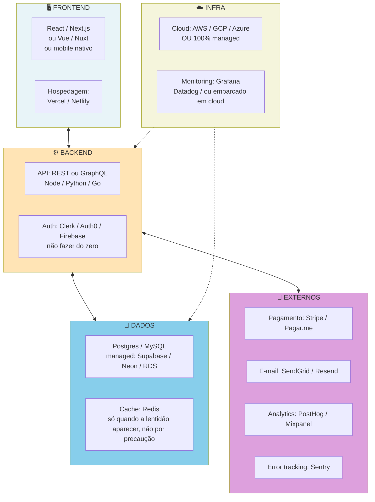

> [!important] Onde concentrar a engenharia própria no MVP
> Construir autenticação, motor de cobrança, disparo de e-mails ou monitoramento do zero consome semanas de engenharia sem gerar vantagem perceptível para o cliente. Concentre 100% do código próprio no fluxo central que entrega a promessa de valor da Fase 11.

### O aprendizado de produção com dez usuários reais na rua

Até aqui, o trabalho apoiou-se em evidências declaradas sobre o passado (entrevistas) e em sinais de compromisso pré-produto (pré-vendas e protótipos). O MVP inaugura o teste definitivo: observar o que os clientes fazem com um produto funcional e pago dentro da própria rotina operacional, semana após semana.

> [!warning] MVP não é "versão capenga" do produto
> Essa é a confusão mais comum. O MVP é o experimento mais enxuto capaz de validar a incerteza decisiva da vez. Na Fase 11 ele já assume a forma de software confiável em produção, concentrado em responder a duas perguntas por ciclo: qual é a premissa mais arriscada neste momento e como testá-la com o menor esforço de engenharia possível?

Um MVP de sucesso é medido pela incerteza que elimina por real investido, mais do que pelo polimento visual ou pela sofisticação da arquitetura. Gastar R$ 200 mil construindo software e sair com as mesmas dúvidas do início produz apenas um lançamento prematuro.

### O ciclo MVP em três fases: construir na ordem certa

O ciclo MVP em três etapas, cada uma valida coisa diferente:

```mermaid
flowchart LR
 subgraph E1["1️⃣ Etapa 1: MVP de Demanda e Problema"]
 M1A["Pergunta:<br/>existe demanda real<br/>por essa proposta?"]
 M1B["Formato:<br/>landing page / smoke test<br/>com chamada para ação"]
 M1C["Meta de avanço:<br/>≥10% conversão em cadastro<br/>ou ≥3% em pré-venda"]
 end

 subgraph E2["2️⃣ Etapa 2: MVP de Solução (Concierge / Mágico de Oz)"]
 M2A["Pergunta:<br/>a entrega resolve a dor<br/>e faz o cliente voltar?"]
 M2B["Formato:<br/>operação manual assistida<br/>sem automação pesada"]
 M2C["Meta de avanço:<br/>5–10 clientes ativos/pagantes<br/>com uso recorrente"]
 end

 subgraph E3["3️⃣ Etapa 3: MVP de Negócio (Software em Produção)"]
 M3A["Pergunta:<br/>o fluxo validado escala<br/>com unit economics saudáveis?"]
 M3B["Formato:<br/>software enxuto automatizando<br/>o núcleo provado na Etapa 2"]
 M3C["Meta de avanço:<br/>ativação, retenção D30<br/>e conversão para pago"]
 end

 E1 --> E2 --> E3

 style E1 fill:#FFE4B5
 style E2 fill:#87CEEB
 style E3 fill:#90EE90
```

> [!note] Da descoberta ao software em produção
> As Etapas 1 e 2 abaixo sintetizam o caminho percorrido na [[IGNICAO-Vol-3-Experimentos-e-Prototipagem#FASE 8: EXPERIMENTOS DE VALIDAÇÃO DO PROBLEMA E DA SOLUÇÃO|Fase 8 (Vol. 3)]] para que o código da Etapa 3 nasça sobre demanda e entrega já provadas.

Fundadores de primeira viagem costumam pular direto para a escrita de código e consumir meses de caixa antes de colher a primeira evidência de mercado. O caminho estruturado divide a validação em três etapas sequenciais, nas quais as duas primeiras preparam o terreno para o software em produção desta Fase 11:

#### Etapa 1 do ciclo (recapitulação da Fase 8): MVP de Demanda e Problema (*Smoke Test*)

Como visto em detalhe na [[IGNICAO-Vol-3-Experimentos-e-Prototipagem#FASE 8: EXPERIMENTOS DE VALIDAÇÃO DO PROBLEMA E DA SOLUÇÃO|Fase 8 (Vol. 3)]], esta primeira etapa responde se existe demanda real pela proposta de valor no perfil de cliente escolhido, usando uma página de destino (*landing page*) com chamada para ação concreta (cadastro qualificado, lista de espera ou pré-venda reembolsável).

Com investimento enxuto de R$ 500 a R$ 3.000 em tráfego ou prospecção ativa ao longo de uma a três semanas, busca-se conversão acima de 10% para cadastro qualificado ou acima de 3% para pré-pedido pago (abaixo de 2%, o gancho ou o público precisam ser revistos antes de avançar).

No caso de Lucas e Marina, esse filtro inicial confirmou quais diretores financeiros sentiam a dor de boletos duplicados com urgência suficiente para agendar uma demonstração prática.

Confirmada a demanda na página de captura, o time avança para a entrega manual assistida antes de automatizar o sistema.

> [!tip] Templates operacionais desta fase
> Utilize o **[[IGNICAO-Vol-3-Experimentos-e-Prototipagem#Template: Especificação de MVP|Template: Especificação de MVP (Vol. 3)]]** para travar o escopo antes de codificar e o [[#Template: Checklist de Pré-Lançamento (do Beta Fechado ao Lançamento Público)|Template: Checklist de Pré-Lançamento]], na seção [[#TEMPLATES OPERACIONAIS E CASOS PREENCHIDOS (FASE 11)|Templates Operacionais desta Fase]], para auditar a prontidão de lançamento.

#### Etapa 2 do ciclo: MVP de Solução (Concierge / Mágico de Oz, entregue manualmente)

A pergunta que responde: se entregarmos o valor prometido, o cliente consome, paga, e retorna? A solução realmente *mata* a dor?

Na operação manual assistida (vista na Fase 8), você entrega o resultado prometido sem automação pesada. O cliente não precisa ver que os bastidores são manuais, mas o contrato e a política de privacidade devem prever expressamente que profissionais da equipe tratam os dados sob sigilo estrito (requisito indispensável em dados financeiros ou de saúde sob a LGPD). Em conciliação contábil, processam-se os primeiros lotes em planilha auditada e WhatsApp. Em curadoria ou diagnóstico, os próprios fundadores executam a análise.

Métrica primária. Retenção: percentual de usuários que voltam (o cliente volta?), NPS ou satisfação, e disposição a pagar (ele paga pelo serviço mesmo antes de haver "produto"?).

O custo concentra-se no tempo dos fundadores ao longo de quatro a doze semanas. O critério de avanço para o código é reunir pelo menos dez a doze clientes pagantes no piloto B2B (ou cinco contratos em vendas corporativas de tíquete alto) que utilizam o serviço regularmente e demonstram retenção real.

#### Etapa 3 do ciclo: MVP de Negócio (Software Mínimo em Produção)

A pergunta que responde: a operação que já funciona manualmente pode ser automatizada de forma a reduzir custo e escalar?

Como fazer: só inicie o desenvolvimento do software nesta terceira etapa, automatizando exclusivamente as rotinas do fluxo que já provaram entregar valor real durante a operação Concierge.

A métrica primária passa a ser de negócio: ativação (percentual de cadastrados que concluem a primeira ação de valor), retenção nas safras semanais, receita recorrente, custo de aquisição (CAC) e valor do tempo de vida (LTV).

O investimento desta terceira etapa é o mais alto do ciclo e exige semanas de engenharia. O critério de avanço consiste em manter as métricas de ativação e retenção estáveis ou crescentes conforme novos lotes de usuários entram.

> [!note] Transição do Concierge para o código
> Automatize no MVP apenas o núcleo que os clientes realmente usaram durante a operação manual, deixando telas secundárias para depois das primeiras coortes.

### Lançamento em ondas controladas, instrumentação do funil de ativação e correção de atritos em 24 horas

Os nove passos a seguir aplicam-se à terceira etapa do ciclo (MVP em Código), acionada somente depois que o Teste de Demanda e o MVP Concierge trouxeram evidência concreta de uso e disposição de pagamento.

> [!tip] MVP Canvas antes de construir qualquer coisa
> Para cada experimento que o time planeja lançar, revise o [[IGNICAO-Vol-3-Experimentos-e-Prototipagem#Canvas: MVP Canvas (Tristan Kromer e Paulo Caroli)|Canvas: MVP Canvas (Vol. 3)]] (sistematizado por Tristan Kromer e por Paulo Caroli em *Lean Inception*, 2015) em 30 a 45 minutos antes de escrever código: qual é a hipótese central falsificável, quem forma o segmento restrito do teste (como os 12 diretores financeiros do piloto de Lucas e Marina), qual é o formato mínimo capaz de testar a premissa e qual é o critério numérico de invalidação. O caso da Wildlife Studios (Fase 9, Vol. 3) mostra como a definição precisa do público, restrita aos jogadores de gasto moderado (*moderate spenders*), produziu evidência limpa para expandir a funcionalidade a toda a base.

#### Passo 1: construa apenas os Must Haves

Resista à tentação de "só acrescentar isso". Cada item extra atrasa e adiciona complexidade que pode não ser necessária. Siga a especificação.

#### Passo 2: defina os critérios de sucesso antes de lançar

Defina por escrito o que você vai considerar sucesso depois de oito a doze semanas, fixando a meta, o prazo máximo de ativação (*time-to-value*, como concluir a primeira conciliação em até 48 horas no SaaS B2B de Lucas e Marina) e a faixa de fracasso para seis indicadores: clientes ativos (ex.: meta de 10 a 12 empresas ativas. Fracasso abaixo de 5), retenção em D7, D30 e D60 (ex.: piso de 40% e meta de 60% de usuários ativos em D30 no B2B. Fracasso abaixo de 30%), conversão de piloto para pago (ex.: acima de 50%), satisfação ou NPS, receita recorrente total e CAC médio.

Escreva também o que seria "fracasso". A faixa em que você vai considerar o MVP inviável e decidir pivotar.

#### Passo 3: escolha estratégia de lançamento

Existem quatro estratégias principais de lançamento controlado para colocar o MVP em código diante dos primeiros usuários:

##### Closed beta com lista de espera

A melhor para aprender em ambiente controlado. Dez a trinta usuários pioneiros. Onboarding manual. Contato próximo.

##### Soft launch (lançamento silencioso)

Lançamento público sem grande promoção. Permite ver comportamento natural.

##### Wizard of Oz Beta (simular automação com trabalho humano por trás)

O produto parece funcionar completamente, mas parte é manual por trás. Reduz tempo de desenvolvimento. Você opera manualmente o que vai automatizar depois.

##### Concierge Beta

Entrega do valor em beta fechado ou lançamento silencioso, recorrendo a etapas manuais de bastidor (Concierge ou Wizard of Oz, vistos na etapa 2 do ciclo) apenas nos fluxos secundários que ainda não compensa automatizar no código.

> [!tip] Para a primeira rodada, closed beta com lista de espera
> É quase sempre a melhor opção. Permite controle, aprendizado profundo, e relacionamento direto com cada usuário. Os outros formatos vêm depois, com escala.

> [!note] Mapa de aprofundamento desta Fase 11
> Para aprofundar a execução de cada passo desta fase sem interromper a leitura, consulte diretamente: (1) [[#CAPÍTULO 1: GTM PLAYBOOK E ARQUITETURA DE CANAIS: DA PRIMEIRA VENDA AO PRIMEIRO MILHÃO DE ARR|Capítulo 1: GTM Playbook e Canais]] no recrutamento dos primeiros clientes (Passo 4), (2) [[#CAPÍTULO 8: CUSTOMER SUCCESS (CS) E CUSTOMER EXPERIENCE (CX): DA JORNADA À RETENÇÃO SUSTENTÁVEL E NRR ACIMA DE 100%|Capítulo 8: Customer Success e CX]] na medição do *time-to-value* durante o *onboarding* manual (Passo 4), (3) [[#CAPÍTULO 9: DADOS, ANALYTICS E EXPERIMENTAÇÃO|Capítulo 9: Dados, Analytics e Experimentação]] na instrumentação dos eventos do produto (Passo 5), e (4) [[#CAPÍTULO 6: PRICING STRATEGY E ECONOMIA DA RECORRÊNCIA (SUBSCRIPTION ECONOMY)|Capítulo 6: Pricing Strategy]] no teste de cobrança real (Passo 8).

#### Passo 4: onboarding manual intensivo, "Faça Coisas Que Não Escalam"

Nas primeiras semanas, receba cada novo usuário pessoalmente por telefone ou videochamada, acompanhe a configuração inicial passo a passo e ouça onde ele trava. É nesse contato direto que você descobre o que precisa corrigir no produto. Automatizar o *onboarding* cedo demais esconde os motivos reais de abandono.

Esse modo de operação segue o princípio *Do Things That Don't Scale*, formulado por Paul Graham na Y Combinator: nos estágios iniciais, o trabalho manual intenso dos fundadores produz o encaixe com o mercado porque é o único caminho para aprender em alta resolução. A escala vem depois e só funciona quando o fluxo que merece ser escalado foi descoberto artesanalmente primeiro.

Três táticas específicas compõem esse modo de operação.

##### Recrutamento manual de primeiros clientes

Em vez de depender de anúncios pagos de baixa conversão logo na largada, os fundadores recrutam os primeiros usuários um a um dentro do perfil-alvo, por abordagem direta no LinkedIn, e-mail personalizado, participação em encontros do setor e visitas presenciais.

O exemplo canônico é o Airbnb. Brian Chesky e Joe Gebbia foram pessoalmente fotografar os apartamentos dos anfitriões em Nova York (como relata Paul Graham no ensaio *Do Things that Don't Scale*) para melhorar os anúncios. O Pinterest. Ben Silbermann e Evan Sharp foram literalmente a cafeterias de Palo Alto convidar pessoas para usar.

Esse recrutamento individual parece lento à primeira vista, mas funciona justamente porque dedica aos primeiros dez a doze clientes do piloto B2B (ou aos primeiros lotes de usuários em B2C) uma escuta próxima que nenhum anúncio pago consegue replicar.

##### Atendimento direto pelos fundadores

Nas primeiras doze a vinte e quatro semanas, os próprios fundadores devem permanecer na linha de frente do suporte: em vez de terceirizar o atendimento ou contratar atendentes cedo, responda pessoalmente a cada chamado, ligue para quem teve dúvida e conduza cada sessão de implantação.

O objetivo dessa abordagem manual é sentir na pele cada ponto de fricção do usuário em tempo real: o problema que o cliente encontra na quinta-feira vira ajuste no código na sexta-feira.

##### A Máquina de Melhoria

Essa é a tática operacional mais importante desta fase. Para cada usuário nos primeiros dias, execute um ciclo de quatro passos.

Fale com o usuário. Trinta a quarenta e cinco minutos de conversa estruturada antes do onboarding. Quais eram as expectativas dele? O que já tentou? O que espera?

Assista ao usuário utilizando o produto, presencialmente ou por compartilhamento de tela, mantendo-se em silêncio. Observe onde ele hesita, clica no lugar errado ou fecha uma aba em dúvida: travamentos que passam despercebidos nos gráficos agregados ficam evidentes na primeira sessão observada.

Corrija os erros imediatamente. Em horas ou dias. Não em semanas. Se três usuários seguidos travam no mesmo lugar, aquele lugar vai para o topo do backlog.

Repita com o próximo usuário.

> [!important] O princípio-raiz da Máquina de Melhoria
> Repetir esse ciclo de escuta e ajuste dezenas de vezes nas primeiras semanas acelera descobertas que um cronograma fechado levaria mais de um ano para revelar. Canais pagos e mecânicas de indicação apenas amplificam o sinal existente: a Máquina de Melhoria serve para garantir que a entrega central funcione bem antes de investir na distribuição.

#### Passo 5: instrumente o produto para medir

Antes de abrir o acesso, instrumente a aplicação para registrar os eventos-chave (cadastro, primeira ação de valor e retorno), o funil de conversão até o pagamento, o tempo gasto em cada fluxo e a tela exata em que ocorrem os abandonos.

Ferramentas comuns. Escolha uma ou duas. Mixpanel, Amplitude, PostHog. Ou simplesmente logs custom mais planilha.

#### Passo 6: defina cadência de aprendizado

Ritual semanal: na segunda-feira, revise as métricas da semana anterior. Na quarta-feira, conduza uma conversa de 30 minutos com um usuário ativo. Na sexta-feira, sintetize os aprendizados e priorize os ajustes da próxima sprint.

> [!warning] Evite o ciclo tóxico
> "Implementar sem olhar dados, olhar dados uma vez por mês, entrar em pânico, implementar muita coisa." Esse é o caminho mais rápido para queimar capital sem aprender.

#### Passo 7: meça retenção com rigor

Retenção é o indicador mais honesto. Construa uma curva de retenção. A coorte (grupo de usuários que iniciaram no mesmo período): por exemplo, todos os usuários que ativaram na semana X. A medição: percentual dessa coorte que continua ativa em X mais 1 semana, X mais 2 semanas, e por aí vai.

Sinal de valor real: a curva se *estabiliza* (achata) em algum nível não zero. Sinal de sem-valor: a curva cai para zero em quatro semanas.

Curva que estabiliza em vinte por cento indica que um quinto dos usuários encontrou valor real. Isso é muito melhor do que curva que inicialmente mostra oitenta por cento, mas despenca.

#### Passo 8: valide a disposição real de pagamento

Se você opera com período de teste gratuito ou piloto pago, defina a data de início da cobrança desde o dia um, formalize um termo de piloto simples (com preço, prazo e escopo), configure cobrança recorrente via cartão, boleto ou Pix Automático e emita a NFS-e no padrão nacional, confirmando com o contador se, no seu regime tributário (Simples Nacional ou regime regular), o preenchimento dos campos de IBS e CBS da reforma tributária já é exigido em 2026 (no regime regular, exigido desde outubro de 2026 pelo Ato Conjunto RFB/CGIBS 4/2026. No Simples Nacional, a obrigatoriedade do padrão nacional para ME e EPP entra em novembro de 2026 e a apuração de IBS/CBS a partir de 2027, conforme a Resolução CGSN 191/2026). Meça tanto o percentual que converte para pago quanto os motivos reais de quem não converteu.

#### Passo 9: produza o Relatório de Aprendizado

Após oito a doze semanas de operação, consolide em um documento único o desempenho frente às metas iniciais, os aprendizados sobre produto, perfil de usuário que ativa e canal de origem, além dos gargalos, das oportunidades mapeadas e da decisão final entre perseverar, iterar, pivotar ou encerrar.

### Caso brasileiro real: Stone v0 (Especificação de MVP reconstruída para 2012)

Reconstrução didática do MVP que André Street e Eduardo Pontes colocaram em operação em 2012, antes da estreia na Nasdaq em outubro de 2018 que avaliou a StoneCo acima de US$ 9 bilhões no primeiro pregão (elaborada a partir do prospecto Form F-1 arquivado na SEC em outubro de 2018 e do histórico público da companhia).

A North Star Metric. Número de transações processadas por mês. Métrica única que conecta valor para o lojista (ele vende mais), e receita para a Stone (taxa por transação).

**Escopo incluído no MVP da Stone:**

Maquininha de cartão (POS) de fornecedores já homologados no mercado para processar débito e crédito, sem fabricar hardware próprio nas primeiras versões.

Liquidação confiável das transações na conta bancária do lojista e conciliação transparente das taxas cobradas.

Portal web básico para o lojista ver transações, antecipar recebíveis, e baixar comprovantes.

Green Angels contratados na praça inicial: executivos comerciais e de suporte em campo que visitavam o lojista, concluíam a ativação presencial em até 48 horas e atendiam diretamente por telefone e WhatsApp, sem intermediários de call center.

SLA de troca de maquininha em até vinte e quatro horas, em caso de defeito.

Cobertura inicial do piloto: foco concentrado no Rio de Janeiro, expandindo a operação comercial estruturada para São Paulo na etapa seguinte.

**Escopo fora do MVP, explicitamente, seis itens.**

Crédito para o lojista (capital de giro, antecipação avançada). Viria nos anos seguintes.

Conta corrente plena (open banking, Pix). Viria ao longo da década.

Software próprio de gestão para o varejo (POS e ERP). Viria anos depois, com a aquisição da Linx, anunciada em 2020 e concluída em 2021.

Desenvolvimento de hardware próprio customizado e rede nacional própria de polos logísticos em dezenas de cidades (na largada, a operação validou o modelo comercial e o software de adquirência no Rio de Janeiro e em São Paulo utilizando terminais POS de fornecedores homologados como Ingenico e PAX).

App mobile completo para o lojista. O primeiro foco era o portal web.

Operação fora de capitais. Viria depois da validação em RJ e SP.

**Stack escolhida (decisões iniciais).**

Hardware: terminais POS de terceiros já certificados pelas bandeiras (EMV/PCI) e pela Anatel (o Banco Central não homologa maquininhas físicas, e o regime de autorização do BCB para instituições de pagamento credenciadoras só seria instituído após a Lei nº 12.865/2013, sendo o passo decisivo de 2012 o credenciamento técnico e operacional junto às bandeiras).

**Backend:** Arquitetura desenhada para escala desde o começo (lições do passado dos fundadores em adquirência).

Integração técnica e operacional com as bandeiras (Visa e Mastercard): etapa estruturante que exigia meses de homologação e conformidade de segurança.

Atendimento humano. Sem call center terceirizado de baixa qualidade no v0. Cada Green Angel cobria geografia limitada, para garantir qualidade.

**Cronograma, do início de 2012 ao primeiro pico.**

Meses 1 a 6: estruturação societária, captação inicial, credenciamento técnico junto às bandeiras e contratação dos primeiros Green Angels.

Meses 7 a 12: operação piloto com os primeiros 100 a 300 lojistas na praça inicial (Rio de Janeiro).

Meses 13 a 24 (segundo ano): entrada em São Paulo e padronização da rotina de atendimento presencial dos Green Angels.

Terceiro ano: consolidação do NPS elevado nas praças iniciais e expansão geográfica gradual para novas capitais.

**Lojistas-piloto, perfil.**

O piloto mirou pequenas e médias empresas com faturamento mensal de R$ 30 mil a R$ 300 mil em cartões que estavam insatisfeitas com o atendimento lento das grandes credenciadoras tradicionais (Cielo, Rede e Getnet), deixando grandes redes varejistas para depois a fim de manter o ciclo de aprendizado curto.

**Indicadores acompanhados desde o primeiro dia de operação:**

Tempo de onboarding. Meta: até quarenta e oito horas, da primeira visita do Green Angel à primeira transação processada.

NPS após 30 dias de uso: meta ilustrativa acima de 70 nesta reconstrução, superando com folga a percepção média de atendimento das credenciadoras incumbentes na época.

Taxa de retenção: percentual de lojistas que continuam processando transações na maquininha em D+90 (noventa dias após a ativação).

Volume de transações processadas por lojista (TPV). Sinal de saúde da operação do cliente.

Custo de aquisição (CAC) por lojista, dado o modelo Green Angel. CAC mais alto que canal digital. Mas LTV justifica.

**O que validou o MVP.**

NPS no perfil-alvo confirmou a hipótese de dor de atendimento como vetor de wedge. Não apenas preço.

Retenção elevada em D+90 nos primeiros lojistas (nesta reconstrução ilustrativa do piloto), sinalizando que o serviço resolvia a dor operacional do varejista.

Indicações orgânicas começaram a aparecer. Lojistas satisfeitos chamavam outros (vizinhos do bairro, fornecedores, parceiros), reduzindo CAC ao longo do tempo.

Com *unit economics* comprovados nos polos iniciais, a Stone multiplicou a capilaridade física dos seus *Green Angels* em novas praças, ampliou o ecossistema de software de gestão no ponto de venda e concluiu seu IPO na NASDAQ em outubro de 2018 (ticker STNE), tendo a Berkshire Hathaway entre os investidores âncora da oferta.

> [!important] O que a Stone deixou de fora na largada
> O MVP da Stone reuniu a *menor combinação viável* de maquininha, software e atendimento presencial para testar sua tese de entrada: lojistas de pequeno e médio porte insatisfeitos com os adquirentes tradicionais aceitavam pagar pelo suporte próximo e rápido. Crédito, aplicativo móvel e terminal próprio entraram apenas depois que essa premissa se provou na rua, evitando que a empresa dispersasse capital em funções secundárias antes de validar o núcleo do negócio.

### Coorte inicial de usuários reais ativos, funil instrumentado e ciclo de iteração semanal rodando

A Fase 11 tem três possíveis desfechos. Todos legítimos.

#### Sucesso claro: siga para a Fase 12

Os critérios de saída desta fase exigem pelo menos dez a doze clientes pagando de forma recorrente por oito a doze semanas em B2B (ou cinco contratos ativos em vendas corporativas de tíquete alto), acompanhados de ativação acima de 30% a 40% em D7, retenção de usuários ativos em D30 igual ou superior ao piso de 40% em B2B rumo à meta saudável de 60% (ou curva estabilizada acima de 20% a 25% em B2C), conversão de teste para pago acima de 15% e pelo menos três clientes que já indicaram espontaneamente outro cliente (ou 20% de novos usuários vindos por indicação orgânica em B2C).

#### Sinais mistos, itere por mais quatro a oito semanas

Ativação razoável mas retenção fraca. Usuários dizem que gostam, mas não voltam. Alguns super-usuários. Maioria silenciosa.

#### Fracasso claro, pivote ou abandone

Baixa ativação. Curva de retenção desce a zero em duas a quatro semanas. Conversão para pago menos de cinco por cento. Ausência de referência orgânica.

> [!warning] Não empurre MVP que está em fracasso para sucesso com mais marketing
> Quando o produto ainda não retém quem entra, injetar mais verba em anúncios não corrige a falha de valor: mais tráfego em um funil furado só acelera o desperdício de caixa.

**Critérios de saída (cenário de sucesso). Você concluiu a Fase 11 quando todos os critérios abaixo estão cumpridos.**

- [ ] Especificação de MVP (preenchida no template da Fase 10, Vol. 3) com escopo dentro e fora explícitos, executada em ciclos curtos de duas a quatro semanas.
- [ ] Pilha tecnológica definida com base no domínio do time atual e no uso de serviços gerenciados para funções não diferenciadoras (hospedagem, autenticação e cobrança).
- [ ] Dez a doze clientes reais pagando e usando o MVP em produção por pelo menos oito semanas em B2B (ou cinco clientes pagantes em B2B corporativo de tíquete alto).
- [ ] Linha Vermelha da Dignidade Funcional cumprida: zero corrupção ou perda de dados de clientes no período, com backup diário restaurado em teste, procedimento de *rollback* ensaiado e alerta imediato para erros de cálculo ou gravação.
- [ ] Rastreamento de eventos instrumentado desde o dia um (PostHog, Mixpanel, Amplitude ou registros próprios) cobrindo as cinco etapas do funil AARRR e a Métrica Norte (*North Star Metric*) revisada toda segunda-feira.
- [ ] Conversas semanais de acompanhamento com usuários ativos e inativos realizadas pelos próprios fundadores como rotina.
- [ ] Lista de correções (*backlog*) priorizada pelo impacto direto na ativação e na retenção.
- [ ] Indicadores quantitativos da tabela de referência da Fase 11 atingidos: ativação em D7 de pelo menos 30% a 40%, retenção em D30 acima do piso de 40% em B2B rumo a 60% (ou estabilizada acima de 20% a 25% em B2C) e conversão de teste para pago acima de 15%.
- [ ] Tempo até o primeiro valor (*aha moment*) dentro do prazo definido no Passo 2: poucos minutos em SaaS autoatendido, até 48 horas ou primeira semana em SaaS B2B com integração de dados (como o de Lucas e Marina), primeira semana em marketplaces e primeiro minuto em aplicativos de consumo.
- [ ] Sinais concretos de lealdade e indicação: primeiros clientes renovando o pagamento mensal e pelo menos três clientes B2B que já indicaram outro cliente (ou ao menos 20% dos novos usuários chegando por indicação orgânica em B2C).
- [ ] Saúde operacional sustentada: primeira resposta de suporte em até 4 horas comerciais, nenhum incidente decisivo aberto por mais de 24 horas e taxa de erro técnico abaixo de 1% (abaixo de 0,1% no fluxo de pagamento).

> [!warning] Critério de saída
> Se qualquer um desses itens falhar, revise os cenários de "Sinais mistos" e "Fracasso claro" acima e corrija o produto antes de avançar para a Fase 12.

**Primeiros passos práticos.**

1. Abrir a Especificação de MVP preenchida na Fase 10 (Vol. 3) e travar o escopo: o que fica de fora da primeira versão é tão decisivo quanto o que entra.
2. Escolher stack com base no Stack Mínimo da Fase 11. Priorizar serviços gerenciados (Vercel, Supabase, Stripe).
3. Instrumentar analytics desde o dia um. Mixpanel, PostHog, ou Amplitude (free tier).
4. Recrutar os dez a doze primeiros clientes do piloto entre os participantes validados na [[IGNICAO-Vol-3-Experimentos-e-Prototipagem#FASE 10: TESTES DE SOLUÇÃO E USABILIDADE|Fase 10 (Vol. 3)]] e conduzir o *onboarding* individualmente.

### Oito erros do MVP em produção (incluindo fazer alarde na imprensa antes de reter os 10 primeiros clientes)

1. **Buscar cobertura na imprensa antes de reter os dez primeiros clientes:** fazer lançamento ruidoso antes que os primeiros usuários completem o fluxo central sem travar só amplifica falhas em público. Quando Lucas e Marina lançaram seu piloto, adiaram qualquer anúncio no LinkedIn até que os doze diretores financeiros conciliassem os primeiros lotes de boletos sem erro.

2. **Deixar o escopo inflar por nove meses:** quando o desenvolvimento se arrasta por trimestres sem ir ao ar, o experimento perde a função de MVP e vira uma versão 1.0 lançada no escuro. No próximo ciclo, corte mais fundo no escopo inicial.

3. **Lançar sem instrumentação de dados:** colocar o produto no ar sem rastrear quem ativa e quem abandona deixa o time cego para o que acontece na rotina real do usuário.

4. **Ignorar quem abandonou o produto:** ouvir apenas os usuários que ficaram esconde os travamentos fatais, quem testou e saiu na primeira semana guarda a informação mais valiosa para corrigir o fluxo.

5. **Confundir cadastro com ativação real:** comemorar quinhentos cadastros quando apenas cinco usuários completam a tarefa central é cair em métrica de vaidade.

6. **Pivotar cedo demais:** duas semanas de uso raramente bastam para julgar a tese, opere por oito a doze semanas corrigindo atritos de *onboarding* antes de descartar a direção.

7. **Persistir em negação diante de retenção zero:** completar seis meses com a curva de retenção caindo a zero enquanto o time apenas muda cores de tela é recusar a realidade do mercado.

8. **Otimizar funcionalidades periféricas:** quando a retenção é fraca, polir a tela de login ou de configurações não move o ponteiro, concentre toda a energia na entrega do primeiro valor.

---

### Roteiro de lançamento público pós-validação do MVP

Quando o MVP já tiver retenção comprovada no beta fechado, estruture o lançamento público como uma janela de 60 a 90 dias dividida em três etapas claras. Nas 4 a 8 semanas de pré-lançamento, construa uma lista de espera com 500 a 2.000 contatos qualificados, compartilhe os bastidores da solução, acione individualmente 50 a 150 aliados da rede para amplificar o anúncio e deixe o pacote de materiais visuais pronto. No dia do lançamento (sempre terça ou quarta-feira, evitando segundas, sextas e vésperas de feriado), concentre o disparo no canal primário do seu mercado: LinkedIn dos fundadores e comunidades setoriais para B2B no Brasil, Instagram e TikTok para consumo, Product Hunt para ferramentas globais de tecnologia ou imprensa especializada sob embargo para soluções corporativas. Nos 30 dias seguintes, monitore diariamente o tráfego por canal, a conversão da lista de espera, a ativação em 24 horas e o retorno no sétimo dia.

Evite cinco erros recorrentes no lançamento: abrir o produto sem lista de espera aquecida. Ausentar-se do atendimento ao vivo no dia da abertura. Descuidar da ativação no dia seguinte. Aguardar cobertura espontânea da imprensa sem ter acionado jornalistas duas a três semanas antes, e fazer relançamentos sucessivos sem evolução real do produto. Cadastros e menções em redes sociais só têm valor se virarem uso recorrente em 30 a 60 dias.

Algumas empresas crescem sem evento de lançamento tradicional: a Superhuman escalou no início por lista de espera e onboarding individual conduzido pelos fundadores, enquanto produtos como o Notion cresceram por adoção orgânica e comunidade antes de grandes campanhas. Replicar o playbook quando a estratégia é PLG atrai usuários errados que não retêm: decisão deve ser estratégica, não default.

> [!tip] Aprofundamento por canal após validar o beta fechado
> Conteúdo orgânico de longo prazo: [[#CAPÍTULO 2: CRESCIMENTO ORGÂNICO COMPOSTO: CONTENT MARKETING, SEO E COMMUNITY BUILDING|Capítulo 2: Content Marketing e SEO]] (clusters, SEO semântico, distribuição). Mídia paga: [[#CAPÍTULO 3: MARKETING DE PERFORMANCE EM PROFUNDIDADE|Capítulo 3: Marketing de Performance]] (estrutura de campanhas, CAC por canal, atribuição). PLG sem evento de launch: [[IGNICAO-Vol-6-Receita-e-Pessoas#CAPÍTULO 1: GROWTH COMO FUNÇÃO ORGANIZACIONAL: TIME DE GROWTH, BUILD VS HIRE, RELAÇÃO COM PRODUTO|Capítulo 1 (Growth como Função Organizacional: Time de Growth, Build vs Hire, Relação com Produto) (Vol. 6)]] (Growth como função). Enterprise sem launch mass-market (motion 1-a-1): [[#CAPÍTULO 5: SALES: MOTION COMPLETA, DO OUTBOUND AO RENEWAL|Capítulo 5 (Sales: Motion Completa, do Outbound ao Renewal)]] (sales motion).

---

### O Espelho da Fase 11: Seu MVP Já Está na Mão de Quem Paga ou Escondido no Seu Computador?

Na oitava semana após aquele clique tenso de terça-feira à noite entre São Paulo e Florianópolis, Lucas lembrou do cursor tremendo sobre o botão de *Deploy*. Ao abrir o painel da coorte dos doze diretores financeiros do piloto, dez importavam os extratos bancários toda segunda-feira às 9h sem precisar de lembrete, ninguém havia comentado a falta do gráfico colorido na exportação e nenhum centavo havia sido calculado errado graças às travas da Linha Vermelha.

**O Espelho (autodiagnóstico):**
1. O que impede você de colocar o produto na mão de clientes reais hoje: um risco técnico real de corromper dados ou o desconforto com uma interface simples? (Se houver risco aos dados, cumpra as três travas da Linha Vermelha e do Checklist de Pré-Lançamento antes de abrir o acesso, se for apenas estética, libere o acesso aos dez a doze primeiros clientes hoje e acompanhe o uso no Passo 4.)
2. Você acompanhou pessoalmente (por vídeo ou ao lado do cliente) o primeiro acesso dos seus dez a doze primeiros clientes reais?
3. Se um usuário travar na segunda tela do seu MVP hoje às 14h, o seu sistema avisa você no mesmo minuto ou você só descobre um mês depois quando ele cancela?

**Permissão Libertadora:**
Na largada do MVP, você está autorizado a operar em beta fechado: sem festa de lançamento, sem assessoria de imprensa e sem postagem comemorativa no LinkedIn no dia do *deploy* (reserve o roteiro de lançamento público, descrito acima e no *Launch Playbook* do [[#CAPÍTULO 4: BRANDING, POSICIONAMENTO DE MARCA E PRODUCT MARKETING (PMM)|Capítulo 4]], para quando a retenção já estiver validada). Lance em silêncio para dez a doze clientes reais, conserte o que travar em 48 horas e deixe o resultado falar.

**O Ritual de Segunda-Feira às 9h:**
Na mesma reunião de segunda-feira do Passo 6: depois de revisar as métricas da semana, assista às gravações de sessão (ou sente-se ao lado) dos últimos cinco usuários que entraram no produto. Identifique o botão ou passo exato onde eles hesitaram por mais de dez segundos e elimine esse atrito hoje.

---

### Tabela de referência única: métricas e patamares de saída da Fase 11

| Métrica | O que medir | Referência saudável |
|---|---|---|
| Tempo para primeiro usuário | Dias desde o lançamento | ≤ 30 dias |
| Tempo para primeiro pagante | Dias desde o lançamento | ≤ 60 dias (B2C), ≤ 90 dias (B2B) |
| Ativação | % dos cadastrados que concluem a primeira ação de valor (*aha moment*) | ≥ 30% a 40% em D7 (calibrar pela complexidade da implantação) |
| Retenção D30 | % da safra que segue executando a ação central após 30 dias | B2C: ≥ 20% a 25% em D30, SaaS B2B: piso mínimo de 40% de usuários ativos no piloto e meta saudável ≥ 60% em D30 (com ≥ 80% das empresas pagantes ativas) |
| Aprendizados por sprint | Hipóteses resolvidas por semana | ≥ 2 |
| Feature usage | Funcionalidades usadas por usuário ativo | Core features: ≥ 70% de adoção |

> [!warning] Sinal de alerta
> Retenção de usuários ativos em D30 abaixo de 15% em B2C ou abaixo de 30% em B2B indica ausência de valor recorrente. Empilhar funcionalidades novas não corrige retenção quebrada.

---

### MANUAL PASSO A PASSO DOS FRAMEWORKS (FASE 11)

> [!tip] Uso autocontido neste volume
> Todos os frameworks abaixo estão detalhados com origem, estrutura, passo a passo de aplicação, exemplo prático (incluindo o caso de conciliação financeira de Lucas e Marina no *Lean Product Playbook*) e armadilhas para execução imediata nesta Fase 11.

#### Framework: Lean Product Playbook (Dan Olsen, 2015)

##### De onde vem a ferramenta (e por que sobreviveu ao filtro do tempo)

Dan Olsen, consultor de produto com experiência em Intuit, publicou *The Lean Product Playbook* em 2015. Integra Lean Startup com práticas específicas de produto, proposta como método prático para PMs.

##### A mecânica central (sem jargão)

Framework iterativo em 6 passos para encontrar PMF:

1. Definir o cliente-alvo (*target customer*): delimitar quem sente a dor com maior urgência e frequência.
2. Identificar necessidades mal atendidas (*unmet customer needs*): mapear os problemas que as alternativas atuais deixam sem resposta satisfatória.
3. Definir a proposta de valor (*value proposition*): escolher quais dores o produto resolverá de forma claramente superior ao status quo.
4. Especificar o conjunto mínimo de funcionalidades do MVP (*feature set*): cortar tudo o que não for indispensável para entregar a proposta de valor inicial.
5. Construir o protótipo navegável ou versão mínima funcional (*MVP*).
6. Testar diretamente com clientes do perfil-alvo, medindo o uso real e voltando às camadas anteriores sempre que uma hipótese falhar.

##### As regras do jogo

Pirâmide de PMF (conceitual): mercado (base) → unmet needs → value proposition → feature set → UX → topo (PMF).

Cada passo é iterativo, voltam-se a passos anteriores conforme evidência.

##### Protocolo prático de execução

Aplique os passos 1 a 6 da pirâmide com evidência real, como fizeram Lucas e Marina: (1) cliente-alvo: diretor financeiro de PME com mais de 500 boletos/mês, (2) necessidade mal atendida: pagamentos duplicados e juros por falha de conciliação, (3) proposta de valor: auditoria automática em 5 minutos, (4) funções mínimas: upload de remessa CNAB e alerta de divergência, (5) protótipo funcional web sem painel cosmético, (6) teste ao vivo com os 12 pilotos pagantes.

##### Onde o papel aceita tudo (armadilhas de execução)

Pular o cliente-alvo: o produto sai genérico. Conjunto de funções ambicioso: o MVP fica grande demais e deixa de ser mínimo. Teste de fachada: validar com amigos em vez de clientes reais.

---

#### Framework: Experimentação Controlada e Testes A/B (Ron Kohavi, Microsoft e Airbnb)

##### De onde vem a ferramenta (e por que sobreviveu ao filtro do tempo)

Ron Kohavi é referência mundial em A/B testing, com carreira em Amazon, Microsoft (onde liderou a plataforma de experimentação controlada em larga escala da empresa), e Airbnb. *Trustworthy Online Controlled Experiments* (Kohavi, Tang & Xu, 2020) é texto canônico. A prática de A/B test bem feito é rara, maioria das empresas roda "A/B tests" que não são estatisticamente válidos.

##### A mecânica central (sem jargão)

Experimento controlado em que usuários são aleatoriamente divididos em grupo de controle (vê versão atual) e grupo de tratamento (vê versão modificada), métricas-chave são comparadas. Diferença significativa revela efeito causal (não só correlação).

##### Princípios / estrutura: Como fazer rigoroso

1. **Hipótese explícita:** formule a mudança e o efeito esperado antes de abrir o teste (*"se mudarmos X, a conversão avança em Z% ou mais"*).

2. **Métrica primária única:** escolha uma única métrica decisória para julgar o vencedor, mantendo as métricas secundárias como limites de segurança (*guardrails*).

3. **Cálculo prévio do tamanho da amostra** (definido antes de iniciar o teste, nunca depois):

```text
n = 16 × p(1-p) / MDE²
```

Onde $p$ é a taxa de conversão atual (*baseline*) e $\text{MDE}$ é o efeito mínimo detectável (*Minimum Detectable Effect*) em pontos percentuais absolutos.

4. **Duração pré-definida:** baseada no cálculo amostral e sempre fechada em ciclos semanais completos (7 ou 14 dias) para neutralizar variações de dia da semana, nunca "rodando até dar certo".

5. **Randomização correta:** sorteio determinístico pelo identificador do usuário (*user ID hash*), evitando alternância simples (*round-robin*) que introduz viés de horário.

6. **Sem interromper no meio (*peeking*):** em testes frequentistas clássicos, parar o experimento ao primeiro sinal positivo infla falsos positivos, só acompanhe e encerre antes do prazo se utilizar testes sequenciais formalmente configurados (disponíveis em plataformas como GrowthBook, Optimizely, Statsig, adquirida pela OpenAI em 2025, e Eppo, adquirida pela Datadog em 2025).

7. **Métricas de guarda (*guardrails*):** indicadores vitais que não podem piorar (como cancelamento, latência ou erro técnico). Se a métrica primária sobe mas a métrica de guarda cai, há uma troca de custo-benefício a avaliar.

8. **Significância estatística e efeito prático:** $p < 0,05$ é a convenção estatística, mas um ganho de 0,5% pode ser estatisticamente significativo em amostras gigantescas e ainda assim irrelevante para o negócio.

9. **Interpretação cuidadosa:** embora o desenho randomizado isole o efeito causal na amostra testada, generalizar o resultado para novos canais ou safras futuras exige cautela.

##### Aplicação imediata na rotina da empresa

Passo 1: hipótese específica. Em vez de "melhorar o onboarding", escreva "com barra de progresso na tela 2, a conclusão do cadastro sobe de 22% para 25% ou mais".

Passo 2: Calcule o tamanho mínimo de amostra (*sample size*) necessário antes de abrir o teste.

Passo 3: Defina as métricas de guarda (*guardrails*) que não podem piorar durante o experimento (retenção, cancelamento e receita por usuário).

Passo 4: Implemente o teste com um sinalizador de funcionalidade (*feature flag*) ou ferramenta dedicada de experimentação (GrowthBook, Optimizely, Statsig, LaunchDarkly ou Eppo).

Passo 5: Randomize corretamente.

Passo 6: Execute o experimento até atingir a amostra planejada e o ciclo semanal completo (sem interromper antes nem esticar para forçar significância).

Passo 7: Analise com rigor: significância, intervalo de confiança, guardrails.

Passo 8: Documente: hipótese, desenho, resultado, decisão.

##### Na trincheira real: como isso funciona na prática

Teste de CTA em landing page:

- Hipótese: CTA "Começar grátis" gera mais conversão que "Saiba mais".
- Linha de base (*baseline*): 3,2% de conversão atual.
- Efeito mínimo detectável (MDE): detectar melhora relativa de 10% (passando de 3,2% para 3,52%, com $\alpha = 0,05$ e poder estatístico de 80%).
- Tamanho de amostra planejado: cerca de 48.000 visitantes por variante (~96.000 no total).
- Duração estimada: 14 dias corridos (recebendo cerca de 6.900 visitantes únicos por dia).
- Métricas de guarda (*guardrails*): taxa de rejeição (*bounce rate*) não pode subir mais de 5% e o tempo na página não pode cair mais de 15%.

Resultado após 14 dias:

- Controle: 3,18% de conversão ($n = 48.200$ visitantes).
- Tratamento: 3,66% de conversão ($n = 48.400$ visitantes).
- Diferença observada: +15,1% de ganho relativo ($p < 0,001$, superando o tamanho mínimo de amostra planejado).
- Métricas de guarda: rejeição +2% (dentro do limite) e tempo na página +3% (dentro do limite).

Decisão: implementar "Começar grátis".

##### Onde o papel aceita tudo (armadilhas de execução)

Seis erros invalidam testes A/B em produto: (1) espiar o painel todos os dias e encerrar o teste assim que uma variante aparece na frente (*peeking*), (2) iniciar o experimento sem calcular o tamanho mínimo de amostra, (3) testar várias versões ao mesmo tempo sem ajuste estatístico para múltiplas comparações, (4) fatiar subgrupos depois do teste pronto até achar um recorte em que a hipótese pareça vencedora, (5) confundir significância estatística (p < 0,05) com relevância econômica prática, e (6) rodar testes A/B com tráfego baixo (como 500 visitantes), onde falta poder estatístico e testes qualitativos diretos funcionam muito melhor.

---

#### Resumo operacional: Funil Pirata AARRR (Dave McClure, 2007)

##### De onde vem a ferramenta (e por que sobreviveu ao filtro do tempo)

A história completa de criação do modelo AARRR por Dave McClure (2007), o diagrama visual das cinco etapas e o estudo de caso preenchido estão consolidados logo adiante na seção [[#Canvas: Pirate Canvas / AARRR (Dave McClure, 2007)|Canvas: Pirate Canvas / AARRR (Dave McClure, 2007)]]. Utilize este bloco como guia rápido das métricas de cada etapa na rotina semanal do produto.

##### A mecânica central (sem jargão)

Framework que organiza métricas de startup em 5 estágios do funil de valor, formando o acrônimo pirata AARRR:

1. Acquisition: visitantes chegam ao produto/site.
2. Activation: visitantes têm primeira experiência positiva.
3. Retention: usuários voltam e continuam usando.
4. Referral: usuários trazem outros usuários.
5. Revenue: usuários monetizam.

##### As regras do jogo

Cada estágio tem métricas-chave:

- Aquisição (*Acquisition*): visitantes únicos por mês, CAC por canal e taxa de conversão em cadastro.
- Ativação (*Activation*): percentual de cadastrados que concluem a primeira experiência de valor (*aha moment*) e tempo gasto até ela.
- Retenção (*Retention*): curvas de retenção por safra (coortes D1, D7 e D30) e razão de engajamento DAU/MAU.
- Indicação (*Referral*): coeficiente viral (*K-factor*), NPS e indicações ativas por cliente.
- Receita (*Revenue*): receita média por conta (ARPU), LTV, conversão de teste para pago e expansão.

Filosofia de McClure:

- Focar em 1-2 estágios por vez. Não dá para otimizar tudo simultaneamente.
- Retenção precede aquisição: escalar cadastros sem retenção mínima desperdiça o orçamento comercial.
- Activation é gate. Sem ativação, todo acquisition vira churn imediato.

##### Roteiro de aplicação prática na operação

Passo 1: Mapeie o funil específico do seu produto. Definir o que é "aha moment" (activation) para você.

Passo 2: Instrumentação: Mixpanel, Amplitude, Heap, ou GA4 bem configurado.

Passo 3: Meça cada estágio com números reais.

Passo 4: Identifique o gargalo. Onde maior porcentagem se perde?

Passo 5: Experimente no gargalo. Se activation é 15%, subir para 25% tem mais impacto que dobrar acquisition.

Passo 6: Monitore as curvas de retenção por safra (*cohort curves*): acompanhar cada safra mensal separadamente revela se as melhorias de produto estão elevando a retenção ao longo do tempo.

##### Na trincheira real: como isso funciona na prática

SaaS B2B com 10k visitantes/mês:

| Estágio | Métrica | Valor | % |
|---------|---------|-------|---|
| Acquisition | Visitantes → signups | 10k → 800 | 8% |
| Activation | Signup → 1ª ação relevante | 800 → 240 | 30% |
| Retention | D30 retention | 240 → 170 | 71% |
| Referral | K-factor | 0,15 | não se aplica |
| Revenue | Free → paid (60d) | 170 → 40 | 23% |

Conclusão: activation (30%) é o maior gargalo relativo vs. benchmarks setoriais (~50% em SaaS com onboarding bom). Elevar a ativação de 30% para 50% renderia cerca de 27 clientes pagantes a mais por coorte mensal (passando de 40 para ~67 pagantes), o que representa cerca de R$ 5.330/mês adicionais em novo MRR (assumindo tíquete de R$ 200) vs. investimento em acquisition.

##### Onde o papel aceita tudo (armadilhas de execução)

Cinco desvios distorcem o funil AARRR: (1) despejar orçamento em aquisição antes de consertar a retenção, (2) chamar mero cadastro de ativação, quando ativação exige que o cliente experimente o primeiro resultado concreto do produto, (3) medir retenção apenas na média geral da base em vez de acompanhar safra por safra (coorte), (4) esquecer a etapa de indicação (*referral*), que reduz o custo de aquisição orgânico, e (5) celebrar métricas de vaidade (visualizações de página, cadastros inativos e curtidas) que não movem receita.

---

#### Framework: Lean Analytics (Alistair Croll & Benjamin Yoskovitz, 2013)

##### De onde vem a ferramenta (e por que sobreviveu ao filtro do tempo)

Alistair Croll e Benjamin Yoskovitz, empreendedores e mentores de aceleradoras, publicaram *Lean Analytics* em 2013 (O'Reilly) para preencher a lacuna prática entre o ciclo "construir-medir-aprender" de Eric Ries (2011) e a dúvida diária dos fundadores sobre qual indicador medir em cada etapa, organizando métricas de referência por modelo de negócio e estágio de maturidade.

##### A mecânica central (sem jargão)

Framework abrangente que:

- Define **6 modelos de negócio**, como e-commerce, SaaS, marketplace, mídia, conteúdo gerado pelo usuário e aplicativo móvel.
- Identifica **5 estágios de maturidade**: empatia (*empathy*), aderência/retenção (*stickiness*), viralidade (*virality*), receita (*revenue*) e escala (*scale*).
- Para cada combinação, sugere métricas-chave e benchmarks.
- Princípio central: **One Metric That Matters (OMTM)**: métrica única, por estágio, que foca toda a empresa.

##### As regras do jogo

Stages:

1. Empathy: descobrir se dor real existe.
2. Stickiness: construir produto que retém.
3. Virality: crescer via usuários trazendo usuários.
4. Revenue: monetizar comprovadamente.
5. Scale: crescer ordens de magnitude.

Para cada estágio, acompanhe os indicadores da [[#Tabela de referência única: métricas e patamares de saída da Fase 11|Tabela de referência única da Fase 11]] (em SaaS B2B na etapa de retenção, por exemplo, respeite o piso mínimo de 40% de usuários ativos em D30 no primeiro piloto e busque a meta saudável de 60% em D30 conforme a base amadurece).

OMTM: em cada momento, **1 métrica** (não 20 num dashboard) guia decisão. Troca com estágios.

##### Protocolo prático de execução

Passo 1: Identifique modelo de negócio e estágio atual.

Passo 2: Consulte benchmarks do livro (ou em referências online).

Passo 3: Escolha 1 OMTM: a métrica que se move, move o negócio.

Passo 4: Instrumente para medir OMTM em tempo real.

Passo 5: Experimentos focados em mover OMTM.

Passo 6: Quando OMTM atingido, avance estágio, troque métrica.

##### Na trincheira real: como isso funciona na prática

SaaS B2B em estágio Stickiness:

- OMTM: Cohort retention D30.
- Baseline: 40%.
- Meta após otimização da retenção: 60% em D30 (evoluindo a partir do piso de 40% de validação inicial do MVP B2B).
- Foco operacional: simplificar o *onboarding*, formar o hábito de uso semanal e acelerar a entrega do primeiro valor.
- Experimentos: 5 em 3 meses, todos focados em D30.
- Resultado: 55%. Quase lá. Mais um ciclo.

Sem OMTM, time tenta melhorar "tudo" e melhora pouco em cada dimensão.

##### Onde o papel aceita tudo (armadilhas de execução)

Quatro armadilhas travam o uso de *Lean Analytics*: montar painéis com 50 indicadores que geram paralisia decisória. Manter a mesma métrica foco do estágio (*OMTM*) congelada quando a empresa já mudou de fase. Comparar indicadores com referências genéricas de outros setores ou países sem ajustar para o tíquete e o ciclo local, e acompanhar números que não disparam nenhuma ação prática na semana.

---

#### Framework: Hook Model (Nir Eyal, 2014)

##### De onde vem a ferramenta (e por que sobreviveu ao filtro do tempo)

Nir Eyal publicou *Hooked: How to Build Habit-Forming Products* em 2014 a partir de estudos conduzidos em Stanford sobre como produtos digitais formam hábitos de uso recorrente, mais tarde, em *Indistractable* (2019), examinou o problema pelo ângulo inverso da proteção da atenção pessoal contra gatilhos digitais.

##### A mecânica central (sem jargão)

Ciclo de quatro etapas que, quando repetido, cria hábito de uso recorrente: **Gatilho (*Trigger*) (externo ou interno que inicia o comportamento) → Ação (*Action*) (comportamento mais simples possível executado em antecipação a uma recompensa) → Recompensa Variável (*Variable Reward*) (retorno que satisfaz a necessidade mantendo um grau de novidade) → Investimento (*Investment*)** (trabalho, dados, histórico ou reputação que o usuário deposita no produto, aumentando o valor do próximo ciclo). O gancho se fecha quando o próprio produto vira o gatilho interno do próximo uso.

##### As regras do jogo

Triggers externos (notificações, e-mails, anúncios) são necessários no início. O objetivo é substituí-los por triggers internos (emoções, tédio, solidão, ansiedade, curiosidade, que o usuário automaticamente associa ao produto). A Variable Reward é o mecanismo psicológico central: recompensas variáveis (como slot machines) ativam o circuito de dopamina mais intensamente do que recompensas fixas. O Investment aumenta o custo de abandono e personaliza o produto ao longo do tempo (dados, conteúdo criado, social graph), tornando-o mais valioso para o usuário específico.

##### Roteiro de aplicação prática na operação

Mapeamento do Hook atual: desenhar o ciclo para o produto como ele existe hoje, quais são os triggers, qual é a ação esperada, qual é a recompensa, qual é o investimento. Diagnóstico de fraquezas: onde o ciclo quebra? Onde usuários abandonam? A ação é simples o suficiente? A recompensa é variável ou previsível? O Investment aumenta o valor ao longo do tempo? Design de melhorias: para cada etapa fraca, testar uma variação. Métricas: retenção D7, D30, D90 são o proxy de sucesso do Hook, usuário com Hook estabelecido retorna sem trigger externo.

Exemplo aplicado, Duolingo. Trigger externo inicial: notificação push "sua sequência está em risco." Trigger interno desenvolvido: culpa/orgulho associado à sequência (streak). Action: lição de 5 minutos, ação mínima viável. Variable Reward: XP imprevisível por resposta correta, gemas, ligas, conquistas que variam o tipo e tamanho da recompensa. Investment: streak (custo crescente de perder), posição no ranking, perfil construído. Hook estabelecido: usuário abre o Duolingo antes de dormir sem nenhum trigger externo porque ansiedade de perder o streak virou trigger interno.

##### Onde o papel aceita tudo (armadilhas de execução)

(1) Usar o *Hook Model* em produtos nos quais a frequência diária não é a métrica certa (como seguro de vida ou compra de imóvel). (2) Oferecer recompensa variável sem valor real, achando que mudar a embalagem compensa um produto fraco. (3) Ignorar a fronteira ética: usar ganchos de hábito em produto que não melhora a vida do usuário é manipulação. Na Matriz da Manipulação, Eyal distingue quatro perfis conforme o criador use o próprio produto e acredite que ele melhora a vida do usuário: *facilitator* (facilitador, que usa e gera valor real), *peddler* (mascate, que acredita no valor mas não usa), *entertainer* (animador, que usa mas sabe que não melhora a vida) e *dealer* (traficante, que não usa nem gera valor). (4) Não mapear o gatilho interno: projetar notificações externas sem entender qual incômodo ou necessidade cotidiana dispara o uso espontâneo.

---

### CANVASES VISUAIS (FASE 11: EXEMPLOS BRASILEIROS PREENCHIDOS)

#### Canvas: Pirate Canvas / AARRR (Dave McClure, 2007)

##### Por que este quadro visual foi criado

Apresentado por Dave McClure (500 Startups) em 2007 na palestra *Startup Metrics for Pirates*, o funil AARRR organizou o ciclo de vida do cliente em cinco etapas encadeadas, difundidas depois em obras como *Lean Analytics* (2013). O Pirate Canvas traduz essas cinco etapas em um quadro visual de uma página para que o time enxergue métricas, canais e hipóteses lado a lado e localize imediatamente onde o funil está vazando.

##### A anatomia visual de uma página

Tela visual em cinco colunas correspondendo às cinco letras do acrônimo:

- **Acquisition (Aquisição)**: como o usuário chega. Canais, CAC, volume por canal.
- **Activation (Ativação)**: primeiro momento de valor, o usuário experimenta o produto e reconhece que funciona. Taxa de ativação, tempo até ativação.
- **Retention (Retenção)**: o usuário volta. D7, D30, coortes, churn mensal.
- **Referral (Indicação)**: o usuário traz outros. NPS, taxa de indicação, viralidade (K-factor).
- **Revenue (Receita)**: o usuário paga. Conversão freemium → pago, ARPU, LTV.

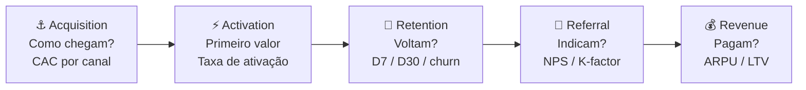

A distinção entre Acquisition e Activation é central: usuário que chegou mas não ativou é desperdício de CAC. A métrica de ativação (o "aha moment") é frequentemente o indicador mais importante do produto: encontrá-la é o trabalho de discovery dos primeiros meses.

##### O momento exato de colocar este canvas na parede

Use o Pirate Canvas nesta Fase 11 (MVP e primeiros usuários) como estrutura de instrumentação das métricas iniciais, implantando-o antes de colocar o produto no ar. Após confirmar o PMF na Fase 13, revise-o mensalmente como painel de saúde do funil para localizar a etapa de maior perda e concentrar nela os experimentos do ciclo seguinte. Já na Fase 15 (Vol. 6, máquina de crescimento e escala), ele orienta a divisão do orçamento entre aquisição, ativação e retenção.

##### As regras de ouro para preencher sem se enganar

A tese de McClure é que **times sem modelo explícito de funil otimizam a métrica errada**. Equipes iniciantes tendem a celebrar Aquisição (visível e fácil de apresentar em reunião) enquanto negligenciam Retenção (mais lenta de medir, porém a única que sustenta o negócio). Conforme os parâmetros da [[#Tabela de referência única: métricas e patamares de saída da Fase 11|Tabela de referência única da Fase 11]], acelerar o cadastro de clientes em SaaS B2B quando a retenção em D30 está abaixo do piso de 40% equivale a despejar água em um balde furado (ao passo que, em aplicativos gratuitos de consumo B2C, uma curva estabilizada entre 20% e 25% em D30 já representa um patamar saudável). Retenção precede escala de aquisição.

##### Passo a passo na parede da sala (3 a 4 horas na primeira versão, 30 a 60 minutos nas revisões)

Monte o Pirate Canvas em três etapas, nesta ordem:

1. **Defina a métrica de cada etapa**: 1 métrica primária por etapa. Não 5. Uma. Acquisition: CAC médio ponderado por canal. Activation: taxa de usuários que atingem o "aha moment" em X dias. Retention: retenção D30 (ou D7 para apps). Referral: NPS ou taxa de indicação ativa (mês). Revenue: conversão freemium → pago ou ARPU mensal.
2. **Aplique os patamares da tabela de referência da Fase 11**: compare cada etapa com a régua única do seu modelo de negócio (em SaaS B2B, piso de 40% de usuários ativos em D30 no piloto e meta saudável acima de 60%, mantendo mais de 80% das empresas pagantes ativas, em aplicativos de consumo B2C, retenção estabilizada acima de 20% a 25% em D30).
3. **Identifique o maior vazamento**: onde está a maior queda de conversão entre etapas? Esse é o único foco do próximo trimestre. Não mexa nas outras etapas até resolver essa.

Iteração mensal: atualize números, identifique onde o funil mudou, ajuste foco.

##### Exemplo preenchido: O funil dos doze pilotos de conciliação financeira de Lucas e Marina (2026)

Para visualizar como o quadro orienta decisões reais na Fase 11, veja o Pirate Canvas preenchido por Lucas e Marina após as primeiras semanas de operação com os doze diretores financeiros do piloto e a primeira safra de prospecção ativa B2B: os cadastros chegavam dentro do custo planejado e quem completava a primeira conciliação continuava ativo no mês seguinte, mas o funil vazava na passagem do cadastro para o primeiro arquivo OFX/CNAB importado até o sétimo dia.

| Etapa | Métrica principal | Número | Benchmark alvo | Status |
|---|---|---|---|---|
| **Acquisition** | CAC nos primeiros lotes via abordagem direta e indicação | R$ 180/conta | < R$ 250 | ✅ Dentro |
| **Activation** | % que sobe o 1º arquivo OFX/CNAB e audita boletos em até 7 dias | 40% | > 65% | 🔴 Decisivo |
| **Retention** | Retenção D30 de usuários ativos (contas auditando toda semana) | 71% | > 60% (piso 40%) | ✅ Dentro |
| **Referral** | NPS (escala de -100 a +100) | 52 | > 50 | ✅ Dentro |
| **Revenue** | Mensalidade média do piloto pago (ARPU mensal inicial) | R$ 680 | > R$ 600 | ✅ Dentro |

**O diagnóstico AARRR.** Com o quadro preenchido, ficou claro que aquisição, retenção em D30, NPS e receita média por conta ativa estavam dentro da meta, o gargalo concentrava-se na ativação (*Activation*), pois parte dos diretores financeiros criava a conta mas travava na hora de exportar o arquivo OFX/CNAB do banco. A investigação apontou duas causas operacionais: (1) cada banco exibia o menu de exportação de extrato com um nome diferente, e (2) o e-mail de boas-vindas não trazia um arquivo de teste para o cliente experimentar o painel em dois minutos.

**As três ações executadas por Lucas e Marina:** (1) gravar um vídeo de 40 segundos ao lado do botão de upload mostrando onde baixar o arquivo OFX nos cinco maiores bancos brasileiros, (2) incluir um botão "Testar agora com extrato de exemplo" na primeira tela para demonstrar o alerta de boleto duplicado em 30 segundos, e (3) disparar mensagem de utilidade pelo WhatsApp em 24 horas para quem abriu a conta e ainda não subiu arquivo, elevando a ativação da safra seguinte de 40% para 67%.

Sem o Pirate Canvas, o impulso habitual seria injetar mais verba em aquisição ("vamos dobrar os cadastros"), o que, com apenas 40% de ativação, significaria desperdiçar 60 centavos de cada R$ 1 investido em mídia. O funil AARRR serve justamente para ordenar prioridades de produto: a etapa com maior vazamento define o foco do trimestre.

##### Variações e extensões

- **RARRA** (Thomas Petit & Gabor Papp, 2018): reordena para Retention → Activation → Referral → Revenue → Acquisition, enfatiza que Retention deve ser resolvida antes de escalar Acquisition.
- **North Star Metric (Métrica Norte)**: indicador único de longo prazo que captura o valor central entregue ao cliente (distinto da *OMTM*, que é a métrica tática temporária do estágio atual). Enquanto o AARRR mapeia o funil completo, a Métrica Norte alinha toda a empresa no crescimento sustentável: noites reservadas no Airbnb, mensagens diárias enviadas no WhatsApp ou boletos auditados sem erro no sistema de Lucas e Marina.
- **Growth Accounting**: decompõe variação de usuários ativos em Novos + Ressuscitados − Churned. Complemento quantitativo ao AARRR.

##### Onde os fundadores mentem para si mesmos neste canvas

- Definir múltiplas métricas primárias por etapa: diluição de foco.
- Priorizar aquisição enquanto a retenção inicial desaba equivale a acelerar o topo do funil sem reter quem entra.
- Usar D7 e D30 intercambiavelmente: D7 mede habit formation, D30 mede stickiness, são perguntas distintas.
- Não segmentar o funil por persona/canal: um funil "médio" pode esconder que canal A tem Activation 80% e canal B tem 15%.
- Tratar AARRR como relatório (olhar uma vez por mês sem decidir nada) em vez de protocolo de priorização.

---

### TEMPLATES OPERACIONAIS E CASOS PREENCHIDOS (FASE 11)

#### Template: Checklist de Pré-Lançamento (do Beta Fechado ao Lançamento Público)

**Para que serve.** Auditar as 3 travas da Linha Vermelha antes de abrir o acesso ao primeiro cliente do piloto e os 15 itens operacionais antes do lançamento público do MVP, evitando que falhas de segurança, cálculo, rastreamento ou suporte destruam a confiança nos primeiros dias.

**Quando usar.** Parte A antes de liberar o login ao primeiro cliente pagante do beta fechado, Parte B uma a duas semanas antes do lançamento público.

**Exemplo de preenchimento.** Operação do MVP de conciliação financeira B2B de Lucas e Marina (São Paulo e Florianópolis).

```text
CHECKLIST DE PRÉ-LANÇAMENTO: FASE 11
Data-alvo: 14/10/2026 | Responsáveis: Lucas (Engenharia) e Marina (Produto e Operações)

PARTE A: ANTES DO PRIMEIRO CLIENTE (LINHA VERMELHA DA DIGNIDADE FUNCIONAL)
[x] A1. Backup automatizado diário configurado e teste real de restauração concluído em ambiente isolado
[x] A2. Procedimento de reversão (rollback) ensaiado para voltar à versão anterior em menos de 5 minutos
[x] A3. Alerta imediato (WhatsApp/Slack dos sócios) para qualquer erro de cálculo, falha de gravação ou erro 500

PARTE B: DO BETA FECHADO AO LANÇAMENTO PÚBLICO (15 ITENS)
PRODUTO
[x] 1. Cobertura de testes básicos (fluxo completo de upload OFX/CNAB e conciliação passando sem erro)
[x] 2. Registros de erro (logs) e monitoramento ativos em produção
[x] 3. Onboarding funcional até o primeiro valor entregue (vídeo de 40s e arquivo de exemplo na tela inicial)
CONTEÚDO
[x] 4. Página de destino (landing page) no ar, rápida e testada no celular
[x] 5. Perguntas frequentes (FAQ) respondendo às 10 principais dúvidas sobre bancos suportados, segurança e preço
[x] 6. Guia prático de exportação de extratos acessível dentro do produto
ANALYTICS
[x] 7. Rastreamento dos eventos-chave funcionando (cadastro, 1º extrato auditado, retorno D7/D30 e pagamento)
[x] 8. Funil AARRR e tabela de safras (coortes) visíveis no PostHog
SUPORTE
[x] 9. Canal de contato direto ativo no produto (WhatsApp comercial e e-mail com resposta em até 15 minutos)
[x] 10. Escala de plantão definida entre Lucas e Marina para as duas primeiras semanas
JURÍDICO E CONFORMIDADE (LGPD)
[x] 11. Termos de uso, contrato de piloto e política de privacidade publicados e registrados no aceite
[x] 12. Conformidade com a LGPD: base legal mapeada, isolamento entre contas (multi-tenant) e operadores contratados
COMUNICAÇÃO
[x] 13. Mensagem de lançamento escrita e revisada com resultados reais auditados dos 12 pilotos
[x] 14. Lista de 50 diretores financeiros e parceiros contábeis informada em primeira mão
[x] 15. Roteiro de acompanhamento diário dos primeiros 7 dias pronto para acionar quem não ativar em 24 horas
```

---

### Fechamento da Fase 11: o que muda na sua cabeça e na sua empresa a partir de agora

Com dez dos doze diretores financeiros do piloto importando extratos toda segunda-feira e pagando em dia, a mudança mais profunda na rotina de Lucas e Marina foi de critério decisório: eles pararam de debater quais telas pareciam mais bonitas na cabeça dos sócios e passaram a priorizar cada ajuste pelo impacto direto na ativação e na retenção da coorte.

Faça coisas que não escalam na largada: atender pessoalmente os dez a doze primeiros clientes do piloto produz o aprendizado de alta resolução que a automação precoce esconde. Esse domínio sobre o uso real prepara a entrada na [[#FASE 12: VALIDAÇÃO DO MODELO DE NEGÓCIO|Fase 12]], onde o foco avança do comportamento no produto para a viabilidade da equação econômica: CAC, LTV, margem de contribuição e fôlego de caixa.

---

## FASE 12: VALIDAÇÃO DO MODELO DE NEGÓCIO

### A conta de um pedido: por que vender R$ 1 por R$ 0,80 não se conserta no volume

Rafael entrou na chamada de vídeo direto de Recife para o escritório da operação em Goiânia vibrando: no mês da Black Friday, a marca de cosméticos naturais deles havia faturado R$ 310 mil brutos, o triplo do mês anterior. Mas quando Bia fechou a conciliação bancária em Goiânia no dia 5 de dezembro, o saldo da conta corrente havia caído R$ 48 mil. Ao longo desta Fase 12, acompanharemos como Rafael e Bia usam a autópsia daquele pedido médio de R$ 100 para redesenhar o piso de frete grátis, o comissionamento de criadores e a meta de recompra.

"Bia, onde foi parar o dinheiro? Nós vendemos mais de três mil pedidos!", perguntou Rafael em choque.

Bia abriu o quadro branco e desenhou a autópsia de um único pedido médio de R$ 100:
- Preço pago pelo cliente: **R$ 100,00**
- Impostos e taxa do gateway de cartão parcelado: -R$ 14,50
- Custo de fabricação do produto e embalagem: -R$ 38,00
- Frete grátis prometido na campanha + logística reversa de trocas: -R$ 26,00
- **Margem de Contribuição antes do Marketing: R$ 21,50**
- Custo de Aquisição no leilão de anúncios (CAC) por pedido: -R$ 37,00
- **Resultado Líquido por Pedido Vendido: -R$ 15,50 de prejuízo direto por caixa enviada.**

"Rafael, a campanha com criadores atraiu o público, e eu mesma errei ao deixar o frete grátis aberto o mês inteiro. Cada vez que o sininho da loja apitou em novembro, tiramos R$ 15,50 do nosso bolso e colocamos dentro da caixa de papelão do cliente", disse Bia.

Essa é **A Ilusão Óptica do Faturamento Bruto**: faturamento bruto alto sem margem de contribuição positiva acelera a queima do caixa a cada venda. O que mantém a empresa viva é a margem que sobra depois dos impostos, do produto, do frete e do anúncio.

Na Fase 12, além do faturamento total do mês, você analisa a economia unitária (*Unit Economics*) de cada conta: quanto custa trazer o cliente (CAC carregado com salários, mídia e ferramentas), quanto sobra de margem de contribuição após os custos variáveis de entrega, em quantos meses essa margem devolve o gasto de aquisição (*Payback*) e qual a razão entre o valor gerado no tempo e o custo inicial (*LTV/CAC*).

---

A cascata visual de unit economics (economia por unidade: quanto você ganha e gasta por cliente), da receita por cliente à saúde do negócio:

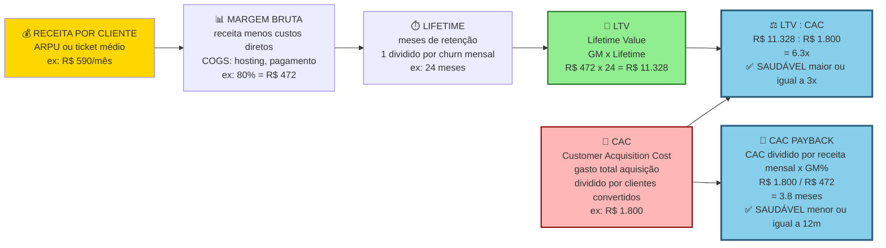

> [!important] Três parâmetros operacionais de referência por modelo
> Conforme consolidado na [[#MÉTRICAS E BENCHMARKS DESTA FASE (FASE 12)|Tabela de Métricas e Benchmarks da Fase 12]]: (1) busque LTV/CAC igual ou superior a 3x (abaixo de 1x custa mais adquirir do que o cliente gera, entre 1x e 3x sobra pouca margem para cobrir a estrutura fixa), (2) mantenha o CAC Payback em até 12 meses em SaaS B2B PME (até 6 meses em B2C e até 18 meses em contratos enterprise), e (3) respeite a régua de Margem Bruta e de Contribuição: em SaaS B2B, piso de 60% na validação inicial e meta de 70% a 80% na maturidade, em marketplaces, margem bruta contábil acima de 60% sobre a receita líquida da comissão (*take rate*), e no varejo D2C (como a marca de Rafael e Bia), margem bruta de produto acima de 50% a 65% após impostos e fabricação, garantindo que a margem de contribuição após frete, taxas e CAC feche positiva já entre o primeiro e o segundo pedido.

> [!question] Checagem de encaixe fundador-mercado na Fase 12 (conceito da Fase 0, Vol. 1)
> O modelo de negócio que emergiu aproveita uma vantagem real construída pela trajetória dos fundadores (como o domínio industrial de Henrique ou o conhecimento de formulação e custos de Bia), ou apenas replica a estrutura mais cara do setor? Quando a economia unitária se apoia em um canal ou vantagem operacional que concorrentes genéricos não copiam barato, a margem fica protegida.

### O risco de escalar vendas com margem de contribuição negativa

Produtos adorados pelos usuários ainda podem quebrar a empresa se o custo de aquisição superar o valor gerado no ciclo de vida ou se a margem não cobrir a operação. Após acumular de três a seis meses de clientes pagantes com leitura real de cancelamento e recompra, reúna os números contábeis para calcular CAC, margem de contribuição, tempo de retorno (*payback*) e LTV antes de acelerar o gasto comercial.

### Os onze passos da validação financeira: do CAC completo e Margem de Contribuição ao teste Default Alive

Ao apurar a margem unitária (Passos 2 e 3), separe três níveis: Margem de Contribuição Nível 1 (receita líquida de impostos menos custo direto da mercadoria ou infraestrutura), Nível 2 (após taxas de pagamento, frete e comissões variáveis) e Nível 3 (após o custo de mídia e aquisição direta do pedido), medindo o payback pelo efetivo desembolso e recebimento no caixa.

Onze passos.

#### Passo 1: meça CAC real

O CAC (Custo de Aquisição de Cliente) equivale à soma de todos os gastos de marketing e vendas em determinado período dividida pelo número de novos clientes pagantes conquistados nesse mesmo intervalo.

Some quatro componentes no gasto total de aquisição: (1) mídia paga (*ads*), (2) salário ou custo-hora proporcional de quem vende ou faz marketing (incluindo o tempo dos próprios fundadores), (3) licenças de ferramentas comerciais (CRM, automação, prospecção e design), e (4) custos diretos de eventos, feiras, brindes e campanhas.

Não inclua os custos de operação do produto em si.

> [!warning] Meça por canal separadamente
> Um canal pode ter CAC baixo, e outro altíssimo. Média esconde. Sem segmentação por canal, você não sabe qual canal está realmente funcionando.

#### Passo 2: calcule o LTV a partir da margem bruta e da retenção

A fórmula simples para modelo recorrente (SaaS ou assinatura): LTV é igual à receita média por cliente por mês, vezes a margem bruta (receita menos custo direto), vezes os meses médios de retenção.

A fórmula simples para modelo transacional: LTV é igual à receita média por transação, vezes a margem bruta, vezes a frequência anual, vezes os anos esperados.

> [!tip] Capítulo 6: Estratégia de Preços e Economia da Recorrência
> O [[#CAPÍTULO 6: PRICING STRATEGY E ECONOMIA DA RECORRÊNCIA (SUBSCRIPTION ECONOMY)|Capítulo 6: Subscription Economy]] cobre a mecânica específica de negócios recorrentes: MRR waterfall (new, expansion, contraction, churn), dinâmica de NRR, pricing de tiers e as armadilhas de churns que não aparecem na DRE até ser tarde demais.

No início da operação, quando ainda não há histórico de anos de retenção, trabalhe com estimativas conservadoras (*proxies*) apoiadas nas primeiras coortes de três a seis meses. A partir da taxa de cancelamento mensal observada (*churn* de receita ou de clientes), projete o valor do tempo de vida pela fórmula LTV = (ARPU mensal × Margem Bruta) ÷ Churn Mensal, e complemente sempre a leitura com o CAC Payback = CAC ÷ (ARPU mensal × Margem Bruta) para saber em quantos meses o caixa investido na aquisição retorna.

#### Passo 3: meça o tempo de payback de CAC

O *payback* de aquisição é obtido dividindo o CAC pela margem de contribuição mensal gerada por cliente (receita mensal multiplicada pela margem bruta).

Esse é o número de meses até você "pagar" o CAC de um cliente. Abaixo de doze meses é bom. Acima de vinte e quatro meses, você precisa de muito capital para crescer.

#### Passo 4: valide a precificação com clientes pagantes

Com clientes reais pagando pelo produto, avalie a estrutura de preço a partir de quatro perguntas práticas:

- **Percepção de valor:** o preço atual é percebido como justo frente ao retorno financeiro que o cliente obtém?
- **Disposição para planos superiores:** existe um subgrupo de clientes disposto a pagar mais por capacidade extra, SLA ou funcionalidades avançadas?
- **Barreira de entrada:** há clientes aderentes ao ICP que travam no plano inicial e precisariam de uma faixa de entrada mais enxuta?
- **Expansão na mesma conta:** o produto permite *upsell* (upgrade de plano/volume) ou *cross-sell* (módulos complementares) ao longo do primeiro ano?

Para responder a essas quatro perguntas na prática, teste ajustes de preço de forma controlada: eleve a tabela para novas safras de clientes em 20% a 30% medindo o efeito na taxa de fechamento, estruture faixas claras de planos (básico, profissional e *enterprise*) e separe módulos avançados para cobrança adicional.

> [!important] Precificação não fica congelada
> Precificação é um dos principais vetores de valor. Não a deixe estática. Reavalie a cada três a seis meses. Pequenos ajustes em preço movem mais EBITDA do que grandes esforços de eficiência operacional.

#### Passo 5: mapeie todos os custos unitários e recorrentes

Classifique todos os desembolsos da operação em quatro grupos contábeis claros:

- **Custos variáveis diretos (COGS/CPV):** servidores e banco de dados proporcional ao uso, chamadas de API/LLM, taxas de meios de pagamento, implementação e suporte dedicado ao cliente.
- **Despesas comerciais (CAC):** mídia paga, comissões de vendas, ferramentas de prospecção e equipe de *go-to-market*.
- **Despesas fixas gerais e de P&D (OpEx):** folha de engenharia e produto, administrativo, jurídico, contabilidade e licenças internas.
- **Deduções da receita (tributos sobre o faturamento):** tributos indiretos incidentes sobre a nota fiscal (Simples Nacional, ISS, PIS/Cofins, ICMS ou IBS/CBS), que são abatidos da receita bruta para apurar a receita líquida, e, separadamente, os Investimentos de Capital (CapEx), que representam gastos pontuais em ativos e ficam fora da margem unitária.

Margem bruta (*gross margin*, calculada como receita líquida menos custos diretos de entrega dividida pela receita líquida): conforme a tabela única desta fase, em SaaS B2B o piso aceitável na validação inicial é de 60%, com meta de 70% a 80% na operação madura. Em marketplaces, a comissão (*take rate* sobre o GMV) varia de 10% a 25% e a margem bruta sobre a receita líquida da plataforma supera 60%. Em D2C de marca própria, a margem bruta após fabricação e impostos fica entre 50% e 65% antes do frete e da mídia, e em operações intensivas em serviço, entre 30% e 50%.

#### Passo 6: identifique alavancas de eficiência

Para melhorar a razão LTV:CAC e encurtar o *payback*, atue sobre quatro alavancas operacionais:

1. **Migração gradual para canais de menor CAC:** combinar aquisição paga com conteúdo orgânico (SEO), indicação de clientes e parcerias de distribuição.
2. **Blindagem da retenção nos primeiros 90 dias:** acelerar o *onboarding* até o primeiro resultado concreto (*aha moment*) e criar rotinas de uso semanal que travem o cancelamento.
3. **Expansão líquida de receita (NRR > 100%):** estruturar gatilhos naturais de upgrade por volume, assentos ou módulos adicionais.
4. **Automação de entrega e suporte:** substituir etapas manuais repetitivas por fluxos autoatendidos para elevar a margem bruta.

#### Passo 7: modele o Quadro Financeiro e a planilha de três cenários

A planilha financeira deve reunir cinco blocos: as premissas operacionais (CAC por canal, LTV por segmento, taxa de cancelamento e receita média por conta), os três cenários de projeção (conservador, base e otimista), a evolução mensal de 18 a 36 meses, o mês de ponto de equilíbrio operacional (*break-even*) e a necessidade total de caixa em cada cenário.

Mais do que uma peça para impressionar fundos, o modelo financeiro funciona como painel de comando para orientar decisões semanais de contratação, preço e orçamento de mídia.

> [!note] Onde aprofundar a modelagem financeira no Volume 5
> Para expandir a planilha desta fase à medida que a operação cresce, consulte no Volume 5 (*Finanças e Captação*): o [[IGNICAO-Vol-5-Financas-e-Captacao#CAPÍTULO 1: DEMONSTRATIVOS FINANCEIROS PARA O FUNDADOR|Capítulo 1 (Demonstrativos Financeiros)]] para leitura integrada de DRE, balanço e fluxo de caixa livre. O [[IGNICAO-Vol-5-Financas-e-Captacao#CAPÍTULO 3: MODELAGEM FINANCEIRA OPERACIONAL BOTTOM-UP E PROJEÇÕES POR COORTES (COHORTS)|Capítulo 3 (Modelagem Financeira e Coortes)]] para projeções *bottom-up* por safra. O [[IGNICAO-Vol-5-Financas-e-Captacao#CAPÍTULO 4: PLANEJAMENTO FINANCEIRO (FP&A), ORÇAMENTO E REVENUE FORECASTING|Capítulo 4 (Planejamento Financeiro, Orçamento e Forecasting)]] para orçamento formal e projeção de ARR, e o [[IGNICAO-Vol-5-Financas-e-Captacao#CAPÍTULO 5: CAPITAL DE GIRO, RECEBÍVEIS E GESTÃO DE CAIXA EM PROFUNDIDADE|Capítulo 5 (Capital de Giro e Gestão de Caixa)]] para projeção de 13 semanas e controle de recebíveis.

##### Modelo financeiro profissional em três cenários

O plano de uma página é ponto de partida. Modelo financeiro completo em planilha (Excel ou Google Sheets) é obrigatório para qualquer decisão de captação, investimento em time ou canal. O padrão mínimo exige três cenários explícitos com premissas auditáveis.

A estrutura do modelo financeiro tem cinco abas.

- **Aba 1: Premissas (*Inputs*):** concentra todas as variáveis editáveis que movem o modelo (sem números fixos escondidos nas fórmulas das demais abas), incluindo crescimento mensal de novos clientes por canal, ticket médio (ARPU/MRR), taxas de *churn* e expansão (NRR), CAC por canal, custo direto de servir por cliente, despesas fixas mensais e cronograma de contratações.

**Aba 2: DRE mensal projetada e fluxo de caixa (dezoito a trinta e seis meses).** Na demonstração de resultado (DRE), inclua em sequência: Receita Bruta (nova, expansão e cancelamento), Deduções da Receita (tributos sobre a nota fiscal), Receita Líquida, Custos Variáveis Diretos (COGS/CPV), Margem Bruta, Despesas Variáveis Comerciais e de Entrega (frete, taxas, comissões e mídia), Margem de Contribuição, Folha e Custos Fixos (OpEx) e EBITDA. Logo abaixo, projete o Fluxo de Caixa Mensal e o Saldo de Caixa em mãos mês a mês.

**Aba 3: Três cenários.**

| Cenário | Premissas | Propósito |
|---|---|---|
| **Conservador** | Crescimento menos trinta por cento do esperado, CAC mais vinte por cento, churn mais vinte por cento, atrasos de dois a três meses em milestones. | Qual é o "piso" que me permite operar? Tenho runway aqui? |
| **Base** | Extrapolação honesta dos últimos três a seis meses de dados reais. Sem otimismo nem pessimismo. | Esse é o plano. |
| **Agressivo** | Crescimento mais trinta por cento, CAC menos quinze por cento, novo canal entra, expansão antecipada. | Tenho capacidade de execução se acelerar? Preciso contratar antes? |

> [!warning] Regra operacional do cenário conservador
> No cenário conservador, mantenha sempre pelo menos 12 meses de fôlego de caixa operacional (*runway*), iniciando o preparo de nova captação ou o ajuste de custos quando restarem 9 meses (após fechar uma rodada institucional, a meta recomendada sobe para 18 a 24 meses de caixa). Abaixo de 6 meses, a empresa entra em zona decisiva de subcapitalização e precisa ajustar despesas ou elevar a geração de caixa imediatamente.

**Aba 4: Sensibilidades.**

Submeta os resultados do modelo (mês de ponto de equilíbrio, EBITDA em 24 meses e saldo mínimo de caixa) a uma análise de sensibilidade nas quatro variáveis principais: taxa de crescimento (±20%), tíquete médio (±15%), cancelamento mensal (±20%) e CAC (±25%).

Identifique a variável mais sensível: aquela em que pequenas mudanças movem muito o resultado. Essa variável é prioridade de atenção e medição semanal.

**Aba 5: Break-even analysis.**

Identifique no modelo em qual mês e com qual volume de receita recorrente anual (ARR) a empresa atinge os três marcos de equilíbrio: o operacional (receita igualando despesas correntes), o de geração de caixa (operação financiando o próprio giro sem nova rodada) e o acumulado (geração líquida superando o capital investido desde a fundação).

#### Passo 8: documente o cap table inicial e modele diluição

> [!note] Esta seção é preview operacional para validação do modelo
> A estruturação formal do cap table, vesting, classes de ações, drag-along/tag-along, contrato de sócios completo, é tema da [[IGNICAO-Vol-8-Juridico-LGPD-e-Seguranca#FASE 18: ESTRUTURAÇÃO JURÍDICA, SOCIETÁRIA E BLINDAGEM OPERACIONAL|Fase 18 (Vol. 8)]]. Aqui na Fase 12 o cap table aparece em versão simplificada porque é insumo direto da modelagem financeira: você precisa saber quantas ações cada sócio tem para projetar diluição em cenários de captação e calcular *runway efetivo após* novas rodadas. É a mesma ferramenta vista por dois ângulos complementares: modelo econômico-financeiro de diluição (aqui na Fase 12) e instrumento societário vinculante (na [[IGNICAO-Vol-8-Juridico-LGPD-e-Seguranca#FASE 18: ESTRUTURAÇÃO JURÍDICA, SOCIETÁRIA E BLINDAGEM OPERACIONAL|Fase 18, no Vol. 8]]).

Desde a primeira captação, mantenha a tabela de participação societária (*cap table*) documentada e atualizada: negligenciar a simulação das rodadas seguintes faz com que muitos sócios cheguem à Série B com menos de 25% do capital sem perceber como cada cláusula diluiu sua fatia.

A estrutura mínima do cap table:

| Detentor (sócio ou investidor) | Classe de participação (em Ltda são quotas, que admitem classes preferenciais desde a IN DREI 81/2020, ações preferenciais exigem S.A. ou conversão de mútuo/nota, ver [[IGNICAO-Vol-5-Financas-e-Captacao#CAPÍTULO 11: INSTRUMENTOS DE CAPTAÇÃO: SAFE, NOTA CONVERSÍVEL E MÚTUO CONVERSÍVEL\|Vol. 5, Cap. 11]]) | Número de quotas/ações | Percentual antes do Seed | Número de quotas/ações após Seed | Percentual após Seed |
|---|---|---|---|---|---|
| Fundador 1 | Ordinárias | 5.000.000 | 50,0% | 5.000.000 | 40,0% |
| Fundador 2 | Ordinárias | 5.000.000 | 50,0% | 5.000.000 | 40,0% |
| Pool de opções (ESOP) | Reservado na rodada | n/a | 0,0% | 1.250.000 | 10,0% |
| Investidor Seed | Preferenciais Seed | n/a | 0,0% | 1.250.000 | 10,0% |
| **Total pós-Seed** | | **10.000.000** | **100,0%** | **12.500.000** | **100,0%** |

**Cinco conceitos-chave que o fundador precisa dominar.**

Pré-money valuation. Valor da empresa *antes* do investimento entrar. Por exemplo, R$ 40 milhões pré-money.

Post-money valuation. Pré-money mais o valor captado. Se capta R$ 10 milhões em pré de R$ 40 milhões, o post é R$ 50 milhões.

Percentual de diluição. Percentual de equity que sai dos atuais detentores para o novo investidor. Se o investidor entra por R$ 10 milhões em post de R$ 50 milhões, ele fica com vinte por cento, e todos os demais diluem proporcionalmente.

Pool de opções (option pool). Reserva de equity para contratações futuras. O ponto decisivo: se o investidor exige aumento de pool *antes* da rodada (pré-money pool increase), a diluição sai toda dos fundadores. Se o aumento é *depois* (post-money), dilui todos. Negociar isso vale muito dinheiro.

Liquidation preference. Em exit, o investidor preferencial recebe primeiro um múltiplo do investido, antes de fundadores receberem qualquer coisa. "1x non-participating" é padrão saudável. "2x participating" é predatório (o investidor recebe duas vezes, *e* mais a parte pro-rata dele). Negocie cedo.

A modelagem de diluição ao longo de rodadas futuras. Projete (no modelo financeiro, em aba separada) o cap table em três a quatro rodadas futuras hipotéticas.

Exemplo visual de cap table evolutivo, do Seed à Série B:

```mermaid
flowchart LR
 subgraph S1["🌱 SEED<br/>R$ 1,25M @ R$ 11,25M pré (~10%)"]
 SF[Fundadores: 80%]
 SE1[ESOP: 10%]
 SI[Seed investor: 10%]
 end

 subgraph S2["🚀 SÉRIE A<br/>R$ 15M @ R$ 60M pré<br/>diluição ~20%"]
 AF[Fundadores: 59%]
 AE[ESOP expandido: 13%]
 AIS[Seed: 8%]
 AIA[Série A: 20%]
 end

 subgraph S3["📈 SÉRIE B<br/>R$ 95M @ R$ 300M pré<br/>diluição ~24%"]
 BF[Fundadores: 41%]
 BE[ESOP: 14%]
 BIS[Seed: 6%]
 BIA[Série A: 15%]
 BIB[Série B: 24%]
 end

 S1 --> S2 --> S3

 style SF fill:#90EE90
 style AF fill:#FFFF99
 style BF fill:#FFB6B6
```

A participação combinada retida pelos dois fundadores nesta trajetória ilustrativa de SaaS passa de 100% na fundação para 80% após o Seed (40% para cada sócio), 59% após a Série A (29,5% para cada sócio), 41% após a Série B (20,5% para cada sócio) e cerca de 33% na chegada à Série C (16,5% para cada sócio). À medida que a fatia combinada se aproxima de 30% a 40%, a governança do conselho e as matérias de veto exigem atenção redobrada.

| Rodada | Valor captado | Pré-money | Diluição da rodada + pool | Fundadores combinados após | Fundador 1 após |
|---|---|---|---|---|---|
| Fundação (Hoje) | n/a | n/a | n/a | 100,0% | 50,0% |
| Seed | R$ 1,25M | R$ 11,25M | 20% (10% investidor + 10% ESOP) | 80,0% | 40,0% |
| Série A (18m) | R$ 15M | R$ 60M | ~26% (20% investidor + expansão ESOP) | 59,0% | 29,5% |
| Série B (36m) | R$ 95M | R$ 300M | ~30% (24% investidor + expansão ESOP) | 41,0% | 20,5% |
| Série C (54m) | R$ 150M | R$ 600M | ~20% | 32,8% | 16,4% |

> [!important] A lição da diluição saudável
> Numa trajetória bem calibrada (retendo 80% após o Seed, 59% após a Série A, 41% após a Série B e cerca de 33% na Série C), os fundadores trocam uma fatia maior de uma empresa incipiente por uma participação relevante em um negócio dezenas de vezes mais valioso.

As ferramentas recomendadas para cap table. Planilhas (Google Sheets, Excel) para menos de dez detentores. Carta (formerly eShares), Pulley, Ledgy para estruturas mais complexas, ou ESOP (employee stock option plans) formais.

Advogado societário deve revisar o cap table antes de qualquer rodada. Custo típico de R$ 5 mil a R$ 15 mil por revisão. Retorno: evitar erros caros.

#### Passo 9: faça o teste de unit economics

A pergunta central. Separe dois testes distintos: (1) a economia unitária é saudável (margem de contribuição positiva e payback do CAC dentro da meta)? e (2) quantos clientes ativos faltam para que a margem de contribuição acumulada cubra 100% dos custos fixos operacionais (ponto de equilíbrio ou *break-even*)?

Se a margem de contribuição unitária é positiva e o *payback* do CAC está dentro da meta do setor, a economia unitária é saudável. Já o número de clientes ativos necessários para cobrir os custos fixos informa quanto tempo de caixa a operação precisa até o ponto de equilíbrio. Se a margem unitária ou o *payback* reprovarem no teste, corrija preço, custo direto, frete ou retenção antes de escalar.

> [!tip] Canvases Visuais: Pirate Canvas / AARRR (Fase 11)
> Unit economics fica mais legível quando colado ao funil AARRR (Acquisition, Activation, Retention, Referral, Revenue) do [[#Canvas: Pirate Canvas / AARRR (Dave McClure, 2007)|Canvas: Pirate Canvas / AARRR (Dave McClure, 2007)]] – cada métrica desta fase (CAC, ativação, churn, NRR, payback) tem casa numa etapa do funil. Use o canvas para localizar onde estão os gargalos do modelo: CAC alto demais é problema de Acquisition. Payback longo pode ser baixa Activation, LTV baixo é Retention insuficiente.

#### Passo 10: aplique a pergunta diagnóstica canônica de Paul Graham, Default Alive ou Default Dead?

Em seu ensaio de 2015 (*Default Alive or Default Dead?*), Paul Graham relata que sempre faz essa pergunta a fundadores com mais de oito ou nove meses de operação e constata que metade deles não sabe responder de imediato, embora o cálculo seja o diagnóstico básico de sobrevivência do negócio.

> [!quote] A pergunta de Default Alive / Default Dead
> Assumindo que os meus gastos permaneçam constantes, e o meu crescimento de receita mantenha o padrão dos últimos meses, eu chego à lucratividade com o caixa que tenho hoje? Ou não?

O cálculo produz duas respostas possíveis, que colocam a empresa em realidades opostas de gestão:

Default Alive (vivo por padrão). Sim, eu chego, sem precisar de mais dinheiro externo. Tenho controle do meu destino.

Default Dead (morto por padrão). Não, eu vou quebrar antes de virar lucrativo, a menos que alguém escreva outro cheque.

A pergunta é útil porque troca o otimismo vago por um número auditável. Você precisa de quatro dados para responder: despesas mensais atuais, receita atual, taxa mensal de crescimento e saldo de caixa em mãos. Uma planilha simples projeta mês a mês se a curva de receita cruza a linha de despesas antes de o caixa zerar (no ensaio original de 2015, Graham indica também a calculadora pública criada por Trevor Blackwell em growth.tlb.org).

Por que isso importa operacionalmente.

O fundador Default Alive pode focar em crescimento e novas apostas. Tem liberdade. Pode experimentar, captar em boas condições, escolher parceiros.

Se você está *Default Dead* e cresce devagar, o foco imediato deve ser consertar a margem e o produto antes de tentar captar. Se está *Default Dead* mas cresce em ritmo forte, a captação pode funcionar desde que executada sem demora (conforme detalha a matriz operacional adiante).

> [!warning] Esticar runway sem consertar o negócio
> Quando o crescimento é fraco e a economia unitária não fecha, buscar dinheiro novo apenas para esticar o *runway* sem corrigir o modelo só adia o problema.

##### O *Fatal Pinch*: a compressão entre caixa curto e crescimento lento

Graham identifica, num ensaio complementar de 2014, o cenário mais letal que uma startup pode atingir. É a combinação de Default Dead com crescimento lento, tempo insuficiente para corrigir e esperança depositada em investidores. Ele chama de *Fatal Pinch* (o aperto fatal) e descreve a armadilha de combinar caixa curto, crescimento lento e dependência de uma nova rodada. Na prática operacional, o enredo costuma desenrolar-se nestes sete passos:

Startup lança produto moderadamente atraente. Não é ruim. Mas não é irresistível.

Na prática, o enredo costuma começar com um crescimento modesto, na faixa de 3% a 5% ao mês, abaixo do ritmo semanal esperado por fundos de capital de risco.

Diante da desaceleração, os fundadores apostam que dobrar a equipe comercial e de engenharia vai destravar a curva, e os investidores apoiam o plano mesmo sem evidência nas coortes.

A folha de pagamento salta no mês seguinte, mas a receita não acompanha porque o gargalo ainda estava na retenção do produto, e o aumento brusco de equipe torna a iteração mais lenta.

Com a queima mensal multiplicada, o fôlego de caixa encolhe rapidamente e força o CEO a sair em busca de uma nova rodada antes de ter números sólidos.

Ao abrir a planilha na diligência, os fundos encontram queima elevada, crescimento lento e estrutura pesada para o estágio, recusando o cheque um após o outro.

Sem conseguir fechar a rodada e sem tempo hábil para voltar ao equilíbrio operacional, o caixa zera e a operação se encerra.

> [!important] A saída prática do *Fatal Pinch*
> Ele é quase sempre resolvido pela direção errada. O correto em Default Dead com crescimento fraco quase nunca é contratar. É parar e consertar o produto, para que ele seja genuinamente desejado. Parar de captar. Reduzir time se necessário. Voltar a conversar com cliente. Iterar no produto com time menor e mais focado. Contratar mais pessoas nessa fase é exatamente o oposto do que funciona.

A melhor forma de evitar o Fatal Pinch é fazer a pergunta Default Alive ou Default Dead cedo. Aos oito ou nove meses, não aos dezoito. Fundadores que descobrem estar Default Dead aos dezoito meses têm opções muito piores do que os que descobrem aos nove meses.

#### Passo 11: persiga Ramen Profitable, o milestone subestimado

*Ramen Profitable*, conceito apresentado por Paul Graham em um ensaio de 2009, merece atenção especial porque costuma ser subestimado por quem corre atrás da primeira rodada externa.

Uma startup é ramen-profitable quando gera receita suficiente para cobrir os custos de vida básicos dos fundadores. A origem metafórica é o ramen instantâneo, comida de cerca de R$ 3 por refeição. Não é o lucro folgado de uma empresa madura: é o ponto em que a receita cobre o custo básico de vida dos fundadores e a empresa deixa de depender da próxima rodada para continuar viva. A empresa pode continuar existindo indefinidamente, sem captar, porque paga o que os fundadores precisam para viver.

Atingir o ponto *ramen-profitable* fortalece a posição estratégica dos fundadores por quatro motivos práticos:

Autonomia de tempo: você deixa de depender de uma rodada imediata para continuar operando e ganha fôlego para esperar o investidor certo, o momento favorável do mercado ou a evolução de produto que destrava as vendas.

Poder de negociação em captação. Fundos preferem dar dinheiro a quem não precisa do dinheiro. Ramen-profitable aumenta valuation e melhora termos, independente da performance operacional. O investidor sabe que não está salvando ninguém. Está apostando.

Redução da pressão psicológica: sair do risco iminente de insolvência muda a dinâmica entre os sócios, substituindo decisões apressadas de curto prazo por escolhas estratégicas consistentes.

Filtro de disciplina operacional: buscar o ponto em que a receita cobre o custo básico de vida dos sócios e mantém a operação de pé força o time a priorizar o que gera caixa real, servindo de alicerce para escalar com segurança.

> [!important] Regra operacional simples sobre Ramen Profitable
> Se o modelo financeiro não permite cobrir as despesas enxutas da operação e a retirada básica dos fundadores em um horizonte de 12 a 18 meses, revise a estrutura de margem e preço antes de tentar escalar.

No contexto brasileiro. Ramen-profitable para fundadores brasileiros em São Paulo tipicamente significa receita líquida mensal entre R$ 15 mil e R$ 40 mil. Dependendo de quantos fundadores, despesas pessoais, filhos. É faturamento atingível por muitas startups early-stage com disciplina. Ainda assim, muitos fundadores ignoram essa meta estimada para perseguir uma rodada pré-Seed precoce, esquecendo que doze meses no ponto *ramen-profitable* compram autonomia equivalente à de um cheque anjo inicial, sem diluição societária.

##### Matriz operacional: Default Alive, Ramen Profitable e Crescimento

| Situação | Diagnóstico | Ação correta |
|---|---|---|
| *Default Alive*, *ramen-profitable*, crescendo 5% a 10% ao mês | Posição sólida de tração inicial | Acelerar aquisição nos canais validados e captar apenas se houver alavanca clara de retorno |
| Default Alive, não ramen-profitable, crescendo forte | Queimando capital, mas racionalmente | Continuar se o capital é abundante e a trajetória é clara |
| *Default Dead*, crescendo forte | Captação viável se iniciada com antecedência | Captar com agilidade e preservar poder de negociação |
| *Default Dead*, crescimento fraco (*Fatal Pinch*) | Risco agudo de insolvência | Congelar contratações, corrigir o produto, enxugar despesas e buscar o equilíbrio (*ramen-profitable*) |
| Ramen-profitable, crescimento estagnado | Solvente, mas sem tração | Reavaliar hipóteses (cunha, ICP, preço) |

Três perguntas de verificação mensal para a gestão de caixa. Aplique a checagem Default Alive ou Default Dead descrita no Passo 10 acima: com números, não com esperança. Verifique se você atingiu Ramen Profitable conforme definido no Passo 11 acima. Se a resposta para as duas anteriores é negativa, qual é o meu plano de noventa dias para mudar isso?

### Os onze passos aplicados: unit economics do PadariaPro após três meses de piloto (caso didático de reprovação no gate)

A receita. Ticket médio mensal por cliente (três lojas cada): R$ 870 por mês (R$ 290 vezes três). Receita total atual: R$ 2.610 por mês. ACV projetado: R$ 10.440 por ano por cliente.

Custo mensal para servir cada cliente ativo (rede com três padarias): infraestrutura em nuvem e mensageria proporcional (R$ 35) somadas ao suporte dedicado (30 minutos mensais a R$ 80/hora = R$ 40), totalizando R$ 75 por cliente ao mês.

A margem unitária líquida (descontando tributos sobre a nota e taxas de cobrança, como exige o ritual desta fase): da receita bruta de R$ 870, abatem-se cerca de R$ 70 de tributos do Simples Nacional e taxa do meio de pagamento, restando R$ 800 de receita líquida. Descontados os R$ 75 de custo direto de servir, a margem de contribuição real é de R$ 725 por cliente ao mês (83,3% da receita bruta).

O CAC estimado apoia-se nos três primeiros pilotos e na projeção de canais pagos (nota: como o crivo de saída da Fase 12 exige CAC real medido fora da rede pessoal e de três a seis meses de leitura de retenção e cancelamento, o PadariaPro ainda não cumpre os requisitos para avançar à Fase 13). Canal atual: indicação e rede pessoal (CAC de aproximadamente R$ 400 em tempo do fundador). Canal projetado de prospecção ativa: *cold outreach*, eventos e conteúdo (CAC esperado de R$ 1.500 a R$ 2.500).

O LTV estimado com premissas conservadoras: assumindo cancelamento (*churn*) de 3,6% ao mês (vida média de 28 meses), multiplica-se a margem de contribuição líquida mensal de R$ 725 por 28 meses, chegando a um LTV real de R$ 20.300 (contra R$ 22.260 se calculado por engano sobre a margem antes de tributos de R$ 795).

A razão LTV/CAC nos três cenários com a margem líquida de R$ 725: no cenário atual de indicação (R$ 20.300 ÷ R$ 400), a razão é de 50,8 para 1 (excelente, mas limitada à rede inicial). No cenário projetado de prospecção ativa (R$ 20.300 ÷ R$ 2.000), fica em 10,2 para 1 (saudável), e no cenário pessimista (CAC subindo a R$ 3.000 e *churn* dobrando para 6% ao mês, o que reduz a vida média para 16,7 meses e o LTV para R$ 12.083), a razão cai para 4,0 para 1, ainda acima de 3x, mas exigindo controle rigoroso do caixa durante o *payback* de 4,1 meses.

Os custos fixos mensais atuais. Salários (duas pessoas em parcial): R$ 18.000. Ferramentas e infra base: R$ 2.000. Total: R$ 20.000 por mês.

Ponto de equilíbrio (*break-even*) operacional: com margem de contribuição líquida de R$ 725 por cliente, cobrir R$ 20.000 de custos fixos mensais exige 28 clientes ativos (20.000 ÷ 725, em vez dos 26 clientes da conta sem impostos), adicionando quatro clientes líquidos por mês, a operação atinge o equilíbrio no sétimo mês.

**O que precisa ser verdade para o modelo sustentar, três suposições com plano de teste.**

Premissa 1 (retenção): o cancelamento mensal (*logo churn*) permanece em até 3% ao mês no primeiro ano (dentro da régua de validação para SaaS B2B PME). Se subir para 6% a 8% ao mês, o LTV líquido cai para a faixa de R$ 9,1 mil a R$ 12,1 mil e aperta a margem de segurança. Teste: manter acompanhamento semanal com as primeiras redes de padarias e medir o uso diário por loja.

CAC pós-PMF fica em R$ 2.500 ou menos. Se for R$ 4.000 ou mais, o payback estica, e o caixa aperta. Teste: depois de alcançar dez clientes orgânicos, tentar cinco por cold outreach, e medir o custo real.

ACV consegue crescer quinze por cento ao ano via expansão. Padarias adicionam lojas, produtos. Teste: monitorar expansão em seis a doze meses.

### Caso ilustrativo inspirado em fintechs de crédito PME: validação de economia unitária por safra (BizCapital)

Como ilustração didática de validação de economia unitária no setor de crédito digital para PMEs no Brasil (inspirada na trajetória pública da fintech carioca BizCapital, fundada em 2016 por Francisco Ferreira, Bruno Oliveira e Cristiano Rocha, mas modelada aqui de forma analítica sem atribuir métricas internas confidenciais), a regra de sobrevivência antes de escalar a originação consiste em auditar quatro variáveis por safra (*cohort*): custo de aquisição por contrato emitido (somando mídia paga e comissão de parceiros), perda esperada de crédito (*default* por faixa de risco), margem financeira líquida descontada do custo de captação (*funding*) e meses até o retorno do capital alocado.

Numa operação desse tipo, abrir os números por canal e por faixa de risco costuma revelar uma assimetria decisiva: perfis de tomadores e canais de originação que parecem atraentes no volume bruto podem esconder inadimplência alta e economia unitária negativa quando medidos até o final da safra. Ao filtrar os canais e perfis superavitários antes de acelerar a concessão, a BizCapital estruturou seu crescimento no mercado de crédito para PMEs e captou cerca de R$ 120 milhões em rodadas institucionais até 2020 (incluindo aportes liderados por Quona Capital, monashees, Oikocredit e a Série B liderada pelo banco alemão de desenvolvimento DEG com participação do MELI Fund).

Unit economics precisam ser provados em escala pequena antes de investir em escala grande. Modelo que "parece saudável no papel" frequentemente não é. Só o teste real revela. E em fintech de crédito, a métrica que não pode ser estimada por proxy é inadimplência: ela precisa ser observada por safra, com tempo suficiente para a coorte amadurecer.

### Equação de Unit Economics auditada e comprovadamente saudável por canal e segmento

Você concluiu a Fase 12 quando todos os critérios abaixo estão cumpridos.

- [ ] Quadro Financeiro de Economia Unitária preenchido com dados contábeis reais dos últimos três a seis meses de operação (CAC completo por canal, margens MC1/MC2/MC3, *payback*, *churn* observado e LTV).
- [ ] Modelo financeiro em três cenários (conservador, base, agressivo) com cinco abas (premissas, DRE projetada, cenários, sensibilidades, break-even).
- [ ] Margem bruta e de contribuição dentro da régua da tabela única da Fase 12: em SaaS B2B, piso de 60% na validação e meta de 70% a 80%, em marketplaces, margem bruta de 60%+ sobre a receita líquida do *take rate*, em D2C, margem bruta de produto de 50% a 65% com pedido deixando margem líquida positiva, em serviços, 30% a 50%.
- [ ] LTV/CAC ≥ 3 em cenário realista (idealmente ≥ 5), em pelo menos um canal viável.
- [ ] CAC payback ≤ 12 meses (até 18 em B2B enterprise com ACV alto e contratos multi-anuais).
- [ ] Canal de aquisição principal testado com CAC real (não estimado), com plano claro de redução de CAC ou aumento de LTV.
- [ ] Break-even em número de clientes calculado.
- [ ] Cap table simplificado documentado, com modelagem de diluição em três a quatro rodadas hipotéticas.
- [ ] Diagnóstico Default Alive ou Default Dead aplicado, com resposta numérica.
- [ ] Três suposições "que precisam ser verdade" para o modelo fechar, explícitas e com plano de teste.
- [ ] Queima mensal de caixa (*burn rate* bruto e líquido) medida com precisão e coberta pelo fôlego de caixa definido (deixando a meta de *Burn Multiple* ≤ 1,5x a 2x para a etapa de escala pós-PMF na Fase 14, Vol. 5).
- [ ] Fôlego de caixa (*runway*) de pelo menos 12 meses operacionais no cenário conservador (zona decisiva abaixo de 6 meses, iniciar nova captação ou corte de custos com pelo menos 9 meses restantes).
- [ ] NRR (Net Revenue Retention) acompanhada: ≥100% indica expansão líquida, <90% indica churn estrutural a corrigir antes de escalar.
- [ ] Cancelamento mensal (*churn*) dentro da régua única do estágio: em B2C, até 3% a 5% ao mês na validação (meta ≤ 2% na maturidade), em SaaS B2B PME, até 2% a 3% de clientes ao mês na validação inicial (com meta de ≤ 1% a 1,5% em receita à medida que a base amadurece), crescimento mensal de MRR e retenção líquida (NRR) acompanhados.

> [!warning] Critério de saída
> Se algum dos thresholds está fora da faixa em todos os canais testados, o gate da Fase 12 fica fechado. Fechar gate aqui é mais barato que fechar lá.

**Primeiros passos práticos.**

1. Abrir planilha de unit economics. Preencher com dados reais dos pilotos (mesmo com amostra pequena).
2. Listar os custos unitários. Infraestrutura, atendimento, aquisição estimada.
3. Montar os três cenários do Passo 7: cenário base apoiado nos dados reais dos últimos três a seis meses, cenário conservador (teste de estresse do *runway*) e cenário agressivo.
4. Identificar os dois ou três "números que precisam ser verdade" para o modelo sustentar. E plano de teste de cada.

### Mentir para si mesmo excluindo salários de vendas do CAC ou projetando um LTV de 5 anos quando a empresa tem 4 meses

LTV chutado com otimismo. Assumir retenção de cinco anos com base em três meses de dados. Use premissas conservadoras.

CAC mascarado. Não contar tempo de fundador, ou campanhas pontuais como fixas. Conte tudo.

Achar que margem ruim se corrige com escala. Às vezes sim. Muitas vezes não. Se os custos variáveis são altos, escala não resolve.

Subestimar a erosão composta do *churn*: uma perda mensal aparentemente modesta de 1% equivale a cerca de 11,4% de perda anualizada (`1 - 0,99^12`), e uma taxa de 3% ao mês (~30,6% ao ano, vida média de 33 meses) corrói rapidamente a base se não houver expansão de receita na coorte.

Focar em receita bruta. Receita bruta com margem negativa é veneno. Foque em contribuição.

Ignorar vendas longas. B2B pode ter ciclo de seis a dezoito meses. Modele CAC com esse ciclo. Não com mês único.

---

### Como os diagnósticos da Fase 12 e da Fase 13 se combinam na decisão estratégica

Com o CAC completo, a cascata de margens, os três cenários financeiros, o *cap table* e o teste *Default Alive* calculados, você tem a fotografia fiel da viabilidade econômica do negócio. A [[#FASE 13: PRODUCT-MARKET FIT|Fase 13]] complementa essa leitura respondendo se o mercado puxa o produto com retenção estável e indicação espontânea.

> [!note] Quatro cenários na travessia entre a Fase 12 e a Fase 13
> As Fases 12 e 13 avaliam duas dimensões complementares (viabilidade econômica da unidade e intensidade do encaixe produto-mercado), o que gera quatro combinações práticas:
>
> 1. **Economia unitária saudável + produto puxado pelo mercado:** avance pela Fase 13 para consolidar o Scorecard de PMF e prepare a transição para captação e escala (Fases 14 e 15).
> 2. **Economia unitária saudável + baixo entusiasmo dos usuários:** o preço cobre os custos hoje, mas falta retenção e amor pelo produto. Volte às alavancas de valor e ativação antes de investir em crescimento.
> 3. **Economia unitária no vermelho + produto amado pelos clientes:** caso típico do pedido de R$ 100 de Rafael e Bia na abertura desta fase. Os clientes compram e elogiam, mas a margem unitária sangra. Conserte preço, frete, comissões ou canal aqui na Fase 12 antes de escalar.
> 4. **Economia unitária no vermelho + baixo apego ao produto:** nem a conta fecha nem o cliente retém. Pare a queima de caixa e avalie um pivô estruturado (Capítulo 11).

---

### O Espelho da Fase 12: Cada Novo Cliente Enriquece ou Empobrece a Sua Empresa?

Quatro semanas depois de fazer a autópsia daquele pedido médio de R$ 100 que deixava R$ 15,50 de prejuízo na Black Friday, Bia e Rafael fecharam a planilha de janeiro entre Goiânia e Recife com a equação invertida: ao subirem o piso de frete grátis para R$ 160, criarem o kit de tratamento por R$ 168 e trocarem o cachê fixo de influenciadores por comissão sobre vendas pagas, o pedido médio passou a deixar R$ 24,80 de margem de contribuição líquida após a mídia, e nenhuma nova campanha entrou no ar sem passar antes por essa conta.

**O Espelho (autodiagnóstico):**
1. No seu cálculo atual de CAC, você incluiu honestamente os salários de marketing, salários e comissões de vendedores, ferramentas e impostos, ou contou só o boleto do Facebook/Google Ads?
2. O seu cálculo de LTV multiplica a margem de contribuição líquida (após impostos e custos diretos) pelo tempo de retenção observado, ou comete o erro de usar o faturamento bruto achando que ninguém vai cancelar por quatro anos?
3. Em quantos meses exatos o lucro bruto de um cliente novo devolve para a sua conta bancária o dinheiro que você gastou para conquistá-lo (*CAC Payback*)?

**Permissão Libertadora:**
Você está autorizado a demitir os 20% de clientes ou canais que trazem faturamento alto no papel, mas deixam margem de contribuição negativa depois de descontar impostos, frete, suporte e inadimplência.

**O Ritual de Segunda-Feira às 9h:**
Pegue as últimas dez vendas fechadas e faça a conta no papel de padaria para uma única unidade: Preço Recebido - Impostos - Custo Direto de Entrega - CAC Completo. Em vendas recorrentes (SaaS), compare o CAC completo com a margem de contribuição acumulada em 12 meses. Se a conta não fechar em até 12 meses, escolha uma alavanca (preço, frete, escopo ou canal) e leve o plano de ajuste com os números para a reunião semanal dos sócios.

### MÉTRICAS E BENCHMARKS DESTA FASE (FASE 12)

| Métrica | O que medir | Referência saudável |
|---|---|---|
| CAC (Custo de Aquisição de Cliente) | Custo total de marketing e vendas / novos clientes | Calculado por canal, não blended |
| LTV (Lifetime Value) | Margem de contribuição mensal por cliente × meses médios de vida (ou ÷ churn mensal) | LTV/CAC ≥ 3x (idealmente ≥ 5x em canais orgânicos/outbound) |
| CAC Payback | Meses para recuperar o CAC pela margem bruta mensal | ≤ 6 a 12 meses B2C, ≤ 12 meses B2B PME, ≤ 18 meses Enterprise |
| Margem bruta e de contribuição | (Receita líquida − custos diretos) ÷ Receita líquida | SaaS B2B: piso ≥ 60% na validação e meta 70%–80%, Marketplace: ≥ 60% sobre receita líquida do *take rate* (ou 30%–40% após custos transacionais), D2C: 50%–65% bruta de produto e MC3 positiva, Serviços: 30%–50% |
| Churn mensal | % de clientes ou receita recorrente perdida por mês | B2C: ≤ 3% a 5% na validação (meta ≤ 2% maduro), SaaS B2B PME: ≤ 2% a 3% de logos na validação (meta ≤ 1% a 1,5% em receita na maturidade) |
| MRR | Receita recorrente mensal | Crescendo ≥ 10% mês a mês |
| Magic Number | Novo ARR líquido do trimestre ÷ gasto de vendas e marketing do trimestre anterior (referência Bessemer/Scale VP) | ≥ 0,75 para acelerar escala |

---

### MANUAL PASSO A PASSO DOS FRAMEWORKS (FASE 12)

> [!tip] Uso autocontido neste volume
> Todos os frameworks abaixo estão detalhados integralmente com origem, estrutura, passo a passo de aplicação, exemplo brasileiro e armadilhas para execução imediata nesta Fase 12.

#### Framework: Net Promoter Score (Fred Reichheld, 2003) como Termômetro Antecipado de LTV

##### De onde vem a ferramenta (e por que sobreviveu ao filtro do tempo)

Fred Reichheld, da Bain & Company, publicou "The One Number You Need to Grow" na HBR (2003), propondo NPS como métrica unificada de satisfação/lealdade. Baseado em pesquisa com milhares de empresas mostrando correlação entre NPS e crescimento. Virou padrão em SaaS e serviços globalmente.

##### A mecânica central (sem jargão)

Métrica baseada em **única pergunta**: "Em escala 0-10, quão provável você recomendaria [empresa/produto] a um amigo/colega?"

Respondentes categorizados:

- Detratores (0-6): churn potencial, word-of-mouth negativo.
- Passivos (7-8): satisfeitos mas sem advocacy.
- Promotores (9-10): advocates, crescimento via boca-a-boca.

NPS = % Promotores - % Detratores. Range: -100 a +100.

##### Protocolo prático de execução

Passo 1: Use sempre a pergunta padronizada, sem improvisar a redação a cada envio.

Passo 2: Acrescente a pergunta aberta ("Qual é o principal motivo da sua nota?") para identificar as causas concretas de satisfação ou atrito.

Passo 3: Escolha o momento certo: dispare após o cliente ter vivido a entrega real de valor (por exemplo, 30 a 90 dias após a implantação), diferenciando o NPS relacional periódico das pesquisas transacionais pós-atendimento.

Passo 4: Cadência de envio: em SaaS B2B, a medição relacional costuma rodar a cada trimestre (ou em marcos de 90 dias após a implantação), evitando bombardear o cliente todo mês.

Passo 5: Benchmarks: NPS varia fortemente por indústria. B2B SaaS médio: 30-40. Exemplares (Apple, Netflix): 50-70+.

Passo 6: Feche o ciclo (*close the loop*): entre em contato individualmente com os detratores em até 48 horas para corrigir a falha operacional e estancar o cancelamento que derrubaria o LTV da safra.

##### Na trincheira real: como isso funciona na prática

SaaS B2B brasileiro, survey trimestral, n=240:

- Promotores (9-10): 35% (84 pessoas).
- Passivos (7-8): 42% (101).
- Detratores (0-6): 23% (55).
- NPS = 35 - 23 = +12.

Benchmark setor: 30-40. **Empresa está abaixo**.

Follow-up com detratores: 70% citam "suporte lento" como #1. Implicação: investimento em CS.

##### Onde o papel aceita tudo (armadilhas de execução)

Cinco desvios distorcem o uso do NPS: tratá-lo como métrica única sem cruzar com CSAT, CES e retenção real. Ignorar a pergunta aberta (já que a nota isolada não diz o que consertar). Inflar o resultado por viés de amostragem ouvindo apenas clientes engajados. Medir o índice todo trimestre sem executar nenhuma ação corretiva, e comparar notas absolutas entre setores com dinâmicas completamente diferentes.

---

#### Framework: Customer Effort Score (Matthew Dixon, Karen Freeman & Nicholas Toman, 2010)

##### De onde vem a ferramenta (e por que sobreviveu ao filtro do tempo)

Publicado em "Stop Trying to Delight Your Customers" (HBR 2010) por Matthew Dixon e colegas (CEB Research). Argumento contra-intuitivo: reduzir esforço do cliente prevê lealdade melhor do que "encantar". Desenvolvido a partir de uma pesquisa com mais de 75 mil clientes.

##### A mecânica central (sem jargão)

Métrica que mede **facilidade** de uma interação. Pergunta principal: "A empresa facilitou a resolução do seu problema?" em escala 1-5 ou 1-7.

##### As regras do jogo

Baseado em insight: clientes não ficam tão felizes quando "encantados" quanto raivosos quando têm que esforçar-se. Redução de esforço tem impacto maior que aumento de "delight".

##### Roteiro de aplicação prática na operação

Passo 1: Aplique imediatamente após uma interação específica (fechamento de chamado de suporte, conclusão do *onboarding* ou finalização de compra).

Passo 2: Combine a nota de facilidade (escala de 1 a 7) com uma pergunta curta sobre onde houve trava.

Passo 3: Audite os pontos de maior esforço na jornada: abertura de chamados, tela de pagamento, renovação e cancelamento.

Passo 4: Ação focada em reduzir atrito, não em "superar expectativas".

##### Na trincheira real: como isso funciona na prática

CES após ticket de suporte:

Amostra: n = 450 tickets ao longo de 3 meses.

- Média CES: 5.2/7 (moderado).
- Segmento que deu CES baixo (< 4): 22%. Razão top: "tive que explicar o problema 3 vezes a pessoas diferentes".

Ação executada: implantar passagem automática de histórico entre atendentes no sistema de suporte, elevando a média do CES para 6,1 em dois meses.

##### Onde o papel aceita tudo (armadilhas de execução)

Evite dois erros na medição do esforço do cliente (CES): confundi-lo com a pesquisa de satisfação geral (CSAT), já que o CES mede especificamente o trabalho que o cliente teve para resolver uma demanda, e disparar perguntas em todas as telas sem critério, gerando fadiga e queda na taxa de resposta.

---

#### Framework: Inferência Causal em Dados Observacionais: DiD, RDD e Pareamento (Donald Rubin, Judea Pearl e Econometria Aplicada)

##### De onde vem a ferramenta (e por que sobreviveu ao filtro do tempo)

Donald Rubin (Harvard) estruturou o modelo de resultados potenciais (*potential outcomes*) nas décadas de 1970 e 1980, base dos métodos econométricos de experimentos naturais premiados com o Nobel de Economia de 2021 (Joshua Angrist, Guido Imbens e David Card), enquanto Judea Pearl (UCLA, Prêmio Turing 2011) formulou os grafos causais (*causal graphs*) e o cálculo de intervenção (*do-calculus*).

##### A mecânica central (sem jargão)

Conjunto de técnicas estatísticas para inferir causalidade a partir de dados observacionais (quando A/B test não é possível). Útil quando experimento randomizado é impraticável (ético, caro, ou simplesmente já aconteceu).

##### Princípios / estrutura: Principais métodos

Difference-in-Differences (DiD): compara mudança em grupo tratado vs. grupo controle ao longo do tempo. Controla tendências subjacentes.

Regression Discontinuity Design (RDD): quando tratamento depende de threshold (ex.: crédito aprovado se score > X), compara quem está logo acima vs. logo abaixo. Diferença é atribuída ao tratamento.

Propensity Score Matching: emparelha indivíduos tratados e não tratados com características similares (probabilidade similar de receber tratamento), aproximando condições de experimento.

Instrumental Variables: usa variável que afeta tratamento mas não outcome diretamente, para isolar efeito causal.

##### Passos práticos de implantação

Passo 1: Formule uma pergunta causal explícita (ex.: "o desconto de frete aumentou a recompra líquida ou apenas antecipou pedidos de clientes que já comprariam?").

Passo 2: Escolha método adequado a dados disponíveis.

Passo 3: Utilize pacotes estatísticos em Python (`statsmodels`, `DoWhy`, ` EconML`) ou R com apoio de analista de dados para estimar o efeito.

Passo 4: Teste suposições (paralelismo em DiD, continuidade em RDD, etc).

Passo 5: Interprete com prudência: estimativas sobre dados observacionais carregam maior incerteza do que experimentos randomizados controlados (detalhados no [[#CAPÍTULO 9: DADOS, ANALYTICS E EXPERIMENTAÇÃO|Capítulo 9]]).

##### Na trincheira real: como isso funciona na prática

Pergunta: nosso programa de referral aumenta retenção?

- Não podemos fazer A/B test (programa já existe).
- Observacional: usuários que trouxeram referrals têm 30% mais retenção. Causal? Ou usuários engajados fazem mais referrals E retêm mais?
- Propensity Score Matching: emparelha usuários com características similares que fizeram/não fizeram referral. Diferença atribuível ao referral: 12% de retenção extra (vs. 30% ingênuo).

Insight: programa tem efeito causal real, mas menor do que correlação sugere.

##### Onde o papel aceita tudo (armadilhas de execução)

Quatro armadilhas invalidam a inferência causal na validação do modelo: confundir correlação bruta com efeito causal (achando que o canal gerou vendas que viriam sozinhas). Assumir que o grupo tratado e o grupo de comparação são idênticos quando há autosseleção. Aplicar o método sem testar suas premissas estatísticas (como tendências paralelas no DiD), e declarar certeza absoluta sobre dados observacionais sem margem de segurança.

---

#### Framework: Seleção de Canais pelo Método Bullseye (Gabriel Weinberg e Justin Mares, 2014) Aplicado ao CAC da Fase 12

##### De onde vem a ferramenta (e por que sobreviveu ao filtro do tempo)

Gabriel Weinberg e Justin Mares publicaram *Traction* (2014) mostrando como escolher canais de aquisição por meio de três anéis concêntricos (*Bullseye*). A lista completa dos 19 canais e o passo a passo detalhado de execução estão consolidados no [[#Framework: Seleção de Canais pelo Método Bullseye (Gabriel Weinberg e Justin Mares, 2014) Aplicado ao CAC da Fase 12|Capítulo 1: GTM Playbook e Arquitetura de Canais]]. Nesta Fase 12, o foco do exercício é filtrar em qual canal a economia unitária (CAC e LTV) fecha no azul.

##### A mecânica central (sem jargão)

Em vez de espalhar o orçamento em dez frentes ou insistir em um único canal caro por hábito, selecione 3 canais promissores no anel intermediário e rode testes curtos e simultâneos (de 4 a 6 semanas, com orçamento controlado de R$ 3.000 a R$ 15.000 no total) medindo o CAC completo e a conversão real em cada um:

- Anel externo: todos os canais possíveis.
- Anel do meio: canais promissores (teste).
- Centro (bullseye): canal que está funcionando (invista pesado).

##### As regras do jogo

Veja como Lucas e Marina aplicaram o filtro financeiro do Bullseye na passagem da Fase 11 para a Fase 12 no SaaS de conciliação financeira para PMEs:

1. **Busca paga (SEM / Google Ads):** palavras-chave "sistema de conciliação bancária PME" e "auditoria de boletos".
2. **Marketing de conteúdo e SEO:** artigos técnicos sobre como evitar pagamentos duplicados no contas a pagar.
3. **Relações públicas de nicho:** publicação do caso de economia real de um cliente piloto em boletim de finanças corporativas.
4. **Vendas ativas (*outbound*):** abordagem direta aos diretores financeiros de distribuidoras pelo LinkedIn e WhatsApp.
5. **Parcerias de distribuição:** escritórios de contabilidade consultiva e BPO financeiro que atendem PMEs.
6. **Engenharia como marketing:** planilha e calculadora gratuita de auditoria de taxas bancárias e multas.

##### Execução prática com a equipe

Passo 1: Liste ideias concretas para os 19 canais (consultando a lista completa do Capítulo 1) sem descartar opções por preconceito inicial.

Passo 2: Agrupe os canais em três colunas: promissores, possíveis (como relações públicas com caso real de cliente) e improváveis para o perfil atual.

Passo 3: Escolha 3 canais promissores para o anel intermediário, priorizando menor custo de teste e velocidade de leitura do CAC.

Passo 4: Execute testes enxutos de 4 a 6 semanas (R$ 1.000 a R$ 5.000 por canal testado) com rastreamento separado de custos e conversões.

Passo 5: Compare o CAC completo, o prazo de *payback* e a retenção inicial dos clientes trazidos por cada canal.

Passo 6: Concentre 70% a 80% do esforço comercial no canal vencedor (centro do alvo) até que mostre sinais de saturação.

Passo 7: Reabra o ciclo a cada 6 a 12 meses quando o custo marginal do canal principal começar a subir.

##### Na trincheira real: como isso funciona na prática

Aplicação ao caso de Lucas e Marina (SaaS B2B de conciliação financeira para PMEs, após os 12 pilotos da Fase 11):

Triagem inicial entre os 19 canais:

- Relações públicas: nota técnica com um cliente real do piloto mostrando R$ 14 mil recuperados em boletos duplicados → possível.
- Busca paga (SEM): anúncio para "conciliação automática de boletos e extratos" → promissor.
- Marketing de conteúdo: guias práticos sobre fechamento de caixa e arquivos CNAB → promissor.
- Prospecção ativa (*outbound*): abordagem direta a 100 diretores financeiros de PMEs → promissor.
- Parcerias comerciais: contadores consultivos e escritórios de BPO financeiro → muito promissor.
- Comunidade em servidor de jogos (Discord): improvável (o decisor financeiro não frequenta esse canal).
- Engenharia como marketing: diagnosticador gratuito de boletos vencidos e multas → promissor.
- Demais canais dos 19 (como anúncios em TV/rádio, mídia exterior e grandes feiras generalistas) descartados nesta rodada por alto custo inicial ou baixa segmentação.

Anel do meio (testes paralelos de 4 canais):

- SEM: R$ 5k em 6 semanas.
- Content: 8 artigos + otimização técnica.
- Partnerships: 20 conversas com contadores.
- Engineering as mkt: calculadora lançada + SEO.

Resultados após 6 semanas:

- SEM: CAC R$ 850 (alto).
- Conteúdo orgânico: tráfego crescendo gradualmente, CAC de R$ 120 (baixo, mas volume inicial ainda pequeno).
- Parcerias com contadores e BPO financeiro: 3 escritórios parceiros indicaram 8 empresas do perfil exato, com CAC médio de ~R$ 150 e conversão rápida.
- Engenharia como marketing: 1.200 diagnósticos gratuitos gerados, com 5% convertendo para demonstração do piloto.

Centro do alvo (*Bullseye*): parcerias com escritórios de contabilidade e BPO financeiro, combinadas à ferramenta gratuita de diagnóstico, garantindo LTV/CAC acima de 10x para Lucas e Marina.

##### Onde o papel aceita tudo (armadilhas de execução)

Ignorar brainstorm completo: "já sabemos que canais funcionam". Frequentemente não sabem. Testes muito grandes: R$ 50k em cada canal antes de aprender, desperdício. Paralelismo excessivo: testar 10 canais simultaneamente dilui aprendizado. Canal ganha, mas persiste em outros: sem foco, saturação demora, competidor que focou ganha vantagem. Não re-visitar: bullseye atual vai saturar, re-exercício em 12 meses.

---

#### Framework: Growth Hacking (Sean Ellis, 2010)

##### De onde vem a ferramenta (e por que sobreviveu ao filtro do tempo)

Sean Ellis cunhou "growth hacker" em post de 2010 ("Find a Growth Hacker for Your Startup") após papéis como primeiro head of growth de Dropbox, LogMeIn, Eventbrite. Conceito formalizou prática de marketing + engenharia + análise de dados combinados.

##### A mecânica central (sem jargão)

**Disciplina e mentalidade** para crescimento orientado por experimentação rápida e análise de dados. Growth hacker é quem combina:

- Criatividade de marketing.
- Habilidade técnica (ou proximidade com engineering).
- Rigor em análise de dados.
- Foco disciplinado em métricas acionáveis de ativação, retenção e receita.

Diferença para marketing tradicional: focado no funnel completo (não só top), experimentação em vez de "best practices", integração produto ↔ marketing.

##### As regras do jogo

GROWS process (Growth Hackers):

1. Levantar hipóteses (*Gather ideas*) a partir dos dados de funil e das conversas com clientes.
2. Priorizar experimentos (*Rank ideas*) usando critérios objetivos de impacto, confiança e facilidade (ICE).
3. Desenhar o teste (*Outline experiments*) com hipótese falsificável e métrica única de sucesso.
4. Executar o experimento (*Work on experiments*) em janela curta de uma a duas semanas.
5. Analisar os resultados (*Study data*) e padronizar o que funcionou ou descartar o que falhou.

Iterar semanalmente.

North Star metric: ferramenta de foco.

Product-led growth: produto é principal motor de aquisição.

##### Passos práticos de implantação

Passo 1: Antes do PMF, o processo de *growth* é conduzido diretamente pelos próprios fundadores (um perfil de produto/negócio e um de engenharia) rodando um experimento disciplinado por semana. A criação de um time multidisciplinar dedicado entra apenas na etapa de escala da Fase 15 (Vol. 6).

Passo 2: Na segunda-feira, levante as hipóteses para o maior gargalo do funil, pontue na matriz ICE e selecione o experimento da semana.

Passo 3: Experimentos rápidos (1-2 semanas por experimento, não meses).

Passo 4: Documente aprendizados: não só experimentos bem-sucedidos.

Passo 5: Foco em North Star.

##### Na trincheira real: como isso funciona na prática

Hotmail (clássico growth hack):

- Cada email enviado tinha assinatura "P.S. Get your free email at Hotmail."
- 12 milhões de usuários em 18 meses, custo mínimo.

Growth hack = criatividade + tech (feature no produto) + rigor (meça e otimize).

##### Onde o papel aceita tudo (armadilhas de execução)

Evite quatro desvios comuns em *growth*: copiar táticas prontas (como o programa de indicação do Dropbox) sem adaptá-las ao seu ciclo de uso. Recorrer a truques superficiais de captura quando o produto ainda não retém. Disparar experimentos aleatórios sem hipótese documentada, e isolar o time de crescimento da engenharia e do produto.

---

### CANVASES VISUAIS (FASE 12: EXEMPLOS BRASILEIROS PREENCHIDOS)

#### Canvas: Risk Canvas

##### Por que este quadro visual foi criado

O Risk Canvas não tem origem única: emerge da prática de gestão de risco em projetos de inovação e de frameworks como o Risk Register (PMI, PRINCE2) adaptados para o contexto de startup. As versões mais difundidas foram sistematizadas por praticantes de design thinking e lean startup entre 2015 e 2020, a partir da observação de que times de produto tendiam a discutir riscos informalmente, sem estrutura, e invariavelmente esqueciam categorias inteiras (risco regulatório, risco de equipe, risco de modelo) enquanto superestimavam risco técnico. O Risk Canvas operacionaliza a varredura sistemática de risco numa tela visual única, priorizando pelo impacto e pela probabilidade de materialização.

##### A anatomia visual de uma página

Tela visual organizada em **duas dimensões**, impacto (alto / baixo) × probabilidade (alta / baixa), com seis categorias de risco mapeadas nesse espaço:

- **Risco de mercado**: o problema não existe, não é doloroso, ou o timing está errado.
- **Risco de cliente**: o segmento-alvo não adota, ou o ICP está errado.
- **Risco de solução**: a solução proposta não resolve o problema, ou não é preferida às alternativas.
- **Risco de modelo de negócio**: o CAC é maior que o LTV, ou a monetização não funciona.
- **Risco regulatório**: a regulação bloqueia a operação, ou muda o mercado de forma adversa.
- **Risco de equipe**: falta competência, comprometimento, ou cofundadores divergem.

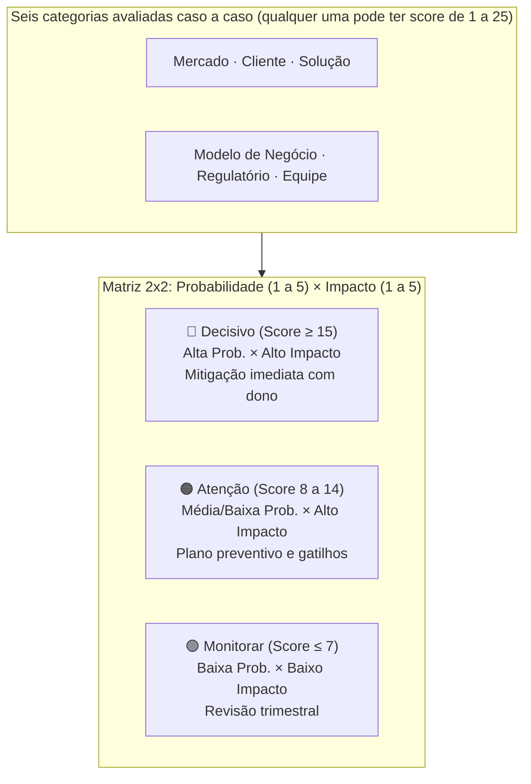

Para cada risco identificado, o quadro registra seis campos: descrição específica, probabilidade (1 a 5), impacto (1 a 5), **pontuação (*score*) (probabilidade × impacto), mitigação planejada e responsável nominal (*owner*)**.

##### O momento exato de colocar este canvas na parede

Use o Risk Canvas nesta Fase 12 (validação do modelo de negócio) como check-up antes de comprometer recursos significativos: equipe maior, captação, expansão de canal. Use também antes de cada rodada de captação: investidores farão due diligence em risco. O Risk Canvas mostra que o time já fez o trabalho. Na Fase 19 (reinvenção e segunda curva, Vol. 9), refaça o Risk Canvas para o novo ciclo: os riscos de uma empresa em escala são diferentes dos de uma startup early-stage.

##### As regras de ouro para preencher sem se enganar

A premissa do método é que **riscos ignorados acumulam impacto com o tempo**: em vez de reagir apenas quando a crise explode, o *Risk Canvas* antecipa as ameaças de maior probabilidade ou severidade e atribui um responsável nominal (*owner*) pelo plano de mitigação de cada item.

##### Passo a passo na parede da sala (3 a 4 horas na primeira versão, 30 a 60 minutos nas revisões)

Sessão de 2-3 horas com o time fundador completo. Sequência:

1. **Brainstorm livre de riscos** (30 min, todos contribuem, sem julgamento): liste todos os "e se." que tiram o sono. Foco em completude, não em priorização.
2. **Categorize**: atribua cada risco a uma das seis categorias.
3. **Pontue**: para cada risco, atribua Probabilidade (1-5) e Impacto (1-5). Score = Prob × Impacto. Riscos com score ≥ 15 são decisivos.
4. **Priorize os top 5**: concentre energia de mitigação nos 5 com maior score.
5. **Defina mitigação**: para cada top 5: o que podemos fazer para reduzir a probabilidade? O que podemos fazer para reduzir o impacto se ocorrer? Qual experimento ou ação testa isso?
6. **Atribua owners**: cada risco decisivo tem uma pessoa responsável por monitorar e executar a mitigação.
7. **Defina revisão**: quando este canvas é revisado? Mínimo trimestral.

##### Exemplo brasileiro preenchido: Méliuz, expansão para cartão de crédito co-branded (2019) (reconstrução ilustrativa com base em dados públicos)

Quando a Méliuz (plataforma de *cashback* e cupons que abriu capital na B3 em novembro de 2020) expandiu sua operação para oferecer cartão de crédito *co-branded* (lançado em 2019 em parceria com o Banco Pan, antes da aquisição posterior do Acesso Bank), precisou equacionar os riscos típicos de quem entra em serviços financeiros. Veja como ficaria a reconstrução ilustrativa de um *Risk Canvas* para uma decisão estratégica desse porte:

| Risco | Categoria | Prob | Impacto | Score | Mitigação | Owner |
|---|---|---|---|---|---|---|
| Regulação do BCB exige capital mínimo e longa aprovação para licença própria | Regulatório | 4 | 5 | 20 | Operar via parceria *co-branded* com banco já licenciado (Banco Pan) em vez de aguardar licença própria | Diretoria Financeira + Jurídico |
| Usuário de *cashback* no e-commerce pode não adotar o cartão no varejo físico | Cliente | 3 | 4 | 12 | Lançar lista de espera e piloto controlado para a safra mais ativa da base antes da abertura geral | Produto |
| CAC de cartão de crédito em mídia aberta é 5x a 8x maior que o CAC de *cashback* | Modelo | 3 | 5 | 15 | Distribuir o cartão prioritariamente dentro da base própria já ativa (CAC marginal próximo de zero) no primeiro ano | Marketing / Growth |
| Frustração de usuários reprovados na análise de crédito pode afetar a marca | Solução | 2 | 4 | 8 | Calibrar a oferta inicial por pré-qualificação e comunicar com clareza os critérios de aprovação | Operações |
| Divisão de foco da engenharia entre a plataforma de cupons e o produto financeiro | Equipe | 3 | 3 | 9 | Destacar célula dedicada à integração do cartão com metas independentes de ativação | Tecnologia / Produto |
| Mudança futura nas condições comerciais com o banco parceiro emissor (Banco Pan) | Mercado | 2 | 5 | 10 | Prever prazos contratuais de transição e avaliar caminho regulatório próprio caso o produto ganhe escala | CEO + Jurídico |

**Diagnóstico ilustrativo.** Numa matriz assim, os dois riscos decisivos (*score* ≥ 15) seriam o Regulatório (20) e o de Modelo de Negócio (15). A mitigação regulatória é estrutural: em vez de esperar anos por uma licença bancária própria antes de validar o produto, a parceria com um banco já autorizado (Banco Pan) transfere a infraestrutura regulatória inicial para o emissor. Já a mitigação do modelo é econômica: ofertar o cartão para os milhões de usuários já cadastrados na plataforma de *cashback* derruba o CAC inicial e permite provar a economia unitária antes de disputar mídia paga aberta.

Num quadro como esse, o risco de modelo de negócio (CAC 5x a 8x maior no mercado aberto, *score* 15) aparece claramente acima do risco de divisão de equipe (*score* 9), embora um time sem *Risk Canvas* tenda a gastar mais horas debatendo a rotina interna da equipe do que a conta de aquisição do novo produto. A função central do Risk Canvas é trazer para a mesa os riscos estruturais que o time ainda não calculou na ponta do lápis.

##### Variações e extensões

- **Pre-mortem** (Gary Klein, 2007): exercício complementar em que o time imagina que o produto fracassou daqui a 12 meses e lista por escrito todas as causas prováveis desse colapso, as razões mais votadas entram diretamente como insumos do *Risk Canvas*.
- **Risk Register** (PMI): versão mais formal e detalhada, com campos adicionais (data de identificação, histórico de revisão, plano de contingência). Para projetos maiores ou empresas em expansão.
- **Scenario Planning Canvas (Quadro de Planejamento de Cenários)**: variação que mapeia três cenários futuros (otimista, base e conservador, alinhados à [[IGNICAO-Vol-9-Maturidade-e-Exit#FASE 19: REINVENÇÃO E SEGUNDA CURVA|Fase 19, Vol. 9]]) e vincula gatilhos de proteção de caixa a cada um.

##### Onde os fundadores mentem para si mesmos neste canvas

- Fazer Risk Canvas só uma vez (no início) e nunca revisar: riscos evoluem, canvas anual é ficcional.
- Risco sem owner: ninguém cuida, risco materializa, time é pego de surpresa.
- Listar riscos genéricos ("risco de mercado") sem especificidade ("nosso ICP não tem budget Q4 por conta do ciclo orçamentário de empresas de capital aberto"): genérico não gera mitigação.
- Focar só em riscos técnicos: times de engenharia subestimam sistematicamente riscos regulatórios, de equipe e de modelo.
- Confundir mitigação com "ter um plano B": mitigação é ação que reduz probabilidade ou impacto antes da crise, plano B é resposta depois que a crise aconteceu.

---

### Fechamento da Fase 12: da hipótese financeira à economia unitária comprovada

Quando Rafael e Bia trocaram a comemoração dos R$ 310 mil brutos da Black Friday pela disciplina da margem por pedido em Goiânia e Recife, descobriram que bastava corrigir três parafusos (piso de frete grátis em R$ 160, foco no kit de R$ 168 e comissão de criadores vinculada à venda paga) para transformar um prejuízo de R$ 15,50 por caixa em R$ 24,80 de geração líquida já na primeira compra. Da mesma forma, no caso didático do PadariaPro, recalcular a margem descontando os R$ 70 de impostos mudou o ponto de equilíbrio para 28 clientes ativos e impediu que os sócios acelerassem gastos antes de cumprir os três a seis meses de leitura real de retenção.

O entregável desta fase é o Quadro Financeiro de Economia Unitária (Canvas Financeiro) validado com números contábeis reais, acompanhado da planilha de três cenários. Quem avança para a [[#FASE 13: PRODUCT-MARKET FIT|Fase 13]] com a margem positiva, o *payback* dentro de 12 meses e o diagnóstico *Default Alive* claro deixa de queimar capital no escuro e ganha base sólida para medir o encaixe definitivo com o mercado.

---

## FASE 13: PRODUCT-MARKET FIT

### Quando a Pedra Começa a Puxar Você Ladeira Abaixo: A Anatomia Real do Product-Market Fit

Durante os primeiros onze meses da empresa de Henrique em Curitiba, cada venda parecia empurrar uma pedra de duas toneladas morro acima debaixo de sol quente. Ele precisava ligar oito vezes, implorar por uma reunião, dar trinta dias de teste gratuito e fazer malabarismo para o diretor da usina assinar o contrato.

Então, depois que eles ajustaram o produto para prever falhas nas caldeiras de biomassa com 72 horas de antecedência e provaram uma economia de R$ 400 mil na primeira usina de Lucas do Rio Verde (MT), algo estranho aconteceu em uma quarta-feira de maio.

O celular de Henrique tocou às 7h15 da manhã. Era o diretor industrial de uma usina concorrente que Henrique nunca havia prospectado:

"Henrique, jantei ontem com o Marcos da Usina Cerrado. Ele me mostrou no celular dele o alerta que salvou a caldeira 2 na semana passada. Quanto custa para vocês fazerem uma visita técnica na nossa planta ainda este mês e mandarem a proposta comercial para eu levar à diretoria antes da próxima safra?"

Naquela mesma semana, quando o servidor da plataforma ficou fora do ar por vinte minutos na quinta-feira à tarde para manutenção, quatro engenheiros de usinas ligaram desesperados perguntando o que havia acontecido porque não conseguiam mais operar o turno sem o painel aberto.

Com aquele pedido espontâneo de visita técnica e proposta comercial vindo de quem ele nunca havia prospectado, Henrique e sua equipe em Curitiba sentiram o primeiro sinal do Ponto de Inversão Gravitacional, o verdadeiro *Product-Market Fit* (PMF): o momento em que você para de empurrar o produto contra a inércia e o comprador passa a puxar a implantação. Ao longo desta Fase 13, o caso de Henrique serve de contraponto B2B de tíquete alto para calibrar cada régua: veremos por que a pergunta de Sean Ellis exige leitura qualitativa quando a base tem 14 usinas em vez de 400 consumidores, como medir a retenção por planta industrial ativa em vez de exigir crescimento semanal de 5%, como evitar o falso positivo de indicações restritas a uma única cooperativa regional no Paraná e no Mato Grosso e, no fechamento, como Henrique usa essas travas para decidir o momento certo de contratar vendedores.

---

### Por que pisar no acelerador de escala um mês antes do PMF destrói empresas, e hesitar um mês depois entrega o mercado ao rival

Antes do PMF, escalar contratações comerciais, levantar uma rodada cara de crescimento, comprar mídia paga em volume ou abrir novas praças tem expectativa negativa: a captação pré-PMF (pré-seed e seed) existe para financiar o aprendizado e a construção do produto até o encaixe, nunca para inflar uma máquina de vendas sobre um balde furado. Por outro lado, quando o PMF já está comprovado nas coortes e na economia unitária, hesitar por meses em expandir a distribuição cobra o preço inverso: entrega de bandeja o canal validado e a janela de atenção do setor para um concorrente capitalizado que copia a cunha e captura os clientes mais rentáveis enquanto o pioneiro hesita.

Quando o produto atinge o PMF, a operação muda de ritmo: o cliente renova e indica sem exigir convencimento do zero a cada mês, a aquisição ganha previsibilidade e o capital externo passa a financiar a expansão de um modelo já validado.

Esse limiar entre a tração inicial e o PMF real é também o momento em que a imprensa, os investidores e os próprios fundadores mais correm o risco de declarar vitória antes da hora.

> [!important] Regra de decisão
> Declare PMF quando os números sustentam. Não quando a esperança pede.

### PSF antes de PMF: não confunda as duas coisas

Um dos erros mais caros que fundadores iniciantes cometem é tratar PSF (Problem-Solution Fit: encaixe entre problema e solução) e PMF como sinônimos. Ou tratar PSF como "PMF em pequeno". Não são a mesma coisa, mas sim fases distintas. Com clientes distintos, preços distintos, métricas distintas, e estratégias de desenvolvimento distintas. Pular do MVP direto para a tentativa de PMF, sem passar pelo PSF, é como tentar correr uma maratona sem ter corrido dez quilômetros.

A trajetória real é PSF, depois PMF, depois Escala. Cada flecha é uma travessia que pode durar meses, e que precisa de evidências específicas para ser declarada concluída.

```mermaid
flowchart LR
    subgraph PSF["Problem-Solution Fit<br/>(Fases 10–11)"]
        direction TB
        P1[5–50 early evangelists]
        P2[Produto imperfeito tolerado]
        P3[Pagam pelo valor, não pela UX]
    end

    subgraph PMF["Product-Market Fit<br/>(Fase 13)"]
        direction TB
        M1[Centenas a milhares]
        M2[Retenção que estabiliza]
        M3[Aquisição orgânica ≥20%]
    end

    subgraph SCALE["Escala<br/>(Fases 14 a 16)"]
        direction TB
        S1[Motor de crescimento]
        S2[NRR ≥110%]
        S3[Rule of 40 ≥40%]
    end

    PSF -->|"Evidência: 5+ clientes<br/>pagando e retornando<br/>sem você empurrar"| PMF
    PMF -->|"Scorecard convergente:<br/>coorte estabiliza + Sean Ellis ≥40%<br/>+ orgânico ≥20%-30%"| SCALE
```

A *retention curve* (curva de retenção: gráfico que mostra quantos usuários voltam com o tempo) é o sinal mais honesto. Produto sem PMF tem curva que decai para zero, pois cada nova coorte de usuários vai embora. Produto com PMF tem curva de retenção que para de cair e estabiliza num patamar horizontal cujo piso saudável depende da categoria (por exemplo, 20% a 25% ou mais em D30 em aplicativos de consumo e marketplaces, 30% ou mais em D30 em assinaturas B2C e 40% ou mais de usuários ativos ou 85% ou mais de contas pagantes em D90 em SaaS B2B). Isso significa que uma fração consistente dos clientes encontrou valor real e permanece.

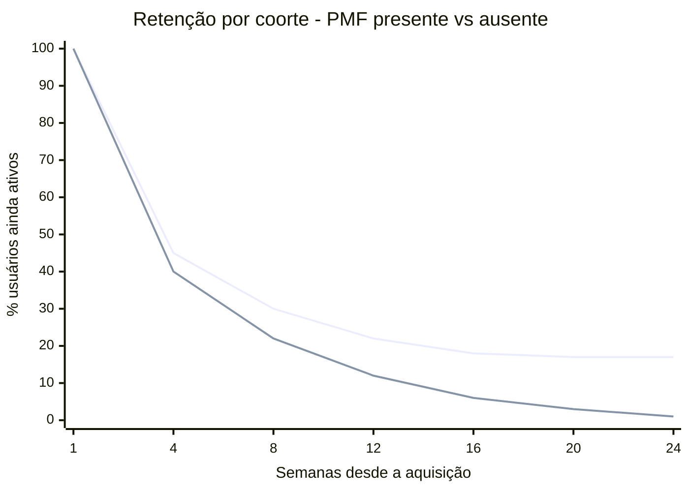

> [!note] Como ler o gráfico
> A linha superior representa um produto de consumo com PMF: a retenção cai nas primeiras semanas, mas estabiliza em torno de 25% (acima do piso de 20% da categoria). A linha inferior retrata um produto sem PMF, que continua caindo até quase zero. O achatamento da curva em um patamar saudável para o modelo de negócio importa mais do que o pico inicial.

| Dimensão | Problem-Solution Fit (PSF) | Product-Market Fit (PMF) |
|---|---|---|
| **Pergunta que responde** | A minha solução realmente resolve a dor de um grupo específico? | Existe um mercado amplo que quer comprar essa solução de forma repetida? |
| **Cliente-alvo** | *Early evangelists* em dor aguda. Pequeno grupo disposto a tolerar imperfeições para resolver um problema real. | Clientes do mercado majoritário (*mainstream*), mais avessos a risco. Esperam que o produto funcione bem sem maiores defeitos. |
| **Tamanho da base ativa** | De 5 a 50 contas no piloto inicial (ou as primeiras 3 a 5 plantas industriais em B2B de tíquete alto, antes da tração repetível). | De dezenas de contas corporativas (como as 14 usinas de Henrique já renovando e indicando pares) a milhares de usuários ativos, em expansão orgânica e paga. |
| **Fonte do interesse** | Buscam ativamente uma solução porque a dor aperta. Aceitam MVP manual, concierge, produto capenga. | Descobrem o produto em canais, e decidem se adotam com base em casos e credibilidade. Esperam produto maduro. |
| **Preço** | Cobrado principalmente como ferramenta para aprender sobre disposição a pagar. Margem e lucro não são o foco. | Preço competitivo e consistente, otimizado para maximizar crescimento. Unit economics (relação entre custo de aquisição e valor gerado por cliente) entram em cena. |
| **Métrica-chave** | Profundidade da resolução. Volta? Usa de verdade? Fica decepcionado se sumir? | Retenção agregada, crescimento orgânico, Sean Ellis acima de quarenta por cento, unit economics, conversão em escala. |
| **Duração típica** | Três a doze meses. Mais em B2B complexo. | Doze a trinta e seis meses depois do PSF. |

> [!important] A diferença entre PSF e PMF, em uma frase
> Em PSF, o empreendedor vai até o cliente oferecer a solução. Em PMF, o mercado começa a vir até o empreendedor puxar a solução. O movimento se inverte.

Cinco sinais mostram que você atingiu o PSF e já pode perseguir o PMF: (1) pelo menos cinco clientes pagantes usam o produto de forma recorrente (semanalmente ou mais), (2) ao menos três clientes recomendam o produto espontaneamente a pares do mesmo nicho, (3) o teste de Sean Ellis (pesquisa que mede o quanto os usuários sentiriam falta do produto), restrito ao nicho inicial, já alcança a faixa de 25% a 30% de respostas "muito decepcionado", (4) quando você pergunta a esses clientes o que usariam se o produto sumisse amanhã, eles citam algo pior (planilha, processo manual ou ficar sem solução), e não um concorrente direto, provando a lacuna que você preenche, e (5) os primeiros interessados vindos por indicação começam a chegar, ainda que em pequeno volume.

Os sinais de que você ainda *não* atingiu PSF, apesar de ter MVP. Clientes usam uma ou duas vezes, e param. Ninguém indica espontaneamente. Você precisa empurrar toda venda com desconto, relacionamento pessoal, ou promessa. Quando um cliente cancela, a resposta é "o produto até é legal, mas." Qualquer frase que venha depois do "mas" é falta de PSF.

A transição de PSF para PMF tem três passos obrigatórios. Primeiro, ajuste o preço para viabilidade de unit economics: o subsídio que funcionou em PSF não se sustenta em escala. Segundo, abra canais de aquisição repetíveis, não dependentes do fundador pessoalmente buscando leads. Terceiro, expanda o perfil de cliente em ondas concêntricas a partir do ICP (Ideal Customer Profile: perfil do cliente ideal) inicial. Não tente atender "todo mundo" de uma vez.

### Os três testes do PMF: desejável, viável e exequível (lentes da IDEO)

Popularizado por Marc Andreessen em 2007 (a partir da ênfase de Andy Rachleff no mercado), o conceito de PMF ganha clareza operacional quando combinado às três lentes clássicas do *design thinking* (difundidas pela IDEO: desejabilidade, viabilidade e exequibilidade), exigindo que o negócio passe em três testes simultaneamente. Não apenas em um. A maioria dos fundadores que "acha que tem PMF" falhou, sem perceber, em pelo menos um dos três.

#### Desirability, os clientes querem?

Os sinais. Sean Ellis acima de quarenta por cento (ver Teste dos 40% no Passo 1). Retenção estável. NPS (Net Promoter Score: índice de lealdade do cliente) alto. Referências espontâneas.

A falha típica. O produto gera interesse inicial (aquisição boa), mas não retenção (engajamento falso, as pessoas vêm e vão).

#### Viability, o negócio ganha dinheiro?

Os sinais econômicos saudáveis combinam razão LTV/CAC igual ou superior a 3, *payback* de aquisição em até 12 meses e margem bruta positiva por unidade vendida.

A pergunta central. Quando eu parar de subsidiar aquisição, o negócio ainda funciona?

A falha típica. Produto amado por usuários, mas com custos de entrega ou aquisição que destroem margem.

#### Feasibility, a empresa consegue entregar em escala?

Os sinais. Processos documentados. Time capaz. Infraestrutura escalável. Operações previsíveis.

A pergunta central. Se amanhã triplicar a demanda, a minha operação aguenta, ou quebra?

A falha típica. Produto desejado, e com boa margem, mas entregue artesanalmente pelo fundador. Operação não escala.

> [!warning] A regra operacional dos três testes
> Declare PMF apenas quando os três testes passarem em paralelo. Produto desejável e viável financeiramente, mas operacionalmente frágil, vira crise de entrega em seis a doze meses: o cliente abandona porque o serviço cai, fica lento, ou inconsistente. Produto desejável e operacionalmente robusto, mas economicamente inviável, vira crise de caixa: você tem fila para o que vende, mas cada venda afunda mais. Produto viável economicamente e operacionalmente, mas não desejável, vira churn acelerado: eles compram, e saem.

Em cada iteração, aplique o checklist triplo antes de começar a investir pesadamente em marketing pago, expansão geográfica, ou contratações agressivas.

### Ciclo de maturação do PMF: por que o encaixe de mercado não é permanente

Uma armadilha que atinge até fundadores experientes: tratar o PMF como estado permanente depois de atingido. Não é. Canais e alavancas de crescimento costumam dar sinais de saturação ao longo de um a dois anos de operação (como analisa Brian Balfour nos ensaios sobre *Four Fits*). Você precisa redesenhar elementos: seja o ICP (novo segmento), seja a proposta (nova categoria de valor), seja o canal (nova forma de aquisição), seja o preço (novo modelo de monetização).

Fundadores que ficam estáticos vendo o crescimento morrer aprendem tarde demais. Fundadores que anteveem e redesenham entram em novos ciclos de crescimento exponencial.

> [!important] PMF revisitado ao longo de toda a vida da empresa
> A Fase 13 (Product-Market Fit) é revisitada ao longo de toda a vida da empresa, sempre que o mercado, o canal ou o produto mudam de patamar. Uma empresa de vinte anos, se ainda existe, provavelmente renovou o PMF dela cinco ou seis vezes.

### Os cinco sinais do PMF: retenção que estabiliza, Sean Ellis, tração orgânica, NPS e demanda puxada

#### Passo 1: medir o PMF quantitativamente em cinco dimensões

Nenhum indicador isolado comprova *Product-Market Fit*. Avalie em conjunto cinco sinais complementares que se reforçam mutuamente.

> [!tip] Canvases Visuais: Pirate Canvas / AARRR (Fase 11)
> Diagnóstico de PMF mora dentro do AARRR. As métricas centrais desta fase, ativação (Activation), retenção por coorte (Retention) e crescimento orgânico via indicação (Referral), são três das cinco etapas do [[#Canvas: Pirate Canvas / AARRR (Dave McClure, 2007)|Canvas: Pirate Canvas / AARRR (Dave McClure, 2007)]]. Use o canvas para visualizar onde o produto entrega valor versus onde vaza usuário. Sem mapear o funil, números soltos enganam (cadastros altos sem ativação são "PMF teatro").

##### Teste dos 40%, Sean Ellis Test

Pergunte aos usuários ativos: "Como você se sentiria se não pudesse mais usar esse produto?" Três opções de resposta. Muito decepcionado. Um pouco decepcionado. Não me importaria.

Se 40% ou mais respondem "muito decepcionado", você tem forte indicador de PMF. Abaixo de 40%, ainda não chegou, mas a direção importa: sair de 15% para 30% em seis meses é bom sinal de evolução, mesmo sem configurar PMF.

Patamares do Sean Ellis Test, em quatro faixas.

**40% ou mais de respostas "muito decepcionado":** indica aprovação no teste de Sean Ellis. Quando esse resultado converge no scorecard com retenção estabilizada, aquisição orgânica mínima de 20% (ou 30% em tração madura) e renovação sem desconto, a empresa está pronta para preparar a escala.

**De 30% a 40%:** mostra que o produto está próximo do PMF. Refine o ICP, aprofunde as funcionalidades centrais e itere na ativação antes de acelerar o gasto comercial.

**De 20% a 30%:** sinaliza encaixe problema-solução (PSF) no nicho inicial, mas ainda não PMF na base ampla. Revise a proposta de valor, estreite o foco e concentre-se no subsegmento que mais retém.

Menos de vinte por cento. Sem fit. Considere pivot, ou descontinuação.

> [!warning] Tamanho mínimo da amostra
> Aplique a pesquisa de Sean Ellis a uma amostra mínima de 40 usuários ativos que já experimentaram o núcleo do produto (em B2B de tíquete alto com menos de 40 contas, como no caso de Henrique, ouça toda a base ativa e trate o percentual como indício qualitativo somado à renovação contratual).

##### Curva de retenção estabilizada

Esse é o sinal mais importante de PMF. Mais até do que o Sean Ellis. A curva de retenção de coortes mais novas precisa estabilizar em um nível significativamente acima de zero, e se manter estável.

A forma e o patamar de estabilização da curva de retenção revelam o estágio do produto: quando a curva desce continuamente até zerar, o produto ainda não retém, quando achata em um patamar intermediário mas abaixo da referência do setor, indica aderência restrita a um subsegmento específico, e quando se estabiliza acima do piso do modelo de negócio (como 20% a 30% em D30 no consumo ou 40% de usuários ativos e 85% ou mais de contas pagantes em D90 no B2B) e se repete nas safras seguintes, confirma a retenção de PMF.

> [!important] A forma da curva importa mais que o número absoluto
> Decaimento contínuo é morte. Estabilização horizontal é vida. Sem estabilização, não há PMF, por definição.

**Referências de retenção estável por modelo de negócio.** Use estes pisos iniciais para calibrar suas próprias safras: em SaaS B2B, 40% ou mais de retenção de usuários ativos em D90, estável até D180, e 85% ou mais quando medida por conta pagante em D90, em SaaS B2C ou assinatura de consumo, 30% ou mais em D30, em marketplaces e aplicativos de consumo (mídia, social, utilitários), 20% a 25% ou mais em D30, em e-commerce recorrente, o patamar acompanha o ciclo natural de recompra da categoria.

##### Crescimento orgânico

Se você desligar toda a mídia paga hoje, novos clientes continuarão chegando amanhã por indicação espontânea, boca a boca e busca orgânica? Use esta régua prática: pelo menos 20% das novas ativações vindas de canais orgânicos não pagos indicam PMF emergente, e 30% ou mais confirmam tração forte puxada pelo mercado (abaixo de 20%, o crescimento ainda depende majoritariamente de subsídio de mídia paga).

##### NPS elevado e consistente

Um NPS acima de 40 em consumo e acima de 30 em B2B corporativo reforça o diagnóstico de PMF quando vem acompanhado de comentários que descrevem ganhos concretos de rotina. Como pesquisas no Brasil tendem a notas mais altas por cortesia cultural, trate esses pisos como mínimos e confirme sempre o resultado com a curva de retenção.

##### Demanda puxando você

Usuários entrando em contato pedindo funcionalidades específicas. Mídia mencionando espontaneamente. Vendedores batendo meta sem dificuldade. Fundador sendo convidado para falar sobre o segmento em eventos e podcasts. Isso é feeling, mas é real. Quando todos esses sinais acontecem simultaneamente, o ambiente muda.

#### Sinal complementar: taxa de crescimento semanal

#### Taxa de crescimento semanal, o benchmark canônico de Paul Graham

Em ensaio de 2012, *Startup = Growth*, Paul Graham argumenta que o que define uma startup não é idade, tamanho, tecnologia, ou captação. É crescimento. Crescimento se mede semana a semana, no que ele chama de taxa de crescimento semanal composta. É a métrica que o Y Combinator usa internamente para acompanhar batches inteiros. E a partir dela toda decisão de expansão de investimento é tomada.

A fórmula simples: taxa semanal é igual à receita da semana atual, menos a receita da semana anterior, dividido pela receita da semana anterior.

Os benchmarks canônicos do YC. Referência para startup early-stage com MRR (Monthly Recurring Revenue: receita recorrente mensal) tipicamente entre R$ 25 mil e R$ 250 mil.

| Taxa de crescimento semanal | Interpretação |
|---|---|
| **Um por cento por semana** | Sinal de problema. Você ainda não descobriu o que está fazendo. PMF ausente, ou muito parcial. |
| **Cinco a sete por cento por semana** | Crescimento saudável. Padrão YC. Entre 12 e 34 vezes ao ano. Indica PMF emergente ou inicial. |
| **Dez por cento por semana** | Excepcional. Cerca de cento e quarenta e duas vezes ao ano. Poucas startups atingem. Sinal inequívoco de forte PMF. |

A métrica primária de tração é a receita recorrente (ou o número de usuários ativos enquanto a monetização não abre), buscando um crescimento de 5% ou mais por semana durante oito semanas consecutivas no digital, ou evolução mensal equivalente medida por média móvel de quatro a seis semanas em vendas B2B de ciclo longo.

> [!important] O poder da composição que quase todo fundador subestima
> Imagine uma startup faturando R$ 1.000 por mês. Crescendo a 1% por semana, depois de quatro anos ela chega a R$ 7.900 por mês, uma pequena operação. Crescendo a 5% por semana, depois de quatro anos atinge R$ 25 milhões por mês (R$ 300 milhões de receita anualizada, porte de pré-IPO). Crescendo a 10% por semana durante quatro anos, o número ultrapassa a escala de qualquer mercado real.

Pequenas diferenças de taxa semanal produzem diferenças astronômicas em três a quatro anos. Por isso Graham defende escolher uma meta de crescimento semanal e usá-la como critério único para quase toda decisão operacional. "Essa reunião me ajuda a crescer essa semana? Essa feature? Essa contratação?" A pergunta é reducionista de propósito. Em estágio pré-escala, reduzir tudo a uma variável é o que evita dispersão.

A curva S do crescimento. Na prática, crescimento não é linear nem exponencial eternamente. Segue uma curva S. Startup saudável tem três fases.

Início lento (pré-PMF). Crescimento caótico, baixo, oscilante. Você ainda está procurando cunha. A taxa semanal pode ser zero a dois por cento, frequentemente negativa. Muitos fundadores desistem aqui porque confundem início lento com inviabilidade.

Crescimento rápido (PMF para Escala). O meio íngreme da curva, onde os benchmarks de cinco a sete por cento por semana do YC se aplicam. Dura um a quatro anos tipicamente. É a fase em que a empresa é financiável por VC de growth.

Maturação (pós-escala). A curva se achata. Crescimento sustentável passa a ser em percentual anual (vinte a quarenta por cento), não semanal. A empresa deixa de ser startup, e vira incumbente.

A razão pela qual startups entram no YC apostando em estar no início da fase 2, e a razão pela qual investidores de growth pagam múltiplos altos pela mesma fase, é que ela se estende por anos com composição. Identificar quando você entrou no segundo estágio da curva em S (o trecho íngreme da inflexão) é das decisões mais importantes de toda a trajetória da empresa. E a taxa de crescimento semanal consistente é o melhor indicador disponível.

#### Por que pequenas diferenças de performance importam tanto, Superlinear Returns

> [!note] Insight conceitual, não passo operacional
> Esta sub-seção é insight de mentalidade: explica *por que* a métrica semanal acima importa tanto matematicamente. Não é checklist nem critério de saída de fase. Se você está rodando a Fase 13 sob pressão de tempo, pule direto para o quadro da regra combinada ao final desta subseção e volte aqui depois. O conteúdo serve para calibrar expectativa e priorização de longo prazo, não para diagnosticar PMF agora.

No ensaio *Superlinear Returns* (2023), Paul Graham explica por que a diferença entre crescer 5% por semana e 7% por semana não é 40% maior, e sim muitas vezes maior no acumulado, e por que essa matemática governa a economia de startups de um modo que fundadores de primeira viagem raramente intuem.

A tese central. Em domínios onde há crescimento exponencial, ou thresholds (limiares a serem cruzados), pequenas diferenças de performance geram retornos radicalmente desproporcionais. Não é que "quem trabalha mais ganha mais". A função de recompensa é não linear por natureza.

Duas fontes de superlinearidade.

A primeira é o crescimento exponencial. Startups compostas por crescimento semanal viraram o exemplo canônico. Duas empresas com o mesmo produto partindo do mesmo ponto, uma crescendo cinco por cento por semana e a outra sete por cento por semana, terminam quatro anos depois em ordens de grandeza diferentes. Pequena vantagem compõe até ser enorme. Por isso, em startup, acúmulo lento de pequenas vantagens semanais vale mais que ganhos grandes isolados. O pequeno ganho compõe. O grande ganho não.

A segunda são os thresholds (limiares). Muitos resultados em mercado são winner-take-all, ou winner-take-most. Você precisa cruzar um limiar para ganhar. E uma vez cruzado, ganha desproporcionalmente. Atingir top três da App Store versus top trinta não é dez vezes melhor. É provavelmente cem vezes melhor. Rankings, recomendações, prêmios, imprensa, capital, talento: tudo se empilha acima do threshold.

Três consequências práticas da superlinearidade para você.

Direcione sua atenção semanal para o que compõe. Coisas que criam vantagem recorrente, mesmo que pequena. Boca a boca, SEO, conteúdo, retenção, NPS, ativação: todas compõem. Anúncio pago de performance não compõe. É linear.

Em startup, é melhor estar continuamente no jogo do que fazer explosões episódicas. Explosão não compõe. Presença semanal compõe.

Mapeie os thresholds relevantes no seu mercado. Muitos não são óbvios. Pode ser ficar em lista de top N da categoria. Ser mencionado em mídia específica. Atingir um múltiplo específico de receita para ser financiável no próximo estágio. Atingir volume que gera network effects. Otimize para cruzá-los, não para "performance média".

> [!quote] Sobre desigualdade de retornos em ambientes superlineares
> Como observa Paul Graham em *Superlinear Returns* (2023), ambientes governados por composição e limiares de desempenho produzem resultados matematicamente muito concentrados. Ambientes com retornos superlineares produzem desigualdade extrema de resultado. Um fundador fica mil vezes mais rico que outro que trabalhou quase tão duro. Aceitar isso como característica do jogo, e não como falha moral do sistema, ajuda a agir sem ressentimento.

> [!important] Regra combinada: os 5 sinais de retenção/valor + taxa de crescimento semanal
> Somando os sinais de retenção e valor à taxa de crescimento semanal, a regra prática converge para o scorecard desta fase (que exige aprovação em pelo menos 4 das 6 dimensões): quando a curva de retenção por coorte estabiliza acima do piso do setor, o teste de Sean Ellis supera 40%, a aquisição orgânica responde por ao menos 20% das novas ativações (30% em tração madura) e os clientes renovam e expandem sem pressão de descontos, o produto atingiu o PMF no segmento avaliado. Sean Ellis abaixo de 40%, retenção caindo ou crescimento abaixo de 2% por semana indicam que o ajuste ainda não chegou e pedem nova iteração. Se o crescimento semanal fica entre 2% e 5% de forma consistente por três ou mais meses, você está na virada: identifique dois ou três limiares específicos do seu mercado e concentre esforço para cruzá-los, pois superar um limiar relevante gera retorno superior a ajustes incrementais dispersos.

> [!tip] Default Alive e Default Dead
> O conceito de Default Alive vs Default Dead é tratado em profundidade na [[#FASE 12: VALIDAÇÃO DO MODELO DE NEGÓCIO|Fase 12]] (Passo 10), onde a pergunta operacional é modelada. Aqui basta saber que PMF é pré-requisito mas não garantia de Default Alive.

#### Passo 2: identificar o segmento onde o PMF aconteceu primeiro

PMF raramente chega para toda a base ao mesmo tempo. Geralmente acontece primeiro em um sub-segmento específico, a sua beachhead (cabeça de praia, ponto de entrada no mercado), ou algo próximo. Identifique com precisão: quem são esses usuários? Cargo, setor, tamanho de empresa, localização? O que eles têm em comum? Que problema específico os une? Como chegaram até você? Qual canal funcionou para esse grupo? Que casos de uso eles resolvem com o seu produto?

Esse é o perfil que você deve expandir em ondas concêntricas.

> [!warning] Erro estratégico comum
> Tentar expandir antes de ter o perfil mapeado dilui foco, produto, e marketing em busca de um cliente genérico que não existe.

#### Passo 3: decidir entre três caminhos com base na medição

##### Caminho A, PMF claro

Antes de avançar para a Fase 14 (capital para escala, Vol. 5) e a Fase 15 (máquina de crescimento, Vol. 6), cumpra o portão jurídico mínimo detalhado na Fase 18 (Vol. 8): acordo de sócios assinado com cláusulas de *vesting*, contratos de cessão de propriedade intelectual (PI) do código e *cap table* limpo, itens que toda diligência de investidor exige na abertura do *data room*. Reserve também de 30 a 60 dias para estabilizar suporte, infraestrutura e *onboarding* (processo de entrada e orientação do novo usuário) antes de acelerar a aquisição.

> [!tip] Capítulo 1 (Vol. 6): Growth como Função Organizacional
> O [[IGNICAO-Vol-6-Receita-e-Pessoas#CAPÍTULO 1: GROWTH COMO FUNÇÃO ORGANIZACIONAL: TIME DE GROWTH, BUILD VS HIRE, RELAÇÃO COM PRODUTO|Capítulo 1: Growth como Função Organizacional (Vol. 6)]] cobre quando montar time de growth, como estruturar o primeiro squad (growth PM, eng, data), a diferença entre PLG (Product-Led Growth, crescimento liderado pelo produto) e SLG (Sales-Led Growth, crescimento liderado por vendas) em escala, e como não destruir PMF ao abrir o motor de crescimento.

> [!tip] Capítulo 1 (Vol. 7): Produto em Escala
> O [[IGNICAO-Vol-7-Produto-Engenharia-e-Operacoes#CAPÍTULO 1: PRODUTO EM ESCALA E DESCOBERTA CONTÍNUA|Capítulo 1: Produto em Escala (Vol. 7)]] trata das mudanças de processo de produto que acontecem depois do PMF: roadmap orientado a segmento versus roadmap orientado a retenção, como priorizar com NRR (Net Revenue Retention: receita líquida retida, que mede expansão e churn juntos) em mente, e o momento em que o produto deixa de ser artesanal e precisa de plataforma.

##### Caminho B, PMF parcial

Alguns usuários adoram. A maioria é indiferente. Foque no sub-segmento que adora. Elimine funcionalidades e mensagens voltadas para o grupo indiferente. Esclareça o posicionamento.

> [!important] Resistência ao recorte é o erro
> Muitos fundadores hesitam em estreitar o foco com receio de reduzir o mercado endereçável, mas na pratica o recorte faz a empresa ganhar retenção, indicação boca a boca e velocidade comercial no subsegmento que realmente valoriza o produto.

##### Caminho C, sem PMF

Se os sinais continuarem negativos após os ajustes, retorne às Fases 4 a 6 (Vol. 2) para revisar o problema e o segmento-alvo, ou às Fases 7 a 9 (Vol. 3) para reformular as hipóteses e a solução proposta. Descobrir essa necessidade enquanto ainda há caixa preserva o capital para o pivô certo.

> [!tip] Capítulo 8: Customer Experience
> O [[#CAPÍTULO 8: CUSTOMER SUCCESS (CS) E CUSTOMER EXPERIENCE (CX): DA JORNADA À RETENÇÃO SUSTENTÁVEL E NRR ACIMA DE 100%|Capítulo 8: Customer Experience]] estrutura como mapear a jornada completa do cliente, desde o primeiro contato até o churn evitado, e identificar os "moments of truth" que mais afetam retenção. Use aqui para diagnosticar por que certos segmentos chegam ao aha e outros não.

> [!tip] Canvases Visuais: Customer Journey Canvas (Fase 5)
> Para sustentar o PMF, o [[IGNICAO-Vol-2-Descoberta-e-Mercado#Canvas: Customer Journey Canvas|Canvas: Customer Journey Canvas (Vol. 2)]] materializa em uma página a jornada completa (consciência, consideração, decisão, *onboarding*, uso, expansão e recomendação) com os momentos decisivos (*moments of truth*) de cada etapa. O Capítulo 8 deste volume aprofunda a gestão da jornada, enquanto o canvas do Volume 2 oferece o quadro preenchível para oficinas com a equipe.

#### Passo 4: documentar o "aha moment" e operacionalizar a ativação

O *aha moment* é o ponto específico na jornada em que o usuário percebe o valor central do produto pela primeira vez, a partir do qual a probabilidade de retenção sobe de forma acentuada. Exemplos clássicos documentados: o Slack identificou o marco de 2 mil mensagens trocadas pela equipe, e o Facebook mapeou a marca de 7 amigos adicionados em 10 dias. Na sua empresa, encontrar esse marco é trabalho de dados: cruzar quais ações concluídas nos primeiros dias se correlacionam com a retenção aos 30 e aos 90 dias.

Depois que você identifica o aha moment, o trabalho é operacionalizá-lo. Quantos usuários atingem? E em quanto tempo? Reestruture o onboarding para levar mais usuários ao aha em menos tempo. Essa é tipicamente a alavanca de maior impacto sobre retenção, antes mesmo de mudar produto.

Como ponto de partida para calibrar com os dados da própria base, observe cinco etapas do funil de ativação: conversão de visitante em cadastro entre 2% e 10% (conforme o canal de origem). Conclusão da configuração inicial (*onboarding*) por 60% ou mais dos cadastrados. Chegada à primeira entrega de valor (*aha moment*) por pelo menos 50% dos que concluíram a configuração. Retorno em D7 de 70% ou mais dos usuários que viveram esse marco, e conversão em conta pagante (ou expansão) de 30% ou mais dos usuários engajados.

> [!tip] Capítulo 8: Customer Success
> O [[#CAPÍTULO 8: CUSTOMER SUCCESS (CS) E CUSTOMER EXPERIENCE (CX): DA JORNADA À RETENÇÃO SUSTENTÁVEL E NRR ACIMA DE 100%|Capítulo 8: Customer Success]] mostra como estruturar a função de CS antes de contratar o primeiro especialista: placar de saúde da conta (*health score*), roteiros de *onboarding*, revisões trimestrais (QBR) e gatilhos de intervenção que reduzem o cancelamento, cuidado essencial quando a curva de retenção ainda oscila.

#### Passo 5: estabilizar operações para sustentar PMF

Quando o PMF chega, a primeira coisa que tende a quebrar é a operação. O suporte fica sobrecarregado. Bugs se multiplicam. Usuários abandonam por falta de atenção a demandas básicas. Antes de crescer, estabilize cinco coisas.

1. **Processo de suporte escalável:** defina acordos de nível de serviço (SLA), ferramenta de chamados, base de conhecimento e fluxos de autoatendimento antes que o volume de dúvidas trave a equipe.

2. **Monitoramento técnico:** configure alertas automatizados, painéis de estabilidade, escala de plantão (*on-call*) e objetivos de nível de serviço (SLO) para evitar quedas durante picos de demanda.

3. **Documentação interna:** registre processos operacionais e arquitetura técnica para que novos contratados consigam produzir sem depender de explicações orais dos fundadores.

4. **Onboarding padronizado:** estruture a ativação de novos clientes para que o tempo até o primeiro valor e a qualidade de entrega sejam previsíveis.

5. **Financeiro organizado:** automatize faturamento, emissão de notas, conciliação e régua de cobrança de inadimplência para que o ciclo de caixa funcione sem intervenção manual dos sócios.

> [!warning] Falhar em estabilizar aqui leva a uma experiência comum
> A empresa atinge o PMF de demanda e retenção, acelera vendas três a quatro vezes em nove meses sem antes preparar o pré-requisito de exequibilidade operacional para a escala (Fases 14 e 15), descobre que o volume quebrou o suporte, e vê o NPS cair de sessenta para vinte. Aí precisa parar, reconstruir, e perder meses.

### Caso ilustrativo inspirado na Hotmart: reconstrução didática de diagnóstico de PMF (2014)

Reconstrução didática e ilustrativa de como um scorecard de PMF se aplicaria à trajetória da Hotmart, lançada em 2011 por João Pedro Resende e Mateus Bicalho. Os marcos históricos abaixo vêm de relatos públicos dos fundadores à imprensa, enquanto os percentuais de Sean Ellis, retenção por safra e NPS são simulações didáticas para demonstrar o preenchimento da ferramenta no momento em que a empresa deixou de ser uma solução pontual para vender e-books e se tornou infraestrutura do mercado de produtos digitais.

**O contexto histórico.** A Hotmart nasceu em 2011 para resolver a entrega e o pagamento online de e-books e cursos digitais. Nos primeiros meses, o faturamento inicial relatado pelos fundadores foi de cerca de R$ 180, seguido pela vitória no Desafio Buscapé em 2011, que trouxe o primeiro aporte de investidores ligados à competição. Por volta de 2014, consolidou-se um padrão de tração puxada pelo mercado: produtores digitais que passavam a faturar dezenas de milhares de reais por mês na plataforma atraíam espontaneamente outros criadores e afiliados, preparando a base que levaria a empresa a cerca de 100 funcionários em 2015 e à expansão para a América Latina a partir de 2017 (Colômbia) e 2018 (México).

**Sean Ellis Test, aplicado a cinquenta produtores ativos no fim de 2014.** Sessenta e quatro por cento (32 de 50) responderam "muito decepcionado se não pudesse mais usar". Vinte e dois por cento (11 de 50) "um pouco decepcionado". Catorze por cento (7 de 50) "não me importaria". Resultado: bem acima de quarenta por cento. Sinal claro de PMF no segmento de produtores de infoproduto que faturam R$ 5 mil ou mais por mês.

**Retenção de coorte, produtores que entraram no início de 2014.** Mês um (cadastro): cem por cento. Mês três: setenta e oito por cento (ainda processam ao menos uma venda). Mês seis: sessenta e dois por cento. Mês nove: cinquenta e cinco por cento. Mês doze: cinquenta e um por cento.

A análise. A curva achata acima de cinquenta por cento no mês doze. Em marketplace bilateral de produtor independente, isso é retenção forte. Produtores que ficam tendem a aumentar volume com o tempo, não diminuir.

**NPS dos produtores ativos (2014).** Promotores (9 a 10): 28 de 50. Neutros (7 a 8): 14 de 50. Detratores (0 a 6): 8 de 50. NPS calculado: 28 menos 8, dividido por 50, vezes 100, igual a quarenta. NPS de quarenta em B2B SaaS já é bom. Em marketplace com produtor independente que pode escolher migrar, é sinal forte.

**Crescimento orgânico no segundo semestre de 2014.** Novos produtores cadastrados: cerca de cento e cinquenta por mês ao final do ano. Cerca de setenta por cento via indicação de produtor existente (afiliados, comunidade do JP, palestras em eventos do setor de marketing digital). Cerca de vinte por cento via conteúdo (blog do JP, vídeos sobre marketing digital). Cerca de dez por cento via paid acquisition. Indicação respondia por mais da metade da aquisição. Sinal canônico de PMF.

**Evidência qualitativa documentada (paráfrase de depoimentos públicos).** Produtores diziam que sem a Hotmart não conseguiriam processar vendas e afiliados na escala que faziam, especialmente nos lançamentos. O conceito de "lançamento", modelo Erico Rocha de campanha temporal de venda intensiva, começava a explodir, e a Hotmart era a infraestrutura, sem similar competente no Brasil. Produtores reclamavam de bugs, e features faltando, mas não de fundamentos da plataforma. Reclamação era de roadmap. Não de existência do produto.

**Crescimento e pressão de demanda (leitura de escala).** O avanço consistente do volume transacionado levou a equipe a crescer para cerca de 100 pessoas ao longo de 2015, confirmando que o ajuste produto-mercado construído até 2014 sustentava a transição para a escala.

**Diagnóstico geral (simulação didática na perspectiva do fim de 2014).** O cenário ilustra PMF consolidado no segmento principal (produtores brasileiros de cursos e infoprodutos com faturamento recorrente), tração orgânica puxada por indicação direta de produtores e afiliados, retenção estável para o modelo transacional e NPS positivo. Os detratores simulados na pesquisa de NPS (16%, ou 8 de 50 respondentes, distintos dos 14% que responderiam "não me importaria" no teste de Sean Ellis) indicam o ponto de investigação seguinte: verificar se a insatisfação se concentra em criadores iniciantes que ainda não realizaram a primeira venda. O próximo passo estratégico prepara as hipóteses de expansão pós-PMF (subida de tíquete médio dos cursos e internacionalização para a América Latina) tratadas nas Fases 14 e 15.

A decisão, em retrospecto. Declarar PMF no segmento brasileiro de produtor de infoproduto. E investir em escala, equipe, infraestrutura técnica para suportar picos de lançamento, e expansão internacional. Foi exatamente o que aconteceu. O triplicamento de equipe em 2015, e as primeiras operações na América Latina, vieram dessa decisão.

> [!important] O que a virada da Hotmart mostra sobre convergência de sinais
> O diagnóstico de PMF apoia-se na convergência entre o teste de Sean Ellis, a estabilização da curva de retenção, o NPS, a fatia de aquisição orgânica e os relatos espontâneos dos clientes. Em 2014, a Hotmart reunia esses cinco sinais dentro do seu nicho inicial de criadores digitais, o que lhe permitiu escalar sobre uma base retida.

### Contexto brasileiro: as peculiaridades do PMF no Brasil

Algumas observações específicas do contexto brasileiro, aplicáveis a fundadores operando aqui.

> [!note] O "NPS alto de brasileiro" é enganoso
> A cultura brasileira tende a responder pesquisas de satisfação de forma mais generosa do que a norte-americana, por cortesia e aversão ao conflito direto. Por isso, um NPS de 50 no Brasil, sobretudo em consumo, pode estar inflado em comparação com benchmarks internacionais. Trate os pisos de NPS (30 em B2B e 40 em consumo) como mínimos e cruze sempre o resultado com indicadores comportamentais de retenção e renovação.

Nichos brasileiros saturam rápido. Em muitos recortes de software B2B especializado, o número de empresas com orçamento para a solução no Brasil é uma fração menor do que o equivalente nos Estados Unidos (embora em setores como agronegócio, meios de pagamento e saúde o volume brasileiro seja continental). Consequência prática: PMF em subnicho brasileiro pode significar cem a quinhentos clientes, não dez mil. Planeje crescimento com esse cap em mente. E pense em expansão (vertical, horizontal, geográfica) desde cedo.

Crescimento orgânico no Brasil depende de cultura relacional. Boca a boca funciona muito no Brasil. Possivelmente mais que em mercados mais transacionais como o americano. Mas funciona melhor em redes pré-existentes. Associações de classe. Grupos de WhatsApp profissionais. Círculos de amizade. Famílias. Empresa que entende e alimenta essas redes atinge crescimento orgânico mais cedo.

Ciclo de decisão B2B brasileiro é mais longo. Em enterprise brasileiro, o ciclo de venda típico é de nove a dezoito meses. PMF em B2B enterprise pode demorar mais a ser reconhecido, porque o sinal (deals recorrentes, renewal) demora a chegar. Paciência e métricas intermediárias são importantes.

O cancelamento no Brasil sofre forte efeito sazonal: dezembro, janeiro, junho e julho costumam registrar picos de pausa ou encerramento de contratos em diversos setores. Avaliar a estabilização das coortes ao longo de 6 a 12 meses é muito mais confiável do que tirar conclusões a partir de um único trimestre isolado.

### Falsos positivos de PMF: o que parece PMF e não é

Os três falsos positivos mais comuns. E como diagnosticar.

#### Falso positivo 1, tração de aquisição sem retenção

Você acabou de rodar uma campanha paga excelente. Aquisição está bombando. Métricas de topo de funil parecem ótimas. Mas em trinta a sessenta dias, a maioria desses usuários evaporou.

Se os usuários somem em 30 dias, você tem um canal pago eficiente, mas o PMF ainda não chegou.

O teste do diagnóstico. Desligue o canal pago por trinta dias, e veja o que acontece. Se a aquisição evapora com ele, o PMF é circunstancial.

#### Falso positivo 2, cliente ancorado, não puxando

Você tem vinte clientes felizes. Todos originados da sua rede pessoal, ou de relacionamentos diretos. Eles pagam. Usam. Estão satisfeitos. Mas quando você tenta prospectar fora da sua rede, quase ninguém compra.

Quando os primeiros contratos dependem exclusivamente da amizade com os fundadores e não se repetem com estranhos, você tem venda relacional, e o PMF comercial ainda precisa ser provado.

O teste do diagnóstico. Quantos dos clientes atuais vieram sem que você tivesse conexão direta? Se a resposta é "menos de trinta por cento", o produto ainda não prova valor sozinho.

#### Falso positivo 3, PMF local sem escalabilidade

Você tem crescimento sólido em uma cidade, bairro, ou segmento microvertical. Mas quando tenta expandir, cada novo mercado exige reinvenção completa da abordagem.

Se o produto prospera apenas em uma cidade, microrregião ou subnicho com regras próprias e cada tentativa de entrar em outra praça exige reconstruir a oferta e o processo comercial do zero, o PMF ainda é local. Foi a verificação que Henrique precisou concluir antes de declarar o ajuste: comprovar que o sistema de monitoramento de caldeiras validado nas usinas do Mato Grosso rodava com a mesma taxa de renovação e sem adaptação artesanal nas plantas do interior de São Paulo.

Acontece com frequência em serviços regulados (saúde, educação), ou com forte dependência de rede local. É negócio legítimo. Mas exige estratégia diferente de uma máquina de PMF generalizado.

> [!tip] Comunicar PMF a investidores
> Captação de Série A e posterior exige demonstração de PMF com seis artefatos: gráfico de retenção por coorte estabilizada acima do threshold do setor, Sean Ellis Test recente com percentual e tamanho da amostra, NRR em SaaS com trajetória de 4-8 trimestres. Pipeline de indicação (percentual de novos clientes por referência). Cohort analysis de LTV/CAC por safra (não média). Cinco a dez depoimentos qualitativos de clientes com permissão. Fundador que apresenta "temos PMF" sem esses artefatos sinaliza que ainda não mediu PMF com rigor. O detalhamento de como construir cada artefato e estruturar o pitch está no [[IGNICAO-Vol-5-Financas-e-Captacao#CAPÍTULO 9: CAPTAÇÃO DE EQUITY: PLANEJAMENTO DE RODADA, PITCH E RELACIONAMENTO COM INVESTIDORES|Capítulo 9: Captação de Equity (Vol. 5)]] e no [[IGNICAO-Vol-5-Financas-e-Captacao#CAPÍTULO 4: PLANEJAMENTO FINANCEIRO (FP&A), ORÇAMENTO E REVENUE FORECASTING|Capítulo 4: Revenue Forecasting (Vol. 5)]] (cohort analysis convertido em ARR waterfall, projeção financeira auditável).

### Declaração formal de PMF: critérios mínimos e scorecard

O PMF aparece nos dados de retenção e aquisição, não no entusiasmo interno da equipe. Declarar vitória cedo demais para acelerar uma captação leva a empresa a escalar um funil que ainda perde clientes.

Esta seção apresenta o scorecard mestre da Fase 13. Para declarar PMF com confiança no segmento avaliado, você precisa aprovar pelo menos 4 das 6 dimensões da tabela abaixo (com retenção por safra e percepção de indispensabilidade obrigatoriamente entre as aprovadas). O checklist adiante funciona como folha de verificação das evidências operacionais de cada dimensão, e não como uma segunda regra concorrente.

| Dimensão | Critério mínimo de passagem | Como medir | Seu número |
|---|---|---|---|
| **Retenção por safra** | Curva de retenção achata e se estabiliza acima do piso do modelo (≥ 20% a 30% em D30 no consumo, ≥ 40% de usuários ativos e ≥ 85% de contas pagantes em D90 no B2B) | Análise de coorte (*cohort analysis*) pela data de ativação | ____ |
| **Percepção de indispensabilidade** | ≥ 40% de usuários ativos responderiam "muito decepcionado" se o produto deixasse de existir (Sean Ellis Test) | Pesquisa com amostra mínima de 40 usuários ativos (ou entrevistas individuais com 100% das contas em B2B enterprise de base pequena, tratando o índice como sinal qualitativo) | ____ |
| **Crescimento orgânico** | ≥ 20% das novas aquisições via indicação ou busca direta como piso (≥ 30% como sinal forte) | Pergunta de origem no cadastro e rastreamento de indicações | ____ |
| **Disposição de pagar** | Clientes renovam e não pedem desconto por iniciativa própria, churn de clientes (logos) ≤ 5% ao mês | Taxa de renovação no fim do primeiro período contratado | ____ |
| **Expansão natural** | ≥ 25% dos clientes expandem uso (mais usuários, mais módulos, mais volume) sem ação de vendas | NRR > 100% em base de 6+ meses | ____ |
| **Feedback qualitativo** | ≥ 5 clientes conseguem articular o problema resolvido em linguagem própria que você não ensinou | Entrevistas com clientes de 3+ meses | ____ |

**Como usar o scorecard.**

Preencha a coluna "Seu número" com dados reais antes de qualquer declaração de PMF. Se você não tem o dado, não tem PMF: tem hipótese de PMF.

Passando em 4 ou mais: PMF confirmado para o segmento onde foi medido. Prepare-se para escalar com cuidado de preservar as condições que geraram o PMF.

Passando em 2-3: PMF parcial ou nascente. Continue otimizando. Não escale ainda. Identifique qual dimensão está mais próxima do threshold: ela indica o próximo experimento.

Passando em 0-1: sem PMF. Volte para discovery. O problema mais provável: produto resolve um problema, mas não o problema certo, ou não com intensidade suficiente.

> [!important] PMF é segmento-específico
> Você pode ter PMF em pequenas padarias de São Paulo e não ter PMF em restaurantes do Rio de Janeiro. O PMF não é uma propriedade estática da empresa, mas o resultado da combinação entre produto, segmento e momento. Ao escalar, monitore se a retenção e a tração orgânica se mantêm conforme novos perfis entram na base. Frequentemente os indicadores caem, e a empresa precisa ajustar o produto ou o recorte para o novo segmento em vez de apenas copiar o roteiro anterior.

> [!warning] O custo de declarar PMF cedo
> O fundador contrata um vice-presidente de vendas e outro de marketing e começa a escalar a aquisição antes de comprovar o PMF. Resultado: CAC explode (produto não converte), churn dispara (produto não retém), runway some (burn alto sem retorno). Série B travada porque métricas mostram que a escala não funcionou. Retrair é mais caro e mais doloroso do que esperar.

> [!tip] Capítulos de medição contínua
> A [[IGNICAO-Vol-5-Financas-e-Captacao#Métricas e benchmarks desta fase (Fase 14)|tabela de benchmarks da Fase 14 (Vol. 5)]] reúne os parâmetros financeiros de transição para a escala (ARR, crescimento, NRR, *payback* de CAC, margem bruta e *burn multiple*). O [[#CAPÍTULO 9: DADOS, ANALYTICS E EXPERIMENTAÇÃO|Capítulo 9: Dados, Analytics e Experimentação]] deste volume detalha as definições, fórmulas e infraestrutura de dados (*event tracking*, *data warehouse* e análise de coorte) para medir retenção D30/D90, DAU/MAU e LTV/CAC, enquanto o [[IGNICAO-Vol-6-Receita-e-Pessoas#CAPÍTULO 3: REVENUE OPERATIONS: INFRAESTRUTURA, DADOS E PROCESSO PARA CRESCER COM PREVISIBILIDADE|Capítulo 3: Revenue Operations (Vol. 6)]] mostra como estruturar CRM, *pipeline* e passagens de bastão para auditar NRR, *churn* e *win rate*.

### Certificação de Product-Market Fit comprovada por coortes estáveis e economia unitária pronta para escala

Use a lista de verificação abaixo para auditar as evidências operacionais que sustentam as seis dimensões do seu scorecard de PMF (confirmando a aprovação em pelo menos 4 das 6 dimensões da tabela acima, incluindo obrigatoriamente a retenção por safra e o teste de Sean Ellis, além do descarte dos falsos positivos).

- [ ] Teste de Sean Ellis com 40% ou mais de respostas "muito decepcionado" em amostra mínima de 40 usuários ativos (ou na totalidade das contas em B2B enterprise de base concentrada).
- [ ] Curva de retenção por safra estabilizada acima do patamar de referência do modelo (≥ 40% de usuários ativos e ≥ 85% de contas pagantes em D90 para SaaS B2B, ≥ 25% a 30% em D30 para SaaS B2C, ≥ 20% em D30 para marketplaces).
- [ ] Churn mensal ≤ 5% sustentado por dois ou mais meses consecutivos.
- [ ] NPS ≥ 30 em B2B enterprise ou ≥ 40 em B2C e PME (ou ≥ 50 como sinal forte, descontando o viés cultural de notas altas no Brasil descrito na seção anterior), sustentado por dois ou mais trimestres.
- [ ] Aquisição orgânica (indicação espontânea, boca a boca e busca direta) respondendo por pelo menos 20% das novas contas (com 30% ou mais indicando tração orgânica forte).
- [ ] Taxa de crescimento semanal de 5% ou mais sustentada por oito ou mais semanas (ou, em B2B de ciclo longo, média móvel de quatro a seis semanas ou crescimento mensal composto de 15% a 20%+).
- [ ] Unit economics positivos: LTV/CAC ≥ 3, CAC payback ≤ 12 meses.
- [ ] As três lentes do *design thinking* (IDEO) e da validação de produto (desejabilidade pelo usuário, viabilidade econômica e exequibilidade técnica) mostram aprovação simultânea.
- [ ] "Aha moment" identificado e operacionalizado, com pelo menos 50% dos usuários atingindo em até catorze dias.
- [ ] Você consegue articular com precisão para quem o produto serve e para quem NÃO serve.
- [ ] Falsos positivos (aquisição sem retenção, cliente ancorado, fit local) investigados e descartados.
- [ ] Evidência qualitativa documentada: depoimentos, indicações, "pull do mercado" em vez de "push constante".

> [!warning] Critério de saída
> O ajuste produto-mercado (PMF) exige a convergência de indicadores independentes: teste de Sean Ellis a partir de 40%, curva de retenção estabilizada e entrada orgânica de pelo menos 20% das novas contas (chegando a 30% nos casos de tração madura). Escalar o gasto comercial antes dessa convergência infla o CAC e acelera o cancelamento.

**Roteiro prático para coletar os dados do scorecard.**

1. Rodar Sean Ellis Test. Envie uma pergunta aos usuários ativos: "Como você se sentiria se não pudesse mais usar o produto?" Três opções: muito decepcionado, um pouco, ou não me importaria. Alvo: quarenta por cento ou mais "muito decepcionados".
2. Analisar a retenção por coorte das safras dos últimos 6 a 12 meses. Plote a retenção mês a mês, verifique se as safras mais recentes achatam no mesmo patamar e desconte os meses de sazonalidade aguda no Brasil (dezembro, janeiro, junho e julho).
3. Conversar com cinco dos clientes mais engajados. O que especificamente faz o produto insubstituível?
4. Conversar com dois ou três que churnaram recentemente. O que faltou?
5. Calcular unit economics das coortes dos últimos seis meses.
6. Listar os últimos vinte novos clientes, e classificar a origem (orgânico, indicação, pago, ou rede do fundador).

### Casos brasileiros

#### Wellhub e o PMF por redesenho de quem é o cliente (2016-2019)

O Gympass (rebatizado como Wellhub em 2024) começou vendendo diárias avulsas de academia diretamente ao consumidor final, mas encontrou seu verdadeiro PMF quando redesenhou o modelo para benefício corporativo B2B2C (a empresa contrata e o funcionário utiliza), alcançando retenção corporativa elevada e expandindo a operação para 11 países até 2024 (ver a mecânica desse pivô nos Volumes 1 a 3). Às vezes o PMF exige redesenhar quem é o cliente pagante, e não apenas iterar nas telas do produto. De modo semelhante, o Nubank comprovou tração puxada pelo mercado entre 2014 e 2016 ao acumular centenas de milhares de nomes na lista de espera do cartão sem tarifa, movida pelo convite direto entre usuários.

#### Caso negativo: a empresa que confundiu tração com PMF

Uma startup brasileira de educação (nome omitido) captou Série A em 2018 apoiada no crescimento rápido de cadastros, mas sua retenção aos 30 dias nunca passou de 15%. O gasto elevado em mídia paga encobriu o vazamento do balde por 18 meses. Quando o leilão encareceu e a aquisição paga desacelerou, a base ativa encolheu rapidamente e a operação encerrou as atividades em 2021. Sem retenção, todo crescimento é aluguel.

### Sete maneiras de se enganar sobre o PMF

1. **Confundir tração bruta com PMF:** mil cadastros impulsionados por mídia paga sem retenção não configuram encaixe produto-mercado; cinquenta clientes que usam o produto toda semana e recomendam espontaneamente estão muito mais próximos do PMF.

2. **Declarar PMF por vaidade ou pressão de investidores:** anunciar vitória antes que a curva de retenção estabilize leva a queimar caixa escalando um funil furado.

3. **Pulverizar o foco logo após um PMF inicial:** tentar atender múltiplos segmentos novos antes de dominar o nicho em que o produto já provou retenção dilui a qualidade da entrega.

4. **Tratar o PMF como conquista permanente:** o encaixe produto-mercado pode se desfazer quando o comportamento do comprador muda, a tecnologia vira ou a concorrência altera o padrão da categoria.

5. **Ignorar a exequibilidade operacional (*feasibility*):** focar apenas no desejo do cliente sem garantir que a operação e a margem suportem a entrega em escala.

6. **Medir com amostra enviesada:** aplicar a pesquisa dos 40% de Sean Ellis apenas aos clientes mais próximos dos fundadores infla artificialmente o índice; avalie sempre uma amostra representativa dos usuários ativos.

7. **Declarar PMF por métricas de vaidade:** capa de revista, prêmio de inovação ou presença em listas de startups do ano podem ajudar no recrutamento, mas nenhum deles é evidência de PMF. Retenção é.

Construir o PMF exige ciclos deliberados de ajuste: se a operação completou seis meses sem evolução na curva de retenção, teste mudanças concretas na proposta de valor, no perfil de cliente ideal (ICP) ou no canal de entrada.

---

### O espelho da Fase 13: a pedra já desce o morro sozinha ou você ainda empurra cada venda?

Nas catorze usinas sucroenergéticas atendidas a partir de Mato Grosso e do interior paulista, Henrique aplicou essa régua antes de expandir a folha de pagamento: ao confirmar que treze plantas haviam renovado o contrato anual sem pedir desconto, que o módulo preditivo já evitara paradas de caldeira avaliadas em R$ 400 mil por safra e que três diretores industriais haviam solicitado proposta por indicação direta de vizinhos de região, ele soube que a pedra deixara de rolar morro acima e contratou seu primeiro vendedor técnico.

**O Espelho (autodiagnóstico):**
1. Se você zerar 100% dos gastos com anúncios pagos por 30 dias (ou, em B2B de ciclo longo como o de Henrique, se pausar a prospecção fria por um trimestre), seus clientes atuais continuam usando o produto no mesmo ritmo e trazendo novos pedidos de proposta por indicação espontânea?
2. Quando você pergunta aos seus usuários ativos *"Como você se sentiria se não pudesse mais usar nosso produto amanhã?"*, pelo menos 40% respondem *"Muito decepcionado"*?
3. A curva de retenção das suas safras de clientes (*cohorts*) estabiliza em um platô saudável após o terceiro ou sexto mês, ou cai lentamente até chegar a zero?

**Permissão Libertadora:**
Se a sua resposta às três perguntas acima ainda for "não", você está autorizado (e obrigado) a recusar contratar dez vendedores novos. Conserte o balde com uma equipe pequena até a retenção travar.

**O Ritual de Segunda-Feira às 9h:**
Toda segunda-feira às 9h, abra a curva de retenção da safra mais recente e ligue para um cliente que reduziu o uso na última semana para descobrir onde o fluxo travou. A cada trimestre, aplique a pesquisa de Sean Ellis (ou entrevistas diretas com toda a base ativa em B2B concentrado), leia cada resposta do grupo "muito decepcionado" e priorize no produto exatamente o que esses clientes consideram insubstituível.

### MÉTRICAS E BENCHMARKS DESTA FASE (FASE 13)

| Métrica | O que medir | Referência saudável |
|---|---|---|
| Retenção por coorte | Curva de retenção que achata e se estabiliza (não converge para zero) | Estabilização ≥ 20%-30% em D30 (B2C/marketplace) ou ≥ 40% de usuários em D90 (B2B) |
| NPS | Net Promoter Score ajustado ao segmento | ≥ 40 em consumo (B2C), ≥ 30 em B2B/enterprise |
| Sean Ellis Test | % que ficaria "muito desapontado" sem o produto | ≥ 40% |
| Crescimento orgânico | % de novas contas vindas por indicação espontânea ou busca direta sem mídia paga | ≥ 20% como piso de validação (≥ 30% como sinal forte de PMF) |
| Engagement (DAU/MAU) | Usuários diários / mensais | ≥ 20% produtos de frequência alta |
| NRR (Net Revenue Retention) | Expansão de receita na base atual | ≥ 100% (≥ 110% é excelente) |
| Qualitative PMF signals | Usuários reclamando quando feature some, compartilhando espontaneamente | Presente e documentado |

> [!important] Definição operacional de PMF
> O ajuste produto-mercado (PMF) confirma-se quando o produto aprova pelo menos 4 das 6 dimensões do scorecard desta fase no segmento-alvo, incluindo obrigatoriamente a estabilização da curva de retenção por safra (≥ 85% das contas pagantes em D90 no B2B ou ≥ 20% a 30% em D30 no consumo) e o índice de indispensabilidade no teste de Sean Ellis (≥ 40% de respostas "muito decepcionado"), somados a pelo menos dois sinais entre tração orgânica (≥ 20% das novas ativações), renovação com churn mensal de clientes ≤ 5%, expansão líquida (NRR > 100%) e relatos espontâneos de valor.

---

### MANUAL PASSO A PASSO DOS FRAMEWORKS (FASE 13)

> [!tip] Uso autocontido neste volume
> Os frameworks abaixo combinam métodos diretos de medição e priorização de PMF (North Star Metric, HEART e RICE/ICE. O modelo Kano está detalhado no Volume 3 e os hábitos de descoberta contínua no Volume 7) com ferramentas complementares de posicionamento e narrativa que preparam a transição para os Capítulos 2 (crescimento orgânico e comunidade) e 4 (marca, posicionamento e *product marketing*) deste volume.

#### Framework: RICE Scoring (Intercom, circa 2016)

##### De onde vem a ferramenta (e por que sobreviveu ao filtro do tempo)

Intercom publicou RICE em seu blog em 2016 (Sean McBride). Framework pragmático para priorização de backlog em ambientes de software. Virou popular em product management por simplicidade.

##### A mecânica central (sem jargão)

Fórmula simples para pontuar features:

RICE = (Reach × Impact × Confidence) / Effort

- Reach: quantos usuários/mês a feature impacta?
- Impact: impacto em cada usuário (escala: 3 = massivo, 2 = alto, 1 = médio, 0.5 = baixo, 0.25 = mínimo).
- **Confiança (*Confidence*):** grau de certeza na estimativa (100% para evidência alta, 80% para média, 50% para baixa e 30% ou menos para apostas especulativas, aplique um filtro estratégico para que melhorias cosméticas de esforço mínimo, como *dark mode*, não passem à frente de alavancas reais de retenção).
- Effort: pessoa-mês necessárias.

##### Aplicação imediata na rotina da empresa

Passo 1: Para cada funcionalidade candidata da lista, estime as quatro dimensões do modelo (Alcance, Impacto, Confiança e Esforço) antes de calcular a nota.

Passo 2: Reach baseado em dados: se 10% dos usuários usa funcionalidade X, e temos 50k usuários/mês, Reach = 5000.

Passo 3: Impact com escala consistente aplicada pelo mesmo time.

Passo 4: Confidence: 100% se baseado em dados sólidos, 50% se baseado em intuição.

Passo 5: Effort em pessoa-mês estimado por tech lead.

Passo 6: Calcule RICE para cada feature e ordene.

##### Na trincheira real: como isso funciona na prática

Priorização de 6 features:

| Feature | Reach | Impact | Conf | Effort | RICE |
|---------|-------|--------|------|--------|------|
| Automatização de conciliação | 40k | 3 | 80% | 3 | 32.000 |
| Dark mode | 30k | 0.5 | 100% | 1 | 15.000 |
| Relatórios customizados | 15k | 2 | 50% | 4 | 3.750 |
| Integração com Zapier | 5k | 1 | 80% | 2 | 2.000 |
| AI categorização | 50k | 2 | 30% | 6 | 5.000 |
| Mobile app refactor | 25k | 1 | 100% | 5 | 5.000 |

Ordem matemática pelo índice RICE: conciliação (960) > *dark mode* (280) > IA (120) > refatoração mobile (112) > relatórios (64) > Zapier (45). Repare na armadilha prática: o *dark mode* subiu para o segundo lugar apenas por combinar alcance amplo e esforço mínimo (1 pessoa-mês). Antes de executá-lo à frente do categorizador por IA, filtre pelo objetivo da Fase 13 e verifique se o item move a retenção das safras ou apenas embeleza a interface.

##### Onde o papel aceita tudo (armadilhas de execução)

Estimativas infladas: fundador infla Impact, todos viram alta prioridade. Effort otimista: engineering subestima, prazos estouram. Confidence como 100% sempre: vira (Reach × Impact) / Effort, perde proteção contra incerteza. Priorização por número, ignorando dependências: feature A tem maior RICE, requer B como pré-requisito. Rodar RICE sem conectar a outcome: feature com maior RICE pode ter impacto baixo em métrica que importa.

---

#### Framework: ICE Scoring (Sean Ellis)

##### De onde vem a ferramenta (e por que sobreviveu ao filtro do tempo)

Sean Ellis, growth hacker que inventou o termo "growth hacking" (2010) e foi head of growth em Dropbox, Eventbrite, LogMeIn, popularizou ICE em GrowthHackers.com. Método mais simples que RICE, usado em experimentação de growth.

##### A mecânica central (sem jargão)

Fórmula para priorizar **ideias de experimentos** (não só features):

ICE = Impacto × Confiança × Facilidade (*Impact × Confidence × Ease*, calculado pelo produto simples das três notas de 1 a 10, como na tabela abaixo. Algumas equipes utilizam a média aritmética (I + C + E) ÷ 3, bastando manter a mesma convenção em todo o *backlog*).

Onde:

- Impact: se der certo, quão grande é o impacto? (1-10)
- Confidence: quão confiante você está que vai funcionar? (1-10)
- Ease: quão fácil de executar? (1-10)

##### Passos práticos de implantação

Passo 1: Liste ideias de experimentos de growth, features, etc.

Passo 2: Score cada dimensão 1-10.

Passo 3: Calcule ICE.

Passo 4: Priorize top-score para próximo sprint.

Passo 5: Revise regularmente (semanal em contextos de growth).

##### Na trincheira real: como isso funciona na prática

Growth team priorizando experimentos:

| Experimento | Impact | Conf | Ease | ICE |
|-------------|--------|------|------|-----|
| Mudar headline da landing | 6 | 7 | 9 | 378 |
| Adicionar programa de referral | 9 | 5 | 3 | 135 |
| A/B test CTA | 4 | 8 | 9 | 288 |
| Rebranding completo | 8 | 3 | 2 | 48 |
| Emails de ativação | 7 | 7 | 6 | 294 |

Prioridade: mudar headline > emails de ativação > A/B CTA > referral > rebranding.

##### Onde o papel aceita tudo (armadilhas de execução)

Score sem base empírica: ICE vira votação subjetiva, Confidence inflado sempre: cada membro acha que a ideia dele vai funcionar, Desconexão com aprendizado: rodar experimentos com alto ICE mas sem aprendizado de longo prazo.

---

#### Framework: *North Star Metric* e Árvore de Inputs (Sean Ellis / Amplitude)

##### De onde vem a ferramenta (e por que sobreviveu ao filtro do tempo)

Conceito de "North Star Metric" popularizado por Sean Ellis nos anos 2010s, framework mais estruturado desenvolvido pela Amplitude em *The North Star Playbook* (John Cutler e Jason Scherschligt, Amplitude, 2019, gratuito). Responde à pergunta: qual é a métrica única que deve guiar toda a empresa?

##### A mecânica central (sem jargão)

Framework de métricas em 3 camadas:

1. North Star Metric: métrica que captura o valor entregue ao cliente. Se isto cresce, o negócio cresce.

2. Input metrics (3-5): drivers de curto prazo que impactam a North Star.

3. Key results: táticos, mensuráveis, diretamente executáveis pelos times.

Critérios de boa North Star:

- Captura valor para cliente (não apenas receita).
- Líder (leading indicator) de receita/retenção.
- Actionable pelo time.
- Mensurável e granulável.
- Compreensível pela empresa inteira.

##### Protocolo prático de execução

Passo 1: Identifique qual métrica captura valor. Exemplos:

- Airbnb: nights booked.
- Spotify: tempo escutado.
- Slack: messages sent.
- E-commerce: GMV transacionado.
- SaaS B2B: sessões ativas semanais.

Passo 2: Verifique se a candidata a North Star antecipa a receita futura (*leading indicator*) ou se apenas reflete vendas passadas (*lagging indicator*).

Passo 3: Identifique input metrics que drive a North Star.

Passo 4: Cada time escolhe 1-2 inputs para focar.

Passo 5: Mede e revisa em cadência definida.

##### Na trincheira real: como isso funciona na prática

SaaS B2B de gestão financeira:

- North Star: "Weekly Active Companies" (empresas com ao menos 1 ação significativa por semana).

- Input metrics:
- New activations (empresas novas fazendo 1ª ação).
- Retention (empresas que continuam ativas semana a semana).
- Expansion (empresas adicionando usuários/features).
- Frequency (ações por empresa ativa).

- Squad mapping:
- Squad de Onboarding: activations.
- Squad de Growth: expansion.
- Squad de Product: frequency.
- Squad de CS: retention.

Toda empresa alinhada em "aumentar Weekly Active Companies", cada squad tem input específico, decisões sobre roadmap podem ser testadas contra impacto no input.

##### Onde o papel aceita tudo (armadilhas de execução)

Cinco erros comprometem a escolha da North Star Metric: (1) usar a própria receita como North Star, pois o faturamento é um indicador retrospectivo (*lagging*) que não orienta a mudança de comportamento no produto, (2) escolher métricas de vaidade, como visualizações de página ou cadastros brutos, que não capturam o valor real entregue ao usuário, (3) adotar múltiplas North Stars simultâneas, o que dilui o foco das equipes, (4) definir métricas de entrada (*inputs*) que não movem comprovadamente a métrica principal, e (5) trocar a North Star a cada trimestre, impedindo que os times ganhem tração acumulada.

---

#### Framework: HEART Framework (Google, Kerry Rodden et al., 2010)

##### De onde vem a ferramenta (e por que sobreviveu ao filtro do tempo)

Kerry Rodden e colegas do Google publicaram "Measuring the User Experience on a Large Scale: User-Centered Metrics for Web Applications" no CHI 2010. Framework proprietário do Google popularizado em UX research global.

##### A mecânica central (sem jargão)

Framework para medir UX em 5 dimensões:

- H, Happiness: satisfação subjetiva (NPS, CSAT, ratings).
- E, Engagement: profundidade de envolvimento (sessões/user, tempo).
- A, Adoption: novos usuários / quem adota nova feature.
- R, Retention: quem continua usando ao longo do tempo.
- T, Task Success: completa tarefas? (conversion, error rate, time to complete).

Para cada dimensão: **Goals → Signals → Metrics** (GSM).

##### As regras do jogo

GSM process:

- Goals: o que queremos para usuários?
- Signals: o que user faria se goal acontecer (qualitativo)?
- Metrics: como quantificamos signal?

##### Protocolo prático de execução

Passo 1: Selecione apenas as dimensões do framework HEART (criado por pesquisadores do Google) que sejam pertinentes ao estágio atual do seu produto, definindo para cada uma o objetivo claro (*Goal*), o sinal comportamental (*Signal*) e a métrica auditável (*Metric*).

Passo 2: Define Goals claros. "Usuários sentem produto é confiável."

Passo 3: Signals: qual comportamento indicaria o goal? "Voltam a usar sem reclamar."

Passo 4: Metrics: "NPS acima de 40", "retention D30 > 55%", "erro rate < 2%".

Passo 5: Dashboards para tracking.

##### Na trincheira real: como isso funciona na prática

SaaS financeiro:

- H (Happiness): NPS trimestral alvo 40+. CSAT pós-onboarding 4.5+.
- E (Engagement): Weekly Active Users, ações por sessão, tempo médio em app.
- A (Adoption): novos cadastros por mês, % que ativa (primeira ação) em 7 dias.
- R (Retention): D7, D30, D90, mês 3 retention, anual retention.
- T (Task Success): conversion de onboarding, erro em fechamento de mês, tempo para gerar relatório.

Dashboard unificado permite triangulação, feature nova aumenta Engagement mas derruba Task Success? Revisitar.

##### Onde o papel aceita tudo (armadilhas de execução)

Medir tudo sem priorizar: muitas métricas, decisões paralisadas, Happiness substitui todas: NPS bom, produto ruim em task success, Vanity engagement: "tempo em app alto" pode ser ruim (usuários perdidos, não engajados).

---

#### Framework: Posicionamento Competitivo (Al Ries & Jack Trout, 1981) aplicado ao ajuste de mercado

##### De onde vem a ferramenta (e por que sobreviveu ao filtro do tempo)

Jack Trout introduziu o conceito de posicionamento em 1969 e, ao lado de Al Ries, publicou a série de artigos "The Positioning Era Cometh" na *Advertising Age* em 1972, consolidada no livro *Positioning: The Battle for Your Mind* (1981). Na transição para o PMF, o método resolve um problema frequente: o produto funciona tecnicamente, mas o comprador o coloca na prateleira mental errada. O princípio central é direto: posicionamento não é o que você faz com o produto, mas o espaço que você ocupa na mente do comprador quando a dor aperta.

##### A mecânica central (sem jargão)

Framework para definir **como seu produto/empresa ocupa um lugar único na mente do cliente** em comparação a concorrentes. O posicionamento mora na cabeça do cliente: o objetivo é ocupar um espaço distinto num critério que o comprador já valoriza.

##### As regras do jogo

Leis de positioning (entre 22 do livro *The 22 Immutable Laws of Marketing* de Ries & Trout, 1993):

1. Lei da Liderança: é melhor ser primeiro que melhor.
2. Lei da Categoria: se não pode ser primeiro, crie categoria nova.
3. Lei da Mente: é melhor estar primeiro na mente que primeiro no mercado.
4. Lei do Foco: conceito mais poderoso em marketing = ser dono de palavra única na mente do cliente.
5. Lei da Exclusividade: 2 empresas não podem ocupar mesma palavra na mente do cliente.
6. Lei da Dualidade: no longo prazo, mercado vira corrida de 2 cavalos.
7. Lei da Franqueza: admitir uma fraqueza pode ser desarme poderoso ("somos a 2ª maior locadora").

##### Roteiro de aplicação prática na operação

Passo 1: Mapeie mente do mercado: qual palavra/conceito cada concorrente já ocupa?

Passo 2: Identifique uma posição vazia no mercado perguntando qual palavra ou conceito relevante ainda não tem dono na mente do comprador.

Passo 3: Teste se é defensável: concorrente pode tomar facilmente? Posição é sustentável?

Passo 4: Escolha UMA palavra/posição e comprometa-se.

Passo 5: Alinhe tudo à posição: produto, marketing, vendas, pricing.

Passo 6: Repita mensagem por anos: positioning não muda em meses, exige consistência prolongada.

##### Na trincheira real: como isso funciona na prática

Volvo, "segurança": nos anos 1970, Volvo apostou em "segurança" como posição. Concorrentes focavam em performance, luxo, design. Volvo se afastou. Décadas depois, Volvo = segurança na mente do consumidor. Posição defensável por 40+ anos.

Exemplo brasileiro, Havaianas: antes dos anos 1990, Havaianas = "produto barato, sandália pobre". Rebranding posicionou como "orgulho brasileiro, alegre, acessível", palavra-chave "brasilidade alegre". Mudança cognitiva ancorou premium pricing global.

Aplicação a SaaS:

- Salesforce: "no software" (cloud antes do cloud ser palavra comum).
- Slack: "fim do email corporativo".
- Notion: "all-in-one workspace".
- Monday: "work OS".

##### Onde o papel aceita tudo (armadilhas de execução)

Querer múltiplas posições: "somos seguros E rápidos E baratos E inovadores". Nada é memorável, Posição sem defensibilidade: concorrente copia, você perde, Inconsistência: positioning mudado a cada 6 meses, cliente não cria associação, Posição não relevante: "único" mas não importa pro cliente.

---

#### Framework: Posicionamento de April Dunford (*Obviously Awesome*, 2019: 5 componentes e 10 passos)

##### De onde vem a ferramenta (e por que sobreviveu ao filtro do tempo)

April Dunford, ex-VP marketing de várias startups e consultora de positioning, publicou *Obviously Awesome* em 2019. Frustrada com positioning vago ou caricato, desenvolveu método operacional em 10 passos. Responde às limitações de Ries/Trout para era SaaS/tech moderna, mais tático, mais específico a B2B.

##### A mecânica central (sem jargão)

Método prático estruturado em 5 componentes centrais (alternativas competitivas, atributos únicos, valor e prova, perfil de clientes que mais se importam e categoria de mercado, além de tendências relevantes como elemento opcional) e 10 passos de execução para definir um posicionamento específico, testável e acionável.

##### As regras do jogo

Os 10 componentes:

1. Understand buyers who love your product: começar de quem já ama.
2. Competitive alternatives: o que buyers realmente comparam (pode não ser outro software, pode ser Excel, contratar pessoa, ou nada).
3. Unique features / attributes: capabilities que você tem e concorrentes não.
4. Unique value: valor para cliente que vem das features únicas.
5. Who cares a lot: qual segmento valoriza extraordinariamente essa unique value?
6. Market category: em que categoria você se posiciona (a palavra que define sua prateleira).
7. Determinar a categoria de mercado (seguindo os 10 passos de *Obviously Awesome*: listar clientes que amam o produto, montar o time multifuncional, alinhar o vocabulário, listar alternativas reais, isolar atributos únicos, mapear temas de valor, definir quem mais se importa, escolher o contexto de mercado, conectar uma tendência relevante e registrar em um canvas compartilhado).
8. Relevant trends: tendências de mercado que validam sua posição.
9. Positioning statement: síntese em forma clara.
10. Test and iterate: com vendas, marketing, clientes.

##### Protocolo prático de execução

Passo 1: Workshop com time comercial: sales sabe o que cliente realmente compara.

Passo 2: Identifique clientes que AMAM seu produto (não só compraram, amam). Entreviste. Padrões emergem.

Passo 3: Competitive alternatives REAIS: não a competição oficial. O que cliente estava fazendo antes?

Passo 4: Destile 2-3 unique value: não features, valor que cliente colhe.

Passo 5: Escolha categoria estratégica: onde cliente já tem orçamento.

Passo 6: Positioning statement estruturado (template):
No modelo clássico de declaração de posicionamento de Geoffrey Moore (*Crossing the Chasm*, 1991): "Para [segmento] que [problema], [produto] é um [categoria] que [diferencial central]. Diferentemente de [alternativas], oferece [benefício exclusivo]" (nota: April Dunford evita essa frase rígida e registra os cinco componentes diretamente num quadro de posicionamento).

##### Na trincheira real: como isso funciona na prática

Startup SaaS brasileiro, ajuste de positioning:

Antes:

- Categoria: "sistema de gestão".
- Valor: "eficiência".
- Competição: "outros SaaS similares".

Após workshop com April Dunford framework:

- Clientes que amam: PMEs de varejo que migraram de Excel.
- Alternativa real: Excel + contador humano.
- Unique features: integração direta com NFe + WhatsApp para cliente final.
- Unique value: fechamento mensal em 30 min vs. 5 dias.
- Who cares: donos de varejo de 3-30 funcionários que gerenciam sozinhos.
- Market category: "operações financeiras para pequeno varejo".
- Positioning statement: "Para donos de pequeno varejo que gerenciam finanças sozinhos, [Produto] é uma plataforma de operações financeiras que transforma fechamento de 5 dias em 30 minutos, diferentemente de Excel ou sistemas genéricos, automatizando NFe, extratos e comunicação com clientes via WhatsApp."

Resultado (caso composto ilustrativo, números de referência): conversão da página de captura subiu 40% e o ciclo comercial encurtou em 3 semanas.

##### Onde o papel aceita tudo (armadilhas de execução)

Quatro erros comprometem o posicionamento na prática: (1) usar declarações genéricas ("para todos os que buscam mais eficiência"), que não geram tração em nenhum subsegmento, (2) ignorar as alternativas reais de comparação do comprador (achar que disputa apenas com outro SaaS quando o cliente compara com planilha e rotina manual), (3) listar funcionalidades técnicas em vez do valor financeiro ou operacional que o cliente extrai, e (4) desenhar o posicionamento sem ouvir quem vende, perdendo as objeções e comparações reais das reuniões comerciais.

---

#### Framework: StoryBrand Framework (Donald Miller, 2017)

##### De onde vem a ferramenta (e por que sobreviveu ao filtro do tempo)

Donald Miller, ex-autor de memórias, fundou StoryBrand após perceber que marketing de empresas era "sobre a empresa" em vez de "sobre o cliente". Publicou *Building a StoryBrand* em 2017, framework virou padrão em marketing de pequenas e médias empresas, especialmente EUA.

##### A mecânica central (sem jargão)

Framework para estruturar **comunicação de marketing como narrativa** onde cliente é o herói e empresa é o guia (não o herói).

##### Princípios / estrutura: SB7 Framework

7 elementos de qualquer história boa aplicados a marketing:

1. **Um personagem (*a character*):** o cliente é o herói da história, que busca progredir em sua operação ou carreira.
2. **Enfrenta um problema (*has a problem*):** desdobrado nas camadas externa (o obstáculo prático), interna (a frustração ou insegurança que sente) e filosófica (por que aquela ineficiência não deveria continuar existindo).
3. **Encontra um guia (*and meets a guide*):** a sua empresa entra na narrativa como guia dotado de empatia e autoridade comprovada, nunca como o herói egocêntrico.
4. **Que lhe entrega um plano (*who gives them a plan*):** um roteiro claro de três passos simples que retira a incerteza sobre como implantar e colher resultado.
5. **E o chama à ação (*and calls them to action*):** um convite direto e sem ambiguidade para dar o próximo passo contratual ou iniciar o teste.
6. **Ajudando-o a evitar o fracasso (*that helps them avoid failure*):** a explicitação honesta do custo financeiro e operacional de manter o *status quo*.
7. **E alcança o sucesso (*and ends in success*):** a transformação concreta e mensurável na rotina do cliente após adotar a solução.

##### Protocolo prático de execução

Passo 1: Cliente é o herói, empresa é guia (Yoda, não Luke Skywalker).

Passo 2: Problema em 3 dimensões:

- Externo: problema prático (ex.: "não tenho controle financeiro").
- Interno: como se sente (ex.: "me sinto incompetente").
- Filosófico: por que é injusto (ex.: "donos de PME deveriam ter as ferramentas que grandes empresas têm").

Passo 3: Empresa se apresenta como guia com authority + empathy.

Passo 4: Plano simples: 3 passos claros.

Passo 5: Call-to-action direto: botão, frase. Sem ambiguidade.

Passo 6: Visualize failure + success: o que acontece se não agir, o que acontece se agir.

##### Na trincheira real: como isso funciona na prática

Landing page de SaaS financeiro, StoryBrand:

Problema (externo): "Você perde horas com planilhas e ainda tem medo de errar."
Problema (interno): "Você se sente inseguro toda vez que fecha o mês sem saber se o saldo do caixa vai bater."
Problema (filosófico): "Empresas brasileiras merecem as ferramentas que as de fora já têm."

Guia (authority + empathy): "Já ajudamos 2.000 PMEs brasileiras a eliminar essas dores, somos o time que entende o seu contexto."

Plano (3 passos):

1. Conecte seus bancos em 5 minutos.
2. Deixe a gente categorizar automaticamente.
3. Receba seus relatórios mensais no WhatsApp.

Call-to-action: "Comece grátis hoje."

Failure: "Continue perdendo 10h/mês em planilhas e acordando às 3h preocupado se fechou certo."
Success: "Fechamento mensal em 30 min. Durma bem."

##### Onde o papel aceita tudo (armadilhas de execução)

Quatro erros enfraquecem a narrativa no formato *StoryBrand*: colocar a própria startup como heroína da página ("Somos a maior empresa do setor") em vez de abrir pela dor do cliente. Esconder o que o produto faz atrás de jargões vagos ("solução escalável de gestão integrada"). Usar botões de chamada passivos ("Saiba mais") em vez de convites diretos à ação, e apresentar um plano de implantação longo ou confuso quando o comprador precisa enxergar três passos simples.

---

#### Framework: Brand Archetypes (Margaret Mark e Carol Pearson, 2001. Sobre Carl Jung)

##### De onde vem a ferramenta (e por que sobreviveu ao filtro do tempo)

Carl Jung desenvolveu arquétipos como padrões psicológicos universais (*Archetypes and the Collective Unconscious*, 1959). Carol Pearson aplicou a narrativa heroica em *The Hero Within* (1986). Margaret Mark e Carol Pearson aplicaram a branding em *The Hero and the Outlaw* (2001), que virou texto fundador de brand archetypes.

##### A mecânica central (sem jargão)

Framework para dar **personalidade coerente à marca** baseado em 12 arquétipos psicológicos universais. Cada arquétipo tem valores, motivações e "voz" distintos. Marca escolhe 1 primário (e talvez 1 secundário).

##### Princípios / estrutura: 12 Arquétipos

1. O Inocente (*The Innocent*): otimismo, pureza, simplicidade (Coca-Cola, Dove).
2. O Cara Comum (*The Everyman*): pertencimento, realismo (IKEA, Havaianas).
3. O Herói (*The Hero*): coragem, superação (Nike, FedEx).
4. O Fora da Lei (*The Outlaw*): rebeldia, ruptura (Harley-Davidson, Virgin).
5. O Explorador (*The Explorer*): liberdade, descoberta (Jeep, The North Face).
6. O Criador (*The Creator*): imaginação, originalidade (Apple, Lego).
7. O Governante (*The Ruler*): comando, prestígio (Rolex, Mercedes-Benz).
8. O Mago (*The Magician*): transformação, visão (Disney, Nubank na largada).
9. O Amante (*The Lover*): paixão, proximidade (Chanel, Haagen-Dazs).
10. O Cuidador (*The Caregiver*): proteção, serviço (Volvo, Natura).
11. O Bobo da Corte (*The Jester*): humor, leveza (Old Spice, M&M's).
12. O Sábio (*The Sage*): conhecimento, método (Google, BBC, Harvard).

##### Protocolo prático de execução

Passo 1: Identifique valores centrais da empresa.

Passo 2: Escolha 1 arquétipo que ressoa profundamente. Teste: "somos [arquétipo]" soa verdade?

Passo 3: Secundário complementa (opcional).

Passo 4: Voz, tom, visual alinhados: Outlaw não fala como Caregiver.

Passo 5: Consistência em cada touchpoint.

##### Na trincheira real: como isso funciona na prática

Harley-Davidson (Outlaw):

- Valores: rebeldia, liberdade, não conformismo.
- Comunicação: imagens de motoqueiros independentes, paisagens selvagens.
- Produto: motos altas, barulho emblemático.
- Cultura: eventos tribais (HOG), tatuagens do logo.
- Competidor que imita (Honda) fica forçado. Harley é autêntica.

Aplicação brasileira, Natura (Caregiver + Sage):

- Cuidado com pessoas e natureza.
- Sustentabilidade, responsabilidade social.
- Voz educativa (Sage): explica ingredientes, processos.
- Mantém o arquétipo do Cuidador (*Caregiver*) com consistência em todos os pontos de contato.

##### Onde o papel aceita tudo (armadilhas de execução)

Múltiplos arquétipos ao mesmo tempo: diluição de identidade. Arquétipo aspiracional vs. real: "somos Hero" mas agimos como Everyman. Inconsistência destrói. Arquétipo fora do contexto cultural: Outlaw pode funcionar em tech americano mas chocar em tradicionais brasileiros. Decorar parede com arquétipo, não aplicar: uso sem disciplina é teatro.

---

#### Framework: Content Marketing Flywheel (HubSpot, Brian Halligan, 2018. Inbound marketing cunhado em 2005 e lançado com a HubSpot em 2006)

##### De onde vem a ferramenta (e por que sobreviveu ao filtro do tempo)

Brian Halligan e Dharmesh Shah cunharam o termo *inbound marketing* em 2005 e fundaram a HubSpot em 2006 sob essa tese. Em 2018, a empresa substituiu a imagem linear do funil pelo *flywheel* (volante de inércia), destacando como a retenção e a recomendação dos clientes atuais alimentam a aquisição orgânica ao lado do marketing de conteúdo.

##### A mecânica central (sem jargão)

Modelo de marketing em que **conteúdo relevante cria público → público confia → público compra → clientes geram referências**: ciclo que se auto-reforça vs. funnel linear.

##### As regras do jogo

3 fases do flywheel:

1. Attract: conteúdo educacional atrai público qualificado.
2. Engage: conteúdo aprofundado + experiência de produto cria relacionamento.
3. Delight: clientes felizes viram promotores, alimentam Attract.

Conteúdo estruturado em Topic Clusters:

- Pillar page: página ampla sobre tópico principal.
- Cluster content: 10-30 artigos sobre subtópicos, linkando para pillar.
- Internal linking: eleva SEO.

##### Passos práticos de implantação

Passo 1: Identifique 5-10 tópicos centrais que seu ICP busca.

Passo 2: Pillar page por tópico (2000-4000 palavras, guia definitivo).

Passo 3: Cluster content (posts de 1500 palavras cada sobre subtópicos).

Passo 4: Interlinking estratégico: clusters linkam pillar, pillar linka clusters.

Passo 5: CTA em cada conteúdo: capturar lead com material aprofundado (ebook, webinar, trial).

Passo 6: Email nurturing: leads recebem série de conteúdos relevantes ao longo de semanas/meses.

Passo 7: Sales handoff no momento certo: lead quente (múltiplas interações) vira oportunidade.

Passo 8: Pós-venda: clientes recebem conteúdo para se tornarem advocates.

##### Na trincheira real: como isso funciona na prática

A própria HubSpot construiu historicamente um blog com milhares de artigos que chegou à faixa estimada de 10 a 15 milhões de visitas orgânicas mensais até 2023, mas sofreu queda estimada em mais da metade entre 2024 e 2025 (recuando para a faixa de 2 a 3 milhões de visitas mensais segundo levantamentos de tráfego da Semrush e da Ahrefs debatidos pelo mercado em janeiro de 2025) após atualizações do Google contra conteúdo genérico e o avanço de respostas diretas por IA, servindo de alerta sobre a dependência de SEO de topo de funil (ver a estratégia de GEO no Capítulo 2 deste volume). Como ativo complementar de autoridade, mantém a HubSpot Academy, plataforma gratuita de formação com milhões de profissionais certificados.

Exemplo ilustrativo de operação nacional ajustada para a busca por IA (números de referência): uma plataforma de gestão financeira para PMEs que prioriza páginas de fundo de funil (comparativos de sistemas, calculadoras gratuitas de fluxo de caixa e estudos com dados próprios citáveis por motores de IA, conforme o método de GEO do Capítulo 2) e atinge 50 mil visitas qualificadas por mês ao longo de 18 meses consegue reduzir o CAC orgânico para a faixa ilustrativa de R$ 40, frente a R$ 600 na mídia paga.

##### Onde o papel aceita tudo (armadilhas de execução)

Cinco falhas sabotam o marketing de conteúdo: (1) publicar artigos soltos sem arquitetura de tópicos e palavras-chave, o que impede o ganho de autoridade nas buscas, (2) priorizar volume raso ("três textos genéricos por semana") que não responde às dúvidas técnicas do comprador, (3) atrair leitores sem oferecer um próximo passo claro de conversão (planilha, calculadora ou demonstração), (4) negligenciar a estrutura técnica de indexação e velocidade da página, e (5) cortar o canal em apenas 30 dias, ignorando que canais orgânicos exigem de 3 a 6 meses para os primeiros sinais consistentes de tração e de 6 a 18 meses para maturação plena do efeito composto.

---

### TEMPLATES OPERACIONAIS E CASOS PREENCHIDOS (FASE 13)

#### Template: Scorecard de PMF

**Para que serve.** Consolidar em uma página a auditoria periódica do seu ajuste ao mercado, conectando os blocos quantitativos e qualitativos às seis dimensões do scorecard da Fase 13 (regra de aprovação: pelo menos 4 das 6 dimensões cumpridas, incluindo obrigatoriamente retenção por safra e teste de Sean Ellis), evitando o autoengano de declarar PMF no entusiasmo.

**Quando usar.** Mensalmente após o lançamento público, até aprovar pelo menos quatro das seis dimensões do scorecard (com retenção e Sean Ellis aprovados). Reutilizar a cada quadrimestre após o PMF para confirmar que o ajuste continua válido à medida que a base cresce.

**Exemplo de preenchimento.** SaaS B2B com 80 clientes pagantes, 6 meses pós-lançamento (Sean Ellis em 46% com 50 respondentes, retenção de contas em D90 em 88%, crescimento de MRR de 18% ao mês, LTV/CAC de 4,5x, payback de 9 meses e 28% de aquisição orgânica -> veredito: PMF confirmado em 6 de 6 dimensões).

```
SCORECARD DE PMF
Periodo: ___

1. SEAN ELLIS TEST
- Pergunta, "Como voce se sentiria se nao pudesse mais usar [produto]?"
- Total de respondentes: ___
- "Muito decepcionado", ___ por cento
- Threshold, >= 40 por cento → forte sinal de PMF

2. RETENCAO
- Cohort retention week 4, ___ por cento (target setor: ___)
- Cohort retention month 3, ___ por cento
- Estavel ou melhorando ao longo de cohorts? sim/nao

3. CRESCIMENTO ORGANICO
- Crescimento semanal medio dos ultimos 8 weeks, ___ por cento
- Threshold YC, 5 a 7 por cento por semana sustentado

4. UNIT ECONOMICS BASICO
- LTV/CAC, ___ (target: > 3)
- Payback CAC, ___ meses (target: < 12 em SaaS, < 6 em B2C)

5. SINAIS QUALITATIVOS
- Numero de clientes que recomendaram organicamente, ___
- Receita de referrals como por cento do total, ___ por cento
- Número e percentual de clientes ativos que ficariam "muito decepcionados" se o produto deixasse de existir: ___

DIAGNOSTICO
[ ] Sinais matematicos batem (Sean Ellis + retencao + crescimento)
[ ] Unit economics em faixa saudavel
[ ] Sinais qualitativos confirmam ou contradizem?

DECISAO
[ ] PMF confirmado, escalar com cuidado
[ ] PMF ainda nao, qual lacuna especifica?
```

---

### Fechamento da Fase 13: o que muda na sua cabeça e na sua empresa a partir de agora

Ao longo desta fase você mediu o PMF com o scorecard de seis dimensões, identificou o subsegmento onde o ajuste ocorreu primeiro, operacionalizou o *aha moment* e preparou a base operacional para suportar o crescimento. A diferença entre quem constrói escala saudável e quem queima caixa está em medir o PMF pelas seis dimensões do scorecard: retenção por safra estabilizada, percepção de indispensabilidade (Sean Ellis ≥ 40%), crescimento orgânico (≥ 20% das novas ativações), disposição de pagar com baixo cancelamento (churn de clientes ≤ 5% ao mês), expansão natural da base (NRR > 100%) e feedback qualitativo espontâneo. Aprovar pelo menos quatro das seis dimensões (sempre com retenção e Sean Ellis aprovados) confirma o PMF no segmento avaliado. Aprovar seis de seis indica ajuste pronto para acelerar a escala, como fez Henrique ao ver treze das catorze usinas renovarem sem desconto e três novas plantas chegarem por indicação antes de contratar seu primeiro vendedor.

### Ponte para os Capítulos 1 a 11 deste Volume (e preparação para os Volumes 5 a 8)

Os onze capítulos a seguir funcionam como manual tático de execução para construir e destravar cada engrenagem exigida nas Fases 11, 12 e 13 (da primeira venda pelo fundador aos modelos de precificação, retenção, dados, produto nativo em IA e pivotagem). Conclua a validação do PMF com eles antes de acionar a escala intensiva de capital e time dos Volumes 5 a 8.

O que você acabou de fazer ao longo das Fases 11 a 13 deste Volume 4 (Tração, Go-to-Market e PMF): colocou o MVP em produção, validou o modelo de negócio com dados reais e comprovou o *Product-Market Fit*. Os 11 capítulos a seguir deste volume reúnem o manual completo de *Go-to-Market*, canais de aquisição, crescimento orgânico, mídia de performance, marca e posicionamento, vendas consultivas, precificação e recorrência, negociação, *Customer Success*, *stack* de dados, produto *AI-native* e pivô.

A partir daqui, sua empresa entra nos quatro volumes autocontidos de Escala (Volumes 5 a 8):
- **Volume 5: Finanças, Captação e Venture Capital ([[IGNICAO-Vol-5-Financas-e-Captacao#FASE 14: CAPITAL PARA ESCALA, RODADAS E EFICIÊNCIA FINANCEIRA|Fase 14 (Vol. 5)]]):** estruturação financeira, rodadas de investimento, *valuation*, Reforma Tributária e FP&A.
- **Volume 6: Receita Enterprise, Liderança e Cultura ([[IGNICAO-Vol-6-Receita-e-Pessoas#FASE 15: MÁQUINA DE CRESCIMENTO E EXPANSÃO EM ESCALA|Fases 15 (Vol. 6)]] e [[IGNICAO-Vol-6-Receita-e-Pessoas#FASE 16: TIME, LIDERANÇA EXECUTIVA E CULTURA EM ESCALA|16 (Vol. 6)]]):** máquina comercial *Enterprise*, *RevOps*, executivos C-level, remuneração, ESOP e cultura.
- **Volume 7: Produto, Engenharia, Dados, IA e Operações ([[IGNICAO-Vol-7-Produto-Engenharia-e-Operacoes#FASE 17: OPERAÇÕES, PROCESSOS E GESTÃO EM ESCALA|Fase 17 (Vol. 7)]]):** cadência operacional, OKRs, *discovery* em múltiplos *squads*, engenharia de software e *AI Ops*.
- **Volume 8: Blindagem Jurídica, Societária, LGPD e Segurança ([[IGNICAO-Vol-8-Juridico-LGPD-e-Seguranca#FASE 18: ESTRUTURAÇÃO JURÍDICA, SOCIETÁRIA E BLINDAGEM OPERACIONAL|Fase 18 (Vol. 8)]]):** estruturação societária, contratos, trabalhista, propriedade intelectual, LGPD e cibersegurança.

> [!warning] Pré-condição para escalar e Portão Jurídico Pré-Captação (Fase 18 antes da Fase 14)
> Estruturar e escalar exigem PMF comprovado na Fase 13 e os **quatro itens obrigatórios do Portão Jurídico da Fase 18 (Vol. 8)** concluídos antes de abrir o *data room* da Fase 14 (Vol. 5): **(1) Contrato Social e Acordo de Sócios** assinados com regras de voto e saída, **(2) Contratos de *Vesting* e *Cliff*** formalizados para todos os fundadores e executivos-chave, **(3) Termos de Cessão Irrevogável de Propriedade Intelectual** (Leis 9.609/1998 e 9.279/1996) assinados por todos os sócios, empregados e prestadores que escreveram código ou criaram ativos, e **(4) *Cap Table* limpo e conciliado**, sem promessas verbais de participação.

---

# GO-TO-MARKET INICIAL, CANAIS DE AQUISIÇÃO E MARKETING (CAPÍTULOS 1 A 4)

Nenhum produto alcança *Product-Market Fit* trancado no laboratório: PMF é, na prática, *Product-Market-Channel-Model Fit*. Os quatro capítulos deste bloco constroem a sua máquina de aquisição de zero ao primeiro milhão de receita anual, unindo o playbook de Go-to-Market e seleção de canais, o motor orgânico de SEO/Conteúdo e Comunidades, a disciplina de mídia paga com ROAS real e o posicionamento de Marca e *Product Marketing (PMM)*.

---

## CAPÍTULO 1: GTM PLAYBOOK E ARQUITETURA DE CANAIS: DA PRIMEIRA VENDA AO PRIMEIRO MILHÃO DE ARR

### O Abismo Entre o Primeiro Amigo que Comprou e o Primeiro Milhão de ARR

Conseguir os primeiros cinco clientes é um ato de força bruta pessoal: seu tio indica um amigo, seu ex-chefe dá uma colher de chá para testar e você fecha vendas na base do carisma dos fundadores. Foi assim que Lucas e Marina chegaram aos primeiros R$ 12 mil por mês de receita recorrente em São Paulo.

Então empacaram nos R$ 15 mil de receita mensal. A agenda de amigos acabou. Lucas e Marina contrataram um vendedor sênior vindo de uma multinacional de software por R$ 18 mil fixos por mês, entregaram um notebook para ele na segunda-feira e disseram: *"Agora vai lá e escala as vendas!"*.

Três meses depois, o vendedor havia fechado zero contratos e queimado R$ 54 mil do caixa. Por quê? Porque Lucas e Marina haviam cometido o erro clássico do Go-to-Market inicial: terceirizar a descoberta comercial antes de aprender como o cliente compra.

Você só consegue delegar a um vendedor contratado um processo comercial que você mesmo já operou e documentou na rua. O caminho do zero ao primeiro R$ 1 milhão de receita anual recorrente (ARR) percorre três degraus sucessivos:
1. **Vendas lideradas pelo fundador (*Founder-Led Sales*):** os próprios fundadores conduzem de 50 a 100 conversas comerciais e fecham pessoalmente os primeiros 20 contratos fora da rede de amigos para descobrir cada objeção e escrever o roteiro real.
2. **Repetibilidade Inicial** (os dois primeiros vendedores seguem o playbook escrito pelos fundadores e provam que um "não fundador" consegue converter na mesma taxa).
3. **Escala Previsível** (especialização do funil e aceleração com matemática de unit economics).

Pular do degrau um para o degrau três é a maneira mais rápida de incendiar o caixa da sua startup.

---

> [!note] Posição no livro
> Este capítulo é a referência central de *go-to-market* do volume. Conecta-se ao [[#CAPÍTULO 4: BRANDING, POSICIONAMENTO DE MARCA E PRODUCT MARKETING (PMM)|Capítulo 4: Branding, Posicionamento de Marca e Product Marketing]] (posicionamento estratégico e mensagem operacional), ao [[#CAPÍTULO 5: SALES: MOTION COMPLETA, DO OUTBOUND AO RENEWAL|Capítulo 5: Sales (do Outbound ao Renewal)]], ao [[#CAPÍTULO 9: DADOS, ANALYTICS E EXPERIMENTAÇÃO|Capítulo 9: Dados, Analytics e Experimentação]], ao [[IGNICAO-Vol-2-Descoberta-e-Mercado#CAPÍTULO 1: PSICOLOGIA DO CONSUMIDOR BRASILEIRO: COMPORTAMENTO, DECISÃO E CONVERSÃO|Capítulo 1: Psicologia do Consumidor Brasileiro (Vol. 2)]] e à [[IGNICAO-Vol-2-Descoberta-e-Mercado#FASE 5: PESQUISA COM USUÁRIOS (CUSTOMER DISCOVERY)|Fase 5: Pesquisa com Usuários (Vol. 2)]]. Leia-o antes de contratar a primeira pessoa de vendas ou marketing.

---

### Quando o produto funciona, mas a distribuição trava

Muitas startups brasileiras que já construíram um produto funcional travam e morrem porque erram na arquitetura de distribuição (além da falta de demanda e de caixa apontada nos levantamentos clássicos da CB Insights).

O produto funciona. O problema que ele resolve é real. Os primeiros clientes adoram. E mesmo assim a empresa não cresce. O que aconteceu?

Como Lucas e Marina descobriram ao tentar terceirizar a prospecção cedo demais, um produto que resolve uma dor real ainda pode travar na distribuição se o custo do canal superar a margem do tíquete (como tentar sustentar venda consultiva humana com uma mensalidade de R$ 149, que exige autoatendimento, em vez de reservar a venda assistida para o plano corporativo de R$ 1.490), se exigir educação longa de mercado ou se for apresentado a quem não detém o orçamento.

O que faltou a Lucas e Marina na largada tem nome técnico: arquitetura de *Go-to-Market* (GTM), o sistema de cinco escolhas encadeadas que leva a empresa dos primeiros clientes ao primeiro R$ 1 milhão de receita recorrente anual (ARR): o perfil exato do cliente ideal (ICP), o canal de aquisição, o processo de venda, a tabela de preços e o modelo de crescimento que conecta produto e equipe comercial.

---

### ICP: o trabalho mais importante antes de qualquer canal

ICP (Ideal Customer Profile: perfil de cliente ideal) é a descrição rigorosa do tipo de empresa ou pessoa que tem a maior probabilidade de comprar, obter valor do produto, pagar o preço justo e continuar usando por muito tempo.

A maioria dos fundadores define ICP de forma vaga: "PMEs do setor industrial" ou "e-commerces de moda". Esses rótulos descrevem apenas um segmento de mercado amplo. O ICP exige um recorte mais preciso de oito atributos combinados. É a intersecção de características que, quando todas presentes, quase garantem uma boa oportunidade de venda e retenção.

#### As 8 dimensões de um ICP rigoroso

**1. Porte (receita ou número de funcionários)**

Não basta dizer "PME". Uma empresa que fatura R$ 500 mil por ano decide a compra de um jeito completamente diferente de outra que fatura R$ 20 milhões por ano: a primeira passa o cartão corporativo do sócio em vinte minutos. A segunda exige aprovação de três alçadas, pedido de compra (*PO*), nota fiscal configurada e negociação de desconto. Defina a faixa de faturamento ou de quadro de pessoal com precisão, por exemplo de R$ 5 milhões a R$ 50 milhões de receita anual.

**2. Setor ou vertical**

O setor importa porque determina o contexto do problema, a regulação aplicável, os concorrentes internos (ERP legado, planilha, processo manual), o vocabulário do comprador e o ciclo de vendas. Um produto de gestão financeira para construtoras exige abordagem comercial muito diferente da usada para escritórios de advocacia, mesmo que a funcionalidade técnica seja idêntica.

**3. Estágio de maturidade digital**

Algumas empresas já contratam software em nuvem na rotina, enquanto outras operam inteiramente em planilhas e papel. Vender para uma organização ainda não digitalizada adiciona ao processo comercial o esforço de treinar a equipe do cliente, alongando o ciclo de implantação.

**4. Trigger de compra (o que faz a empresa buscar uma solução agora)**

Empresas que estão em modo de status quo não compram. Empresas em estado de dor ativa compram. Os triggers mais comuns são: crescimento recente que superou a capacidade do processo atual, novo gestor ou CEO que quer implantar mudanças, regulação nova que exige compliance, perda de dinheiro mensurável por falta da solução, ou entrada de concorrente que já usa a tecnologia.

Identificar o gatilho de compra (*trigger*) define o momento certo da abordagem: uma empresa que cresceu 80% no último ano e vê sua planilha manual travar a operação converte muito mais rápido do que uma organização estável sem urgência imediata.

**5. Poder de decisão de compra**

Quem tem autoridade para assinar? Quem influencia? Quem pode travar? No B2B brasileiro, o decisor real frequentemente é o fundador/dono da empresa (para PMEs) ou o CxO da área mais beneficiada (para médias empresas). A compra que precisa passar pelo TI e pelo jurídico de uma empresa de médio porte tem ciclo de 3 a 6 meses. A compra que o gerente de operações assina no cartão corporativo fecha em dias.

**6. Orçamento existente ou facilmente liberável**

Há uma diferença enorme entre empresa que tem orçamento de software e empresa que precisa criar uma linha de orçamento nova para comprar seu produto. Orçamento existente (linha de "ferramentas de gestão", "software de produção", "marketing digital") acelera o ciclo. Orçamento novo exige aprovação adicional e pode travar no fim do exercício fiscal.

**7. Indicadores de sucesso do cliente (o que significa "funcionar" para ele)**

O ICP inclui a descrição de como o sucesso seria medido pelo cliente: porque isso determina o que você precisa demonstrar na venda e na implantação. Para um gestor de RH, sucesso pode ser "reduzir o tempo de fechamento da folha em 2 dias". Para um CEO de distribuidora, pode ser "reduzir inadimplência de R$ 200K para menos de R$ 50K por mês". Clareza sobre a métrica de sucesso facilita a proposta e o acompanhamento de retenção.

**8. Características comportamentais**

Além de dados firmográficos, o ICP tem traços comportamentais: o comprador lê newsletters do setor? Frequenta eventos? Tem presença no LinkedIn? Participa de grupos de WhatsApp de associações setoriais? Esses traços definem onde e como abordá-lo.

> [!tip] O teste do ICP
> Pegue sua lista de clientes atuais e identifique os 20% que têm maior LTV, menor churn, menor custo de suporte e maior NPS. Mapeie as características comuns. Esse grupo é o seu ICP real, não o que você imaginou no início. Ajuste o ICP antes de escalar qualquer canal.

#### Como validar o ICP antes de escalar

A validação real do ICP acontece quando clientes dentro daquele recorte assinam o contrato, pagam o preço cheio e permanecem ativos após o primeiro trimestre.

Antes de investir pesado em um canal, conquiste e ative pelo menos 10 a 20 clientes pagantes que se encaixem no ICP hipotético. Observe:

- Qual foi o tempo de ciclo de venda?
- Quem de fato assinou?
- Qual objeção apareceu com mais frequência?
- Qual argumento fechou a venda?
- Após 90 dias, o cliente está usando ativamente o produto?
- O cliente indicou outros potenciais compradores espontaneamente?

Se as respostas a essas perguntas forem consistentes entre os 10 clientes, você tem ICP validado. Se variar muito, você ainda não chegou ao ICP real.

---

### Os 4 motions de GTM: quando usar cada um no Brasil

Motion (modelo) de GTM é o mecanismo central pelo qual o produto é distribuído e adotado. Cada motion tem custos, velocidades e restrições diferentes.

#### PLG (*Product-Led Growth*, detalhado mais adiante neste capítulo)

PLG (Product-Led Growth: crescimento liderado pelo produto) é quando o produto gera seu próprio crescimento. O usuário descobre, experimenta, adota e paga sem passar por um vendedor. O boca a boca e os loops de viralidade dentro do produto são os principais canais.

O PLG funciona quando o produto entrega valor perceptível já na primeira sessão, permite adoção individual sem aprovação prévia de TI ou diretoria e traz mecânica natural de convite ou compartilhamento (as cinco condições operacionais, métricas de ativação e exemplos como RD Station, Conta Azul e Sympla são detalhados na seção específica de PLG mais adiante neste capítulo).

No contexto brasileiro, o autoatendimento puro enfrenta três atritos práticos nas PMEs: menor hábito de configuração sem apoio humano, limites de cartão corporativo com exigência de nota fiscal (o que pede oferecer Pix, Pix Automático e boleto registrado ao lado do cartão de crédito) e preferência frequente por tirar dúvidas no WhatsApp antes de concluir a assinatura.

#### SLG: Sales-Led Growth

Um time comercial conduz ativamente o processo de vendas. Inclui prospecção, discovery, demo, proposta e fechamento.

SLG é o motion predominante em B2B brasileiro de ticket médio e alto (deals acima de R$ 2.000/mês). A razão é cultural e estrutural: empresas brasileiras, especialmente PMEs tradicionais e médias empresas, compram mais facilmente de pessoas do que de produtos.

O relacionamento é um ativo real de distribuição no Brasil. Um SDR bem treinado que conhece o setor-alvo e fala a língua do comprador abre conversas qualificadas para o fundador ou *closer* fechar negócios que um teste gratuito sozinho nunca destravaria.

SLG funciona bem quando:

- O ticket é suficientemente alto para pagar o custo de um vendedor (regra geral: ACV mínimo de R$ 15.000 para justificar AE dedicado)
- O processo de decisão envolve múltiplos stakeholders que precisam ser gerenciados
- O produto requer customização, integração ou implantação que exige consultivo
- O comprador não busca ativamente a solução (outbound necessário)

O risco do SLG é escalar o time de vendas antes de ter o motion definido. Contratar 5 AEs com pipeline não comprovado é destruir capital.

#### MLG: Marketing-Led Growth

A demanda é gerada por marketing: inbound orgânico (SEO, conteúdo), mídia paga (Google Ads, Meta Ads, LinkedIn Ads), eventos, assessoria de imprensa e brand building.

MLG é o motion que requer mais capital inicial (pagar por mídia ou por produção de conteúdo) mas que, quando funciona, gera leads de menor custo no longo prazo (SEO orgânico, por exemplo).

No Brasil:

- SEO em português é menos competitivo do que em inglês: há oportunidade real de ranqueamento para termos de nicho
- LinkedIn Ads funciona bem para enterprise tech B2B com decisores identificáveis
- Google Ads tem CPL (custo por lead) alto em setores disputados mas ainda funciona para nichos
- WhatsApp como canal de nurturing é específico do Brasil e subutilizado pela maioria das startups

MLG puro raramente sustenta o crescimento de startups B2B com ticket médio no Brasil. O mais comum é MLG + SLG: marketing gera inbound que SDR qualifica e AE fecha.

#### CLG (*Community-Led Growth*, detalhado no Capítulo 2)

No *Community-Led Growth* (CLG), a comunidade de usuários, praticantes ou especialistas do setor atua como motor primário de distribuição, prova social e retenção. É o movimento mais lento para construir na largada, mas o mais defensável no longo prazo quando o produto atende uma categoria profissional coesa (como contadores nos ecossistemas da Conta Azul e da Omie, profissionais de marketing e RH na RD Station e na Gupy, ou produtores rurais em polos do agronegócio). A arquitetura de plataformas, papéis, rituais e métricas de comunidade está detalhada no [[#CAPÍTULO 2: CRESCIMENTO ORGÂNICO COMPOSTO: CONTENT MARKETING, SEO E COMMUNITY BUILDING|Capítulo 2]].

> [!important] O erro de tentar todos os motions ao mesmo tempo
> Startups early-stage frequentemente tentam PLG + SLG + MLG simultaneamente porque "não querem deixar dinheiro na mesa". O resultado é que nenhum motion recebe investimento suficiente para funcionar. Escolha o motion principal para os primeiros R$1M de ARR. Adicione um segundo motion apenas quando o primeiro estiver gerando crescimento previsível.

---

### Sequência de ativação: do primeiro cliente ao R$1M ARR

#### Degrau 1: Venda pelo Fundador (*Founder-led sales*, 0 a R$ 100 mil de ARR, primeiros 20 contratos)

Neste primeiro degrau, o fundador conduz pessoalmente cada venda: cair na Terceirização Prematura da Descoberta Comercial antes de fechar os primeiros 20 contratos com desconhecidos queima caixa sem gerar aprendizado sobre as objeções reais.

O objetivo não é escalar. É aprender:

- Qual ICP fecha mais rápido
- Qual argumento convence
- Qual objeção trava
- Qual caso de uso tem maior retenção
- Qual segmento gera mais indicação

Neste primeiro degrau, o fundador conduz pessoalmente de 50 a 100 conversas comerciais e fecha os primeiros 20 contratos com desconhecidos, não apenas para gerar caixa imediato, mas para mapear o padrão real de decisão e construir o roteiro que será ensinado aos primeiros contratados.

Métricas-chave neste estágio:

- Número de conversas de discovery por semana
- Taxa de conversão de discovery para demo
- Taxa de conversão de demo para proposta
- Tempo médio de ciclo (primeiro contato ao fechamento)
- Taxa de churn nos primeiros 90 dias

#### Degrau 2: Repetibilidade inicial (seed, R$ 100 mil a R$ 500 mil de ARR)

A primeira contratação comercial deve ser um pré-vendedor (SDR ou BDR) dedicado a qualificar listas e agendar reuniões, permitindo que o fundador concentre sua agenda nas demonstrações e no fechamento.

A transição do Degrau 1 para o Degrau 2 segue quatro passos:

1. Cumprido o Degrau 1 pelo fundador, o roteiro validado de qualificação, perguntas e resposta a objeções passa a orientar as primeiras contratações.
2. O primeiro SDR assume a prospecção e o agendamento seguindo o roteiro validado pelo fundador.
3. O fundador (ou o primeiro vendedor dedicado ao fechamento) conduz as demonstrações e assina os contratos gerados pelo SDR.
4. Quando a geração de oportunidades se mantém previsível por três meses, entram executivos de contas (AEs) para assumir o fechamento.

> [!warning] Contratar AE sênior antes de SDR é o erro mais comum
> Executivos de contas (AEs) seniores com remuneração-alvo total elevada (OTE, soma de salário fixo e comissão variável na meta) precisam de agenda cheia de oportunidades qualificadas para produzir. Sem *pipeline* estruturado, ficam ociosos, frustram-se e saem em até 90 dias, deixando um prejuízo de R$ 40 mil a R$ 80 mil entre recrutamento, encargos e treinamento sem retorno.

#### Degrau 3: Escala previsível (R$ 500 mil a R$ 1 milhão de ARR, preparando a transição para R$ 2 milhões)

Neste estágio, o objetivo é provar que o modelo escala. Isso significa:

- CAC payback consistente (abaixo de 12 meses para SaaS B2B)
- Churn bruto anual abaixo de 15%
- Net Revenue Retention (NRR) acima de 100% (expansão de clientes existentes compensa churn)
- Pipeline de referências estruturado (programa de indicação, case studies publicados, depoimentos)

A expansão de clientes existentes (upsell e cross-sell) é o caminho mais barato para crescer ARR. Um cliente que já usa o produto e já viu resultado tem CAC de aquisição zero: o custo é apenas o de convencê-lo a adicionar módulos ou assentos.

---

### Canais de distribuição no Brasil: CAC e ciclo estimados

```text
Canal             | CAC estimado (B2B SaaS Brasil, ref. 2025-2026, R$) | Ciclo médio | Escala e LTV esperado | Notas Brasil
------------------|----------------------------|-------------|-----------|---------------------------
Inside Sales      | R$ 800 – R$ 5.000          | 15–45 dias  | Alta      | Funciona bem por WhatsApp
Field Sales       | R$ 3.000 – R$ 20.000       | 30–120 dias | Média     | Necessário para enterprise
Parceiros/Canal   | R$ 200 – R$ 2.000          | 30–90 dias  | Alta      | Contadores, consultorias
Marketplace       | Variável (% transação)     | Imediato    | Alta      | Dependência de plataforma
Inbound SEO       | R$ 100 – R$ 800            | 20–60 dias  | Alta      | 3–6 meses p/ tração (6–18 maturação)
Paid (Google/Meta)| R$ 300 – R$ 3.000          | 10–30 dias  | Alta      | CPL sobe rápido com escala
PLG viral         | R$ 0 – R$ 200              | Imediato    | Muito alta| Exige produto viralizável
Eventos/Feiras    | R$ 500 – R$ 5.000          | 30–90 dias  | Baixa     | Agro, Construção, Saúde
```

> [!note] O efeito WhatsApp no inside sales brasileiro
> No Brasil, o *inside sales* opera de forma distinta dos Estados Unidos. A ligação fria (*cold calling*) tem baixa taxa de atendimento e, desde a proteção de privacidade do Apple Mail (2021), a taxa de abertura de e-mail deixou de ser um indicador confiável, na prospecção por e-mail frio, o retorno efetivo do decisor raramente passa de 1% a 5%. Já o WhatsApp alcança leitura e resposta muito superiores, mas atenção à regra jurídica e operacional: prospecção fria por WhatsApp viola as políticas da Meta e expõe a empresa à LGPD. Use o WhatsApp comercial apenas após colher o consentimento ativo (*opt-in*) do contato (via cadastro *inbound*, download de material, evento ou indicação), integrando a API oficial do WhatsApp Business ao CRM com modelos (*templates*) aprovados, base legal registrada e opção clara de descadastro (*opt-out*), o que evita bloqueio do número e queda no índice de qualidade.

#### Canal de parceiros: a alavanca subutilizada

No Brasil, o canal de parceiros é sistematicamente subutilizado por startups de tecnologia. A razão é que parceiros exigem atenção, treinamento e incentivo, e startups em crescimento acelerado frequentemente preferem controlar o canal diretamente.

Mas a conta fecha: uma rede de 50 contadores, consultores ou revendedores bem habilitados pode gerar mais negócios do que uma equipe de 10 SDRs próprios, com custo fixo muito menor.

Os melhores parceiros para SaaS brasileiro são:

- Contadores e escritórios de contabilidade (para ERPs, financeiro, folha)
- Consultorias de implementação de sistemas (para produtos de médio e alto ticket)
- Integradores de tecnologia (para produtos com componente de hardware ou integração)
- Associações e cooperativas setoriais (para agro, construção, saúde)

O modelo de parceiro funcional tem três componentes: comissão recorrente (não só na primeira venda), habilitação técnica paga ou subsidiada, e material de vendas white-label que o parceiro pode usar com seu próprio branding.

---

### Pricing como alavanca de GTM

O preço faz parte da arquitetura de GTM porque define qual faixa de cliente consegue comprar, qual nível de aprovação interna será exigido e qual canal de vendas a margem do produto comporta.

#### Freemium

O produto tem um nível gratuito permanente e um nível pago. O objetivo do freemium não é ter muitos usuários gratuitos: é usar o nível gratuito como canal de aquisição de usuários que eventualmente convertem para pago.

Para o modelo *freemium* se pagar, a conversão dos usuários gratuitos em pagantes precisa cobrir o custo de servidor e suporte de toda a base gratuita (abaixo de 1% de conversão, o plano gratuito drena o caixa. Veja os referenciais de conversão de *freemium* e *free trial* na seção de métricas de PLG mais adiante neste capítulo).

No Brasil, freemium funciona melhor quando o produto tem custo marginal de usuário próximo de zero (software puro, sem componente de serviço humano por usuário).

#### Trial reverso

Ao contrário do trial tradicional (começa grátis, evolui para pago), o trial reverso começa no plano pago completo por período limitado (14 ou 30 dias) e cai automaticamente para o plano básico, ou cancela, ao fim do período.

O trial reverso tem taxa de conversão para pago superior ao freemium porque o usuário experimenta o produto em seu melhor estado. A "perda" das funcionalidades ao fim do trial cria urgência e ancoragem no valor real do produto.

No contexto brasileiro de PMEs, convém separar dois modelos: o *trial reverso* puro (o usuário entra sem cartão no plano completo por 14 dias e, se não assinar, cai para o plano gratuito básico) e o *trial com cobrança automática* via cartão ou Pix Automático (que exige aviso prévio claro antes do débito) e funciona quando o *onboarding* faz o cliente sentir o valor do produto antes da cobrança.

#### Pricing por uso vs. por assento

Pricing por assento (por usuário por mês) é o modelo padrão de SaaS. É previsível para o cliente e para a startup. Mas cria barreira de expansão: cada novo usuário adicionado é custo visível.

Pricing por uso (por transação, por documento processado, por registro criado) acompanha o crescimento do cliente. Quando o cliente cresce, paga mais automaticamente: sem precisar de uma conversa de upsell. O risco é a imprevisibilidade da receita para o vendedor.

Para o contexto brasileiro de expansão de PME, o modelo misto (base fixa por assento + fee de uso acima de determinado volume) funciona bem: previsibilidade para o cliente no orçamento base, expansão natural com o crescimento do negócio.

> [!tip] Pricing e sinal de posicionamento
> No Brasil, preço muito baixo frequentemente sinaliza produto não profissional para compradores B2B. PMEs que compram software de gestão para negócio decisivo tendem a desconfiar de produto que custa R$ 99/mês: perguntam "o que está errado?". Preço abaixo da percepção de valor do segmento pode ser pior do que preço adequado.

---

### GTM por segmento de cliente

#### PME brasileira: pequena empresa (R$ 500 mil a R$ 4,8 milhões, teto da EPP) e média empresa (R$ 4,8 milhões a R$ 20 milhões)

Enquanto o Brasil soma mais de 21 milhões de CNPJs ativos (a maioria MEIs e microempresas, segundo o Mapa de Empresas do Governo Federal e dados do Sebrae), o recorte de pequenas e médias empresas com faturamento anual entre R$ 500 mil e R$ 20 milhões reúne cerca de 800 mil a 1,2 milhão de empresas. É o maior mercado em número, mas também o mais fragmentado, o de maior churn e o de menor ticket médio.

Características do GTM para PME:

- Decisão de compra centralizada no dono ou sócio-fundador
- Ciclo de venda curto (1–7 dias para produtos abaixo de R$ 500/mês)
- Alta sensibilidade a preço e a risco de mudança
- Canal preferencial: inside sales com WhatsApp + demo por videochamada
- Retenção sensível à qualidade do onboarding: PME que não usa o produto em 30 dias cancela

O produto precisa funcionar sem customização significativa. PME não tem capacidade interna de implementação complexa. Onboarding self-service ou com suporte de 1 hora é o limite do razoável.

#### Enterprise nacional (faturamento R$ 200M+, capital brasileiro)

Empresas de grande porte com capital nacional têm processo de compra formal: RFP, avaliação técnica pelo TI, negociação jurídica, aprovação do CFO. O ciclo pode chegar a 6–18 meses.

Características do GTM para enterprise nacional:

- O defensor interno (*champion*) destrava a venda corporativa: sem alguém de dentro que patrocine o projeto nas reuniões internas, a proposta perde prioridade.
- Prova de conceito (PoC) técnica frequentemente exigida antes da compra
- Contrato anual ou plurianual com SLA definido
- Canal: field sales + relacionamento + participação em RFPs
- Ticket mínimo viável: R$ 5.000–10.000/mês para justificar o ciclo

> [!warning] Pilotos sem data de término nem critério de aprovação
> No mercado *enterprise* brasileiro, como Henrique descobriu na pele em seu primeiro piloto de seis meses numa usina (lição que o levou depois a travar o teste assistido em 30 dias com escopo fechado, conforme vimos na Fase 13), existe a cultura de pedir "um piloto sem compromisso" que nunca vira contrato. Defina, desde o início do piloto, os critérios mensuráveis de aprovação e a data de conversão em contrato. "Vamos ver como vai" não é critério, mas postergação de decisão.

#### Enterprise multinacional (subsidiárias de empresas globais no Brasil)

Subsidiárias de empresas globais têm dinâmica distinta: frequentemente precisam de aprovação da matriz para contratos acima de determinado valor, preferem fornecedores com presença global ou com certificações internacionais (ISO, SOC 2), e têm ciclos ainda mais longos.

A vantagem é que, uma vez homologado dentro de uma multinacional, o fornecedor consegue expandir a solução para outras unidades e regiões da mesma empresa, aumentando o LTV de forma não linear.

O GTM para multinacional requer investimento em credenciais (certificações, referências de outros clientes globais, documentação em inglês) que podem ser desproporcional para startups early-stage.

---

### Erros clássicos de GTM

**1. Escalar antes de encontrar o motion**

O erro mais caro desta transição é contratar uma bancada de SDRs antes de cumprir o Degrau 1 e validar pessoalmente o roteiro comercial na rua.

**2. Confundir atividade com tração**

Reuniões acontecendo, demos sendo agendados, propostas sendo enviadas: isso é atividade. Tração é receita crescendo de forma previsível, com ciclo de venda se repetindo de forma consistente, com clientes retendo. É possível ter muita atividade e zero tração real.

**3. Ignorar o custo de aquisição real**

Calcular o CAC somando apenas a comissão ou o salário base do vendedor subestima o investimento real: inclua salários, encargos, ferramentas de CRM, mídia paga, eventos e a fração do tempo dos fundadores dedicada às reuniões comerciais.

**4. Vender para quem não é o ICP para atingir meta**

Quando a pressão de crescimento aumenta, a tentação é fechar qualquer deal disponível. Clientes fora do ICP costumam cancelar numa proporção muito superior à da base ideal (compare as coortes dentro e fora do ICP no seu próprio CRM), consomem mais horas de suporte e raramente geram indicações. Cada deal fora do ICP que entra no CRM polui as métricas e distorce o aprendizado sobre o que realmente funciona.

**5. Não documentar o processo de vendas**

O conhecimento sobre como vender fica na cabeça do fundador ou do primeiro vendedor. Quando essa pessoa sai ou fica sobrecarregada, o processo comercial para. Documentação do processo (playbook de vendas, scripts de cold outreach, roteiro de discovery, deck de proposta) é investimento com retorno imediato quando o time escala.

---

### Métricas de GTM por estágio

```text
Métrica              | Pré-seed / Seed     | Series A           | O que mede
---------------------|---------------------|--------------------|---------------------------
Magic Number         | > 0,5 (meta > 0,75) | > 0,75             | Eficiência do gasto em vendas e marketing (S&M)
CAC Payback          | < 18 meses          | < 12 meses         | Tempo para recuperar custo de aquisição
Win Rate             | > 20%               | > 25%              | % de oportunidades ganhas
Cycle Length         | < 45 dias (SMB)     | Definido por tier  | Tempo do primeiro contato ao fechamento
Churn Bruto Anual    | < 15%               | < 10%              | % de ARR perdido por cancelamento
NRR (Net Revenue     |                     |                    | (ARR inicial da coorte + expansão - contração - churn) ÷ ARR inicial da coorte
  Retention)         | > 90%               | > 110%             | Indica se base cresce mesmo com churn
Lead Velocity Rate   | Crescimento positivo| > 10% m/m          | Velocidade de crescimento do pipeline
Pipeline Coverage    | 3x meta             | 3–4x meta          | Pipeline / meta de fechamento
```

**Magic Number:** ARR novo líquido adicionado no trimestre ÷ Gasto de Vendas e Marketing (S&M) do trimestre anterior (ou variação da Receita Recorrente Trimestral × 4 ÷ S&M do trimestre anterior). Abaixo de 0,5 indica baixa eficiência comercial (menos de 50 centavos de ARR anualizado gerado por real investido em S&M), acima de 0,75 sinaliza tração saudável para acelerar aquisição.

**CAC Payback (em meses):** (CAC por cliente) ÷ (MRR por cliente × margem bruta). Startups SaaS com *payback* acima de 18 meses no estágio *seed* (ou acima de 12 meses na Série A) geralmente operam com CAC excessivo para o canal escolhido ou com tíquete anual (ACV) baixo demais para sustentar vendas humanas.

---

### GTM Canvas de 1 página

```text
+---------------------------+---------------------------+---------------------------+
| ICP PRIMÁRIO              | MOTION PRINCIPAL          | CANAL PRINCIPAL           |
|                           |                           |                           |
| Porte: _______            | [ ] PLG                   | Canal 1: __________       |
| Setor: _______            | [ ] SLG                   | CAC esperado: R$___       |
| Trigger: _______          | [ ] MLG                   | Canal 2: __________       |
| Decisor: _______          | [ ] CLG                   | CAC esperado: R$___       |
+---------------------------+---------------------------+---------------------------+
| PROPOSTA DE VALOR GTM     | PRICING                   | MÉTRICAS DO TRIMESTRE     |
|                           |                           |                           |
| "Para [ICP], que tem      | Modelo: ___________       | Meta ARR: R$_______       |
|  [problema/trigger],      | Ticket médio: R$___       | Magic Number meta: ___    |
|  [produto] entrega        | Trial: S / N              | CAC Payback meta: ___     |
|  [resultado mensurável]   | Freemium: S / N           | Win Rate meta: ___%       |
|  melhor que [alternativa]"| ACV mínimo: R$______      | Cycle length meta: __dias |
+---------------------------+---------------------------+---------------------------+
| TIME E PROCESSO ATUAL     | PRÓXIMAS 3 CONTRATAÇÕES   | MAIOR RISCO GTM           |
|                           |                           |                           |
| Fundador: fundador-led     | 1. ________________       | _________________________ |
| SDRs: __ pessoas          | 2. ________________       | _________________________ |
| AEs: __ pessoas           | 3. ________________       | _________________________ |
| CS: __ pessoas            | Critério de contratação:  | Hipótese a testar:        |
|                           | ______________________    | _________________________ |
+---------------------------+---------------------------+---------------------------+
```

> [!note] Como usar o GTM Canvas
> Este canvas é documento vivo. Revisite a cada trimestre. O ICP muda quando você aprende quem retém melhor. O motion muda quando um canal que parecia promissor não escala. O risco GTM deve ser o problema mais importante que o time comercial está tentando resolver: não uma lista de problemas.

---

Definido o movimento comercial (*motion*) e as métricas de eficiência de GTM, o próximo passo é escolher por quais canais de aquisição os clientes chegarão. Em vez de pulverizar verba em várias frentes simultâneas, use o método *Bullseye* a seguir para testar e isolar o seu canal principal de tração (conectando essa escolha ao posicionamento do [[#CAPÍTULO 4: BRANDING, POSICIONAMENTO DE MARCA E PRODUCT MARKETING (PMM)|Capítulo 4]], à operação de [[#CAPÍTULO 5: SALES: MOTION COMPLETA, DO OUTBOUND AO RENEWAL|Vendas do Capítulo 5]], à instrumentação do [[#CAPÍTULO 9: DADOS, ANALYTICS E EXPERIMENTAÇÃO|Capítulo 9]] e aos parâmetros de [[IGNICAO-Vol-5-Financas-e-Captacao#FASE 14: CAPITAL PARA ESCALA, RODADAS E EFICIÊNCIA FINANCEIRA|Capital para Escala e Eficiência Financeira da Fase 14 (Vol. 5)]]).

---

### Os 19 Canais de Tração (Weinberg & Mares, método "Bullseye")

1. Viral marketing. Convidar traz mais usuários (por exemplo, Dropbox, e WhatsApp).
2. Relações públicas (PR). Mídia tradicional.
3. PR não convencional. Stunts, guerrilha, e campanhas memoráveis.
4. Marketing em buscadores (SEM). Google Ads, e Bing Ads.
5. Anúncios em redes sociais. Facebook, Instagram, TikTok, e LinkedIn.
6. Anúncios offline. Rádio, TV, outdoor, e revista.
7. Otimização para buscadores (SEO). Tráfego orgânico em buscadores.
8. Content marketing. Blog, YouTube, podcasts, e newsletters.
9. Email marketing. Listas próprias, e nutrição de leads.
10. Engenharia como marketing. Ferramentas grátis que atraem leads (por exemplo, HubSpot Website Grader).
11. Blogs direcionados. Aparecer em blogs que o público já lê.
12. Desenvolvimento de negócios (BizDev). Parcerias estratégicas.
13. Vendas diretas. Outbound B2B, cold outreach, e SDR.
14. Programas de afiliados. Terceiros vendem para você por comissão.
15. Plataformas existentes. App Stores, marketplaces de plugins, e extensões.
16. Feiras e eventos: relacionamento presencial setorial.
17. Eventos offline próprios. Meetups, conferências, e hackathons.
18. Palestras (speaking engagements). Autoridade construída em palco.
19. Construção de comunidade. Comunidade que viraliza o produto (por exemplo, Notion, e Figma).

---

### Bullseye Framework, como escolher

**Os três anéis do Bullseye: liste os 19 canais no anel externo, teste até três no anel do meio e concentre recursos no centro.**

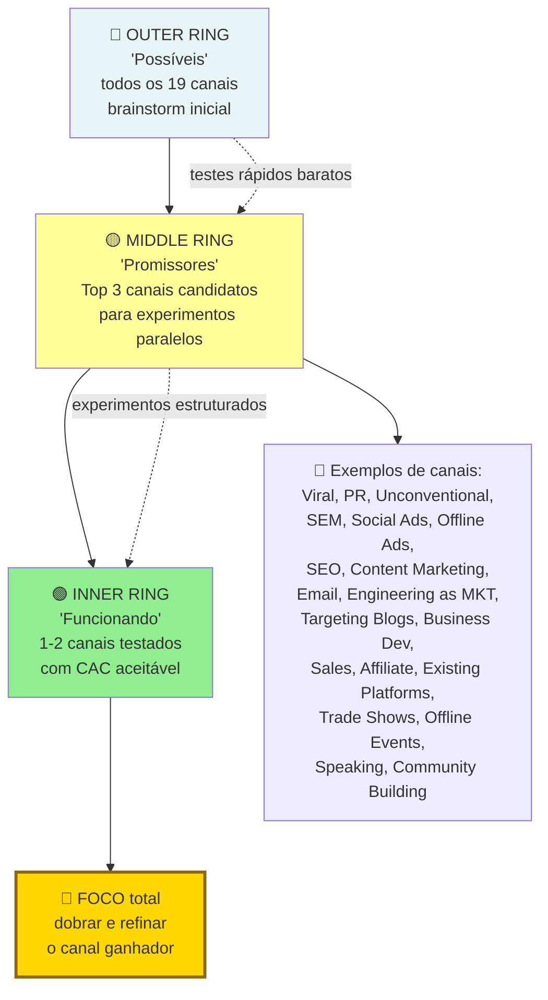

> [!warning] Erro clássico de orçamento
> Pulverizar o orçamento em cinco canais ao mesmo tempo "para ver qual funciona" faz com que nenhum deles receba volume suficiente para sair do ruído estatístico. No método *Bullseye*, rode experimentos curtos (de quatro a seis semanas para canais pagos e de prospecção ativa) nos três canais candidatos do anel do meio, escolha um ou dois que entreguem clientes ativos dentro da meta de CAC e concentre neles de 70% a 80% dos recursos.

O método Bullseye tem três anéis. Externo (todos os dezenove canais). Meio (top três candidatos). Interno (um canal vencedor).

**1. Fase de brainstorm.** Para cada um dos dezenove canais, anote uma hipótese concreta de como seria aplicá-lo ao seu negócio. Mesmo que pareça ruim. Exemplo. "Palestras. Posso apresentar em dois meetups do setor X por mês, atingindo cerca de cinquenta decisores por evento". Se a sua primeira reação é "esse canal não se aplica", force-se a elaborar um cenário. Muitos descobrem aplicações inesperadas nessa etapa.

**2. Fase de priorização (*ranking*).** Elimine canais claramente incompatíveis com o seu estágio, CAC ou LTV (por exemplo, comerciais de TV são inviáveis para uma startup SaaS B2B em estágio *seed*). Dos restantes, escolha os três mais promissores avaliando cinco critérios: alcance (o canal chega ao volume de clientes ideais de que você precisa?), CAC estimado (cabe no LTV já comprovado?), velocidade de *feedback* (quanto tempo até saber se funciona?), compatibilidade com o produto (o canal é adequado para esse tipo de solução?) e diferencial competitivo (os concorrentes já saturaram esse canal ou ainda o ignoram?).

**3. Fase de teste simultâneo no anel do meio.** Rode experimentos paralelos, curtos e de baixo custo nos três canais do anel do meio durante quatro a seis semanas para canais pagos e *outbound* (com orçamento controlado, tipicamente R$ 3 mil a R$ 15 mil por canal pago ou dedicação equivalente na prospecção ativa, para canais orgânicos como SEO e conteúdo, considere janela inicial de 3 a 6 meses para leitura de tração e de 6 a 18 meses para maturação plena), medindo CAC inicial, velocidade de ativação e volume potencial.

**4. Fase de foco no anel central (*Inner Ring*).** Se um dos três canais demonstrar CAC e *payback* saudáveis com espaço para escalar, promova-o para o centro do alvo e concentre nele de 70% a 80% do orçamento e da energia do time até extrair seu potencial máximo. Se nenhum dos três funcionar, volte ao anel externo e selecione uma nova trinca de hipóteses.

> [!important] Faça testes baratos nos três canais do anel do meio, mas escale um único canal vencedor por vez
> Depois de rodar os experimentos curtos do anel do meio para achar sinal de vida, você não tem fôlego operacional para escalar e otimizar três canais ao mesmo tempo: dobre a aposta no vencedor.

---

### Métricas específicas por canal

CAC por canal. Custo total do canal, dividido por novos clientes pagantes via ele.

Payback period por canal. Quantos meses até recuperar o CAC.

Volume mensal sustentável. Quanto o canal entrega por mês, sem degradação.

Saturação estimada. A qual investimento o canal começa a dar retorno decrescente.

Prazo de maturação por canal: canais pagos e *outbound* permitem leitura de eficiência em 4 a 6 semanas, vendas corporativas diretas exigem de 2 a 6 meses de ciclo comercial, e canais orgânicos (SEO e conteúdo) levam de 3 a 6 meses para mostrar tração inicial e de 6 a 18 meses para maturar plenamente, razão pela qual não devem ser descartados em testes de apenas 30 dias.

---

### Quando o Próprio Produto Vende: A Mecânica Real do Product-Led Growth (PLG)

Os canais pagos, orgânicos, e de parceria, cobertos acima, são motores *externos* de aquisição. Você vai ao cliente. Product-Led Growth é o motor oposto. O próprio produto é o canal de aquisição, ativação, retenção, e expansão. O usuário descobre, tenta, ama, e expande, sem passar por sales humano (ou com envolvimento mínimo).

PLG ganhou proeminência como estratégia dominante em SaaS nos anos 2010 a 2020, com empresas como Slack, Zoom, Calendly, Notion, Figma, Dropbox, e Airtable. Entender PLG não significa que toda startup deveria adotá-lo. Significa entender quando faz sentido, quando não faz, e quais os trade-offs de combiná-lo com motion sales tradicional.

#### Quando PLG funciona

Cinco condições precisam estar presentes para que o autoatendimento sustente o crescimento.

1. **Tempo até o valor curto (minutos, não dias).** O usuário precisa experimentar valor concreto já na primeira sessão. Se o seu produto só faz sentido depois de duas semanas de *onboarding* e configuração técnica, o PLG puro não funcionará na entrada.
2. **Uso self-serve viável.** O usuário consegue configurar, usar, e obter valor, sem humano do seu lado. O onboarding tem que ser educativo por design. Não por tutorial externo.
3. **Valor individual antes de valor coletivo.** Uma única pessoa obtém valor antes que a equipe inteira adote. Empresa em que PLG exigia adoção de vinte pessoas simultaneamente, raramente funciona.
4. **Viralidade intrínseca ou ciclo natural de compartilhamento.** Compartilhar, colaborar ou convidar colegas faz parte do fluxo normal de trabalho no produto. O Calendly se espalha porque cada link de agendamento enviado apresenta a ferramenta a um novo usuário, assim como ocorre no Dropbox e no Figma.
5. **Ticket relativamente baixo em tier de entrada.** Pagar R$ 10 a R$ 300 por mês é decisão individual. Pagar R$ 5 mil por mês não é. PLG puro raramente funciona em tickets enterprise-only.

#### Quando PLG NÃO funciona (ou funciona mal)

O produto exige implementação customizada (integrações complexas, migração de dados, ou treino extenso).

**O comprador não é o usuário.** Quando o diretor assina o contrato mas apenas o analista opera a ferramenta, o autoatendimento trava na conversão porque quem detém o orçamento não vivencia o ganho operacional no dia a dia.

Setor conservador com processo de compras formal. Finanças, saúde, e infraestrutura crítica. O processo exige RFP, security review, e jurídico. Self-serve não alcança.

Ticket muito alto, mesmo no tier de entrada.

Valor latente (o cliente só percebe benefício depois de três a seis meses de uso). Paciência que PLG raramente tem.

#### Métricas-chave específicas de PLG

**Time to Value (TTV).** Tempo entre primeiro uso, e primeiro momento de valor real para o usuário. Alvo: minutos no fluxo de autoatendimento (se o primeiro valor ainda leva dias, o produto exige implantação assistida antes de operar como PLG puro). TTV curto é pré-requisito. Não é métrica a otimizar depois.

**Activation Rate.** Percentual de usuários que completam a "ação de ativação". Definida como ação que correlaciona com retenção de longo prazo. Por exemplo, Slack identificou que equipes que enviavam duas mil mensagens, eram propensas a ficar.

**Product-Qualified Leads (PQL).** Usuários que demonstraram interesse via uso do produto. Não via formulário. Um PQL pode ser o usuário que executou a ação central X vezes, convidou Y colegas da equipe ou atingiu o limite Z do plano gratuito. PQL converte três a dez vezes melhor que MQL clássico em PLG.

**Self-Serve Conversion Rate.** Percentual de usuários em tier gratuito, ou trial, que convertem para pagante, sem fala humana. Referência em PLG: conversão de 2% a 5% de usuário gratuito para pago no modelo *freemium* e de 10% a 25% nos *trials* gratuitos bem qualificados (segundo levantamentos da OpenView e de Wes Bush) (freemium converte pior em percentual, mas capta mais em absoluto. Trial converte melhor em percentual, mas filtra antes).

**Expansion Revenue.** Receita vinda de crescimento dentro de conta existente (mais usuários, tier superior, ou add-ons). Em PLG maduro, expansão é motor. Trinta a setenta por cento da receita incremental vem de expansão. Não de novos logos.

**Net Revenue Retention (NRR).** Retenção líquida de receita, calculada como (ARR inicial + expansão - contração - churn) ÷ ARR inicial. Nos levantamentos de empresas SaaS listadas em bolsa (como os relatórios anuais da Meritech Capital e da Bessemer), o NRR das operações líderes de PLG superou 120% no pico de 2021 e acomodou-se próximo da mediana de 110% após 2022, enquanto um NRR abaixo de 100% indica que o cancelamento e a contração superam a expansão da base.

#### Combinando PLG com Sales (Product-Led Sales, PLS)

Empresas que consolidam o autoatendimento (PLG) nos planos de entrada costumam adicionar uma equipe consultiva para expandir contas corporativas, formando o modelo híbrido de *Product-Led Sales* (PLS).

O usuário inicia uso self-serve, no tier gratuito, ou baixo.

O uso cresce na organização (viralidade intrínseca).

Quando uma conta atinge determinado volume de uso ou convida novos colegas (gerando um *Product-Qualified Lead*, ou PQL), o time de vendas entra em contato para oferecer o contrato corporativo com autenticação única (SSO), cláusulas de conformidade e suporte dedicado.

O Sales não prospecta o "frio". Prospecta onde o uso já existe.

> [!important] PLS resolve o teto estrutural do PLG puro
> PLS resolve o teto estrutural do PLG puro em enterprise (segurança, contratos, e compliance). Sem destruir o motor inicial.

#### Casos brasileiros e internacionais de crescimento pelo produto

**Internacionais clássicos.** Slack, Zoom, Calendly, Notion, Figma, e Canva (que também opera no Brasil). Todos com forte DNA PLG.

**Brasil.** Alguns SaaS brasileiros têm tier self-serve operante (RD Station em tiers menores, Conta Azul, e Sympla para organizadores). Mas PLG puro como motor primário é ainda relativamente raro em SaaS brasileiro. O mercado é mais dominado por motion B2B tradicional, com vendedor. Isso representa ao mesmo tempo uma oportunidade aberta para novos entrantes com autoatendimento bem desenhado e um sinal de que o comprador corporativo brasileiro adota novas ferramentas de forma mais conservadora (muitas vezes pedindo apoio no WhatsApp antes de passar o cartão).

#### Armadilhas específicas de PLG

Forçar um modelo puramente autoatendido (PLG) em um produto complexo faz o usuário travar na configuração inicial e abandonar a conta na primeira semana. Para funcionar sem vendedor, o fluxo de entrada precisa guiar o cliente até a primeira vitória em minutos.

Tier gratuito sem limitação clara. O gratuito vira eterno. Ninguém converte. Limitação natural (seats, uso, ou features) precisa existir, bem desenhada.

Ignorar sinais PQL. O time de produto tem os dados. O sales não usa. Leads de alta intenção passam sem ação.

Tentar vender enterprise em self-serve. Os contratos corporativos exigem negociação, SSO, e SOC 2. Ignorar isso faz deals grandes morrerem no checkout.

Dashboards de analytics insuficientes. PLG sem instrumentação é operação cega. Investir em analytics de produto (Mixpanel, Amplitude, ou PostHog) é pré-requisito.

---

### O Espelho do Capítulo 1: Seu Movimento de Vendas Cabe Dentro do Seu Tíquete Médio?

Seis meses depois de dispensar o vendedor sênior que queimara R$ 54 mil sem fechar contratos, Marina havia conduzido pessoalmente 70 reuniões, assinado os primeiros 22 contratos fora da rede de conhecidos e documentado um roteiro de dez objeções recorrentes. Com a regra econômica ajustada entre São Paulo e Florianópolis, o plano básico de R$ 149 passou a entrar por autoatendimento com cobrança via Pix Automático e cartão, enquanto um SDR júnior assumiu o agendamento de demonstrações para que Marina fechasse os contratos corporativos de R$ 1.490 antes de contratar o primeiro executivo de contas.

**O Espelho (autodiagnóstico):**
1. Você, como fundador, já fechou pessoalmente pelo menos 20 contratos com clientes desconhecidos (fora do círculo de amigos e conhecidos), a partir de 50 a 100 conversas, e documentou as 10 objeções que se repetem nas reuniões?
2. O seu tíquete anual por cliente (ACV) comporta o custo do seu movimento comercial (deixando planos de entrada como R$ 149/mês no autoatendimento e reservando reuniões de vendas para tíquetes como R$ 1.490/mês), e você já concentra de 70% a 80% do orçamento no canal validado pelo método *Bullseye* em vez de pulverizar verba em cinco canais ao mesmo tempo?
3. Se você gravar a sua melhor reunião de vendas hoje, um vendedor novo conseguiria reproduzir o mesmo roteiro de perguntas na semana que vem?
4. Se o seu produto possui camada de autoatendimento (*Product-Led Growth*), você já monitora os sinais objetivos de uso que transformam uma conta gratuita em oportunidade comercial qualificada (*Product-Qualified Lead*, PQL) para abordagem consultiva?

**Permissão Libertadora:**
Você está autorizado a ser o vendedor número um da sua empresa pelos próximos seis meses, mesmo que o seu diploma diga que você é engenheiro, médico ou cientista. Ninguém vende a visão melhor do que quem sente a dor da criação.

**O Ritual de Segunda-Feira às 9h:**
Com aviso prévio e consentimento do interlocutor no início da reunião, grave as suas próximas cinco chamadas comerciais desta semana, transcreva em ferramenta com contrato de proteção de dados (LGPD) e extraia o Roteiro de Ouro de 1 Página: as 5 perguntas que abriram o cliente, a história que gerou confiança e a resposta que matou a objeção de preço.

---

### LEITURAS E REFERÊNCIAS COMPLEMENTARES

*Product-Led Growth*, de Wes Bush (referência operacional). *Product-Led Onboarding*, de Ramli John (disciplina de ativação). *Traction* (*Tração*), de Gabriel Weinberg e Justin Mares (base do método Bullseye de 19 canais). *Zero to One* (*De Zero a Um*), de Peter Thiel e Blake Masters (lei de potência na distribuição). Acervo histórico de relatórios de PLG da OpenView Partners (publicados até 2023) e benchmarks de SaaS no Brasil da Canary, Astella e Distrito.

---

## CAPÍTULO 2: CRESCIMENTO ORGÂNICO COMPOSTO: CONTENT MARKETING, SEO E COMMUNITY BUILDING

### Alugar Atenção vs. Comprar o Terreno: A Engenharia do Ativo Composto

Toda vez que Rafael aumentava o orçamento de anúncios pagos em R$ 10 mil, as vendas subiam naquela mesma semana. Toda vez que ele pausava a campanha no dia 30 por falta de caixa, as vendas do dia 31 caíam para zero absoluto.

"Bia, a gente não tem uma empresa. A gente paga aluguel pra Meta e pro Google", desabafou Rafael, encarando a fatura do cartão no computador em Recife. "Se o custo do clique dobrar no mês que vem, a margem some e a operação trava."

Ao mesmo tempo, em Belo Horizonte, a Dra. Camila havia tomado uma decisão diferente dezoito meses antes. Em vez de fazer posts genéricos de *"Dia do Dentista"*, ela passou noites gravando vídeos curtos e escrevendo artigos claros sobre as 50 dúvidas mais urgentes que pacientes de reabilitação oral digitavam no Google às duas da manhã: *"implante dentário dói?"*, *"quanto custa prótese protocolo em BH?"*, *"dente mole depois de canal é normal?"*.

Dezoito meses depois, o site da clínica da Dra. Camila recebia cerca de 4 mil visitas orgânicas qualificadas por mês vindas do Google e 60 pedidos mensais de avaliação na região metropolitana de BH, gerando R$ 140 mil mensais em tratamentos com custo marginal de mídia próximo de zero.

Anúncio pago é aluguel: parou de pagar o boleto da plataforma, perdeu o ponto na mesma hora. Conteúdo que responde à dúvida certa de compra é terreno próprio: continua trazendo clientes no mês em que o caixa aperta. Conteúdo estratégico e SEO programático voltado para intenção de compra funcionam como juros compostos no banco: o artigo, a calculadora gratuita ou o guia técnico que você publica hoje continua trabalhando para você às três da manhã de domingo pelos próximos cinco anos, derrubando o seu CAC médio mês após mês.

---

> [!note] Nota de validade
> Algoritmos de busca evoluem sem parar (Google core updates três a quatro vezes por ano). Com a consolidação dos resumos de IA (*AI Overviews* e Modo IA do Google) ao lado de Perplexity e ChatGPT Search até 2026, buscas puramente informativas de topo de funil perderam cliques diretos, por isso, meça também citações da sua marca em respostas de IA e conversões de fundo de funil, não apenas posição média no ranking. Revisar táticas todo ano. Os princípios são estáveis: autoridade, utilidade real e E-E-A-T (Experience, Expertise, Authoritativeness, Trustworthiness, sigla do Google para experiência, expertise, autoridade e confiabilidade).

O [[#CAPÍTULO 1: GTM PLAYBOOK E ARQUITETURA DE CANAIS: DA PRIMEIRA VENDA AO PRIMEIRO MILHÃO DE ARR|Capítulo 1: GTM Playbook e Arquitetura de Canais]] apresentou conteúdo e SEO (*Search Engine Optimization*, otimização para mecanismos de busca) como canais de aquisição. Tanto para serviços de alto valor (como o agrupamento de páginas sobre implantes e o simulador de tratamento da clínica da Dra. Camila) quanto para marcas D2C (como os guias comparativos de compra que Rafael e Bia passaram a publicar na loja após o susto com o leilão de anúncios) e startups B2B SaaS brasileiras, o conteúdo orgânico reduz o CAC estrutural no longo prazo, entregando o primeiro retorno consistente entre 12 e 18 meses e atingindo maturação plena até 24 meses.

### Por que depender 100% de mídia paga deixa a margem da sua empresa refém de um leilão que encarece todo ano

Enquanto o custo por clique (CPC) e o custo por mil impressões (CPM) nas plataformas de mídia paga encarecem ano após ano conforme mais anunciantes disputam o mesmo leilão, o conteúdo orgânico opera como ativo cumulativo: embora dependa das regras de classificação do Google e dos motores de IA, cada página indexada continua atraindo compradores sem cobrar um novo boleto a cada clique.

ROI (Return on Investment, retorno sobre investimento) cresce com o tempo. O conteúdo antigo continua gerando tráfego. Paid (mídia paga) precisa de investimento constante.

Credibilidade e lead gen (geração de leads) simultâneos. Thought leadership (liderança de pensamento) atrai talento, parceiros e investidores.

Em B2B SaaS, é canal dominante para muitos verticais. A HubSpot construiu império em content marketing.

### Como atacar o fundo de funil primeiro (Pain-Point SEO), criar ferramentas gratuitas e aparecer na busca por IA (GEO)

Em vez de começar por artigos genéricos de topo de funil ("o que é gestão financeira"), comece pelo Pain-Point SEO (fundo de funil com intenção imediata de compra: páginas de comparativo "[Concorrente A] vs. [Concorrente B]", "alternativas ao [Concorrente]", tabelas de preço e páginas de resolução de dor específica, como "planilha de conciliação de boletos CNAB"). Combine isso com uma ferramenta gratuita interativa (como uma calculadora de perda com boletos duplicados ou o simulador de reabilitação oral da Dra. Camila) e estruture cada página para GEO (Generative Engine Optimization): resposta direta nas primeiras 60 palavras, dados proprietários citáveis, tabelas comparativas limpas e presença da marca em fontes externas confiáveis (fóruns, avaliações e imprensa setorial) que os motores de IA usam como lastro.

**1. Estratégia de tópicos (*topic clusters*).** Escolha de três a cinco pilares temáticos nos quais a empresa detém conhecimento técnico próprio e que o cliente ideal busca ativamente. Cada pilar se desdobra em 10 a 30 subtópicos específicos. Exemplo: a PadariaPro (sistema para padarias artesanais) define o pilar "gestão de insumos" e o desdobra em subtópicos como "controle de estoque em padaria", "ficha técnica de produção" e "fornecedores de farinha especial".

**2. Pesquisa de palavra-chave.** Para escolher palavras-chave, use ferramentas como Ahrefs, Semrush ou Google Search Console, combinando três critérios: volume de busca suficiente, intenção comercial clara e dificuldade de ranqueamento compatível com a autoridade atual do seu domínio. Comece pela cauda longa (*long-tail*): Menos competição. Mais específico. Melhor conversão.

**3. Content tiers.** Pillar pages, três a cinco mil palavras. Abrangente. Autoridade. Cluster content, mil a dois mil palavras. Mais específico. Conecta ao pillar. Supporting content, quinhentas a mil palavras. Responde questão específica.

**4. Cadência e qualidade.** Publicar de dois a quatro artigos profundos por mês gera mais resultado do que vinte textos superficiais. Garanta revisão humana, dados atualizados, exemplos reais e ponto de vista próprio, evitando paráfrases genéricas do que já está no topo da busca.

**5. Distribuição.** O tráfego orgânico de busca é o motor principal, mas funciona melhor combinado a canais diretos: uma *newsletter* própria (via Substack ou ConvertKit) amplifica e fideliza a base, resumos técnicos no LinkedIn distribuem os pilares para decisores B2B, e participações técnicas em comunidades e sites parceiros constroem autoridade.

**6. Métricas.** Acompanhe mensalmente o crescimento do tráfego orgânico qualificado, a evolução de palavras-chave entre as dez primeiras posições, a taxa de conversão direta dos artigos, as conversões assistidas (negócios fechados que leram conteúdos antes da compra) e o ganho de autoridade do domínio (*backlinks* e menções espontâneas).

**7. Investimento escalonado por estágio.** Na fase inicial liderada pelo fundador, basta combinar o Google Search Console gratuito com um plano de entrada da Semrush ou da Ahrefs (cerca de R$ 700 a R$ 1.500 por mês). Na fase de tração enxuta, entra um editor especialista apoiado por redatores técnicos e ferramentas de IA (R$ 8 mil a R$ 15 mil mensais). Apenas na escala pós-Série A justifica-se estruturar uma equipe interna dedicada com líder de SEO (R$ 12 mil a R$ 25 mil), redatores exclusivos, agências especializadas (R$ 20 mil a R$ 80 mil) e planos avançados de auditoria (R$ 2 mil a R$ 5 mil mensais).

> [!important] Regra de expectativa em SEO
> Espere colher o primeiro retorno consistente entre 12 e 18 meses (com maturação plena até 24 meses), e não no primeiro trimestre. Quem abandona o canal aos seis meses desiste exatamente quando as páginas começam a ganhar autoridade.

**8. SEO Programático e Content Ops.**

**SEO programático** é a criação de páginas em escala usando templates + dados estruturados. Em vez de escrever cada artigo manualmente, você define um template e um banco de dados, e gera centenas ou milhares de páginas automaticamente. Funciona quando há variação sistemática com demanda de busca real: localizações geográficas ("advogado trabalhista em [cidade]"), categorias de produto ("seguro de vida para [profissão]"), comparações ("[ferramenta A] vs [ferramenta B]"), e combinações de JTBD + segmento.

*Exemplos no Brasil e no exterior*: Quero Bolsa e Educa Mais Brasil criam páginas estruturadas por curso, faculdade e cidade, enquanto portais automotivos como Webmotors e iCarros organizam consultas da Tabela FIPE por marca, modelo e ano. Imovelweb e ZAP geram páginas para cada combinação de bairro, tipo de imóvel e faixa de preço, e a alemã Trivago monta páginas automatizadas de hotéis por destino com dados de disponibilidade. A arquitetura típica combina um banco de dados estruturado (Airtable, arquivo CSV ou CMS *headless*), um modelo de página (*template* em Webflow, Next.js ou CMS) e URLs semânticas (/categoria/subcategoria/variante).

*Armadilhas do SEO programático*: (1) geração de páginas em massa sem valor exclusivo, enquadrada pelo Google desde 2024 na política de spam como *abuso de conteúdo em escala* (*scaled content abuse*, distinto das antigas *doorway pages*), o que pode resultar em ação manual e desindexação do domínio inteiro, (2) canonicalização incorreta gerando conteúdo duplicado, (3) escalar antes de validar que o template funciona: criar 10.000 páginas de baixa qualidade que nunca ranqueiam desperdiça crawl budget. A regra: se a página não tem informação genuinamente útil para o usuário específico da busca, não crie.

**Operações de conteúdo (*Content Ops*)** formam a infraestrutura operacional que permite produzir peças com qualidade e cadência consistentes, apoiada em três componentes centrais:

*Workflow editorial*: do briefing à publicação, quem faz o quê e quando. Padrão: briefing (estrategista de SEO, 2h) → pesquisa + outline (writer, 2h) → rascunho (writer, 4-6h) → revisão editorial (editor, 1h) → SEO review (SEO lead, 30min) → aprovação (1 revisor designado, 30min) → publicação + distribuição (ops, 30min). Sem workflow escrito, cada peça tem processo diferente, qualidade inconsistente.

*Content calendar*: visibilidade de 4-8 semanas do que está em produção. Inclui: keyword alvo, intent (informacional/comercial), autor, deadline de cada etapa, status atual. Ferramentas: Airtable, Notion, CoSchedule.

*QA editorial*: checklist antes de publicar. Keyword aparece no título, no primeiro parágrafo, em ao menos um H2, e na meta description? O conteúdo é substancialmente melhor do que o resultado atual no top-3 para aquela keyword? Há internal links para 2+ páginas relevantes? Alt text nas imagens? Dados estruturados (*Schema markup*) que continuam gerando resultados ricos no Google (como `Article`, `Product`, `Organization` e `Review`, já que o Google descontinuou `HowTo` e restringiu `FAQ` a sites governamentais e de saúde em 2023), validados no Teste de Pesquisa Aprimorada?

No SEO programático, o desenvolvimento inicial do modelo de página e da base de dados costuma exigir entre R$ 20 mil e R$ 60 mil, além da manutenção contínua, pagando-se em escala quando há mais de 100 variantes com volume real de busca (seguindo a mesma progressão de ferramentas e equipe por estágio descrita no item 7).

---

### Arquitetura e Execução de Comunidade (Community Building)

**1. Plataforma.** No Brasil, grupos curados e o recurso Comunidades do WhatsApp (ou Telegram) concentram a maior taxa de leitura diária para B2B e D2C, embora tenham busca e histórico limitados. Quando o acervo pesquisável por tópicos importa, entram Circle (desenhado para comunidades formais estruturadas), Slack (comum em tecnologia B2B, mas cujo plano gratuito oculta mensagens com mais de 90 dias) e Discord (forte entre desenvolvedores, jogos e público jovem). Grupos no LinkedIn entregam alcance amplo com baixa intimidade, enquanto grupos no Facebook atendem melhor audiências abertas de consumo.

**2. Papéis.** Um gestor de comunidade (*Community Manager*) dedicado em tempo integral justifica-se quando a base supera de 500 a 1.000 membros ativos (com remuneração mensal típica entre R$ 6 mil e R$ 15 mil no mercado brasileiro de tecnologia, variando conforme a senioridade). Ao lado dele atuam moderadores voluntários (*ambassadors*), que ajudam a manter a qualidade das trocas, e defensores da marca (*advocates*), superusuários que recomendam o produto espontaneamente em redes externas.

**3. Rituais.** Mantenha cadência previsível com uma ou duas sessões mensais de perguntas e respostas (*Ask Me Anything*) com fundadores ou convidados técnicos, encontros presenciais trimestrais ou semestrais nas praças com maior concentração de clientes, oficinas práticas online, desafios pontuais para estimular a participação e um boletim interno destacando as melhores contribuições dos próprios membros.

**4. Princípios de saúde.** A comunidade precisa gerar valor para o membro antes de extrair retorno para a empresa: cerca de 80% das conversas devem girar em torno dos desafios práticos dos participantes e no máximo 20% sobre novidades do produto. Estabeleça regras claras de convivência, moderação firme contra comportamentos tóxicos ou autopromoção fora dos canais dedicados e estímulo ativo à pluralidade de vozes.

**5. Métricas de saúde e negócio.** Monitore cinco indicadores: (1) proporção de membros ativos que publicam ou respondem (acima de 10% do total cadastrado é sinal saudável), (2) taxa de resposta às dúvidas postadas (meta acima de 70% em até 24 horas), (3) participação de conteúdo gerado pelos próprios membros (*UGC rate*), (4) percentual de novos clientes indicados pela comunidade e diferença de CAC frente aos demais canais, e (5) retenção comparada entre clientes que participam da comunidade e clientes inativos nela.

---

### Como a comunidade vira motor primário de aquisição e retenção (CLG)

Quando a estrutura acima deixa de ser apenas um canal de suporte ou relacionamento e passa a operar como a principal alavanca de aquisição e retenção da empresa, consolida-se o *Community-Led Growth* (CLG), integrando produto, membros e crescimento em um único ciclo.

**A lógica do flywheel.** Produto gera valor → usuários formam comunidade em torno desse valor → comunidade atrai novos usuários (aquisição orgânica) → comunidade acelera adoção e reduz churn (retenção) → o crescimento financia um produto melhor → produto gera mais valor. Em cada volta do loop, o CAC cai e o LTV cresce.

**Casos brasileiros.** A RD Station consolidou um ecossistema de milhares de agências parceiras e eventos proprietários (como o RD Summit, que segundo dados divulgados pela própria empresa reuniu cerca de 20 mil participantes presenciais nas edições de 2023 e 2024 em São Paulo) para alimentar sua tração orgânica e comercial. De modo semelhante, a Hotmart utilizou eventos presenciais como o FIRE Festival e programas educativos gratuitos do Hotmart Academy (distintos do Hotmart Club, que funciona como a área de membros para os alunos dos produtores) para aproximar criadores digitais, estimular parcerias de lançamento (*co-marketing*) e formar defensores ativos da plataforma.

**Os cinco mecanismos de CLG.**

*Conteúdo gerado pela comunidade (UGC) como SEO*: respostas a perguntas técnicas, casos de uso, e discussões em fóruns públicos da comunidade geram conteúdo indexável. Fóruns abertos como o Reddit ganharam enorme peso no ranqueamento do Google e no treinamento e citação de motores de busca por IA (enquanto o Stack Overflow perdeu grande parte do volume de perguntas simples após a popularização dos assistentes de código): discussões reais de usuários respondem a dúvidas específicas que nenhuma equipe interna escreveria sozinha. Para produto B2B, fórum público indexável é ativo de SEO de longo prazo.

*Integração entre pares (peer-to-peer onboarding)*: membros experientes orientam novos usuários com mais eficácia do que manuais técnicos, pois compartilham a mesma linguagem, casos reais de uso e credibilidade prática de quem vive a rotina do setor, reduzindo o tempo até o primeiro valor e o custo de ativação.

*Social proof em escala*: tamanho e saúde da comunidade são sinais de confiança para prospects. "10.000 profissionais de RH usam esta ferramenta" convertido em comunidade ativa é mais persuasivo do que testimonial de clientes no site.

*Feedback de produto estruturado*: comunidade como canal privilegiado de product discovery, não apenas "o que você quer?" mas análise de padrões em milhares de conversas. Empresas com comunidade saudável sabem de problemas de produto meses antes de aparecerem em NPS.

*Referrals orgânicos*: membros engajados recomendam naturalmente, não porque há programa de referral, mas porque pertencer à comunidade é parte da identidade profissional. Em comunidades B2B, a pergunta "qual ferramenta você usa?" em LinkedIn e grupos de setor é o canal de referral mais eficaz.

**Pré-condições para o CLG funcionar.** Quatro bases precisam estar presentes antes de escalar o investimento: (1) produto com entrega de valor comprovada (sem isso, a comunidade amplifica reclamações), (2) cliente ideal com identidade profissional clara (como designers, engenheiros ou contadores, e não "usuários genéricos de software"), (3) massa crítica mínima de 200 a 500 usuários ativos para evitar salas vazias, e (4) disposição genuína da empresa para abrir planilhas, guias e conhecimento técnico como bem comum do grupo.

### Produzir conteúdo genérico de topo de funil (que atrai curiosos e zero compradores) e outros erros de SEO

**Atrair tráfego de curiosos sem intenção de compra.** Publicar definições escolares ("o que é fluxo de caixa") pode gerar 100 mil visitas de estudantes e nenhuma demonstração agendada. Priorize termos de dor aguda e comparação de compra antes de abrir o topo do funil.

**Interromper a operação antes da maturação.** Quem corta a produção de conteúdo no sexto mês por achar que o canal não funciona desiste justamente quando o domínio começa a ganhar autoridade e a posicionar as primeiras páginas na primeira folha de busca.

Content fino. Dez posts de quinhentas palavras por mês, com pouca substância, não constrói autoridade.

SEO-first, humano-second. Escrever para algoritmo, não para leitor. O Google penaliza isso agora.

AI-generated sem curadoria. Tentação de produzir em volume com ChatGPT, sem review editorial. A qualidade cai. Os rankings caem com updates algorítmicos.

Não medir conversion. Volume de tráfego sem conversion é vanity metric.

### Checklist de execução prática

- [ ] Topic clusters definidos (três a cinco pillars)?
- [ ] Pesquisa de palavra-chave feita para cluster?
- [ ] Cadência sustentável definida (dois a quatro posts substantivos por mês)?
- [ ] Qualidade editorial. Revisão, dados, e exemplos?
- [ ] Distribuição além de SEO orgânico?
- [ ] Métricas rastreadas mensalmente (tráfego, keywords, conversion)?
- [ ] Expectativa realista de retorno (primeiros resultados consistentes em 12 a 18 meses e maturação até 24 meses)?
- [ ] Investimento alocado e sustentado de acordo com o estágio da empresa?

> [!info] Fases relacionadas
> [[#FASE 12: VALIDAÇÃO DO MODELO DE NEGÓCIO|Fase 12 (Validação do Modelo de Negócio)]] e [[#FASE 13: PRODUCT-MARKET FIT|Fase 13 (Product-Market Fit)]].

---

### O Espelho do Capítulo 2: Seu Conteúdo Atrai Compradores com Cartão na Mão ou Apenas Curiosos?

Dezoito meses depois de publicar seus primeiros artigos de fundo de funil e o simulador interativo de reabilitação oral em Belo Horizonte, a clínica da Dra. Camila passou a receber 4 mil visitas orgânicas mensais e 60 pedidos diretos de avaliação sem depender de anúncios pagos. Inspirados por essa lógica entre Recife e Goiânia, Rafael e Bia criaram guias comparativos de tecido, caimento e tabela de medidas com fotos enviadas pelas próprias clientes da loja: em um ano, a busca orgânica e a comunidade de compradoras no WhatsApp já respondiam por 28% dos pedidos mensais, permitindo cortar um terço da verba que antes ia para o leilão da Meta.

**O Espelho (autodiagnóstico):**
1. Ao fazer a conta que Rafael e Bia fizeram na loja, se você desligar todos os anúncios pagos hoje ao meio-dia, quantas vendas ou pedidos de orçamento continuam entrando sozinhos amanhã pelas suas páginas já publicadas e quantas dúvidas de novos clientes foram respondidas espontaneamente por outros membros da sua comunidade no último mês?
2. Os conteúdos que você publica hoje respondem às perguntas de fundo de funil de quem está prestes a comprar (comparativos, preços, como resolver um erro urgente) ou são textos genéricos de "o que é inovação" que ninguém com orçamento na mão lê?
3. Você já construiu pelo menos uma calculadora, planilha diagnóstica ou ferramenta gratuita interativa que resolve 10% do problema do cliente em troca do contato dele?

**Permissão Libertadora:**
Você está autorizado a parar de postar conteúdo raso todo dia só para "alimentar o algoritmo". Um único guia definitivo, estudo de caso com números reais ou calculadora útil vale mais do que cem posts esquecíveis de datas comemorativas.

**O Ritual de Segunda-Feira às 9h:**
Peça ao seu time de vendas (ou olhe no seu WhatsApp) as 10 perguntas mais difíceis que os clientes fizeram na semana passada antes de fechar negócio. Transforme a pergunta número um em uma página ou vídeo definitivo hoje.

---

## CAPÍTULO 3: MARKETING DE PERFORMANCE EM PROFUNDIDADE

### A Mentira do ROAS de Painel e o Imposto Invisível do Tráfego Pago

"Rafael, o gestor de tráfego acabou de mandar print do painel do Gerenciador de Anúncios: estamos com ROAS de 5x! A cada R$ 1.000 que colocamos, voltam R$ 5.000 em vendas!", comemorou o estagiário na chamada de vídeo de segunda-feira entre Recife e Goiânia.

Bia nem levantou os olhos da planilha de conciliação bancária:

"Pede para esse gestor de tráfego me explicar por que, se o painel dele diz que vendemos R$ 150 mil com ROAS 5, no nosso banco só entraram R$ 92 mil brutos e sobraram R$ 4 mil líquidos", respondeu Bia, de Goiânia, sem tirar os olhos da planilha de conciliação.

Bia acabava de desmascarar **A Ilusão do ROAS de Plataforma**. Se você toma decisões financeiras confiando cegamente no número de retorno que o painel da Meta, do Google ou do TikTok mostra na tela, você está deixando a raposa auditar o galinheiro.

Por que o ROAS do painel quase sempre mente para você no Brasil? Primeiro, por dupla atribuição: o cliente vê um anúncio no Instagram de manhã, pesquisa o nome da sua marca no Google à tarde e os dois painéis reivindicam 100% do mérito pela mesma venda. Segundo, porque o painel registra boletos gerados que nunca serão pagos e Pix expirados como "conversão concluída". Terceiro, e mais grave: ROAS é faturamento bruto sobre mídia, não lucro líquido sobre caixa. Se a sua margem bruta depois de produto, imposto, frete e taxa de cartão é de 25%, um ROAS de 4x significa exatamente zero reais de lucro: você trabalhou o mês inteiro apenas para transferir dinheiro do cliente para o Vale do Silício.

O marketing de performance rigoroso não se guia por métricas isoladas do painel de anúncios, mas governa cada real investido pelo **POAS (*Profit on Ad Spend*, lucro bruto dividido pelo gasto em mídia), pela Margem de Contribuição após Mídia e pelo MER** apurado no extrato bancário real.

---

> [!note] Aplicabilidade
> Empresas que dependem de paid ads (anúncios pagos no Google, Meta, LinkedIn, TikTok) como canal primário ou secundário. Aplica-se a partir do momento em que há budget dedicado, mesmo que sejam R$ 5.000 mensais, com alguém responsável por otimizá-lo.

### 1. O que separa marketing de performance de branding

Marketing de performance tem três características que o distinguem.

**Mensurabilidade direta.** Cada real investido pode ser rastreado até uma ação mensurável: clique, cadastro, pedido de proposta ou compra. O vínculo entre investimento e resultado é explícito, ou deveria ser.

**Otimização em tempo quase real.** Campanhas de performance são ajustadas semanalmente, às vezes diariamente. Criativos que não performam são pausados. Audiências que não convertem são excluídas. O budget é realocado para o que funciona.

**Métricas financeiras como critério de sucesso.** O sucesso da operação é medido por indicadores financeiros auditados no caixa (CPA, CAC, ROAS, POAS e MER), enquanto alcance e impressões funcionam apenas como variáveis operacionais de diagnóstico.

Branding e performance não são opostos, mas sim complementares e interdependentes. Uma marca forte reduz o CAC de performance ao longo do tempo, porque aumenta a taxa de conversão em toda a cadeia. Empresa que só faz performance sem construir marca percebe o CAC subindo de forma inexorável à medida que escala: porque depende cada vez mais de conquistar audiências frias, sem o benefício do reconhecimento acumulado.

> [!important] O erro clássico em startup early-stage
> Focar 100% em performance e ignorar branding por "não ser mensurável" funciona até o Seed. Na Série A, quando o CAC começa a subir com a escala do budget, a empresa não tem fundação de marca que reduza o atrito. Resultado: ROAS declinante sem alavanca para reverter.

As cinco métricas centrais de mídia de performance (definidas de forma consolidada a seguir):

- **CPA** (Custo por Ação): desembolso médio de mídia para gerar uma ação intermediária específica (cadastro, *lead* ou início de teste gratuito), calculado dividindo o investimento no canal pelo total de ações concluídas.
- **CAC** (Custo de Aquisição de Cliente): custo médio para conquistar um cliente pagante, calculado dividindo todo o gasto de aquisição apenas pelos clientes que efetivamente compraram (razão pela qual o CAC carrega o custo de todos os *leads* que ficaram pelo caminho).
- **ROAS** (*Return on Ad Spend*): receita bruta atribuída à campanha dividida pelo gasto em anúncios na plataforma (um ROAS de 3x indica R$ 3 de faturamento para cada R$ 1 em mídia, sem descontar impostos, custos variáveis ou cancelamentos).
- **MER** (*Marketing Efficiency Ratio*, razão de eficiência de marketing): receita bruta total do negócio dividida pelo investimento total em marketing e mídia em todos os canais. É a métrica integradora da empresa, mais honesta do que o ROAS isolado de cada plataforma.
- **LTV/CAC**: saúde da economia unitária. Razão abaixo de 1x é destruição de valor. Abaixo de 3x é arriscado. Acima de 3x com payback em 12 meses ou menos é saudável para escala.

---

### 2. A stack de mídia paga no Brasil

O Brasil tem uma das maiores penetrações de redes sociais do mundo e particularidades relevantes para alocação de budget. Cada plataforma tem perfil diferente de audiência, intenção, CPM e taxa de conversão.

#### Meta Ads (Facebook e Instagram)

Maior alcance do Brasil, superando 70% da população adulta em Instagram, Facebook e WhatsApp. Além das campanhas de conversão para site, os anúncios de clique para WhatsApp (*Click-to-WhatsApp*) são decisivos para PMEs, clínicas e marcas D2C brasileiras (como a operação de Rafael e Bia): exigem envio de conversões offline via API de Conversões (CAPI) a partir do CRM para que o algoritmo saiba qual conversa virou pagamento real. Adequado para B2C com produto visual, e-commerce, apps e serviços com decisão de compra emocional ou de impulso.

Pontos fortes: públicos semelhantes (*lookalike audiences*) de alta precisão quando há base de dados própria (CRM e *pixels* com volume), *retargeting* eficiente e formatos variados (Stories, Reels, Feed e anúncios de catálogo para e-commerce).

Ponto de atenção: iOS 14.5 e mudanças subsequentes de privacidade reduziram a precisão do pixel. A janela de atribuição padrão após o clique caiu de 28 dias para 7 dias (mantendo 1 dia após visualização por padrão, com ajustes posteriores da Meta na modelagem de conversões assistidas). Isso significa que parte das conversões não é mais atribuída ao Meta: o canal parece menos eficiente do que realmente é, quando medido apenas dentro da plataforma.

Estrutura recomendada em 2026: consolidar a conta em poucas campanhas (usando orçamento automatizado no nível da campanha, o Advantage+ Campaign Budget, antigo CBO, com público amplo para que a variedade de criativos faça a segmentação) a fim de concentrar pelo menos 50 conversões semanais por conjunto de anúncios, volume necessário para tirar o algoritmo da fase de aprendizado, reservando uma campanha separada apenas para testar novos criativos.

#### Google Ads (Search, Display, YouTube, Performance Max)

Intent-based: o usuário está buscando ativamente. Search Ads capturam demanda existente, pessoas que já sabem o que querem. É o canal com maior taxa de conversão em termos absolutos, porque a intenção está explícita na busca.

Campanhas de Display e YouTube constroem lembrança de marca e *retargeting* com menor custo por impressão. Nas campanhas automatizadas por IA do Google (Performance Max em todos os inventários, Demand Gen em YouTube e Discover e anúncios integrados aos resumos de IA na Busca) e da Meta (campanhas de vendas Advantage+, antigo Advantage+ Shopping), o fundador deixa de ajustar lances manuais. O controle real passa para quatro alavancas: qualidade dos criativos, envio do sinal de conversão com margem via API, listas de exclusão de termos ou clientes atuais e teto de orçamento. É um formato eficiente para quem já tem volume de dados, mas opera como caixa-preta para quem exige controle granular.

No Brasil, Google Search é particularmente eficiente para categorias com alta busca ativa: serviços financeiros, saúde, educação, SaaS B2B. Categorias sem demanda ativa pré-existente se beneficiam menos.

Ponto de atenção: palavras-chave competitivas em categorias como crédito, seguros e educação podem ter CPC de R$ 15 a R$ 80. O CAC resultante só se justifica quando o LTV é elevado.

#### TikTok Ads

Canal relevante no Brasil, no qual o CPM costumava operar abaixo do registrado na Meta até 2024. À medida que mais anunciantes migraram para a plataforma, os custos de leilão aproximaram-se gradualmente, enquanto a operação do TikTok Shop e de vendas ao vivo (*live commerce*) no país a partir de 2025 abriu uma frente de conversão direta dentro do próprio aplicativo para marcas de consumo como a de Rafael e Bia.

Adequado para marcas com produto ou mensagem que funciona em formato nativo de vídeo curto. A lógica do TikTok é "entertainment-first": o ad que parece ad demais performa mal. O criativo precisa se parecer com conteúdo orgânico da plataforma.

Audiência predominante: 18-34 anos, com penetração crescente em faixas mais velhas. Forte no Brasil em categorias de moda, beleza, entretenimento, food e consumo massivo.

Ponto de atenção: atribuição é particularmente complexa no TikTok porque o comportamento de busca pós-exposição é alto (o usuário vê o ad no TikTok, sai e busca no Google). Medir só pela plataforma subestima muito o impacto real.

#### LinkedIn Ads

Canal B2B por excelência. CPL (custo por lead) mais alto do mercado: tipicamente três a cinco vezes o CPL do Meta em B2B (faixa global 2025: LinkedIn US$ 100-150 versus Meta US$ 25-30). Benchmark Brasil específico é mais escasso publicamente. Mas qualidade do lead é estruturalmente diferente: segundo dados divulgados pelo próprio LinkedIn Ads, seus formulários nativos de geração de leads (*Lead Gen Forms*) convertem em média perto de 13%, contra cerca de 2,35% da média histórica de landing pages externas (lembrando que preencher formulário nativo exige qualificação imediata do SDR para confirmar intenção real). Segmentação por cargo, empresa, setor, senioridade e tamanho de empresa não existe em nenhuma outra plataforma com essa precisão.

No Brasil, LinkedIn Ads é especialmente eficiente para: SaaS B2B, consultorias, serviços financeiros corporativos, educação executiva, recrutamento e qualquer produto com ticket médio acima de R$ 10.000 que depende de decisão de compra corporativa.

Estratégias adequadas: Lead Gen Forms (formulários nativos que convertem melhor que landing pages externas), retargeting de lista de empresas-alvo (ABM: Account-Based Marketing), Thought Leadership Ads com conteúdo de valor.

> [!warning] CAC tolerância diferente em B2B
> Um CAC de R$ 3.000 por cliente é insustentável em B2C com ticket de R$ 150. É trivial em B2B com contrato anual de R$ 60.000. A análise de viabilidade de LinkedIn Ads depende completamente do LTV do produto vendido.

#### Programática (DSP)

Display programático via DSPs (Demand-Side Platforms) como The Trade Desk, DV360 (Google), ou soluções locais. Adequado para awareness em escala, com targeting por segmento de audiência (dados de terceiros ou CRM próprio) e contexto de conteúdo.

No Brasil, programática é relevante para marcas com budget acima de R$ 50.000 mensais em display e que buscam alcance fora dos walled gardens (Meta, Google, TikTok). Exige expertise técnica, configuração de bid floors, brand safety, viewability, e parceiro especializado.

---

### 3. O funil de performance: cada etapa tem métricas e canais diferentes

```text
FUNIL DE PERFORMANCE

ETAPA          OBJETIVO              CANAIS PRINCIPAIS       MÉTRICAS-CHAVE
─────────────────────────────────────────────────────────────────────────────
Awareness      Alcançar audiência     YouTube, TikTok,        CPM, Reach, Frequency
               nova e relevante       Meta (topo), Display    Brand lift (se medido)

Consideração   Engajar e educar       Meta (meio), LinkedIn,  CTR, CPC, Time on site
               quem conheceu          YouTube, Retargeting    Pages per session, VTR

Conversão      Capturar ação          Search, Meta (fundo),   CPA, CAC, ROAS
               de compra/cadastro     LinkedIn Lead Gen        Conversion rate

Retenção       Reativar e             E-mail, Push,           LTV, Repeat purchase
               aumentar LTV           Retargeting, CRM         Churn, NPS
─────────────────────────────────────────────────────────────────────────────
```

O erro comum é otimizar só o fundo do funil. Empresas que cortam o orçamento de topo de funil inteiramente percebem, em 6 a 12 meses, que a audiência qualificada disponível para conversão encolheu, e o ROAS começa a cair porque o topo deixou de ser alimentado.

A regra prática de alocação de budget por estágio varia por maturidade da empresa.

- **Até R$ 1 milhão de receita anual**: 70% a 80% do orçamento em conversão direta e 20% a 30% em consideração. Campanhas puras de reconhecimento de marca pesam pouco nessa fase porque o público comprador imediato ainda não foi esgotado.
- **Estágio 1-10M ARR**: 60% conversão, 25% consideração, 15% awareness. Começar a construir funil.
- **Acima de R$ 10 milhões de ARR**: equilibrar o investimento entre os três estágios do funil, calibrando a proporção entre marca, consideração e captura conforme o ciclo de compra, o ticket médio e a maturidade da categoria.

---

### 4. Gestão de CAC: blended versus por canal, e o método de alocação

**CAC blended** é o custo total de aquisição somando todos os canais de marketing e vendas, dividido pelo número total de novos clientes. Fórmula: (total de marketing + total de vendas) / novos clientes no período. Simples, honesto, mas esconde onde o dinheiro trabalha melhor.

**CAC por canal** é o mesmo cálculo feito separadamente para cada canal. Meta Ads, Google Search, SDR outbound, eventos, referral: cada um tem um CAC diferente. A diferença entre canais pode ser de 3x a 10x.

> [!note] Por que medir CAC separado por canal
> Uma empresa com CAC combinado (*blended*) de R$ 800 pode ter o Meta Ads gerando clientes a R$ 400 e eventos presenciais trazendo clientes a R$ 2.500. A decisão correta é escalar a Meta e renegociar ou cortar o formato dos eventos, mas isso só aparece quando se mede o custo por canal. O CAC combinado, sozinho, esconde onde alocar o próximo real.

O problema do CAC por canal: atribuição. O cliente que comprou via Google Search pode ter sido influenciado por um post no Instagram uma semana antes. Qual canal recebe o crédito? Essa é a questão de atribuição: tratada na seção 5.

**O método teste-e-aprenda para alocação de budget.**

Em vez de decidir alocação por convicção, o método estruturado é:

1. Definir envelope de budget total para o trimestre.
2. Alocar 70% nos canais que já provaram CAC aceitável (exploit).
3. Alocar de 20% a 30% do orçamento em exploração (*explore*): teste de novos canais, novas audiências e novos formatos.
4. Medir resultados dos testes com janela de 4-8 semanas (suficiente para significância).
5. No próximo trimestre, promover o que funcionou para a faixa de 70% e abrir nova rodada de testes.

Esse ritmo de exploit/explore evita tanto a armadilha de ficar preso nos canais históricos (que podem estar saturando) quanto a de dispersar budget em muitos canais sem dar volume suficiente para nenhum funcionar.

---

### 5. Atribuição: por que o último clique engana

**Último clique (*last-click*)** atribui 100% do crédito da conversão ao último ponto de contato antes da compra. Desde 2023, o Google Ads e o GA4 oferecem nativamente apenas dois modelos de atribuição: o orientado por dados (*data-driven*, padrão atual, sem piso mínimo de conversões) e o de último clique, tendo descontinuado os modelos de regras fixas (primeiro clique, linear, redução de tempo e baseado em posição), que hoje seguem úteis como raciocínio analítico ou em ferramentas de terceiros. O limite do último clique é estrutural: em jornadas longas e multicanal, ele superestima canais de captura final (busca paga pelo nome da marca e *retargeting*) e subestima canais que criam a demanda (vídeo, conteúdo e redes sociais).

Resultado prático: empresas que tomam decisões apenas pelo último clique tendem a subinvestir em geração de demanda e sobreinvestir em captura final, até que a audiência qualificada seca.

**Modelos alternativos.**

- **Linear**: distribui crédito igualmente entre todos os touchpoints. Mais justo que last-click, mas ignora que alguns pontos de contato são mais influentes que outros.
- **Time decay**: dá mais crédito a touchpoints próximos à conversão. Faz sentido para ciclos de compra curtos.
- **Position-based (U-shape)**: 40% para o primeiro touchpoint, 40% para o último, 20% dividido no meio. Valoriza tanto criação quanto captura de demanda.
- **Atribuição orientada por dados (*data-driven attribution*, DDA)**: utiliza aprendizado de máquina para distribuir o crédito com base nos padrões reais de conversão da conta. Como é o padrão nativo do Google Ads e do GA4 ao lado do último clique, constitui a opção mais precisa disponível dentro das próprias plataformas.

**MMM (Media Mix Modeling).**

Modelo econométrico que usa séries temporais de investimento por canal e receita para estimar a contribuição de cada canal: incluindo canais offline, sazonalidade e fatores externos. Não depende de cookies ou pixels. Mais robusto para orçamentos maiores.

No Brasil, MMM está se tornando acessível para empresas médias por conta de ferramentas open-source (Robyn da Meta, Meridian do Google) e consultorias especializadas. Antes era privilégio de grandes anunciantes.

**Incrementalidade.**

O teste de incrementalidade responde à pergunta: "quanto do que atribuímos a esse canal teria acontecido de qualquer forma?" Metodologia: dividir a audiência em grupo de teste (exposto ao canal) e grupo de controle (não exposto). Comparar taxa de conversão. A diferença é o efeito incremental real do canal.

O experimento de incrementalidade (*lift test*) é o padrão-ouro de medição, mas exige volume de conversões e configuração técnica. Para empresas com orçamento menor, a alternativa prática é o teste de retenção geográfica (*geo-holdout*), pausando as campanhas apenas em uma região ou subconjunto de praças por duas semanas para medir a diferença nas vendas totais sem zerar a conta inteira. Se optar por pausar um canal inteiro, evite períodos sazonais e considere no cálculo que a interrupção devolverá os conjuntos de anúncios à fase de aprendizado quando forem religados.

> [!tip] Atribuição com budget limitado no Brasil
> Para empresas abaixo de R$ 100.000 mensais em mídia, a abordagem pragmática é: (1) usar GA4 com modelo data-driven como baseline, (2) rodar um holdout test por canal a cada trimestre, (3) acompanhar MER total do negócio como norte: se o MER está melhorando com o investimento em marketing, o investimento está valendo, independente da atribuição perfeita.

---

### 6. Creative como variável principal de performance

Hoje o criativo é a variável de maior impacto em campanhas de Meta Ads e TikTok Ads, superando ajustes manuais de lance, segmentação de público ou estrutura de conta. Com os leilões e lances automatizados por IA disponíveis para todos os anunciantes, o que separa uma campanha lucrativa de outra que queima caixa é a peça criativa que o algoritmo recebe para distribuir.

Um estudo clássico da Nielsen Catalina Solutions (2017) sobre campanhas publicitárias estimou que a qualidade do criativo responde por 47% da variação no impacto de vendas, à frente de alcance (22%), marca (15%) e segmentação (9%). Na prática operacional das plataformas sociais, o criativo tornou-se a principal alavanca de conversão e o próprio mecanismo de segmentação, muito acima de ajustes manuais de lance ou de estrutura de campanha.

**O framework de creative testing.**

```text
FRAMEWORK DE CREATIVE TESTING

1. HIPÓTESE
   Definir o que se quer testar e por quê.
   Exemplo: "Hook com prova social (depoimento) vai converter
   melhor que hook com problema (dor) para audiência de topo."

2. ESTRUTURA DO TESTE
   - Controle: criativo atual de melhor performance (baseline)
   - Variante: novo criativo com UMA mudança isolada
   - Não testar duas variáveis ao mesmo tempo (impossível isolar causa)

3. TAMANHO DE AMOSTRA
   - Calcule a amostra antes de rodar: para comparar taxa de cliques (CTR), acumule centenas de cliques por variante (e não apenas 1.000 impressões, que geram ~10 cliques), lembre-se de que as 50 conversões semanais da Meta servem para tirar o conjunto da fase de aprendizado, e não como garantia automática de significância estatística em testes A/B.
   - Para comparar conversão: 50+ conversões por variante (regra do Meta)
   - Para significância estatística: calcular com calculadora de A/B test
     (p-value < 0,05 ou confiança > 95%)

4. DURAÇÃO
   - Mínimo 7 dias (para cobrir variação semanal de comportamento)
   - Máximo 21 dias (creative fatigue começa antes disso)

5. DECISÃO
   - Variante vence: escalar, registrar hipótese confirmada
   - Controle vence: registrar hipótese refutada, gerar nova
   - Sem diferença: registrar, simplificar (usar criativo mais barato)
```

**O que testar, por ordem de impacto.**

1. **Hook** (primeiros 3 segundos de vídeo ou headline de imagem): é o elemento de maior impacto. Um hook ruim desperdiça todo o resto do criativo: o usuário não para de scrollar.
2. **Formato** (vídeo curto vs. imagem estática vs. carrossel vs. UGC): formatos têm desempenho muito diferente por plataforma e audiência.
3. **Mensagem principal** (benefício vs. dor vs. prova social vs. urgência): qual ângulo ressoa com a audiência.
4. **CTA** (chamada para ação): "Saiba mais" vs. "Compre agora" vs. "Teste grátis" têm conversões diferentes por etapa do funil.

**Creative fatigue** é a queda de performance de um criativo após exposição excessiva à mesma audiência. Em Meta Ads, sinais de fadiga incluem: aumento de frequência acima de 3x por semana, queda de CTR acima de 20% semana a semana, aumento de CPM (algoritmo penaliza ads com baixo engagement). Regra prática: renovar os criativos a cada duas a quatro semanas nas campanhas de conversão ativas.

> [!note] UGC (User-Generated Content) como criativo
> No Brasil, criativos de UGC, vídeos curtos gravados por criadores de conteúdo no estilo de depoimento autêntico, têm consistentemente performado melhor que produções profissionais em Meta e TikTok. Custo de produção mais baixo, escala mais fácil, e o formato se mistura organicamente ao feed. Para empresas early-stage, isso é uma vantagem: não precisam de agência criativa cara.

---

### 7. Performance B2B versus B2C: diferenças estruturais

As diferenças entre performance B2B e B2C não são apenas de canal, mas sim estruturais no modelo de negócio e na tolerância ao CAC.

**CAC tolerance.**

Em B2C com assinatura de R$ 100 por mês e 70% de margem bruta (R$ 70 mensais de contribuição), investir R$ 350 por novo cliente se paga em 5 meses, enquanto o teto de *payback* em 12 meses comporta um CAC de até R$ 840 (desde que o LTV supere R$ 2.520). Já em B2B com contrato anual de R$ 60 mil (R$ 5 mil por mês) e 80% de margem bruta (R$ 4 mil mensais de contribuição), um CAC de R$ 8 mil se paga em apenas 2 meses. Se a empresa aceitar um *payback* de até 18 meses por contar com retenção longa e expansão líquida, o teto matemático de aquisição sobe para até R$ 72 mil por conta conquistada.

Isso significa que B2B pode, e deve, investir em canais mais caros por lead (LinkedIn Ads, eventos, outbound com SDR) porque o LTV justifica. B2C precisa de canais com CPL baixo e volume alto.

**O ciclo de compra.**

B2C de consumo: minutos a dias. A emoção importa. Urgência converte. Retargeting de curto prazo (7 dias) é muito eficiente.

B2B de ticket médio-alto: semanas a meses. Múltiplos decisores. A compra é racional e envolve processo de aprovação. O funil é mais longo e o papel do conteúdo educativo (webinars, whitepapers, cases) é converter ao longo do tempo.

**ABM (Account-Based Marketing) para B2B.**

ABM é a abordagem onde em vez de otimizar para volume de leads, a empresa define uma lista de empresas-alvo (accounts) e concentra marketing e vendas nessa lista. LinkedIn Ads é a plataforma mais eficiente para ABM no Brasil: é possível segmentar por empresa específica, cargo e senioridade, e atingir os decisores de compra diretamente.

Fluxo de ABM básico.

1. Definir lista de 100-500 empresas-alvo (ICP: Ideal Customer Profile).
2. Fazer upload da lista no LinkedIn Ads como Matched Audience.
3. Rodar campanhas de conteúdo educativo (não de venda direta) para os decisores dessas empresas.
4. Usar dados de engajamento para identificar accounts "esquentando" (quem está lendo, quem está engajando).
5. Acionar SDR para outbound personalizado nas accounts com sinal de interesse.

**Intent data no Brasil.**

Dados de intenção (*intent data*) são sinais externos de pesquisa de compra: consultas em diretórios como G2 e Capterra, comparadores setoriais ou downloads de guias técnicos. Nos Estados Unidos, plataformas como Bombora, 6sense e Demandbase identificam quais empresas estão pesquisando determinado tema. No Brasil, esse ecossistema de terceiros ainda é mais restrito, embora o Google Search Console não identifique empresas individualmente, seus relatórios mostram gratuitamente as dúvidas comerciais exatas que levam compradores ao seu site, servindo de matéria-prima para criar páginas de fundo de funil e ajustar o roteiro de prospecção dos SDRs.

---

### 8. Métricas e armadilhas

#### ROAS versus MER

Enquanto o ROAS mede o retorno bruto reportado dentro de um painel de anúncios específico, o MER confronta a receita total da empresa com a soma de todo o investimento em marketing e mídia, revelando a eficiência real do conjunto no caixa.

O risco de otimizar o orçamento apenas pelo ROAS reportado em cada plataforma é que os painéis atribuem crédito de forma isolada e sobreposta. Uma campanha de topo de funil no YouTube pode exibir ROAS direto de 0,5x no painel de vídeo enquanto impulsiona a busca pela marca e a conversão na pesquisa paga. Por isso, calcule o ROAS de equilíbrio (*breakeven*) e confronte o gasto total com o MER do mês fechado e com o custo por venda confirmada no CRM antes de cortar verba.

MER resolve isso porque captura o efeito total: se o MER está melhorando conforme se investe em marketing, o marketing está funcionando como um todo, independente do ROAS por canal.

#### A armadilha do ROAS alto com LTV baixo

Uma campanha pode ter ROAS de 5x e ainda assim destruir valor se os clientes adquiridos tiverem churn alto. Exemplo: empresa de SaaS cujo painel da Meta exibe ROAS de 5x porque registra o valor cheio de um plano semestral de R$ 400 contra um CAC de R$ 80, mas os clientes pedem cancelamento e estorno após 60 dias, deixando apenas R$ 200 de receita efetiva. Parece lucrativo. Mas se o custo de onboarding e suporte for R$ 150 por cliente, a margem é negativa.

A verificação correta exige calcular a razão LTV/CAC com o LTV apurado sobre coortes reais de 12 meses ou mais, incorporando o cancelamento histórico efetivo em vez de premissas teóricas de retenção perfeita.

#### Como saber quando escalar versus quando otimizar

```text
DIAGNÓSTICO: ESCALAR OU OTIMIZAR?

SINAL                          DIAGNÓSTICO              AÇÃO
──────────────────────────────────────────────────────────────────────
CAC estável ou caindo          Escalar: há eficiência    Aumentar budget
com volume crescente           para aproveitar           até 20% por ajuste

CAC subindo com volume         Saturação de audiência    Expandir segmentos,
                                ou creative fatigue      refreshar criativos

ROAS caindo com budget         Diminishing returns       Avaliar novo canal
constante                       na audiência atual       ou pausa + reinício

Conversão rate caindo          Problema na landing       Otimizar LP antes
com CTR constante               page ou oferta           de escalar budget

CAC alto em canal novo         Normal no início          Esperar fase de
com menos de 4 semanas         (algoritmo aprendendo)    aprendizado (50+ conv.)
──────────────────────────────────────────────────────────────────────
```

> [!warning] A regra dos vinte por cento de escala
> Os algoritmos do Google e da Meta operam com uma fase de aprendizado que se reinicia diante de edições bruscas de orçamento. Pela regra prática dos gestores de tráfego (apoiada nos guias da Meta sobre edições significativas), suba o orçamento no máximo 20% por vez e aguarde o conjunto estabilizar fora da fase de aprendizado antes do próximo ajuste. Saltos maiores de uma só vez costumam derrubar o desempenho por uma a duas semanas. Se uma campanha sazonal exigir escala imediata, duplique o conjunto em paralelo em vez de alterar bruscamente a campanha original.

#### Armadilhas de atribuição no pós-iOS 14

Após iOS 14.5, usuários de iPhone que optam por não compartilhar dados de tracking fazem com que suas conversões não sejam rastreadas pelo pixel do Meta. Embora a maioria dos usuários de iOS opte por bloquear o rastreamento entre apps desde o iOS 14.5, no Brasil o sistema Android responde por cerca de 80% a 82% dos smartphones em uso (StatCounter, 2025-2026): se o iOS representa ~18% do tráfego geral (podendo chegar a 40%-50% em públicos de alta renda), a perda de visibilidade no pixel puro fica em torno de 10% a 25% do total da conta, sendo mitigada pela API de Conversões server-side.

Implicação prática: o painel de anúncios erra para os dois lados. Ele infla o resultado quando duas plataformas reivindicam a mesma venda ou contam boletos não pagos (como Bia flagrou na abertura do capítulo) e subconta conversões legítimas quando o bloqueio de rastreamento no iOS esconde parte da jornada. Por isso, a régua final de alocação de verba precisa cruzar o painel com a API de conversões no servidor (*server-side*), o CRM e o MER no banco.

Solução prática: implementar o Meta Conversions API (CAPI), server-side, que captura eventos diretamente do servidor da empresa, não do browser ou app. Reduz (não elimina) a perda de atribuição. Complementar com comparação de leads/vendas no CRM versus leads reportados na plataforma.

---

### Delegar o cartão de crédito a agências cobradas por percentual de mídia e outras sete armadilhas

**Remunerar agência apenas por percentual da verba gasta (*fee* sobre mídia).** Quando a agência recebe de 15% a 20% sobre o valor investido em anúncios, o incentivo financeiro dela é fazer você gastar mais, e não gerar mais lucro líquido. Contrate por valor fixo mensal somado a bônus variável atrelado a metas de CAC e à receita confirmada no seu CRM, exigindo renovação quinzenal contra a fadiga de criativos.

Otimizar ROAS sem olhar MER. Um canal pode ter ROAS aparentemente excelente e estar apenas capturando demanda que outro canal criou. O MER total não melhora: o único efeito é inflacionar o número de um canal às custas de outro.

Confiar em dados da plataforma sem triangular com CRM. Meta, Google e TikTok reportam conversões dentro do seu próprio modelo de atribuição. O número real de clientes está no CRM. Se a diferença for grande, há problema de mensuração.

Escalar criativo sem escalar produção. Empresas que entendem o valor de creative testing frequentemente descobrem que o gargalo não é budget: é capacidade de produção. Uma agência criativa ou um processo de UGC em escala é infraestrutura de performance, não custo de marketing opcional.

**Encerrar testes A/B sem amostra suficiente.** Declarar vencedor com apenas 200 cliques por variante não oferece significância estatística e leva a equipe a escalar orçamento nas semanas seguintes sobre um ruído aleatório.

**Pausar e religar campanhas continuamente no dia a dia.** Fora de experimentos planejados de incrementalidade (como o *geo-holdout* trimestral visto na seção 5), desligar e religar conjuntos de anúncios a cada oscilação semanal devolve o algoritmo à fase de aprendizado. Campanhas mantidas em operação contínua, com ajustes graduais de orçamento (até 20% por vez) e renovação de criativos a cada duas a quatro semanas, sustentam desempenho muito superior.

Ignorar a landing page. A campanha mais otimizada do mundo desperdicia budget se a landing page tem taxa de conversão baixa. Frequentemente, o melhor investimento marginal não é mais budget em mídia: é otimização de landing page (velocidade, clareza de proposta de valor, CTA, prova social).

Contratar gestor de tráfego sem definir critérios de sucesso. "Gestão de tráfego" é um serviço amplamente oferecido no Brasil, com qualidade muito variável. Sem definir previamente CAC-alvo, MER mínimo e frequência de reporting, é difícil avaliar se o serviço está entregando valor.

### Checklist de execução prática

Marketing de performance está operando bem quando todos os itens abaixo estão cumpridos.

- [ ] CAC separado por canal (não só blended) e acompanhado mensalmente, com distinção entre pagos e orgânicos.
- [ ] MER (Marketing Efficiency Ratio) total do negócio acompanhado mensalmente como indicador integrador, não só ROAS por canal.
- [ ] LTV/CAC calculado com cancelamento real de coortes de 12 meses ou mais, e não com premissas teóricas.
- [ ] Modelo de atribuição consciente documentado, não só last-click. Equipe sabe como os números são calculados e suas limitações.
- [ ] Incrementalidade testada em pelo menos um canal por trimestre, via holdout test ou equivalente.
- [ ] Framework de creative testing ativo com hipóteses documentadas, ao menos um teste por semana em social ads. Criativo refreshado a cada 2-4 semanas.
- [ ] Regra de escala gradual respeitada (aumentos de no máximo 20% por vez, aguardando a estabilização fora da fase de aprendizado).
- [ ] Budget de explore (20-30%) alocado para testes de novos canais, audiências ou formatos.
- [ ] Meta Conversions API (CAPI) implementado server-side, dados de conversão triangulados com CRM.
- [ ] Landing pages avaliadas e otimizadas separadamente das campanhas (taxa de conversão da página é alavanca tão importante quanto criativo do anúncio).
- [ ] Em B2B: lista de contas-alvo definida para ABM.
- [ ] Critérios de sucesso (CAC-alvo, MER mínimo, frequência de reporting) definidos antes de contratar agência ou gestor de tráfego.

---

**Ver também:**

[[#CAPÍTULO 1: GTM PLAYBOOK E ARQUITETURA DE CANAIS: DA PRIMEIRA VENDA AO PRIMEIRO MILHÃO DE ARR|Capítulo 1: GTM Playbook e Arquitetura de Canais]], [[#CAPÍTULO 2: CRESCIMENTO ORGÂNICO COMPOSTO: CONTENT MARKETING, SEO E COMMUNITY BUILDING|Capítulo 2: Crescimento Orgânico Composto (SEO e Comunidade)]], [[#CAPÍTULO 9: DADOS, ANALYTICS E EXPERIMENTAÇÃO|Capítulo 9: Dados, Analytics e Experimentação]] e [[IGNICAO-Vol-6-Receita-e-Pessoas#CAPÍTULO 1: GROWTH COMO FUNÇÃO ORGANIZACIONAL: TIME DE GROWTH, BUILD VS HIRE, RELAÇÃO COM PRODUTO|Capítulo 1: Growth como Função Organizacional (Vol. 6)]].

---

### O Espelho do Capítulo 3: Você Está Comprando Lucro no Banco ou Prints Bonitos no Gerenciador?

Naquela mesma segunda-feira entre Recife e Goiânia, Bia abriu a planilha ao lado do painel do gestor de tráfego e mostrou onde os R$ 150 mil comemorados pelo estagiário haviam evaporado: R$ 38 mil eram vendas contadas em duplicidade entre Meta e Google, R$ 20 mil vinham de boletos e Pix expirados que nunca entraram nos R$ 92 mil brutos do extrato, e o frete grátis somado aos descontos consumira o resto até deixar apenas R$ 4 mil líquidos. A partir daquele mês, Rafael e Bia integraram a API de conversões ao servidor da loja para disparar o evento de compra apenas após a confirmação bancária do pagamento, trocaram o contrato da agência para valor fixo mais bônus por margem de contribuição líquida (POAS) e travaram qualquer aumento de verba quando o MER caía abaixo de 3,5x.

**O Espelho (autodiagnóstico):**
1. Você sabe de cor, na ponta da língua, qual é o seu ROAS de Empate (Breakeven) exato (1 dividido pela sua margem de contribuição percentual antes da mídia)?
2. Você mede o sucesso do marketing pelo número que aparece dentro do painel do Facebook/Google ou pelo MER (Dinheiro Real Recebido no Banco dividido por Todo o Dinheiro Gasto em Marketing)?
3. Quantos criativos novos com ganchos radicalmente diferentes você coloca no ar toda semana para combater a fadiga de anúncio?

**Permissão Libertadora:**
Você está autorizado a demitir qualquer agência ou gestor de tráfego que comemore custo por clique barato (CPC) ou ROAS de boleto não pago enquanto o caixa da sua empresa diminui.

**O Ritual de Segunda-Feira às 9h:**
Calcule agora o seu **ROAS de Breakeven**: se a cada R$ 100 vendidos sobram R$ 33 após impostos, produto, frete e taxas (margem de 33%), seu ROAS mínimo para empatar é 1 dividido por 0,33 = 3,03. Compare esse piso com o MER real do último mês no caixa (e não apenas com o ROAS isolado do painel, pois campanhas de topo de funil podem rodar com ROAS direto menor enquanto alimentam a busca orgânica). Se o MER global estiver abaixo do empate, pause primeiro os anúncios de fundo de funil com pior custo por venda confirmada no CRM.

---

## CAPÍTULO 4: BRANDING, POSICIONAMENTO DE MARCA E PRODUCT MARKETING (PMM)

### Marca Não é Logotipo: É o Atalho Mental que Autoriza Você a Cobrar o Dobro

Quando a Dra. Camila abriu sua segunda unidade em Belo Horizonte, um consultor de branding tentou lhe vender um pacote de R$ 60 mil para definir *"o arquétipo mitológico da marca, o tom de voz cósmico e o manual de aplicação do símbolo áureo"*.

Camila recusou. Em vez de gastar R$ 60 mil em poesia abstrata, ela definiu uma posição clara na cabeça dos pacientes e dos colegas dentistas que encaminhavam casos complexos na cidade: *"A clínica de Belo Horizonte especializada em reabilitação oral completa e implantes de carga imediata para executivos acima de 40 anos, com planejamento digital 3D e garantia documentada de cinco anos"*, cobrando avaliação diagnóstica de R$ 480 enquanto clínicas de convênio disputavam limpeza a preço de custo.

Em menos de um ano, enquanto consultórios odontológicos tradicionais disputavam repasses de R$ 90 por atendimento nos convênios, a clínica de Camila mantinha fila de espera para consultas particulares de R$ 480, apoiada por uma secretária treinada para montar o pedido de reembolso ao plano odontológico do paciente no mesmo dia da consulta.

Por quê? Porque Camila entendeu a diferença entre Design Gráfico e Posicionamento Estratégico de Marca. Como Al Ries e Jack Trout mostraram em *Posicionamento: A Batalha por Sua Mente* (1981, livro que consolidou os artigos publicados pela dupla em 1969 e 1972), marca é o espaço específico que você ocupa na cabeça do cliente quando a dor aperta. Quando uma empresa tenta comunicar "qualidade, inovação e excelência no atendimento para toda a família", ela cai na vala comum das promessas genéricas e deixa de ser lembrada na hora da decisão.

Para uma startup nascente, o trabalho de marca cumpre duas funções econômicas diretas: reduzir o Custo de Aquisição (CAC) pela confiança imediata e aumentar o poder de precificação, pois o comprador não compara um especialista reconhecido com uma alternativa genérica de prateleira.

---

> [!note] Para quem é este capítulo
> Este capítulo orienta fundadores do pré-seed à Série B a construir marca e mensagem comercial sem orçamento corporativo, partindo da decisão da Dra. Camila em Belo Horizonte após recusar o orçamento de R$ 60 mil do consultor: como definir posicionamento competitivo e proposta de valor antes de gastar com identidade visual, como registrar a marca no INPI por conta própria ou com custo enxuto, como estruturar a arquitetura de mensagem e os lançamentos de produto (*Product Marketing*) e quanto investir em cada estágio de receita sem cair na armadilha de refazer a marca antes da hora.

> [!important] Uma distinção que salva dinheiro
> Posicionamento é estratégia: define onde você compete e por que você vence. Identidade é execução: como você aparece visualmente e verbalmente. A maioria das startups faz identidade sem ter posicionamento. Resultado: visual bonito, mensagem vazia.

> [!important] Duas disciplinas integradas neste capítulo: Posicionamento e Product Marketing
> A primeira metade deste capítulo cobre Branding e Posicionamento Estratégico, disciplina de ciclos longos (anos) que define o espaço da empresa no mercado usando a travessia do abismo de Geoffrey Moore (*Crossing the Chasm*), *Jobs to be Done* (JTBD), identidade verbal e visual e valor de marca (*brand equity*). A segunda metade cobre Product Marketing (PMM), disciplina operacional de ciclos curtos (semanas e lançamentos) que traduz esse posicionamento em argumentos de venda usando o método de April Dunford, entrevistas de ganho e perda (*win/loss*), arquitetura de mensagens e materiais de apoio comercial (*sales enablement*). A hierarquia entre as duas é clara: o *product marketing* parte do posicionamento estratégico e, sempre que a mensagem tática de um lançamento divergir dele, o posicionamento prevalece.

---

### 4.1: Marca como Ativo Composto

Cada contato positivo com o produto reduz a desconfiança até a próxima compra: *brand equity* (o valor acumulado da marca) funciona como esse atalho mental na decisão do cliente. Toda vez que um cliente experimenta seu produto, ouve seu nome, vê seu logo, lê sua comunicação, ou fala de você para alguém, uma camada é depositada na conta de marca. Essas camadas se acumulam ao longo de meses e anos. Uma marca forte em ano cinco vale materialmente mais do que a mesma empresa com produto idêntico em marca fraca, porque:

Uma marca clara derruba o CAC: quando o comprador já reconhece a sua reputação antes do primeiro contato comercial, a resistência inicial diminui e o ciclo de fechamento encurta. No B2B, isso exige menos reuniões para provar credibilidade. No B2C, reduz a dependência crônica de leilões de mídia paga, como mostrou o Nubank ao combinar reputação de marca e isenção de tarifas para crescer por indicação orgânica com custo de aquisição mínimo.

A marca sustenta uma precificação superior. Mercadorias indiferenciadas disputam centavos porque não têm marca. Negócios de posicionamento claro, como a clínica da Dra. Camila em Belo Horizonte ou a Apple em eletrônicos, cobram acima da média do setor porque a confiança acumulada do cliente ampara a escolha. Esse diferencial converte-se diretamente em margem bruta.

A marca atrai talento sem guerra de salário. Engenheiros e designers que querem trabalhar em uma empresa de propósito claro aceitam compensação abaixo do mercado. Para startups em estágio inicial, isso pode ser a diferença entre montar um time A e um time B.

A marca constrói uma barreira cumulativa contra imitação: funcionalidades técnicas são copiadas em meses, mas dois anos de presença consistente e promessa cumprida numa categoria criam uma confiança que um novo entrante, mesmo com produto superior, leva tempo para deslocar.

> [!tip] O momento certo para investir na construção de marca
> Não antes de ter Product-Market Fit (encaixe entre produto e mercado) mínimo, e não depois de estar perdendo mercado para marca mais forte. O momento certo é quando há evidência de que o problema que você resolve é real, o segmento-alvo está claro, e você usará a marca para amplificar o que já funciona, não para esconder o que não funciona.

---

### 4.2 Posicionamento antes da identidade

Posicionamento é a resposta a três perguntas obrigatórias:

**Para quem:** segmento específico, não "todos que precisam de X". Quanto mais específico o alvo, mais eficiente a mensagem.

**Para que trabalho:** o Job-to-be-Done (JTBD, trabalho que o cliente precisa concluir) que você resolve melhor do que qualquer alternativa. Não a funcionalidade. O trabalho.

**Por que você:** o motivo pelo qual você resolve esse trabalho melhor, de forma que seja difícil de copiar no curto prazo.

A declaração clássica de posicionamento formulada por Geoffrey Moore (detalhada no [[#IGNIÇÃO: Volume 4: Tração, Go-to-Market e Product-Market Fit|bloco de Positioning do Manual Passo a Passo da Fase 13]]) amarra esses três elementos ao conectar o cliente-alvo e sua necessidade urgente à categoria do produto, ao benefício central e à diferença objetiva frente à alternativa principal.

A frase parece simples, mas cada palavra obriga a uma renúncia concreta: escrever "para PMEs de tecnologia com time comercial acima de dez pessoas" deixa de fora quem a fórmula genérica "para times de vendas B2B" tentaria abraçar.

> [!warning] O erro mais comum de posicionamento
> Tentar ser para todos ao mesmo tempo. "Nossa plataforma atende desde MEIs até grandes corporações" é uma declaração de posicionamento vazia. Em estágio inicial, quanto mais específico o segmento, maior a chance de dominar aquele nicho antes de expandir. Geoffrey Moore chamou esse ponto de entrada de "beachhead": você não conquista o mercado, você conquista uma praia específica e expande a partir daí.

---

### 4.3: Frameworks de Posicionamento Aplicados

#### 4.3.1: Crossing the Chasm para Posicionamento de Marca

Geoffrey Moore identificou que tecnologias passam por um ciclo de adoção com um "abismo" entre os early adopters (visionários) e a maioria inicial (pragmáticos). Isso tem implicação direta de marca:

Visionários aceitam incompletude em troca de vantagem competitiva. Eles compram promessa. Sua marca pode ter tom de manifesto, linguagem de movimento, referências ao futuro do setor.

Pragmáticos compram referência social e prova. Eles precisam que "empresas como a minha já usam isso". Sua marca precisa mostrar casos de uso concretos, nomes conhecidos no portfolio, e linguagem de garantia de resultado.

O erro clássico na transição de estágio é manter o discurso visionário (*visionary sell*) quando a empresa precisa conquistar a maioria pragmática (*mainstream*). A comunicação que atraiu os *early adopters* frequentemente afasta compradores corporativos que buscam prova de retorno, baixo risco operacional e referências do próprio setor.

A transição de marca ao cruzar o abismo requer: trocar "o futuro é assim" por "empresas como a sua fazem X com resultado Y", substituir evangelismo por prova social, e reduzir o vocabulário técnico-pioneiro por linguagem operacional do segmento-alvo.

#### 4.3.2: Jobs-to-be-Done Aplicado à Marca

O conceito de Jobs to be Done (JTBD) amadureceu nos anos 1990, tendo entre seus pioneiros Tony Ulwick (com o método de *Outcome-Driven Innovation*, de 1991, visto no Vol. 2) e Bob Moesta, sendo depois sistematizado e popularizado por Clayton Christensen em *The Innovator's Solution* (2003). A tese central é que clientes não compram produtos, eles "contratam" soluções para fazer um trabalho específico. Aplicado à marca, isso significa que sua identidade deve refletir o trabalho, não a categoria.

Dove não vende sabonete. Vende a reconquista da autoestima feminina (functional job: limpar. Emotional job: sentir-se bonita sem padrões inatingíveis). O posicionamento "Real Beauty" é sobre o trabalho emocional, não o produto físico.

Para startups B2B, o trabalho emocional frequentemente é sobre status e segurança: "escolhi uma ferramenta que não vai me envergonhar na frente do meu gestor." Sua marca precisa trabalhar esse nível além do funcional.

Exercício prático: entreviste dez clientes que amam seu produto. Pergunte "o que você consegue fazer agora que não conseguia antes?" e "como você descreveria esse produto para um colega de profissão?". A linguagem que aparece nessas entrevistas é a matéria-prima do posicionamento correto.

#### 4.3.3: Blue Ocean no Contexto Brasileiro

W. Chan Kim e Renée Mauborgne propõem criar espaço de mercado não disputado ao redefinir os eixos de valor. No Brasil, há padrões específicos de Blue Ocean disponíveis para startups:

O eixo da simplicidade radical: mercados historicamente complexos (contabilidade, financiamento, saúde) onde simplificação extrema abre segmento novo. A Contabilizei atacou o mercado de escritórios contábeis tradicionais ao oferecer contabilidade online com mensalidade acessível e autosserviço para micro e pequenas empresas (ME e EPP), prestadores de serviço PJ e profissionais liberais (já que o MEI não é obrigado por lei a manter contador).

O eixo da inclusão financeira: produtos redesenhados desde a base para famílias com renda domiciliar per capita de até um salário mínimo (faixa que concentra mais da metade da população brasileira segundo a PNAD Contínua do IBGE), operando com estrutura de custos enxuta para servir com margem quem os bancos tradicionais deixavam de fora.

O eixo da digitalização de relação: setores onde a relação humana era necessidade estrutural (corretoras, cartórios, agências imobiliárias) e onde tecnologia pode dar escala sem perder relacionalidade.

---

### 4.4: Arquitetura de Marca para Startups com Múltiplos Produtos

Quando uma startup lança produtos adicionais, precisa decidir como a marca-mãe se relaciona com cada produto. Três modelos principais:

#### 4.4.1: Arquitetura Monolítica (Branded House)

Uma marca principal concentra a reputação enquanto os produtos operam como extensões diretas. O Nubank ilustra bem essa escolha sob a holding Nu: conta digital, cartão de crédito, investimentos, seguros, NuPay, NuCel e Ultravioleta convivem sob o mesmo guarda-chuva institucional, fazendo com que cada real investido na marca matriz impulsione toda a prateleira.

Vantagem: equity de marca concentrado, lançamento de novos produtos mais barato, coerência de experiência.

Desvantagem: um escândalo ou falha em um produto contamina todos os outros. Difícil entrar em segmentos onde a marca-mãe tem conotações negativas.

Quando usar: quando todos os produtos servem o mesmo perfil de cliente e a experiência de marca pode ser consistente.

#### 4.4.2: Arquitetura Endossada (Endorsed Brand)

Marcas independentes operam com o aval explícito da organização controladora. No Brasil, grupos como a TOTVS aplicaram esse modelo ao preservar a identidade de aquisições como a RD Station (by TOTVS), assim como grandes grupos financeiros e varejistas mantêm operações especializadas com endosso institucional visível para transferir solidez regulatória e tecnológica sem apagar a cultura da marca adquirida.

Vantagem: cada produto pode ter posicionamento específico para seu segmento. A marca-mãe empresta credibilidade sem impor toda a identidade.

Desvantagem: mais custoso em marketing (cada marca precisa de investimento próprio), fragmentação de equity.

Quando usar: quando a empresa passa a atender públicos distintos que exigem vocabulário e proposta próprios (por exemplo, agências de marketing digital na ponta da RD Station versus diretores de TI e manufatura na base tradicional da TOTVS), mas que se beneficiam da garantia de solidez da marca controladora.

#### 4.4.3: Arquitetura Híbrida

Combinação situacional. Alguns produtos sob a marca principal, outros com marca própria. Requer disciplina e critério claro de quando cada modelo se aplica, caso contrário gera incoerência.

> [!warning] A armadilha da proliferação de marcas
> Toda marca nova exige investimento próprio de construção e manutenção. Antes de batizar um produto com identidade separada, compare o custo de construir valor de marca do zero com o benefício real de isolar a marca principal. Para a grande maioria das startups em estágio inicial, manter a arquitetura monolítica é a decisão mais eficiente até a Série B.

---

### 4.5: Identidade Verbal: Tom, Nome e Tagline

#### 4.5.1: Tom de Voz

Tom de voz é como sua marca se comunica em todos os pontos de contato: site, e-mail, app, atendimento, redes sociais, documentos legais. Tom inconsistente é marca fragmentada.

Definição prática: escolha três a quatro adjetivos que descrevem como sua marca fala. Exemplos contrastivos:

- Direto, mas não grosseiro
- Especialista, mas não pedante
- Próximo, mas não íntimo
- Confiante, mas não arrogante

Para cada adjetivo, criar um par "é/não é". "Direto: dizemos o que precisamos dizer sem rodeios [É]. Não somos rudes nem descartamos contexto quando necessário [NÃO É]."

Criar um guia de tom de voz com exemplos reais de frases aprovadas e frases rejeitadas. Isso é mais acionável do que princípios abstratos.

#### 4.5.2: Naming: O Processo para Escolher Nome com INPI

O nome da empresa ou produto é o ativo de marca de vida mais longa. Um nome ruim persiste por décadas. O processo correto tem sete etapas:

**Etapa 1: Briefing de escolha do nome.** Defina com clareza: o que o nome precisa transmitir (valores, categoria, posicionamento)? O que deve evitar? Quais idiomas importam na expansão (apenas português ou leitura fluida em espanhol e inglês)? Quais são as exigências de pronúncia e soletração para o perfil do seu público?

**Etapa 2: Geração de candidatos.** Gerar pelo menos cem nomes em sessão criativa. Sem filtro na geração. Depois filtrar.

**Etapa 3: Filtro primário.** Eliminar nomes que: são difíceis de pronunciar, têm conotação negativa em algum dialeto ou idioma relevante, são muito descritivos (viram genéricos), são muito abstratos (sem âncora semântica), ou têm mais de quatro sílabas para nome principal.

**Etapa 4: Verificação de disponibilidade de domínio.** Verificar .com.br e .com. Nome de marca sem domínio limpo é problema para construção de presença digital. Usar Registro.br para domínios brasileiros.

**Etapa 5: Verificação de disponibilidade no INPI.** Consulte a base de marcas do Instituto Nacional da Propriedade Industrial em `inpi.gov.br` dentro da classe NCL correspondente ao seu setor (e nas classes correlatas). Um nome visual ou foneticamente semelhante à marca registrada de um terceiro no mesmo ramo representa risco direto de indeferimento e litígio.

**Etapa 6: Pesquisa com público-alvo.** Mostrar os finalistas (cinco a dez nomes) para dez a vinte representantes do público-alvo. Perguntar: o que esse nome sugere para você? Como você pronunciaria? Como você buscaria na internet? Se fosse uma empresa, o que você esperaria dela com esse nome?

**Etapa 7: Registro.** Protocole o pedido de marca no INPI logo na largada. Pela tabela de retribuições vigente do INPI (atualizada pelas Portarias de 2025/2026), o pedido em cota única com especificação pré-aprovada custa R$ 440 por classe com desconto de 50% (aplicável a pessoas físicas, MEI, ME, EPP e empresas do Inova Simples) e R$ 880 na taxa cheia, já englobando o primeiro decênio, quando detalhado em duas etapas (depósito mais expedição de certificado, como visto no Capítulo 3 do Vol. 8), soma R$ 555 com desconto (R$ 180 no pedido mais R$ 375 na concessão) ou R$ 1.110 na tarifa integral. O exame leva de oito a vinte e quatro meses, e o domínio nacional no Registro.br custa R$ 40 por ano.

> [!important] INPI não é opcional
> Operar sem marca protocolada é um risco jurídico e financeiro desnecessário. Sem depósito no INPI, um terceiro pode registrar a denominação antes de você, embora o usuário anterior de boa-fé há pelo menos seis meses possa invocar o direito de precedência (art. 129, § 1º, da Lei 9.279/1996, a LPI) para disputar a titularidade dentro do prazo legal de oposição, o processo judicial e uma eventual troca forçada de marca após ganhar tração consomem facilmente de R$ 50 mil a R$ 500 mil entre assessoria jurídica, refação de materiais, migração de domínio e perda de tráfego orgânico.

#### 4.5.3: Tagline que Não Envergonha em Cinco Anos

Uma boa tagline não descreve o produto, comunica a promessa de valor ou a crença central da marca.

Critérios para avaliação de tagline:

- Especifica o bastante para não servir de slogan genérico a qualquer concorrente
- Genérica o suficiente para não limitar o crescimento da empresa
- Memorável (ritmo, surpresa ou tensão)
- Verdadeira (a empresa pode cumprir essa promessa hoje)
- Durável (não vai envergonhar em cinco anos quando a empresa for maior)

Exemplos de taglines que envelhecem mal: aquelas que usam superlativo absoluto ("o melhor de"), aquelas que descrevem feature que virará commodity ("o único com X"), aquelas que são específicas demais de estágio ("para startups").

Teste de tagline: mostre para dez pessoas do segmento-alvo. Pergunte "o que você imagina que essa empresa faz?". Se as respostas forem coerentes com o que você faz, a tagline funciona.

---

### 4.6: Brand Equity no Brasil: Credibilidade por Segmento

Construir credibilidade no Brasil tem especificidades por segmento que diferem de mercados anglófonos:

#### 4.6.1: PMEs (Pequenas e Médias Empresas)

O dono de PME compra de quem conhece, de quem foi indicado, ou de quem demonstra entender o seu mundo específico (varejo alimentar, serviços, construção civil, agro). Credibilidade se constrói por:

Presença em eventos e associações do setor. Uma startup de software para farmácias que aparece na Febrafar tem mais credibilidade do que aquela com o melhor site do mundo.

Cases com nomes conhecidos no setor. Um depoimento de uma rede regional conhecida vale mais do que dez depoimentos de empresas anônimas.

Linguagem do setor. Usar o vocabulário que o dono de PME usa, não o vocabulário de startup tech. Isso sinaliza que você entende o negócio dele, não apenas a tecnologia.

#### 4.6.2: C-Level e Decisores Corporativos

Para vender a executivos C-level, a marca precisa demonstrar solidez financeira (a certeza de que a fornecedora continuará operando nos próximos anos), prova social entre pares do mesmo porte e governança clara de suporte e responsabilização.

Investimento em credibilidade corporativa: presença ativa em eventos de decisores executivos (como Febraban Tech, congressos da Amcham e encontros de entidades setoriais como Sindusfarma, Interfarma, Brasscom e ABES), cobertura na imprensa de negócios (*Valor Econômico*, *Exame*), certificações exigidas pelo setor (ISO 27001, SOC 2) e estudos de caso publicados com metodologia e retorno auditável.

#### 4.6.3: Consumidor de Baixa Renda (Classes C, D e E)

Credibilidade para esse segmento não vem de marca global, vem de:

Reconhecimento local: presença no bairro, no WhatsApp da comunidade, na indicação de pessoa conhecida.

Sinais tangíveis de confiabilidade: CNPJ e endereço físico visíveis no rodapé, atendimento humano acessível, página no Reclame Aqui com histórico respondido, ausência na lista "Evite estes sites" do Procon-SP e bom índice de resolução no portal `consumidor.gov.br`.

Associação com instituições e canais que já contam com a confiança cotidiana desse público: correspondentes bancários locais, recomendação de lideranças comunitárias e operação integrada aos aplicativos já presentes no celular do cliente (como WhatsApp e Caixa Tem).

Garantia explícita: "devolvo o dinheiro se não funcionar" tem mais peso do que qualquer promessa de feature.

---

### 4.7: Employer Branding como Alavanca de Recrutamento

Em um mercado onde startups não conseguem pagar salários de grandes tech companies, employer branding é a alavanca que nivela o campo.

O candidato que escolhe uma startup com salário 20% menor está comprando algo que grandes empresas não vendem: impacto direto visível, velocidade de aprendizado, missão com significado pessoal, autonomia e responsabilidade antecipada, e potencial de upside via equity.

Employer branding é comunicar esses ativos de forma crível. Crível significa: mostrado pelos próprios funcionários, não proclamado pelo RH.

Táticas de alto impacto com custo baixo:

**Blog de engenharia autêntico.** Posts escritos por engenheiros sobre problemas reais resolvidos. Não marketing, mas reflexão técnica genuína. Atrai engenheiros que querem aprender e contribuir.

**Conteúdo de bastidores no LinkedIn.** Fundadores e lideranças técnicas compartilhando decisões reais de produto, aprendizados operacionais e critérios de engenharia usam a marca pessoal como ferramenta estratégica para atrair talentos e compradores qualificados.

**Programa de referral bem estruturado.** As melhores contratações vêm de rede. Funcionários indicam pessoas em quem confiam quando estão orgulhosos do lugar onde trabalham.

**Participação em eventos técnicos.** Presença em Meetups, conferências, hackathons. Visibilidade no ambiente onde o talento que você quer está presente.

**Glassdoor gerenciado.** Responder avaliações negativas com profissionalismo. A empresa que só tem avaliações positivas parece falsa. A que responde decisivas com maturidade transmite cultura saudável.

> [!note] Employer branding é consequência de cultura, não substituto
> Nenhuma estratégia de employer branding sustenta o que a empresa não é na prática. Candidatos falam entre si. Se a promessa não bate com a realidade, o dano de reputação é maior do que não ter feito nada.

---

### 4.8: Quando Rebranding Faz Sentido (e Quando É Fuga de Problema Real)

Refazer a marca custa caro, drena a atenção dos fundadores e confunde clientes durante a transição. A mudança só se justifica diante de uma razão estratégica estrutural.

#### 4.8.1: Cinco Sinais de que Rebranding é Necessário

**Sinal 1: Mudança de mercado-alvo estrutural.** A empresa foi criada para servir consumidor final e pivotou para B2B corporativo. A marca construída para um segmento não fala com o outro.

**Sinal 2: Expansão geográfica que torna o nome ou identidade um problema.** Nome que funciona em português tem conotação negativa em espanhol ou inglês. Nome muito local impede percepção de empresa nacional ou global.

**Sinal 3: Fusão ou aquisição que exige alinhamento.** Quando duas marcas precisam ser consolidadas ou quando uma empresa adquirida precisa ser integrada ao portfólio da adquirente.

**Sinal 4: Associação negativa irreparável da marca com crise ou falha.** Quando a marca ficou associada a um escândalo, falha de produto grave, ou posicionamento que conflita com valores atuais da empresa.

**Sinal 5: A marca foi criada para um estágio que ficou para trás.** Nome de startup "disruptora" que agora precisa ser percebida como empresa confiável e madura para contratos enterprise.

#### 4.8.2: Três Alertas de que Rebranding é Fuga

**Alerta 1: A empresa está perdendo mercado e o diagnóstico não é de marca.** Se o problema é produto, pricing, ou execução de vendas, rebranding não resolve. É distração.

**Alerta 2: O fundador está entediado com a identidade atual.** O cansaço estético de quem vê o próprio logotipo todos os dias não é motivo de negócio para refazer a marca: identidade visual é ferramenta comercial de reconhecimento, não decoração pessoal.

**Alerta 3: A equipe de marketing quer mostrar trabalho visível.** Rebranding produz entregáveis tangíveis (novo logo, novo site) que parecem progresso mas podem ser ruído.

---

### 4.9: Medição de Marca

Marca que não é medida não é gerenciada.

#### 4.9.1: Reconhecimento Espontâneo vs. Assistido

Reconhecimento espontâneo: "Quando você pensa em [categoria], quais marcas vêm à mente?" Mede top-of-mind. As primeiras marcas mencionadas têm vantagem de consideração.

Reconhecimento assistido: "Você conhece a marca X?" Mede familiaridade. Útil para saber se a marca está no radar, mas não se está na preferência.

Antes de contratar pesquisas caras de lembrança espontânea, acompanhe mensalmente o kit mínimo gratuito de força de marca: evolução das buscas pelo nome da sua empresa no Google Search Console e Google Trends, volume de tráfego direto, respostas ao campo aberto "Como você nos conheceu?" no formulário de entrada e menções espontâneas nas reuniões de vendas. Tracking de crescimento de top-of-mind é indicador de eficiência de marketing.

#### 4.9.2: NPS de Marca vs. NPS de Produto

NPS de produto: "Com base na sua experiência com o produto X, o quanto você recomendaria para um colega?" Mede satisfação funcional.

NPS de marca: "Com base no que você sabe ou ouviu sobre a empresa X, o quanto você recomendaria?" Mede percepção sem uso necessário do produto.

A diferença entre os dois scores revela: se NPS de produto é muito maior que NPS de marca, a empresa tem produto melhor do que sua reputação: oportunidade de amplificar cases. Se NPS de marca é muito maior que NPS de produto, a empresa tem reputação que o produto não sustenta: risco de churn e decepção.

#### 4.9.3: Brand Preference vs. Brand Loyalty

Brand preference: dado acesso a múltiplas opções, o cliente escolheria sua marca. Mede posicionamento competitivo.

Brand loyalty: o cliente continuaria comprando mesmo se um concorrente oferecesse algo marginalmente melhor ou mais barato. Mede profundidade do relacionamento.

Alta preference com baixa loyalty indica que a vantagem é racional (feature, preço) e pode ser copiada. Alta loyalty indica conexão emocional ou lock-in, mais difícil de desconstruir.

---

### 4.10: Orçamento de Branding por Estágio

```text
ESTÁGIO         ORÇAMENTO SUGERIDO    ONDE ALOCAR
─────────────────────────────────────────────────────────────────
Pré-seed        R$ 3.000 – 8.000      Nome, INPI classe principal,
                                       identidade visual básica (logo,
                                       paleta, tipografia), domínio

Seed            R$ 15.000 – 40.000    Posicionamento validado, site
                                       guia de marca, tom de voz,
                                       site profissional, 2ª classe INPI

Série A         R$ 80.000 – 200.000   Campanhas de awareness no
                                       segmento-alvo, employer branding,
                                       relações com imprensa de nicho,
                                       eventos estratégicos

Série B         0,5 – 1,5% da receita Marca institucional, expansão
                                       geográfica de marca, research
                                       de brand equity sistemático
─────────────────────────────────────────────────────────────────
```

> [!tip] Prioridade máxima em estágio inicial
> No pré-seed e no seed, o protocolo da marca no INPI entrega o maior retorno por real investido em construção de marca. Um nome sem proteção legal é um ativo sem escritura: desembolsar entre R$ 440 e R$ 1.110 por classe agora evita gastos de R$ 50 mil a R$ 500 mil em uma troca forçada de nome quando a operação já tiver clientes e tráfego acumulado.

O que não cortar em nenhum estágio: consistência. Uma marca inconsistente, com variações de logo, tom diferente em cada canal, e mensagem que muda a cada campanha, vale menos do que uma marca simples aplicada com rigor. Consistência é multiplicadora de equity.

---

**Conexões desta seção na coleção:**

- [[IGNICAO-Vol-2-Descoberta-e-Mercado#CAPÍTULO 2: INTELIGÊNCIA COMPETITIVA, POSICIONAMENTO E CATEGORY DESIGN|Capítulo 2: Inteligência Competitiva, Posicionamento e Category Design (Vol. 2)]]
- [[IGNICAO-Vol-2-Descoberta-e-Mercado#CAPÍTULO 1: PSICOLOGIA DO CONSUMIDOR BRASILEIRO: COMPORTAMENTO, DECISÃO E CONVERSÃO|Capítulo 1: Psicologia do Consumidor Brasileiro: Comportamento, Decisão e Conversão (Vol. 2)]]
- [[#IGNIÇÃO: Volume 4: Tração, Go-to-Market e Product-Market Fit|Posicionamento de Ries e Trout]], [[#Framework: Posicionamento de April Dunford (*Obviously Awesome*, 2019: 5 componentes e 10 passos)|Método de April Dunford]], [[#Framework: StoryBrand Framework (Donald Miller, 2017)|StoryBrand]] e [[#Framework: Brand Archetypes (Margaret Mark e Carol Pearson, 2001. Sobre Carl Jung)|Arquétipos de Marca]] no Manual Passo a Passo da Fase 13
- [[IGNICAO-Vol-2-Descoberta-e-Mercado#FASE 6: MAPEAMENTO DE MERCADO E CONCORRÊNCIA|Fase 6: Mapeamento de Mercado e Concorrência (Vol. 2)]]
- [[IGNICAO-Vol-6-Receita-e-Pessoas#FASE 15: MÁQUINA DE CRESCIMENTO E EXPANSÃO EM ESCALA|Fase 15: Máquina de Crescimento e Expansão em Escala (Vol. 6)]]

---

### 4.11 Do posicionamento ao Product Marketing: o método de April Dunford aplicado ao Brasil

April Dunford, em "Obviously Awesome", definiu o melhor framework prático de posicionamento disponível. A premissa central: posicionamento é o contexto que você cria para o cliente antes que ele seja exposto às funcionalidades do produto. Contexto certo, produto parece óbvio. Contexto errado, produto parece confuso ou irrelevante.

Definida a estratégia de marca, entra em cena o Product Marketing (PMM) para levá-la ao comprador. Em vez de repetir a sequência de oficina já detalhada no [[#Framework: Posicionamento de April Dunford (*Obviously Awesome*, 2019: 5 componentes e 10 passos)|bloco de April Dunford do Manual Passo a Passo dos Frameworks da Fase 13]], traduzimos aqui os cinco componentes de *Obviously Awesome* para a realidade operacional de quem vende tecnologia no Brasil:

#### 1. Alternativas competitivas (incluindo o status quo: o que o cliente faria se você não existisse)

Antes de discutir diferenciais técnicos, mapeie o que o cliente realmente usa hoje. No Brasil, a alternativa principal ao seu produto raramente é um software concorrente: é a planilha de Excel, o controle manual pelo WhatsApp, o repasse para um terceirizado e a própria inércia de conviver com o problema.

"Quais são as alternativas que os seus melhores clientes consideraram antes de comprar o seu produto?" é a pergunta de partida.

Alternativas comuns no B2B brasileiro:

- Planilha Excel ou Google Sheets
- Processo manual via WhatsApp com time interno
- Software antigo e legado que o cliente "já tem" mas detesta
- Terceirização do serviço para freelancer ou consultoria
- Simplesmente não resolver o problema agora

A implicação prática: a batalha de posicionamento não é contra o concorrente direto que aparece no G2 ou no Capterra. É contra a planilha. O deck de vendas que mostra benefícios em relação a outro SaaS está respondendo à pergunta errada.

#### 2. Atributos e capacidades únicas (o que você tem que as alternativas não têm)

Que capacidades diferenciadas o seu produto tem em relação às alternativas do status quo? Esta lista deve ser honesta: não marketing. Se a única diferença é "interface mais bonita", o posicionamento vai ser fraco.

Capacidades únicas reais podem ser: velocidade de integração, cobertura de APIs de sistemas brasileiros (NFe, SEFAZ, TOTVS), modelo de IA treinado com dados locais, rede de parceiros local, suporte em português, preço calibrado para o mercado brasileiro.

Pergunte aos seus melhores clientes: "O que este produto faz que você não conseguiria fazer de nenhuma outra forma?" As respostas honestas a essa pergunta são o núcleo do seu posicionamento.

#### 3. Valor para o cliente (o que essas capacidades significam para o negócio dele)

Capacidades únicas só importam quando traduzidas em valor de negócio. "Nossa API processa NF-e em 200ms" é capacidade. "Você fecha o mês sem atrasos e sem erros de conciliação" é valor.

No contexto brasileiro, os valores mais recorrentes e que ressoam com compradores B2B são:

- Redução de risco de multa ou penalidade regulatória
- Eliminação de retrabalho manual que custa horas-pessoa
- Redução de inadimplência ou de perda de receita
- Aceleração do ciclo de caixa (receber mais rápido)
- Visibilidade que permite tomar decisão mais rápido
- Substituição de colaborador especialista por processo automatizado (redução de custo fixo)

Para cada capacidade única mapeada, a pergunta é: "Então o que isso significa para o negócio do cliente?" Repita essa pergunta duas ou três vezes até chegar no valor de negócio real: não no benefício de funcionalidade.

#### 4. Segmentos de mercado que mais se beneficiam (quem valorizará isso mais)

Nem todos os clientes atribuem o mesmo peso aos mesmos atributos. O recorte que mais extrai retorno das suas capacidades exclusivas forma o seu perfil de cliente ideal (ICP), e o posicionamento precisa ser desenhado sob medida para esse grupo, jamais diluído para agradar ao mercado inteiro.

Essa escolha traz um efeito colateral que costuma incomodar fundadores iniciantes: um posicionamento cirúrgico para o comprador certo soa deliberadamente excludente para o restante do mercado. Dizer "este sistema foi feito para gestores de logística de distribuidoras com faturamento acima de R$ 10 milhões" afasta pequenos varejistas, e é justamente essa recusa que multiplica a conversão dentro do perfil-alvo.

#### 5. Categoria de mercado (o contexto que enquadra tudo isso)

A categoria de mercado funciona como o atalho cognitivo que permite ao comprador situar o seu produto antes mesmo de ouvir a primeira frase comercial. Ao apresentar o sistema como um "ERP", você aciona imediatamente uma gaveta mental com expectativas fixas de módulos, faixa de preço, tempo de implantação e rivais conhecidos. Ao batizá-lo como uma "plataforma de inteligência operacional para distribuidoras", você escapa da comparação direta de preço, embora assuma o trabalho de explicar a nova categoria.

A escolha da categoria é uma decisão estratégica:

- **Categoria existente:** o comprador já entende o que é, já tem orçamento para isso, já sabe como avaliar. O risco é que você será comparado com players estabelecidos.
- **Categoria nova:** o comprador precisa ser educado, o ciclo de venda é mais longo, o TAM precisa ser explicado para investidores. A recompensa é que você pode definir os critérios de avaliação.

No Brasil, fundadores tendem a escolher categorias genéricas demais ("plataforma de gestão") para não excluir potenciais clientes. O resultado é que ninguém entende exatamente o que o produto faz. Uma categoria mais específica, mesmo que menor aparentemente, gera leads mais qualificados e ciclos mais rápidos.

> [!important] Documento estratégico interno versus frase de vitrine
> Posicionamento é o documento interno que guia todas as decisões de comunicação. Tagline é uma das saídas do posicionamento. Fundadores que começam pela tagline e trabalham de trás para frente geralmente têm tagline bonita e posicionamento inconsistente.

---

### Messaging architecture: as 3 camadas

Arquitetura de mensagem é a estrutura hierárquica de comunicação do produto: do mais sintético ao mais detalhado. Ter essa arquitetura clara garante consistência entre homepage, deck, material de vendas e scripts de demo.

#### Camada 1: Declaração operacional de valor para campanhas (aplicando os critérios da seção 4.5.3)

Partindo dos cinco critérios de construção de *tagline* estabelecidos na seção 4.5.3, o primeiro nível da arquitetura de mensagem traduz o posicionamento em uma linha de abertura direta para o topo do site e das apresentações comerciais.

Exemplos de frases genéricas que falham no mercado brasileiro:
- "Transformando negócios com tecnologia" (vazia: qualquer consultoria ou fornecedor de TI poderia assinar a mesma frase)
- "A plataforma mais completa do mercado" (impossível de comprovar e prontamente ignorada por quem lê)
- "Simples, rápido e eficiente" (a trinca de adjetivos mais desgastada dos sites de software B2B no país)

No sentido oposto, aberturas que convertem nomeiam o comprador e a transformação concreta: "Conciliação financeira automática para distribuidoras que saíram do Excel" comunica valor imediato, enquanto "Gestão financeira inteligente para empresas" passa despercebida.

A value proposition é a expansão da tagline em 2–3 frases que cobrem: para quem é, qual o problema central, qual a solução, qual o resultado. Deve aparecer na hero section da homepage e no primeiro slide de qualquer deck.

#### Camada 2: Pilares de mensagem (3 a 4)

Pilares são os 3 ou 4 temas centrais que sustentam a proposta de valor. Cada pilar cobre uma dimensão diferente do valor entregue.

Veja como os três pilares de mensagem foram estruturados para o sistema de auditoria de boletos e conciliação de tesouraria de Lucas e Marina (onde a leitura automatizada de arquivos CNAB recuperou R$ 14.200 em cobranças bancárias indevidas logo no piloto):

- **Pilar 1: Recuperação imediata de tarifas e cobranças indevidas:** o sistema lê os arquivos CNAB de retorno bancário e trava boletos duplicados ou taxas fora do contrato antes que o dinheiro saia do caixa
- **Pilar 2: Automação do processo de cobrança:** réguas automáticas com WhatsApp, boleto e comunicação personalizada sem intervenção manual
- **Pilar 3: Visibilidade financeira em tempo real:** dashboard que mostra o que vai entrar, o que está em atraso e o que já foi para perda: sem planilha

Cada pilar deve ter: uma afirmação clara, uma prova (dado, caso de cliente, resultado mensurável) e um conector para a funcionalidade do produto.

#### Camada 3: Provas (dados, casos e depoimentos)

A camada de provas sustenta os pilares com evidência. No mercado brasileiro, três tipos de prova funcionam melhor:

- **Dado de resultado de cliente:** "Clientes da [empresa] reduzem inadimplência em média 40% nos primeiros 6 meses de uso": específico, mensurável, verificável
- **Case study:** narrativa completa (situação do cliente antes, processo de implantação, resultado após) com nome e rosto da empresa: o anonimato desvaloriza o case
- **Depoimento com contexto:** não "Adoramos o produto" mas "Antes de usar o [produto], fechávamos o mês com 3 dias de atraso e 5% de erro de conciliação. Hoje fechamos no dia 1 com zero erro: [nome do CFO, empresa, setor]"

A ausência de provas concretas é o problema mais comum em startups early-stage. A solução não é esperar ter 100 clientes: é instrumentar os primeiros 10–20 clientes para coletar dados de resultado desde o início da implantação.

---

### Launch playbook: T-90 a T+30

Lançar produto não é publicar uma landing page e rezar para o Product Hunt. É um processo com janelas de trabalho distintas, responsáveis claros e artefatos entregáveis em cada fase.

#### T-90 a T-60: Fundação

Nesta primeira janela, o objetivo é assegurar que o produto esteja estável para uso real e que toda a arquitetura de mensagem já tenha sido validada com clientes.

Trabalho decisivo:

- Entrevistar 5 a 10 clientes beta para validar mensagem (o que ressoa, o que confunde)
- Finalizar posicionamento e messaging architecture
- Escrever homepage completa (hero, features, social proof, FAQ, CTA)
- Produzir caso de cliente com resultado mensurável (pelo menos 1, idealmente 3)
- Montar lista de press targets relevantes (veículos de tecnologia/startups e veículos do setor-alvo)
- Definir canal de lançamento principal e KPI de sucesso do lançamento

**Responsável principal:** fundador + PMM (se existir).

#### T-60 a T-30: Construção de pipeline de buzz

O lançamento de produto não é um evento isolado: é a culminação de um processo de aquecimento.

Trabalho decisivo:

- Briefing de imprensa: jornalistas de tecnologia e de setor recebem release e acesso antecipado ao produto
- Produção de conteúdo de suporte: artigo de thought leadership, vídeo de demo, thread no LinkedIn
- Ativação dos canais onde o decisor brasileiro realmente se informa: listas de transmissão e grupos segmentados no WhatsApp, demonstração prática ao vivo com cliente-referência, parceiros integradores (como escritórios de contabilidade e consultorias especializadas), imprensa setorial e associações de classe, reservando plataformas como o Product Hunt exclusivamente para ferramentas voltadas a desenvolvedores ou ao mercado global de tecnologia
- Habilitação do time de vendas: battle cards, objection handling atualizado, scripts de demo revisados
- Early access / waitlist: construir lista de interessados antes do lançamento público para criar demanda reprimida

**Responsável principal:** marketing + fundador para mídia.

#### T-30 a T-0: Execução

O resultado do dia do lançamento reflete o trabalho de preparação executado nas oito semanas anteriores.

Trabalho decisivo:

- Embargos de imprensa expiram: cobertura começa
- Product Hunt (apenas quando o produto mira desenvolvedores ou público global de tecnologia): publicação no ar e equipe técnica respondendo aos comentários durante 24 horas
- Newsletter da base existente: anúncio para clientes atuais (upsell, referência, social sharing)
- LinkedIn / redes sociais: conteúdo coordenado do fundador, time e clientes
- Outbound reativação: leads que não fecharam recebem mensagem com novidade do produto

**Responsável principal:** todo o time, coordenado pelo fundador.

#### T+0 a T+30: Capitalização

O erro mais comum é considerar o lançamento encerrado na semana do D-day. A janela pós-lançamento é quando leads quentes precisam ser convertidos em clientes.

Trabalho decisivo:

- Follow-up de todos os leads gerados no lançamento (dentro de 48h)
- Retrospectiva do lançamento: o que funcionou, o que não funcionou, qual métrica atingiu ou não a meta
- Ajuste de messaging com base nas objeções encontradas nas conversas pós-lançamento
- Publicação de resultado do lançamento (repositório de aprendizados para o próximo)

**Responsável principal:** vendas + PMM.

---

### Sales enablement: o PMM serve o time de vendas

Product marketing que não habilita o time de vendas é product marketing incompleto. O melhor posicionamento do mundo não converte se o vendedor não sabe usá-lo numa conversa real.

#### Battle cards

Um battle card é um documento de 1–2 páginas que equipa o vendedor para competir contra um concorrente ou alternativa específica. Inclui:

- Quando você vai encontrar este concorrente (em que tipo de deal, com qual ICP)
- O que o concorrente diz de si mesmo
- Os pontos fracos do concorrente que são reais (com evidência: não achismo)
- Como posicionar o seu produto quando o concorrente estiver na mesa
- Objeções específicas que esse concorrente planta e como responder

Battle cards no Brasil frequentemente precisam incluir a planilha como "concorrente": porque é a alternativa mais comum. Um battle card contra a planilha responde questões como: "Por que eu pagaria por isso se posso fazer no Excel?" ou "Meu time já sabe usar Excel, não quero mudar".

#### One-pager comercial

Resumo executivo de uma página que o vendedor entrega ao final da reunião ou envia pelo WhatsApp para o campeão interno encaminhar à diretoria. Deve reunir: proposta de valor central, três benefícios-chave amparados por números, preço ou faixa de investimento (com o convite claro para o próximo passo), um estudo de caso curto com resultado auditável e os dados diretos de contato.

No Brasil, o one-pager é enviado com frequência por WhatsApp após uma primeira conversa. Formato PDF otimizado para leitura em celular (fontes grandes, hierarquia visual clara) converte melhor do que documento A4 denso.

#### Demo script

Um roteiro de demo não é script fixo que o vendedor lê: é estrutura que garante que as mensagens certas aparecem na ordem certa, independentemente de onde a conversa vai.

Estrutura de demo eficaz:

1. Confirmação do problema (o vendedor repete o que ouviu no discovery: "você mencionou que o fechamento do mês toma 3 dias e tem muita revisão manual, certo?")
2. Enquadramento da demonstração (o vendedor antecipa as duas ou três telas que vai abrir e explica por que elas respondem diretamente ao gargalo financeiro daquele cliente)
3. Demo focada no problema (não tour de funcionalidades: demonstração de como o produto resolve o problema específico deste cliente)
4. Perguntas de qualificação durante a demo (o vendedor verifica fit e identifica próximo passo natural)
5. Proposta de próximo passo (data de retorno, proposta, trial: não "vou te mandar um e-mail")

#### Objeção por objeção

As objeções mais comuns no SaaS B2B brasileiro merecem resposta preparada:

**"Está caro."**: Antes de responder preço, entenda o referencial. Caro comparado a quê? Se é comparado com a planilha, o custo da planilha não é zero: é o custo do tempo da equipe. Calcule o custo real do status quo e mostre que a diferença é o ROI.

**"Preciso apresentar para o meu sócio / CFO / TI."**: Esta é uma objeção de processo, não de produto. Ofereça material para a apresentação interna: um deck resumido, um e-mail com os pontos principais, um case de resultado similar. E agende a reunião com todos os decisores diretamente.

**"Agora não é o momento."** Investigue o que mudaria esse cenário: quando não existe evento futuro claro, a objeção indica falta de prioridade para a dor, quando há um gatilho concreto (virada de orçamento anual, chegada de novo diretor ou vencimento do contrato atual), agende a retomada para trinta dias antes dessa data.

**"Já temos um sistema."**: Explore a qualidade da experiência com o sistema atual. Sistemas legados frequentemente geram dor que o cliente normalizou. Perguntas úteis: "O que você mais gostaria que fosse diferente no sistema atual?" e "Quando foi a última vez que você avaliou alternativas?"

**"Não tenho certeza se isso vai funcionar no meu caso."**: Esta é a objeção mais solucionável. Prefira conectar o comprador a um cliente-referência do mesmo setor ou, se o tíquete exigir uma prova de conceito (POC), defina por escrito antes de começar os critérios objetivos de aprovação, o prazo máximo de 30 dias e a cobrança (ou abatimento na primeira mensalidade), evitando a armadilha dos pilotos gratuitos infinitos que travaram Henrique no início. O cliente que pede prova está se qualificando: está dizendo que compraria se a prova fosse convincente.

---

### Win/loss analysis: aprender com o que fecha e o que não fecha

Win/loss analysis é o processo de entrevistar clientes que compraram e prospects que não compraram, para entender os padrões que diferenciam os dois grupos.

Muitas startups tornam obrigatório o campo de motivo da perda (*loss reason*) no CRM, mas deixam o vendedor preenchê-lo no piloto automático com "preço alto", "não era o momento" ou "fechou com concorrente". Esses rótulos genéricos não ensinam nada: funcionam apenas como desculpas rápidas para encerrar o registro.

#### O que perguntar em entrevistas de win/loss

Para clientes que compraram (win):

- "O que levou vocês a procurar uma solução para esse problema agora, e não seis meses atrás?"
- "Quais alternativas você avaliou antes de escolher o [produto]?"
- "O que estava faltando nas alternativas que te fez escolher o [produto]?"
- "Em que momento da avaliação ficou claro que o nosso produto era a escolha certa, e o que pesou nessa virada?"
- "Quem mais participou da decisão e quais eram as principais preocupações deles?"

Para prospects que não compraram (loss):

- "O que você estava tentando resolver quando começou a avaliar o [produto]?"
- "O que você escolheu em vez do [produto]?"
- "O que o [produto] teria precisado ter ou fazer de diferente para você escolher?"
- "O que mais pesou na decisão final?"

> [!warning] Não peça para o vendedor conduzir win/loss
> Vendedores têm conflito de interesse em win/loss. O cliente que não comprou não vai dizer a verdade para o vendedor que acabou de perder o deal. Win/loss precisa ser conduzido por alguém neutro, PMM, CS ou fundador, e de preferência 2–3 semanas após a decisão, quando o calor do momento passou.

#### O que fazer com os dados de win/loss

Win/loss mal feito termina numa planilha que ninguém lê. Win/loss bem feito é fonte de atualização contínua do posicionamento, do messaging e dos battle cards.

O ritual de win/loss funcional é mensal: o PMM (ou fundador) revisa as entrevistas do mês, identifica padrões, e propõe uma atualização em um dos três documentos: posicionamento, messaging architecture ou battle cards.

Três padrões de win/loss que merecem ação imediata:

- Cinco ou mais losses para o mesmo concorrente com o mesmo argumento: o battle card está desatualizado ou o posicionamento está errado nesse ponto
- Wins consistentes a partir de um trigger específico: esse trigger deve entrar na qualificação de ICP e na segmentação de outbound
- Losses consistentes porque o comprador "não entendia o produto": o messaging está falhando antes da demo

---

### O Espelho do Capítulo 4: Sua Marca é um Bisturi na Mente do Cliente ou um Panfleto Genérico?

Ao recusar o projeto abstrato de R$ 60 mil e investir menos de R$ 1.500 para proteger o nome da clínica no INPI, a Dra. Camila provou que posicionamento se constrói com recorte cirúrgico de público e prova documentada de resultado. Com uma única frase clara de especialização em reabilitação oral para executivos em Belo Horizonte e um material direto de apresentação para os dentistas parceiros que lhe encaminhavam pacientes, ela manteve a agenda lotada a R$ 480 por avaliação sem depender de leilão de anúncios.

**O Espelho (autodiagnóstico):**
1. Se você tapar o logotipo na página inicial do seu site hoje, o texto que sobra declara um recorte tão nítido quanto o da clínica da Dra. Camila em Belo Horizonte, ou repete promessas genéricas que serviriam para qualquer concorrente? E, na frente de Product Marketing, quantas entrevistas de negócios ganhos e perdidos (*win/loss*) você conduziu no último trimestre para atualizar seus roteiros de objeções (*battle cards*) contra a planilha do cliente?
2. Qual é o adjetivo ou promessa única que você quer que o seu cliente pense em menos de dois segundos quando ouvir o nome da sua empresa?
3. Você já teve a coragem de declarar publicamente o que a sua empresa NÃO é e para quem ela NÃO foi feita?

**Permissão Libertadora:**
Você está autorizado a manter a mesma identidade visual enxuta do primeiro mês e a não gastar com agências de *rebranding* antes de ter posicionamento escrito, casos reais de clientes documentados e tração comercial repetível. Clareza de proposta e prova de retorno constroem mais autoridade do que qualquer manual de tipografia.

**O Ritual de Segunda-Feira às 9h:**
Ligue para os seus cinco melhores clientes e pergunte: *"Se você fosse nos descrever em uma única frase para um amigo seu hoje no almoço, o que você diria?"* Use as palavras exatas deles como título principal do seu site.

---

# VENDAS CONSULTIVAS, PRICING, RECEITA RECORRENTE E SUCESSO DO CLIENTE (CAPÍTULOS 5 A 8)

Atrair atenção é metade do jogo. A outra metade é converter interesse em contratos assinados no preço certo e fazer cada coorte expandir mês após mês. Este bloco reúne a engenharia de vendas consultivas B2B, *Pricing* e Economia da Recorrência, Negociação empresarial (*BATNA/ZOPA*) e a operação unificada de *Customer Success (CS)* e *Customer Experience (CX)* rumo ao *churn* zero.

---

## CAPÍTULO 5: SALES: MOTION COMPLETA, DO OUTBOUND AO RENEWAL

### O fim do vendedor tirador de pedido na venda consultiva B2B

Henrique contratou seu primeiro vendedor externo para visitar indústrias de alimentos no Paraná. O rapaz era simpático, falante e conhecia todas as telas do sistema de cor. Em toda visita, ele abria o notebook nos primeiros três minutos, mostrava os 28 gráficos do software durante cinquenta minutos sem respirar e terminava perguntando: *"E aí, doutor, vamos fechar?"*.

Em quarenta visitas, a resposta das quarenta indústrias foi a mesma: *"Muito interessante, vou conversar com a diretoria e te retorno"*. E nunca mais atendiam o telefone.

Henrique resolveu ir junto na quadragésima primeira visita, em Ponta Grossa. Antes que o vendedor abrisse a mochila do notebook, Henrique colocou a mão em cima da tampa fechada e passou os primeiros trinta e cinco minutos fazendo apenas perguntas diretas sobre paradas não programadas, custo de hora parada e orçamento de manutenção ao diretor industrial:

– "Quantas toneladas mensais a fábrica perde hoje com paradas imprevistas na linha de envase?"

O diretor fez a conta na calculadora da mesa, ficou pálido ao descobrir que perdia R$ 190 mil por mês e perguntou: *"Henrique, pelo amor de Deus, como o sistema de vocês trava esse vazamento?"*. Henrique abriu o notebook por seis minutos, mostrou apenas a tela de alerta preditivo e viu o diretor chamar na mesma hora o gerente financeiro e o comprador para agendar a vistoria técnica do piloto pago, que se converteu trinta dias depois no contrato anual de R$ 96 mil.

Acabava de ficar para trás **A Demo Antes da Dor** (o hábito de abrir telas do sistema antes de diagnosticar o problema). Em vendas B2B consultivas, prescrição antes do diagnóstico é charlatanismo. Quem convence o cliente corporativo é ele mesmo, no minuto em que calcula em voz alta quanto perde por mês mantendo o problema sem solução.

---

A virada de Henrique naquela fábrica em Ponta Grossa mostra por que vender é a competência operacional mais subestimada pelos fundadores técnicos no Brasil: a crença de que um bom produto industrial se vende sozinho naufraga na primeira reunião sem diagnóstico. Depois daquele contrato de R$ 96 mil, Henrique proibiu demonstrações no escuro, atrelou o comissionamento da equipe à permanência das usinas na carteira (Parte 1) e, após perder uma licitação municipal por falhas documentais no SICAF (Parte 2), estruturou o dossiê de compras públicas antes de organizar os fluxos de volume (Parte 3) e a governança de receita (Parte 4).

Este manual atende a três momentos distintos da jornada comercial: o fundador que vai conduzir pessoalmente suas primeiras vendas consultivas B2B, a liderança que esbarrou nas exigências de compras corporativas (*procurement*) ou de editais públicos e a operação que precisa escalar aquisições de menor tíquete via vendas internas (*inside sales*) ou autoatendimento (*self-serve*). Cada modalidade exige métricas, cadências e travas próprias, e não raro passa a coexistir dentro da mesma empresa conforme o portfólio amadurece.

Ao final do capítulo, o Espelho retoma a pergunta de diagnóstico financeiro em reais que destravou o diretor industrial de Ponta Grossa para que você audite a qualidade das propostas e do funil da sua própria equipe.

---

### Parte 1: MOTION B2B: DO OUTBOUND AO RENEWAL

#### Por que esse é o ponto de partida

O processo comercial B2B começa no corpo a corpo: mesmo negócios que mais tarde escalam via PLG ou vendas corporativas costumam passar os primeiros meses prospectando clientes um a um, conduzindo chamadas de qualificação e testando argumentos diante de objeções reais.

#### O funil completo

A venda B2B percorre oito estágios definidos. Cada um tem objetivo próprio, critério de avanço, e métrica específica.

**Prospecção.** Gerar lista de contas (ICP, ideal customer profile), e contatos dentro delas. Ferramentas comuns: LinkedIn Sales Navigator, Apollo, Cognism e Lusha. Critério de saída: contato qualificado registrado no CRM com dados verificados.

**Abordagem ativa (*outreach*).** Contato inicial estruturado por meio de sequência multicanal coordenada (e-mail, LinkedIn, ligação telefônica e, quando houver abertura prévia, WhatsApp). Ferramentas comuns: Outreach, Salesloft, Lemlist e HubSpot Sequences. Critério de saída: resposta positiva ou agendamento da conversa de diagnóstico.

**Discovery call.** Primeira conversa estruturada. Descobrir dor real, contexto do comprador, quem decide, budget aproximado, e timeline. Método mais consagrado. SPIN Selling (Situation, Problem, Implication, Need-payoff), de Neil Rackham. Critério de saída. Lead qualificado pelos critérios MEDDIC, ou BANT.

**Demo, ou solução.** Apresentação do produto, contextualizada nas dores descobertas no discovery. Não é demo genérica. É "olha como resolvo X, que você me disse na conversa passada". Critério de saída. Stakeholders relevantes viram, e reagiram.

**Proposta.** Documento formal, ou apresentação, com escopo, preço, timeline, e termos. Em enterprise, envolve custom pricing, descontos, e concessões. Critério de saída. Proposta entregue, e recebida.

**Negociação.** Ajuste final de condições comerciais, prazos, garantias e escopo operacional. Aqui entram em cena as técnicas de negociação de Chris Voss (*Never Split the Difference*, incluindo o modelo Ackerman de concessões decrescentes) e de Roger Fisher e William Ury (*Getting to Yes*), aprofundadas no Capítulo 7. Critério de saída: minuta aprovada pelas partes.

**Fechamento.** Assinatura. Pagamento. Início. Critério de saída. Contrato assinado, e primeiro pagamento recebido.

**Pós-venda. Onboarding, depois expansion, depois renewal.** Customer Success leva daqui pra frente (ver [[#CAPÍTULO 8: CUSTOMER SUCCESS (CS) E CUSTOMER EXPERIENCE (CX): DA JORNADA À RETENÇÃO SUSTENTÁVEL E NRR ACIMA DE 100%|Capítulo 8 (Customer Success (CS) e Customer Experience (CX): Da Jornada ao Churn Zero e NRR Positivo)]]). Mas a relação entre vendas, e pós-venda, importa. Vendas que prometem o que o produto não entrega destroem CS, destroem renovação, e destroem reputação.

#### Qualificação. BANT, MEDDIC, MEDDPICC

Qualificar significa decidir se vale a pena investir tempo em um lead. A qualificação ruim, investir em leads que não iriam fechar de qualquer jeito, é a forma mais cara de perder tempo comercial.

**BANT** (IBM, anos 60) é o mais antigo, e simples. Budget, Authority, Need, Timeline. Tem orçamento? Tem autoridade de decisão? Tem necessidade real? Tem prazo? Útil para qualificação rápida em vendas transacionais.

**MEDDIC** (criado na Parametric Technology Corporation nos anos 90) é mais rigoroso para venda de médio, e alto, ticket. Metrics (quantificação da dor em números), Economic Buyer (quem assina o cheque), Decision Criteria (o que eles vão comparar), Decision Process (como decidem, em quantas etapas), Identify Pain (a dor específica), Champion (alguém de dentro torcendo por você).

**MEDDPICC** adiciona Paper Process (processo de contrato), e Competition (quem mais está disputando). É o padrão-ouro em enterprise SaaS atualmente. Se você vai vender para empresa grande no Brasil, aprender MEDDPICC é investimento obrigatório.

#### Sales stack brasileira típica

A "pilha" de ferramentas que um time B2B brasileiro de crescimento usa tem mais ou menos esse formato.

Adote um CRM como HubSpot ou Pipedrive desde o início e migre para ferramentas corporativas conforme o volume exigir. Controlar mais de vinte negociações simultâneas em planilha leva a esquecer retornos e perder contratos.

Sales engagement. Outreach, Salesloft, ou HubSpot Sequences. Automatiza sequências, e mede resposta.

**Inteligência comercial (*sales intelligence*).** LinkedIn Sales Navigator, Apollo, Cognism, Lusha e ZoomInfo para prospecção e enriquecimento de contatos, para dados cadastrais e recortes do mercado brasileiro, plataformas como Cortex e Econodata cumprem papel complementar.

Conversation intelligence. Gong, Chorus, Clari Copilot. Gravam e analisam ligações comerciais. Poderosíssimo em escala.

Proposta, e contrato. PandaDoc, DocuSign, ClickSign (BR). Assinatura eletrônica com validade jurídica.

Forecasting, e analytics. Clari, BoostUp, ou dashboards custom em Looker, Tableau, Metabase.

> [!important] Ferramentas não substituem método
> Uma equipe comercial equipada com CRM avançado e gravadores de chamadas, mas sem roteiro de qualificação e critérios claros de passagem de bastão, converte menos do que um time enxuto operando com disciplina em uma planilha bem estruturada.

**Quando ainda é cedo para criar uma área dedicada de RevOps:** abaixo de R$ 5 milhões de ARR ou com menos de cinco pessoas na operação comercial, criar um departamento formal de Revenue Operations gera custo fixo sem retorno, nessa fase, o próprio fundador ou líder de vendas deve auditar o funil semanalmente antes de contratar especialistas.

#### Funil de métricas, e benchmarks

A tabela abaixo mostra taxas de conversão aproximadas em B2B SaaS médio. Os seus números podem variar. Mas, se variar muito pra baixo, há problema no funil.

| Etapa do funil | Faixa de conversão de referência (calibrar com o histórico do próprio CRM) |
|---|---|
| Outreach → resposta positiva | 3-8% |
| Discovery → qualificado | 40-60% |
| Qualificado → demo realizada | 70-85% |
| Demo → proposta entregue | 50-70% |
| Proposta → negociação | 60-80% |
| Negociação → fechamento | 50-70% |
| **Abordagem → fechamento (produto acumulado das etapas acima, considerando ~50% de avanço da resposta positiva para o diagnóstico)** | **0,06% a 0,80%** |

O ciclo de venda em B2B SaaS brasileiro varia entre trinta, e cento e oitenta dias, no mid-market. Já em vendas enterprise, o ciclo costuma levar de 6 a 18 meses (e em licitações públicas, de 6 a 24 meses, contra 1 a 4 semanas no SMB). Se o seu ciclo está muito acima dessa faixa, investigue. Qualificação ruim. Produto imaturo. Ou equipe sem método.

#### Comp plan. Como pagar o seu time de vendas

A remuneração comercial B2B combina salário fixo e parcela variável atrelada a metas. No Brasil, vendedores contratados pela CLT costumam ter base fixa entre 50% e 70% da remuneração total esperada na meta (*On-Target Earnings*, ou OTE) e comissão variável de 30% a 50%. Redobre o cuidado jurídico ao contratar vendedores como pessoa jurídica (PJ): exigir horário fixo, exclusividade subordinada e controle diário de rotina caracteriza vínculo empregatício (art. 3º da CLT, tema sob forte fiscalização da Justiça do Trabalho. Consulte o [[IGNICAO-Vol-8-Juridico-LGPD-e-Seguranca#CAPÍTULO 6: DIREITO DO TRABALHO PARA STARTUPS|Capítulo 6 do Vol. 8 (Direito do Trabalho para Startups)]] antes de redigir contratos comerciais).

Algumas regras que funcionam.

Comissão linear até 100% da meta, com acelerador para quem supera o alvo: até 100% da meta paga-se 1x a comissão-base. De 100% a 150%, 1,5x. Acima de 150%, 2x. Esse desenho premia o vendedor que ultrapassa a cota, em vez de acomodar quem estaciona nos 80%.

Pagar por MRR ou ARR. Não por deal. Comissão sobre receita recorrente alinha o vendedor ao cliente que fica. Não ao cliente que fecha, e cancela.

Comissão atrelada à permanência da conta para coibir vendas sem perfil. Para vendedores registrados pela CLT, descontar ou estornar comissão já paga em razão de cancelamento posterior ou simples inadimplência do cliente é prática rechaçada pela jurisprudência do TST, que considera a venda ultimada no fechamento do negócio e veda transferir ao empregado o risco da atividade econômica (art. 462 da CLT e art. 7º da Lei 3.207/1957, que restringe o estorno à insolvência formal do comprador). Por isso, a alternativa mais defensável na CLT (como Henrique implementou em Curitiba após revisar os contratos com um advogado trabalhista) consiste em vincular o pagamento das parcelas da comissão à liquidação sucessiva das primeiras mensalidades do contrato (art. 466, § 1º, da CLT), reservando cláusulas expressas de estorno (*clawback*) para contratos de representação comercial autônoma ou entre PJs, sempre mediante parecer jurídico trabalhista (ver Capítulo 6 do Vol. 8).

SPIFFs (bônus pontuais). Para empurrar comportamentos específicos em janelas curtas. "Bônus extra de R$ 2 mil por deal fechado em produto novo X nesse trimestre."

SDRs (Sales Development Reps, os que prospectam, e qualificam) ganham menos que AEs (Account Executives, os que fecham). OTE típica de SDR é quarenta a sessenta por cento da OTE de AE. É função de entrada em vendas. Costuma promover a AE em doze a vinte e quatro meses.

> [!note] Desenho de comissões neste capítulo e no Volume 6
> Este capítulo estabelece a estrutura de comissionamento para vendas consultivas B2B de médio porte, PMEs (*inside sales*) e modelos apoiados pelo produto (PLG). Já o [[IGNICAO-Vol-6-Receita-e-Pessoas#CAPÍTULO 2: VENDAS COMPLEXAS ENTERPRISE: CICLO LONGO, ALTO VALOR, MÚLTIPLOS DECISORES|Capítulo 2 do Vol. 6 (Vendas Complexas Enterprise)]] aprofunda a remuneração para contratos corporativos de ciclo longo e alto valor, detalhando aceleradores progressivos de cota, gatilhos de pagamento plurianuais e regras para contas estratégicas.

#### Armadilhas da motion B2B

Qualificar mal. O vendedor com pipeline lotado de leads que não iriam comprar de jeito nenhum. Tempo caro.

Descontar sem razão. Dar desconto para fechar, sem o cliente ter pedido. Ou dar desconto na primeira objeção. Você está treinando o mercado a sempre pedir desconto.

Falar mais do que ouvir em discovery. O vendedor (ou fundador) que falou por mais de 40% a 50% do tempo na primeira reunião de diagnóstico provavelmente não investigou a fundo a dor do cliente.

Sem champion, avançar de qualquer jeito. Vender para uma empresa onde ninguém de dentro torce por você é venda que encalha em qualquer objeção.

Cadência de follow-up fraca. Na prática de prospecção B2B, uma oportunidade raramente avança com menos de cinco a oito contatos distribuídos. O vendedor que desiste na terceira tentativa deixa boa parte das reuniões na mesa.

Trate o CRM como o registro oficial de cada oportunidade: quando a equipe deixa de atualizar etapas e próximos passos, o funil vira peça de ficção.

---

### Parte 2: ENTERPRISE E VENDA PARA GOVERNO

#### Por que enterprise é outro jogo

Vender para uma grande corporação privada no Brasil (como Itaú, Ambev, Natura ou Magazine Luiza), para órgãos da administração pública direta e autarquias (como Receita Federal, Banco Central, prefeituras e secretarias estaduais, regidos pela Lei 14.133/2021) ou para empresas públicas e sociedades de economia mista (como BNDES, Petrobras, Banco do Brasil, Caixa e Correios, submetidas à Lei das Estatais, Lei 13.303/2016, e aos seus regulamentos internos de compras) exige uma operação completamente distinta das vendas para pequenas empresas: entram em cena compradores profissionais, ritos formais de homologação, ciclos comerciais longos e exigências rigorosas de conformidade que só se pagam com contratos de alto valor.

Ao avançar para vendas corporativas (*enterprise*), prepare a operação para três mudanças estruturais: o ciclo comercial passa para a faixa de 6 a 18 meses, as contas exigem atendimento dedicado e a negociação jurídica e de segurança da informação ganha peso decisivo.

#### Procurement profissional, e como pensar

A diferença entre SMB, e enterprise, começa na estrutura da contraparte. Em SMB, você fala com o dono, ou com um gestor que decide. Em enterprise, você enfrenta procurement (área de compras), jurídico, segurança da informação, compliance, a área usuária (que vai operar o sistema no dia a dia), o financeiro (que libera o orçamento), e frequentemente comitê de riscos, ou comitê de fornecedores. Cada um tem agenda própria. Critério próprio. Poder de veto próprio. Vender para enterprise é, em boa parte, orquestrar esse tabuleiro.

Princípios para operar em enterprise.

Multi-threading é obrigatório. Se o seu único contato é o usuário, você é extremamente vulnerável. Champion precisa existir. Mas você também precisa de relacionamentos em procurement, em segurança, em jurídico, e em finance. Um grupo de três, ou quatro, pessoas te conhecendo dá segurança contra single point of failure (champion sai da empresa, é realocado, ou muda de opinião). Em mercados onde o canal substitui o time direto, ver [[IGNICAO-Vol-6-Receita-e-Pessoas#CAPÍTULO 4: BUSINESS DEVELOPMENT E PARCERIAS COM GRANDES CORPORAÇÕES BRASILEIRAS|Capítulo 4 (Business Development e Parcerias com Grandes Corporações Brasileiras) (Vol. 6)]] para alternativa estrutural via parceria.

Procurement não é inimigo. É profissional executando o seu papel. Muitos fundadores brasileiros tratam procurement como "o cara difícil". É a pessoa encarregada de conseguir o melhor preço, e os melhores termos, pra empresa. Respeite o papel, entenda o incentivo, e negocie com elegância.

Processo deles, não seu. Enterprise tem processo documentado de onboarding de fornecedor, de RFP, de POC (prova de conceito), e de contrato. Siga o processo deles. Tentar pular etapa queima a sua credibilidade.

RFI, RFP, RFQ. Três estágios típicos de compra. Request For Information (a empresa explora o mercado). Request For Proposal (a empresa seleciona finalistas). Request For Quote (a empresa decide preço). Responder RFP exige trabalho estruturado. Frequentemente, um time.

#### Venda para governo. A Nova Lei de Licitações

Vender para o setor público brasileiro é possível, legítimo e movimenta um mercado expressivo, estimado pelo Ipea e pela OCDE entre 12% e 15% do PIB nacional (somando administração direta e estatais). Também é um mercado com regras próprias, processos burocráticos, e realidade política que altera a dinâmica de negócio. A Nova Lei de Licitações (Lei 14.133/2021) é o marco atual, substituindo a Lei 8.666 de 1993.

Modalidades principais.

Pregão eletrônico. Padrão para aquisição de bens, e serviços, comuns. Menor preço vence, desde que habilitado. Plataforma Compras.gov.br (antigo Comprasnet, no âmbito federal) ou portais estaduais e municipais, todos integrados ao PNCP (Portal Nacional de Contratações Públicas), onde a Lei 14.133/2021 obriga a centralizar a publicação de editais e contratos. Ciclo típico. Trinta a noventa dias da publicação ao resultado.

**Concorrência:** Modalidade para obras, serviços especializados, ou contratações de alta complexidade. O critério pode ser menor preço, melhor técnica, ou técnica-e-preço.

**Diálogo competitivo.** Modalidade introduzida pelo art. 32 da Lei 14.133/2021 para contratações de alta complexidade técnica ou inovação: a administração pública primeiro publica um edital de pré-seleção, conduz rodadas formais de diálogo com os licitantes qualificados para identificar a solução mais adequada e, encerrada essa etapa, publica o edital da fase competitiva.

**Contratação direta (inexigibilidade ou dispensa) e licitação especial do CPSI.** Enquanto a dispensa por valor e a inexigibilidade por fornecedor exclusivo aplicam-se a hipóteses estritas da Lei 14.133/2021, o Marco Legal das Startups (LC 182/2021, arts. 12 a 15) instituiu uma modalidade especial de licitação para testar soluções inovadoras por meio do Contrato Público para Solução Inovadora (CPSI): o instrumento tem vigência de até 12 meses (prorrogável por mais 12), teto legal de R$ 1,6 milhão por contrato e autoriza celebrar, sem nova licitação, contrato posterior de fornecimento por até 24 meses (prorrogáveis por mais 24), limitado a cinco vezes o teto legal máximo do CPSI, o que corresponde a até R$ 8 milhões atualizáveis pelo IPCA (art. 12, § 3º, e art. 15, § 3º, da LC 182/2021, ver [[IGNICAO-Vol-8-Juridico-LGPD-e-Seguranca#CAPÍTULO 1: MARCO LEGAL DAS STARTUPS: LC 182/2021|Capítulo 1 do Vol. 8]]).

Requisitos documentais típicos. SICAF (Sistema de Cadastramento Unificado de Fornecedores) em dia. CNDs (Certidões Negativas de Débitos) federais, e estaduais. Comprovação de capacidade técnica. Atestados. Declarações de idoneidade. Preparar essa documentação pela primeira vez leva semanas. Mantê-la em dia é trabalho contínuo.

> [!warning] Particularidades de venda para governo
> O pagamento do governo demora. Trinta, sessenta, noventa, às vezes cento e oitenta dias. A sua tesouraria precisa comportar. A política afeta. Mudança de governo reverte prioridades. Os contratos em andamento raramente são cancelados, mas novos podem ser paralisados. O compliance é reforçado. A Lei Anticorrupção (12.846/2013) pune pessoas jurídicas que oferecem vantagem indevida. O seu time comercial precisa saber o que pode, e não pode, fazer em jantar, evento, ou presente. Não subestime.

O mercado de vendas públicas para startups (*GovTech*) ganhou instrumentos próprios no Brasil, como o Contrato Público para Solução Inovadora (CPSI, previsto no Marco Legal das Startups, LC nº 182/2021) e laboratórios de inovação em secretarias estaduais e municipais (não confundir com programas gerais de mentoria como o InovAtiva). Ainda assim, a burocracia documental pune quem improvisa: no primeiro ano em Curitiba, Henrique perdeu uma licitação de telemetria para a frota de uma prefeitura do interior do Paraná porque deixou para montar o cadastro no SICAF na véspera, descobriu uma certidão municipal vencida e não tinha atestado de capacidade técnica registrado com o quantitativo mínimo exigido no edital. Só depois de separar três semanas para organizar o dossiê de habilitação jurídica, regularidade fiscal e atestados de pilotos privados é que sua operação passou a disputar compras públicas com previsibilidade.

#### Enterprise sales stack

A stack de enterprise sales é semelhante à B2B clássica, com adições.

CRM robusto (Salesforce, ou HubSpot Enterprise). Planilha não sobrevive ciclo de doze meses, com vinte stakeholders no mesmo deal.

Account Mapping. Crossbeam, Reveal. Mapeia, com parceiros, quem toca as mesmas contas.

Value selling tools. Ferramentas de ROI calculator, e business case builder. Em enterprise, o custo do produto é comparado contra valor gerado. Precisa ser articulado em linguagem do CFO do cliente.

Dossiê de segurança e conformidade: mantenha relatórios SOC 2 ou ISO 27001, quadro de conformidade com a LGPD e minuta de aditivo de proteção de dados (DPA) prontos, pois a área de compras corporativas costuma exigi-los já após a primeira reunião.

#### Comp plan em enterprise

Enterprise sales comp costuma ter quatro características. OTE maior. R$ 300 mil a R$ 800 mil ou mais por ano em AE enterprise no Brasil. Split base e variable mais equilibrado. Divisão 50/50 é comum. Quota anual, não trimestral. Os ciclos são longos. Medir trimestralmente penaliza o vendedor trabalhando em deal de doze meses. MBO (Management By Objectives) como complemento. Parte do variável atada a objetivos qualitativos (manter top dez contas ativas, desenvolver relacionamento em X conta estratégica).

Para o playbook enterprise como disciplina autônoma, ver [[IGNICAO-Vol-6-Receita-e-Pessoas#CAPÍTULO 2: VENDAS COMPLEXAS ENTERPRISE: CICLO LONGO, ALTO VALOR, MÚLTIPLOS DECISORES|Capítulo 2 (Vendas Complexas Enterprise: Ciclo Longo, Alto Valor, Múltiplos Decisores) (Vol. 6)]].

---

### Parte 3: SMB, INSIDE SALES, SELF-SERVE E PRODUCT-LED GROWTH

#### O polo oposto do enterprise

Enquanto a venda corporativa (*enterprise*) trabalha poucos contratos de tíquete alto e ciclo de 6 a 18 meses, a operação para pequenas empresas (SMB) e o modelo autoatendido (PLG) exigem alto volume, tíquete menor e jornada padronizada, funcionando como motores distintos dentro da mesma empresa.

As opções dentro desse polo.

**SMB field sales.** AE com território regional. Visita o cliente. Fecha deal médio (R$ 10 a 100 mil em ARR). Ticket alto pra ser puro inside. Baixo demais pra enterprise.

**Inside sales.** AE remoto. Fecha por telefone, e videoconferência. Sem viagem. Ticket típico, R$ 3 a 30 mil em ARR. Volume maior. Eficiência maior.

**Autoatendimento (*self-serve*).** O próprio usuário se cadastra, testa e contrata no cartão ou Pix sem intervenção de vendedor. Opera tipicamente em mensalidades de R$ 50 a R$ 500 de MRR (cerca de R$ 600 a R$ 6 mil de ARR, faixa em que o custo de um vendedor dedicado não se paga e que faz fronteira com o piso das operações enxutas de *inside sales*), exigindo produto intuitivo, tabela de preços pública e ativação automatizada.

**Crescimento guiado pelo produto (*Product-Led Growth*, ou PLG).** O próprio uso do software atrai, ativa e retém usuários antes da cobrança, convertendo contas gratuitas em assinaturas pagas e preparando terreno para a expansão comercial nas contas maiores (conforme as condições de aplicabilidade e os casos brasileiros analisados no Capítulo 1).

A escolha entre essas opções depende principalmente de quatro fatores. Ticket médio viável. Complexidade do produto. Volume de mercado. Caixa disponível. Não tente PLG com ticket de R$ 50 mil por ano. Ninguém se cadastra, e paga 50 mil, sem falar com ninguém.

#### PLG estruturado. Os conceitos que importam

Se o seu caminho é PLG, alguns conceitos precisam virar fluentes.

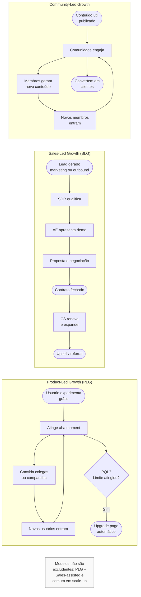

**Freemium versus período de teste (*trial*).** Na estratégia de entrada guiada pelo produto, a escolha central opõe dois formatos de experimentação. O modelo *freemium* oferece uma versão gratuita permanente com recursos ou limites reduzidos, o que amplia o alcance orgânico e a viralidade da base, mas exige margem para sustentar usuários não pagantes. Já o *trial* libera a experiência completa do software por um prazo fechado (geralmente de sete a trinta dias) antes de exigir a assinatura, acelerando a decisão de compra às custas de um topo de funil menor. Operações maduras frequentemente adotam o formato híbrido, combinando um plano gratuito contínuo com a liberação temporária das funcionalidades avançadas.

**Activation, e aha moment.** O momento em que o novo usuário percebe valor pela primeira vez. O objetivo. Reduzir tempo entre signup e aha. Dropbox. Arquivo sincronizado entre dispositivos. Slack. Mensagem enviada em canal de time real. Figma. Arquivo colaborado em tempo real. A sua empresa tem que identificar o aha, e instrumentar para medir quantos usuários atingem.

**PQL (Product Qualified Lead).** Usuário que, pela forma como usa o produto, está sinalizando prontidão para upgrade. Por exemplo. Atingiu limite do plano grátis. Convidou N pessoas. Usou feature premium. Teve N dias de uso consecutivo. PQL é o equivalente PLG do MQL.

**Viral loops.** Mecanismos que fazem usuários trazerem outros usuários. Exemplos. Convite obrigatório, Slack só funciona com outros na empresa. Branding viral, email do Superhuman saindo com "enviado via Superhuman". Incentivo por indicação, Dropbox dando espaço extra por amigo convidado. Colaboração, Figma exigindo compartilhamento, para que o colega possa editar. K-factor acima de um significa crescimento orgânico exponencial. Raro, e valioso.

**Product-led onboarding.** Tutorial in-product, tooltips, e checklists de progresso. Cada usuário avança sozinho. Sem CSM dedicado. Ferramentas. Appcues, Userflow, Pendo, Chameleon.

**Reverse trial.** O usuário começa com todas as features (trial). Algumas desaparecem no dia quatorze. Mas o produto continua funcionando. Converte melhor que trial puro, porque já criou hábito.

#### Volume, e automação

Em SMB, e self-serve, as métricas decisivas mudam.

No modelo autoatendido (*self-serve*), o custo de aquisição precisa permanecer baixo (como referência prática de mercado no Brasil, na faixa de R$ 200 a R$ 2.000 por conta ativa), permitindo recuperar o investimento entre 6 e 18 meses.

Conversão de trial, ou freemium, em pagante. Dois a cinco por cento em freemium. Dez a vinte e cinco por cento em trial.

Time to first value (TTFV). Tempo do signup ao aha. Menor é melhor. Conversão melhor.

Automação de onboarding. Emails sequenciais. In-app tours. Demo self-serve. Inside sales pode ter SDR assistindo. Mas o processo é majoritariamente automático.

#### Armadilhas de SMB e PLG

Forçar PLG onde não cabe. Produto complexo, que exige integração, ou treinamento, não se vende self-serve. Não adianta "modernizar" com PLG, se o negócio é consultivo por natureza.

Monetização tardia. Freemium muito generoso atrai usuários que nunca pagam. Encontrar o limite certo entre "gratuito útil o suficiente pra usar", e "pago necessário pra tirar valor real", é ciência.

Descolamento PLG e vendas. Quando o cliente PLG cresce, e precisa de enterprise upgrade, o vendedor entra tarde, e atrapalha. Precisa de motion sales-assisted bem desenhada.

---

### Parte 4: REVENUE OPERATIONS (REVOPS)

> [!note] Escopo desta parte
> Esta parte oferece visão panorâmica de RevOps como componente da motion comercial completa. Para profundidade operacional (stack tecnológica, pipeline stages detalhados, lead scoring, SLAs), ver [[IGNICAO-Vol-6-Receita-e-Pessoas#CAPÍTULO 3: REVENUE OPERATIONS: INFRAESTRUTURA, DADOS E PROCESSO PARA CRESCER COM PREVISIBILIDADE|Capítulo 3 (Revenue Operations: Infraestrutura, Dados e Processo para Crescer com Previsibilidade) (Vol. 6)]].

#### Por que RevOps existe

Nas fases iniciais, marketing, vendas e sucesso do cliente (*customer success*) costumam operar com ferramentas e planilhas independentes. Conforme a empresa cresce, esse isolamento cobra seu preço: os números do CRM divergem dos relatórios de campanha, a previsão de fechamento (*forecast*) descola do caixa real e as metas de aquisição atropelam a retenção. A área de *Revenue Operations* (RevOps) nasce para eliminar esses silos, unificando processos, dados e sistemas de marketing, vendas, pós-venda e finanças em uma única engrenagem de receita previsível.

RevOps virou função formal em SaaS (software como serviço) americano em 2018 a 2020. No Brasil, virou padrão em scale-ups (empresas em escala acelerada) a partir de 2021. Antes disso, funções fragmentadas (Sales Ops, Marketing Ops, CS Ops) tentavam fazer o mesmo de forma descoordenada.

#### O que o time de RevOps faz

**Processos.** Desenha, e documenta, funil de ponta a ponta (do MQL ao renewal). Define estágios, critérios de avanço, e responsabilidades. Orquestra handoffs entre marketing, SDR, AE, e CS.

**Tecnologia.** Dono da sales stack. CRM, sales engagement, marketing automation, CS platform. Decide arquitetura, integrações, e segurança de dados. Evita "shadow IT", cada time comprando a sua ferramenta sem falar com outros.

**Analytics.** KPIs de receita previsível. Pipeline, velocity, win rate, ticket médio, ciclo, churn, NRR, GRR. Forecasting. Previsão de receita trimestral, com metodologia. Deal inspection. Análise qualitativa de deals em pipeline, para identificar riscos.

**Enablement.** Treinamento do time de vendas, e CS, em processos, ferramentas, e playbooks. Mantém sales playbook atualizado. Onboarding de novos vendedores, e CSMs.

**Compensation.** Desenho, e administração, de comp plans. Cálculo de comissões. Alinhamento com finance.

#### Quando montar

**De zero a vinte vendedores:** ainda não há necessidade de uma estrutura dedicada, o próprio fundador ou o líder comercial acumula a gestão do funil e do CRM.

Vinte a cinquenta. Primeira contratação de Sales Ops (uma pessoa).

Cinquenta a cento e cinquenta. RevOps vira time (três a seis pessoas), gerenciado por Head of RevOps.

Cento e cinquenta em diante. RevOps é função estratégica, com VP, ou C-level próprio (Chief Revenue Officer, ou Chief Customer Officer).

#### Armadilhas em RevOps

Virar burocracia. RevOps que gasta mais tempo fazendo relatório, do que resolvendo problema.

Brigas territoriais. Sales, Marketing, e CS, resistem a perder controle de "suas" ferramentas; a solução é Mandato claro do CEO.

Dado sem ação. Dashboards bonitos que ninguém usa para decisão.

Over-engineering. Empresa de trinta pessoas com stack de quinze ferramentas integradas. Paga caro pra manter.

---

### A auditoria comercial de bolso: o que checar antes de escalar o time de vendas

Independentemente do modelo comercial (B2B consultivo, enterprise, SMB ou PLG), toda operação de vendas madura cumpre os seguintes requisitos:

- [ ] ICP definido, escrito, e compartilhado
- [ ] Playbook de vendas versionado, e atualizado
- [ ] Funil, e estágios, com critérios explícitos
- [ ] CRM populado (não fictício), com cadência de atualização
- [ ] Framework de qualificação aplicado consistentemente (BANT, MEDDIC, MEDDPICC)
- [ ] Plano de comissionamento alinhado à retenção da carteira (tendo como alternativa mais defensável na CLT o pagamento parcelado conforme a liquidação das mensalidades nos termos do art. 466, § 1º, reservando cláusulas de estorno para contratos entre PJs ou representantes autônomos e submetendo o desenho a advogado trabalhista, pois a jurisprudência do TST veda transferir ao empregado o risco de inadimplência ou cancelamento)
- [ ] Métricas mensais. Pipeline, velocity, win rate, ciclo, conversão por etapa
- [ ] Previsão de fechamento (*forecast*) com critério por etapa e taxa de acerto (*hit rate*) acompanhada em histórico
- [ ] Integração de novos vendedores com roteiro documentado e rampa de maturação de 90 dias
- [ ] Handoff vendas para CS documentado
- [ ] Pipeline review semanal, com inspeção qualitativa de deals top
- [ ] Sales training contínuo, não só em onboarding

---

### O Espelho do Capítulo 5: Seu Time Investiga a Dor ou Despeja Funcionalidades?

Seis meses depois daquela visita em Ponta Grossa, nenhuma demonstração técnica da equipe de Henrique começava antes de o diretor industrial calcular na ponta do lápis quanto perdia por mês com paradas não programadas. O piloto pago de trinta dias com critérios objetivos de aprovação virou regra, o cadastro no SICAF passou a ser auditado mensalmente e o funil comercial deixou de acumular curiosos.

**O Espelho (autodiagnóstico):**
1. Nas suas reuniões comerciais, quem fala mais de 40% do tempo: você (ou seu vendedor) apresentando telas do sistema, ou o comprador revelando dores, impactos operacionais e critérios de aprovação? E o seu plano de comissionamento premia a permanência saudável do cliente na carteira ou incentiva assinaturas apressadas que cancelam no trimestre seguinte?
2. Quantas oportunidades no seu CRM estão sem próximo passo agendado há mais de 30 dias porque o vendedor enviou proposta de preço para um analista técnico sem envolver quem aprova o orçamento?
3. Na sua última reunião de diagnóstico, o cliente calculou em voz alta quanto perde por mês mantendo o problema sem solução, como fez o diretor industrial de Ponta Grossa ao descobrir o vazamento de R$ 190 mil mensais diante de Henrique, e recebeu uma proposta acompanhada dessa conta simples de Retorno sobre o Investimento (ROI)?

**Permissão Libertadora:**
Você está autorizado a proibir qualquer demonstração de produto na primeira reunião antes que o cliente responda quanto o problema custa hoje e quem assina a decisão final. Desqualificar rápido quem só quer "dar uma olhadinha" salva a vida do seu time.

**O Ritual de Segunda-Feira às 9h:**
Toda segunda-feira, dedique 30 minutos à higiene do seu CRM: filtre e marque como perdida (registrando o motivo real para preservar o histórico de conversão e forecast, sem jamais apagar o registro) toda oportunidade parada há mais de 30 dias sem próximo passo agendado com data e hora na agenda do decisor. Pare de se enganar com pipeline inflado.

### LEITURAS E REFERÊNCIAS COMPLEMENTARES

*SPIN Selling*, de Neil Rackham (base clássica de perguntas de diagnóstico em vendas consultivas). *Never Split the Difference* (*Negocie como se sua vida dependesse disso*), de Chris Voss. *Gap Selling*, de Keenan (descoberta comercial focada na distância financeira e operacional entre o estado atual e o estado desejado pelo comprador). *Mastering Technical Sales*, de John Care e Aron Bohlig (manual de pré-vendas e demonstração técnica), ao lado da documentação do método MEDDIC (criado na PTC por Dick Dunkel e Jack Napoli) e dos guias práticos da MEDDIC Academy e da Force Management (*Command of the Message*). *The Challenger Sale*, de Matthew Dixon e Brent Adamson (abordagem consultiva em vendas de alta complexidade).

---

## CAPÍTULO 6: PRICING STRATEGY E ECONOMIA DA RECORRÊNCIA (SUBSCRIPTION ECONOMY)

### O Imposto da Covardia: por que cobrar barato demais atrai os clientes mais caros de servir

O medo de cobrar o que a solução realmente vale costuma sabotar fundadores logo após a validação inicial. Em Belo Horizonte, antes de posicionar sua clínica para reabilitação oral complexa, a Dra. Camila passou meses cobrando R$ 150 pela avaliação diagnóstica por receio de perder pacientes para os consultórios populares da vizinhança, até calcular a margem de contribuição por hora de cadeira e subir a consulta para R$ 480. Em São Paulo, Lucas e Marina caíram na mesma armadilha quando tentaram escalar seu sistema de auditoria financeira além dos doze diretores do piloto inicial: com medo de "assustar o mercado" de pequenas empresas, lançaram um plano lateral autoatendido por R$ 149 mensais (ajustado pouco depois para R$ 199 no site).

O resultado daquela faixa de entrada nos primeiros noventa dias foi um pesadelo operacional: atraíram dezenas de microempresas sem estrutura financeira que consumiam quatro horas de suporte pelo WhatsApp apenas para importar uma planilha básica, choravam desconto de R$ 20, atrasavam o boleto todo mês e cancelavam em sessenta dias alegando que o software "estava caro".

Numa sexta-feira à noite, exaustos e no vermelho, Marina ouviu o conselho de um mentor veterano e tomou uma atitude que deixou Lucas sem dormir no fim de semana: mudou a tabela de preços para R$ 1.490 por mês (dez vezes mais caro), exigiu pagamento trimestral ou anual e reposicionou a oferta para empresas com faturamento acima de R$ 10 milhões ao ano.

Logo na segunda-feira seguinte ao reajuste, um diretor financeiro que havia descartado a versão barata meses antes aprovou o piloto pago e disse uma frase que Lucas nunca mais esqueceu (ao longo daquele trimestre, a dupla fechou nove contratos anuais a R$ 1.490 por mês e viu a carga de suporte cair pela metade):

– "Ainda bem que custa R$ 1.490. Quando vocês me cotaram R$ 149 no trimestre passado, nossa diretoria vetou porque achou que um software tão barato só podia ser um brinquedo inseguro para os nossos dados bancários."

Esse é **O Imposto da Covardia** na precificação. Cobrar barato demais destrói a percepção de autoridade, atrai os clientes mais exigentes e inadimplentes do mercado e consome a margem bruta que pagaria um suporte técnico de alto nível.

O preço traduz em número a confiança que a empresa tem no retorno gerado ao comprador e funciona como a alavanca mais rápida para expandir a margem líquida sem aumentar a estrutura fixa.

---

> [!note] Nota de validade
> Os fundamentos de precificação (valor percebido, disposição a pagar, elasticidade e desenho de planos) permanecem constantes, enquanto métricas de cobrança por uso ou por resultado (comuns em produtos nativos de IA) evoluem rápido: revise os indicadores internamente a cada trimestre e limite reajustes de tabela para a base a no máximo uma vez por ano.

A [[#FASE 12: VALIDAÇÃO DO MODELO DE NEGÓCIO|Fase 12]] tratou da validação inicial do modelo de negócio. Aqui, a precificação entra como alavanca operacional contínua a partir da virada de Lucas e Marina em São Paulo e Florianópolis. Muitos fundadores de SaaS B2B no Brasil subprecificam o produto nos primeiros anos por receio de ouvir um "não", deixando na mesa a margem bruta que financiaria o crescimento sem depender de diluição. Ao longo deste capítulo, acompanharemos como o conselho daquele mentor levou a dupla a substituir o plano lateral de R$ 149 em três movimentos práticos: primeiro, aplicaram as quatro perguntas de Van Westendorp com os diretores financeiros da safra inicial e comprovaram que mensalidades abaixo de R$ 250 faziam o sistema parecer inseguro (Seção 1), segundo, estruturaram três planos ancorados na métrica de valor do cliente, o volume de boletos auditados e contas bancárias conectadas (Seção 2), e terceiro, criaram uma trava de cobrança híbrida com franquia de créditos quando o módulo de leitura de contratos por IA passou a pressionar a margem bruta com custos de inferência em dólar (Seção 10), dilema que fechará o autodiagnóstico do Espelho.

### Por que aumentar o preço em 1% gera cerca de três vezes mais impacto no lucro operacional do que aumentar o volume em 1% (Marn e Rosiello, McKinsey/HBR)

No estudo clássico de Michael Marn e Robert Rosiello publicado na *Harvard Business Review* (*Managing Price, Gaining Profit*, 1992), 1% de ganho em preço realizado sem perda de volume elevou o lucro operacional médio em cerca de 11,1%, contra cerca de 3,3% gerados por 1% de aumento em volume de vendas (já que o preço adicional entra quase integralmente na margem, sem custo variável de entrega).

Numa operação com margem operacional de 10%, cada 1% de melhora no preço líquido realizado gera até 10% de ganho direto no resultado operacional. Como um reajuste bem calibrado de 10% no preço raramente provoca perda equivalente de clientes, o efeito líquido costuma ser um acréscimo de 8% a 10% na receita e no ARR sem custo marginal de entrega, fortalecendo a geração de caixa e os múltiplos de avaliação da empresa.

Preço comunica posicionamento. Preço muito baixo sinaliza produto genérico. Preço alto sinaliza valor premium. Mudar preço muda percepção.

Pricing ruim atrai cliente errado. Preço baixo atrai ICP errado (menos pagante, mais exigente). Preço alto filtra ICP de maior LTV.

Captura de valor é tão importante quanto criação. Startups que criam valor para o usuário, mas retêm uma fração mínima do benefício gerado (distinção formalizada por Adam Brandenburger e Harborne Stuart em *Value-Based Business Strategy*, 1996), acabam absorvidas ou espremidas por quem controla a distribuição.

### Como precificar por valor: métrica de cobrança e ancoragem em três planos

#### 1. Pesquisa de Willingness to Pay

**Van Westendorp Price Sensitivity Meter (PSM).** Metodologia de pesquisa com quatro perguntas a potenciais clientes. A partir de qual preço o produto parece caro demais para considerar? A partir de qual preço o produto parece barato demais (sinal de baixa qualidade)? Qual preço parece caro, mas aceitável? Qual preço parece um bom negócio?

O cruzamento das quatro curvas acumuladas revela dois marcos:

Visualização das quatro curvas do PSM (exemplo ilustrativo).

> [!note] Leitura prática do gráfico
> o intervalo aceitável de preço forma-se na zona central onde as curvas de "muito barato" e "muito caro" se cruzam com as de "barato" e "caro".

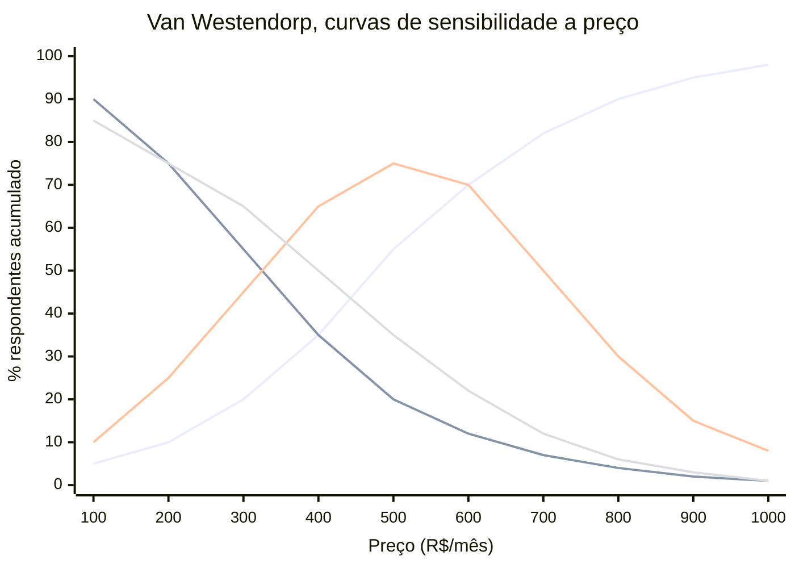

Leitura prática das curvas e dos dois marcos de decisão: a linha ascendente contínua representa "caro demais, nem considero" e a linha descendente mais acentuada mostra "barato demais, suspeito de baixa qualidade" (no gráfico acima, as duas curvas intermediárias de "caro, mas aceitável" e "bom negócio" aparecem na versão de densidade por faixa. Na plotagem acumulada clássica de Van Westendorp, as duas sobem e descem de forma monotônica). Foi aplicando essas quatro perguntas aos diretores financeiros do piloto que Lucas e Marina descobriram que qualquer mensalidade abaixo de R$ 250 caía na zona de rejeição por parecer um software amador para dados bancários, o que balizou os dois indicadores centrais do método:

Optimum Price Point (OPP). Onde a intersecção de "caro demais", e "barato demais", está em equilíbrio.

Range of Acceptable Prices (RAP). Faixa entre o ponto de rejeição por barato, e a rejeição por caro.

Amostra mínima: pelo menos 50 respondentes qualificados por segmento de ICP analisado (abaixo desse volume em B2B, prefira conduzir de 10 a 15 entrevistas qualitativas profundas). Ferramentas. Google Forms, ou Typeform, bastam.

**Value-based pricing, método direto.** Perguntar ao cliente. "Que valor você obtém com o produto em doze meses?" (economia, receita adicional, tempo economizado vezes salário). Precificar em dez a trinta por cento desse valor entregue. Deixa setenta a noventa por cento como ROI claro para o cliente.

> [!important] A heurística prática do valor 10x superior ao preço
> Preço onde o cliente percebe valor igual, ou maior, a dez vezes o preço, cria tração orgânica. A relação típica em SaaS B2B maduro. Valor percebido três a oito vezes preço. Produto excepcional, dez vezes ou mais.

#### 1.1 Value-based pricing na prática: como conduzir pesquisa de WTP no Brasil

O Brasil apresenta especificidades que tornam a pesquisa de willingness to pay mais complexa do que em mercados desenvolvidos. Respostas a preços são influenciadas pelo poder de compra regional, pela cultura de barganha, e pela desconfiança histórica com contratos longos.

**Protocolo para pesquisa de WTP no contexto brasileiro.**

Passo 1: definir o ICP com precisão antes de perguntar. Pesquisa de WTP com amostra heterogênea produz dados inúteis. Separar por segmento. PME (faturamento até R$ 20 milhões anuais), mid-market (R$ 20 a R$ 200 milhões), e enterprise (acima de R$ 200 milhões). O ponto ótimo de preço de cada segmento pode variar em três a cinco vezes.

Passo 2: ancorar na conversa de valor antes de introduzir preço. Perguntar diretamente "quanto você pagaria?" sem contexto produz âncoras baixas. Siga esta sequência de quatro passos na entrevista:

Primeiro, "descreva o principal problema que esse produto resolve para você". Segundo, "qual o custo atual desse problema: em tempo de equipe, custo de processo, ou receita perdida?" Terceiro, "se esse problema fosse resolvido completamente, qual seria o benefício em reais nos próximos doze meses?". Quarto, então introduzir as perguntas do PSM.

Passo 3: calibrar as respostas declaradas para o viés hipotético da pesquisa. Em questionários sem compromisso de compra, o viés opera nos dois sentidos: parte dos entrevistados declara disposição a pagar maior por cortesia ao fundador, enquanto compradores acostumados à barganha jogam o número para baixo na tentativa de ancorar uma futura negociação. Por isso, trate o levantamento de Van Westendorp apenas como baliza inicial para eliminar extremos e valide o preço real no Passo 4.

Passo 4: validar com teste de preço real. Pesquisa informa direção. Teste com pricing real confirma. Colocar preço na landing page, em cohort pequena, e medir conversão. Diferença entre declarado em pesquisa e comportamento real frequentemente surpreende.

**Ferramentas de pesquisa disponíveis e custo no Brasil.**

Typeform ou Google Forms para PSM estruturado. Custo zero. User Interviews para recrutamento de respondentes qualificados. Custo US$ 25 a US$ 75 por respondente. SurveyMonkey Audience para amostras quantitativas. Custo R$ 80 a R$ 200 por respondente qualificado. Conjoint analysis com ferramentas como Qualtrics. Para empresas com budget de pesquisa, mais de R$ 50 mil por projeto, com resultado mais robusto.

> [!tip] Entrevistas qualitativas valem mais cedo
> Antes de ter escala suficiente para dados quantitativos (mínimo cinquenta respondentes por segmento), entrevistas qualitativas de trinta a quarenta e cinco minutos com dez a quinze prospects do ICP produzem mais insight que survey mal-amostrado. Perguntar sobre valor, custo alternativo, e orçamento disponível, diretamente na conversa.

**Erros mais comuns em pesquisa de WTP no Brasil.**

Pesquisar com clientes atuais que já pagam preço baixo. Eles têm âncora definida. Os dados refletem o preço histórico, não o potencial. Pesquisar com amostra de conveniência (lista de email própria). Frequentemente enviesada para ICP de menor ticket. Usar benchmarks de SaaS americano sem ajuste. Converter dólar por câmbio e assumir que o resultado faz sentido para o mercado brasileiro é erro sistemático.

#### 2. Estrutura de preços e métricas de cobrança (assinatura fixa, planos em camadas, assentos, consumo e híbrido)

**Assinatura Mensal Fixa (*Flat Monthly Fee*).** Um preço único, sem variação por faixa: simples de comunicar e cobrar, funciona bem quando o uso e o valor entregue variam pouco entre os clientes (exemplo: R$ 290/mês por loja no PadariaPro).

**Planos em camadas (*Good-Better-Best*).** A estrutura clássica de três faixas (raramente quatro ou mais) costuma distribuir a base de SaaS B2B em torno de 20% no plano de entrada, 60% no intermediário e 20% no superior. Essa concentração no plano central decorre do efeito de compromisso (*compromise effect*), pelo qual o comprador evita os extremos, já o efeito chamariz (*decoy effect*) entra quando o desenho dos limites torna o plano intermediário ou superior uma escolha óbvia pelo custo-benefício. Foi assim que Lucas e Marina substituíram a mensalidade única por três faixas ancoradas no volume de boletos auditados e de contas bancárias integradas (Essencial a R$ 490, Profissional como âncora central a R$ 1.490 e Corporativo a partir de R$ 3.490 por mês), alinhando a cobrança ao porte da tesouraria de cada cliente.

```mermaid
flowchart LR
 subgraph Basic["BASIC<br/>R$ 290/mês<br/>~20% adotam"]
 B1[Essenciais core]
 B2[Support email 48h]
 B3[Até 3 usuários]
 B4[Relatórios básicos]
 end

 subgraph Pro["PRO - âncora<br/>R$ 590/mês<br/>~60% adotam"]
 P1[Tudo do Basic +]
 P2[Integrações avançadas]
 P3[Relatórios customizados]
 P4[Suporte priority 12h]
 P5[Até 15 usuários]
 P6[API access]
 end

 subgraph Ent["ENTERPRISE<br/>R$ 1.290+/mês<br/>~20% adotam"]
 E1[Tudo do Pro +]
 E2[SSO SAML/OIDC]
 E3[SLA contratual 99.9%]
 E4[CSM dedicado]
 E5[Usuários ilimitados]
 E6[Audit logs + compliance]
 end

 Basic -. upgrade.-> Pro
 Pro -. upgrade.-> Ent
```

Decoy effect aplicado. O tier do meio deve ser a escolha "óbvia". Se noventa e cinco por cento escolhem Basic, os tiers estão mal-desenhados. Basic com valor demais. Ou Pro com justificativa fraca.

**Per-User (seat-based).** Preço escala com número de usuários. Padrão em Slack, Notion, Linear. Vantagem. Cresce organicamente com adoção. Desvantagem. O cliente economiza compartilhando contas.

**Usage-based (consumption).** Preço por consumo (API calls, transações, GB de dados). Cresce fortemente entre 2022 e 2026, com produtos AI-native. Vantagem. Alinha preço ao valor entregue, e escala com sucesso do cliente. Desvantagem. Imprevisibilidade de receita, e de custo, para o cliente. Exemplos. Snowflake, Twilio, OpenAI.

**Modelo Híbrido (assinatura fixa + consumo variável).** Combina uma mensalidade mínima previsível com cobrança adicional conforme o volume excedente, capturando melhor o valor em bases heterogêneas (exemplo: R$ 490/mês incluindo 10 mil chamadas de API, mais R$ 0,05 por chamada adicional).

**Enterprise Custom.** Sem preço público. Negociação. Acima de ticket de R$ 50 a 100 mil por ano, ou em deals estratégicos. Base. "Floor price" interno, mais flex de vinte a quarenta por cento em negociação.

#### 3. Packaging, como features mapeiam a tiers

**Princípios:** O tier baixo captura alcance amplo (self-serve, PMEs). Features. Essenciais, sem restrições operacionais severas. O tier médio é onde a maior parte converte. Features. Integrações, relatórios avançados, suporte estendido. O tier alto é para enterprise. Features. SSO, SLA, security compliance, CSM dedicado, custom contracts.

Features que tipicamente são "enterprise-only". SSO (Single Sign-On) via SAML, ou OIDC. Audit logs completos. Controle granular de permissões. Integrações avançadas (API, webhooks com SLA). SOC 2, ou ISO 27001, compliance demonstrado. SLA com penalidade. Account Manager dedicado.

Se as enterprise-only features são o que diferencia o produto, o que está nos tiers menores precisa ser genuinamente útil. Senão, só o tier alto paga. E o funil trava.

#### 4. Pricing para expansão de receita: como estruturas seat-based e usage-based viabilizam NRR acima de 110%

Uma retenção líquida de receita (NRR) acima de 110% ao ano em SaaS B2B indica que a base atual cresce mais de 10% mesmo sem novas vendas, impulsionada pela combinação de baixa perda bruta (GRR) e expansão de uso ou módulos.

**O que faz o NRR crescer.**

NRR é função de quatro componentes.

```text
NRR = ((MRR inicial da safra + Expansão - Contração - Churn) / MRR inicial da safra) × 100
```

Expansion é o driver que o pricing controla diretamente. Expansão acontece quando o cliente usa mais (usage-based), adiciona usuários (seat-based), ou sobe de tier (tiered). Cada estrutura de pricing tem mecânica diferente de expansão.

**Seat-based pricing e expansão orgânica.**

Em modelo seat-based, a empresa cresce junto com o crescimento da equipe do cliente. Cada novo funcionário que usa o produto é uma nova fonte de receita. O mecanismo é quase automático, quando a adoção interna cresce.

Para maximizar expansão por assentos.

Fazer onboarding de toda a equipe do comprador, não só do decisor. A expansão acontece quando usuários além do comprador inicial adotam. Produto "bottom-up" (que o usuário final ama, e puxa adoção interna) é mais expansível que produto "top-down" (comprado por TI, usado a contragosto).

Criar incentivo para adição fácil de assentos. Processo de self-serve para adicionar usuário dentro do produto. Sem burocracia. Cada atrito nesse fluxo é receita perdida.

Cobrar por usuário ativo, não por licença total. Cobrar por licença total incentiva o cliente a consolidar usuários. Cobrar por usuário ativo alinha o preço ao valor entregue e reduz resistência à adoção ampla.

**Usage-based pricing e expansão por consumo.**

Em modelo usage-based, o cliente começa pequeno e expande naturalmente ao longo do tempo, se o produto entrega valor. É o modelo de maior potencial de NRR alto, quando bem executado.

```text
Exemplo de trajetória de expansão de um cliente usage-based:

Mês 1:  100 mil transações × R$ 0,05 = R$ 5.000/mês
Mês 6:  400 mil transações × R$ 0,05 = R$ 20.000/mês
Mês 12: 900 mil transações × R$ 0,05 = R$ 45.000/mês

NRR implícito do cliente: 900%
```

Para viabilizar esse crescimento, o produto precisa ser o "motor" de processamento de algo que cresce com o negócio do cliente. Transações, documentos processados, usuários atendidos, dados armazenados. Se o objeto de cobrança cresce com o sucesso do cliente, o alinhamento de incentivos é perfeito.

**Métricas de expansão para monitorar.**

Fatias de expansão no crescimento mensal: em operações B2B com NRR saudável, entre 30% e 50% da receita nova adicionada no período vem da expansão de contas que já estão na base.

Time to expansion. Quanto tempo leva do primeiro contrato até o primeiro upsell. Alvo para mid-market: seis a doze meses. Para enterprise: doze a dezoito meses.

Expansion rate por cohort. De todas as contas adquiridas no mesmo período, qual percentual expandiu nos doze meses seguintes. Empresas com NRR acima de 120% costumam ter taxa de expansão de quarenta a sessenta por cento da base.

> [!important] NRR acima de 110% muda a matemática de captação
> Com NRR de 120%, uma empresa com ARR de R$ 50 milhões cresce R$ 10 milhões por ano sem adicionar cliente. Isso representa o equivalente a oitenta novos clientes de R$ 125 mil cada, sem custo de aquisição. Para o investidor, NRR alto é o dado que mais move múltiplo de valuation em SaaS.

#### 5. Psicologia de preço no mercado brasileiro

O comportamento do comprador brasileiro diante de preços tem características específicas que diferem do mercado americano. Ignorar essas características é deixar conversão na mesa.

**Parcelamento como estrutura de pricing.**

O parcelamento faz parte da rotina de compras no Brasil tanto no varejo quanto na contratação anual de software, permitindo diluir o desembolso nas faturas mensais do comprador, embora o limite total do cartão de crédito fique comprometido pelo valor integral da contratação no momento da compra e seja liberado gradualmente a cada parcela quitada.

Em SaaS voltado a PMEs e consumidores (SMB e B2C), oferecer o plano anual parcelado em até 12 vezes no cartão eleva a conversão do plano anual em 20% a 40% frente à cobrança única à vista. Ao precificar (por exemplo, plano mensal de R$ 129, plano anual à vista por R$ 109/mês ou parcelado em 12x de R$ 115/mês), incorpore tanto a taxa de desconto da adquirente (MDR parcelado de 1,5% a 3,5%) quanto o custo de eventual antecipação de recebíveis (que pode consumir de 8% a 12% na operação de 12 parcelas) e informe a diferença de preço por meio de pagamento de forma visível (Lei 13.455/2017), sem anunciar como "sem juros" no B2C quando houver acréscimo em relação ao valor à vista.

```text
Exemplo de estrutura de pricing com parcelamento:

Plano mensal:    R$ 129/mês    (MRR: R$ 129)
Plano anual à vista: R$ 109/mês × 12 = R$ 1.308 (desconto de ~15% frente ao mensal de R$ 129)
                 ou R$ 115/mês × 12 = R$ 1.380 parcelado em 12x no cartão (ou R$ 120/mês com antecipação integral)
                 (acréscimo de ~5,5% a 10% sobre o valor à vista para absorver o MDR parcelado de 1,5% a 3,5% e eventual taxa de antecipação. No B2C, informe a diferença com clareza nos termos da Lei 13.455/2017 e nunca anuncie como "12x sem juros" quando o total parcelado superar o preço à vista)
```

O cliente percebe economia ao comparar R$ 109 parcelado com R$ 129 mensal. A empresa captura LTV anual garantido. Todos ganham, quando a estrutura está calibrada.

**Psicologia de preço: o efeito do R$97 versus R$100.**

O pricing de charme (charm pricing) funciona no Brasil. Mas com especificidade local: o limiar psicológico não é exatamente igual ao americano.

No Brasil, os limiares mais eficazes observados em produtos de consumo e SMB.

```text
Abaixo de R$ 100:  R$ 89, R$ 97 ou R$ 99 (planos de entrada e autoatendimento. Ref. Thomas e Morwitz, 2005)
Abaixo de R$ 200:  R$ 189 ou R$ 197
Abaixo de R$ 500:  R$ 490 ou R$ 497
Abaixo de R$ 1.000: R$ 970 ou R$ 990
```

Para B2B mid-market, o efeito de charme é menor. Compradores profissionais olham para o total anual, não para o número do mês. A diferença entre R$ 590 e R$ 600 por mês é irrelevante quando o contrato anual é comparado em linha com outros softwares. Nesse segmento, usar preços "limpos" (R$ 600, R$ 1.200, R$ 2.400) comunica profissionalismo.

**Adaptação de preços americanos ao poder de compra brasileiro.**

Converter a tabela americana diretamente pelo câmbio comercial costuma inviabilizar a venda local: como referência ilustrativa observada na prática de precificação no país (considerando o patamar cambial de R$ 5,80 por dólar no início de 2026), softwares voltados a pequenas empresas costumam operar entre 35% e 50% do preço em dólar convertido, subindo para a faixa de 55% a 70% no médio porte.

```text
Produto americano: US$ 100/mês
Câmbio: R$ 5,80 → R$ 580/mês (sem ajuste)
Ajuste PPP para SMB (fator 0,40): R$ 232/mês
Ajuste PPP para mid-market (fator 0,60): R$ 348/mês
```

A empresa não precisa cobrar o mínimo. Mas precisa entender que cobrar preço americano integral em mercado brasileiro vai reduzir o pool de compradores para empresas de maior porte, que orçam em dólar ou têm faturamento internacionalizado.

> [!tip] Teste o preço, não calcule o preço
> Qualquer cálculo de ajuste de poder de compra é estimativa. O único dado confiável é a conversão real. Testar dois ou três níveis de preço em landing page separadas, por quatro a seis semanas, com tráfego orgânico ou pago direcionado, produz dado melhor que qualquer modelo teórico.

#### 6. Reajustes anuais, a política que ninguém segue, e todo mundo precisa

**Cláusula contratual de reajuste anual:** no Brasil, a correção monetária automática exige previsão expressa em contrato atrelada a índice oficial de preços (IPCA ou IGP-M) e periodicidade mínima de doze meses (Lei 10.192/2001). Qualquer ganho real acima da inflação (como 1 a 3 pontos percentuais adicionais ou migração de faixa) deve ser negociado na janela de renovação com aviso prévio de 60 a 90 dias (ver [[IGNICAO-Vol-8-Juridico-LGPD-e-Seguranca#CAPÍTULO 5: ARQUITETURA CONTRATUAL PARA STARTUPS: OPERAÇÃO E CONTRATOS EM PROFUNDIDADE POR TIPO|Capítulo 5 do Vol. 8]]).

Estrutura de comunicação. Comunicar com sessenta a noventa dias de antecedência. Explicar racional (novas features, melhorias, inflação). Oferecer lock-in de um a dois anos, com preço atual, a quem aceitar. Grandfathering. Manter clientes muito antigos no preço antigo, por período limitado (seis a dezoito meses), depois migrar.

Elasticidade típica observada em SaaS B2B. Reajuste de cinco a oito por cento. O churn marginal aumenta zero vírgula cinco a um por cento. A receita líquida sobe. Reajuste de dez a quinze por cento. O churn aumenta dois a quatro por cento. Ainda rende líquido. Reajuste maior que vinte por cento. Perigoso, sem repositioning de valor.

Test-first approach. Aplicar reajuste em coorte pequena (novos clientes) primeiro. Medir conversão, e churn, três a seis meses. Ajustar antes de rolar para a base completa.

#### 7. Descontos, política clara, não improviso

> [!important] Regra de descontos
> Desconto concedido em Sales precisa ter contrapartida. Pagamento anual. Multi-ano. Co-marketing. Case study. Desconto sem contrapartida sinaliza que o preço original era inflado. E destrói preço de mercado.

Política saudável de descontos: conceda de 10% a 15% para o plano anual pago à vista (ou parcelado cobrindo o custo de antecipação), de 15% a 20% para contratos de dois anos e margem negociável apenas em pacotes corporativos de grande volume, sempre exigindo contrapartida clara.

Alçadas de desconto comercial: o executivo de vendas aprova até 10% dentro da regra de contrapartida. O líder comercial (*Head of Sales*) autoriza até 20%, e qualquer concessão acima de 20% exige aprovação conjunta do CEO e do CFO.

#### 8. A/B testing de pricing, quando, e como

Quando faz sentido: em produtos self-serve com volume suficiente para cálculo amostral (por exemplo, com conversão de base de 10%, detectar uma variação relativa de 25% com poder de 80% exige cerca de 2.000 visitantes por variante. Abaixo disso, prefira testar preços em safras sequenciais de vendas consultivas). Produto self-serve (aplicação em landing page, ou checkout). Mudança incremental (dez a vinte e cinco por cento), não estrutural.

**Quando não faz sentido testar no ar:** em vendas corporativas (*enterprise*), onde a amostra é pequena demais e há dezenas de variáveis interferindo em cada negociação, ou em mudanças estruturais de modelo de cobrança. Nesses cenários, conduza pesquisa qualitativa de disposição a pagar antes de alterar a tabela.

**Como:** Segmentar tráfego 50/50, por hash de visitor ID. Medir. Conversão, ticket médio, churn de noventa dias, e LTV estimado. Mínimo de quatro a oito semanas, para dado robusto. Ferramentas. Stripe, Chargebee, ferramentas nativas de payment.

Ética, e legal. Evitar cobrar preços diferentes para perfis diferentes, sem justificativa (pode violar CDC). Teste A/B por timing, ou cohort, é aceito.

#### 9. Pricing para diferentes tipos de compradores: como manter integridade de preço entre segmentos

Uma das armadilhas mais comuns em startups brasileiras que avançam para o médio porte e para contas corporativas é passar a vender o mesmo produto por valores radicalmente diferentes a compradores do mesmo perfil, sem critério de pacote que justifique a disparidade. O resultado é erosão de margem, ressentimento entre clientes que conversam no mercado e uma equipe de vendas sem regra clara para negociar.

**Segmentação típica e suas dinâmicas de pricing.**

SMB (pequenas e médias empresas, faturamento até R$ 20 milhões). Características de compra: decisão rápida (1 a 3 semanas), tomada pelo sócio ou gestor direto, com alta sensibilidade a fluxo de caixa mensal. Ciclo de venda curto. Orçamento típico de software: R$ 500 a R$ 3.000 por mês. Modelo de pricing adequado. Self-serve ou low-touch. Tiered simples. Preço na tabela, sem negociação. Parcelamento disponível.

Médio porte (*mid-market*, faturamento de R$ 20 milhões a R$ 200 milhões): ciclo de decisão de 1 a 3 meses (4 a 12 semanas) com múltiplos avaliadores (área usuária, TI e financeiro), tíquete mensal de R$ 2.000 a R$ 20.000, tabela pública como âncora e margem de negociação de 10% a 20% mediante contrapartida contratual.

Grandes empresas (*enterprise*, faturamento acima de R$ 200 milhões): ciclo de decisão de 6 a 18 meses envolvendo compras (*procurement*), jurídico e segurança da informação, com orçamento mensal entre R$ 10.000 e R$ 100.000 e proposta comercial sob medida amparada por um preço mínimo interno (*floor price*).

**Como manter integridade de preço entre segmentos.**

Sem uma régua clara de equivalência entre planos, surge o risco de uma pequena empresa descobrir que um cliente corporativo paga menos por usuário, ou de uma conta grande perceber que o plano de entrada já entrega os recursos pelos quais ela paga caro.

Mecanismos para proteger a integridade.

Diferenciar produto genuinamente entre tiers. Enterprise não deve ser "mais do mesmo". Deve ter features que SMB não precisa (SSO, audit logs, SLA, compliance). Se as features enterprise são úteis para SMB, o argumento de preço diferente colapsa.

Manter segmentação explícita de mercado. "Esse produto é para equipes acima de cinquenta usuários" define quem é enterprise por tamanho de equipe, não por orçamento. O cliente SMB não se sente discriminado. Simplesmente não é o ICP do tier.

Política de pricing documentada internamente. O Sales precisa saber o floor de cada segmento, e não ter autoridade para cruzar a linha sem aprovação. Sem política documentada, cada vendedor inventa, e o preço de mercado erode.

Evitar "enterprise pricing para SMB que insiste". O SMB que negocia agressivamente e consegue preço enterprise destrói a estrutura. Treinar Sales para responder: "Esse preço requer compromisso de X usuários por Y meses. Faz sentido para a sua estrutura?"

> [!warning] O desconto ad hoc para fechar o trimestre destrói pricing de longo prazo
> Cada desconto sem contrapartida concedido no fim do mês para salvar a meta individual abre um precedente perigoso: o comprador comenta no mercado e o vendedor aprende que a tabela é peça de ficção. Em dois ou três anos, a realização efetiva de preço (*price realization*) despenca de 90% para 60% da tabela, fazendo a empresa abrir mão de um terço da receita potencial. O estrago quase não aparece no fechamento do mês, mas corrói o caixa no acumulado do ano.

**Comunicação de preço para diferentes compradores.**

Para SMB. Preço na landing page. Clareza total. Sem surpresa. Self-serve funciona quando o preço é visível e o checkout é simples. O atrito em descobrir o preço mata conversão de SMB.

Para mid-market. Preço na página como âncora ("a partir de R$ X"). Contato com Sales para proposta customizada. Gera percepção de personalização sem abandonar a âncora.

Para enterprise. "Fale com nossa equipe" é aceitável. Enterprise buyers esperam proposta customizada. Preço público pode criar constrangimento em negociação. Mas ter case studies com resultados ("clientes enterprise reduzem custo em X%") substitui o preço como elemento persuasivo.

#### 10. Modelos AI-native de pricing (2024 a 2026)

Emergentes, com produtos que usam LLM.

Credit-based. O cliente compra créditos, que consomem em features AI (por exemplo, Canva, Notion AI).

Outcome-based. Preço por resultado entregue (por exemplo, lead qualificado pelo AI, documento gerado).

Seat mais AI consumption. Seat-based para acesso, mais extra para uso intensivo AI.

**A equação de margem nos produtos nativos de IA.** Embora o custo unitário por token para um mesmo nível de desempenho venha caindo de 9 a 900 vezes ao ano conforme a tarefa (segundo levantamento da Epoch AI), o consumo total de tokens por operação disparou com fluxos agênticos e modelos de raciocínio (*reasoning*), comprimindo a margem bruta de softwares nativos de IA para a faixa de 40% a 60% (abaixo dos 75% a 85% do SaaS clássico, ver [[#CAPÍTULO 10: AI COMO PARTE DO PRODUTO (AI-NATIVE PRODUCT)|Capítulo 10 deste volume]]). Foi o que viveram Lucas e Marina ao lançar o módulo de leitura automática de contratos bancários: três clientes pesados consumiram sozinhos US$ 1.800 em chamadas de API no primeiro mês, obrigando a dupla a instituir uma cobrança híbrida com franquia mensal de páginas analisadas no plano base e pacotes adicionais de créditos para volumes excedentes.

### Métricas de pricing: ARPU/ACV, Margem Bruta por plano, Elasticidade de conversão e Price Realization

Para governar a precificação como sistema, acompanhe mensalmente a Margem Bruta por plano e por cliente (deduzindo custos variáveis de nuvem e de inferência de IA para identificar contas pesadas deficitárias) e a Elasticidade de conversão por faixa de preço (comparando a taxa de fechamento e a receita líquida por visitante entre safras antes e depois de cada reajuste), ao lado dos indicadores operacionais abaixo:

ACV (Average Contract Value). Deve crescer dez a vinte por cento ao ano em SaaS pós-PMF.

ARPU (Average Revenue Per User). Métrica por conta, ou por usuário.

Realização de preço (*price realization*): percentual do preço de tabela efetivamente praticado nos contratos fechados, após descontos comerciais (meta de 80% ou mais em operações B2B saudáveis).

Vazamento por desconto (*discount leakage*): desconto médio concedido nos contratos fechados. Meta de no máximo 15%, sempre mediante contrapartida objetiva registrada no CRM.

Elasticidade observada. Churn dividido por variação de preço, em testes.

Expansion MRR percentual. Contribuição de upgrades, e expansão de contas, para crescimento.

Downgrade rate. Percentual que migra para tier inferior. Alvo menor que dois por cento ao ano.

**Prazo até o primeiro reajuste:** exatamente no aniversário de doze meses do contrato inicial, respeitando a periodicidade mínima anual exigida pela Lei 10.192/2001 e evitando que a correção inflacionária seja esquecida após o primeiro ano.

NRR por segmento (SMB, mid-market, enterprise). NRR diferente por segmento revela onde o pricing captura (ou falha em capturar) expansão.

---

### Muito além do ARR: os indicadores que revelam a saúde real da receita recorrente

Enquanto qualquer guia introdutório de SaaS apresenta MRR, ARR, CAC e LTV, gerir uma operação de receita recorrente em escala exige acompanhar de perto os indicadores de qualidade da base a seguir:

**Retenção Líquida de Receita (*Net Revenue Retention*, ou NRR, definida na seção 4 deste capítulo e aplicada aqui à leitura de safras).** Calculada pela fórmula `((MRR inicial da safra + Expansão - Contração - Churn) / MRR inicial da safra) × 100`, mede a evolução da mesma coorte de clientes doze meses depois. Em SaaS B2B, operações líderes (*best-in-class*) atingem de 120% a 140%, entre 105% e 120% o resultado é saudável, e abaixo de 95% acende o alerta vermelho. Um NRR acima de 100% comprova que a base cresce sozinha mesmo antes de somar novos clientes.

**GRR (Gross Revenue Retention).** ((MRR cohort hoje, excluindo expansão) dividido por (MRR cohort doze meses atrás)) vezes cem. Mede só churn, e downgrade, sem compensação por expansão. Best-in-class. Maior que noventa por cento. Bom. Oitenta e cinco a noventa por cento. Alarmante. Menor que oitenta por cento. GRR baixo com NRR alto indica dependência de expansão para compensar fuga. Estruturalmente frágil.

**CAC Payback.** CAC dividido por (Gross margin vezes MRR). Quantos meses de margem para pagar o CAC. Best-in-class SaaS B2B. Menor que doze meses. Aceitável. Doze a vinte e quatro; o problema é que Maior que vinte e quatro meses. Em D2C físico, payback mais apertado (três a seis meses), dado risco de churn mais alto.

**Quick Ratio de SaaS:** `Quick Ratio = (MRR novo + MRR de expansão) / (MRR perdido por cancelamento + MRR de redução de plano)`. Mede a velocidade de adição de receita frente às perdas da base: acima de 4 indica tração forte, entre 2 e 4, crescimento saudável, abaixo de 2, alerta de perda excessiva.

**Magic Number (conforme a fórmula detalhada no Capítulo 1).** Divide a variação da receita recorrente anualizada no trimestre (`ARR novo líquido adicionado no trimestre`, ou 4 vezes a variação do MRR trimestral) pelo gasto total de vendas e marketing do trimestre imediatamente anterior (`S&M do T-1`). Abaixo de 0,5 indica baixa eficiência comercial, entre 0,5 e 0,75 aponta operação aceitável que pede otimização de canais, acima de 0,75 (e especialmente acima de 1,0) sinaliza máquina pronta para receber mais capital.

**Cohort LTV curve.** Receita acumulada por cohort, ao longo dos meses. Na curva de receita acumulada por safra, aceleração indica expansão (NRR acima de 100%). Achatamento cedo indica safra morrendo. Compare a inclinação das safras novas com a das antigas.

**Logo retention versus revenue retention.** Percentual de clientes que ficaram (logo) versus percentual de receita mantida. Em B2B, logo retention de oitenta por cento, com revenue retention de cento e dez por cento, é excelente (fugiram contas pequenas, e as grandes expandiram). Logo retention de noventa e cinco por cento, com revenue retention de noventa por cento, é sinal ruim (as contas ficaram, mas estão pagando menos).

**Engagement metrics.** Usuários ativos sobre total de usuários, frequência de uso, e features ativadas. Subscription que não é usado vira churn futuro. Monitorar engajamento é leading indicator de retention.

**Expansion categories.** Expansão via seat (mais usuários) versus tier (plano superior) versus cross-sell (módulo novo) versus usage (plano por consumo). Cada uma tem mecânica diferente, e investimento diferente.

---

### Estancando o balde furado: rituais e governança rigorosa contra o churn

Churn é inimigo número um de subscription. Governança de churn é combinação de três frentes.

**Prevenção antes do pedido de baixa (pré-churn).** Como detalharemos na engenharia de implantação e de *Health Score* do [[#CAPÍTULO 8: CUSTOMER SUCCESS (CS) E CUSTOMER EXPERIENCE (CX): DA JORNADA À RETENÇÃO SUSTENTÁVEL E NRR ACIMA DE 100%|Capítulo 8]], a retenção começa nos primeiros 15 a 30 dias ao guiar o usuário até a primeira vitória concreta e monitorar quedas de uso na plataforma para que o gerente de sucesso (CSM) intervenha antes que a conta decida sair.

**Retenção no momento do pedido (em-churn).** Calibre o fluxo de baixa conforme a natureza jurídica da relação. No B2B, o encerramento segue o aviso prévio contratual e passa por entrevista de diagnóstico com a equipe de pós-venda. Já no B2C, criar obstáculos artificiais para impedir a saída (*dark patterns*) viola o Código de Defesa do Consumidor (ver [[IGNICAO-Vol-8-Juridico-LGPD-e-Seguranca#CAPÍTULO 7: DIREITO DO CONSUMIDOR E CDC PARA STARTUPS|Capítulo 7 do Vol. 8]]) e, para setores regulados pelo Executivo federal e serviços financeiros digitais, as regras do SAC (Decreto 11.034/2022, atualizado pelo Decreto 13.135/2026 com vigência a partir de novembro de 2026) exigem cancelamento imediato pelo mesmo canal de contratação: por isso, apresente alternativas de retenção (como pausa de 30 dias, migração para plano menor ou desconto temporário, que costumam reverter de 20% a 40% das baixas por preço) como opções transparentes de um clique, sem jamais bloquear o botão de encerramento.

**Pós-churn (reativar).** Win-back campaigns. Cliente que cancelou há seis a doze meses. Contato com novidade, desconto, ou oferta especial. Alumni program. O cliente que saiu bem pode voltar. Manter contato via newsletter, e convites para eventos.

Métricas de governança de churn. Churn rate (mensal, anual). Voluntary versus involuntary churn (cartão expirou, pagamento falhou). Involuntary é vinte a quarenta por cento do churn em D2C. No Brasil, pode ser reduzido combinando réguas automáticas de recuperação de cobrança (*dunning management*, em plataformas como Vindi, Asaas, Pagar.me, Iugu, Stripe ou Recurly), atualização automática de cartão expirado pelas bandeiras e migração de boletos avulsos para o Pix Automático (modalidade de débito recorrente via Pix do Banco Central em operação desde 2025, que elimina a falha por limite de cartão). Churn por cohort, por plano, por canal de aquisição, e por região. Time-to-churn (quantos meses até cancelar). Reactivation rate (percentual de clientes churnados que voltam em doze meses).

---

### Crescer dentro de casa: como fazer a carteira atual pagar o próximo ciclo de escala

À medida que a operação SaaS B2B amadurece, de 30% a 50% do crescimento líquido da receita passa a vir da expansão dentro da carteira existente, reduzindo a dependência exclusiva de novos clientes.

Motions de expansão. Seat expansion. A empresa contrata mais pessoas, e usa mais seats do produto. Motor automático em empresas em crescimento. Tier upgrade. A empresa migra de Pro para Enterprise, após uso crescente. Upgrade path precisa estar claro no produto. Cross-sell. A empresa compra módulo adicional (HubSpot Marketing Hub mais Sales Hub mais Service Hub). O produto precisa ser modular. Usage expansion. O plano de consumo cresce naturalmente com o uso (Twilio, Stripe, AWS). Geography expansion. A empresa expande para outro país, e contrata localmente. Mais seats. Mais módulos.

Quem executa expansão. Account Management (AM) para contas enterprise. Customer Success para contas mid-market. Product-led, ou self-service, para contas SMB (upgrade automático no produto).

**Incentivos:** AMs têm quota de expansion (não só renewal). Executores de contas (AEs) de novos clientes podem ter parte da comissão atrelada à permanência e expansão do primeiro ano (o que reduz o incentivo de empurrar contratos mal qualificados apenas para bater a meta do mês). A quota de CSM pode ter componente de expansão, se tiver responsabilidade de upsell (cultural trade-off, CSM com quota agressiva vira AM disfarçado).

---

### Da venda avulsa para a recorrência: as armadilhas dos clubes de assinatura e a lição de Bia e Rafael

Empresas transacionais (e-commerce, varejo, serviço pontual) frequentemente tentam "virar subscription". Captar receita recorrente, e valuation de múltiplo maior. A transição é difícil. Erros comuns.

**Erro 1: lançar assinatura sem alterar a entrega.** Ao contrário do Amazon Prime, que combinou frete rápido e serviços digitais em uma proposta própria, simplesmente cobrar mensalidade pelos mesmos itens avulsos (como Bia e Rafael tentaram no primeiro mês do clube de autocuidado) faz o cliente cancelar assim que acumula estoque em casa.

**Erro 2: ignorar a canibalização dos melhores compradores da loja.** Quando Bia e Rafael lançaram a primeira versão do clube mensal de autocuidado no Recife por R$ 99, descobriram na ponta do lápis que as clientes mais fiéis da marca (que antes gastavam R$ 200 todos os meses em recompras avulsas no site) migraram para a caixa fixa, derrubando a receita anual daquelas contas de R$ 2.400 para R$ 1.188 até que a dupla reformulasse o clube como porta de entrada para lançamentos exclusivos e reposição programada.

**Erro 3: churn subestimado.** Cliente transacional nunca "se comprometeu" com assinatura. Em clubes de assinatura de produtos físicos D2C, o cancelamento mensal costuma ficar entre 8% e 15% ao mês (podendo superar 60% já no primeiro mês quando a oferta atrai caçadores de desconto, como na safra de janeiro de Rafael e Bia), patamar muito mais desafiador que o churn mensal de 1% a 3% em SaaS B2B PME.

Quando a transição faz sentido. O produto tem uso contínuo (não compra esporádica). Há valor incremental na recorrência (conveniência, preço menor, exclusividade). A categoria permite previsibilidade de uso (alimentos, cosméticos, produtos de conveniência).

Exemplos brasileiros bem-sucedidos. Leiturinha. Livro infantil mensal, com curadoria. Valor incremental, curadoria educacional. Wine.com.br. Vinho mensal, com curadoria. Valor incremental, acesso a vinhos que não encontraria. Wellhub (antigo Gympass, fundado no Brasil em 2012): assinatura corporativa de acesso a milhares de academias e estúdios parceiros, com valor recorrente sustentado pela variedade de rede e pelo subsídio de RH das empresas contratantes.

**Onde o modelo costuma naufragar:** clubes de caixas surpresa de cosméticos que proliferaram no Brasil após 2015 sem curadoria personalizada (sofrendo com cancelamento elevado assim que a assinante acumulava produtos repetidos na gaveta) e assinaturas rígidas de refeições prontas semanais pós-2018, nas quais a falta de flexibilidade no cardápio gerava fadiga rápida.

---

### A contabilidade real da recorrência: receita diferida, caixa antecipado e disciplina financeira

Deferred revenue. Assinatura anual cobra R$ 12 mil no início. A receita reconhecida é R$ 1 mil por mês. O balanço tem R$ 11 mil como passivo (deferred revenue) no mês 1. O CFO precisa entender.

Cash versus accrual. SaaS anual tem caixa concentrado no início do contrato. A receita distribuída. Runway via caixa versus via receita contábil pode dar resposta muito diferente.

Forecasting em subscription. A previsão de receita tem três componentes. Base existente (cohorts que já pagam). Novos contratos. Churn, e expansão. Modelo financeiro sofisticado não soma só ARR. Projeta por cohort.

Faturamento e tributação de recorrência no Brasil. Na operação com plataformas locais de cobrança recorrente (como Asaas, Vindi, Iugu ou Pagar.me), a emissão de NFS-e acompanha o regime contratual e as regras do setor: o licenciamento e o SaaS enquadram-se nos itens 1.03, 1.05 e 1.09 da Lei Complementar 116/2003, com ISS recolhido no município do estabelecimento prestador (art. 3º da LC 116/2003, sem depender de convenção). Para contratos plurianuais, preveja cláusula de revisão para o cronograma da Reforma Tributária do consumo (EC 132/2023 e LC 214/2025, com alíquotas-teste de CBS a 0,9% e IBS a 0,1% em 2026, entrada da CBS em 2027, transição do IBS entre 2029 e 2032 e extinção do ISS em 2033. Ver [[IGNICAO-Vol-5-Financas-e-Captacao#CAPÍTULO 2: CONTABILIDADE, REGIMES FISCAIS E TRIBUTÁRIO ESTRATÉGICO (REFORMA IBS/CBS E INCENTIVOS)|Capítulo 2 do Vol. 5]]). Enquanto vigorarem PIS e COFINS, o recolhimento ocorre de forma unificada dentro do DAS para optantes do Simples Nacional (LC 123/2006, art. 13, lembrando que atividades de software são vedadas ao MEI) ou soma 3,65% no regime cumulativo do Lucro Presumido. No Lucro Real, embora a alíquota padrão não cumulativa seja de 9,25%, receitas de desenvolvimento e licenciamento de software próprio desenvolvido no país podem permanecer no regime cumulativo de 3,65% nos termos do art. 10, XXV, da Lei 10.833/2003 (confira sempre o enquadramento com seu contador).

### Os erros de precificação que mais destroem margem

**Subprecificação crônica e cálculo por custo mais margem (*cost-plus*).** Somar o custo de servidor ao salário dos desenvolvedores e aplicar uma margem arbitrária de 20% ignora completamente o retorno financeiro que o software gera para o comprador, deixando de 30% a 60% da receita potencial na mesa durante anos por puro receio de testar preços maiores: precifique pelo valor entregue, teste cedo na rua e ajuste a tabela a cada safra.

Pricing sem research. Preço decidido por "achismo", ou copiando concorrente. Frequentemente, longe do ótimo, para o seu ICP, e produto.

Mudança de pricing sem grandfathering. Reajustar clientes antigos abruptamente destrói relacionamento.

Tier sem diferencial claro. Se o cliente precisa perguntar qual é a diferença prática entre o plano Básico e o Pro, o desenho da sua página de preços falhou.

Desconto como closer. Virou atalho. Destrói preço de mercado, e sinaliza ao cliente que o preço era inflado.

Não reajustar anualmente. A receita real erode por inflação. Três anos sem reajuste igual a quinze a vinte e cinco por cento de valor perdido.

Copy-paste de pricing americano. R$ igual a US$ vezes cinco raramente funciona. Adaptação a poder de compra brasileiro é obrigatória, em ICP local.

Pricing complexo demais. Sete tiers, três add-ons, quatro modalidades. Os clientes paralisam na escolha. O vendedor não consegue articular. Simplicidade vence.

Não treinar Sales em pricing. O vendedor que não articula valor entra em guerra de preço automaticamente.

Ignorar custo unitário variável em modelo usage-based. Se a margem marginal diminui em escala (custo AI aumenta por usage), o modelo pode virar prejuízo.

Não separar pricing por segmento. Cobrar o mesmo de SMB e enterprise destrói a captura de valor no enterprise e cria expectativa errada no SMB.

Estrutura de parcelamento ignorada. Não oferecer parcelamento em plano anual para SMB e B2C reduz adesão ao anual em vinte a quarenta por cento, diminuindo LTV e previsibilidade de receita.

### Checklist de execução prática

Pricing como disciplina está no padrão quando todos os itens abaixo estão cumpridos.

- [ ] Documento de pricing (estrutura + racional) existe, revisado nos últimos doze meses.
- [ ] Pesquisa de WTP (PSM ou value-based) conduzida nos últimos dezoito meses, segmentada por perfil de comprador (SMB, mid-market, enterprise).
- [ ] Tiers com distribuição saudável de adoção (nem 95% em baixo, nem vazio em alto), com diferencial claro entre eles.
- [ ] Política de reajuste anual formal implementada (IPCA + spread), com grandfathering e comunicação formalizados.
- [ ] Política de desconto com autoridade definida e contrapartida obrigatória.
- [ ] Price realization ≥ 80% e discount leakage ≤ 15% medidos mensalmente.
- [ ] Reajustes não destruíram retenção (churn pós-reajuste ≤ +1% do base rate).
- [ ] Sales treinado em articular valor e negociar, sem default em desconto.
- [ ] Em usage-based: custo unitário variável mapeado, margem em escala modelada.
- [ ] Enterprise pricing tem "floor price" interno definido, não só negociação livre.
- [ ] NRR calculado por segmento, expansão MRR monitorada mensalmente.
- [ ] Estrutura de parcelamento disponível para plano anual em SMB e B2C.
- [ ] Pricing por segmento documentado com diferencial de produto justificando a diferença de preço.
- [ ] Preços ajustados ao poder de compra brasileiro, não conversão cambial direta.

---

### O Espelho do Capítulo 6: Seu Preço Reflete o Valor que Você Cria ou o Medo que Você Sente?

Seis meses após encerrarem o plano lateral de R$ 149 e ancorarem a proposta principal em R$ 1.490 mensais, Lucas e Marina haviam estruturado três faixas de assinatura atreladas ao volume de boletos auditados e uma franquia de créditos para o módulo de leitura de contratos por IA. A inadimplência despencou, a margem bruta consolidada subiu para 78% e o próprio preço passou a filtrar clientes com maturidade financeira.

**O Espelho (autodiagnóstico):**
1. Nos seus últimos vinte negócios fechados, quantos clientes disseram *"está caro, mas vou pagar porque vale a pena"*? Se absolutamente ninguém reclama do seu preço, você está deixando uma fortuna na mesa.
2. O valor do seu contrato acompanha automaticamente a expansão do uso e do retorno obtido pelo cliente (seja por volume de transações no SaaS de Lucas e Marina, agendas ativas nas clínicas de Camila ou linhas monitoradas nas fábricas de Henrique, sustentando um *Net Revenue Retention* acima de 100%), ou você cobra uma mensalidade fixa estática enquanto o cliente multiplica o uso por dez?
3. Os seus vendedores dão desconto já no primeiro e-mail só para bater meta rápida de volume, destruindo a margem anual da empresa?

**Permissão Libertadora:**
Você está autorizado a aumentar o seu preço em 30% a 50% para os próximos dez novos clientes a partir de hoje. Os seus clientes antigos continuam no preço atual (regra de *grandfathering*), então a sua base atual fica protegida: o único risco é perder parte das novas propostas, e se a taxa de fechamento cair proporcionalmente menos do que o aumento do tíquete, você provou que cobrava barato demais.

**O Ritual de Segunda-Feira às 9h:**
Toda segunda-feira, em 20 minutos, audite no CRM todos os descontos concedidos na semana anterior (conferindo aprovador, percentual de *price realization* e se ninguém reclamou do preço de tabela, sinal de que há espaço para testar um degrau acima) e cobre a regra inegociável da parede comercial: *"Desconto só existe em troca de pagamento anual à vista, contrato de 24 meses ou estudo de caso público assinado."*

---

## CAPÍTULO 7: NEGOCIAÇÃO COMO DISCIPLINA

### Quem Precisa Mais do Acordo Sempre Perde: A Arte Fria da Mesa de Negociação

Henrique estava prestes a assinar o maior contrato do ano com uma grande usina sucroalcooleira na região de Rondonópolis, no Mato Grosso: R$ 420 mil por ano. Na última reunião, o diretor de compras (Procurement) da usina, um negociador profissional treinado para espremer fornecedores, cruzou os braços e jogou a bomba clássica das 17h30 de sexta-feira:

– "Henrique, a diretoria aprovou a parte técnica de vocês. Mas para eu assinar hoje antes de fechar o trimestre, preciso de 35% de desconto na mensalidade, isenção total da taxa de implantação de R$ 40 mil e pagamento em 120 dias. Se não der, fechamos com o seu concorrente na segunda."

No ano anterior, Henrique teria suado frio, aceitado tudo por pavor de perder o logotipo famoso e trabalhado o ano inteiro no prejuízo. Desta vez, Henrique tinha dois trunfos concretos que o comprador desconhecia: contava com outras três usinas em fase final de proposta disputando a mesma janela da sua equipe de implantação (uma BATNA forte, a Melhor Alternativa ao Acordo) e sabia que o concorrente citado levaria oito meses para integrar com a caldeira da usina, perdendo toda a safra de abril.

Henrique fechou o caderno com calma absoluta, olhou nos olhos do comprador e disse:

– "Entendo perfeitamente a sua meta, diretor. Infelizmente, se eu cortar a taxa de implantação e der 35% de desconto, não consigo alocar os dois engenheiros seniores que garantem a entrada da sua usina antes do início da moagem em abril. Posso manter o valor de tabela com pagamento em 30 dias e incluir o módulo de painel móvel para a diretoria, ou liberamos nossa agenda técnica para a fila de maio. O que prefere?"

Quinze minutos depois, o contrato entrou para assinatura pelo valor integral de tabela e pagamento em 30 dias: Henrique havia desarmado O Blefe da Guilhotina de Compras. Ao longo deste capítulo, dissecaremos a mecânica por trás dessa mesa em três frentes: no bloco de BATNA, veremos como a alternativa concreta de Henrique (três outras usinas em fase final de proposta que garantiam o caixa da equipe técnica e permitiam recusar os 35% de desconto e o prazo de 120 dias) superava a BATNA fraca do comprador (cujo diretor industrial exigia a telemetria operando antes da moagem de abril). Na seção de táticas de pressão, trataremos o ultimato *"assina hoje com desconto ou fechamos com o concorrente na segunda"* como prazo artificial clássico de compras, e, no Espelho final, você auditará qual é o Blefe da Guilhotina que hoje tenta esmagar a margem da sua próxima proposta.

---

> [!abstract] Posição no livro
> Posição no livro: a negociação é uma disciplina transversal do fundador, aplicável em *term sheets*, contratos comerciais, parcerias e conflitos societários. Capítulos vizinhos com aplicação direta:
> - [[IGNICAO-Vol-8-Juridico-LGPD-e-Seguranca#CAPÍTULO 5: ARQUITETURA CONTRATUAL PARA STARTUPS: OPERAÇÃO E CONTRATOS EM PROFUNDIDADE POR TIPO|Capítulo 5 (Arquitetura Contratual para Startups: Operação e Contratos em Profundidade por Tipo) (Vol. 8)]], negociação de cláusulas e contratos
> - [[IGNICAO-Vol-9-Maturidade-e-Exit#CAPÍTULO 1: BOARD E GOVERNANCE|Capítulo 1 (Board e Governance) (Vol. 9)]], negociação no board e com investidores
> - [[IGNICAO-Vol-9-Maturidade-e-Exit#CAPÍTULO 3: DISPUTA SOCIETÁRIA E SAÍDA DE SÓCIO|Capítulo 3 (Disputa Societária e Saída de Sócio) (Vol. 9)]], negociação em conflito societário
> - [[IGNICAO-Vol-6-Receita-e-Pessoas#CAPÍTULO 4: BUSINESS DEVELOPMENT E PARCERIAS COM GRANDES CORPORAÇÕES BRASILEIRAS|Capítulo 4 (Business Development e Parcerias com Grandes Corporações Brasileiras) (Vol. 6)]], negociação de deal corporativo de longo ciclo

> [!note] Nota
> Este capítulo integra conceitos de negociação do Harvard Negotiation Project (Fisher, Ury e Patton: projeto de pesquisa de Harvard sobre negociação por interesses), as técnicas táticas de Chris Voss (*Never Split the Difference*), os estudos clássicos de Adam Galinsky e Thomas Mussweiler sobre ancoragem na primeira oferta e a adaptação prática ao ambiente de negócios brasileiro.

Para o fundador, negociar faz parte da rotina de toda semana: pacotes de contratação executiva, *term sheets* de investimento, condições comerciais com grandes contas, divisão de responsabilidades societárias, parcerias estratégicas e *valuation* em operações de M&A passam pela mesa de negociação, e a qualidade técnica com que você conduz cada conversa define quanta margem e participação societária permanecem na empresa.

> [!important] Negociação é habilidade treinável
> A crença de que bons negociadores nascem prontos não resiste aos dados. Estudos de calibração mostram que a preparação estruturada e a exposição deliberada a negociações com revisão pós-mesa melhoram os resultados de forma consistente: o fundador que pratica evolui a cada rodada, enquanto o que improvisa repete as mesmas concessões.

### Dez minutos de pressa na mesa que comem um ano de margem

O fundador negocia em posição de assimetria constante. Contra VC (venture capital: fundo de capital de risco) com mais informação sobre mercado de captação do que o fundador. Contra cliente com mais poder de compra. Contra executivo sênior com mais opções de emprego. Contra cofundador com histórico emocional carregado.

Sem preparo técnico de negociação, o fundador cede valor decisivo em cada transição de estágio. Em um *term sheet* mal calibrado, cláusulas de preferência de liquidação (*liquidation preference*) e antidiluição (*anti-dilution*) podem deslocar milhões de reais dos fundadores para os investidores na saída (*exit*). Na contratação do primeiro executivo C-level, um pacote desalinhado cria um teto salarial distorcido para toda a diretoria seguinte. E em contratos comerciais B2B sem teto de indenização (*liability cap*), uma única falha operacional pode comprometer o patrimônio da companhia.

Negociação não é agressividade. É clareza sobre o que importa para você, clareza sobre o que importa para a outra parte, e criatividade para estruturar um acordo que funciona para ambos.

> [!important] Custo da ignorância
> O fundador que senta à mesa sem conhecer a sua BATNA aceita qualquer imposição. Quem não separa posição declarada de interesse real fecha acordos piores do que estavam ao alcance, e quem ignora as táticas clássicas de pressão entrega margem sem perceber.

### BATNA, ZOPA, primeira âncora e contrapartida em cada concessão

#### 1. Dois modelos fundamentais

**Negociação distributiva.** Um bolo fixo. Cada concessão de um lado é ganho do outro. Resultado natural é ganha-perde. Toda estratégia gira em torno de reivindicar mais valor do bolo existente.

Quando usar: transação única sem relação futura, compra de ativo físico, negociação de preço spot com fornecedor intercambiável, leilão competitivo.

**Negociação integrativa.** Partes têm interesses diferentes em dimensões diferentes. É possível criar valor trocando concessões em dimensões onde o custo para um é baixo e o ganho para o outro é alto. Resultado possível é ganha-ganha: ambos saem com mais do que o BATNA de cada um.

Quando usar: qualquer negociação com relação futura, parceria estratégica, contrato de trabalho, term sheet, acordo de cofundadores. A maioria das negociações do fundador.

**A armadilha principal.** Tratar negociação integrativa como distributiva. O fundador entra em modo "defender terreno" e fecha acordo pior do que o possível. A outra parte também entra em modo defensivo. As dimensões de valor que poderiam ser trocadas nunca são discutidas. Todos saem com menos do que podiam.

> [!warning] Quando tudo vira distributivo
> Negociação com cofundador em conflito tende a colapsar para distributivo por conta da carga emocional. O mesmo acontece com renegociação de salário quando há ressentimento acumulado. Reconhecer o colapso e nomear explicitamente é a primeira intervenção.

#### 2. BATNA: Best Alternative to a Negotiated Agreement

BATNA é o que você faz se a negociação não fechar. Não é o mínimo que aceita. É a melhor alternativa concreta disponível caso não haja acordo.

**Como calcular seu BATNA antes de qualquer negociação importante.**

Liste todas as alternativas se essa negociação não fechar. Seja concreto. Não "buscar outros investidores": "conversar com Fundo X, que expressou interesse em fevereiro, e com Fundo Y, que pediu follow-up na semana passada". Estime o valor real de cada alternativa. Identifique a melhor. Esse é seu BATNA.

**Como estimar o BATNA da outra parte.**

Isso importa mais do que conhecer o seu próprio. Se o BATNA da outra parte é fraco, ela tem mais pressão para fechar. Se é forte, ela tem mais poder.

Como estimar: pesquise alternativas concretas disponíveis para ela. Leia o contexto. VC com fundo quase no prazo de deploy tem BATNA mais fraco. Executivo que acabou de ser demitido tem BATNA mais fraco. Cliente sem fornecedor alternativo qualificado tem BATNA mais fraco.

**Zona de Acordo Possível (ZOPA) e Preço de Reserva.** A ZOPA compreende a faixa em que o acordo supera a BATNA de ambos os lados, delimitada pelo Preço de Reserva (o limite mínimo de saída abaixo do qual você se levanta da mesa). Na reunião de Rondonópolis, a BATNA de Henrique (três outras usinas prontas para absorver sua equipe técnica a preço cheio) fixava um preço de reserva firme, enquanto a BATNA real do comprador era esperar oito meses pelo concorrente e perder toda a safra de abril: quando não existe ZOPA, insistir é desperdício, quando ela é ampla, quem conhece a fragilidade da alternativa alheia preserva a margem.

**O que fazer quando seu BATNA é fraco.**

Antes de negociar, melhore o BATNA. Crie alternativas concretas. Inicie conversas com outros VCs antes de entrar em term sheet com um. Tenha pelo menos dois candidatos qualificados antes de fazer oferta de emprego. Tenha pipeline de clientes antes de renegociar com o maior.

Uma BATNA fraca não é uma sentença definitiva, mas precisa ser fortalecida antes de sentar à mesa de negociação, nunca durante a reunião.

> [!tip] Revelar o BATNA
> Revelar um BATNA forte pode aumentar poder de negociação. Revelar um BATNA fraco o destrói. Nunca revele por reflexo ou para "mostrar boa vontade". Revele se, e somente se, aumentar seu poder.

#### 3. Ancoragem

A primeira oferta ou número dito numa negociação funciona como âncora cognitiva. Os números subsequentes gravitam em direção a ela. Estudos de Tversky e Kahneman confirmam isso mesmo quando a âncora é aleatória e obviamente irrelevante. Em negociação, a âncora é calculada.

**Quem ancora primeiro tem vantagem na maioria das situações.** Especialmente quando a âncora é agressiva mas defensável. A exceção é quando você tem informação muito inferior à outra parte sobre o valor real: nesse caso, esperar pode ser melhor.

**Como ancorar agressivamente sem parecer desconectado da realidade.**

Âncora agressiva + justificativa fundamentada = âncora crível. Âncora agressiva sem justificativa = âncora que a outra parte descarta mentalmente.

```text
Âncora ruim:    "Estou pedindo R$ 2 milhões pela empresa."
Âncora melhor:  "Com base no topo da faixa de múltiplos do setor (8x a 10x o ARR para operações com o nosso ritmo de crescimento e retenção),
                 e nosso ARR de R$ 250 mil, estou trabalhando com
                 valuation de R$ 2,5 milhões."
```

**Como contra-ancorar quando a outra parte âncora primeiro.**

Não aceite a âncora como referência. Não faça uma contraproposta numérica imediatamente. Primeiro, rejeite a âncora explicitamente e com justificativa. Depois, apresente sua própria âncora.

```text
Âncora deles:  "Valuation pré-money de R$ 8 milhões."
Resposta ruim: "Aceito R$ 10 milhões."  ← aceita a âncora como referência
Resposta boa:  "Esse número está bem abaixo dos benchmarks do setor para
                nossa tração. Trabalho com R$ 15 milhões como ponto de partida,
                e aqui está o raciocínio."
```

**Ancoragem em *term sheet*.** *Valuation pre-money*, preferência de liquidação, *pro-rata* e antidiluição operam dentro de faixas conhecidas por estágio. Conheça os parâmetros antes de sentar à mesa: ancorar fora da realidade do mercado destrói a credibilidade logo na abertura, enquanto ancorar no topo da faixa de múltiplos do estágio (por exemplo, no teto de 8x a 12x ARR, fundamentado na taxa de crescimento anual e na eficiência de caixa) estabelece a referência certa para a negociação.

#### 4. Separar posição de interesse

Posição é o que a parte diz que quer. Interesse é por que quer.

Negociar em cima de posições leva a impasse ou a acordo subótimo. Negociar em cima de interesses abre espaço para soluções criativas que satisfazem ambas as partes melhor do que qualquer concessão direta.

**O exemplo clássico.** Dois irmãos brigam por uma laranja. Dividem ao meio. Resultado: um joga fora a polpa e usa só a casca (para a receita). O outro joga fora a casca e toma o suco. Posição igual (a laranja), interesses distintos (casca versus suco). Se tivessem investigado o interesse, um ficaria com a casca inteira e o outro com o suco inteiro. Os dois sairiam melhor.

**Como descobrir o interesse por trás de uma posição rígida.** Perguntas, não concessões.

"Por que isso é importante para você nesse momento?"

"O que você está tentando proteger com essa cláusula?"

"Se esse ponto fosse resolvido de outra forma, isso te atenderia?"

Concessão antes de entender o interesse é desperdício. Às vezes a outra parte cede uma posição por custo zero para você porque o interesse real está em outra dimensão.

**Aplicado a equity.** O fundador quer manter 51% (posição). O interesse pode ser: não ser removido do cargo, manter controle sobre decisões de produto, ter poder de veto em M&A. Essas proteções podem ser estruturadas contratualmente sem depender de percentual de participação. Um investidor que entende o interesse pode propor solução melhor do que a posição permite.

**Aplicado a salário.** Candidato pede R$ 40 mil/mês (posição). Interesse pode ser: saída de dívida específica, flexibilidade de horário, crescimento de carreira. Alternativas: equity adicional, adiantamento, modelo híbrido, promoção acelerada com revisão em seis meses.

> [!tip] A pergunta mais útil
> "Ajuda-me a entender o que está por trás desse ponto?" funciona em quase toda negociação. Não é fraqueza. É inteligência estratégica.

#### 5. Técnicas táticas e como neutralizar

**Good cop / bad cop.** Um negociador simpático, outro intransigente. Cria pressão para ceder ao simpático antes que o "mau" volte. Como neutralizar: nomear explicitamente. "Entendo que há uma divisão de posições dentro do time de vocês. Prefiro conversar diretamente com quem tem autoridade de decisão."

**Deadline artificial.** "Preciso de resposta até sexta ou a oferta caduca." Cria urgência artificial. Como responder: checar se o deadline é real. "O que acontece se não fecharmos até sexta?" Muitas vezes o deadline dissolve quando testado. Se for real, decidir com base no seu BATNA, não na pressão.

**Flinch.** Expressão de choque quando ouve preço ou condição. Funciona porque a outra parte, ao ver reação negativa, assume que foi longe demais e recua antes de você dizer qualquer coisa. Funciona em negociação escrita também (delay em responder, linguagem de surpresa). Como neutralizar: reconhecer o flinch sem reagir a ele. Continue com sua posição fundamentada.

**Nibbling.** Pedir pequena concessão adicional depois que o acordo está fechado: aproveitando o momentum e o alívio do outro lado. "Já que fechamos, você consegue incluir também.?" Como bloquear: ao fechar o acordo, dizer explicitamente "com isso, estamos alinhados em todos os pontos: vou preparar a documentação." Fecha o espaço para nibble.

**Silêncio.** A técnica mais subutilizada. Após fazer uma proposta, quem fala primeiro faz a primeira concessão. Silêncio cria desconforto e a pressão para preenchê-lo. A maioria dos fundadores preenche o silêncio concedendo algo antes de a outra parte responder. Treine o silêncio. Faça a proposta. Feche a boca.

**"Preciso consultar meu sócio."** Técnica para criar espaço para recuar de uma posição sem perder face ("meu sócio não aprovou"). Como usar: útil quando você genuinamente precisa de tempo ou quando quer evitar decisão sob pressão. Como reconhecer quando usada contra você: "Quando você consegue falar com seu sócio? Posso ligar diretamente para alinhar?" Quebra o escudo.

> [!warning] Negociar contra si mesmo
> O fundador faz proposta. A outra parte não responde imediatamente (por qualquer motivo). O fundador interpreta o silêncio como rejeição e melhora a oferta espontaneamente antes de receber qualquer contraproposta. Isso é negociar contra si mesmo. É o erro mais custoso e mais comum. Proposta feita, espere a resposta.

#### 6. Negociação em contextos específicos do fundador

**Term sheet com VC.**

As cláusulas que mais importam e como negociar cada uma.

| Cláusula | O que é | O que negociar |
|---|---|---|
| Preferência de liquidação (*liquidation preference*) | Quanto o fundo recebe antes dos demais sócios na venda da empresa | O padrão saudável é 1x sem participação adicional (*1x non-participating*), evite cláusulas com participação dupla ou múltiplos acima de 1x |
| Anti-dilution | Proteção do VC em down round | Broad-based weighted average é razoável. Full ratchet é predatório |
| Pro-rata | Direito de participar de rounds futuros | Negociar limites e validade |
| Board seats | Composição do conselho | Manter pelo menos empate entre fundador e investidor até Série B |
| Veto rights | Decisões que requerem aprovação do investidor | Limitar a lista de eventos. Evitar veto em contratações operacionais |

Ver [[IGNICAO-Vol-5-Financas-e-Captacao#CAPÍTULO 9: CAPTAÇÃO DE EQUITY: PLANEJAMENTO DE RODADA, PITCH E RELACIONAMENTO COM INVESTIDORES|Capítulo 9 (Captação de Equity: Planejamento de Rodada, Pitch e Relacionamento com Investidores) (Vol. 5)]] para detalhamento de captação.

**Contratação de executivo sênior.**

Quatro dimensões: salário base, bônus, equity, e aceleração em mudança de controle.

O erro mais comum: ceder em equity para economizar em caixa sem considerar o precedente. O segundo executivo vai pedir o mesmo ou mais do que o primeiro. O pacote societário concedido na estreia do C-level acaba virando o piso que os próximos diretores contratados vão exigir.

Aceleração de *vesting* em mudança de controle (*single-trigger* versus *double-trigger*): no gatilho simples (*single-trigger*), toda a participação societária pendente do executivo é liberada automaticamente na venda da empresa, mesmo que ele continue no cargo, o que encarece a operação para os fundadores e para o comprador. Já no gatilho duplo (*double-trigger*), a antecipação só ocorre se a mudança de controle for seguida de demissão sem justa causa do executivo, alinhando incentivos no padrão de mercado.

**Contrato B2B com cliente grande.**

Os pontos que mais importam e o que ceder versus o que não ceder.

Limitação de responsabilidade contratual (*cap* de indenização restrito ao valor pago pelo cliente nos últimos 12 meses de contrato): defenda esse limite como regra inegociável, lembrando que no direito brasileiro a cláusula não afasta responsabilidade por dolo, culpa grave ou sanções administrativas da LGPD, e que grandes corporações costumam exigir um teto majorado específico (*supercap*) para incidentes de vazamento de dados e violação de propriedade intelectual (consulte sempre seu advogado e veja o [[IGNICAO-Vol-8-Juridico-LGPD-e-Seguranca#CAPÍTULO 5: ARQUITETURA CONTRATUAL PARA STARTUPS: OPERAÇÃO E CONTRATOS EM PROFUNDIDADE POR TIPO|Capítulo 5 do Vol. 8]]). Em acordos de nível de serviço (SLA), negocie a janela de apuração e compense desvios com créditos de mensalidade, evitando multas rescisórias automáticas. Recuse cláusulas de exclusividade ampla. Se o comprador corporativo insistir, restrinja o compromisso a um nicho ou prazo determinado mediante volume mínimo garantido. Por fim, preserve em contrato a titularidade sobre todo o código-base e a propriedade intelectual central do produto, concedendo ao cliente apenas a licença de uso.

**M&A.**

Cinco variáveis concentram a disputa na documentação de M&A: (1) o preço total e a forma de pagamento (parcela à vista em caixa, troca de ações ou parcela contingente), (2) o *earnout* condicionado a metas futuras (fonte recorrente de litígios, que deve ser vinculado apenas a métricas de receita auditáveis sob seu controle), (3) o escopo das declarações e garantias (*representations and warranties*, negociando teto de indenização e prazo de vigência), (4) a conta garantia (*escrow*, que retém tipicamente de 10% a 15% do preço por 12 a 18 meses, admitindo retenção maior ou prazo mais longo apenas para contingências fiscais e trabalhistas já quantificadas na diligência) e (5) a cláusula de não concorrência (*non-compete*) dos fundadores, calibrada pelo prazo e pelo recorte de mercado estritamente necessários.

Consulte a [[IGNICAO-Vol-9-Maturidade-e-Exit#FASE 20: ESTRATÉGIA DE SAÍDA (EXIT STRATEGY)|Fase 20 (Estratégia de Saída)]] e o [[IGNICAO-Vol-9-Maturidade-e-Exit#CAPÍTULO 12: M&A ATIVO E ROLL-UPS: FUNDADOR COMO COMPRADOR|Capítulo 12 do Vol. 9]] para a estruturação completa de M&A, além do [[IGNICAO-Vol-9-Maturidade-e-Exit#CAPÍTULO 18: SUCESSÃO NO EXIT, TRANSIÇÃO PÓS-AQUISIÇÃO (M&A) E RETENÇÃO DE TALENTOS|Capítulo 18 do Vol. 9]] para a transição pós-fechamento.

**Negociação com cofundador em conflito.**

A mais difícil porque combina componente financeiro com histórico emocional e poder assimétrico de veto mútuo.

Princípios específicos para esse contexto.

Primeiro, separar o relacionamento da negociação. Sessão dedicada ao aspecto emocional (com mediador, se necessário) antes de entrar nos termos financeiros.

Segundo, trazer um framework neutro para valuation do equity em disputa. Fórmula de Slicing Pie ou equivalente: remove a arbitrariedade da conversa.

Terceiro, envolver advogado de startup desde o início. Cofundador sem representação própria costuma sentir-se em desvantagem e endurecer posição. Ambos com advogado acelera resolução.

Quarto, ter os documentos de shareholders' agreement revisados antes da conversa. Muitas vezes os termos já estabelecem o caminho.

#### 7. Cultura de negociação brasileira

O contexto cultural importa. Estratégias eficazes no contexto americano falham no brasileiro e vice-versa.

**Relacionamento precede transação.** Investir tempo em rapport antes de entrar nos termos não é ineficiência. É protocolo que reduz resistência nas etapas seguintes. Forçar a negociação antes de construir confiança mínima cria resistência desnecessária.

**Flexibilidade contratual no setor privado.** Em negociações entre empresas privadas no Brasil, cronogramas de entrega, escopos de implantação e condições de pagamento comportam ajustes construtivos quando discutidos às claras e formalizados por escrito em aditivo contratual. Trabalhar essa adaptabilidade com transparência destrava impasses operacionais sem abrir brecha para informalidade.

**Hierarquia importa.** Quem está na sala tem poder de decisão? No Brasil, a decisão muitas vezes está em nível acima dos negociadores presentes. Identificar quem de fato pode dizer "sim" e garantir acesso a essa pessoa é mais importante do que vencer o argumento técnico com o interlocutor.

**Rito estrito no setor público e estatais.** Em licitações e contratos com a administração pública ou empresas estatais, inexiste margem para tratativas informais: qualquer dúvida, pleito de reequilíbrio ou questionamento deve tramitar exclusivamente pelos canais oficiais do processo administrativo (pedidos formais de esclarecimento, impugnações ao edital e requerimentos protocolados), sob estrita observância da Lei Anticorrupção (Lei 12.846/2013, veja as regras de integridade no [[IGNICAO-Vol-8-Juridico-LGPD-e-Seguranca#CAPÍTULO 11: COMPLIANCE E ANTICORRUPÇÃO PARA STARTUPS|Capítulo 11 do Vol. 8]]).

| Cultura | Estilo | Velocidade | Comunicação |
|---|---|---|---|
| Brasileira | Relacional, flexível | Média-lenta | Indireta em conflito |
| Americana | Direta, orientada a resultado | Rápida | Direta |
| Asiática (Japão/China) | Protocolar, hierárquica | Lenta | Muito indireta |

> [!tip] Adaptação sem perder a si mesmo
> Adaptar o estilo ao contexto cultural não significa abandonar seus interesses. Significa empacotar os interesses de forma que o outro lado consegue receber.

#### 8. Checklist de preparação de 8 pontos antes de sentar à mesa

Antes de toda negociação importante, responda por escrito.

1. **BATNA.** Qual é minha melhor alternativa se não fechar? Quão concreto e forte ele é?
2. **BATNA da outra parte.** O que eles fazem se não fecharem? Quão forte é?
3. **ZOPA.** Existe faixa de acordo que é melhor que o BATNA de ambos? Qual é ela?
4. **Âncora.** Qual é meu número de abertura? Está fundamentado?
5. **Interesses.** Quais são meus interesses reais por trás das posições? Quais são os deles?
6. **Concessões planejadas.** O que posso ceder com baixo custo e alto valor para eles? Em que ordem?
7. **Alternativas criativas.** Há dimensões de valor além do preço que podemos trocar?
8. **Limite de saída.** Qual é o pior acordo que ainda aceito? O que acontece se ultrapassar?

Esse processo leva 30 a 60 minutos. Para uma negociação com impacto de seis dígitos ou mais, o ROI é absurdo.

### Armadilhas de quem negocia com pressa

**Negociar sem BATNA calculado.** Leva a aceitar qualquer coisa por medo do vazio.

**Revelar urgência.** "Precisamos fechar esse cliente esse mês para bater a meta." Transfere poder imediatamente para o outro lado.

**Concessões unilaterais para mostrar boa vontade.** Cria expectativa de mais concessões, não de reciprocidade. Se vai conceder, receba algo em troca: mesmo que simbólico.

**Negociar contra o próprio silêncio.** Enviar uma proposta e reduzir o preço por conta própria só porque o comprador demorou três dias para responder entrega margem de graça: cobre o retorno antes de mexer em qualquer número.

**Confundir posição com relacionamento.** "Se eu não ceder nisso, ele vai se sentir desrespeitado." O relacionamento não depende de você ceder em termos financeiros. Depende de como você conduz a conversa.

**Aceitar a primeira âncora como referência.** A âncora da outra parte não tem nenhuma relação com o valor real do que está sendo negociado. Rejeite-a de forma explícita antes de apresentar a sua contraproposta.

**Entrar em negociação importante sem preparação.** A negociação de improviso favorece a parte mais experiente. Sempre.

### Checklist da mesa de negociação

**Antes.**

- [ ] BATNA calculado e escrito?
- [ ] BATNA da outra parte estimado?
- [ ] ZOPA identificada?
- [ ] Âncora preparada com fundamentação?
- [ ] Interesses (seus e deles) mapeados?
- [ ] Concessões planejadas em ordem de prioridade?
- [ ] Limite de saída definido?

**Durante.**

- [ ] Âncora apresentada primeiro (ou neutralizada, se veio contra)?
- [ ] Perguntas sobre interesses feitas antes de concessões?
- [ ] Silêncio usado após proposta?
- [ ] Táticas identificadas e neutralizadas?
- [ ] Concessões trocadas (não dadas)?

**Depois.**

- [ ] Acordo documentado imediatamente?
- [ ] O que aprendeu sobre o BATNA real da outra parte?
- [ ] O que faria diferente na próxima negociação?

---

### O Espelho do Capítulo 7: Você Negocia com Estratégia Fria ou Implora pela Assinatura?

Depois de desarmar o Blefe da Guilhotina na usina de Rondonópolis mantendo o contrato de R$ 420 mil pelo valor integral de tabela e pagamento em 30 dias, Henrique transformou a preparação pré-mesa em regra comercial: nenhum vendedor senta para negociar fechamento ou renovação sem ter a BATNA da carteira calculada, o preço de reserva escrito e a tabela de contrapartidas pronta para neutralizar pedidos de desconto de última hora.

**O Espelho (autodiagnóstico):**
1. **Preço de Reserva e MAPAN:** antes de entrar em uma negociação relevante, você registra por escrito o seu Preço de Reserva (o piso mínimo abaixo do qual se retira da mesa) e a sua MAPAN (melhor alternativa caso não haja acordo), ou decide no calor da conversa?
2. **Força da BATNA Comercial:** qual é a sua **BATNA** hoje? (Você tem um funil cheio de outras oportunidades reais que te dão paz psicológica para dizer "não" a um contrato abusivo, ou está refém de um único cliente grande?)
3. **Disciplina de Contrapartida:** quando um comprador pede desconto, você entrega de graça na hora ou exige sempre uma contrapartida proporcional (*"Se eu reduzir 10%, você paga o ano à vista até sexta-feira"*)?

**Permissão Libertadora:**
Você está autorizado a levantar da mesa e recusar um cliente gigante se as condições impostas por ele destruírem a sua margem ou sequestrarem a sua engenharia. O contrato mais caro do mundo é aquele que você assina no prejuízo.

**O Ritual de Segunda-Feira às 9h:**
Para as três maiores negociações desta semana, escreva uma Tabela Give-Get de 3 linhas: 3 coisas que o cliente pode pedir (desconto, prazo, escopo extra) e as 3 contrapartidas obrigatórias que você exigirá em troca.

### Oficina de Trincheira: Frameworks Passo a Passo

#### Framework: Negociação de Harvard e Análise de Acordo: BATNA (Fisher e Ury, 1981) e ZOPA (Howard Raiffa, 1982)

##### De onde vem a ferramenta (e por que sobreviveu ao filtro do tempo)

Roger Fisher e William Ury, fundadores do Harvard Negotiation Project, publicaram *Getting to Yes* em 1981, livro mais vendido da história em negociação (15M+ cópias). Pesquisa baseada em décadas de negociações internacionais reais, incluindo Camp David Accords (1978). Virou método-padrão ensinado em Harvard Law School e escolas de negócio globalmente.

##### A mecânica central (sem jargão)

Método de **negociação por princípios** (*principled negotiation*) que supera tanto a barganha posicional dura quanto a postura concessiva passiva: separa as pessoas do problema, foca nos interesses reais por trás das posições e busca ganhos mútuos baseados em critérios objetivos. Foca em interesses, não posições, busca mutual gain em vez de "win-lose".

##### Princípios / estrutura: 4 princípios

1. Separe as pessoas do problema: emoções e relacionamento não devem distorcer análise.
2. Foque em interesses, não posições: posição é "quero X", interesse é "por que quero X". Interesses frequentemente são compatíveis mesmo quando posições parecem opostas.
3. Invente opções de ganho mútuo: antes de decidir, gerar alternativas.
4. Insista em critérios objetivos: legitimar decisões via padrões independentes (mercado, precedente, expertise).

Conceitos-chave:

- **BATNA, ZOPA e Preço de Reserva:** operam conforme as definições e o roteiro de 8 pontos de preparação já estabelecidos nas seções 2 e 8 deste capítulo.

- ZOPA (Zone of Possible Agreement): range entre o mínimo aceitável de A e o máximo aceitável de B. Se existe, deal é possível. Se não, não é.

- Reservation value: ponto em que "sair" é melhor que "fechar".

##### Roteiro de aplicação prática na operação

Passo 1: Prepare (70% do resultado depende de preparação):

- Seu BATNA.
- BATNA estimado do outro.
- Seus interesses (não só posições).
- Interesses esperados do outro.
- Critérios objetivos aplicáveis.

Passo 2: Na mesa, explore interesses antes de apresentar posições.

Passo 3: Brainstorming conjunto: "antes de decidir, que opções existem?"

Passo 4: Critérios objetivos: "mercado paga X para essa role, vamos usar isso como base".

Passo 5: Teste deal contra BATNA: se deal oferecido é pior que BATNA, recuse.

##### Na trincheira real: como isso funciona na prática

Negociação de aquisição de startup:

- Fundador BATNA: continuar crescendo empresa (valor esperado R$ 80M em 3 anos, probabilidade 60%).
- BATNA do comprador: desenvolver a tecnologia internamente (custo direto de R$ 30 milhões somado a dois anos de espera, equivalentes a R$ 45 milhões em margem perdida de *time-to-market*, totalizando custo econômico de R$ 75 milhões e viabilizando um acordo de R$ 50 milhões à vista mais R$ 25 milhões em *earnout*).
- Posição inicial fundador: R$ 100M agora.
- Posição inicial comprador: R$ 50M.

Parece impasse. Mas explorando interesses:

- Fundador quer: liquidez pessoal + continuar dirigindo por 3 anos + proteção para time.
- Comprador quer: tecnologia + time + velocidade (não quer construir).

Opções de estruturação na zona de acordo (ZOPA): R$ 50M à vista (*upfront*) + R$ 25M de *earnout* atrelado a metas auditáveis (totalizando R$ 75M, acima da BATNA de R$ 80M em 3 anos ponderada por 60% de probabilidade = R$ 48M de valor esperado) + bônus de retenção para executivos-chave.

ZOPA existe, apenas não era visível só via posições.

Critério objetivo: múltiplo de ARR em deals comparáveis = 5-8x, empresa tem R$ 12M ARR, range saudável = R$ 60-96M. Legitima conversa.

O acordo fecha em R$ 75 milhões no total: R$ 50 milhões pagos à vista e R$ 25 milhões atrelados a metas de desempenho (*earnout*), poupando ao comprador os dois anos de desenvolvimento próprio e os R$ 45 milhões de margem que deixaria de capturar esperando a construção interna.

##### Onde o papel aceita tudo (armadilhas de execução)

Negociar sem uma BATNA clara faz você aceitar termos ruins por não saber a hora de levantar da mesa, enquanto travar posições rígidas ("quero R$ 100 milhões e ponto") bloqueia a construção de opções. Quem confunde interesses com posições deixa o negociador experiente extrair suas prioridades sem dar nada em troca. Da mesma forma, ceder à pressa leva a decisões emocionais no calor da reunião (lembre-se de que pedir uma pausa é sempre um direito), e discutir números sem critérios objetivos de mercado transforma a mesa em um cabo de guerra no qual o lado com menos urgência vence.

---

#### Framework: Never Split the Difference (Chris Voss, 2016)

##### De onde vem a ferramenta (e por que sobreviveu ao filtro do tempo)

Chris Voss, ex-negociador-chefe do FBI em sequestros internacionais ao longo de 24 anos de carreira, publicou *Never Split the Difference* em 2016 aplicando técnicas testadas em negociações de crise ao mundo dos negócios. A premissa central da obra é que toda decisão na mesa passa primeiro pelas emoções e pela percepção de segurança psicológica antes de chegar à planilha racional, razão pela qual ceder metade da distância sem contrapartida (*dividir a diferença no meio*) equivale a premiar propostas extremas.

##### A mecânica central (sem jargão)

Metodologia que rejeita "win-win" como ingênuo e aplica técnicas táticas emocionais testadas em situações de crise real. Foca em tactical empathy, mirror, labels, calibrated questions, e black swans (informações desconhecidas que mudam tudo).

##### Princípios / estrutura: Técnicas-chave

1. Tactical empathy: demonstrar que você entende o estado emocional do outro. Não concordar, só entender.

2. Mirror: repita 1-3 últimas palavras do que o outro disse. Faz outro elaborar. Técnica simples, surpreendentemente poderosa.

3. Labeling: nomeie emoção do outro. "Parece que isso te frustra." Ou "Sou levado a pensar que." Descarrega emoção.

4. "No" é seguro: em vez de forçar "yes", faça perguntas que permitem "no". "É uma ideia ridícula?", "não" do outro gera engajamento.

5. Calibrated questions: "Como" e "O que" em vez de sim/não. "Como posso fazer isso?" coloca problema no outro.

6. "That's right" vs. "you're right": "you're right" é educado, "that's right" significa cliente sentiu-se compreendido profundamente. Sinal de breakthrough.

7. Método Ackerman (detalhado no bloco a seguir): sequência calculada de contrapropostas decrescentes.

8. Black swans: 3 pedaços de informação que, se descobertos, mudam tudo, procurar ativamente.

##### Aplicação imediata na rotina da empresa

Passo 1: Preparação emocional tanto quanto racional.

Passo 2: Mirror + label desde o início. Desarma.

Passo 3: Calibrated questions em vez de demandas. "Como podemos fazer isso funcionar pra você?" move para outro lado o peso da solução.

Passo 4: Dance com "no": busca-o em vez de evitar. "É impossível?", "É uma ideia ruim?"

Passo 5: Busca "that's right". Sinal de profundo entendimento, tipicamente precede acordo.

##### Na trincheira real: como isso funciona na prática

Negociação de pricing com enterprise:

Cliente: "Seu preço está 50% acima dos concorrentes."

Resposta ruim (splitting): "OK, posso descontar 20%."

Resposta Voss:

- Espelhamento (*mirror*): "50% acima?"
- Cliente detalha e recua do exagero inicial: "O concorrente X cobra R$ 85 mil por ano e vocês pedem R$ 120 mil, o que na ponta do lápis dá uns 40% a mais. Fica difícil defender essa diferença para o meu CFO."
- Label: "Parece que está sob pressão pra mostrar que fez deal inteligente."
- Cliente: "Isso mesmo!" (*That's right!*, sinal de que se sentiu compreendido).
- Calibrated question: "Como posso te ajudar a justificar isso pro seu CFO?"
- Cliente começa a co-construir racional de valor (tempo economizado, ROI, features exclusivas).
- Desconto cai para 10-15% com sentido justificável + case study como bônus.

##### Onde o papel aceita tudo (armadilhas de execução)

Usar só mecanicamente: labels robóticos soam falsos. Empatia genuína. "Never split" como agressivo: técnicas são para extrair valor, não para ser duro. Ignorar contexto cultural: "no" construtivo é tático americano, pode chocar em culturas mais colaborativas.

---

#### Framework: Método Ackerman (protocolo de contrapropostas calibradas)

##### De onde vem a ferramenta (e por que sobreviveu ao filtro do tempo)

Criado por Mike Ackerman, ex-oficial da CIA e fundador da consultoria de gerenciamento de crises e resgates Ackerman Group, o protocolo foi posteriormente adaptado para negociações comerciais por Chris Voss em *Never Split the Difference*.

##### A mecânica central (sem jargão)

Protocolo específico para sequência de counter-offers em negociação de preço. Busca aproximar-se de valor desejado em passos calculados.

##### As regras do jogo

5 passos:

1. Target price: defina seu preço-alvo (ex.: R$ 100k).
2. First offer: 65% do target (ou inverso, se você é vendedor e quer vender por R$ 100k, comece em R$ 150k, se é comprador e quer pagar R$ 100k, comece em R$ 65k).
3. Segunda oferta: 85% do preço-alvo.
4. Terceira oferta: 95% do valor-limite planejado.
5. Final offer: 100% + número "estranho" (precision), por exemplo: R$ 100.123 (não R$ 100.000, precisão sugere seriedade), e oferece algo não monetário (item, extensão, service grátis).

Entre cada oferta, **calibrated questions** e pausas: não só contra-oferta mecânica.

##### Passos práticos de implantação

Aplicado em compras/vendas que permitem multiple rounds (imóveis, equipamentos, serviços, freelance). Não aplicável a pricing de produto em massa.

##### Na trincheira real: como isso funciona na prática

Freelancer negociando projeto:

Target: R$ 50k.

- Cliente propõe R$ 20k.
- Consultor (vendedor): abre em R$ 77 mil (54% acima do alvo de R$ 50 mil, de modo que o alvo equivale a 65% da primeira pedida).
- Espera, faz calibrated questions.
- Cliente contra-oferta: R$ 30k.
- Quando você está vendendo (ex.: consultor ou fornecedor cujo piso desejado é R$ 50 mil), inverta a progressão de Ackerman abrindo acima da meta (+54% na 1ª oferta, depois +18%, +6% e número quebrado no fechamento): abre em R$ 77 mil, recua na 2ª rodada para R$ 59 mil, na 3ª para R$ 53 mil e fecha em R$ 50.180 incluindo um entregável não monetário:

Alternativa prática em vendas consultivas (ancoragem moderada de +30% quando o mercado tem tabela conhecida) versus a sequência original do comprador:

Target: R$ 50k.

- First ask: R$ 65k (130% of target, buscar 30% acima para negociar).
- Já na posição de comprador com teto de R$ 50 mil (sequência clássica de Ackerman), a primeira oferta parte de 65% do alvo (R$ 32.500), subindo nas rodadas seguintes para 85% (R$ 42.500), 95% (R$ 47.500) e 100% em valor quebrado com item não financeiro.
- Reduce gradually to R$ 50k via 3 steps.

A regra original é do comprador (descontar). Aplicação a venda inverte lógica.

##### Onde o papel aceita tudo (armadilhas de execução)

Evite três erros na aplicação do modelo de Ackerman: desfiar os percentuais de forma mecânica sem ler a reação do interlocutor. Esquecer de intercalar pausas e perguntas abertas entre um lance e outro, e usar valores quebrados artificiais (como R$ 50.437,19) sem demonstrar a planilha de cálculo que justifica o número.

---

#### Framework: Superando o Não (*Getting Past No*, de William Ury, 1991)

##### De onde vem a ferramenta (e por que sobreviveu ao filtro do tempo)

William Ury, coautor de *Getting to Yes* (apresentado no primeiro bloco desta seção), publicou *Getting Past No* em 1991 como um guia dedicado a negociações sob tensão, nas quais a contraparte age de forma hostil, defensiva ou intransigente, sintetizando sua experiência na mediação de conflitos internacionais e corporativos.

##### A mecânica central (sem jargão)

Framework de 5 passos para negociar com pessoas difíceis:

1. Don't react (go to the balcony): primeiro passo é controle emocional. Pausa mental, não reage impulsivamente.

2. Disarm them (step to their side): em vez de contra-argumentar, entenda e reconheça. "Entendo sua posição" não é concessão, é desarmamento.

3. Reframe (change the game): converta posição para interesse, ataque para problema.

4. Build golden bridge: facilite para outro lado dizer "sim". Remova obstáculos. "Como posso facilitar sua decisão?"

5. Use power to educate: se outro lado resiste completamente, demonstre custo de não acordo. Não ameaçar, educar sobre realidade.

##### Aplicação imediata na rotina da empresa

Respeite rigorosamente a sequência das cinco etapas: se você tentar educar pelo custo do impasse antes de controlar a própria reação e desarmar o interlocutor, a conversa degrada em confronto aberto. Na segunda-feira, escolha a negociação mais tensa da semana e escreva previamente uma frase para cada um dos cinco passos antes de entrar na sala.

##### Na trincheira real: como isso funciona na prática

Disputa com cofundador sobre equity:

Cofundador A: "Eu mereço 60%, sem mim, essa empresa não existiria."

Passo 1 (subir ao balcão): diante da exigência abrupta do sócio, o Cofundador B controla o impulso de revidar no mesmo tom, respira fundo por cinco segundos e diz com serenidade: "Entendo o seu ponto."

Step 2 (disarm): "Você tem razão que sem você muita coisa não aconteceria. Quero entender como chegou em 60%."

Step 3 (reframe): "Se o objetivo é refletir contribuição justa, e ambos queremos isso, que critérios poderiam ser aceitos por ambos? Time dedicado? Dinheiro investido? Risco?"

Step 4 (golden bridge): "Se usarmos [framework como Slicing Pie ou Foundrs.com], como ficariam os números?"

Step 5 (use power, se necessário): "Se não chegarmos a acordo, qual é o cenário? Vale a pena?"

Conflito que seria quebra-de-sócio vira negociação.

##### Onde o papel aceita tudo (armadilhas de execução)

Evite três desvios comuns no método de Ury: ameaçar sair da mesa cedo demais antes de explorar os interesses. Ceder sem exigir reciprocidade até esvaziar sua margem, e forçar reformulações artificiais que soam como truque retórico.

---

## CAPÍTULO 8: CUSTOMER SUCCESS (CS) E CUSTOMER EXPERIENCE (CX): DA JORNADA À RETENÇÃO SUSTENTÁVEL E NRR ACIMA DE 100%

### Bombeiro de Chamado Não é Customer Success: A Engenharia do Primeiro Resultado Rápido

"Nosso time de Customer Success é ótimo: responde a qualquer chamado em menos de quatro minutos com simpatia e emojis!", comemorou Lucas numa reunião de mentoria.

Marina abriu a planilha de renovações daquele mês e jogou água fria na sala:

– "Lucas, o cliente que mais elogiou a simpatia da nossa atendente no chat semana passada acabou de cancelar o contrato hoje de manhã. Sabe o que ele me disse no telefone? Disse que nossa equipe é um amor de pessoa, mas que depois de sessenta dias pagando a mensalidade, a equipe dele ainda não conseguiu gerar o primeiro relatório fechado e o diretor financeiro cortou a despesa."

O erro de Lucas e Marina foi confundir Suporte ao Cliente com **Sucesso do Cliente (*Customer Success*): enquanto o suporte é reativo e espera o chamado abrir para responder com cordialidade, a gestão de sucesso é proativa e garante que o comprador atinja o resultado financeiro pelo qual contratou o sistema antes que o orçamento seja cortado. Confundir as duas funções cria a armadilha do atendente simpático**, que guiará as duas primeiras seções e o fechamento deste capítulo: na Seção 1, veremos como o roteiro de implantação passou a exigir a geração do primeiro relatório de boletos auditados logo nos primeiros dias. Na Seção 2, como o *Health Score* foi calibrado para disparar alerta vermelho no décimo quinto dia se a conta não importar o primeiro arquivo OFX, e, no Espelho e no Ritual de Segunda-Feira, como a dupla instituiu a ligação obrigatória antes do vigésimo dia para resgatar qualquer cliente silencioso.

Em negócios B2B e de assinatura, o cancelamento que explode no sexto mês costuma começar nos primeiros 15 dias após o contrato, quando o cliente não atinge a primeira entrega de valor (*first value*), posterga a ativação de 30 dias e nunca consolida o hábito até os 90 dias.

Customer Success de verdade tem duas missões matemáticas: encurtar brutalmente o Time-to-First-Value (TTV), o tempo entre o pagamento do primeiro boleto e a primeira vitória concreta do cliente, e transformar a base atual na sua maior fonte de receita nova através de expansão líquida (NRR acima de 100%).

---

> [!note] Nota de validade
> Os frameworks de CS (Customer Success, sucesso do cliente), health score, onboarding estruturado, QBR e renewal motion, têm vida útil longa. O que evolui são as ferramentas específicas, as integrações com produto e o uso de IA em CS (previsão de churn, assistentes de CSM). Revisar a cada vinte e quatro meses.

O [[#CAPÍTULO 5: SALES: MOTION COMPLETA, DO OUTBOUND AO RENEWAL|Capítulo 5 (Sales: Motion Completa, do Outbound ao Renewal)]] estruturou a venda consultiva B2B da prospecção ao fechamento com qualificação MEDDIC (enquanto metodologias corporativas de mensagem em escala, como *Command of the Message*, são detalhadas na Fase 15 do Vol. 6). Este capítulo assume o bastão a partir da assinatura do contrato: o Sucesso do Cliente (*Customer Success*) como engrenagem de retenção e expansão líquida.

Em SaaS B2B maduro, de 60% a 80% da receita gerada por um cliente ao longo do contrato vem de renovações e expansões, e não da primeira venda. O Sucesso do Cliente (CS) é a área que transforma essa retenção em método: fundadores que reduzem o CS a um suporte reativo desperdiçam a principal alavanca de crescimento composto do negócio.

### Por que reter e expandir um cliente da base custa de 5 a 25 vezes menos do que adquirir um cliente novo (Bain / HBR)

A economia da recorrência parte de uma assimetria conhecida: conquistar um cliente novo custa de 5 a 25 vezes mais do que reter um cliente que já está na carteira (conforme a síntese clássica de Amy Gallo na *Harvard Business Review*, 2014, e os estudos de retenção de Frederick Reichheld na Bain & Company), além de a conversão comercial dentro da base ativa (60% a 70%) superar com folga a prospecção fria (5% a 20%). Por isso, sustentar uma retenção líquida de receita (NRR) acima de 100% em PMEs e de 120% em contas corporativas é o divisor de águas entre crescer com caixa próprio ou correr em esteira para repor cancelamentos.

Parâmetros operacionais de referência: o cancelamento mensal de clientes (*logo churn*) considerado saudável em SaaS voltado a PMEs situa-se entre 1% e 3% ao mês, caindo para a faixa de 0,5% a 1,5% ao mês em contratos corporativos (*enterprise*). Já a retenção líquida de receita (NRR) anual saudável parte de pelo menos 100% em PMEs, alcança 110% ou mais em operações de médio porte (*mid-market*) e chega a 120% ou mais nas líderes corporativas, nas quais de 30% a 60% da receita nova anual provém da expansão da própria carteira.

Empresa sem CS estruturado tipicamente tem churn duas a cinco vezes maior do que poderia, NRR menor que cem por cento e nenhum advocacy sistemático.

### Orquestrando o onboarding em três marcos (1º valor em 15 dias, ativação em 30 e adoção em 90), Health Score e QBRs

#### 1. Onboarding estruturado, os primeiros trinta a noventa dias decidem tudo

Contas que não entregam a primeira vitória em 15 dias nem completam a ativação básica em 30 dias apresentam risco de cancelamento três a cinco vezes maior até o marco de 90 dias, tornando o *onboarding* a etapa decisiva da retenção.

Os componentes de onboarding maduro, em três janelas.

**Primeiros 1 a 15 dias: entrega do primeiro valor (*Time to First Value*, ou TTFV).** Reunião de partida (*kickoff* de uma hora) para alinhar objetivos, configurar integrações essenciais e definir a métrica de sucesso do cliente, seguida de acompanhamento próximo até a conclusão da primeira tarefa decisiva no sistema. Foi nessa janela que Lucas e Marina desarmaram a armadilha do atendente simpático: em vez de esperar o cliente pedir ajuda no chat, o implantador passou a guiar a importação do primeiro lote de boletos em até 48 horas para entregar o relatório inaugural de cobranças duplicadas antes do décimo quinto dia.

**Dias sete a trinta, adoção.** Dois a três check-ins proativos. Monitoramento de uso, o cliente está usando features-chave? Ajuste de configuração baseado em padrão de uso. Primeira win documentada.

**Dias trinta a noventa, expansão inicial.** Revisão de primeiros resultados versus success metrics. Identificação de casos de uso adicionais. Introdução de usuários adicionais na conta (multi-seat). Graduação do onboarding para CSM de base.

**Ferramentas de apoio:** roteiros operacionais no Notion ou Guru, listas de acompanhamento de implantação (em plataformas de CS como Gainsight, ChurnZero, Totango ou Vitally) e réguas automatizadas de e-mail e visitas guiadas dentro do produto.

**Métricas de implantação (*onboarding*):** taxa de ativação (percentual de contas que concluem a ação-chave em até 30 dias, com meta ≥ 70%), tempo até o primeiro valor (*TTFV*, em dias corridos do cadastro ao primeiro resultado), conclusão do roteiro de implantação (meta ≥ 60%), e cancelamento precoce em 90 dias (meta < 5%).

#### 2. Health Score, sinal antes do churn

Health score é modelo que prediz saúde da conta. Probabilidade de renovação, expansão, e churn.

As cinco dimensões que compõem o *Health Score*: (1) Uso do produto: frequência de acesso, ativação das funções centrais (como o gatilho que Lucas e Marina criaram para rebaixar automaticamente à faixa vermelha qualquer conta que chegasse ao 15º dia sem importar o primeiro arquivo OFX) e razão DAU/MAU, (2) Engajamento com a equipe: leitura de comunicados, resposta aos contatos do gerente de sucesso (CSM) e participação nas revisões trimestrais (QBR), (3) Sentimento do cliente: notas de NPS e CSAT, volume de chamados abertos e tom das interações no suporte, (4) Resultado de negócio: atingimento concreto das metas financeiras ou operacionais pactuadas na reunião de partida, e (5) Potencial de expansão: crescimento do volume processado, adição de novos usuários e sinais de prontidão para módulos complementares.

Health score composto, com triggers por cor.

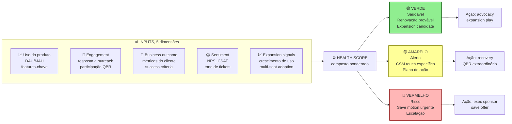

Cinco dimensões compõem um score único. Triggers automáticos por cor. Verde para advocacy. Amarelo para touch preventivo. Vermelho para escalação com exec sponsor.

Na rotina da equipe, a cor da conta dita a ação imediata da semana: contas no verde entram na fila de coleta de depoimentos, indicações e propostas de expansão. Contas no amarelo recebem contato preventivo do CSM com roteiro de reativação de uso, e contas no vermelho acionam intervenção direta do patrocinador executivo.

**Automação:** As ferramentas de CS permitem health score automatizado, mais triggers de ação. "Se conta fica vermelha por quatorze dias, agendar uma reunião de diagnóstico e resgate com o CSM e escalar para a liderança de CS quando o contrato superar R$ X."

#### 3. QBR (Quarterly Business Review), o ritual de valor

A revisão trimestral de negócios (QBR) é a reunião executiva entre o gerente de sucesso (CSM) e o decisor da conta-chave, estruturada em cinco pautas: (1) balanço de resultados, confrontando as metas financeiras contratadas com os números efetivamente alcançados, (2) escuta ativa do cliente, mapeando o que funciona bem e onde há atrito operacional, (3) **alinhamento de roteiro de produto (*roadmap*), conectando as próximas entregas técnicas às prioridades do comprador, (4) oportunidades de expansão, avaliando novos setores da empresa, licenças adicionais ou módulos complementares, e (5) planejamento da renovação**, antecipando o cronograma de aprovação do próximo ciclo contratual.

Roteiro prático da revisão trimestral (QBR): envie o material 72 horas antes. Reserve de 60 a 90 minutos na agenda. Garanta a presença do defensor interno (*champion*) e do patrocinador executivo do cliente, e encerre com o plano de ação do próximo trimestre e a data da reunião seguinte já marcada.

Quando fazer QBR. Contas de ticket alto (R$ 5 mil ou mais por mês em SaaS mid-market, R$ 20 mil ou mais em enterprise). Contas estratégicas (referenceabilidade, e influência). Não fazer QBR em cem por cento da base. Muito caro. Segmentação é chave.

#### 4. Renewal motion, a venda que ninguém vê

Renewal não é "momento de assinar contrato". É processo estruturado, que começa noventa a cento e vinte dias antes da renovação.

Cronograma da esteira de renovação: em T-120 dias, audite o *Health Score* da conta e mapeie eventuais riscos técnicos ou políticos. Em T-90 dias, inicie o contato executivo apresentando o balanço de retorno sobre o investimento (ROI) acumulado e o plano para os próximos 12 meses. Em T-60 dias, envie a proposta formal de renovação (já incorporando eventuais expansões de escopo ou licenças). Em T-30 dias, conclua os ajustes contratuais e jurídicos, e em T-0, registre o contrato renovado ou conduza a entrevista estruturada de desligamento.

Pipeline de renewal em forma de timeline.

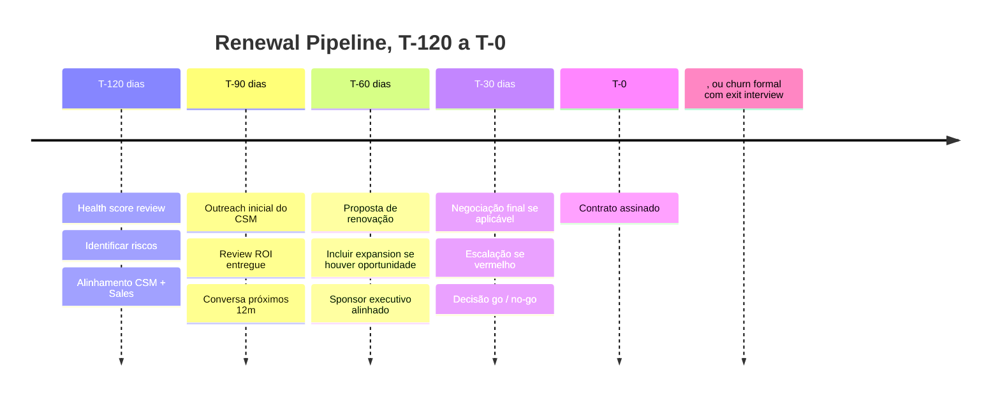

> [!important] Renewal é processo, não evento
> Iniciar a tratativa de renovação apenas a 30 dias do vencimento impede a reversão de contas desgastadas e inviabiliza a aprovação orçamentária de expansões: trate a marca de 120 dias antes do término contratual como o gatilho obrigatório de abertura da negociação no CRM.

Infraestrutura da área: integre o CRM à plataforma de gestão de pós-venda para dar ao financeiro e ao CEO visibilidade em tempo real das renovações dos próximos 90 dias.

**Métricas:** Renewal rate (gross), percentual das contas renovando no valor original, ou maior, alvo igual ou maior que noventa por cento. Expansion at renewal, percentual das renovações com expansão, alvo igual ou maior que trinta por cento. Time to renewal resolution, dias entre T menos noventa e a decisão (fechada), alvo igual ou menor que setenta e cinco.

#### 5. Expansion motion, upsell e cross-sell com disciplina

A expansão da carteira divide-se em três movimentos: *upsell* (mais licenças ou migração para um plano superior do mesmo produto), *cross-sell* (contratação de um módulo ou produto complementar) e crescimento automático por volume de uso (*usage-based*).

Gatilhos de expansion. Uso do cliente atingindo setenta a oitenta por cento do tier atual. Novos usuários sendo adicionados de forma orgânica. Caso de uso novo mencionado pelo champion. Crescimento da empresa do cliente (nova loja, nova unidade, etc.). Introdução de novo produto pela sua empresa.

Quem conduz. O CSM identifica, e qualifica, oportunidade. Em deals grandes, Account Executive (Sales) pode conduzir fechamento. Em organizações maduras, CS tem quota de expansion.

Roteiro de execução da expansão: identifique o momento oportuno pelos sinais de uso, pelas revisões trimestrais (QBR) ou pelo retorno do suporte. Quantifique o ganho financeiro incremental para o comprador ("como sua equipe já processa X, ativar o módulo Y economizará Z por mês"). Apresente uma proposta objetiva com preço, prazo e condições, e formalize o fechamento de maneira ágil por meio de um simples aditivo ao contrato vigente.

#### 6. Churn mitigation, ação quando sinais aparecem

O cancelamento (*churn*) divide-se em voluntário (quando o cliente decide encerrar o contrato por falta de uso, preço ou mudança de fornecedor) e involuntário (quando a cobrança falha por cartão vencido, limite insuficiente ou encerramento da empresa compradora).

**Mitigação de cancelamento voluntário (*voluntary churn*):** em contratos B2B, combine ofertas de retenção (desconto temporário, mudança de plano ou pausa programada), ligação de diagnóstico conduzida por liderança de CS e campanhas de reconquista (*win-back*) três a seis meses após a saída, quando a frustração inicial já cedeu. Em assinaturas B2C, separe o rito: registre o pedido de cancelamento imediatamente pelo próprio canal de contratação antes de apresentar qualquer oferta de pausa ou desconto, pois dificultar a saída com ligações de retenção fere o Código de Defesa do Consumidor e as normas de atendimento aplicáveis a serviços regulados e financeiros digitais (Decreto 13.135/2026, detalhado no [[IGNICAO-Vol-8-Juridico-LGPD-e-Seguranca#CAPÍTULO 7: DIREITO DO CONSUMIDOR E CDC PARA STARTUPS|Volume 8, Capítulo 7]]).

**Mitigação de cancelamento involuntário (*involuntary churn*):** no cartão de crédito, automatize a atualização de cartões prestes a vencer e programe retentativas espaçadas (*smart retry*) em horários distintos. Para a parcela expressiva da carteira brasileira que paga via boleto ou transferência, implemente uma régua preventiva de avisos (três dias antes do vencimento, na data do vencimento e dois dias após) e ofereça a migração da recorrência para o Pix Automático (em operação pelo Banco Central desde junho de 2025) ou para débito automático.

Post-mortem de churn. Toda conta que churnar deve ter exit interview. Padrões emergem.

#### 7. Advocacy, transformar clientes em multiplicadores

Programa de advocacy inclui cinco peças. Referrals, incentivo para o cliente indicar novos. Case studies, o cliente aparece como caso público. Reviews, G2, Capterra, Trustpilot. Speaking opportunities, o cliente no painel do seu evento. Advisory board, clientes-chave dão input em roadmap.

**Incentivos:** Monetários (comissão, desconto, crédito). Reconhecimento (logo no site, prêmio anual, menção pública). Acesso (beta features, e eventos exclusivos).

> [!warning] Não pedir advocacy a conta amarela ou vermelha
> Advocacy exige conta saudável. Pedir referência a cliente em estado amarelo, ou vermelho, queima o relacionamento, e gera referência negativa. Espere o cliente estar em verde sustentado por três meses, antes de pedir caso público, ou indicação.

#### 8. CS-Led Growth, expansão como motor de receita

CS-Led Growth (CSG) é o modelo onde a função de Customer Success, e não a de Sales ou Marketing, é o principal motor de crescimento de receita. Contrapõe-se ao modelo Sales-Led Growth (crescimento via outbound e ciclos de venda) e ao Product-Led Growth (crescimento via adoção orgânica do produto). Em SaaS B2B maduro com base instalada relevante, CSG frequentemente produz o maior ROI por real investido porque expande receita em clientes que já compraram e já confiam.

**A lógica financeira.** Expandir receita dentro da carteira atual custa uma fração do CAC de um cliente novo, já que o relacionamento comercial e a integração técnica estão prontos. Com NRR acima de 100%, a receita da base cresce mesmo sem nenhuma venda nova. Com NRR de 110%, o faturamento da coorte existente avança 10% ao ano em média, compensando cancelamentos e reduções com expansões (lembrando que o indicador mede exclusivamente a carteira já ativa e nunca soma logos novos da área de aquisição). Em SaaS B2B, a retenção líquida da base é um dos indicadores mais acompanhados na avaliação de múltiplo da empresa.

**Mecanismos de CS-Led Growth em seis peças.**

*Movimento estruturado de expansão*: o gerente de sucesso acompanha metas de expansão de conta além da renovação, mas só aciona venda adicional quando a adoção está saudável (clientes usando apenas 40% do plano estão em risco de redução ou cancelamento e precisam de resgate de adoção, não de *upsell*). Na revisão trimestral (*QBR*), o gatilho real de expansão parte da capacidade consumida: *"Vocês já utilizam 85% das licenças contratadas e abriram duas novas filiais neste trimestre, vamos incluir a terceira unidade no plano anual?"*.

*Land and expand deliberado*: vender o mínimo para entrar na conta (land), com plano explícito de expansão por módulo, time, ou uso. Em contratos enterprise, o CSM tem mapa de account com divisões, projetos e potencial de expansão por linha de produto.

*Product-led CS hybrid*: o produto identifica automaticamente sinais de expansion (uso próximo do limite de usuários, features premium sendo testadas mas não contratadas, padrão de uso que indica caso de uso adicional) e dispara playbook de CS. CSM entra com contexto de dados, não em cold call.

*NRR como meta compartilhada da empresa*: a retenção líquida sai da planilha exclusiva de CS e entra nos OKRs de produto e engenharia. Uma funcionalidade que destrava a adoção eleva a expansão, enquanto a correção de um gargalo técnico reduz o cancelamento, dando ao time de pós-venda voz direta na priorização do *roadmap*.

*Promotores como canal de aquisição (*advocacy*)*: um pós-venda que organiza indicações formais, estudos de caso públicos e participação de clientes em eventos fecha o ciclo entre retenção e aquisição. Como o custo de adquirir um cliente indicado pela própria carteira é bem menor que o da prospecção ativa (*outbound*), cada conta satisfeita que traz um novo contrato realimenta o crescimento orgânico.

*Executive sponsors*: para contas acima de R$ 50-100k ARR, CSM sênior ou executivo da empresa mantém relacionamento com C-level do cliente. Objetivo: visibilidade de risco de churn, e oportunidade de expansion, antes que apareçam nos dados.

**Quando CSG se torna o motor primário.** Base instalada acima de R$ 5M ARR. NRR atual entre 90-110% (espaço para otimizar). Produto com expansão natural (usuários, módulos, volume, ou regiões). CAC de novos logos crescendo (eficiência de aquisição diminuindo). Equipe de CS com 3+ CSMs que podem ter quota individual de expansion.

> [!tip] CSG não substitui aquisição
> O crescimento puxado pelo pós-venda (*CS-Led Growth*) multiplica o valor da carteira, mas continua precisando da entrada de novas contas para renovar a base: combinando aquisição saudável com retenção e expansão, a operação sustenta um NRR acima de 100% em PMEs, 110% em médio porte e 120% em contas corporativas.

### Time-to-Value (TTV), Taxa de Conclusão de Onboarding, Health Score, Gross Retention (GRR) e Net Revenue Retention (NRR)

**Retenção:** retenção bruta de receita (GRR, sem contar expansões, cuja referência em SaaS corporativo maduro segundo levantamentos da Bessemer e do KeyBanc situa-se entre 90% e 95% ao ano, ou 85% a 90% em PMEs), retenção líquida de receita (NRR, somando expansões, conforme as faixas por porte definidas na abertura do capítulo: acima de 100% em PMEs, 110% em médio porte e 120% em contas corporativas), retenção mensal de contas ativas e taxa de cancelamento (*churn* de clientes e de receita).

**Adoção:** taxa de ativação na implantação (referência prática ≥ 70%), percentual da base ativa que utiliza as funcionalidades centrais e razão DAU/MAU (frequência de uso diário sobre o mensal).

**Satisfação:** NPS trimestral (bom a partir de 50 a 55 e excelente a partir de 65 a 70 em SaaS B2B, conforme a tabela por segmento adiante), CSAT por chamado encerrado ou implantação concluída (meta de nota média ≥ 4,5 em 5, com pelo menos 85% a 90% de notas 4 e 5) e Índice de Esforço do Cliente (CES).

**Expansion.** Expansion MRR, receita adicional em base existente. Expansion at renewal, percentual com expansão. Cross-sell rate, percentual com múltiplos produtos.

**Operacional.** CSM ratio, accounts per CSM (segmentado por tier). Time to respond, e time to resolve. QBR coverage, percentual de contas-alvo com QBR no trimestre.

---

### Arquitetura de Customer Experience (CX): Mapeamento da Jornada do Cliente

O Customer Journey Map (mapa da jornada do cliente) é a representação visual de como o cliente passa de desconhecido a advogado da marca: com cada etapa, emoção, ponto de contato e oportunidade de intervenção mapeados. No contexto brasileiro, o exercício tem particularidades específicas por segmento.

#### Como construir o mapa

A estrutura básica de um Customer Journey Map tem cinco dimensões horizontais (linhas) para cada etapa da jornada:

```text
ETAPAS      | Awareness | Consideração | Onboarding | Adoção | Expansão | Renovação | Advocacy
------------+----------+--------------+-----------+-------+----------+-----------+---------
AÇÕES       | O que o cliente faz em cada etapa
PENSAMENTOS | O que está pensando (voz do cliente)
EMOÇÕES     | Frustração, confiança, entusiasmo, dúvida
TOUCHPOINTS | Canal ou ponto de contato com a empresa
OPORTUNID.  | Onde a empresa pode intervir para melhorar
```

Para B2B SaaS brasileiro, os pontos de maior fricção são consistentemente: primeiro login (confusão com configuração inicial), aprovação interna do cliente (integração com sistemas como SAP/TOTVS), e renovação (quando o campeão interno saiu e o novo gestor não foi onboardado).

Para aplicativos B2C, os pontos decisivos concentram-se nas primeiras 72 horas após o download (abandono por não perceber valor imediato), na calibragem de notificações (cujo excesso provoca a desinstalação) e no fluxo de retorno após períodos de inatividade, quando a reativação precisa ser relevante sem soar invasiva.

#### Os 5 momentos que importam

Não existe mapa de jornada que cubra tudo com igual profundidade. Fundadores com equipe enxuta devem concentrar a energia nos cinco momentos da jornada que mais pesam no resultado financeiro:

**Momento 1: Primeira Entrega de Valor (*First Value*).** É o instante em que o comprador comprova na prática a promessa comercial: o primeiro relatório gerado no software B2B ou a primeira tarefa resolvida no aplicativo. Acompanhe o tempo até esse marco em horas ou dias, pois clientes que experimentam um ganho concreto já nas primeiras 24 horas costumam apresentar retenção bem superior no primeiro mês.

**Momento 2: Adoption.** Quando o cliente passa de uso ocasional para uso habitual, o produto vira rotina. No B2B SaaS, adoção é geralmente medida pelo percentual de seats ativos (usuários que logaram nas últimas duas semanas versus total de licenças pagas). Em B2C, é frequência de uso semanal. Adoção baixa é o sinal mais precoce de churn futuro: com dois a quatro meses de antecedência.

**Momento 3: Expansion Trigger.** O ponto em que o cliente atingiu o limite do plano atual ou descobriu uma necessidade adjacente que o produto também resolve. Identificar esse trigger proativamente (antes do cliente) e apresentar a solução no momento certo é o mecanismo de expansão de receita mais eficiente. Em B2B SaaS, o gatilho mais comum é crescimento de usuários ou volume de dados/transações. Em B2C, é habitualidade atingindo o limite de funcionalidades do plano gratuito.

**Momento 4: Renewal.** A renovação não deveria ser evento, deveria ser consequência natural de valor acumulado. Quando a renovação se torna negociação ou risco, é sinal de que os momentos anteriores falharam. Contas que chegam ao fim do ciclo com satisfação elevada e uso ativo na maioria das licenças contratadas costumam renovar o contrato quase integralmente sem atrito comercial. O oposto também é verdade: renovação como evento de risco é sintoma, não causa raiz.

**Momento 5: Advocacy.** O cliente passa a recomendar ativamente, faz referral, aceita ser case study, responde convite para evento, posta no LinkedIn. Advocacy não se compra com desconto. Surge de combinação de valor entregue, experiência de suporte memorável em momentos difíceis, e senso de pertencimento a algo maior. No Brasil, a confiança boca a boca tem peso especialmente alto no ciclo de vendas B2B, onde o fundador frequentemente é o canal mais eficiente de referrals.

---

### NPS como Sistema Operacional (e a Regra do Pico-Fim na Jornada)

Olhar apenas para a nota isolada do NPS serve de vaidade. O indicador só gera retenção quando opera como sistema de intervenção rápida: fechar o ciclo com cada detrator em até 48 horas e redesenhar a experiência segundo a regra do pico-fim (*peak-end rule*), formulada pelo psicólogo e prêmio Nobel Daniel Kahneman, segundo a qual as pessoas julgam uma experiência quase inteiramente pelo seu ponto mais intenso (positivo ou negativo) e pelo modo como ela termina. Na plataforma de clínicas odontológicas de Camila, as pesquisas pós-atendimento mostravam que o paciente esquecia trinta minutos de cadeira confortável se enfrentasse fila na recepção ao pagar ou ficasse sem orientação na primeira noite após a cirurgia. Ao instituir uma ligação obrigatória em até 48 horas para todo paciente com nota abaixo de 7 e substituir a cobrança fria no balcão por uma mensagem automática de acompanhamento pós-operatório no WhatsApp na manhã seguinte, Camila redesenhou o pico de cuidado e o encerramento da consulta, reduzindo drasticamente o abandono de tratamentos longos.

#### NPS transacional vs. relacional

Existem dois tipos de NPS com finalidades distintas:

**NPS relacional.** Pesquisa periódica (trimestral ou semestral) enviada para toda a base, que mede a percepção geral do relacionamento com a empresa. Responde: "Como você se sente sobre nós, em termos gerais?" Útil para acompanhar tendência macro, para benchmark com mercado, e para detectar deterioração de percepção antes que vire churn.

**NPS transacional.** Pesquisa enviada após interação específica: término do onboarding, resolução de ticket, renovação, entrega de feature. Responde: "Como foi essa interação?" Mais acionável que o relacional, porque o contexto do feedback é claro e o tempo de resposta é curto.

> [!tip] Combinação ideal
> Em early stage (menos de 200 clientes), use NPS transacional como rotina e relacional apenas quando precisar de benchmark para apresentar ao board ou investidor. Feedback qualitativo de 20 clientes detratores vale mais do que NPS numérico sem contexto.

#### Como construir o loop fechado (close the loop)

NPS sem ação é pesquisa acadêmica. O loop fechado tem quatro etapas:

1. **Coleta**: envio da pesquisa no momento certo, buscando volume absoluto de respostas suficiente para reduzir a margem de erro estatística (100 ou mais respostas no agregado, ou cobertura das contas principais em B2B) e comparando o comportamento de retenção de quem responde com o de quem permanece em silêncio.

2. **Triagem em até 48 horas:** clientes detratores (notas 0 a 6, faixa vermelha no *Health Score*, enquanto 7 e 8 compõem a faixa amarela e 9 e 10 a verde) recebem ligação ou mensagem direta do gerente da conta ou do fundador para entender a falha e agir antes do cancelamento.

3. **Diagnóstico**: categorizar o feedback em buckets (produto, suporte, preço, expectativa não atendida, concorrente melhor). Em três meses de coleta consistente, padrões emergem.

4. **Ação e comunicação (fechar o ciclo com o cliente):** avise diretamente quem respondeu: *"Você apontou o problema X, e nós implementamos a melhoria Y por causa do seu alerta."* Esse retorno individual, que pouquíssimas empresas executam, é o momento em que detratores viram neutros e neutros viram promotores.

> [!warning] O erro mais comum com NPS no Brasil
> Empresas brasileiras enviam NPS, coletam dados, montam dashboard bonito e não ligam para nenhum detrator. O modelo mental de "pesquisa para medir satisfação" precisa virar "pesquisa para identificar quem está em risco e agir antes do churn".

#### Faixas de referência aproximadas de NPS por segmento

```text
Segmento                  | NPS médio | NPS bom | NPS excelente
--------------------------+-----------+---------+--------------
SaaS B2B PME              |    35-45  |   50+   |    65+
SaaS B2B Mid-market       |    40-50  |   55+   |    70+
SaaS B2B Enterprise       |    30-45  |   50+   |    65+
Consumer app (B2C)        |    20-35  |   45+   |    60+
E-commerce B2C            |    15-30  |   40+   |    55+
Marketplace B2C           |    10-25  |   35+   |    50+
```

---

### CSAT e CES no Brasil

Net Promoter Score mede relacionamento. Customer Satisfaction Score (CSAT) e Customer Effort Score (CES) medem interações específicas. Os três se complementam e devem ser usados em momentos distintos.

O **CSAT** (*Customer Satisfaction Score*) avalia uma interação específica (como um chamado de suporte ou a conclusão da implantação) em escala de 1 a 5, podendo ser acompanhado tanto pela nota média (meta ≥ 4,5) quanto pelo percentual de notas 4 e 5 no total de respostas (abaixo de 75% exige correção imediata, enquanto patamares acima de 85% a 90% indicam excelência operacional).

O **CES** (*Customer Effort Score*) mede o esforço percebido para concluir uma tarefa: na versão atualizada (CES 2.0), o cliente avalia a afirmação *"A empresa tornou fácil resolver a minha questão"* em uma escala direta de concordância que vai de 1 (*discordo totalmente*, alto esforço) a 7 (*concordo totalmente*, baixo esforço), substituindo a escala invertida de 1 a 5 da formulação original de Matthew Dixon, Karen Freeman e Nicholas Toman na *Harvard Business Review* (*Stop Trying to Delight Your Customers*, 2010). Como demonstraram Matthew Dixon, Nick Toman e Rick DeLisi no livro *The Effortless Experience* (2013), 96% dos clientes submetidos a interações de alto esforço declaram intenção de deslealdade, contra apenas 9% entre os que relatam baixo esforço. No Brasil, o indicador é essencial logo após a implantação inicial, integrações técnicas e migrações de dados, sobretudo em ERPs, plataformas de dados e softwares com curva de aprendizado acentuada.

#### Quando usar cada métrica

```text
Situação                        | Métrica indicada | Por quê
--------------------------------+-----------------+---------
Após ticket de suporte          | CSAT            | Mede qualidade da interação
Após onboarding                 | CES + NPS trans.| Esforço + percepção inicial
Após integração técnica         | CES             | Detecta fricção técnica
Trimestralmente com toda base   | NPS relacional  | Saúde geral do relacionamento
Após renovação                  | NPS transacional| Percepção da decisão de renovar
Após resolução de problema grave| NPS + CSAT      | Recovery bem-feito pode virar promotor
```

**Correlacionando com churn.** O padrão mais confiável que emerge em empresas SaaS com instrumentação adequada: um cliente que atribui nota baixa de satisfação (1 ou 2 na escala de 1 a 5 do CSAT) em dois chamados seguidos, ou nota de esforço 1 a 3 no CES de onboarding, entra imediatamente em fila de intervenção proativa. Cliente com CES < 3 no onboarding tem 2x mais chance de não atingir adoção plena. Esses são os alertas que devem disparar intervenção proativa, não esperar que o cliente cancele.

---

### Reclame Aqui como estratégia, não como problema

Segundo dados institucionais divulgados pelo próprio Reclame Aqui, a plataforma recebe dezenas de milhões de consultas mensais de consumidores brasileiros e funciona como etapa habitual de verificação de reputação antes da decisão de compra em diversos setores B2C e B2B2C. Ignorar o canal na arquitetura de experiência do cliente é um erro estratégico custoso.

#### Por que responder publicamente importa

A resposta pública atende a dois públicos simultâneos: o cliente que abriu a queixa (em busca de solução concreta) e o visitante silencioso (*lurker*, as centenas de compradores em dúvida que leem o histórico antes de fechar o pedido). Uma empresa com reputação elevada no Reclame Aqui, alto índice de solução e tempo curto de resposta demonstra responsabilidade e capacidade operacional, mesmo quando ocorrem falhas pontuais, ao passo que o silêncio transmite descaso.

O **selo RA1000**, a certificação máxima de reputação do Reclame Aqui (atualizada periodicamente conforme o volume de reclamações registradas, o índice de resposta, a nota atribuída pelos consumidores, o índice de solução igual ou superior a 90% e a intenção de voltar a fazer negócio), funciona no Brasil como vitrine pública de confiança no atendimento. Para uma operação B2C em estágio inicial, manter nota média acima de 7,0 e índice de solução acima de 85% já constitui um diferencial competitivo claro. Na marca nativa digital (D2C) de Rafael e Bia, quando uma falha do operador logístico atrasou um lote de entregas na véspera do Dia das Mães e gerou doze reclamações públicas num único fim de semana, Bia assumiu o protocolo: respondeu a cada chamado em menos de 24 horas reconhecendo a falha sem texto padronizado, despachou um item adicional de cortesia com frete expresso e acompanhou a entrega pelo WhatsApp até a confirmação do cliente. Nove dos doze consumidores avaliaram o atendimento com nota 10 e voltaram a comprar no trimestre seguinte, elevando a reputação pública da loja.

#### Como transformar crítica em caso de relacionamento

A anatomia da resposta que transforma detrator em promotor:

1. **Reconhecer especificamente.** Não copiar e colar texto genérico. Referenciar o problema específico descrito na reclamação.
2. **Assumir responsabilidade sem defensividade.** "O sistema apresentou instabilidade no dia X, o que afetou diretamente o senhor. Isso não deveria ter acontecido."
3. **Resolver ou explicar o que está sendo feito.** Ação concreta, não promessa vaga.
4. **Oferecer canal privado para continuação.** O Reclame Aqui não é o lugar para resolver detalhes: é o lugar para demonstrar postura pública e abrir canal.
5. **Follow-up.** Fechar o caso com confirmação de resolução é o passo que mais transforma percepção.

> [!tip] O que NÃO responder
> Reclamações que envolvem processo judicial em curso não devem ter resposta detalhada: consultar jurídico antes. Reclamações claramente fraudulentas (que mencionam produtos que a empresa não vende, ou nomes diferentes) podem ser contestadas formalmente. Reclamações de concorrentes disfarçados de clientes (padrão identificável por conta nova, linguagem idêntica a outras reclamações em série) devem ser marcadas para análise.

### Armadilhas de CS e CX: do CSM de R$ 8 mil atendendo contas de R$ 99 ao NPS sem retorno

Um gerente de sucesso do cliente com custo total de R$ 8.000 mensais (entre salário e encargos) precisaria reter sozinho mais de 100 assinaturas de R$ 99 por mês, considerando uma margem bruta de 80%, apenas para empatar o próprio custo, sem deixar um real para engenharia ou aquisição. Atender tickets baixos com reuniões individuais destrói a economia unitária da operação: contas de entrada exigem *onboarding* guiado dentro do produto e réguas automatizadas (*tech-touch*), reservando o acompanhamento humano dedicado para contratos que pagam a conta. Além desse erro de segmentação, evite as dez falhas operacionais abaixo:

CS como suporte. Confundir função estratégica com atendimento reativo. Perde o papel de expansion, e retention proativo.

CSM sem quota. Sem accountability por expansion, ou renewal, vira "fazer bonito com cliente". Não escala.

Health score sem ação. Score bonito no dashboard, e ninguém age sobre amarelo, ou vermelho.

QBR genérico. Reunião que vira "atualização de status". O cliente cansa, e para de aceitar.

Renewal como surpresa. CSM descobre renewal trinta dias antes. Sem runway para negociar, salvar, ou expandir.

Sem segmentação. Mesma motion para cliente de R$ 500 por mês, e R$ 50 mil por mês. Economicamente ruim.

Ignorar usage data. Monitorar NPS, mas não uso real do produto. NPS pode ser alto enquanto o uso despenca.

Save offers sem limite. Desconto para todo cliente que ameaça sair destrói o preço de mercado.

CS desalinhado com Product. O CSM sabe a pain dos clientes. Mas o feedback não chega ao roadmap.

Pedir advocacy cedo. Cliente no mês 2 ainda não é advocate. Pedir referência destrói relacionamento frágil.

### Checklist de execução prática

As disciplinas de Customer Success e Customer Experience estão maduras quando a implantação inicial tem métricas acompanhadas, o *health score* dispara intervenções preventivas, as revisões trimestrais (*QBRs*) ocorrem nas contas estratégicas, a renovação opera como processo contínuo, a expansão integra as metas do time, a retenção líquida (NRR) sustenta o patamar do seu segmento (acima de 100% em PMEs, 110% em médio porte e 120% em contas corporativas), a jornada do cliente está mapeada com gatilhos claros, o ciclo de NPS com detratores é fechado em até 48 horas, a reputação pública no Reclame Aqui é gerida ativamente e o conselho recebe mensalmente o pipeline de renovação, o NRR e a saúde da carteira. Os itens abaixo consolidam essa rotina:

- [ ] Onboarding estruturado, com etapas claras, e métricas definidas.
- [ ] Health score modelo implementado, com triggers de ação.
- [ ] QBR template, e cadência, definidos para contas-chave.
- [ ] Renewal pipeline com visibilidade T menos cento e vinte dias.
- [ ] CSMs têm quota, ou KPI, de expansion definido.
- [ ] Segmentação clara (High-Touch, Tech-Touch, Low-Touch), conforme ticket, ou estratégia.
- [ ] Churn exit interview aplicado a cem por cento das saídas voluntárias.
- [ ] Programa de advocacy ativo, com benefícios claros.
- [ ] CS platform (Gainsight, ChurnZero, Totango, Vitally, ou equivalente) em uso.
- [ ] Retenção líquida (NRR) e retenção bruta (GRR) apuradas por safra e apresentadas mensalmente ao conselho.

---

### O Espelho do Capítulo 8: Seu Time Entrega Resultado Real ou Apenas Pede Desculpas com Simpatia?

Três meses após instituírem a trava automática de implantação, Lucas e Marina passaram a ligar pessoalmente no décimo dia para toda empresa que ainda não havia emitido o primeiro relatório de auditoria de boletos. O cancelamento silencioso aos noventa dias desapareceu da planilha de renovações, e as contas que atingiam o primeiro valor na semana de estreia tornaram-se a principal fonte de expansão de licenças da operação.

**O Espelho (autodiagnóstico):**
1. Quantos dias exatos um cliente novo leva, em média, desde o pagamento até alcançar a primeira vitória concreta dentro do seu produto ou serviço?
2. Você sabe dizer hoje de manhã quais são os 10 clientes da sua carteira cujo uso caiu mais de 50% nas últimas duas semanas (sinal vermelho de cancelamento iminente), ou você só descobre quando eles pedem o distrato?
3. Quando você faz uma reunião trimestral com o cliente, você leva um relatório mostrando o dinheiro/tempo que ele ganhou com você, ou pergunta timidamente *"está tudo bem aí?"*?

**Permissão Libertadora:**
Você está autorizado a cobrar firme do seu cliente durante os primeiros 15 dias de *Onboarding*. O cliente que atrasa a entrega dos dados iniciais na primeira semana caminha para cancelar o contrato no terceiro mês, e cobrar esse passo agora é proteger o resultado dele e a sua retenção.

**O Ritual de Segunda-Feira às 9h:**
Puxe a lista de todos os clientes que compraram nos últimos 30 dias e marque em vermelho quem ainda não atingiu o marco de Primeiro Valor. Ligue pessoalmente para cada um deles hoje e destrave o uso em 15 minutos.

---

# INSTRUMENTAÇÃO DE DADOS, PRODUTO AI-NATIVE E ANATOMIA DO PIVÔ (CAPÍTULOS 9 A 11)

Fechando a etapa de Tração, estes três capítulos atacam três decisões estruturais: como instrumentar sua *stack* de dados e métricas sem cair em vaidade, como desenhar produtos *AI-Native* com margem saudável e fosso defensável, e como executar um pivô estratégico com coragem analítica quando a tese original bate no teto.

---

## CAPÍTULO 9: DADOS, ANALYTICS E EXPERIMENTAÇÃO

### O painel de 80 gráficos que não serve para nada

Em visita ao polo de operação em Florianópolis, Lucas observava com orgulho os três monitores gigantes na parede. Havia gráficos de pizza, mapas de calor em tempo real, contadores de acessos totais acumulados desde 2023, número de cliques por hora e curtidas nas redes sociais. Todas as linhas subiam sempre para a direita.

Numa terça-feira, Marina fez uma pergunta simples diante dos três monitores:

– "Lucas, na semana passada nós mudamos o fluxo de cadastro e lançamos o alerta automático por WhatsApp. Olhando para essas oitenta telas coloridas, essa mudança fez os clientes usarem mais o sistema e renovarem mais, ou foi tempo jogado no lixo?"

Lucas olhou para o monitor da esquerda, depois para o do meio, depois para o da direita. e ficou mudo. Nenhum daqueles oitenta gráficos respondia à pergunta. Eles tinham terabytes de eventos salvos no banco, mas zero clareza para tomar uma decisão de negócios. Estavam afogados na Cegueira do Excesso de Dados de Vaidade.

Números acumulados que só sobem para a direita (total de cadastros históricos, total de downloads, total de visualizações) são entorpecentes psicológicos: servem para massagear o ego dos fundadores em reuniões de conselho, mas nunca dizem se o motor está prestes a fundir.

Instrumentação de produto de verdade exige coragem para jogar 90% do ruído fora e governar a empresa por uma North Star Metric (Métrica Estrela Polar), o único número que captura o momento exato em que o cliente recebe valor real, acompanhada de uma Métrica de Guarda-Corpo (*Guardrail Metric*) que impede você de trapacear no curto prazo destruindo a saúde de longo prazo.

---

> [!note] Nota de validade
> A arquitetura de dados evolui em ciclos de três a cinco anos (Lambda, depois Kappa, depois Modern Data Stack, e o que vier a seguir). Ferramentas mudam a cada doze a vinte e quatro meses. Os princípios (métricas claras, experimentação rigorosa, dado como contrato) são estáveis. Revisar anualmente.

Ao longo da coleção, as métricas apareceram aplicadas a problemas específicos: o funil AARRR (Aquisição, Ativação, Retenção, Receita e Indicação) e o *Pirate Canvas* na [[#FASE 11: MVP E EXPERIMENTOS DE MERCADO|Fase 11]], a economia unitária na [[#FASE 12: VALIDAÇÃO DO MODELO DE NEGÓCIO|Fase 12]] e a descoberta contínua em escala no [[IGNICAO-Vol-7-Produto-Engenharia-e-Operacoes#CAPÍTULO 1: PRODUTO EM ESCALA E DESCOBERTA CONTÍNUA|Volume 7, Capítulo 1]]. Faltava consolidar dados como disciplina operacional unificada, reunindo arquitetura (*stack*), papéis do time, dicionário de eventos e experimentação controlada, papel que este capítulo cumpre. Sem uma infraestrutura mínima de dados após o PMF, a empresa decide no escuro e executa testes que não medem o que prometem medir.

Este capítulo cobre dados como função: stack moderno, papéis do time de dados, métricas com formulação precisa, experimentação rigorosa (A/B testing com estatística, não achismo) e evolução em escala.

### Por que ter cem gráficos no painel que ninguém usa para decidir é exatamente igual a voar no escuro

Decisões sem dados são achismos em escala. Em pré-PMF, a intuição do fundador é frequentemente correta (contexto denso, mercado pequeno). Em escala, ninguém vê o todo. Dados são a única forma de ver.

Experimentos mal desenhados são piores que não experimentar. Resultado "ganhamos quinze por cento" em A/B test com amostra pequena, sem significância estatística, pode ser ruído. Decisão baseada nisso piora a empresa.

Stack de dados é infraestrutura, não luxo. Sem stack adequado, os dados ficam em silos (CRM, produto, financeiro). As análises levam dias e há inconsistências entre áreas.

Time de dados em escala é multi-função: analytics engineer, data scientist, PM de dados, data engineer. São papéis distintos que o fundador iniciante frequentemente confunde.

### Definindo a North Star, o dicionário de 10 eventos vitais, a leitura de coorte e o stack de dados

Antes de escolher ferramentas, aplique o método do *North Star Playbook* (detalhado na [[#FASE 13: PRODUCT-MARKET FIT|Fase 13]]): defina uma única North Star Metric que reflita o valor entregue ao cliente (no caso de Marina e Lucas, *boletos auditados e conciliados sem erro por semana*) e **3 a 4 métricas de entrada acionáveis (*inputs*) (como o percentual de contas que conectaram o ERP em até 24 horas e a taxa de ativação do alerta automático no WhatsApp). Em seguida, documente um dicionário enxuto com os 10 eventos essenciais da jornada (no padrão `objeto_ação`, como `conta_criada`, `arquivo_cnab_enviado`, `divergencia_detectada`, `alerta_whatsapp_enviado` e `assinatura_renovada`) e acompanhe a ativação e a retenção agrupadas por coorte semanal de entrada**. Para responder à pergunta de Marina sem cair em viés de autosseleção (já que comparar quem decidiu clicar com quem não clicou mistura o efeito do alerta com a motivação prévia do usuário), combine a leitura de coorte com um experimento controlado (Seção 3), comparando a retenção em D30 do grupo sorteado para receber o alerta automático no WhatsApp contra o grupo de controle que permaneceu no fluxo antigo.

#### 1. Modern Data Stack

Arquitetura padrão em SaaS moderno (2023 a 2026).

```text
FONTES TRANSPORTE ARMAZENAMENTO MODELAGEM CONSUMO
- App database → - Fivetran → - Snowflake → - dbt → - Looker / Metabase
- Billing (Stripe)  → - Airbyte  → - BigQuery   → - Camada SQL → - Mode / Hex
- CRM (Salesforce) - Stitch - Databricks - Notebooks
- Marketing - Redshift - Reverse ETL (Hightouch)
- Eventos (app) → - Segment → - Operacional
```

Os princípios em cinco peças.

ELT, não ETL. Ingestão bruta (Extract, Load), transformação no warehouse (dbt). Mais escalável, e reprocessável.

**dbt como camada de transformação:** Código versionado, testado, e documentado. Substitui stored procedures frágeis.

Warehouse dedicado. Não consultar direto na DB de produção (lock, lentidão, risco).

BI self-service. Os usuários de negócio podem fazer as próprias perguntas, sem passar por fila de analista.

Reverse ETL. Os dados transformados voltam para sistemas operacionais (enriquecimento de CRM, por exemplo).

Custo mensal típico, em empresa Série A. Fivetran, R$ 1-5 mil. Snowflake, R$ 2-10 mil. dbt Cloud, R$ 500-2 mil. Looker ou Metabase, R$ 1-5 mil. Segment, R$ 2-8 mil. Total. R$ 6-30 mil por mês. Escala com volume.

#### 2. Métricas, formulações precisas

Erro comum. Métrica nomeada ambiguamente, que cada área calcula diferente. "Churn de abril" varia por coorte (novos versus existentes), base (logo versus revenue), prazo (mensal versus anualizado), e pagamento versus uso.

> [!important] Regra para definir métricas-chave
> Toda métrica-chave da empresa deve ter definição formal escrita. Fórmula matemática. Fonte de dados. Cadência de update. Quem é dono. Sem isso, cada área reporta número diferente, e o board fica confuso.

Exemplo, churn de logo mensal.

```text
Fórmula:
 Churn_mensal(T) = Clientes_cancelados(T) / Clientes_ativos_no_início(T)

Definições:
 "Clientes_cancelados(T)": clientes cuja assinatura expirou em T sem renovação
 "Clientes_ativos_no_início(T)": clientes com assinatura ativa no dia 1 de T

Fonte: CRM (Salesforce), campo "cancellation_date"
Update: mensal, no dia 5 do mês seguinte
Dono: Head of CS
Dashboards: board_deck, cs_operational
```

Métricas SaaS essenciais com formulações.

MRR (Monthly Recurring Revenue). Soma de assinaturas recorrentes, normalizadas para valor mensal.

ARR (Annual Recurring Revenue). MRR vezes doze.

Net New MRR. Novo MRR mais Expansion MRR menos Churn MRR menos Contraction MRR.

NRR (Net Revenue Retention). (ARR_inicial_cohort mais Expansion menos Churn menos Contraction) dividido por ARR_inicial_cohort.

GRR (Gross Revenue Retention). (ARR_inicial_cohort menos Churn menos Contraction) dividido por ARR_inicial_cohort. A diferença em relação ao NRR. Não inclui expansion.

CAC. Gastos de S&M no período divididos por novos logos adquiridos no período.

**LTV, CAC, Payback e NRR:** para evitar duplicação de fórmulas entre áreas, utilize no dicionário de dados exatamente as equações canônicas de LTV e CAC Payback definidas na [[#FASE 12: VALIDAÇÃO DO MODELO DE NEGÓCIO|Fase 12]] e a fórmula de NRR e GRR por safra detalhada no [[#CAPÍTULO 6: PRICING STRATEGY E ECONOMIA DA RECORRÊNCIA (SUBSCRIPTION ECONOMY)|Capítulo 6]].

CAC Payback (em meses): CAC dividido por (ARPU mensal × Margem Bruta), conforme a regra de economia unitária da Fase 12.

Burn Multiple. Burn líquido no período dividido por Net New ARR no período.

Rule of 40. Percentual de Growth mais percentual de EBITDA Margin.

#### 3. Framework de experimentação (A/B testing rigoroso)

Erro clássico. Experimento sem significância estatística, tratado como "deu certo".

Um experimento controlado rigoroso divide-se em três etapas sequenciais: desenho, execução e leitura de resultados.

**Etapa 1 (de 3): desenho do experimento.** Hipótese explícita ("Se mudarmos X, a métrica Y moverá em Z por cento ou mais"). Métrica primária clara, uma, não cinco. Métricas secundárias para guardrails. Sample size calculation, quantos usuários precisam passar pelo experimento para detectar efeito com oitenta por cento de power, e noventa e cinco por cento de confiança? Duração definida, baseada em cálculo, não "rodar até dar certo". Guardrails, métricas que NÃO podem cair (por exemplo, não queremos aumentar ativação às custas de churn).

Cálculo de sample size. Para A/B simples com métrica de conversão, fórmula aproximada.

```text
n = 16 × baseline_rate × (1 - baseline_rate) / MDE²

onde MDE = Minimum Detectable Effect (em pontos absolutos de conversão)
```

**Exemplo:** partindo de uma taxa atual de conversão de 20%, queremos detectar um ganho mínimo de 2 pontos percentuais (chegando a 22%).

```text
n = 16 × 0.20 × 0.80 / 0.02² = 6.400 usuários por variante
```

Calculadoras online (Evan Miller's A/B test calculator, Optimizely Sample Size Calculator) fazem o cálculo com menos fricção.

**Etapa 2 | Execução do experimento.** Sorteie os usuários de forma determinística pelo identificador da conta (*hash* do *user ID*), mantenha o teste rodando pelo prazo calculado sem interromper na primeira oscilação favorável (*peeking*) e evite disparar duas alterações simultâneas no mesmo fluxo.

**Etapa 3: Leitura de resultados.** Ao encerrar o teste, reporte tanto o valor-p (*p-value*) quanto o intervalo de confiança. Um valor-p menor que 0,05 ($p < 0,05$) é a convenção padrão de significância estatística, enquanto equipes com alto volume de experimentos adotam cortes mais rigorosos ($p < 0,01$) para reduzir falsos positivos. Separe também a significância estatística da relevância prática: um ganho de 0,1% pode ser estatisticamente válido em amostras gigantescas, mas irrelevante para o negócio. Por fim, confronte o resultado com as métricas de guarda-corpo (*guardrails*): se a métrica primária subiu mas a retenção ou a margem caiu, trata-se de uma troca (*trade-off*) a deliberar, não de uma vitória automática. Antes de generalizar o achado para toda a base, verifique se o efeito se sustenta em diferentes segmentos e safras semanais.

**Ferramentas:** plataformas dedicadas de experimentação e controle de funcionalidades (*feature flags*), como LaunchDarkly, Optimizely, a opção de código aberto GrowthBook, Statsig (adquirida pela OpenAI em 2025) e Eppo (integrada à Datadog em 2025), além de soluções de teste em páginas web (como VWO e Convert) ou estruturas próprias construídas diretamente sobre o *data warehouse* da empresa.

#### 4. Quando experimentar, e quando não experimentar

Experimentar é adequado quando o volume é suficiente para detectar efeito em prazo razoável (menos de oito semanas). O efeito esperado é mensurável numericamente. Há reversibilidade, se a variante perder, o custo de reverter é baixo. Há múltiplas ideias competindo por implementação.

Experimentar NÃO é adequado quando o volume é baixo demais (o resultado vai levar seis meses). A decisão é estratégica, ou estrutural (entrar em novo mercado, pivô). O efeito é qualitativo (melhorar brand perception). O custo de implementar a variante é altíssimo (refazer pricing, por exemplo).

Em pré-PMF, experimentação rigorosa raramente é possível (volume baixo). Os métodos alternativos são qualitativos (entrevistas), quasi-experimentos (comparar antes e depois com controle), e decisão por julgamento informado.

#### 5. Data team em escala, estrutura

**Modelo centralizado:** um único time de dados atende a todas as áreas da empresa. Vantagens: foco técnico, padronização de métricas e eficiência de infraestrutura. Riscos: pode se tornar gargalo operacional e perder o contexto específico de cada unidade de negócio.

**Padrão embedded.** Data people alocados dentro de áreas (growth, produto, finance). Pros: contexto profundo, e velocidade. Cons: fragmentação, e inconsistências entre times.

**Padrão hub-and-spoke.** Time central mantém stack, e padrões. Data people embarcados em áreas usam o stack. Pros: melhor dos dois mundos. Cons: requer maturidade organizacional.

Em empresa Série A a B, centralized é mais pragmático. Hub-and-spoke vira sensato em Série C em diante.

#### 6. Governança de dados

**Desde o primeiro cliente (conformidade com a LGPD):** a Lei Geral de Proteção de Dados (Lei 13.709/2018, arts. 3º, 6º e 18) aplica-se desde a primeira coleta de dado pessoal, independentemente do porte da startup (contando os agentes de pequeno porte apenas com procedimentos simplificados pela Resolução CD/ANPD nº 2/2022). Desde o MVP, implemente controle de acesso por função, anonimização ou pseudonimização nas tabelas analíticas, registro de base legal e fluxo técnico para atender pedidos de acesso, correção ou eliminação feitos pelo titular (ver [[IGNICAO-Vol-8-Juridico-LGPD-e-Seguranca#CAPÍTULO 9: LGPD, COMPLIANCE E GOVERNANÇA DE DADOS|Volume 8, Capítulo 9]]). A partir da Série B (governança de escala): conforme o volume de tabelas e analistas cresce, adicione catálogo de dados (*data catalog* com documentação de colunas e regras), linhagem (*data lineage* para rastrear a origem de cada indicador), testes automatizados de qualidade (*dbt tests* com alertas de anomalia) e acordos de nível de serviço (SLAs de atualização dos painéis com responsável definido).

#### 7. Data Mesh: arquitetura distribuída para escala

Nota para a escala futura (pós-Série C): na etapa de tração e PMF, mantenha um único repositório central enxuto. Apenas quando a operação ultrapassa a faixa de 200 pessoas em produto e tecnologia (com dezenas de *squads* simultâneos que transformam o time centralizado de dados em gargalo crônico de relatórios) passa a fazer sentido avaliar arquiteturas descentralizadas como o *Data Mesh*.

Formulado por Zhamak Dehghani em maio de 2019 no artigo *"How to Move Beyond a Monolithic Data Lake to a Distributed Data Mesh"*, esse modelo apoia-se em quatro princípios centrais:

*Domain-oriented decentralized data ownership*: cada domínio de negócio (produto, growth, finance, operações) é dono dos seus dados: produz, mantém e disponibiliza dados com qualidade para o resto da organização. Time de produto é dono dos dados de comportamento de usuário. Time de finance é dono dos dados de cobrança e receita. O time central de dados para de ser "dono de todos os dados" e vira plataforma habilitante.

*Data as a product*: cada domínio trata seus dados como produto com SLA, documentação, e usuários. Um "data product" tem: definição clara de schema, SLA de atualização, testes de qualidade automatizados, documentação de uso, e dono identificado. Isso elimina o problema de "quem mantém essa tabela?" que corrompe data warehouses centralizados em escala.

*Self-serve data infrastructure*: a plataforma central (geralmente time de Data Platform ou Data Engineering) constrói infraestrutura que permite qualquer domínio produzir e consumir data products sem depender de time central para cada pipeline. Isso inclui: templates de pipeline, catálogo de dados, ferramentas de descoberta, padrões de qualidade e acesso self-service.

*Federated computational governance*: regras globais (LGPD, padrões de PII, definições corporativas de métricas como NRR) são definidas centralmente, mas a execução é distribuída. Cada domínio implementa a governança dentro de suas fronteiras, não espera que um time central aplique.

**Quando faz sentido adotar:** apenas em operações pós-Série C com mais de 200 profissionais em produto e dados, múltiplos domínios independentes e uma equipe de plataforma dedicada (ao menos 3 a 5 engenheiros de *Data Platform*). Abaixo desse patamar, o custo de coordenação supera o benefício.

Quando ainda não faz sentido. Empresa abaixo de Série C. Time de dados menor que 8-10 pessoas. Complexidade de coordenação do Data Mesh supera o benefício antes dessa escala.

#### 8. Privacy-first tracking pós-cookies

Embora o Google tenha revertido entre 2024 e 2025 o plano de bloquear automaticamente os cookies de terceiros por padrão no Chrome (encerrando em outubro de 2025 as principais APIs publicitárias do *Privacy Sandbox*, enquanto o próprio GA4 já opera sobre cookies primários de primeira parte), a mensuração digital mudou estruturalmente por outros três vetores: o bloqueio nativo no Safari e no iOS (via *App Tracking Transparency* da Apple), o uso disseminado de bloqueadores de anúncios no navegador (sobretudo em públicos técnicos) e a exigência de consentimento prévio para rastreadores publicitários sob a LGPD. Na prática, depender apenas de *pixels* disparados pelo navegador do usuário (*client-side tracking*) gera perda severa de sinal de conversão e exige uma arquitetura baseada em dados primários e rastreamento via servidor.

**Quatro camadas da estratégia privacy-first.**

*First-party data como fundação*: dados coletados diretamente dos seus usuários, com consentimento explícito, são imunes a bloqueadores e à depreciação de cookies. Isso inclui: dados de comportamento no produto (eventos internos), dados de CRM (email, histórico de compra), e dados de formulários. A empresa que tem first-party data rico não depende de plataformas externas para entender seus usuários.

*Server-side tracking*: em vez de disparar pixels do browser do usuário (que bloqueadores interceptam), o servidor da sua aplicação envia eventos diretamente para os destinos (GA4, Meta Conversion API, Segment). Benefícios: não é bloqueável por ad blockers, dados mais precisos, maior controle sobre o que é enviado. Ferramentas: Segment (server-side), Rudderstack (open source), ou implementação própria com webhook + destinos.

*Plataforma de Gestão de Consentimento (CMP)*: conforme o guia orientativo de cookies da ANPD (outubro de 2022), cookies e rastreadores não necessários (como os de publicidade comportamental) exigem consentimento livre, informado e inequívoco do titular, enquanto cookies estritamente necessários (e, sob requisitos específicos, métricas agregadas de audiência) podem amparar-se no legítimo interesse. Valide com o apoio jurídico a base legal adequada para cada categoria. A CMP apresenta o banner de escolha, armazena a prova auditável da decisão e bloqueia o disparo de tags não autorizadas (exemplos de ferramentas: Cookiebot, OneTrust e Usercentrics). Como uma parcela relevante dos visitantes recusará os cookies de marketing, sua operação precisa de um modelo de atribuição capaz de estimar resultados sem depender de rastreamento individual em 100% do tráfego.

*Modelagem de dados e mensuração probabilística*: quando tracking individual não é possível (sem cookies, sem consentimento), usar modelos estatísticos para estimar conversão e atribuição. Google Consent Mode v2 usa modelagem para preencher gaps de consentimento. Meta Conversion API com event matching usa first-party data para atribuir conversões mesmo sem pixel.

**O que muda no stack de analytics.** GA4 com Consent Mode v2 (obrigatório para empresas que usam Google Ads na Europa). Segment ou Rudderstack como Customer Data Platform (CDP) com server-side tracking. CRM como fonte de verdade de first-party data. Métricas de marketing baseadas em MMM (Media Mix Modeling) ou incrementalidade, não em atribuição last-click.

Custo de implementação. CMP: R$ 2-8k/mês. CDP com server-side: R$ 3-15k/mês (Segment) ou zero (Rudderstack self-hosted). Mudança de stack de analytics: 2-4 semanas de engineering. O benefício: dados de conversão 20-40% mais completos do que tracking client-side em audiência técnica, e conformidade com LGPD.

### Métricas operacionais do time de dados (a North Star está na Fase 13)

Tempo médio para responder pergunta de dados simples. Menos de um dia.

Percentual de métricas-chave com definição formal documentada. Cem por cento.

Cobertura de testes em pipelines de dados (dbt). Acima de oitenta por cento.

Disponibilidade de dashboards decisivos. Acima de noventa e nove por cento.

Experimentos rodados por trimestre. Varia por time de produto, ou growth.

Percentual de experimentos executados até o fim com tamanho de amostra e duração respeitados: 100% (já a taxa de variantes vencedoras costuma ficar entre 10% e 30% em operações disciplinadas, segundo Ron Kohavi, razão pela qual atrelar metas do time à taxa de vitórias incentiva a manipulação de testes, ou *p-hacking*).

Adoção de BI self-service (usuários ativos semanais). Acima de cinquenta por cento dos usuários não técnicos elegíveis.

### Armadilhas de dados: eventos sem dono, médias que escondem coortes e correlação tratada como causa

Instrumentar centenas de eventos no aplicativo sem dicionário nem responsável transforma o banco analítico num cemitério de tabelas quebradas em que ninguém confia. Do mesmo modo, comemorar médias gerais (como uma conversão média de 5% ou um NPS médio de 50) esconde a deterioração das safras recentes sob o peso histórico dos clientes antigos: toda leitura operacional exige quebra por coorte de entrada e por canal. Além dessas duas falhas de base, evite os erros abaixo:

"Precisamos de ML antes de ter dados consistentes". A empresa contrata DS sênior antes de ter o warehouse funcionando. O sênior fica frustrado, e vai embora.

Métricas sem definição. Cada área reporta número diferente. O board fica confuso.

Experimentos sem sample size calculation. Resultados falsos passam como verdade.

Peeking em experimentos. Olhar resultados diariamente destrói validade.

Contratar ferramenta cara sem equipe para operá-la: assinar um banco analítico de grande porte que fica ocioso porque não há engenheiro de dados ou analista dedicado para modelar as tabelas.

Dashboard sem dono. A métrica quebra, ninguém nota, e decisões erradas são tomadas baseadas em número errado por semanas.

Centralização extrema. Fila de quarenta requests para o time de dados. As áreas esperando duas semanas para número trivial.

Ignorar qualidade. Os dados vão para dashboard sem teste. "Churn caiu trinta por cento", por bug em pipeline.

LGPD ignorada. Dados pessoais tratados sem pseudonimização. Acessíveis amplamente.

Correlação tratada como causalidade. Experimento mal desenhado gera insight espúrio, que vira estratégia.

### Checklist de execução prática

Time e stack de dados estão saudáveis quando todos os itens abaixo estão cumpridos.

- [ ] Modern data stack implementado para o estágio (warehouse + ELT + dbt + BI), com Série A em diante exigindo data warehouse.
- [ ] Métricas-chave com definição formal documentada e dono claro.
- [ ] Dashboards decisivos atualizados com SLA, sem proliferação descontrolada.
- [ ] BI com acesso self-service disponível (60-80% das dúvidas das áreas resolvidas sem fila).
- [ ] Framework de experimentação documentado: calculadora de sample size pré-A/B, duração e guardrails definidos antes, análise considera significância estatística.
- [ ] dbt ou equivalente usado para transformações, data quality (testes, alertas) implementado.
- [ ] Time de dados proporcional ao estágio e à carga de trabalho.
- [ ] Governança LGPD para dados pessoais em dia (pseudonimização, controle de acesso).
- [ ] Board recebe dashboard consistente mensalmente.
- [ ] Os dados são commoditizados, não gargalo.

---

### O Espelho do Capítulo 9: Seus Dados Comandam Decisões ou Enfeitam Reuniões?

Duas semanas após a pergunta de Marina diante dos monitores em Florianópolis, Lucas desligou os oitenta gráficos de vaidade e deixou na tela apenas a *North Star Metric* de boletos conciliados sem erro, três indicadores de entrada e uma métrica de guarda-corpo. Para medir o impacto real do alerta automático no WhatsApp sem cair em viés de seleção, a dupla sorteou metade da nova safra semanal para receber o aviso e manteve a outra metade como grupo de controle, comprovando em trinta dias um ganho líquido de 14 pontos percentuais na retenção das contas ativadas pelo alerta.

**O Espelho (autodiagnóstico):**
1. Qual é a única **North Star Metric** da sua empresa hoje, e ela mede o valor real que o cliente recebeu (ex.: *"notas fiscais auditadas sem erro"*, *"consultas realizadas com melhora clínica"*) ou mede apenas vaidade da empresa (ex.: *"usuários cadastrados"*)?
2. Para cada gráfico que existe hoje no seu painel principal, você sabe dizer qual decisão prática tomaria se aquela linha caísse amanhã? (Se a resposta for "nenhuma", apague o gráfico hoje).
3. Você analisa seus dados quebrados por safra de entrada (coorte) e por canal, ou olha apenas para a média geral que mistura clientes de dois anos atrás com quem entrou ontem?

**Permissão Libertadora:**
Você está autorizado a deletar 80% dos dashboards confusos que ninguém abre há mais de trinta dias e governar a empresa com um único painel de cinco indicadores vitais que cabem na tela do celular.

**O Ritual de Segunda-Feira às 9h:**
Reúna o time em frente a uma única tela toda segunda-feira por 15 minutos: olhem exclusivamente para a North Star Metric, os 3 Inputs que a alimentam e a Métrica de Guarda-Corpo. Nenhuma opinião entra na pauta sem dado de coorte.

---

## CAPÍTULO 10: AI COMO PARTE DO PRODUTO (AI-NATIVE PRODUCT)

### O Adesivo de Chatbot vs. O Motor Autônomo: Como Construir um Produto AI-Native Real

Na safra seguinte à validação do produto, um concorrente tentou tomar uma usina cliente de Henrique no Mato Grosso. A empresa rival pegou um software legado de manutenção criado em 2014, colou um botão de chat no canto inferior direito conectado diretamente à API de um modelo de linguagem e mudou o slogan do site para *"Plataforma Revolucionária de Manutenção com IA Generativa"*. Quando o engenheiro da usina clicou no botão, precisou digitar um texto longo explicando o sintoma da máquina. O robô devolveu três parágrafos genéricos e ainda inventou o código de um rolamento que não existia no catálogo do fabricante (*alucinação*).

Na semana seguinte, Henrique e sua equipe de engenharia (após uma revisão técnica informal com Lucas) mostraram uma arquitetura AI-Native (Nativa em IA): não havia nenhuma janela de "converse com o nosso robô". O agente de IA rodava em silêncio nos bastidores 24 horas por dia, lia os sensores de vibração da turbina, cruzava automaticamente com o histórico proprietário de dez mil falhas reais de usinas brasileiras, já deixava a ordem de compra da peça exata preenchida no ERP e mandava apenas um botão no WhatsApp do diretor industrial: *"Risco de falha no rolamento 4 em 48h (confiança 94%). Peça em estoque no fornecedor X por R$ 3.200. [Aprovar Compra e Manutenção em 1 Clique]"*.

A diferença entre a abordagem do concorrente e a arquitetura de Henrique separa A Casca Fina de Prompt (*Thin Wrapper*), que qualquer programador replica num fim de semana e cuja margem bruta derrete na conta de tokens, do Motor Autônomo de Trabalho Concluído (*Service-as-a-Software*). Nos bastidores da usina, o sistema de Henrique não enviava cada leitura bruta de sensor para um modelo de fronteira caro: um classificador leve filtrava 95% das leituras normais por frações de centavo, acionando o modelo de raciocínio com busca no catálogo técnico (*RAG*) apenas nas anomalias reais, validado por uma suíte de avaliação (*evals*) construída sobre dez mil falhas históricas.

Em um produto verdadeiramente nativo em IA, o cliente quer encontrar o trabalho pesado já executado, auditado no catálogo técnico e aguardando apenas o "de acordo" final, sem precisar conversar com uma caixa de texto em branco. Como todos os concorrentes alugam os mesmos modelos públicos de linguagem por preços equivalentes, o fosso competitivo durável nasce do Ciclo de Dados Proprietários (*Data Flywheel*) alimentado a cada vez que um engenheiro ou especialista humano aprova ou corrige uma recomendação na ponta.

---

> [!warning] Nota de validade
> Este é o capítulo que envelhece mais rápido no manual. O panorama de modelos, custos, ferramentas e práticas de outubro de 2026 estará parcialmente obsoleto em doze a dezoito meses. Os princípios (avaliação rigorosa, mitigação de alucinação, margem real incluindo custo de inferência) têm vida mais longa. Revisar a cada doze meses.

> [!tip] As três camadas de IA nesta coleção
> A inteligência artificial aparece em três frentes distintas ao longo da obra. Você está na **Frente 2: IA como parte do produto (*AI-Native Product*)**. As outras duas são:
> - **Frente 1: IA como copiloto e acelerador pessoal do fundador** ([[IGNICAO-Vol-1-Ideacao#CAPÍTULO 10: IA GENERATIVA E AGENTES COMO COPILOTO E ACELERADOR DO FUNDADOR (2026)|Volume 1, Capítulo 10]]): produtividade individual dos fundadores em pesquisa, síntese, modelagem e prototipagem.
> - **Frente 3: AI Ops e automação interna da operação** ([[IGNICAO-Vol-7-Produto-Engenharia-e-Operacoes#CAPÍTULO 6: AI OPS E AUTOMAÇÃO INTELIGENTE|Volume 7, Capítulo 6]]): agentes e fluxos internos para triagem de suporte, resumo de chamadas comerciais e eficiência de *backoffice*.

Enquanto os outros volumes tratam da produtividade individual do fundador e da automação interna de *backoffice*, o foco aqui é a engenharia e a economia do produto que vai ao mercado: seleção e roteamento de modelos, geração aumentada por recuperação (*RAG*), suítes de avaliação (*evals*), controle de alucinação, latência e margem bruta após o custo de inferência.

Empresa que constrói produto AI-native em 2026 enfrenta disciplinas novas, ausentes do SaaS tradicional. Os erros aqui produzem alucinação em escala, margens negativas, latência que mata a UX ou dependência de um provedor que vira risco estrutural.

### Por que interfaces finas sobre APIs públicas têm baixa defesa

Em setores sensíveis como saúde, direito e finanças, colocar no ar um recurso de IA que inventa dados gera perda de clientes e risco de responsabilização jurídica.

**Margens derretem sem disciplina de custo:** enquanto um usuário médio pode custar R$ 1,80 por mês em chamadas de API, um único usuário intenso (*power user*) que acione modelos de fronteira sem filtro pode consumir 50 vezes mais (R$ 90 a R$ 300 mensais), transformando uma assinatura de R$ 49 por mês sem teto de uso em prejuízo direto.

Latência mata adoção. Cinco segundos de resposta em interface conversacional destrói engajamento. UX AI-native exige técnicas específicas.

**Dependência de um único modelo é risco estrutural:** se toda a lógica do seu produto depende do comportamento específico de um único modelo proprietário e o fornecedor descontinua aquela versão na API ou altera seus pesos numa atualização silenciosa, a operação inteira degrada da noite para o dia.

### Roteamento inteligente de modelos (Small vs. Frontier Models), Evals rigorosos contra alucinação e captura de feedback no fluxo

#### 1. Model selection, a árvore de decisão básica

Os critérios em quatro peças. Qualidade necessária, para a tarefa, qual patamar mínimo de saída é aceitável? Latência, tempo máximo aceitável na UX. Custo por 1M tokens, input e output. Privacidade, os dados podem sair para API de terceiro?

Panorama em outubro de 2026, em mudança rápida.

**Modelos de fronteira** (maior capacidade de raciocínio complexo e custo mais elevado, na faixa de US$ 10 a US$ 75 por milhão de tokens de saída nas linhas topo de gama vigentes, como Claude Opus, os modelos de fronteira e raciocínio da OpenAI e a linha Gemini Pro): reserve-os para os 5% de tarefas decisivas em que a precisão analítica justifica o custo por chamada.

**Modelos intermediários (balanceados):** linha Claude Sonnet, modelo padrão vigente da família GPT na OpenAI e linha Gemini Flash no Google, com custos típicos entre US$ 0,75 e US$ 15 por milhão de tokens conforme o provedor e a direção (entrada ou saída). Funcionam como o padrão de produção para a síntese de contexto e geração de respostas estruturadas.

**Modelos pequenos e rápidos de API (*fast, cheap*):** versões leves das famílias vigentes, como a linha Claude Haiku (Anthropic), as variantes compactas de API da OpenAI e a linha Gemini Flash-Lite na API do Google (distinta de modelos locais executados diretamente no aparelho). Com custo reduzido (frequentemente entre US$ 0,10 e US$ 3 por milhão de tokens) e latência abaixo de 500 milissegundos, são ideais para triagem, classificação, extração de campos e roteamento inicial.

Modelos de pesos abertos hospedados em infraestrutura própria (como famílias Llama, Mistral e Qwen): oferecem custo direto na faixa de US$ 0,50 a US$ 2 por milhão de tokens quando bem dimensionados, além de controle total sobre os dados e a privacidade, em troca de maior esforço de engenharia.

A decisão típica. Nunca "sempre Opus para tudo". Queima dinheiro. Nunca "sempre Haiku para tudo". A qualidade fica inconsistente.

A arquitetura de cascata de modelos é o padrão econômico.

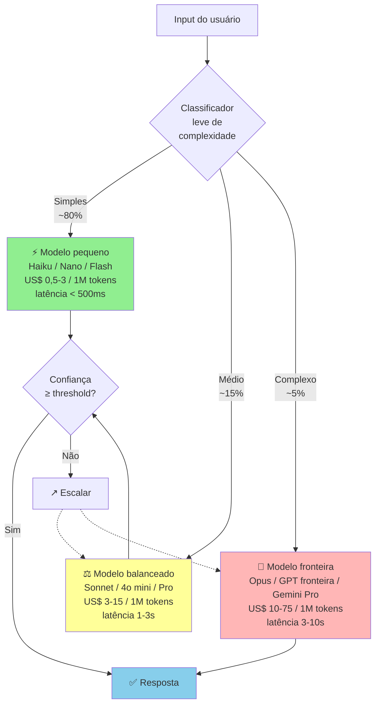

A cascata economiza setenta a noventa por cento de custo, em relação a "sempre fronteira". Mantendo qualidade onde importa. Requer classificador leve (heurística, ou modelo pequeno), e confidence scoring para escalar.

A regra. Cascata de modelos. Tentar modelo pequeno. Escalar para maior se a confiança estiver baixa, ou houver falha específica.

#### 2. Prompt engineering em produção

Prompt em produção é código. O tratamento adequado é em quatro pontos.

Trate cada *prompt* de produção com o mesmo rigor do código-fonte da aplicação: mantenha-o versionado (com histórico de alterações, autor e possibilidade de reversão imediata), testado (exigindo aprovação na suíte automatizada de *evals* antes de qualquer publicação), estruturado (em *templates* parametrizados com variáveis tipadas, e nunca em textos fixos espalhados pelo código) e documentado (registrando o objetivo da instrução, os casos de falha conhecidos e o critério de sucesso esperado).

**Ferramentas:** plataformas de gestão de *prompts* em produção com controle de versão, rastreamento de chamadas e suítes de avaliação integradas, como LangSmith, Braintrust, Langfuse e PromptLayer.

> [!important] Regras práticas de prompt em produção
> Prompts em produção ficam em arquivos separados, não em strings no código principal. Variáveis de sistema separadas com clareza do input de usuário (defesa contra prompt injection). Exemplos few-shot quando a tarefa pede (raciocínio, formatação específica). Instruções claras sobre formato de saída (JSON, markdown, etc.), com fallback para parsing falho.

#### 3. RAG, quando e como

Quando usar RAG. Conhecimento específico do cliente (contratos, documentação interna, base de produtos). Informação que muda frequentemente (preços, políticas). Volume de conhecimento maior que o context window do modelo. Necessidade de citar fontes.

Quando NÃO usar RAG. O conhecimento já está no modelo (fatos gerais, línguas, domínio amplo). Volume pequeno de contexto, que cabe em prompt.

Arquitetura RAG moderna (2026), em quatro etapas.

1. Ingestão. Documentos para chunking (parágrafos coerentes, de duzentos a oitocentos tokens), depois embeddings, depois vetores em DB.
2. DB vetorial. Pinecone, Weaviate, Qdrant, pgvector (extension do Postgres), ChromaDB.
3. Retrieval. Consulta para embedding, depois busca semântica top-K, depois re-ranking opcional.
4. Generation. Contexto recuperado mais pergunta, depois LLM, depois resposta.

A arquitetura RAG completa, incluindo técnicas avançadas.

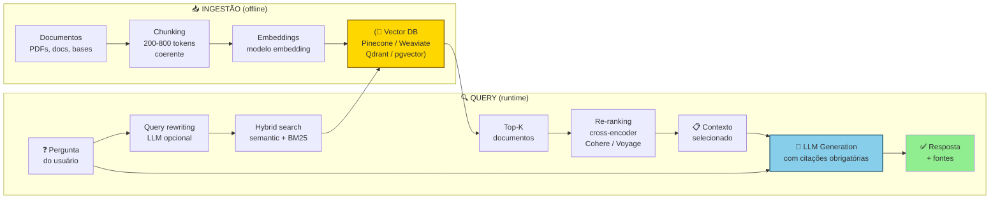

A Vector DB (dourada) é coração da infraestrutura. O LLM (azul) é onde acontece generation. Citações obrigatórias permitem auditoria do que foi efetivamente usado.

Técnicas avançadas. Hybrid search, embedding mais BM25 (keyword). Pega tanto semântica, quanto termos exatos. Re-ranking, modelo cross-encoder para re-ordenar top-K, antes de passar ao LLM (Cohere Rerank, Voyage). Query rewriting, usar LLM para reformular a pergunta do usuário, antes de retrieval. HyDE (Hypothetical Document Embeddings), gerar resposta hipotética primeiro, e usar embedding dela para busca.

Métricas-chave de RAG. Retrieval accuracy, percentual de consultas onde o documento relevante está no top-K. Answer faithfulness, a resposta está efetivamente baseada no contexto recuperado? Answer relevance, a resposta endereça a pergunta?

#### 4. Evaluations, disciplina de medir qualidade

O problema. Como saber se o seu produto AI está funcionando bem?

Não é "testei cinco exemplos manuais, e pareceu ok". É disciplina sistemática.

Componentes de uma eval suite, em quatro partes. Dataset de teste, cinquenta a quinhentos casos representativos, com output esperado. Métricas, exact match, semantic similarity, LLM-as-judge, human eval. Pipeline automatizado, rodar suite em cada mudança de prompt, ou modelo. Tracking histórico, a quality não degradou com mudanças?

Tipos de eval. Automated rule-based, checa formato, presença de palavras-chave, e validação de JSON. LLM-as-judge, outro LLM avalia qualidade. Cuidado com viés do judge. Human eval, avaliação humana de subset. Caro, mas gold standard para temas decisivos. A/B em produção, feedback implícito (rating, thumbs up ou down, completion), e explícito.

**Ferramentas:** plataformas de observabilidade e avaliação contínua de modelos de linguagem, como LangSmith, Braintrust, Helicone e Arize.

> [!important] Regra operacional de eval
> Não entra em produção mudança de prompt, ou modelo, que não passou na eval suite com score igual ou maior que o baseline. Sem isso, qualidade degrada por deriva silenciosa, e ninguém percebe até o cliente reclamar.

#### 5. Mitigação de alucinação

**Alucinação:** Quando o LLM produz resposta plausível, mas factualmente incorreta.

Técnicas de otimização de modelos, ordenadas da melhor relação entre eficácia e custo para a mais complexa:

Grounding em RAG. Forçar o modelo a responder baseado em contexto recuperado, não em conhecimento paramétrico. Prompt: "Responda apenas com base no contexto abaixo. Se a resposta não está no contexto, diga 'não sei'."

Saída estruturada (*structured output* via JSON Schema): garante que a resposta respeite o formato exigido pelo código, mas não impede alucinação factual. Permita sempre campos `null` ou `"não_encontrado"` no schema para que o modelo não invente dados apenas para preencher um campo obrigatório.

Citação obrigatória. Exigir que a resposta cite a passagem específica do contexto. Auditável.

Verification loop. Segundo LLM verifica se a resposta do primeiro está coerente com o contexto.

Confidence scoring. O modelo fornece confiança. Abaixo de threshold, rota para humano, ou fallback.

**Ajuste fino (*fine-tuning*) com base curada:** recurso caro e de manutenção complexa, útil para padronizar formato de saída, tom e jargão específico do domínio (ou reduzir latência em modelos menores), mas que não substitui a ancoragem em documentos (*grounding* via RAG) para evitar a invenção de fatos.

Domínios decisivos. Saúde, jurídico, finanças, segurança. Nesses, alucinação é inaceitável. A arquitetura deve incluir human-in-the-loop, ou confidence gates rígidos.

#### 6. Custo de inferência por usuário e proteção de margem

Cálculo padrão.

```text
Custo por usuário ativo/mês =
 (inferências/usuário/mês) ×
 (tokens médios/inferência) ×
 (custo por token)
```

Exemplo realista (produto de chat com RAG). Vinte inferências por usuário, por mês. Dois mil tokens de input (contexto mais pergunta), e quinhentos tokens output. Modelo intermediário, US$ 5 por 1M input tokens, e US$ 15 por 1M output tokens.

Custo. 20 vezes (2.000 vezes 5 mais 500 vezes 15) dividido por 1.000.000 igual a US$ 0,35 por usuário, por mês, ou cerca de R$ 1,80.

Parece pequeno. Mas. Power users consomem dez a cinquenta vezes isso. Se dez por cento da base consome cinquenta vezes, o custo efetivo sobe para US$ 1 a 5 por usuário, por mês. Em um produto com mensalidade de US$ 10, apenas a conta de inferência de IA passa a consumir de 10% a 50% da receita bruta (derrubando a margem bruta para a faixa de 50% a 90% antes mesmo de servidores e suporte, ou gerando prejuízo direto quando um usuário pesado consome R$ 300 de tokens num plano de R$ 49).

Técnicas de redução de custo. Caching, respostas idênticas, ou similares, reutilizadas. Reduções de trinta a setenta por cento em workflows repetitivos. Modelo cascata, tentar barato primeiro, e escalar se necessário. Prompt enxuto, cada palavra custa. Auditar prompts por ineficiência. Fine-tuning, modelo pequeno fine-tuned pode substituir modelo grande genérico (até dez vezes menor custo). Rate limiting por tier, freemium com limite, e paid tiers com caps. Monitoramento por usuário, detectar outliers que consomem desproporcionalmente.

#### 7. Latência, UX AI-native

LLMs de fronteira têm latência de um a dez segundos. Em UI interativa, isso destrói a UX.

**Técnicas de redução da latência percebida:** (1) **transmissão contínua (*streaming*), exibindo as palavras na tela à medida que os tokens são gerados para reduzir drasticamente a sensação de espera, (2) sinalização visual de progresso**, informando cada etapa em curso (*"consultando catálogo técnico."*, *"verificando histórico."*) para que o usuário compreenda o processamento, (3) **interface otimista (*optimistic UI*), renderizando a estrutura do card ou da tabela antes mesmo do término da geração, (4) pré-cálculo (*pre-computation*), deixando diagnósticos e sugestões prontos em segundo plano antes que o usuário abra a tela (como no alerta de manutenção de Henrique), e (5) cascata de modelos**, entregando a triagem rápida com um modelo leve e acionando o modelo de fronteira apenas quando o caso exige aprofundamento.

Metas de tempo de resposta em produção: primeiro token exibido na tela em até 1 s na mediana (p50) e até 1,5 s no percentil 95 (p95) usando *streaming*. Conclusão de respostas curtas em até 5 s, e processamento de documentos longos em até 20 s acompanhado de barra de progresso visível.

#### 8. Fine-tuning versus RAG versus Prompt, quando cada um

| Técnica | Custo | Tempo | Melhor para |
|---|---|---|---|
| Prompt engineering | Baixo | Horas | Tarefas bem definidas, casos gerais |
| Few-shot prompting | Baixo | Horas | Formatação específica, tom, estilo |
| RAG | Médio | Semanas | Conhecimento específico, informação atualizada |
| Fine-tuning | Alto | Semanas-meses | Padrão muito específico, redução de latência/custo |

A regra. Começar sempre por prompt. Se não funciona, RAG. Fine-tuning só quando há mais de mil exemplos de treino curados, e o ROI justifica.

#### 9. Observability em produção

Em produção, monitorar. Latência (p50, p95, p99). Custo por inferência (agregado, e por usuário). Taxa de erro (timeouts, API errors). Qualidade (quando houver feedback signal: thumbs, rating, completion rate). Quality drift, degradação gradual de qualidade (comum quando o provedor atualiza o modelo silenciosamente).

**Ferramentas:** Helicone (LLM-specific), Langfuse, Datadog com custom metrics, Grafana.

### Métricas de produto AI-Native: Margem Bruta pós-inferência, Taxa de Aprovação sem Edição (Zero-Edit Rate), Latência P95 e Evals

**Margem bruta pós-inferência:** receita líquida de impostos menos o custo direto de servidores, bancos vetoriais e chamadas de API de modelos de linguagem, mantendo a meta de margem bruta acima de 70% a 80% no consolidado da operação.

**Taxa de aprovação sem edição humana (*Zero-Edit Rate*):** percentual de saídas ou ações preparadas pelo agente que o profissional humano aprova no primeiro clique sem precisar reescrever campos ou corrigir parâmetros (como as ordens de manutenção da usina de Henrique). É o termômetro central de maturidade de um produto *Service-as-a-Software*.

Custo por usuário ativo, por mês (AI-specific). Alvo, igual ou menor que trinta por cento do ticket mensal.

Latência do primeiro token (*TTFT*): mediana (p50) em até 1 segundo e percentil 95 (p95) em até 1,5 segundo, com resposta completa transmitida via *streaming* em até 5 segundos.

Qualidade em eval suite. Igual ou maior que oitenta e cinco por cento (definido por produto).

Taxa de fallback ou erro. Igual ou menor que dois por cento das inferências.

Cost per conversion. Custo AI para atingir conversão medida.

Quality drift detection. Alerta em queda igual ou maior que cinco por cento em eval score.

### Governança de IA Generativa

Um produto nativo em IA enfrenta em 2026 riscos de governança que não existiam no SaaS tradicional. Ignorá-los é inviável em setores regulados (saúde, finanças e jurídico) e torna-se arriscado em qualquer mercado à medida que o cerco regulatório avança, combinando o *EU AI Act* na União Europeia, o *AI Risk Management Framework* do NIST nos Estados Unidos e, no Brasil, a fiscalização da ANPD sobre o tratamento de dados pessoais por sistemas de IA (nas figuras de controlador e operador da LGPD) ao lado da tramitação do Marco Legal da IA (PL 2.338/2023, aprovado pelo Senado em dezembro de 2024 e em análise na comissão especial da Câmara dos Deputados em outubro de 2026, detalhado no [[IGNICAO-Vol-8-Juridico-LGPD-e-Seguranca#CAPÍTULO 10: REGULATÓRIO DE IA NO BRASIL|Volume 8, Capítulo 10]]).

**Os quatro domínios de governança de IA.**

*Transparência e explicabilidade*: o usuário deve entender (em termos razoáveis) por que o sistema gerou determinado output. "O modelo decide" não é resposta aceitável para output com consequências: rejeição de crédito, diagnóstico de saúde, recomendação jurídica. Em produto regulado, explainability pode ser requisito legal. Em produto não regulado, é requisito de confiança. Abordagem: (1) documentar internamente quais inputs afetam cada output, (2) logging de reasoning onde o modelo suporta (chain-of-thought), (3) UI que mostra fontes ou raciocínio ao usuário quando relevante.

*Bias e fairness*: modelos de linguagem amplificam vieses presentes nos dados de treino. Em contexto de produto com decisões que afetam pessoas (crédito, hiring, saúde), viés sistemático é risco legal e reputacional. Auditoria de bias: testar outputs com inputs que variam apenas por gênero, raça, ou outras características protegidas. Red-teaming específico para viés. Monitoramento de disparate impact em métricas de produto segmentadas.

*Human-in-the-loop (HITL) e limites de autonomia*: definir explicitamente que decisões o sistema pode tomar autonomamente e quais requerem revisão humana. Em saúde: modelo sugere, médico decide. Em crédito: modelo pontua, humano aprova acima de certo impacto. Em contrato jurídico: rascunho automático, advogado revisa antes de enviar. O critério: quanto maior a consequência e a irreversibilidade, mais HITL.

*Incidente de IA e recall*: o que acontece quando o modelo começa a alucinar consistentemente, quando um viés é descoberto em produção, ou quando o provedor muda o modelo? Plano de incidente de IA deve incluir: (1) critério de quando "desligar" feature AI (threshold de erro acima do qual o sistema vai offline), (2) plano de comunicação com usuários, (3) processo de rollback para versão anterior do prompt/modelo, (4) post-mortem com root cause de qualidade.

**Model card interno.** Boa prática crescentemente adotada: documentar para uso interno o que o modelo foi testado para fazer e o que não foi, suas limitações conhecidas, seus dados de eval de qualidade, e os casos de uso onde não deve ser usado. Não precisa ser público, mas deve existir. Previne que times de produto expandam o uso para domínios onde o modelo não foi avaliado.

**Regulação emergente.** O Regulamento Europeu de IA (*EU AI Act*, em vigor desde agosto de 2024 com aplicação escalonada: proibições e letramento em fevereiro de 2025, regras para modelos de propósito geral em agosto de 2025 e obrigações para sistemas de alto risco previstas pelo texto original entre agosto de 2026 e agosto de 2027, sob revisão de prazos de implementação no pacote *Digital Omnibus* da Comissão Europeia) classifica as aplicações por nível de risco (inaceitável, alto, limitado e mínimo). Startups brasileiras que atendem clientes ou usuários na União Europeia entram no escopo da norma, e sistemas de alto risco (como concessão de crédito, recrutamento, educação e saúde) exigem avaliação de conformidade, documentação técnica, rastreabilidade de logs e supervisão humana. No Brasil, sob o art. 20 da LGPD, sempre que uma decisão for tomada unicamente com base em tratamento automatizado de dados pessoais, o titular tem direito a solicitar a revisão da decisão e informações claras sobre os critérios utilizados (embora a obrigatoriedade de revisão exclusivamente por pessoa natural tenha sido vetada na Lei 13.853/2019, manter revisão humana em decisões decisivas segue altamente recomendado para reduzir passivos, e o texto do PL 2.338/2023 aprovado no Senado vai na mesma direção ao exigir supervisão humana efetiva em sistemas de alto risco).

**Checklist de governança mínima.**

- [ ] Model card interno documentado para cada feature AI decisiva?
- [ ] Human-in-the-loop definido para decisões de alto impacto?
- [ ] Auditoria de bias realizada com dataset representativo do ICP?
- [ ] Plano de incidente de IA (trigger, rollback, comunicação)?
- [ ] Logging de inputs e outputs para auditoria (com LGPD compliance)?
- [ ] Usuário informado que está interagindo com IA onde relevante?
- [ ] Revisão de conformidade com EU AI Act para operações na Europa?

### Vender assinatura "ilimitada" de R$ 49/mês quando um único usuário pesado consome R$ 300 em chamadas de API de LLM

"GPT-4 funciona, tá bom". Sem eval, não sabe se mantém qualidade quando o provedor atualiza o modelo silenciosamente.

Prompt no meio do código. Não versionado, não testado, e não auditável.

Ignorar custo em base gratuita. Freemium sem cap de inferência vira prejuízo.

Latência desconsiderada no design. UI que assume resposta instantânea quebra em cem por cento dos casos AI-native.

Confiar em output sem verificação em domínio decisivo. Saúde, jurídico, ou finanças, sem human-in-loop, é passivo.

Fine-tuning prematuro. Gastar meses fine-tunando, quando prompt mais RAG resolvia.

Dependência cem por cento de um provedor. Quando OpenAI muda preço, ou capacidade, a sua empresa vai junto.

Não medir quality drift. Degradação gradual passa despercebida. O cliente reclama três meses depois.

Prompt injection ignorado. Usuário malicioso consegue extrair system prompt. Instruir o modelo a ignorar regras. Exige defesa.

Hallucination em output estruturado. O modelo preenche campos com dados inventados se o JSON obriga. Validação, e retry, necessários.

### Checklist de execução prática

AI-native está no padrão quando todos os itens abaixo estão cumpridos.

- [ ] Model selection decidido com critério (não default), com plano B de provedor mapeado.
- [ ] Eval suite formal existe com dataset representativo, roda em cada deploy.
- [ ] Prompts versionados, testados e documentados (não no meio do código).
- [ ] RAG implementado onde faz sentido (não onde não faz).
- [ ] Custo por usuário/mês mapeado e dentro de target de margem.
- [ ] Latência do primeiro token com p50 de até 1 s e p95 de até 1,5 s (e resposta curta concluída em até 5 s) com *streaming* ativo na interface.
- [ ] Técnicas de mitigação de alucinação ativas onde decisivo (não retóricas).
- [ ] Observability completo: latência, custo, qualidade, drift monitorados, com alertas de drift acima de 5%.
- [ ] Prompt injection defense implementado.
- [ ] Human-in-loop em domínios decisivos (saúde, jurídico, finanças).
- [ ] Governança mínima: model card interno, auditoria de bias, plano de incidente de IA, conformidade EU AI Act se aplicável.

---

### O Espelho do Capítulo 10: Sua IA é o Motor Proprietário ou Apenas um Adesivo Alugado?

Ao final da safra no Mato Grosso, o agente preditivo de Henrique havia emitido 38 alertas de manutenção na usina, com 35 ordens de compra aprovadas em um único clique pelo diretor industrial sem nenhuma edição manual (*Zero-Edit Rate* de 92%) e duas paradas decisivas de turbina evitadas, enquanto o concorrente do chatbot genérico teve o piloto cancelado no segundo mês. Graças ao roteamento em cascata que filtrava as leituras normais num classificador leve, o custo total de inferência de IA ficou em R$ 42 por mês para uma mensalidade corporativa de R$ 8.500, arquitetura que Lucas e Marina replicaram em seguida no módulo de leitura automática de contratos bancários da sua plataforma.

**O Espelho (autodiagnóstico):**
1. Se um concorrente contratar dois bons programadores neste fim de semana e conectar na mesma API de IA que você usa, o que exatamente impede que ele replique 100% do seu produto até segunda-feira?
2. Toda vez que um usuário corrige ou aprova uma sugestão da sua IA na tela, esse ajuste retroalimenta automaticamente uma base proprietária de avaliação (*Evals*) e contexto exclusivo do seu nicho?
3. Você sabe quanto custa em centavos de inferência/tokens cada tarefa executada por cliente, e o seu preço cobra por resultado entregue em vez de dar uso infinito sem teto?

**Permissão Libertadora:**
Você está autorizado a tirar o "chat de texto em branco" da frente do seu usuário. Na maioria das operações B2B, um botão que já traz o trabalho 95% pronto nos bastidores vence qualquer janela de bate-papo onde o cliente precisa adivinhar qual prompt escrever.

**O Ritual de Segunda-Feira às 9h:**
Construa hoje o seu **Conjunto Ouro de Avaliação (Golden Dataset de 50 casos reais)**: 50 exemplos reais das entradas mais difíceis do seu cliente e a resposta perfeita esperada. Proíba qualquer mudança de prompt ou modelo em produção sem rodar esse teste antes.

---

## CAPÍTULO 11: PIVOT: TIPOLOGIA, DECISÃO E EXECUÇÃO

### A Coragem de Matar o Filho Querido Antes que Ele Mate a Empresa

Quando Stewart Butterfield e sua equipe perceberam que o jogo online *Glitch*, no qual haviam trabalhado de corpo e alma por quase quatro anos, nunca daria lucro, tinham ainda alguns milhões de dólares dos investidores na conta bancária. A tentação humana natural era continuar queimando aquele caixa até o último centavo por orgulho, para não admitir em público que o jogo havia falhado.

Em vez disso, eles olharam para uma ferramenta interna que os próprios programadores da equipe haviam criado para trocar mensagens e arquivos enquanto construíam o jogo. Mataram o jogo com transparência absoluta e transformaram aquela ferramenta lateral no Slack: vendido anos depois por US$ 27,7 bilhões.

No Brasil, Lucas e Marina viveram seu próprio ponto de inflexão logo após os primeiros meses de operação. Embora o MVP tivesse nascido enxuto, a tentação de fechar contratos maiores levou a dupla a acoplar módulos laterais de um ERP financeiro amplo que patinava nas demonstrações comerciais, enquanto o caixa real vinha do serviço produtizado de auditoria de extratos e boletos. Após seis meses, os dados de uso deixaram claro que os diretores financeiros não queriam um novo ERP: eles ignoravam as telas acessórias de gestão e renovavam exclusivamente pelo motor automatizado que detectava cobranças indevidas e duplicadas em 15 minutos. Em uma sexta-feira decisiva, os sócios executaram um pivô de recorte (*zoom-in pivot*, subtipo do pivô de solução): aposentaram os módulos laterais, transformaram aquele motor específico no SaaS dedicado de auditoria e conciliação de tesouraria e destravaram o crescimento da empresa.

Há uma diferença clara entre o pivô baseado em evidência e o zigue-zague do fundador ansioso. Mudar de ideia toda segunda-feira por falta de disciplina para prospectar vinte clientes configura desistência crônica disfarçada de estratégia. Pivotar de verdade consiste em manter um pé fincado no aprendizado validado mais valioso do negócio e girar o outro pé com rapidez quando os dados provam que a tese antiga bateu em um teto estrutural, tomando essa decisão enquanto a empresa ainda preserva de 6 a 9 meses de caixa para financiar a nova curva.

---

Pivô (mudança estrutural de direção da empresa) é um dos termos mais repetidos e menos compreendidos do vocabulário de startups. Eric Ries popularizou o conceito em *A Startup Enxuta* (*The Lean Startup*, 2011), mas a expressão *"nós pivotamos"* virou, em muitos casos, um eufemismo conveniente para *"estávamos fazendo algo que deu errado, mudamos para outra coisa aleatória e preferimos não explicar o motivo"*. Este capítulo reconstrói o conceito como ferramenta operacional, detalhando quais tipos de pivô existem, quando a mudança de rumo faz sentido, quando ela apenas mascara o encerramento do negócio (*shutdown*) e como executar a transição depois que a decisão é tomada.

Pivot aparece em várias fases do manual (Descoberta, Validação, PMF) como opção tática dentro da fase. Este capítulo consolida o tema como decisão estratégica, com framework próprio.

### Definição precisa de pivot

Pivot é mudança estrutural em um ou mais elementos-chave do negócio. Mantendo o aprendizado acumulado como base. Os elementos-chave são seis. Problema atendido, cliente servido, solução oferecida, modelo de negócio, canal de distribuição, e tecnologia central. Um pivot mantém pelo menos um desses elementos, e muda outros.

> [!warning] Pivot não é
> Ajuste tático pequeno (mudar preço, ajustar feature, trocar canal de marketing secundário). Isso é iteração normal. Mudança total em que todos os elementos mudam. Isso é shutdown e recomeço. Pivot "narrativo" em que o discurso muda, mas a operação não. Isso é rebranding (troca de marca).

A distinção importa porque cada categoria tem implicações diferentes. Iteração pode ser decidida pelo fundador sozinho, em dias. Pivot exige comunicação formal a stakeholders (partes interessadas: time, investidores, clientes). Toma semanas, ou meses, para executar. Shutdown é decisão de encerrar negócio (ver subseção sobre shutdown voluntário na [[IGNICAO-Vol-9-Maturidade-e-Exit#FASE 20: ESTRATÉGIA DE SAÍDA (EXIT STRATEGY)|Fase 20 (Vol. 9)]]). Rebranding sem pivot real é dissonância que time, e mercado, percebem.

### Os seis tipos de pivot

**1. Pivot de cliente (*customer pivot*).** Mantém o problema e a solução, mas muda o segmento de cliente-alvo. Isso acontece quando Você descobre que o cliente que imaginava inicialmente não é quem mais sofre, ou mais paga, por esse problema. Um cliente adjacente emerge como mais adequado. Exemplo. Produto pensado para pequena empresa, mas que decola em médias. O pivot é reposicionar ICP, e go-to-market, sem mudar o produto materialmente.

**2. Pivô de problema (*problem pivot*).** Mantém o perfil de cliente e o conhecimento profundo do seu contexto operacional, mas muda a dor específica que o produto resolve. Ocorre quando o fundador descobre que o problema priorizado inicialmente é secundário diante de uma dor adjacente muito mais aguda e orçada dentro da mesma empresa: por exemplo, uma startup que começou vendendo um CRM comercial para pequenas empresas e, ao notar a desorganização fiscal dos clientes, passou a fornecer uma plataforma de conciliação contábil para esse mesmo público.

**3. Solution pivot.** Mantém o problema, e o cliente. Muda radicalmente a solução. O padrão. A solução imaginada não é escalável, não tem unit economics, ou não é adotada. Mas a dor é real, e o cliente existe. Exemplo. Startup que tentou solução de software puro para problema de logística, percebeu que exige serviço híbrido (software mais operação manual), e pivotou para modelo operacional diferente. Mantendo cliente, e problema.

**4. Pivô de modelo de negócios (*business model pivot*).** Mantém o produto e o perfil de cliente, mas altera a forma de cobrança: acontece quando uma operação B2C sustentada por anúncios migra para assinatura, quando um SaaS troca a licença por assento pela cobrança por uso ou quando fintechs que dependiam apenas de *float* e crédito passam a cobrar mensalidade por ferramentas de gestão.

**5. Pivô de canal (*channel pivot*).** Mantém o produto, o cliente e o problema resolvido, mas muda a rota de distribuição: ocorre quando o canal inicial esgota seu teto e a empresa migra da venda direta ao consumidor para parceiros, do marketing de conteúdo para a prospecção ativa ou do autoatendimento puro (PLG) para uma operação híbrida apoiada por vendedores nas contas maiores.

**6. Pivô de tecnologia (*technology pivot*).** Mantém o cliente, o problema e a proposta de valor, mas substitui a arquitetura técnica central porque a base original não escala, não atinge o desempenho necessário ou impõe um custo unitário incompatível com a margem do negócio, movimento comum em *deep techs* e em produtos nativos em IA. *(Nota: na tipologia original de Eric Ries, o pivô de solução do item 3 subdivide-se frequentemente no pivô de recorte ou zoom-in pivot, quando uma única funcionalidade secundária vira o produto inteiro, como fizeram Lucas e Marina na abertura deste capítulo, e no pivô de ampliação ou zoom-out pivot, quando um produto pontual precisa incorporar uma plataforma completa para entregar valor.)*

### Pivots que funcionam, pivots que falham

Analisando casos brasileiros, e globais, documentados, padrões emergem.

**Pivots que funcionam tipicamente têm três características.**

Sinal claro antes da decisão. Dados específicos (a retenção cai, o CAC não paga, pesquisa com clientes mostra outra dor maior) indicaram a direção. Pivot feito por evidência. Não por pânico.

A maior parte do aprendizado se mantém. O time continua produtivo. O conhecimento do setor é aproveitado. Relações com clientes são preservadas. Ou convertidas em parceiros do pivot.

A nova direção tem hipótese específica, não apenas "tentar outra coisa". O fundador consegue articular por que a nova direção tem maior probabilidade de sucesso que a anterior.

**Casos brasileiros, e globais, de pivot bem-sucedido.**

Instagram (caso global relevante). Começou como Burbn, app de geolocalização com fotos. Pivotou para foto como core, depois de observar que os usuários usavam apenas essa feature. Customer pivot mais solution pivot combinados.

**Loggi (Brasil):** fundada em 2013 por Fabien Mendez e Arthur Debert inicialmente para conectar motoboys à entrega expressa de documentos corporativos em São Paulo, a empresa reorientou sua operação e infraestrutura tecnológica para a logística de pacotes e *last-mile* de *e-commerce* em escala nacional, combinando evolução de segmento de cliente e de solução logística sobre a mesma malha de roteirização urbana.

**99 (Brasil):** fundada em 2012 como aplicativo exclusivo para chamada de táxis (99Taxis), a empresa ampliou sua arquitetura de oferta em 2016 ao lançar o 99POP com motoristas particulares, executando um pivô de solução e de oferta no lado do fornecedor do marketplace para competir no mercado amplo de mobilidade urbana.

**Loft (Brasil, 2018-2023):** nasceu no modelo de *iBuying* intensivo em balanço (comprando, reformando e revendendo apartamentos com capital próprio) e executou um pivô de modelo de negócios para plataforma digital e marketplace de crédito e transações imobiliárias para imobiliárias parceiras quando o ciclo de juros subiu (caso detalhado no [[IGNICAO-Vol-9-Maturidade-e-Exit#CAPÍTULO 10: LAYOFFS E DOWNSIZING: COMO DEMITIR EM ESCALA SEM DESTRUIR A EMPRESA|Capítulo 10]] e no [[IGNICAO-Vol-9-Maturidade-e-Exit#CAPÍTULO 19: POST-MORTEMS BRASILEIROS: CATÁLOGO DE CASOS EM PROFUNDIDADE|Capítulo 19 do Volume 9]], além do [[IGNICAO-Vol-10-Playbooks-Setoriais-e-Glossario#CAPÍTULO 34: RETAILTECH, E-COMMERCE, OMNICHANNEL, SOCIAL COMMERCE E DIGITALIZAÇÃO DO VAREJO FÍSICO|Capítulo 34 do Volume 10]]).

**Movile (Brasil):** nascida na era dos serviços de mensageria e conteúdo cobrados diretamente na fatura das operadoras de telefonia (*carrier billing*), a empresa executou um pivô de canal e de modelo de negócios com a chegada dos smartphones, migrando para aplicativos distribuídos nas lojas digitais (App Store e Google Play) e consolidando um ecossistema de plataformas móveis e investimentos liderado pelo iFood.

**Pivots que falham tipicamente têm três sinais.**

Pânico como motivador. Decisão tomada em resposta a ansiedade (runway curto, investidor pressionando, time desmoralizando). Sem dados direcionais específicos. Tentativa de "virar qualquer coisa, desde que mude".

Mudança simultânea de cliente, problema, solução e canal (ao contrário do *zoom-in pivot* de Lucas e Marina na abertura, que manteve o mesmo diretor financeiro, a mesma dor de conciliação e a mesma tecnologia de auditoria): quando tudo muda ao mesmo tempo, trata-se na prática de um encerramento (*shutdown*) seguido de um negócio novo sob o mesmo CNPJ. Equipe, e investidores, perdem referência.

Nova direção sem conhecimento específico da nova área. Pivot para setor onde o fundador não tem expertise. O time não tem rede. Os investidores não têm contexto. Frequentemente termina em segunda quebra, doze a dezoito meses depois.

> [!warning] Shutdown frequentemente disfarçado de pivot
> Alguns "pivots" são operações de preservação do ego do fundador e do capital remanescente, não mudança estratégica real. Os sintomas: a empresa não articula consistentemente o que faz agora (a cada conversa, a explicação muda), o time não sabe qual é a prioridade da semana, as métricas antigas são abandonadas sem que novas sejam estabelecidas, a comunicação a investidores é vaga e genérica, sem detalhes específicos. Nesses casos, o caminho honesto é shutdown ordenado. Pivot prolongado mascara o problema e consome capital que poderia ser preservado.

### Quando pivotar, o framework

Pivot é sério. Não deve ser default. Nem evitado. A decisão exige três filtros.

**Filtro 1: Evidência direta.** Você dispõe de dados concretos provando que a direção atual bateu em um teto estrutural? Servem como evidência: métricas de produto (retenção das safras em queda contínua ou ativação travada), economia unitária inviável (CAC que não se paga mesmo após otimizar o funil), pesquisa com clientes (mostrando que a dor prioritária é outra) e pressão competitiva estrutural. Pivô sem evidência empírica é apenas chute.

**Filtro 2: hipótese testável para a nova direção.** Formule por escrito por que o novo caminho tem maior chance de tração, seja porque o novo segmento sente uma dor mais aguda, porque o problema adjacente tem orçamento próprio ou porque o novo canal reduz o CAC, trocar de rumo com frases vagas como "vamos tentar vender para pessoa física" expressa apenas torcida.

**Filtro 3: capacidade de executar.** Você tem runway (capital) para o pivot? Tem time que consegue adaptar? Tem expertise no novo território? Pivot prematuro com runway curto resulta em empresa que não testou nem a direção antiga, nem a nova, adequadamente. Dupla quebra.

Se os três filtros apontam para "sim", pivot é decisão razoável. Se algum aponta para "não", ou "duvidoso", provavelmente não é o momento. Você está em iteração (não pivot), ou em caminho para shutdown (não pivot).

### Como executar um pivot bem

Decisão tomada, a execução tem três partes. Comunicação, operação, e medição.

#### Comunicação

Primeiro ao time. Em reunião presencial (ou vídeo, se distribuído). Sem pressa. Explicar a evidência que motivou a decisão. A nova direção específica, com hipótese. O que muda no dia a dia de cada função. Quem sai. Quem fica. O novo roadmap dos próximos noventa dias. As perguntas são bem-vindas, e esperadas. Time que descobre pivot por boato é time que nunca mais confia na liderança.

**Governança com investidores e formalização societária:** antes mesmo do anúncio geral à equipe, verifique no acordo de sócios ou nos contratos de mútuo conversível se a mudança de linha de negócio exige anuência prévia ou está sujeita a direito de veto, alinhando a decisão individualmente com os investidores de referência. Apresente um documento objetivo (de cinco a dez páginas ou slides) contendo a evidência de esgotamento da tese anterior, a nova hipótese, o plano de execução e os marcos de validação de 90 dias: investidores profissionais preferem um pivô fundamentado em dados à teimosia num modelo sem tração, enquanto mudanças silenciosas descobertas por terceiros destroem a confiança. Concluído o alinhamento, providencie com o contador e o jurídico a alteração do objeto social e dos códigos CNAE no contrato social, bem como a revisão do enquadramento no Simples Nacional e do Fator R (ver [[IGNICAO-Vol-8-Juridico-LGPD-e-Seguranca#FASE 18: ESTRUTURAÇÃO JURÍDICA, SOCIETÁRIA E BLINDAGEM OPERACIONAL|Volume 8, Fase 18]]).

Depois aos clientes existentes. Se a nova direção continua a servi-los, mensagem simples. "Continuamos atendendo vocês, além disso.". Se a nova direção significa que eles não são mais foco, conversa direta sobre timeline de descontinuidade, alternativas que podemos sugerir, e preservação de dados. Clientes dispensados sem cuidado viram detratores públicos. Já os clientes cuja transição é conduzida com transparência e aviso prévio viram aliados na nova direção.

#### Operação

Redefinir o roadmap de produto em função da nova tese. Identificar o que do antigo se preserva (componentes, aprendizado, clientes, contratos), e o que se descontinua (features, processos, contratos). Plano de execução de trinta, sessenta, e noventa dias, com marcos específicos.

Redefinir as métricas de sucesso. As métricas do negócio antigo não servem para medir o novo. Decidir explicitamente. Qual a métrica principal do pivot nos próximos noventa dias? Qual o número que indica "isso está funcionando"? Sem métrica redefinida, a empresa vive em limbo onde nada é avaliável.

**Recalibrar a equipe:** como parte dos perfis contratados para a operação antiga pode não se encaixar na nova direção técnica ou comercial, conduza conversas francas para realocar quem tem aderência ao novo ciclo e organizar a transição de quem precisa sair. No Brasil, todo desligamento de empregado celetista deve respeitar estritamente os ritos e encargos da CLT: a demissão por iniciativa da empresa exige o pagamento integral das verbas rescisórias, enquanto a extinção por acordo mútuo (art. 484-A da CLT) só é válida quando reflete a vontade genuína do trabalhador, jamais devendo ser usada como pressão para reduzir custos rescisórios (ver [[IGNICAO-Vol-8-Juridico-LGPD-e-Seguranca#CAPÍTULO 6: DIREITO DO TRABALHO PARA STARTUPS|Volume 8, Capítulo 6]], e [[IGNICAO-Vol-9-Maturidade-e-Exit#CAPÍTULO 10: LAYOFFS E DOWNSIZING: COMO DEMITIR EM ESCALA SEM DESTRUIR A EMPRESA|Volume 9, Capítulo 10]]).

#### Medição

Pivot precisa de prazo. Tipicamente noventa a cento e oitenta dias para gerar sinal direcional claro. Marcos intermediários a cada trinta dias. A nova direção está produzindo os sinais esperados? Se sim, continuar. Se não, segundo pivot geralmente não é a resposta. Shutdown voluntário é mais honesto que série de pivots em sequência.

> [!important] O pior cenário do pivot
> Empresa pivotando indefinidamente. Cada vez consumindo mais capital. Sem nunca validar nada. Medição rigorosa, com prazo definido, é o que evita esse cenário. Pivot sem prazo definido para validar a nova hipótese vira deriva estratégica.

### Armadilhas do pivot

**1. Pivot como procrastinação da decisão de shutdown.** O fundador não aceita que a empresa não vai dar certo. Inicia pivot como forma de "manter esperança". Pivot sem convicção real da nova direção consome tempo, e capital, sem resolver nada.

**2. Pivot por pressão de investidor sem convicção do fundador.** O investidor sugere direção que parece promissora. O fundador aceita, para não perder apoio. Sem convicção interna, a execução é medíocre. O pivot falha. Mas agora com ressentimento mútuo entre fundador, e investidor.

**3. Múltiplos pivots em sequência.** A cada seis meses, nova direção. O time se desgasta. Os investidores perdem confiança. A narrativa da empresa se torna incompreensível. Regra informal. Se você pivotou mais de uma vez nos últimos dezoito meses, o problema provavelmente não é a direção. É a capacidade de validação antes do pivot.

**4. Pivot que muda tudo, exceto a equipe.** Customer, e problema, e solução novos. Mas com time contratado para a direção antiga. Pode funcionar se o time for senior, e adaptável. Frequentemente não funciona se o time for especializado na direção antiga.

**5. Comunicar o pivot como "evolução", em vez de "mudança".** Para proteger o ego do fundador, a narrativa é de "estamos evoluindo para atender melhor". O time, e os investidores, percebem a maquiagem. Perdem confiança na comunicação subsequente da empresa. Honestidade direta ("estávamos em X, decidimos ir para Y por razões Z") funciona melhor que narrativa polida.

**6. Pivotar sem desligar a direção antiga.** A empresa tenta executar caminho novo, e antigo, simultaneamente, por "segurança"; como resultado, Execução medíocre em ambos. Nenhum validado. Capital queimado duplamente. Pivot real exige decisão de descontinuar o antigo. Mesmo com dor.

### Sinais de que você precisa pivotar

Lista de sintomas observáveis, priorizada por gravidade.

Retenção de usuários consistentemente abaixo do benchmark do seu segmento por três ou mais meses.

Crescimento de receita desacelerando, ou estagnado, por dois ou mais trimestres.

CAC consistentemente acima do que LTV suporta. Mesmo com otimizações.

Pesquisa com clientes atuais revela que eles não recomendariam ativamente.

Clientes novos não vêm por indicação (o crescimento sempre precisa de push de marketing).

Time desmotivado por falta de sinal claro de progresso.

Investidores manifestando preocupação em várias reuniões consecutivas.

Concorrente com modelo diferente está crescendo claramente mais rápido.

A presença isolada de **um ou dois sinais** pede investigação tática e ajuste de execução na rota atual. Já a combinação de três ou mais sinais simultâneos sustentados ao longo de um trimestre exige abrir imediatamente a deliberação formal de pivô, agindo enquanto a empresa ainda preserva a margem de segurança de 6 a 9 meses de caixa definida na abertura deste capítulo.

### Sinais de que você NÃO precisa pivotar

Crescimento lento, mas consistente, com PMF moderado.

Retenção boa em nicho específico, com dificuldade em expandir além dele (isso é wedge, e o trabalho de expansão é diferente de pivot).

Desafios de execução (contratação, operação) que não são sobre direção do negócio.

Pressão de investidores por crescimento mais rápido, sem sinais operacionais de problema do modelo.

Comparação com concorrentes em outro tipo de negócio (que não compete diretamente).

Confundir problemas de execução com necessidade de pivot é armadilha comum. Pivot muda direção. Problemas de execução exigem melhoria de operação na direção atual. Ações diferentes.

### Fechamento

Pivot bem executado é uma das ferramentas mais poderosas do fundador. Muitas empresas grandes hoje existem porque o fundador original pivotou no momento certo. Mas pivot mal executado, ou pivot como disfarce de shutdown, é uma das causas mais comuns de empresa que quebra.

A diferença entre os dois é disciplina. Evidência antes da decisão. Tese específica da nova direção. Comunicação aberta a stakeholders. Medição rigorosa do novo caminho. Falta de qualquer um dos quatro quase sempre indica que o "pivot" é, na verdade, outra coisa menos útil.

> [!info] Conexões com outras fases da coleção
> A decisão de pivô conecta-se diretamente à validação inicial do problema na [[IGNICAO-Vol-2-Descoberta-e-Mercado#FASE 4: DESCOBERTA DO PROBLEMA|Fase 4 (Vol. 2)]], ao teste de viabilidade econômica na [[#FASE 12: VALIDAÇÃO DO MODELO DE NEGÓCIO|Fase 12]], ao diagnóstico de retenção e PMF na [[#FASE 13: PRODUCT-MARKET FIT|Fase 13]] e, nos casos em que o encerramento ordenado é o caminho mais íntegro, ao protocolo de *shutdown* voluntário na [[IGNICAO-Vol-9-Maturidade-e-Exit#FASE 20: ESTRATÉGIA DE SAÍDA (EXIT STRATEGY)|Fase 20 (Vol. 9)]].

---

### O Espelho do Capítulo 11: Você Está Sendo Resiliente na Visão ou Teimoso num Beco Sem Saída?

Noventa dias após descartarem os módulos laterais de ERP e concentrarem 100% da engenharia e do discurso comercial no motor de conciliação e auditoria de boletos, Lucas e Marina viram o ciclo médio de vendas cair pela metade e a retenção líquida da carteira ultrapassar 112% ao ano. O código descartado naquela sexta-feira deixou de drenar o suporte técnico e liberou os seis meses de caixa que financiaram a chegada ao *Product-Market Fit*.

**O Espelho (autodiagnóstico):**
1. Fazendo a pergunta clássica que Andy Grove propôs a Gordon Moore na Intel em 1985 (relatada em *Só os Paranoicos Sobrevivem*): se vocês fossem demitidos hoje e um novo executivo assumisse a cadeira amanhã às 8h sem apego emocional ao código já escrito, qual produto ou segmento ele encerraria no primeiro dia?
2. Existe uma parte lateral do seu produto ou serviço (um módulo específico, um perfil de cliente ou ferramenta interna) que gera 80% dos elogios espontâneos enquanto o produto principal precisa ser empurrado à força?
3. Quantos meses de caixa (*Runway*) você ainda tem no banco hoje? Se continuar no ritmo atual por mais quatro meses, ainda sobrará fôlego para girar o leme?

**Permissão Libertadora:**
Você está autorizado a jogar fora seis meses de código já escrito se ele estiver amarrando você a um mercado que não paga. O código passado é custo irrecuperável (*sunk cost*). Os próximos doze meses da sua vida não são.

**O Ritual de Segunda-Feira às 9h:**
Com a resposta à pergunta de Andy Grove (do item 1 do Espelho acima) em mãos, reúna seus sócios hoje às 9h e responda por escrito em uma folha única: *"Qual é a verdade desconfortável sobre o nosso produto, canal ou retenção que já sabemos pelos dados de coorte, mas evitamos admitir em voz alta?"* Defina na mesma hora qual experimento ou corte será executado nos próximos 30 dias.

---

### Fechamento do Volume 4: Da Tração Validada à Decisão de Capital (Ponte para o Volume 5)

Ao concluir a travessia das Fases 11 a 13 e dos onze capítulos deste volume, os quatro negócios que acompanham esta coleção saem da incerteza do MVP e chegam ao *Product-Market Fit* com motores comerciais e operacionais distintos:

- **Lucas e Marina (SaaS B2B e IA em São Paulo e Florianópolis):** após o pivô de recorte para focar exclusivamente na conciliação e auditoria de tesouraria, estabilizaram a curva de retenção das safras, alcançaram NRR acima de 112% ao ano com cobrança híbrida e *payback* do CAC abaixo de nove meses.
- **Rafael e Bia (varejo D2C e marca nativa digital em São Paulo):** domaram a dependência de mídia paga com CRM e recorrência via WhatsApp e Pix, blindaram a margem de contribuição descontando frete, devoluções e tributos na ponta do lápis e transformaram o atendimento público em alavanca de recompra.
- **Camila (marketplace e SaaS vertical de saúde em Belo Horizonte):** destravou a liquidez geográfica polo a polo, eliminou o vazamento de transações prendendo a agenda e o split de pagamentos ao fluxo de trabalho da clínica e reduziu o abandono de pacientes redesenhando o pós-atendimento.
- **Henrique (hardware, IoT e IA industrial no interior de São Paulo e Centro-Oeste):** trocou o projeto sob medida por contratos anuais recorrentes com taxa de implantação que financia o equipamento, operando agentes preditivos em cascata com 92% de aprovação em um clique e margem bruta de software.

Com a retenção provada e a economia unitária saudável, cada um deles enfrenta agora a pergunta estratégica que abre o **Volume 5 (*Captação, Venture Capital e M&A*): crescer com o próprio fluxo de caixa dos clientes (*bootstrapping*), contratar dívida e fomento não dilutivo (FINEP, BNDES, *venture debt*) ou captar capital de risco institucional para acelerar a conquista do mercado?**

