# IGNIÇÃO — Volume 4: Tração, Go-to-Market e Product-Market Fit

**Do MVP em Produção ao PMF, Canais, Vendas e Pricing (Fases 11 a 13 e Capítulos 1 a 11)**

*João Prado · 2026 · Edição Narrativa Enxuta (v5.2)*

---

## Sobre este Volume

Este é o **Volume 4 (Tração, Go-to-Market e Product-Market Fit)** da coleção **IGNIÇÃO: O manual operacional do empreendedor brasileiro** (10 volumes).

Volume sobre a travessia do lançamento do MVP em produção até a comprovação do Product-Market Fit: Operação de MVP e Experimentos de Mercado (Fase 11), Validação do Modelo de Negócio (Fase 12) e Product-Market Fit (Fase 13): com frameworks passo a passo de métricas, growth, posicionamento e negociação, os canvases Pirate/AARRR e Risk Canvas preenchidos e os templates de Pre-Launch e Scorecard de PMF integrados nas fases: , seguidos por 11 capítulos sobre GTM e canais de aquisição até R$ 1M de ARR, SEO/conteúdo e comunidades, mídia paga, branding e PMM, vendas B2B consultivas, pricing e economia da recorrência, negociação, Customer Success e CX, stack de dados, produto AI-native e pivô.

---

## Mapa da Coleção IGNIÇÃO

```mermaid
graph LR
    subgraph J1["Do Zero à Validação"]
        V1["<b>Vol. 1: Ideação</b><br/>Fases 0 a 3 · Fundador e Teoria"]
        V2["<b>Vol. 2: Descoberta e Mercado</b><br/>Fases 4 a 6 · Cliente e Cunha"]
        V3["<b>Vol. 3: Hipóteses e Protótipo</b><br/>Fases 7 a 10 · Testes e Modelos"]
        V1 --> V2 --> V3
    end
    subgraph J2["Tração e Escala"]
        V4["<b>Vol. 4: Tração e PMF</b><br/>Fases 11 a 13 · MVP, GTM e Vendas"]
        V5["<b>Vol. 5: Finanças e Captação</b><br/>Fase 14 · Caixa, VC, Tributário e FP&A"]
        V6["<b>Vol. 6: Receita e Pessoas</b><br/>Fases 15 e 16 · Enterprise, Líderes e Cultura"]
        V7["<b>Vol. 7: Produto e Engenharia</b><br/>Fase 17 · Operações, IA e Arquitetura"]
        V8["<b>Vol. 8: Jurídico e Segurança</b><br/>Fase 18 · Societário, Contratos e LGPD"]
        V3 --> V4 --> V5 --> V6 --> V7 --> V8
    end
    subgraph J3["Ciclo Longo e Setores"]
        V9["<b>Vol. 9: Maturidade, Exit e Family Office</b><br/>Fases 19 e 20 · Board, Crise, M&A, IPO e Cash Cow"]
        V10["<b>Vol. 10: Economia da Inovação e 42 Verticais</b><br/>Hubs Globais, Regulação, 42 Setores e Dicionário"]
        V8 --> V9
    end
    V10 -. "Consulta Setorial e Dicionário" .-> J1
    V10 -. "Consulta Setorial e Dicionário" .-> J2
    V10 -. "Consulta Setorial e Dicionário" .-> J3
```

---

## Sumário deste Volume

### Fases da Etapa (Fases 11 a 13)
- [[#FASE 11 — MVP E EXPERIMENTOS DE MERCADO|FASE 11: MVP E EXPERIMENTOS DE MERCADO]]
- [[#FASE 12 — VALIDAÇÃO DO MODELO DE NEGÓCIO|FASE 12: VALIDAÇÃO DO MODELO DE NEGÓCIO]]
- [[#FASE 13 — PRODUCT-MARKET FIT|FASE 13: PRODUCT-MARKET FIT]]
### Go-to-Market Inicial, Canais de Aquisição e Marketing (Capítulos 1 a 4)
- [[#CAPÍTULO 1 — GTM PLAYBOOK E ARQUITETURA DE CANAIS: DA PRIMEIRA VENDA AO PRIMEIRO MILHÃO DE ARR|CAPÍTULO 1: GTM PLAYBOOK E ARQUITETURA DE CANAIS: DA PRIMEIRA VENDA AO PRIMEIRO MILHÃO DE ARR]]
- [[#CAPÍTULO 2 — CRESCIMENTO ORGÂNICO COMPOSTO: CONTENT MARKETING, SEO E COMMUNITY BUILDING|CAPÍTULO 2: CRESCIMENTO ORGÂNICO COMPOSTO: CONTENT MARKETING, SEO E COMMUNITY BUILDING]]
- [[#CAPÍTULO 3 — MARKETING DE PERFORMANCE EM PROFUNDIDADE|CAPÍTULO 3: MARKETING DE PERFORMANCE EM PROFUNDIDADE]]
- [[#CAPÍTULO 4 — BRANDING, POSICIONAMENTO DE MARCA E PRODUCT MARKETING (PMM)|CAPÍTULO 4: BRANDING, POSICIONAMENTO DE MARCA E PRODUCT MARKETING (PMM)]]
### Vendas Consultivas, Pricing, Receita Recorrente e Sucesso do Cliente (Capítulos 5 a 8)
- [[#CAPÍTULO 5 — SALES: MOTION COMPLETA, DO OUTBOUND AO RENEWAL|CAPÍTULO 5: SALES: MOTION COMPLETA, DO OUTBOUND AO RENEWAL]]
- [[#CAPÍTULO 6 — PRICING STRATEGY E ECONOMIA DA RECORRÊNCIA (SUBSCRIPTION ECONOMY)|CAPÍTULO 6: PRICING STRATEGY E ECONOMIA DA RECORRÊNCIA (SUBSCRIPTION ECONOMY)]]
- [[#CAPÍTULO 7 — NEGOCIAÇÃO COMO DISCIPLINA|CAPÍTULO 7: NEGOCIAÇÃO COMO DISCIPLINA]]
- [[#CAPÍTULO 8 — CUSTOMER SUCCESS (CS) E CUSTOMER EXPERIENCE (CX): DA JORNADA AO CHURN ZERO E NRR POSITIVO|CAPÍTULO 8: CUSTOMER SUCCESS (CS) E CUSTOMER EXPERIENCE (CX): DA JORNADA AO CHURN ZERO E NRR POSITIVO]]
### Instrumentação de Dados, Produto AI-Native e Anatomia do Pivô (Capítulos 9 a 11)
- [[#CAPÍTULO 9 — DADOS, ANALYTICS E EXPERIMENTAÇÃO|CAPÍTULO 9: DADOS, ANALYTICS E EXPERIMENTAÇÃO]]
- [[#CAPÍTULO 10 — AI COMO PARTE DO PRODUTO (AI-NATIVE PRODUCT)|CAPÍTULO 10: AI COMO PARTE DO PRODUTO (AI-NATIVE PRODUCT)]]
- [[#CAPÍTULO 11 — PIVOT: TIPOLOGIA, DECISÃO E EXECUÇÃO|CAPÍTULO 11: PIVOT: TIPOLOGIA, DECISÃO E EXECUÇÃO]]

---

# FASES DA ETAPA — DO MVP AO PRODUCT-MARKET FIT (FASES 11 A 13)

Aqui o protótipo vira operação viva: nas **[[#FASE 11 — MVP E EXPERIMENTOS DE MERCADO|Fases 11]]**, **[[#FASE 12 — VALIDAÇÃO DO MODELO DE NEGÓCIO|12]]** e **[[#FASE 13 — PRODUCT-MARKET FIT|13]]**, você coloca o MVP na rua com clientes reais, valida a equação de *unit economics* (LTV, CAC e *Payback*) e persegue a prova matemática e comportamental de que o mercado finalmente puxa o seu produto.

---

## FASE 11 — MVP E EXPERIMENTOS DE MERCADO

### O Dia em que o Código Encontra a Rua e o Medo da Vergonha Pública

Era terça-feira, 23h40, em Florianópolis. O primeiro MVP do sistema de Marina e Lucas estava pronto para ser liberado para os doze clientes que haviam pago o piloto. Mas o cursor do mouse de Lucas tremia em cima do botão de *Deploy*.

– "Marina, espera até segunda-feira que vem. A tela de exportação ainda está sem o gráfico colorido, o carregamento demora quatro segundos quando o arquivo passa de dez mil linhas e, se algum colega meu de engenharia vir esse layout simples, vão achar que a gente é amador."

Marina puxou uma cadeira, sentou ao lado de Lucas e disse a frase que deveria estar gravada na parede de toda sala de tecnologia:

– "Lucas, seus colegas de engenharia não pagam os nossos boletos. Os doze diretores financeiros que nos pagaram o piloto não querem uma obra de arte; eles querem descobrir amanhã às 9h da manhã onde estão perdendo dinheiro nos boletos duplicados. Clica nesse botão agora."

Reid Hoffman imortalizou a máxima de que, se você não sente um frio na barriga de constrangimento na primeira versão que coloca no ar, você lançou tarde demais. Mas atenção ao paradoxo brutal da Fase 11: **você tem permissão para lançar um produto esteticamente espartano, mas jamais tem permissão para lançar um produto que quebre a promessa central ou corrompa os dados do cliente**.

Chamo isso de **A Linha Vermelha da Dignidade Funcional**. Um MVP em produção não é um lixo cheio de bugs que trava no primeiro clique; é um bisturi pequeno, feio por fora, mas cirurgicamente confiável na única tarefa que prometeu executar. A partir do segundo em que o código vai para a rua com clientes reais, acaba a era da imaginação e começa a era da telemetria implacável.

---

> [!tip] Stack mínimo da Fase 10
> O stack tech do MVP depende muito do produto. Mas a regra é uma: escolher o stack que o time atual consegue manter, não o mais sexy. Para web: frontend (React, Next.js, Vue, ou Svelte se o time tem). Backend (Node.js, Python e Django, Ruby on Rails: comuns e com comunidade brasileira grande). Banco (Postgres, via managed service como Supabase, Neon, ou RDS). Para mobile: React Native ou Flutter (cross-platform), versus nativo (iOS Swift, Android Kotlin) só quando é justificado. Infra: AWS, GCP, ou Azure tradicional. Alternativas mais simples: Vercel (frontend), Railway, Render (fullstack rápido). Autenticação: Auth0, Clerk, Supabase Auth. Pagamento: Stripe (internacional), Asaas ou Pagar.me (Brasil). Regra crítica: usar serviço gerenciado em tudo que não é o seu diferencial. Gastar três meses montando Kubernetes em equipe pequena, em vez de usar Vercel ou Render, é erro típico.
>
> Para produtos dev-tools, infraestrutura ou SaaS técnica: o [[IGNICAO-Vol-3-Experimentos-e-Prototipagem#CAPÍTULO 6 — OPEN SOURCE COMO ESTRATÉGIA|Capítulo 6 (Open Source como Estratégia) (Vol. 3)]] cobre open source como motor de aquisição (product-led growth via comunidade) e como modelo de negócio (open core, dual licensing, COSS), incluindo casos de empresas que escalaram com essa estratégia.

A arquitetura típica de MVP, com decisões conscientes sobre simplicidade:

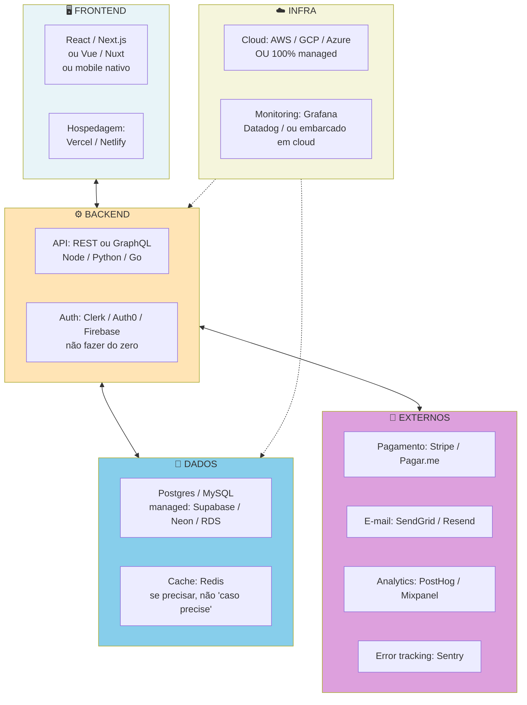

> [!important] Princípio da arquitetura no MVP
> Composição de managed services no MVP. DevOps real só depois do PMF. Evite criar o seu próprio auth, criar o seu próprio sistema de e-mail, construir observability do zero. Cada "do-zero" prematuro custa três a seis meses, e quase nunca produz vantagem competitiva.

### Por que uma semana com dez usuários reais em produção ensina mais do que um ano em ambiente de teste

Até agora, você trabalhou com evidência declarada (entrevistas) e evidência comportamental limitada (testes de protótipo). O MVP é onde você obtém a evidência mais valiosa: o que as pessoas fazem com um produto real, pago, nas rotinas delas de verdade. Essa evidência é diferente em qualidade. E muitas vezes surpreende.

> [!warning] MVP não é "versão capenga" do produto
> Essa é a confusão mais comum. MVP não é o produto cortado pela metade, com metade dos botões e metade do design. MVP é um processo obsessivo de validação que se concentra em responder duas perguntas por ciclo. Qual é a premissa ou hipótese mais arriscada *neste momento*? Como podemos testá-la com o menor esforço possível?

Um MVP de sucesso não é medido pela elegância do código, nem pelo polimento da interface. É medido pelo quanto de incerteza ele elimina por real investido. Se você gastou R$ 200 mil construindo um MVP e saiu com as mesmas dúvidas que tinha no início, não foi MVP. Foi produto prematuro mal-feito.

### O ciclo MVP em três fases, construir na ordem certa

O ciclo MVP em três etapas, cada uma valida coisa diferente:

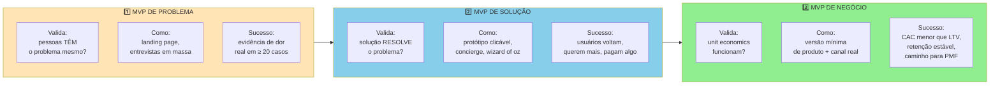

> [!warning] Pular etapas é o erro mais comum
> Construir MVP de Negócio sem validar Problema primeiro é escalar CAC em ICP errado. Validar Solução sem ter validado Problema é resolver dor inventada. A ordem importa. Não pule.

Empreendedores iniciantes tendem a pular direto para "MVP em código" e gastar quatro a seis meses e R$ 50 mil a R$ 300 mil antes de qualquer evidência. A alternativa estruturada é fazer o MVP em três fases sequenciais, cada uma testando uma pergunta diferente. Só avance quando a anterior for aprovada.

#### Fase 1 do ciclo, Teste de Demanda (Landing Page)

A pergunta que responde: existe demanda real por essa proposta de valor, a esse preço, nesse ICP?

Como fazer. Crie uma landing page (página de destino: página única para capturar interesse) que descreva a solução como se ela existisse. Direcione tráfego pago (Facebook, Google, LinkedIn Ads), ou orgânico (comunidade, outbound), para essa página. Ofereça um mecanismo de captura: cadastro de e-mail, pré-pedido pago (com reembolso garantido), ou lista de espera.

Métrica primária. Taxa de conversão de visitante em ação. Threshold forte: mais de dez por cento para cadastro, mais de três por cento para pré-pedido pago. Threshold crítico: menos de dois por cento para cadastro significa que o gancho não ressoa.

Custo típico de R$ 500 a R$ 3.000 em tráfego pago, mais alguns dias para montar a página (Carrd, Framer, Webflow, Unbounce). Duração de uma a três semanas. O critério de avanço é demanda confirmada acima do threshold pré-definido.

> [!tip] Templates Operacionais: Templates operacionais desta fase
> A seção **[[#TEMPLATES OPERACIONAIS E CASOS PREENCHIDOS DESTA FASE|Templates Operacionais desta Fase]]** ao final desta fase inclui o **[[IGNICAO-Vol-3-Experimentos-e-Prototipagem#Template: Especificação de MVP|Template: Especificação de MVP (Vol. 3)]]** e o **[[#Template: Checklist de Pre-Launch|Template: Checklist de Pre-Launch]]**, prontos para delimitar escopo e validar a prontidão de lançamento.

#### Fase 2 do ciclo, MVP Concierge (versão manual do produto, entregue à mão pelo fundador)

A pergunta que responde: se entregarmos o valor prometido, o cliente consome, paga, e retorna? A solução realmente *mata* a dor?

Como fazer. Entregue o valor manualmente. Sem automação. Sem código. O cliente não precisa saber que é manual. Se você está fazendo um app de conciliação contábil, use planilha mais WhatsApp mais e-mail. Se é um serviço de curadoria de conteúdo, faça você mesmo a curadoria. Se é consultoria automatizada, dê consultoria humana primeiro.

Métrica primária. Retenção: percentual de usuários que voltam (o cliente volta?), NPS ou satisfação, e disposição a pagar (ele paga pelo serviço mesmo antes de haver "produto"?).

Custo típico: alto em tempo do fundador, baixo em dinheiro. Normalmente quatro a doze semanas. O critério de avanço é pelo menos cinco a dez clientes pagantes que usam regularmente e dizem que ficariam muito decepcionados se o serviço parasse.

#### Fase 3 do ciclo, MVP em Código

A pergunta que responde: a operação que já funciona manualmente pode ser automatizada de forma a reduzir custo e escalar?

Como fazer. Só agora construa o software. Construa apenas as partes do fluxo que você já provou ser valiosas na Fase Concierge. Não invente features. Automatize o que já existia.

Métrica primária. Retenção. Ativação: percentual de usuários que fazem a primeira ação de valor. Receita. CAC. LTV. As métricas de negócio reais.

Custo típico: o mais alto dos três. Semanas ou meses de desenvolvimento. O critério de avanço é métricas melhorando ou estáveis com escala.

> [!important] A ordem importa
> Construir o MVP em código antes do Concierge é como investir em fábrica antes de saber se o produto vende. Construir o Concierge antes da Landing Page é como contratar equipe antes de saber se alguém quer o que você faz.

### Lançamento em ondas controladas, instrumentação do funil de ativação e correção de atritos em 24 horas

Nove passos. Os passos abaixo se aplicam à **terceira fase do ciclo (MVP em Código)** descrita acima, depois das duas anteriores (Teste de Demanda + MVP Concierge) terem produzido evidência positiva. Pular para os passos 1 a 9 sem ter validado as duas fases anteriores é o erro mais caro desta etapa, e equivale a construir software para hipótese ainda não testada.

> [!tip] MVP Canvas antes de construir qualquer coisa
> Para cada MVP que o time planeja lançar, preencha o [[IGNICAO-Vol-3-Experimentos-e-Prototipagem#Canvas: MVP Canvas (Tristan Kromer)|Canvas: MVP Canvas (Tristan Kromer) (Vol. 3)]] de Tristan Kromer em 30-45 minutos antes de qualquer linha de código: qual é a **hipótese central** (falsificável), quem é o **segmento do MVP** (pode ser subconjunto de 20 pessoas, não 20.000), qual é o **tipo de MVP** (landing page, concierge, wizard of oz: use o mais barato que testa a hipótese), e qual é o **critério de invalidação** (não só de sucesso). A pergunta mais importante do canvas: "Se o MVP falhar pelo critério de invalidação, o que construímos a seguir?" Se a resposta for "não sabemos", a hipótese precisa ser mais específica. O caso Wildlife Studios em Canvas: MVP Canvas (Tristan Kromer) (Fase 9) mostra como definir o segmento com precisão (moderate spenders apenas) produziu evidência limpa que justificou a expansão do feature para toda a base.

#### Passo 1, construa apenas os Must Haves

Resista à tentação de "só acrescentar isso". Cada item extra atrasa e adiciona complexidade que pode não ser necessária. Siga a especificação.

#### Passo 2, defina os critérios de sucesso antes de lançar

Defina por escrito o que você vai considerar "sucesso" depois de oito a doze semanas. Seis itens. Número de usuários ativos. Taxa de retenção (D7, D30, D60). Conversão de trial para pago. NPS ou score de satisfação. Receita total. CAC médio.

Escreva também o que seria "fracasso". A faixa em que você vai considerar o MVP inviável e decidir pivotar.

#### Passo 3, escolha estratégia de lançamento

Quatro estratégias possíveis.

##### Closed beta com lista de espera

A melhor para aprender em ambiente controlado. Dez a trinta usuários pioneiros. Onboarding manual. Contato próximo.

##### Soft launch (lançamento silencioso)

Lançamento público sem grande promoção. Permite ver comportamento natural.

##### Wizard of Oz Beta (simular automação com trabalho humano por trás)

O produto parece funcionar completamente, mas parte é manual por trás. Reduz tempo de desenvolvimento. Você opera manualmente o que vai automatizar depois.

##### Concierge Beta

Entrega do valor quase inteiramente manual, com produto mínimo como interface. Útil para aprender operacionalmente antes de automatizar.

> [!tip] Para a primeira rodada, closed beta com lista de espera
> É quase sempre a melhor opção. Permite controle, aprendizado profundo, e relacionamento direto com cada usuário. Os outros formatos vêm depois, com escala.

> [!note] Capítulo 1: GTM Playbook
> Antes de recrutar os primeiros usuários, defina o motion de aquisição. O [[#CAPÍTULO 1 — GTM PLAYBOOK E ARQUITETURA DE CANAIS: DA PRIMEIRA VENDA AO PRIMEIRO MILHÃO DE ARR|Capítulo 1: GTM Playbook]] cobre como identificar o ICP com precisão suficiente para o outbound manual desta fase, calcular CAC por canal antes de investir, e estruturar o caminho até o primeiro ARR. Decisões tomadas agora sobre motion (PLG versus SLG) moldam o stack de métricas da Fase 10.

#### Passo 4, onboarding manual intensivo, "Faça Coisas Que Não Escalam"

Nas primeiras semanas, receba cada novo usuário pessoalmente. Ligue. Faça videochamada. Ensine. Pergunte. Esse contato direto é onde mora setenta por cento do aprendizado. Automatizar onboarding cedo é erro clássico.

> [!note] Capítulo 8: Customer Experience
> Onboarding manual intensivo é onde se captura o dado mais valioso sobre time-to-value. O [[#CAPÍTULO 8 — CUSTOMER SUCCESS (CS) E CUSTOMER EXPERIENCE (CX): DA JORNADA AO CHURN ZERO E NRR POSITIVO|Capítulo 8: Customer Experience]] estrutura como medir o momento exato em que o usuário percebe o valor central, o "aha moment", e como o NPS pós-onboarding prediz churn (cancelamento: percentual de usuários que param de usar) antes que qualquer métrica de retenção apareça no dashboard.

Esse conjunto de táticas tem nome. *Do Things That Don't Scale*, do ensaio canônico de Paul Graham, da Y Combinator. O princípio é contraintuitivo, mas provado. Nos estágios iniciais, trabalho manual intenso do fundador é o que produz PMF. Porque é o único caminho para aprendizado de alta resolução. Escala vem depois: e só funciona se o que escala foi descoberto artesanalmente primeiro.

Três táticas específicas compõem esse modo de operação.

##### Recrutamento manual de primeiros clientes

Em vez de esperar que marketing digital traga usuários (e gastar R$ 5 mil a R$ 20 mil em ads que convertem a meio por cento), os melhores fundadores abordam pessoas uma a uma. No público-alvo. Por LinkedIn. Por e-mail direto. Por presença em eventos do setor. Ou até presencialmente em cafés.

> [!tip] Capítulo 1: Framework de Canais de Aquisição
> O [[#CAPÍTULO 1 — GTM PLAYBOOK E ARQUITETURA DE CANAIS: DA PRIMEIRA VENDA AO PRIMEIRO MILHÃO DE ARR|Capítulo 1 (GTM Playbook e Arquitetura de Canais: Da Primeira Venda ao Primeiro Milhão de ARR)]] mapeia todos os canais de aquisição disponíveis, inbound, outbound, eventos, parcerias, viral, com matriz de CAC estimado, velocidade e fit por estágio. Use para priorizar os dois ou três canais que valem testar nesta fase antes de investir em escala.

O exemplo canônico é o Airbnb. Brian Chesky, Joe Gebbia, e Nathan Blecharczyk fotografavam pessoalmente apartamentos dos anfitriões em Nova York para melhorar os anúncios. O Pinterest. Ben Silbermann e Evan Sharp foram literalmente a cafeterias de Palo Alto convidar pessoas para usar.

Esse tipo de recrutamento é demorado e ineficiente por design. E é exatamente por isso que funciona. Os primeiros cinquenta a cem clientes precisam ser adquiridos com atenção cirúrgica que nenhum anúncio pago consegue replicar.

##### Atendimento direto pelos founders

Nas primeiras doze a vinte e quatro semanas, fundadores devem estar na linha de frente do suporte. Não terceirize. Não contrate atendente. Responda você mesmo cada ticket. Pegue cada telefone. Rode cada reunião de onboarding.

O objetivo não é economizar dinheiro. É sentir na pele cada ponto de fricção do usuário em tempo real. O bug que o cliente encontra na quinta-feira vira ajuste no código na sexta.

##### A Máquina de Melhoria

Essa é a tática operacional mais importante desta fase. Para cada usuário nos primeiros dias, execute um ciclo de quatro passos.

Fale com o usuário. Trinta a quarenta e cinco minutos de conversa estruturada antes do onboarding. Quais eram as expectativas dele? O que já tentou? O que espera?

Assista o usuário usar o produto. Compartilhamento de tela, ou presencialmente. Silêncio da sua parte. Observe onde ele hesita, clica errado, fecha a aba com cara de dúvida. Pontos de fricção são invisíveis em métricas. São óbvios em observação.

Corrija os erros imediatamente. Em horas ou dias. Não em semanas. Se três usuários seguidos travam no mesmo lugar, aquele lugar vai para o topo do backlog.

Repita com o próximo usuário.

> [!important] O princípio-raiz da Máquina de Melhoria
> Esse ciclo, repetido vinte a cinquenta vezes nos primeiros meses, comprime em semanas o que produto com roadmap tradicional leva doze a dezoito meses para descobrir. É ineficiente por pessoa. É devastadoramente eficiente por aprendizado gerado. E se o produto não é bom o suficiente na essência dele, nenhuma tática de escala vai te salvar. Aquisição paga, growth hacks, referral loops, tudo isso amplia sinal. Se o sinal é ruim (cliente não ama o produto), amplificar ruim dá mais ruim. A Máquina de Melhoria existe para garantir que o sinal inicial seja excelente *antes* que você gaste energia em amplificar.

#### Passo 5, instrumente o produto para medir

Antes de lançar, garanta que você consegue medir quatro coisas. Eventos-chave (cadastro, primeira ação valiosa, retorno). Funil de conversão (cadastro, ativação, retenção, pagamento). Tempo gasto em cada tela ou fluxo. Abandonos (onde param).

Ferramentas comuns. Escolha uma ou duas. Mixpanel, Amplitude, PostHog. Ou simplesmente logs custom mais planilha.

#### Passo 6, defina cadência de aprendizado

Ritual semanal. Segunda-feira: revisão das métricas da semana anterior. Quarta-feira: call de trinta minutos com um usuário. Sexta-feira: síntese dos aprendizados, mais priorização do que ajustar.

> [!warning] Evite o ciclo tóxico
> "Implementar sem olhar dados, olhar dados uma vez por mês, entrar em pânico, implementar muita coisa." Esse é o caminho mais rápido para queimar capital sem aprender.

#### Passo 7, meça retenção com rigor

Retenção é o indicador mais honesto. Construa uma curva de retenção. A coorte (grupo de usuários com comportamento similar analisado junto): usuários que ativaram na semana X. A medição: percentual dessa coorte que continua ativa em X mais 1 semana, X mais 2 semanas, e por aí vai.

Sinal de valor real: a curva se *estabiliza* (achata) em algum nível não zero. Sinal de sem-valor: a curva cai para zero em quatro semanas.

Curva que estabiliza em vinte por cento indica que um quinto dos usuários encontrou valor real. Isso é muito melhor do que curva que inicialmente mostra oitenta por cento, mas despenca.

> [!note] Capítulo 3 (Vol. 6): Revenue Operations
> Com os primeiros usuários em produto, instale o CRM e as definições de pipeline antes de chegar em dez clientes pagantes. O [[IGNICAO-Vol-6-Receita-e-Pessoas#CAPÍTULO 3 — REVENUE OPERATIONS: INFRAESTRUTURA, DADOS E PROCESSO PARA CRESCER COM PREVISIBILIDADE|Capítulo 3: Revenue Operations (Vol. 6)]] cobre como estruturar stages de pipeline, handoffs entre onboarding e expansão, e as métricas de ativação que ligam o comportamento no produto ao forecast de receita. Configurar isso cedo evita retrabalho quando o volume aumentar.

#### Passo 8, valide a disposição real de pagamento

Se você está em trial gratuito, tenha data de cobrança clara. Meça duas coisas. Percentual que converte de trial para pago. E as razões de não conversão (via entrevista com quem não converteu).

> [!tip] Capítulo 6: Pricing
> O [[#CAPÍTULO 6 — PRICING STRATEGY E ECONOMIA DA RECORRÊNCIA (SUBSCRIPTION ECONOMY)|Capítulo 6: Pricing]] cobre modelos de precificação (freemium, por uso, por assento, por resultado), como testar elasticidade de preço com experimentos controlados e os erros mais comuns de pricing em early-stage: inclui o método de van Westendorp para calibrar faixas aceitáveis sem chute.

#### Passo 9, produza o Relatório de Aprendizado

Depois de oito a doze semanas, consolide sete itens. Métricas comparadas com critérios pré-definidos. Aprendizados sobre o produto. Aprendizados sobre o usuário (quem ativa, e quem não ativa). Aprendizados sobre o canal (como os melhores usuários chegaram). Problemas encontrados. Oportunidades descobertas. Recomendação: perseverar, ajustar (iterar), pivotar (mudar estrutura), ou abandonar.

### Caso brasileiro real, Stone v0 (Especificação de MVP reconstruída para 2012)

Reconstrução do MVP que André Street e Eduardo Pontes lançaram em 2012, antes da Stone se tornar a empresa de cerca de US$ 9,9 bilhões de market cap no primeiro dia pós-IPO. Reconstrução ilustrativa a partir do prospecto de IPO da StoneCo na SEC (Form F-1, arquivado em outubro de 2018 por ser constituída nas Ilhas Cayman) e de cobertura da imprensa sobre a estreia na Nasdaq em 25/10/2018.

A North Star Metric. Número de transações processadas por mês. Métrica única que conecta valor para o lojista (ele vende mais), e receita para a Stone (taxa por transação).

**Escopo dentro do MVP, seis itens.**

Maquininha de cartão homologada para débito e crédito. Hardware terceirizado nas primeiras versões. A engenharia interna de hardware veio depois.

Conta digital simples vinculada à maquininha. Recebimento dos valores em D mais um.

Portal web básico para o lojista ver transações, antecipar recebíveis, e baixar comprovantes.

Green Angel. Executivo de venda contratado como representante local, que visita o lojista, faz onboarding presencial em até quarenta e oito horas, e fica como ponto de contato direto (telefone direto, WhatsApp).

SLA de troca de maquininha em até vinte e quatro horas, em caso de defeito.

Cobertura inicial: duas capitais (Rio de Janeiro e São Paulo).

**Escopo fora do MVP, explicitamente, seis itens.**

Crédito para o lojista (capital de giro, antecipação avançada). Viria nos anos seguintes.

Conta corrente plena (open banking, Pix). Viria ao longo da década.

Integração com ERPs de varejo (TOTVS, SAP). Viria via aquisição da Linx em 2020.

Maquininha proprietária (hardware), produzida internamente. Só depois da validação do modelo comercial.

App mobile completo para o lojista. O primeiro foco era o portal web.

Operação fora de capitais. Viria depois da validação em RJ e SP.

**Stack escolhida (decisões iniciais).**

Hardware. Maquininhas terceirizadas inicialmente (homologação BCB), com plano de internalização pós-tração.

Backend. Arquitetura desenhada para escala desde o começo (lições do passado dos fundadores em adquirência).

Integração com bandeiras (Visa, Mastercard) e BCB. O caminho regulatório é caro, e demora meses.

Atendimento humano. Sem call center terceirizado de baixa qualidade no v0. Cada Green Angel cobria geografia limitada, para garantir qualidade.

**Cronograma, do início de 2012 ao primeiro pico.**

Mês um a seis. Estruturação societária, captação inicial, homologação BCB, contratação dos primeiros Green Angels.

Mês sete a doze. Piloto com os primeiros cem a trezentos lojistas em RJ.

Mês treze a vinte e quatro. Expansão para SP, refinamento da operação Green Angel.

Anos dois a três. Validação de NPS altíssimo no segmento inicial. Expansão geográfica gradual.

**Lojistas-piloto, perfil.**

PMEs com faturamento de R$ 30 mil a R$ 300 mil por mês em transações de cartão. Insatisfeitas com os incumbentes (Cielo, Rede, GetNet). Geralmente porque tiveram experiência ruim de atendimento, ou de demora no recebimento. Sem grandes redes no piloto. Começar pequeno mantém o ciclo de feedback curto, e o aprendizado intenso.

**Métricas mínimas desde o dia um, cinco indicadores.**

Tempo de onboarding. Meta: até quarenta e oito horas, da primeira visita do Green Angel à primeira transação processada.

NPS pós-trinta dias. Meta: maior que setenta. Múltiplo do que os incumbentes praticavam, que era de dez a trinta.

Taxa de retenção. Lojista ainda processando transações em D mais noventa.

Volume de transações processadas por lojista (TPV). Sinal de saúde da operação do cliente.

Custo de aquisição (CAC) por lojista, dado o modelo Green Angel. CAC mais alto que canal digital. Mas LTV justifica.

**O que validou o MVP.**

NPS no perfil-alvo confirmou a hipótese de dor de atendimento como vetor de wedge. Não apenas preço.

Retenção em D mais noventa acima de noventa por cento nos primeiros lojistas. Sinal de produto pegando.

Indicações orgânicas começaram a aparecer. Lojistas satisfeitos chamavam outros (vizinhos do bairro, fornecedores, parceiros), reduzindo CAC ao longo do tempo.

A partir desses sinais, a Stone investiu em escala. Mais Green Angels. Mais capitais. E eventualmente, hardware proprietário. Em outubro de 2018, IPO na NASDAQ sob o ticker STNE, com Berkshire Hathaway entre os investidores na oferta.

> [!important] A lição transferível do MVP da Stone
> O MVP da Stone não foi "versão simples da maquininha". Foi a *menor combinação possível* de hardware mais software mais atendimento humano que demonstrava a tese de wedge: PME insatisfeita com incumbente paga premium por atendimento melhor. O que ficou de fora, crédito, app mobile, hardware próprio, entrou só depois que a tese foi validada. Empresas que lançam tudo de uma vez não conseguem isolar o que está funcionando, e o que não está. E gastam capital amplificando feature errada.

### Coorte inicial de usuários reais ativos, funil instrumentado e ciclo de iteração semanal rodando

A Fase 11 tem três possíveis desfechos. Todos legítimos.

##### Sucesso claro, siga para a Fase 11

Ativação acima de trinta por cento. Retenção D30 acima de quarenta por cento (ou curva que estabiliza acima de vinte por cento). Conversão de trial para pago acima de quinze por cento, se aplicável. Dez ou mais usuários pagando recorrentemente. Uma ou mais indicações orgânicas para cada dez usuários ativos. Três ou mais usuários dispostos a dar testemunhos espontaneamente.

##### Sinais mistos, itere por mais quatro a oito semanas

Ativação razoável mas retenção fraca. Usuários dizem que gostam, mas não voltam. Alguns super-usuários. Maioria silenciosa.

##### Fracasso claro, pivote ou abandone

Baixa ativação. Curva de retenção desce a zero em duas a quatro semanas. Conversão para pago menos de cinco por cento. Ausência de referência orgânica.

> [!warning] Não empurre MVP que está em fracasso para sucesso com mais marketing
> O problema não é marketing. É produto-mercado. Mais tráfego em cano furado só acelera o vazamento.

**Critérios de saída (cenário de sucesso). Você concluiu a Fase 11 quando todos os critérios abaixo estão cumpridos.**

- [ ] Spec de MVP (Template: Especificação de MVP (Fase 10)) com escopo dentro e fora explícitos, construída ciclo a ciclo de duas a quatro semanas.
- [ ] Stack tecnológica escolhida com base no time atual e no princípio de managed services para tudo que não é diferencial (Vercel, Supabase, Stripe, etc.).
- [ ] Cinco ou mais usuários reais usando o MVP em produção por quatro ou mais semanas (idealmente cinco ou mais pagando recorrentemente).
- [ ] Analytics instrumentado desde o dia um (Mixpanel, Amplitude, PostHog, ou logs custom). AARRR mapeado.
- [ ] North Star Metric definida e medida semanalmente.
- [ ] Conversas semanais com usuários como rotina. Não exceção.
- [ ] Backlog de bugs e pedidos organizado e priorizado.
- [ ] Indicadores quantitativos do cenário de sucesso atingidos: ativação acima de 30%, retenção D30 acima de 40% (ou curva que estabiliza acima de 20%), conversão trial-pago acima de 15%, indicações orgânicas começando a aparecer.
- [ ] Tempo para aha moment dentro do benchmark da categoria: SaaS <5 min após sign-up, marketplaces <7 dias até primeira transação, consumer <60 segundos para primeira interação de valor.
- [ ] Churn mensal abaixo de 5% (excelente <2%; preocupante >10%), NPS ≥30 (forte ≥50), MRR growth ≥10% mês a mês (forte ≥20%), referência orgânica ≥20% dos novos usuários.
- [ ] Saúde operacional sustentada: primeira resposta de suporte ≤4h em horário comercial, zero P0/P1 com mais de 24h em aberto, taxa de erros <1% em transacional (<0,1% em fluxo de pagamento).

> [!warning] Critério de saída
> Se qualquer um desses itens falha, leia "Sinais mistos" e "Fracasso claro" acima antes de avançar. Empurrar MVP em fracasso para sucesso com mais marketing não funciona.

**Primeiros passos práticos.**

1. Abrir o Template Especificação de MVP (Fase 10), e delimitar o escopo. O que está fora é tão importante quanto o que está dentro.
2. Escolher stack com base no Stack Mínimo da Fase 11. Priorizar serviços gerenciados (Vercel, Supabase, Stripe).
3. Instrumentar analytics desde o dia um. Mixpanel, PostHog, ou Amplitude (free tier).
4. Recrutar os cinco primeiros usuários entre os que participaram dos testes da [[IGNICAO-Vol-3-Experimentos-e-Prototipagem#FASE 10 — TESTES DE SOLUÇÃO E USABILIDADE|Fase 10 (Vol. 3)]]. Combinar onboarding um a um.

### Fazer um lançamento barulhento para a imprensa antes de garantir que os primeiros 10 clientes consigam usar até o fim

MVP que virou produto completo. O escopo inflou, demorou nove meses para lançar. Isso não é MVP. É V1.0 disfarçado. Corrija no próximo ciclo.

Ausência de medição. Lançar sem instrumentação. Você fica cego para o que acontece de verdade.

Ignorar quem abandonou. Foco excessivo em quem ficou. Quem saiu tem a informação mais valiosa.

Falsa ativação. Vaidade. Quinhentos cadastros, cinco usuários reais. Distinga cadastro de uso.

Pivotar cedo demais. Duas semanas de dados não dá conclusão. Dê pelo menos oito a doze semanas.

Persistir demais. Seis meses com curva de retenção em zero, e você continua "ajustando detalhes". Isso é negação.

Otimizar feature errada. Se a retenção está fraca, não adianta fazer login mais bonito. Identifique o verdadeiro gap.

---

### Launch playbook, princípios essenciais e leitura de aprofundamento

O lançamento público não é evento. É período de 60 a 120 dias: 4 a 8 semanas de pré-lançamento (waitlist com 500-2.000 e-mails qualificados, building in public, rede pessoal aquecida com pedido individual a 50-150 amplificadores, kit de assets pronto), o dia do launch (terça ou quarta: evitar segundas, sextas, vésperas de feriado; canais primários por setor: Product Hunt para tech global, LinkedIn fundador para B2B Brasil, Instagram/TikTok para consumer, imprensa setorial sob embargo para enterprise), e 30 dias após (monitoramento diário de tráfego por canal, conversão de waitlist, ativação em 24h, retorno em 7 dias).

Cinco armadilhas críticas: lançar sem base aquecida (dia do launch vira silêncio); dia sem fundador presente respondendo ao vivo (taxa de conversão cai); foco no dia sem preparar onboarding para o dia seguinte; esperar imprensa ligar (não liga, contate jornalistas 2-3 semanas antes com pitch específico); relançar continuamente em vez de iterar produto por 6-12 meses até milestone novo. Métricas de vaidade (signups, menções) são teatro se não viram uso recorrente em 30-60 dias.

Algumas empresas crescem sem launch público tradicional (Figma, Notion, Superhuman) via PLG orgânico. Replicar o playbook quando a estratégia é PLG atrai usuários errados que não retêm: decisão deve ser estratégica, não default.

> [!tip] Aprofundamento por canal
> Conteúdo orgânico de longo prazo: [[#CAPÍTULO 2 — CRESCIMENTO ORGÂNICO COMPOSTO: CONTENT MARKETING, SEO E COMMUNITY BUILDING|Capítulo 2: Content Marketing e SEO]] (clusters, SEO semântico, distribuição). Mídia paga: [[#CAPÍTULO 3 — MARKETING DE PERFORMANCE EM PROFUNDIDADE|Capítulo 3: Marketing de Performance]] (estrutura de campanhas, CAC por canal, atribuição). PLG sem evento de launch: [[IGNICAO-Vol-6-Receita-e-Pessoas#CAPÍTULO 1 — GROWTH COMO FUNÇÃO ORGANIZACIONAL: TIME DE GROWTH, BUILD VS HIRE, RELAÇÃO COM PRODUTO|Capítulo 1 (Growth como Função Organizacional: Time de Growth, Build vs Hire, Relação com Produto) (Vol. 6)]] (Growth como função). Enterprise sem launch mass-market (motion 1-a-1): [[#CAPÍTULO 5 — SALES: MOTION COMPLETA, DO OUTBOUND AO RENEWAL|Capítulo 5 (Sales: Motion Completa, do Outbound ao Renewal)]] (sales motion).


---

### O Espelho da Fase 11: Seu MVP Já Está na Mão de Quem Paga ou Escondido no Seu Computador?

**Fechando o ciclo na trincheira:** Quando **Lucas e Marina** aplicaram as travas deste capítulo na rotina entre São Paulo e Florianópolis, a tensão da cena de abertura deixou de ser discussão subjetiva de corredores e virou regra clara de priorização, retenção e proteção de caixa.

**O Espelho (autodiagnóstico):**
1. O que está impedindo você de colocar o produto na mão de clientes reais hoje: um risco real de quebrar a operação do cliente, ou apenas o seu orgulho ferido porque a interface ainda está simples?
2. Você acompanhou pessoalmente (por vídeo ou ao lado do cliente) o primeiro acesso dos seus dez primeiros usuários reais?
3. Se um usuário travar na segunda tela do seu MVP hoje às 14h, o seu sistema avisa você no mesmo minuto ou você só descobre um mês depois quando ele cancela?

**Permissão Libertadora:**
Você está autorizado a não fazer festa de lançamento, não contratar assessoria de imprensa e não postar texto emocionado no LinkedIn no dia do deploy. Lance em silêncio para dez clientes reais, conserte o que quebrar em 48 horas e deixe o resultado falar.

**O Ritual de Segunda-Feira às 9h:**
Assista às gravações de sessão (ou sente ao lado) dos últimos cinco usuários que entraram no produto. Identifique o botão ou passo exato onde eles hesitaram por mais de dez segundos e elimine esse atrito hoje.

---

### MÉTRICAS E BENCHMARKS DESTA FASE (FASE 11)

| Métrica | O que medir | Referência saudável |
|---|---|---|
| Tempo para primeiro usuário | Dias desde o lançamento | ≤ 30 dias |
| Tempo para primeiro pagante | Dias desde o lançamento | ≤ 60 dias (B2C), ≤ 90 dias (B2B) |
| Ativação | % dos usuários que atingem "momento aha" | ≥ 40% em D7 |
| Retenção D30 | % que retorna em 30 dias | ≥ 20% B2C, ≥ 40% B2B |
| Aprendizados por sprint | Hipóteses resolvidas por semana | ≥ 2 |
| Feature usage | Funcionalidades usadas por usuário ativo | Core features: ≥ 70% de adoção |

> [!warning] Sinal de alerta
> Retenção D30 abaixo de 15% em B2C ou 30% em B2B indica ausência de valor real. Adicionar funcionalidades não resolve retenção baixa.

---

### MANUAL PASSO A PASSO DOS FRAMEWORKS DESTA FASE

> [!tip] Uso autocontido neste volume
> Todos os frameworks abaixo estão detalhados integralmente com origem, estrutura, passo a passo de aplicação, exemplo brasileiro e armadilhas para execução imediata nesta **Fase 11**.

#### Framework: Lean Product Playbook (Dan Olsen, 2015)

##### De onde vem a ferramenta (e por que sobreviveu ao filtro do tempo)

Dan Olsen, consultor de produto com experiência em Intuit, publicou *The Lean Product Playbook* em 2015. Integra Lean Startup com práticas específicas de produto, proposta como método prático para PMs.

##### A mecânica central (sem jargão)

Framework iterativo em 6 passos para encontrar PMF:

1. Determinar o target customer.
2. Identificar unmet customer needs.
3. Definir a value proposition.
4. Especificar feature set do MVP.
5. Criar o MVP prototype.
6. Testar MVP com clientes.

##### As regras do jogo

Pirâmide de PMF (conceitual): mercado (base) → unmet needs → value proposition → feature set → UX → topo (PMF).

Cada passo é iterativo, voltam-se a passos anteriores conforme evidência.

##### Como rodar na segunda-feira às 9h com seu time

Passos 1-6 como acima. Em cada, disciplina de **evidência**: target real, needs reais, não especulação.

##### Onde o papel aceita tudo (armadilhas de execução)

Pular target customer: construir genérico, Feature set ambicioso: MVP grande, não é "mínimo" nem "viable", Teste teatral: não com clientes reais.

---

#### Framework: A/B Testing Rigoroso (Ron Kohavi, décadas de pesquisa na Microsoft/Airbnb)

##### De onde vem a ferramenta (e por que sobreviveu ao filtro do tempo)

Ron Kohavi é referência mundial em A/B testing, com carreira em Amazon, Microsoft (onde rodou + 200k experimentos), e Airbnb. *Trustworthy Online Controlled Experiments* (Kohavi, Tang & Xu, 2020) é texto canônico. A prática de A/B test bem feito é rara, maioria das empresas roda "A/B tests" que não são estatisticamente válidos.

##### A mecânica central (sem jargão)

Experimento controlado em que usuários são aleatoriamente divididos em **grupo de controle** (vê versão atual) e **grupo de tratamento** (vê versão modificada), métricas-chave são comparadas. **Diferença significativa** revela efeito causal (não só correlação).

##### Princípios / estrutura — Como fazer rigoroso

1. Hipótese explícita: "se mudarmos X, conversão move em Z% ou mais."

2. Métrica primária clara: uma. Métricas secundárias como guardrails.

3. Sample size calculation (antes do teste, não depois):

```text
n = 16 × p(1-p) / MDE²
```

Onde p = baseline conversion rate, MDE = minimum detectable effect em pontos absolutos.

1. Duração pré-definida: baseada em cálculo, não "rodar até dar certo".

2. Randomização correta: por user ID hash, não round-robin (que gera viés temporal).

3. Sem peeking: não olhar resultado parcial, destrói validade estatística. Revisar só no prazo.

4. Guardrails: métricas que NÃO podem cair. Se ganhar primária mas cair guardrail, é tradeoff.

5. Significância + efeito prático: p < 0.05 é convenção, 0.5% de melhoria pode ser estatisticamente significante mas sem valor de negócio.

6. Interpretação cuidadosa: correlation ≠ causation? Já é causal por design. Mas generalização (novos contextos, novos usuários) exige cautela.

##### Como rodar na segunda-feira às 9h com seu time

Passo 1: Hipótese específica. Não "melhorar onboarding", "se adicionarmos progress bar na tela 2, conversão de signup completo sobe de 22% para 25%+".

Passo 2: Calcule sample size necessário.

Passo 3: Guardrails: quais métricas não podem cair? (churn, retenção, revenue).

Passo 4: Implemente com feature flag ou tool (Optimizely, Eppo, Statsig, LaunchDarkly, GrowthBook).

Passo 5: Randomize corretamente.

Passo 6: Rode até sample alvo (não pare antes nem depois).

Passo 7: Analise com rigor: significância, intervalo de confiança, guardrails.

Passo 8: Documente: hipótese, desenho, resultado, decisão.

##### Na trincheira real: como isso funciona na prática

Teste de CTA em landing page:

- Hipótese: CTA "Começar grátis" gera mais conversão que "Saiba mais".
- Baseline: 3.2% conversion atual.
- MDE: detectar 10% relativa (de 3.2% para 3.52%).
- Sample size calculado: ~28k visitantes por variante.
- Duração estimada: 14 dias (2k visitantes/dia).
- Guardrails: bounce rate não pode subir > 5%, tempo em página não pode cair > 15%.

Resultado após 14 dias:

- Controle: 3.18% (n=27,400).
- Tratamento: 3.67% (n=28,100).
- Diferença: +15% relativa, p < 0.001.
- Guardrails: bounce +2% (ok), tempo +3% (ok).

Decisão: implementar "Começar grátis".

##### Onde o papel aceita tudo (armadilhas de execução)

Peeking: olhando e parando quando "está ganhando". Invalida estatística. Sem sample size calculation: roda até "parecer diferente", falsos positivos. Múltiplas variantes simultâneas sem correção: Bonferroni ou similar necessário. Analisar subgroups post-hoc: "funcionou para mobile, não desktop", cherry-picking. Confundir significância com relevância: 0.1% melhoria com p<0.05, estatisticamente significante, praticamente irrelevante. Rodar em volume baixo: 500 visitantes não tem poder estatístico para detectar diferenças realistas.

---

#### Framework: AARRR Pirate Metrics (Dave McClure, 2007)

##### De onde vem a ferramenta (e por que sobreviveu ao filtro do tempo)

Dave McClure, fundador do 500 Startups, publicou "Startup Metrics for Pirates: AARRR!" em 2007 como deck no SlideShare. Respondia à bagunça métrica comum em early-stage: startups mediam "vanity metrics" (pageviews, signups) sem entender o funil completo. AARRR virou o framework de growth mais citado da década de 2010, e base para praticamente toda startup moderna.

##### A mecânica central (sem jargão)

Framework que organiza métricas de startup em **5 estágios do funil de valor**, formando o acrônimo pirata AARRR:

1. Acquisition: visitantes chegam ao produto/site.
2. Activation: visitantes têm primeira experiência positiva.
3. Retention: usuários voltam e continuam usando.
4. Referral: usuários trazem outros usuários.
5. Revenue: usuários monetizam.

##### As regras do jogo

Cada estágio tem métricas-chave:

- Acquisition: visitantes/mês, CAC por canal, taxa de captura de email.
- Activation: % de visitantes que fazem "aha moment" (primeiro valor), tempo até activation.
- Retention: D1/D7/D30 retention. MAU/WAU. DAU/MAU ratio, cohort curves.
- Referral: viral coefficient (K-factor). NPS, shares/referrals por usuário.
- Revenue: ARPU, LTV, taxa de conversão para paid, upsell/expansion.

Filosofia de McClure:

- Focar em 1-2 estágios por vez. Não dá para otimizar tudo simultaneamente.
- Retention > Acquisition. Empresa que não retém é balde furado.
- Activation é gate. Sem ativação, todo acquisition vira churn imediato.

##### Como rodar na segunda-feira às 9h com seu time

Passo 1: Mapeie o funil específico do seu produto. Definir o que é "aha moment" (activation) para você.

Passo 2: Instrumentação: Mixpanel, Amplitude, Heap, ou GA4 bem configurado.

Passo 3: Meça cada estágio com números reais.

Passo 4: Identifique o gargalo. Onde maior porcentagem se perde?

Passo 5: Experimente no gargalo. Se activation é 15%, subir para 25% tem mais impacto que dobrar acquisition.

Passo 6: Monitore cohort curves. Retention acontece em curvas ao longo do tempo, cohort por mês revela tendências.

##### Na trincheira real: como isso funciona na prática

SaaS B2B com 10k visitantes/mês:

| Estágio | Métrica | Valor | % |
|---------|---------|-------|---|
| Acquisition | Visitantes → signups | 10k → 800 | 8% |
| Activation | Signup → 1ª ação relevante | 800 → 240 | 30% |
| Retention | D30 retention | 240 → 170 | 71% |
| Referral | K-factor | 0.15 |, |
| Revenue | Free → paid (60d) | 170 → 40 | 23% |

Conclusão: activation (30%) é o maior gargalo relativo vs. benchmarks setoriais (~50% em SaaS com onboarding bom). Dobrar activation de 30% → 50% geraria **R$ 340/mês extra em MRR** (assumindo ticket R$ 200) vs. investimento em acquisition.

##### Onde o papel aceita tudo (armadilhas de execução)

Focar em acquisition antes de retention: dump de visitantes num produto que não retém. Activation mal definida: "cadastrou" não é activation. Activation é primeiro valor real entregue. Sem cohort analysis: retention medida em blended, escondendo tendências. Ignorar referral: é o único estágio com lógica de "quanto mais usuários, mais aquisição grátis". Vanity metrics: pageviews, signups sem conversão, likes sociais.

---

#### Framework: Lean Analytics (Alistair Croll & Benjamin Yoskovitz, 2013)

##### De onde vem a ferramenta (e por que sobreviveu ao filtro do tempo)

Alistair Croll e Benjamin Yoskovitz, empreendedores seriais e mentores de startup, publicaram *Lean Analytics* em 2013 (O'Reilly). Responde à lacuna entre Lean Startup (Ries, 2011) que fala em "build-measure-learn" e realidade de founders que não sabiam **o que medir**. Livro oferece playbook de métricas por estágio e modelo de negócio.

##### A mecânica central (sem jargão)

Framework abrangente que:

- Define **6 modelos de negócio**: e-commerce, SaaS, marketplace, media, user-generated content, mobile app.
- Identifica **5 estágios de maturidade**: empathy, stickiness, virality, revenue, scale.
- Para cada combinação, sugere **métricas-chave** e **benchmarks**.
- Princípio central: **One Metric That Matters (OMTM)**: métrica única, por estágio, que foca toda a empresa.

##### As regras do jogo

Stages:

1. Empathy: descobrir se dor real existe.
2. Stickiness: construir produto que retém.
3. Virality: crescer via usuários trazendo usuários.
4. Revenue: monetizar comprovadamente.
5. Scale: crescer ordens de magnitude.

Para cada stage, métricas e benchmarks específicos (ex.: SaaS B2B em Stickiness: retention D30 > 60%. Monthly churn < 5%. NPS > 30).

OMTM: em cada momento, **1 métrica** (não 20 num dashboard) guia decisão. Troca com estágios.

##### Como rodar na segunda-feira às 9h com seu time

Passo 1: Identifique modelo de negócio e estágio atual.

Passo 2: Consulte benchmarks do livro (ou em referências online).

Passo 3: Escolha 1 OMTM: a métrica que se move, move o negócio.

Passo 4: Instrumente para medir OMTM em tempo real.

Passo 5: Experimentos focados em mover OMTM.

Passo 6: Quando OMTM atingido, avance estágio, troque métrica.

##### Na trincheira real: como isso funciona na prática

SaaS B2B em estágio Stickiness:

- OMTM: Cohort retention D30.
- Baseline: 40%.
- Meta: 60% (benchmark saudável).
- Foco: melhorar onboarding, habits, value delivery.
- Experimentos: 5 em 3 meses, todos focados em D30.
- Resultado: 55%. Quase lá. Mais um ciclo.

Sem OMTM, time tenta melhorar "tudo" e melhora pouco em cada dimensão.

##### Onde o papel aceita tudo (armadilhas de execução)

Dashboard de 50 métricas: paralisia analítica, OMTM estática por anos: troca com estágios, Benchmarks sem contexto: "meu CAC está alto", comparado com quê? Setor? Geografia?, Métrica sem acionabilidade: medir não é agir.

---

#### Framework: Hook Model (Nir Eyal, 2014)

##### De onde vem a ferramenta (e por que sobreviveu ao filtro do tempo)

Nir Eyal, designer e investidor no Vale do Silício, publicou *Hooked: How to Build Habit-Forming Products* em 2014 após pesquisa extensiva sobre como produtos como Facebook, Instagram, Snapchat e jogos mobile criavam hábitos de uso involuntários. O modelo foi desenvolvido durante um curso que Eyal ministrou em Stanford e tornou-se referência obrigatória em design de produto, growth e UX. Eyal publicou depois *Indistractable* (2019), explorando o lado ético do modelo. O Hook é citado em quase todo curso de product management e foi implementado (de forma mais ou menos consciente) por praticamente toda empresa de consumer tech.

##### A mecânica central (sem jargão)

Ciclo de quatro etapas que, quando repetido várias vezes, cria hábito de uso de produto: **Trigger** (gatilho externo ou interno que inicia o comportamento) → **Action** (ação mais simples possível que o usuário realiza em antecipação de uma recompensa) → **Variable Reward** (recompensa variável e imprevisível, que cria antecipação) → **Investment** (o usuário investe algo no produto, tempo, dados, relacionamentos, que aumenta a probabilidade de retornar). O ciclo de quatro etapas, repetido, cria o hábito. O "hook" é o produto em si tornar-se o gatilho interno para uso futuro.

##### As regras do jogo

Triggers externos (notificações, e-mails, anúncios) são necessários no início. O objetivo é substituí-los por triggers internos (emoções, tédio, solidão, ansiedade, curiosidade, que o usuário automaticamente associa ao produto). A Variable Reward é o mecanismo psicológico central: recompensas variáveis (como slot machines) ativam o circuito de dopamina mais intensamente do que recompensas fixas. O Investment aumenta o custo de abandono e personaliza o produto ao longo do tempo (dados, conteúdo criado, social graph), tornando-o mais valioso para o usuário específico.

##### Como rodar na segunda-feira às 9h com seu time

Mapeamento do Hook atual: desenhar o ciclo para o produto como ele existe hoje, quais são os triggers, qual é a ação esperada, qual é a recompensa, qual é o investimento. Diagnóstico de fraquezas: onde o ciclo quebra? Onde usuários abandonam? A ação é simples o suficiente? A recompensa é variável ou previsível? O Investment aumenta o valor ao longo do tempo? Design de melhorias: para cada etapa fraca, testar uma variação. Métricas: retenção D7, D30, D90 são o proxy de sucesso do Hook, usuário com Hook estabelecido retorna sem trigger externo.

Exemplo aplicado, Duolingo. Trigger externo inicial: notificação push "sua sequência está em risco." Trigger interno desenvolvido: culpa/orgulho associado à sequência (streak). Action: lição de 5 minutos, ação mínima viável. Variable Reward: XP imprevisível por resposta correta, gemas, ligas, conquistas que variam o tipo e tamanho da recompensa. Investment: streak (custo crescente de perder), posição no ranking, perfil construído. Hook estabelecido: usuário abre o Duolingo antes de dormir sem nenhum trigger externo porque ansiedade de perder o streak virou trigger interno.

##### Onde o papel aceita tudo (armadilhas de execução)

(1) Usar Hook Model para produtos onde frequência de uso não é a métrica certa (seguro de vida, imóvel, usuário compra uma vez, não todos os dias). (2) Variable Reward sem valor real, variar a embalagem de recompensa ruim não cria hábito, cria frustração. (3) Ignorar o ético: Hook poderoso em produto que não gera valor para o usuário é manipulação, não design. Eyal distingue "facilitator" (produto que cria hábito com valor para usuário) de "exploiter" (cria hábito sem valor). (4) Não mapear o trigger interno: muitos times projetam triggers externos sem se perguntar qual emoção o produto deve capturar.

---

### CANVASES VISUAIS DESTA FASE (COM EXEMPLOS BRASILEIROS PREENCHIDOS)

#### Canvas: Pirate Canvas / AARRR (Dave McClure, 2007)

##### Por que este quadro visual foi criado

Dave McClure, fundador do fundo 500 Startups, apresentou o framework AARRR em 2007 num slide deck chamado "Startup Metrics for Pirates": o acrônimo soa como "ARRRR" de pirata, daí o apelido. O contexto era a explosão de startups web na fase pós-Web 2.0, quando times de produto rastreavam dezenas de métricas sem saber quais importavam. AARRR reorganizou o caos em cinco métricas de ciclo de vida do cliente. O "Pirate Canvas", ou AARRR Canvas, é a versão visual posterior, que traduz as cinco letras em uma tela preenchível com métricas, canais, e hipóteses organizadas por funil. O framework virou o padrão de facto de métricas early-stage em aceleradoras e fundos de venture capital global, incluindo YC, Antler e os principais VCs brasileiros.

##### A anatomia visual de uma página

Tela visual em cinco colunas correspondendo às cinco letras do acrônimo:

- **Acquisition (Aquisição)**: como o usuário chega. Canais, CAC, volume por canal.
- **Activation (Ativação)**: primeiro momento de valor, o usuário experimenta o produto e reconhece que funciona. Taxa de ativação, tempo até ativação.
- **Retention (Retenção)**: o usuário volta. D7, D30, coortes, churn mensal.
- **Referral (Indicação)**: o usuário traz outros. NPS, taxa de indicação, viralidade (K-factor).
- **Revenue (Receita)**: o usuário paga. Conversão freemium → pago, ARPU, LTV.

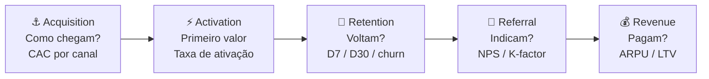

A distinção entre Acquisition e Activation é central: usuário que chegou mas não ativou é desperdício de CAC. A métrica de ativação (o "aha moment") é frequentemente o indicador mais importante do produto: encontrá-la é o trabalho de discovery dos primeiros meses.

##### O momento exato de colocar este canvas na parede

Use o Pirate Canvas na Fase 10 (MVP e primeiros usuários) como estrutura padrão de instrumentação de métricas. Implante antes de lançar o MVP: não depois. Pós-PMF, use-o mensalmente como dashboard de saúde do funil: onde está a maior queda? Qual etapa tem pior conversão? A etapa com maior vazamento é o foco de crescimento do próximo ciclo. Em Fase 14 (escala), o Pirate Canvas orienta alocação de budget por etapa do funil.

##### As regras de ouro para preencher sem se enganar

A tese de McClure é que **times sem modelo de funil explícito otimizam a métrica errada**. Times de produto tendem a focar em Acquisition (visível, fácil de medir, resulta em reuniões celebrando "crescimento") e ignorar Retention (invisível, difícil, mas única que gera crescimento sustentável). AARRR força o time a encarar que crescimento em Acquisition com retenção de 20% no D30 é uma banheira furada: você está enchendo o balde enquanto o buraco cresce. **Retenção precede escala de aquisição.**

##### Passo a passo na parede da sala (30 a 60 minutos)

Monte o Pirate Canvas em três etapas, nesta ordem:

1. **Defina a métrica de cada etapa**: 1 métrica primária por etapa. Não 5. Uma. Acquisition: CAC médio ponderado por canal. Activation: taxa de usuários que atingem o "aha moment" em X dias. Retention: retenção D30 (ou D7 para apps). Referral: NPS ou taxa de indicação ativa (mês). Revenue: conversão freemium → pago ou ARPU mensal.
2. **Defina o benchmark mínimo**: o que é "saudável" nesta métrica para o seu modelo? SaaS B2B: retenção D30 > 70%. Consumer app: retenção D30 > 25%. Marketplace: depende do lado.
3. **Identifique o maior vazamento**: onde está a maior queda de conversão entre etapas? Esse é o único foco do próximo trimestre. Não mexa nas outras etapas até resolver essa.

Iteração mensal: atualize números, identifique onde o funil mudou, ajuste foco.

##### Exemplo brasileiro preenchido: Conta Simples, aceleração do funil B2B (2021) (reconstrução didática com base em dados públicos)

A Conta Simples (conta empresarial digital para PMEs brasileiras) tinha problema claro em 2021: Acquisition funcionava bem (CAC baixo via Google Ads B2B + indicação), mas Activation era o gargalo: 60% dos cadastros não ativavam cartão em 14 dias.

| Etapa | Métrica principal | Número | Benchmark alvo | Status |
|---|---|---|---|---|
| **Acquisition** | CAC via canais digitais | R$ 180/cliente | < R$ 250 | ✅ Dentro |
| **Activation** | % completa onboarding + usa cartão em D14 | 40% | > 65% | 🔴 Crítico |
| **Retention** | Retenção D30 (conta ainda ativa e com transação) | 71% | > 70% | ✅ Dentro (marginal) |
| **Referral** | NPS (escala 0-100) | 52 | > 50 | ✅ Dentro |
| **Revenue** | ARPU mensal (receita por conta ativa) | R$ 68 | > R$ 60 | ✅ Dentro |

**O diagnóstico AARRR.** Com esse canvas, ficou claro: o problema não era "crescer" (Acquisition OK), não era "produto ruim" (Retention e NPS OK), e não era "precificação" (ARPU OK). Era **Activation**: usuários chegavam e não ativavam o cartão em 14 dias. Isso revelou dois culpados: (1) o processo KYC (validação regulatória) tinha fricção invisível, três documentos, dois dias de análise manual; (2) o email de onboarding não explicava por que o cartão era o "primeiro valor" da conta.

**As três ações decorrentes:** (1) automatizar 70% do KYC via integração com Receita Federal + Serasa, reduzindo de 2 dias para 4 horas; (2) reescrever o fluxo de onboarding in-app com checklist progressivo (cada step destravava o próximo); (3) enviar WhatsApp (não email) no D2 com link direto para "ativar seu cartão agora". Resultado em 90 dias: Activation subiu de 40% para 67%.

A armadilha clássica sem Pirate Canvas seria investir mais em Acquisition ("vamos crescer mais cadastros"). O canvas mostrou que investir em Acquisition com 40% de Activation significava jogar 60 centavos de cada R$ 1 de CAC no lixo. **A lição: AARRR não é painel de monitoramento, é protocolo de priorização. O maior vazamento do funil vence o debate de roadmap.**

##### Variações e extensões

- **RARRA** (Thomas Petit & Gabor Papp, 2018): reordena para Retention → Activation → Referral → Revenue → Acquisition, enfatiza que Retention deve ser resolvida antes de escalar Acquisition.
- **North Star Metric**: uma única métrica que captura valor entregue ao cliente e prediz crescimento de longo prazo. Complementa o AARRR (que é funil; North Star é foco). Exemplos: Airbnb (noites reservadas), WhatsApp (mensagens enviadas por dia), Spotify (tempo de escuta/mês).
- **Growth Accounting**: decompõe variação de usuários ativos em Novos + Ressuscitados − Churned. Complemento quantitativo ao AARRR.

##### Onde os fundadores mentem para si mesmos neste canvas

- Definir múltiplas métricas primárias por etapa: diluição de foco.
- Focar em Acquisition enquanto Retention é crítica: encher banheira furada.
- Usar D7 e D30 intercambiavelmente: D7 mede habit formation, D30 mede stickiness; são perguntas distintas.
- Não segmentar o funil por persona/canal: um funil "médio" pode esconder que canal A tem Activation 80% e canal B tem 15%.
- Tratar AARRR como relatório (olhar uma vez por mês sem decidir nada) em vez de protocolo de priorização.

---

### TEMPLATES OPERACIONAIS E CASOS PREENCHIDOS DESTA FASE

#### Template: Checklist de Pre-Launch

**Para que serve.** Cobrir os 12 itens criticos de qualquer launch publico de produto MVP, evitando que voce descubra um buraco basico nos primeiros tres dias.

**Quando usar.** Uma a duas semanas antes do dia D do launch publico do MVP ou de feature significativa.

**Exemplo de preenchimento.** Lancamento publico do MVP de SaaS B2B contabil.

```
CHECKLIST DE PRE-LAUNCH
Data alvo: ___ | Responsavel: ___

PRODUTO
[ ] Cobertura de testes basicos (smoke tests passam)
[ ] Logs e monitoramento ativos (erro 500 dispara alerta)
[ ] Onboarding funcional ate primeiro valor entregue

CONTEUDO
[ ] Landing page no ar e testada em mobile
[ ] FAQ com top 10 duvidas antecipadas
[ ] Documentacao publica acessivel

ANALYTICS
[ ] Tracking de eventos-chave funcionando (signup, ativacao, retencao D1)
[ ] Funnel observavel em ferramenta (Mixpanel, Amplitude, GA)

SUPORTE
[ ] Canal de contato ativo (email, chat, ou ambos)
[ ] Pessoa de plantao para primeira semana

JURIDICO E COMPLIANCE
[ ] Termos de uso e politica de privacidade publicados
[ ] LGPD em conformidade

COMUNICACAO
[ ] Mensagem de launch escrita e revisada
[ ] Lista de pessoas-chave informadas em primeira mao
[ ] Plano de divulgacao para primeiro 7 dias
```

---

### Fechamento da Fase 11: o que muda na sua cabeça e na sua empresa a partir de agora

O entregável é o MVP em operação mais o Relatório de Aprendizado depois de oito a doze semanas. Pela primeira vez, você tem evidência do que pessoas reais fazem com produto real, pago, em rotinas reais: e essa evidência é diferente em qualidade de tudo que veio antes: entrevistas, protótipos, testes de usabilidade. Ela muitas vezes surpreende.

Faça coisas que não escalam: atender os primeiros vinte clientes pessoalmente, mesmo sendo ineficiente, é o que produz o aprendizado denso que automação esconde. Esse aprendizado da Fase 11 é insumo direto da [[#FASE 12 — VALIDAÇÃO DO MODELO DE NEGÓCIO|Fase 12]], onde o foco sai do produto e vai para a máquina econômica: CAC, LTV, margem e sustentabilidade.

---

## FASE 12 — VALIDAÇÃO DO MODELO DE NEGÓCIO

### A Matemática Implacável da Unidade: Por Que Vender R$ 1 por R$ 0,80 Não Se Conserta no Volume

Rafael entrou no escritório em Recife vibrando: no mês da Black Friday, a marca deles havia faturado R$ 310 mil brutos, o triplo do mês anterior. Mas quando Bia fechou o extrato bancário no dia 5 de dezembro, o saldo da conta corrente havia caído R$ 48 mil.

– "Bia, onde foi parar o dinheiro? Nós vendemos mais de três mil pedidos!", perguntou Rafael em choque.

Bia abriu o quadro branco e desenhou a autópsia de **um único pedido médio de R$ 100**:
- Preço pago pelo cliente: **R$ 100,00**
- Impostos e taxa do gateway de cartão parcelado: **-R$ 14,50**
- Custo de fabricação do produto e embalagem: **-R$ 38,00**
- Frete grátis prometido na campanha + logística reversa de trocas: **-R$ 26,00**
- **Margem de Contribuição antes do Marketing: R$ 21,50**
- Custo de Aquisição no leilão de anúncios (CAC) por pedido: **-R$ 37,00**
- **Resultado Líquido por Pedido Vendido: -R$ 15,50 de prejuízo na veia.**

– "Rafael, cada vez que o sininho da loja apitou neste mês e você comemorou, nós tiramos R$ 15,50 do nosso bolso e colocamos dentro da caixa de papelão do cliente."

Essa é **A Ilusão Óptica do Faturamento Bruto**. Faturamento de topo de linha é vaidade; margem de contribuição é sanidade; caixa livre é sobrevivência.

Na Fase 12, você é proibido de olhar apenas para o faturamento total do mês. Você deve colocar um único cliente sob o microscópio cirúrgico dos *Unit Economics*: quanto custa exatamente trazer esse cliente (CAC totalmente carregado), quanto sobra de margem líquida em cada compra depois de todos os custos variáveis, em quantos meses o cliente devolve o dinheiro gasto para conquistá-lo (*Payback*) e quantas vezes ele vale mais do que custou (*LTV/CAC*). Se um único tijolo dá prejuízo estrutural, construir um prédio de vinte andares só fará o desabamento ser fatal.

---

A cascata visual de unit economics (economia por unidade: quanto você ganha e gasta por cliente), da receita por cliente à saúde do negócio:

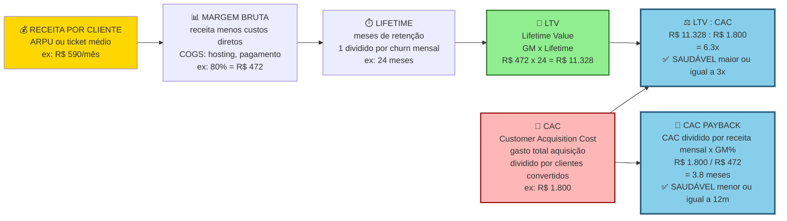

> [!important] Três alvos operacionais inegociáveis
> Nos benchmarks clássicos de SaaS (popularizados por David Skok e fundos de venture capital; para e-commerce e D2C as margens brutas de referência são menores): LTV dividido por CAC maior ou igual a três vezes (abaixo de 1x custa mais adquirir do que o cliente gera; entre 1x e 3x sobra pouca margem para pagar a estrutura fixa e financiar o crescimento). CAC payback de até doze meses (em SaaS B2C, até seis meses). Margem bruta de setenta por cento ou mais em SaaS. Falha em qualquer um dos três significa que o modelo ainda não funciona em escala.

> [!question] FMF Check da Fase 11
> O modelo de negócio que emergiu é algo que só você desenharia com o seu conhecimento acumulado, ou é modelo óbvio que qualquer outra pessoa no mesmo mercado chegaria? Modelos óbvios têm concorrência saudando. Não são defensáveis por FMF. Modelos não óbvios frequentemente parecem estranhos no começo (e por isso outros não tentaram), e revelam-se defensáveis depois. Se o seu modelo parece "o óbvio", revisite.

### Por que crescer com economia unitária negativa é cavar a própria cova com uma escavadeira turbo

Produtos que usuários amam podem levar empresas à falência. Se o CAC é maior do que o LTV, cada cliente adicional destrói valor. Se a margem é baixa demais para cobrir custos operacionais, o negócio não escala. Essa fase valida a viabilidade econômica com dados reais. Não com chutes de planilha.

### Calculando o CAC Fully-Loaded, a Margem de Contribuição Nível 1/2/3 e o Payback em regime de caixa

Onze passos.

#### Passo 1, meça CAC real

CAC (custo de aquisição de cliente) é o gasto total em marketing mais vendas no período, dividido pelos novos clientes pagantes adquiridos no período.

Inclua no "gasto total" quatro coisas. Ads pagos. Salário ou tempo de quem vende ou faz marketing (mesmo você: valorize o seu tempo). Ferramentas (CRM, automação, design). Custos de eventos, brindes e campanhas.

Não inclua os custos de operação do produto em si.

> [!warning] Meça por canal separadamente
> Um canal pode ter CAC baixo, e outro altíssimo. Média esconde. Sem segmentação por canal, você não sabe qual canal está realmente funcionando.

#### Passo 2, calcule LTV (valor total gerado por cliente ao longo do tempo)

A fórmula simples para modelo recorrente (SaaS ou assinatura): LTV é igual à receita média por cliente por mês, vezes a margem bruta (receita menos custo direto), vezes os meses médios de retenção.

A fórmula simples para modelo transacional: LTV é igual à receita média por transação, vezes a margem bruta, vezes a frequência anual, vezes os anos esperados.

> [!tip] Capítulo 6: Subscription Economy
> O [[#CAPÍTULO 6 — PRICING STRATEGY E ECONOMIA DA RECORRÊNCIA (SUBSCRIPTION ECONOMY)|Capítulo 6: Subscription Economy]] cobre a mecânica específica de negócios recorrentes: MRR waterfall (new, expansion, contraction, churn), dinâmica de NRR, pricing de tiers e as armadilhas de churns que não aparecem na DRE até ser tarde demais.

No início, você não tem dados históricos longos. Use proxies. A retenção observada nos primeiros três a seis meses, extrapolada com cuidado. A taxa de churn (cancelamento: percentual de clientes que param de pagar) mensal observada: LTV é aproximadamente igual ao ARPU (receita média por usuário) dividido pelo churn (simplificado).

#### Passo 3, meça o tempo de payback de CAC

Payback period (tempo para recuperar o que você gastou para adquirir o cliente) é igual ao CAC dividido pela receita mensal por cliente, vezes a margem.

Esse é o número de meses até você "pagar" o CAC de um cliente. Abaixo de doze meses é bom. Acima de vinte e quatro meses, você precisa de muito capital para crescer.

#### Passo 4, valide a precificação com clientes pagantes

Agora você tem dados reais. Responda quatro perguntas. A precificação atual é percebida como adequada? Há segmentos dispostos a pagar mais por mais valor? Há segmentos que precisam de versão mais barata? Tem espaço para upsell ou cross-sell?

Teste experimentalmente. Aumente o preço para novos clientes em vinte a trinta por cento. Meça a conversão. Introduza tiers (básico, profissional, enterprise). Cobre módulos ou features extras separadamente.

> [!important] Precificação não fica congelada
> Precificação é um dos principais vetores de valor. Não a deixe estática. Reavalie a cada três a seis meses. Pequenos ajustes em preço movem mais EBITDA do que grandes esforços de eficiência operacional.

#### Passo 5, mapeie todos os custos unitários e recorrentes

Quatro categorias. Custos fixos (aluguel, salários, ferramentas, SaaS). Custos variáveis por cliente (infraestrutura, suporte, transação, comissão). Investimentos pontuais (equipamentos, marcas, desenvolvimento). Impostos.

Gross margin (margem bruta: receita menos custo direto, dividido pela receita): SaaS saudável tem mais de setenta por cento. Marketplaces têm mais de trinta por cento. Serviços podem ter menos de cinquenta por cento e ainda ser bom negócio.

#### Passo 6, identifique alavancas de eficiência

Onde você consegue reduzir o CAC? Aumentar o LTV? Melhorar a margem? Quatro alavancas comuns. Canais de aquisição mais baratos (SEO, referência, parcerias). Mecanismos de retenção (melhor onboarding, features stick, comunidade). Upsell e expansão. Automação de suporte e operação.

#### Passo 7, modele o Canvas Financeiro

Planilha contendo cinco itens. Premissas (CAC por canal, LTV por segmento, churn, ARPU). Cenários (conservador, base, otimista). Projeção de dezoito a trinta e seis meses. Ponto de equilíbrio operacional (break-even). Necessidade de capital por cenário.

Isso não é "plano de negócios" para impressionar investidor. É ferramenta para tomar decisões operacionais.

> [!note] Quando construir o primeiro orçamento formal
> O [[IGNICAO-Vol-5-Financas-e-Captacao#CAPÍTULO 4 — PLANEJAMENTO FINANCEIRO (FP&A), ORÇAMENTO E REVENUE FORECASTING|Capítulo 4: Planejamento Financeiro e Orçamento (Vol. 5)]] cobre o momento certo para montar o primeiro budget estruturado: abordagens top-down versus bottom-up, headcount plan, e como fazer reforecast quando os números divergem das premissas.

> [!note] Forecasting de ARR para validar se o modelo fecha
> O [[IGNICAO-Vol-5-Financas-e-Captacao#CAPÍTULO 4 — PLANEJAMENTO FINANCEIRO (FP&A), ORÇAMENTO E REVENUE FORECASTING|Capítulo 4: Revenue Forecasting (Vol. 5)]] traz o ARR waterfall, análise de cohorts de receita, modelos baseados em pipeline, e ajustes de sazonalidade brasileira: ferramentas para testar se as premissas do canvas financeiro são alcançáveis.

> [!tip] Capítulo 3 (Vol. 5): Modelagem Financeira
> O [[IGNICAO-Vol-5-Financas-e-Captacao#CAPÍTULO 3 — MODELAGEM FINANCEIRA OPERACIONAL BOTTOM-UP E PROJEÇÕES POR COORTES (COHORTS)|Capítulo 3: Modelagem Financeira (Vol. 5)]] cobre a anatomia completa do modelo financeiro para startups: estrutura de abas, premissas auditáveis, projeção de headcount, sensibilidades e como construir um modelo que investidor consegue revisar sem perguntar o que cada célula faz.

##### Modelo financeiro profissional em três cenários

O plano de uma página é ponto de partida. Modelo financeiro completo em planilha (Excel ou Google Sheets) é obrigatório para qualquer decisão de captação, investimento em time ou canal. O padrão mínimo exige três cenários explícitos com premissas auditáveis.

A estrutura do modelo financeiro tem cinco abas.

**Aba 1, Premissas.** Todas as variáveis que movem o modelo. Crescimento mensal de novos clientes (em percentual). Ticket médio (MRR, Monthly Recurring Revenue, ou receita mensal recorrente, ou ARR, Annual Recurring Revenue, receita anual recorrente, por cliente). Churn mensal (em percentual). NRR (Net Revenue Retention: percentual da receita retida e expandida na base de clientes). CAC por canal. Custo variável por cliente. Custos fixos mensais (folha, tools, office). Timing de contratação por função.

**Aba 2, DRE mensal projetada (dezoito a trinta e seis meses).** As linhas: Nova receita, Expansão, Churn, MRR líquido, Custo variável, Margem de contribuição, Folha, Outros custos fixos, EBITDA e Caixa em mãos. As colunas: mês a mês por dezoito a trinta e seis meses.

> [!note] Leitura dos demonstrativos do próprio negócio
> O [[IGNICAO-Vol-5-Financas-e-Captacao#CAPÍTULO 1 — DEMONSTRATIVOS FINANCEIROS PARA O FUNDADOR|Capítulo 1: Demonstrativos Financeiros (Vol. 5)]] ensina a ler e interpretar DRE gerencial, balanço, DFC e capital de giro: incluindo a diferença prática entre EBITDA e fluxo de caixa livre, que move decisões de runway e captação.

**Aba 3, Três cenários.**

| Cenário | Premissas | Propósito |
|---|---|---|
| **Conservador** | Crescimento menos trinta por cento do esperado, CAC mais vinte por cento, churn mais vinte por cento, atrasos de dois a três meses em milestones. | Qual é o "piso" que me permite operar? Tenho runway aqui? |
| **Base** | Extrapolação honesta dos últimos três a seis meses de dados reais. Sem otimismo nem pessimismo. | Esse é o plano. |
| **Agressivo** | Crescimento mais trinta por cento, CAC menos quinze por cento, novo canal entra, expansão antecipada. | Tenho capacidade de execução se acelerar? Preciso contratar antes? |

> [!warning] Regra operacional do cenário conservador
> O cenário conservador deve mostrar runway (tempo de vida do caixa no ritmo atual de gastos) de dezoito meses ou mais em qualquer momento. Se não mostra, você está sub-capitalizado. Precisa captar, ou cortar custos *agora*.

> [!tip] Capítulo 3 (Vol. 5): Modelagem com Cohorts
> O [[IGNICAO-Vol-5-Financas-e-Captacao#CAPÍTULO 3 — MODELAGEM FINANCEIRA OPERACIONAL BOTTOM-UP E PROJEÇÕES POR COORTES (COHORTS)|Capítulo 3: Modelagem com Cohorts (Vol. 5)]] mostra como construir a análise de coorte de receita que transforma o churn mensal em projeção de ARR, identifica degradação de coortes antes que apareça na DRE e calcula o LTV real por safra de cliente: base da Aba 4 de sensibilidades abaixo.

**Aba 4, Sensibilidades.**

Teste a saída principal (mês de break-even, EBITDA em vinte e quatro meses, caixa mínimo) contra variações de quatro variáveis. Crescimento (mais ou menos vinte por cento). Ticket médio (mais ou menos quinze por cento). Churn (mais ou menos vinte por cento). CAC (mais ou menos vinte e cinco por cento).

Identifique a variável mais sensível: aquela em que pequenas mudanças movem muito o resultado. Essa variável é prioridade de atenção e medição semanal.

**Aba 5, Break-even analysis.**

Calcule em que mês (e com quanto de ARR) você atinge três marcos. Break-even operacional (receita igual aos custos operacionais). Break-even de caixa (a operação gera caixa sem depender de captação). Break-even acumulado (todo o capital captado está "pago" pela operação).

#### Passo 8, documente o cap table inicial e modele diluição

> [!note] Esta seção é preview operacional para validação do modelo
> A estruturação formal do cap table, vesting, classes de ações, drag-along/tag-along, contrato de sócios completo, é tema da [[IGNICAO-Vol-8-Juridico-LGPD-e-Seguranca#FASE 18 — ESTRUTURAÇÃO JURÍDICA, SOCIETÁRIA E BLINDAGEM OPERACIONAL|Fase 18 (Vol. 8)]]. Aqui na Fase 11 o cap table aparece em versão simplificada porque é input direto da modelagem financeira: você precisa saber quantas ações cada sócio tem para projetar diluição em cenários de captação e calcular *runway efetivo após* novas rodadas. É a mesma ferramenta vista por dois ângulos: modelo (aqui) e instrumento jurídico (Fase 13).

Desde a primeira captação, mantenha um cap table (tabela de capital) documentado. A maioria dos fundadores negligencia isso, e acorda em Série B descobrindo que detém vinte e cinco por cento de uma empresa que vai captar mais. Surpresa cara.

A estrutura mínima do cap table:

| Detentor | Classe de ação | Número de ações | Percentual antes desta rodada | Número de ações após | Percentual após |
|---|---|---|---|---|---|
| Fundador 1 | Ordinárias | 4.000.000 | 40,0% | 4.000.000 | 32,0% |
| Fundador 2 | Ordinárias | 3.000.000 | 30,0% | 3.000.000 | 24,0% |
| Pool de opções | Reservado | 1.500.000 | 15,0% | 1.875.000 | 15,0% |
| Investidor anjo | Preferenciais A | 1.500.000 | 15,0% | 1.500.000 | 12,0% |
| Novo investidor (Série A) | Preferenciais B |: |: | 2.125.000 | 17,0% |
| **Total** | | **10.000.000** | **100,0%** | **12.500.000** | **100,0%** |

**Cinco conceitos-chave que o fundador precisa dominar.**

Pré-money valuation. Valor da empresa *antes* do investimento entrar. Por exemplo, R$ 40 milhões pré-money.

Post-money valuation. Pré-money mais o valor captado. Se capta R$ 10 milhões em pré de R$ 40 milhões, o post é R$ 50 milhões.

Percentual de diluição. Percentual de equity que sai dos atuais detentores para o novo investidor. Se o investidor entra por R$ 10 milhões em post de R$ 50 milhões, ele fica com vinte por cento, e todos os demais diluem proporcionalmente.

Pool de opções (option pool). Reserva de equity para contratações futuras. O ponto crítico: se o investidor exige aumento de pool *antes* da rodada (pre-money pool increase), a diluição sai toda dos fundadores. Se o aumento é *depois* (post-money), dilui todos. Negociar isso vale muito dinheiro.

Liquidation preference. Em exit, o investidor preferencial recebe primeiro um múltiplo do investido, antes de fundadores receberem qualquer coisa. "1x non-participating" é padrão saudável. "2x participating" é predatório (o investidor recebe duas vezes, *e* mais a parte pro-rata dele). Negocie cedo.

A modelagem de diluição ao longo de rodadas futuras. Projete (no modelo financeiro, em aba separada) o cap table em três a quatro rodadas futuras hipotéticas.

Exemplo visual de cap table evolutivo, do Seed à Série B:

```mermaid
flowchart LR
 subgraph S1["🌱 SEED<br/>R$ 2M @ R$ 10M pré"]
 SF[Founders: 80%]
 SE1[ESOP: 10%]
 SI[Seed investor: 10%]
 end

 subgraph S2["🚀 SÉRIE A<br/>R$ 15M @ R$ 60M pré<br/>diluição ~20%"]
 AF[Founders: 59%]
 AE[ESOP expandido: 13%]
 AIS[Seed: 8%]
 AIA[Série A: 20%]
 end

 subgraph S3["📈 SÉRIE B<br/>R$ 60M @ R$ 300M pré<br/>diluição ~17%"]
 BF[Founders: 41%]
 BE[ESOP: 14%]
 BIS[Seed: 6%]
 BIA[Série A: 15%]
 BIB[Série B: 24%]
 end

 S1 --> S2 --> S3

 style SF fill:#90EE90
 style AF fill:#FFFF99
 style BF fill:#FFB6B6
```

A diluição típica de founder em trajetória SaaS brasileira: oitenta por cento (Seed), depois cinquenta e nove por cento (Série A), depois quarenta e um por cento (Série B), e por fim vinte e cinco a trinta por cento (Série C ou D). A cor passa de verde a vermelho indicando atenção crescente ao controle de governança. Em torno de trinta a quarenta por cento, começam a faltar votos para decisões fundamentais.

| Rodada | Valor captado | Pré-money | Percentual diluído | Fundador 1 após |
|---|---|---|---|---|
| Hoje |: |: |: | 40,0% |
| Seed (agora) | R$ 3M | R$ 12M | 20% | 32,0% |
| Série A (18m) | R$ 15M | R$ 45M | 25% | 24,0% |
| Série B (36m) | R$ 40M | R$ 150M | 21% | 18,9% |
| Série C (54m) | R$ 80M | R$ 400M | 17% | 15,7% |

> [!important] A lição da diluição saudável
> Mesmo com diluição saudável por rodada (quinze a vinte e cinco por cento), fundadores chegam em Série C com quinze a vinte por cento da empresa. Isso é normal e saudável. Expectativa de reter cinquenta por cento em late stage é fantasia.

As ferramentas recomendadas para cap table. Planilhas (Google Sheets, Excel) para menos de dez detentores. Carta (formerly eShares), Pulley, Ledgy para estruturas mais complexas, ou ESOP (employee stock option plans) formais.

Advogado societário deve revisar o cap table antes de qualquer rodada. Custo típico de R$ 5 mil a R$ 15 mil por revisão. Retorno: evitar erros caros.

#### Passo 9, faça o teste de unit economics

A pergunta central. Se eu parasse de adquirir novos clientes agora, o negócio seria rentável operacionalmente com os clientes atuais?

Se sim, você tem unit economics saudável. Se não, ajuste preço, custo ou churn antes de escalar.

> [!tip] Canvases Visuais: Pirate Canvas / AARRR (Fase 11)
> Unit economics fica mais legível quando colado ao funil AARRR (Acquisition, Activation, Retention, Referral, Revenue) do [[#Canvas: Pirate Canvas / AARRR (Dave McClure, 2007)|Canvas: Pirate Canvas / AARRR (Dave McClure, 2007)]] – cada métrica desta fase (CAC, ativação, churn, NRR, payback) tem casa numa etapa do funil. Use o canvas para localizar onde estão os gargalos do modelo: CAC alto demais é problema de Acquisition; payback longo pode ser baixa Activation; LTV baixo é Retention insuficiente.

#### Passo 10, aplique a pergunta diagnóstica canônica de Paul Graham, Default Alive ou Default Dead?

Essa é talvez a pergunta mais útil que Paul Graham formulou para fundadores em estágio pós-MVP, em ensaio de 2015. Ele conta que, quando conversa com qualquer startup com mais de oito ou nove meses de operação, a primeira coisa que pergunta é isso. Pelos dados dele, metade dos fundadores não sabe responder. Não é tecnicismo. É diagnóstico primário.

> [!quote] A pergunta de Default Alive / Default Dead
> Assumindo que os meus gastos permaneçam constantes, e o meu crescimento de receita mantenha o padrão dos últimos meses, eu chego à lucratividade com o caixa que tenho hoje? Ou não?

Duas respostas possíveis. Duas realidades muito diferentes.

Default Alive (vivo por padrão). Sim, eu chego, sem precisar de mais dinheiro externo. Tenho controle do meu destino.

Default Dead (morto por padrão). Não, eu vou quebrar antes de virar lucrativo, a menos que alguém escreva outro cheque.

A pergunta é brutal na utilidade porque converte "otimismo vago" em "fato numérico". Você precisa de quatro inputs para responder: despesas atuais, receita atual, taxa de crescimento atual e caixa em mãos. Uma planilha simples projeta mês a mês até caixa zero versus break-even, e dá a resposta. Graham aponta um calculador público (aord.io/calc) útil para o cálculo mecânico.

Por que isso importa operacionalmente.

O fundador Default Alive pode focar em crescimento e novas apostas. Tem liberdade. Pode experimentar, captar em boas condições, escolher parceiros.

O fundador Default Dead deveria estar focado em consertar o problema fundamental. Não em "captar mais dinheiro para esticar runway".

> [!warning] Esticar runway sem consertar o negócio
> Graham é enfático sobre isso. Esticar runway sem consertar o negócio é simplesmente adiar a morte. Não é solução.

##### O Fatal Pinch, a armadilha silenciosa mais perigosa

Graham identifica, num ensaio complementar de 2014, o cenário mais letal que uma startup pode atingir. É a combinação de Default Dead com crescimento lento, tempo insuficiente para corrigir e esperança depositada em investidores. Ele chama de *Fatal Pinch* (o aperto fatal) e argumenta que ele mata mais startups que qualquer fraude, erro técnico ou concorrente. O roteiro é quase sempre o mesmo, em sete passos.

Startup lança produto moderadamente atraente. Não é ruim. Mas não é irresistível.

Crescimento é "ok mas não ótimo". Digamos três a cinco por cento ao mês, não cinco a dez por cento por semana.

Fundador se convence de que a solução é contratar mais gente para "acelerar". Investidor concorda, em entusiasmo compartilhado sem dados sustentando.

Despesas sobem. Crescimento não sobe junto. Porque o produto não é bom o suficiente. E contratar mais gente para "construir o produto" em vez de "evoluir o produto" frequentemente piora.

Runway encolhe rapidamente. Fundador começa a captar.

Investidor olha os números. Burn alto. Crescimento fraco. Time grande. Passa.

Captação falha. Caixa acaba. Empresa morre.

> [!important] A lição crítica do Fatal Pinch
> Ele é quase sempre resolvido pela direção errada. O correto em Default Dead com crescimento fraco quase nunca é contratar. É parar e consertar o produto, para que ele seja genuinamente desejado. Parar de captar. Reduzir time se necessário. Voltar a conversar com cliente. Iterar no produto com time menor e mais focado. Contratar mais pessoas nessa fase é exatamente o oposto do que funciona.

A melhor forma de evitar o Fatal Pinch é fazer a pergunta Default Alive ou Default Dead cedo. Aos oito ou nove meses, não aos dezoito. Fundadores que descobrem estar Default Dead aos dezoito meses têm opções muito piores do que os que descobrem aos nove meses.

#### Passo 11, persiga Ramen Profitable, o milestone subestimado

"Ramen Profitable" é outro conceito canônico de Graham, em ensaio de 2009, que merece tratamento sério aqui. Porque quase nenhum fundador brasileiro prioriza isso. E quase todos deveriam.

Uma startup é ramen-profitable quando gera receita suficiente para cobrir os custos de vida básicos dos fundadores. A origem metafórica é o ramen instantâneo, comida de cerca de R$ 3 por refeição. Não é lucratividade tradicional. Não é escala. Não é sucesso financeiro. É apenas sobrevivência infinita. A empresa pode continuar existindo indefinidamente, sem captar, porque paga o que os fundadores precisam para viver.

Por que ramen-profitable é marco estratégico (e subestimado). Quatro razões.

Tempo infinito. Você não precisa mais de captação para continuar existindo. Pode esperar pelo investidor certo, pelo momento certo do mercado, pela feature que vai destravar tudo. Essa opção, "posso simplesmente esperar", é ativo estratégico enorme.

Poder de negociação em captação. Fundos preferem dar dinheiro a quem não precisa do dinheiro. Ramen-profitable aumenta valuation e melhora termos, independente da performance operacional. O investidor sabe que não está salvando ninguém. Está apostando.

Redução de estresse psicológico. Muda profundamente a dinâmica interna e com sócios. Desespero e pânico são substituídos por paciência. Decisões ruins tomadas sob pressão de caixa param de acontecer.

Filtro de seriedade. Forçar a equipe a atingir ramen-profitable é disciplina financeira que toda startup deveria ter, e poucas têm. Muitos fundadores pulam esse degrau achando que é "pensamento pequeno". É o oposto. É o primeiro degrau sólido sobre o qual escalar.

> [!important] Regra operacional simples sobre Ramen Profitable
> Se o seu modelo de negócio não permite ramen-profitable em horizonte de doze a dezoito meses (mesmo sem crescer para além disso), o modelo provavelmente tem buraco estrutural. Reconsidere o modelo, não a meta. Empresa que precisa de US$ 50 milhões antes de ser capaz de pagar dois salários mínimos aos fundadores tem problema econômico profundo.

No contexto brasileiro. Ramen-profitable para fundadores brasileiros em São Paulo tipicamente significa receita líquida mensal entre R$ 15 mil e R$ 40 mil. Dependendo de quantos fundadores, despesas pessoais, filhos. É faturamento atingível por muitas startups early-stage com disciplina. Mas que é sistematicamente ignorado em favor de "vamos captar pré-Seed". Que tipicamente traz menos dinheiro total do que doze meses de ramen-profitable consistente.

##### Combinação Default Alive vezes Ramen Profitable vezes Crescimento, matriz operacional

| Situação | Diagnóstico | Ação correta |
|---|---|---|
| Default Alive, ramen-profitable, crescendo cinco a dez por cento ao mês | Posição ideal | Crescer ambiciosamente, captar seletivamente |
| Default Alive, não ramen-profitable, crescendo forte | Queimando capital, mas racionalmente | Continuar se o capital é abundante e a trajetória é clara |
| Default Dead, crescendo forte | Fundraising será bem-sucedido se não demorar | Captar urgentemente, e negociar bem |
| Default Dead, crescimento fraco (Fatal Pinch) | Crise silenciosa | Parar de contratar, consertar produto, cortar custos, buscar ramen-profitable |
| Ramen-profitable, crescimento estagnado | Solvente, mas sem tração | Reavaliar hipóteses (cunha, ICP, preço) |

Três perguntas de verificação mensal para a gestão de caixa. Aplique a checagem Default Alive ou Default Dead descrita no Passo 10 acima: com números, não com esperança. Verifique se você atingiu Ramen Profitable conforme definido no Passo 11 acima. Se a resposta para as duas anteriores é negativa, qual é o meu plano de noventa dias para mudar isso?

> [!tip] Capítulo 5 (Vol. 5): Gestão de Caixa
> O [[IGNICAO-Vol-5-Financas-e-Captacao#CAPÍTULO 5 — CAPITAL DE GIRO, RECEBÍVEIS E GESTÃO DE CAIXA EM PROFUNDIDADE|Capítulo 5: Gestão de Caixa (Vol. 5)]] aprofunda o ritual mensal de caixa: reconciliação bancária, projeção de 13 semanas, controle de inadimplência e gatilhos de alerta de runway: o processo operacional que transforma o diagnóstico Default Alive/Dead em ação concreta.

### Os onze passos aplicados, unit economics do PadariaPro depois de três meses de piloto

A receita. Ticket médio mensal por cliente (três lojas cada): R$ 870 por mês (R$ 290 vezes três). Receita total atual: R$ 2.610 por mês. ACV projetado: R$ 10.440 por ano por cliente.

O custo para servir, por cliente, por mês. Infraestrutura (hospedagem mais Z-API proporcional): R$ 35. Atendimento (trinta minutos por mês, vezes R$ 80 por hora): R$ 40. Custo total para servir: R$ 75 por cliente por mês.

A margem unitária. Receita: R$ 870. Custo: R$ 75. Margem bruta: R$ 795. Ou seja, noventa e um por cento, típico de SaaS B2B leve.

O CAC estimado, com base nos três pilotos, e em extrapolação. Canal atual: indicação mais rede pessoal (CAC de aproximadamente R$ 400, em tempo do fundador). Canal projetado pós-PMF: cold outreach mais eventos mais conteúdo (CAC esperado de R$ 1.500 a R$ 2.500).

O LTV estimado, com suposições conservadoras. Churn projetado: três por cento ao mês (vira trinta e seis por cento ao ano), típico de SaaS B2B inicial. Vida média do cliente: vinte e oito meses. LTV (margem vezes vida): R$ 795 vezes 28, ou seja, R$ 22.260.

A razão LTV dividido por CAC, em três cenários. No cenário atual (indicação): 22.260 dividido por 400, ou seja, 55 para 1. Ótimo, mas irreplicável em escala. No cenário pós-PMF (cold outreach): 22.260 dividido por 2.000, ou seja, 11 para 1. Saudável. No cenário pessimista (CAC maior, churn maior): 22.260 dividido por 3.000, ou seja, 7 para 1. Ainda viável.

Os custos fixos mensais atuais. Salários (duas pessoas em parcial): R$ 18.000. Ferramentas e infra base: R$ 2.000. Total: R$ 20.000 por mês.

O break-even. Margem unitária de R$ 795. Clientes para break-even: 20.000 dividido por 795, ou seja, vinte e seis clientes. Se crescer quatro clientes por mês líquido, break-even em mês sete.

**O que precisa ser verdade para o modelo sustentar, três suposições com plano de teste.**

Churn fica em quatro por cento ao mês ou menos no ano um. Se for seis a oito por cento, o LTV cai para R$ 14 mil, e a razão fica apertada. **Teste:** manter conversa semanal com os três primeiros clientes, e medir NPS mensal.

CAC pós-PMF fica em R$ 2.500 ou menos. Se for R$ 4.000 ou mais, o payback estica, e o caixa aperta. **Teste:** depois de alcançar dez clientes orgânicos, tentar cinco por cold outreach, e medir o custo real.

ACV consegue crescer quinze por cento ao ano via expansão. Padarias adicionam lojas, produtos. **Teste:** monitorar expansão em seis a doze meses.

### Caso brasileiro real, validação de unit economics na BizCapital (fintech de crédito PME)

A BizCapital, fundada em 2016 por Francisco Ferreira, Fabio Neufeld e Lucas Marques no Rio de Janeiro, atua em crédito para pequenas e médias empresas via canais digitais e parcerias. Antes de escalar a originação, o time validou os unit economics em pequena escala: CAC por empréstimo originado (incluindo custo de tráfego e comissão de parceiros), inadimplência por perfil de cliente, LTV (margem por empréstimo mais ciclo de recompra), e tempo de retorno do capital alocado.

A descoberta foi cirúrgica. Perfis de cliente e canais de originação tinham CAC e inadimplência muito desiguais entre si: segmentos que pareciam atraentes na teoria mostravam unit economics negativos quando medidos. O time selecionou os perfis e canais que funcionavam antes de escalar, evitando queima de capital em segmentos cosmeticamente atraentes mas economicamente quebrados. A empresa levantou rodadas significativas (Série B liderada pela DEG e Série C liderada por Lightrock e Mauá, totalizando mais de R$ 200 milhões captados ao longo da década) e construiu carteira relevante em crédito PME: mercado historicamente mal atendido pelos bancos tradicionais.

Unit economics precisam ser provados em escala pequena antes de investir em escala grande. Modelo que "parece saudável no papel" frequentemente não é. Só o teste real revela. E em fintech de crédito, a métrica que não pode ser estimada por proxy é inadimplência: ela precisa ser observada por safra, com tempo suficiente para a coorte amadurecer.

### Equação de Unit Economics auditada e comprovadamente saudável por canal e segmento

Você concluiu a Fase 12 quando todos os critérios abaixo estão cumpridos.

- [ ] Canvas Financeiro preenchido com dados reais dos últimos três meses ou mais. Unit economics iniciais (CAC, LTV, churn, ticket médio) calculados com dados reais.
- [ ] Modelo financeiro em três cenários (conservador, base, agressivo) com cinco abas (premissas, DRE projetada, cenários, sensibilidades, break-even).
- [ ] Margem bruta unitária de 60% ou mais (SaaS típico), ou justificada se menor.
- [ ] LTV/CAC ≥ 3 em cenário realista (idealmente ≥ 5), em pelo menos um canal viável.
- [ ] CAC payback ≤ 12 meses (até 18 em B2B enterprise com ACV alto e contratos multi-anuais).
- [ ] Canal de aquisição principal testado com CAC real (não estimado), com plano claro de redução de CAC ou aumento de LTV.
- [ ] Break-even em número de clientes calculado.
- [ ] Cap table simplificado documentado, com modelagem de diluição em três a quatro rodadas hipotéticas.
- [ ] Diagnóstico Default Alive ou Default Dead aplicado, com resposta numérica.
- [ ] Três suposições "que precisam ser verdade" para o modelo fechar, explícitas e com plano de teste.
- [ ] Burn rate medido (gross e net); Burn Multiple (net burn ÷ net new ARR) ≤1,5x em SaaS (acima de 3x indica eficiência ruim).
- [ ] Runway ≥12 meses operacionais sempre disponíveis (zona de pânico abaixo de 6 meses; iniciar nova rodada com 9+ meses restantes).
- [ ] NRR (Net Revenue Retention) acompanhada: ≥100% indica expansão líquida; <90% indica churn estrutural a corrigir antes de escalar.
- [ ] Churn mensal ≤5% (B2C) ou ≤2% (B2B SaaS); MRR growth mensal acompanhado se aplicável.

> [!warning] Critério de saída
> Se algum dos thresholds está fora da faixa em todos os canais testados, o gate da Fase 12 fica fechado. Fechar gate aqui é mais barato que fechar lá.

**Primeiros passos práticos.**

1. Abrir planilha de unit economics. Preencher com dados reais dos pilotos (mesmo com amostra pequena).
2. Listar os custos unitários. Infraestrutura, atendimento, aquisição estimada.
3. Fazer dois cenários. Pessimista (baseado nos dados atuais) e otimista (extrapolado para cem clientes).
4. Identificar os dois ou três "números que precisam ser verdade" para o modelo sustentar. E plano de teste de cada.

### Mentir para si mesmo excluindo salários de vendas do CAC ou projetando um LTV de 5 anos quando a empresa tem 4 meses

LTV chutado com otimismo. Assumir retenção de cinco anos com base em três meses de dados. Use premissas conservadoras.

CAC mascarado. Não contar tempo de fundador, ou campanhas pontuais como fixas. Conte tudo.

Achar que margem ruim se corrige com escala. Às vezes sim. Muitas vezes não. Se os custos variáveis são altos, escala não resolve.

Subestimar churn. Churn pequeno aparentemente (um por cento) composto por meses dá doze por cento anualizado. Composto por anos dá destruição de coorte.

Focar em receita bruta. Receita bruta com margem negativa é veneno. Foque em contribuição.

Ignorar vendas longas. B2B pode ter ciclo de seis a dezoito meses. Modele CAC com esse ciclo. Não com mês único.

---

### Transição, Fase 11 para Fase 12

Você acabou de calcular CAC e LTV reais com dados (não chutes), modelou três cenários financeiros, construiu cap table inicial, aplicou as três perguntas diagnósticas de Paul Graham (Default Alive/Dead, Fatal Pinch, Ramen Profitable), e definiu suposições que precisam ser verdade para o modelo sustentar. A [[#FASE 13 — PRODUCT-MARKET FIT|Fase 13]] é o gate antes de escalar: onde a pergunta muda de "o modelo funciona em pequena escala?" para "o produto deveria existir e o mercado responde?".

> [!warning] Gate da Fase 12: thresholds e cenários
> **Thresholds operacionais para avançar** (benchmarks SaaS B2B; ajuste por modelo):
>
> - **LTV/CAC ≥ 3x** em pelo menos um canal validado.
> - **CAC payback ≤ 12 meses** (até 18 em enterprise com ACV alto e contrato multi-anual; acima disso exige capital pesado).
> - **Churn mensal ≤ 5%** (B2C) ou **≤ 2%** (B2B SaaS); margem bruta ≥ 70% para SaaS, ≥ 50% para serviços, ≥ 30% para físico/marketplace.
> - **Default Alive**: receita atual + crescimento projetado cobre custos antes do runway acabar, sem nova captação.
>
> Se algum está fora da faixa em todos os canais testados, fique na Fase 11 e ajuste: fechar gate aqui é mais barato que fechar lá.
>
> **Fase 11 e Fase 12 medem dimensões independentes**, não etapas sequenciais: Fase 11 valida *modelo viável*, Fase 12 valida *produto amado pelo mercado*. Quatro cenários no fim da Fase 11 orientam a ordem de ataque:
>
> 1. **Modelo OK + produto amado**: avance para Fase 12 só para confirmar e medir; siga para Fase 13/14 em paralelo. Cenário ideal.
> 2. **Modelo OK + produto não amado**: você tem unit economics mas pouco entusiasmo de cliente. Volte para Fase 4/8/9 antes de escalar: escalar produto não amado é churn que se mantém só com aquisição cara.
> 3. **Modelo quebrado + produto amado**: cenário comum em early-stage SaaS. Fase 12 vai confirmar PMF, mas Fase 14 precisa atacar economics primeiro. Pivot de pricing, segmento ou canal antes de captar.
> 4. **Modelo quebrado + produto não amado**: nem PMF, nem viabilidade. Pivote ou abandone, não tente "consertar" pela Fase 12 sozinho.
>
> Resolva primeiro o que está mais quebrado. Não há ordem fixa; o diagnóstico das duas fases junto é que orienta.


---

### O Espelho da Fase 12: Cada Novo Cliente Enriquece ou Empobrece a Sua Empresa?

**Fechando o ciclo na trincheira:** Quando **Rafael e Bia** conectaram esta disciplina entre a aquisição no Recife e a operação logística em Goiânia, o vazamento que abriu este capítulo estancou e o crescimento voltou a gerar caixa livre.

**O Espelho (autodiagnóstico):**
1. No seu cálculo atual de CAC, você incluiu honestamente os salários de marketing, salários e comissões de vendedores, ferramentas e impostos, ou contou só o boleto do Facebook/Google Ads?
2. O seu cálculo de LTV é baseado na margem bruta real dos clientes que já ficaram, ou no faturamento bruto multiplicado por uma expectativa mágica de que ninguém vai cancelar por quatro anos?
3. Em quantos meses exatos o lucro bruto de um cliente novo devolve para a sua conta bancária o dinheiro que você gastou para conquistá-lo (*CAC Payback*)?

**Permissão Libertadora:**
Você está autorizado a demitir os 20% de clientes ou canais que trazem faturamento alto no papel, mas deixam margem de contribuição negativa depois de descontar impostos, frete, suporte e inadimplência.

**O Ritual de Segunda-Feira às 9h:**
Pegue as últimas dez vendas fechadas e faça a conta no papel de padaria para uma única unidade: **Preço Recebido - Impostos - Custo Direto de Entrega - CAC Completo**. Se o resultado for negativo ou levar mais de 12 meses para se pagar, ajuste preço ou corte custo antes do almoço.

### MÉTRICAS E BENCHMARKS DESTA FASE (FASE 12)

| Métrica | O que medir | Referência saudável |
|---|---|---|
| CAC (Custo de Aquisição de Cliente) | Custo total de marketing e vendas / novos clientes | Calculado por canal, não blended |
| LTV (Lifetime Value) | Receita líquida por cliente ao longo da vida | LTV/CAC ≥ 3x |
| CAC Payback | Meses para recuperar custo de aquisição | ≤ 12 meses B2C, ≤ 18 meses B2B |
| Margem bruta | (Receita - COGS) / Receita | ≥ 60% SaaS, ≥ 40% marketplace |
| Churn mensal | % da receita perdida por mês | ≤ 2% B2C, ≤ 1% B2B |
| MRR | Receita recorrente mensal | Crescendo ≥ 10% mês a mês |
| Magic Number | Net new ARR / Sales & Marketing spend | ≥ 0.75 para escalar |

---

### MANUAL PASSO A PASSO DOS FRAMEWORKS DESTA FASE

> [!tip] Uso autocontido neste volume
> Todos os frameworks abaixo estão detalhados integralmente com origem, estrutura, passo a passo de aplicação, exemplo brasileiro e armadilhas para execução imediata nesta **Fase 12**.

#### Framework: Net Promoter Score (Fred Reichheld, 2003)

##### De onde vem a ferramenta (e por que sobreviveu ao filtro do tempo)

Fred Reichheld, da Bain & Company, publicou "The One Number You Need to Grow" na HBR (2003), propondo NPS como métrica unificada de satisfação/lealdade. Baseado em pesquisa com milhares de empresas mostrando correlação entre NPS e crescimento. Virou padrão em SaaS e serviços globalmente.

##### A mecânica central (sem jargão)

Métrica baseada em **única pergunta**: "Em escala 0-10, quão provável você recomendaria [empresa/produto] a um amigo/colega?"

Respondentes categorizados:

- Detratores (0-6): churn potencial, word-of-mouth negativo.
- Passivos (7-8): satisfeitos mas sem advocacy.
- Promotores (9-10): advocates, crescimento via boca-a-boca.

NPS = % Promotores - % Detratores. Range: -100 a +100.

##### Como rodar na segunda-feira às 9h com seu time

Passo 1: Pergunta padronizada (não improvisar wording).

Passo 2: Follow-up qualitativo: "por que essa nota?", revela drivers.

Passo 3: Timing adequado: após experiência material (não imediatamente após onboarding). Transacional (após interação) vs. relacional (anual).

Passo 4: Cadência: mensal, trimestral ou anual. Saas típico: trimestral.

Passo 5: Benchmarks: NPS varia fortemente por indústria. B2B SaaS médio: 30-40. Exemplares (Apple, Netflix): 50-70+.

Passo 6: Close the loop: contatar detratores individualmente. Reduz churn, aprende dor.

##### Na trincheira real: como isso funciona na prática

SaaS B2B brasileiro, survey trimestral, n=240:

- Promotores (9-10): 35% (84 pessoas).
- Passivos (7-8): 42% (101).
- Detratores (0-6): 23% (55).
- NPS = 35 - 23 = +12.

Benchmark setor: 30-40. **Empresa está abaixo**.

Follow-up com detratores: 70% citam "suporte lento" como #1. Implicação: investimento em CS.

##### Onde o papel aceita tudo (armadilhas de execução)

NPS como métrica única: simplifica demais, complementar com CSAT, CES, retention real, Ignorar follow-up qualitativo: score sem diagnóstico não ajuda, NPS inflado via sampling: só perguntar a clientes engajados, Obsession com score em vez de ação: medir, medir, medir, sem agir, Comparar NPS absolutos entre indústrias: não são comparáveis.

---

#### Framework: Customer Effort Score (Matthew Dixon, Karen Freeman & Nicholas Toman, 2010)

##### De onde vem a ferramenta (e por que sobreviveu ao filtro do tempo)

Publicado em "Stop Trying to Delight Your Customers" (HBR 2010) por Matthew Dixon e colegas (CEB Research). Argumento contra-intuitivo: **reduzir esforço do cliente** prevê lealdade melhor do que "encantar". Developed from pesquisa com 75k+ clientes.

##### A mecânica central (sem jargão)

Métrica que mede **facilidade** de uma interação. Pergunta principal: "A empresa facilitou a resolução do seu problema?" em escala 1-5 ou 1-7.

##### As regras do jogo

Baseado em insight: clientes não ficam tão felizes quando "encantados" quanto raivosos quando têm que esforçar-se. Redução de esforço tem impacto maior que aumento de "delight".

##### Como rodar na segunda-feira às 9h com seu time

Passo 1: Aplicar após interação específica (não ampla): fim de ticket de suporte, após onboarding, após compra.

Passo 2: Pergunta core + follow-up qualitativo.

Passo 3: Análise de momentos de alto esforço: ticket system, checkout, renewal, cancellation.

Passo 4: Ação focada em reduzir atrito, não em "superar expectativas".

##### Na trincheira real: como isso funciona na prática

CES após ticket de suporte:

n=450 tickets, 3 meses.

- Média CES: 5.2/7 (moderado).
- Segmento que deu CES baixo (< 4): 22%. Razão top: "tive que explicar o problema 3 vezes a pessoas diferentes".

Ação: implementar context passing entre agentes. CES subiu para 6.1 em 2 meses.

##### Onde o papel aceita tudo (armadilhas de execução)

Misturar CES com CSAT: medem coisas diferentes. Não substituem, Aplicar em todo momento sem propósito: vira fadiga.

---

#### Framework: Causal Inference: DiD, RDD, Propensity Score (Judea Pearl, Donald Rubin, décadas)

##### De onde vem a ferramenta (e por que sobreviveu ao filtro do tempo)

Donald Rubin (Harvard) desenvolveu o framework de "potential outcomes" na estatística de causal inference (anos 1970-80). **Judea Pearl** (UCLA, Turing Award 2011) desenvolveu the framework de "causal graphs" e do-calculus. Aplicação em economia por Angrist, Imbens (Nobel Economia 2021), Card. Em startups modernas, popularizado por data scientists em Uber, Airbnb, Netflix.

##### A mecânica central (sem jargão)

Conjunto de técnicas estatísticas para **inferir causalidade a partir de dados observacionais** (quando A/B test não é possível). Útil quando experimento randomizado é impraticável (ético, caro, ou simplesmente já aconteceu).

##### Princípios / estrutura — Principais métodos

Difference-in-Differences (DiD): compara mudança em grupo tratado vs. grupo controle ao longo do tempo. Controla tendências subjacentes.

Regression Discontinuity Design (RDD): quando tratamento depende de threshold (ex.: crédito aprovado se score > X), compara quem está logo acima vs. logo abaixo. Diferença é atribuída ao tratamento.

Propensity Score Matching: emparelha indivíduos tratados e não tratados com características similares (probabilidade similar de receber tratamento), aproximando condições de experimento.

Instrumental Variables: usa variável que afeta tratamento mas não outcome diretamente, para isolar efeito causal.

##### Como rodar na segunda-feira às 9h com seu time

Passo 1: Formule pergunta causal explícita: "nosso feature X aumentou retenção?"

Passo 2: Escolha método adequado a dados disponíveis.

Passo 3: Use ferramentas estatísticas: R, Python (statsmodels, causalinference), ou help de data scientist.

Passo 4: Teste suposições (paralelismo em DiD, continuidade em RDD, etc).

Passo 5: Interprete com cautela: causal inference é sempre mais frágil que experimento random.

##### Na trincheira real: como isso funciona na prática

Pergunta: nosso programa de referral aumenta retenção?

- Não podemos fazer A/B test (programa já existe).
- Observacional: usuários que trouxeram referrals têm 30% mais retenção. Causal? Ou usuários engajados fazem mais referrals E retêm mais?
- Propensity Score Matching: emparelha usuários com características similares que fizeram/não fizeram referral. Diferença atribuível ao referral: 12% de retenção extra (vs. 30% ingênuo).

Insight: programa tem efeito causal real, mas menor do que correlação sugere.

##### Onde o papel aceita tudo (armadilhas de execução)

Confundir correlação com causalidade em dados observacionais, Assumir que controles são iguais: grupo tratado frequentemente difere de não tratado, Método sem validação de suposições, Overclaiming: "provamos causalidade", dados observacionais sempre têm incerteza residual.

---

#### Framework: Bullseye Framework (Gabriel Weinberg & Justin Mares, 2014)

##### De onde vem a ferramenta (e por que sobreviveu ao filtro do tempo)

Gabriel Weinberg (fundador do DuckDuckGo) e Justin Mares publicaram *tração* em 2014, baseado em entrevistas com 40+ founders bem-sucedidos. Tese: **startups morrem por falta de tração, não por falta de produto**. Maioria dos founders escolhe canais errados por hábito, framework força escolha estruturada.

##### A mecânica central (sem jargão)

Processo para **escolher sistematicamente canais de aquisição** entre 19 canais conhecidos, usando metáfora de alvo com 3 anéis (bullseye):

- Anel externo: todos os canais possíveis.
- Anel do meio: canais promissores (teste).
- Centro (bullseye): canal que está funcionando (invista pesado).

##### As regras do jogo

Os 19 canais de tração:

1. Targeting blogs (guest posts, partnerships).
2. Publicity (PR, imprensa).
3. Unconventional PR (stunts).
4. SEM (Google Ads).
5. Social & display ads.
6. Offline ads (TV, rádio, outdoor).
7. SEO.
8. Content marketing.
9. Email marketing.
10. Viral marketing.
11. Engineering as marketing (tools grátis).
12. Business development (parcerias).
13. Sales (outbound).
14. Affiliate programs.
15. Existing platforms (integrações).
16. Trade shows.
17. Offline events.
18. Speaking engagements.
19. Community building.

Processo:

1. Brainstorm específico para cada canal (não "descartar de cara").
2. Ranking em 3 grupos: promissor / possível / improvável.
3. Teste leve de 3-5 canais promissores em paralelo.
4. Duplique aposta no que funcionou (bullseye).
5. Scale até canal saturar, reinicie processo.

##### Como rodar na segunda-feira às 9h com seu time

Passo 1: Workshop com time (founders + marketing): gere ideias concretas para TODOS os 19 canais.

Passo 2: Não descarte cedo: "SEO demora demais" pode ser verdade, mas o exercício é para considerar antes de eliminar.

Passo 3: Priorize 3-5 para testar: canais com maior potencial × menor custo de teste.

Passo 4: Testes leves ($500-5k por canal): objetivo é aprender, não escalar.

Passo 5: Métricas de teste claras: CAC, qualidade de lead, scalability do canal.

Passo 6: Um canal ganha: foco total nele.

Passo 7: Repita quando saturar: a cada 6-12 meses.

##### Na trincheira real: como isso funciona na prática

Startup B2B de gestão financeira para PMEs, bullseye exercício:

Anel externo (brainstorm todos os 19):

- Publicity: release com Conta Azul como caso de sucesso → possível.
- SEM: "sistema gestão financeira PME" → promissor.
- Content marketing: blog sobre contabilidade → promissor.
- Sales outbound: ligar para 100 PMEs → promissor mas caro.
- Partnerships: contadores → muito promissor.
- Community: grupo no Discord → improvável (PMEs não estão lá).
- Engineering as marketing: calculadora grátis de fluxo de caixa → promissor.
-... (rest).

Anel do meio (testes paralelos de 4 canais):

- SEM: R$ 5k em 6 semanas.
- Content: 8 artigos + otimização técnica.
- Partnerships: 20 conversas com contadores.
- Engineering as mkt: calculadora lançada + SEO.

Resultados após 6 semanas:

- SEM: CAC R$ 850 (alto).
- Content: tráfego crescendo lentamente. CAC R$ 120 (baixo mas small volume).
- Partnerships: 3 contadores indicaram 8 leads. CAC ~R$ 50 (muito baixo), boa qualidade.
- Engineering as mkt: 2.000 downloads de calculadora, 5% convertem em trial.

Bullseye: partnerships com contadores. Investir pesado, programa de indicação estruturado, materiais, eventos.

##### Onde o papel aceita tudo (armadilhas de execução)

Ignorar brainstorm completo: "já sabemos que canais funcionam". Frequentemente não sabem. Testes muito grandes: R$ 50k em cada canal antes de aprender, desperdício. Paralelismo excessivo: testar 10 canais simultaneamente dilui aprendizado. Canal ganha, mas persiste em outros: sem foco, saturação demora, competidor que focou ganha vantagem. Não re-visitar: bullseye atual vai saturar, re-exercício em 12 meses.

---

#### Framework: Growth Hacking (Sean Ellis, 2010)

##### De onde vem a ferramenta (e por que sobreviveu ao filtro do tempo)

Sean Ellis cunhou "growth hacker" em post de 2010 ("Find a Growth Hacker for Your Startup") após papéis como primeiro head of growth de Dropbox, LogMeIn, Eventbrite. Conceito formalizou prática de **marketing + engenharia + análise de dados** combinados.

##### A mecânica central (sem jargão)

**Disciplina e mentalidade** para crescimento orientado por experimentação rápida e análise de dados. Growth hacker é quem combina:

- Criatividade de marketing.
- Habilidade técnica (ou proximidade com engineering).
- Rigor em análise de dados.
- Obsessão com métricas acionáveis.

Diferença para marketing tradicional: focado no funnel completo (não só top), experimentação em vez de "best practices", integração produto ↔ marketing.

##### As regras do jogo

GROWS process (Growth Hackers):

1. Gather ideas.
2. Rank ideas (ICE).
3. Outline experiments.
4. Work on experiments.
5. Study data.

Iterar semanalmente.

North Star metric: ferramenta de foco.

Product-led growth: produto é principal motor de aquisição.

##### Como rodar na segunda-feira às 9h com seu time

Passo 1: Monte growth team multidisciplinar (mkt + eng + analytics + design + produto). Reporta a CEO ou CPO.

Passo 2: Semanal: gather ideas, rank, experiment.

Passo 3: Experimentos rápidos (1-2 semanas por experimento, não meses).

Passo 4: Documente aprendizados: não só experimentos bem-sucedidos.

Passo 5: Foco em North Star.

##### Na trincheira real: como isso funciona na prática

Hotmail (clássico growth hack):

- Cada email enviado tinha assinatura "P.S. Get your free email at Hotmail."
- 12 milhões de usuários em 18 meses, custo mínimo.

Growth hack = criatividade + tech (feature no produto) + rigor (meça e otimize).

##### Onde o papel aceita tudo (armadilhas de execução)

Copiar hacks: "fazer referral como Dropbox". Contexto importa, cada empresa tem hacks próprios, Tricks sem substância: "hacks" vazios sem produto real por trás, Experimentação aleatória: experimentar sem hipótese forte desperdiça, Time isolado: growth team separado demais de produto/eng não alavanca efetivamente.

---

### CANVASES VISUAIS DESTA FASE (COM EXEMPLOS BRASILEIROS PREENCHIDOS)

#### Canvas: Risk Canvas

##### Por que este quadro visual foi criado

O Risk Canvas não tem origem única: emerge da prática de gestão de risco em projetos de inovação e de frameworks como o Risk Register (PMI, PRINCE2) adaptados para o contexto de startup. As versões mais difundidas foram sistematizadas por praticantes de design thinking e lean startup entre 2015 e 2020, a partir da observação de que times de produto tendiam a discutir riscos informalmente, sem estrutura, e invariavelmente esqueciam categorias inteiras (risco regulatório, risco de equipe, risco de modelo) enquanto superestimavam risco técnico. O Risk Canvas operacionaliza a varredura sistemática de risco numa tela visual única, priorizando pelo impacto e pela probabilidade de materialização.

##### A anatomia visual de uma página

Tela visual organizada em **duas dimensões**, impacto (alto / baixo) × probabilidade (alta / baixa), com **seis categorias de risco** mapeadas nesse espaço:

- **Risco de mercado**: o problema não existe, não é doloroso, ou o timing está errado.
- **Risco de cliente**: o segmento-alvo não adota, ou o ICP está errado.
- **Risco de solução**: a solução proposta não resolve o problema, ou não é preferida às alternativas.
- **Risco de modelo de negócio**: o CAC é maior que o LTV, ou a monetização não funciona.
- **Risco regulatório**: a regulação bloqueia a operação, ou muda o mercado de forma adversa.
- **Risco de equipe**: falta competência, comprometimento, ou cofundadores divergem.

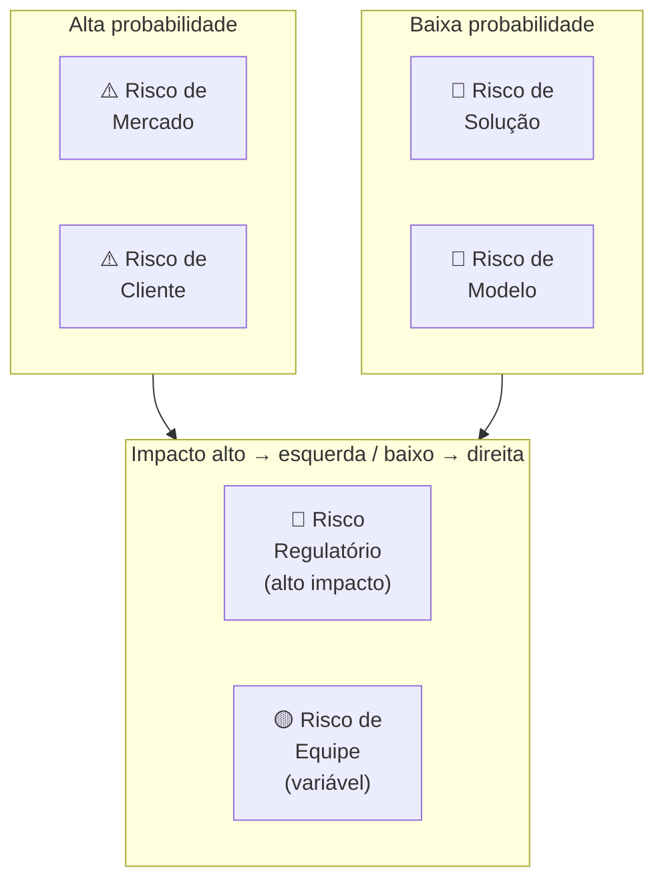

Para cada risco identificado, o canvas registra: **descrição específica**, **probabilidade** (1-5), **impacto** (1-5), **score** (prob × impacto), **mitigação planejada** e **owner** (quem cuida desse risco).

##### O momento exato de colocar este canvas na parede

Use o Risk Canvas na Fase 11 (modelo de negócio) como check-up antes de comprometer recursos significativos: equipe maior, captação, expansão de canal. Use também antes de cada rodada de captação: investidores farão due diligence em risco; o Risk Canvas mostra que o time já fez o trabalho. Em Fase 15 (reinvenção), refaça o Risk Canvas para a segunda curva: os riscos de uma empresa em escala são diferentes dos de uma startup early-stage.

##### As regras de ouro para preencher sem se enganar

A tese central é que **risco não gerenciado não desaparece: cresce silenciosamente**. Times de startup tendem a gerenciar risco de forma reativa (quando o risco se materializa, correm para mitigar) em vez de proativa (antes de se materializar, reduzirem a probabilidade ou o impacto). O Risk Canvas faz o risco visível e priorizado antes da crise. A segunda tese é que **riscos têm donos**: risco sem owner é risco sem mitigação. O canvas força nomear quem é responsável por acompanhar e mitigar cada risco crítico.

##### Passo a passo na parede da sala (30 a 60 minutos)

Sessão de 2-3 horas com o time fundador completo. **Sequência:**

1. **Brainstorm livre de riscos** (30 min, todos contribuem, sem julgamento): liste todos os "e se..." que tiram o sono. Foco em completude, não em priorização.
2. **Categorize**: atribua cada risco a uma das seis categorias.
3. **Pontue**: para cada risco, atribua Probabilidade (1-5) e Impacto (1-5). Score = Prob × Impacto. Riscos com score ≥ 15 são críticos.
4. **Priorize os top 5**: concentre energia de mitigação nos 5 com maior score.
5. **Defina mitigação**: para cada top 5: o que podemos fazer para reduzir a probabilidade? O que podemos fazer para reduzir o impacto se ocorrer? Qual experimento ou ação testa isso?
6. **Atribua owners**: cada risco crítico tem uma pessoa responsável por monitorar e executar a mitigação.
7. **Defina revisão**: quando este canvas é revisado? Mínimo trimestral.

##### Exemplo brasileiro preenchido: Méliuz, expansão para cartão de crédito (2020) (reconstrução didática com base em dados públicos)

A Méliuz (cashback e cupons, listada na B3 em 2020) decidiu expandir para cartão de crédito próprio com Banco Inter. O Risk Canvas antes da decisão:

| Risco | Categoria | Prob | Impacto | Score | Mitigação | Owner |
|---|---|---|---|---|---|---|
| Regulação BCB exige capital mínimo e demora aprovação | Regulatório | 4 | 5 | 20 | Parceria com banco já licenciado (Inter) ao invés de licença própria | CFO + Jurídico |
| ICP de cashback (comprador online) não usa cartão físico | Cliente | 3 | 4 | 12 | Teste A/B: oferecer cartão para cohort de usuários ativos antes do lançamento geral | CPO |
| CAC do cartão é 5-8x maior que CAC de cashback digital | Modelo | 3 | 5 | 15 | Distribuição cruzada: oferecer cartão apenas para base existente (CAC ≈ 0) nos primeiros 12 meses | CMO |
| Churn de usuários sem limite aprovado mancha a marca | Solução | 2 | 4 | 8 | Política de crédito conservadora nos primeiros 6 meses; comunicação proativa de critérios | COO |
| Time de produto dividido entre dois produtos simultâneos | Equipe | 3 | 3 | 9 | Squad dedicado ao cartão, separado do squad cashback; CPO de cartão contratado externamente | CEO |
| Banco Inter muda condições da parceria | Mercado | 2 | 5 | 10 | Cláusula de exclusividade de 24 meses + direito de first refusal em extensão | CEO + Jurídico |

**Diagnóstico.** Os dois riscos críticos (score ≥ 15): Regulatório (20) e Modelo (15). A mitigação do regulatório foi estrutural, ao invés de licença própria, parceria com banco já licenciado transferiu o risco regulatório para o parceiro especializado. A mitigação do modelo foi comportamental: distribuição exclusivamente para a base existente nos primeiros 12 meses eliminava o CAC de aquisição nova, tornando o unit economics do cartão viável antes de escalar.

O Risk Canvas revelou que o risco mais intuitivo do time (risco de equipe, dividir atenção entre dois produtos) tinha score 9, alto, mas não o mais crítico. O risco menos óbvio (modelo: CAC 5-8x maior) tinha score 15. Sem o canvas, o time provavelmente teria investido mais energia no risco que estava vendo (equipe) e menos no que não estava calculando explicitamente (CAC do cartão vs. da base digital). **A lição: a função mais importante do Risk Canvas é revelar os riscos que o time não está falando: não documentar os que já estão na cabeça de todos.**

##### Variações e extensões

- **Pre-Mortem** (Gary Klein): exercício complementar, imagem o produto falhou daqui a 12 meses. Por quê? Liste as razões. As razões mais citadas viram inputs do Risk Canvas.
- **Risk Register** (PMI): versão mais formal e detalhada, com campos adicionais (data de identificação, histórico de revisão, plano de contingência). Para projetos maiores ou empresas em expansão.
- **Scenario Planning Canvas**: variação que mapeia três cenários futuros (otimista, base, pessimista) e os riscos específicos de cada um.

##### Onde os fundadores mentem para si mesmos neste canvas

- Fazer Risk Canvas só uma vez (no início) e nunca revisar: riscos evoluem; canvas anual é ficcional.
- Risco sem owner: ninguém cuida, risco materializa, time é pego de surpresa.
- Listar riscos genéricos ("risco de mercado") sem especificidade ("nosso ICP não tem budget Q4 por conta do ciclo orçamentário de empresas de capital aberto"): genérico não gera mitigação.
- Focar só em riscos técnicos: times de engenharia subestimam sistematicamente riscos regulatórios, de equipe e de modelo.
- Confundir mitigação com "ter um plano B": mitigação é ação que reduz probabilidade ou impacto antes da crise; plano B é resposta depois que a crise aconteceu.

---

### Fechamento da Fase 12: o que muda na sua cabeça e na sua empresa a partir de agora

A Fase 12 é o capítulo onde a startup deixa de ser projeto interessante e vira, ou não vira, negócio. O foco sai do produto e vai para a máquina econômica: o que foi diagnosticado aqui é se a empresa consegue adquirir clientes por um custo menor do que eles geram de valor, com margem suficiente para sustentar a operação.

O entregável é o Canvas Financeiro Validado com números reais. Esse documento é teste de honestidade. Quem chega à [[#FASE 13 — PRODUCT-MARKET FIT|Fase 13]] sem ter validado a economia real costuma escalar negócio que não fecha: e descobre tarde que estava queimando capital rumo ao precipício. Validar a economia antes de escalar é a diferença entre escalar um negócio que existe e simular escala em negócio que ainda não fecha.

---

## FASE 13 — PRODUCT-MARKET FIT

### Quando a Pedra Começa a Puxar Você Ladeira Abaixo: A Anatomia Real do Product-Market Fit

Durante os primeiros onze meses da empresa de Henrique em Curitiba, cada venda parecia empurrar uma pedra de duas toneladas morro acima debaixo de sol quente. Ele precisava ligar oito vezes, implorar por uma reunião, dar trinta dias de teste gratuito e fazer malabarismo para o diretor da usina assinar o contrato.

Então, depois que eles ajustaram o produto para prever falhas nas caldeiras de biomassa com 72 horas de antecedência e provaram uma economia de R$ 400 mil na primeira usina de Lucas do Rio Verde (MT), algo estranho aconteceu em uma quarta-feira de maio.

O celular de Henrique tocou às 7h15 da manhã. Era o diretor industrial de uma usina concorrente que Henrique nunca havia prospectado:

– "Henrique, jantei ontem com o Marcos da Usina Cerrado. Ele me mostrou no celular dele o alerta que salvou a caldeira 2 na semana passada. Quanto custa para vocês instalarem isso aqui na nossa planta até segunda-feira? Já mandei os dados do CNPJ no seu WhatsApp para emitir o contrato."

Naquela mesma semana, quando o servidor da plataforma ficou fora do ar por vinte minutos na quinta-feira à tarde para manutenção, quatro engenheiros de usinas ligaram desesperados perguntando o que havia acontecido porque não conseguiam mais operar o turno sem o painel aberto.

Henrique e sua equipe acabavam de atravessar a fronteira mais rara e eletrizante da vida empresarial: **O Ponto de Inversão Gravitacional**: o verdadeiro *Product-Market Fit* (PMF). Antes do PMF, você empurra o produto contra a indiferença do mercado; depois do PMF, o mercado arranca o produto da sua mão mais rápido do que você consegue entregar. Na Fase 13, você aprenderá a medir cientificamente se já chegou lá: porque confundir tração subsidiada com PMF real é o erro mais caro que antecede a escala.

---

### Por que pisar no acelerador de escala um mês antes do PMF destrói empresas, e hesitar um mês depois entrega o mercado ao rival

Sem PMF, toda decisão é prematura. Contratar, captar, escalar marketing, construir cultura, abrir novo mercado. Qualquer uma dessas ações, executada antes do PMF, tem expectativa negativa. Empreendedores que tentam escalar antes do PMF queimam dinheiro e moral na mesma proporção.

Com PMF, as mesmas decisões começam a fazer sentido. O time ganha confiança. O cliente paga sem precisar ser convencido a cada vez. O crescimento vira engenharia, não arte. E o capital externo encontra razão para entrar. PMF é o divisor entre a jornada de descoberta e a jornada de crescimento. É o marco mais citado, e mais mal-medido, de toda a literatura empreendedora.

Esse é também o ponto em que a imprensa, os investidores, e os próprios founders, querem declarar vitória cedo.

> [!important] A lição mais importante da Fase 12
> Declare PMF quando os números sustentam. Não quando a esperança pede.

### PSF antes de PMF, não confunda as duas coisas

Um dos erros mais caros que fundadores iniciantes cometem é tratar PSF (Problem-Solution Fit: encaixe entre problema e solução) e PMF como sinônimos. Ou tratar PSF como "PMF em pequeno". Não são a mesma coisa. São fases distintas. Com clientes distintos, preços distintos, métricas distintas, e estratégias de desenvolvimento distintas. Pular do MVP direto para a tentativa de PMF, sem passar pelo PSF, é como tentar correr uma maratona sem ter corrido dez quilômetros.

A trajetória real é PSF, depois PMF, depois Escala. Cada flecha é uma travessia que pode durar meses, e que precisa de evidências específicas para ser declarada concluída.

```mermaid
flowchart LR
    subgraph PSF["Problem-Solution Fit<br/>(Fases 10–11)"]
        direction TB
        P1[5–50 early evangelists]
        P2[Produto imperfeito tolerado]
        P3[Pagam pelo valor, não pela UX]
    end

    subgraph PMF["Product-Market Fit<br/>(Fase 12)"]
        direction TB
        M1[Centenas a milhares]
        M2[Retenção que estabiliza]
        M3[Crescimento orgânico ≥30%]
    end

    subgraph SCALE["Escala<br/>(Fase 14)"]
        direction TB
        S1[Motor de crescimento]
        S2[NRR ≥110%]
        S3[Rule of 40 positivo]
    end

    PSF -->|"Evidência: 5+ clientes<br/>pagando e retornando<br/>sem você empurrar"| PMF
    PMF -->|"Evidência: coorte<br/>estabiliza + NPS ≥40<br/>+ orgânico funciona"| SCALE
```

A retention curve (curva de retenção: gráfico que mostra quantos usuários voltam com o tempo) é o sinal mais honesto. Produto sem PMF tem curva que decai para zero: cada nova coorte de usuários vai embora. Produto com PMF tem curva que estabiliza num patamar acima de zero, mesmo que seja 15% ou 20%. Isso significa que uma fração dos usuários encontrou valor real e fica.

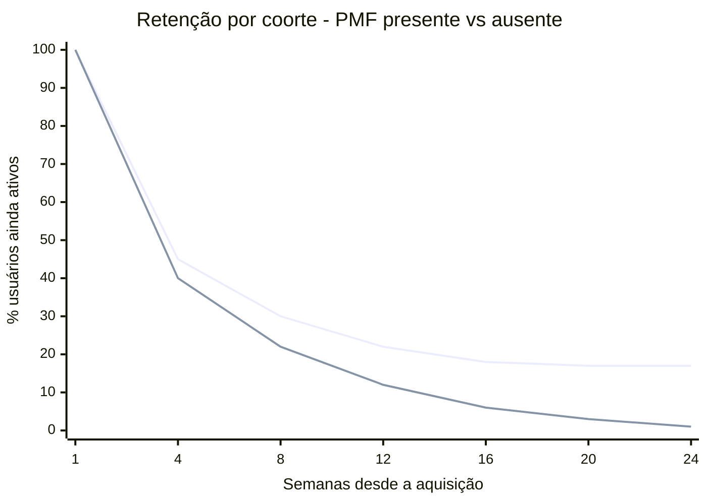

> [!note] Como ler o gráfico
> A linha superior representa produto com PMF: retenção cai nas primeiras semanas mas estabiliza em torno de 17%. A inferior é produto sem PMF: continua caindo até quase zero. O formato da curva importa mais que o número absoluto de retenção.

| Dimensão | Problem-Solution Fit (PSF) | Product-Market Fit (PMF) |
|---|---|---|
| **Pergunta que responde** | A minha solução realmente resolve a dor de um grupo específico? | Existe um mercado amplo que quer comprar essa solução de forma repetida? |
| **Cliente-alvo** | Early evangelists em dor aguda. Pequeno grupo disposto a tolerar imperfeições para resolver problema real. | Clientes mainstream, mais aversos a risco. Esperam que o produto "funcione bem" sem maiores defeitos. |
| **Tamanho da base** | Cinco a cinquenta clientes. | Centenas a milhares, crescendo. |
| **Fonte do interesse** | Buscam ativamente uma solução porque a dor aperta. Aceitam MVP manual, concierge, produto capenga. | Descobrem o produto em canais, e decidem se adotam com base em casos e credibilidade. Esperam produto maduro. |
| **Preço** | Cobrado principalmente como ferramenta para aprender sobre disposição a pagar. Margem e lucro não são o foco. | Preço competitivo e consistente, otimizado para maximizar crescimento. Unit economics (relação entre custo de aquisição e valor gerado por cliente) entram em cena. |
| **Métrica-chave** | Profundidade da resolução. Volta? Usa de verdade? Fica decepcionado se sumir? | Retenção agregada, crescimento orgânico, Sean Ellis acima de quarenta por cento, unit economics, conversão em escala. |
| **Duração típica** | Três a doze meses. Mais em B2B complexo. | Doze a trinta e seis meses depois do PSF. |

> [!important] A diferença entre PSF e PMF, em uma frase
> Em PSF, o empreendedor vai até o cliente oferecer a solução. Em PMF, o mercado começa a vir até o empreendedor puxar a solução. O movimento se inverte.

Os sinais de que você atingiu PSF, e pode então perseguir PMF. Pelo menos cinco clientes pagantes usam o produto recorrentemente (semanal, ou mais frequente). Pelo menos três clientes falam do produto espontaneamente para outras pessoas do mesmo nicho. O Sean Ellis Test (pesquisa que mede o quanto os usuários sentiriam falta do produto), restrito ao nicho inicial, já responde próximo de quarenta por cento. Quando você pergunta a esses clientes "o que você usaria se o nosso produto sumisse amanhã?", eles respondem algo pior, planilha, processo manual, não usar nada, não um concorrente direto. Isso prova a lacuna que você preenche. Leads por indicação começaram a chegar, mesmo que poucos.

Os sinais de que você ainda *não* atingiu PSF, apesar de ter MVP. Clientes usam uma ou duas vezes, e param. Ninguém indica espontaneamente. Você precisa empurrar toda venda com desconto, relacionamento pessoal, ou promessa. Quando um cliente cancela, a resposta é "o produto até é legal, mas..." Qualquer frase que venha depois do "mas" é falta de PSF.

A transição de PSF para PMF tem três passos obrigatórios. Primeiro, ajuste o preço para viabilidade de unit economics: o subsídio que funcionou em PSF não se sustenta em escala. Segundo, abra canais de aquisição repetíveis, não dependentes do fundador pessoalmente buscando leads. Terceiro, expanda o perfil de cliente em ondas concêntricas a partir do ICP (Ideal Customer Profile: perfil do cliente ideal) inicial. Não tente atender "todo mundo" de uma vez.

### Os três testes de validação de Geoffrey Moore

Em *Crossing the Chasm*, Geoffrey Moore formaliza que PMF real exige que o produto passe em três testes simultaneamente. Não apenas em um. A maioria dos fundadores que "acha que tem PMF" falhou, sem perceber, em pelo menos um dos três.

#### Desirability, os clientes querem?

Os sinais. Sean Ellis acima de quarenta por cento (ver Teste dos 40% no Passo 1). Retenção estável. NPS (Net Promoter Score: índice de lealdade do cliente) alto. Referências espontâneas.

A falha típica. O produto gera interesse inicial (aquisição boa), mas não retenção (engajamento falso, as pessoas vêm e vão).

#### Viability, o negócio ganha dinheiro?

Os sinais. LTV (Lifetime Value, valor total gerado por um cliente) dividido por CAC (Customer Acquisition Cost, custo para adquirir um cliente) três ou mais. Payback de doze meses ou menos. Margem bruta saudável. Unit economics positivos.

A pergunta central. Quando eu parar de subsidiar aquisição, o negócio ainda funciona?

A falha típica. Produto amado por usuários, mas com custos de entrega ou aquisição que destroem margem.

#### Feasibility, a empresa consegue entregar em escala?

Os sinais. Processos documentados. Time capaz. Infraestrutura escalável. Operações previsíveis.

A pergunta central. Se amanhã triplicar a demanda, a minha operação aguenta, ou quebra?

A falha típica. Produto desejado, e com boa margem, mas entregue artesanalmente pelo fundador. Operação não escala.

> [!warning] A regra operacional dos três testes
> Declare PMF apenas quando os três testes passarem em paralelo. Produto desejável e viável financeiramente, mas operacionalmente frágil, vira crise de entrega em seis a doze meses: o cliente abandona porque o serviço cai, fica lento, ou inconsistente. Produto desejável e operacionalmente robusto, mas economicamente inviável, vira crise de caixa: você tem fila para o que vende, mas cada venda afunda mais. Produto viável economicamente e operacionalmente, mas não desejável, vira churn acelerado: eles compram, e saem.

Em cada iteração, aplique o checklist triplo antes de começar a investir pesadamente em marketing pago, expansão geográfica, ou contratações agressivas.

### Ciclo de maturação do PMF, não é permanente

Uma armadilha que atinge até fundadores experientes: tratar o PMF como estado permanente depois de atingido. Não é. Modelos de crescimento saturam, em média, a cada doze a dezoito meses. Você precisa redesenhar elementos: seja o ICP (novo segmento), seja a proposta (nova categoria de valor), seja o canal (nova forma de aquisição), seja o preço (novo modelo de monetização).

Fundadores que ficam estáticos vendo o crescimento morrer aprendem tarde demais. Fundadores que anteveem e redesenham entram em novos ciclos de crescimento exponencial.

> [!important] PMF revisitado ao longo de toda a vida da empresa
> A Fase 12 é revisitada ao longo de toda a vida da empresa. Não é evento único. Uma empresa de vinte anos, se ainda existe, provavelmente renovou o PMF dela cinco ou seis vezes.

### A tríade de prova do PMF: Curva de Retenção Assintótica, Regra dos 40% de Decepção e Eficiência de Aquisição

#### Passo 1, medir PMF quantitativamente

Sete técnicas complementares.

> [!tip] Canvases Visuais: Pirate Canvas / AARRR (Fase 11)
> Diagnóstico de PMF mora dentro do AARRR. As métricas centrais desta fase, ativação (Activation), retenção por coorte (Retention) e crescimento orgânico via indicação (Referral), são três das cinco etapas do [[#Canvas: Pirate Canvas / AARRR (Dave McClure, 2007)|Canvas: Pirate Canvas / AARRR (Dave McClure, 2007)]]. Use o canvas para visualizar onde o produto entrega valor versus onde vaza usuário. Sem mapear o funil, números soltos enganam (cadastros altos sem ativação são "PMF teatro").

##### Teste dos 40%, Sean Ellis Test

Pergunte aos usuários ativos: "Como você se sentiria se não pudesse mais usar esse produto?" Três opções de resposta. Muito decepcionado. Um pouco decepcionado. Não me importaria.

Se quarenta por cento ou mais respondem "muito decepcionado", você tem forte indicador de PMF. Abaixo de quarenta por cento, ainda não chegou. Embora a direção importe: sair de quinze por cento para trinta por cento em seis meses é sinal muito positivo, mesmo não sendo ainda PMF.

Patamares do Sean Ellis Test, em quatro faixas.

Quarenta por cento ou mais "muito decepcionados". PMF atingido. Somado a retenção estável, e NPS de trinta ou mais, prepare para escala.

Trinta a quarenta por cento. Quase lá. Refine o ICP, aprofunde as funcionalidades centrais, itere antes de escalar.

Vinte a trinta por cento. PSF, não PMF. A solução ressoa parcialmente. Revise a proposta de valor. Estreite o foco. Identifique o subnicho.

Menos de vinte por cento. Sem fit. Considere pivot, ou descontinuação.

> [!warning] Tamanho mínimo da amostra
> Meça com pelo menos quarenta respondentes ativos e representativos do ICP. Escalar com menos de quarenta por cento de "muito decepcionados" destrói unit economics. Escala amplifica problemas, não os resolve.

##### Curva de retenção estabilizada

Esse é o sinal mais importante de PMF. Mais até do que o Sean Ellis. A curva de retenção de coortes mais novas precisa estabilizar em um nível significativamente acima de zero, e se manter estável.

Três padrões de curva, pelos quais você consegue diagnosticar em segundos o que está acontecendo. Curva que cai e continua caindo para zero: o produto não tem retenção, não há PMF, o cliente entra, experimenta, vai embora, e não volta. Curva que cai e estabiliza em torno de trinta por cento: fit parcial, provavelmente em subsegmento, e o trabalho é encontrar o nicho onde estabiliza em nível mais alto. Curva que cai e estabiliza em torno de cinquenta por cento ou mais: forte indicador de PMF, e coortes recentes precisam replicar o padrão.

> [!important] A forma da curva importa mais que o número absoluto
> Decaimento contínuo é morte. Estabilização horizontal é vida. Sem estabilização, não há PMF, por definição.

Benchmark de retenção estável esperada por tipo de negócio. SaaS B2B: quarenta por cento ou mais em D90, estável até D180. SaaS B2C, ou consumer subscription: trinta por cento ou mais em D30. Marketplaces: vinte por cento ou mais em D30. Consumer apps (mídia, social, utilitários): vinte por cento ou mais em D30. E-commerce recorrente: depende da frequência de compra.

##### Crescimento orgânico

Se você desligar todo marketing pago hoje, ainda terá novos usuários amanhã? Via boca a boca, referência, SEO natural, mídia espontânea? Empresas com PMF conseguem atingir vinte por cento ou mais da aquisição total via organic growth (crescimento orgânico: sem pagar por anúncios). Abaixo disso, a demanda não está puxando. Você está gerando por investimento financeiro.

##### NPS elevado e consistente

NPS acima de cinquenta em amostra representativa, com comentários qualitativos que mencionam casos de uso específicos (não apenas "produto bom"), é sinal forte. NPS acima de setenta é raro, e característico de empresas com PMF excepcional. Nubank, QuintoAndar, e RD Station passaram por essa zona em momentos distintos.

##### Demanda puxando você

Usuários entrando em contato pedindo funcionalidades específicas. Mídia mencionando espontaneamente. Vendedores batendo meta sem dificuldade. Fundador sendo convidado para falar sobre o segmento em eventos e podcasts. Isso é feeling, mas é real. Quando todos esses sinais acontecem simultaneamente, o ambiente muda.

### Crescimento como diagnóstico de PMF (entre Passos 1 e 2)

#### Taxa de crescimento semanal, o benchmark canônico de Paul Graham

Em ensaio de 2012, *Startup = Growth*, Paul Graham argumenta que o que define uma startup não é idade, tamanho, tecnologia, ou captação. É crescimento. Crescimento se mede semana a semana, no que ele chama de taxa de crescimento semanal composta. É a métrica que o Y Combinator usa internamente para acompanhar batches inteiros. E a partir dela toda decisão de expansão de investimento é tomada.

A fórmula simples: taxa semanal é igual à receita da semana atual, menos a receita da semana anterior, dividido pela receita da semana anterior.

Os benchmarks canônicos do YC. Referência para startup early-stage com MRR (Monthly Recurring Revenue: receita recorrente mensal) tipicamente entre R$ 25 mil e R$ 250 mil.

| Taxa de crescimento semanal | Interpretação |
|---|---|
| **Um por cento por semana** | Sinal de problema. Você ainda não descobriu o que está fazendo. PMF ausente, ou muito parcial. |
| **Cinco a sete por cento por semana** | Crescimento saudável. Padrão YC. Cerca de doze vezes ao ano. Indica PMF emergente, ou inicial. |
| **Dez por cento por semana** | Excepcional. Cerca de cento e quarenta e duas vezes ao ano. Poucas startups atingem. Sinal inequívoco de forte PMF. |

A métrica mais confiável para medir é receita. Quem paga, paga. Para startups sem monetização ainda, a métrica aproximada é usuários ativos (que correlaciona com receita futura quando a monetização começar). Em B2B enterprise com contratos grandes e ciclos longos, suavize com média móvel de quatro a seis semanas. Pulsos individuais podem ser anomalias.

> [!important] O poder da composição que quase todo fundador subestima
> Uma startup faturando R$ 1.000 por mês. Crescendo a um por cento por semana, depois de quatro anos: R$ 7.900 por mês, pequena empresa. Crescendo a cinco por cento por semana, depois de quatro anos: R$ 25 milhões por mês, Série B. Crescendo a dez por cento por semana, depois de quatro anos: fora da escala de planilha (centenas de bilhões por mês, a função explode).

Pequenas diferenças de taxa semanal produzem diferenças astronômicas em três a quatro anos. Por isso Graham defende escolher uma meta de crescimento semanal e usá-la como critério único para quase toda decisão operacional. "Essa reunião me ajuda a crescer essa semana? Essa feature? Essa contratação?" A pergunta é reducionista de propósito. Em estágio pré-escala, reduzir tudo a uma variável é o que evita dispersão.

A curva S do crescimento. Na prática, crescimento não é linear nem exponencial eternamente. Segue uma curva S. Startup saudável tem três fases.

Início lento (pré-PMF). Crescimento caótico, baixo, oscilante. Você ainda está procurando cunha. A taxa semanal pode ser zero a dois por cento, frequentemente negativa. Muitos fundadores desistem aqui porque confundem início lento com inviabilidade.

Crescimento rápido (PMF para Escala). O meio íngreme da curva, onde os benchmarks de cinco a sete por cento por semana do YC se aplicam. Dura um a quatro anos tipicamente. É a fase em que a empresa é financiável por VC de growth.

Maturação (pós-escala). A curva se achata. Crescimento sustentável passa a ser em percentual anual (vinte a quarenta por cento), não semanal. A empresa deixa de ser startup, e vira incumbente.

A razão pela qual startups entram no YC apostando em estar no início da fase 2, e a razão pela qual investidores de growth pagam múltiplos altos pela mesma fase, é que ela se estende por anos com composição. Identificar quando você entrou na [[IGNICAO-Vol-1-Ideacao#FASE 2 — ARTICULAÇÃO E CAPTURA DA IDEIA|Fase 2 (Vol. 1)]] (a "inflexão") é das decisões mais importantes de toda a trajetória da empresa. E a taxa de crescimento semanal consistente é o melhor indicador disponível.

#### Por que pequenas diferenças de performance importam tanto, Superlinear Returns

> [!note] Insight conceitual, não passo operacional
> Esta sub-seção é insight de mentalidade: explica *por que* a métrica semanal acima importa tanto matematicamente. Não é checklist nem critério de saída de fase. Se você está rodando Fase 12 sob pressão de tempo, leia o callout de regra combinada ao final e volte aqui depois. O conteúdo serve para calibrar expectativa e priorização de longo prazo, não para diagnosticar PMF agora.

Graham tem um ensaio mais recente, de 2023, *Superlinear Returns*, que explica por que a diferença entre cinco por cento por semana e sete por cento por semana não é quarenta por cento maior: e sim muitos múltiplos maior. E por que essa matemática domina a economia de startups de uma forma que fundadores de primeira viagem quase nunca interiorizam.

A tese central. Em domínios onde há crescimento exponencial, ou thresholds (limiares a serem cruzados), pequenas diferenças de performance geram retornos radicalmente desproporcionais. Não é que "quem trabalha mais ganha mais". A função de recompensa é não linear por natureza.

Duas fontes de superlinearidade.

A primeira é o crescimento exponencial. Startups compostas por crescimento semanal viraram o exemplo canônico. Duas empresas com o mesmo produto partindo do mesmo ponto, uma crescendo cinco por cento por semana e a outra sete por cento por semana, terminam quatro anos depois em ordens de grandeza diferentes. Pequena vantagem compõe até ser enorme. Por isso, em startup, acúmulo lento de pequenas vantagens semanais vale mais que ganhos grandes isolados. O pequeno ganho compõe. O grande ganho não.

A segunda são os thresholds (limiares). Muitos resultados em mercado são winner-take-all, ou winner-take-most. Você precisa cruzar um limiar para ganhar. E uma vez cruzado, ganha desproporcionalmente. Atingir top três da App Store versus top trinta não é dez vezes melhor. É provavelmente cem vezes melhor. Rankings, recomendações, prêmios, imprensa, capital, talento: tudo se empilha acima do threshold.

Quatro consequências práticas da superlinearidade para você.

Direcione sua atenção semanal para o que compõe. Coisas que criam vantagem recorrente, mesmo que pequena. Boca a boca, SEO, conteúdo, retenção, NPS, ativação: todas compõem. Anúncio pago de performance não compõe. É linear.

Em startup, é melhor estar continuamente no jogo do que fazer explosões episódicas. Explosão não compõe. Presença semanal compõe.

Mapeie os thresholds relevantes no seu mercado. Muitos não são óbvios. Pode ser ficar em lista de top N da categoria. Ser mencionado em mídia específica. Atingir um múltiplo específico de receita para ser financiável no próximo estágio. Atingir volume que gera network effects. Otimize para cruzá-los, não para "performance média".

> [!quote] Sobre desigualdade de retornos em ambientes superlineares
> Desigualdade de retornos não é injusta. É matemática. Ambientes com retornos superlineares produzem desigualdade extrema de resultado. Um fundador fica mil vezes mais rico que outro que trabalhou quase tão duro. Aceitar isso como característica do jogo, e não como falha moral do sistema, ajuda a agir sem ressentimento.

> [!important] Regra combinada PMF mais Crescimento mais Superlinearidade
> Sean Ellis acima de quarenta por cento, *e* retenção estabilizada, *e* crescimento semanal de cinco por cento ou mais por oito ou mais semanas, é PMF confirmado. Sean Ellis abaixo de quarenta por cento, *ou* retenção caindo, *ou* crescimento abaixo de dois por cento por semana, é ainda não. Itere. Se o crescimento semanal está entre dois e cinco por cento de forma consistente e crescente por três ou mais meses, você está na virada. Continue iterando. Identifique dois ou três thresholds específicos do seu mercado, e otimize obsessivamente para cruzá-los. O retorno de cruzar um threshold relevante, em startup, é tipicamente maior do que qualquer outra alavanca de curto prazo.

> [!tip] Default Alive e Default Dead
> O conceito de Default Alive vs Default Dead é tratado em profundidade na [[#FASE 12 — VALIDAÇÃO DO MODELO DE NEGÓCIO|Fase 12]] (Passo 10), onde a pergunta operacional é modelada. Aqui basta saber que PMF é pré-requisito mas não garantia de Default Alive.

#### Passo 2, identificar o segmento onde PMF aconteceu primeiro

PMF raramente chega para toda a base ao mesmo tempo. Geralmente acontece primeiro em um sub-segmento específico, a sua beachhead (cabeça de praia, ponto de entrada no mercado), ou algo próximo. Identifique com precisão: quem são esses usuários? Cargo, setor, tamanho de empresa, localização? O que eles têm em comum? Que problema específico os une? Como chegaram até você? Qual canal funcionou para esse grupo? Que casos de uso eles resolvem com o seu produto?

Esse é o perfil que você deve expandir em ondas concêntricas.

> [!warning] Erro estratégico comum
> Tentar expandir antes de ter o perfil mapeado dilui foco, produto, e marketing em busca de um cliente genérico que não existe.

#### Passo 3, decidir entre três caminhos com base na medição

##### Caminho A, PMF claro

Prossiga para a [[IGNICAO-Vol-8-Juridico-LGPD-e-Seguranca#FASE 18 — ESTRUTURAÇÃO JURÍDICA, SOCIETÁRIA E BLINDAGEM OPERACIONAL|Fase 18 (Vol. 8)]] (estruturação formal), e a [[IGNICAO-Vol-6-Receita-e-Pessoas#FASE 16 — TIME, LIDERANÇA EXECUTIVA E CULTURA EM ESCALA|Fase 16 (Vol. 6)]] (escala). Mas antes, reserve trinta a sessenta dias para estabilizar operações. A pior coisa que pode acontecer é escalar antes de o suporte, a infraestrutura, e o onboarding (processo de entrada e orientação do novo usuário) estarem prontos.

> [!tip] Capítulo 1 (Vol. 6): Growth como Função Organizacional
> O [[IGNICAO-Vol-6-Receita-e-Pessoas#CAPÍTULO 1 — GROWTH COMO FUNÇÃO ORGANIZACIONAL: TIME DE GROWTH, BUILD VS HIRE, RELAÇÃO COM PRODUTO|Capítulo 1: Growth como Função Organizacional (Vol. 6)]] cobre quando montar time de growth, como estruturar o primeiro squad (growth PM, eng, data), a diferença entre PLG (Product-Led Growth, crescimento liderado pelo produto) e SLG (Sales-Led Growth, crescimento liderado por vendas) em escala, e como não destruir PMF ao abrir o motor de crescimento.

> [!tip] Capítulo 1 (Vol. 7): Produto em Escala
> O [[IGNICAO-Vol-7-Produto-Engenharia-e-Operacoes#CAPÍTULO 1 — PRODUTO EM ESCALA E DESCOBERTA CONTÍNUA|Capítulo 1: Produto em Escala (Vol. 7)]] trata das mudanças de processo de produto que acontecem depois do PMF: roadmap orientado a segmento versus roadmap orientado a retenção, como priorizar com NRR (Net Revenue Retention: receita líquida retida, que mede expansão e churn juntos) em mente, e o momento em que o produto deixa de ser artesanal e precisa de plataforma.

##### Caminho B, PMF parcial

Alguns usuários adoram. A maioria é indiferente. Foque no sub-segmento que adora. Elimine funcionalidades e mensagens voltadas para o grupo indiferente. Esclareça o posicionamento.

> [!important] Resistência ao recorte é o erro
> Fundadores frequentemente resistem a esse recorte porque parece "perder mercado". É o oposto. Você ganha profundidade e velocidade no nicho que vale.

##### Caminho C, sem PMF

Volte para as Fases 7 a 9. Reconsidere a solução. Talvez pivote para problema adjacente, ou mude o segmento. Não é fracasso. É a função normal desta fase. Empresas que nunca deveriam ter sido feitas descobrem isso aqui: com dinheiro e moral ainda remanescentes.

> [!tip] Capítulo 8: Customer Experience
> O [[#CAPÍTULO 8 — CUSTOMER SUCCESS (CS) E CUSTOMER EXPERIENCE (CX): DA JORNADA AO CHURN ZERO E NRR POSITIVO|Capítulo 8: Customer Experience]] estrutura como mapear a jornada completa do cliente, desde o primeiro contato até o churn evitado, e identificar os "moments of truth" que mais afetam retenção. Use aqui para diagnosticar por que certos segmentos chegam ao aha e outros não.

> [!tip] Canvases Visuais: Customer Journey Canvas (Fase 5)
> Para sustentar PMF, o [[IGNICAO-Vol-2-Descoberta-e-Mercado#Canvas: Customer Journey Canvas|Canvas: Customer Journey Canvas (Vol. 2)]] é o template visual de uma página que materializa a jornada em fases (consciência → consideração → decisão → onboarding → uso → expansão → advocacy) com os "moments of truth" de cada fase. Complementar ao DT: DT é o tratamento teórico, Canvas: Customer Journey Canvas (Fase 5) é o canvas preenchível para usar em workshop com o time.

#### Passo 4, documentar o "aha moment" e operacionalizar a ativação

O "aha moment" é o ponto específico na jornada do usuário em que ele percebe o valor pela primeira vez, e a partir do qual a probabilidade de retenção cresce drasticamente. Exemplos clássicos: o Slack definiu como "duas mil mensagens enviadas dentro do time". O Facebook como "sete amigos adicionados em dez dias". O Notion como "criar segunda página no primeiro dia". Para a sua empresa, é trabalho de dados: quais ações, em qual prazo, correlacionam com retenção de trinta ou noventa dias?

Depois que você identifica o aha moment, o trabalho é operacionalizá-lo. Quantos usuários atingem? E em quanto tempo? Reestruture o onboarding para levar mais usuários ao aha em menos tempo. Essa é tipicamente a alavanca de maior impacto sobre retenção, antes mesmo de mudar produto.

O funil de ativação típico, em cinco estágios. Visitante para sign-up: conversão esperada de dois a dez por cento (varia muito por canal). Sign-up para onboarding completo: alvo sessenta por cento ou mais. Onboarding para aha moment: alvo cinquenta por cento ou mais. Aha para retorno: alvo setenta por cento ou mais no D7. Retorno para pago, ou expansion: alvo trinta por cento ou mais dos ativos.

> [!tip] Capítulo 8: Customer Success
> O [[#CAPÍTULO 8 — CUSTOMER SUCCESS (CS) E CUSTOMER EXPERIENCE (CX): DA JORNADA AO CHURN ZERO E NRR POSITIVO|Capítulo 8: Customer Success]] cobre como estruturar a função de CS antes de contratar o primeiro CSM: health score, playbooks de onboarding, QBR e os gatilhos de intervenção que reduzem churn: especialmente crítico quando a curva de retenção ainda não estabilizou.

#### Passo 5, estabilizar operações para sustentar PMF

Quando o PMF chega, a primeira coisa que tende a quebrar é a operação. O suporte fica sobrecarregado. Bugs se multiplicam. Usuários abandonam por falta de atenção a demandas básicas. Antes de crescer, estabilize cinco coisas.

Processo de suporte escalável. SLA, ferramentas, base de conhecimento, autoatendimento.

Monitoramento técnico. Alertas, painéis, on-call, SLO.

Documentação interna. Novos funcionários conseguindo se orientar sozinhos.

Onboarding padronizado. Tempo e qualidade previsíveis.

Financeiro organizado. Cobrança, fatura, inadimplência. Processos que funcionam sem você.

> [!warning] Falhar em estabilizar aqui leva a uma experiência comum
> A empresa atinge PMF, cresce três a quatro vezes em nove meses, descobre que o crescimento quebrou a operação, e vê o NPS cair de sessenta para vinte. Aí precisa parar, reconstruir, e perder meses.

### Caso brasileiro real, diagnóstico de PMF na Hotmart reconstruído para 2014 (fim do ano três de operação)

Reconstrução do diagnóstico que João Pedro Resende e Mateus Bicalho poderiam ter feito no fim de 2014. Momento em que a Hotmart deixou de ser "uma plataforma para o JP vender o próprio ebook", e virou infraestrutura central do mercado brasileiro de infoprodutos. Baseado em entrevistas e cobertura pública.

O contexto. A Hotmart foi fundada em 2011 com produto simples. Download e pagamento online para quem vendia ebooks e cursos digitais. Faturamento inicial: R$ 182 nos primeiros dois meses. Investimento inicial: R$ 300 mil, do prêmio de competição da Buscapé em 2011. Em 2014, começou um padrão. Produtores que ganhavam dinheiro de fato (não centenas, mas dezenas de milhares de reais por mês) traziam outros produtores para a plataforma. Esse era o sinal de que algo mudou.

**Sean Ellis Test, aplicado a cinquenta produtores ativos no fim de 2014.** Sessenta e quatro por cento (32 de 50) responderam "muito decepcionado se não pudesse mais usar". Vinte e dois por cento (11 de 50) "um pouco decepcionado". Catorze por cento (7 de 50) "não me importaria". Resultado: bem acima de quarenta por cento. Sinal claro de PMF no segmento de produtores de infoproduto que faturam R$ 5 mil ou mais por mês.

**Retenção de coorte, produtores que entraram no início de 2014.** Mês um (cadastro): cem por cento. Mês três: setenta e oito por cento (ainda processam ao menos uma venda). Mês seis: sessenta e dois por cento. Mês nove: cinquenta e cinco por cento. Mês doze: cinquenta e um por cento.

A análise. A curva achata acima de cinquenta por cento no mês doze. Em marketplace bilateral de produtor independente, isso é retenção forte. Produtores que ficam tendem a aumentar volume com o tempo, não diminuir.

**NPS dos produtores ativos (2014).** Promotores (9 a 10): 28 de 50. Neutros (7 a 8): 14 de 50. Detratores (0 a 6): 8 de 50. NPS calculado: 28 menos 8, dividido por 50, vezes 100, igual a quarenta. NPS de quarenta em B2B SaaS já é bom. Em marketplace com produtor independente que pode escolher migrar, é sinal forte.

**Crescimento orgânico no segundo semestre de 2014.** Novos produtores cadastrados: cerca de cento e cinquenta por mês ao final do ano. Cerca de setenta por cento via indicação de produtor existente (afiliados, comunidade do JP, palestras em eventos do setor de marketing digital). Cerca de vinte por cento via conteúdo (blog do JP, vídeos sobre marketing digital). Cerca de dez por cento via paid acquisition. Indicação respondia por mais da metade da aquisição. Sinal canônico de PMF.

**Evidência qualitativa documentada (paráfrase de depoimentos públicos).** Produtores diziam que sem a Hotmart não conseguiriam processar vendas e afiliados na escala que faziam, especialmente nos lançamentos. O conceito de "lançamento", modelo Erico Rocha de campanha temporal de venda intensiva, começava a explodir, e a Hotmart era a infraestrutura, sem similar competente no Brasil. Produtores reclamavam de bugs, e features faltando, mas não de fundamentos da plataforma. Reclamação era de roadmap. Não de existência do produto.

**Crescimento de receita, em sinais agregados.** A Hotmart triplicou em 2015 (versus 2014), e novamente em 2016. Indicando que o PMF identificado em 2014 era genuíno, e escalável. A equipe cresceu de trinta e cinco para cento e sete funcionários ao longo de 2015, refletindo a pressão de demanda.

**Diagnóstico geral, na perspectiva do fim de 2014.** PMF claro no segmento-alvo (produtores brasileiros de infoproduto faturando R$ 5 mil por mês ou mais). Pull orgânico funcionando, com indicação dominante na aquisição. Retenção forte para padrão de marketplace. NPS positivo e consistente. Detrator persistente: catorze por cento, a investigar se está concentrado em sub-segmento (produtores muito pequenos? infoprodutos de nicho específico?). Próximo desafio: o PMF se sustenta ao expandir geograficamente (LatAm), e ao subir ticket (cursos de R$ 2 mil a R$ 5 mil em vez de ebooks de R$ 47)? Hipóteses a testar nas Fases 13 e 14.

A decisão, em retrospecto. Declarar PMF no segmento brasileiro de produtor de infoproduto. E investir em escala, equipe, infraestrutura técnica para suportar picos de lançamento, e expansão internacional. Foi exatamente o que aconteceu. O triplicamento de equipe em 2015, e as primeiras operações na América Latina, vieram dessa decisão.

> [!important] A lição transferível do diagnóstico Hotmart
> PMF não é métrica única. É convergência de várias métricas independentes (Sean Ellis, retenção, NPS, padrão de aquisição, depoimentos qualitativos) apontando na mesma direção. A Hotmart em 2014 não tinha ainda escala global. Mas tinha todos os sinais convergentes de PMF no nicho-alvo. Quem investe em escala antes dessa convergência queima dinheiro. Quem espera convergência absoluta (impossível) perde a janela.

### Contexto brasileiro, o PMF no Brasil tem peculiaridades

Algumas observações específicas do contexto brasileiro, aplicáveis a fundadores operando aqui.

> [!note] O "NPS alto de brasileiro" é enganoso
> A cultura brasileira tende a responder pesquisas de forma mais generosa que a americana. Por educação. Por evitar conflito. Por não querer criticar quem perguntou. Isso significa que um NPS de cinquenta no Brasil, especialmente em B2C, pode estar "inflado" em relação ao equivalente americano. Complementar com indicador comportamental (retenção) é obrigatório.

Nichos brasileiros saturam rápido. O mercado brasileiro endereçável é, tipicamente, dez a vinte por cento do americano para o mesmo segmento. Consequência prática: PMF em subnicho brasileiro pode significar cem a quinhentos clientes, não dez mil. Planeje crescimento com esse cap em mente. E pense em expansão (vertical, horizontal, geográfica) desde cedo.

Crescimento orgânico no Brasil depende de cultura relacional. Boca a boca funciona muito no Brasil. Possivelmente mais que em mercados mais transacionais como o americano. Mas funciona melhor em redes pré-existentes. Associações de classe. Grupos de WhatsApp profissionais. Círculos de amizade. Famílias. Empresa que entende e alimenta essas redes atinge crescimento orgânico mais cedo.

Ciclo de decisão B2B brasileiro é mais longo. Em enterprise brasileiro, o ciclo de venda típico é de nove a dezoito meses. PMF em B2B enterprise pode demorar mais a ser reconhecido, porque o sinal (deals recorrentes, renewal) demora a chegar. Paciência e métricas intermediárias são importantes.

Churn brasileiro tem sazonalidade forte. Dezembro a janeiro, e junho a julho, têm picos de churn em muitos setores. Analisar retenção em ciclo de doze meses é mais confiável do que em trimestres isolados.

### Falsos positivos de PMF, o que parece PMF e não é

Os três falsos positivos mais comuns. E como diagnosticar.

#### Falso positivo 1, tração de aquisição sem retenção

Você acabou de rodar uma campanha paga excelente. Aquisição está bombando. Métricas de topo de funil parecem ótimas. Mas em trinta a sessenta dias, a maioria desses usuários evaporou.

Isso não é PMF. É um canal bom.

O teste do diagnóstico. Desligue o canal pago por trinta dias, e veja o que acontece. Se a aquisição evapora com ele, o PMF é circunstancial.

#### Falso positivo 2, cliente ancorado, não puxando

Você tem vinte clientes felizes. Todos originados da sua rede pessoal, ou de relacionamentos diretos. Eles pagam. Usam. Estão satisfeitos. Mas quando você tenta prospectar fora da sua rede, quase ninguém compra.

Isso não é PMF. É venda relacional.

O teste do diagnóstico. Quantos dos clientes atuais vieram sem que você tivesse conexão direta? Se a resposta é "menos de trinta por cento", o produto ainda não prova valor sozinho.

#### Falso positivo 3, PMF local sem escalabilidade

Você tem crescimento sólido em uma cidade, bairro, ou segmento microvertical. Mas quando tenta expandir, cada novo mercado exige reinvenção completa da abordagem.

Isso não é PMF. É fit local.

Acontece com frequência em serviços regulados (saúde, educação), ou com forte dependência de rede local. É negócio legítimo. Mas exige estratégia diferente de uma máquina de PMF generalizado.

> [!tip] Comunicar PMF a investidores
> Captação de Série A e posterior exige demonstração de PMF com seis artefatos: gráfico de retenção por coorte estabilizada acima do threshold do setor; Sean Ellis Test recente com percentual e tamanho da amostra; NRR em SaaS com trajetória de 4-8 trimestres; pipeline de indicação (percentual de novos clientes por referência); cohort analysis de LTV/CAC por safra (não média); cinco a dez depoimentos qualitativos de clientes com permissão. Founder que apresenta "temos PMF" sem esses artefatos sinaliza que ainda não mediu PMF com rigor. O detalhamento de como construir cada artefato e estruturar o pitch está no [[IGNICAO-Vol-5-Financas-e-Captacao#CAPÍTULO 9 — CAPTAÇÃO DE EQUITY: PLANEJAMENTO DE RODADA, PITCH E RELACIONAMENTO COM INVESTIDORES|Capítulo 9: Captação de Equity (Vol. 5)]] e no [[IGNICAO-Vol-5-Financas-e-Captacao#CAPÍTULO 4 — PLANEJAMENTO FINANCEIRO (FP&A), ORÇAMENTO E REVENUE FORECASTING|Capítulo 4: Revenue Forecasting (Vol. 5)]] (cohort analysis convertido em ARR waterfall, projeção financeira auditável).

### Declaração formal de PMF — critérios mínimos e scorecard

PMF não é sentimento. É estado mensurável. Muitos founders declaram PMF prematuramente porque querem fechar rodada, contratar time, ou simplesmente parar de carregar a incerteza. Declarar PMF cedo demais leva a escalar produto quebrado: o erro mais caro que existe em startup.

Esta seção oferece um scorecard explícito. Para declarar PMF com confiança, você precisa de evidência em pelo menos 4 das 6 dimensões. Cada dimensão tem critério mínimo de passagem.

| Dimensão | Critério mínimo de passagem | Como medir | Seu número |
|---|---|---|---|
| **Retenção** | Curva de retenção estabiliza acima de 25% em D30 (consumer) ou 40% em D90 (B2B) | Cohort analysis por data de primeira sessão/ativação |: |
| **Percepção de indispensabilidade** | ≥ 40% de usuários ativos responderiam "muito decepcionado" se produto deixasse de existir (Sean Ellis Test) | Survey com amostra de ≥ 50 usuários ativos |: |
| **Crescimento orgânico** | ≥ 20-30% de novas aquisições via indicação ou busca orgânica sem ação ativa da empresa | Rastrear source em onboarding |: |
| **Disposição de pagar** | Clientes renovam e não pedem desconto por iniciativa própria; churn logo ≤ 5%/mês | Taxa de renovação no fim do primeiro período contratado |: |
| **Expansão natural** | ≥ 25% dos clientes expandem uso (mais usuários, mais módulos, mais volume) sem ação de vendas | NRR > 100% em base de 6+ meses |: |
| **Feedback qualitativo** | ≥ 5 clientes conseguem articular problema resolvido em linguagem que você não ensinou | Entrevistas com clientes de 3+ meses |: |

**Como usar o scorecard.**

Preencha a coluna "Seu número" com dados reais antes de qualquer declaração de PMF. Se você não tem o dado, não tem PMF: tem hipótese de PMF.

Passando em 4 ou mais: PMF confirmado para o segmento onde foi medido. Prepare-se para escalar com cuidado de preservar as condições que geraram o PMF.

Passando em 2-3: PMF parcial ou nascente. Continue otimizando. Não escale ainda. Identifique qual dimensão está mais próxima do threshold: ela indica o próximo experimento.

Passando em 0-1: sem PMF. Volte para discovery. O problema mais provável: produto resolve um problema, mas não o problema certo, ou não com intensidade suficiente.

> [!important] PMF é segmento-específico
> Você pode ter PMF em pequenas padarias de SP e não ter PMF em restaurantes do Rio. PMF não é propriedade da empresa: é propriedade da combinação produto × segmento × momento. Ao escalar, monitore se o PMF se mantém conforme o segmento se expande. Frequentemente não se mantém: e a empresa precisa ajustar produto para o novo segmento, não apenas copiar o playbook anterior.

> [!warning] O custo de declarar PMF cedo
> Fundar contrata VP de Sales, VP de Marketing e começa a escalar aquisição antes de ter PMF. Resultado: CAC explode (produto não converte), churn dispara (produto não retém), runway some (burn alto sem retorno). Série B travada porque métricas mostram que a escala não funcionou. Retrair é mais caro e mais doloroso do que esperar.

> [!tip] Capítulos de medição contínua
> [[IGNICAO-Vol-5-Financas-e-Captacao#MÉTRICAS E BENCHMARKS DESTA FASE (FASE 14)|Catálogo de Métricas (Vol. 5)]] traz definições, fórmulas e benchmarks por modelo (DAU/MAU, retenção D30/D90, NPS, NRR, LTV/CAC, cohort LTV). [[#CAPÍTULO 9 — DADOS, ANALYTICS E EXPERIMENTAÇÃO|Capítulo 9: Dados e Analytics]] cobre a stack para medir PMF com rigor (event tracking, data warehouse, cohort analysis automatizado). [[IGNICAO-Vol-6-Receita-e-Pessoas#CAPÍTULO 3 — REVENUE OPERATIONS: INFRAESTRUTURA, DADOS E PROCESSO PARA CRESCER COM PREVISIBILIDADE|Capítulo 3: Revenue Operations (Vol. 6)]] detalha como estruturar CRM, forecast de pipeline e handoffs para que NRR, churn e win rate sejam mensuráveis de forma confiável.

### Certificação de Product-Market Fit comprovada por coortes estáveis e economia unitária pronta para escala

Você atingiu PMF (Fase 13) quando todos os critérios abaixo estão cumpridos simultaneamente.

- [ ] Sean Ellis Test com quarenta por cento ou mais "muito decepcionados" em amostra representativa de trinta ou mais usuários ativos.
- [ ] Curva de retenção estabilizada por coorte acima do benchmark do modelo (SaaS B2B 40% em D90, SaaS B2C 30% em D30, marketplace 20% em D30).
- [ ] Churn mensal ≤ 5% sustentado por dois ou mais meses consecutivos.
- [ ] NPS ≥ 40 (idealmente ≥ 50), sustentado por dois ou mais trimestres.
- [ ] Crescimento orgânico (indicação, boca a boca, inbound espontâneo) ≥ 20% da aquisição total.
- [ ] Taxa de crescimento semanal entre 5% e 7% sustentada por oito ou mais semanas (benchmark YC para PMF emergente).
- [ ] Unit economics positivos: LTV/CAC ≥ 3, CAC payback ≤ 12 meses.
- [ ] Os três testes Moore (desirability, viability, feasibility) passam simultaneamente.
- [ ] "Aha moment" identificado e operacionalizado, com pelo menos 50% dos usuários atingindo em até catorze dias.
- [ ] Você consegue articular com precisão para quem o produto serve e para quem NÃO serve.
- [ ] Falsos positivos (aquisição sem retenção, cliente ancorado, fit local) investigados e descartados.
- [ ] Evidência qualitativa documentada: depoimentos, indicações, "pull do mercado" em vez de "push constante".

> [!warning] Critério de saída
> PMF é convergência de várias métricas independentes apontando na mesma direção. Sean Ellis ≥ 40%, retenção estabilizada e crescimento orgânico ≥ 20% precisam estar presentes simultaneamente. Declarar PMF cedo demais e escalar leva a CAC explodindo, churn disparando e runway sumindo. Esperar convergência absoluta perde a janela.

**Primeiros passos práticos.**

1. Rodar Sean Ellis Test. Envie uma pergunta aos usuários ativos: "Como você se sentiria se não pudesse mais usar o produto?" Três opções: muito decepcionado, um pouco, ou não me importaria. Alvo: quarenta por cento ou mais "muito decepcionados".
2. Analisar retenção por coorte nos últimos noventa dias. Plote a retenção mês a mês. Identifique se a curva achata.
3. Conversar com cinco dos clientes mais engajados. O que especificamente faz o produto insubstituível?
4. Conversar com dois ou três que churnaram recentemente. O que faltou?
5. Calcular unit economics das coortes dos últimos seis meses.
6. Listar os últimos vinte novos clientes, e classificar a origem (orgânico, indicação, pago, ou rede do fundador).

### Casos brasileiros

#### Wellhub e o PMF por redesenho de quem é o cliente (2016-2019)

O Wellhub começou como marketplace de academias para consumidor final. PMF veio quando o modelo foi reestruturado como benefício corporativo: empresa paga, funcionário usa. O sinal foi retenção altíssima no B2B2C, e expansão rápida para novos mercados (começou no Brasil, chegou a dezenas de países em poucos anos). às vezes PMF exige redesenho de quem é o cliente, não iteração no produto. Outros casos brasileiros conhecidos com PMF identificável (Nubank com a fila de espera 2014-2016, RD Station com PMEs e blog 2013-2015, QuintoAndar com inquilinos jovens 2015-2017) já são tratados em fases anteriores e ilustram o mesmo padrão de "demanda puxando" sob ângulos diferentes.

#### Caso negativo, a empresa que confundiu tração com PMF

Uma startup brasileira de educação (nome omitido) captou Série A em 2018, baseada em crescimento rápido de usuários. A retenção de trinta dias nunca ultrapassou quinze por cento. Investimento pesado em marketing encobriu o problema por dezoito meses. Quando o paid se tornou insustentável, e a aquisição caiu, a base evaporou. A empresa fechou em 2021. sem retenção, todo crescimento é aluguel.

### Confundir pico de cadastros comprados por mídia paga ou descontos agressivos com Product-Market Fit verdadeiro

Confundir tração com PMF. Mil downloads sem retenção não é PMF. Cinquenta usuários viciados é muito mais próximo.

Declarar PMF por ego, ou pressão externa. Empreendedores ávidos por validação, ou pressionados por investidores, declaram PMF cedo demais. Rigor vence otimismo aqui.

Pulverizar-se depois de PMF parcial. Em vez de dobrar no nicho que ama, você tenta agradar a todos. Resultado: dilui PMF parcial, em vez de consolidar.

Achar que PMF é permanente. PMF se perde quando o mercado muda, a concorrência avança, ou você negligencia. É estado a ser mantido, não troféu a guardar.

Ignorar feasibility. Foco apenas em desirability e viability. Quando a escala chega, a operação quebra.

Medir com amostra não representativa. Sean Ellis Test aplicado só nos clientes mais engajados dá resultado inflado. Amostra aleatória entre ativos é obrigatória.

Declarar PMF baseado em vaidade. Capa de revista, prêmio de startup, lista de Top 100: nenhum desses são evidência de PMF. Retenção é.

Esperar PMF "cair" sem iteração. PMF é construído, não encontrado. Se há seis meses de operação estável sem PMF, itere no produto, no ICP, ou no canal. Não apenas espere melhorar.


---

### O Espelho da Fase 13: Você Está Empurrando a Pedra no Morro ou Segurando o Cabo de Guerra?

**Fechando o ciclo na trincheira:** Quando **Lucas e Marina** aplicaram as travas deste capítulo na rotina entre São Paulo e Florianópolis, a tensão da cena de abertura deixou de ser discussão subjetiva de corredores e virou regra clara de priorização, retenção e proteção de caixa.

**O Espelho (autodiagnóstico):**
1. Se você zerar 100% dos seus gastos com anúncios pagos por trinta dias a partir de amanhã, os seus clientes atuais continuam usando o produto no mesmo ritmo e trazendo novos clientes no boca a boca?
2. Quando você pergunta aos seus usuários ativos *"Como você se sentiria se não pudesse mais usar nosso produto amanhã?"*, pelo menos 40% respondem *"Muito decepcionado"*?
3. A curva de retenção das suas safras de clientes (*cohorts*) estabiliza em um platô saudável após o terceiro ou sexto mês, ou cai lentamente até chegar a zero?

**Permissão Libertadora:**
Se a sua resposta às três perguntas acima ainda for "não", você está autorizado (e obrigado) a recusar contratar dez vendedores novos. Conserte o balde com uma equipe pequena até a retenção travar.

**O Ritual de Segunda-Feira às 9h:**
Envie hoje a pesquisa de uma única pergunta de Sean Ellis para os clientes que usaram seu produto pelo menos duas vezes nas últimas duas semanas. Leia cada resposta do grupo "muito decepcionado" e dobre a aposta exatamente no que eles mais amam.

### MÉTRICAS E BENCHMARKS DESTA FASE (FASE 13)

| Métrica | O que medir | Referência saudável |
|---|---|---|
| Retenção por coorte | Curva que estabiliza (não cai para zero) | Estabilização em ≥ 20% |
| NPS | Net Promoter Score | ≥ 40 consumer, ≥ 30 enterprise |
| Sean Ellis Test | % que ficaria "muito desapontado" sem o produto | ≥ 40% |
| Crescimento orgânico | % de novos usuários sem gasto em paid | ≥ 30% |
| Engagement (DAU/MAU) | Usuários diários / mensais | ≥ 20% produtos de frequência alta |
| NRR (Net Revenue Retention) | Expansão de receita na base atual | ≥ 100% (≥ 110% é excelente) |
| Qualitative PMF signals | Usuários reclamando quando feature some, compartilhando espontaneamente | Presente e documentado |

> [!important] Definição operacional de PMF
> PMF não é número. É curva de retenção que estabiliza, mais NPS acima de 40, mais crescimento orgânico ≥ 30%, mais evidência qualitativa de que a vida do cliente é pior sem o produto. Os três juntos.

---

### MANUAL PASSO A PASSO DOS FRAMEWORKS DESTA FASE

> [!tip] Uso autocontido neste volume
> Todos os frameworks abaixo estão detalhados integralmente com origem, estrutura, passo a passo de aplicação, exemplo brasileiro e armadilhas para execução imediata nesta **Fase 13**.

#### Framework: RICE Scoring (Intercom, circa 2016)

##### De onde vem a ferramenta (e por que sobreviveu ao filtro do tempo)

Intercom publicou RICE em seu blog em 2016 (Sean McBride). Framework pragmático para priorização de backlog em ambientes de software. Virou popular em product management por simplicidade.

##### A mecânica central (sem jargão)

Fórmula simples para pontuar features:

RICE = (Reach × Impact × Confidence) / Effort

- Reach: quantos usuários/mês a feature impacta?
- Impact: impacto em cada usuário (escala: 3 = massivo, 2 = alto, 1 = médio, 0.5 = baixo, 0.25 = mínimo).
- Confidence: confiança na estimativa (100%, 80%, 50%).
- Effort: pessoa-mês necessárias.

##### Como rodar na segunda-feira às 9h com seu time

Passo 1: Para cada feature candidata, estime as 4 dimensões.

Passo 2: Reach baseado em dados: se 10% dos usuários usa funcionalidade X, e temos 50k usuários/mês, Reach = 5000.

Passo 3: Impact com escala consistente aplicada pelo mesmo time.

Passo 4: Confidence: 100% se baseado em dados sólidos, 50% se baseado em intuição.

Passo 5: Effort em pessoa-mês estimado por tech lead.

Passo 6: Calcule RICE para cada feature e ordene.

##### Na trincheira real: como isso funciona na prática

Priorização de 6 features:

| Feature | Reach | Impact | Conf | Effort | RICE |
|---------|-------|--------|------|--------|------|
| Automatização de conciliação | 40k | 3 | 80% | 3 | 32.000 |
| Dark mode | 30k | 0.5 | 100% | 1 | 15.000 |
| Relatórios customizados | 15k | 2 | 50% | 4 | 3.750 |
| Integração com Zapier | 5k | 1 | 80% | 2 | 2.000 |
| AI categorização | 50k | 2 | 30% | 6 | 5.000 |
| Mobile app refactor | 25k | 1 | 100% | 5 | 5.000 |

Prioridade: conciliação > dark mode > AI > mobile refactor > relatórios > Zapier.

##### Onde o papel aceita tudo (armadilhas de execução)

Estimativas infladas: fundador infla Impact, todos viram alta prioridade. Effort otimista: engineering subestima, prazos estouram. Confidence como 100% sempre: vira (Reach × Impact) / Effort, perde proteção contra incerteza. Priorização por número, ignorando dependências: feature A tem maior RICE, requer B como pré-requisito. Rodar RICE sem conectar a outcome: feature com maior RICE pode ter impacto baixo em métrica que importa.

---

#### Framework: ICE Scoring (Sean Ellis)

##### De onde vem a ferramenta (e por que sobreviveu ao filtro do tempo)

Sean Ellis, growth hacker que inventou o termo "growth hacking" (2010) e foi head of growth em Dropbox, Eventbrite, LogMeIn, popularizou ICE em GrowthHackers.com. Método mais simples que RICE, usado em experimentação de growth.

##### A mecânica central (sem jargão)

Fórmula para priorizar **ideias de experimentos** (não só features):

ICE = (Impact × Confidence × Ease) / 3 (ou produto simples)

Onde:

- Impact: se der certo, quão grande é o impacto? (1-10)
- Confidence: quão confiante você está que vai funcionar? (1-10)
- Ease: quão fácil de executar? (1-10)

##### Como rodar na segunda-feira às 9h com seu time

Passo 1: Liste ideias de experimentos de growth, features, etc.

Passo 2: Score cada dimensão 1-10.

Passo 3: Calcule ICE.

Passo 4: Priorize top-score para próximo sprint.

Passo 5: Revise regularmente (semanal em contextos de growth).

##### Na trincheira real: como isso funciona na prática

Growth team priorizando experimentos:

| Experimento | Impact | Conf | Ease | ICE |
|-------------|--------|------|------|-----|
| Mudar headline da landing | 6 | 7 | 9 | 378 |
| Adicionar programa de referral | 9 | 5 | 3 | 135 |
| A/B test CTA | 4 | 8 | 9 | 288 |
| Rebranding completo | 8 | 3 | 2 | 48 |
| Emails de ativação | 7 | 7 | 6 | 294 |

Prioridade: mudar headline > emails de ativação > A/B CTA > referral > rebranding.

##### Onde o papel aceita tudo (armadilhas de execução)

Score sem base empírica: ICE vira votação subjetiva, Confidence inflado sempre: cada membro acha que a ideia dele vai funcionar, Desconexão com aprendizado: rodar experimentos com alto ICE mas sem aprendizado de longo prazo.

---

#### Framework: North Star Framework (Amplitude / Sean Ellis)

##### De onde vem a ferramenta (e por que sobreviveu ao filtro do tempo)

Conceito de "North Star Metric" popularizado por Sean Ellis nos anos 2010s, framework mais estruturado desenvolvido pela Amplitude em *The North Star Playbook* (John Cutler, 2020, gratuito). Responde à pergunta: **qual é a métrica única que deve guiar toda a empresa?**

##### A mecânica central (sem jargão)

Framework de métricas em 3 camadas:

1. North Star Metric: métrica que captura o valor entregue ao cliente. Se isto cresce, o negócio cresce.

2. Input metrics (3-5): drivers de curto prazo que impactam a North Star.

3. Key results: táticos, mensuráveis, diretamente executáveis pelos times.

Critérios de boa North Star:

- Captura valor para cliente (não apenas receita).
- Líder (leading indicator) de receita/retenção.
- Actionable pelo time.
- Mensurável e granulável.
- Compreensível pela empresa inteira.

##### Como rodar na segunda-feira às 9h com seu time

Passo 1: Identifique qual métrica captura valor. Exemplos:

- Airbnb: nights booked.
- Spotify: tempo escutado.
- Slack: messages sent.
- E-commerce: GMV transacionado.
- SaaS B2B: sessões ativas semanais.

Passo 2: Valide: a North Star lidera ou lagga receita?

Passo 3: Identifique input metrics que drive a North Star.

Passo 4: Cada time escolhe 1-2 inputs para focar.

Passo 5: Mede e revisa em cadência definida.

##### Na trincheira real: como isso funciona na prática

SaaS B2B de gestão financeira:

- North Star: "Weekly Active Companies" (empresas com ao menos 1 ação significativa por semana).

- Input metrics:
- New activations (empresas novas fazendo 1ª ação).
- Retention (empresas que continuam ativas semana a semana).
- Expansion (empresas adicionando usuários/features).
- Frequency (ações por empresa ativa).

- Squad mapping:
- Squad de Onboarding: activations.
- Squad de Growth: expansion.
- Squad de Product: frequency.
- Squad de CS: retention.

Toda empresa alinhada em "aumentar Weekly Active Companies", cada squad tem input específico, decisões sobre roadmap podem ser testadas contra impacto no input.

##### Onde o papel aceita tudo (armadilhas de execução)

North Star = receita: receita é lagging, não lidera mudança comportamental, Vanity metric como North Star: pageviews, signups. Não captura valor entregue, Múltiplas North Stars simultâneas: dilui foco. Uma, Inputs desconectados: métricas que não comprovadamente impactam North Star, Troca frequente: North Star precisa estabilidade para times se orientarem.

---

#### Framework: HEART Framework (Google, Kerry Rodden et al., 2010)

##### De onde vem a ferramenta (e por que sobreviveu ao filtro do tempo)

Kerry Rodden e colegas do Google publicaram "Measuring the User Experience on a Large Scale: User-Centered Metrics for Web Applications" no CHI 2010. Framework proprietário do Google popularizado em UX research global.

##### A mecânica central (sem jargão)

Framework para medir UX em 5 dimensões:

- H, Happiness: satisfação subjetiva (NPS, CSAT, ratings).
- E, Engagement: profundidade de envolvimento (sessões/user, tempo).
- A, Adoption: novos usuários / quem adota nova feature.
- R, Retention: quem continua usando ao longo do tempo.
- T, Task Success: completa tarefas? (conversion, error rate, time to complete).

Para cada dimensão: **Goals → Signals → Metrics** (GSM).

##### As regras do jogo

GSM process:

- Goals: o que queremos para usuários?
- Signals: o que user faria se goal acontecer (qualitativo)?
- Metrics: como quantificamos signal?

##### Como rodar na segunda-feira às 9h com seu time

Passo 1: Para cada dimensão HEART relevante (nem todas aplicam a todo produto).

Passo 2: Define Goals claros. "Usuários sentem produto é confiável."

Passo 3: Signals: qual comportamento indicaria o goal? "Voltam a usar sem reclamar."

Passo 4: Metrics: "NPS acima de 40", "retention D30 > 55%", "erro rate < 2%".

Passo 5: Dashboards para tracking.

##### Na trincheira real: como isso funciona na prática

SaaS financeiro:

- H (Happiness): NPS trimestral alvo 40+. CSAT pós-onboarding 4.5+.
- E (Engagement): Weekly Active Users, ações por sessão, tempo médio em app.
- A (Adoption): novos cadastros por mês, % que ativa (primeira ação) em 7 dias.
- R (Retention): D7, D30, D90, mês 3 retention, anual retention.
- T (Task Success): conversion de onboarding, erro em fechamento de mês, tempo para gerar relatório.

Dashboard unificado permite triangulação, feature nova aumenta Engagement mas derruba Task Success? Revisitar.

##### Onde o papel aceita tudo (armadilhas de execução)

Medir tudo sem priorizar: muitas métricas, decisões paralisadas, Happiness substitui todas: NPS bom, produto ruim em task success, Vanity engagement: "tempo em app alto" pode ser ruim (usuários perdidos, não engajados).

---

#### Framework: Positioning (Al Ries & Jack Trout, 1981)

##### De onde vem a ferramenta (e por que sobreviveu ao filtro do tempo)

Al Ries e Jack Trout publicaram série de artigos "The Positioning Era" em Advertising Age nos anos 1970, consolidados em *Positioning: The Battle for Your Mind* em 1981. Livro foi o mais influente em marketing estratégico das últimas 4 décadas. Argumento central: **positioning não é o que você faz com o produto, é o que você faz com a mente do prospect**.

##### A mecânica central (sem jargão)

Framework para definir **como seu produto/empresa ocupa um lugar único na mente do cliente** em comparação a concorrentes. Positioning é cognitivo, não do produto. Não é sobre "ser melhor", é sobre "ser diferente" de forma relevante.

##### As regras do jogo

Leis de positioning (entre 22 do livro *The 22 Immutable Laws of Marketing* de Ries & Trout, 1993):

1. Lei da Liderança: é melhor ser primeiro que melhor.
2. Lei da Categoria: se não pode ser primeiro, crie categoria nova.
3. Lei da Mente: é melhor estar primeiro na mente que primeiro no mercado.
4. Lei do Foco: conceito mais poderoso em marketing = ser dono de palavra única na mente do cliente.
5. Lei da Exclusividade: 2 empresas não podem ocupar mesma palavra na mente do cliente.
6. Lei da Dualidade: no longo prazo, mercado vira corrida de 2 cavalos.
7. Lei da Franqueza: admitir uma fraqueza pode ser desarme poderoso ("somos a 2ª maior locadora").

##### Como rodar na segunda-feira às 9h com seu time

Passo 1: Mapeie mente do mercado: qual palavra/conceito cada concorrente já ocupa?

Passo 2: Identifique posição vazia: que palavra/conceito relevante ainda não é ocupada?

Passo 3: Teste se é defensável: concorrente pode tomar facilmente? Posição é sustentável?

Passo 4: Escolha UMA palavra/posição e comprometa-se.

Passo 5: Alinhe tudo à posição: produto, marketing, vendas, pricing.

Passo 6: Repita mensagem por anos: positioning não muda em meses, exige consistência prolongada.

##### Na trincheira real: como isso funciona na prática

Volvo, "segurança": nos anos 1970, Volvo apostou em "segurança" como posição. Concorrentes focavam em performance, luxo, design. Volvo se afastou. Décadas depois, Volvo = segurança na mente do consumidor. Posição defensável por 40+ anos.

Exemplo brasileiro, Havaianas: antes dos anos 1990, Havaianas = "produto barato, sandália pobre". Rebranding posicionou como "orgulho brasileiro, alegre, acessível", palavra-chave "brasilidade alegre". Mudança cognitiva ancorou premium pricing global.

Aplicação a SaaS:

- Salesforce: "no software" (cloud antes do cloud ser palavra comum).
- Slack: "fim do email corporativo".
- Notion: "all-in-one workspace".
- Monday: "work OS".

##### Onde o papel aceita tudo (armadilhas de execução)

Querer múltiplas posições: "somos seguros E rápidos E baratos E inovadores". Nada é memorável, Posição sem defensibilidade: concorrente copia, você perde, Inconsistência: positioning mudado a cada 6 meses, cliente não cria associação, Posição não relevante: "único" mas não importa pro cliente.

---

#### Framework: Obviously Awesome / April Dunford Positioning (April Dunford, 2019)

##### De onde vem a ferramenta (e por que sobreviveu ao filtro do tempo)

April Dunford, ex-VP marketing de várias startups e consultora de positioning, publicou *Obviously Awesome* em 2019. Frustrada com positioning vago ou caricato, desenvolveu método operacional em 10 passos. Responde às limitações de Ries/Trout para era SaaS/tech moderna, mais tático, mais específico a B2B.

##### A mecânica central (sem jargão)

Framework operacional em 10 componentes para definir positioning específico, testável e acionável.

##### As regras do jogo

Os 10 componentes:

1. Understand buyers who love your product: começar de quem já ama.
2. Competitive alternatives: o que buyers realmente comparam (pode não ser outro software, pode ser Excel, contratar pessoa, ou nada).
3. Unique features / attributes: capabilities que você tem e concorrentes não.
4. Unique value: valor para cliente que vem das features únicas.
5. Who cares a lot: qual segmento valoriza extraordinariamente essa unique value?
6. Market category: em que categoria você se posiciona (a palavra que define sua prateleira).
7. Reframe competitive alternatives: mostrar por que alternativas são inadequadas.
8. Relevant trends: tendências de mercado que validam sua posição.
9. Positioning statement: síntese em forma clara.
10. Test and iterate: com vendas, marketing, clientes.

##### Como rodar na segunda-feira às 9h com seu time

Passo 1: Workshop com time comercial: sales sabe o que cliente realmente compara.

Passo 2: Identifique clientes que AMAM seu produto (não só compraram, amam). Entreviste. Padrões emergem.

Passo 3: Competitive alternatives REAIS: não a competição oficial. O que cliente estava fazendo antes?

Passo 4: Destile 2-3 unique value: não features, valor que cliente colhe.

Passo 5: Escolha categoria estratégica: onde cliente já tem orçamento.

Passo 6: Positioning statement estruturado (template):
"Para [segmento] que [problema], [produto] é um [categoria] que [unique value], diferentemente de [alternativas], oferece [unique benefits]."

##### Na trincheira real: como isso funciona na prática

Startup SaaS brasileiro, ajuste de positioning:

Antes:

- Categoria: "sistema de gestão".
- Valor: "eficiência".
- Competição: "outros SaaS similares".

Após workshop com April Dunford framework:

- Clientes que amam: PMEs de varejo que migraram de Excel.
- Alternativa real: Excel + contador humano.
- Unique features: integração direta com NFe + WhatsApp para cliente final.
- Unique value: fechamento mensal em 30 min vs. 5 dias.
- Who cares: donos de varejo de 3-30 funcionários que gerenciam sozinhos.
- Market category: "operações financeiras para pequeno varejo".
- Positioning statement: "Para donos de pequeno varejo que gerenciam finanças sozinhos, [Produto] é uma plataforma de operações financeiras que transforma fechamento de 5 dias em 30 minutos, diferentemente de Excel ou sistemas genéricos, automatizando NFe, extratos e comunicação com clientes via WhatsApp."

Resultado: conversion de landing page +40%, sales cycle reduziu 3 semanas.

##### Onde o papel aceita tudo (armadilhas de execução)

Positioning statement genérico: "para todos os que querem mais eficiência". Sem especificidade, sem tração. Ignorar competitive alternatives reais: acha que compete com SaaS, cliente compara com Excel. Features vs. valor: listar features, valor é o que cliente extrai. Fazer positioning sem sales: quem vende sabe o que cliente realmente compra e compara.

---

#### Framework: StoryBrand Framework (Donald Miller, 2017)

##### De onde vem a ferramenta (e por que sobreviveu ao filtro do tempo)

Donald Miller, ex-autor de memórias, fundou StoryBrand após perceber que marketing de empresas era "sobre a empresa" em vez de "sobre o cliente". Publicou *Building a StoryBrand* em 2017, framework virou padrão em marketing de pequenas e médias empresas, especialmente EUA.

##### A mecânica central (sem jargão)

Framework para estruturar **comunicação de marketing como narrativa** onde **cliente é o herói** e empresa é o **guia** (não o herói).

##### Princípios / estrutura — SB7 Framework

7 elementos de qualquer história boa aplicados a marketing:

1. A character (cliente = herói).
2. Has a problem (problema do cliente: externo, interno, filosófico).
3. And meets a guide (empresa é guia, não herói).
4. Who gives them a plan (passos claros para resolver).
5. And calls them to action.
6. That helps them avoid failure.
7. And ends in success.

##### Como rodar na segunda-feira às 9h com seu time

Passo 1: Cliente é o herói, empresa é guia (Yoda, não Luke Skywalker).

Passo 2: Problema em 3 dimensões:

- Externo: problema prático (ex.: "não tenho controle financeiro").
- Interno: como se sente (ex.: "me sinto incompetente").
- Filosófico: por que é injusto (ex.: "donos de PME deveriam ter as ferramentas que grandes empresas têm").

Passo 3: Empresa se apresenta como guia com authority + empathy.

Passo 4: Plano simples: 3 passos claros.

Passo 5: Call-to-action direto: botão, frase. Sem ambiguidade.

Passo 6: Visualize failure + success: o que acontece se não agir, o que acontece se agir.

##### Na trincheira real: como isso funciona na prática

Landing page de SaaS financeiro, StoryBrand:

Problema (externo): "Você perde horas com planilhas e ainda tem medo de errar."
Problema (interno): "Não deveria ser tão complicado gerenciar suas próprias finanças."
Problema (filosófico): "Empresas brasileiras merecem as ferramentas que as de fora já têm."

Guia (authority + empathy): "Já ajudamos 2.000 PMEs brasileiras a eliminar essas dores, somos o time que entende o seu contexto."

Plano (3 passos):

1. Conecte seus bancos em 5 minutos.
2. Deixe a gente categorizar automaticamente.
3. Receba seus relatórios mensais no WhatsApp.

Call-to-action: "Comece grátis hoje."

Failure: "Continue perdendo 10h/mês em planilhas e acordando às 3h preocupado se fechou certo."
Success: "Fechamento mensal em 30 min. Durma bem."

##### Onde o papel aceita tudo (armadilhas de execução)

Empresa como herói: "Somos a melhor empresa de...", cliente não se importa, Jargão: "solução escalável de gestão integrada", StoryBrand pede clareza radical, CTA fraco: "Saiba mais", não decisivo, Plano genérico ou complexo: 3 passos claros é o ponto.

---

#### Framework: Brand Archetypes (Margaret Mark e Carol Pearson, 2001; sobre Carl Jung)

##### De onde vem a ferramenta (e por que sobreviveu ao filtro do tempo)

Carl Jung desenvolveu arquétipos como padrões psicológicos universais (*Archetypes and the Collective Unconscious*, 1959). Carol Pearson aplicou a narrativa heroica em *The Hero Within* (1986). Margaret Mark e Carol Pearson aplicaram a branding em *The Hero and the Outlaw* (2001), que virou texto fundador de brand archetypes.

##### A mecânica central (sem jargão)

Framework para dar **personalidade coerente à marca** baseado em 12 arquétipos psicológicos universais. Cada arquétipo tem valores, motivações e "voz" distintos. Marca escolhe 1 primário (e talvez 1 secundário).

##### Princípios / estrutura — 12 Arquétipos

1. The Innocent: otimismo, pureza, simplicidade (Coca-Cola, Dove).
2. The Everyman: pertencimento, realismo (IKEA, Target).
3. The Hero: coragem, superação (Nike, FedEx).
4. The Outlaw: rebeldia, transgressão (Harley-Davidson, Virgin).
5. The Explorer: liberdade, aventura (Jeep, The North Face).
6. The Creator: inovação, autenticidade (Apple, Lego).
7. The Ruler: controle, prestígio (Rolex, Mercedes).
8. The Magician: transformação, visão (Disney, Tesla).
9. The Lover: paixão, intimidade (Victoria's Secret, Chanel).
10. The Caregiver: cuidado, serviço (Volvo, Johnson & Johnson).
11. The Jester: humor, alegria (Old Spice, M&M's).
12. The Sage: sabedoria, verdade (Google, BBC, Harvard).

##### Como rodar na segunda-feira às 9h com seu time

Passo 1: Identifique valores centrais da empresa.

Passo 2: Escolha 1 arquétipo que ressoa profundamente. Teste: "somos [arquétipo]" soa verdade?

Passo 3: Secundário complementa (opcional).

Passo 4: Voz, tom, visual alinhados: Outlaw não fala como Caregiver.

Passo 5: Consistência em cada touchpoint.

##### Na trincheira real: como isso funciona na prática

Harley-Davidson (Outlaw):

- Valores: rebeldia, liberdade, não conformismo.
- Comunicação: imagens de motoqueiros independentes, paisagens selvagens.
- Produto: motos altas, barulho emblemático.
- Cultura: eventos tribais (HOG), tatuagens do logo.
- Competidor que imita (Honda) fica forçado. Harley é autêntica.

Aplicação brasileira, Natura (Caregiver + Sage):

- Cuidado com pessoas e natureza.
- Sustentabilidade, responsabilidade social.
- Voz educativa (Sage): explica ingredientes, processos.
- Não é Outlaw nem Hero, é Caregiver consistente.

##### Onde o papel aceita tudo (armadilhas de execução)

Múltiplos arquétipos ao mesmo tempo: diluição de identidade. Arquétipo aspiracional vs. real: "somos Hero" mas agimos como Everyman. Inconsistência destrói. Arquétipo fora do contexto cultural: Outlaw pode funcionar em tech americano mas chocar em tradicionais brasileiros. Decorar parede com arquétipo, não aplicar: uso sem disciplina é teatro.

---

#### Framework: Content Marketing Flywheel (HubSpot, Brian Halligan, 2018; inbound marketing 2004)

##### De onde vem a ferramenta (e por que sobreviveu ao filtro do tempo)

Brian Halligan e Dharmesh Shah fundaram HubSpot em 2006, o conceito "inbound marketing" nasceu junto. Em 2018, HubSpot substituiu o tradicional "funnel" pelo "flywheel", metáfora de roda que gira com energia acumulada e se auto-reforça. Content marketing é o motor principal.

##### A mecânica central (sem jargão)

Modelo de marketing em que **conteúdo relevante cria público → público confia → público compra → clientes geram referências**: ciclo que se auto-reforça vs. funnel linear.

##### As regras do jogo

3 fases do flywheel:

1. Attract: conteúdo educacional atrai público qualificado.
2. Engage: conteúdo aprofundado + experiência de produto cria relacionamento.
3. Delight: clientes felizes viram promotores, alimentam Attract.

Conteúdo estruturado em Topic Clusters:

- Pillar page: página ampla sobre tópico principal.
- Cluster content: 10-30 artigos sobre subtópicos, linkando para pillar.
- Internal linking: eleva SEO.

##### Como rodar na segunda-feira às 9h com seu time

Passo 1: Identifique 5-10 tópicos centrais que seu ICP busca.

Passo 2: Pillar page por tópico (2000-4000 palavras, guia definitivo).

Passo 3: Cluster content (posts de 1500 palavras cada sobre subtópicos).

Passo 4: Interlinking estratégico: clusters linkam pillar, pillar linka clusters.

Passo 5: CTA em cada conteúdo: capturar lead com material aprofundado (ebook, webinar, trial).

Passo 6: Email nurturing: leads recebem série de conteúdos relevantes ao longo de semanas/meses.

Passo 7: Sales handoff no momento certo: lead quente (múltiplas interações) vira oportunidade.

Passo 8: Pós-venda: clientes recebem conteúdo para se tornarem advocates.

##### Na trincheira real: como isso funciona na prática

HubSpot próprio: construiu historicamente um blog com milhares de artigos que chegou à faixa de 10 a 15 milhões de visitas orgânicas mensais no pico até 2023, mas sofreu queda estimada em cerca de 80% entre 2024 e 2025 (para 2 a 3 milhões de visitas mensais, segundo Ahrefs e Semrush) após atualizações do Google contra conteúdo genérico e o avanço de respostas diretas por IA, servindo de alerta sobre a dependência de SEO topo de funil (ver GEO no Capítulo 3 deste volume). Mini-universidade de marketing (HubSpot Academy) com milhões de certificados.

Startup brasileira, exemplo: blog sobre "gestão financeira para PMEs" com 200+ artigos em 18 meses, 50k+ visitantes/mês. CAC via content = R$ 40 vs. R$ 600 via paid.

##### Onde o papel aceita tudo (armadilhas de execução)

Conteúdo sem estratégia de topics: posts aleatórios. SEO fraco, não ranqueia, Qualidade baixa: "publicar 3x por semana" sem conteúdo genuíno, Google não rankeia, público não engaja, Sem CTA claro: gera tráfego, não conversão, Ignorar SEO técnico: blog sem estrutura técnica adequada, Esperar resultado rápido: content marketing demora 6-18 meses para ganhar tração.

---

### TEMPLATES OPERACIONAIS E CASOS PREENCHIDOS DESTA FASE

#### Template: Scorecard de PMF

**Para que serve.** Sintetizar em uma pagina os indicadores que dizem se voce tem PMF, evitando autoengano comum de declarar PMF cedo demais.

**Quando usar.** Mensalmente apos lancamento publico, ate atingir todos os criterios. Reusar a cada quadrimestre apos PMF para confirmar que segue valido.

**Exemplo de preenchimento.** SaaS B2B com 80 clientes pagantes, 6 meses pos-launch.

```
SCORECARD DE PMF
Periodo: ___

1. SEAN ELLIS TEST
- Pergunta, "Como voce se sentiria se nao pudesse mais usar [produto]?"
- Total respondentes, ___
- "Muito decepcionado", ___ por cento
- Threshold, >= 40 por cento → forte sinal de PMF

2. RETENCAO
- Cohort retention week 4, ___ por cento (target setor: ___)
- Cohort retention month 3, ___ por cento
- Estavel ou melhorando ao longo de cohorts? sim/nao

3. CRESCIMENTO ORGANICO
- Crescimento semanal medio dos ultimos 8 weeks, ___ por cento
- Threshold YC, 5 a 7 por cento por semana sustentado

4. UNIT ECONOMICS BASICO
- LTV/CAC, ___ (target: > 3)
- Payback CAC, ___ meses (target: < 12 em SaaS, < 6 em B2C)

5. SINAIS QUALITATIVOS
- Numero de clientes que recomendaram organicamente, ___
- Receita de referrals como por cento do total, ___ por cento
- "Buchas" de clientes que ficariam zangados se cancelasse, ___

DIAGNOSTICO
[ ] Sinais matematicos batem (Sean Ellis + retencao + crescimento)
[ ] Unit economics em faixa saudavel
[ ] Sinais qualitativos confirmam ou contradizem?

DECISAO
[ ] PMF confirmado, escalar com cuidado
[ ] PMF ainda nao, qual lacuna especifica?
```

---

### Fechamento da Fase 13: o que muda na sua cabeça e na sua empresa a partir de agora

Ao longo desta fase você mediu PMF com o scorecard de seis dimensões, identificou o segmento onde o fit ocorreu primeiro, operacionalizou o "aha moment" e estabilizou operações para sustentar o crescimento. A diferença entre quem faz certo e quem falha está em medir PMF em vez de declarar PMF: o Sean Ellis Score acima de quarenta por cento, mais curva de retenção estabilizada por coorte, mais quinze por cento ou mais de novos clientes orgânicos, mais resistência à parada de marketing. Quatro testes em conjunto. Três de quatro é PMF parcial em algum segmento. Quatro de quatro é PMF de verdade.

### Transição: do Volume 4 (Tração e PMF) para os Volumes de Escala (Volumes 5 a 8)

O que você acabou de fazer ao longo das Fases 11 a 13 deste **Volume 4 (Tração, Go-to-Market e PMF)**: colocou o MVP em produção, validou o modelo de negócio com dados reais e comprovou o *Product-Market Fit*. Os **16 capítulos** a seguir deste volume reúnem o manual completo de *Go-to-Market*, canais de aquisição, vendas consultivas, *pricing*, recorrência, negociação, *Customer Success*, *stack* de dados, produto *AI-native* e pivô.

A partir daqui, sua empresa entra nos **quatro volumes autocontidos de Escala (Volumes 5 a 8)**:
- **Volume 5: Finanças, Captação e Venture Capital ([[IGNICAO-Vol-5-Financas-e-Captacao#FASE 14 — CAPITAL PARA ESCALA, RODADAS E EFICIÊNCIA FINANCEIRA|Fase 14 (Vol. 5)]]):** estruturação financeira, rodadas de investimento, *valuation*, Reforma Tributária e FP&A.
- **Volume 6: Receita Enterprise, Liderança e Cultura ([[IGNICAO-Vol-6-Receita-e-Pessoas#FASE 15 — MÁQUINA DE CRESCIMENTO E EXPANSÃO EM ESCALA|Fases 15 (Vol. 6)]] e [[IGNICAO-Vol-6-Receita-e-Pessoas#FASE 16 — TIME, LIDERANÇA EXECUTIVA E CULTURA EM ESCALA|16 (Vol. 6)]]):** máquina comercial *Enterprise*, *RevOps*, executivos C-level, remuneração, ESOP e cultura.
- **Volume 7: Produto, Engenharia, Dados, IA e Operações ([[IGNICAO-Vol-7-Produto-Engenharia-e-Operacoes#FASE 17 — OPERAÇÕES, PROCESSOS E GESTÃO EM ESCALA|Fase 17 (Vol. 7)]]):** cadência operacional, OKRs, *discovery* em múltiplos *squads*, engenharia de software e *AI Ops*.
- **Volume 8: Blindagem Jurídica, Societária, LGPD e Segurança ([[IGNICAO-Vol-8-Juridico-LGPD-e-Seguranca#FASE 18 — ESTRUTURAÇÃO JURÍDICA, SOCIETÁRIA E BLINDAGEM OPERACIONAL|Fase 18 (Vol. 8)]]):** estruturação societária, contratos, trabalhista, propriedade intelectual, LGPD e cibersegurança.

> [!warning] Pré-condição para escalar
> Estruturar e escalar assumem PMF comprovado na Fase 13. Se você está aqui sem PMF sólido, pare e volte. Escalar sem PMF queima capital em ICP errado, contratações erradas e canais errados.

---

# GO-TO-MARKET INICIAL, CANAIS DE AQUISIÇÃO E MARKETING (CAPÍTULOS 1 A 4)

Nenhum produto alcança *Product-Market Fit* trancado no laboratório: PMF é, na prática, *Product-Market-Channel-Model Fit*. Os quatro capítulos deste bloco constroem a sua máquina de aquisição de zero ao primeiro milhão de receita anual, unindo o playbook de Go-to-Market e seleção de canais, o motor orgânico de SEO/Conteúdo e Comunidades, a disciplina de mídia paga com ROAS real e o posicionamento de Marca e *Product Marketing (PMM)*.

---

## CAPÍTULO 1 — GTM PLAYBOOK E ARQUITETURA DE CANAIS: DA PRIMEIRA VENDA AO PRIMEIRO MILHÃO DE ARR

### O Abismo Entre o Primeiro Amigo que Comprou e o Primeiro Milhão de ARR

Conseguir os primeiros cinco clientes é um ato de força bruta pessoal: seu tio indica um amigo, seu ex-chefe dá uma colher de chá para testar e você fecha vendas na base do carisma dos fundadores. Foi assim que Lucas e Marina chegaram aos primeiros R$ 12 mil por mês de receita recorrente em São Paulo.

Então bateram no muro invisível dos R$ 15 mil mensais. A agenda de amigos acabou. Lucas e Marina contrataram um vendedor sênior vindo de uma multinacional de software por R$ 18 mil fixos por mês, entregaram um notebook para ele na segunda-feira e disseram: *"Agora vai lá e escala as vendas!"*.

Três meses depois, o vendedor havia fechado zero contratos e queimado R$ 54 mil do caixa da empresa. Por quê? Porque Lucas e Marina haviam cometido o crime capital do Go-to-Market inicial: **A Terceirização Prematura da Descoberta Comercial**.

Você nunca pode delegar para um vendedor contratado uma máquina de vendas que você mesmo, como fundador, ainda não sabe operar de forma repetível e documentada. Sair do zero até o primeiro R$ 1 milhão de Receita Anual Recorrente (ARR) não é uma linha reta; é uma escada de três degraus distintos:
1. **Founder-Led Sales** (os próprios fundadores vendem os primeiros 20 a 50 contratos no peito para descobrir cada objeção e escrever o script real);
2. **Repetibilidade Inicial** (os dois primeiros vendedores seguem o playbook escrito pelos fundadores e provam que um "não fundador" consegue converter na mesma taxa);
3. **Escala Previsível** (especialização do funil e aceleração com matemática de unit economics).

Pular do degrau um para o degrau três é a maneira mais rápida de incendiar o caixa da sua startup.

---

> [!note] Posição no livro
> Este capítulo é a referência central de go-to-market do livro. Conecta-se ao [[#CAPÍTULO 4 — BRANDING, POSICIONAMENTO DE MARCA E PRODUCT MARKETING (PMM)|Capítulo 4: Product Marketing]] (Mensagem operacional), ao Capítulo 4: Branding e Posicionamento (Posicionamento estratégico, pré-requisito de Mensagem), ao [[#CAPÍTULO 9 — DADOS, ANALYTICS E EXPERIMENTAÇÃO|Capítulo 9: Dados e Analytics]], ao [[#CAPÍTULO 5 — SALES: MOTION COMPLETA, DO OUTBOUND AO RENEWAL|Capítulo 5: Sales (Outbound ao Renewal]], ao [[IGNICAO-Vol-2-Descoberta-e-Mercado#CAPÍTULO 1 — PSICOLOGIA DO CONSUMIDOR BRASILEIRO — COMPORTAMENTO, DECISÃO E CONVERSÃO|Capítulo 1 (Psicologia do Consumidor Brasileiro: Comportamento, Decisão e Conversão) (Vol. 2)]] (comportamento brasileiro como input de motion) e à [[IGNICAO-Vol-2-Descoberta-e-Mercado#FASE 5 — PESQUISA COM USUÁRIOS (CUSTOMER DISCOVERY)|Fase 5: Pesquisa com Usuários (Vol. 2)]]. Leia antes de contratar qualquer pessoa de vendas ou marketing.

---

### O problema não é o produto

A maioria das startups que fracassa no Brasil não fracassa por produto ruim, fracassa por distribuição errada.

O produto funciona. O problema que ele resolve é real. Os early adopters (primeiros clientes a adotar) adoram. E mesmo assim a empresa não cresce. O que aconteceu?

O fundador confundiu "produto que funciona" com "produto que se distribui", e são coisas distintas. Um produto pode resolver um problema genuíno e ainda assim ser impossível de vender em escala. Os motivos: ser caro demais para o canal natural, exigir educação de mercado que o fundador não tem como custear, ou depender de um comprador dentro da empresa que não tem orçamento nem poder de decisão.

GTM (go-to-market, estratégia de chegada ao mercado) é o conjunto de decisões sobre **como** o produto chega ao cliente: quem é o cliente ideal, qual é o canal de distribuição, qual é o processo de vendas, qual é o preço, qual é o motion (modelo) de crescimento. Essas decisões determinam se o negócio escala ou morre, independentemente da qualidade do produto.

O objetivo deste capítulo é dar ao fundador um framework completo para construir um GTM que funcione no contexto brasileiro, desde os primeiros clientes até R$ 1M de ARR (Annual Recurring Revenue: receita recorrente anual).

---

### ICP: o trabalho mais importante antes de qualquer canal

ICP (Ideal Customer Profile: perfil de cliente ideal) é a descrição rigorosa do tipo de empresa ou pessoa que tem a maior probabilidade de comprar, obter valor do produto, pagar o preço justo e continuar usando por muito tempo.

A maioria dos fundadores define ICP de forma vaga: "PMEs do setor industrial" ou "e-commerces de moda". Isso não é ICP. É um segmento de mercado. ICP é mais preciso. É a intersecção de características que, quando todas presentes, quase garantem uma boa oportunidade de venda e retenção.

#### As 8 dimensões de um ICP rigoroso

**1. Porte (receita ou número de funcionários)**

Não basta dizer "PME". A empresa com R$ 500K/ano de faturamento tem decisão de compra completamente diferente da empresa com R$ 20M/ano. A primeira compra pelo cartão do fundador em 20 minutos. A segunda tem processo de aprovação com três pessoas, exige NF e PO, e negocia desconto. Defina a faixa de faturamento (ou de funcionários) com precisão: por exemplo, "R$ 5M a R$ 50M de faturamento anual".

**2. Setor ou vertical**

Setor importa porque determina o contexto do problema, a regulação aplicável, os concorrentes internos (ERP legado, planilha, processo manual), o vocabulário do comprador e o ciclo de vendas. Um produto de gestão financeira para construtoras é substancialmente diferente do mesmo produto para escritórios de advocacia: mesmo que a funcionalidade seja idêntica.

**3. Estágio de maturidade digital**

Algumas empresas já têm stack de ferramentas e compram SaaS naturalmente. Outras usam planilha, papel e e-mail para tudo. O custo de vender para uma empresa "não digitizada" inclui o custo de educação: que pode ser 3 a 5 vezes maior do que o custo de vender para uma empresa já habituada a pagar por software.

**4. Trigger de compra (o que faz a empresa buscar uma solução agora)**

Empresas que estão em modo de status quo não compram. Empresas em estado de dor ativa compram. Os triggers mais comuns são: crescimento recente que superou a capacidade do processo atual, novo gestor ou CEO que quer implantar mudanças, regulação nova que exige compliance, perda de dinheiro mensurável por falta da solução, ou entrada de concorrente que já usa a tecnologia.

Identificar o trigger é crítico para o timing da abordagem. Empresa que acabou de crescer 80% e cujo processo manual está travando as operações é um lead muito melhor do que empresa estável sem dor imediata.

**5. Poder de decisão de compra**

Quem tem autoridade para assinar? Quem influencia? Quem pode travar? No B2B brasileiro, o decisor real frequentemente é o fundador/dono da empresa (para PMEs) ou o CxO da área mais beneficiada (para médias empresas). A compra que precisa passar pelo TI e pelo jurídico de uma empresa de médio porte tem ciclo de 3 a 6 meses. A compra que o gerente de operações assina no cartão corporativo fecha em dias.

**6. Orçamento existente ou facilmente liberável**

Há uma diferença enorme entre empresa que tem orçamento de software e empresa que precisa criar uma linha de orçamento nova para comprar seu produto. Orçamento existente (linha de "ferramentas de gestão", "software de produção", "marketing digital") acelera o ciclo. Orçamento novo exige aprovação adicional e pode travar no fim do exercício fiscal.

**7. Indicadores de sucesso do cliente (o que significa "funcionar" para ele)**

O ICP inclui a descrição de como o sucesso seria medido pelo cliente: porque isso determina o que você precisa demonstrar na venda e na implantação. Para um gestor de RH, sucesso pode ser "reduzir o tempo de fechamento da folha em 2 dias". Para um CEO de distribuidora, pode ser "reduzir inadimplência de R$ 200K para menos de R$ 50K por mês". Clareza sobre a métrica de sucesso facilita a proposta e o acompanhamento de retenção.

**8. Características comportamentais**

Além de dados firmográficos, o ICP tem traços comportamentais: o comprador lê newsletters do setor? Frequenta eventos? Tem presença no LinkedIn? Participa de grupos de WhatsApp de associações setoriais? Esses traços definem onde e como abordá-lo.

> [!tip] O teste do ICP
> Pegue sua lista de clientes atuais e identifique os 20% que têm maior LTV, menor churn, menor custo de suporte e maior NPS. Mapeie as características comuns. Esse grupo é o seu ICP real, não o que você imaginou no início. Ajuste o ICP antes de escalar qualquer canal.

#### Como validar o ICP antes de escalar

Validar ICP não é fazer pesquisa de mercado. É vender.

Antes de investir em canal, contrate ou ative pelo menos 10 clientes que se encaixem no ICP hipotético. Observe:

- Qual foi o tempo de ciclo de venda?
- Quem de fato assinou?
- Qual objeção apareceu com mais frequência?
- Qual argumento fechou a venda?
- Após 90 dias, o cliente está usando ativamente o produto?
- O cliente indicou outros potenciais compradores espontaneamente?

Se as respostas a essas perguntas forem consistentes entre os 10 clientes, você tem ICP validado. Se variar muito, você ainda não chegou ao ICP real.

---

### Os 4 motions de GTM: quando usar cada um no Brasil

Motion (modelo) de GTM é o mecanismo central pelo qual o produto é distribuído e adotado. Cada motion tem custos, velocidades e restrições diferentes.

#### PLG — Product-Led Growth

PLG (Product-Led Growth: crescimento liderado pelo produto) é quando o produto gera seu próprio crescimento. O usuário descobre, experimenta, adota e paga sem passar por um vendedor. O boca a boca e os loops de viralidade dentro do produto são os principais canais.

PLG funciona bem quando:

- O produto pode ser experimentado sem configuração complexa (onboarding de minutos, não dias)
- O usuário individual tem autonomia para adotar (não precisa de aprovação do TI ou do CFO)
- O valor é perceptível rapidamente (o usuário "sente" o produto funcionando em horas, não semanas)
- Há mecânica viral natural (o produto é melhor quando mais pessoas usam, ou o usuário naturalmente convida outros para colaborar)

No contexto brasileiro, PLG enfrenta desafios específicos:

- A base de PMEs brasileiras tem menor habituação a self-service digital do que nos EUA
- Ciclos de cartão de crédito e nota fiscal podem adicionar atrito no checkout
- O suporte por WhatsApp muitas vezes substitui a jornada self-service esperada

Exemplos de PLG que funcionam no Brasil: produtos de colaboração (Notion, Figma), ferramentas de comunicação (Slack, Teams), plataformas de pagamento com integração simples (APIs de pagamento com documentação clara), e-mail marketing e automação de marketing com trial gratuito.

#### SLG — Sales-Led Growth

Um time comercial conduz ativamente o processo de vendas. Inclui prospecção, discovery, demo, proposta e fechamento.

SLG é o motion predominante em B2B brasileiro de ticket médio e alto (deals acima de R$ 2.000/mês). A razão é cultural e estrutural: empresas brasileiras, especialmente PMEs tradicionais e médias empresas, compram mais facilmente de pessoas do que de produtos.

O relacionamento é um ativo real de distribuição no Brasil. Um SDR bem treinado que conhece o setor-alvo e fala a língua do comprador fecha negócios que um trial gratuito não fecharia.

SLG funciona bem quando:

- O ticket é suficientemente alto para pagar o custo de um vendedor (regra geral: ACV mínimo de R$ 15.000 para justificar AE dedicado)
- O processo de decisão envolve múltiplos stakeholders que precisam ser gerenciados
- O produto requer customização, integração ou implantação que exige consultivo
- O comprador não busca ativamente a solução (outbound necessário)

O risco do SLG é escalar o time de vendas antes de ter o motion definido. Contratar 5 AEs com pipeline não comprovado é destruir capital.

#### MLG — Marketing-Led Growth

A demanda é gerada por marketing: inbound orgânico (SEO, conteúdo), mídia paga (Google Ads, Meta Ads, LinkedIn Ads), eventos, assessoria de imprensa e brand building.

MLG é o motion que requer mais capital inicial (pagar por mídia ou por produção de conteúdo) mas que, quando funciona, gera leads de menor custo no longo prazo (SEO orgânico, por exemplo).

No Brasil:

- SEO em português é menos competitivo do que em inglês: há oportunidade real de ranqueamento para termos de nicho
- LinkedIn Ads funciona bem para enterprise tech B2B com decisores identificáveis
- Google Ads tem CPL (custo por lead) alto em setores disputados mas ainda funciona para nichos
- WhatsApp como canal de nurturing é específico do Brasil e subutilizado pela maioria das startups

MLG puro raramente sustenta o crescimento de startups B2B com ticket médio no Brasil. O mais comum é MLG + SLG: marketing gera inbound que SDR qualifica e AE fecha.

#### CLG — Community-Led Growth

A comunidade de usuários, praticantes ou entusiastas do setor gera distribuição e credibilidade para o produto.

CLG é o motion mais lento para construir mas o mais defensável quando consolidado. Casos brasileiros: startups de contabilidade que construíram comunidades de contadores; plataformas de RH que criaram fóruns de gestores de pessoas; startups de agro que se tornaram referência em comunidades rurais.

CLG funciona especialmente bem quando:

- O produto resolve problema de uma comunidade profissional coesa (contadores, advogados, agronegócio, construtores)
- O fundador tem credibilidade prévia nessa comunidade
- A comunidade tem canais de comunicação ativos (associações, grupos, eventos setoriais)

No Brasil, WhatsApp Groups, grupos no Facebook de nichos profissionais e eventos setoriais (como feiras de agronegócio ou congressos de RH) são canais de CLG com CAC muito baixo para quem sabe navegar.

> [!important] O erro de tentar todos os motions ao mesmo tempo
> Startups early-stage frequentemente tentam PLG + SLG + MLG simultaneamente porque "não querem deixar dinheiro na mesa". O resultado é que nenhum motion recebe investimento suficiente para funcionar. Escolha o motion principal para os primeiros R$1M de ARR. Adicione um segundo motion apenas quando o primeiro estiver gerando crescimento previsível.

---

### Sequência de ativação: do primeiro cliente ao R$1M ARR

#### Estágio 1: Founder-led sales (pré-seed, 0 a R$100K ARR)

Neste estágio, o fundador é o vendedor. Não há outro caminho viável: e tentar terceirizar as vendas antes de entender o processo de compra é um erro clássico.

O objetivo não é escalar. É aprender:

- Qual ICP fecha mais rápido
- Qual argumento convence
- Qual objeção trava
- Qual caso de uso tem maior retenção
- Qual segmento gera mais indicação

O fundador precisa fazer entre 50 e 100 conversas de vendas neste estágio. Não para fechar 100 clientes: para entender o padrão de compra profundamente o suficiente para ensinar a outros e para construir o processo.

Métricas-chave neste estágio:

- Número de conversas de discovery por semana
- Taxa de conversão de discovery para demo
- Taxa de conversão de demo para proposta
- Tempo médio de ciclo (primeiro contato ao fechamento)
- Taxa de churn nos primeiros 90 dias

#### Estágio 2: Primeiro time comercial (seed, R$100K a R$500K ARR)

O primeiro hire comercial não deve ser um AE (Account Executive) sênior. Deve ser um SDR (Sales Development Representative) ou um BDR (Business Development Representative) que ajude o fundador a escalar a prospecção.

A sequência correta é:

1. Fundador vende e documenta o processo
2. Primeiro SDR replica a prospecção com playbook do fundador
3. Fundador ou closers dedicados fecham as oportunidades geradas pelo SDR
4. Apenas quando o pipeline está consistente, contratar AE para assumir o fechamento

> [!warning] Contratar AE sênior antes de SDR é o erro mais comum
> AEs seniores com OTE alto precisam de pipeline para ser produtivos. Se não há pipeline estruturado, eles ficam ociosos, frustrados e saem em 90 dias: levando R$ 40–80K de custo de contratação e onboarding sem retorno.

#### Estágio 3: Expansão e referência (estágio Seed, R$ 500 mil a R$ 2 milhões de ARR; nota: uma Série A típica exige a faixa de US$ 1 milhão a US$ 5 milhões de ARR, segundo o benchmark SaaS Funding Napkin da Point Nine)

Neste estágio, o objetivo é provar que o modelo escala. Isso significa:

- CAC payback consistente (abaixo de 12 meses para SaaS B2B)
- Churn bruto anual abaixo de 15%
- Net Revenue Retention (NRR) acima de 100% (expansão de clientes existentes compensa churn)
- Pipeline de referências estruturado (programa de indicação, case studies publicados, depoimentos)

A expansão de clientes existentes (upsell e cross-sell) é o caminho mais barato para crescer ARR. Um cliente que já usa o produto e já viu resultado tem CAC de aquisição zero: o custo é apenas o de convencê-lo a adicionar módulos ou assentos.

---

### Canais de distribuição no Brasil: análise de CAC/LTV

```text
Canal             | CAC típico (B2B SaaS, R$)  | Ciclo médio | Escala    | Notas Brasil
------------------|----------------------------|-------------|-----------|---------------------------
Inside Sales      | R$ 800 – R$ 5.000          | 15–45 dias  | Alta      | Funciona bem por WhatsApp
Field Sales       | R$ 3.000 – R$ 20.000       | 30–120 dias | Média     | Necessário para enterprise
Parceiros/Canal   | R$ 200 – R$ 2.000          | 30–90 dias  | Alta      | Contadores, consultorias
Marketplace       | Variável (% transação)     | Imediato    | Alta      | Dependência de plataforma
Inbound SEO       | R$ 100 – R$ 800            | 20–60 dias  | Alta      | Demora 6–18 meses para maturar
Paid (Google/Meta)| R$ 300 – R$ 3.000          | 10–30 dias  | Alta      | CPL sobe rápido com escala
PLG viral         | R$ 0 – R$ 200              | Imediato    | Muito alta| Exige produto viralizável
Eventos/Feiras    | R$ 500 – R$ 5.000          | 30–90 dias  | Baixa     | Agro, Construção, Saúde
```

> [!note] O efeito WhatsApp no inside sales brasileiro
> No Brasil, o inside sales funciona de forma distinta dos EUA. Cold calling tem taxa de resposta baixa. E-mail frio tem taxa de abertura de 10–15%. Mas WhatsApp tem taxa de abertura acima de 80%. Startups que integram a API do WhatsApp Business ao CRM e combinam WhatsApp, e-mail e LinkedIn convertem melhor, desde que respeitem as regras da plataforma e a LGPD: a API oficial da Meta exige *opt-in* ativo do contato antes do início da conversa pela empresa e uso de modelos (*templates*) aprovados, além de base legal registrada e opção clara de descadastro (*opt-out*), pois disparos frios sem permissão causam bloqueio do número e queda no índice de qualidade. Isso é diferencial de distribuição que existe no Brasil e não nos EUA.

#### Canal de parceiros: a alavanca subutilizada

No Brasil, o canal de parceiros é sistematicamente subutilizado por startups de tecnologia. A razão é que parceiros exigem atenção, treinamento e incentivo: e startups em crescimento acelerado frequentemente preferem controlar o canal diretamente.

Mas os números fazem sentido: um ecossistema de 50 contadores, consultores ou revendedores bem habilitados pode gerar mais deals do que um time de 10 SDRs: com custo fixo muito menor.

Os melhores parceiros para SaaS brasileiro são:

- Contadores e escritórios de contabilidade (para ERPs, financeiro, folha)
- Consultorias de implementação de sistemas (para produtos de médio e alto ticket)
- Integradores de tecnologia (para produtos com componente de hardware ou integração)
- Associações e cooperativas setoriais (para agro, construção, saúde)

O modelo de parceiro funcional tem três componentes: comissão recorrente (não só na primeira venda), habilitação técnica paga ou subsidiada, e material de vendas white-label que o parceiro pode usar com seu próprio branding.

---

### Pricing como alavanca de GTM

Pricing não é apenas monetização. Pricing é parte do GTM porque a estrutura de preço define quem pode comprar, como é o processo de compra e qual o alinhamento de incentivos com o canal.

#### Freemium

O produto tem um nível gratuito permanente e um nível pago. O objetivo do freemium não é ter muitos usuários gratuitos: é usar o nível gratuito como canal de aquisição de usuários que eventualmente convertem para pago.

Para freemium funcionar, a taxa de conversão do tier gratuito para o pago precisa ser suficiente para cobrir o custo de servir os usuários gratuitos (infraestrutura, suporte, operação). No SaaS B2B, taxas de 2–5% de conversão gratuito → pago são comuns. Abaixo de 1%, o freemium é dreno de capital.

No Brasil, freemium funciona melhor quando o produto tem custo marginal de usuário próximo de zero (software puro, sem componente de serviço humano por usuário).

#### Trial reverso

Ao contrário do trial tradicional (começa grátis, evolui para pago), o trial reverso começa no plano pago completo por período limitado (14 ou 30 dias) e cai automaticamente para o plano básico, ou cancela, ao fim do período.

O trial reverso tem taxa de conversão para pago superior ao freemium porque o usuário experimenta o produto em seu melhor estado. A "perda" das funcionalidades ao fim do trial cria urgência e ancoragem no valor real do produto.

No contexto brasileiro de SMB, o trial reverso com cartão pré-registrado (mas sem cobrança nos primeiros 14 dias) tem bom desempenho quando o onboarding é suficientemente bom para que o cliente "sinta" o produto antes de ser cobrado.

#### Pricing por uso vs. por assento

Pricing por assento (por usuário por mês) é o modelo padrão de SaaS. É previsível para o cliente e para a startup. Mas cria barreira de expansão: cada novo usuário adicionado é custo visível.

Pricing por uso (por transação, por documento processado, por registro criado) acompanha o crescimento do cliente. Quando o cliente cresce, paga mais automaticamente: sem precisar de uma conversa de upsell. O risco é a imprevisibilidade da receita para o vendedor.

Para o contexto brasileiro de expansão de PME, o modelo misto (base fixa por assento + fee de uso acima de determinado volume) funciona bem: previsibilidade para o cliente no orçamento base, expansão natural com o crescimento do negócio.

> [!tip] Pricing e sinal de posicionamento
> No Brasil, preço muito baixo frequentemente sinaliza produto não profissional para compradores B2B. PMEs que compram software de gestão para negócio crítico tendem a desconfiar de produto que custa R$ 99/mês: perguntam "o que está errado?". Preço abaixo da percepção de valor do segmento pode ser pior do que preço adequado.

---

### GTM por segmento de cliente

#### PME brasileiro (faturamento R$ 500K – R$ 20M)

O universo de PMEs formais no Brasil é de mais de 3 milhões de empresas. É o maior mercado em número, mas também o mais fragmentado, o de maior churn e o de menor ticket médio.

Características do GTM para PME:

- Decisão de compra centralizada no dono ou sócio-fundador
- Ciclo de venda curto (1–7 dias para produtos abaixo de R$ 500/mês)
- Alta sensibilidade a preço e a risco de mudança
- Canal preferencial: inside sales com WhatsApp + demo por videochamada
- Retenção sensível à qualidade do onboarding: PME que não usa o produto em 30 dias cancela

O produto precisa funcionar sem customização significativa. PME não tem capacidade interna de implementação complexa. Onboarding self-service ou com suporte de 1 hora é o limite do razoável.

#### Enterprise nacional (faturamento R$ 200M+, capital brasileiro)

Empresas de grande porte com capital nacional têm processo de compra formal: RFP, avaliação técnica pelo TI, negociação jurídica, aprovação do CFO. O ciclo pode chegar a 6–18 meses.

Características do GTM para enterprise nacional:

- Champion interno é crítico: sem alguém de dentro que defenda o produto, o processo trava
- Prova de conceito (PoC) técnica frequentemente exigida antes da compra
- Contrato anual ou plurianual com SLA definido
- Canal: field sales + relacionamento + participação em RFPs
- Ticket mínimo viável: R$ 5.000–10.000/mês para justificar o ciclo

> [!warning] Pilots infinitos como armadilha
> Enterprise brasileiro tem cultura de "fazer um piloto" que nunca termina em compra. Defina, desde o início do piloto, os critérios mensuráveis de sucesso que levam ao contrato. "Vamos ver como vai" não é critério: é postergação de decisão.

#### Enterprise multinacional (subsidiárias de empresas globais no Brasil)

Subsidiárias de empresas globais têm dinâmica distinta: frequentemente precisam de aprovação da matriz para contratos acima de determinado valor, preferem fornecedores com presença global ou com certificações internacionais (ISO, SOC 2), e têm ciclos ainda mais longos.

A vantagem é que, uma vez dentro de uma multinacional, a expansão para outras regiões da mesma empresa é possível: aumentando o LTV de forma não linear.

O GTM para multinacional requer investimento em credenciais (certificações, referências de outros clientes globais, documentação em inglês) que podem ser desproporcional para startups early-stage.

---

### Erros clássicos de GTM

**1. Escalar antes de encontrar o motion**

O erro mais caro. Contratar 10 SDRs antes de provar que o processo de vendas funciona significa queimar R$ 500K+ para aprender que o ICP estava errado ou que o canal não converte. O motion precisa estar provado com 10–20 clientes antes de qualquer escala de time comercial.

**2. Confundir atividade com tração**

Reuniões acontecendo, demos sendo agendados, propostas sendo enviadas: isso é atividade. Tração é receita crescendo de forma previsível, com ciclo de venda se repetindo de forma consistente, com clientes retendo. É possível ter muita atividade e zero tração real.

**3. Ignorar o custo de aquisição real**

Muitas startups calculam CAC apenas com salário de vendas. O CAC real inclui: salário + benefícios + overhead do time comercial, custo de marketing e mídia paga, ferramentas de CRM e automação, evento e viagem, tempo do fundador e do time de suporte no processo de venda. Quando todos esses custos são incluídos, o CAC pode ser 2–4x maior do que o calculado superficialmente.

**4. Vender para quem não é o ICP para atingir meta**

Quando a pressão de crescimento aumenta, a tentação é fechar qualquer deal disponível. Clientes fora do ICP têm churn 3–5x mais alto, custo de suporte maior e dificilmente viram referência. Cada deal fora do ICP que entra no CRM polui as métricas e distorce o aprendizado sobre o que realmente funciona.

**5. Não documentar o processo de vendas**

O conhecimento sobre como vender fica na cabeça do fundador ou do primeiro vendedor. Quando esse pessoa sai ou fica sobrecarregada, o processo para. Documentação do processo (playbook de vendas, scripts de cold outreach, roteiro de discovery, deck de proposta) é investimento com retorno imediato quando o time escala.

---

### Métricas de GTM por estágio

```text
Métrica              | Pré-seed / Seed     | Series A           | O que mede
---------------------|---------------------|--------------------|---------------------------
Magic Number         | > 0,5 (meta > 0,75) | > 0,75             | Eficiência de G&A em vendas
CAC Payback          | < 18 meses          | < 12 meses         | Tempo para recuperar custo de aquisição
Win Rate             | > 20%               | > 25%              | % de oportunidades ganhas
Cycle Length         | < 45 dias (SMB)     | Definido por tier  | Tempo do primeiro contato ao fechamento
Churn Bruto Anual    | < 20%               | < 15%              | % de ARR perdido por cancelamento
NRR (Net Revenue     |                     |                    | ARR de expansão ÷ ARR início
  Retention)         | > 90%               | > 110%             | Indica se base cresce mesmo com churn
Lead Velocity Rate   | Crescimento positivo| > 10% m/m          | Velocidade de crescimento do pipeline
Pipeline Coverage    | 3x meta             | 3–4x meta          | Pipeline / meta de fechamento
```

**Magic Number:** (ARR adicionado no trimestre × 4) ÷ (S&M spend do trimestre anterior). Abaixo de 0,5 indica que cada real investido em S&M retorna menos de 50 centavos de ARR novo: modelo comercialmente insustentável.

**CAC Payback:** (CAC total) ÷ (ARR por cliente × margem bruta). Startups SaaS com payback acima de 18 meses em estágio seed geralmente estão ou com CAC muito alto ou com ACV (Annual Contract Value) muito baixo para o modelo de vendas sendo usado.

---

### GTM Canvas de 1 página

```text
+---------------------------+---------------------------+---------------------------+
| ICP PRIMÁRIO              | MOTION PRINCIPAL          | CANAL PRINCIPAL           |
|                           |                           |                           |
| Porte: _______            | [ ] PLG                   | Canal 1: __________       |
| Setor: _______            | [ ] SLG                   | CAC esperado: R$___       |
| Trigger: _______          | [ ] MLG                   | Canal 2: __________       |
| Decisor: _______          | [ ] CLG                   | CAC esperado: R$___       |
+---------------------------+---------------------------+---------------------------+
| PROPOSTA DE VALOR GTM     | PRICING                   | MÉTRICAS DO TRIMESTRE     |
|                           |                           |                           |
| "Para [ICP], que tem      | Modelo: ___________       | Meta ARR: R$_______       |
|  [problema/trigger],      | Ticket médio: R$___       | Magic Number meta: ___    |
|  [produto] entrega        | Trial: S / N              | CAC Payback meta: ___     |
|  [resultado mensurável]   | Freemium: S / N           | Win Rate meta: ___%       |
|  melhor que [alternativa]"| ACV mínimo: R$______      | Cycle length meta: __dias |
+---------------------------+---------------------------+---------------------------+
| TIME E PROCESSO ATUAL     | PRÓXIMAS 3 CONTRATAÇÕES   | MAIOR RISCO GTM           |
|                           |                           |                           |
| Fundador: founder-led     | 1. ________________       | _________________________ |
| SDRs: __ pessoas          | 2. ________________       | _________________________ |
| AEs: __ pessoas           | 3. ________________       | _________________________ |
| CS: __ pessoas            | Critério de contratação:  | Hipótese a testar:        |
|                           | ______________________    | _________________________ |
+---------------------------+---------------------------+---------------------------+
```

> [!note] Como usar o GTM Canvas
> Este canvas é documento vivo. Revisite a cada trimestre. O ICP muda quando você aprende quem retém melhor. O motion muda quando um canal que parecia promissor não escala. O risco GTM deve ser o problema mais importante que o time comercial está tentando resolver: não uma lista de problemas.

> [!info] Fases relacionadas

---

**Ver também:** [[#CAPÍTULO 4 — BRANDING, POSICIONAMENTO DE MARCA E PRODUCT MARKETING (PMM)|Capítulo 4: Product Marketing]], [[IGNICAO-Vol-9-Maturidade-e-Exit#CAPÍTULO 1 — BOARD E GOVERNANCE|Capítulo 1: Métricas de Crescimento (Vol. 9)]], [[IGNICAO-Vol-2-Descoberta-e-Mercado#CAPÍTULO 3 — CASOS DE FRACASSO BRASILEIROS E LIÇÕES|Capítulo 3: Inside Sales e SDR (Vol. 2)]], [[IGNICAO-Vol-3-Experimentos-e-Prototipagem#CAPÍTULO 4 — MARKETPLACES, PLATAFORMAS E EFEITOS DE REDE: LIQUIDEZ, OVO-E-GALINHA E RISCO DE PLATAFORMA|Capítulo 4: Marketplace Dynamics (Vol. 3)]], [[IGNICAO-Vol-3-Experimentos-e-Prototipagem#CAPÍTULO 2 — MATURIDADE (TRL/CRL), DECISÃO POR GATES E FECHAMENTO DE FASE (COMMITTED NEXT MOVE)|Capítulo 2: Modelo de Negócio e Unit Economics (Vol. 3)]]

---

### Os 19 Canais de Tração (Weinberg & Mares, framework "Bullseye")

1. Viral marketing. Convidar traz mais usuários (por exemplo, Dropbox, e WhatsApp).
2. Relações públicas (PR). Mídia tradicional.
3. PR não convencional. Stunts, guerrilha, e campanhas memoráveis.
4. Marketing em buscadores (SEM). Google Ads, e Bing Ads.
5. Anúncios em redes sociais. Facebook, Instagram, TikTok, e LinkedIn.
6. Anúncios offline. Rádio, TV, outdoor, e revista.
7. Otimização para buscadores (SEO). Tráfego orgânico em buscadores.
8. Content marketing. Blog, YouTube, podcasts, e newsletters.
9. Email marketing. Listas próprias, e nutrição de leads.
10. Engenharia como marketing. Ferramentas grátis que atraem leads (por exemplo, HubSpot Website Grader).
11. Blogs direcionados. Aparecer em blogs que o público já lê.
12. Desenvolvimento de negócios (BizDev). Parcerias estratégicas.
13. Vendas diretas. Outbound B2B, cold outreach, e SDR.
14. Programas de afiliados. Terceiros vendem para você por comissão.
15. Plataformas existentes. App Stores, marketplaces de plugins, e extensões.
16. Feiras, e eventos. Networking presencial setorial.
17. Eventos offline próprios. Meetups, conferências, e hackathons.
18. Palestras (speaking engagements). Autoridade construída em palco.
19. Construção de comunidade. Comunidade que viraliza o produto (por exemplo, Notion, e Figma).

---

### Bullseye Framework, como escolher

**Bullseye visualizado. Teste outer, refine middle, foco no inner.**

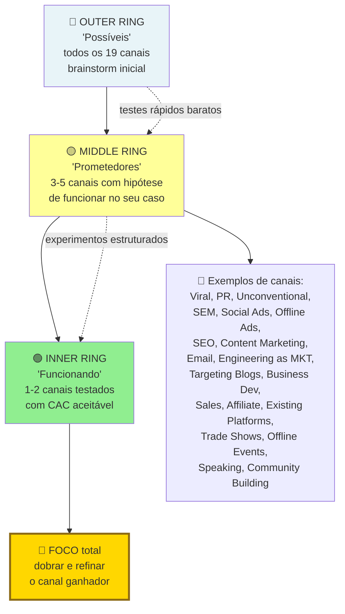

> [!warning] Erro clássico de orçamento
> Distribuir orçamento em cinco canais simultaneamente "para ver qual funciona". Resultado. Nenhum canal recebe investimento suficiente para sair do ruído. Bullseye. Teste rápido (três a quatro semanas) em três a cinco canais. Escolha um a dois. Foque oitenta por cento do recurso lá.

O método Bullseye tem três anéis. Externo (todos os dezenove canais). Meio (top três candidatos). Interno (um canal vencedor).

**1. Fase de brainstorm.** Para cada um dos dezenove canais, anote uma hipótese concreta de como seria aplicá-lo ao seu negócio. Mesmo que pareça ruim. Exemplo. "Palestras. Posso apresentar em dois meetups do setor X por mês, atingindo cerca de cinquenta decisores por evento". Se a sua primeira reação é "esse canal não se aplica", force-se a elaborar um cenário. Muitos descobrem aplicações inesperadas nessa etapa.

**2. Fase de ranking.** Elimine canais claramente incompatíveis com o seu estágio, CAC, ou LTV (por exemplo, TV é inviável para startup seed B2B SaaS). Dos restantes, escolha os três mais promissores. Critérios. Alcance. O canal consegue tocar o volume de ICPs que você precisa? CAC estimado. Dado LTV que você tem evidência, cabe no canal? Velocidade de feedback. Quanto tempo até saber se está funcionando? Compatibilidade com produto. O canal é apropriado para esse tipo de solução? Diferencial versus concorrentes. Concorrentes saturam esse canal, ou ignoram?

**3. Fase de teste.** Escolha apenas um canal, e teste a sério por trinta a sessenta dias. Com investimento modesto, mas suficiente (tipicamente R$ 5 mil a R$ 20 mil para canais pagos, ou equivalente em horas para canais orgânicos). Meça rigorosamente.

**4. Fase de dobrada, ou pivô.** Se o canal escolhido atingir a métrica-alvo, invista pesado. Se não, teste o próximo do top três.

> [!important] Não teste três canais em paralelo no começo
> Você não tem banda para otimizar três coisas ao mesmo tempo.

---

### Métricas específicas por canal

CAC por canal. Custo total do canal, dividido por novos clientes pagantes via ele.

Payback period por canal. Quantos meses até recuperar o CAC.

Volume mensal sustentável. Quanto o canal entrega por mês, sem degradação.

Saturação estimada. A qual investimento o canal começa a dar retorno decrescente.

Tempo até primeiro resultado. Canais orgânicos, três a seis meses. Pagos, uma a quatro semanas. Vendas diretas, dois a seis meses.

---

### Quando o Próprio Produto Vende: A Mecânica Real do Product-Led Growth (PLG)

Os canais pagos, orgânicos, e de parceria, cobertos acima, são motores *externos* de aquisição. Você vai ao cliente. Product-Led Growth é o motor oposto. O próprio produto é o canal de aquisição, ativação, retenção, e expansão. O usuário descobre, tenta, ama, e expande, sem passar por sales humano (ou com envolvimento mínimo).

PLG ganhou proeminência como estratégia dominante em SaaS nos anos 2010 a 2020, com empresas como Slack, Zoom, Calendly, Notion, Figma, Dropbox, e Airtable. Entender PLG não significa que toda startup deveria adotá-lo. Significa entender quando faz sentido, quando não faz, e quais os trade-offs de combiná-lo com motion sales tradicional.

#### Quando PLG funciona

Cinco condições precisam estar substancialmente presentes.

1. **Tempo-até-valor curto (minutos. Não dias).** O usuário precisa experimentar valor na primeira sessão. Se o seu produto só faz sentido depois de duas semanas de onboarding, e configuração, PLG não é para você.
2. **Uso self-serve viável.** O usuário consegue configurar, usar, e obter valor, sem humano do seu lado. O onboarding tem que ser educativo por design. Não por tutorial externo.
3. **Valor individual antes de valor coletivo.** Uma única pessoa obtém valor antes que a equipe inteira adote. Empresa em que PLG exigia adoção de vinte pessoas simultaneamente, raramente funciona.
4. **Viralidade intrínseca, ou loop natural.** Compartilhar, colaborar, ou convidar, é parte do fluxo natural de uso. Calendly espalha porque quem manda link implica compartilhamento. Dropbox idem.
5. **Ticket relativamente baixo em tier de entrada.** Pagar R$ 10 a R$ 300 por mês é decisão individual. Pagar R$ 5 mil por mês não é. PLG puro raramente funciona em tickets enterprise-only.

#### Quando PLG NÃO funciona (ou funciona mal)

O produto exige implementação customizada (integrações complexas, migração de dados, ou treino extenso).

O comprador não é usuário. O diretor compra. O analista usa. Self-serve do usuário não converte. Porque quem paga não experimenta.

Setor conservador com processo de compras formal. Finanças, saúde, e infraestrutura crítica. O processo exige RFP, security review, e jurídico. Self-serve não alcança.

Ticket muito alto, mesmo no tier de entrada.

Valor latente (o cliente só percebe benefício depois de três a seis meses de uso). Paciência que PLG raramente tem.

#### Métricas-chave específicas de PLG

**Time to Value (TTV).** Tempo entre primeiro uso, e primeiro momento de valor real para o usuário. Alvo. Minutos em PLG maduro. Dias em PLG inicial. TTV curto é pré-requisito. Não é métrica a otimizar depois.

**Activation Rate.** Percentual de usuários que completam a "ação de ativação". Definida como ação que correlaciona com retenção de longo prazo. Por exemplo, Slack identificou que equipes que enviavam duas mil mensagens, eram propensas a ficar.

**Product-Qualified Leads (PQL).** Usuários que demonstraram interesse via uso do produto. Não via formulário. PQL pode ser. Ativou X vezes. Adicionou Y membros. Atingiu Z limite gratuito. PQL converte três a dez vezes melhor que MQL clássico em PLG.

**Self-Serve Conversion Rate.** Percentual de usuários em tier gratuito, ou trial, que convertem para pagante, sem fala humana. Alvo em PLG puro. Cinco a vinte e cinco por cento, dependendo do modelo (freemium converte pior em percentual, mas capta mais em absoluto. Trial converte melhor em percentual, mas filtra antes).

**Expansion Revenue.** Receita vinda de crescimento dentro de conta existente (mais usuários, tier superior, ou add-ons). Em PLG maduro, expansão é motor. Trinta a setenta por cento da receita incremental vem de expansão. Não de novos logos.

**Net Revenue Retention (NRR).** Retenção líquida de receita (expansão menos churn). Empresas PLG públicas de ponta têm NRR em faixas altas (acima de cento e vinte por cento). Enquanto NRR abaixo de cem por cento indica que churn supera expansão.

#### Combinando PLG com Sales (Product-Led Sales, PLS)

Empresas que dominam PLG puro em tier baixo, frequentemente adicionam camada sales para expansão enterprise. É o híbrido *Product-Led Sales* (PLS). Padrão típico.

O usuário inicia uso self-serve, no tier gratuito, ou baixo.

O uso cresce na organização (viralidade intrínseca).

Em determinado volume, ou uso, o Sales é notificado (via PQL), para abordar o comprador corporativo, com plano enterprise, SSO, compliance, e suporte.

O Sales não prospecta o "frio". Prospecta onde o uso já existe.

> [!important] PLS resolve o teto estrutural do PLG puro
> PLS resolve o teto estrutural do PLG puro em enterprise (segurança, contratos, e compliance). Sem destruir o motor inicial.

#### Cases brasileiros, e internacionais

**Internacionais clássicos.** Slack, Zoom, Calendly, Notion, Figma, e Canva (que também opera no Brasil). Todos com forte DNA PLG.

**Brasil.** Alguns SaaS brasileiros têm tier self-serve operante (RD Station em tiers menores, Conta Azul, e Sympla para organizadores). Mas PLG puro como motor primário é ainda relativamente raro em SaaS brasileiro. O mercado é mais dominado por motion B2B tradicional, com vendedor. Isso é tanto oportunidade (espaço para novos entrantes com PLG real). Quanto sinal de que o ICP brasileiro tem ritmo de adoção mais conservador.

#### Armadilhas específicas de PLG

Tentar fazer PLG em produto que exige handholding. O usuário não consegue se ativar sozinho. Desiste. Churn em sete dias. PLG exige onboarding extraordinário. Não acessório.

Tier gratuito sem limitação clara. O gratuito vira eterno. Ninguém converte. Limitação natural (seats, uso, ou features) precisa existir, bem desenhada.

Ignorar sinais PQL. O time de produto tem os dados. O sales não usa. Leads de alta intenção passam sem ação.

Tentar vender enterprise em self-serve. Os contratos corporativos exigem negociação, SSO, e SOC 2. Ignorar isso faz deals grandes morrerem no checkout.

Dashboards de analytics insuficientes. PLG sem instrumentação é operação cega. Investir em analytics de produto (Mixpanel, Amplitude, ou PostHog) é pré-requisito.


---

### O Espelho do Capítulo 1: Seu Movimento de Vendas Cabe Dentro do Seu Tíquete Médio?

**Fechando o ciclo na trincheira:** Quando **Lucas e Marina** aplicaram as travas deste capítulo na rotina entre São Paulo e Florianópolis, a tensão da cena de abertura deixou de ser discussão subjetiva de corredores e virou regra clara de priorização, retenção e proteção de caixa.

**O Espelho (autodiagnóstico):**
1. Você, como fundador, já fechou pessoalmente pelo menos 20 a 30 clientes desconhecidos (fora do seu círculo de amigos e parentes) e escreveu no papel as 10 objeções exatas que surgem em toda reunião?
2. O seu tíquete anual por cliente (ACV) comporta o custo da sua máquina de vendas? (Se o seu produto custa R$ 150/mês, você não pode ter vendedores fazendo três reuniões de uma hora por cliente).
3. Se você gravar a sua melhor reunião de vendas hoje, um vendedor novo conseguiria reproduzir o mesmo roteiro de perguntas na semana que vem?

**Permissão Libertadora:**
Você está autorizado a ser o vendedor número um da sua empresa pelos próximos seis meses, mesmo que o seu diploma diga que você é engenheiro, médico ou cientista. Ninguém vende a visão melhor do que quem sente a dor da criação.

**O Ritual de Segunda-Feira às 9h:**
Grave as suas próximas cinco chamadas comerciais desta semana, transcreva com IA e extraia o **Roteiro de Ouro de 1 Página**: as 5 perguntas que abriram o cliente, a história que gerou confiança e a resposta que matou a objeção de preço.

---

### LEITURAS E REFERÊNCIAS COMPLEMENTARES

*Product-Led Growth*, de Wes Bush (referência operacional). *Product-Led Onboarding*, de Ramli John (disciplina de ativação). Blog e relatórios da OpenView Partners (acervo público sobre PLG).

---

## CAPÍTULO 2 — CRESCIMENTO ORGÂNICO COMPOSTO: CONTENT MARKETING, SEO E COMMUNITY BUILDING

### Alugar Atenção vs. Comprar o Terreno: A Engenharia do Ativo Composto

Toda vez que Rafael aumentava o orçamento de anúncios pagos em R$ 10 mil, as vendas subiam naquela mesma semana. Toda vez que ele pausava a campanha no dia 30 por falta de caixa, as vendas do dia 31 caíam para zero absoluto.

– "Bia, nós não temos uma empresa; nós somos inquilinos da Meta e do Google!", desabafou Rafael olhando a fatura do cartão. "Se o custo do clique dobrar no mês que vem, a nossa margem desaparece e a gente morre no dia seguinte."

Ao mesmo tempo, em Belo Horizonte, a Dra. Camila havia tomado uma decisão diferente dezoito meses antes. Em vez de fazer posts genéricos dizendo *"Dia Mundial da Fisioterapia"*, ela respondeu em profundidade, em artigos técnicos claros e vídeos curtos, às 50 dúvidas mais angustiantes que pacientes digitavam no Google às duas da manhã: *"dormência no braço direito ao acordar pode ser cervical?"*, *"quanto tempo dura a recuperação de cirurgia de manguito rotador?"*.

Dezoito meses depois, a clínica da Dra. Camila recebia 38 mil buscas orgânicas qualificadas por mês de pessoas com dor aguda na região metropolitana, gerando R$ 140 mil mensais em consultas com custo marginal de mídia próximo de zero.

Essa é a diferença brutal entre **O Aluguel Eterno do Tráfego Pago** e **A Escritura Definitiva do Ativo Composto**. Anúncio pago é uma torneira: fechou a mão, secou a água. Conteúdo estratégico e SEO programático voltado para intenção de compra funcionam como juros compostos no banco: o artigo, a calculadora gratuita ou o guia técnico que você publica hoje continua trabalhando para você às três da manhã de domingo pelos próximos cinco anos, derrubando o seu CAC médio mês após mês.

---

> [!note] Nota de validade
> Algoritmos de busca evoluem sem parar (Google core updates três a quatro vezes por ano). O papel do AI-generated content (conteúdo gerado por IA) e do AI-driven search (busca dirigida por IA, como Perplexity e ChatGPT Search) está em fluxo intenso entre 2024 e 2026. Revisar táticas todo ano. Os princípios são estáveis: autoridade, utilidade real e E-E-A-T (Experience, Expertise, Authoritativeness, Trustworthiness, sigla do Google para experiência, expertise, autoridade e confiabilidade).

O [[#CAPÍTULO 1 — GTM PLAYBOOK E ARQUITETURA DE CANAIS: DA PRIMEIRA VENDA AO PRIMEIRO MILHÃO DE ARR|Capítulo 1 (GTM Playbook e Arquitetura de Canais: Da Primeira Venda ao Primeiro Milhão de ARR)]] menciona content (conteúdo) e SEO (Search Engine Optimization, otimização para mecanismos de busca) como canais em alto nível. Para muitas startups B2B SaaS brasileiras, content é o canal de menor CAC no longo prazo, mas exige disciplina de doze a vinte e quatro meses antes de retornar.

### Por que depender 100% de mídia paga deixa a margem da sua empresa refém de um leilão que encarece todo ano

Canal proprietário. Não depende de Google Ads, Meta Ads ou de algoritmos voláteis (em parte).

ROI (Return on Investment, retorno sobre investimento) cresce com o tempo. O conteúdo antigo continua gerando tráfego. Paid (mídia paga) precisa de investimento constante.

Credibilidade e lead gen (geração de leads) simultâneos. Thought leadership (liderança de pensamento) atrai talento, parceiros e investidores.

Em B2B SaaS, é canal dominante para muitos verticais. A HubSpot construiu império em content marketing.

### Atacando o fundo de funil primeiro (Pain-Point SEO), criando ferramentas gratuitas e dominando a busca por IA (GEO)

**1. Estratégia de tópicos (topic clusters).** Escolher três a cinco "pillars". Temas centrais onde a empresa tem expertise única, e o ICP busca ativamente. Cada pillar desdobra em dez a trinta sub-tópicos. Exemplo. PadariaPro (padarias artesanais) tem pillar "gestão de insumos". Sub-tópicos. "Controle de estoque em padaria", "ficha técnica de produção", "fornecedores de farinha premium", e por aí vai.

**2. Pesquisa de palavra-chave.** Tools. Ahrefs, SEMrush, Moz, Google Search Console. Critérios. Volume de busca suficiente. Intenção relevante (comercial, ou informacional). Dificuldade de ranking factível. Foco inicial. Long-tail. Menos competição. Mais específico. Melhor conversão.

**3. Content tiers.** Pillar pages, três a cinco mil palavras. Abrangente. Autoridade. Cluster content, mil a dois mil palavras. Mais específico. Conecta ao pillar. Supporting content, quinhentas a mil palavras. Responde questão específica.

**4. Cadência, e qualidade.** Dois a quatro posts substantivos por mês valem mais que vinte posts superficiais. Qualidade editorial. Pessoa revisando. Dados atualizados. Exemplos reais. Originalidade. Ponto de vista. Não paráfrase de concorrentes.

**5. Distribuição.** SEO (orgânico) é o principal. Mas não único. Newsletter (Substack, ConvertKit). Amplifica, e fideliza. LinkedIn. Versões curtas de pillars. Comunidades. Participação relevante (não spam). Parcerias. Guest posts em sites maiores.

**6. Métricas.** Tráfego orgânico (Google Analytics). Crescimento mês a mês. Keywords ranqueadas. Posição média, e keywords no top dez. Conversion rate do tráfego orgânico. Assisted conversions, quantos deals tiveram touch de conteúdo antes. Authority building. Backlinks, menções, e convites para falar.

**7. Investimento.** Internal. Writer ou editor dedicado (R$ 6 a 15 mil por mês). SEO lead (R$ 12 a 25 mil por mês). Designer para gráficos. External. Agência, ou freelancers (R$ 20 a 80 mil por mês). Tools. Ahrefs, ou SEMrush (R$ 2 a 5 mil por mês).

> [!important] Regra de expectativa em SEO
> Espere ver ROI em doze a dezoito meses. Não em três. Quem desiste em seis meses, abandona o trabalho exatamente quando ele começa a render.

**8. SEO Programático e Content Ops.**

**SEO programático** é a criação de páginas em escala usando templates + dados estruturados. Em vez de escrever cada artigo manualmente, você define um template e um banco de dados, e gera centenas ou milhares de páginas automaticamente. Funciona quando há variação sistemática com demanda de busca real: localizações geográficas ("advogado trabalhista em [cidade]"), categorias de produto ("seguro de vida para [profissão]"), comparações ("[ferramenta A] vs [ferramenta B]"), e combinações de JTBD + segmento.

*Exemplos no Brasil e no mundo*: Quero Bolsa e Educa Mais Brasil geram páginas para cada combinação de curso, faculdade e cidade, assim como portais automotivos (Webmotors, iCarros) criam páginas de Tabela FIPE por marca, modelo e ano; no setor imobiliário, ZAP e Imovelweb operam páginas por bairro, tipo de imóvel e faixa de preço (e, lá fora, plataformas como a alemã Trivago fazem o mesmo por destino). Imovelweb e ZAP têm páginas para cada combinação de bairro + tipo de imóvel + faixa de preço. Trivago gera automaticamente páginas de "hotéis em [cidade]" com dados de disponibilidade. A estrutura típica: banco de dados (Airtable, CSV, ou CMS headless) + template de página (Webflow, Next.js, ou CMS) + estrutura de URL semântica (/categoria/subcategoria/variante).

*Armadilhas do SEO programático*: (1) conteúdo thin sem substância real, que o Google penaliza como "páginas porta" (doorway pages), (2) canonicalização incorreta gerando conteúdo duplicado, (3) escalar antes de validar que o template funciona: criar 10.000 páginas de baixa qualidade que nunca ranqueiam desperdiça crawl budget. A regra: se a página não tem informação genuinamente útil para o usuário específico da busca, não crie.

**Content Ops** é a infraestrutura operacional que permite produzir conteúdo em qualidade e volume consistentes. Os três componentes centrais.

*Workflow editorial*: do briefing à publicação, quem faz o quê e quando. Padrão: briefing (estrategista de SEO, 2h) → pesquisa + outline (writer, 2h) → rascunho (writer, 4-6h) → revisão editorial (editor, 1h) → SEO review (SEO lead, 30min) → aprovação (1 revisor designado, 30min) → publicação + distribuição (ops, 30min). Sem workflow escrito, cada peça tem processo diferente, qualidade inconsistente.

*Content calendar*: visibilidade de 4-8 semanas do que está em produção. Inclui: keyword alvo, intent (informacional/comercial), autor, deadline de cada etapa, status atual. Ferramentas: Airtable, Notion, CoSchedule.

*QA editorial*: checklist antes de publicar. Keyword aparece no título, no primeiro parágrafo, em ao menos um H2, e na meta description? O conteúdo é substancialmente melhor do que o resultado atual no top-3 para aquela keyword? Há internal links para 2+ páginas relevantes? Alt text nas imagens? Schema markup (FAQ, Article, HowTo) onde aplicável?

Investimento em SEO programático: desenvolvimento inicial de template (R$ 20-60k) + banco de dados + manutenção. ROI em escala quando há mais de 100 variantes com volume de busca real. Content Ops: editor sênior (R$ 10-20k/mês) + SEO lead (R$ 12-25k/mês) + ferramentas de gestão (R$ 2-5k/mês).

---

### Arquitetura e Execução de Comunidade (Community Building)

**1. Plataforma.** Slack. Profissional. Comum para B2B. Free com limitações. Pro para empresas médias em diante. Discord. Mais jovem. Melhor para gaming, creator, ou crypto. Circle (circle.so). Built-for-community. Melhor que Slack para estruturas formais. LinkedIn Groups. Amplo alcance. Baixa intimidade. Facebook Groups. B2C. Audiência não profissional.

**2. Papéis.** Community Manager. Dedicado, full-time, a partir de quinhentos a mil membros ativos. Salário, R$ 10 a 25 mil por mês. Moderadores (ambassadors). Membros voluntários que apoiam. Advocates. Super-usuários que defendem em redes externas.

**3. Rituais.** AMAs (Ask Me Anything) com CEO, executivos, ou especialistas externos. Um a dois por mês. Encontros presenciais (se B2B local). Trimestrais, ou semestrais. Eventos virtuais. Webinars, e workshops. Challenges, ou programs. Gamificação pontual para engajamento. Newsletter interna da comunidade. Conteúdo, mais highlights de membros.

**4. Princípios de saúde.** Valor antes de extração. Oitenta por cento do conteúdo gerado pela comunidade deve ser sobre os membros. Vinte por cento sobre a empresa. Moderação deliberada. Guidelines claros. Enforcement consistente. Tóxicos expulsos. Diversidade. Evitar dominância de um tipo de usuário, ou voz. Sem ads internas. Spam destrói comunidade. Auto-promoção limitada a canais específicos.

**5. Métricas.** Active members (posting, ou responding, não só joined). Mais de dez por cento do total é bom. Response rate a perguntas. Mais de setenta por cento em menos de vinte e quatro horas. Sentiment. Positivo dominante. Referrals to product. Quantos novos clientes vêm indicados por membros. Churn de membros ativos. Baixo.

---

### Community-Led Growth, comunidade como motor de aquisição e retenção

Community-Led Growth (CLG) é o modelo onde a comunidade de usuários se torna o principal driver de aquisição e retenção, criando um flywheel entre produto, comunidade e crescimento. Difere de community building como suporte ou advocacy: em CLG, a comunidade é a estratégia de crescimento primária, não um projeto paralelo.

**A lógica do flywheel.** Produto gera valor → usuários formam comunidade em torno desse valor → comunidade atrai novos usuários (aquisição orgânica) → comunidade acelera adoção e reduz churn (retenção) → crescimento financeia produto melhor → produto gera mais valor. Em cada volta do loop, o CAC cai e o LTV cresce.

**Casos brasileiros.** RD Station construiu RD Community como motor de educação e aquisição: +50 mil membros geraram leads orgânicos com CAC de fracao do custo de outbound. Hotmart Academy e Hotmart Club criaram comunidade de criadores que evangeliza o produto horizontalmente. Resultados: co-marketing entre criadores, casos de uso orgânicos, e defensores ativos contra competidores.

**Os cinco mecanismos de CLG.**

*Conteúdo gerado pela comunidade (UGC) como SEO*: respostas a perguntas técnicas, casos de uso, e discussões em fóruns públicos da comunidade geram conteúdo indexável. Stackoverflow e Reddit dominam buscas técnicas porque comunidade responde perguntas que nenhuma empresa criaria manualmente. Para produto B2B, fórum público indexável é ativo de SEO de longo prazo.

*Peer-to-peer onboarding*: membros experientes onboardam novos membros mais efetivamente do que documentação ou CS: pela linguagem, pelos casos de uso específicos, e pela credibilidade peer. Reduz time-to-value e custo de onboarding.

*Social proof em escala*: tamanho e saúde da comunidade são sinais de confiança para prospects. "10.000 profissionais de RH usam esta ferramenta" convertido em comunidade ativa é mais persuasivo do que testimonial de clientes no site.

*Feedback de produto estruturado*: comunidade como canal privilegiado de product discovery, não apenas "o que você quer?" mas análise de padrões em milhares de conversas. Empresas com comunidade saudável sabem de problemas de produto meses antes de aparecerem em NPS.

*Referrals orgânicos*: membros engajados recomendam naturalmente, não porque há programa de referral, mas porque pertencer à comunidade é parte da identidade profissional. Em comunidades B2B, a pergunta "qual ferramenta você usa?" em LinkedIn e grupos de setor é o canal de referral mais eficaz.

**Pré-condições para CLG funcionar.** Produto com valor real (sem isso, comunidade não forma ou é negativa). ICP com identidade profissional forte (community de designers, de engenheiros, de contadores: não de "usuários de software genérico"). Base instalada suficiente (mínimo 200-500 usuários ativos antes de investir em comunidade). Willingness da empresa de abrir parte do produto ou conteúdo como commons.

**Métricas específicas de CLG.** Percentual de novos usuários referidos por membros da comunidade. CAC de usuários vindos via comunidade vs. outros canais. Churn rate de membros ativos da comunidade vs. não membros. Net Promoter Score da comunidade. Contribuições de conteúdo por membro (UGC rate).

### Produzir conteúdo de topo de funil genérico que atrai milhões de estudantes e curiosos, mas zero compradores

Impaciência. Parar em seis meses, achando que "não funciona". SEO é maratona.

Content fino. Dez posts de quinhentas palavras por mês, com pouca substância, não constrói autoridade.

SEO-first, humano-second. Escrever para algoritmo, não para leitor. O Google penaliza isso agora.

AI-generated sem curadoria. Tentação de produzir em volume com ChatGPT, sem review editorial. A qualidade cai. Os rankings caem com updates algorítmicos.

Não medir conversion. Volume de tráfego sem conversion é vanity metric.

### Checklist de execução prática

- [ ] Topic clusters definidos (três a cinco pillars)?
- [ ] Pesquisa de palavra-chave feita para cluster?
- [ ] Cadência sustentável definida (dois a quatro posts substantivos por mês)?
- [ ] Qualidade editorial. Revisão, dados, e exemplos?
- [ ] Distribuição além de SEO orgânico?
- [ ] Métricas rastreadas mensalmente (tráfego, keywords, conversion)?
- [ ] Expectativa realista de ROI (doze a dezoito meses)?
- [ ] Investimento alocado, e sustentado?

> [!info] Fases relacionadas

---

### O Espelho do Capítulo 2: Seu Conteúdo Atrai Compradores com Cartão na Mão ou Apenas Curiosos?

**Fechando o ciclo na trincheira:** Quando a **Dra. Camila** trouxe este protocolo para a operação da clínica em Belo Horizonte, o gargalo que abriu este capítulo deixou de depender do seu heroísmo pessoal na cadeira e passou a rodar como sistema auditável pela equipe.

**O Espelho (autodiagnóstico):**
1. Se você desligar todos os seus anúncios pagos hoje ao meio-dia, quantas vendas ou pedidos de orçamento continuam entrando sozinhos amanhã pelas suas páginas e conteúdos já publicados?
2. Os conteúdos que você publica hoje respondem às perguntas de fundo de funil de quem está prestes a comprar (comparativos, preços, como resolver um erro urgente), ou são textos genéricos de "o que é inovação" que ninguém com dinheiro na mão lê?
3. Você já construiu pelo menos uma calculadora, planilha diagnóstica ou ferramenta gratuita interativa que resolve 10% do problema do cliente em troca do contato dele?

**Permissão Libertadora:**
Você está autorizado a parar de postar conteúdo raso todo dia só para "alimentar o algoritmo". Um único guia definitivo, estudo de caso com números reais ou calculadora útil vale mais do que cem posts esquecíveis de datas comemorativas.

**O Ritual de Segunda-Feira às 9h:**
Peça ao seu time de vendas (ou olhe no seu WhatsApp) as **10 perguntas mais difíceis** que os clientes fizeram na semana passada antes de fechar negócio. Transforme a pergunta número um em uma página ou vídeo definitivo hoje.


---

## CAPÍTULO 3 — MARKETING DE PERFORMANCE EM PROFUNDIDADE

### A Mentira do ROAS de Painel e o Imposto Invisível do Tráfego Pago

– "Rafael, o gestor de tráfego acabou de mandar print do painel do Gerenciador de Anúncios: estamos com ROAS de 5x! A cada R$ 1.000 que colocamos, voltam R$ 5.000 em vendas!", comemorou o estagiário na reunião de segunda-feira em Recife.

Bia nem levantou os olhos da planilha de conciliação bancária:

– "Pede para esse gestor de tráfego me explicar por que, se o painel dele diz que vendemos R$ 150 mil com ROAS 5, no nosso banco só entraram R$ 92 mil brutos e sobraram R$ 4 mil líquidos."

Bia acabava de desmascarar **A Ilusão do ROAS de Plataforma**. Se você toma decisões financeiras confiando cegamente no número de retorno que o painel da Meta, do Google ou do TikTok mostra na tela, você está deixando a raposa auditar o galinheiro.

Por que o ROAS do painel quase sempre mente para você no Brasil? Primeiro, por dupla atribuição: o cliente vê um anúncio no Instagram de manhã, pesquisa o nome da sua marca no Google à tarde e os dois painéis reivindicam 100% do mérito pela mesma venda. Segundo, porque o painel registra boletos gerados que nunca serão pagos e Pix expirados como "conversão concluída". Terceiro, e mais grave: **ROAS é faturamento bruto sobre mídia, não lucro líquido sobre caixa**. Se a sua margem bruta depois de produto, imposto, frete e taxa de cartão é de 25%, um ROAS de 4x significa exatamente **zero reais de lucro**: você trabalhou o mês inteiro apenas para transferir dinheiro do cliente para o Vale do Silício.

Marketing de performance sério ignora métricas de vaidade do gerenciador e governa cada centavo por **Margem de Contribuição após Mídia (POAS)** e **MER (Marketing Efficiency Ratio)** no extrato bancário real.

---

> [!note] Aplicabilidade
> Empresas que dependem de paid ads (anúncios pagos no Google, Meta, LinkedIn, TikTok) como canal primário ou secundário. Aplica-se a partir do momento em que há budget dedicado, mesmo que sejam R$ 5.000 mensais, com alguém responsável por otimizá-lo.

### 1. O que é marketing de performance — e o que o distingue de branding

Marketing de performance tem três características que o distinguem.

**Mensurabilidade direta.** Cada real investido pode ser rastreado até uma ação mensurável: clique, lead, cadastro, compra. O vínculo entre investimento e resultado é explícito: ou deve ser.

**Otimização em tempo quase real.** Campanhas de performance são ajustadas semanalmente, às vezes diariamente. Criativos que não performam são pausados. Audiências que não convertem são excluídas. O budget é realocado para o que funciona.

**Métricas financeiras como critério de sucesso.** O critério não é alcance, não é impressões, não é "brand awareness" (reconhecimento de marca). É CPA (Cost Per Action, custo por aquisição), CAC (custo de aquisição de cliente), ROAS (Return on Ad Spend, retorno sobre o investimento em anúncios) ou MER (Marketing Efficiency Ratio, razão de eficiência de marketing).

Branding e performance não são opostos. São complementares e interdependentes. Uma marca forte reduz o CAC de performance ao longo do tempo, porque aumenta a taxa de conversão em toda a cadeia. Empresa que só faz performance sem construir marca percebe o CAC subindo de forma inexorável à medida que escala: porque depende cada vez mais de conquistar audiências frias, sem o benefício do reconhecimento acumulado.

> [!important] O erro clássico em startup early-stage
> Focar 100% em performance e ignorar branding por "não ser mensurável" funciona até o Seed. Na Série A, quando o CAC começa a subir com a escala do budget, a empresa não tem fundação de marca que reduza o atrito. Resultado: ROAS declinante sem alavanca para reverter.

As métricas centrais de performance.

- **CPA** (Custo Por Ação): custo médio para gerar uma ação definida, lead, cadastro, trial. Calculado como investimento total dividido pelo número de ações.
- **CAC** (Custo de Aquisição de Cliente): custo médio para converter um pagante. Diferente de CPA porque exclui leads que não converteram.
- **ROAS** (Return on Ad Spend): receita gerada dividida pelo investimento em mídia. ROAS de 3x significa que cada R$ 1 investido gerou R$ 3 em receita. Métrica de curto prazo: não considera margem nem LTV.
- **MER** (Marketing Efficiency Ratio): receita total dividida pelo investimento total em marketing (todos os canais). Métrica de negócio, não de campanha. Mais honesta que ROAS isolado.
- **LTV/CAC**: saúde da economia unitária. Razão abaixo de 1x é destruição de valor. Abaixo de 3x é arriscado. Acima de 3x com payback em 12 meses ou menos é saudável para escala.

---

### 2. A stack de mídia paga no Brasil

O Brasil tem uma das maiores penetrações de redes sociais do mundo e particularidades relevantes para alocação de budget. Cada plataforma tem perfil diferente de audiência, intenção, CPM e taxa de conversão.

#### Meta Ads (Facebook e Instagram)

Maior reach do Brasil. Penetração de redes sociais no país supera 70% da população adulta, com forte concentração em Instagram e Facebook. Adequado para B2C com produto visual, e-commerce, apps e serviços com decisão de compra emocional ou de impulso.

Pontos fortes: lookalike audiences de alta precisão quando há base de dados própria (CRM, pixeis com volume), retargeting eficiente, formatos variados (Stories, Reels, Feed, Catalog Ads para e-commerce).

Ponto de atenção: iOS 14.5 e mudanças subsequentes de privacidade reduziram a precisão do pixel. A janela de atribuição padrão caiu de 28 dias para 7 dias (clique) e 1 dia (view). Isso significa que parte das conversões não é mais atribuída ao Meta: o canal parece menos eficiente do que realmente é, quando medido apenas dentro da plataforma.

Estrutura recomendada: separar campanhas por objetivo (awareness, consideração, conversão), por funil (topo, meio, fundo) e por criativo. CBO (Campaign Budget Optimization) favorece campanhas com volume suficiente para o algoritmo aprender: mínimo 50 conversões por conjunto de anúncios por semana.

#### Google Ads (Search, Display, YouTube, Performance Max)

Intent-based: o usuário está buscando ativamente. Search Ads capturam demanda existente, pessoas que já sabem o que querem. É o canal com maior taxa de conversão em termos absolutos, porque a intenção está explícita na busca.

Display e YouTube constroem awareness e retargeting com custo mais baixo por impressão. Performance Max (PMax) é a campanha que usa IA para otimizar em todos os inventários do Google simultaneamente: eficiente para quem tem volume de dados, mas caixa-preta em termos de controle granular.

No Brasil, Google Search é particularmente eficiente para categorias com alta busca ativa: serviços financeiros, saúde, educação, SaaS B2B. Categorias sem demanda ativa pré-existente se beneficiam menos.

Ponto de atenção: palavras-chave competitivas em categorias como crédito, seguros e educação podem ter CPC de R$ 15 a R$ 80. O CAC resultante só justifica com LTV alto.

#### TikTok Ads

Canal emergente no Brasil com CPM tipicamente trinta a quarenta por cento menor que Meta em 2024-2025 (faixa global de US$ 3 a US$ 10 no TikTok versus US$ 7 a US$ 15 no Meta, com Brasil em tier mais baixo dos dois lados). Janela de oportunidade real, mas que se fecha rapidamente: o gap diminuiu cerca de metade entre 2023 e 2025 conforme dados públicos da Right Side Up e da Trendtrack, em movimento similar ao que aconteceu com Instagram e Facebook entre 2016 e 2020.

Adequado para marcas com produto ou mensagem que funciona em formato nativo de vídeo curto. A lógica do TikTok é "entertainment-first": o ad que parece ad demais performa mal. O criativo precisa se parecer com conteúdo orgânico da plataforma.

Audiência predominante: 18-34 anos, com penetração crescente em faixas mais velhas. Forte no Brasil em categorias de moda, beleza, entretenimento, food e consumo massivo.

Ponto de atenção: atribuição é particularmente complexa no TikTok porque o comportamento de busca pós-exposição é alto (o usuário vê o ad no TikTok, sai e busca no Google). Medir só pela plataforma subestima muito o impacto real.

#### LinkedIn Ads

Canal B2B por excelência. CPL (custo por lead) mais alto do mercado: tipicamente três a cinco vezes o CPL do Meta em B2B (faixa global 2025: LinkedIn US$ 100-150 versus Meta US$ 25-30). Benchmark Brasil específico é mais escasso publicamente. Mas qualidade do lead é estruturalmente diferente: formulários nativos do LinkedIn convertem em torno de treze por cento, contra dois e meio por cento das landing pages servidas via Meta. Segmentação por cargo, empresa, setor, senioridade e tamanho de empresa não existe em nenhuma outra plataforma com essa precisão.

No Brasil, LinkedIn Ads é especialmente eficiente para: SaaS B2B, consultorias, serviços financeiros corporativos, educação executiva, recrutamento e qualquer produto com ticket médio acima de R$ 10.000 que depende de decisão de compra corporativa.

Estratégias adequadas: Lead Gen Forms (formulários nativos que convertem melhor que landing pages externas), retargeting de lista de empresas-alvo (ABM: Account-Based Marketing), Thought Leadership Ads com conteúdo de valor.

> [!warning] CAC tolerância diferente em B2B
> Um CAC de R$ 3.000 por cliente é insustentável em B2C com ticket de R$ 150. É trivial em B2B com contrato anual de R$ 60.000. A análise de viabilidade de LinkedIn Ads depende completamente do LTV do produto vendido.

#### Programática (DSP)

Display programático via DSPs (Demand-Side Platforms) como The Trade Desk, DV360 (Google), ou soluções locais. Adequado para awareness em escala, com targeting por segmento de audiência (dados de terceiros ou CRM próprio) e contexto de conteúdo.

No Brasil, programática é relevante para marcas com budget acima de R$ 50.000 mensais em display e que buscam alcance fora dos walled gardens (Meta, Google, TikTok). Exige expertise técnica, configuração de bid floors, brand safety, viewability, e parceiro especializado.

---

### 3. O funil de performance: cada etapa tem métricas e canais diferentes

```text
FUNIL DE PERFORMANCE

ETAPA          OBJETIVO              CANAIS PRINCIPAIS       MÉTRICAS-CHAVE
─────────────────────────────────────────────────────────────────────────────
Awareness      Alcançar audiência     YouTube, TikTok,        CPM, Reach, Frequency
               nova e relevante       Meta (topo), Display    Brand lift (se medido)

Consideração   Engajar e educar       Meta (meio), LinkedIn,  CTR, CPC, Time on site
               quem conheceu          YouTube, Retargeting    Pages per session, VTR

Conversão      Capturar ação          Search, Meta (fundo),   CPA, CAC, ROAS
               de compra/cadastro     LinkedIn Lead Gen        Conversion rate

Retenção       Reativar e             E-mail, Push,           LTV, Repeat purchase
               aumentar LTV           Retargeting, CRM         Churn, NPS
─────────────────────────────────────────────────────────────────────────────
```

O erro comum é otimizar só o fundo do funil. Empresas que cortam budget de awareness inteiramente percebem, em 6 a 12 meses, que o pool de audiência qualificada no fundo do funil encolheu: e o ROAS de conversão começa a cair porque o topo não está sendo alimentado.

A regra prática de alocação de budget por estágio varia por maturidade da empresa.

- **Estágio 0-1M ARR**: 70-80% conversão, 20-30% consideração. Awareness é irrelevante, tamanho de audiência não é problema.
- **Estágio 1-10M ARR**: 60% conversão, 25% consideração, 15% awareness. Começar a construir funil.
- **Estágio acima de 10M ARR**: balancear os três estágios. Proportion depende do produto, ciclo de compra e competição.

---

### 4. Gestão de CAC: blended versus por canal, e o método de alocação

**CAC blended** é o custo total de aquisição somando todos os canais de marketing e vendas, dividido pelo número total de novos clientes. Fórmula: (total de marketing + total de vendas) / novos clientes no período. Simples, honesto, mas esconde onde o dinheiro trabalha melhor.

**CAC por canal** é o mesmo cálculo feito separadamente para cada canal. Meta Ads, Google Search, SDR outbound, eventos, referral: cada um tem um CAC diferente. A diferença entre canais pode ser de 3x a 10x.

> [!note] Por que medir CAC separado por canal
> Empresa com CAC blended de R$ 800 pode ter Meta Ads gerando clientes a R$ 400 e eventos gerando clientes a R$ 2.500. A decisão correta é escalar Meta e revisitar o ROI de eventos: mas isso só aparece quando se mede por canal. CAC blended, sozinho, mascara onde alocar o próximo real.

O problema do CAC por canal: atribuição. O cliente que comprou via Google Search pode ter sido influenciado por um post no Instagram uma semana antes. Qual canal recebe o crédito? Essa é a questão de atribuição: tratada na seção 5.

**O método teste-e-aprenda para alocação de budget.**

Em vez de decidir alocação por convicção, o método estruturado é:

1. Definir envelope de budget total para o trimestre.
2. Alocar 70% nos canais que já provaram CAC aceitável (exploit).
3. Alocar 30% em testes: novos canais, novas audiências, novos formatos (explore).
4. Medir resultados dos testes com janela de 4-8 semanas (suficiente para significância).
5. No próximo trimestre, promover o que funcionou para a faixa de 70% e abrir nova rodada de testes.

Esse ritmo de exploit/explore evita tanto a armadilha de ficar preso nos canais históricos (que podem estar saturando) quanto a de dispersar budget em muitos canais sem dar volume suficiente para nenhum funcionar.

---

### 5. Atribuição: last-click está morto

**Last-click** atribui 100% do crédito de conversão ao último ponto de contato antes da compra. É o modelo padrão de muitas plataformas e do Google Analytics 3. O problema: em jornadas de compra que passam por múltiplos canais ao longo de dias ou semanas, last-click sistematicamente superestima canais de captura de demanda (Search, retargeting) e subestima canais de criação de demanda (redes sociais, YouTube, display).

Resultado prático: empresas que tomam decisões por last-click tendem a sub-investir em awareness e sobre-investir em conversão, até que o pool de audiência qualificada seca.

**Modelos alternativos.**

- **Linear**: distribui crédito igualmente entre todos os touchpoints. Mais justo que last-click, mas ignora que alguns pontos de contato são mais influentes que outros.
- **Time decay**: dá mais crédito a touchpoints próximos à conversão. Faz sentido para ciclos de compra curtos.
- **Position-based (U-shape)**: 40% para o primeiro touchpoint, 40% para o último, 20% dividido no meio. Valoriza tanto criação quanto captura de demanda.
- **Data-driven attribution (DDA)**: usa machine learning para atribuir crédito baseado em padrões reais de conversão nos dados da conta. Desde 2023, é o modelo padrão no Google Ads e no GA4, sem exigência de piso mínimo de conversões mensais (os antigos modelos baseados em regras, como primeiro clique, linear, *time decay* e por posição, foram descontinuados no Google Ads e no GA4, restando apenas *data-driven* e último clique nas ferramentas do Google, embora sigam úteis como raciocínio analítico ou em plataformas de terceiros). É o modelo mais preciso dos disponíveis dentro das plataformas.

**MMM (Media Mix Modeling).**

Modelo econométrico que usa séries temporais de investimento por canal e receita para estimar a contribuição de cada canal: incluindo canais offline, sazonalidade e fatores externos. Não depende de cookies ou pixels. Mais robusto para orçamentos maiores.

No Brasil, MMM está se tornando acessível para empresas médias por conta de ferramentas open-source (Robyn da Meta, Meridian do Google) e consultorias especializadas. Antes era privilégio de grandes anunciantes.

**Incrementalidade.**

O teste de incrementalidade responde à pergunta: "quanto do que atribuímos a esse canal teria acontecido de qualquer forma?" Metodologia: dividir a audiência em grupo de teste (exposto ao canal) e grupo de controle (não exposto). Comparar taxa de conversão. A diferença é o efeito incremental real do canal.

Gold standard de medição, mas exige volume suficiente e setup técnico. Para empresas com budget limitado, a versão simplificada é o holdout test: pausar um canal por 2 semanas e medir o impacto nas conversões totais. Se as conversões caem proporcionalmente ao investimento pausado, o canal é incremental. Se as conversões se mantêm, o canal pode estar capturando demanda que já existia.

> [!tip] Atribuição com budget limitado no Brasil
> Para empresas abaixo de R$ 100.000 mensais em mídia, a abordagem pragmática é: (1) usar GA4 com modelo data-driven como baseline, (2) rodar um holdout test por canal a cada trimestre, (3) acompanhar MER total do negócio como norte: se o MER está melhorando com o investimento em marketing, o investimento está valendo, independente da atribuição perfeita.

---

### 6. Creative como variável principal de performance

Em 2025, o criativo é a variável de maior impacto em campanhas de Meta Ads e TikTok Ads: mais do que bid strategy, targeting ou estrutura de conta. A razão: os algoritmos das plataformas ficaram tão sofisticados que se nivelaram. O que ainda diferencia performance é o criativo que o algoritmo tem para distribuir.

Estudos do Google estimam que cerca de setenta por cento do sucesso de campanha é determinado pelo criativo, com mídia respondendo pelos outros trinta por cento. Nielsen, com metodologia diferente, atribui em torno de cinquenta e seis por cento do ROI de venda à qualidade do criativo (47% mensagem mais 9% contexto), e Meta documenta que ads com criativo de alta qualidade convertem cerca de doze por cento mais que os de baixa qualidade. As cifras divergem por método. A direção é consistente: criativo é o lever de maior impacto, distante de targeting, bid e estrutura de conta.

**O framework de creative testing.**

```text
FRAMEWORK DE CREATIVE TESTING

1. HIPÓTESE
   Definir o que se quer testar e por quê.
   Exemplo: "Hook com prova social (depoimento) vai converter
   melhor que hook com problema (dor) para audiência de topo."

2. ESTRUTURA DO TESTE
   - Controle: criativo atual de melhor performance (baseline)
   - Variante: novo criativo com UMA mudança isolada
   - Não testar duas variáveis ao mesmo tempo (impossível isolar causa)

3. TAMANHO DE AMOSTRA
   - Mínimo: 1.000 impressões únicas por variante para comparar CTR
   - Para comparar conversão: 50+ conversões por variante (regra do Meta)
   - Para significância estatística: calcular com calculadora de A/B test
     (p-value < 0,05 ou confiança > 95%)

4. DURAÇÃO
   - Mínimo 7 dias (para cobrir variação semanal de comportamento)
   - Máximo 21 dias (creative fatigue começa antes disso)

5. DECISÃO
   - Variante vence: escalar, registrar hipótese confirmada
   - Controle vence: registrar hipótese refutada, gerar nova
   - Sem diferença: registrar, simplificar (usar criativo mais barato)
```

**O que testar, por ordem de impacto.**

1. **Hook** (primeiros 3 segundos de vídeo ou headline de imagem): é o elemento de maior impacto. Um hook ruim desperdiça todo o resto do criativo: o usuário não para de scrollar.
2. **Formato** (vídeo curto vs. imagem estática vs. carrossel vs. UGC): formatos têm desempenho muito diferente por plataforma e audiência.
3. **Mensagem principal** (benefício vs. dor vs. prova social vs. urgência): qual ângulo ressoa com a audiência.
4. **CTA** (chamada para ação): "Saiba mais" vs. "Compre agora" vs. "Teste grátis" têm conversões diferentes por etapa do funil.

**Creative fatigue** é a queda de performance de um criativo após exposição excessiva à mesma audiência. Em Meta Ads, sinais de fadiga incluem: aumento de frequência acima de 3x por semana, queda de CTR acima de 20% semana a semana, aumento de CPM (algoritmo penaliza ads com baixo engagement). Regra prática: refreshar criativos a cada 2-4 semanas em campanhas de conversão ativas.

> [!note] UGC (User-Generated Content) como criativo
> No Brasil, criativos de UGC, vídeos curtos gravados por criadores de conteúdo no estilo de depoimento autêntico, têm consistentemente performado melhor que produções profissionais em Meta e TikTok. Custo de produção mais baixo, escala mais fácil, e o formato se mistura organicamente ao feed. Para empresas early-stage, isso é uma vantagem: não precisam de agência criativa cara.

---

### 7. Performance B2B versus B2C: diferenças estruturais

As diferenças entre performance B2B e B2C não são apenas de canal: são estruturais no modelo de negócio e na tolerância ao CAC.

**CAC tolerance.**

Em B2C com ticket de R$ 100 por mês (SaaS ou assinatura), um CAC acima de R$ 300 é difícil de justificar sem LTV de pelo menos R$ 1.200 (payback em 12 meses). Em B2B com contrato anual de R$ 60.000, um CAC de R$ 8.000 é razoável: e pode ser justificado mesmo com payback de 18 meses se o churn for baixo e o LTV for alto.

Isso significa que B2B pode, e deve, investir em canais mais caros por lead (LinkedIn Ads, eventos, outbound com SDR) porque o LTV justifica. B2C precisa de canais com CPL baixo e volume alto.

**O ciclo de compra.**

B2C de consumo: minutos a dias. A emoção importa. Urgência converte. Retargeting de curto prazo (7 dias) é muito eficiente.

B2B de ticket médio-alto: semanas a meses. Múltiplos decisores. A compra é racional e envolve processo de aprovação. O funil é mais longo e o papel do conteúdo educativo (webinars, whitepapers, cases) é converter ao longo do tempo.

**ABM (Account-Based Marketing) para B2B.**

ABM é a abordagem onde em vez de otimizar para volume de leads, a empresa define uma lista de empresas-alvo (accounts) e concentra marketing e vendas nessa lista. LinkedIn Ads é a plataforma mais eficiente para ABM no Brasil: é possível segmentar por empresa específica, cargo e senioridade, e atingir os decisores de compra diretamente.

Fluxo de ABM básico.

1. Definir lista de 100-500 empresas-alvo (ICP: Ideal Customer Profile).
2. Fazer upload da lista no LinkedIn Ads como Matched Audience.
3. Rodar campanhas de conteúdo educativo (não de venda direta) para os decisores dessas empresas.
4. Usar dados de engajamento para identificar accounts "esquentando" (quem está lendo, quem está engajando).
5. Acionar SDR para outbound personalizado nas accounts com sinal de interesse.

**Intent data no Brasil.**

Intent data são sinais de intenção de compra captados de fontes externas: buscas em plataformas como G2, Capterra, comparadores setoriais; visitas a páginas de concorrentes; downloads de conteúdo específico. Nos EUA, o mercado de intent data é maduro (Bombora, 6sense, Demandbase). No Brasil, o ecossistema é mais limitado, mas soluções estão crescendo: e dados de busca do próprio Google Search Console são uma fonte de intent data primário valiosa e gratuita.

---

### 8. Métricas e armadilhas

#### ROAS versus MER

ROAS (Return on Ad Spend) é calculado dentro de uma plataforma específica: receita atribuída ao canal dividida pelo investimento no canal. É uma métrica de campanha.

MER (Marketing Efficiency Ratio) é a receita total do negócio dividida pelo investimento total em marketing (todos os canais). É uma métrica de negócio.

O problema de otimizar só para ROAS: cada plataforma atribui crédito de formas diferentes, e nenhuma consegue ver o quadro completo. Uma campanha de awareness no YouTube pode ter ROAS de 0,5x dentro do YouTube, mas estar elevando a taxa de conversão de Search: o que não aparece no ROAS do YouTube.

MER resolve isso porque captura o efeito total: se o MER está melhorando conforme se investe em marketing, o marketing está funcionando como um todo, independente do ROAS por canal.

#### A armadilha do ROAS alto com LTV baixo

Uma campanha pode ter ROAS de 5x e ainda assim destruir valor se os clientes adquiridos tiverem churn alto. Exemplo: empresa de SaaS com ROAS de 5x em campanha de Meta, mas que está trazendo clientes que cancelam em 60 dias. O LTV desses clientes é R$ 200. O CAC é R$ 80. Parece lucrativo. Mas se o custo de onboarding e suporte for R$ 150 por cliente, a margem é negativa.

A checagem correta: LTV/CAC com LTV calculado sobre janela de 12 meses ou mais, considerando churn real histórico: não LTV teórico assumindo retenção perfeita.

#### Como saber quando escalar versus quando otimizar

```text
DIAGNÓSTICO: ESCALAR OU OTIMIZAR?

SINAL                          DIAGNÓSTICO              AÇÃO
──────────────────────────────────────────────────────────────────────
CAC estável ou caindo          Escalar: há eficiência    Aumentar budget
com volume crescente           para aproveitar           em 20-30%/mês

CAC subindo com volume         Saturação de audiência    Expandir segmentos,
                                ou creative fatigue      refreshar criativos

ROAS caindo com budget         Diminishing returns       Avaliar novo canal
constante                       na audiência atual       ou pausa + reinício

Conversão rate caindo          Problema na landing       Otimizar LP antes
com CTR constante               page ou oferta           de escalar budget

CAC alto em canal novo         Normal no início          Esperar fase de
com menos de 4 semanas         (algoritmo aprendendo)    aprendizado (50+ conv.)
──────────────────────────────────────────────────────────────────────
```

> [!warning] A regra dos vinte por cento de escala
> Os algoritmos de Google e Meta têm fase de aprendizado que é reiniciada por mudanças bruscas de budget. Aumentar budget mais de 20% por semana (ou 30% por mês) coloca campanhas em modo de reaprendizado: performance cai por 1 a 2 semanas. Em campanhas de prazo curto (lançamento, promoção sazonal), esse tempo de recuperação pode não existir. A regra prática: aumentar gradualmente. Se a urgência exigir escala rápida, duplicar por campanha nova em paralelo em vez de alterar a original.

#### Armadilhas de atribuição no pós-iOS 14

Após iOS 14.5, usuários de iPhone que optam por não compartilhar dados de tracking fazem com que suas conversões não sejam rastreadas pelo pixel do Meta. Estimativas indicam que 40-60% das conversões em iOS não são reportadas dentro da plataforma.

Implicação: o Meta Ads Reporting mostra menos conversões do que realmente estão acontecendo. Isso leva à decisão errada de subinvestir em Meta por parecer menos eficiente.

Solução prática: implementar o Meta Conversions API (CAPI), server-side, que captura eventos diretamente do servidor da empresa, não do browser ou app. Reduz (não elimina) a perda de atribuição. Complementar com comparação de leads/vendas no CRM versus leads reportados na plataforma.

---

### Delegar o cartão de crédito para agências cobradas por percentual de mídia gasta e ignorar a fadiga criativa

Otimizar ROAS sem olhar MER. Um canal pode ter ROAS aparentemente excelente e estar apenas capturando demanda que outro canal criou. O MER total não melhora: o único efeito é inflacionar o número de um canal às custas de outro.

Cortar awareness para melhorar CAC de curto prazo. Empresas sob pressão de eficiência frequentemente cortam budget de topo de funil primeiro, porque o retorno não é imediato. O resultado aparece 6-12 meses depois: o pool de audiência qualificada no fundo do funil encolhe, e o CAC de conversão sobe de forma que não pode ser resolvida com otimização de bid.

Confiar em dados da plataforma sem triangular com CRM. Meta, Google e TikTok reportam conversões dentro do seu próprio modelo de atribuição. O número real de clientes está no CRM. Se a diferença for grande, há problema de mensuração.

Escalar criativo sem escalar produção. Empresas que entendem o valor de creative testing frequentemente descobrem que o gargalo não é budget: é capacidade de produção. Uma agência criativa ou um processo de UGC em escala é infraestrutura de performance, não custo de marketing opcional.

Testar sem volume suficiente. A/B test com 200 cliques por variante não tem significância estatística. A conclusão errada de um teste com amostra insuficiente desperdiça budget nas semanas seguintes na variante errada.

Pausar e reiniciar campanhas frequentemente. Cada reinício coloca a campanha novamente em fase de aprendizado. Campaigns que ficam ativas de forma contínua, com ajustes graduais, têm performance melhor ao longo do tempo do que campanhas pausadas e relançadas.

Ignorar a landing page. A campanha mais otimizada do mundo desperdicia budget se a landing page tem taxa de conversão baixa. Frequentemente, o melhor investimento marginal não é mais budget em mídia: é otimização de landing page (velocidade, clareza de proposta de valor, CTA, prova social).

Contratar gestor de tráfego sem definir critérios de sucesso. "Gestão de tráfego" é um serviço amplamente oferecido no Brasil, com qualidade muito variável. Sem definir previamente CAC-alvo, MER mínimo e frequência de reporting, é difícil avaliar se o serviço está entregando valor.

### Checklist de execução prática

Marketing de performance está operando bem quando todos os itens abaixo estão cumpridos.

- [ ] CAC separado por canal (não só blended) e acompanhado mensalmente, com distinção entre pagos e orgânicos.
- [ ] MER (Marketing Efficiency Ratio) total do negócio acompanhado mensalmente como indicador integrador, não só ROAS por canal.
- [ ] LTV/CAC calculado com churn real de cohort de seis meses ou mais, não com premissas teóricas.
- [ ] Modelo de atribuição consciente documentado, não só last-click. Equipe sabe como os números são calculados e suas limitações.
- [ ] Incrementalidade testada em pelo menos um canal por trimestre, via holdout test ou equivalente.
- [ ] Framework de creative testing ativo com hipóteses documentadas, ao menos um teste por semana em social ads. Criativo refreshado a cada 2-4 semanas.
- [ ] Regra dos 20-30% respeitada ao escalar budget, para preservar a fase de aprendizado dos algoritmos.
- [ ] Budget de explore (20-30%) alocado para testes de novos canais, audiências ou formatos.
- [ ] Meta Conversions API (CAPI) implementado server-side; dados de conversão triangulados com CRM.
- [ ] Landing pages avaliadas e otimizadas separadamente das campanhas (taxa de conversão da página é alavanca tão importante quanto criativo do anúncio).
- [ ] Em B2B: lista de contas-alvo definida para ABM.
- [ ] Critérios de sucesso (CAC-alvo, MER mínimo, frequência de reporting) definidos antes de contratar agência ou gestor de tráfego.

---

**Ver também:**

[[#CAPÍTULO 2 — CRESCIMENTO ORGÂNICO COMPOSTO: CONTENT MARKETING, SEO E COMMUNITY BUILDING|Capítulo 2: Content Marketing e SEO como Disciplina]]. [[IGNICAO-Vol-9-Maturidade-e-Exit#CAPÍTULO 15 — LIQUIDEZ SECUNDÁRIA (SECONDARIES): REALIZAÇÃO PARCIAL DE CAPITAL PARA FUNDADORES, EXECUTIVOS E INVESTIDORES ANTES DO EXIT|Capítulo 15 (Liquidez Secundária (Secondaries): Realização Parcial de Capital para Fundadores, Executivos e Investidores Antes do Exit) (Vol. 9)]], Growth e Aquisição. [[#CANVASES VISUAIS DESTA FASE (COM EXEMPLOS BRASILEIROS PREENCHIDOS)|Canvases Visuais da Fase]], Canvases e Mapas Visuais. [[IGNICAO-Vol-6-Receita-e-Pessoas#CAPÍTULO 10 — PERFORMANCE REVIEWS ESTRUTURADOS: CICLO, CALIBRAÇÃO E CONEXÃO COM COMPENSAÇÃO|Capítulo 10 (Performance Reviews Estruturados: Ciclo, Calibração e Conexão com Compensação) (Vol. 6)]], Métricas e Dashboard de Negócio.

> [!info] Fases relacionadas

---

### O Espelho do Capítulo 3: Você Está Comprando Lucro no Banco ou Prints Bonitos no Gerenciador?

**Fechando o ciclo na trincheira:** Quando **Rafael e Bia** conectaram esta disciplina entre a aquisição no Recife e a operação logística em Goiânia, o vazamento que abriu este capítulo estancou e o crescimento voltou a gerar caixa livre.

**O Espelho (autodiagnóstico):**
1. Você sabe de cor, na ponta da língua, qual é o seu **ROAS de Empate (Breakeven)** exato (1 dividido pela sua margem de contribuição percentual antes da mídia)?
2. Você mede o sucesso do marketing pelo número que aparece dentro do painel do Facebook/Google ou pelo **MER** (Dinheiro Real Recebido no Banco dividido por Todo o Dinheiro Gasto em Marketing)?
3. Quantos criativos novos com ganchos radicalmente diferentes você coloca no ar toda semana para combater a fadiga de anúncio?

**Permissão Libertadora:**
Você está autorizado a demitir qualquer agência ou gestor de tráfego que comemore custo por clique barato (CPC) ou ROAS de boleto não pago enquanto o caixa da sua empresa diminui.

**O Ritual de Segunda-Feira às 9h:**
Calcule agora o seu **ROAS de Breakeven**: se a cada R$ 100 vendidos sobram R$ 33 após impostos, produto, frete e taxas (margem de 33%), seu ROAS mínimo para empatar é $1 / 0,33 = 3,03$. Desligue hoje qualquer campanha que rode abaixo desse piso.


---

## CAPÍTULO 4 — BRANDING, POSICIONAMENTO DE MARCA E PRODUCT MARKETING (PMM)

### Marca Não é Logotipo: É o Atalho Mental que Autoriza Você a Cobrar o Dobro

Quando a Dra. Camila abriu sua segunda unidade em Belo Horizonte, um consultor de branding tentou lhe vender um pacote de R$ 60 mil para definir *"o arquétipo mitológico da marca, o tom de voz cósmico e o manual de aplicação do símbolo áureo"*.

Camila recusou. Em vez de gastar R$ 60 mil em poesia abstrata, ela definiu uma posição cirúrgica e brutalmente clara na mente dos médicos ortopedistas e pacientes da cidade: *"A clínica de Belo Horizonte especializada em evitar cirurgias desnecessárias de coluna em executivos acima de 40 anos, com protocolo de 12 semanas auditado por ressonância"*.

Em menos de um ano, enquanto clínicas genéricas de fisioterapia brigavam para cobrar R$ 90 por sessão pelo convênio, a clínica de Camila tinha fila de espera pagando R$ 480 por sessão particular.

Por quê? Porque Camila entendeu a diferença entre **Design Gráfico** e **Posicionamento Estratégico de Marca**. Como Al Ries, Jack Trout e April Dunford provaram, marca não é o desenho colorido na fachada; marca é o espaço exclusivo que você ocupa dentro do cérebro sobrecarregado do cliente quando a dor aperta. Se você tenta significar "qualidade, inovação e excelência no atendimento para toda a família", você não significa absolutamente nada: você cai na **Vala Comum do Ruído Branco**.

Para uma startup nascente, branding tem uma função econômica implacável: **reduzir o Custo de Aquisição (CAC)** pela confiança imediata e **aumentar o Poder de Precificação** porque ninguém compara um especialista único com uma commodity de prateleira.

---

> [!note] Para quem é este capítulo
> Fundadores em estágio pré-seed a Série B que precisam construir marca sem orçamento de marketing de corporação. Cobre desde a decisão de nome até arquitetura de portfólio, passando por identidade verbal, medição e orçamento por estágio.

> [!important] Uma distinção que salva dinheiro
> Posicionamento é estratégia: define onde você compete e por que você vence. Identidade é execução: como você aparece visualmente e verbalmente. A maioria das startups faz identidade sem ter posicionamento. Resultado: visual bonito, mensagem vazia.

> [!important] Escopo deste capítulo versus EA
> Branding e Posicionamento (este capítulo) é a disciplina **estratégica** de Marca e Posicionamento Competitivo, em ciclos longos (anos), com VRIO, Crossing the Chasm, JTBD, identidade verbal e visual e brand equity. Product Marketing (Capítulo 4 (Branding, Posicionamento de Marca e Product Marketing (PMM))) é a disciplina **operacional** de Mensagem e Lançamento, em ciclos curtos (semanas, sprints, releases), com metodologia April Dunford, win/loss interviews, messaging architecture e sales enablement. EA pressupõe DX, e quando os dois divergem, DX prevalece (Mensagem deriva de Posicionamento, não o contrário).

---

### 4.1 — Marca como Ativo Composto

Brand equity (valor patrimonial da marca) não é gasto, é investimento que acumula juros compostos. Toda vez que um cliente experimenta seu produto, ouve seu nome, vê seu logo, lê sua comunicação, ou fala de você para alguém, uma camada é depositada na conta de marca. Essas camadas se acumulam ao longo de meses e anos. Uma marca forte em ano cinco vale materialmente mais do que a mesma empresa com produto idêntico em marca fraca, porque:

A marca reduz o custo de aquisição de cliente. Quando alguém já ouviu falar de você, o CAC (Customer Acquisition Cost: custo de aquisição de cliente) cai. O prospect (potencial cliente) chega com menos resistência, e o ciclo de vendas é mais curto. Em B2B, isso se traduz em menos reuniões antes do fechamento. Em B2C, em menor dependência de mídia paga.

A marca permite precificação premium. Commodities não têm marca. Marcas fortes comandam prêmio de preço. Nubank cobra mais que banco convencional em alguns produtos porque a relação emocional com o cliente justifica. Esse prêmio é diretamente conversível em margem.

A marca atrai talento sem guerra de salário. Engenheiros e designers que querem trabalhar em uma empresa de propósito claro aceitam compensação abaixo do mercado. Para startups em estágio inicial, isso pode ser a diferença entre montar um time A e um time B.

A marca cria barreira de imitação. Produto se copia. Marca não. Dois anos de presença consistente em uma categoria criam uma posição mental que um entrante com produto melhor leva tempo para deslocar.

> [!tip] O momento certo para investir em branding (construção de marca)
> Não antes de ter Product-Market Fit (encaixe entre produto e mercado) mínimo, e não depois de estar perdendo mercado para marca mais forte. O momento certo é quando há evidência de que o problema que você resolve é real, o segmento-alvo está claro, e você usará a marca para amplificar o que já funciona, não para esconder o que não funciona.

---

### 4.2 — Posicionamento: A Estratégia Antes da Identidade

Posicionamento é a resposta a três perguntas obrigatórias:

**Para quem:** segmento específico, não "todos que precisam de X". Quanto mais específico o alvo, mais eficiente a mensagem.

**Para que trabalho:** o Job-to-be-Done (JTBD, trabalho que o cliente precisa concluir) que você resolve melhor do que qualquer alternativa. Não a funcionalidade. O trabalho.

**Por que você:** o motivo pelo qual você resolve esse trabalho melhor, de forma que seja difícil de copiar no curto prazo.

A declaração de posicionamento clássica (de Geoffrey Moore, autor referência em marketing de tecnologia): "Para [cliente-alvo], que [tem essa necessidade ou oportunidade], [nome do produto] é uma [categoria de produto] que [benefício-chave, razão para comprar]. Diferente de [alternativa primária], nosso produto [diferenciação principal]."

Essa fórmula parece simples. Não é. Cada escolha de palavra tem implicações estratégicas. "Para PMEs de tecnologia com time de vendas acima de dez pessoas" é completamente diferente de "Para times de vendas B2B". A especificidade força escolhas.

> [!warning] O erro mais comum de posicionamento
> Tentar ser para todos ao mesmo tempo. "Nossa plataforma atende desde MEIs até grandes corporações" é uma declaração de posicionamento vazia. Em estágio inicial, quanto mais específico o segmento, maior a chance de dominar aquele nicho antes de expandir. Geoffrey Moore chamou esse ponto de entrada de "beachhead": você não conquista o mercado, você conquista uma praia específica e expande a partir daí.

---

### 4.3 — Frameworks de Posicionamento Aplicados

#### 4.3.1 — Crossing the Chasm para Posicionamento de Marca

Geoffrey Moore identificou que tecnologias passam por um ciclo de adoção com um "abismo" entre os early adopters (visionários) e a maioria inicial (pragmáticos). Isso tem implicação direta de marca:

Visionários aceitam incompletude em troca de vantagem competitiva. Eles compram promessa. Sua marca pode ter tom de manifesto, linguagem de movimento, referências ao futuro do setor.

Pragmáticos compram referência social e prova. Eles precisam que "empresas como a minha já usam isso". Sua marca precisa mostrar casos de uso concretos, nomes conhecidos no portfolio, e linguagem de garantia de resultado.

O erro é usar linguagem de visionary sell quando você precisa atravessar para o mainstream. A marca que funcionou para conquistar os early adopters, frequentemente afasta os pragmáticos que precisam ver segurança, não revolução.

A transição de marca ao cruzar o abismo requer: trocar "o futuro é assim" por "empresas como a sua fazem X com resultado Y", substituir evangelismo por prova social, e reduzir o vocabulário técnico-pioneiro por linguagem operacional do segmento-alvo.

#### 4.3.2 — Jobs-to-be-Done Aplicado à Marca

O conceito de Jobs to be Done (JTBD) foi originado por Tony Ulwick (Strategyn, 1990) e popularizado por Clayton Christensen em *The Innovator's Solution* (2003). A tese central é que clientes não compram produtos, eles "contratam" soluções para fazer um trabalho específico. Aplicado à marca, isso significa que sua identidade deve refletir o trabalho, não a categoria.

Dove não vende sabonete. Vende a reconquista da autoestima feminina (functional job: limpar; emotional job: sentir-se bonita sem padrões inatingíveis). O posicionamento "Real Beauty" é sobre o trabalho emocional, não o produto físico.

Para startups B2B, o trabalho emocional frequentemente é sobre status e segurança: "escolhi uma ferramenta que não vai me envergonhar na frente do meu gestor." Sua marca precisa trabalhar esse nível além do funcional.

Exercício prático: entreviste dez clientes que amam seu produto. Pergunte "o que você consegue fazer agora que não conseguia antes?" e "como você descreveria esse produto para um colega de profissão?". A linguagem que aparece nessas entrevistas é a matéria-prima do posicionamento correto.

#### 4.3.3 — Blue Ocean no Contexto Brasileiro

W. Chan Kim e Renée Mauborgne propõem criar espaço de mercado não disputado ao redefinir os eixos de valor. No Brasil, há padrões específicos de Blue Ocean disponíveis para startups:

O eixo da simplicidade radical: mercados historicamente complexos (contabilidade, financiamento, saúde) onde simplificação extrema abre segmento novo. A Contabilizei atacou o mercado de escritórios contábeis tradicionais ao oferecer contabilidade online com mensalidade acessível e autosserviço para micro e pequenas empresas (ME e EPP), prestadores de serviço PJ e profissionais liberais (já que o MEI não é obrigado por lei a manter contador).

O eixo da inclusão financeira: produtos desenhados para renda per capita de R$1.500-3.000 mensais onde incumbentes não operam. Não é downgrade, é redesign completo da proposta de valor para restrições reais.

O eixo da digitalização de relação: setores onde a relação humana era necessidade estrutural (corretoras, cartórios, agências imobiliárias) e onde tecnologia pode dar escala sem perder relacionalidade.

---

### 4.4 — Arquitetura de Marca para Startups com Múltiplos Produtos

Quando uma startup lança produtos adicionais, precisa decidir como a marca-mãe se relaciona com cada produto. Três modelos principais:

#### 4.4.1 — Arquitetura Monolítica (Branded House)

Uma marca principal, produtos são sub-categorias ou features. Nubank é o exemplo brasileiro mais claro: Nubank Conta, Nubank Crédito, Nubank Investimentos, Nu, tudo sob o guarda-chuva da marca matriz. Todo investimento em marca beneficia todos os produtos.

Vantagem: equity de marca concentrado, lançamento de novos produtos mais barato, coerência de experiência.

Desvantagem: um escândalo ou falha em um produto contamina todos os outros. Difícil entrar em segmentos onde a marca-mãe tem conotações negativas.

Quando usar: quando todos os produtos servem o mesmo perfil de cliente e a experiência de marca pode ser consistente.

#### 4.4.2 — Arquitetura Endossada (Endorsed Brand)

Marcas independentes com endosso visível da marca-mãe. iFood é o exemplo: iFood para Restaurantes, iFood Pago, iFood Benefícios, marcas distintas com "by iFood" ou "powered by iFood" como sinal de confiabilidade.

Vantagem: cada produto pode ter posicionamento específico para seu segmento. A marca-mãe empresta credibilidade sem impor toda a identidade.

Desvantagem: mais custoso em marketing (cada marca precisa de investimento próprio), fragmentação de equity.

Quando usar: quando você atende múltiplos segmentos distintos que não se identificam com a mesma marca (consumidor final vs. empresário vs. entregador).

#### 4.4.3 — Arquitetura Híbrida

Combinação situacional. Alguns produtos sob a marca principal, outros com marca própria. Requer disciplina e critério claro de quando cada modelo se aplica, caso contrário gera incoerência.

> [!warning] A armadilha da proliferação de marcas
> Toda marca nova tem custo de construção e manutenção. Antes de criar uma nova marca para um produto, calcule o custo de building brand equity do zero versus o benefício de não contaminar a marca principal. Na maioria dos casos para startups em estágio inicial, arquitetura monolítica é a decisão correta até Series B.

---

### 4.5 — Identidade Verbal: Tom, Nome e Tagline

#### 4.5.1 — Tom de Voz

Tom de voz é como sua marca se comunica em todos os pontos de contato: site, e-mail, app, atendimento, redes sociais, documentos legais. Tom inconsistente é marca fragmentada.

Definição prática: escolha três a quatro adjetivos que descrevem como sua marca fala. Exemplos contrastivos:

- Direto, mas não grosseiro
- Especialista, mas não pedante
- Próximo, mas não íntimo
- Confiante, mas não arrogante

Para cada adjetivo, criar um par "é/não é". "Direto: dizemos o que precisamos dizer sem rodeios [É]. Não somos rudes nem descartamos contexto quando necessário [NÃO É]."

Criar um guia de tom de voz com exemplos reais de frases aprovadas e frases rejeitadas. Isso é mais acionável do que princípios abstratos.

#### 4.5.2 — Naming: O Processo para Escolher Nome com INPI

O nome da empresa ou produto é o ativo de marca de vida mais longa. Um nome ruim persiste por décadas. O processo correto tem sete etapas:

**Etapa 1: Briefing de naming.** Definir: o que o nome deve comunicar (valores, categoria, posicionamento)? O que deve evitar? Quais idiomas importam (só português, ou internacionalizável)? Quais restrições de pronuncia (simples para usuário de baixa instrução ou pode ser mais sofisticado)?

**Etapa 2: Geração de candidatos.** Gerar pelo menos cem nomes em sessão criativa. Sem filtro na geração. Depois filtrar.

**Etapa 3: Filtro primário.** Eliminar nomes que: são difíceis de pronunciar, têm conotação negativa em algum dialeto ou idioma relevante, são muito descritivos (viram genéricos), são muito abstratos (sem âncora semântica), ou têm mais de quatro sílabas para nome principal.

**Etapa 4: Verificação de disponibilidade de domínio.** Verificar .com.br e .com. Nome de marca sem domínio limpo é problema para construção de presença digital. Usar Registro.br para domínios brasileiros.

**Etapa 5: Verificação de disponibilidade no INPI.** Acessar o sistema de buscas do Instituto Nacional da Propriedade Industrial em inpi.gov.br. Buscar na classe NCL correspondente ao seu setor. Um nome visualmente ou foneticamente similar a marca registrada na mesma classe é risco de indeferimento e de processo.

**Etapa 6: Pesquisa com público-alvo.** Mostrar os finalistas (cinco a dez nomes) para dez a vinte representantes do público-alvo. Perguntar: o que esse nome sugere para você? Como você pronunciaria? Como você buscaria na internet? Se fosse uma empresa, o que você esperaria dela com esse nome?

**Etapa 7: Registro.** Protocolar pedido de registro de marca no INPI. Custo por volta de R$ 450 por classe para MEI/ME, R$ 890 para outros. O processo leva de oito a vinte e quatro meses. Registre cedo, não espere crescer. Registro de domínio no Registro.br (R$ 40 por ano).

> [!important] INPI não é opcional
> Operar com marca não registrada é risco legal sério. Qualquer terceiro pode registrar antes de você e exigir que você mude. Isso já aconteceu com startups brasileiras que tiveram que mudar nome após rodadas de investimento, com custos de rebranding de seis a sete dígitos.

#### 4.5.3 — Tagline que Não Envergonha em Cinco Anos

Uma boa tagline não descreve o produto, comunica a promessa de valor ou a crença central da marca.

Critérios para avaliação de tagline:

- Específica o suficiente para não se aplicar a qualquer empresa
- Genérica o suficiente para não limitar o crescimento da empresa
- Memorável (ritmo, surpresa ou tensão)
- Verdadeira (a empresa pode cumprir essa promessa hoje)
- Durável (não vai envergonhar em cinco anos quando a empresa for maior)

Exemplos de taglines que envelhecem mal: aquelas que usam superlativo absoluto ("o melhor de"), aquelas que descrevem feature que virará commodity ("o único com X"), aquelas que são específicas demais de estágio ("para startups").

Teste de tagline: mostre para dez pessoas do segmento-alvo. Pergunte "o que você imagina que essa empresa faz?". Se as respostas forem coerentes com o que você faz, a tagline funciona.

---

### 4.6 — Brand Equity no Brasil: Credibilidade por Segmento

Construir credibilidade no Brasil tem especificidades por segmento que diferem de mercados anglófonos:

#### 4.6.1 — PMEs (Pequenas e Médias Empresas)

O dono de PME compra de quem conhece, de quem foi indicado, ou de quem demonstra entender o seu mundo específico (varejo alimentar, serviços, construção civil, agro). Credibilidade se constrói por:

Presença em eventos e associações do setor. Uma startup de software para farmácias que aparece na Febrafar tem mais credibilidade do que aquela com o melhor site do mundo.

Cases com nomes conhecidos no setor. Um depoimento de uma rede regional conhecida vale mais do que dez depoimentos de empresas anônimas.

Linguagem do setor. Usar o vocabulário que o dono de PME usa, não o vocabulário de startup tech. Isso sinaliza que você entende o negócio dele, não apenas a tecnologia.

#### 4.6.2 — C-Level e Decisores Corporativos

Para vender para C-level, a marca precisa sinalizar: que a empresa vai continuar existindo (solidez), que outros C-levels do mesmo porte já usam (prova social de pares), e que há suporte e responsabilização (não vou ficar na mão).

Investimento em credibilidade corporativa: presença em eventos de C-level (Fórum Nacional, GPTW, eventos de associações setoriais como ABIFARMA, FEBRABAN), cobertura em publicações de negócios (Valor Econômico, Exame), certificações relevantes para o setor (ISO, SOC 2), e cases publicados com metodologia e resultado.

#### 4.6.3 — Consumidor de Baixa Renda (Classes C, D e E)

Credibilidade para esse segmento não vem de marca global, vem de:

Reconhecimento local: presença no bairro, no WhatsApp da comunidade, na indicação de pessoa conhecida.

Sinais de confiabilidade tangíveis: CNPJ visível, telefone que atende, Reclame Aqui com respostas, Procon não bloqueado.

Associação com marcas ou figuras já confiáveis no segmento: parceria com Caixa, endosso de influenciador hiperlocal, presença em aplicativos já instalados (WhatsApp, Banco Inter).

Garantia explícita: "devolvo o dinheiro se não funcionar" tem mais peso do que qualquer promessa de feature.

---

### 4.7 — Employer Branding como Alavanca de Recrutamento

Em um mercado onde startups não conseguem pagar salários de grandes tech companies, employer branding é a alavanca que nivela o campo.

O candidato que escolhe uma startup com salário 20% menor está comprando algo que grandes empresas não vendem: impacto direto visível, velocidade de aprendizado, missão com significado pessoal, autonomia e responsabilidade antecipada, e potencial de upside via equity.

Employer branding é comunicar esses ativos de forma crível. Crível significa: mostrado pelos próprios funcionários, não proclamado pelo RH.

Táticas de alto impacto com custo baixo:

**Blog de engenharia autêntico.** Posts escritos por engenheiros sobre problemas reais resolvidos. Não marketing, mas reflexão técnica genuína. Atrai engenheiros que querem aprender e contribuir.

**Conteúdo de bastidores no LinkedIn.** Founders e líderes compartilhando decisões difíceis, aprendizados, e o que está sendo construído. Transparência atrai identificação.

**Programa de referral bem estruturado.** As melhores contratações vêm de rede. Funcionários indicam pessoas em quem confiam quando estão orgulhosos do lugar onde trabalham.

**Participação em eventos técnicos.** Presença em Meetups, conferências, hackathons. Visibilidade no ambiente onde o talento que você quer está presente.

**Glassdoor gerenciado.** Responder avaliações negativas com profissionalismo. A empresa que só tem avaliações positivas parece falsa. A que responde críticas com maturidade transmite cultura saudável.

> [!note] Employer branding é consequência de cultura, não substituto
> Nenhuma estratégia de employer branding sustenta o que a empresa não é na prática. Candidatos falam entre si. Se a promessa não bate com a realidade, o dano de reputação é maior do que não ter feito nada.

---

### 4.8 — Quando Rebranding Faz Sentido (e Quando É Fuga de Problema Real)

Rebranding é caro, consome atenção da liderança, e confunde clientes e mercado durante a transição. Só justifica quando há razão estratégica real.

#### 4.8.1 — Cinco Sinais de que Rebranding é Necessário

**Sinal 1: Mudança de mercado-alvo estrutural.** A empresa foi criada para servir consumidor final e pivotou para B2B corporativo. A marca construída para um segmento não fala com o outro.

**Sinal 2: Expansão geográfica que torna o nome ou identidade um problema.** Nome que funciona em português tem conotação negativa em espanhol ou inglês. Nome muito local impede percepção de empresa nacional ou global.

**Sinal 3: Fusão ou aquisição que exige alinhamento.** Quando duas marcas precisam ser consolidadas ou quando uma empresa adquirida precisa ser integrada ao portfólio da adquirente.

**Sinal 4: Associação negativa irreparável da marca com crise ou falha.** Quando a marca ficou associada a um escândalo, falha de produto grave, ou posicionamento que conflita com valores atuais da empresa.

**Sinal 5: A marca foi criada para um estágio que ficou para trás.** Nome de startup "disruptora" que agora precisa ser percebida como empresa confiável e madura para contratos enterprise.

#### 4.8.2 — Três Alertas de que Rebranding é Fuga

**Alerta 1: A empresa está perdendo mercado e o diagnóstico não é de marca.** Se o problema é produto, pricing, ou execução de vendas, rebranding não resolve. É distração.

**Alerta 2: O founder está entediado com a identidade atual.** Gosto pessoal do founder não é razão estratégica. Marca não é arte, é ferramenta.

**Alerta 3: A equipe de marketing quer mostrar trabalho visível.** Rebranding produz entregáveis tangíveis (novo logo, novo site) que parecem progresso mas podem ser ruído.

---

### 4.9 — Medição de Marca

Marca que não é medida não é gerenciada.

#### 4.9.1 — Reconhecimento Espontâneo vs. Assistido

Reconhecimento espontâneo: "Quando você pensa em [categoria], quais marcas vêm à mente?" Mede top-of-mind. As primeiras marcas mencionadas têm vantagem de consideração.

Reconhecimento assistido: "Você conhece a marca X?" Mede familiaridade. Útil para saber se a marca está no radar, mas não se está na preferência.

Para startups, medir share of spontaneous recognition no segmento-alvo a cada seis meses. Tracking de crescimento de top-of-mind é indicador de eficiência de marketing.

#### 4.9.2 — NPS de Marca vs. NPS de Produto

NPS de produto: "Com base na sua experiência com o produto X, o quanto você recomendaria para um colega?" Mede satisfação funcional.

NPS de marca: "Com base no que você sabe ou ouviu sobre a empresa X, o quanto você recomendaria?" Mede percepção sem uso necessário do produto.

A diferença entre os dois scores revela: se NPS de produto é muito maior que NPS de marca, a empresa tem produto melhor do que sua reputação: oportunidade de amplificar cases. Se NPS de marca é muito maior que NPS de produto, a empresa tem reputação que o produto não sustenta: risco de churn e decepção.

#### 4.9.3 — Brand Preference vs. Brand Loyalty

Brand preference: dado acesso a múltiplas opções, o cliente escolheria sua marca. Mede posicionamento competitivo.

Brand loyalty: o cliente continuaria comprando mesmo se um concorrente oferecesse algo marginalmente melhor ou mais barato. Mede profundidade do relacionamento.

Alta preference com baixa loyalty indica que a vantagem é racional (feature, preço) e pode ser copiada. Alta loyalty indica conexão emocional ou lock-in, mais difícil de desconstruir.

---

### 4.10 — Orçamento de Branding por Estágio

```text
ESTÁGIO         ORÇAMENTO SUGERIDO    ONDE ALOCAR
─────────────────────────────────────────────────────────────────
Pré-seed        R$ 3.000 – 8.000      Nome, INPI classe principal,
                                       identidade visual básica (logo,
                                       paleta, tipografia), domínio

Seed            R$ 15.000 – 40.000    Identidade visual completa,
                                       guia de marca, tom de voz,
                                       site profissional, 2ª classe INPI

Série A         R$ 80.000 – 200.000   Campanhas de awareness no
                                       segmento-alvo, employer branding,
                                       relações com imprensa de nicho,
                                       eventos estratégicos

Série B         0,5 – 1,5% da receita Marca institucional, expansão
                                       geográfica de marca, research
                                       de brand equity sistemático
─────────────────────────────────────────────────────────────────
```

> [!tip] Prioridade máxima em estágio inicial
> Em pré-seed e seed, o registro de marca no INPI tem o melhor ROI de qualquer gasto de branding. Um nome sem proteção é um ativo sem título de propriedade. O custo de R$ 450-900 agora evita custos de R$ 50.000-500.000 de rebranding forçado depois.

O que não cortar em nenhum estágio: consistência. Uma marca inconsistente, com variações de logo, tom diferente em cada canal, e mensagem que muda a cada campanha, vale menos do que uma marca simples aplicada com rigor. Consistência é multiplicadora de equity.

---

**Ver também:**

- [[IGNICAO-Vol-2-Descoberta-e-Mercado#CAPÍTULO 2 — INTELIGÊNCIA COMPETITIVA, POSICIONAMENTO E CATEGORY DESIGN|Capítulo 2: Inteligência Competitiva: Monitoramento, Análise e Resposta (Vol. 2)]]
- [[IGNICAO-Vol-2-Descoberta-e-Mercado#CAPÍTULO 1 — PSICOLOGIA DO CONSUMIDOR BRASILEIRO — COMPORTAMENTO, DECISÃO E CONVERSÃO|Capítulo 1: Psicologia do Consumidor Brasileiro: Comportamento, Decisão e Conversão (Vol. 2)]]
- [[#MANUAL PASSO A PASSO DOS FRAMEWORKS DESTA FASE|Manual Passo a Passo dos Frameworks desta Fase]]
- [[IGNICAO-Vol-2-Descoberta-e-Mercado#FASE 6 — MAPEAMENTO DE MERCADO E CONCORRÊNCIA|Fase 6: Mapeamento de Mercado e Concorrência (Vol. 2)]]
- [[IGNICAO-Vol-6-Receita-e-Pessoas#FASE 15 — MÁQUINA DE CRESCIMENTO E EXPANSÃO EM ESCALA|Fase 15: Máquina de Crescimento e Expansão em Escala (Vol. 6)]]

---

### Positioning (posicionamento): a metodologia April Dunford aplicada ao Brasil

April Dunford, em "Obviously Awesome", definiu o melhor framework prático de posicionamento disponível. A premissa central: posicionamento é o contexto que você cria para o cliente antes que ele seja exposto às funcionalidades do produto. Contexto certo, produto parece óbvio. Contexto errado, produto parece confuso ou irrelevante.

O framework tem cinco componentes:

#### 1. Alternativas ao status quo (o que o cliente faz sem você)

Antes de entrar em diferenciação, mapeie as alternativas reais. No Brasil, as alternativas ao status quo frequentemente não são produtos concorrentes: são planilhas, processos manuais, WhatsApp, e o próprio descaso com o problema.

"Quais são as alternativas que os seus melhores clientes consideraram antes de comprar o seu produto?" é a pergunta de partida.

Alternativas comuns no B2B brasileiro:

- Planilha Excel ou Google Sheets
- Processo manual via WhatsApp com time interno
- Software antigo e legado que o cliente "já tem" mas detesta
- Terceirização do serviço para freelancer ou consultoria
- Simplesmente não resolver o problema agora

A implicação prática: a batalha de posicionamento não é contra o concorrente direto que aparece no G2 ou no Capterra. É contra a planilha. O deck de vendas que mostra benefícios em relação a outro SaaS está respondendo à pergunta errada.

#### 2. Atributos e capacidades únicas (o que você tem que as alternativas não têm)

Que capacidades diferenciadas o seu produto tem em relação às alternativas do status quo? Esta lista deve ser honesta: não marketing. Se a única diferença é "interface mais bonita", o posicionamento vai ser fraco.

Capacidades únicas reais podem ser: velocidade de integração, cobertura de APIs de sistemas brasileiros (NFe, SEFAZ, TOTVS), modelo de IA treinado com dados locais, rede de parceiros local, suporte em português, preço calibrado para o mercado brasileiro.

Pergunte aos seus melhores clientes: "O que este produto faz que você não conseguiria fazer de nenhuma outra forma?" As respostas honestas a essa pergunta são o núcleo do seu posicionamento.

#### 3. Valor para o cliente (o que essas capacidades significam para o negócio dele)

Capacidades únicas só importam quando traduzidas em valor de negócio. "Nossa API processa NF-e em 200ms" é capacidade. "Você fecha o mês sem atrasos e sem erros de conciliação" é valor.

No contexto brasileiro, os valores mais recorrentes e que ressoam com compradores B2B são:

- Redução de risco de multa ou penalidade regulatória
- Eliminação de retrabalho manual que custa horas-pessoa
- Redução de inadimplência ou de perda de receita
- Aceleração do ciclo de caixa (receber mais rápido)
- Visibilidade que permite tomar decisão mais rápido
- Substituição de colaborador especialista por processo automatizado (redução de custo fixo)

Para cada capacidade única mapeada, a pergunta é: "Então o que isso significa para o negócio do cliente?" Repita essa pergunta duas ou três vezes até chegar no valor de negócio real: não no benefício de funcionalidade.

#### 4. Segmentos de mercado que mais se beneficiam (quem valorizará isso mais)

Nem todos os clientes valorizam os mesmos atributos. O segmento que mais se beneficia das suas capacidades únicas é o ICP: e o posicionamento deve ser construído para esse segmento, não para o mercado genérico.

Isso tem uma implicação que desconforta fundadores: posicionamento forte para o segmento certo frequentemente parece excludente para outros segmentos. É deliberado. "Este produto é para gestores de logística de distribuidoras com mais de R$ 10M de faturamento" afasta outros: e é isso que torna o posicionamento eficaz para quem é o alvo.

#### 5. Categoria de mercado (o contexto que enquadra tudo isso)

A categoria é o atalho mental que você dá ao comprador para ele entender o que é o seu produto antes de ouvir qualquer pitch. Quando você diz que seu produto é um "ERP", o comprador imediatamente tem expectativas sobre funcionalidade, preço, ciclo de implantação e concorrentes. Quando você diz que é uma "plataforma de inteligência operacional para distribuidoras", o comprador não tem referência: mas tem curiosidade.

A escolha da categoria é uma decisão estratégica:

- **Categoria existente:** o comprador já entende o que é, já tem orçamento para isso, já sabe como avaliar. O risco é que você será comparado com players estabelecidos.
- **Categoria nova:** o comprador precisa ser educado, o ciclo de venda é mais longo, o TAM precisa ser explicado para investidores. A recompensa é que você pode definir os critérios de avaliação.

No Brasil, fundadores tendem a escolher categorias genéricas demais ("plataforma de gestão") para não excluir potenciais clientes. O resultado é que ninguém entende exatamente o que o produto faz. Uma categoria mais específica, mesmo que menor aparentemente, gera leads mais qualificados e ciclos mais rápidos.

> [!important] Posicionamento não é tagline
> Posicionamento é o documento interno que guia todas as decisões de comunicação. Tagline é uma das saídas do posicionamento. Fundadores que começam pela tagline e trabalham de trás para frente geralmente têm tagline bonita e posicionamento inconsistente.

---

### Messaging architecture: as 3 camadas

Arquitetura de mensagem é a estrutura hierárquica de comunicação do produto: do mais sintético ao mais detalhado. Ter essa arquitetura clara garante consistência entre homepage, deck, material de vendas e scripts de demo.

#### Camada 1: Tagline e value proposition

A tagline é a frase mais curta que captura o posicionamento. Deve ser específica o suficiente para criar ressonância com o ICP e diferenciada o suficiente para não ser intercambiável com qualquer concorrente.

Taglines ruins para o mercado brasileiro:
- "Transformando negócios com tecnologia" (qualquer empresa de TI poderia dizer isso)
- "A plataforma mais completa do mercado" (improvável e inaudível)
- "Simples, rápido e eficiente" (os três adjetivos mais usados em SaaS no Brasil)

Taglines que funcionam são específicas: descrevem quem, o que e o resultado, ou criam uma categoria clara. "Gestão financeira para distribuidoras que saíram do Excel" é mais forte do que "Gestão financeira inteligente para empresas".

A value proposition é a expansão da tagline em 2–3 frases que cobrem: para quem é, qual o problema central, qual a solução, qual o resultado. Deve aparecer na hero section da homepage e no primeiro slide de qualquer deck.

#### Camada 2: Pilares de mensagem (3 a 4)

Pilares são os 3 ou 4 temas centrais que sustentam a proposta de valor. Cada pilar cobre uma dimensão diferente do valor entregue.

Exemplo de pilares para um produto de gestão de crédito B2B:

- **Pilar 1: Redução de inadimplência:** o produto usa dados de comportamento de pagamento para identificar risco antes da venda acontecer
- **Pilar 2: Automação do processo de cobrança:** réguas automáticas com WhatsApp, boleto e comunicação personalizada sem intervenção manual
- **Pilar 3: Visibilidade financeira em tempo real:** dashboard que mostra o que vai entrar, o que está em atraso e o que já foi para perda: sem planilha

Cada pilar deve ter: uma afirmação clara, uma prova (dado, caso de cliente, resultado mensurável) e um conector para a funcionalidade do produto.

#### Camada 3: Provas (dados, casos e depoimentos)

A camada de provas sustenta os pilares com evidência. No mercado brasileiro, três tipos de prova funcionam melhor:

- **Dado de resultado de cliente:** "Clientes da [empresa] reduzem inadimplência em média 40% nos primeiros 6 meses de uso": específico, mensurável, verificável
- **Case study:** narrativa completa (situação do cliente antes, processo de implantação, resultado após) com nome e rosto da empresa: o anonimato desvaloriza o case
- **Depoimento com contexto:** não "Adoramos o produto" mas "Antes de usar o [produto], fechávamos o mês com 3 dias de atraso e 5% de erro de conciliação. Hoje fechamos no dia 1 com zero erro: [nome do CFO, empresa, setor]"

A ausência de provas concretas é o problema mais comum em startups early-stage. A solução não é esperar ter 100 clientes: é instrumentar os primeiros 10–20 clientes para coletar dados de resultado desde o início da implantação.

---

### Launch playbook: T-90 a T+30

Lançar produto não é publicar uma landing page e rezar para o Product Hunt. É um processo com janelas de trabalho distintas, responsáveis claros e artefatos entregáveis em cada fase.

#### T-90 a T-60: Fundação

Nesta janela, o objetivo é garantir que o produto está pronto para ser lançado: e que a infraestrutura de mensagem está construída.

Trabalho crítico:

- Entrevistar 5 a 10 clientes beta para validar mensagem (o que ressoa, o que confunde)
- Finalizar posicionamento e messaging architecture
- Escrever homepage completa (hero, features, social proof, FAQ, CTA)
- Produzir caso de cliente com resultado mensurável (pelo menos 1, idealmente 3)
- Montar lista de press targets relevantes (veículos de tecnologia/startups e veículos do setor-alvo)
- Definir canal de lançamento principal e KPI de sucesso do lançamento

**Responsável principal:** fundador + PMM (se existir).

#### T-60 a T-30: Construção de pipeline de buzz

O lançamento de produto não é um evento isolado: é a culminação de um processo de aquecimento.

Trabalho crítico:

- Briefing de imprensa: jornalistas de tecnologia e de setor recebem release e acesso antecipado ao produto
- Produção de conteúdo de suporte: artigo de thought leadership, vídeo de demo, thread no LinkedIn
- Montagem da lista de Product Hunt (hunters, upvotes de rede, comentários preparados)
- Habilitação do time de vendas: battle cards, objection handling atualizado, scripts de demo revisados
- Early access / waitlist: construir lista de interessados antes do lançamento público para criar demanda reprimida

**Responsável principal:** marketing + fundador para mídia.

#### T-30 a T-0: Execução

A semana do lançamento não é quando o trabalho acontece: é quando ele aparece.

Trabalho crítico:

- Embargos de imprensa expiram: cobertura começa
- Product Hunt: post ao vivo, time de suporte nos comentários por 24h
- Newsletter da base existente: anúncio para clientes atuais (upsell, referência, social sharing)
- LinkedIn / redes sociais: conteúdo coordenado do fundador, time e clientes
- Outbound reativação: leads que não fecharam recebem mensagem com novidade do produto

**Responsável principal:** todo o time, coordenado pelo fundador.

#### T+0 a T+30: Capitalização

O erro mais comum é considerar o lançamento encerrado na semana do D-day. A janela pós-lançamento é quando leads quentes precisam ser convertidos em clientes.

Trabalho crítico:

- Follow-up de todos os leads gerados no lançamento (dentro de 48h)
- Retrospectiva do lançamento: o que funcionou, o que não funcionou, qual métrica atingiu ou não a meta
- Ajuste de messaging com base nas objeções encontradas nas conversas pós-lançamento
- Publicação de resultado do lançamento (repositório de aprendizados para o próximo)

**Responsável principal:** vendas + PMM.

---

### Sales enablement: o PMM serve o time de vendas

Product marketing que não habilita o time de vendas é product marketing incompleto. O melhor posicionamento do mundo não converte se o vendedor não sabe usá-lo numa conversa real.

#### Battle cards

Um battle card é um documento de 1–2 páginas que equipa o vendedor para competir contra um concorrente ou alternativa específica. Inclui:

- Quando você vai encontrar este concorrente (em que tipo de deal, com qual ICP)
- O que o concorrente diz de si mesmo
- Os pontos fracos do concorrente que são reais (com evidência: não achismo)
- Como posicionar o seu produto quando o concorrente estiver na mesa
- Objeções específicas que esse concorrente planta e como responder

Battle cards no Brasil frequentemente precisam incluir a planilha como "concorrente": porque é a alternativa mais comum. Um battle card contra a planilha responde questões como: "Por que eu pagaria por isso se posso fazer no Excel?" ou "Meu time já sabe usar Excel, não quero mudar".

#### One-pager comercial

Documento de 1 página que o vendedor pode deixar após uma reunião ou enviar por WhatsApp. Deve conter: proposta de valor central, 3 benefícios-chave com prova, preço ou range de preço (ou call to próximo passo), um caso de cliente com resultado mensurável, e contato.

No Brasil, o one-pager é enviado com frequência por WhatsApp após uma primeira conversa. Formato PDF otimizado para leitura em celular (fontes grandes, hierarquia visual clara) converte melhor do que documento A4 denso.

#### Demo script

Um roteiro de demo não é script fixo que o vendedor lê: é estrutura que garante que as mensagens certas aparecem na ordem certa, independentemente de onde a conversa vai.

Estrutura de demo eficaz:

1. Confirmação do problema (o vendedor repete o que ouviu no discovery: "você mencionou que o fechamento do mês toma 3 dias e tem muita revisão manual, certo?")
2. Setup da demo (o vendedor anuncia o que vai mostrar e por quê é relevante para o problema específico deste cliente)
3. Demo focada no problema (não tour de funcionalidades: demonstração de como o produto resolve o problema específico deste cliente)
4. Perguntas de qualificação durante a demo (o vendedor verifica fit e identifica próximo passo natural)
5. Proposta de próximo passo (data de retorno, proposta, trial: não "vou te mandar um e-mail")

#### Objeção por objeção

As objeções mais comuns no SaaS B2B brasileiro merecem resposta preparada:

**"Está caro."**: Antes de responder preço, entenda o referencial. Caro comparado a quê? Se é comparado com a planilha, o custo da planilha não é zero: é o custo do tempo da equipe. Calcule o custo real do status quo e mostre que a diferença é o ROI.

**"Preciso apresentar para o meu sócio / CFO / TI."**: Esta é uma objeção de processo, não de produto. Ofereça material para a apresentação interna: um deck resumido, um e-mail com os pontos principais, um case de resultado similar. E agende a reunião com todos os decisores diretamente.

**"Agora não é o momento."**, Explore o que mudaria o momento. Se nada vai mudar, não é timing, é prioridade. Se há trigger futuro (início de exercício fiscal, contratação de novo gestor, fim de contrato com fornecedor atual), qualifique para follow-up nessa data específica.

**"Já temos um sistema."**: Explore a qualidade da experiência com o sistema atual. Sistemas legados frequentemente geram dor que o cliente normalizou. Perguntas úteis: "O que você mais gostaria que fosse diferente no sistema atual?" e "Quando foi a última vez que você avaliou alternativas?"

**"Não tenho certeza se isso vai funcionar no meu caso."**: Esta é a objeção mais solucionável. Ofereça prova de conceito, trial estruturado ou referência de cliente similar. O cliente que pede prova está se qualificando: está dizendo que compraria se a prova fosse convincente.

---

### Win/loss analysis: aprender com o que fecha e o que não fecha

Win/loss analysis é o processo de entrevistar clientes que compraram e prospects que não compraram, para entender os padrões que diferenciam os dois grupos.

Muitas startups coletam o motivo do fechamento (loss reason) no CRM: mas deixam o campo como "preço alto", "não era o momento" ou "escolheu concorrente". Esses campos não explicam nada. São racionalizações de superfície.

#### O que perguntar em entrevistas de win/loss

Para clientes que compraram (win):

- "O que levou você a começar a procurar uma solução para esse problema agora: em vez de 6 meses atrás?"
- "Quais alternativas você avaliou antes de escolher o [produto]?"
- "O que estava faltando nas alternativas que te fez escolher o [produto]?"
- "Qual foi o momento em que você decidiu que era o [produto]: o que mudou?"
- "Quem mais participou da decisão e quais eram as principais preocupações deles?"

Para prospects que não compraram (loss):

- "O que você estava tentando resolver quando começou a avaliar o [produto]?"
- "O que você escolheu em vez do [produto]?"
- "O que o [produto] teria precisado ter ou fazer de diferente para você escolher?"
- "O que mais pesou na decisão final?"

> [!warning] Não peça para o vendedor conduzir win/loss
> Vendedores têm conflito de interesse em win/loss. O cliente que não comprou não vai dizer a verdade para o vendedor que acabou de perder o deal. Win/loss precisa ser conduzido por alguém neutro, PMM, CS ou fundador, e de preferência 2–3 semanas após a decisão, quando o calor do momento passou.

#### O que fazer com os dados de win/loss

Win/loss mal feito termina numa planilha que ninguém lê. Win/loss bem feito é fonte de atualização contínua do posicionamento, do messaging e dos battle cards.

O ritual de win/loss funcional é mensal: o PMM (ou fundador) revisa as entrevistas do mês, identifica padrões, e propõe uma atualização em um dos três documentos: posicionamento, messaging architecture ou battle cards.

Três padrões de win/loss que merecem ação imediata:

- Cinco ou mais losses para o mesmo concorrente com o mesmo argumento: o battle card está desatualizado ou o posicionamento está errado nesse ponto
- Wins consistentes a partir de um trigger específico: esse trigger deve entrar na qualificação de ICP e na segmentação de outbound
- Losses consistentes porque o comprador "não entendia o produto": o messaging está falhando antes da demo

---

### O Espelho do Capítulo 4: Sua Marca é um Bisturi na Mente do Cliente ou um Panfleto Genérico?

**Fechando o ciclo na trincheira:** Quando a **Dra. Camila** trouxe este protocolo para a operação da clínica em Belo Horizonte, o gargalo que abriu este capítulo deixou de depender do seu heroísmo pessoal na cadeira e passou a rodar como sistema auditável pela equipe.

**O Espelho (autodiagnóstico):**
1. Se você tapar o logotipo e trocar as cores da página inicial do seu site hoje, o texto que sobra lá dentro ainda é 100% inconfundível, ou poderia servir para qualquer um dos seus cinco maiores concorrentes?
2. Qual é o adjetivo ou promessa única que você quer que o seu cliente pense em menos de dois segundos quando ouvir o nome da sua empresa?
3. Você já teve a coragem de declarar publicamente o que a sua empresa **NÃO** é e para quem ela **NÃO** foi feita?

**Permissão Libertadora:**
Você está autorizado a manter o mesmo logotipo simples que você criou no primeiro mês até atingir seus primeiros R$ 5 milhões de receita. Posicionamento milionário se faz com clareza de proposta e prova real, não com manual de tipografia.

**O Ritual de Segunda-Feira às 9h:**
Ligue para os seus cinco melhores clientes e pergunte: *"Se você fosse nos descrever em uma única frase para um amigo seu hoje no almoço, o que você diria?"* Use as palavras exatas deles como título principal do seu site.


---

# VENDAS CONSULTIVAS, PRICING, RECEITA RECORRENTE E SUCESSO DO CLIENTE (CAPÍTULOS 5 A 8)

Atrair atenção é metade do jogo; a outra metade é converter interesse em contratos assinados no preço certo e fazer cada coorte expandir mês após mês. Este bloco reúne a engenharia de vendas consultivas B2B, *Pricing* e Economia da Recorrência, Negociação empresarial (*BATNA/ZOPA*) e a operação unificada de *Customer Success (CS)* e *Customer Experience (CX)* rumo ao *churn* zero.

---

## CAPÍTULO 5 — SALES: MOTION COMPLETA, DO OUTBOUND AO RENEWAL

### O Fim do Vendedor Tirador de Pedido e a Cirurgia da Venda Consultiva B2B

Henrique contratou seu primeiro vendedor externo para visitar indústrias de alimentos no Paraná. O rapaz era simpático, falante e conhecia todas as telas do sistema de cor. Em toda visita, ele abria o notebook nos primeiros três minutos, mostrava os 28 gráficos do software durante cinquenta minutos sem respirar e terminava perguntando: *"E aí, doutor, vamos fechar?"*.

Em quarenta visitas, a resposta das quarenta indústrias foi a mesma: *"Muito interessante, vou conversar com a diretoria e te retorno"*. E nunca mais atendiam o telefone.

Henrique resolveu ir junto na quadragésima primeira visita, em Ponta Grossa. Antes que o vendedor abrisse a mochila do notebook, Henrique colocou a mão em cima da tampa fechada e passou os primeiros trinta e cinco minutos fazendo apenas perguntas cirúrgicas ao diretor industrial:

– "Quantas toneladas por mês vocês perdem hoje por parada não programada na linha de envase? Quanto custa cada hora dessa linha parada em folha ociosa e multa de atraso no supermercado? Quando isso acontece na sexta-feira, quem leva a bronca do conselho na segunda?"

O diretor fez a conta na calculadora da mesa, ficou pálido ao descobrir que perdia R$ 190 mil por mês e perguntou: *"Henrique, pelo amor de Deus, como o sistema de vocês trava esse vazamento?"*. Henrique abriu o notebook por apenas seis minutos, mostrou exatamente a tela de alerta preditivo e saiu com o contrato anual de R$ 96 mil assinado.

Acabava de morrer **O Show de Slides do Vendedor Ansioso**. Em vendas B2B consultivas, prescrição antes do diagnóstico é charlatanismo. Quem convence o cliente corporativo não é a sua voz elogiando o seu produto; é a voz do próprio cliente calculando em voz alta o custo insuportável de continuar com o problema.

---

Vender é a disciplina operacional mais subestimada pelos fundadores no Brasil. O estereótipo do fundador técnico genial, que constrói algo incrível e espera o produto vender sozinho, existe porque acontece em um número pequeno de casos. Nos outros noventa e cinco por cento, é mito. Se a sua empresa tem qualquer componente B2B (venda entre empresas), você vai vender. O seu time vai vender. Quanto mais cedo você tratar vendas como disciplina, com método, ferramentas, métricas e processo, mais a empresa se torna previsível.

Este capítulo foi construído para atender três leitores distintos dentro do mesmo fundador. Você que vai fazer a primeira venda B2B. Você que tentou vender para uma empresa grande, ou para o governo, e apanhou. Você que monta uma máquina de vendas para atender clientes pequenos em volume, via inside sales (vendas internas remotas) ou produto self-serve (autoatendimento). Cada um desses cenários tem motion (modo de operação comercial) própria. Métricas próprias. Armadilhas específicas. Em empresas de crescimento médio, os três costumam coexistir.

Este capítulo está organizado em quatro partes. A Parte 1 cobre a motion B2B clássica, do outbound (prospecção ativa) ao renewal (renovação). Serve como base para qualquer venda entre empresas. A Parte 2 trata de enterprise (grandes empresas) e venda para governo, onde o jogo muda. Compradores profissionais. Editais. Contratos de centenas de páginas. Ciclos de um ano ou mais. A Parte 3 cobre SMB (pequenas e médias empresas), inside sales e product-led growth (crescimento puxado pelo produto). É o oposto polar do enterprise. Muitos clientes. Ticket médio baixo. Ciclo curto. Automação. A Parte 4 fecha com Revenue Operations (operações de receita). Em escala, ela costura todas as motions de receita em um sistema único.

---

### Parte 1 — MOTION B2B: DO OUTBOUND AO RENEWAL

#### Por que esse é o ponto de partida

A motion B2B clássica é o esqueleto de qualquer venda entre empresas. Mesmo se a sua empresa termina optando por PLG (crescimento puxado pelo produto), ou focando em enterprise, é provável que nos primeiros meses você esteja fazendo outbound manual. Qualificando leads (potenciais clientes) um a um. Negociando preço em ligações. E aprendendo sobre objeções reais. Esse é o laboratório onde você descobre se existe alguém disposto a pagar pelo que você faz. Essa Parte 1 é o laboratório estruturado.

#### O funil completo

A venda B2B percorre oito estágios definidos. Cada um tem objetivo próprio, critério de avanço, e métrica específica.

**Prospecção.** Gerar lista de contas (ICP, ideal customer profile), e contatos dentro delas. Ferramentas. LinkedIn Sales Navigator, Apollo, Cognism, Lusha. Critério de saída. Lead no CRM, com dados verificados.

**Outreach.** Tentativa de contato. Sequência multi-canal (email mais LinkedIn mais ligação mais, eventualmente, WhatsApp). Ferramentas. Outreach, Salesloft, Lemlist, HubSpot Sequences. Critério de saída. Resposta positiva, ou demonstração de interesse.

**Discovery call.** Primeira conversa estruturada. Descobrir dor real, contexto do comprador, quem decide, budget aproximado, e timeline. Método mais consagrado. SPIN Selling (Situation, Problem, Implication, Need-payoff), de Neil Rackham. Critério de saída. Lead qualificado pelos critérios MEDDIC, ou BANT.

**Demo, ou solução.** Apresentação do produto, contextualizada nas dores descobertas no discovery. Não é demo genérica. É "olha como resolvo X, que você me disse na conversa passada". Critério de saída. Stakeholders relevantes viram, e reagiram.

**Proposta.** Documento formal, ou apresentação, com escopo, preço, timeline, e termos. Em enterprise, envolve custom pricing, descontos, e concessões. Critério de saída. Proposta entregue, e recebida.

**Negociação.** Ajustes finais de preço, termos, e escopo. Aqui aplicam Voss (*Never Split the Difference*), Fisher e Ury (*Getting to Yes*), Ackerman (sequência de contra-ofertas). Critério de saída. Alinhamento mútuo.

**Fechamento.** Assinatura. Pagamento. Início. Critério de saída. Contrato assinado, e primeiro pagamento recebido.

**Pós-venda. Onboarding, depois expansion, depois renewal.** Customer Success leva daqui pra frente (ver [[#CAPÍTULO 8 — CUSTOMER SUCCESS (CS) E CUSTOMER EXPERIENCE (CX): DA JORNADA AO CHURN ZERO E NRR POSITIVO|Capítulo 8 (Customer Success (CS) e Customer Experience (CX): Da Jornada ao Churn Zero e NRR Positivo)]]). Mas a relação entre vendas, e pós-venda, importa. Vendas que prometem o que o produto não entrega destroem CS, destroem renovação, e destroem reputação.

#### Qualificação. BANT, MEDDIC, MEDDPICC

Qualificar significa decidir se vale a pena investir tempo em um lead. A qualificação ruim, investir em leads que não iriam fechar de qualquer jeito, é a forma mais cara de perder tempo comercial.

**BANT** (IBM, anos 60) é o mais antigo, e simples. Budget, Authority, Need, Timeline. Tem orçamento? Tem autoridade de decisão? Tem necessidade real? Tem prazo? Útil para qualificação rápida em vendas transacionais.

**MEDDIC** (criado na Parametric Technology Corporation nos anos 90) é mais rigoroso para venda de médio, e alto, ticket. Metrics (quantificação da dor em números), Economic Buyer (quem assina o cheque), Decision Criteria (o que eles vão comparar), Decision Process (como decidem, em quantas etapas), Identify Pain (a dor específica), Champion (alguém de dentro torcendo por você).

**MEDDPICC** adiciona Paper Process (processo de contrato), e Competition (quem mais está disputando). É o padrão-ouro em enterprise SaaS atualmente. Se você vai vender para empresa grande no Brasil, aprender MEDDPICC é investimento obrigatório.

#### Sales stack brasileira típica

A "pilha" de ferramentas que um time B2B brasileiro de crescimento usa tem mais ou menos esse formato.

CRM. HubSpot, ou Pipedrive, para early stage. Salesforce para enterprise, ou grande volume. Evite planilha além de vinte deals ativos. Você vai perder follow-up. Vai perder deal.

Sales engagement. Outreach, Salesloft, ou HubSpot Sequences. Automatiza sequências, e mede resposta.

Sales intelligence. LinkedIn Sales Navigator (padrão), Apollo, Cognism, Lusha, ZoomInfo. No Brasil, Cortex, e Econodata, têm dados locais.

Conversation intelligence. Gong, Chorus, Clari Copilot. Gravam, e analisam, ligações de venda. Poderosíssimo em escala.

Proposta, e contrato. PandaDoc, DocuSign, ClickSign (BR). Assinatura eletrônica com validade jurídica.

Forecasting, e analytics. Clari, BoostUp, ou dashboards custom em Looker, Tableau, Metabase.

> [!important] Ferramentas não substituem método
> Um time com Salesforce, Gong, e Outreach, mas sem playbook, vende pior do que um time com planilha, e Google Calendar, mas com método claro. Comprar tool antes de ter processo é gasto puro.

#### Funil de métricas, e benchmarks

A tabela abaixo mostra taxas de conversão aproximadas em B2B SaaS médio. Os seus números podem variar. Mas, se variar muito pra baixo, há problema no funil.

| Etapa | Taxa típica de avanço |
|---|---|
| Outreach → resposta positiva | 3-8% |
| Discovery → qualificado | 40-60% |
| Qualificado → demo realizada | 70-85% |
| Demo → proposta entregue | 50-70% |
| Proposta → negociação | 60-80% |
| Negociação → fechamento | 50-70% |
| **Outreach → fechamento (agregado)** | **1-3%** |

O ciclo de venda em B2B SaaS brasileiro varia entre trinta, e cento e oitenta dias, no mid-market. Podendo chegar a duzentos e setenta dias, ou mais, em enterprise. Se o seu ciclo está muito acima dessa faixa, investigue. Qualificação ruim. Produto imaturo. Ou equipe sem método.

#### Comp plan. Como pagar o seu time de vendas

A estrutura padrão de remuneração de vendedor é variável alta. Base salarial mais comissão sobre resultado. No Brasil, CLT típico tem base de cinquenta a setenta por cento do OTE (On-Target Earnings, remuneração esperada se bater cem por cento da meta), e comissão de trinta a cinquenta por cento. PJ tende a ter menos base, e mais variável.

Algumas regras que funcionam.

Comissão linear até cem por cento da meta, acelerada depois. Exemplo. Zero a cem por cento paga uma vez. Cem a cento e cinquenta por cento paga uma vírgula cinco vezes. Acima paga duas vezes. Isso recompensa quem bate, e supera meta. Em vez de quem fica confortável em oitenta por cento.

Pagar por MRR ou ARR. Não por deal. Comissão sobre receita recorrente alinha o vendedor ao cliente que fica. Não ao cliente que fecha, e cancela.

Comissão vinculada ao recebimento para evitar churn precoce. Para vendedores CLT, estornar comissão já paga por cancelamento ou simples inadimplência do cliente é considerado indevido pelo TST (o art. 462 da CLT veda descontos salariais e o art. 7º da Lei 3.207/1957 só autoriza estorno em caso de insolvência declarada do comprador); por isso, a forma segura na CLT é pagar a comissão de forma parcelada conforme o efetivo recebimento das primeiras mensalidades (art. 466 da CLT), reservando cláusulas de *clawback* para contratos comerciais entre PJs, sempre com revisão jurídica. Alinha o vendedor a fechar cliente de verdade. Não a vender para qualquer um.

SPIFFs (bônus pontuais). Para empurrar comportamentos específicos em janelas curtas. "Bônus extra de R$ 2 mil por deal fechado em produto novo X nesse trimestre."

SDRs (Sales Development Reps, os que prospectam, e qualificam) ganham menos que AEs (Account Executives, os que fecham). OTE típica de SDR é quarenta a sessenta por cento da OTE de AE. É função de entrada em vendas. Costuma promover a AE em doze a vinte e quatro meses.

> [!note] Sobre comissionamento entre CP e EB
> CP cobre comissionamento na motion comum (B2B clássica, SMB, PLG). EB aprofunda no contexto enterprise específico, onde acelerador de cota, payout em múltiplos cliffs e adjustments por strategic deal são comuns. Ambos os capítulos se aplicam. EB substitui CP quando o vendedor opera em deals de ciclo longo e ticket alto.

#### Armadilhas da motion B2B

Qualificar mal. O vendedor com pipeline lotado de leads que não iriam comprar de jeito nenhum. Tempo caro.

Descontar sem razão. Dar desconto para fechar, sem o cliente ter pedido. Ou dar desconto na primeira objeção. Você está treinando o mercado a sempre pedir desconto.

Falar mais do que ouvir em discovery. O vendedor que passou mais de quarenta por cento do tempo falando no primeiro call, provavelmente, não entendeu a dor.

Sem champion, avançar de qualquer jeito. Vender para uma empresa onde ninguém de dentro torce por você é venda que encalha em qualquer objeção.

Cadência de follow-up fraca. A média de deals B2B precisa de cinco a doze toques para fechar. O vendedor que desiste no terceiro follow-up perde trinta a quarenta por cento do potencial.

CRM como caixa postal de cada vendedor. Sem disciplina de atualização, você não tem pipeline. Tem ficção.

---

### Parte 2 — ENTERPRISE E VENDA PARA GOVERNO

#### Por que enterprise é outro jogo

Vender para uma empresa grande brasileira (Itaú, Ambev, Petrobras, Natura, Magazine Luiza), ou para um órgão público (Receita, BNDES, Banco Central, prefeitura, secretaria estadual), não é "SMB com ticket maior". É uma motion completamente diferente. Com compradores profissionais. Processos documentados. Lead time (tempo de entrega) mais longo. Requisitos regulatórios. E ticket que justifica tudo isso.

Se a sua empresa está caminhando para enterprise, prepare-se para três mudanças. O ciclo de venda vira de seis a vinte e quatro meses. Você vai precisar dedicar time comercial ao cliente individual. E contratos e compliance (conformidade regulatória) viram disciplina própria.

#### Procurement profissional, e como pensar

A diferença entre SMB, e enterprise, começa na estrutura da contraparte. Em SMB, você fala com o dono, ou com um gestor que decide. Em enterprise, você enfrenta procurement (área de compras), jurídico, segurança da informação, compliance, user (o departamento que vai usar), finance (que vai pagar), e frequentemente comitê de riscos, ou comitê de fornecedores. Cada um tem agenda própria. Critério próprio. Poder de veto próprio. Vender para enterprise é, em boa parte, orquestrar esse tabuleiro.

Princípios para operar em enterprise.

Multi-threading é obrigatório. Se o seu único contato é o usuário, você é extremamente vulnerável. Champion precisa existir. Mas você também precisa de relacionamentos em procurement, em segurança, em jurídico, e em finance. Um grupo de três, ou quatro, pessoas te conhecendo dá segurança contra single point of failure (champion sai da empresa, é realocado, ou muda de opinião). Em mercados onde o canal substitui o time direto, ver [[IGNICAO-Vol-6-Receita-e-Pessoas#CAPÍTULO 4 — BUSINESS DEVELOPMENT E PARCERIAS COM GRANDES CORPORAÇÕES BRASILEIRAS|Capítulo 4 (Business Development e Parcerias com Grandes Corporações Brasileiras) (Vol. 6)]] para alternativa estrutural via parceria.

Procurement não é inimigo. É profissional executando o seu papel. Muitos fundadores brasileiros tratam procurement como "o cara difícil". É a pessoa encarregada de conseguir o melhor preço, e os melhores termos, pra empresa. Respeite o papel, entenda o incentivo, e negocie com elegância.

Processo deles, não seu. Enterprise tem processo documentado de onboarding de fornecedor, de RFP, de POC (prova de conceito), e de contrato. Siga o processo deles. Tentar pular etapa queima a sua credibilidade.

RFI, RFP, RFQ. Três estágios típicos de compra. Request For Information (a empresa explora o mercado). Request For Proposal (a empresa seleciona finalistas). Request For Quote (a empresa decide preço). Responder RFP exige trabalho estruturado. Frequentemente, um time.

#### Venda para governo. A Nova Lei de Licitações

Vender para o governo brasileiro é possível, legítimo, e constitui um mercado enorme. Cerca de quinze por cento do PIB nacional. Também é um mercado com regras próprias, processos burocráticos, e realidade política que altera a dinâmica de negócio. A Nova Lei de Licitações (Lei 14.133/2021) é o marco atual, substituindo a Lei 8.666 de 1993.

Modalidades principais.

Pregão eletrônico. Padrão para aquisição de bens, e serviços, comuns. Menor preço vence, desde que habilitado. Plataforma Compras.gov.br (antigo Comprasnet, no âmbito federal) ou portais estaduais e municipais, todos integrados ao PNCP (Portal Nacional de Contratações Públicas), onde a Lei 14.133/2021 obriga a centralizar a publicação de editais e contratos. Ciclo típico. Trinta a noventa dias da publicação ao resultado.

Concorrência. Modalidade para obras, serviços especializados, ou contratações de alta complexidade. O critério pode ser menor preço, melhor técnica, ou técnica-e-preço.

Diálogo competitivo. Novidade da 14.133. O governo conversa com potenciais fornecedores, para desenhar solução, antes de publicar edital. Útil em temas inovadores.

Contratação direta por inexigibilidade, ou dispensa. Situações específicas. Fornecedor único. Emergência. Valor abaixo de teto. Estreito, mas aplicável em compras de startup inovadora em alguns casos. Já para testar soluções inovadoras, o Marco Legal das Startups (LC 182/2021, arts. 12 a 15) criou uma modalidade especial de licitação (distinta da contratação direta) que resulta no Contrato Público para Solução Inovadora (CPSI): tem vigência de até 12 meses (prorrogável por mais 12), teto legal de R$ 1,6 milhão por contrato (atualizável) e permite firmar contrato posterior de fornecimento sem nova licitação por até 24 meses (prorrogáveis por mais 24) com teto de até cinco vezes o valor do CPSI (ver Capítulo 1 do Vol. 8).

Requisitos documentais típicos. SICAF (Sistema de Cadastramento Unificado de Fornecedores) em dia. CNDs (Certidões Negativas de Débitos) federais, e estaduais. Comprovação de capacidade técnica. Atestados. Declarações de idoneidade. Preparar essa documentação pela primeira vez leva semanas. Mantê-la em dia é trabalho contínuo.

> [!warning] Particularidades de venda para governo
> O pagamento do governo demora. Trinta, sessenta, noventa, às vezes cento e oitenta dias. A sua tesouraria precisa comportar. A política afeta. Mudança de governo reverte prioridades. Os contratos em andamento raramente são cancelados, mas novos podem ser paralisados. O compliance é reforçado. A Lei Anticorrupção (12.846/2013) pune pessoas jurídicas que oferecem vantagem indevida. O seu time comercial precisa saber o que pode, e não pode, fazer em jantar, evento, ou presente. Não subestime.

GovTech brasileiro está crescendo. Iniciativas como InovAtiva Brasil, CPSI, e programas de startups em secretarias, têm facilitado entrada. Procure casos recentes antes de concluir que governo é impossível.

#### Enterprise sales stack

A stack de enterprise sales é semelhante à B2B clássica, com adições.

CRM robusto (Salesforce, ou HubSpot Enterprise). Planilha não sobrevive ciclo de doze meses, com vinte stakeholders no mesmo deal.

Account Mapping. Crossbeam, Reveal. Mapeia, com parceiros, quem toca as mesmas contas.

Value selling tools. Ferramentas de ROI calculator, e business case builder. Em enterprise, o custo do produto é comparado contra valor gerado. Precisa ser articulado em linguagem do CFO do cliente.

Security & compliance repository. SOC 2, ISO 27001, LGPD statement, DPA templates. O cliente enterprise vai pedir antes do primeiro meeting.

#### Comp plan em enterprise

Enterprise sales comp costuma ter quatro características. OTE maior. R$ 300 mil a R$ 800 mil ou mais por ano em AE enterprise no Brasil. Split base e variable mais equilibrado. Cinquenta cinquenta é comum. Quota anual, não trimestral. Os ciclos são longos. Medir trimestralmente penaliza o vendedor trabalhando em deal de doze meses. MBO (Management By Objectives) como complemento. Parte do variável atada a objetivos qualitativos (manter top dez contas ativas, desenvolver relacionamento em X conta estratégica).

Para o playbook enterprise como disciplina autônoma, ver [[IGNICAO-Vol-6-Receita-e-Pessoas#CAPÍTULO 2 — VENDAS COMPLEXAS ENTERPRISE: CICLO LONGO, ALTO VALOR, MÚLTIPLOS DECISORES|Capítulo 2 (Vendas Complexas Enterprise: Ciclo Longo, Alto Valor, Múltiplos Decisores) (Vol. 6)]].

---

### Parte 3 — SMB, INSIDE SALES, SELF-SERVE E PRODUCT-LED GROWTH

#### O polo oposto do enterprise

Se enterprise é "poucos clientes, ticket alto, ciclo longo e venda customizada", SMB (pequenas e médias empresas) e PLG (crescimento puxado pelo produto) são "muitos clientes, ticket baixo, ciclo curto e venda padronizada ou automatizada". As motion são tão diferentes que vale pensar nelas como negócios separados, dentro da mesma empresa.

As opções dentro desse polo.

**SMB field sales.** AE com território regional. Visita o cliente. Fecha deal médio (R$ 10 a 100 mil em ARR). Ticket alto pra ser puro inside. Baixo demais pra enterprise.

**Inside sales.** AE remoto. Fecha por telefone, e videoconferência. Sem viagem. Ticket típico, R$ 3 a 30 mil em ARR. Volume maior. Eficiência maior.

**Self-serve.** O cliente se cadastra, testa, e paga. Tudo sem falar com humano. Ticket típico, R$ 50 a 3 mil em MRR. Exige produto fluido. Pricing transparente. Onboarding automatizado.

**Product-Led Growth (PLG).** Produto com viralidade, ou gancho, que traz usuários organicamente. Mercantilização posterior (freemium, premium, enterprise upgrade). Exemplos globais clássicos. Dropbox, Slack, Notion, Figma. No Brasil. Resultados Digitais nos primórdios, RD Station, Conta Azul.

A escolha entre essas opções depende principalmente de quatro fatores. Ticket médio viável. Complexidade do produto. Volume de mercado. Caixa disponível. Não tente PLG com ticket de R$ 50 mil por ano. Ninguém se cadastra, e paga 50 mil, sem falar com ninguém.

#### PLG estruturado. Os conceitos que importam

Se o seu caminho é PLG, alguns conceitos precisam virar fluentes.


**Freemium versus trial.** Os modelos canônicos de freemium e trial são definidos no [[#CAPÍTULO 6 — PRICING STRATEGY E ECONOMIA DA RECORRÊNCIA (SUBSCRIPTION ECONOMY)|Capítulo 6 (Pricing Strategy e Economia da Recorrência (Subscription Economy))]]. Aqui tratamos especificamente da escolha entre os dois no contexto de PLG (Product-Led Growth). Freemium. Versão gratuita permanente, com funcionalidade limitada. Upgrade opcional. Viabiliza viralidade. Dilui receita. Trial. Versão completa por tempo limitado (sete a trinta dias). Depois exige pagamento. Converte mais rápido. Menos viral. Híbrido. Freemium com trial temporário de features premium. Mais complexo. Pode confundir pricing.

**Activation, e aha moment.** O momento em que o novo usuário percebe valor pela primeira vez. O objetivo. Reduzir tempo entre signup e aha. Dropbox. Arquivo sincronizado entre dispositivos. Slack. Mensagem enviada em canal de time real. Figma. Arquivo colaborado em tempo real. A sua empresa tem que identificar o aha, e instrumentar para medir quantos usuários atingem.

**PQL (Product Qualified Lead).** Usuário que, pela forma como usa o produto, está sinalizando prontidão para upgrade. Por exemplo. Atingiu limite do plano grátis. Convidou N pessoas. Usou feature premium. Teve N dias de uso consecutivo. PQL é o equivalente PLG do MQL.

**Viral loops.** Mecanismos que fazem usuários trazerem outros usuários. Exemplos. Convite obrigatório, Slack só funciona com outros na empresa. Branding viral, email do Superhuman saindo com "enviado via Superhuman". Incentivo por indicação, Dropbox dando espaço extra por amigo convidado. Colaboração, Figma exigindo compartilhamento, para que o colega possa editar. K-factor acima de um significa crescimento orgânico exponencial. Raro, e valioso.

**Product-led onboarding.** Tutorial in-product, tooltips, e checklists de progresso. Cada usuário avança sozinho. Sem CSM dedicado. Ferramentas. Appcues, Userflow, Pendo, Chameleon.

**Reverse trial.** O usuário começa com todas as features (trial). Algumas desaparecem no dia quatorze. Mas o produto continua funcionando. Converte melhor que trial puro, porque já criou hábito.

#### Volume, e automação

Em SMB, e self-serve, as métricas críticas mudam.

Custo de Aquisição (CAC). Precisa ser baixo. Self-serve típico. CAC de R$ 200 a 2 mil. Payback de seis a dezoito meses.

Conversão de trial, ou freemium, em pagante. Dois a cinco por cento em freemium. Dez a vinte e cinco por cento em trial.

Time to first value (TTFV). Tempo do signup ao aha. Menor é melhor. Conversão melhor.

Automação de onboarding. Emails sequenciais. In-app tours. Demo self-serve. Inside sales pode ter SDR assistindo. Mas o processo é majoritariamente automático.

#### Armadilhas de SMB e PLG

Forçar PLG onde não cabe. Produto complexo, que exige integração, ou treinamento, não se vende self-serve. Não adianta "modernizar" com PLG, se o negócio é consultivo por natureza.

Monetização tardia. Freemium muito generoso atrai usuários que nunca pagam. Encontrar o limite certo entre "gratuito útil o suficiente pra usar", e "pago necessário pra tirar valor real", é ciência.

Descolamento PLG e vendas. Quando o cliente PLG cresce, e precisa de enterprise upgrade, o vendedor entra tarde, e atrapalha. Precisa de motion sales-assisted bem desenhada.

---

### Parte 4 — REVENUE OPERATIONS (REVOPS)

> [!note] Escopo desta parte
> Esta parte oferece visão panorâmica de RevOps como componente da motion comercial completa. Para profundidade operacional (stack tecnológica, pipeline stages detalhados, lead scoring, SLAs), ver [[IGNICAO-Vol-6-Receita-e-Pessoas#CAPÍTULO 3 — REVENUE OPERATIONS: INFRAESTRUTURA, DADOS E PROCESSO PARA CRESCER COM PREVISIBILIDADE|Capítulo 3 (Revenue Operations: Infraestrutura, Dados e Processo para Crescer com Previsibilidade) (Vol. 6)]].

#### Por que RevOps existe

Em empresas pequenas, vendas, marketing e customer success (sucesso do cliente) operam com ferramentas e processos independentes. Em empresas maiores, essa independência vira incompatibilidade. Os dados no CRM (sistema de gestão de clientes) não batem com dados no marketing. O forecast (previsão de receita) não bate com o fechamento. Metas de times diferentes se contradizem. Revenue Operations é a função que resolve isso. O setor que costura vendas, marketing, CS (customer success) e finance (financeiro) em uma engrenagem única de receita previsível.

RevOps virou função formal em SaaS (software como serviço) americano em 2018 a 2020. No Brasil, virou padrão em scale-ups (empresas em escala acelerada) a partir de 2021. Antes disso, funções fragmentadas (Sales Ops, Marketing Ops, CS Ops) tentavam fazer o mesmo de forma descoordenada.

#### O que o time de RevOps faz

**Processos.** Desenha, e documenta, funil de ponta a ponta (do MQL ao renewal). Define estágios, critérios de avanço, e responsabilidades. Orquestra handoffs entre marketing, SDR, AE, e CS.

**Tecnologia.** Dono da sales stack. CRM, sales engagement, marketing automation, CS platform. Decide arquitetura, integrações, e segurança de dados. Evita "shadow IT", cada time comprando a sua ferramenta sem falar com outros.

**Analytics.** KPIs de receita previsível. Pipeline, velocity, win rate, ticket médio, ciclo, churn, NRR, GRR. Forecasting. Previsão de receita trimestral, com metodologia. Deal inspection. Análise qualitativa de deals em pipeline, para identificar riscos.

**Enablement.** Treinamento do time de vendas, e CS, em processos, ferramentas, e playbooks. Mantém sales playbook atualizado. Onboarding de novos vendedores, e CSMs.

**Compensation.** Desenho, e administração, de comp plans. Cálculo de comissões. Alinhamento com finance.

#### Quando montar

Zero a vinte vendedores. Não precisa ainda. Founder, ou Head of Sales, acumula.

Vinte a cinquenta. Primeira contratação de Sales Ops (uma pessoa).

Cinquenta a cento e cinquenta. RevOps vira time (três a seis pessoas), gerenciado por Head of RevOps.

Cento e cinquenta em diante. RevOps é função estratégica, com VP, ou C-level próprio (Chief Revenue Officer, ou Chief Customer Officer).

#### Armadilhas em RevOps

Virar burocracia. RevOps que gasta mais tempo fazendo relatório, do que resolvendo problema.

Brigas territoriais. Sales, Marketing, e CS, resistem a perder controle de "suas" ferramentas. Solução. Mandato claro do CEO.

Dado sem ação. Dashboards bonitos que ninguém usa para decisão.

Over-engineering. Empresa de trinta pessoas com stack de quinze ferramentas integradas. Paga caro pra manter.

---

### A auditoria comercial de bolso: o que checar antes de escalar o time de vendas

Independente de motion (B2B, enterprise, SMB, PLG), qualquer operação de vendas madura tem.

- [ ] ICP definido, escrito, e compartilhado
- [ ] Playbook de vendas versionado, e atualizado
- [ ] Funil, e estágios, com critérios explícitos
- [ ] CRM populado (não fictício), com cadência de atualização
- [ ] Framework de qualificação aplicado consistentemente (BANT, MEDDIC, MEDDPICC)
- [ ] Comp plan alinhado ao comportamento desejado (ARR, não deal, com clawback de churn)
- [ ] Métricas mensais. Pipeline, velocity, win rate, ciclo, conversão por etapa
- [ ] Forecast com metodologia, e hit rate medido
- [ ] Onboarding de novo vendedor, com playbook, mais ramp de noventa dias
- [ ] Handoff vendas para CS documentado
- [ ] Pipeline review semanal, com inspeção qualitativa de deals top
- [ ] Sales training contínuo, não só em onboarding


---

### O Espelho do Capítulo 5: Seu Time Faz Diagnóstico Cirúrgico ou Vomita Funcionalidades?

**Fechando o ciclo na trincheira:** Quando **Henrique** incorporou este filtro nas negociações industriais e públicas a partir de Curitiba, o impasse da abertura foi substituído por critérios técnicos de aprovação, margem protegida e ciclo previsível.

**O Espelho (autodiagnóstico):**
1. Nas suas reuniões comerciais, quem fala mais de 60% do tempo: o seu vendedor explicando telas ou o cliente revelando dores, números e processos internos?
2. Quantas propostas no seu CRM estão "travadas há mais de 30 dias" simplesmente porque você apresentou preço para um analista intermediário sem nunca ter mapeado o comprador econômico real (quem assina o orçamento)?
3. Toda proposta comercial que sai da sua empresa vai acompanhada de uma conta simples de **Retorno sobre o Investimento (ROI)** construída com os números que o próprio cliente confessou na reunião?

**Permissão Libertadora:**
Você está autorizado a proibir qualquer demonstração de produto na primeira reunião antes que o cliente responda quanto o problema custa hoje e quem assina a decisão final. Desqualificar rápido quem só quer "dar uma olhadinha" salva a vida do seu time.

**O Ritual de Segunda-Feira às 9h:**
Abra o seu CRM agora e apague (ou mova para arquivo morto) toda oportunidade que esteja parada há mais de 45 dias sem próximo passo agendado com data e hora na agenda do decisor. Pare de se enganar com pipeline inflado.

### LEITURAS E REFERÊNCIAS COMPLEMENTARES

*Mastering Technical Sales*, de John Care e Aron Bohlig (referência original do MEDDIC em vendas técnicas complexas). *The Challenger Sale*, de Matthew Dixon e Brent Adamson (vendas consultivas em complexidade alta). Materiais e treinamentos formais de MEDDIC Academy e Force Management / Command of the Message (cursos comerciais, mas referência do framework). *Gap Selling*, de Keenan (discovery como disciplina).

---

## CAPÍTULO 6 — PRICING STRATEGY E ECONOMIA DA RECORRÊNCIA (SUBSCRIPTION ECONOMY)

### O Imposto da Covardia: Por Que Cobrar Barato Destrói Sua Empresa e Atrai os Piores Clientes

Quando Lucas e Marina lançaram a primeira versão comercial do sistema financeiro deles, tiveram medo de "assustar o mercado". Decidiram cobrar R$ 149 por mês.

O resultado nos primeiros noventa dias foi um pesadelo operacional: atraíram dezenas de microempresas desorganizadas que exigiam quatro horas de suporte pelo WhatsApp para configurar uma planilha básica, choravam desconto de R$ 20, atrasavam o boleto todo mês e cancelavam em sessenta dias dizendo que "estava caro".

Numa sexta-feira à noite, exaustos e no vermelho, Marina ouviu o conselho de um mentor veterano e tomou uma atitude que deixou Lucas sem dormir no fim de semana: mudou a tabela de preços para **R$ 1.490 por mês** (dez vezes mais caro), exigiu pagamento trimestral ou anual e reposicionou a oferta para empresas com faturamento acima de R$ 10 milhões ao ano.

Na segunda-feira seguinte, o primeiro diretor financeiro que viu a nova proposta fechou em vinte minutos e disse uma frase que Lucas nunca mais esqueceu:

– "Ainda bem que custa R$ 1.490. Quando vocês me cotaram R$ 149 no trimestre passado, nossa diretoria vetou porque achou que um software tão barato só podia ser um brinquedo inseguro para os nossos dados bancários."

Essa é **A Paradoxal Maldição do Preço Baixo**. Cobrar barato demais não facilita a venda; destrói a percepção de autoridade, atrai os clientes mais exigentes e inadimplentes do mercado e rouba de você a margem bruta necessária para entregar um suporte extraordinário.

Preço não é uma conta de "custo de servidor mais 20%"; preço é a medida física de quanta confiança você tem no valor que entrega. Nenhuma outra alavanca de gestão multiplica o lucro líquido na velocidade de um ajuste inteligente de precificação.

---

> [!note] Nota de validade
> Os princípios de pricing (valor percebido, disposição a pagar, elasticidade, packaging) são estáveis ao longo de décadas. O que muda. Benchmarks setoriais. Padrões de pricing de SaaS versus usage-based versus hybrid. Ferramentas de pricing analytics. Revisar benchmarks a cada dezoito a vinte e quatro meses. A emergência de modelos AI-native em 2024 a 2026 tem trazido novos padrões (usage-based, outcome-based, credit-based) que ainda se estabilizam.

A [[#FASE 12 — VALIDAÇÃO DO MODELO DE NEGÓCIO|Fase 12]] cobre validação do modelo de negócio, com hipóteses de preço em alto nível. Este capítulo trata pricing como disciplina operacional contínua, não decisão única. Pricing é uma das alavancas mais subutilizadas em startup brasileira. O fundador típico subprecifica por três a cinco anos antes de acordar, deixando trinta a sessenta por cento da receita potencial na mesa. Uma correção bem feita dobra o ARR sem adicionar cliente. ROI que nenhum outro movimento operacional iguala.

### Por que aumentar o preço em 1% gera três vezes mais impacto no lucro líquido do que aumentar o volume de vendas em 1%

Pricing é a alavanca de maior impacto no valuation. Aumento de dez por cento em preço raramente perde dez por cento de clientes. Efeito líquido. Mais oito a dez por cento em receita. Que vira mais oito a dez por cento em ARR. Que vira mais oito a dez por cento em valuation. Tudo sem custo marginal.

Preço comunica posicionamento. Preço muito baixo sinaliza produto genérico. Preço alto sinaliza valor premium. Mudar preço muda percepção.

Pricing ruim atrai cliente errado. Preço baixo atrai ICP errado (menos pagante, mais exigente). Preço alto filtra ICP de maior LTV.

Captura de valor é tão importante quanto criação. Startups que criam valor, mas capturam pouco, são absorvidas por quem captura bem (classical Porter).

### Precificação baseada em valor (Value-Based Pricing), escolha da métrica de valor que cresce com o cliente e ancoragem em 3 Tiers

#### 1. Pesquisa de Willingness to Pay

**Van Westendorp Price Sensitivity Meter (PSM).** Metodologia de pesquisa com quatro perguntas a potenciais clientes. A partir de qual preço o produto parece caro demais para considerar? A partir de qual preço o produto parece barato demais (sinal de baixa qualidade)? Qual preço parece caro, mas aceitável? Qual preço parece um bom negócio?

A plotagem cruza as quatro curvas, e revela.

Visualização das quatro curvas do PSM (exemplo ilustrativo).

> [!note] Compatibilidade: requer Mermaid 10+ (Obsidian 1.4+)

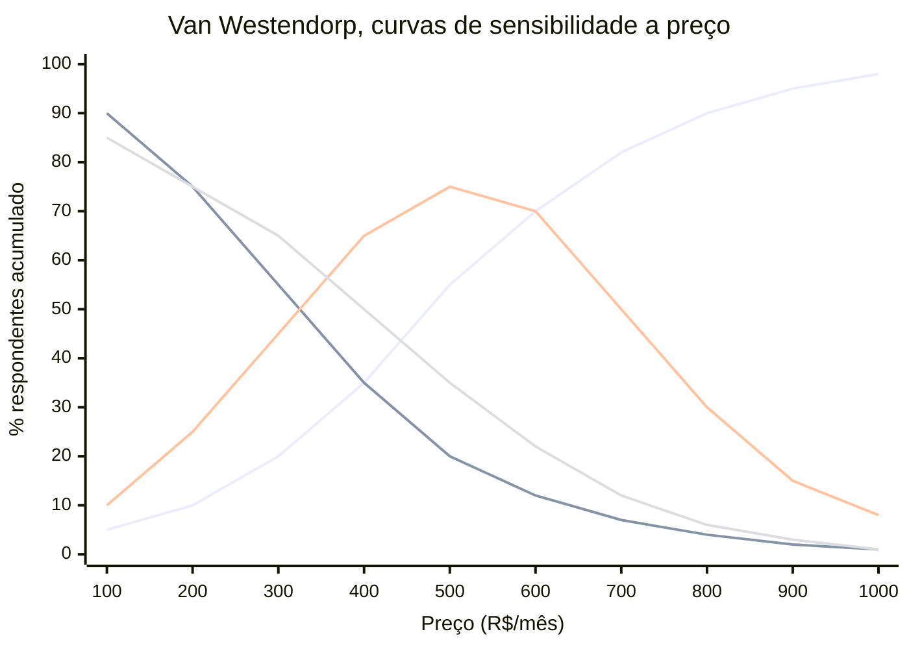

Leitura. A curva crescente mais agressiva é "caro demais, nem considero". A curva decrescente mais agressiva é "barato demais, suspeito". As curvas em sino são "aceitável", e "bom negócio". O OPP fica na intersecção das duas primeiras. O RAP é a faixa entre rejeições.

Optimum Price Point (OPP). Onde a intersecção de "caro demais", e "barato demais", está em equilíbrio.

Range of Acceptable Prices (RAP). Faixa entre o ponto de rejeição por barato, e a rejeição por caro.

Amostra mínima. Trinta a cinquenta respostas em ICP definido. Ferramentas. Google Forms, ou Typeform, bastam.

**Value-based pricing, método direto.** Perguntar ao cliente. "Que valor você obtém com o produto em doze meses?" (economia, receita adicional, tempo economizado vezes salário). Precificar em dez a trinta por cento desse valor entregue. Deixa setenta a noventa por cento como ROI claro para o cliente.

> [!important] Gabriel Weinberg, "10x rule"
> Preço onde o cliente percebe valor igual, ou maior, a dez vezes o preço, cria tração orgânica. A relação típica em SaaS B2B maduro. Valor percebido três a oito vezes preço. Produto excepcional, dez vezes ou mais.

#### 1.1 Value-based pricing na prática — como conduzir pesquisa de WTP no Brasil

O Brasil apresenta especificidades que tornam a pesquisa de willingness to pay mais complexa do que em mercados desenvolvidos. Respostas a preços são influenciadas pelo poder de compra regional, pela cultura de barganha, e pela desconfiança histórica com contratos longos.

**Protocolo para pesquisa de WTP no contexto brasileiro.**

Passo 1: definir o ICP com precisão antes de perguntar. Pesquisa de WTP com amostra heterogênea produz dados inúteis. Separar por segmento. PME (faturamento até R$ 20 milhões anuais), mid-market (R$ 20 a R$ 200 milhões), e enterprise (acima de R$ 200 milhões). O ponto ótimo de preço de cada segmento pode variar em três a cinco vezes.

Passo 2: ancorar na conversa de valor antes de introduzir preço. Perguntar diretamente "quanto você pagaria?" sem contexto produz âncoras baixas. A sequência correta é.

Primeiro, "descreva o principal problema que esse produto resolve para você". Segundo, "qual o custo atual desse problema: em tempo de equipe, custo de processo, ou receita perdida?" Terceiro, "se esse problema fosse resolvido completamente, qual seria o benefício em reais nos próximos doze meses?". Quarto, então introduzir as perguntas do PSM.

Passo 3: calibrar respostas ao contexto cultural. Brasileiros tendem a responder com preço mais baixo que o teto real, por hábito cultural de negociação. Estimativa prática, com base em observação de mercado, indica que o preço efetivamente aceito em transação real é quinze a vinte e cinco por cento acima do declarado em pesquisa. Aplicar esse fator de correção ao interpretar dados de PSM.

Passo 4: validar com teste de preço real. Pesquisa informa direção. Teste com pricing real confirma. Colocar preço na landing page, em cohort pequena, e medir conversão. Diferença entre declarado em pesquisa e comportamento real frequentemente surpreende.

**Ferramentas de pesquisa disponíveis e custo no Brasil.**

Typeform ou Google Forms para PSM estruturado. Custo zero. User Interviews para recrutamento de respondentes qualificados. Custo US$ 25 a US$ 75 por respondente. SurveyMonkey Audience para amostras quantitativas. Custo R$ 80 a R$ 200 por respondente qualificado. Conjoint analysis com ferramentas como Qualtrics. Para empresas com budget de pesquisa, mais de R$ 50 mil por projeto, com resultado mais robusto.

> [!tip] Entrevistas qualitativas valem mais cedo
> Antes de ter escala suficiente para dados quantitativos (mínimo cinquenta respondentes por segmento), entrevistas qualitativas de trinta a quarenta e cinco minutos com dez a quinze prospects do ICP produzem mais insight que survey mal-amostrado. Perguntar sobre valor, custo alternativo, e orçamento disponível, diretamente na conversa.

**Erros mais comuns em pesquisa de WTP no Brasil.**

Pesquisar com clientes atuais que já pagam preço baixo. Eles têm âncora definida. Os dados refletem o preço histórico, não o potencial. Pesquisar com amostra de conveniência (lista de email própria). Frequentemente enviesada para ICP de menor ticket. Usar benchmarks de SaaS americano sem ajuste. Converter dólar por câmbio e assumir que o resultado faz sentido para o mercado brasileiro é erro sistemático.

#### 2. Estrutura de pricing, modelos principais

**Flat Monthly Fee.** Um preço, sem variação. Simples. Funciona em produtos de baixa diferenciação de uso. Exemplo. R$ 290 por mês para PadariaPro.

**Tiered (Good-Better-Best).** Três tiers (raramente quatro ou mais). Estrutura clássica de SaaS. Padrão de adoção em SaaS B2B. Vinte por cento tier baixo, sessenta por cento tier médio, vinte por cento tier alto (lei de 80/20 aplicada). Exemplo. Basic R$ 290, Pro R$ 590, Enterprise R$ 1.290 por mês. Regra de psicologia. O tier do meio deve ser o mais "óbvio". Decoy effect aplicado.

```mermaid
flowchart LR
 subgraph Basic["BASIC<br/>R$ 290/mês<br/>~20% adotam"]
 B1[Essenciais core]
 B2[Support email 48h]
 B3[Até 3 usuários]
 B4[Relatórios básicos]
 end

 subgraph Pro["PRO - âncora<br/>R$ 590/mês<br/>~60% adotam"]
 P1[Tudo do Basic +]
 P2[Integrações avançadas]
 P3[Relatórios customizados]
 P4[Suporte priority 12h]
 P5[Até 15 usuários]
 P6[API access]
 end

 subgraph Ent["ENTERPRISE<br/>R$ 1.290+/mês<br/>~20% adotam"]
 E1[Tudo do Pro +]
 E2[SSO SAML/OIDC]
 E3[SLA contratual 99.9%]
 E4[CSM dedicado]
 E5[Usuários ilimitados]
 E6[Audit logs + compliance]
 end

 Basic -. upgrade.-> Pro
 Pro -. upgrade.-> Ent
```

Decoy effect aplicado. O tier do meio deve ser a escolha "óbvia". Se noventa e cinco por cento escolhem Basic, os tiers estão mal-desenhados. Basic com valor demais. Ou Pro com justificativa fraca.

**Per-User (seat-based).** Preço escala com número de usuários. Padrão em Slack, Notion, Linear. Vantagem. Cresce organicamente com adoção. Desvantagem. O cliente economiza compartilhando contas.

**Usage-based (consumption).** Preço por consumo (API calls, transações, GB de dados). Cresce fortemente entre 2022 e 2026, com produtos AI-native. Vantagem. Alinha preço ao valor entregue, e escala com sucesso do cliente. Desvantagem. Imprevisibilidade de receita, e de custo, para o cliente. Exemplos. Snowflake, Twilio, OpenAI.

**Hybrid (base, mais usage).** Preço mínimo fixo, mais componente variável. Captura melhor valor em base heterogênea. Exemplo. R$ 490 por mês inclui dez mil API calls. R$ 0,05 por call adicional.

**Enterprise Custom.** Sem preço público. Negociação. Acima de ticket de R$ 50 a 100 mil por ano, ou em deals estratégicos. Base. "Floor price" interno, mais flex de vinte a quarenta por cento em negociação.

#### 3. Packaging, como features mapeiam a tiers

Princípios. O tier baixo captura alcance amplo (self-serve, PMEs). Features. Essenciais, sem restrições operacionais severas. O tier médio é onde a maior parte converte. Features. Integrações, relatórios avançados, suporte estendido. O tier alto é para enterprise. Features. SSO, SLA, security compliance, CSM dedicado, custom contracts.

Features que tipicamente são "enterprise-only". SSO (Single Sign-On) via SAML, ou OIDC. Audit logs completos. Controle granular de permissões. Integrações avançadas (API, webhooks com SLA). SOC 2, ou ISO 27001, compliance demonstrado. SLA com penalidade. Account Manager dedicado.

Se as enterprise-only features são o que diferencia o produto, o que está nos tiers menores precisa ser genuinamente útil. Senão, só o tier alto paga. E o funil trava.

#### 4. Pricing para expansão de receita — como estruturas seat-based e usage-based viabilizam NRR acima de 110%

NRR (Net Revenue Retention) acima de 110% é o indicador que separa empresas SaaS medianas de excelentes. Significa que, mesmo sem conquistar um único cliente novo, a receita cresce dez por cento ao ano, organicamente, dentro da base existente. Pricing é o principal mecanismo para isso.

**O que faz o NRR crescer.**

NRR é função de quatro componentes.

```text
NRR = (MRR inicial + Expansion − Contraction − Churn) / MRR inicial × 100
```

Expansion é o driver que o pricing controla diretamente. Expansão acontece quando o cliente usa mais (usage-based), adiciona usuários (seat-based), ou sobe de tier (tiered). Cada estrutura de pricing tem mecânica diferente de expansão.

**Seat-based pricing e expansão orgânica.**

Em modelo seat-based, a empresa cresce junto com o crescimento da equipe do cliente. Cada novo funcionário que usa o produto é uma nova fonte de receita. O mecanismo é quase automático, quando a adoção interna cresce.

Para maximizar expansão por assentos.

Fazer onboarding de toda a equipe do comprador, não só do decisor. A expansão acontece quando usuários além do comprador inicial adotam. Produto "bottom-up" (que o usuário final ama, e puxa adoção interna) é mais expansível que produto "top-down" (comprado por TI, usado a contragosto).

Criar incentivo para adição fácil de assentos. Processo de self-serve para adicionar usuário dentro do produto. Sem burocracia. Cada atrito nesse fluxo é receita perdida.

Cobrar por usuário ativo, não por licença total. Cobrar por licença total incentiva o cliente a consolidar usuários. Cobrar por usuário ativo alinha o preço ao valor entregue e reduz resistência à adoção ampla.

**Usage-based pricing e expansão por consumo.**

Em modelo usage-based, o cliente começa pequeno e expande naturalmente ao longo do tempo, se o produto entrega valor. É o modelo de maior potencial de NRR alto, quando bem executado.

```text
Exemplo de trajetória de expansão de um cliente usage-based:

Mês 1:  100 mil transações × R$ 0,05 = R$ 5.000/mês
Mês 6:  400 mil transações × R$ 0,05 = R$ 20.000/mês
Mês 12: 900 mil transações × R$ 0,05 = R$ 45.000/mês

NRR implícito do cliente: 900%
```

Para viabilizar esse crescimento, o produto precisa ser o "motor" de processamento de algo que cresce com o negócio do cliente. Transações, documentos processados, usuários atendidos, dados armazenados. Se o objeto de cobrança cresce com o sucesso do cliente, o alinhamento de incentivos é perfeito.

**Métricas de expansão para monitorar.**

Expansion MRR percentual. Quanto da variação de MRR vem de expansão versus novos clientes. Alvo em empresas com NRR forte: trinta a cinquenta por cento do crescimento vem de expansão.

Time to expansion. Quanto tempo leva do primeiro contrato até o primeiro upsell. Alvo para mid-market: seis a doze meses. Para enterprise: doze a dezoito meses.

Expansion rate por cohort. De todas as contas adquiridas no mesmo período, qual percentual expandiu nos doze meses seguintes. Empresas com NRR acima de 120% costumam ter taxa de expansão de quarenta a sessenta por cento da base.

> [!important] NRR acima de 110% muda a matemática de captação
> Com NRR de 120%, uma empresa com ARR de R$ 50 milhões cresce R$ 10 milhões por ano sem adicionar cliente. Isso representa o equivalente a oitenta novos clientes de R$ 125 mil cada, sem custo de aquisição. Para o investidor, NRR alto é o dado que mais move múltiplo de valuation em SaaS.

#### 5. Psicologia de preço no mercado brasileiro

O comportamento do comprador brasileiro diante de preços tem características específicas que diferem do mercado americano. Ignorar essas características é deixar conversão na mesa.

**Parcelamento como estrutura de pricing.**

O parcelamento é uma instituição no Brasil. Mais de sessenta por cento das compras de ticket acima de R$ 500 no varejo são parceladas. O hábito migrou para software.

Em SaaS B2C e SMB, oferecer plano anual com parcelamento em doze vezes no cartão (sem juros) aumenta a adesão ao anual em vinte a quarenta por cento, comparado a cobrar anuidade à vista. O fundador precisa modelar o custo financeiro (MDR do cartão, que varia de 1,5% a 3,5% dependendo da adquirente) e incorporar ao preço.

```text
Exemplo de estrutura de pricing com parcelamento:

Plano mensal:    R$ 129/mês    (MRR: R$ 129)
Plano anual:     R$ 99/mês × 12 = R$ 1.188 à vista
                 ou R$ 109/mês × 12 = R$ 1.308 parcelado em 12x
                 (diferença de ~9% a 10% cobre MDR parcelado de 2,5% a 4% mais taxa de antecipação de recebíveis; nota: em B2C, informe a diferença com clareza nos termos da Lei 13.455/2017 e não anuncie como "12x sem juros" se o total parcelado for maior que o valor à vista)
```

O cliente percebe economia ao comparar R$ 109 parcelado com R$ 129 mensal. A empresa captura LTV anual garantido. Todos ganham, quando a estrutura está calibrada.

**Psicologia de preço: o efeito do R$97 versus R$100.**

O pricing de charme (charm pricing) funciona no Brasil. Mas com especificidade local: o limiar psicológico não é exatamente igual ao americano.

No Brasil, os limiares mais eficazes observados em produtos de consumo e SMB.

```text
Abaixo de R$ 100:  R$ 97 ou R$ 89 (não R$ 99 - o "9" final é percebido como americano)
Abaixo de R$ 200:  R$ 189 ou R$ 197
Abaixo de R$ 500:  R$ 490 ou R$ 497
Abaixo de R$ 1.000: R$ 970 ou R$ 990
```

Para B2B mid-market, o efeito de charme é menor. Compradores profissionais olham para o total anual, não para o número do mês. A diferença entre R$ 590 e R$ 600 por mês é irrelevante quando o contrato anual é comparado em linha com outros softwares. Nesse segmento, usar preços "limpos" (R$ 600, R$ 1.200, R$ 2.400) comunica profissionalismo.

**Adaptação de preços americanos ao poder de compra brasileiro.**

A regra de "converter dólar pelo câmbio" não funciona. Em 2025, com dólar a R$ 5,80, um SaaS americano de US$ 100 por mês seria R$ 580. Mas o poder de compra do comprador brasileiro é inferior. Estimativa prática, com base em observação de mercado e em paridade de poder de compra, sugere coeficiente de ajuste típico de 0,35 a 0,50 para segmento SMB, e 0,55 a 0,70 para mid-market.

```text
Produto americano: US$ 100/mês
Câmbio: R$ 5,80 → R$ 580/mês (sem ajuste)
Ajuste PPP para SMB (fator 0,40): R$ 232/mês
Ajuste PPP para mid-market (fator 0,60): R$ 348/mês
```

A empresa não precisa cobrar o mínimo. Mas precisa entender que cobrar preço americano integral em mercado brasileiro vai reduzir o pool de compradores para empresas de maior porte, que orçam em dólar ou têm faturamento internacionalizado.

> [!tip] Teste o preço, não calcule o preço
> Qualquer cálculo de ajuste de poder de compra é estimativa. O único dado confiável é a conversão real. Testar dois ou três níveis de preço em landing page separadas, por quatro a seis semanas, com tráfego orgânico ou pago direcionado, produz dado melhor que qualquer modelo teórico.

#### 6. Reajustes anuais, a política que ninguém segue, e todo mundo precisa

Regra mínima para SaaS brasileiro. Reajuste anual igual a IPCA mais um a três pontos percentuais. Cobre inflação, mais captura de valor agregado pelo produto.

Estrutura de comunicação. Comunicar com sessenta a noventa dias de antecedência. Explicar racional (novas features, melhorias, inflação). Oferecer lock-in de um a dois anos, com preço atual, a quem aceitar. Grandfathering. Manter clientes muito antigos no preço antigo, por período limitado (seis a dezoito meses), depois migrar.

Elasticidade típica observada em SaaS B2B. Reajuste de cinco a oito por cento. O churn marginal aumenta zero vírgula cinco a um por cento. A receita líquida sobe. Reajuste de dez a quinze por cento. O churn aumenta dois a quatro por cento. Ainda rende líquido. Reajuste maior que vinte por cento. Perigoso, sem repositioning de valor.

Test-first approach. Aplicar reajuste em coorte pequena (novos clientes) primeiro. Medir conversão, e churn, três a seis meses. Ajustar antes de rolar para a base completa.

#### 7. Descontos, política clara, não improviso

> [!important] Regra de descontos
> Desconto concedido em Sales precisa ter contrapartida. Pagamento anual. Multi-ano. Co-marketing. Case study. Desconto sem contrapartida sinaliza que o preço original era inflado. E destrói preço de mercado.

Estrutura saudável. Desconto anual, pago adiantado. Dez a quinze por cento. Multi-ano (dois anos). Quinze a vinte por cento adicional. Enterprise com compromisso de volume. Negociável, dentro do floor. Nunca, desconto sem contrapartida.

Autoridade de desconto. Rep de Sales. Até dez por cento, sem aprovação. Head of Sales. Até vinte por cento. CEO, ou CFO. Acima de vinte por cento.

#### 8. A/B testing de pricing, quando, e como

Quando faz sentido. Empresa com pelo menos quinhentos leads por mês (base para detectar sinal). Produto self-serve (aplicação em landing page, ou checkout). Mudança incremental (dez a vinte e cinco por cento), não estrutural.

Quando NÃO faz sentido. Enterprise sales (amostra pequena, confounders demais). Mudança estrutural (tier novo, modelo novo). Use research first.

Como. Segmentar tráfego cinquenta cinquenta, por hash de visitor ID. Medir. Conversão, ticket médio, churn de noventa dias, e LTV estimado. Mínimo de quatro a oito semanas, para dado robusto. Ferramentas. Stripe, Chargebee, ferramentas nativas de payment.

Ética, e legal. Evitar cobrar preços diferentes para perfis diferentes, sem justificativa (pode violar CDC). Teste A/B por timing, ou cohort, é aceito.

#### 9. Pricing para diferentes tipos de compradores — como manter integridade de preço entre segmentos

Uma das armadilhas mais comuns em startups brasileiras que crescem para mid-market e enterprise: o mesmo produto começa a ser vendido a preços radicalmente diferentes para compradores distintos, sem estrutura que justifique a diferença. O resultado é erosão de preço, resentimento entre contas, e dificuldade em contratar Sales com clareza.

**Segmentação típica e suas dinâmicas de pricing.**

SMB (pequenas e médias empresas, faturamento até R$ 20 milhões). Características de compra. Decisão rápida (uma a três semanas). Decisor é o dono ou gestor direto. Sensibilidade a preço alta. Ciclo de venda curto. Orçamento típico de software: R$ 500 a R$ 3.000 por mês. Modelo de pricing adequado. Self-serve ou low-touch. Tiered simples. Preço na tabela, sem negociação. Parcelamento disponível.

Mid-market (faturamento R$ 20 a R$ 200 milhões). Características de compra. Decisão em quatro a oito semanas. Múltiplos stakeholders (usuário, TI, financeiro). Sensibilidade moderada. Contrato anual é esperado. Orçamento típico: R$ 2.000 a R$ 20.000 por mês. Modelo de pricing adequado. Inside sales ou AE. Preço público como âncora, com flex de dez a vinte por cento. Contrapartida obrigatória para desconto.

Enterprise (faturamento acima de R$ 200 milhões). Características de compra. Decisão em três a doze meses. Processo de procurement, RFP, jurídico. Sensibilidade a preço menor que a SMB, mas processo mais burocrático. Orçamento típico: R$ 10.000 a R$ 100.000 por mês. Modelo de pricing adequado. Field sales. Preço sem tabela pública. Proposta customizada. Floor price interno, não divulgado.

**Como manter integridade de preço entre segmentos.**

O risco principal é o cliente SMB que descobre que o enterprise vizinho paga menos por assento. Ou o enterprise que percebe que o SMB tem acesso a features que ele paga caro.

Mecanismos para proteger a integridade.

Diferenciar produto genuinamente entre tiers. Enterprise não deve ser "mais do mesmo". Deve ter features que SMB não precisa (SSO, audit logs, SLA, compliance). Se as features enterprise são úteis para SMB, o argumento de preço diferente colapsa.

Manter segmentação explícita de mercado. "Esse produto é para equipes acima de cinquenta usuários" define quem é enterprise por tamanho de equipe, não por orçamento. O cliente SMB não se sente discriminado; simplesmente não é o ICP do tier.

Política de pricing documentada internamente. O Sales precisa saber o floor de cada segmento, e não ter autoridade para cruzar a linha sem aprovação. Sem política documentada, cada vendedor inventa, e o preço de mercado erode.

Evitar "enterprise pricing para SMB que insiste". O SMB que negocia agressivamente e consegue preço enterprise destrói a estrutura. Treinar Sales para responder: "Esse preço requer compromisso de X usuários por Y meses. Faz sentido para a sua estrutura?"

> [!warning] O desconto ad hoc para fechar o trimestre destrói pricing de longo prazo
> Cada desconto não estruturado concedido para bater meta de curto prazo cria precedente. O cliente conta para outros. O Sales aprende que pode sempre "conseguir mais". Em dois a três anos, o price realization cai de noventa por cento para sessenta por cento do tabela, e a empresa está efetivamente cobrando um terço a menos do que deveria. O custo é invisível no curto prazo e devastador no longo.

**Comunicação de preço para diferentes compradores.**

Para SMB. Preço na landing page. Clareza total. Sem surpresa. Self-serve funciona quando o preço é visível e o checkout é simples. O atrito em descobrir o preço mata conversão de SMB.

Para mid-market. Preço na página como âncora ("a partir de R$ X"). Contato com Sales para proposta customizada. Gera percepção de personalização sem abandonar a âncora.

Para enterprise. "Fale com nossa equipe" é aceitável. Enterprise buyers esperam proposta customizada. Preço público pode criar constrangimento em negociação. Mas ter case studies com resultados ("clientes enterprise reduzem custo em X%") substitui o preço como elemento persuasivo.

#### 10. Modelos AI-native de pricing (2024 a 2026)

Emergentes, com produtos que usam LLM.

Credit-based. O cliente compra créditos, que consomem em features AI (por exemplo, Canva, Notion AI).

Outcome-based. Preço por resultado entregue (por exemplo, lead qualificado pelo AI, documento gerado).

Seat mais AI consumption. Seat-based para acesso, mais extra para uso intensivo AI.

Tensão atual. Para um mesmo nível de capacidade, o preço por token de inferência de LLMs cai de 9 a 900 vezes por ano conforme a tarefa (dados da Epoch AI), mas o consumo total de tokens por tarefa sobe com fluxos agênticos e modelos de raciocínio (*reasoning*), comprimindo a margem bruta de produtos AI-native (frequentemente entre 40% e 60%, abaixo dos 75% a 85% do SaaS clássico; ver Capítulo 15 deste volume). Por isso, o mercado combina assinatura base com franquia de créditos, limites de uso (*rate limits*) ou cobrança por resultado entregue. Mas o cliente sente abuso, quando compara com alternativas. Mercado ainda se estabilizando.

### ARPU/ACV, Elasticidade de conversão por faixa de preço, Margem Bruta e Expansão automática por métrica de uso

ACV (Average Contract Value). Deve crescer dez a vinte por cento ao ano em SaaS pós-PMF.

ARPU (Average Revenue Per User). Métrica por conta, ou por usuário.

Price realization. Percentual do preço de lista, efetivamente cobrado. Alvo igual, ou maior, a oitenta por cento, em B2B saudável.

Discount leakage. Desconto médio concedido em deals. Alvo igual, ou menor, a quinze por cento, sem contrapartida.

Elasticidade observada. Churn dividido por variação de preço, em testes.

Expansion MRR percentual. Contribuição de upgrades, e expansão de contas, para crescimento.

Downgrade rate. Percentual que migra para tier inferior. Alvo menor que dois por cento ao ano.

Time to first reajuste. Alvo igual, ou menor, a doze meses, do contrato inicial.

NRR por segmento (SMB, mid-market, enterprise). NRR diferente por segmento revela onde o pricing captura (ou falha em capturar) expansão.

---

### Muito além do ARR: os indicadores que revelam a saúde real da receita recorrente

Métricas básicas (ARR, MRR, CAC, LTV, churn) estão em qualquer primer de SaaS. Para operar em escala, as seguintes são essenciais.

**NRR (Net Revenue Retention).** ((MRR cohort hoje) dividido por (MRR cohort doze meses atrás)) vezes cem. NRR considera expansão, downgrade, e churn. Best-in-class SaaS B2B. Cento e vinte a cento e quarenta por cento. Bom. Cento e cinco a cento e vinte por cento. Alarmante. Menor que noventa e cinco por cento. NRR maior que cem por cento significa que a receita cresce, mesmo sem novos clientes. É o motor de eficiência do SaaS.

**GRR (Gross Revenue Retention).** ((MRR cohort hoje, excluindo expansão) dividido por (MRR cohort doze meses atrás)) vezes cem. Mede só churn, e downgrade, sem compensação por expansão. Best-in-class. Maior que noventa por cento. Bom. Oitenta e cinco a noventa por cento. Alarmante. Menor que oitenta por cento. GRR baixo com NRR alto indica dependência de expansão para compensar fuga. Estruturalmente frágil.

**CAC Payback.** CAC dividido por (Gross margin vezes MRR). Quantos meses de margem para pagar o CAC. Best-in-class SaaS B2B. Menor que doze meses. Aceitável. Doze a vinte e quatro. Problema. Maior que vinte e quatro meses. Em D2C físico, payback mais apertado (três a seis meses), dado risco de churn mais alto.

**Quick Ratio.** (Novos MRR mais Expansão MRR) dividido por (Churn MRR mais Downgrade MRR). Mede eficiência do motor de growth versus leaks. Maior que quatro é excelente. Dois a quatro é saudável. Menor que dois é alarmante.

**Magic Number.** ARR added no período dividido por S&M spend no período. Maior que um é excelente. Zero vírgula setenta e cinco a um é aceitável. Menor que zero vírgula setenta e cinco sugere que S&M está ineficiente.

**Cohort LTV curve.** Receita acumulada por cohort, ao longo dos meses. Na curva de receita acumulada por safra, aceleração indica expansão (NRR acima de 100%). Achatamento cedo indica safra morrendo. Compare a inclinação das safras novas com a das antigas.

**Logo retention versus revenue retention.** Percentual de clientes que ficaram (logo) versus percentual de receita mantida. Em B2B, logo retention de oitenta por cento, com revenue retention de cento e dez por cento, é excelente (fugiram contas pequenas, e as grandes expandiram). Logo retention de noventa e cinco por cento, com revenue retention de noventa por cento, é sinal ruim (as contas ficaram, mas estão pagando menos).

**Engagement metrics.** Usuários ativos sobre total de usuários, frequência de uso, e features ativadas. Subscription que não é usado vira churn futuro. Monitorar engajamento é leading indicator de retention.

**Expansion categories.** Expansão via seat (mais usuários) versus tier (plano superior) versus cross-sell (módulo novo) versus usage (plano por consumo). Cada uma tem mecânica diferente, e investimento diferente.

---

### Estancando o balde furado: rituais e governança rigorosa contra o churn

Churn é inimigo número um de subscription. Governança de churn é combinação de três frentes.

**Pré-churn (prevenir).** Onboarding robusto. Os primeiros quatorze a trinta dias definem retention de longo prazo. Cliente que não atingiu "aha moment" sai em noventa dias. Engagement monitoring. Detectar queda de uso semanas antes do cancelamento. Ferramentas. Mixpanel, Amplitude, Pendo, Heap. Customer success proativo. CSM (Customer Success Manager) com carteira de contas, escalona quando vê risco. Health score. Algoritmo que dá score zero a cem por conta. Combinando uso, NPS, support tickets, e expansion signals.

**Em-churn (reduzir).** Processo de cancelamento intencionalmente calibrado. Separe B2B de B2C: em B2B, o cancelamento segue o aviso prévio contratual e passa por conversa de retenção com CS; já em B2C, dificultar o cancelamento (*dark pattern*) viola o Código de Defesa do Consumidor (ver Capítulo 8 do Vol. 8) e, para setores regulados e serviços financeiros digitais, o Decreto do SAC (Decreto 11.034/2022, substituído pelo Decreto 13.135/2026 a partir de novembro de 2026) exige cancelamento imediato pelo mesmo canal de contratação, de modo que ofertas de pausa ou desconto devem aparecer como opção em um clique, sem bloquear o pedido. Save offers. Desconto, pausa de trinta dias, ou downgrade para tier menor. Save rate típico de vinte a quarenta por cento. Exit interview. Entender razão real do churn. Alimenta roadmap, e GTM.

**Pós-churn (reativar).** Win-back campaigns. Cliente que cancelou há seis a doze meses. Contato com novidade, desconto, ou oferta especial. Alumni program. O cliente que saiu bem pode voltar. Manter contato via newsletter, e convites para eventos.

Métricas de governança de churn. Churn rate (mensal, anual). Voluntary versus involuntary churn (cartão expirou, pagamento falhou). Involuntary é vinte a quarenta por cento do churn em D2C. E pode ser reduzido com dunning management (Recurly, Chargebee, Vindi no Brasil). Churn por cohort, por plano, por canal de aquisição, e por região. Time-to-churn (quantos meses até cancelar). Reactivation rate (percentual de clientes churnados que voltam em doze meses).

---

### Crescer dentro de casa: como fazer a carteira atual pagar o próximo ciclo de escala

Em SaaS B2B maduro, quarenta a sessenta por cento do crescimento de receita vem de expansão. Não de novos logos. O expansion engine.

Motions de expansão. Seat expansion. A empresa contrata mais pessoas, e usa mais seats do produto. Motor automático em empresas em crescimento. Tier upgrade. A empresa migra de Pro para Enterprise, após uso crescente. Upgrade path precisa estar claro no produto. Cross-sell. A empresa compra módulo adicional (HubSpot Marketing Hub mais Sales Hub mais Service Hub). O produto precisa ser modular. Usage expansion. O plano de consumo cresce naturalmente com o uso (Twilio, Stripe, AWS). Geography expansion. A empresa expande para outro país, e contrata localmente. Mais seats. Mais módulos.

Quem executa expansão. Account Management (AM) para contas enterprise. Customer Success para contas mid-market. Product-led, ou self-service, para contas SMB (upgrade automático no produto).

Incentivos. AMs têm quota de expansion (não só renewal). AEs de novos logos podem ter parte do bônus em expansão do primeiro ano (reduce rotation incentive). A quota de CSM pode ter componente de expansão, se tiver responsabilidade de upsell (cultural trade-off, CSM com quota agressiva vira AM disfarçado).

---

### A travessia da venda avulsa para a assinatura: como migrar sem quebrar o caixa no meio

Empresas transacionais (e-commerce, varejo, serviço pontual) frequentemente tentam "virar subscription". Captar receita recorrente, e valuation de múltiplo maior. A transição é difícil. Erros comuns.

**Erro 1, criar subscription sem mudar produto.** Amazon mais assinatura de entregas igual a Amazon Prime (produto diferente). E-commerce qualquer, "agora é assinatura mensal pelos mesmos produtos", não gera retention. O cliente compra o que precisa, quando precisa. Assinatura vira trava.

**Erro 2, não entender canibalização.** Cliente que pagava R$ 200 por compra vira assinante de R$ 100 por mês. Receita do cliente por ano. R$ 1.200, se assina doze vezes (com frequência mensal). R$ 2.400, se comprava doze vezes. Sem análise de canibalização, a receita por cliente cai.

**Erro 3, churn subestimado.** Cliente transacional nunca "se comprometeu" com assinatura. O churn pode ser trinta a cinquenta por cento ao ano em D2C físico. Completamente diferente de SaaS B2B (cinco a dez por cento).

Quando a transição faz sentido. O produto tem uso contínuo (não compra esporádica). Há valor incremental na recorrência (conveniência, preço menor, exclusividade). A categoria permite previsibilidade de uso (alimentos, cosméticos, produtos de conveniência).

Exemplos brasileiros bem-sucedidos. Leiturinha. Livro infantil mensal, com curadoria. Valor incremental, curadoria educacional. Wine.com.br. Vinho mensal, com curadoria. Valor incremental, acesso a vinhos que não encontraria. Smart Fit Passport. Acesso multi-academias. Valor incremental, flexibilidade.

Exemplos que não deram certo. Vários boxes de beleza pós-2015 (Birchbox brasileiro, Lookfantastic, clubes de beleza). Churn alto. Produto saturado. Assinatura de comida pronta (diversos pós-2018). O cliente quer flexibilidade. Assinatura fixa frustra.

---

### A contabilidade real da recorrência: receita diferida, caixa antecipado e disciplina financeira

Deferred revenue. Assinatura anual cobra R$ 12 mil no início. A receita reconhecida é R$ 1 mil por mês. O balanço tem R$ 11 mil como passivo (deferred revenue) no mês 1. O CFO precisa entender.

Cash versus accrual. SaaS anual tem caixa concentrado no início do contrato. A receita distribuída. Runway via caixa versus via receita contábil pode dar resposta muito diferente.

Forecasting em subscription. A previsão de receita tem três componentes. Base existente (cohorts que já pagam). Novos contratos. Churn, e expansão. Modelo financeiro sofisticado não soma só ARR. Projeta por cohort.

Contabilidade fiscal Brasil. No Brasil, ASAAS, ou PagSeguro, como gateway. NFS-e emitida mensalmente (ou anualmente, no caso de contrato anual). Regras específicas para SaaS (LC 116/2003, item 1.05, e transição da Reforma Tributária pela EC 132/2023 e LC 214/2025: alíquotas-teste de CBS a 0,9% e IBS a 0,1% em 2026, substituição integral de PIS e Cofins pela CBS em 2027, redução gradual do ISS entre 2029 e 2032 e extinção do ISS em 2033, exigindo cláusula de repasse tributário em contratos plurianuais; ver Capítulo 2 do Vol. 5). ISS no município do prestador (ou tomador, dependendo de Convenção). O ISS de licenciamento e SaaS é devido, em regra, no município do estabelecimento prestador (LC 116/2003, art. 3º); já PIS e Cofins (até sua substituição pela CBS em 2027) são recolhidos de forma unificada dentro do DAS para optantes do Simples Nacional (LC 123/2006, art. 13; lembrando que CNAEs de desenvolvimento e licenciamento de software são vedados ao MEI), à alíquota combinada de 3,65% no regime cumulativo do Lucro Presumido, ou não cumulativo (nove vírgula vinte e cinco por cento, em Lucro Real).

### Precificar copiando o concorrente cego, cobrar por "custo mais margem" ou dar descontos de 40% que treinam o cliente a desvalorizar você

Subprecificação crônica. "Tenho medo de cobrar mais." Custo. Trinta a sessenta por cento de receita deixada na mesa, por anos. Test cedo. Ajustar. Seguir.

Pricing sem research. Preço decidido por "achismo", ou copiando concorrente. Frequentemente, longe do ótimo, para o seu ICP, e produto.

Mudança de pricing sem grandfathering. Reajustar clientes antigos abruptamente destrói relacionamento.

Tier sem diferencial claro. "Qual a diferença do Basic para Pro?" é resposta confusa em quarenta por cento dos SaaS brasileiros.

Desconto como closer. Virou atalho. Destrói preço de mercado, e sinaliza ao cliente que o preço era inflado.

Não reajustar anualmente. A receita real erode por inflação. Três anos sem reajuste igual a quinze a vinte e cinco por cento de valor perdido.

Copy-paste de pricing americano. R$ igual a US$ vezes cinco raramente funciona. Adaptação a poder de compra brasileiro é obrigatória, em ICP local.

Pricing complexo demais. Sete tiers, três add-ons, quatro modalidades. Os clientes paralisam na escolha. O vendedor não consegue articular. Simplicidade vence.

Não treinar Sales em pricing. O vendedor que não articula valor entra em guerra de preço automaticamente.

Ignorar custo unitário variável em modelo usage-based. Se a margem marginal diminui em escala (custo AI aumenta por usage), o modelo pode virar prejuízo.

Não separar pricing por segmento. Cobrar o mesmo de SMB e enterprise destrói a captura de valor no enterprise e cria expectativa errada no SMB.

Estrutura de parcelamento ignorada. Não oferecer parcelamento em plano anual para SMB e B2C reduz adesão ao anual em vinte a quarenta por cento, diminuindo LTV e previsibilidade de receita.

### Checklist de execução prática

Pricing como disciplina está no padrão quando todos os itens abaixo estão cumpridos.

- [ ] Documento de pricing (estrutura + racional) existe, revisado nos últimos doze meses.
- [ ] Pesquisa de WTP (PSM ou value-based) conduzida nos últimos dezoito meses, segmentada por perfil de comprador (SMB, mid-market, enterprise).
- [ ] Tiers com distribuição saudável de adoção (nem 95% em baixo, nem vazio em alto), com diferencial claro entre eles.
- [ ] Política de reajuste anual formal implementada (IPCA + spread), com grandfathering e comunicação formalizados.
- [ ] Política de desconto com autoridade definida e contrapartida obrigatória.
- [ ] Price realization ≥ 80% e discount leakage ≤ 15% medidos mensalmente.
- [ ] Reajustes não destruíram retenção (churn pós-reajuste ≤ +1% do base rate).
- [ ] Sales treinado em articular valor e negociar, sem default em desconto.
- [ ] Em usage-based: custo unitário variável mapeado, margem em escala modelada.
- [ ] Enterprise pricing tem "floor price" interno definido, não só negociação livre.
- [ ] NRR calculado por segmento, expansão MRR monitorada mensalmente.
- [ ] Estrutura de parcelamento disponível para plano anual em SMB e B2C.
- [ ] Pricing por segmento documentado com diferencial de produto justificando a diferença de preço.
- [ ] Preços ajustados ao poder de compra brasileiro, não conversão cambial direta.

---

### O Espelho do Capítulo 6: Seu Preço Reflete o Valor que Você Cria ou o Medo que Você Sente?

**Fechando o ciclo na trincheira:** Quando **Lucas e Marina** aplicaram as travas deste capítulo na rotina entre São Paulo e Florianópolis, a tensão da cena de abertura deixou de ser discussão subjetiva de corredores e virou regra clara de priorização, retenção e proteção de caixa.

**O Espelho (autodiagnóstico):**
1. Nos seus últimos vinte negócios fechados, quantos clientes disseram *"está caro, mas vou pagar porque vale a pena"*? Se absolutamente ninguém reclama do seu preço, você está deixando uma fortuna na mesa.
2. A sua cobrança cresce automaticamente quando o seu cliente cresce e extrai mais valor (por volume processado, unidades, receita gerenciada ou assentos), ou você cobra uma taxa fixa estagnada?
3. Os seus vendedores dão desconto já no primeiro e-mail só para bater meta rápida de volume, destruindo a margem anual da empresa?

**Permissão Libertadora:**
Você está autorizado a aumentar o seu preço em 30% a 50% para os próximos dez novos clientes a partir de hoje. Os seus clientes antigos continuam no preço atual (regra de *grandfathering*), então o seu risco de testar um patamar superior é zero.

**O Ritual de Segunda-Feira às 9h:**
Proíba qualquer desconto sem contrapartida. Escreva a regra na parede comercial: *"Desconto só existe em troca de pagamento anual à vista, contrato de 24 meses ou estudo de caso público assinado."*


---

## CAPÍTULO 7 — NEGOCIAÇÃO COMO DISCIPLINA

### Quem Precisa Mais do Acordo Sempre Perde: A Arte Fria da Mesa de Negociação

Henrique estava prestes a assinar o maior contrato do ano com uma gigante sucroalcooleira no interior de São Paulo: R$ 420 mil por ano. Na última reunião, o diretor de compras (Procurement) da usina, um negociador profissional treinado para espremer fornecedores, cruzou os braços e jogou a bomba clássica das 17h30 de sexta-feira:

– "Henrique, a diretoria aprovou a parte técnica de vocês. Mas para eu assinar hoje antes de fechar o trimestre, preciso de 35% de desconto na mensalidade, isenção total da taxa de implantação de R$ 40 mil e pagamento em 120 dias. Se não der, fechamos com o seu concorrente na segunda."

No ano anterior, Henrique teria suado frio, aceitado tudo por pavor de perder o logotipo famoso e trabalhado o ano inteiro no prejuízo. Desta vez, Henrique tinha duas armas invisíveis na pasta: ele já tinha outras três propostas quentes engatilhadas para a mesma equipe de implantação (**uma BATNA forte**: Melhor Alternativa ao Acordo) e sabia que o concorrente citado levaria oito meses para integrar com a caldeira da usina, perdendo toda a safra de abril.

Henrique fechou o caderno com calma absoluta, olhou nos olhos do comprador e disse:

– "Entendo perfeitamente a sua meta, diretor. Infelizmente, se eu cortar a taxa de implantação e der 35% de desconto, não consigo alocar os dois engenheiros seniores que garantem a entrada da sua usina antes do início da moagem em abril. Posso manter o valor de tabela com pagamento em 30 dias e incluir o módulo de painel móvel para a diretoria, ou liberamos nossa agenda técnica para a fila de maio. O que prefere?"

Quinze minutos depois, o contrato foi assinado pelo preço cheio de tabela e pagamento em 28 dias. Henrique havia vencido **O Blefe da Guilhotina de Compras**.

---

> [!abstract] Posicao no livro
> Negociacao como disciplina transversal do fundador, aplicavel em term sheets, contratos, parcerias e conflitos societarios. Vizinhos onde DS opera diretamente,
> - [[IGNICAO-Vol-8-Juridico-LGPD-e-Seguranca#CAPÍTULO 5 — ARQUITETURA CONTRATUAL PARA STARTUPS: OPERAÇÃO E CONTRATOS EM PROFUNDIDADE POR TIPO|Capítulo 5 (Arquitetura Contratual para Startups: Operação e Contratos em Profundidade por Tipo) (Vol. 8)]] e Capítulo 5 (Arquitetura Contratual para Startups: Operação e Contratos em Profundidade por Tipo) (Vol. 8), negociacao de clausulas e contratos
> - [[IGNICAO-Vol-9-Maturidade-e-Exit#CAPÍTULO 1 — BOARD E GOVERNANCE|Capítulo 1 (Board e Governance) (Vol. 9)]], negociacao no board e com investidores
> - [[IGNICAO-Vol-9-Maturidade-e-Exit#CAPÍTULO 3 — DISPUTA SOCIETÁRIA E SAÍDA DE SÓCIO|Capítulo 3 (Disputa Societária e Saída de Sócio) (Vol. 9)]], negociacao em conflito societario
> - [[IGNICAO-Vol-6-Receita-e-Pessoas#CAPÍTULO 4 — BUSINESS DEVELOPMENT E PARCERIAS COM GRANDES CORPORAÇÕES BRASILEIRAS|Capítulo 4 (Business Development e Parcerias com Grandes Corporações Brasileiras) (Vol. 6)]], negociacao de deal corporativo de longo ciclo

> [!note] Nota
> Este capítulo integra conceitos de negociação do Harvard Negotiation Project (Fisher, Ury e Patton: projeto de pesquisa de Harvard sobre negociação por interesses), pesquisa de Adam Grant sobre concessões, e adaptação ao contexto operacional do fundador brasileiro.

Negociação não é um evento especial. Para o fundador, é condição permanente. Salário de contratação, term sheet (proposta preliminar de investimento), preço com cliente, escopo com cofundador, parceria estratégica, contrato B2B, valuation (avaliação de valor) em M&A (fusões e aquisições). Toda semana há uma negociação relevante acontecendo. A questão não é se você vai negociar, é se vai negociar bem.

> [!important] Negociação é habilidade treinável
> A crença de que bons negociadores nascem prontos é empiricamente falsa. Estudos de calibração mostram que exposição deliberada a negociações com feedback melhora resultados de forma sistemática. O fundador que pratica melhora. O que evita, piora.

### Por que dez minutos de fraqueza emocional na mesa de negociação destroem a margem de doze meses de engenharia

O fundador negocia em posição de assimetria constante. Contra VC (venture capital: fundo de capital de risco) com mais informação sobre mercado de captação do que o fundador. Contra cliente com mais poder de compra. Contra executivo sênior com mais opções de emprego. Contra cofundador com histórico emocional carregado.

Sem disciplina de negociação, o fundador deixa valor na mesa em todo ciclo. Em term sheet ruim, as cláusulas de liquidation preference (preferência de liquidação no exit) e anti-dilution (proteção contra diluição) podem valer milhões a mais ou a menos no exit (saída via venda ou IPO). Em contratação mal negociada, o precedente de comp (pacote de remuneração) para o primeiro executivo define a estrutura salarial de toda a liderança seguinte. Em contrato B2B sem limitação de responsabilidade adequada, uma cláusula pode comprometer a empresa inteira.

Negociação não é agressividade. É clareza sobre o que importa para você, clareza sobre o que importa para a outra parte, e criatividade para estruturar um acordo que funciona para ambos.

> [!important] Custo da ignorância
> Fundador que não sabe seu BATNA aceita qualquer coisa. Fundador que não separa posição de interesse fecha acordo pior do que o possível. Fundador que não conhece as táticas básicas perde valor sem perceber.

### Calculando BATNA e ZOPA antes de sentar, lançando a primeira âncora alta e exigindo contrapartida para cada concessão

#### 1. Dois modelos fundamentais

**Negociação distributiva.** Um bolo fixo. Cada concessão de um lado é ganho do outro. Resultado natural é ganha-perde. Toda estratégia gira em torno de reivindicar mais valor do bolo existente.

Quando usar: transação única sem relação futura, compra de ativo físico, negociação de preço spot com fornecedor intercambiável, leilão competitivo.

**Negociação integrativa.** Partes têm interesses diferentes em dimensões diferentes. É possível criar valor trocando concessões em dimensões onde o custo para um é baixo e o ganho para o outro é alto. Resultado possível é ganha-ganha: ambos saem com mais do que o BATNA de cada um.

Quando usar: qualquer negociação com relação futura, parceria estratégica, contrato de trabalho, term sheet, acordo de cofundadores. A maioria das negociações do fundador.

**A armadilha principal.** Tratar negociação integrativa como distributiva. O fundador entra em modo "defender terreno" e fecha acordo pior do que o possível. A outra parte também entra em modo defensivo. As dimensões de valor que poderiam ser trocadas nunca são discutidas. Todos saem com menos do que podiam.

> [!warning] Quando tudo vira distributivo
> Negociação com cofundador em conflito tende a colapsar para distributivo por conta da carga emocional. O mesmo acontece com renegociação de salário quando há ressentimento acumulado. Reconhecer o colapso e nomear explicitamente é a primeira intervenção.

#### 2. BATNA — Best Alternative to a Negotiated Agreement

BATNA é o que você faz se a negociação não fechar. Não é o mínimo que aceita. É a melhor alternativa concreta disponível caso não haja acordo.

**Como calcular seu BATNA antes de qualquer negociação importante.**

Liste todas as alternativas se essa negociação não fechar. Seja concreto. Não "buscar outros investidores": "conversar com Fundo X, que expressou interesse em fevereiro, e com Fundo Y, que pediu follow-up na semana passada". Estime o valor real de cada alternativa. Identifique a melhor. Esse é seu BATNA.

**Como estimar o BATNA da outra parte.**

Isso importa mais do que conhecer o seu próprio. Se o BATNA da outra parte é fraco, ela tem mais pressão para fechar. Se é forte, ela tem mais poder.

Como estimar: pesquise alternativas concretas disponíveis para ela. Leia o contexto. VC com fundo quase no prazo de deploy tem BATNA mais fraco. Executivo que acabou de ser demitido tem BATNA mais fraco. Cliente sem fornecedor alternativo qualificado tem BATNA mais fraco.

**Zona de Acordo Possível (ZOPA).** A faixa onde um acordo é melhor que o BATNA de ambos. Se não existe ZOPA, não existe acordo possível: e insistir é desperdício. Se existe ZOPA ampla, há margem para criar valor adicional.

**O que fazer quando seu BATNA é fraco.**

Antes de negociar, melhore o BATNA. Crie alternativas concretas. Inicie conversas com outros VCs antes de entrar em term sheet com um. Tenha pelo menos dois candidatos qualificados antes de fazer oferta de emprego. Tenha pipeline de clientes antes de renegociar com o maior.

BATNA fraco não é irreversível: mas tem que ser atacado antes da negociação, não durante.

> [!tip] Revelar o BATNA
> Revelar um BATNA forte pode aumentar poder de negociação. Revelar um BATNA fraco o destrói. Nunca revele por reflexo ou para "mostrar boa vontade". Revele se, e somente se, aumentar seu poder.

#### 3. Ancoragem

A primeira oferta ou número dito numa negociação funciona como âncora cognitiva. Os números subsequentes gravitam em direção a ela. Estudos de Tversky e Kahneman confirmam isso mesmo quando a âncora é aleatória e obviamente irrelevante. Em negociação, a âncora é calculada.

**Quem ancora primeiro tem vantagem na maioria das situações.** Especialmente quando a âncora é agressiva mas defensável. A exceção é quando você tem informação muito inferior à outra parte sobre o valor real: nesse caso, esperar pode ser melhor.

**Como ancorar agressivamente sem parecer desconectado da realidade.**

Âncora agressiva + justificativa fundamentada = âncora crível. Âncora agressiva sem justificativa = âncora que a outra parte descarta mentalmente.

```text
Âncora ruim:    "Estou pedindo R$ 2 milhões pela empresa."
Âncora melhor:  "Com base nos múltiplos de receita do setor (8–12x ARR),
                 e nosso ARR de R$ 250 mil, estou trabalhando com
                 valuation de R$ 2,5 milhões."
```

**Como contra-ancorar quando a outra parte âncora primeiro.**

Não aceite a âncora como referência. Não faça uma contraproposta numérica imediatamente. Primeiro, rejeite a âncora explicitamente e com justificativa. Depois, apresente sua própria âncora.

```text
Âncora deles:  "Valuation pré-money de R$ 8 milhões."
Resposta ruim: "Aceito R$ 10 milhões."  ← aceita a âncora como referência
Resposta boa:  "Esse número está bem abaixo dos benchmarks do setor para
                nossa tração. Trabalho com R$ 15 milhões como ponto de partida,
                e aqui está o raciocínio..."
```

**Ancoragem em term sheet.** Valuation pré-money, liquidation preference, pro-rata, anti-dilution: todos têm faixas de mercado. Conheça as faixas antes de entrar na negociação. Âncora fora da faixa de mercado perde credibilidade. Âncora no topo da faixa, com fundamentação, é o ponto de partida certo.

#### 4. Separar posição de interesse

Posição é o que a parte diz que quer. Interesse é por que quer.

Negociar em cima de posições leva a impasse ou a acordo subótimo. Negociar em cima de interesses abre espaço para soluções criativas que satisfazem ambas as partes melhor do que qualquer concessão direta.

**O exemplo clássico.** Dois irmãos brigam por uma laranja. Dividem ao meio. Resultado: um joga fora a polpa e usa só a casca (para a receita). O outro joga fora a casca e toma o suco. Posição igual (a laranja), interesses distintos (casca versus suco). Se tivessem investigado o interesse, um ficaria com a casca inteira e o outro com o suco inteiro. Os dois sairiam melhor.

**Como descobrir o interesse por trás de uma posição rígida.** Perguntas, não concessões.

"Por que isso é importante para você nesse momento?"

"O que você está tentando proteger com essa cláusula?"

"Se esse ponto fosse resolvido de outra forma, isso te atenderia?"

Concessão antes de entender o interesse é desperdício. Às vezes a outra parte cede uma posição por custo zero para você porque o interesse real está em outra dimensão.

**Aplicado a equity.** O fundador quer manter 51% (posição). O interesse pode ser: não ser removido do cargo, manter controle sobre decisões de produto, ter poder de veto em M&A. Essas proteções podem ser estruturadas contratualmente sem depender de percentual de participação. Um investidor que entende o interesse pode propor solução melhor do que a posição permite.

**Aplicado a salário.** Candidato pede R$ 40 mil/mês (posição). Interesse pode ser: saída de dívida específica, flexibilidade de horário, crescimento de carreira. Alternativas: equity adicional, adiantamento, modelo híbrido, promoção acelerada com revisão em seis meses.

> [!tip] A pergunta mais útil
> "Ajuda-me a entender o que está por trás desse ponto?" funciona em quase toda negociação. Não é fraqueza. É inteligência estratégica.

#### 5. Técnicas táticas e como neutralizar

**Good cop / bad cop.** Um negociador simpático, outro intransigente. Cria pressão para ceder ao simpático antes que o "mau" volte. Como neutralizar: nomear explicitamente. "Entendo que há uma divisão de posições dentro do time de vocês. Prefiro conversar diretamente com quem tem autoridade de decisão."

**Deadline artificial.** "Preciso de resposta até sexta ou a oferta caduca." Cria urgência artificial. Como responder: checar se o deadline é real. "O que acontece se não fecharmos até sexta?" Muitas vezes o deadline dissolve quando testado. Se for real, decidir com base no seu BATNA, não na pressão.

**Flinch.** Expressão de choque quando ouve preço ou condição. Funciona porque a outra parte, ao ver reação negativa, assume que foi longe demais e recua antes de você dizer qualquer coisa. Funciona em negociação escrita também (delay em responder, linguagem de surpresa). Como neutralizar: reconhecer o flinch sem reagir a ele. Continue com sua posição fundamentada.

**Nibbling.** Pedir pequena concessão adicional depois que o acordo está fechado: aproveitando o momentum e o alívio do outro lado. "Já que fechamos, você consegue incluir também...?" Como bloquear: ao fechar o acordo, dizer explicitamente "com isso, estamos alinhados em todos os pontos: vou preparar a documentação." Fecha o espaço para nibble.

**Silêncio.** A técnica mais subutilizada. Após fazer uma proposta, quem fala primeiro faz a primeira concessão. Silêncio cria desconforto e a pressão para preenchê-lo. A maioria dos fundadores preenche o silêncio concedendo algo antes de a outra parte responder. Treine o silêncio. Faça a proposta. Feche a boca.

**"Preciso consultar meu sócio."** Técnica para criar espaço para recuar de uma posição sem perder face ("meu sócio não aprovou"). Como usar: útil quando você genuinamente precisa de tempo ou quando quer evitar decisão sob pressão. Como reconhecer quando usada contra você: "Quando você consegue falar com seu sócio? Posso ligar diretamente para alinhar?" Quebra o escudo.

> [!warning] Negociar contra si mesmo
> O fundador faz proposta. A outra parte não responde imediatamente (por qualquer motivo). O fundador interpreta o silêncio como rejeição e melhora a oferta espontaneamente antes de receber qualquer contraproposta. Isso é negociar contra si mesmo. É o erro mais custoso e mais comum. Proposta feita, espere a resposta.

#### 6. Negociação em contextos específicos do fundador

**Term sheet com VC.**

As cláusulas que mais importam e como negociar cada uma.

| Cláusula | O que é | O que negociar |
|---|---|---|
| Liquidation preference | Quanto o VC recebe antes dos demais em exit | 1x non-participating é padrão de mercado. Resist participating preferred e múltiplos acima de 1x |
| Anti-dilution | Proteção do VC em down round | Broad-based weighted average é razoável. Full ratchet é predatório |
| Pro-rata | Direito de participar de rounds futuros | Negociar limites e validade |
| Board seats | Composição do conselho | Manter pelo menos empate entre fundador e investidor até Série B |
| Veto rights | Decisões que requerem aprovação do investidor | Limitar a lista de eventos. Evitar veto em contratações operacionais |

Ver [[IGNICAO-Vol-5-Financas-e-Captacao#CAPÍTULO 9 — CAPTAÇÃO DE EQUITY: PLANEJAMENTO DE RODADA, PITCH E RELACIONAMENTO COM INVESTIDORES|Capítulo 9 (Captação de Equity: Planejamento de Rodada, Pitch e Relacionamento com Investidores) (Vol. 5)]] para detalhamento de captação.

**Contratação de executivo sênior.**

Quatro dimensões: salário base, bônus, equity, e aceleração em mudança de controle.

O erro mais comum: ceder em equity para economizar em caixa sem considerar o precedente. O segundo executivo vai pedir o mesmo ou mais do que o primeiro. A estrutura de equity do primeiro C-level define o teto esperado pelos seguintes.

Aceleração em mudança de controle (single-trigger versus double-trigger): single-trigger vesta todo o equity na mudança de controle independente de demissão: caro para fundador, barato para o executivo negociar. Double-trigger vesta na mudança de controle apenas se seguida de demissão: razoável e padrão de mercado.

**Contrato B2B com cliente grande.**

Os pontos que mais importam e o que ceder versus o que não ceder.

Limitar responsabilidade (cap em receita do contrato ou 12 meses de serviço): não ceda. Uma cláusula sem limitação pode comprometer a empresa. SLA agressivo com penalidade financeira: negocie os termos de medição e os créditos. Evite penalidade de saída automática. Exclusividade: evite exclusividade completa. Se insistirem, estruture como direito de first refusal ou exclusividade por segmento geográfico específico. IP: qualquer trabalho customizado desenvolvido para o cliente pertence ao cliente? Negocie para manter o IP core e licenciar para o cliente.

**M&A.**

As cinco variáveis críticas: preço (e forma de pagamento, cash, ações, ou earnout), earnout (componente de preço condicional a métricas futuras, alta probabilidade de conflito, negocie métricas simples e mensuráveis), representações e garantias (indemnification cap, survival period), escrow (percentual retido para cobrir claims de rep and warranty, negocie prazo máximo de 12 a 18 meses), non-compete do fundador (duração e escopo geográfico, negocie para mínimo viável).

Ver [[IGNICAO-Vol-9-Maturidade-e-Exit#CAPÍTULO 18 — SUCESSÃO NO EXIT, TRANSIÇÃO PÓS-AQUISIÇÃO (M&A) E RETENÇÃO DE TALENTOS|Capítulo 18 (Sucessão no Exit, Transição Pós-Aquisição (M&A) e Retenção de Talentos) (Vol. 9)]] para M&A em detalhe.

**Negociação com cofundador em conflito.**

A mais difícil porque combina componente financeiro com histórico emocional e poder assimétrico de veto mútuo.

Princípios específicos para esse contexto.

Primeiro, separar o relacionamento da negociação. Sessão dedicada ao aspecto emocional (com mediador, se necessário) antes de entrar nos termos financeiros.

Segundo, trazer um framework neutro para valuation do equity em disputa. Fórmula de Slicing Pie ou equivalente: remove a arbitrariedade da conversa.

Terceiro, envolver advogado de startup desde o início. Cofundador sem representação própria costuma sentir-se em desvantagem e endurecer posição. Ambos com advogado acelera resolução.

Quarto, ter os documentos de shareholders' agreement revisados antes da conversa. Muitas vezes os termos já estabelecem o caminho.

#### 7. Cultura de negociação brasileira

O contexto cultural importa. Estratégias eficazes no contexto americano falham no brasileiro e vice-versa.

**Relacionamento precede transação.** Investir tempo em rapport antes de entrar nos termos não é ineficiência. É protocolo que reduz resistência nas etapas seguintes. Forçar a negociação antes de construir confiança mínima cria resistência desnecessária.

**Flexibilidade de prazo e protocolo.** O "jeitinho" como ferramenta legítima. Prazos têm margem. Protocolos têm exceções. Explorar essa flexibilidade quando trabalhada com transparência não é manipulação: é adaptação ao contexto.

**Hierarquia importa.** Quem está na sala tem poder de decisão? No Brasil, a decisão muitas vezes está em nível acima dos negociadores presentes. Identificar quem de fato pode dizer "sim" e garantir acesso a essa pessoa é mais importante do que vencer o argumento técnico com o interlocutor.

**Negociação com governo.** Paciência como estratégia, não fraqueza. Processos administrativos têm ritmo próprio. Apressar cria resistência. Criar relacionamento com o nível correto dentro do processo reduz tempo mais do que qualquer argumento técnico.

| Cultura | Estilo | Velocidade | Comunicação |
|---|---|---|---|
| Brasileira | Relacional, flexível | Média-lenta | Indireta em conflito |
| Americana | Direta, orientada a resultado | Rápida | Direta |
| Asiática (Japão/China) | Protocolar, hierárquica | Lenta | Muito indireta |

> [!tip] Adaptação sem perder a si mesmo
> Adaptar o estilo ao contexto cultural não significa abandonar seus interesses. Significa empacotar os interesses de forma que o outro lado consegue receber.

#### 8. Preparação: checklist de 8 pontos

Antes de toda negociação importante, responda por escrito.

1. **BATNA.** Qual é minha melhor alternativa se não fechar? Quão concreto e forte ele é?
2. **BATNA da outra parte.** O que eles fazem se não fecharem? Quão forte é?
3. **ZOPA.** Existe faixa de acordo que é melhor que o BATNA de ambos? Qual é ela?
4. **Âncora.** Qual é meu número de abertura? Está fundamentado?
5. **Interesses.** Quais são meus interesses reais por trás das posições? Quais são os deles?
6. **Concessões planejadas.** O que posso ceder com baixo custo e alto valor para eles? Em que ordem?
7. **Alternativas criativas.** Há dimensões de valor além do preço que podemos trocar?
8. **Limite de saída.** Qual é o pior acordo que ainda aceito? O que acontece se ultrapassar?

Esse processo leva 30 a 60 minutos. Para uma negociação com impacto de seis dígitos ou mais, o ROI é absurdo.

### Sentar na mesa com desespero visível no olhar ou "dividir a diferença no meio" sem receber nada em troca

**Negociar sem BATNA calculado.** Leva a aceitar qualquer coisa por medo do vazio.

**Revelar urgência.** "Precisamos fechar esse cliente esse mês para bater a meta." Transfere poder imediatamente para o outro lado.

**Concessões unilaterais para mostrar boa vontade.** Cria expectativa de mais concessões, não de reciprocidade. Se vai conceder, receba algo em troca: mesmo que simbólico.

**Negociar contra si mesmo.** Fazer proposta, não receber resposta, e melhorar a oferta espontaneamente. O silêncio da outra parte não é rejeição. É silêncio.

**Confundir posição com relacionamento.** "Se eu não ceder nisso, ele vai se sentir desrespeitado." O relacionamento não depende de você ceder em termos financeiros. Depende de como você conduz a conversa.

**Aceitar a primeira âncora como referência.** A âncora da outra parte não tem nenhuma relação com o valor real do que está sendo negociado. Rejeite-a explicitamente antes de contraaproposicionar.

**Entrar em negociação importante sem preparação.** A negociação de improviso favorece a parte mais experiente. Sempre.

### Checklist de execução prática

**Antes.**

- [ ] BATNA calculado e escrito?
- [ ] BATNA da outra parte estimado?
- [ ] ZOPA identificada?
- [ ] Âncora preparada com fundamentação?
- [ ] Interesses (seus e deles) mapeados?
- [ ] Concessões planejadas em ordem de prioridade?
- [ ] Limite de saída definido?

**Durante.**

- [ ] Âncora apresentada primeiro (ou neutralizada, se veio contra)?
- [ ] Perguntas sobre interesses feitas antes de concessões?
- [ ] Silêncio usado após proposta?
- [ ] Táticas identificadas e neutralizadas?
- [ ] Concessões trocadas (não dadas)?

**Depois.**

- [ ] Acordo documentado imediatamente?
- [ ] O que aprendeu sobre o BATNA real da outra parte?
- [ ] O que faria diferente na próxima negociação?


---

### O Espelho do Capítulo 7: Você Negocia com Estratégia Fria ou Implora pela Assinatura?

**Fechando o ciclo na trincheira:** Quando **Henrique** incorporou este filtro nas negociações industriais e públicas a partir de Curitiba, o impasse da abertura foi substituído por critérios técnicos de aprovação, margem protegida e ciclo previsível.

**O Espelho (autodiagnóstico):**
1. Antes de entrar em uma reunião decisiva de fechamento ou captação, você escreve no papel qual é o seu **Preço de Reserva** (a linha vermelha abaixo da qual você levanta da mesa e diz "não, obrigado")?
2. Qual é a sua **BATNA** hoje? (Você tem um funil cheio de outras oportunidades reais que te dão paz psicológica para dizer "não" a um contrato abusivo, ou está refém de um único cliente grande?).
3. Quando um comprador pede desconto, você entrega de graça na hora ou exige sempre uma contrapartida proporcional (*"Se eu reduzir 10%, você paga o ano à vista até sexta-feira"*)?

**Permissão Libertadora:**
Você está autorizado a levantar da mesa e recusar um cliente gigante se as condições impostas por ele destruírem a sua margem ou sequestrarem a sua engenharia. O contrato mais caro do mundo é aquele que você assina no prejuízo.

**O Ritual de Segunda-Feira às 9h:**
Para as três maiores negociações desta semana, escreva uma **Tabela Give-Get de 3 linhas**: 3 coisas que o cliente pode pedir (desconto, prazo, escopo extra) e as 3 contrapartidas obrigatórias que você exigirá em troca.

### FRAMEWORKS PASSO A PASSO DESTE CAPÍTULO

#### Framework: Harvard Negotiation / BATNA & ZOPA (Roger Fisher & William Ury, 1981)

##### De onde vem a ferramenta (e por que sobreviveu ao filtro do tempo)

Roger Fisher e William Ury, fundadores do Harvard Negotiation Project, publicaram *Getting to Yes* em 1981, livro mais vendido da história em negociação (15M+ cópias). Pesquisa baseada em décadas de negociações internacionais reais, incluindo Camp David Accords (1978). Virou método-padrão ensinado em Harvard Law School e escolas de negócio globalmente.

##### A mecânica central (sem jargão)

Framework de **principled negotiation** (negociação por princípios) que se opõe a "hard bargaining" (posicional) e "soft" (concessivo). Foca em **interesses**, não **posições**, busca **mutual gain** em vez de "win-lose".

##### Princípios / estrutura — 4 princípios

1. Separe as pessoas do problema: emoções e relacionamento não devem distorcer análise.
2. Foque em interesses, não posições: posição é "quero X", interesse é "por que quero X". Interesses frequentemente são compatíveis mesmo quando posições parecem opostas.
3. Invente opções de ganho mútuo: antes de decidir, gerar alternativas.
4. Insista em critérios objetivos: legitimar decisões via padrões independentes (mercado, precedente, expertise).

Conceitos-chave:

- BATNA (Best Alternative to a Negotiated Agreement): o que você faz se a negociação fracassar? BATNA forte = alavanca forte.

- ZOPA (Zone of Possible Agreement): range entre o mínimo aceitável de A e o máximo aceitável de B. Se existe, deal é possível. Se não, não é.

- Reservation value: ponto em que "sair" é melhor que "fechar".

##### Como rodar na segunda-feira às 9h com seu time

Passo 1: Prepare (70% do resultado depende de preparação):

- Seu BATNA.
- BATNA estimado do outro.
- Seus interesses (não só posições).
- Interesses esperados do outro.
- Critérios objetivos aplicáveis.

Passo 2: Na mesa, explore interesses antes de apresentar posições.

Passo 3: Brainstorming conjunto: "antes de decidir, que opções existem?"

Passo 4: Critérios objetivos: "mercado paga X para essa role, vamos usar isso como base".

Passo 5: Teste deal contra BATNA: se deal oferecido é pior que BATNA, recuse.

##### Na trincheira real: como isso funciona na prática

Negociação de aquisição de startup:

- Fundador BATNA: continuar crescendo empresa (valor esperado R$ 80M em 3 anos, probabilidade 60%).
- Comprador BATNA: construir internamente (custo R$ 30M + 2 anos).
- Posição inicial fundador: R$ 100M agora.
- Posição inicial comprador: R$ 50M.

Parece impasse. Mas explorando **interesses**:

- Fundador quer: liquidez pessoal + continuar dirigindo por 3 anos + proteção para time.
- Comprador quer: tecnologia + time + velocidade (não quer construir).

Opções criativas: R$ 60M upfront + R$ 30M earn-out atrelado a métricas + equity retention em NewCo + retention bonuses para time.

ZOPA existe, apenas não era visível só via posições.

Critério objetivo: múltiplo de ARR em deals comparáveis = 5-8x, empresa tem R$ 12M ARR, range saudável = R$ 60-96M. Legitima conversa.

Deal fecha a R$ 75M total package.

##### Onde o papel aceita tudo (armadilhas de execução)

Negociar sem BATNA claro: você não sabe quando sair, pode aceitar deal ruim, Fixar em posições: "eu quero $100M" sem flexibilidade, outro também fixa, impasse, Confundir interesses com posições: negociador experiente extrai interesses do outro, Pressão para fechar: decisão emocional "no momento". Pausar é sempre direito, Sem critérios objetivos: vira disputa de vontades, outro lado cede menos.

---

#### Framework: Never Split the Difference (Chris Voss, 2016)

##### De onde vem a ferramenta (e por que sobreviveu ao filtro do tempo)

Chris Voss, ex-negociador chefe do FBI em sequestros internacionais (24 anos de carreira), publicou *Never Split the Difference* em 2016 após se aposentar. Thesis: negociação não é racional como Fisher/Ury sugerem, é **emocional**. Voss aplica técnicas de negociação de crise (onde vida está em jogo) a negociação de negócios. Livro virou best-seller global.

##### A mecânica central (sem jargão)

Metodologia que rejeita "win-win" como ingênuo e aplica **técnicas táticas emocionais** testadas em situações de crise real. Foca em **tactical empathy**, **mirror**, **labels**, **calibrated questions**, e **black swans** (informações desconhecidas que mudam tudo).

##### Princípios / estrutura — Técnicas-chave

1. Tactical empathy: demonstrar que você entende o estado emocional do outro. Não concordar, só entender.

2. Mirror: repita 1-3 últimas palavras do que o outro disse. Faz outro elaborar. Técnica simples, surpreendentemente poderosa.

3. Labeling: nomeie emoção do outro. "Parece que isso te frustra." Ou "Sou levado a pensar que..." Descarrega emoção.

4. "No" é seguro: em vez de forçar "yes", faça perguntas que permitem "no". "É uma ideia ridícula?", "não" do outro gera engajamento.

5. Calibrated questions: "Como" e "O que" em vez de sim/não. "Como posso fazer isso?" coloca problema no outro.

6. "That's right" vs. "you're right": "you're right" é educado, "that's right" significa cliente sentiu-se compreendido profundamente. Sinal de breakthrough.

7. Ackerman method (Framework: Ackerman Method (FBI hostage negotiation) (Cap. 7)): protocolo de counter-offers.

8. Black swans: 3 pedaços de informação que, se descobertos, mudam tudo, procurar ativamente.

##### Como rodar na segunda-feira às 9h com seu time

Passo 1: Preparação emocional tanto quanto racional.

Passo 2: Mirror + label desde o início. Desarma.

Passo 3: Calibrated questions em vez de demandas. "Como podemos fazer isso funcionar pra você?" move para outro lado o peso da solução.

Passo 4: Dance com "no": busca-o em vez de evitar. "É impossível?", "É uma ideia ruim?"

Passo 5: Busca "that's right". Sinal de profundo entendimento, tipicamente precede acordo.

##### Na trincheira real: como isso funciona na prática

Negociação de pricing com enterprise:

Cliente: "Seu preço está 40% acima dos concorrentes."

Resposta ruim (splitting): "OK, posso descontar 20%."

Resposta Voss:

- Mirror: "40% acima?"
- Cliente elabora: "Sim, Concorrente X cobra R$ 80k, vocês R$ 120k. É difícil justificar pro meu CFO."
- Label: "Parece que está sob pressão pra mostrar que fez deal inteligente."
- Cliente: "That's right!" (breakthrough)
- Calibrated question: "Como posso te ajudar a justificar isso pro seu CFO?"
- Cliente começa a co-construir racional de valor (tempo economizado, ROI, features exclusivas).
- Desconto cai para 10-15% com sentido justificável + case study como bônus.

##### Onde o papel aceita tudo (armadilhas de execução)

Usar só mecanicamente: labels robóticos soam falsos. Empatia genuína. "Never split" como agressivo: técnicas são para extrair valor, não para ser duro. Ignorar contexto cultural: "no" construtivo é tático americano, pode chocar em culturas mais colaborativas.

---

#### Framework: Ackerman Method (FBI hostage negotiation)

##### De onde vem a ferramenta (e por que sobreviveu ao filtro do tempo)

Criado por Mike Ackerman, ex-agente da CIA e consultor em negociações de sequestro à frente do Ackerman Group, que deu nome ao modelo. Chris Voss (*Never Split the Difference*) popularizou aplicação a negócios.

##### A mecânica central (sem jargão)

Protocolo específico para sequência de **counter-offers** em negociação de preço. Busca aproximar-se de valor desejado em passos calculados.

##### As regras do jogo

5 passos:

1. Target price: defina seu preço-alvo (ex.: R$ 100k).
2. First offer: 65% do target (ou inverso, se você é vendedor e quer vender por R$ 100k, comece em R$ 150k, se é comprador e quer pagar R$ 100k, comece em R$ 65k).
3. Second offer: 85% of target.
4. Third offer: 95% of target.
5. Final offer: 100% + número "estranho" (precision). Ex.: R$ 100.123 (não R$ 100.000, precisão sugere seriedade), e **oferece algo não monetário** (item, extensão, service grátis).

Entre cada oferta, **calibrated questions** e **pausas**: não só contra-oferta mecânica.

##### Como rodar na segunda-feira às 9h com seu time

Aplicado em compras/vendas que permitem multiple rounds (imóveis, equipamentos, serviços, freelance). Não aplicável a pricing de produto em massa.

##### Na trincheira real: como isso funciona na prática

Freelancer negociando projeto:

Target: R$ 50k.

- Cliente propõe R$ 20k.
- Freelancer: R$ 77k (65% acima do target, de forma invertida: target é 65% da oferta).
- Espera, faz calibrated questions.
- Cliente contra-oferta: R$ 30k.
- Freelancer: R$ 58k (85%+... espere, this is complex, simplificando:):

Actually, **aplicação mais correta para vendedor**:

Target: R$ 50k.

- First ask: R$ 65k (130% of target, buscar 30% acima para negociar).
- Or: if comprando em R$ 50k, last ask deve ser 65%: R$ 32.500.
- Reduce gradually to R$ 50k via 3 steps.

A regra original é do comprador (descontar). Aplicação a venda inverte lógica.

##### Onde o papel aceita tudo (armadilhas de execução)

Aplicar mecanicamente: sem ler reação, ofertas viram formalidade, Esquecer pausas e calibrated questions: só números, Precisão falsa: R$ 50.437,19 sem justificação soa absurdo.

---

#### Framework: Getting Past No (William Ury, 1991)

##### De onde vem a ferramenta (e por que sobreviveu ao filtro do tempo)

William Ury, coautor de *Getting to Yes* (Framework: Harvard Negotiation / BATNA & ZOPA (Roger Fisher & William Ury, 1981) (Cap. 7)), publicou *Getting Past No* em 1991 como sequência focada em **negociações difíceis**: onde outro lado é hostil, não cooperativo, ou irracional. Baseado em experiência mediando conflitos internacionais (Oriente Médio, Balcãs).

##### A mecânica central (sem jargão)

Framework de 5 passos para negociar com pessoas difíceis:

1. Don't react (go to the balcony): primeiro passo é controle emocional. Pausa mental, não reage impulsivamente.

2. Disarm them (step to their side): em vez de contra-argumentar, entenda e reconheça. "Entendo sua posição" não é concessão, é desarmamento.

3. Reframe (change the game): converta posição para interesse, ataque para problema.

4. Build golden bridge: facilite para outro lado dizer "sim". Remova obstáculos. "Como posso facilitar sua decisão?"

5. Use power to educate: se outro lado resiste completamente, demonstre custo de não acordo. Não ameaçar, educar sobre realidade.

##### Como rodar na segunda-feira às 9h com seu time

Cada etapa em seu momento. Se pulo para "use power" antes de "disarm", escalation é certa.

##### Na trincheira real: como isso funciona na prática

Disputa com cofundador sobre equity:

Cofundador A: "Eu mereço 60%, sem mim, essa empresa não existiria."

Step 1 (balcony): A não reage. Pausa 5 segundos. "Entendo."

Step 2 (disarm): "Você tem razão que sem você muita coisa não aconteceria. Quero entender como chegou em 60%."

Step 3 (reframe): "Se o objetivo é refletir contribuição justa, e ambos queremos isso, que critérios poderiam ser aceitos por ambos? Time dedicado? Dinheiro investido? Risco?"

Step 4 (golden bridge): "Se usarmos [framework como Slicing Pie ou Foundrs.com], como ficariam os números?"

Step 5 (use power, se necessário): "Se não chegarmos a acordo, qual é o cenário? Vale a pena?"

Conflito que seria quebra-de-sócio vira negociação.

##### Onde o papel aceita tudo (armadilhas de execução)

Pular para poder: "se você não aceitar, vou sair" cedo demais escala, Desarmar sem limites: vira rollover, Reframe artificial: outro percebe como manipulação.

---

## CAPÍTULO 8 — CUSTOMER SUCCESS (CS) E CUSTOMER EXPERIENCE (CX): DA JORNADA AO CHURN ZERO E NRR POSITIVO

### Bombeiro de Chamado Não é Customer Success: A Engenharia do Primeiro Resultado Rápido

– "Nosso time de Customer Success é incrível! Eles respondem qualquer chamado em menos de quatro minutos com muita simpatia e emojis!", gabou-se Lucas numa reunião de mentoria.

Marina abriu a planilha de renovações daquele mês e jogou água fria na sala:

– "Lucas, o cliente que mais elogiou a simpatia da nossa atendente no chat semana passada acabou de cancelar o contrato hoje de manhã. Sabe o que ele me disse no telefone? Disse que nossa equipe é um amor de pessoa, mas que depois de sessenta dias pagando a mensalidade, a equipe dele ainda não conseguiu gerar o primeiro relatório fechado e o diretor financeiro cortou a despesa."

Lucas confundiu **Suporte ao Cliente** com **Sucesso do Cliente (Customer Success)**. Suporte é reativo: espera o pneu furar para trocar com educação. Customer Success é proativo e econômico: garante que o cliente chegue ao destino final pelo qual ele pagou, antes que a paciência ou o orçamento dele acabem. Confundir os dois cria **A Armadilha do Atendimento Simpático rumo ao Churn**.

No mundo B2B e de assinaturas, o cancelamento que acontece no mês seis quase sempre foi assinado silenciosamente nos primeiros **sete dias** após a compra, quando o cliente ficou perdido na implantação (*Onboarding*), ninguém cobrou a subida dos dados iniciais e o entusiasmo da compra virou preguiça operacional.

Customer Success de verdade tem duas missões matemáticas: encurtar brutalmente o **Time-to-First-Value (TTV)**, o tempo entre o pagamento do primeiro boleto e a primeira vitória concreta do cliente, e transformar a base atual na sua maior fonte de receita nova através de expansão líquida (**NRR acima de 100%**).

---

> [!note] Nota de validade
> Os frameworks de CS (Customer Success, sucesso do cliente), health score, onboarding estruturado, QBR e renewal motion, têm vida útil longa. O que evolui são as ferramentas específicas, as integrações com produto e o uso de IA em CS (previsão de churn, assistentes de CSM). Revisar a cada vinte e quatro meses.

O [[#CAPÍTULO 5 — SALES: MOTION COMPLETA, DO OUTBOUND AO RENEWAL|Capítulo 5 (Sales: Motion Completa, do Outbound ao Renewal)]] cobre Sales B2B do outbound ao closing, com expansão para motion enterprise (MEDDIC, Command of the Message, negociação multi-ano). Este capítulo cobre o que vem depois: Customer Success como disciplina operacional, a que determina se a empresa de fato faz dinheiro em SaaS.

Em SaaS B2B maduro, sessenta a oitenta por cento do valor total de um cliente vem de expansão e renovação, não da primeira venda. CS é a disciplina que operacionaliza isso. Fundadores que tratam CS como "atendimento" ou "suporte premium" deixam dinheiro na mesa em escala com que nenhuma outra ineficiência rivaliza.

### Por que vender para um cliente que já confia em você custa 5 vezes menos do que conquistar um desconhecido na rua

A economia de SaaS é simples. O CAC (custo de aquisição de cliente) para conquistar um cliente novo custa cinco a dez vezes mais que expandir um cliente existente. A probabilidade de vender para cliente atual fica em sessenta a setenta por cento. Para lead frio, cinco a vinte por cento. NRR (Net Revenue Retention, retenção líquida de receita) alto, igual ou maior que cento e vinte por cento, é o que separa SaaS com valuation alto de SaaS mediano.

Números de referência. O churn (cancelamento) logo mensal saudável em SaaS PME fica entre um e três por cento. Em enterprise, entre zero vírgula cinco e um vírgula cinco por cento. NRR saudável (base line) é igual ou maior que cem por cento. Forte: igual ou maior que cento e dez por cento. Excepcional: igual ou maior que cento e vinte e cinco por cento. O percentual de receita via expansion em SaaS maduro fica entre trinta e sessenta por cento.

Empresa sem CS estruturado tipicamente tem churn duas a cinco vezes maior do que poderia, NRR menor que cem por cento e nenhum advocacy sistemático.

### Orquestrando os primeiros 15 dias até o First Value, monitorando Health Score preditivo e conduzindo QBRs de ROI

#### 1. Onboarding estruturado, os primeiros trinta a noventa dias decidem tudo

Cliente que não ativa em trinta a sessenta dias tem probabilidade de churn três a cinco vezes maior. Onboarding é a disciplina de garantir ativação, e time-to-value curto.

Os componentes de onboarding maduro, em três janelas.

**Primeiros sete dias, ativação.** Kickoff call (uma hora), apresentação, alinhamento de objetivos, e definição de success metrics específicas para esse cliente. Primeira ação de valor (TTV 1), o cliente completa tarefa-chave. Treinamento inicial (vídeo, documentação, ou sessão ao vivo).

**Dias sete a trinta, adoção.** Dois a três check-ins proativos. Monitoramento de uso, o cliente está usando features-chave? Ajuste de configuração baseado em padrão de uso. Primeira win documentada.

**Dias trinta a noventa, expansão inicial.** Revisão de primeiros resultados versus success metrics. Identificação de casos de uso adicionais. Introdução de usuários adicionais na conta (multi-seat). Graduação do onboarding para CSM de base.

Ferramentas. Playbooks em Notion, ou Guru. Check-list de onboarding (CSM platforms. Gainsight, ChurnZero, Totango, Vitally). Automações (e-mails drip, in-product tours).

Métricas de onboarding. Activation rate, percentual que completa ação-chave em trinta dias, alvo igual ou maior que setenta por cento. Time to First Value (TTFV), dias entre signup e primeiro resultado, alvo varia por produto. Onboarding completion, percentual que completa sequência formal, alvo igual ou maior que sessenta por cento. 90-day churn, percentual que cancela em noventa dias, alvo menor que cinco por cento.

#### 2. Health Score, sinal antes do churn

Health score é modelo que prediz saúde da conta. Probabilidade de renovação, expansão, e churn.

As dimensões típicas, em cinco peças. Uso do produto. Logins, features-chave usadas, DAU sobre MAU. Engagement. Abertura de e-mails, resposta a outreach do CSM, e participação em QBR. Sentiment. NPS, CSAT, tickets abertos, e tone de suporte. Business outcome. O cliente está atingindo as métricas que definiu no onboarding? Expansion potential. Crescimento do uso, e upsell triggers.

Health score composto, com triggers por cor.

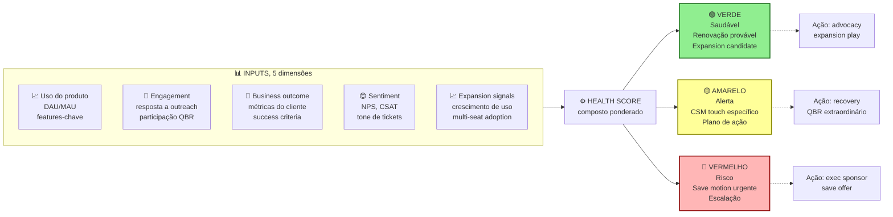

Cinco dimensões compõem um score único. Triggers automáticos por cor. Verde para advocacy. Amarelo para touch preventivo. Vermelho para escalação com exec sponsor.

Score composto (exemplo simplificado). Verde (saudável), renovação provável, e candidato a expansion. Amarelo (alerta), desengajamento parcial, e o CSM aciona touch específico. Vermelho (risco), intervenção urgente, e save motion acionada.

Automação. As ferramentas de CS permitem health score automatizado, mais triggers de ação. "Se conta fica vermelha por quatorze dias, agendar call de save com CSM, mais escalação para Head of CS, se valor for maior que R$ X."

#### 3. QBR (Quarterly Business Review), o ritual de valor

QBR é reunião trimestral formal, entre CSM, e cliente-chave. Onde se faz cinco coisas. Review de resultados, métricas contratadas versus atingidas. Feedback do cliente, o que está indo bem, e o que precisa de atenção. Roadmap discussion, o que vem no produto, e o que o cliente precisa. Expansion discussion, novos casos de uso, mais seats, e novos produtos. Renewal planning, timeline para a próxima renovação.

Boas práticas. Preparação. O CSM envia deck setenta e duas horas antes. Duração. Sessenta a noventa minutos. Participantes do lado cliente. Champion mais executive sponsor, idealmente. Outcomes. Ações acordadas, e próximo QBR na agenda.

Quando fazer QBR. Contas de ticket alto (R$ 5 mil ou mais por mês em SaaS mid-market, R$ 20 mil ou mais em enterprise). Contas estratégicas (referenceabilidade, e influência). Não fazer QBR em cem por cento da base. Muito caro. Segmentação é chave.

#### 4. Renewal motion, a venda que ninguém vê

Renewal não é "momento de assinar contrato". É processo estruturado, que começa noventa a cento e vinte dias antes da renovação.

Pipeline de renewal. T menos cento e vinte dias, health score review, identificar riscos. T menos noventa dias, outreach inicial do CSM, discussão de ROI entregue, e dos próximos doze meses. T menos sessenta dias, proposta de renovação (se houver expansion opportunity, incluir). T menos trinta dias, negociação final (se aplicável). T zero, contrato assinado, ou cliente em processo de churn.

Pipeline de renewal em forma de timeline.

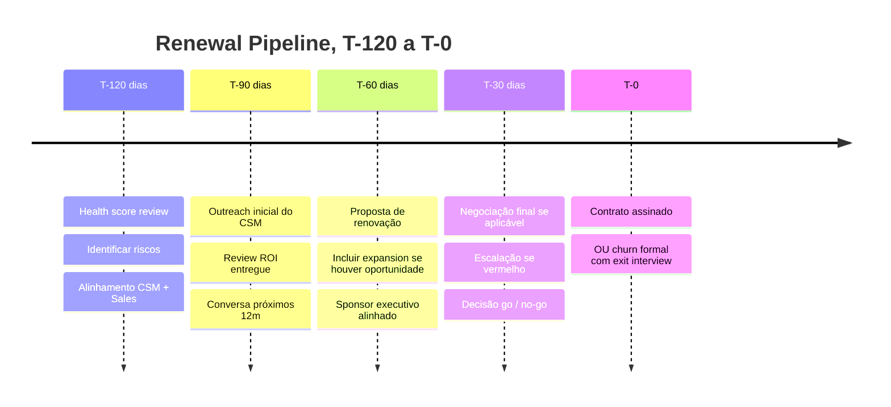

> [!important] Renewal é processo, não evento
> Renewal é processo de noventa a cento e vinte dias. Não evento pontual. Começar em T menos trinta é tarde demais para salvar contas em risco, ou para capturar expansion. CSM que descobre renewal trinta dias antes garante que perdeu metade do que poderia ter capturado.

Tecnologia. CRM mais CS platform integrados. Visibilidade de renewal pipeline ao nível de Finance, e CEO.

Métricas. Renewal rate (gross), percentual das contas renovando no valor original, ou maior, alvo igual ou maior que noventa por cento. Expansion at renewal, percentual das renovações com expansão, alvo igual ou maior que trinta por cento. Time to renewal resolution, dias entre T menos noventa e a decisão (fechada), alvo igual ou menor que setenta e cinco.

#### 5. Expansion motion, upsell e cross-sell com disciplina

Expansion é distinta de sales inicial. Envolve três tipos. Upsell, mais do mesmo produto (mais seats, ou maior tier). Cross-sell, produto, ou módulo, adicional. Usage expansion, consumo natural cresce (usage-based).

Gatilhos de expansion. Uso do cliente atingindo setenta a oitenta por cento do tier atual. Novos usuários sendo adicionados de forma orgânica. Caso de uso novo mencionado pelo champion. Crescimento da empresa do cliente (nova loja, nova unidade, etc.). Introdução de novo produto pela sua empresa.

Quem conduz. O CSM identifica, e qualifica, oportunidade. Em deals grandes, Account Executive (Sales) pode conduzir fechamento. Em organizações maduras, CS tem quota de expansion.

Playbook. Identificar oportunidade via sinais (uso, QBR, feedback). Quantificar valor ("se você usa X, adicionar Y economiza Z"). Proposta clara, preço, prazo, e condições. Fechamento, pode ser via amendment a contrato existente.

#### 6. Churn mitigation, ação quando sinais aparecem

Tipos de churn. Voluntary, o cliente decide sair, por valor, por preço, ou por fit. Involuntary, payment failure, troca de sistema, ou evento externo.

Mitigação de voluntary. Save offer, desconto temporário, upgrade para tier melhor, ou pausa em vez de cancelamento. Retention calls, executivo (Head of CS, ou CSM sênior) entra em contato. Win-back, ex-cliente sendo recuperado três a seis meses depois (frequentemente, a frustração inicial passou).

Mitigação de involuntary. Payment failure automation, retry inteligente, múltiplos métodos, e notification antes do débito. Credit card update flow, lembrete antes de expiração.

Post-mortem de churn. Toda conta que churnar deve ter exit interview. Padrões emergem.

#### 7. Advocacy, transformar clientes em multiplicadores

Programa de advocacy inclui cinco peças. Referrals, incentivo para o cliente indicar novos. Case studies, o cliente aparece como caso público. Reviews, G2, Capterra, Trustpilot. Speaking opportunities, o cliente no painel do seu evento. Advisory board, clientes-chave dão input em roadmap.

Incentivos. Monetários (comissão, desconto, crédito). Reconhecimento (logo no site, prêmio anual, menção pública). Acesso (beta features, e eventos exclusivos).

> [!warning] Não pedir advocacy a conta amarela ou vermelha
> Advocacy exige conta saudável. Pedir referência a cliente em estado amarelo, ou vermelho, queima o relacionamento, e gera referência negativa. Espere o cliente estar em verde sustentado por três meses, antes de pedir caso público, ou indicação.

#### 8. CS-Led Growth, expansão como motor de receita

CS-Led Growth (CSG) é o modelo onde a função de Customer Success, e não a de Sales ou Marketing, é o principal motor de crescimento de receita. Contrapõe-se ao modelo Sales-Led Growth (crescimento via outbound e ciclos de venda) e ao Product-Led Growth (crescimento via adoção orgânica do produto). Em SaaS B2B maduro com base instalada relevante, CSG frequentemente produz o maior ROI por real investido porque expande receita em clientes que já compraram e já confiam.

**A lógica financeira.** Vender para cliente existente custa 5 a 25 vezes menos do que adquirir novo cliente. Expansion MRR a partir de base existente tem CAC próximo de zero. NRR acima de 110% significa que a empresa cresce sem nenhum novo cliente: cada cliente existente cresce 10% ao ano só via expansion. Para SaaS maduro, NRR é o indicador mais preditivo de enterprise value: cada ponto percentual de NRR representa múltiplos de valuation.

**Mecanismos de CS-Led Growth em seis peças.**

*Expansion motion estruturada*: o CSM tem quota de expansion, não só de renewal. A conversa não é "está tudo bem?" mas "você está usando 40% do que contratou, os outros 60% resolveriam [problema identificado]." Expansion em QBR não é venda, é derivação de valor já entregue para oportunidade adjacente.

*Land and expand deliberado*: vender o mínimo para entrar na conta (land), com plano explícito de expansão por módulo, time, ou uso. Em contratos enterprise, o CSM tem mapa de account com divisões, projetos e potencial de expansão por linha de produto.

*Product-led CS hybrid*: o produto identifica automaticamente sinais de expansion (uso próximo do limite de usuários, features premium sendo testadas mas não contratadas, padrão de uso que indica caso de uso adicional) e dispara playbook de CS. CSM entra com contexto de dados, não em cold call.

*Net Revenue Retention como OKR de CS*: NRR deixa de ser métrica de CS e vira North Star de produto, engenharia e CS simultaneamente. Feature que melhora adoption também melhora NRR. Feature que resolve dor crítica reduz churn. A função de CS passa a ter voz no roadmap de produto como consequência natural.

*Advocacy como canal de aquisição*: CS que cria advocates estruturados (referrals formalizados, case studies, speakers em eventos) fecha o loop entre CS e aquisição. CAC via referral de cliente existente é 60-80% menor do que via outbound. Programa estruturado: advocate → referral → novo logo → novo advocate.

*Executive sponsors*: para contas acima de R$ 50-100k ARR, CSM sênior ou executivo da empresa mantém relacionamento com C-level do cliente. Objetivo: visibilidade de risco de churn, e oportunidade de expansion, antes que apareçam nos dados.

**Quando CSG se torna o motor primário.** Base instalada acima de R$ 5M ARR. NRR atual entre 90-110% (espaço para otimizar). Produto com expansão natural (usuários, módulos, volume, ou regiões). CAC de novos logos crescendo (eficiência de aquisição diminuindo). Equipe de CS com 3+ CSMs que podem ter quota individual de expansion.

> [!tip] CSG não substitui aquisição
> CS-Led Growth é motor de expansão, não motor de aquisição. Empresa que para de adquirir novos logos e aposta só em expansion cria dependência de base que envelhece. O modelo ideal: aquisição traz novos logos em taxa de reposição, CS expande e retém a base, o conjunto gera NRR acima de 115%.

### Time-to-Value (TTV), Taxa de Conclusão de Onboarding, Health Score, Gross Retention (GRR) e Net Revenue Retention (NRR)

**Retention.** Gross Revenue Retention (GRR), receita retida sem expansion, alvo igual ou maior que noventa e cinco por cento em SaaS maduro. Net Revenue Retention (NRR), receita retida mais expansion, alvo igual ou maior que cento e dez por cento. Logo retention mensal, percentual de clientes retidos MoM. Churn rate (logo, e revenue).

**Adoption.** Activation rate (onboarding), igual ou maior que setenta por cento. Feature adoption, percentual usando features-chave. DAU sobre MAU ratio, engagement frequency.

**Satisfaction.** NPS (trimestral), igual ou maior que quarenta saudável, igual ou maior que sessenta excepcional. CSAT (ticket-level), igual ou maior que quatro vírgula cinco em cinco. Customer Effort Score (CES).

**Expansion.** Expansion MRR, receita adicional em base existente. Expansion at renewal, percentual com expansão. Cross-sell rate, percentual com múltiplos produtos.

**Operacional.** CSM ratio, accounts per CSM (segmentado por tier). Time to respond, e time to resolve. QBR coverage, percentual de contas-alvo com QBR no trimestre.

---

### Mapeamento de jornada do cliente

O Customer Journey Map (mapa da jornada do cliente) é a representação visual de como o cliente passa de desconhecido a advogado da marca: com cada etapa, emoção, ponto de contato e oportunidade de intervenção mapeados. No contexto brasileiro, o exercício tem particularidades específicas por segmento.

#### Como construir o mapa

A estrutura básica de um Customer Journey Map tem cinco dimensões horizontais (linhas) para cada etapa da jornada:

```text
ETAPAS      | Awareness | Consideração | Onboarding | Adoção | Expansão | Renovação | Advocacy
------------+----------+--------------+-----------+-------+----------+-----------+---------
AÇÕES       | O que o cliente faz em cada etapa
PENSAMENTOS | O que está pensando (voz do cliente)
EMOÇÕES     | Frustração, confiança, entusiasmo, dúvida
TOUCHPOINTS | Canal ou ponto de contato com a empresa
OPORTUNID.  | Onde a empresa pode intervir para melhorar
```

Para B2B SaaS brasileiro, os pontos de maior fricção são consistentemente: primeiro login (confusão com configuração inicial), aprovação interna do cliente (integração com sistemas como SAP/TOTVS), e renovação (quando o campeão interno saiu e o novo gestor não foi onboardado).

Para B2C mobile, os pontos críticos são: primeiros 72 horas (abandono por não entender o valor), notificações (excesso gera desinstalação), e retorno após inatividade (momento em que reativação deve ser agressiva mas não intrusiva).

#### Os 5 momentos que importam

Não existe mapa de jornada que cubra tudo com igual profundidade. Foundadores com equipe pequena devem obsessionar nos cinco momentos de maior impacto no resultado financeiro:

**Momento 1: First Value.** O instante em que o cliente experimenta o valor prometido pela primeira vez. Em B2B SaaS, pode ser o primeiro relatório gerado, a primeira venda processada, o primeiro funcionário cadastrado. Em B2C, a primeira tarefa concluída, a primeira compra realizada, a primeira conexão social. Medir time-to-first-value (em horas ou dias) é indicador-chave. Empresas com time-to-first-value abaixo de 24 horas têm retenção em D30 sistematicamente melhor.

**Momento 2, Adoption.** Quando o cliente passa de uso ocasional para uso habitual, o produto vira rotina. No B2B SaaS, adoção é geralmente medida pelo percentual de seats ativos (usuários que logaram nas últimas duas semanas versus total de licenças pagas). Em B2C, é frequência de uso semanal. Adoção baixa é o sinal mais precoce de churn futuro: com dois a quatro meses de antecedência.

**Momento 3: Expansion Trigger.** O ponto em que o cliente atingiu o limite do plano atual ou descobriu uma necessidade adjacente que o produto também resolve. Identificar esse trigger proativamente (antes do cliente) e apresentar a solução no momento certo é o mecanismo de expansão de receita mais eficiente. Em B2B SaaS, o gatilho mais comum é crescimento de usuários ou volume de dados/transações. Em B2C, é habitualidade atingindo o limite de funcionalidades do plano gratuito.

**Momento 4, Renewal.** A renovação não deveria ser evento, deveria ser consequência natural de valor acumulado. Quando a renovação se torna negociação ou risco, é sinal de que os momentos anteriores falharam. Empresas com NPS acima de 50 e adoção acima de 70% de seats têm taxa de renovação de 90%+. O oposto também é verdade: renovação como evento de risco é sintoma, não causa raiz.

**Momento 5, Advocacy.** O cliente passa a recomendar ativamente, faz referral, aceita ser case study, responde convite para evento, posta no LinkedIn. Advocacy não se compra com desconto. Surge de combinação de valor entregue, experiência de suporte memorável em momentos difíceis, e senso de pertencimento a algo maior. No Brasil, a confiança boca a boca tem peso especialmente alto no ciclo de vendas B2B, onde o fundador frequentemente é o canal mais eficiente de referrals.

---

### NPS como sistema operacional versus métrica

NPS (Net Promoter Score: índice de recomendação do cliente) isolado é vaidade. NPS como sistema operacional de feedback é uma das alavancas mais poderosas que uma empresa tem para melhorar retenção.

#### NPS transacional vs. relacional

Existem dois tipos de NPS com finalidades distintas:

**NPS relacional.** Pesquisa periódica (trimestral ou semestral) enviada para toda a base, que mede a percepção geral do relacionamento com a empresa. Responde: "Como você se sente sobre nós, em termos gerais?" Útil para acompanhar tendência macro, para benchmark com mercado, e para detectar deterioração de percepção antes que vire churn.

**NPS transacional.** Pesquisa enviada após interação específica: término do onboarding, resolução de ticket, renovação, entrega de feature. Responde: "Como foi essa interação?" Mais acionável que o relacional, porque o contexto do feedback é claro e o tempo de resposta é curto.

> [!tip] Combinação ideal
> Em early stage (menos de 200 clientes), use NPS transacional como rotina e relacional apenas quando precisar de benchmark para apresentar ao board ou investidor. Feedback qualitativo de 20 clientes detratores vale mais do que NPS numérico sem contexto.

#### Como construir o loop fechado (close the loop)

NPS sem ação é pesquisa acadêmica. O loop fechado tem quatro etapas:

1. **Coleta**: envio da pesquisa no momento certo, com taxa de resposta mínima de 25% para ser significativa (B2B SaaS tipicamente consegue 30-45%; B2C, 8-20%).

2. **Triagem imediata**: detratores (0-6) recebem contato humano em até 48 horas. Não e-mail automatizado. Ligação ou mensagem personalizada do CS ou do próprio fundador, em estágios iniciais.

3. **Diagnóstico**: categorizar o feedback em buckets (produto, suporte, preço, expectativa não atendida, concorrente melhor). Em três meses de coleta consistente, padrões emergem.

4. **Ação e comunicação**, fechar o ciclo com o cliente: "Você apontou X. Fizemos Y por causa disso." Esse retorno, que pouquíssimas empresas fazem: é o momento em que detratores se tornam neutros e neutros se tornam promotores.

> [!warning] O erro mais comum com NPS no Brasil
> Empresas brasileiras enviam NPS, coletam dados, montam dashboard bonito e não ligam para nenhum detrator. O modelo mental de "pesquisa para medir satisfação" precisa virar "pesquisa para identificar quem está em risco e agir antes do churn".

#### Benchmarks de NPS por segmento (Brasil, 2024-2025)

```text
Segmento                  | NPS médio | NPS bom | NPS excelente
--------------------------+-----------+---------+--------------
SaaS B2B PME              |    35-45  |   50+   |    65+
SaaS B2B Mid-market       |    40-50  |   55+   |    70+
SaaS B2B Enterprise       |    30-45  |   50+   |    65+
Consumer app (B2C)        |    20-35  |   45+   |    60+
E-commerce B2C            |    15-30  |   40+   |    55+
Marketplace B2C           |    10-25  |   35+   |    50+
```

---

### CSAT e CES no Brasil

Net Promoter Score mede relacionamento. Customer Satisfaction Score (CSAT) e Customer Effort Score (CES) medem interações específicas. Os três se complementam e devem ser usados em momentos distintos.

**CSAT** mede satisfação com uma interação pontual: "Como você avalia o atendimento recebido?" Escala de 1 a 5. Calculado como percentual de respostas 4 ou 5 (satisfeitos e muito satisfeitos) sobre o total. Uso ideal: pós-atendimento de suporte, pós-onboarding, pós-entrega de projeto. Benchmarks B2B SaaS Brasil: CSAT abaixo de 75% é sinal de problema; acima de 90% é benchmark de excelência.

**CES** mede esforço percebido: "O quanto foi fácil resolver o seu problema?" Escala invertida (1 = muito difícil, 7 = muito fácil). O CES foi desenvolvido pelo Corporate Executive Board e tem correlação comprovada com churn: clientes que relatam alto esforço (nota 1-3) têm probabilidade 4x maior de churn do que clientes que relatam baixo esforço. Uso ideal em Brasil: pós-onboarding (detecta fricção no setup), pós-integração técnica, pós-migração de dados. Segmentos onde CES mais importa: ERP, plataformas de dados, ferramentas com curva de aprendizado elevada.

#### Quando usar cada métrica

```text
Situação                        | Métrica indicada | Por quê
--------------------------------+-----------------+---------
Após ticket de suporte          | CSAT            | Mede qualidade da interação
Após onboarding                 | CES + NPS trans.| Esforço + percepção inicial
Após integração técnica         | CES             | Detecta fricção técnica
Trimestralmente com toda base   | NPS relacional  | Saúde geral do relacionamento
Após renovação                  | NPS transacional| Percepção da decisão de renovar
Após resolução de problema grave| NPS + CSAT      | Recovery bem-feito pode virar promotor
```

**Correlacionando com churn.** O padrão mais confiável que emerge em empresas SaaS com instrumentação adequada: cliente com CSAT < 75% em dois atendimentos consecutivos tem 3x mais chance de churn em 90 dias. Cliente com CES < 3 no onboarding tem 2x mais chance de não atingir adoção plena. Esses são os alertas que devem disparar intervenção proativa, não esperar que o cliente cancele.

---

### Reclame Aqui como estratégia, não como problema

O Reclame Aqui tem mais de 30 milhões de avaliações e é visitado por consumidores como passo obrigatório antes de decisão de compra em vários setores B2C. Para fundadores de B2C ou B2B2C, ignorar o Reclame Aqui como canal de CX é erro estratégico.

#### Por que responder publicamente importa

A resposta pública serve a dois públicos: o reclamante (que quer resolução) e o lurker (os mil outros consumidores que leram a reclamação antes de comprar). A empresa com RA Score alto, índice de solução alto e tempo de resposta curto sinaliza responsabilidade e capacidade de operação: mesmo que tenha problemas. A empresa que não responde sinaliza descaso.

O "índice RA 1000", a classificação mais alta do Reclame Aqui, é usado por empresas como Nubank, iFood e Mercado Livre como indicador público de qualidade de atendimento. Para empresa early-stage em B2C, manter RA Score acima de 7 e índice de solução acima de 85% já é diferencial competitivo.

#### Como transformar crítica em caso de relacionamento

A anatomia da resposta que transforma detrator em promotor:

1. **Reconhecer especificamente.** Não copiar e colar texto genérico. Referenciar o problema específico descrito na reclamação.
2. **Assumir responsabilidade sem defensividade.** "O sistema apresentou instabilidade no dia X, o que afetou diretamente o senhor. Isso não deveria ter acontecido."
3. **Resolver ou explicar o que está sendo feito.** Ação concreta, não promessa vaga.
4. **Oferecer canal privado para continuação.** O Reclame Aqui não é o lugar para resolver detalhes: é o lugar para demonstrar postura pública e abrir canal.
5. **Follow-up.** Fechar o caso com confirmação de resolução é o passo que mais transforma percepção.

> [!tip] O que NÃO responder
> Reclamações que envolvem processo judicial em curso não devem ter resposta detalhada: consultar jurídico antes. Reclamações claramente fraudulentas (que mencionam produtos que a empresa não vende, ou nomes diferentes) podem ser contestadas formalmente. Reclamações de concorrentes disfarçados de clientes (padrão identificável por conta nova, linguagem idêntica a outras reclamações em série) devem ser marcadas para análise.

### Colocar um CSM caro de R$ 8 mil/mês para fazer reuniões manuais com clientes que pagam R$ 99/mês

CS como suporte. Confundir função estratégica com atendimento reativo. Perde o papel de expansion, e retention proativo.

CSM sem quota. Sem accountability por expansion, ou renewal, vira "fazer bonito com cliente". Não escala.

Health score sem ação. Score bonito no dashboard, e ninguém age sobre amarelo, ou vermelho.

QBR genérico. Reunião que vira "atualização de status". O cliente cansa, e para de aceitar.

Renewal como surpresa. CSM descobre renewal trinta dias antes. Sem runway para negociar, salvar, ou expandir.

Sem segmentação. Mesma motion para cliente de R$ 500 por mês, e R$ 50 mil por mês. Economicamente ruim.

Ignorar usage data. Monitorar NPS, mas não uso real do produto. NPS pode ser alto enquanto o uso despenca.

Save offers sem limite. Desconto para todo cliente que ameaça sair destrói o preço de mercado.

CS desalinhado com Product. O CSM sabe a pain dos clientes. Mas o feedback não chega ao roadmap.

Pedir advocacy cedo. Cliente no mês 2 ainda não é advocate. Pedir referência destrói relacionamento frágil.

### Checklist de execução prática

CS como disciplina no padrão quando o onboarding estruturado existe com métricas monitoradas, health score model está implementado e acionável, QBR acontece com contas-chave trimestralmente, renewal motion é processo estruturado (não evento), expansion é parte do papel do CSM (com quota ou KPI), NRR igual ou maior que cento e dez por cento sustentado nos últimos doze meses, programa de advocacy ativo com dez ou mais referências, e CS tem visibilidade no board (renewal pipeline, NRR, health trends). Os itens abaixo sustentam isso.

- [ ] Onboarding estruturado, com etapas claras, e métricas definidas.
- [ ] Health score modelo implementado, com triggers de ação.
- [ ] QBR template, e cadência, definidos para contas-chave.
- [ ] Renewal pipeline com visibilidade T menos cento e vinte dias.
- [ ] CSMs têm quota, ou KPI, de expansion definido.
- [ ] Segmentação clara (High-Touch, Tech-Touch, Low-Touch), conforme ticket, ou estratégia.
- [ ] Churn exit interview aplicado a cem por cento das saídas voluntárias.
- [ ] Programa de advocacy ativo, com benefícios claros.
- [ ] CS platform (Gainsight, ChurnZero, Totango, Vitally, ou equivalente) em uso.
- [ ] NRR, e GRR, medidos, e reportados, ao board mensalmente.

---

### O Espelho do Capítulo 8: Seu Time Entrega Resultado Real ou Apenas Pede Desculpas com Simpatia?

**Fechando o ciclo na trincheira:** Quando **Lucas e Marina** aplicaram as travas deste capítulo na rotina entre São Paulo e Florianópolis, a tensão da cena de abertura deixou de ser discussão subjetiva de corredores e virou regra clara de priorização, retenção e proteção de caixa.

**O Espelho (autodiagnóstico):**
1. Quantos dias exatos um cliente novo leva, em média, desde o pagamento até alcançar a primeira vitória concreta dentro do seu produto ou serviço?
2. Você sabe dizer hoje de manhã quais são os 10 clientes da sua carteira cujo uso caiu mais de 50% nas últimas duas semanas (sinal vermelho de cancelamento iminente), ou você só descobre quando eles pedem o distrato?
3. Quando você faz uma reunião trimestral com o cliente, você leva um relatório mostrando o dinheiro/tempo que ele ganhou com você, ou pergunta timidamente *"está tudo bem aí?"*?

**Permissão Libertadora:**
Você está autorizado a cobrar firme do seu cliente durante os primeiros 15 dias de *Onboarding*. Cliente que não entrega os dados iniciais na primeira semana não está sendo "poupado"; está caminhando para cancelar no mês três.

**O Ritual de Segunda-Feira às 9h:**
Puxe a lista de todos os clientes que compraram nos últimos 30 dias e marque em vermelho quem ainda não atingiu o marco de **Primeiro Valor**. Ligue pessoalmente para cada um deles hoje e destrave o uso em 15 minutos.


---

# INSTRUMENTAÇÃO DE DADOS, PRODUTO AI-NATIVE E ANATOMIA DO PIVÔ (CAPÍTULOS 9 A 11)

Fechando a etapa de Tração, estes três capítulos atacam três decisões estruturais: como instrumentar sua *stack* de dados e métricas sem cair em vaidade, como desenhar produtos *AI-Native* com margem saudável e fosso defensável, e como executar um pivô estratégico com coragem analítica quando a tese original bate no teto.

---

## CAPÍTULO 9 — DADOS, ANALYTICS E EXPERIMENTAÇÃO

### O Painel de 80 Gráficos que Não Serve para Nada e a Única Estrela Polar

Lucas orgulhava-se dos três monitores gigantes na parede do escritório em Florianópolis. Havia gráficos de pizza, mapas de calor em tempo real, contadores de acessos totais acumulados desde 2023, número de cliques por hora e curtidas nas redes sociais. Todas as linhas subiam sempre para a direita.

Numa terça-feira, Marina fez uma pergunta simples diante dos três monitores:

– "Lucas, na semana passada nós mudamos o fluxo de cadastro e lançamos o alerta automático por WhatsApp. Olhando para essas oitenta telas coloridas, essa mudança fez os clientes usarem mais o sistema e renovarem mais, ou foi tempo jogado no lixo?"

Lucas olhou para o monitor da esquerda, depois para o do meio, depois para o da direita... e ficou mudo. Nenhum daqueles oitenta gráficos respondia à pergunta. Eles tinham terabytes de eventos salvos no banco, mas zero clareza para tomar uma decisão de negócios. Estavam afogados na **Cegueira do Excesso de Dados de Vaidade**.

Números acumulados que só sobem para a direita (total de cadastros históricos, total de downloads, total de visualizações) são entorpecentes psicológicos: servem para massagear o ego dos fundadores em reuniões de conselho, mas nunca dizem se o motor está prestes a fundir.

Instrumentação de produto de verdade exige coragem para jogar 90% do ruído fora e governar a empresa por uma **North Star Metric** (Métrica Estrela Polar), o único número que captura o momento exato em que o cliente recebe valor real, acompanhada de uma **Métrica de Guarda-Corpo** (*Guardrail Metric*) que impede você de trapacear no curto prazo destruindo a saúde de longo prazo.

---

> [!note] Nota de validade
> A arquitetura de dados evolui em ciclos de três a cinco anos (Lambda, depois Kappa, depois Modern Data Stack, e o que vier a seguir). Ferramentas mudam a cada doze a vinte e quatro meses. Os princípios (métricas claras, experimentação rigorosa, dado como contrato) são estáveis. Revisar anualmente.

Vários pontos do manual tratam dados de forma tangencial: o [[#CAPÍTULO 1 — GTM PLAYBOOK E ARQUITETURA DE CANAIS: DA PRIMEIRA VENDA AO PRIMEIRO MILHÃO DE ARR|Capítulo 1 (GTM Playbook e Arquitetura de Canais: Da Primeira Venda ao Primeiro Milhão de ARR)]] (AARRR, sigla para Aquisição, Ativação, Retenção, Receita e Indicação), o [[IGNICAO-Vol-7-Produto-Engenharia-e-Operacoes#CAPÍTULO 1 — PRODUTO EM ESCALA E DESCOBERTA CONTÍNUA|Capítulo 1 (Produto em Escala e Descoberta Contínua) (Vol. 7)]] (produto em escala) e métricas em cada fase. Mas dados como disciplina operacional unificada (stack, time, processos, experimentação) não têm casa no manual. Empresa pós-PMF sem infraestrutura de dados funcional toma decisões no escuro, roda experimentos que não medem o que dizem medir e compromete a escala.

Este capítulo cobre dados como função: stack moderno, papéis do time de dados, métricas com formulação precisa, experimentação rigorosa (A/B testing com estatística, não achismo) e evolução em escala.

### Por que ter cem gráficos no painel que ninguém usa para decidir é exatamente igual a voar no escuro

Decisões sem dados são achismos em escala. Em pré-PMF, a intuição do fundador é frequentemente correta (contexto denso, mercado pequeno). Em escala, ninguém vê o todo. Dados são a única forma de ver.

Experimentos mal desenhados são piores que não experimentar. Resultado "ganhamos quinze por cento" em A/B test com amostra pequena, sem significância estatística, pode ser ruído. Decisão baseada nisso piora a empresa.

Stack de dados é infraestrutura, não luxo. Sem stack adequado, os dados ficam em silos (CRM, produto, financeiro). As análises levam dias e há inconsistências entre áreas.

Time de dados em escala é multi-função: analytics engineer, data scientist, PM de dados, data engineer. São papéis distintos que o fundador iniciante frequentemente confunde.

### Definindo a North Star + Inputs acionáveis, instrumentando os 10 eventos vitais e lendo funis por coorte

#### 1. Modern Data Stack

Arquitetura padrão em SaaS moderno (2023 a 2026).

```text
FONTES TRANSPORTE ARMAZENAMENTO MODELAGEM CONSUMO
- App database → - Fivetran → - Snowflake → - dbt → - Looker / Metabase
- CRM (HubSpot) - Airbyte - BigQuery - Coalesce - Mode / Hex
- CRM (Salesforce) - Stitch - Databricks - Notebooks
- Marketing - Redshift - Reverse ETL (Hightouch)
- Eventos (app) → - Segment → - Operacional
```

Os princípios em cinco peças.

ELT, não ETL. Ingestão bruta (Extract, Load), transformação no warehouse (dbt). Mais escalável, e reprocessável.

dbt como camada de transformação. Código versionado, testado, e documentado. Substitui stored procedures frágeis.

Warehouse dedicado. Não consultar direto na DB de produção (lock, lentidão, risco).

BI self-service. Os usuários de negócio podem fazer as próprias perguntas, sem passar por fila de analista.

Reverse ETL. Os dados transformados voltam para sistemas operacionais (enriquecimento de CRM, por exemplo).

Custo mensal típico, em empresa Série A. Fivetran, R$ 1-5 mil. Snowflake, R$ 2-10 mil. dbt Cloud, R$ 500-2 mil. Looker ou Metabase, R$ 1-5 mil. Segment, R$ 2-8 mil. Total. R$ 6-30 mil por mês. Escala com volume.

#### 2. Métricas, formulações precisas

Erro comum. Métrica nomeada ambiguamente, que cada área calcula diferente. "Churn de abril" varia por coorte (novos versus existentes), base (logo versus revenue), prazo (mensal versus anualizado), e pagamento versus uso.

> [!important] Regra para definir métricas-chave
> Toda métrica-chave da empresa deve ter definição formal escrita. Fórmula matemática. Fonte de dados. Cadência de update. Quem é dono. Sem isso, cada área reporta número diferente, e o board fica confuso.

Exemplo, churn de logo mensal.

```text
Fórmula:
 Churn_mensal(T) = Clientes_cancelados(T) / Clientes_ativos_no_início(T)

Definições:
 "Clientes_cancelados(T)": clientes cuja assinatura expirou em T sem renovação
 "Clientes_ativos_no_início(T)": clientes com assinatura ativa no dia 1 de T

Fonte: CRM (Salesforce), campo "cancellation_date"
Update: mensal, no dia 5 do mês seguinte
Dono: Head of CS
Dashboards: board_deck, cs_operational
```

Métricas SaaS essenciais com formulações.

MRR (Monthly Recurring Revenue). Soma de assinaturas recorrentes, normalizadas para valor mensal.

ARR (Annual Recurring Revenue). MRR vezes doze.

Net New MRR. Novo MRR mais Expansion MRR menos Churn MRR menos Contraction MRR.

NRR (Net Revenue Retention). (ARR_inicial_cohort mais Expansion menos Churn menos Contraction) dividido por ARR_inicial_cohort.

GRR (Gross Revenue Retention). (ARR_inicial_cohort menos Churn menos Contraction) dividido por ARR_inicial_cohort. A diferença em relação ao NRR. Não inclui expansion.

CAC. Gastos de S&M no período divididos por novos logos adquiridos no período.

LTV. (ARPU vezes Margem Bruta) dividido por Churn Mensal.

CAC Payback. CAC dividido por (ARPU vezes Margem Bruta) vezes doze, em meses.

Burn Multiple. Burn líquido no período dividido por Net New ARR no período.

Rule of 40. Percentual de Growth mais percentual de EBITDA Margin.

#### 3. Framework de experimentação (A/B testing rigoroso)

Erro clássico. Experimento sem significância estatística, tratado como "deu certo".

Os princípios corretos vêm em quatro fases.

**[[IGNICAO-Vol-1-Ideacao#FASE 1 — ENCONTRAR A IDEIA|Fase 1 (Vol. 1)]], design do experimento.** Hipótese explícita ("Se mudarmos X, a métrica Y moverá em Z por cento ou mais"). Métrica primária clara, uma, não cinco. Métricas secundárias para guardrails. Sample size calculation, quantos usuários precisam passar pelo experimento para detectar efeito com oitenta por cento de power, e noventa e cinco por cento de confiança? Duração definida, baseada em cálculo, não "rodar até dar certo". Guardrails, métricas que NÃO podem cair (por exemplo, não queremos aumentar ativação às custas de churn).

Cálculo de sample size. Para A/B simples com métrica de conversão, fórmula aproximada.

```text
n = 16 × baseline_rate × (1 - baseline_rate) / MDE²

onde MDE = Minimum Detectable Effect (em pontos absolutos de conversão)
```

Exemplo. Baseline de conversão de vinte por cento, queremos detectar melhoria de dois pontos (vinte e dois por cento).

```text
n = 16 × 0.20 × 0.80 / 0.02² = 6.400 usuários por variante
```

Calculadoras online (Evan Miller's A/B test calculator, Optimizely Sample Size Calculator) fazem o cálculo com menos fricção.

**[[IGNICAO-Vol-1-Ideacao#FASE 2 — ARTICULAÇÃO E CAPTURA DA IDEIA|Fase 2 (Vol. 1)]], execução.** Randomização rigorosa, por user ID hash, não round-robin (causa viés temporal). Sem peeking. Olhar resultado parcial leva a parar cedo quando "está ganhando", e continuar quando não. Destrói validade estatística. Revisar só no prazo pré-definido. Controle de confounders. Não rodar duas mudanças simultâneas. Considerar sazonalidade.

**[[IGNICAO-Vol-2-Descoberta-e-Mercado#FASE 4 — DESCOBERTA DO PROBLEMA|Fase 4 (Vol. 2)]], leitura de resultados.** P-value e intervalo de confiança, reportar ambos. P menor que zero vírgula cinco é convenção. A empresa pode ter política diferente (zero vírgula cinco mais conservador). Significância prática versus estatística. Zero vírgula um por cento de melhoria pode ser estatisticamente significante, mas sem impacto de negócio. Efeito em métricas guardrail. Se ganhou em primária, mas caiu em guardrail, é trade-off. Não vitória. Interpretação cuidadosa. Correlação. Causalidade. Generalização.

**Ferramentas.** Plataformas dedicadas. Optimizely, Eppo, Statsig, LaunchDarkly (feature flags mais experimentation), GrowthBook (open source). Mais simples. Google Optimize (descontinuado), VWO, Convert. In-house. Construir em cima de warehouse, e feature flags internos.

#### 4. Quando experimentar, e quando não experimentar

Experimentar é adequado quando o volume é suficiente para detectar efeito em prazo razoável (menos de oito semanas). O efeito esperado é mensurável numericamente. Há reversibilidade, se a variante perder, o custo de reverter é baixo. Há múltiplas ideias competindo por implementação.

Experimentar NÃO é adequado quando o volume é baixo demais (o resultado vai levar seis meses). A decisão é estratégica, ou estrutural (entrar em novo mercado, pivô). O efeito é qualitativo (melhorar brand perception). O custo de implementar a variante é altíssimo (refazer pricing, por exemplo).

Em pré-PMF, experimentação rigorosa raramente é possível (volume baixo). Os métodos alternativos são qualitativos (entrevistas), quasi-experimentos (comparar antes e depois com controle), e decisão por julgamento informado.

#### 5. Data team em escala, estrutura

**Padrão centralized.** Time de dados único, serve todas as áreas. Pros: foco, padrão, eficiência. Cons: pode virar gargalo, e desconhece contexto de áreas.

**Padrão embedded.** Data people alocados dentro de áreas (growth, produto, finance). Pros: contexto profundo, e velocidade. Cons: fragmentação, e inconsistências entre times.

**Padrão hub-and-spoke.** Time central mantém stack, e padrões. Data people embarcados em áreas usam o stack. Pros: melhor dos dois mundos. Cons: requer maturidade organizacional.

Em empresa Série A a B, centralized é mais pragmático. Hub-and-spoke vira sensato em Série C em diante.

#### 6. Governança de dados

Temas que aparecem em escala (Série B em diante). Data catalog, documentação de tabelas, colunas, e significados. Data lineage, rastreabilidade de onde vem cada número. Data quality, testes automatizados (dbt tests), e alertas para anomalias. Privacy e LGPD, quem pode acessar o quê, pseudonimização, e direito de esquecimento. SLA de dados, quando dashboards atualizam, e quem responde por atraso.

#### 7. Data Mesh — arquitetura distribuída para escala

À medida que a empresa cresce além de 200-500 pessoas, o Modern Data Stack centralizado começa a virar gargalo. Um time central de dados não consegue atender a demanda de 15 squads de produto, 3 times de growth e finance simultaneamente, a qualidade degrada, e o time de dados vira "equipe de relatórios" sem tempo para trabalho de alto valor.

Data Mesh, proposto por Zhamak Dehghani em 2020 no artigo "How to Move Beyond a Monolithic Data Lake to a Distributed Data Mesh", é a resposta arquitetural. Quatro princípios centrais.

*Domain-oriented decentralized data ownership*: cada domínio de negócio (produto, growth, finance, operações) é dono dos seus dados: produz, mantém e disponibiliza dados com qualidade para o resto da organização. Time de produto é dono dos dados de comportamento de usuário. Time de finance é dono dos dados de cobrança e receita. O time central de dados para de ser "dono de todos os dados" e vira plataforma habilitante.

*Data as a product*: cada domínio trata seus dados como produto com SLA, documentação, e usuários. Um "data product" tem: definição clara de schema, SLA de atualização, testes de qualidade automatizados, documentação de uso, e dono identificado. Isso elimina o problema de "quem mantém essa tabela?" que corrompe data warehouses centralizados em escala.

*Self-serve data infrastructure*: a plataforma central (geralmente time de Data Platform ou Data Engineering) constrói infraestrutura que permite qualquer domínio produzir e consumir data products sem depender de time central para cada pipeline. Isso inclui: templates de pipeline, catálogo de dados, ferramentas de descoberta, padrões de qualidade e acesso self-service.

*Federated computational governance*: regras globais (LGPD, padrões de PII, definições corporativas de métricas como NRR) são definidas centralmente, mas a execução é distribuída. Cada domínio implementa a governança dentro de suas fronteiras, não espera que um time central aplique.

Quando Data Mesh faz sentido. Empresa com mais de 150-200 pessoas em produto/data. Múltiplos domínios com dados independentes. Time central de dados sendo gargalo crônico. Time de dados dedicado para construir infraestrutura de plataforma (mínimo 3-5 pessoas de Data Platform).

Quando ainda não faz sentido. Empresa abaixo de Série C. Time de dados menor que 8-10 pessoas. Complexidade de coordenação do Data Mesh supera o benefício antes dessa escala.

#### 8. Privacy-first tracking pós-cookies

Google iniciou em 2020 o plano de eliminar cookies de terceiros no Chrome. Em julho de 2024, o plano de bloqueio padrão foi revertido; em abril de 2025, o Google desistiu até mesmo do novo aviso de escolha no Chrome, mantendo os cookies de terceiros sob o controle atual do usuário, e no segundo semestre de 2025 anunciou a aposentadoria das principais APIs de anúncios do Privacy Sandbox (como Topics, Protected Audience e Attribution Reporting). Ainda assim, a transição deixou como legado um regime híbrido de mensuração (nota: o Google Analytics opera com cookies primários no navegador, e não de terceiros). O aumento de bloqueadores de anúncios (40-60% de usuários técnicos), e o enforcement crescente da LGPD tornaram o modelo tradicional de tracking de marketing (pixel de Facebook, Google Analytics com cookies de terceiros) parcialmente obsoleto para empresas que precisam de dados confiáveis.

**Quatro camadas da estratégia privacy-first.**

*First-party data como fundação*: dados coletados diretamente dos seus usuários, com consentimento explícito, são imunes a bloqueadores e à depreciação de cookies. Isso inclui: dados de comportamento no produto (eventos internos), dados de CRM (email, histórico de compra), e dados de formulários. A empresa que tem first-party data rico não depende de plataformas externas para entender seus usuários.

*Server-side tracking*: em vez de disparar pixels do browser do usuário (que bloqueadores interceptam), o servidor da sua aplicação envia eventos diretamente para os destinos (GA4, Meta Conversion API, Segment). Benefícios: não é bloqueável por ad blockers, dados mais precisos, maior controle sobre o que é enviado. Ferramentas: Segment (server-side), Rudderstack (open source), ou implementação própria com webhook + destinos.

*Consent Management Platform (CMP)*: conforme o guia orientativo de cookies da ANPD (outubro de 2022), cookies e rastreadores não necessários (como os de publicidade comportamental) exigem consentimento livre, informado e inequívoco do titular, enquanto cookies estritamente necessários (e, sob requisitos específicos, métricas agregadas de audiência) podem se apoiar no legítimo interesse; defina com o jurídico a base legal de cada categoria. CMP gerencia o consentimento do usuário, armazena a prova de consentimento, e respeita opt-outs. Ferramentas: Cookiebot, OneTrust, usercentrics. Implicação: uma parcela de usuários vai recusar cookies, a empresa precisa de modelo de mensuração que funcione sem consentimento de 100% dos usuários.

*Modelagem de dados e mensuração probabilística*: quando tracking individual não é possível (sem cookies, sem consentimento), usar modelos estatísticos para estimar conversão e atribuição. Google Consent Mode v2 usa modelagem para preencher gaps de consentimento. Meta Conversion API com event matching usa first-party data para atribuir conversões mesmo sem pixel.

**O que muda no stack de analytics.** GA4 com Consent Mode v2 (obrigatório para empresas que usam Google Ads na Europa). Segment ou Rudderstack como Customer Data Platform (CDP) com server-side tracking. CRM como fonte de verdade de first-party data. Métricas de marketing baseadas em MMM (Media Mix Modeling) ou incrementalidade, não em atribuição last-click.

Custo de implementação. CMP: R$ 2-8k/mês. CDP com server-side: R$ 3-15k/mês (Segment) ou zero (Rudderstack self-hosted). Mudança de stack de analytics: 2-4 semanas de engineering. O benefício: dados de conversão 20-40% mais completos do que tracking client-side em audiência técnica, e conformidade com LGPD.

### North Star Metric (Valor Entregue), Taxa de Ativação D1/D7, Retenção por Funcionalidade e Razão DAU/MAU (Stickiness)

Tempo médio para responder pergunta de dados simples. Menos de um dia.

Percentual de métricas-chave com definição formal documentada. Cem por cento.

Cobertura de testes em pipelines de dados (dbt). Acima de oitenta por cento.

Disponibilidade de dashboards críticos. Acima de noventa e nove por cento.

Experimentos rodados por trimestre. Varia por time de produto, ou growth.

Percentual de experimentos com significância estatística atingida. Acima de sessenta por cento.

Adoção de BI self-service (usuários ativos semanais). Acima de cinquenta por cento dos usuários não técnicos elegíveis.

### Rastrear 500 eventos sem dono, comemorar médias mentirosas e confundir correlação casual com causalidade

"Precisamos de ML antes de ter dados consistentes". A empresa contrata DS sênior antes de ter o warehouse funcionando. O sênior fica frustrado, e vai embora.

Métricas sem definição. Cada área reporta número diferente. O board fica confuso.

Experimentos sem sample size calculation. Resultados falsos passam como verdade.

Peeking em experimentos. Olhar resultados diariamente destrói validade.

Comprar tool sem time. Snowflake ocioso, sem analytics engineer para usar bem.

Dashboard sem dono. A métrica quebra, ninguém nota, e decisões erradas são tomadas baseadas em número errado por semanas.

Centralização extrema. Fila de quarenta requests para o time de dados. As áreas esperando duas semanas para número trivial.

Ignorar qualidade. Os dados vão para dashboard sem teste. "Churn caiu trinta por cento", por bug em pipeline.

LGPD ignorada. Dados pessoais tratados sem pseudonimização. Acessíveis amplamente.

Correlação tratada como causalidade. Experimento mal desenhado gera insight espúrio, que vira estratégia.

### Checklist de execução prática

Time e stack de dados estão saudáveis quando todos os itens abaixo estão cumpridos.

- [ ] Modern data stack implementado para o estágio (warehouse + ELT + dbt + BI), com Série A em diante exigindo data warehouse.
- [ ] Métricas-chave com definição formal documentada e dono claro.
- [ ] Dashboards críticos atualizados com SLA, sem proliferação descontrolada.
- [ ] BI com acesso self-service disponível (60-80% das dúvidas das áreas resolvidas sem fila).
- [ ] Framework de experimentação documentado: calculadora de sample size pré-A/B, duração e guardrails definidos antes, análise considera significância estatística.
- [ ] dbt ou equivalente usado para transformações; data quality (testes, alertas) implementado.
- [ ] Time de dados proporcional ao estágio e à carga de trabalho.
- [ ] Governança LGPD para dados pessoais em dia (pseudonimização, controle de acesso).
- [ ] Board recebe dashboard consistente mensalmente.
- [ ] Os dados são commoditizados, não gargalo.

---

### O Espelho do Capítulo 9: Seus Dados Comandam Decisões ou Enfeitam Reuniões?

**Fechando o ciclo na trincheira:** Quando **Lucas e Marina** aplicaram as travas deste capítulo na rotina entre São Paulo e Florianópolis, a tensão da cena de abertura deixou de ser discussão subjetiva de corredores e virou regra clara de priorização, retenção e proteção de caixa.

**O Espelho (autodiagnóstico):**
1. Qual é a única **North Star Metric** da sua empresa hoje: e ela mede o valor real que o cliente recebeu (ex. *"notas fiscais auditadas sem erro"*, *"consultas realizadas com melhora clínica"*) ou mede apenas vaidade da empresa (ex. *"usuários cadastrados"*)?
2. Para cada gráfico que existe hoje no seu painel principal, você sabe dizer qual decisão prática tomaria se aquela linha caísse amanhã? (Se a resposta for "nenhuma", apague o gráfico hoje).
3. Você analisa seus dados quebrados por **safra de entrada (coorte)** e por **canal**, ou olha apenas para a média geral que mistura clientes de dois anos atrás com quem entrou ontem?

**Permissão Libertadora:**
Você está autorizado a deletar 80% dos dashboards confusos que ninguém abre há mais de trinta dias e governar a empresa com um único painel de cinco indicadores vitais que cabem na tela do celular.

**O Ritual de Segunda-Feira às 9h:**
Reúna o time em frente a uma única tela toda segunda-feira por 15 minutos: olhem exclusivamente para a **North Star Metric**, os **3 Inputs** que a alimentam e a **Métrica de Guarda-Corpo**. Nenhuma opinião entra na pauta sem dado de coorte.


---

## CAPÍTULO 10 — AI COMO PARTE DO PRODUTO (AI-NATIVE PRODUCT)

### O Adesivo de Chatbot vs. O Motor Autônomo: Como Construir um Produto AI-Native Real

Em 2025, dois concorrentes tentaram vender para a usina de clientes de Henrique no Mato Grosso. O primeiro concorrente pegou um software antigo de manutenção criado em 2014, colou um botãozinho de chat no canto inferior direito conectado direto na API da OpenAI e mudou o slogan do site para *"Plataforma Revolucionária de Manutenção com IA Generativa"*. Quando o engenheiro da usina clicou no botão, teve que digitar um texto longo perguntando o que fazer; o robô respondeu um texto genérico de três parágrafos e ainda inventou o código de uma peça que não existia no catálogo (*alucinação*).

Na semana seguinte, Henrique e Lucas mostraram uma arquitetura **AI-Native (Nativa em IA)**: não havia nenhuma janela de "converse com o nosso robô". O agente de IA rodava em silêncio nos bastidores 24 horas por dia, lia os sensores de vibração da turbina, cruzava automaticamente com o histórico proprietário de dez mil falhas reais de usinas brasileiras, já deixava a ordem de compra da peça exata preenchida no ERP e mandava apenas um botão no WhatsApp do diretor industrial: *"Risco de falha no rolamento 4 em 48h (confiança 94%). Peça em estoque no fornecedor X por R$ 3.200. [Aprovar Compra e Manutenção em 1 Clique]"*.

A diferença entre os dois é o abismo entre **A Casca Fina de Prompt** (*Thin Wrapper*), que qualquer estagiário copia em um sábado à tarde e cuja margem bruta derrete na conta de tokens, e **O Motor Autônomo de Trabalho Concluído** (*Service-as-a-Software*).

Em um produto AI-Native verdadeiro, o cliente não quer bater papo com uma caixa de texto vazia; ele quer que o trabalho sujo já esteja pronto, auditado e esperando apenas o "de acordo" final. E o seu fosso defensivo nunca será o modelo público de linguagem que todo mundo aluga pelo mesmo preço; será o **Ciclo de Dados Proprietários** (*Data Flywheel*) gerado a cada correção e aprovação do especialista humano na ponta.

---

> [!warning] Nota de validade
> Este é este capítulo que envelhece mais rápido no manual. O panorama de modelos, custos, ferramentas e práticas de abril de 2026 estará parcialmente obsoleto em doze a dezoito meses. Os princípios (avaliação rigorosa, mitigação de alucinação, margem real incluindo custo de inferência) têm vida mais longa. Revisar a cada doze meses.

> [!tip] As quatro camadas de IA neste livro
> IA aparece em quatro camadas, cada uma com decisões e ferramentas distintas. Você está em **AI no produto** (camada 3). As outras três:
>
> - **Camada 1: IA como acelerador do empreendedor** ([[IGNICAO-Vol-1-Ideacao#CAPÍTULO 10 — IA GENERATIVA E AGENTES COMO COPILOTO E ACELERADOR DO FUNDADOR (2026)|Capítulo 10 (IA Generativa e Agentes como Copiloto e Acelerador do Fundador (2026)) (Vol. 1)]]). Uso pessoal do fundador para escrita, pesquisa, análise.
> - **Camada 2: IA como copiloto do fundador** ([[IGNICAO-Vol-1-Ideacao#CAPÍTULO 10 — IA GENERATIVA E AGENTES COMO COPILOTO E ACELERADOR DO FUNDADOR (2026)|Capítulo 10 (IA Generativa e Agentes como Copiloto e Acelerador do Fundador (2026)) (Vol. 1)]]). Versão atualizada de I para 2026, com casos de uso de alto ROI.
> - **Camada 4: AI Ops e automação interna** ([[IGNICAO-Vol-7-Produto-Engenharia-e-Operacoes#CAPÍTULO 6 — AI OPS E AUTOMAÇÃO INTELIGENTE|Capítulo 6 (AI Ops e Automação Inteligente) (Vol. 7)]]). IA na operação da empresa, com triagem de tickets, resumo de calls, automação de workflows. Não é produto.

O [[IGNICAO-Vol-1-Ideacao#CAPÍTULO 10 — IA GENERATIVA E AGENTES COMO COPILOTO E ACELERADOR DO FUNDADOR (2026)|Capítulo 10 (IA Generativa e Agentes como Copiloto e Acelerador do Fundador (2026)) (Vol. 1)]] cobre IA como ferramenta do fundador, acelerador de produtividade pessoal. Este capítulo é outro tema: IA como parte do produto que vai a mercado, com RAG, evaluations, mitigação de alucinação, seleção de modelo, economia de inferência, latência e tudo que muda quando o LLM é componente crítico do produto, não acessório.

Empresa que constrói produto AI-native em 2026 enfrenta disciplinas novas, ausentes do SaaS tradicional. Os erros aqui produzem alucinação em escala, margens negativas, latência que mata a UX ou dependência de um provedor que vira risco estrutural.

### Por que meras interfaces em cima de APIs públicas de LLM têm defesa zero e margem destruída pela próxima atualização da Big Tech

Produto AI ruim é pior que produto sem AI. Alucinação em contexto crítico (saúde, jurídico, finanças) é perda de cliente, mais passivo.

Margens desaparecem sem disciplina de custo. Uso intensivo de GPT-4, ou Claude Opus, pode custar R$ 2 a 20 por usuário ativo, por mês. Em SaaS com ticket de R$ 50 por mês, vira prejuízo.

Latência mata adoção. Cinco segundos de resposta em interface conversacional destrói engajamento. UX AI-native exige técnicas específicas.

Dependência de provedor é risco estrutural. Se o seu produto só funciona com GPT-4 da OpenAI, e a OpenAI muda o preço três vezes (já aconteceu), a empresa quebra.

### Roteamento inteligente de modelos (Small vs. Frontier Models), Evals rigorosos contra alucinação e captura de feedback no fluxo

#### 1. Model selection, a árvore de decisão básica

Os critérios em quatro peças. Qualidade necessária, para a tarefa, qual patamar mínimo de saída é aceitável? Latência, tempo máximo aceitável na UX. Custo por 1M tokens, input e output. Privacidade, os dados podem sair para API de terceiro?

Panorama em abril de 2026, em mudança rápida.

Modelos de fronteira (mais capazes, mais caros). Claude Opus 4.7, GPT-4.5 e 5, Gemini Ultra. Custo de cerca de US$ 10 a 75 por 1M tokens output. Usar apenas onde a qualidade é crítica.

Modelos balanceados. Claude Sonnet 4.6, GPT-4o mini, Gemini Flash. Custo de US$ 3 a 15 por 1M tokens. "Default" para produção, na maioria dos casos.

Modelos pequenos e rápidos de API (*fast, cheap*): versões leves das famílias vigentes em outubro de 2026, como a linha Claude Haiku (Anthropic), as variantes mini/nano de API da OpenAI (nota: o modelo GPT-4o nano nunca existiu, e os antigos GPT-4.5 e GPT-4.1 nano foram descontinuados em 2025 e outubro de 2026) e a linha Gemini Flash / Flash-Lite na API do Google (distinta do Gemini Nano, que roda localmente em dispositivos móveis). Custo de US$ 0,5 a 3 por 1M tokens. Tarefas de classificação, extração, e roteamento.

Modelos open-source (self-hosted). Llama 3, Mistral, Qwen. Custo de infra de cerca de US$ 0,5 a 2 por 1M tokens, se bem-operado. Privacidade, mais controle total. Complexidade operacional maior.

A decisão típica. Nunca "sempre Opus para tudo". Queima dinheiro. Nunca "sempre Haiku para tudo". A qualidade fica inconsistente.

A arquitetura de cascata de modelos é o padrão econômico.

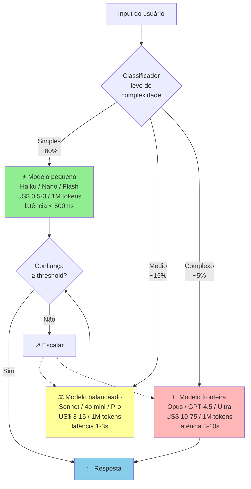

A cascata economiza setenta a noventa por cento de custo, em relação a "sempre fronteira". Mantendo qualidade onde importa. Requer classificador leve (heurística, ou modelo pequeno), e confidence scoring para escalar.

A regra. Cascata de modelos. Tentar modelo pequeno. Escalar para maior se a confiança estiver baixa, ou houver falha específica.

#### 2. Prompt engineering em produção

Prompt em produção é código. O tratamento adequado é em quatro pontos.

Versionado. Cada prompt tem versão, histórico, e autor da mudança. Testado. A mudança de prompt passa por eval suite antes de ir a produção. Estruturado. Templates com variáveis, não strings hardcoded. Documentado. Contexto do uso, casos de erro conhecidos, e critério de sucesso.

Ferramentas. LangSmith, PromptLayer, Humanloop, Braintrust. Plataformas de gestão de prompts em produção, com versionamento, e eval, integrados.

> [!important] Regras práticas de prompt em produção
> Prompts em produção ficam em arquivos separados, não em strings no código principal. Variáveis de sistema separadas com clareza do input de usuário (defesa contra prompt injection). Exemplos few-shot quando a tarefa pede (raciocínio, formatação específica). Instruções claras sobre formato de saída (JSON, markdown, etc.), com fallback para parsing falho.

#### 3. RAG, quando e como

Quando usar RAG. Conhecimento específico do cliente (contratos, documentação interna, base de produtos). Informação que muda frequentemente (preços, políticas). Volume de conhecimento maior que o context window do modelo. Necessidade de citar fontes.

Quando NÃO usar RAG. O conhecimento já está no modelo (fatos gerais, línguas, domínio amplo). Volume pequeno de contexto, que cabe em prompt.

Arquitetura RAG moderna (2026), em quatro etapas.

1. Ingestão. Documentos para chunking (parágrafos coerentes, de duzentos a oitocentos tokens), depois embeddings, depois vetores em DB.
2. DB vetorial. Pinecone, Weaviate, Qdrant, pgvector (extension do Postgres), ChromaDB.
3. Retrieval. Consulta para embedding, depois busca semântica top-K, depois re-ranking opcional.
4. Generation. Contexto recuperado mais pergunta, depois LLM, depois resposta.

A arquitetura RAG completa, incluindo técnicas avançadas.

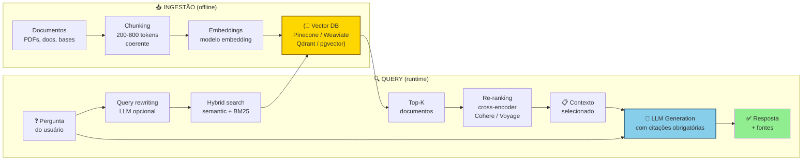

A Vector DB (dourada) é coração da infraestrutura. O LLM (azul) é onde acontece generation. Citações obrigatórias permitem auditoria do que foi efetivamente usado.

Técnicas avançadas. Hybrid search, embedding mais BM25 (keyword). Pega tanto semântica, quanto termos exatos. Re-ranking, modelo cross-encoder para re-ordenar top-K, antes de passar ao LLM (Cohere Rerank, Voyage). Query rewriting, usar LLM para reformular a pergunta do usuário, antes de retrieval. HyDE (Hypothetical Document Embeddings), gerar resposta hipotética primeiro, e usar embedding dela para busca.

Métricas-chave de RAG. Retrieval accuracy, percentual de consultas onde o documento relevante está no top-K. Answer faithfulness, a resposta está efetivamente baseada no contexto recuperado? Answer relevance, a resposta endereça a pergunta?

#### 4. Evaluations, disciplina de medir qualidade

O problema. Como saber se o seu produto AI está funcionando bem?

Não é "testei cinco exemplos manuais, e pareceu ok". É disciplina sistemática.

Componentes de uma eval suite, em quatro partes. Dataset de teste, cinquenta a quinhentos casos representativos, com output esperado. Métricas, exact match, semantic similarity, LLM-as-judge, human eval. Pipeline automatizado, rodar suite em cada mudança de prompt, ou modelo. Tracking histórico, a quality não degradou com mudanças?

Tipos de eval. Automated rule-based, checa formato, presença de palavras-chave, e validação de JSON. LLM-as-judge, outro LLM avalia qualidade. Cuidado com viés do judge. Human eval, avaliação humana de subset. Caro, mas gold standard para temas críticos. A/B em produção, feedback implícito (rating, thumbs up ou down, completion), e explícito.

Ferramentas. LangSmith, Braintrust, Helicone, Arize. Plataformas de LLM observability, e eval.

> [!important] Regra operacional de eval
> Não entra em produção mudança de prompt, ou modelo, que não passou na eval suite com score igual ou maior que o baseline. Sem isso, qualidade degrada por deriva silenciosa, e ninguém percebe até o cliente reclamar.

#### 5. Mitigação de alucinação

Alucinação. Quando o LLM produz resposta plausível, mas factualmente incorreta.

Técnicas, em ordem de eficácia mais custo.

Grounding em RAG. Forçar o modelo a responder baseado em contexto recuperado, não em conhecimento paramétrico. Prompt: "Responda apenas com base no contexto abaixo. Se a resposta não está no contexto, diga 'não sei'."

Structured output. Forçar JSON schema. Reduz invenção de fatos, porque o modelo tem que preencher campos específicos.

Citação obrigatória. Exigir que a resposta cite a passagem específica do contexto. Auditável.

Verification loop. Segundo LLM verifica se a resposta do primeiro está coerente com o contexto.

Confidence scoring. O modelo fornece confiança. Abaixo de threshold, rota para humano, ou fallback.

Fine-tuning, com dataset curado. Última linha de defesa. Caro. Complexo. Mas elimina classes de erro.

Domínios críticos. Saúde, jurídico, finanças, segurança. Nesses, alucinação é inaceitável. A arquitetura deve incluir human-in-the-loop, ou confidence gates rígidos.

#### 6. Custo de inferência, o assassino silencioso

Cálculo padrão.

```text
Custo por usuário ativo/mês =
 (inferências/usuário/mês) ×
 (tokens médios/inferência) ×
 (custo por token)
```

Exemplo realista (produto de chat com RAG). Vinte inferências por usuário, por mês. Dois mil tokens de input (contexto mais pergunta), e quinhentos tokens output. Modelo intermediário, US$ 5 por 1M input tokens, e US$ 15 por 1M output tokens.

Custo. 20 vezes (2.000 vezes 5 mais 500 vezes 15) dividido por 1.000.000 igual a US$ 0,35 por usuário, por mês, ou cerca de R$ 1,80.

Parece pequeno. Mas. Power users consomem dez a cinquenta vezes isso. Se dez por cento da base consome cinquenta vezes, o custo efetivo sobe para US$ 1 a 5 por usuário, por mês. Em produto com ticket de US$ 10, a margem só de AI vira cinquenta a noventa por cento.

Técnicas de redução de custo. Caching, respostas idênticas, ou similares, reutilizadas. Reduções de trinta a setenta por cento em workflows repetitivos. Modelo cascata, tentar barato primeiro, e escalar se necessário. Prompt enxuto, cada palavra custa. Auditar prompts por ineficiência. Fine-tuning, modelo pequeno fine-tuned pode substituir modelo grande genérico (até dez vezes menor custo). Rate limiting por tier, freemium com limite, e paid tiers com caps. Monitoramento por usuário, detectar outliers que consomem desproporcionalmente.

#### 7. Latência, UX AI-native

LLMs de fronteira têm latência de um a dez segundos. Em UI interativa, isso destrói a UX.

Técnicas. Streaming, mostrar tokens à medida que são gerados. Percepção de latência menos setenta por cento. Feedback visual, "pensando...", "consultando dados...", animação. O usuário espera, se entende que está acontecendo algo. Otimistic UI, começar a mostrar UI enquanto a resposta é gerada. Pré-computation, responder antes que o usuário peça (por exemplo, sugestões prontas ao abrir tela). Cascata de modelos, modelo rápido para primeira resposta, e modelo melhor em background, se o usuário pedir aprofundamento.

Targets saudáveis. Primeiro token, igual ou menor que um segundo (com streaming). Resposta completa para tarefa curta, igual ou menor que cinco segundos. Tarefas longas (documento, análise), igual ou menor que vinte segundos, com feedback de progresso.

#### 8. Fine-tuning versus RAG versus Prompt, quando cada um

| Técnica | Custo | Tempo | Melhor para |
|---|---|---|---|
| Prompt engineering | Baixo | Horas | Tarefas bem definidas, casos gerais |
| Few-shot prompting | Baixo | Horas | Formatação específica, tom, estilo |
| RAG | Médio | Semanas | Conhecimento específico, informação atualizada |
| Fine-tuning | Alto | Semanas-meses | Padrão muito específico, redução de latência/custo |

A regra. Começar sempre por prompt. Se não funciona, RAG. Fine-tuning só quando há mais de mil exemplos de treino curados, e o ROI justifica.

#### 9. Observability em produção

Em produção, monitorar. Latência (p50, p95, p99). Custo por inferência (agregado, e por usuário). Taxa de erro (timeouts, API errors). Qualidade (quando houver feedback signal: thumbs, rating, completion rate). Quality drift, degradação gradual de qualidade (comum quando o provedor atualiza o modelo silenciosamente).

Ferramentas. Helicone (LLM-specific), Langfuse, Datadog com custom metrics, Grafana.

### Margem Bruta pós-inferência, Taxa de Aprovação sem Edição Humana (Zero-Edit Rate), Latência P95 e Precisão no conjunto de Evals

Custo por usuário ativo, por mês (AI-specific). Alvo, igual ou menor que trinta por cento do ticket mensal.

Latência p95 (primeiro token). Igual ou menor que um segundo e meio.

Qualidade em eval suite. Igual ou maior que oitenta e cinco por cento (definido por produto).

Taxa de fallback ou erro. Igual ou menor que dois por cento das inferências.

Cost per conversion. Custo AI para atingir conversão medida.

Quality drift detection. Alerta em queda igual ou maior que cinco por cento em eval score.

### Governança de IA Generativa

Produto AI-native em 2026 enfrenta um conjunto de riscos de governança que não existiam em SaaS tradicional. Ignorá-los não é opção em segmentos regulados (saúde, finanças, jurídico), e começa a ser problema em qualquer segmento conforme a regulação avança (EU AI Act na Europa, framework NIST de IA nos EUA e, no Brasil, a atuação da ANPD sobre o tratamento de dados pessoais por sistemas de IA, nas figuras de controlador e operador da LGPD, além do Marco Legal da IA, PL 2338/2023, aprovado pelo Senado em dezembro de 2024 e aguardando parecer na comissão especial da Câmara em outubro de 2026; ver Capítulo 11 do Vol. 8).

**Os quatro domínios de governança de IA.**

*Transparência e explicabilidade*: o usuário deve entender (em termos razoáveis) por que o sistema gerou determinado output. "O modelo decide" não é resposta aceitável para output com consequências: rejeição de crédito, diagnóstico de saúde, recomendação jurídica. Em produto regulado, explainability pode ser requisito legal. Em produto não regulado, é requisito de confiança. Abordagem: (1) documentar internamente quais inputs afetam cada output, (2) logging de reasoning onde o modelo suporta (chain-of-thought), (3) UI que mostra fontes ou raciocínio ao usuário quando relevante.

*Bias e fairness*: modelos de linguagem amplificam vieses presentes nos dados de treino. Em contexto de produto com decisões que afetam pessoas (crédito, hiring, saúde), viés sistemático é risco legal e reputacional. Auditoria de bias: testar outputs com inputs que variam apenas por gênero, raça, ou outras características protegidas. Red-teaming específico para viés. Monitoramento de disparate impact em métricas de produto segmentadas.

*Human-in-the-loop (HITL) e limites de autonomia*: definir explicitamente que decisões o sistema pode tomar autonomamente e quais requerem revisão humana. Em saúde: modelo sugere, médico decide. Em crédito: modelo pontua, humano aprova acima de certo impacto. Em contrato jurídico: rascunho automático, advogado revisa antes de enviar. O critério: quanto maior a consequência e a irreversibilidade, mais HITL.

*Incidente de IA e recall*: o que acontece quando o modelo começa a alucinar consistentemente, quando um viés é descoberto em produção, ou quando o provedor muda o modelo? Plano de incidente de IA deve incluir: (1) critério de quando "desligar" feature AI (threshold de erro acima do qual o sistema vai offline), (2) plano de comunicação com usuários, (3) processo de rollback para versão anterior do prompt/modelo, (4) post-mortem com root cause de qualidade.

**Model card interno.** Boa prática crescentemente adotada: documentar para uso interno o que o modelo foi testado para fazer e o que não foi, suas limitações conhecidas, seus dados de eval de qualidade, e os casos de uso onde não deve ser usado. Não precisa ser público, mas deve existir. Previne que times de produto expandam o uso para domínios onde o modelo não foi avaliado.

**Regulação emergente.** EU AI Act (em vigor 2024-2025) classifica sistemas por risco (proibido, alto risco, limitado risco, mínimo risco). Empresas brasileiras que operam na Europa, ou que têm usuários europeus, estão no escopo. Sistemas de alto risco (crédito, emprego, educação, saúde) requerem: registro, avaliação de conformidade, documentação técnica, supervisão humana. LGPD + IA: quando o sistema toma decisões unicamente com base em tratamento automatizado de dados pessoais, o titular tem direito de solicitar a revisão da decisão e informações claras sobre os critérios e procedimentos utilizados (art. 20 da LGPD; a exigência legal de revisão obrigatoriamente por pessoa natural foi vetada na Lei 13.853/2019, mas manter revisão humana em decisões críticas segue recomendado para mitigar risco regulatório e no PL 2338/2023). Implementar processo de revisão humana para decisões automatizadas que afetam titulares.

**Checklist de governança mínima.**

- [ ] Model card interno documentado para cada feature AI crítica?
- [ ] Human-in-the-loop definido para decisões de alto impacto?
- [ ] Auditoria de bias realizada com dataset representativo do ICP?
- [ ] Plano de incidente de IA (trigger, rollback, comunicação)?
- [ ] Logging de inputs e outputs para auditoria (com LGPD compliance)?
- [ ] Usuário informado que está interagindo com IA onde relevante?
- [ ] Revisão de conformidade com EU AI Act para operações na Europa?

### Vender assinatura "ilimitada" de R$ 49/mês quando um único usuário pesado consome R$ 300 em chamadas de API de LLM

"GPT-4 funciona, tá bom". Sem eval, não sabe se mantém qualidade quando o provedor atualiza o modelo silenciosamente.

Prompt no meio do código. Não versionado, não testado, e não auditável.

Ignorar custo em base gratuita. Freemium sem cap de inferência vira prejuízo.

Latência desconsiderada no design. UI que assume resposta instantânea quebra em cem por cento dos casos AI-native.

Confiar em output sem verificação em domínio crítico. Saúde, jurídico, ou finanças, sem human-in-loop, é passivo.

Fine-tuning prematuro. Gastar meses fine-tunando, quando prompt mais RAG resolvia.

Dependência cem por cento de um provedor. Quando OpenAI muda preço, ou capacidade, a sua empresa vai junto.

Não medir quality drift. Degradação gradual passa despercebida. O cliente reclama três meses depois.

Prompt injection ignorado. Usuário malicioso consegue extrair system prompt. Instruir o modelo a ignorar regras. Exige defesa.

Hallucination em output estruturado. O modelo preenche campos com dados inventados se o JSON obriga. Validação, e retry, necessários.

### Checklist de execução prática

AI-native está no padrão quando todos os itens abaixo estão cumpridos.

- [ ] Model selection decidido com critério (não default), com plano B de provedor mapeado.
- [ ] Eval suite formal existe com dataset representativo, roda em cada deploy.
- [ ] Prompts versionados, testados e documentados (não no meio do código).
- [ ] RAG implementado onde faz sentido (não onde não faz).
- [ ] Custo por usuário/mês mapeado e dentro de target de margem.
- [ ] Latency p95 sob dois segundos em UI interativa, com streaming.
- [ ] Técnicas de mitigação de alucinação ativas onde crítico (não retóricas).
- [ ] Observability completo: latência, custo, qualidade, drift monitorados, com alertas de drift acima de 5%.
- [ ] Prompt injection defense implementado.
- [ ] Human-in-loop em domínios críticos (saúde, jurídico, finanças).
- [ ] Governança mínima: model card interno, auditoria de bias, plano de incidente de IA, conformidade EU AI Act se aplicável.

---

### O Espelho do Capítulo 10: Sua IA é o Motor Proprietário ou Apenas um Adesivo Alugado?

**Fechando o ciclo na trincheira:** Quando **Lucas e Marina** aplicaram as travas deste capítulo na rotina entre São Paulo e Florianópolis, a tensão da cena de abertura deixou de ser discussão subjetiva de corredores e virou regra clara de priorização, retenção e proteção de caixa.

**O Espelho (autodiagnóstico):**
1. Se um concorrente contratar dois bons programadores neste fim de semana e conectar na mesma API de IA que você usa, o que exatamente impede que ele replique 100% do seu produto até segunda-feira?
2. Toda vez que um usuário corrige ou aprova uma sugestão da sua IA na tela, esse ajuste retroalimenta automaticamente uma base proprietária de avaliação (*Evals*) e contexto exclusivo do seu nicho?
3. Você sabe quanto custa em centavos de inferência/tokens cada tarefa executada por cliente, e o seu preço cobra por **resultado entregue** em vez de dar uso infinito sem teto?

**Permissão Libertadora:**
Você está autorizado a tirar o "chat de texto em branco" da frente do seu usuário. Na maioria das operações B2B, um botão que já traz o trabalho 95% pronto nos bastidores vence qualquer janela de bate-papo onde o cliente precisa adivinhar qual prompt escrever.

**O Ritual de Segunda-Feira às 9h:**
Construa hoje o seu **Conjunto Ouro de Avaliação (Golden Dataset de 50 casos reais)**: 50 exemplos reais das entradas mais difíceis do seu cliente e a resposta perfeita esperada. Proíba qualquer mudança de prompt ou modelo em produção sem rodar esse teste antes.


---

## CAPÍTULO 11 — PIVOT: TIPOLOGIA, DECISÃO E EXECUÇÃO

### A Coragem de Matar o Filho Querido Antes que Ele Mate a Empresa

Quando Stewart Butterfield e sua equipe perceberam que o jogo online *Glitch*, no qual haviam trabalhado de corpo e alma por quase quatro anos, nunca daria lucro, tinham ainda alguns milhões de dólares dos investidores na conta bancária. A tentação humana natural era continuar queimando aquele caixa até o último centavo por orgulho, para não admitir em público que o jogo havia falhado.

Em vez disso, eles olharam para uma ferramenta interna que os próprios programadores da equipe haviam criado para trocar mensagens e arquivos enquanto construíam o jogo. Mataram o jogo com transparência absoluta e transformaram aquela ferramenta lateral no **Slack**: vendido anos depois por US$ 27,7 bilhões.

No Brasil, Lucas e Marina viveram seu próprio ponto de inflexão no primeiro ano. O produto deles nasceu como um "marketplace de consultores financeiros autônomos para pequenas empresas". Após seis meses, o marketplace patinava, mas todas as empresas entrevistadas pediam emprestada a planilha automatizada que Marina usava para auditar boletos e conciliar contas nos primeiros 15 minutos da reunião. Em uma sexta-feira decisiva, fecharam o marketplace, mantiveram o CNPJ, aproveitaram 100% do aprendizado do domínio e pivotaram para o software de tesouraria preditiva que salvou a empresa.

Mas atenção ao alerta vermelho deste capítulo: existe uma diferença abissal entre **O Pivot Cirúrgico Baseado em Evidência** e **O Zigue-Zague do Fundador Ansioso**. Mudar de ideia toda segunda-feira porque você teve preguiça de prospectar vinte clientes não é pivotar; é desistência crônica disfarçada de estratégia. Pivotar de verdade é manter um pé fincado no que você aprendeu de mais valioso e girar o outro pé com velocidade letal quando os dados provam que a tese antiga bateu em um teto estrutural: fazendo isso **enquanto você ainda tem pelo menos 6 a 9 meses de caixa** para financiar a nova curva.

---

Pivot (mudança de direção da empresa) é o termo mais usado, e menos entendido, da literatura de startup. Eric Ries popularizou o conceito em *Lean Startup* (2011), mas a frase "pivotamos" virou eufemismo, em muitos contextos, para "estávamos fazendo algo, mudamos para outra coisa, e não queremos falar publicamente sobre por quê". Este capítulo reconstrói o conceito como ferramenta operacional: que tipos de pivot existem, quando pivotar faz sentido, quando pivot é shutdown disfarçado e como executar bem a decisão depois de tomada.

Pivot aparece em várias fases do manual (Descoberta, Validação, PMF) como opção tática dentro da fase. Este capítulo consolida o tema como decisão estratégica, com framework próprio.

### Definição precisa de pivot

Pivot é mudança estrutural em um ou mais elementos-chave do negócio. Mantendo o aprendizado acumulado como base. Os elementos-chave são seis. Problema atendido, cliente servido, solução oferecida, modelo de negócio, canal de distribuição, e tecnologia central. Um pivot mantém pelo menos um desses elementos, e muda outros.

> [!warning] Pivot não é
> Ajuste tático pequeno (mudar preço, ajustar feature, trocar canal de marketing secundário). Isso é iteração normal. Mudança total em que todos os elementos mudam. Isso é shutdown e recomeço. Pivot "narrativo" em que o discurso muda, mas a operação não. Isso é rebranding (troca de marca).

A distinção importa porque cada categoria tem implicações diferentes. Iteração pode ser decidida pelo fundador sozinho, em dias. Pivot exige comunicação formal a stakeholders (partes interessadas: time, investidores, clientes). Toma semanas, ou meses, para executar. Shutdown é decisão de encerrar negócio (ver subseção sobre shutdown voluntário na [[IGNICAO-Vol-9-Maturidade-e-Exit#FASE 20 — ESTRATÉGIA DE SAÍDA (EXIT STRATEGY)|Fase 20 (Vol. 9)]]). Rebranding sem pivot real é dissonância que time, e mercado, percebem.

### Os seis tipos de pivot

**1. Customer pivot.** Mantém o problema, e a solução. Muda o cliente-alvo. O padrão. Você descobre que o cliente que imaginava inicialmente não é quem mais sofre, ou mais paga, por esse problema. Um cliente adjacente emerge como mais adequado. Exemplo. Produto pensado para pequena empresa, mas que decola em médias. O pivot é reposicionar ICP, e go-to-market, sem mudar o produto materialmente.

**2. Problem pivot.** Mantém o cliente, e o conhecimento do contexto. Muda o problema específico sendo atendido. O padrão. Descoberta de que o problema priorizado inicialmente é menos doloroso que um problema adjacente que o mesmo cliente tem. Exemplo. Startup que começou oferecendo ferramenta de CRM para pequenas empresas, pivotar para ferramenta de contabilidade para essas mesmas empresas. O cliente é o mesmo. A dor atendida é diferente.

**3. Solution pivot.** Mantém o problema, e o cliente. Muda radicalmente a solução. O padrão. A solução imaginada não é escalável, não tem unit economics, ou não é adotada. Mas a dor é real, e o cliente existe. Exemplo. Startup que tentou solução de software puro para problema de logística, percebeu que exige serviço híbrido (software mais operação manual), e pivotou para modelo operacional diferente. Mantendo cliente, e problema.

**4. Business model pivot.** Mantém produto, e cliente. Muda como cobra. O padrão mais comum. B2C com monetização publicitária pivot para subscription (ou vice-versa). SaaS com licença por usuário pivot para modelo por uso. Freemium agressivo pivot para gated freemium. Exemplo. Muitas fintechs começaram com monetização via float, ou lending. Descobriram que subscription complementar tornaria o negócio mais defensável. Adicionaram.

**5. Channel pivot.** Mantém produto, cliente, e problema. Muda como o produto chega. O padrão. Descobrir que o canal de aquisição inicial não escala. Pivotar para canal diferente (direct-to-consumer para canal indireto, inbound para outbound, PLG para enterprise sales). Exemplo. SaaS que começou PLG puro pivot para motion híbrida (PLG mais sales assisted), quando descobre que clientes maiores não convertem sem intervenção humana.

**6. Technology pivot.** Mantém proposta de valor. Muda tecnologia central. O padrão. A plataforma técnica escolhida inicialmente não escala, não performa, ou tem custo desalinhado com o modelo. Stack completamente diferente é adotado. Mais raro que os outros pivots. Mas importante em deep tech, ou em startups que apostaram em tecnologia emergente que não amadureceu.

### Pivots que funcionam, pivots que falham

Analisando casos brasileiros, e globais, documentados, padrões emergem.

**Pivots que funcionam tipicamente têm três características.**

Sinal claro antes da decisão. Dados específicos (a retenção cai, o CAC não paga, pesquisa com clientes mostra outra dor maior) indicaram a direção. Pivot feito por evidência. Não por pânico.

A maior parte do aprendizado se mantém. O time continua produtivo. O conhecimento do setor é aproveitado. Relações com clientes são preservadas. Ou convertidas em parceiros do pivot.

A nova direção tem hipótese específica, não apenas "tentar outra coisa". O fundador consegue articular por que a nova direção tem maior probabilidade de sucesso que a anterior.

**Casos brasileiros, e globais, de pivot bem-sucedido.**

Instagram (caso global relevante). Começou como Burbn, app de geolocalização com fotos. Pivotou para foto como core, depois de observar que os usuários usavam apenas essa feature. Customer pivot mais solution pivot combinados.

Loggi (caso brasileiro). Fabien Mendez começou em 2012 com o GoJames, app de transporte de passageiros, antes da Uber consolidar o segmento e antes de regulamentação clara. O negócio não vingou. Em 2013, observando o fluxo de motoboys, o time pivotou para entregas urbanas e, depois, para logística B2B e e-commerce. Mesmo time, mesma tese de marketplace de mobilidade, problema diferente. Customer pivot mais value pivot combinados.

99 nos primeiros anos. O modelo evoluiu conforme o mercado mudou. Eventualmente pivotou para incluir motoristas não taxistas (customer pivot).

Loft em várias épocas. Adaptou o modelo conforme testava segmentos de imóvel diferentes.

Movile e PlayKids. Pivot de carrier billing (parcerias com operadoras de telecom) para app store e modelo de assinatura digital, mantendo conteúdo infantil como core até a venda da PlayKids para a Sandbox em fevereiro de 2022.

**Pivots que falham tipicamente têm três sinais.**

Pânico como motivador. Decisão tomada em resposta a ansiedade (runway curto, investidor pressionando, time desmoralizando). Sem dados direcionais específicos. Tentativa de "virar qualquer coisa, desde que mude".

Mudança de múltiplos elementos simultaneamente. Cliente, problema, solução, canal, tudo muda. Isso não é pivot. É shutdown e recomeço. Mas mantendo o CNPJ. Equipe, e investidores, perdem referência.

Nova direção sem conhecimento específico da nova área. Pivot para setor onde o fundador não tem expertise. O time não tem rede. Os investidores não têm contexto. Frequentemente termina em segunda quebra, doze a dezoito meses depois.

> [!warning] Pivot frequentemente disfarçado de shutdown
> Alguns "pivots" são operações de preservação do ego do fundador e do capital remanescente, não mudança estratégica real. Os sintomas: a empresa não articula consistentemente o que faz agora (a cada conversa, a explicação muda), o time não sabe qual é a prioridade da semana, as métricas antigas são abandonadas sem que novas sejam estabelecidas, a comunicação a investidores é vaga e genérica, sem detalhes específicos. Nesses casos, o caminho honesto é shutdown ordenado. Pivot prolongado mascara o problema e consome capital que poderia ser preservado.

### Quando pivotar, o framework

Pivot é sério. Não deve ser default. Nem evitado. A decisão exige três filtros.

**Filtro 1, evidência direta.** Você tem dados específicos que indicam que a direção atual não funciona? Os dados podem ser. Métricas de produto (a retenção cai, a ativação está baixa). Unit economics (o CAC não paga). Pesquisa com clientes (a dor real é diferente). Sinal competitivo (concorrente maior está dominando). Pivot sem evidência é chute.

**Filtro 2, hipótese específica da nova direção.** Você tem tese articulável sobre por que a nova direção tem maior probabilidade de sucesso? A tese pode ser. Cliente diferente tem dor maior (customer pivot). Problema adjacente é mais urgente (problem pivot). Canal diferente escala melhor (channel pivot). A tese vaga "vamos tentar consumer" não é tese. É esperança.

**Filtro 3, capacidade de executar.** Você tem runway (capital) para o pivot? Tem time que consegue adaptar? Tem expertise no novo território? Pivot prematuro com runway curto resulta em empresa que não testou nem a direção antiga, nem a nova, adequadamente. Dupla quebra.

Se os três filtros apontam para "sim", pivot é decisão razoável. Se algum aponta para "não", ou "duvidoso", provavelmente não é o momento. Você está em iteração (não pivot), ou em caminho para shutdown (não pivot).

### Como executar um pivot bem

Decisão tomada, a execução tem três partes. Comunicação, operação, e medição.

#### Comunicação

Primeiro ao time. Em reunião presencial (ou vídeo, se distribuído). Sem pressa. Explicar a evidência que motivou a decisão. A nova direção específica, com hipótese. O que muda no dia a dia de cada função. Quem sai. Quem fica. O novo roadmap dos próximos noventa dias. As perguntas são bem-vindas, e esperadas. Time que descobre pivot por boato é time que nunca mais confia na liderança.

Depois aos investidores. Individualmente, se possível. Slide deck curto (cinco a dez slides), com a mesma estrutura. Evidência. Nova tese. Plano de execução. Marcos de validação. Investidores profissionais preferem pivot bem fundamentado a persistência em caminho que não funciona. Pivot comunicado bem preserva relação. Pivot silencioso, descoberto por terceiros, queima confiança.

Depois aos clientes existentes. Se a nova direção continua a servi-los, mensagem simples. "Continuamos atendendo vocês, além disso...". Se a nova direção significa que eles não são mais foco, conversa direta sobre timeline de descontinuidade, alternativas que podemos sugerir, e preservação de dados. Os clientes descontinuados mal viram detratores públicos. Os descontinuados bem viram apoiadores para a próxima direção.

#### Operação

Redefinir o roadmap de produto em função da nova tese. Identificar o que do antigo se preserva (componentes, aprendizado, clientes, contratos), e o que se descontinua (features, processos, contratos). Plano de execução de trinta, sessenta, e noventa dias, com marcos específicos.

Redefinir as métricas de sucesso. As métricas do negócio antigo não servem para medir o novo. Decidir explicitamente. Qual a métrica principal do pivot nos próximos noventa dias? Qual o número que indica "isso está funcionando"? Sem métrica redefinida, a empresa vive em limbo onde nada é avaliável.

Recalibrar a equipe. Alguns perfis do time anterior não se encaixam na nova direção. Diálogo franco é necessário. Algumas pessoas encontram novo papel. Outras saem. Melhor separação consensual e rápida do que permanência forçada em papel inadequado.

#### Medição

Pivot precisa de prazo. Tipicamente noventa a cento e oitenta dias para gerar sinal direcional claro. Marcos intermediários a cada trinta dias. A nova direção está produzindo os sinais esperados? Se sim, continuar. Se não, segundo pivot geralmente não é a resposta. Shutdown voluntário é mais honesto que série de pivots em sequência.

> [!important] O pior cenário do pivot
> Empresa pivotando indefinidamente. Cada vez consumindo mais capital. Sem nunca validar nada. Medição rigorosa, com prazo definido, é o que evita esse cenário. Pivot sem prazo não é pivot. É deriva estratégica.

### Armadilhas do pivot

**1. Pivot como procrastinação da decisão de shutdown.** O fundador não aceita que a empresa não vai dar certo. Inicia pivot como forma de "manter esperança". Pivot sem convicção real da nova direção consome tempo, e capital, sem resolver nada.

**2. Pivot por pressão de investidor sem convicção do fundador.** O investidor sugere direção que parece promissora. O fundador aceita, para não perder apoio. Sem convicção interna, a execução é medíocre. O pivot falha. Mas agora com ressentimento mútuo entre fundador, e investidor.

**3. Múltiplos pivots em sequência.** A cada seis meses, nova direção. O time se desgasta. Os investidores perdem confiança. A narrativa da empresa se torna incompreensível. Regra informal. Se você pivotou mais de uma vez nos últimos dezoito meses, o problema provavelmente não é a direção. É a capacidade de validação antes do pivot.

**4. Pivot que muda tudo, exceto a equipe.** Customer, e problema, e solução novos. Mas com time contratado para a direção antiga. Pode funcionar se o time for senior, e adaptável. Frequentemente não funciona se o time for especializado na direção antiga.

**5. Comunicar o pivot como "evolução", em vez de "mudança".** Para proteger o ego do fundador, a narrativa é de "estamos evoluindo para atender melhor". O time, e os investidores, percebem a maquiagem. Perdem confiança na comunicação subsequente da empresa. Honestidade direta ("estávamos em X, decidimos ir para Y por razões Z") funciona melhor que narrativa polida.

**6. Pivotar sem desligar a direção antiga.** A empresa tenta executar caminho novo, e antigo, simultaneamente, por "segurança". Resultado. Execução medíocre em ambos. Nenhum validado. Capital queimado duplamente. Pivot real exige decisão de descontinuar o antigo. Mesmo com dor.

### Sinais de que você precisa pivotar

Lista de sintomas observáveis, priorizada por gravidade.

Retenção de usuários consistentemente abaixo do benchmark do seu segmento por três ou mais meses.

Crescimento de receita desacelerando, ou estagnado, por dois ou mais trimestres.

CAC consistentemente acima do que LTV suporta. Mesmo com otimizações.

Pesquisa com clientes atuais revela que eles não recomendariam ativamente.

Clientes novos não vêm por indicação (o crescimento sempre precisa de push de marketing).

Time desmotivado por falta de sinal claro de progresso.

Investidores manifestando preocupação em várias reuniões consecutivas.

Concorrente com modelo diferente está crescendo claramente mais rápido.

Um, ou dois, desses sinais não exige pivot. Exige investigação. Quatro, ou mais, sinais simultaneamente, sustentados por dois ou mais trimestres, é momento de considerar pivot seriamente.

### Sinais de que você NÃO precisa pivotar

Crescimento lento, mas consistente, com PMF moderado.

Retenção boa em nicho específico, com dificuldade em expandir além dele (isso é wedge, e o trabalho de expansão é diferente de pivot).

Desafios de execução (contratação, operação) que não são sobre direção do negócio.

Pressão de investidores por crescimento mais rápido, sem sinais operacionais de problema do modelo.

Comparação com concorrentes em outro tipo de negócio (que não compete diretamente).

Confundir problemas de execução com necessidade de pivot é armadilha comum. Pivot muda direção. Problemas de execução exigem melhoria de operação na direção atual. Ações diferentes.

### Fechamento

Pivot bem executado é uma das ferramentas mais poderosas do fundador. Muitas empresas grandes hoje existem porque o fundador original pivotou no momento certo. Mas pivot mal executado, ou pivot como disfarce de shutdown, é uma das causas mais comuns de empresa que quebra.

A diferença entre os dois é disciplina. Evidência antes da decisão. Tese específica da nova direção. Comunicação aberta a stakeholders. Medição rigorosa do novo caminho. Falta de qualquer um dos quatro quase sempre indica que o "pivot" é, na verdade, outra coisa menos útil.

> [!info] Fases relacionadas

---

### O Espelho do Capítulo 11: Você Está Sendo Resiliente na Visão ou Teimoso num Beco Sem Saída?

**Fechando o ciclo na trincheira:** Quando **Lucas e Marina** aplicaram as travas deste capítulo na rotina entre São Paulo e Florianópolis, a tensão da cena de abertura deixou de ser discussão subjetiva de corredores e virou regra clara de priorização, retenção e proteção de caixa.

**O Espelho (autodiagnóstico):**
1. Se você fosse demitido hoje e uma nova diretoria assumisse a empresa amanhã às 8h sem apego emocional ao código já escrito, qual produto ou segmento eles matariam no primeiro dia?
2. Existe uma parte lateral do seu produto ou serviço (um módulo específico, um perfil de cliente ou ferramenta interna) que gera 80% dos elogios espontâneos enquanto o produto principal precisa ser empurrado à força?
3. Quantos meses de caixa (*Runway*) você ainda tem no banco hoje? Se continuar no ritmo atual por mais quatro meses, ainda sobrará fôlego para girar o leme?

**Permissão Libertadora:**
Você está autorizado a jogar fora seis meses de código já escrito se ele estiver amarrando você a um mercado que não paga. O código passado é custo irrecuperável (*sunk cost*); os próximos doze meses da sua vida não são.

**O Ritual de Segunda-Feira às 9h:**
Responda por escrito com seus sócios à pergunta de Andy Grove: *"Qual é a verdade desconfortável sobre o nosso negócio que já sabemos no estômago, mas evitamos dizer em voz alta?"* Coloque-a na mesa hoje.

