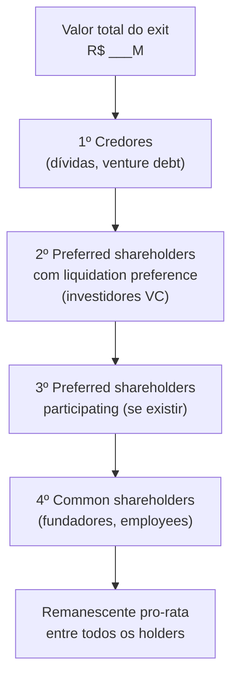
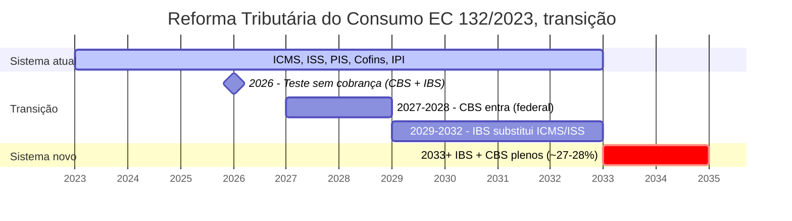
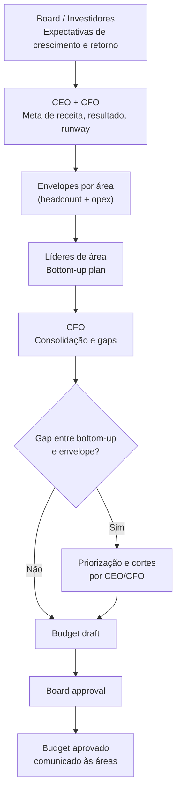
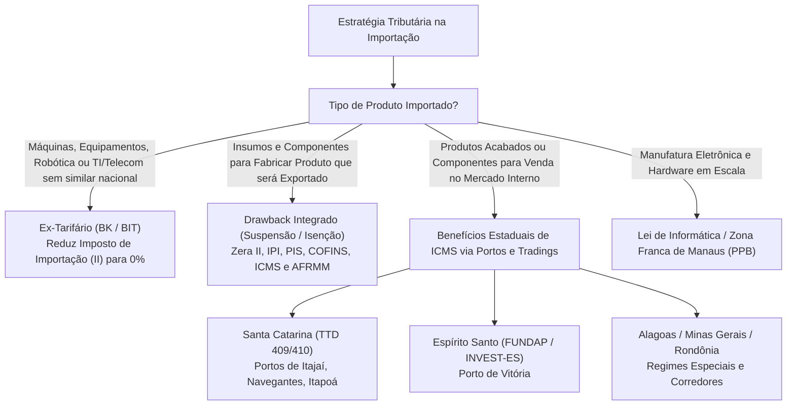
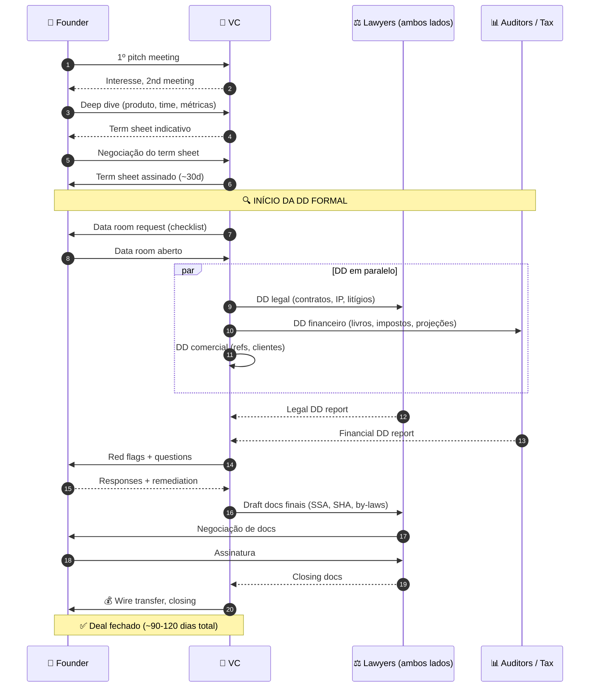
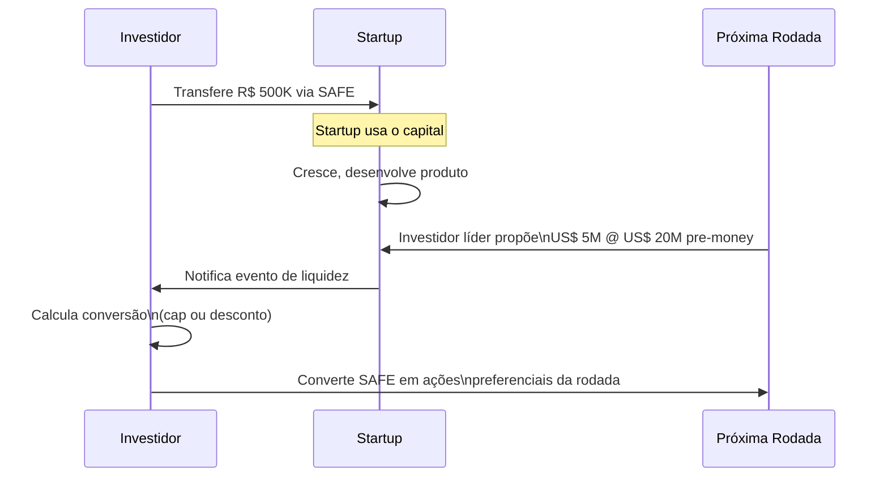

# IGNIÇÃO — Volume 5: Finanças, Captação e Venture Capital

**Contabilidade, Reforma Tributária, FP&A, Comércio Exterior, Caixa e Rodadas de Investimento (Fase 14 e Capítulos 1 a 15)**

*João Prado · 2026 — Edição Narrativa Enxuta (v5.1)*

---

## Sobre este Volume

Este é o **Volume 5 (Finanças, Captação e Venture Capital)** da coleção **IGNIÇÃO — O manual operacional do empreendedor brasileiro** (10 volumes).

Manual do CEO e do CFO para finanças operacionais, contabilidade, tributário, comércio exterior, estruturação de capital e fundraising no Brasil. Abre com a Fase 14 (Capital para Escala, Rodadas e Eficiência Financeira) — trazendo embutidos todos os 11 frameworks financeiros e de valuation (Unit Economics, Coortes, LTV:CAC, Burn Multiple, Rule of 40, Magic Number, Quick Ratio, CCC, DCF, Comparables e DuPont), os canvases Storytelling/SCQA e Capital Stack/Waterfall e 6 templates completos (Data Room, Term Sheet Anotado, Plano de Rodada, Pitch Deck SCQA, Investor Update e Financiamento Não-Diluitivo) —, seguida por 15 capítulos em ordem lógica de execução: demonstrativos financeiros, contabilidade e Reforma Tributária (IBS/CBS), modelagem operacional e coortes, FP&A e revenue forecasting, capital de giro e gestão de caixa, bancos, Comércio Exterior e Importação (Ásia-Brasil, Radar/SISCOMEX, Landed Cost e benefícios estaduais de ICMS), seguros, Venture Capital e planejamento de rodada, valuation, SAFE/mútuo conversível, FINEP/BNDES/FAPESP, venture debt, crowdfunding CVM 88 / tokenização e Investor Relations.

---

## Mapa da Coleção IGNIÇÃO

```mermaid
graph LR
    subgraph J1["Do Zero à Validação"]
        V1["<b>Vol. 1 — Ideação</b><br/>Fases 0 a 3 · Fundador e Teoria"]
        V2["<b>Vol. 2 — Descoberta e Mercado</b><br/>Fases 4 a 6 · Cliente e Cunha"]
        V3["<b>Vol. 3 — Hipóteses e Protótipo</b><br/>Fases 7 a 10 · Testes e Modelos"]
        V1 --> V2 --> V3
    end
    subgraph J2["Tração e Escala"]
        V4["<b>Vol. 4 — Tração e PMF</b><br/>Fases 11 a 13 · MVP, GTM e Vendas"]
        V5["<b>Vol. 5 — Finanças e Captação</b><br/>Fase 14 · Caixa, VC, Tributário e FP&A"]
        V6["<b>Vol. 6 — Receita e Pessoas</b><br/>Fases 15 e 16 · Enterprise, Líderes e Cultura"]
        V7["<b>Vol. 7 — Produto e Engenharia</b><br/>Fase 17 · Operações, IA e Arquitetura"]
        V8["<b>Vol. 8 — Jurídico e Segurança</b><br/>Fase 18 · Societário, Contratos e LGPD"]
        V3 --> V4 --> V5 --> V6 --> V7 --> V8
    end
    subgraph J3["Ciclo Longo e Setores"]
        V9["<b>Vol. 9 — Maturidade, Exit e Family Office</b><br/>Fases 19 e 20 · Board, Crise, M&A, IPO e Cash Cow"]
        V10["<b>Vol. 10 — Economia da Inovação e 42 Verticais</b><br/>Hubs Globais, Regulação, 42 Setores e Dicionário"]
        V8 --> V9
    end
    V10 -. "Consulta Setorial e Dicionário" .-> J1
    V10 -. "Consulta Setorial e Dicionário" .-> J2
    V10 -. "Consulta Setorial e Dicionário" .-> J3
```



---

## Sumário deste Volume

### Fase da Etapa (Fase 14)
- [[#FASE 14 — CAPITAL PARA ESCALA, RODADAS E EFICIÊNCIA FINANCEIRA|FASE 14 — CAPITAL PARA ESCALA, RODADAS E EFICIÊNCIA FINANCEIRA]]
### Finanças Operacionais, Contabilidade, Reforma Tributária, Modelagem e FP&A (Capítulos 1 a 4)
- [[#CAPÍTULO 1 — DEMONSTRATIVOS FINANCEIROS PARA O FUNDADOR|CAPÍTULO 1 — DEMONSTRATIVOS FINANCEIROS PARA O FUNDADOR]]
- [[#CAPÍTULO 2 — CONTABILIDADE, REGIMES FISCAIS E TRIBUTÁRIO ESTRATÉGICO (REFORMA IBS/CBS E INCENTIVOS)|CAPÍTULO 2 — CONTABILIDADE, REGIMES FISCAIS E TRIBUTÁRIO ESTRATÉGICO (REFORMA IBS/CBS E INCENTIVOS)]]
- [[#CAPÍTULO 3 — MODELAGEM FINANCEIRA OPERACIONAL BOTTOM-UP E PROJEÇÕES POR COORTES (COHORTS)|CAPÍTULO 3 — MODELAGEM FINANCEIRA OPERACIONAL BOTTOM-UP E PROJEÇÕES POR COORTES (COHORTS)]]
- [[#CAPÍTULO 4 — PLANEJAMENTO FINANCEIRO (FP&A), ORÇAMENTO E REVENUE FORECASTING|CAPÍTULO 4 — PLANEJAMENTO FINANCEIRO (FP&A), ORÇAMENTO E REVENUE FORECASTING]]
### Capital de Giro, Crédito Bancário, Comércio Exterior, Caixa e Seguros (Capítulos 5 a 8)
- [[#CAPÍTULO 5 — CAPITAL DE GIRO, RECEBÍVEIS E GESTÃO DE CAIXA EM PROFUNDIDADE|CAPÍTULO 5 — CAPITAL DE GIRO, RECEBÍVEIS E GESTÃO DE CAIXA EM PROFUNDIDADE]]
- [[#CAPÍTULO 6 — RELAÇÕES BANCÁRIAS E CRÉDITO NO BRASIL|CAPÍTULO 6 — RELAÇÕES BANCÁRIAS E CRÉDITO NO BRASIL]]
- [[#CAPÍTULO 7 — COMÉRCIO EXTERIOR, IMPORTAÇÃO (ÁSIA-BRASIL), DESEMBARAÇO ADUANEIRO, TRIBUTAÇÃO EM CASCATA E BENEFÍCIOS FISCAIS ESTADUAIS|CAPÍTULO 7 — COMÉRCIO EXTERIOR, IMPORTAÇÃO (ÁSIA-BRASIL), DESEMBARAÇO ADUANEIRO, TRIBUTAÇÃO EM CASCATA E BENEFÍCIOS FISCAIS ESTADUAIS]]
- [[#CAPÍTULO 8 — GESTÃO DE RISCO E SEGUROS PARA STARTUPS|CAPÍTULO 8 — GESTÃO DE RISCO E SEGUROS PARA STARTUPS]]
### Captação de Capital, Venture Capital, Valuation e Alternativas (Capítulos 9 a 15)
- [[#CAPÍTULO 9 — CAPTAÇÃO DE EQUITY: PLANEJAMENTO DE RODADA, PITCH E RELACIONAMENTO COM INVESTIDORES|CAPÍTULO 9 — CAPTAÇÃO DE EQUITY: PLANEJAMENTO DE RODADA, PITCH E RELACIONAMENTO COM INVESTIDORES]]
- [[#CAPÍTULO 10 — VALUATION METHODS: COMO INVESTIDORES CALCULAM E COMO VOCÊ CALCULA PARA NEGOCIAR|CAPÍTULO 10 — VALUATION METHODS: COMO INVESTIDORES CALCULAM E COMO VOCÊ CALCULA PARA NEGOCIAR]]
- [[#CAPÍTULO 11 — INSTRUMENTOS DE CAPTAÇÃO: SAFE, NOTA CONVERSÍVEL E MÚTUO CONVERSÍVEL|CAPÍTULO 11 — INSTRUMENTOS DE CAPTAÇÃO: SAFE, NOTA CONVERSÍVEL E MÚTUO CONVERSÍVEL]]
- [[#CAPÍTULO 12 — FINANCIAMENTO NÃO-DILUITIVO|CAPÍTULO 12 — FINANCIAMENTO NÃO-DILUITIVO]]
- [[#CAPÍTULO 13 — VENTURE DEBT E REVENUE-BASED FINANCING (RBF)|CAPÍTULO 13 — VENTURE DEBT E REVENUE-BASED FINANCING (RBF)]]
- [[#CAPÍTULO 14 — CAPTAÇÃO ALTERNATIVA DIGITAL: EQUITY CROWDFUNDING (CVM 88) E TOKENIZAÇÃO DE ATIVOS|CAPÍTULO 14 — CAPTAÇÃO ALTERNATIVA DIGITAL: EQUITY CROWDFUNDING (CVM 88) E TOKENIZAÇÃO DE ATIVOS]]
- [[#CAPÍTULO 15 — INVESTOR RELATIONS PÓS-RODADA|CAPÍTULO 15 — INVESTOR RELATIONS PÓS-RODADA]]

---

# FASE DA ETAPA — CAPITAL PARA ESCALA, RODADAS E EFICIÊNCIA FINANCEIRA (FASE 14)

Com o *Product-Market Fit* comprovado, você entra na etapa de Escala. A **[[#FASE 14 — CAPITAL PARA ESCALA, RODADAS E EFICIÊNCIA FINANCEIRA|Fase 14]]** abre o manual do CEO e do CFO ensinando como monitorar as nove métricas vitais de uma *scaleup*, estruturar o *data room* e levantar capital em posição de força, com todos os 11 frameworks financeiros e de *valuation* e os 6 templates de rodada integrados na Oficina.

---

## FASE 14 — CAPITAL PARA ESCALA, RODADAS E EFICIÊNCIA FINANCEIRA

### O Paradoxo do Foguete sem Tanque: Quando Crescer Mais Rápido Antecipa a Sua Morte

São 21h15 de uma quinta-feira chuvosa na Vila Olímpia, em São Paulo. **Lucas** projeta na TV da sala de reuniões o gráfico que todo fundador sonha mostrar: o ARR do SaaS B2B que ele e **Marina** fundaram saltou de R$ 2,4 milhões para R$ 7,8 milhões em quatorze meses. Há garrafas de espumante sobre a mesa. Marina, porém, não abre nenhuma. Sentada com o notebook aberto na planilha de tesouraria de Florianópolis, ela aponta para a última linha em vermelho: para adicionar R$ 5,4 milhões de receita anualizada, a empresa queimou R$ 11,2 milhões do caixa da rodada Seed. O *Burn Multiple* bateu 2,07x, o ciclo de recebimento dos clientes corporativos esticou para 75 dias e a conta corrente tem fôlego para exatos quatro meses e meio.

Por que empresas com recorde histórico de vendas quebram no trimestre seguinte ao melhor mês da sua história? Andy Grove ensinava na Intel que uma fábrica não é julgada pelo barulho das máquinas, mas pelo rendimento líquido de cada etapa do processo. No Brasil — onde o capital tem custo proibitivo e a Selic pune qualquer desperdício com rigor implacável — escalar uma operação comercial com *unit economics* sangrando não é crescimento; é suicídio assistido em câmera rápida.

Chamamos essa ilusão coletiva de **A Euforia do Faturamento Oco**: o vício em celebrar o topo da planilha enquanto o motor inferior consome dois reais de combustível para entregar um real de tração. Na Fase 14, você deixa de operar como um garimpeiro em busca de validação e assume a cadeira de engenheiro de alocação de capital. Aqui, crescer deixa de ser um ato de fé e passa a obedecer às leis da física financeira: eficiência de queima, empilhamento inteligente de fontes de financiamento e disciplina de retorno sobre cada centavo investido.

---

### A arquitetura de execução financeira: métricas de eficiência, capital stack e disciplina de caixa

#### Passo 3, defina e monitore métricas de saúde financeira

Depois do PMF, as métricas financeiras passam a guiar decisões estratégicas. Acompanhe nove delas.

| Métrica | Definição | Alvo SaaS |
|---|---|---|
| ARR / MRR | Receita recorrente anualizada/mensal | Crescimento 2-3x/ano em estágio de scale-up |
| Gross Margin | (Receita - custo de entrega) / Receita | SaaS B2B: 70-85%. Serviços: 40-60% |
| NRR (Net Revenue Retention — receita líquida retida e expandida na base) | (MRR inicial + expansão - contração - churn) / MRR inicial | ≥110% excelente, 100-110% saudável, <100% vazando |
| Gross Revenue Retention (GRR) | (MRR inicial - churn - contração) / MRR inicial | ≥90% saudável |
| Burn Multiple (quantos reais você queima para gerar 1 real de receita nova) | Caixa queimado no período / ARR adicionado | <1 excelente, 1-2 bom, >3 queima caixa sem eficiência |
| Magic Number | ARR adicionado no trimestre x 4 / S&M do trimestre anterior | >1 saudável, >1.5 ótimo |
| CAC Payback | CAC / (ARR mensal x gross margin) | <12 meses B2B SaaS, <6 meses mais rápido |
| Rule of 40 | % crescimento de ARR + % EBITDA margin | ≥40 é benchmark de investidores |
| Cash runway | Caixa / burn mensal | ≥18 meses recomendado |

#### Passo 4, estruture captação estratégica (não oportunista)

> [!note]
> Linhas de crédito PJ via Pronampe e BNDES, gestão de score PJ e relacionamento bancário em escala estão no [[#CAPÍTULO 6 — RELAÇÕES BANCÁRIAS E CRÉDITO NO BRASIL|Capítulo 6 — Relações Bancárias e Crédito]]. Gestão do ciclo de conversão de caixa (CCC) e antecipação de recebíveis estão no [[#CAPÍTULO 5 — CAPITAL DE GIRO, RECEBÍVEIS E GESTÃO DE CAIXA EM PROFUNDIDADE|Capítulo 5 — Capital de Giro]].

Captar capital é decisão estratégica, não sorte. Responda quatro perguntas antes de iniciar uma rodada.

Por quê. Qual o uso específico do capital? (Time, canal, M&A, runway). Vago é ruim.

Quanto. Valor para atingir o próximo milestone (dezoito a vinte e quatro meses), com buffer de trinta a cinquenta por cento. Nem mais, nem menos.

De quem. Investidor estratégico (traz conexões, expertise) versus investidor financeiro (só dinheiro). Ambos legítimos. Prioridades diferentes.

Quando. Capte com força em métricas. Não com desespero em caixa. Idealmente, comece rodada com nove a doze meses de runway. Depois dos seis meses, você está em modo sobrevivência. E perde poder de negociação.

A timeline típica de rodada Série A no Brasil e LatAm em 2026, em cinco janelas. Semanas 1-4: preparação (pitch deck, data room, modelo financeiro). Semanas 4-10: conversas iniciais com quinze a vinte e cinco fundos. Semanas 10-16: due diligence aprofundada com três a cinco fundos sérios. Semanas 16-20: term sheets e negociação. Semanas 20-28: closing (documentação legal, KYC). Total: cinco a sete meses.

> [!important] Comece cedo
> Sete meses de processo é o normal. Empresa que começa a captar com cinco meses de runway está em desespero. E os investidores percebem em dez minutos.

Os documentos necessários, em seis itens. Pitch deck (dez a quinze slides). Executive summary (resumo executivo de duas páginas). Data room (repositório com financeiros auditados, cap table, KPIs, contratos materiais e documentação legal). Modelo financeiro em Excel (base mais cenários). Deck de produto (demo mais roadmap). Referências (clientes, investidores atuais e advisors).

Os termos críticos em term sheet, que não-especialistas ignoram. Em nove pontos.

Valuation pré e pós-money. Óbvio. Mas calcule a diluição real.

Option pool. Quanto de equity fica reservado para futuros contratados, antes ou depois do investimento (afeta valuation de fundadores).

Liquidation preference (preferência de liquidação — o investidor recebe antes dos fundadores em caso de venda). Uma vez non-participating é padrão saudável. Duas vezes participating com cap é predatório.

Anti-dilution (proteção contra diluição em rodadas futuras a valuation menor). Weighted average (média ponderada, padrão) versus full-ratchet (ajuste total, predatório).

Vesting de fundadores. Re-vesting parcial (refazer o vesting sobre a parte não adquirida) é comum em Série A. Termos fora do padrão merecem atenção.

Board composition (composição do conselho). Quantos assentos os fundadores mantêm, quantos os investidores ganham e quem escolhe o(s) independente(s).

Pro-rata rights (direito de proporcionalidade). Direito de investir na mesma proporção em rodadas futuras. Padrão.

Protective provisions (cláusulas de proteção). Quais decisões precisam de aprovação do investidor (venda da empresa, novo investimento, mudança estratégica).

Drag-along, tag-along (obrigação e direito de venda conjunta, respectivamente). Obrigações e direitos em cenário de venda da empresa.

> [!warning] Recomendação firme sobre advogado
> Contrate advogado com experiência em VC (não advogado generalista) antes de assinar qualquer term sheet. Os erros mais caros que founders cometem em term sheet vêm de não ter alguém ao lado que já viu duzentos deals fecharem. A economia de R$ 15-30 mil em honorários custa, em cenário ruim, dezenas de milhões em equity de fundador.

#### Passo 6, monitore eficiência de capital (não apenas crescimento)

Em 2021 e 2022, o mercado premiava crescimento a qualquer custo. Desde 2023, premia crescimento eficiente. As métricas-chave: burn multiple abaixo de um vírgula cinco em SaaS B2B em scale; payback abaixo de doze meses (tolerável até vinte e quatro meses em B2B enterprise com ACV alto e contratos multianuais); Rule of 40 de quarenta ou mais (crescimento mais margem EBITDA); e margem bruta com trajetória de melhora conforme a escala — nunca degradando.

> [!warning] Eficiência versus crescimento bruto
> Se você está crescendo cem por cento ao ano, queimando R$ 5 para cada R$ 1 de ARR adicionado (burn multiple cinco), você vai ter dificuldade em Série B ou posterior. Se está crescendo setenta por cento ao ano, queimando R$ 1,20 por R$ 1 de ARR, investidor vai competir para entrar. Crescimento bruto, em ambiente de capital escasso, sem eficiência de fundo, é vaidade que não financia próxima rodada.

### Aquisições como Comprador, quando a startup vira compradora

> [!tip] Tratamento aprofundado em capítulo próprio
> A [[IGNICAO-Vol-9-Maturidade-e-Exit#FASE 20 — ESTRATÉGIA DE SAÍDA (EXIT STRATEGY)|Fase 20 (Vol. 9)]] cobre aquisição como evento de **exit** (quando você vende a sua empresa). O caso inverso — startup pós-PMF como **adquirente** — é movimento que, bem-feito, multiplica velocidade; mal-feito, destrói valor mais rápido que qualquer outra decisão estratégica. O detalhamento operacional completo (três condições para considerar, três tipos de aquisição com preços e cuidados, processo em seis passos, estrutura típica de deal, modelos de integração, alternativas a M&A) está consolidado no [[IGNICAO-Vol-9-Maturidade-e-Exit#CAPÍTULO 12 — M&A ATIVO E ROLL-UPS: FUNDADOR COMO COMPRADOR|Capítulo 12 — M&A como Comprador (Vol. 9)]]. Aqui, três pontos operacionais essenciais para a Fase 14.

**Três condições inegociáveis para considerar M&A.** PMF sólido com unit economics saudáveis (M&A não é resposta para fraqueza estratégica, é amplificador de força que já existe); caixa ou equity forte para pagar (pós-rodada, múltiplos em alta, ou equity com liquidez programada); tese estratégica clara escrita em uma página antes de procurar alvo (por que essa aquisição é melhor que build interno ou parceria; "ganhamos velocidade" é resposta fraca — velocidade para onde?).

**Três tipos com lógicas distintas.** *Tuck-in* (1-15 pessoas, R$ 2-20M, mix cash + equity, tipicamente para acqui-hire com produto; sinal de sucesso: ≥80% do time adquirido na empresa em 18 meses). *Horizontal* (consolidação de concorrente, 2-8x receita em SaaS saudável; canibalização de 30-60% da base é padrão — planeje sobre 50-70%). *Vertical* (fornecedor, canal ou integrador; 2-6x EBITDA em serviços, 3-8x receita em software; herda o negócio inteiro, não só a função).

**A regra combinada.** M&A é resposta quando três condições se sobrepõem: partnership não resolve (resolve 60-80% dos casos com custo zero de integração), *e* build interno levaria 18+ meses, *e* o adquirido tem ativo que você não consegue recriar (marca, time muito específico, base com troca difícil). Faltando qualquer uma, o caminho mais barato é melhor.

> [!warning] Modelo de integração antes do deal
> Escolha o modelo de integração (total, operacional com marca separada, ou subsidiária autônoma) *antes* de fechar o deal. Aquisição é evento de uma noite. Integração é processo de dois anos. 70% das aquisições destroem valor exatamente nesse ponto.

### A catraca de maturidade financeira: as provas de que sua máquina aguenta escala real

- [ ] Painel mensal das 9 métricas de saúde financeira implementado e auditado.
- [ ] *Data room* completo, *pitch deck* estruturado e modelo financeiro de 36 meses prontos antes do primeiro café com investidores.
- [ ] Termos de captação (*valuation*, *option pool*, *liquidation preference* 1x *non-participating*, *anti-dilution broad-based weighted average*) revisados por advogado especialista em VC.


---

### O Espelho da Fase 14: Você Está Construindo Patrimônio ou Queimando Combustível?

> [!tip] O Espelho do Gestor (Autodiagnóstico Rápido)
> 1. **A Prova do Combustível (*Burn Multiple*):** Nos últimos dois trimestres, quantos reais líquidos do caixa você queimou para cada R$ 1,00 de nova receita recorrente líquida adicionada? Se o número passa de 1,5x, onde está o vazamento?
> 2. **A Independência de Sobrevivência (*Default Alive*):** Se o mercado de capitais fechar amanhã de manhã e nenhum investidor ou banco atender o seu telefone pelos próximos 24 meses, sua empresa chega ao *breakeven* com o caixa atual ou morre no caminho?
> 3. **Custo da Fonte de Capital:** Você está financiando estoque e recebíveis de 60 dias entregando participação societária definitiva (*equity*) quando deveria usar linhas operacionais ou capital de giro estruturado?
>
> **Regra de Bolso (*estilo Andy Grove*):** Nunca escale o orçamento de vendas e marketing enquanto o seu *Payback de CAC* estiver acima de 15 meses ou a sua margem de contribuição pós-impostos for incerta.
>
> **O Ritual de Segunda-Feira às 9h:** Reúna seus sócios na abertura da semana, abra o extrato real ao lado da DRE do mês anterior e calcule na lousa três números inegociáveis: **Runway em meses exatos**, **Burn Multiple do trimestre** e **Ciclo de Conversão de Caixa em dias**.

### MÉTRICAS E BENCHMARKS DESTA FASE (FASE 14)

| Métrica | Early-stage | Growth | Maduro |
|---|---|---|---|
| NRR | — | ≥ 100% | ≥ 110% |
| CAC Payback | ≤ 18 meses | ≤ 12 meses | ≤ 9 meses |
| Margem bruta SaaS | ≥ 50% | ≥ 65% | ≥ 75% |
| Churn mensal | ≤ 3% | ≤ 2% | ≤ 1% |
| Magic Number | — | ≥ 0.75 | ≥ 1.0 |
| Rule of 40 | — | ≥ 20 | ≥ 40 |
| Burn Multiple | — | ≤ 2.5x | ≤ 1.5x |
| DAU/MAU | ≥ 10% | ≥ 20% | ≥ 30% |
| NPS (consumer) | ≥ 30 | ≥ 40 | ≥ 50 |
| NPS (enterprise) | ≥ 20 | ≥ 30 | ≥ 40 |
| eNPS | — | ≥ 20 | ≥ 30 |

> [!note] Nota sobre benchmarks
> Benchmarks são médias de mercado e variam por setor, modelo de negócio e contexto macroeconômico. Usar como referência de diagnóstico, não como meta absoluta. O que importa é a tendência ao longo do tempo para a sua empresa, não a distância de um número de mercado.

---

### MANUAL PASSO A PASSO DOS FRAMEWORKS DESTA FASE

> [!tip] Uso autocontido neste volume
> Todos os frameworks abaixo estão detalhados integralmente com origem, estrutura, passo a passo de aplicação, exemplo brasileiro e armadilhas para execução imediata nesta **Fase 14**.

#### Framework: Unit Economics

##### De onde vem a ferramenta (e por que sobreviveu ao filtro do tempo)

Conceito vindo de economia clássica (análise de custo marginal/receita marginal), popularizado em startups nos anos 2010 via SaaS analysts (David Skok, Tomasz Tunguz, Bill Gurley). Hoje é vocabulário universal em VC e startup finance.

##### A mecânica central (sem jargão)

Análise da **rentabilidade de um único cliente** ao longo de sua vida com a empresa. Se unit economics negativas, empresa perde dinheiro a cada cliente, crescer acelera falência. Se positivas, empresa ganha com escala.

##### As regras do jogo

Componentes essenciais:

- CAC (Customer Acquisition Cost): total de sales + marketing ÷ novos clientes. Fully-loaded (incluindo salários de sales).

- LTV (Lifetime Value): receita líquida total esperada de um cliente durante sua vida.

Fórmulas básicas LTV para SaaS:

- LTV simples = ARPU × Gross Margin × (1 / Monthly Churn).
- LTV sofisticado considera expansion e decline.

- Payback period: meses até recuperar CAC. Padrão saudável: < 12 meses, ideal < 6.

- Contribution margin: gross margin - CAC allocation.

##### Benchmarks (SaaS B2B)

- LTV:CAC: saudável 3:1+, excelente 5:1+, problemático < 1.5:1.
- Payback < 12 meses: saudável para growth stage.
- Gross margin > 70%: padrão SaaS.
- Burn Multiple (ver Framework: Burn Multiple (David Sacks, 2020) (Fase 14)) < 1: elite.

##### Como rodar na segunda-feira às 9h com seu time

Passo 1, Instrumente métricas em seu sistema (CRM + billing + marketing).

Passo 2, Segmente por canal, vertical, tamanho. Unit economics blended escondem gigantes negativos.

Passo 3, Decisões baseadas em cohort: LTV requer dados de cohorts reais com tempo.

Passo 4, Ação em canais/segmentos com LTV:CAC < 2: fix ou pare.

##### Na trincheira real: como isso funciona na prática

SaaS B2B com blended metrics aparentemente ok:

- LTV: R$ 18.000.
- CAC: R$ 4.200.
- LTV:CAC: 4.3, parece bom.

Segmentado:

- PMEs < 10 func: LTV R$ 8k. CAC R$ 2k, ratio 4:1 ✓.
- Mid-market 50-200 func: LTV R$ 35k. CAC R$ 6k, ratio 5.8:1 ✓.
- Enterprise 500+: LTV R$ 80k. CAC R$ 38k, ratio 2.1:1 ⚠.

Blended esconde enterprise sendo marginal. Ou não investir em enterprise, ou ajustar sales (pricing maior, close rate maior, etc.).

##### Onde o papel aceita tudo (armadilhas de execução)

Confundir revenue com gross profit: LTV deve usar gross profit, não revenue bruto, CAC não fully-loaded: excluir salários subestima CAC, LTV com churn pré-PMF: muito cedo, dados instáveis, Blended analysis sem segmentação: esconde problemas.

---

#### Framework: Cohort Analysis

##### De onde vem a ferramenta (e por que sobreviveu ao filtro do tempo)

Técnica de análise vinda da epidemiologia e marketing direct-response. Popularizada em startups SaaS como forma rigorosa de medir retention (vs. blended churn).

##### A mecânica central (sem jargão)

Análise que agrupa clientes por período de aquisição (ex.: "todos que assinaram em janeiro 2025") e acompanha seu comportamento ao longo do tempo. Revela como comportamento evolui e se produto melhora.

##### As regras do jogo

Cohort retention table:

| | M0 | M1 | M2 | M3 | M6 | M12 |
|----------|-----|-----|-----|-----|-----|-----|
| Jan 2025 | 100%| 85% | 78% | 73% | 68% | 62% |
| Feb 2025 | 100%| 88% | 82% | 78% | 72% |, |
| Mar 2025 | 100%| 90% | 84% | 80% |, |, |

O que observar:

- Retention melhora por cohort? (Feb > Jan = produto está melhorando.)
- Quando estabiliza? (M6 pode virar "piso".)
- Revenue retention (não só usuários): considera upsells/downgrades.

##### Como rodar na segunda-feira às 9h com seu time

Passo 1, Defina cohort criteria: mês de signup é padrão.

Passo 2, Métricas por cohort: retention, revenue, expansion, churn.

Passo 3, Ferramentas: Amplitude, Mixpanel, Heap, ou SQL custom.

Passo 4, Compare cohorts: tendência melhorando?

Passo 5, Investigue rupturas: cohort específica com retenção anomalamente baixa, o que aconteceu?

##### Na trincheira real: como isso funciona na prática

SaaS notou churn blended estável em 8%, cohort analysis revela:

- Cohorts de 2024 H1: M12 retention 70%.
- Cohorts 2024 H2: M12 retention 58%.
- Cohorts 2025 H1: M6 retention projeta 50%.

Alerta: produto ou aquisição quality deteriorou. Investigação:

- Canal de aquisição virou paid-heavy (menos qualificado).
- Novo competitor com preço agressivo entrou.

Ação: reforçar content channel, ajustar pricing.

##### Onde o papel aceita tudo (armadilhas de execução)

Só blended: esconde tendências críticas, Cohort muito granular: weekly cohorts com 5 clientes/semana = ruído, Não separar revenue de user retention: usuário continua, revenue caiu via downgrade.

---

#### Framework: LTV:CAC Ratio

##### De onde vem a ferramenta (e por que sobreviveu ao filtro do tempo)

Métrica popularizada por **David Skok** (ex-VC da Matrix Partners, blog forentrepreneurs.com) ao longo dos anos 2010. Hoje é métrica padrão para avaliar saúde de SaaS.

##### A mecânica central (sem jargão)

Razão entre LTV (Lifetime Value) e CAC (Customer Acquisition Cost). Responde: "para cada R$ 1 gasto adquirindo cliente, quantos R$ de valor trazemos ao longo da vida?"

##### Benchmarks

- < 1: empresa perde dinheiro por cliente. Insustentável.
- 1-3: sobrevive mas cresce lentamente.
- 3-5: saudável para SaaS B2B growth stage.
- 5-10: excelente, pode investir mais agressivamente em growth.
- > 10: raramente sustentável, provavelmente sob-investindo em growth.

##### As regras do jogo

LTV:CAC de 3+ combinado com payback < 12 meses = empresa pode escalar sem explodir em unit economics.

LTV:CAC alto mas payback longo = risco de capital (precisa financiar gap).

##### Como rodar na segunda-feira às 9h com seu time

Passo 1, Calcular LTV e CAC bem (Framework: Unit Economics (Fase 14)).

Passo 2, LTV:CAC por segmento.

Passo 3, Monitorar ao longo do tempo: LTV:CAC caindo = sinal de alerta.

Passo 4, Investir onde LTV:CAC > 3, reduzir onde < 2.

##### Onde o papel aceita tudo (armadilhas de execução)

LTV inflacionado por assumir churn atual permanente: churn pode subir com scale, CAC subestimado: só marketing, sem salários de sales, Cross-segment averaging: 1 segmento excelente carrega 4 ruins.

---

#### Framework: Burn Multiple (David Sacks, 2020)

##### De onde vem a ferramenta (e por que sobreviveu ao filtro do tempo)

**David Sacks**, ex-COO do PayPal, CEO da Yammer (vendida Microsoft), fundador da Craft Ventures, publicou "Burn Multiple" em 2020. Métrica única que combina burn rate e growth rate em número simples. Virou métrica padrão em VC após 2022-2023 quando eficiência de capital voltou a importar.

##### A mecânica central (sem jargão)

Burn Multiple = Net Burn / Net New ARR

- Net Burn: caixa gasto - receita (burn líquido).
- Net New ARR: novo ARR - churn - downgrades.

Responde: "para cada R$ 1 de novo ARR, quanto queimamos de caixa?"

##### Benchmarks (Sacks)

| Burn Multiple | Classificação |
|---------------|---------------|
| < 1x | Amazing (elite) |
| 1x - 1.5x | Great |
| 1.5x - 2x | Good |
| 2x - 3x | Suspect |
| > 3x | Bad |

##### Como rodar na segunda-feira às 9h com seu time

Passo 1, Calcule trimestralmente:

- Total burn em Q ÷ New ARR added em Q.

Passo 2, Track tendência: BM melhorando ou piorando?

Passo 3, Meta < 2 para growth-stage saudável.

Passo 4, BM > 3 por 2+ trimestres: red flag. Investigar e agir.

##### Na trincheira real: como isso funciona na prática

SaaS em Series B:

- Q1 2026: burn R$ 3M, new ARR R$ 2M. BM = 1.5 (Great).
- Q2 2026: burn R$ 4M, new ARR R$ 2M. BM = 2.0 (Suspect).
- Q3 2026: burn R$ 5M, new ARR R$ 1.5M. BM = 3.3 (Bad).

Deterioração clara. Burn subiu sem acompanhamento em ARR. Ação: cortar custos, desacelerar hiring, ou aceitar que mercado está hostile.

##### Onde o papel aceita tudo (armadilhas de execução)

Burn sem net: burn bruto sem considerar receita. Distorce, ARR sem net: novo ARR sem churn. Infla, BM trimestral sem tendência: 1 quarter ruim pode ser sazonalidade.

---

#### Framework: Rule of 40 (Brad Feld / SaaS community)

##### De onde vem a ferramenta (e por que sobreviveu ao filtro do tempo)

Origem informal em early 2010s, atribuída a **Brad Feld** (Foundry Group) e popularizada em SaaS community. Hoje é benchmark universal para SaaS maduro (> $10M ARR).

##### A mecânica central (sem jargão)

Rule of 40: Growth rate (%) + Profit margin (%) ≥ 40%.

Reconhece trade-off entre crescimento e rentabilidade. Empresa pode crescer 50% perdendo 10% (OK). Ou crescer 20% com margem 20% (também OK). 80% growth com -60% margem (não OK, queima demais).

##### Como rodar na segunda-feira às 9h com seu time

Passo 1, Calcule YoY growth rate (receita ano atual vs. ano anterior).

Passo 2, Calcule EBITDA margin (EBITDA ÷ receita).

Passo 3, Soma. Se ≥ 40%, saudável.

Passo 4, Trade-offs explícitos: decisão "crescer 30% mais queimando 20% mais" passa teste?

##### Benchmarks

- ≥ 40: saudável.
- 40-60: bom.
- > 60: excepcional (empresas como Zoom em 2020, Salesforce em picos).
- < 40: preocupante para SaaS maduro, pode ser ok em early-stage growth-focused.

##### Na trincheira real: como isso funciona na prática

- Empresa A: cresce 60% a.a., margem -10%. 60 + (-10) = 50. Passa.
- Empresa B: cresce 15% a.a., margem 25%. 15 + 25 = 40. Passa no limite.
- Empresa C: cresce 80% a.a., margem -50%. 80 + (-50) = 30. Falha.

##### Onde o papel aceita tudo (armadilhas de execução)

Aplicar a early-stage: Rule of 40 é para SaaS $10M+ ARR. Pré-PMF foca em crescimento, EBITDA cosmética: ajustes agressivos mascaram real burn.

---

#### Framework: Magic Number (Scale Venture Partners; popularizado por Lars Leckie / Hummer Winblad, 2008)

##### De onde vem a ferramenta (e por que sobreviveu ao filtro do tempo)

O conceito originou na Scale Venture Partners, quando Rory O'Driscoll analisava a tração de receita da Omniture vs. investimento em S&M (proporção mais que 2x em primeiro ano disparou a expressão "It's Magic!"). **Lars Leckie** da Hummer Winblad Venture Partners popularizou em 2008 com paper que estabeleceu os benchmarks padrão da métrica (>0,75 = pisar no acelerador; >1,5 = chamar imediatamente). Virou padrão em avaliação de escalabilidade SaaS.

##### A mecânica central (sem jargão)

Magic Number = (ARR Q atual - ARR Q anterior) × 4 / S&M spend Q anterior

Ou seja: ARR anualizado gerado em um trimestre ÷ gasto em S&M do trimestre anterior.

##### Benchmarks

- > 1.0: cada $ em S&M gera > $1 em ARR anualizado. Investir mais.
- 0.5 - 1.0: ok, investir com ajustes.
- < 0.5: S&M ineficiente. Revisar processo, não escalar.

##### Como rodar na segunda-feira às 9h com seu time

Passo 1, Trimestralmente calcular.

Passo 2, Tendência: subindo ou caindo?

Passo 3, Segmentar por canal quando possível.

Passo 4, Magic Number > 1 por 2+ trimestres = pode acelerar investimento em S&M.

##### Na trincheira real: como isso funciona na prática

- Q1: ARR $10M. S&M gasto Q1: $2M.
- Q2: ARR $12M. S&M gasto Q2: $2.5M.
- Magic Number Q2 = ($12M - $10M) × 4 / $2M = $8M / $2M = 4.0.

Muito alto. S&M é altamente eficiente. Oportunidade de escalar investimento.

##### Onde o papel aceita tudo (armadilhas de execução)

Aplicar a companies pré-PMF: sem scale de revenue, número instável, S&M não comprehensive: inclusive salários, ferramentas, contratos.

---

#### Framework: SaaS Quick Ratio (Mamoon Hamid, 2015)

##### De onde vem a ferramenta (e por que sobreviveu ao filtro do tempo)

**Mamoon Hamid**, VC da Kleiner Perkins (ex-Social Capital), popularizou Quick Ratio para SaaS em mid-2010s. Métrica de crescimento bruto vs. churn.

##### A mecânica central (sem jargão)

SaaS Quick Ratio = (New MRR + Expansion MRR) / (Churned MRR + Contraction MRR)

Razão entre crescimento bruto e perdas.

##### Benchmarks

- < 1: empresa encolhendo.
- 1 - 2: crescimento lento.
- 2 - 4: crescimento saudável.
- > 4: hyper-growth.

##### Como rodar na segunda-feira às 9h com seu time

Métrica mensal ou trimestral. Tendência revela saúde.

##### Na trincheira real: como isso funciona na prática

- Mês: new MRR R$ 200k, expansion R$ 50k, churned R$ 60k, contraction R$ 20k.
- Quick Ratio = (200 + 50) / (60 + 20) = 250 / 80 = 3.1. Crescimento saudável.

##### Onde o papel aceita tudo (armadilhas de execução)

Ignorar contraction: downgrades escondem churn real.

---

#### Framework: Cash Conversion Cycle (CCC)

##### De onde vem a ferramenta (e por que sobreviveu ao filtro do tempo)

Métrica tradicional de gestão financeira, central em manual de CFOs e texto como Brealey & Myers *Principles of Corporate Finance*. Especialmente importante em empresas com inventário (e-commerce, distribuição) e B2B com prazos de pagamento.

##### A mecânica central (sem jargão)

CCC = DIO + DSO - DPO

- DIO (Days Inventory Outstanding): dias com inventário antes de vender.
- DSO (Days Sales Outstanding): dias para receber pagamento após vender.
- DPO (Days Payable Outstanding): dias para pagar fornecedores.

Interpretação: quantos dias empresa "financia" o ciclo. CCC = 45 → empresa precisa cobrir 45 dias de operação com caixa próprio antes de receber retorno.

##### Benchmarks

- Negativo: empresa é financiada pelos fornecedores e clientes. Amazon, Apple, Dell, modelo excelente.
- 0-30: muito saudável.
- 30-60: aceitável.
- 60-120: apertado, requer capital de giro significativo.
- > 120: estresse financeiro.

##### Como rodar na segunda-feira às 9h com seu time

Passo 1, Calcular cada componente.

Passo 2, CCC alto? Fix o componente mais problemático:

- DIO alto: inventário excessivo, otimizar.
- DSO alto: clientes demoram a pagar, cobrança mais agressiva, factoring.
- DPO baixo: pagando rápido demais, negociar prazos.

Passo 3, Monitoramento mensal.

##### Na trincheira real: como isso funciona na prática

E-commerce brasileiro:

- DIO: 60 dias (inventário).
- DSO: 2 dias (cobra no ato).
- DPO: 45 dias (acordo com fornecedores).
- CCC = 60 + 2 - 45 = 17 dias.

Saudável. Precisa financiar 17 dias de operação.

B2B que vende a grandes redes:

- DIO: 30 dias.
- DSO: 90 dias (redes pagam em 90).
- DPO: 30 dias (paga fornecedores em 30).
- CCC = 30 + 90 - 30 = 90 dias.

Apertado. Precisa de R$ 90 dias × R$ X/dia de caixa para operar. Factoring pode reduzir DSO.

---

#### Framework: Discounted Cash Flow (DCF)

##### De onde vem a ferramenta (e por que sobreviveu ao filtro do tempo)

DCF tem raízes em trabalhos de **John Burr Williams** (*The Theory of Investment Value*, 1938) e **Irving Fisher**. Consolidou-se como método de valuation em finanças corporativas ao longo do séc. XX. Texto clássico: McKinsey's *Valuation* (Koller, Goedhart, Wessels, atualizado periodicamente).

##### A mecânica central (sem jargão)

Método de valuation que calcula **valor presente de fluxos de caixa futuros esperados**, descontando pelo custo de capital (WACC).

##### As regras do jogo

Fórmula básica:
Valor = Σ (FCFt / (1+r)^t) + Terminal Value

Onde:

- FCFt = free cash flow no ano t.
- r = taxa de desconto (custo de capital).
- Terminal Value = valor dos fluxos após projeção explícita (geralmente 5-10 anos).

Terminal Value típico: Gordon Growth, FCF_(n+1) / (r - g), onde g = growth rate perpétuo.

##### Como rodar na segunda-feira às 9h com seu time

Passo 1, Projete FCF para 5-10 anos: receita, COGS, OpEx, CapEx, taxes, working capital changes.

Passo 2, Calcule WACC: custo de dívida + custo de equity ponderados.

Passo 3, Desconte FCFs a valor presente.

Passo 4, Calcule Terminal Value.

Passo 5, Some. Ajuste por net debt.

##### Limitações em startups

DCF é **ruim para early-stage startups** porque:

- FCF negativo por anos, projeções são ficção.
- Growth rates imprevisíveis.
- WACC difícil de estimar.

Pre-revenue startups usam **Comparable Company Analysis** (Framework: Comparable Company Analysis / Precedent Transactions (Fase 14)) ou **método de Berkus** (ajustes qualitativos).

##### Onde o papel aceita tudo (armadilhas de execução)

Projeções otimistas: todas crescem 50% a.a, WACC subestimado: risco real é alto em startup, Terminal Value dominando valuation: Terminal > 60% do valor = perigoso, DCF em startup pre-revenue: método errado.

---

#### Framework: Comparable Company Analysis / Precedent Transactions

##### De onde vem a ferramenta (e por que sobreviveu ao filtro do tempo)

Método de valuation consagrado em investment banking e M&A. Usado há décadas, texto referência: Rosenbaum & Pearl, *Investment Banking* (atualizado).

##### A mecânica central (sem jargão)

Valuation baseado em **múltiplos** de empresas comparáveis:

- Comparable Company (public companies com atividade similar): EV/Revenue, EV/EBITDA, P/E.
- Precedent Transactions (M&A recentes): múltiplos pagos em transações similares.

##### Múltiplos típicos SaaS

- EV/Revenue (ARR): 5-15x em SaaS crescendo. Em mercados otimistas (2020-2021): 25-50x. Em mercados deprimidos (2022-2023): 4-8x.
- EV/EBITDA: 15-30x para empresas lucrativas.
- Rule of 40 adjusted: empresas com Rule of 40 alto ganham prêmio.

##### Como rodar na segunda-feira às 9h com seu time

Passo 1, Seleção de comparáveis: empresas similares em setor, tamanho, growth, geografia.

Passo 2, Cálculo de múltiplos de cada comparável.

Passo 3, Estatísticas: média, mediana, range.

Passo 4, Aplicar ao alvo: target's revenue × múltiplo mediano = valor implícito.

Passo 5, Ajustar por especificidades: discount/premium por size, growth, profitability.

##### Na trincheira real: como isso funciona na prática

Valuation de SaaS B2B brasileiro com R$ 30M ARR, crescendo 60% a.a.:

Comparáveis públicos (ajustados para BR):

- Empresa A: 8x ARR.
- Empresa B: 12x ARR.
- Empresa C: 10x ARR.
- Empresa D: 6x ARR.

Mediana: 9x. Para empresa crescendo 60% (acima da média dos comparáveis), prêmio modesto.

Valuation implícito: R$ 30M × 10x = **R$ 300M** (range R$ 270-360M).

Precedent transactions: busca M&A de SaaS similares nos últimos 24 meses. Múltiplos pagos variam.

Valuation final: triangulação. Ex.: R$ 280-340M.

##### Onde o papel aceita tudo (armadilhas de execução)

Comparáveis não comparáveis: comparar SaaS B2B enterprise com SaaS consumer distorce, Ignorar ciclo de mercado: múltiplos variam 3-5x com ciclo (2021 hot → 2023 cold), Cherry-picking: escolher só comparáveis altos.

---

#### Framework: DuPont Analysis (Donaldson Brown / DuPont, 1914)

##### De onde vem a ferramenta (e por que sobreviveu ao filtro do tempo)

Donaldson Brown, controller da DuPont Corporation, desenvolveu a fórmula de decomposição do ROE em 1914 enquanto tentava entender por que divisões com margens semelhantes tinham retornos sobre o patrimônio muito diferentes. O modelo foi adotado pela General Motors quando Alfred Sloan contratou Brown para reorganizar a empresa nos anos 1920. Tornou-se padrão de análise financeira corporativa. A versão moderna com três fatores (margem × giro × alavancagem) é ensinada em todos os cursos de finanças corporativas e usada por gestores de fundos para triagem de empresas.

##### A mecânica central (sem jargão)

Decomposição do **ROE (Return on Equity)** em três drivers operacionais que podem ser gerenciados separadamente:

```text
ROE = Margem Líquida × Giro do Ativo × Multiplicador de Alavancagem
    = (Lucro Líquido / Receita) × (Receita / Ativo Total) × (Ativo Total / Patrimônio Líquido)
```

Cada fator representa uma alavanca diferente: margem (eficiência operacional), giro (eficiência de uso de ativos), alavancagem (estrutura de capital).

##### As regras do jogo

Duas empresas podem ter o mesmo ROE por razões completamente diferentes: uma via margem alta com giro baixo (luxo, software), outra via giro alto com margem baixa (varejo, distribuição). A análise DuPont revela qual alavanca está gerando (ou destruindo) retorno. Permite benchmarking setorial preciso. A quinta geração do modelo adiciona separação entre resultado operacional e financeiro, distinguindo retorno de operações do retorno de alavancagem financeira.

##### Como rodar na segunda-feira às 9h com seu time

Passo 1: calcular os três componentes com os demonstrativos financeiros (DRE + Balanço). Passo 2: comparar cada componente contra a média do setor (não apenas o ROE final). Passo 3: identificar qual componente está abaixo da média setorial — esse é o diagnóstico. Passo 4: rastrear evolução temporal dos três componentes separadamente para detectar tendências de deterioração. Passo 5: modelar alavancas — se aumentarmos margem em 2pp mantendo giro, qual o impacto no ROE?

Exemplo aplicado, Magazine Luiza vs. varejo tradicional. Em estágio de crescimento (2017-2019), Magalu tinha margem líquida ~2,5% (similar a varejos físicos), mas giro do ativo muito superior (digitalização acelerou rotatividade de estoque, redução de custos fixos). O ROE consistentemente acima de 20% vinha do giro, não da margem. Análise DuPont mostraria claramente que a alavanca competitiva era operacional (eficiência de capital), não de pricing.

##### Onde o papel aceita tudo (armadilhas de execução)

(1) Usar apenas o ROE final sem decompor, dois ROE de 18% podem ter perfis de risco completamente diferentes. (2) Comparar empresas de setores diferentes sem ajuste (varejo tem giro alto por design, software tem margem alta por design — comparação direta é inútil). (3) Confundir alavancagem financeira com eficiência operacional: ROE alto via alavancagem aumenta retorno mas também risco. (4) Não separar receita recorrente de não-recorrente no cálculo da margem. (5) Usar dados de um único período sem análise de tendência — margem pode ser artificialmente alta por evento pontual.

---

### CANVASES VISUAIS DESTA FASE (COM EXEMPLOS BRASILEIROS PREENCHIDOS)

#### Canvas: Storytelling Canvas

##### Por que este quadro visual foi criado

Não tem autor único. O Storytelling Canvas emerge da convergência de três tradições ao longo dos anos 2010: (1) o trabalho de Nancy Duarte (*Resonate*, 2010) e Simon Sinek (*Start With Why*, 2009), que sistematizaram estruturas narrativas para comunicação de liderança e pitch; (2) a escola de narrativa estratégica de empresas como Narrative Science e FrameWorks Institute, que estudaram como enquadramento de mensagem afeta percepção de valor; (3) a prática de pitch coaching em aceleradoras (YC, Endeavor, Wayra) onde templates de narrativa viram ferramentas de workshop. O Storytelling Canvas é o artefato visual que condensa essas três tradições — uma tela para construir a narrativa de pitch ou comunicação institucional antes de abrir o PowerPoint.

##### A anatomia visual de uma página

Tela visual organizada em **oito blocos** que correspondem às oito decisões narrativas centrais:

- **Herói**: quem é o protagonista da história? (O cliente, não a empresa.)
- **Mundo antes**: como era o mundo antes do problema existir — ou o mundo atual do herói, antes da solução.
- **Problema / Tensão**: o que perturba o equilíbrio? Qual a dor do herói?
- **Tentativas falhas**: o que o herói já tentou? Por que não funcionou?
- **A virada**: como a solução entra? Qual é o insight que muda tudo?
- **Mundo depois**: como o mundo do herói muda com a solução?
- **Evidências**: o que prova que a virada é real? (Dados, casos, depoimentos.)
- **Chamada para ação**: o que você quer que o ouvinte faça após ouvir a história?


A estrutura segue o arco narrativo clássico de Joseph Campbell (A Jornada do Herói) aplicado ao contexto de produto e pitch — mas com um twist: **o herói não é o fundador nem a empresa, é o cliente**. A empresa é o "guia" (Gandalf, Yoda) que equipa o herói (Frodo, Luke) para vencer o problema.

##### O momento exato de colocar este canvas na parede

Use o Storytelling Canvas em três contextos: (1) **pitch de investimento** — qualquer conversa com VC, anjo ou processo de aceleração; (2) **comunicação institucional** — lançamento de produto, entrada em novo mercado, apresentação para board; (3) **venda B2B complexa** — a proposta comercial também é uma narrativa, e o Storytelling Canvas ajuda a estruturá-la do ponto de vista do cliente, não do fornecedor. Preencha o canvas antes de criar o deck — a narrativa define a estrutura; o deck é execução.

##### As regras de ouro para preencher sem se enganar

A tese unificada de Duarte, Sinek e da escola de pitch é que **dados sem narrativa não mudam comportamento**. O ser humano toma decisões emocionais e as justifica com lógica (Kahneman, *Thinking, Fast and Slow*). Uma história bem construída ativa a decisão emocional; os dados no bloco "Evidências" fornecem a justificativa racional. Inversamente, decks com dados sem narrativa produzem memorização zero — o investidor sai da reunião sem saber "o que essa empresa faz de diferente". O Storytelling Canvas força articular a narrativa primeiro, os dados depois.

##### Passo a passo na parede da sala (30 a 60 minutos)

Preencha individualmente primeiro (20-30 min), depois valide em grupo (30 min). A sequência importa:

1. **Herói** — descreva o cliente em uma frase: quem é, em que contexto, qual seu papel. Concreto: "Mariana, diretora de RH de empresa com 200 funcionários em SP, responsável por recrutamento de vagas técnicas."
2. **Mundo antes** — como é a vida de Mariana hoje, no contexto do problema? Sem mencionar a solução. Quanto tempo perde? Que ferramentas usa? Com que frustrações convive?
3. **Problema / Tensão** — qual perturbação ela sofre? Qual é a pergunta que ela não consegue responder? Qual é o custo (tempo, dinheiro, emocional) do problema?
4. **Tentativas falhas** — o que ela já tentou? LinkedIn Recruiter (caro, barulhento), indicações (lentas), agências (caras, incertas). Por que cada um falha?
5. **A virada** — como a solução entra? Não "o que o produto faz" — qual insight muda tudo para Mariana? "E se ela tivesse acesso ao candidato passivo certo, antes de ele atualizar o LinkedIn?"
6. **Mundo depois** — como é a vida de Mariana com a solução? Concreto: "Mariana fecha vagas técnicas em 18 dias em vez de 45, sem agência, com candidatos que ela não encontraria no LinkedIn."
7. **Evidências** — dados, casos, resultados de pilotos. "3 clientes beta fecharam 87% das vagas abertas em <20 dias. NPS de 72 entre candidatos."
8. **Chamada para ação** — o que você quer que o ouvinte faça agora? "Assinar pilot de 60 dias com 3 vagas inclusas." Específico, com urgência.

##### Exemplo brasileiro preenchido — Omie (ERP para PMEs), pitch de Series B (2020)

A Omie levantou Series B em 2020 (R$ 52 milhões, Softbank + Redpoint Eventures) com uma narrativa clara. Reconstrução do Storytelling Canvas:

| Bloco | Conteúdo |
|---|---|
| **Herói** | Carlos, dono de empresa contábil com 80 clientes PME em São Paulo. Responsável por fechar a contabilidade de todos os clientes, muitos dos quais usam sistemas diferentes ou planilhas. |
| **Mundo antes** | Carlos passa 40% do seu tempo recoletando dados de cada cliente — nota fiscal em um sistema, fluxo de caixa em planilha, folha em outro fornecedor. Nenhum sistema conversa. Cada cliente usa software diferente. Fechar o balancete mensal exige 3-4 dias de trabalho manual. |
| **Problema / Tensão** | Carlos não consegue escalar — com os 80 clientes atuais já está no limite. Para crescer para 150, precisaria contratar 3 auxiliares. Mas o problema não é falta de mão de obra — é que o modelo de coleta manual é insustentável em qualquer escala. |
| **Tentativas falhas** | Outros ERPs (Totvs, SAP) são caros demais para PME e exigem implementação. Excel é insustentável. ERPs simples de PME não têm API para o escritório contábil acessar dados do cliente. |
| **A virada** | E se o ERP do cliente PME e o sistema do contador fossem o mesmo ambiente? Cliente lança nota, contador vê em tempo real. Fim do mês de coleta. |
| **Mundo depois** | Carlos atende 150 clientes com a mesma equipe de hoje. Balancete fecha em 4 horas. Carlos se torna consultor estratégico dos clientes, não operador de dados. |
| **Evidências** | 12.000 empresas ativas na plataforma. NPS de 76. Churn mensal < 1%. Tempo médio de onboarding: 3 dias (vs. 3 meses de ERPs tradicionais). |
| **Chamada para ação** | Investimento de R$ 52M para expandir de SP para todo o Brasil e dobrar a equipe de CS/produto nos próximos 18 meses. |

**Insight do caso.** O Storytelling Canvas da Omie colocou o **contador como herói** — não o dono de PME, não a Omie. Isso foi uma decisão estratégica deliberada: o contador é o gatekeeper de adoção (ele indica o ERP para o cliente PME, não o contrário). Ao fazer o contador o herói, a narrativa ativa o interesse do investidor *e* do canal de distribuição ao mesmo tempo. **A lição: quem você escolhe como herói define quem vai abraçar a sua narrativa. Em B2B com canais de distribuição, o herói frequentemente não é o usuário final — é o intermediário que decide a adoção.**

##### Variações e extensões

- **Pitch Deck Canvas**: versão que mapeia cada bloco do Storytelling Canvas para um slide do deck — Herói → slide de problema, Virada → slide de solução, Evidências → slide de tração.
- **Press Release Canvas** (Amazon): variação do "trabalhar de trás para frente" da Amazon — escrever o press release do produto *antes* de construí-lo, forçando articular o "Mundo depois" com precisão.
- **One-Pager Canvas**: comprime o Storytelling Canvas em uma única página A4 para comunicação escrita (email para investidor, proposta comercial).

##### Extensão A — SCQA: narrativa para contextos além do pitch

O **SCQA** (Situation → Complication → Question → Answer), criado por Barbara Minto no McKinsey e sistematizado no *The Minto Pyramid Principle* (1987), é a estrutura de comunicação estruturada mais útil para o fundador em contextos onde o Storytelling Canvas seria pesado demais.

**A lógica do SCQA:**

```text
Situation:    O que todos já sabem — o contexto compartilhado
              (estabelece base comum, não discute)

Complication: O que mudou, o problema, a tensão que apareceu
              (por que estamos tendo essa conversa agora?)

Question:     A pergunta implícita que a Complication gera
              (o que fazemos a respeito?)

Answer:       A resposta — sua recomendação, tese ou pedido
              (o que estou propondo)
```

**Por que SCQA, não Storytelling Canvas:**

| Contexto | Use Storytelling Canvas | Use SCQA |
|---|---|---|
| Pitch de investimento (primeira reunião) | ✅ Narrativa emocional cria conexão | — |
| Update de board (trimestral) | — | ✅ Contexto já existe; foco em problema e ação |
| Investor update mensal (escrito) | — | ✅ Curto, direto, explica por que a questão importa agora |
| Email para parceiro estratégico | — | ✅ Respeita o tempo; faz o ponto sem rodeio |
| PR/press release | — | ✅ Lead jornalístico já é SCQA (who/what/why now) |
| Comunicação interna de mudança | — | ✅ Time precisa entender o porquê antes de aceitar o o quê |
| All-hands em momento de crise | Risco — emoção sem substância | ✅ Explica a situação antes de propor a solução |

**SCQA em prática — exemplos do fundador brasileiro:**

*Investor update mensal — SCQA:*

```text
S: Estamos crescendo MRR 15% ao mês há 6 meses; agendamos 
   100+ demos no trimestre com conversão de 23%.

C: Nos últimos 30 dias, o ciclo de fechamento dobrou de 21 
   para 42 dias. A causa identificada: 80% dos deals agora 
   envolvem aprovação de TI, que não estava no processo original.

Q: Como ajustar o processo sem perder velocidade de vendas?

A: Estamos criando deck técnico específico para TI e adicionando 
   discovery de TI como etapa obrigatória na Fase 2 do pipeline.
   [Pedido: intro para CISOs de 3 empresas mid-market no seu portfólio]
```

*Comunicação interna de layoff — SCQA:*

```text
S: Levantamos R$ 8M em agosto e planejamos crescimento 
   de 40% de headcount ao longo de 2024.

C: O mercado desacelerou. Churn acelerou para 4,5% ao mês. 
   No ritmo atual, atingimos burn crítico em 7 meses.

Q: O que precisamos fazer para preservar a empresa?

A: Vamos reduzir o time em 20%, focando nas áreas de produto 
   e vendas que sustentam o núcleo. Aqui está o que muda para 
   quem fica, e como vamos apoiar quem vai sair.
```

**SCQA no board deck:**
No slide de "Roadblocks e Riscos" do board deck (Template: Board Deck (Apresentação para o Conselho) (Fase 20)), cada problema deve ser apresentado em formato SCQA implícito: a célula "Risco / problema" é a Complication; "Mitigação atual" é a resposta parcial; "Ajuda necessária do board" é a Question. Quando o board member lê o slide, ele já vê Situation (conhece a empresa), Complication (o problema), e sabe que a questão é "o que fazemos". Sua resposta é a Answer colaborativa.

##### Extensão B — Strategic Narrative Framework (Andy Raskin)

O **Strategic Narrative** de Andy Raskin, consultor de pitch que trabalhou com Zuora, Salesforce, GitHub e outras empresas de alto crescimento, é distinto do Storytelling Canvas em um ponto fundamental: o foco não é a jornada do cliente — é a **mudança no mundo** que torna o status quo inaceitável e posiciona a empresa como única capaz de endereçar o novo estado.

**A estrutura de 5 elementos:**

```text
1. MUDANÇA PARADIGMÁTICA NO MUNDO
   "Algo mudou — e isso muda tudo."
   Uma tendência irrefutável que cria um novo estado no mercado.
   Não é o problema do cliente. É a força externa que criou o problema.

2. PERDEDORES E VENCEDORES
   "Quem perde com essa mudança, quem ganha."
   Posiciona o cliente como potencial vencedor se agir.
   Cria urgência sem pressão artificial.

3. A TERRA PROMETIDA
   "Como é o mundo para quem ganhar."
   O estado desejado — específico, vívido, apetecível.
   Não é o produto. É o que o produto permite.

4. OS OBSTÁCULOS (e por que a velha solução falha)
   "Por que o caminho para a Terra Prometida é difícil."
   O que impede os potenciais vencedores de chegar lá.
   Por que as soluções existentes não resolvem.

5. A PONTE
   "Como a empresa remove os obstáculos."
   O produto como instrumento para a Terra Prometida.
   Apresentado por último — quando o interlocutor já acredita no problema.
```

**Por que é diferente do Storytelling Canvas:**

| Aspecto | Storytelling Canvas | Strategic Narrative |
|---|---|---|
| Protagonista | Cliente como herói | A mudança no mundo é o protagonista |
| Tom | Empático, próximo | Estratégico, macro |
| Melhor para | Pitch 1:1 com investidor ou cliente | Comunicação de categoria: site, all-hands, press, keynote |
| Inimigo explícito | Ausente (solução falha, não villain) | Presente — status quo ou concorrente pode ser nomeado |
| Urgência | Via storytelling emocional | Via inevitabilidade da mudança |

**Exemplo brasileiro — Nubank Strategic Narrative (implícito):**

```text
1. MUDANÇA: A internet transformou como consumidores comparam, escolhem 
   e exigem serviços — em todos os setores, exceto bancos.

2. PERDEDORES / VENCEDORES: Brasileiros que continuam com os 5 grandes 
   bancos pagam tarifas e enfrentam burocracia desenhada para outra era. 
   Quem migra para modelo digital tem custo zero e controle real.

3. TERRA PROMETIDA: Serviço financeiro sem agência, sem tarifa, com 
   experiência de produto de tecnologia — não de banco. Controle do 
   dinheiro na palma da mão, sem horário de atendimento.

4. OBSTÁCULOS: Abertura de conta é burocrática. Cartões têm tarifas 
   ocultas. O banco ligo confuso para reter. Os incumbentes têm inércia 
   de décadas de monopólio regulatório.

5. A PONTE: Nubank — conta e cartão digital sem tarifas, com suporte 
   humano via app, abertura em 2 minutos, produto desenhado como software.
```

**Como combinar Strategic Narrative com Storytelling Canvas:**

O Strategic Narrative é o macro — define o posicionamento de categoria. O Storytelling Canvas é o micro — operacionaliza a narrativa para uma audiência e contexto específicos. Em prática:

1. Construa o Strategic Narrative primeiro — essa é a tese da empresa
2. Use o bloco "Mudança Paradigmática" como contexto para o Storytelling Canvas
3. O Storytelling Canvas herda "Mundo antes" e "Tentativas falhas" do Strategic Narrative
4. Para investidor: Strategic Narrative nos primeiros 3 slides do deck; Storytelling Canvas nos próximos 5
5. Para o site: Strategic Narrative no hero section; Storytelling Canvas na página de cases/testimonials

##### Onde os fundadores mentem para si mesmos neste canvas

- Fazer a empresa o herói — ouvinte não se importa com a jornada da empresa; se importa com o problema do cliente.
- Pular "Tentativas falhas" — sem esse bloco, a solução não tem contraste; parece mais uma entre muitas.
- "Chamada para ação" vaga ("entre em contato", "vamos conversar") — ouvinte não sabe o próximo passo; taxa de avanço cai.
- Evidências genéricas ("clientes adoram", "crescemos 2x") — não constroem credibilidade; dado específico com contexto é o que convence.
- Usar o mesmo Storytelling Canvas para audiências diferentes — investidor, cliente, parceiro e imprensa têm "Herói" e "Chamada para ação" distintos; o canvas precisa ser refeito para cada audiência.

---

#### Canvas: Capital Stack / Waterfall Canvas

##### Por que este quadro visual foi criado

O Waterfall Canvas não tem um autor único — emerge da prática de M&A e de VC como ferramenta para visualizar a distribuição de valor entre diferentes classes de acionistas em um evento de liquidez. Advogados e banqueiros usam modelos de waterfall em planilhas desde os anos 1990; a versão em canvas surgiu da necessidade de tornar esse cálculo compreensível para fundadores em negociações de term sheet e de saída.

##### A anatomia visual de uma página

Tela visual que mapeia como o valor total de um evento de liquidez (venda da empresa, IPO, secondary) é distribuído entre os diferentes detentores de participação, respeitando a hierarquia de liquidation preferences. Permite simular múltiplos cenários de exit price e visualizar quem recebe quanto em cada um.



**Os seis campos do canvas:**

- **Cap table atual**: % de cada classe (common, preferred Série Seed, Série A, etc.) e número de ações
- **Liquidation preferences**: 1x, 2x ou participating — por classe e por investidor
- **Anti-dilution adjustments**: se houve down round, qual é o ajuste de preço de conversão
- **Option pool**: opções outorgadas, exercíveis, não-exercidas
- **Preço de exit simulado**: faixa de cenários (pessimista, base, otimista)
- **Distribuição resultante**: R$ por classe e por indivíduo em cada cenário

##### O momento exato de colocar este canvas na parede

Use o Waterfall Canvas em três momentos: (1) **ao receber um term sheet** — para entender o impacto da liquidation preference proposta em diferentes cenários de exit; (2) **antes de iniciar processo de M&A** — para saber quanto cada sócio recebe em diferentes preços de oferta e identificar onde há conflito de interesse; (3) **ao converter SAFEs ou notas conversíveis** — para visualizar a diluição real e o impacto no cap table pós-conversão.

##### As regras de ouro para preencher sem se enganar

**Primeiro: liquidation preference é o mecanismo mais importante que a maioria dos fundadores subestima.** Uma empresa vendida por R$ 50M com R$ 20M de preferred com 2x participating pode entregar menos de R$ 5M para o fundador que detém 30% do cap table. Sem o Waterfall Canvas, essa realidade só aparece no dia da assinatura.

**Segundo: simule sempre pelo menos três cenários.** Exit @ 1x capital investido (resultado fraco), @ 3x (resultado bom), @ 10x (resultado excepcional). O comportamento das liquidation preferences é radicalmente diferente nesses três pontos.

**Terceiro: o conflito de interesse entre fundadores e investidores é estrutural.** Investidores com preferred querem maximum protection; fundadores com common querem maximum upside. Modelar o waterfall revela onde os interesses divergem — antes da negociação, não durante.

##### Passo a passo na parede da sala (30 a 60 minutos)

**Passo 1 — Montar o cap table completo:**

| Holder | Classe | # Ações | % Fully Diluted | Liq. Pref. | Valor Pref. |
|---|---|---|---|---|---|
| Fundador A | Common | 4.000.000 | 30% | — | — |
| Fundador B | Common | 3.000.000 | 22,5% | — | — |
| Fundo Seed | Preferred A | 2.000.000 | 15% | 1x non-participating | R$ 3M |
| Fundo Série A | Preferred B | 3.000.000 | 22,5% | 1x participating | R$ 12M |
| Option pool | Common | 1.500.000 | 11,25% | — | — |

**Passo 2 — Simular cenários de exit:**

Para cada preço de venda simulado, calcular na sequência:

1. Pagar liquidation preference de cada série preferred (ordem: mais recente primeiro, ou pari passu — checar o acordo de sócios)
2. Se preferred for participating: dividir o remanescente pro-rata entre todos
3. Se preferred for non-participating: comparar o resultado da preference com a conversão — o holder escolhe o maior
4. Distribuir o remanescente entre common shareholders pro-rata

**Exemplo simplificado — exit @ R$ 20M:**

```text
Exit: R$ 20M
Dívidas: zero
Preferred A (Seed): R$ 3M pref. 1x non-participating → recebe R$ 3M OU converte em 15%
Preferred B (Série A): R$ 12M pref. 1x participating → recebe R$ 12M + participa no restante
Remanescente após prefs: R$ 20M - R$ 3M - R$ 12M = R$ 5M
  Preferred A: decide converter → 15% de R$ 20M = R$ 3M → igual à preference → indiferente
  Preferred B (participating): 22,5% de R$ 5M = R$ 1,12M adicional
  Common (fundadores + pool): 62,5% de R$ 5M = R$ 3,12M

Distribuição total @ R$ 20M:
  Fundo Seed: R$ 3M (15%)
  Fundo Série A: R$ 12M + R$ 1,12M = R$ 13,12M (65,6%)
  Fundadores + pool: R$ 3,12M (15,6%)
  → Fundadores com 52,5% do cap table recebem 15,6% do exit
```

**Exit @ R$ 80M (mesmas condições):**

```text
Remanescente após prefs: R$ 80M - R$ 3M - R$ 12M = R$ 65M
  Preferred A: 15% de R$ 65M = R$ 9,75M → melhor converter (R$ 9,75M > R$ 3M preference)
  Preferred B: R$ 12M pref + 22,5% × R$ 65M = R$ 12M + R$ 14,6M = R$ 26,6M
  Common: 62,5% × R$ 65M = R$ 40,6M
  Fundadores (52,5% do common): ≈ R$ 33,8M
  → Exit mais alto = common shareholders recuperam participação real
```

##### Onde os fundadores mentem para si mesmos neste canvas

- Não modelar participating preferred separado de non-participating — a diferença é enorme em exits medianos.
- Calcular dilution apenas como % do cap table — a % não conta onde está o dinheiro.
- Ignorar o option pool não-exercido — em muitos acordos, opções não exercidas voltam para o common no momento do exit.
- Usar o cap table "de memória" em vez do documento legal atual — cap tables têm erros; use o documento oficial.

---

### TEMPLATES OPERACIONAIS E CASOS PREENCHIDOS DESTA FASE

#### Template: Plano de Financiamento Não-Diluitivo

Documento de 2-3 páginas, revisão semestral. Tipologia das fontes (Lei do Bem, Finep, BNDES, FAPESP, Venture Debt, RBF), critérios de elegibilidade e ordem de ataque em [[#CAPÍTULO 12 — FINANCIAMENTO NÃO-DILUITIVO|Capítulo 12 (Financiamento Não-Diluitivo)]].

**Necessidade de caixa nos próximos 18 meses:**

- Cenário conservador: R$ _____
- Cenário realista: R$ _____
- Cenário pessimista: R$ _____

**Composição planejada:**

| Fonte | Valor (R$) | % do total | Janela | Status |
|---|---|---|---|---|
| Caixa atual | | |, | Ativo |
| Receita orgânica prevista | | | 18m |, |
| Incentivos fiscais (Lei do Bem etc.) | | | 12m | Planejado / Em análise |
| Grants/editais (Finep, BNDES, FAPESP) | | | 3-9m |, |
| Antecipação de recebíveis | | | Contínuo |, |
| Venture Debt | | |, |, |
| RBF | | |, |, |
| Equity (rodada) | | |, |, |
| **Total** | | 100% | | |

**Decisões-chave:**

- Qual o gap a cobrir, após receita orgânica?
- Qual a ordem de ataque (priorizar não-diluitivo antes de equity)?
- Quais covenants/condições são aceitáveis?
- Quais garantias corporativas ou pessoais estão na mesa?

**Próximos 90 dias:**

1. _____
2. _____
3. _____

---

#### Template: Pitch Deck SCQA — Esqueleto

Documento Google Slides ou Keynote de 12-15 slides, estrutura sugerida. Princípios da estrutura SCQA (Situation, Complication, Question, Answer), critérios para cada slide e relacionamento com investidores em [[#CAPÍTULO 9 — CAPTAÇÃO DE EQUITY: PLANEJAMENTO DE RODADA, PITCH E RELACIONAMENTO COM INVESTIDORES|Capítulo 9 (Captação de Equity: Planejamento de Rodada, Pitch e Relacionamento com Investidores)]].

**Slide 1, Capa**

- Nome da empresa + logo
- Tagline de 1 frase
- Data | Nome do fundador | Papel

**Slide 2, Tagline expandida (opcional)**

- Uma frase: "[Empresa] é [categoria] para [ICP] que faz [job] de forma [diferencial]."

**Slide 3, SITUAÇÃO (S do SCQA)**

- 3-5 dados do mercado atual
- TAM e crescimento
- Estrutura do mercado (fragmentação, concentração, comportamento)

**Slide 4, COMPLICAÇÃO (C do SCQA)**

- O problema específico que o mercado atual não resolve
- Quantificação (dor em R$, tempo, fricção)
- Uma quote de cliente real (opcional, mas forte)

**Slide 5, QUESTÃO (Q do SCQA)**

- Pergunta central que a situação + complicação levantam
- Janela de "por que agora"

**Slide 6, RESPOSTA / Produto (A do SCQA, início)**

- O que a empresa faz
- Screenshot real (não mockup)
- Mecanismo (como funciona), não lista de features

**Slide 7, Tração**

- ARR/MRR atual + crescimento MoM/YoY
- Número de clientes + churn mensal
- NPS ou outra métrica de satisfação
- Coortes de retenção (gráfico)

**Slide 8, Modelo de Negócio / Unit Economics**

- Ticket médio (ACV)
- Margem bruta
- LTV : CAC e payback
- Observação sobre como escalam

**Slide 9, Go-to-Market**

- Canais validados com % da aquisição
- CAC por canal
- Plano de expansão 12-18 meses

**Slide 10, Competição**

- Mapa competitivo (grid 2x2 ou tabela comparativa)
- Diferenciação em dimensão não-óbvia
- Moat estrutural

**Slide 11, Time**

- Fundadores (background relevante, 2-3 linhas cada)
- Contratações-chave recentes
- "Por que este time ganha" em 1 frase

**Slide 12, Projeção Financeira**

- 3-5 anos: receita, margem, burn, headcount
- Premissas por trás
- 3 cenários (pessimista, realista, otimista)

**Slide 13, Rodada**

- Valor captando e estágio (Seed / Série A / etc.)
- Uso de capital (% produto, time, marketing, etc.)
- Milestones que atingem com capital
- Cronograma para próxima rodada

**Slide 14, Contato / Ask**

- Próximos passos sugeridos
- Informações de contato
- O que estão buscando além de capital (conselheiros, intros, etc.)

**Slide 15, Apêndice (opcional)**

- Cap table detalhado
- Roadmap de produto
- Análise competitiva detalhada
- Casos de uso reais

---

#### Template: Investor Update Mensal — Template

E-mail mensal para todos os investidores. Enviar no mesmo dia de cada mês (ex.: sempre dia 5). Cadência completa de relacionamento com investidores, governança da rodada e regras de transparência em [[#CAPÍTULO 9 — CAPTAÇÃO DE EQUITY: PLANEJAMENTO DE RODADA, PITCH E RELACIONAMENTO COM INVESTIDORES|Capítulo 9 (Captação de Equity: Planejamento de Rodada, Pitch e Relacionamento com Investidores)]].

```text
Assunto: [Empresa], Update [Mês/Ano]

Olá investidores,

**TL;DR:**
[2-3 frases sintetizando o mais importante do mês]

**MÉTRICAS-CHAVE**
- MRR/ARR: R$ X (crescimento Y% MoM)
- Clientes: N total (+X novos, -Y churn)
- Churn mensal: Z%
- Burn: R$ W / mês
- Runway: M meses
- North Star [métrica]: [número] (+X% MoM)

**DESTAQUES DO MÊS**
1. [Conquista operacional concreta]
2. [Movimento estratégico ou parceria]
3. [Contratação-chave ou perda relevante]
4. [Outro destaque, se houver]

**DESAFIOS**
1. [Problema honesto 1, o que está fazendo a respeito]
2. [Problema honesto 2, o que está fazendo a respeito]

**PEDIDOS DE AJUDA**
1. [Intro específica: "conhecem alguém em [empresa/função]?"]
2. [Candidato: "buscando [perfil] para [posição]"]
3. [Feedback: "queremos input sobre [decisão estratégica]"]

**PRÓXIMOS 30 DIAS**
1. [Objetivo mensurável 1]
2. [Objetivo mensurável 2]
3. [Objetivo mensurável 3]

Como sempre, estão à disposição para conversas.

Abraço,
[Nome]
CEO, [Empresa]
```

Regras:

- Enviar mesmo dia do mês, sempre.
- Mesmas métricas, todo update (não trocar sem contexto).
- Pedidos específicos, não "ajuda geral".
- Transparência em desafios, não maquiar.
- Manter formato consistente para leitura rápida.

---

#### Template: Data Room — Checklist de Due Diligence

> [!note] Quando usar
> Ao preparar captação de rodada (Seed, Série A em diante) ou processo de M&A. O data room organiza os documentos que um investidor ou adquirente vai solicitar durante a due diligence. Monte antes de iniciar o processo — improvisação no meio da DD sinaliza desorganização.

> [!tip] Ferramentas
> Notion, Google Drive com permissões por pasta, Capshare, Datasite ou DocSend para controle de acesso e analytics de visualização.

##### Seção 1 — Empresa e societário

- [ ] Contrato social / estatuto social (versão vigente consolidada)
- [ ] Atas de assembleias e reuniões de sócios (últimos 3 anos)
- [ ] Cap table atual: percentuais, classes de ações, opções outorgadas e em aberto
- [ ] Acordos de sócios e shareholders agreements
- [ ] Certidões negativas: Receita Federal, PGFN, FGTS, Trabalhista (CNDT), Estadual, Municipal
- [ ] Histórico de alterações societárias (entradas, saídas, fusões)
- [ ] Estrutura holding / subsidiárias (se houver): organograma societário

##### Seção 2 — Financeiro

- [ ] DRE dos últimos 24–36 meses (auditada ou revisada se disponível)
- [ ] Balanço patrimonial dos últimos 24–36 meses
- [ ] Cashflow statement dos últimos 12 meses
- [ ] Projeções financeiras para 24–36 meses (com premissas explícitas)
- [ ] Modelo financeiro com unit economics: CAC, LTV, payback, gross margin, burn
- [ ] Extrato bancário dos últimos 6 meses
- [ ] Lista de dívidas ativas: banco, montante, vencimento, garantias
- [ ] Contratos de venture debt ou RBF ativos (se houver)
- [ ] Nota fiscal de emissão e conciliação de receita (últimos 12 meses)

##### Seção 3 — Clientes e receita

- [ ] Lista dos top 20 clientes: nome, MRR/ARR, data de início, status de renovação
- [ ] Contratos dos top 10 clientes (MSA, SOW ou equivalente)
- [ ] Histórico de churn: clientes perdidos nos últimos 12 meses e razão
- [ ] Análise de cohort de retenção (mínimo 12 meses)
- [ ] Pipeline de vendas atual: CRM export ou planilha com stage, valor, responsável
- [ ] NPS ou CSAT score e metodologia de coleta

##### Seção 4 — Produto e tecnologia

- [ ] Descrição da arquitetura técnica (diagrama de sistemas)
- [ ] Inventário de infra: cloud provider, custos mensais, SLAs
- [ ] Política de segurança da informação e relatório de pentest (se houver)
- [ ] Histórico de incidentes de segurança ou downtime relevante
- [ ] Stack tecnológico: linguagens, frameworks, dependências críticas
- [ ] Dívida técnica conhecida: lista priorizada

##### Seção 5 — Propriedade Intelectual

- [ ] Registro de marcas: número de processo, status, classes (INPI ou equivalente internacional)
- [ ] Patentes: número, status, jurisdição (se aplicável)
- [ ] Contratos de cessão de IP com fundadores e funcionários-chave
- [ ] Contratos de confidencialidade (NDAs) com ex-funcionários relevantes
- [ ] Licenças de software de terceiros usadas no produto
- [ ] Domínios registrados e DNS

##### Seção 6 — Time e RH

- [ ] Organograma atual
- [ ] Contratos de trabalho / prestação de serviço dos C-levels e tech leads
- [ ] Plano de ESOP/stock options: pool total, outorgado, vesting schedule, good/bad leaver
- [ ] Política de remuneração: faixas por nível
- [ ] Benefícios vigentes
- [ ] Processos trabalhistas ativos (descrição + status)
- [ ] Últimas duas folhas de pagamento

##### Seção 7 — Jurídico e regulatório

- [ ] Contratos de fornecedores críticos (cloud, pagamentos, infraestrutura)
- [ ] Contratos de parceiros comerciais relevantes
- [ ] Processos judiciais ativos: cível, tributário, trabalhista (descrição + estimativa de valor)
- [ ] Passivo tributário contingente (se houver parecer jurídico, incluir)
- [ ] Licenças e autorizações regulatórias (BACEN, ANVISA, ANATEL — conforme setor)
- [ ] Política de privacidade e termos de uso vigentes
- [ ] DPA (Data Processing Agreement) com clientes enterprise (se houver)
- [ ] Laudo LGPD / relatório de adequação (se disponível)

##### Seção 8 — Rodadas anteriores

- [ ] Documentos de captações anteriores: term sheet, contrato de investimento, side letters
- [ ] Notas conversíveis ou SAFEs em aberto: valor, cap, desconto, vencimento
- [ ] Relatórios de gestão enviados a investidores (últimos 4 quarters)
- [ ] Comunicações materiais com o board (atas de reunião)

##### Dicas operacionais

- Organize por pasta com numeração (1. Societário / 2. Financeiro etc.)
- Versionamento: sempre inclua a data no nome do arquivo (`DRE_2026-Q1.pdf`)
- Controle de acesso: investidores em estágio inicial recebem acesso parcial (Seções 1–3); DD completa libera tudo
- Watermark em documentos confidenciais com nome do investidor — rastreável

---

#### Template: Term Sheet Anotado — Guia de Leitura

> [!note] Quando usar
> Ao receber um term sheet de investidor (Seed, Série A, SAFE com cap, nota conversível). Não substitui advogado especializado em venture — mas permite que você entre na negociação entendendo o que cada cláusula faz antes de chamar o jurídico.

> [!warning] Aviso
> Cláusulas variam por fundo, jurisdição e estágio. Este guia cobre o padrão brasileiro mais comum. Leia sempre o documento original. Consulte advogado com experiência em venture antes de assinar qualquer instrumento.

##### Estrutura típica de um term sheet

**Parte I — Termos econômicos**

| Cláusula | O que significa | Ponto de negociação |
|---|---|---|
| **Valuation pre-money** | Valor da empresa antes do aporte. Determina a participação do investidor: `participação = aporte / (pre-money + aporte)` | Principal alavanca. Fundo âncora tem mais poder aqui. |
| **Montante do aporte** | Valor total da rodada, incluindo conversão de notas anteriores | Verifique se inclui conversão de SAFEs — impacta participação real |
| **Participação pós-rodada** | Percentual do investidor após o aporte, fully diluted (inclui option pool) | Pool criado *antes* da rodada dilui fundadores, não o investidor — negocie tamanho |
| **Option pool** | Reserva para ESOP (típico: 10–20% pós-money). Geralmente criado antes do closing | Se já existe pool, não crie novo sem necessidade. "Pre-money pool refresh" é diluitivo para fundadores |
| **Tipo de ação** | Preferred shares (ações preferenciais) vs. ordinária. Preferred tem direitos especiais | Quase universal em venture. O que varia são os direitos específicos — veja abaixo |
| **Liquidation preference** | Valor que o investidor recebe primeiro numa liquidação (venda ou encerramento) | 1x non-participating é padrão. 2x ou participating preference é agressivo — questione |
| **Participating preferred** | Investidor recebe a preference E participa pro-rata na distribuição restante | Evite se possível. Reduz significativamente o retorno dos fundadores em exits menores |
| **Anti-dilution** | Proteção do investidor se rodada futura tiver valuation menor (down round) | Broad-based weighted average é razoável. Full ratchet é extremo — evite |
| **Dividendos** | Geralmente cumulativos ou não. Startups raramente pagam dividendos antes do exit | Dividendo cumulativo acumula preferência na liquidação — impacto real em exit |

**Parte II — Termos de controle e governança**

| Cláusula | O que significa | Ponto de negociação |
|---|---|---|
| **Assento no board** | Quantos assentos o investidor recebe e em que composição (fundador / investidor / independente) | Estrutura 2-2-1 (2 fundadores, 2 investidores, 1 independente) é padrão em Série A |
| **Direito de voto** | Matérias que requerem aprovação do investidor (veto) | Vetos padrão aceitáveis: venda da empresa, emissão de novas ações, mudança de estatuto. Veto em contratação de C-level ou orçamento é excessivo |
| **Protective provisions** | Lista de ações que requerem aprovação dos preferred shareholders | Negocie para proteger decisões operacionais cotidianas da interferência do investidor |
| **Pro-rata rights** | Direito de manter participação em rodadas futuras | Razoável para investidores lead. Pode encarecer e complicar rodadas futuras se muito amplo |
| **Information rights** | Relatórios que você deve enviar (mensal, trimestral, anual) | Defina formato e prazo realistas. Investidores anjos aceitam relatório trimestral simples |
| **ROFR (Right of First Refusal)** | Investidor tem direito de comprar ações antes de terceiros | Padrão e razoável. Verifique se inclui co-sale (drag and tag) |
| **Co-sale (tag-along)** | Se fundador vende, investidor pode vender junto nas mesmas condições | Padrão. Protege investidor minoritário |
| **Drag-along** | Maioria pode obrigar todos a vender se houver oferta de aquisição | Necessário para viabilizar M&A. Verifique threshold — geralmente 70–75% |

**Parte III — Termos de proteção ao investidor**

| Cláusula | O que significa | Ponto de negociação |
|---|---|---|
| **Vesting dos fundadores** | Agenda de consolidação das ações dos fundadores, geralmente reset parcial na rodada | 4 anos / 1 ano cliff é padrão. Crédito por tempo já trabalhado é negociável |
| **Exclusividade** | Período em que você não pode negociar com outros investidores | 30–45 dias é razoável. 90+ dias é excessivo |
| **Condições precedentes** | O que precisa acontecer antes do closing (due diligence, aprovação regulatória) | Liste itens específicos — condição genérica ("a critério do investidor") é perigosa |
| **No-shop** | Proibição de solicitar outras ofertas enquanto o term sheet está ativo | Padrão. Garanta que tem saída se o investidor não fechar no prazo |
| **Break-up fee** | Penalidade se alguma das partes desistir sem causa justa | Pouco comum em Brasil. Se houver, deve ser simétrico |
| **Representations e warranties** | Declarações e garantias que você faz sobre o estado da empresa | Mantenha dentro do razoável. Indemnification ilimitada é arriscada |

##### Checklist antes de assinar

- [ ] Calculei minha participação pós-rodada fully diluted (incluindo option pool e conversão de notas)?
- [ ] Entendi o impacto da liquidation preference em cenários de exit: 2x, 5x, 10x?
- [ ] O vesting dos fundadores foi discutido? Quanto de crédito pelo passado?
- [ ] Quais matérias o investidor tem veto efetivo?
- [ ] A composição do board após o investimento foi definida?
- [ ] O período de exclusividade é razoável para a due diligence que o investidor vai conduzir?
- [ ] Advogado com experiência em venture revisou o documento?

---

#### Template: Plano de Rodada (Fundraising Project Plan)

> [!note] Quando usar
> Ao iniciar preparação para captação de rodada (Seed ou Série A). Captação é projeto com prazo, stakeholders e dependências — trate como projeto. Ver também [[#CAPÍTULO 9 — CAPTAÇÃO DE EQUITY: PLANEJAMENTO DE RODADA, PITCH E RELACIONAMENTO COM INVESTIDORES|Capítulo 9 (Captação de Equity: Planejamento de Rodada, Pitch e Relacionamento com Investidores)]] para o método completo.

> [!warning] Tempo real
> O processo Seed leva 3–6 meses em média. Série A, 4–8 meses. Não comece com 2 meses de runway.

---

**Empresa:** `[Nome]`
**Rodada target:** `[Seed / Série A / etc.]`
**Montante target:** `[R$ ___ / US$ ___]`
**Valuation pretendido (pre-money):** `[R$ ___ / US$ ___]`
**Runway atual:** `[___ meses]`
**Data de início do processo:** `[DD/MM/AAAA]`
**Meta de closing:** `[DD/MM/AAAA]`
**Lead do processo:** `[Nome do fundador responsável]`

---

##### Fase 1 — Preparação (semanas 1–4)

| Entregável | Responsável | Prazo | Status |
|---|---|---|---|
| Tese da rodada (por que agora, por que esse montante) | `[Nome]` | `[___]` | `[ ]` |
| Deck de pitch v1 (10–12 slides) | `[Nome]` | `[___]` | `[ ]` |
| One-pager executivo | `[Nome]` | `[___]` | `[ ]` |
| Modelo financeiro: projeções 24–36 meses + premissas | `[Nome]` | `[___]` | `[ ]` |
| Data room básico montado (seções 1–4 do Template: Data Room — Checklist de Due Diligence (Fase 14)) | `[Nome]` | `[___]` | `[ ]` |
| Lista de investidores alvo: tier 1 (10–15), tier 2 (20–30) | `[Nome]` | `[___]` | `[ ]` |
| Mapa de warm intros: quem pode apresentar para quem | `[Nome]` | `[___]` | `[ ]` |
| Narrativa da empresa refinada (SCQA ou Elevator Pitch) | `[Nome]` | `[___]` | `[ ]` |

---

##### Fase 2 — Outreach e primeiras reuniões (semanas 5–10)

| Entregável | Responsável | Prazo | Status |
|---|---|---|---|
| Envio de outreach para tier 1 (warm intros prioritários) | `[Nome]` | `[___]` | `[ ]` |
| Envio de outreach para tier 2 | `[Nome]` | `[___]` | `[ ]` |
| Deck v2 refinado após primeiros feedbacks | `[Nome]` | `[___]` | `[ ]` |
| CRM de fundraising atualizado semanalmente | `[Nome]` | toda sexta | `[ ]` |
| Sessão de mock pitch com advisor ou investidor de confiança | `[Nome]` | `[___]` | `[ ]` |
| Meta de reuniões nesta fase: `[___]` primeiras conversas | — | — | — |

##### Painel de acompanhamento do pipeline

| Investidor | Tier | Quem apresentou | Status | Última interação | Próximo passo |
|---|---|---|---|---|---|
| `[Fundo A]` | 1 | `[Nome]` | `[1ª reunião / DD / Term sheet / Pass]` | `[DD/MM]` | `[___]` |
| `[Fundo B]` | 1 | `[Nome]` | `[___]` | `[DD/MM]` | `[___]` |

---

##### Fase 3 — Due diligence e negociação (semanas 10–16)

| Entregável | Responsável | Prazo | Status |
|---|---|---|---|
| Data room completo aberto para fundos em DD | `[Nome]` | `[___]` | `[ ]` |
| Respostas a perguntas de DD (log de Q&A) | `[Nome]` | contínuo | `[ ]` |
| Advogado de venture contratado | `[Nome]` | `[___]` | `[ ]` |
| Term sheet recebido e revisado com jurídico | `[Nome]` | `[___]` | `[ ]` |
| Negociação de termos: valuation, liquidation preference, board | `[Nome]` | `[___]` | `[ ]` |
| Referências do fundo / parceiro checadas (back-channel) | `[Nome]` | `[___]` | `[ ]` |

---

##### Fase 4 — Closing (semanas 16–20)

| Entregável | Responsável | Prazo | Status |
|---|---|---|---|
| Documentos definitivos enviados pelo fundo | `[Nome]` | `[___]` | `[ ]` |
| Revisão completa com advogado | `[Nome]` | `[___]` | `[ ]` |
| Assinaturas de todos os sócios | `[Nome]` | `[___]` | `[ ]` |
| Wire / aporte confirmado na conta | `[Nome]` | `[___]` | `[ ]` |
| Comunicação interna: time informado | `[Nome]` | `[___]` | `[ ]` |
| Comunicação externa: press release / LinkedIn (opcional) | `[Nome]` | `[___]` | `[ ]` |
| Reunião de kick-off com novo investidor | `[Nome]` | `[___]` | `[ ]` |

---

##### Regras operacionais do processo

- **Não pare de operar.** Captação não suspende o negócio. Métricas continuando a crescer durante o processo fortalecem a posição do fundador.
- **Crie urgência real.** Múltiplas conversas paralelas criam competição natural. Artificiar urgência sem base (falso deadline) destrói confiança.
- **Documente tudo.** Cada reunião: o que foi dito, o que o investidor pediu, próxima ação combinada. CRM simples funciona (planilha ou Notion).
- **Proteja o tempo.** Bloquear 3–4h por dia para captação é suficiente para a maioria dos processos. Fundador que passa 100% do tempo levantando capital destrói o produto que está vendendo.

---

### Fechamento da Fase 14: o que muda na sua cabeça e na sua empresa a partir de agora

A **[[#FASE 14 — CAPITAL PARA ESCALA, RODADAS E EFICIÊNCIA FINANCEIRA|Fase 14]]** transforma o capital em instrumento de alavancagem deliberada, e não em troféu de imprensa. Com a saúde financeira monitorada por coorte e o caixa capitalizado com termos limpos, os capítulos a seguir deste **Volume 5** aprofundam contabilidade, Reforma Tributária, FP&A, *valuation*, Venture Capital, dívida e instrumentos conversíveis.

---

# FINANÇAS OPERACIONAIS, CONTABILIDADE, REFORMA TRIBUTÁRIA, MODELAGEM E FP&A (CAPÍTULOS 1 A 4)

Lucro no DRE não paga boleto na segunda-feira, e um enquadramento tributário errado drena silenciosamente a geração de caixa da empresa. Estes quatro capítulos constroem a base contábil, fiscal (incluindo a transição para o **IBS/CBS** e incentivos como a Lei do Bem), a modelagem financeira *bottom-up* por coortes e o processo vivo de *FP&A* e *Revenue Forecasting*.

---

## CAPÍTULO 1 — DEMONSTRATIVOS FINANCEIROS PARA O FUNDADOR

### A Falência com Lucro Contábil: Por Que a DRE Mente Quando Você Ignora o Caixa

Na segunda clínica que abriu no bairro Funcionários, em Belo Horizonte, a **Dra. Camila** recebeu do contador um relatório encadernado com uma notícia que parecia motivo de festa: a operação havia fechado o trimestre com R$ 142 mil de lucro líquido contábil na DRE. Três dias depois, às 16h30 de uma sexta-feira, o gerente do banco ligou avisando que a conta PJ não tinha saldo suficiente para cobrir a folha de pagamento de R$ 68 mil e o boleto do laboratório de próteses. Camila ficou paralisada diante da tela: *"Como uma empresa que deu R$ 142 mil de lucro não tem R$ 68 mil na conta para pagar os salários?"*

A resposta estava escondida no abismo entre competência e caixa. As cirurgias de reabilitação oral haviam sido faturadas na nota fiscal (entrando como receita na DRE), mas tinham sido parceladas em dez vezes no cartão e no boleto para os pacientes, enquanto o titânio importado, os impostos sobre a nota e os dentistas parceiros eram pagos à vista no mês da execução.

Ben Horowitz costuma repetir que a regra número um do CEO é não deixar o dinheiro acabar — e que ninguém aceita pagar salários com "lucro contábil". Chamamos a armadilha que quase derrubou Camila de **A Falência com Lucro Contábil**: o fenômeno em que o fundador governa a empresa olhando apenas para o retrovisor da DRE fiscal e descobre tarde demais que o capital de giro engoliu toda a liquidez no caminho até o Balanço. Ler DRE, Balanço Patrimonial e Fluxo de Caixa (DFC) integrados não é tarefa para terceirizar ao escritório contábil; é o único radar que impede você de voar direto contra uma montanha em céu aparentemente limpo.

---

> [!important] Casa canônica dos fundamentos das três demonstrações
> Os fundamentos de DRE, Balanço Patrimonial e DFC (estrutura, leitura, conexão entre as três, EBITDA, margens críticas) vivem aqui. Os capítulos [[#CAPÍTULO 3 — MODELAGEM FINANCEIRA OPERACIONAL BOTTOM-UP E PROJEÇÕES POR COORTES (COHORTS)|Capítulo 3 (Modelagem Financeira Operacional Bottom-Up e Projeções por Coortes (Cohorts))]] (modelagem operacional a partir de drivers), [[#CAPÍTULO 3 — MODELAGEM FINANCEIRA OPERACIONAL BOTTOM-UP E PROJEÇÕES POR COORTES (COHORTS)|Capítulo 3 (Modelagem Financeira Operacional Bottom-Up e Projeções por Coortes (Cohorts))]] (modelagem com cohorts em recorrência) e [[#CAPÍTULO 4 — PLANEJAMENTO FINANCEIRO (FP&A), ORÇAMENTO E REVENUE FORECASTING|Capítulo 4 (Planejamento Financeiro (FP&A), Orçamento e Revenue Forecasting)]] (planejamento e orçamento) aprofundam aplicações específicas e referenciam este capítulo como base conceitual.

> [!note] Nota de validade
> As estruturas de DRE, Balanço, e DFC descritas aqui seguem as normas contábeis brasileiras (CPC/IFRS). Limites e alíquotas do Simples Nacional são revisados anualmente pela Receita Federal. Benchmarks de margem por segmento variam com o ciclo econômico. Este capítulo reflete o cenário de abril de 2026. Revisar anualmente com o contador responsável.

O [[#CAPÍTULO 3 — MODELAGEM FINANCEIRA OPERACIONAL BOTTOM-UP E PROJEÇÕES POR COORTES (COHORTS)|Capítulo 3 (Modelagem Financeira Operacional Bottom-Up e Projeções por Coortes (Cohorts))]] cobre como construir um modelo financeiro a partir de drivers (variáveis-chave) operacionais. O [[#CAPÍTULO 4 — PLANEJAMENTO FINANCEIRO (FP&A), ORÇAMENTO E REVENUE FORECASTING|Capítulo 4 (Planejamento Financeiro (FP&A), Orçamento e Revenue Forecasting)]] cobre como transformar esse modelo em orçamento aprovado pelo board (conselho). Este capítulo cobre o que acontece antes disso: a capacidade de ler o que já aconteceu. Demonstrações financeiras são o registro histórico da empresa. O fundador que não sabe ler esse registro governa no escuro.

### Por que terceirizar a leitura dos números para o contador é assinar um cheque em branco no escuro

O contador produz as demonstrações. O fundador precisa interpretá-las.

Delegar a leitura ao contador cria três problemas. Primeiro, o contador responde perguntas feitas, não perguntas que o fundador não sabe que deveria fazer. Segundo, a interpretação estratégica dos números cabe a quem conhece o negócio. O contador conhece normas contábeis. Terceiro, em reunião de board (conselho) ou conversa com investidor, o fundador que não sabe explicar sua própria DRE perde credibilidade rapidamente.

Leitura de demonstrativos não é habilidade de CFO (Chief Financial Officer — diretor financeiro). É habilidade básica de fundador. O CFO a aprofunda. O fundador a usa.

> [!important] O número que o contador relata e o número que importa para decisão podem ser diferentes
> DRE fiscal é produzida para a Receita Federal. DRE gerencial é produzida para decisão interna. Em empresas no Simples Nacional, as duas divergem significativamente. Ver seção sobre contexto brasileiro ao final deste capítulo.

---

### Os três demonstrativos e como se conectam

#### DRE — Demonstração do Resultado do Exercício

A DRE responde à pergunta: a empresa foi lucrativa neste período?

```text
Receita Bruta
(-) Deduções de receita (impostos sobre vendas, devoluções, abatimentos)
= Receita Líquida
(-) CMV / CPV (Custo das Mercadorias Vendidas / Custo dos Produtos Vendidos)
= Lucro Bruto
(-) Despesas Operacionais
   (-) Despesas com Vendas (comissões, marketing, frete)
   (-) G&A — Geral e Administrativa (salários administrativos, aluguel, TI, jurídico)
   (-) P&D — Pesquisa e Desenvolvimento (engenharia de produto)
= EBITDA (Lucro antes de Juros, Impostos, Depreciação e Amortização)
(-) Depreciação e Amortização (D&A)
= EBIT (Lucro Operacional)
(+/-) Resultado Financeiro (juros pagos, juros recebidos, variação cambial)
= LAIR (Lucro Antes do Imposto de Renda)
(-) IR / CSLL
= Lucro Líquido
```

**O que cada linha diz.**

- **Receita Bruta** é o faturamento total antes de qualquer dedução. É o número que aparece na nota fiscal e no DAS do Simples.
- **Deduções** incluem PIS, COFINS, ISS ou ICMS dependendo da atividade. No Lucro Presumido ou Real, aparecem como linhas separadas. No Simples, estão embutidas no DAS e a DRE gerencial pode precisar de ajuste.
- **CMV/CPV** são os custos diretamente ligados ao que foi vendido. Para SaaS, inclui hospedagem, processamento de pagamentos, suporte de primeiro nível, e licenças de terceiros. Para varejo, é o custo do produto comprado para revenda.
- **Lucro Bruto e Margem Bruta** dizem quanto sobra depois dos custos diretos. É a primeira linha estratégica: se a margem bruta é negativa, o modelo de negócio está com problema estrutural.
- **EBITDA** é o resultado operacional antes de efeitos não-caixa (D&A) e financeiros. O indicador mais usado por investidores para comparar empresas entre si.
- **Resultado Financeiro** captura o custo da dívida e o rendimento do caixa. Empresa com muito endividamento vê EBIT bom virar LAIR ruim aqui.
- **Lucro Líquido** é o que sobra para os sócios após tudo. Pode ser distribuído como dividendos ou reinvestido.

#### Balanço Patrimonial

O Balanço responde à pergunta: o que a empresa tem e o que ela deve nesta data?

```text
ATIVO                              PASSIVO + PATRIMÔNIO LÍQUIDO
─────────────────────────────────  ─────────────────────────────────
Ativo Circulante                   Passivo Circulante
  Caixa e Equivalentes               Fornecedores
  Aplicações Financeiras             Salários e Encargos a Pagar
  Contas a Receber                   Impostos a Recolher
  Estoques                           Empréstimos de Curto Prazo
  Despesas Antecipadas               Receita Diferida
                                     Outras Obrigações CP

Ativo Não Circulante               Passivo Não Circulante
  Realizável a Longo Prazo           Empréstimos de Longo Prazo
  Investimentos                      Debêntures
  Imobilizado                        Provisões LP
  Intangível
  Ágio                            Patrimônio Líquido
                                     Capital Social
                                     Reservas de Capital (APIC)
                                     Lucros / Prejuízos Acumulados
                                     Ajustes de Avaliação
─────────────────────────────────  ─────────────────────────────────
Total do Ativo = Total do Passivo + PL (sempre igual)
```

**O que cada bloco diz sobre a saúde da empresa.**

- **Caixa e equivalentes**: dinheiro disponível imediatamente. Número bruto. Compare com o burn mensal para calcular runway.
- **Contas a receber**: receita faturada ainda não recebida. Se cresce mais rápido que a receita, clientes estão atrasando pagamentos ou os prazos se alongaram.
- **Estoques**: capital imobilizado em produto não vendido. Para software puro, costuma ser zero. Para hardware, marketplace com consignação, ou serviços com insumos, é relevante.
- **Imobilizado**: ativos físicos de longo prazo (equipamentos, mobiliário, veículos). Em startup de tecnologia, tende a ser pequeno. Cresce em empresas industriais.
- **Intangível**: software proprietário capitalizado, marcas, patentes, e contratos de clientes adquiridos em M&A. Atenção: goodwill (ágio em aquisições) pode inflar o balanço se a aquisição não performar.
- **Passivo Circulante**: o que vence em até doze meses. Se maior que o Ativo Circulante, a empresa pode ter problema de liquidez no curto prazo.
- **Receita Diferida**: dinheiro recebido de clientes por serviço ainda não prestado (ex: assinatura anual paga antecipadamente). É passivo porque a empresa ainda deve o serviço. Irrelevante na DRE do mês, mas importante no fluxo de caixa.
- **Patrimônio Líquido**: o que sobra para os sócios se todos os passivos forem pagos. Pode ser negativo em startups em fase de crescimento — não é necessariamente sinal de problema, mas exige monitoramento.

#### DFC — Demonstração de Fluxo de Caixa

A DFC responde à pergunta: como o dinheiro de fato entrou e saiu?

Há dois métodos de apresentação.

**Método Direto**: lista as entradas e saídas brutas de caixa (recebimentos de clientes, pagamentos a fornecedores, etc.). Mais intuitivo. Menos comum porque exige mapeamento detalhado de cada transação.

**Método Indireto**: começa pelo lucro líquido e ajusta pelos itens não-caixa e variações de capital de giro. Mais usado na prática porque deriva do DRE e do Balanço.

```text
ATIVIDADES OPERACIONAIS (método indireto)
  Lucro Líquido
  (+) Depreciação e Amortização (não-caixa)
  (+/-) Variação em Contas a Receber
  (+/-) Variação em Estoques
  (+/-) Variação em Contas a Pagar
  (+/-) Variação em Receita Diferida
  (+/-) Outras variações de capital de giro
= Caixa Gerado pelas Operações

ATIVIDADES DE INVESTIMENTO
  (-) Aquisição de Imobilizado (Capex)
  (-) Aquisição de Intangíveis
  (+) Venda de Ativos
  (-) Aquisições / M&A
= Caixa Líquido de Investimentos

ATIVIDADES DE FINANCIAMENTO
  (+) Captação de Equity (aporte de investidores)
  (+) Novos Empréstimos / Debêntures
  (-) Amortização de Dívidas
  (-) Distribuição de Dividendos
= Caixa Líquido de Financiamentos

Variação Total de Caixa = Op + Inv + Fin
Caixa Inicial + Variação = Caixa Final (deve bater com o Balanço)
```

**Por que o fluxo operacional é o número mais importante.**

Fluxo de caixa operacional positivo significa que o negócio gera dinheiro por conta própria, independente de captações ou venda de ativos. É o sinal mais claro de sustentabilidade.

Startups em crescimento tipicamente têm fluxo operacional negativo por anos — esse é o burn. O que importa é a trajetória: está melhorando trimestre a trimestre? O fluxo de financiamento (aportes de investidores) precisa cobrir o operacional até o breakeven.

Atividades de investimento negativas são sinal neutro ou positivo: a empresa está investindo em crescimento. Atividades de financiamento negativas em startup (amortização de dívida, dividendos) merecem atenção — está drenando caixa para fora.

---

### A diferença entre lucro e caixa

Esta é a confusão mais comum e mais cara que um fundador pode ter.

**Regime de competência** (base do DRE): receita é reconhecida quando o serviço é prestado ou o produto é entregue, independente de quando o dinheiro entra. Custo é reconhecido quando incorrido, independente de quando é pago.

**Regime de caixa** (base do DFC): registra apenas quando o dinheiro de fato entra ou sai.

> [!warning] Empresa lucrativa pode quebrar por falta de caixa
> Uma empresa B2B com prazo de recebimento de 90 dias reconhece receita em março mas recebe em junho. Se crescer rápido, a DRE mostra lucro, mas o caixa está sempre negativo. Sem funding para cobrir esse gap, a empresa fecha com balanço positivo.

**Exemplo prático.**

Uma empresa de software B2B fecha R$ 1 milhão em contratos anuais em janeiro, recebíveis em 60 dias. Ela incorre em R$ 600 mil de custos pagos mensalmente. A DRE de janeiro mostra receita de R$ 83 mil (1/12 do anual) e custo de R$ 50 mil — lucro de R$ 33 mil. O caixa de janeiro recebe zero (ainda dentro dos 60 dias) e paga R$ 50 mil — caixa negativo de R$ 50 mil.

A empresa é lucrativa. E pode não ter dinheiro para pagar a folha de fevereiro se não tiver reserva.

---

### EBITDA: o que é, por que importa, e por que não é suficiente

**Definição.** EBITDA (Earnings Before Interest, Taxes, Depreciation and Amortization) é o resultado operacional excluindo efeitos de estrutura de capital (juros), tributários (impostos), e contábeis não-caixa (depreciação e amortização).

**Como calcular a partir da DRE.**

```text
EBITDA = Lucro Líquido + IR/CSLL + Resultado Financeiro + D&A

ou, de cima para baixo:
EBITDA = Receita Líquida - CMV/CPV - Despesas Operacionais (antes de D&A)
```

**Por que investidores usam.** EBITDA permite comparar empresas com estruturas de capital e regimes tributários diferentes. Uma empresa alavancada (muita dívida, muito juro) e uma empresa sem dívida podem ter EBITDA similar mesmo com lucros líquidos muito diferentes. Para valuation por múltiplos (EV/EBITDA), é a base mais comum.

**Por que EBITDA não é suficiente.**

EBITDA ignora três itens que custam dinheiro real:

1. **Capex**: investimento em ativo imobilizado e intangível. Uma empresa com EBITDA de R$ 10 milhões mas Capex de R$ 8 milhões gera R$ 2 milhões de caixa livre, não R$ 10 milhões.
2. **Variação de capital de giro**: crescimento rápido consome capital de giro. EBITDA não captura esse consumo.
3. **Impostos efetivos pagos**: o EBITDA exclui IR/CSLL. Mas eles são saídas reais de caixa.

**Free Cash Flow (FCF) = EBITDA - Capex - Impostos - Variação de Capital de Giro.**

FCF é o número que mede geração real de caixa. Para avaliação de sustentabilidade e eventual M&A ou IPO, FCF supera EBITDA como indicador de saúde.

> [!tip] Regra prática
> Em startups early-stage, EBITDA é o alvo de médio prazo (provar que o modelo é lucrativo na operação). FCF positivo é o alvo de longo prazo (provar que gera caixa sem depender de capital externo). Não confunda os dois.

---

### Margens críticas

**Margem Bruta** = Lucro Bruto / Receita Líquida × 100

Indica o quanto sobra depois dos custos diretos de entrega. É a primeira linha estratégica.

**Margem EBITDA** = EBITDA / Receita Líquida × 100

Indica eficiência operacional antes de efeitos financeiros e contábeis.

**Margem Líquida** = Lucro Líquido / Receita Líquida × 100

Indica o resultado final após todos os custos, impostos, e efeitos financeiros.

#### Benchmarks por segmento no Brasil (referência 2025-2026)

| Segmento | Margem Bruta | Margem EBITDA | Margem Líquida |
|---|---|---|---|
| SaaS B2B (maduro) | 70-80% | 20-35% | 15-25% |
| SaaS B2B (crescimento) | 60-75% | -20% a 0% | -30% a -10% |
| Marketplace (take rate) | 60-80% | 15-30% | 10-20% |
| E-commerce / Varejo Digital | 30-50% | 5-15% | 2-8% |
| Serviços Profissionais | 40-60% | 15-25% | 10-18% |
| Fintech (crédito) | 40-65% | 20-35% | 10-20% |
| Healthtech B2B | 55-70% | 10-25% | 8-18% |
| Hardware / IoT | 35-55% | 8-18% | 5-12% |

> [!warning] Benchmarks são referências, não metas automáticas
> Margem bruta de 75% para SaaS não significa que toda empresa SaaS deve ter 75%. Depende do custo de entrega, percentual de serviços profissionais na receita, e maturidade do produto. Use benchmarks para identificar desvio significativo, não para copiar.

**O que uma queda de margem bruta trimestre a trimestre sinaliza.**

- Custos de hospedagem crescendo mais rápido que receita (escala não gerenciada)
- Crescimento via contratos com alto componente de serviços (diluindo margem de software)
- Fornecedor repassando aumento sem contrapartida no preço
- Mix de produto mudando para SKUs de menor margem

Qualquer queda de mais de dois pontos percentuais por trimestre por dois trimestres consecutivos exige diagnóstico formal.

---

### Capital de giro e ciclo financeiro

Capital de giro é o dinheiro necessário para financiar o gap entre pagar fornecedores e receber de clientes. Quem não entende capital de giro confunde crescimento saudável com crise de caixa.

**Os três prazos.**

- **PMR — Prazo Médio de Recebimento**: quantos dias, em média, a empresa espera para receber de clientes após faturar.
- **PME — Prazo Médio de Estoque**: quantos dias, em média, o produto fica no estoque antes de ser vendido. Para software puro, é zero.
- **PMC — Prazo Médio de Pagamento**: quantos dias, em média, a empresa tem para pagar seus fornecedores.

**Ciclo Financeiro = PMR + PME - PMC**

Quanto maior o ciclo financeiro, mais capital de giro a empresa precisa para cada real de receita.

**Cálculo dos prazos.**

```text
PMR = (Contas a Receber / Receita Bruta) × 30 dias
PME = (Estoques / CMV) × 30 dias
PMC = (Fornecedores a Pagar / CMV) × 30 dias
```

**Exemplo prático.**

Uma empresa de software com serviços recorrentes e entregas mensais:

- Contas a receber: R$ 2 milhões
- Receita mensal: R$ 1 milhão → PMR = (2/1) × 30 = 60 dias
- Sem estoques → PME = 0
- Fornecedores a pagar: R$ 150 mil, CMV mensal: R$ 200 mil → PMC = (150/200) × 30 = 22 dias
- Ciclo Financeiro = 60 + 0 - 22 = 38 dias

Isso significa que a empresa financia 38 dias de operação com capital próprio. Se cresce R$ 100 mil/mês de receita, precisa de R$ 127 mil adicionais de capital de giro (38 dias × R$ 100 mil / 30).

> [!tip] Alavancas para reduzir o ciclo financeiro
> Cobrar antecipadamente (anuais pré-pagos reduzem PMR para zero em SaaS), negociar prazo maior com fornecedores (aumentar PMC), e reduzir estoques. Cada ação reduz a necessidade de capital de giro e melhora o fluxo operacional.

---

### Sinais de alerta nos demonstrativos

Oito padrões que merecem investigação imediata quando aparecem nos demonstrativos.

**1. Margem bruta caindo trimestre a trimestre.**

Causas prováveis: custo de entrega crescendo sem repasse de preço, mudança de mix de produto, ou contrato grande com condições comerciais ruins. Ação: mapear COGS por componente e por cliente.

**2. Contas a receber crescendo mais rápido que receita.**

Se receita cresceu 10% no trimestre e contas a receber cresceram 30%, o PMR está se alongando. Clientes estão pagando mais devagar ou a empresa está aceitando prazos maiores para fechar contratos. Ação: analisar aging de recebíveis e política de cobrança.

**3. Caixa operacional negativo com lucro positivo.**

O caso clássico da diferença entre lucro e caixa. Causas: aumento de contas a receber (crescimento rápido), aumento de estoques, ou redução de contas a pagar. Não é necessariamente emergência, mas requer diagnóstico.

**4. Passivo circulante maior que ativo circulante (liquidez corrente < 1).**

```text
Liquidez Corrente = Ativo Circulante / Passivo Circulante
```

Razão abaixo de 1 significa que a empresa não teria como pagar suas obrigações de curto prazo com seus ativos de curto prazo. Em startups financiadas com caixa em caixa (não em recebíveis), isso pode aparecer temporariamente e não ser grave. Em empresas sem reserva de caixa, é sinal de risco de insolvência.

**5. Dívida financeira crescendo sem EBITDA correspondente.**

Alavancagem medida por Dívida Líquida / EBITDA. Abaixo de 2x é confortável para a maioria dos setores. Acima de 4x começa a gerar tensão com credores. Se EBITDA não cresce mas dívida cresce, o múltiplo piora mesmo sem novo endividamento.

**6. Receita diferida caindo em empresa de assinaturas.**

Receita diferida (unearned revenue) em SaaS representa anuidades pagas antecipadamente. Se está caindo, ou a empresa parou de vender novos contratos anuais, ou os clientes estão migrando para mensal (sinal de menor comprometimento, risco de churn maior).

**7. D&A crescendo desproporcionalmente.**

Pode indicar que a empresa está capitalizando despesas que deveriam ser reconhecidas imediatamente (prática agressiva de reconhecimento), ou que fez aquisições com goodwill alto que está sendo amortizado.

**8. Resultado financeiro muito negativo.**

Custo da dívida consumindo o resultado operacional. Em ambiente de juros altos como o Brasil, empresa com CDI + 5% em dívida de R$ 10 milhões paga R$ 1,5 a 2 milhões por ano só em juros. Esse número precisa ser monitorado junto com o EBITDA.

---

### Como ler demonstrativos de concorrentes na B3

Toda empresa de capital aberto no Brasil é obrigada a publicar demonstrativos financeiros trimestralmente (ITR — Informações Trimestrais) e anuais (IAN / DFP — Demonstrações Financeiras Padronizadas).

**Como acessar.**

1. Acesse o site de Relações com Investidores (RI) da empresa, ou
2. Acesse o sistema EDES da CVM em `dados.cvm.gov.br`, ou
3. Use o portal da B3 em `b3.com.br → Empresas Listadas`.

**O que procurar como fundador.**

- **DRE**: evolução de receita líquida, COGS, e EBITDA por trimestre. Calcule as margens e veja a tendência.
- **Notas Explicativas da DRE**: detalhamento de receita por segmento, produto, ou geografia. Benchmarks reais de custo de entrega.
- **DFC operacional**: a empresa está gerando ou consumindo caixa na operação? Em que ritmo?
- **Balanço**: nível de endividamento (dívida bruta e líquida), contas a receber, e estrutura do patrimônio líquido.
- **Releases de Resultados (MD&A)**: o comentário da administração sobre os números. Linguagem estratégica que complementa os números contábeis.

> [!tip] Empresas comparáveis úteis para startups brasileiras
> Para SaaS e tech: TOTVS, Locaweb, Neogrid. Para fintech: PagSeguro, StoneCo, Inter, Nubank (NYSE). Para marketplace: Mercado Livre (NASDAQ), B2W/Americanas (com ressalva pós-fraude contábil), Enjoei. Use-os como benchmarks de margem e estrutura de custo, não como modelo de governança.

**Totvs** opera como benchmark de margem SaaS bem-construido no Brasil. Reune ERP especializado por vertical (manufactura, varejo, saude, agro), foco em TCO baixo e profundidade setorial. Margem operacional historica acima de 20 por cento e crescimento organico consistente desde IPO em 2006.

**Ressalva importante.** Empresas abertas têm demonstrativos auditados e atendem a IFRS pleno. Startups em Simples Nacional seguem normas simplificadas. A comparação de margens é válida como referência, mas ajuste pela diferença de regime tributário.

---

### Contexto brasileiro: DRE fiscal vs. DRE gerencial

Esta seção é específica para quem opera no Brasil, e é onde a maioria dos fundadores se perde.

**O problema do Simples Nacional.**

No Simples Nacional, os impostos sobre receita (PIS, COFINS, ISS/ICMS, IRPJ, CSLL, e contribuições previdenciárias) são recolhidos em uma guia única, o DAS, com alíquota calculada sobre a receita bruta. Isso significa que a DRE fiscal produzida pelo sistema contábil pode não separar esses componentes de forma útil para gestão.

**DRE fiscal vs. DRE gerencial.**

| Item | DRE Fiscal | DRE Gerencial |
|---|---|---|
| Objetivo | Atender Receita Federal e CVM | Apoiar decisão operacional |
| Tratamento do DAS (Simples) | Uma linha no total | Decomposto em tributos individuais |
| Regime | Competência (CPC) | Pode ser caixa ou competência |
| Frequência | Mensal / trimestral / anual | Semanal / mensal |
| Quem usa | Contador, fisco, auditoria | CEO, CFO, board |

**Como montar DRE gerencial no Simples.**

O contador entrega os números brutos. O fundador (ou o CFO) precisa adicionar uma camada de interpretação:

1. Calcular a alíquota efetiva do DAS sobre a receita bruta.
2. Separar os componentes do DAS (contribuições previdenciárias vão para folha, ISS/ICMS vão para deduções, IRPJ/CSLL vão para imposto de renda).
3. Recriar a DRE com essas linhas separadas para ver margem bruta real e EBITDA real.

Sem esse ajuste, a "margem bruta" calculada da DRE fiscal no Simples pode estar superestimada (porque os impostos sobre receita não aparecem no COGS) ou não comparável com empresas em outros regimes.

**DRE societária vs. DRE para gestão.**

A DRE societária segue CPC e é entregue formalmente. A DRE para gestão pode ter ajustes específicos da empresa: tratamento de stock options (IFRS 2), capitalização de software desenvolvido internamente, ou segregação de receita por linha de produto. As duas são válidas para seus fins. O fundador precisa saber qual está lendo.

---

### Glossário: termos que todo fundador confunde

| Termo | Definição objetiva | Erro comum |
|---|---|---|
| Receita Bruta vs. Receita Líquida | Bruta é antes das deduções fiscais. Líquida é depois. | Usar "faturamento" como sinônimo de receita líquida |
| EBITDA vs. Lucro Operacional | EBITDA exclui D&A. EBIT (lucro operacional) inclui D&A. | Usar os dois de forma intercambiável |
| Caixa vs. Lucro | Caixa é efetivo. Lucro é por competência. | Assumir que lucro = dinheiro no banco |
| Passivo Circulante vs. Exigível Total | Circulante vence em até 12 meses. Total inclui longo prazo. | Calcular endividamento só pelo circulante |
| Ativo Circulante vs. Caixa | Circulante inclui recebíveis e estoques. Caixa é só o disponível imediato. | Calcular runway com o total do ativo circulante |
| CMV vs. COGS | Mesma coisa: CMV é a nomenclatura brasileira, COGS é o acrônimo em inglês usado no Brasil tech. | Nenhum — apenas nomenclatura diferente |
| Margem Bruta vs. Markup | Margem bruta = (receita - custo) / receita. Markup = (preço - custo) / custo. Uma margem de 50% equivale a markup de 100%. | Usar os dois como se fossem iguais |
| D&A | Depreciação (ativos tangíveis) + Amortização (ativos intangíveis). Ambos são não-caixa, reduzem o EBIT, e são excluídos no EBITDA. | Incluir D&A no cálculo do EBITDA |
| Patrimônio Líquido vs. Valuation | PL é valor contábil histórico. Valuation é valor de mercado negociado. | Usar PL como proxy de valuation |
| Receita Diferida vs. Receita Reconhecida | Diferida é dinheiro recebido, serviço ainda não prestado (passivo). Reconhecida já passou pela DRE. | Contar a anualdade como receita toda no mês do recebimento |

---

---

### O Espelho dos Demonstrativos: Você Governa pelo Extrato ou pela Realidade?

> [!tip] O Espelho do Gestor (Autodiagnóstico Rápido)
> 1. **A Regra do 5º Dia Útil:** Até que dia do mês você recebe a DRE gerencial e a DFC (Fluxo de Caixa) fechadas e conciliadas do mês anterior? Se passa do dia 10, você está dirigindo na rodovia olhando pelo espelho de duas semanas atrás.
> 2. **Ponte Lucro-Caixa:** Você sabe explicar em trinta segundos, sem gaguejar, por que o lucro líquido do último mês na sua DRE foi diferente da variação de saldo na conta corrente do banco?
> 3. **A Verdade da Margem Bruta:** Seus custos de servidor de IA, frete de entrega, meios de pagamento e impostos sobre a venda estão corretamente alocados antes da Margem Bruta, ou foram jogados em "despesas gerais" para fingir que o produto tem margem alta?
>
> **Regra de Bolso (*estilo Gino Wickman*):** Receita é vaidade, lucro contábil é sanidade, mas caixa disponível é rei absoluto. Nunca tome decisão de contratação olhando apenas para a DRE sem cruzar com a DFC dos próximos 90 dias.
>
> **O Ritual de Segunda-Feira às 9h:** Exija na próxima reunião financeira a colocação lado a lado da **DRE Gerencial** e da **DFC Direta**, identificando exatamente quantos reais ficaram presos em Contas a Receber e Estoques no último mês.


---

## CAPÍTULO 2 — CONTABILIDADE, REGIMES FISCAIS E TRIBUTÁRIO ESTRATÉGICO (REFORMA IBS/CBS E INCENTIVOS)

### A Armadilha do Faturamento Bruto: Quando Mudar de Regime Fiscal Engole a Sua Margem da Noite para o Dia

Em Goiânia, **Bia** abriu a planilha de fechamento anual da marca D2C e do marketplace que operava com **Rafael** no Recife e sentiu um calafrio na espinha. O negócio havia acabado de ultrapassar a barreira de R$ 4,8 milhões de receita bruta acumulada em doze meses, estourando o teto do Simples Nacional. O contador antigo da família havia dito apenas: *"Parabéns, vocês cresceram! A partir de janeiro vamos para o Lucro Presumido, é super tranquilo."* Quando Bia simulou na unha a transição para o trimestre seguinte — somando PIS e COFINS cumulativos, ICMS sem aproveitamento integral de créditos na cadeia e os 20% de INSS Patronal sobre a folha de pagamento que antes estavam embutidos no Simples —, ela descobriu uma bomba-relógio: a carga efetiva daria um salto de 6,8 pontos percentuais sobre a receita bruta. Como a operação rodava com margem líquida de 8%, crescer mais 15% sem reestruturar o regime tributário significava trabalhar de graça para o fisco.

Por que a imensa maioria dos empreendedores brasileiros trata a escolha entre Simples Nacional, Lucro Presumido e Lucro Real como uma burocracia de contador, e não como uma decisão central de engenharia de margem? Porque no Brasil o imposto não incide apenas sobre o lucro ao final do jogo; ele morde o faturamento, a folha de salários e a circulação da mercadoria no meio da linha de montagem.

Chamamos esse ponto cego de **O Abismo do Degrau Tributário**: a faixa de faturamento entre R$ 3,6 milhões e R$ 12 milhões anuais em que startups e empresas em crescimento mudam de faixa sem simular a interação entre folha, créditos de insumos e margem líquida, vendo sua geração de caixa evaporar. Dominar a matemática do Fator R, do ponto de indiferença entre Presumido e Real e dos incentivos de inovação (como a Lei do Bem) é a diferença entre financiar sua própria expansão ou entregar sua margem em guias de DARF.

---

> [!note] Nota de validade
> A legislação tributária brasileira muda com frequência. Reformas, alíquotas e regimes especiais. Este capítulo reflete o cenário de abril de 2026, pós-Reforma Tributária do Consumo (EC 132/2023) em fase de transição (IBS mais CBS substituindo aos poucos ICMS, ISS, PIS, Cofins e IPI até 2033). Revisar anualmente, idealmente com contador especializado em startup. Os princípios (separação pessoal e empresarial, documentação, planejamento tributário antecipado) têm vida útil mais longa que alíquotas e regimes específicos.

A [[IGNICAO-Vol-8-Juridico-LGPD-e-Seguranca#FASE 18 — ESTRUTURAÇÃO JURÍDICA, SOCIETÁRIA E BLINDAGEM OPERACIONAL|Fase 18 (Vol. 8)]] cobre constituição da empresa, cap table e contratos. Este capítulo aprofunda o que muitos fundadores brasileiros aprendem errado ou tarde. Contabilidade e tributação como disciplinas operacionais. Erros aqui podem gerar passivos de R$ 5 a R$ 50 milhões, descobertos em due diligence, e fazer exit desmoronar por questões que custariam R$ 50 mil para prevenir.

### Por que uma escolha errada de regime fiscal em janeiro pode destruir 100% do seu EBITDA no ano

Due diligence em M&A, ou captação, descobre tudo. Dívida oculta, passivo contingente, e crédito tributário não reconhecido. Tudo vira ajuste no valor. O comprador sério sai do deal, ou quer desconto.

Multas crescem em juros, e Selic. Atraso de três anos em obrigação acessória vira quarenta a sessenta por cento sobre tributo devido.

Benefícios fiscais exigem documentação rigorosa. Lei do Bem, incentivos regionais, e SuperSimples. Se não comprovar com papel certo, viram autuação.

> [!important] Planejamento tributário aumenta margem
> Planejamento tributário bem-feito aumenta margem líquida em dois a oito por cento, em SaaS, ou tech. Impacto direto em caixa, e valuation.

### A simulação na ponta do lápis: calculando o ponto de indiferença entre Simples, Presumido e Real

#### 1. Regimes tributários brasileiros, escolha consciente

Três regimes principais. A escolha é anual (outubro a dezembro, para vigorar no ano seguinte). Raramente revogável no ano.

**Simples Nacional (faturamento até R$ 4,8 milhões por ano).** Alíquota unificada progressiva (seis a trinta e três por cento, no Anexo III, ou V, para serviços, ou tech). Inclui IRPJ, CSLL, IRS, PIS, Cofins, ISS, e INSS patronal. Vantagens. Simplicidade administrativa. Carga relativamente baixa, até cerca de R$ 2 milhões de faturamento. Desvantagens. Teto de faturamento. Algumas atividades excluídas. Não permite certos créditos. Fator R (só anexos III, ou V). Se a folha de pagamento é igual ou maior que vinte e oito por cento do faturamento, cai em anexo mais barato. Relevante em SaaS com time forte.

**Lucro Presumido (faturamento até R$ 78 milhões por ano).** IRPJ, e CSLL, sobre margem presumida (trinta e dois por cento para serviços. Oito por cento para comércio). PIS/Cofins cumulativo (3,65% sobre receita bruta). ISS municipal (dois a cinco por cento, dependendo da cidade, e atividade). Vantagens. Permite créditos em algumas operações. Previsibilidade. Desvantagens. Se a margem real é menor que a margem presumida, paga mais imposto que justo.

**Lucro Real (obrigatório acima de R$ 78 milhões por ano, ou atividades específicas).** IRPJ quinze por cento, mais dez por cento de adicional sobre acima de R$ 20 mil por mês de lucro. CSLL nove por cento sobre lucro. PIS/Cofins não-cumulativo (9,25% combinado, com créditos). ISS municipal. Vantagens. Tributação sobre lucro real. Permite aproveitamento de prejuízos. Créditos amplos. Desvantagens. Complexidade. Auditoria fiscal rigorosa.

> [!tip] Regra prática para regime
> Faturamento menor que R$ 2 milhões por ano, e margem alta. O Simples tende a vencer. R$ 2 a R$ 10 milhões por ano, com margem média (tech SaaS típico). O Lucro Presumido frequentemente vence. Qualquer faturamento com margem baixa, ou alto volume de custos dedutíveis. O Lucro Real vale simulação.

> [!warning] Simulação obrigatória
> Rodar cálculo do próximo ano em cada regime, antes de escolher. Diferenças de R$ 200 a R$ 500 mil por ano, em empresa de R$ 10 milhões de faturamento, são comuns.

#### 2. Reforma Tributária do Consumo, transição 2026-2033

A EC 132/2023 substitui progressivamente ICMS, ISS, PIS, Cofins, e IPI, por IBS (Imposto sobre Bens e Serviços, estadual, e municipal), mais CBS (Contribuição sobre Bens e Serviços, federal). Alíquota combinada projetada, cerca de vinte e sete a vinte e oito por cento.

**Cronograma.** 2026, teste sem cobrança. 2027 a 2028, CBS entra em vigor gradualmente. 2029 a 2032, IBS substitui ICMS, e ISS, progressivamente. 2033, sistema atual totalmente substituído.

**Cronograma visual da transição IBS, mais CBS.**



*Transição escalonada em dez anos. Planejamento empresarial deve incluir cenários de 2027 (CBS entrando), e 2033 (sistema novo totalmente vigente). Simples Nacional terá regime adaptado. Lucro Real terá créditos não-cumulativos mais amplos. Lucro Presumido deixará de existir na forma atual.*

**Impacto em startup.** SaaS hoje pagando ISS de dois a cinco por cento, pode ver carga consumo subir para cerca de vinte e sete por cento. Mas com créditos não-cumulativos mais amplos. Simplificação administrativa (um imposto no lugar de quatro).

> [!important] Planejar cenários 2027 em diante
> Planejar cenários 2027 em diante, agora, com contador tributarista.

#### 2.1 Juros sobre capital proprio (JCP) como instrumento de distribuicao tributariamente eficiente

JCP e instrumento previsto na Lei 9.249/1995, art. 9, que permite a empresa distribuir resultado para socios calculando uma remuneracao equivalente aos juros sobre o patrimonio liquido. A vantagem central, JCP e dedutivel da base de calculo de IRPJ e CSLL na empresa pagadora. Dividendo nao e.

**Mecanica do calculo.** Limite, o menor entre (a) TJLP aplicada sobre o Patrimonio Liquido (Lei 13.483/2017 art. 12 paragrafo 2 manteve a TJLP especificamente para JCP) e (b) 50 por cento do maior entre o lucro do exercicio antes do JCP e da CSLL e os lucros acumulados ou reservas. A IN RFB 2.296/2025 limitou ainda a base a lucros ja apurados em exercicios anteriores, com excecao para o lucro do exercicio em curso a partir de 2026.

**Tributacao em duas pontas.** Na empresa em Lucro Real, o JCP e despesa dedutivel, gerando economia de aproximadamente 34 por cento (15 por cento de IRPJ, mais 10 por cento de adicional sobre faixa, mais 9 por cento de CSLL). No socio pessoa fisica, ha IRRF na fonte de 15 por cento, definitivo. O socio nao reaplica em ajuste anual.

Resultado liquido para o socio PF, em vez de pagar a aliquota de PF, recebe valor ja tributado a 15 por cento, enquanto a empresa reduz sua carga em 34 por cento. Arbitragem efetiva de aproximadamente 19 pontos percentuais, em comparacao a distribuicao por dividendo classico (caso o regime de dividendos isentos perca a isencao via reforma).

**Quando vale.** Empresa lucrativa em Lucro Real, com patrimonio liquido substancial (capital integralizado, mais reservas, mais lucros acumulados). Socios pessoa fisica em alta faixa de renda. Disciplina anual de calcular e deliberar JCP em assembleia.

**Quando nao vale.** Empresa em Simples Nacional ou Lucro Presumido, onde nao ha base para deduzir o JCP. Socio pessoa juridica que e holding em Lucro Real ou Presumido, onde o tratamento na recepcao reduz o ganho liquido. Empresa em prejuizo no exercicio, onde nao ha resultado a distribuir e a deducao gera apenas prejuizo fiscal.

**Status apos reforma tributaria.** LC 224/2025 e IN RFB 2.296/2025 alteraram JCP a partir de 2026. Em paralelo, dividendos PF acima de R$ 50 mil por mes passam a ter IRRF de 10 por cento (LC 224/2025), reduzindo o gap historico entre JCP e dividendos. Decisao de uso de JCP em 2026 deve incluir cenario de transicao acelerada.

**Arbitragem JCP versus dividendos apos LC 224/2025.** Apos LC 224/2025, dividendos PF acima de R$ 50 mil por mes passam a ter IRRF de 10 por cento. O gap entre JCP (15 por cento na PF) e dividendos (anteriormente isentos para PF) diminui significativamente. A escolha entre os dois instrumentos passa a depender mais da deducao tributaria na empresa (que so JCP oferece) do que da diferenca de tributacao na PF.

> [!warning] JCP exige deliberacao formal
> JCP nao e despesa que se lanca contabilmente sem documentacao. Exige assembleia ou ata de deliberacao especifica, antes do encerramento do exercicio. Pagamento sem deliberacao formal e desconsiderado pela Receita Federal e tributado como lucro distribuido normal.

Cross-ref. Em planejamento sucessorio e holding patrimonial pre-exit, ver [[IGNICAO-Vol-9-Maturidade-e-Exit#CAPÍTULO 17 — TRIBUTAÇÃO DO EXIT PARA FUNDADORES BRASILEIROS|Capítulo 17 (Tributação do Exit para Fundadores Brasileiros) (Vol. 9)]].

#### 2.2 Conversao de Ltda em S.A. fechada, momento e mecanica

A maioria das startups brasileiras nasce como sociedade limitada (Ltda) por simplicidade. Em algum momento, geralmente entre seed e Serie A, o cap table fica complexo demais e a conversao em sociedade anonima fechada (S.A.) torna-se necessaria.

**Quando converter.** Tres gatilhos praticos. Primeiro, numero de socios. Ltda nao tem limite legal de socios. Mas governanca de Ltda fica operacionalmente disfuncional acima de 10 a 30 socios pelo regime de assembleias (Codigo Civil art. 1.072 paragrafo 1, gatilho de assembleia obrigatoria com mais de 10 socios). S.A. nao tem essa friccao operacional. Segundo, demanda do investidor. Term sheet de Serie A geralmente exige conversao em S.A. para suportar acoes preferenciais com classes diferenciadas, vesting executavel, e governanca com conselho de administracao formal. Terceiro, planejamento de stock options. Plano de opcoes em S.A. tem regulacao explicita (Lei 6.404/1976, art. 168). Em Ltda, e improviso contratual.

**Mecanica em alto nivel.** Alteracao do contrato social aprovada por socios representando o quorum exigido (em geral, mais de tres quartos). Substituicao do contrato social por estatuto social. Definicao de capital em acoes (ordinarias e preferenciais). Assembleia de constituicao da S.A. com aprovacao do estatuto e eleicao do conselho. Registro na junta comercial.

**Custo e prazo.** Honorarios juridicos entre R$ 5 mil e R$ 25 mil, dependendo da complexidade do cap table existente. Custos cartoriais e de junta, acrescentar R$ 1 a R$ 3 mil. Prazo total de 60 a 90 dias, contando alinhamento entre socios, redacao de minutas, deliberacao formal, e registro.

**Implicacoes fiscais.** A transformacao de Ltda em S.A. e neutra para fins de IRPJ e CSLL. Nao gera ganho de capital (Receita reconhece como mera mudanca de tipo societario). Mas ativa novas obrigacoes. Demonstracoes financeiras formais com nivel de detalhe maior. Possivel obrigatoriedade de auditoria externa, dependendo do porte e do estatuto. Livros societarios fisicos ou digitais (livro de acoes nominativas, livro de transferencias, livro de atas).

**Stock options em transito.** Plano de opcoes que existia na Ltda como contrato anexo precisa ser reescrito como plano formal de S.A., aprovado em assembleia. Vesting que existia em quotas precisa ser convertido em vesting de acoes, com compatibilizacao do cronograma. Esse trabalho de migracao e oportunidade para limpar inconsistencias historicas e padronizar good leaver, bad leaver, e janela de exercicio. Para detalhes de vesting sob lei BR, ver [[IGNICAO-Vol-6-Receita-e-Pessoas#CAPÍTULO 12 — STOCK OPTIONS E ESOP NO BRASIL|Capítulo 12 (Stock Options e ESOP no Brasil) (Vol. 6)]].

Cross-ref. Para term sheet de Serie A que tipicamente exige a conversao, ver [[#CAPÍTULO 9 — CAPTAÇÃO DE EQUITY: PLANEJAMENTO DE RODADA, PITCH E RELACIONAMENTO COM INVESTIDORES|Capítulo 9 (Captação de Equity: Planejamento de Rodada, Pitch e Relacionamento com Investidores)]].

#### 3. Tributação de stock options, e planos de incentivo de longo prazo (ILP)

Stock options no Brasil são tema com histórico de disputas regulatórias. O estado da arte em 2026 reflete decisões acumuladas em tribunais administrativos, e judiciais, sobre se o ganho é "natureza mercantil" (ganho de capital), ou "natureza trabalhista" (remuneração salarial). A diferença tributária é enorme. Quinze por cento, versus até 27,5%, mais encargos.

**Natureza mercantil (favorável).** O colaborador paga strike price no exercício (oneroso). Risco genuíno (a opção pode não ter valor. O strike price pode ser superior a preço de mercado). Voluntariedade (não é obrigatório participar). Tempo de vesting razoável (geralmente quatro anos). Sem vinculação direta a desempenho salarial (não é bônus em ações mascarado).

Com esses elementos, o entendimento majoritário em 2026 é tributação como ganho de capital. Quinze a 22,5%, progressivo, sobre o ganho na venda das ações. Favorável ao colaborador.

**Natureza trabalhista (desfavorável).** Plano é essencialmente bônus em ações (sem strike price, ou simbólico). Sem risco real (ações entregues gratuitamente, ou quase). Vinculado diretamente a metas de desempenho, com entrega garantida. Tempo de vesting curto, ou eventos de aceleração frequentes.

Nesse caso, tributação como salário. 7,5 a 27,5% na tabela progressiva, mais INSS (até teto), mais FGTS, mais 13º proporcional, mais encargos patronais.

**Desenho de plano que maximiza chance de classificação mercantil.**

1. Strike price igual ou maior que fair market value, no momento da concessão (FMV pode ser baseado em última rodada, ou valuation formal).
2. Vesting mínimo de quatro anos, com cliff de um ano (padrão internacional).
3. Exercício voluntário. O colaborador decide quando, e se, exerce.
4. Aprovação societária formal do plano (assembleia).
5. Plano como documento corporativo formal (não cláusula em contrato de trabalho).
6. Tratamento contábil em conta de patrimônio líquido. Não em despesa de pessoal.
7. Sem vinculação direta a salário (não é "quinze por cento do salário em ações").
8. Comunicação alinhada. Em documentos internos, e externos, tratar como participação societária.

**Modelos práticos.**

**Plano clássico de Stock Options (padrão YC adaptado).** Concessão de opções com strike price FMV. Vesting quatro anos, com cliff de um ano. Exercício em janela (tipicamente noventa dias após saída. Algumas empresas estendem para sete a dez anos, "long exercise window"). Exercício exige pagamento em dinheiro (salvo "cashless exercise" em eventos de liquidez).

**RSU, Restricted Stock Units.** Direito a receber ações após vesting (sem pagamento de strike). Por natureza, tende mais à classificação trabalhista. Usado mais em empresas listadas, ou pré-IPO. Nas estruturas Delaware Flip, RSUs no nível da holding DE podem ter tratamento diferenciado.

**Phantom Stock (modelo alternativo crescente).** Direito a receber dinheiro equivalente à valorização de ações (sem entregar ações). Tributação clara como bônus em dinheiro (remuneração). Vantagem. Sem diluição societária. Sem complexidade de registro. Desvantagem. Tributariamente desvantajoso (todo ganho é salário). Usado em empresas com sócios que não querem diluir, ou em estágios pré-captação.

**Stock Appreciation Rights (SAR).** Similar ao Phantom Stock. Menos comum no Brasil.

**Profit Sharing, ou Performance Bonus.** Não é equity. É bônus em dinheiro, baseado em lucro. Regido pela Lei 10.101/2000 (PLR). Tributação em tabela própria (mais favorável que salário). Limitado a pagamentos até duas vezes por ano. Não substitui equity. Complementa.

**Eventos tributários em stock options.**

1. Concessão (grant). Geralmente não tributada. Apenas direito de opção futura.
2. Vesting. Geralmente não tributado. Direito se consolida.
3. Exercício (exercise). Sob natureza mercantil. Sem tributação imediata (apenas custo de aquisição igual a strike price). Sob natureza trabalhista. Diferença entre FMV, e strike, é tributada como salário no momento.
4. Venda das ações. Sob natureza mercantil. Ganho de capital (FMV na venda menos strike) tributado a quinze a 22,5%. Sob natureza trabalhista. Venda apenas tributa diferença entre FMV no exercício, e FMV na venda (se existir).

**Em estrutura com Delaware Flip.** Funcionário pode ter opções sobre ações da holding DE. Tributação segue regras americanas no nível da holding. ISOs (Incentive Stock Options), e NSOs (Non-Qualified), têm tratamentos diferentes nos EUA. No Brasil, mesmo sendo ações estrangeiras, ganho de capital em alienação é tributado no Brasil (na declaração do funcionário residente).

**Casos brasileiros com decisões relevantes.** Caso Skyworks, ou Alphabet Brasil. Jurisprudência favorável à natureza mercantil. Caso IBM Brasil. Várias decisões do CARF (Conselho Administrativo de Recursos Fiscais) com vitórias para empresa, em planos bem-desenhados. Caso Petrobras. PLR em ações tratada como salário (como esperado. Era bônus, não opção).

> [!important] Recomendação operacional sobre stock options
> Plano desenhado por tributarista especializado (R$ 20 a R$ 60 mil de projeto). Pareceres tributários antes da implementação. Revisão anual do plano, considerando mudanças regulatórias. Documentação rigorosa de cada concessão, exercício, e vesting. Consciência de que tributação pode mudar. O estado da arte em 2026 pode evoluir em qualquer direção.

**Benchmark de tamanho de ESOP.** Startups em seed. Pool de dez a quinze por cento, reservado para funcionários. Série A. Ampliar para quinze a vinte por cento. Série B a C. Vinte a vinte e cinco por cento. Executivos chave (C-level). 0,5 a três por cento individual. Engineers senior. 0,1 a 0,5 por cento individual. Early employees (cinco a vinte primeiros). 0,5 a dois por cento individual.

#### 4. Benefícios fiscais para startup

**Lei do Bem (Lei 11.196/2005).** Empresa em Lucro Real pode deduzir até duzentos por cento dos gastos com P&D (pesquisa, e desenvolvimento), na apuração de IRPJ, e CSLL. Requer ser do Lucro Real, ter certificação técnica dos projetos, e documentar hora-a-hora. MCTI/SEMPI é o órgão. Benefício típico, R$ 200 mil a R$ 2 milhões de redução de imposto anual, em startup tech de R$ 30 a R$ 150 milhões de faturamento.

> [!warning] Lei do Bem sem documentação
> Sem documentação rigorosa, a autuação é garantida.

**Regionais (SUDAM, SUDENE, ZFM).** SUDAM (Norte), e SUDENE (Nordeste), oferecem redução de IRPJ para empresas em regiões específicas. Até setenta e cinco por cento de redução, por dez anos. Zona Franca de Manaus tem regime próprio (industrial, com vantagens especiais para eletrônicos).

**Setoriais.** Audiovisual. Lei do Audiovisual (Ancine). Cultura. Lei Rouanet. Inovação. Editais BNDES, FINEP, e FAPESP (combinam bem com Lei do Bem).

**Incentivos estaduais.** Vários estados têm programas de atração (Minas, Paraná, RS, Ceará). Vale a pena pesquisar, se expansão geográfica for opção.

#### 5. Rotinas operacionais mensais

**Fechamento contábil (até dia quinze do mês seguinte).** Contas a pagar, e a receber, conciliadas. Extratos bancários reconciliados. Provisões lançadas (férias, 13º, e juros). DRE gerencial produzida, e revisada.

**Obrigações acessórias (não atrasar).** eSocial (mensal). DCTF Mensal (tributos federais). SPED Fiscal (mensal, aplicável conforme regime). ECD, e ECF (anual). Relatórios estaduais, ou municipais (varia).

**Controller check mensal.** Caixa versus DRE (diferença entre regime de caixa, e competência). Margens por produto, ou segmento. Contas em variação acima de dez por cento do mês anterior (investigar).

#### 6. Investimento-anjo no Brasil, mútuo conversível, SAFE-BR, e Lei Complementar 155/2016

Investimento-anjo no Brasil opera sob regime específico, estabelecido pela Lei Complementar 155/2016 (que incluiu Art. 61-A na LC 123/2006). Confirmado posteriormente pela Lei 13.176/2015. O estado da arte em 2026 tem instrumentos maduros. Mas ainda em evolução, comparado a estruturas americanas.

Problema histórico. Antes de 2016, o investidor-anjo em Ltda brasileira tinha risco de desconsideração de personalidade jurídica. Podia ser responsabilizado pessoalmente por dívidas trabalhistas, fiscais, e civis, da empresa. Isso afastava investidores.

LC 155/2016 resolveu. O investidor-anjo NÃO é sócio formal da empresa. Não responde por dívidas da empresa (proteção patrimonial). Participa nos resultados (remuneração até cinquenta por cento do lucro, limitado). Investimento por prazo definido (até sete anos). Possibilidade de conversão em participação societária ao fim do prazo.

#### Mútuo Conversível, instrumento dominante

O que é. Contrato em que o investidor empresta capital à empresa, com direito de converter em participação societária, em evento futuro (geralmente próxima rodada de captação).

**Estrutura típica.** Valor do investimento. R$ 50 mil a R$ 5 milhões em rodadas anjo brasileiras. Prazo. Três a sete anos tipicamente. Taxa de juros. Zero por cento, a IPCA mais quatro por cento (varia muito). Evento de conversão. Próxima rodada acima de valuation, ou volume específico, ou termo do contrato. Desconto em conversão. Quinze a trinta por cento sobre valuation da próxima rodada. Cap de valuation. Limite superior do valuation de conversão (proteção ao anjo). Garantias. Em caso de inadimplência, retorno do principal mais juros.

**Vantagens para empresa.** Rápido. Fechado em dias, ou semanas. Não meses. Não dilui imediatamente. A conversão apenas em evento futuro. Sem governança imediata. O anjo geralmente é conselheiro informal. Barato. Contratos padrões existem (templates Anjos do Brasil, ABVCAP).

**Vantagens para investidor.** Proteção da LC 155/2016. Desconto em conversão (entra mais cedo, por preço melhor). Cap de valuation (se a empresa explode, o anjo não é diluído demais). Juros garantidos em caso de não-conversão.

**Cláusulas críticas em mútuo conversível.**

1. Trigger de conversão automática. Rodada acima de R$ X, e/ou com investidor qualificado.
2. Trigger de conversão opcional. O investidor pode escolher converter em certos eventos.
3. Desconto. Aplicado sobre preço por quota, ou ação, da nova rodada.
4. Valuation cap. Ceiling para proteção, em caso de mega-rodada.
5. MFN (Most Favored Nation). Se o próximo investidor tiver termos melhores, o anjo iguala.
6. Pro-rata rights. Direito de participar de rodadas futuras.
7. Informação. Relatórios periódicos, e inspeção.
8. Tag-along. Se os fundadores venderem, o anjo tem direito de vender também.
9. Anti-diluição. Proteção contra down-rounds.

> [!warning] Armadilhas em mútuo conversível
> Múltiplos mútuos sem coordenação. A conversão simultânea complica cap table. Valuation cap muito baixo. O anjo captura demais em sucesso. Valuation cap muito alto. O anjo não tem proteção real. Conversion trigger mal-definido. Ambiguidade em evento ativa disputa. Prazo sem evento. Ao fim do prazo, a empresa pode não ter capital para quitar. Juros altos. Se não converter, a empresa carrega dívida pesada.

#### SAFE adaptado ao Brasil (SAFE-BR)

SAFE (Simple Agreement for Future Equity). Instrumento criado pela Y Combinator (2013), para investimentos seed nos EUA. É promessa de equity futuro, sem ser dívida formal.

**SAFE nos EUA.** Não é mútuo (sem juros, e sem prazo de quitação). Converte em equity em próxima rodada qualificada. Simplicidade extrema (documento de cerca de cinco páginas). Funciona bem em Delaware LLC, ou Inc.

**Adaptação ao Brasil.** Estrutura SAFE pura não é juridicamente reconhecida no Brasil, como contrato societário. Tentativas de adaptação usam combinação de mútuo conversível, mais promessa de compra futura, mais opções. "SAFE-BR" é termo informal para essas adaptações. Ainda em evolução jurisprudencial.

**Quando SAFE-BR faz sentido.** Investidor internacional que conhece SAFE. Estrutura já em Delaware Flip (SAFE em DE). Rodada muito rápida, onde as partes priorizam simplicidade.

**Quando não faz sentido.** Primeiros anjos brasileiros (mútuo conversível é mais reconhecido). Valores altos com complexidade (mútuo conversível com cláusulas detalhadas é superior).

#### Outros instrumentos

Equity direto (compra de quotas, ou ações). O investidor vira sócio formal. Sem proteção da LC 155/2016 (responde por dívidas proporcionalmente). Usado em rodadas maiores, com investidores sofisticados, e estrutura de S.A.

Convertible Note (nota promissória conversível). Dívida formal, que pode ser convertida. Muito similar ao mútuo conversível, mas com registro diferente. Menos comum em rodadas anjo BR. Mais em venture debt.

Mútuo participativo. Híbrido. Parte mútuo, parte participação. Estrutura complexa. Tributariamente desafiadora. Uso limitado.

#### Termos típicos de rodada anjo BR (2026)

Ticket médio individual. R$ 100 a R$ 500 mil. Rodada anjo completa. R$ 500 mil a R$ 3 milhões. Valuation pré-money. R$ 3 a R$ 20 milhões (varia enormemente por setor, e tração). Desconto em conversão. Vinte a vinte e cinco por cento, comum. Valuation cap. Duas a três vezes o valuation atual. Prazo de conversão. 36 a 60 meses.

**Fontes de investimento-anjo no Brasil.** Anjos individuais. Alta dispersão. Rede de networking. Grupos formais. Anjos do Brasil, Harvard Angels, Gávea Angels, Anjos SP. Programas estruturados. Bossa Nova, DOMO Invest, Canary (seed). Super-anjos. Indivíduos que fazem muitos cheques (Mauricio Benvenutti, Mate Pencz, e outros). Family offices. Crescente em seed BR.

#### Considerações tributárias em investimento-anjo BR

**Para o investidor-anjo pessoa física.** Juros recebidos. Tributados como rendimento (tabela progressiva até 27,5%). Ganho em conversão (diferença entre valor investido, e valor das quotas, ou ações, recebidas). Ganho de capital (quinze a 22,5%). Venda posterior das quotas, ou ações. Ganho de capital.

**Para o investidor-anjo pessoa jurídica.** Juros recebidos. Receita financeira (IRPJ, mais CSLL, mais PIS/Cofins sobre receita). Ganho em conversão, e venda. Depende do regime tributário da PJ.

**Para a empresa.** Recebimento do valor. Não é receita tributável (é capital, ou dívida). Conversão. Não gera fato gerador de IRPJ, ou CSLL (ajuste de capital). Pagamento de juros. Dedutível (se a empresa em Lucro Real).

#### 7. Cap table brasileiro em profundidade

Cap table (capitalization table) é o mapa de propriedade da empresa. Em startup brasileira, a complexidade vem de dois lados. Tipo societário (Ltda versus S.A.), e instrumentos de investimento (mútuos, SAFEs, e opções).

#### Ltda versus S.A., impactos no cap table

**Sociedade Limitada (Ltda).** Capital dividido em quotas (não ações). Transferência de quotas. Requer alteração contratual (assinatura no contrato social). Todos os sócios geralmente constam no contrato social (público). Uma classe única de quotas, na maioria dos casos (dificulta estruturação de preferred shares). Limite informal. Cerca de dez a trinta sócios torna gestão complicada.

**Sociedade Anônima (S.A.).** Capital dividido em ações. Transferência. Via registro no livro de ações (privado, ou via certificadora). Acionistas podem permanecer confidenciais. Múltiplas classes de ações possíveis (ordinárias, preferenciais, com direitos diversos). Estrutura para centenas, ou milhares, de acionistas.

**Quando migrar de Ltda para S.A.** Captação Série A em diante, internacional. Geralmente exigida. Mais de quinze a vinte acionistas planejados. Plano de ESOP significativo (S.A. facilita). Preparação para IPO.

Custo de migração. R$ 30 a R$ 100 mil em advogados, mais custos cartoriais, mais reestruturação societária.

#### Classes de ações em S.A. brasileira

**Ações Ordinárias (ON).** Direito a voto. Dividendos proporcionais. Residuais em liquidação (última classe a receber).

**Ações Preferenciais (PN).** Geralmente sem direito a voto (exceto em casos específicos). Preferência em dividendos (mínimo legal), ou em liquidação. Podem ter direitos especiais (conversibilidade, e participação).

**Classes específicas para investidores.** PN Série A. Preferred stock estilo americano, adaptado. PN Série B (etc.). Classes posteriores, com direitos diferenciados. Liquidation preference. 1x, 2x, ou 3x (ordem de pagamento em exit). Participating versus non-participating. Participating recebe preferência, E participa do residual. Conversion rights. Converter em ON em eventos específicos. Anti-dilution. Broad-based weighted average (comum). Narrow-based. Ratchet (raro). Drag-along. Maioria pode forçar minoria a vender em exit. Tag-along. Minoria tem direito de vender, junto com majoritários.

#### Exemplo de cap table em evolução

**Estágio 0, fundação.**

```text
Fundador A: 60%
Fundador B: 40%
Total: 100%
```

**Estágio 1, após rodada anjo (R$ 1 milhão com mútuo conversível).**

Cap table "formal" (antes da conversão) permanece.

```text
Fundador A: 60%
Fundador B: 40%
```

Mas há pendente. Mútuo conversível R$ 1 milhão a converter em próxima rodada, com desconto vinte por cento, e cap R$ 8 milhões.

**Estágio 2, após Série A (R$ 10 milhões, pre-money R$ 20 milhões).**

Conversão do mútuo. Cap, R$ 8 milhões dividido por R$ 20 milhões, igual a quarenta por cento de desconto implícito via cap. O investidor converte a R$ 8 milhões de valuation. R$ 1 milhão dividido por R$ 8 milhões, igual a 12,5% da empresa, ao investidor anjo.

Nova rodada. R$ 10 milhões pre-money R$ 20 milhões, igual a 10 dividido por 30, igual a 33,3% aos investidores Série A.

Post-money cap table.

```text
Fundador A: 60% × 66,7% × 87,5% = 35,0%
Fundador B: 40% × 66,7% × 87,5% = 23,3%
Anjo: 12,5% × 66,7% = 8,3%
Série A: 33,3%
Total: 100,0%
```

Nota. ESOP pool geralmente criado antes da rodada (dez a quinze por cento). Dilui fundadores.

Pre-rodada, com ESOP quinze por cento.

```text
Fundadores pós-diluição para pool: 85% × distribuição original
Anjos (já diluídos por ESOP): proporcional
ESOP reservado: 15%
```

Post-rodada completa, com tudo.

```text
Fundador A: ~30%
Fundador B: ~20%
Anjo: ~7%
ESOP pool: ~13%
Série A: ~30%
Total: 100%
```

**Estágio 3, Série B, ou C.** Novas rodadas diluem todos proporcionalmente. Os fundadores frequentemente têm cinco a vinte por cento na Série C.

#### Ferramentas de cap table

Carta (cartainc.com). Padrão internacional. Excelente para estrutura Delaware.

Captable.io, e Pulley. Alternativas.

Eqvista, e Shareworks. Opções diferentes.

No Brasil sem flip. Planilha estruturada, mais controle formal via contrato social, ou livro de ações. Menos automatizado. Mais manual.

#### Armadilhas típicas em cap table BR

Diluição invisível. Os fundadores não percebem impacto cumulativo de rodadas.

Classes mal-desenhadas. Preferences muito agressivas em early rounds, complicam later rounds.

Múltiplos mútuos sem coordenação. Conversão simultânea com termos conflitantes.

ESOP pool não-reservado antes da rodada. Dilui fundadores na criação do pool.

Anti-diluição ratchet. Em down-round, o investidor anterior não é diluído. Os fundadores absorvem tudo.

Cláusulas de vesting reverso, sem proteção. O fundador sai, e perde ações rapidamente.

Sem acordo de acionistas formal. Disputas societárias sem resolução clara.

---

### Alíquota Efetiva Total sobre Receita Bruta, Peso do INSS Patronal e Aproveitamento de Créditos

Pontualidade em obrigações acessórias. Cem por cento. Nada de "pagou com atraso".

Tempo de fechamento mensal. Alvo igual ou menor que dez dias úteis após fim do mês.

Percentual de reconciliações bancárias completas mensalmente. Cem por cento.

Divergências DRE gerencial versus fiscal. Igual ou menor que cinco por cento.

Créditos tributários recuperáveis identificados. Revisão trimestral.

Tempo para produzir dados em DD. Igual ou menor que uma semana, com data room em dia.

---

### Incentivos fiscais para empresas de tecnologia

#### Lei do Bem (Lei 11.196/2005)

O principal incentivo fiscal para startups de tecnologia no Brasil. Permite que empresas optantes do **Lucro Real** deduzam da base de cálculo do IRPJ e da CSLL entre 60% e 80% dos gastos realizados em atividades de Pesquisa, Desenvolvimento e Inovação Tecnológica (P&DI).

**Como funciona na prática:**

```text
Empresa gastou R$ 2.000.000 em P&D (salários de engenheiros, infraestrutura de desenvolvimento,
materiais, serviços técnicos).

Dedução adicional (60% dos gastos): R$ 1.200.000

Impacto no IRPJ + CSLL (alíquota combinada ~34%):
  R$ 1.200.000 × 34% = R$ 408.000 de redução de impostos no ano

Com percentual de 80% (empresas que aumentaram P&D em relação ao ano anterior):
  R$ 2.000.000 × 80% × 34% = R$ 544.000 de redução
```

**Quem pode usar:**

- Empresas tributadas pelo Lucro Real
- Com atividades de P&D que se qualifiquem como pesquisa básica, pesquisa aplicada ou desenvolvimento experimental
- Sem débitos com o INSS ou com o FGTS (exigência de regularidade fiscal)

**O que qualifica como P&D:**

- Desenvolvimento de novos produtos, processos ou serviços
- Melhoria incremental de produtos ou processos existentes com incerteza tecnológica
- Testes, protótipos, projetos-piloto com objetivo tecnológico
- Salários de engenheiros, cientistas e técnicos alocados a projetos de P&D
- Depreciação de equipamentos e infraestrutura dedicados a P&D

**O que não qualifica:**

- Manutenção de sistemas existentes sem inovação tecnológica
- Suporte técnico ou atendimento ao cliente
- Treinamento de equipes em tecnologias já existentes
- Adaptações cosméticas de produto (mudança de interface sem inovação técnica)

**Como documentar (o que a Receita Federal exige em auditoria):**

- Relatório técnico por projeto, descrevendo a incerteza tecnológica e o objetivo
- Controle de horas por projeto e por colaborador (timesheet)
- Notas fiscais de insumos e serviços alocados ao P&D
- Parecer técnico assinado por responsável qualificado (engenheiro, mestre ou doutor)
- Registro dos projetos no MCTI/SEMPI (recomendado, mas não obrigatório para a dedução)

> [!warning] Documentação ou autuação
> A Lei do Bem sem documentação é uma autuação esperando data. O Fisco fiscal não aceita alocação de despesas a P&D sem comprovação técnica. A recomendação é montar o processo de documentação antes de usar o benefício — não depois.

**Percentuais de dedução adicionais possíveis:**

| Condição | Percentual de dedução adicional |
|---|---|
| Baseline (qualquer P&D qualificado) | 60% dos gastos |
| Aumento do valor absoluto de P&D em relação ao ano anterior | 80% dos gastos |
| Contratação de pesquisadores com mestrado (exclusivo para P&D) | +adicional por pesquisador |
| Patenteamento no Brasil | +10% dos gastos no ano do depósito |
| Patenteamento no exterior | +20% dos gastos no ano do depósito |

#### Lei de Informática (Lei 10.176/2001 e atualizações)

Redução de IPI para fabricantes de produtos de tecnologia da informação que realizem investimentos em P&D no Brasil. Relevante para startups de hardware, IoT, dispositivos embarcados, wearables e afins.

**Condições principais:**

- Produção no Brasil (não apenas importação e revenda)
- Investimento mínimo em P&D (percentual variável sobre faturamento de produtos incentivados)
- Habilitação junto ao MCTI

**O benefício:** Alíquota de IPI reduzida (entre 0% e alíquota normal, dependendo do produto e da região). Para empresas fora da Zona Franca de Manaus, o benefício é progressivamente reduzido até 2029 nas regiões Sul e Sudeste, mas mantido nas demais regiões.

#### Zona Franca de Manaus

Para empresas que produzam ou instalam operações em Manaus, o regime da ZFM oferece:

- Isenção de IPI para produtos fabricados na ZFM
- Redução do Imposto de Importação (II) para insumos utilizados na produção local
- Redução de ICMS (estadual, com convênios específicos)
- Benefício adicional para empresas de software e TI que instalam operações na ZFM

**Quando considerar:**

- Empresa de hardware com volume de produção que justifique operação em Manaus
- Empresa de software com time técnico que pode ser alocado remotamente
- O custo logístico e de gestão remota deve ser calculado contra o benefício fiscal

#### PADIS e PATVD

- **PADIS** (Programa de Apoio ao Desenvolvimento Tecnológico da Indústria de Semicondutores): Isenção/redução de IPI, PIS, COFINS e II para empresas que desenvolvam ou produzam semicondutores no Brasil. Relevante para deep tech e chips especializados.
- **PATVD** (Programa de Apoio ao Desenvolvimento Tecnológico da Indústria de Equipamentos para TV Digital): Redução de tributação para fabricantes de equipamentos de TV digital.

#### Rota 2030 e incentivos automotivos

Para startups de mobilidade, veículos elétricos, tecnologia automotiva e afins: o Rota 2030 oferece incentivos via IRPJ para empresas que realizem P&D com foco em eficiência energética, segurança veicular e desenvolvimento de novas tecnologias para o setor automotivo. A habilitação exige projeto aprovado pelo MDIC.

#### Como acessar incentivos na prática

1. **Identificar o incentivo aplicável** com tributarista especializado em tech (não contador generalista)
2. **Verificar elegibilidade** — regime tributário, setor, regularidade fiscal
3. **Habilitar junto ao órgão competente** (MCTI para Lei do Bem, SUFRAMA para ZFM, MDIC para Rota 2030)
4. **Montar processo de documentação** antes de usufruir do benefício
5. **Registrar e controlar** por projeto, por colaborador, por despesa
6. **Manter obrigações acessórias** — formulários específicos na ECF (Escrituração Contábil Fiscal)

> [!tip] O benefício paga o custo de compliance
> Para uma empresa com R$ 1M em gastos de P&D, a redução de IRPJ/CSLL via Lei do Bem pode chegar a R$ 200–400K por ano. Esse valor paga com folga o custo de um controller dedicado ou de uma consultoria tributária especializada.

---

### Estrutura de holding para startups

#### Holding patrimonial versus holding operacional

**Holding patrimonial:** Detém participações societárias e ativos (imóveis, investimentos). Não tem operação própria. Objetivo principal: proteção patrimonial, planejamento sucessório e diferimento de ganho de capital em exit.

**Holding operacional:** Detém a operação (contratos, funcionários, receita). Pode ou não deter ativos. Menos comum para startups — a separação entre holding patrimonial e operação é o arranjo mais frequente.

#### Separar IP da operação — por que e como

A propriedade intelectual (software, algoritmos, marcas, patentes) é o ativo central de uma startup de tecnologia. Mantê-la na mesma entidade que opera o negócio expõe esse ativo a riscos operacionais:

- Passivos trabalhistas que alcançam patrimônio da empresa
- Desconsideração de personalidade jurídica em execuções fiscais
- Dificuldade de licenciar o IP para operações internacionais

**Estrutura típica de separação:**

```text
Holding IP (Ltda. ou S.A.)
  └─ Detém: software, marcas registradas, patentes, código-fonte

Empresa Operacional (Ltda. ou S.A.)
  └─ Detém: contratos com clientes, funcionários, receita
  └─ Licencia o IP da Holding IP mediante royalties
```

**Impacto tributário:** Os royalties pagos pela empresa operacional à holding de IP são despesa dedutível no Lucro Real. Na holding de IP, os royalties recebidos são tributados — mas com possibilidade de distribuição posterior de lucros com isenção de IRPF para o sócio pessoa física, se a holding for lucro presumido ou real com distribuição de lucros.

> [!warning] Preço de transferência em royalties intragrupo
> A Receita Federal fiscaliza contratos de royalties entre empresas do mesmo grupo (preço de transferência). O valor cobrado precisa ser compatível com o mercado e documentado. Royalties artificialmente inflados para transferir lucro da operação para a holding são desconsiderados.

#### Holding e redução de carga no exit

Uma das principais motivações para constituir holding antes de receber investimento: quando a holding vende as participações na startup, o ganho de capital pode ser retido na holding (pessoa jurídica) em vez de ser distribuído imediatamente para o fundador (pessoa física).

- O lucro dentro da holding pode ser reinvestido sem tributação adicional imediata
- A distribuição para o sócio PF, quando ocorrer, é isenta de IRPF (dividendos de PJ para PF são isentos — aguardar desdobramento da Reforma Tributária sobre tributação de dividendos)
- O diferimento pode ser de anos — o capital dentro da holding trabalha antes de ser tributado na saída do sócio

Para detalhes sobre tributação de exit, ver [[IGNICAO-Vol-9-Maturidade-e-Exit#CAPÍTULO 17 — TRIBUTAÇÃO DO EXIT PARA FUNDADORES BRASILEIROS|Capítulo 17 — Tributação do Exit (Vol. 9)]].

#### Holding offshore — quando faz sentido

Após a Lei 14.754/2023, os lucros de entidades controladas no exterior por residentes no Brasil passam a ser tributados **anualmente** pelo IRPF (15%), independentemente de distribuição. O principal benefício do diferimento indefinido desapareceu.

**Quando offshore ainda faz sentido:**

- Empresa com operações reais e substanciais no exterior
- Estrutura de captação de investimento estrangeiro (Cayman ou Delaware para fundo americano investir na startup)
- Fundador que planeja mudança de residência fiscal antes do exit
- Delaware Flip para empresa que planeja IPO em bolsa americana

**Custos mínimos de manutenção de estrutura offshore:**

- Constituição: USD 3.000–10.000 (dependendo da jurisdição)
- Manutenção anual: USD 2.000–8.000 (agente registrado, relatórios)
- Declaração CBE (Capitais Brasileiros no Exterior) anual — obrigatória para o residente no Brasil
- Assessoria tributária especializada em estruturas internacionais

#### Holding e cap table

A constituição de holding patrimonial antes de receber investimento tem impacto direto no cap table:

- O investidor passa a deter participação na operação, não na holding
- O fundador, via holding, mantém participação indireta com camada de proteção patrimonial
- O pacto de sócios precisa prever as obrigações da holding como se fossem do fundador (vesting, lock-up, drag-along)

Constituir holding depois que a startup já tem valor gera evento tributável na transferência das cotas — o fundador "vende" para a própria holding ao valor de mercado, gerando ganho de capital. O momento ideal é na fundação ou logo após, antes de qualquer rodada que valorize a empresa.

---

### Decisões tributárias cotidianas

#### PLR — Participação nos Lucros e Resultados

A PLR (Lei 10.101/2000) permite pagar bônus a funcionários sem incidência de INSS (patronal e do empregado) e com tributação exclusiva na fonte em tabela progressiva específica (mais favorável que a tabela normal de salários).

**Regras para que a PLR não vire salário:**

- Negociação com sindicato ou comissão de empregados escolhida pelos próprios funcionários
- Acordo escrito anterior ao período de apuração
- Pagamento em até duas parcelas por ano
- Critérios objetivos de distribuição (metas de resultado, indicadores)
- Sem vinculação direta à remuneração mensal (não pode ser "13º salário disfarçado")

**O que a PLR não substitui:** PLR não é equity, não gera senso de propriedade, e não tem os mesmos efeitos de retenção de longo prazo. Funciona bem como complemento ao salário fixo, especialmente em momentos de forte crescimento quando a empresa pode distribuir parte do resultado.

#### ISS para serviços digitais — a guerra fiscal dos municípios

O ISS (Imposto Sobre Serviços) é municipal. Alíquotas variam de 2% a 5% dependendo do município. Para serviços digitais (SaaS, plataformas, APIs), a competência municipal — qual prefeitura recolhe o ISS — é objeto de disputa.

**A regra geral (LC 116/2003):** O ISS é devido ao município onde o serviço é prestado. Para serviços digitais, isso gerou décadas de litigância sobre se o ISS vai para o município do prestador ou do tomador.

**STJ e STF têm decidido:** Em serviços como SaaS prestado de forma centralizada, o ISS tende a ser devido no município do estabelecimento prestador — mas há exceções. A decisão depende da natureza específica do serviço, do contrato e do município.

**Armadilha clássica:** Registrar a empresa em um município com alíquota de 2% (mínimo legal) apenas para economizar ISS, sem operação real lá. A Receita do município do tomador pode autuar o prestador por ISS não recolhido. O resultado é ISS duplo — pago nos dois municípios durante o processo de disputa.

#### IRRF em pagamentos ao exterior

Toda remessa de pagamento para fornecedor no exterior por empresa brasileira é sujeita a análise de IRRF (Imposto de Renda Retido na Fonte) e CIDE.

| Tipo de pagamento | IRRF padrão | Com tratado |
|---|---|---|
| Royalties por uso de software | 15% | Redução possível |
| Serviços técnicos (consultoria) | 15% | Redução possível |
| Serviços sem transferência de tecnologia | 25% | Redução possível |
| Juros sobre empréstimos | 15% | Redução possível |
| Cloud (AWS, GCP, Azure — licença de uso) | Depende da classificação | Varia |

**Tratados para evitar dupla tributação:** O Brasil tem acordos com cerca de 33 países (EUA não está incluído). Com países com tratado (Portugal, Alemanha, França, Japão, Israel, entre outros), a alíquota de IRRF pode ser reduzida ou zerada, dependendo da natureza do pagamento.

**Classificação de cloud como serviço vs. royalty:** A Receita Federal tem tratado pagamentos para AWS, Google Cloud e similares como royalties (15% de IRRF) em alguns cenários, e como serviços técnicos ou locação em outros. A classificação afeta a alíquota e a possibilidade de dedução de CIDE. Consultar o regime de pagamento específico com tributarista antes de escalar contratos de cloud.

#### Remuneração de sócios — pró-labore versus distribuição de lucros

Esta é a decisão de planejamento tributário mais cotidiana e mais mal executada em startups brasileiras.

| Item | Pró-labore | Distribuição de lucros |
|---|---|---|
| Natureza | Remuneração pelo trabalho do sócio | Participação no resultado da empresa |
| IRPF | Tabela progressiva (até 27,5%) | Isento (PF) — sujeito à Reforma Tributária |
| INSS do sócio | 11% (sobre o pró-labore) | Não incide |
| INSS patronal | 20% (sobre o pró-labore) | Não incide |
| Exigência | Obrigatório para sócio que trabalha na empresa | Precisa de lucro apurado |

**A estratégia:** Em empresas lucrativas, é vantajoso manter o pró-labore no mínimo necessário (pelo menos o salário mínimo, por exigência previdenciária) e distribuir o restante como lucros. A economia em INSS e IRPF pode ser relevante.

> [!important] Atenção à Reforma Tributária da Renda
> Há proposta em tramitação de tributar dividendos distribuídos a pessoas físicas. O cenário de isenção total sobre distribuição de lucros pode mudar. Acompanhar com tributarista.

### Onde empresas saudáveis criam passivos milionários: pejotização cega, CNAE errado e falta de retenção

Contador generalista, ou família. "Meu tio contador" gera passivos em DD.

Regime tributário errado por preguiça. Escolher Simples só porque "todo mundo começa com Simples", sem simular. Em SaaS com alta margem, o Lucro Presumido pode ser melhor desde R$ 1 milhão de faturamento.

Benefícios fiscais sem documentação. Usar Lei do Bem sem docs de P&D gera autuação.

Stock options como remuneração, sem estrutura tributária. Vira tributação salarial, que destrói o incentivo.

Misturar pessoal, e empresarial. "PIX do CNPJ da empresa pagando Uber pessoal" vira autuação por despesa indedutível, e problema em DD.

Ignorar municipal (ISS). Cada município tem alíquota, e regras próprias. Operação em dez cidades, igual a dez compliances municipais distintos.

Reforma Tributária ignorada. Empresa não se planeja para transição 2027 a 2033, e descobre mudança abrupta de carga.

Não reconhecer prejuízos fiscais acumulados (Lucro Real). Podem compensar lucros futuros. Ativo fiscal ignorado é dinheiro na mesa.

### Checklist de higiene tributária e escolha anual de regime fiscal

Disciplina fiscal no padrão quando o contador externo especializado entrou desde dia um, o regime tributário foi escolhido com simulação anual, o fechamento mensal sai em dez dias úteis ou menos, não há pendência em Receita, Estado, Município ou INSS, stock options têm desenho de tributarista, e benefícios fiscais aplicáveis estão mapeados e em uso. Os itens abaixo sustentam isso.

- [ ] Contador especializado em startup contratado.
- [ ] Regime tributário escolhido com simulação formal do próximo ano (outubro a dezembro).
- [ ] Fechamento contábil mensal acontece em igual ou menor que dez dias úteis.
- [ ] Obrigações acessórias (DCTF, eSocial, SPED, ECF, ECD) em dia.
- [ ] Plano de stock options, se houver, foi revisado por tributarista.
- [ ] Benefícios fiscais aplicáveis (Lei do Bem, SUDAM, ou SUDENE, regionais) mapeados.
- [ ] Separação clara de pessoal, e empresarial, com políticas escritas.
- [ ] Reconciliações bancárias cem por cento mensais.
- [ ] Plano de transição da Reforma Tributária (IBS, mais CBS) mapeado.
- [ ] Advogado tributarista identificado, para questões críticas.

---

### O Espelho Fiscal: Seu Regime Tributário Trabalha a Favor ou Contra a Sua Margem?

> [!tip] O Espelho do Gestor (Autodiagnóstico Rápido)
> 1. **A Simulação dos 3 Cenários:** No último mês de novembro, o seu contador entregou uma planilha comparando na vírgula quanto a sua empresa pagaria nos próximos 12 meses no Simples Nacional, no Lucro Presumido e no Lucro Real considerando sua projeção de folha e margem?
> 2. **O Paradoxo do Prejuízo Tributado:** Se a sua startup está em fase de investimento pesado e opera no zero a zero ou com prejuízo operacional planejado, por que você está no Lucro Presumido pagando IRPJ e CSLL sobre um lucro que não existiu, em vez de operar no Lucro Real?
> 3. **O Teste da CND:** Se um grande cliente corporativo ou o BNDES exigir hoje às 14h a Certidão Negativa de Débitos federais, estaduais e municipais da sua empresa, ela sai limpa em cinco minutos no site?
>
> **Regra de Bolso (*estilo Andy Grove*):** Nunca confie em decisões tributárias baseadas em "médias do setor". O melhor regime depende de três variáveis exclusivas da sua operação: **margem de lucro real**, **peso da folha CLT sobre a receita** e **volume de insumos que geram crédito fiscal**.
>
> **O Ritual de Segunda-Feira às 9h:** Peça ao financeiro o cálculo da **Alíquota Efetiva Total** ($	ext{Total de Tributos Pagos} div 	ext{Receita Bruta}$) dos últimos 3 meses e agende a revisão comparativa de regime tributário caso sua receita ou margem tenha mudado mais de 20%.


---

## CAPÍTULO 3 — MODELAGEM FINANCEIRA OPERACIONAL BOTTOM-UP E PROJEÇÕES POR COORTES (COHORTS)

### A Ficção do "1% do Mercado": Por Que Planilhas Top-Down São Peças de Teatro e Como Construir um Motor Bottom-Up

Durante a preparação para sua primeira conversa com fundos de Venture Capital na Faria Lima, **Lucas** passou o fim de semana inteiro polindo uma planilha no Excel que projetava a empresa dele e de **Marina** saindo de R$ 300 mil de MRR para R$ 120 milhões de ARR em quatro anos. Na segunda-feira de manhã, o sócio de um fundo olhou para a aba de receitas por trinta segundos e perguntou: *"Lucas, na linha 14 você diz que vai adicionar R$ 3,5 milhões de novo ARR no terceiro trimestre do ano que vem. Quantos vendedores plenamente rampados você terá sentados na cadeira em abril, considerando que o seu ciclo de venda atual é de 90 dias, o ramp-up de cada executivo leva 5 meses e a sua taxa de conversão de demo para fechamento é de 14%?"* Lucas abriu a fórmula da célula: era apenas `=F14*1,22` — um crescimento mágico de 22% ao mês puxado pelo mouse no Excel.

Por que 90% dos modelos financeiros apresentados por fundadores desmoronam na primeira pergunta de um operador experiente? Porque foram construídos de cima para baixo (*top-down*), partindo do desejo do fundador ou de uma fatia imaginária do mercado total, em vez de nascerem da física operacional das engrenagens da empresa.

Andy Grove tratava qualquer projeção empresarial como o cálculo de capacidade de uma linha fabril: se você quer produzir dez mil placas no fim do mês, precisa saber quantas máquinas tem, qual o tempo de ciclo de cada estação e quantos insumos entram na ponta. Chamamos a planilha de Lucas de **O Excel de Ficção Científica**: o documento onde a receita cresce exponencialmente no papel sem que o número de ligações, o orçamento de mídia, os servidores ou os gerentes de implantação precisem crescer na mesma proporção. Modelagem *Bottom-Up* é o oposto: é transformar a mecânica real da sua operação em equações de causa e efeito.

---

> [!note] Nota de validade
> A estrutura de modelagem financeira (três demonstrações, drivers e cenários) é estável ao longo de décadas. O que evolui são as ferramentas (Excel, depois Google Sheets, depois modelos em notebook Python ou R, depois Runway, Causal, Anaplan para escala), os padrões de revenue recognition (reconhecimento de receita pelo IFRS 15) e as métricas SaaS específicas em evolução. Revisar anualmente.

Para os fundamentos das três demonstrações (DRE, Balanço Patrimonial e DFC), ver [[#CAPÍTULO 1 — DEMONSTRATIVOS FINANCEIROS PARA O FUNDADOR|Capítulo 1 — Demonstrativos Financeiros para o Fundador]] (casa canônica). Este capítulo trata especificamente da modelagem operacional a partir de drivers, integração das três demonstrações projetadas, cenários (base, upside, downside) e análise de sensibilidade.

Vários pontos do manual mencionam "modelo financeiro": [[IGNICAO-Vol-4-Tracao-e-PMF#FASE 12 — VALIDAÇÃO DO MODELO DE NEGÓCIO|Fase 12 (Vol. 4)]] (validação do modelo de negócio), [[#CAPÍTULO 9 — CAPTAÇÃO DE EQUITY: PLANEJAMENTO DE RODADA, PITCH E RELACIONAMENTO COM INVESTIDORES|Capítulo 9 (Captação de Equity: Planejamento de Rodada, Pitch e Relacionamento com Investidores)]] (captação) e [[#CAPÍTULO 12 — FINANCIAMENTO NÃO-DILUITIVO|Capítulo 12 (Financiamento Não-Diluitivo)]] (financiamento). Mas como efetivamente construir um modelo financeiro operacional segue ausente. O fundador iniciante que nunca modelou chega à primeira captação com planilha improvisada, que o investidor rejeita em dois minutos.

Este capítulo cobre modelagem financeira como disciplina. Estrutura, drivers (variáveis que dirigem o modelo), cenários, análise de sensibilidade e como usar o modelo como instrumento de decisão operacional, não só como deliverable (entregável) para investidor.

### Por que puxar uma fórmula de crescimento no Excel sem lastro operacional cega o gestor e destrói credibilidade

Modelo financeiro é instrumento de pensamento, não só documento. Forçar-se a escrever equações entre variáveis força clareza sobre o que move o negócio.

Decisões operacionais grandes — contratar dez pessoas? Captar R$ 30 milhões? Entrar em novo mercado? — precisam de simulação antes. O modelo é onde isso acontece.

Rodadas de captação exigem modelo apresentável em 24 a 72 horas de DD (due diligence). Não dá para construir sob pressão.

Board e investidores esperam visibilidade do plano financeiro em cada trimestre.

> [!important] Modelo expõe fragilidades
> O modelo expõe fragilidades do plano, antes de serem expostas pela realidade. Melhor descobrir que LTV (Lifetime Value, valor do cliente ao longo do tempo) não cobre CAC em planilha do que depois de gastar R$ 5 milhões tentando.

### Arquitetura em abas: Premissas, Motor de Receita, Headcount Plan, Custos Diretos e 3 Demonstrativos

#### 1. Estrutura básica, três demonstrações integradas

Princípio. Tudo conecta. Mudança em qualquer driver (número de clientes, salário médio, ou churn) deve se propagar automaticamente, por DRE, balanço, e fluxo de caixa.

**DRE (Demonstração de Resultado).**

```text
Receita Bruta
(-) Impostos sobre receita
= Receita Líquida
(-) COGS (custos variáveis diretos)
= Margem Bruta
(-) Sales & Marketing
(-) R&D / Engenharia
(-) G&A (administrativo)
= EBITDA
(-) Depreciação & Amortização
= EBIT
(-) Juros
= Lucro antes de IR
(-) Imposto de Renda
= Lucro Líquido
```

**Balanço.**

```text
ATIVO PASSIVO + PL
- Caixa - Contas a pagar
- Contas a receber - Empréstimos
- Estoque (se aplicável) - Receita diferida
- Ativo imobilizado - Patrimônio líquido
- Intangível (capital + reservas + lucros)
```

**Fluxo de Caixa.**

```text
ENTRADAS
+ Recebimentos de clientes
+ Captação de capital

SAÍDAS
- Pagamentos a fornecedores
- Folha de pagamento
- Impostos efetivos
- CAPEX

= Caixa líquido do período
+ Caixa inicial
= Caixa final
```

Integração. Lucro líquido do DRE vai para patrimônio no balanço. Mudança em caixa do balanço igual a caixa líquido do fluxo de caixa. Contas a receber, e a pagar, do balanço, geram defasagens entre receita reconhecida (DRE), e caixa efetivo (FC).

#### 2. Drivers operacionais, o coração do modelo

> [!important] Princípio do modelo
> Receita, custos, e caixa, NÃO são inputs. São outputs calculados de drivers operacionais.

**Drivers de receita (SaaS B2B exemplo).**

```text
Novos logos por mês = f(leads, taxa de conversão)
ARR novo = Novos logos × ACV médio
Churn mensal = % base × ARR médio
Expansion MRR = % base ativa × multiplicador
NRR = (receita inicial - churn + expansion) / receita inicial
ARR = ARR_anterior + ARR novo + expansion - churn
MRR = ARR / 12
Revenue reconhecido = MRR (competência mensal)
```

**Drivers de custos (headcount-driven, típico em tech).**

```text
Headcount por função = plano trimestral
Custo/cabeça por função = salário + encargos + benefícios
Total payroll = Σ (headcount × custo/cabeça)
```

**Drivers variáveis.**

```text
COGS = receita × (1 - margem bruta target)
 ou
COGS = hosting (function de usage) + processamento (function de transactions) + etc.

Sales & Marketing = salários de sales + marketing paid + eventos + ferramentas
CAC = Sales & Marketing / novos logos
```

> [!warning] Regra operacional
> Todo número em DRE deve ser calculado a partir de driver. Se você digitou "receita igual a R$ 5 milhões no mês três", o modelo é decorativo.

#### 3. Horizonte temporal

Para startup em early-mid stage. Mês a mês, próximos vinte e quatro meses. Trimestre a trimestre, meses 25 a 36. Ano a ano, anos quatro, e cinco.

Por que. Decisões de curto prazo (contratações, e captação) acontecem em cadência mensal. Decisões estratégicas (expansão, e M&A) em cadência anual.

Horizonte mais longo que cinco anos tende a ser exercício de criatividade. Não planejamento. Pode aparecer em pitch de Série A em diante, como "potencial de mercado em dez anos". Separado do modelo operacional.

#### 4. Cenários, base, upside, e downside

**Cenário Base (P50).** Hipóteses centrais realistas. O que você acredita que vai acontecer, com probabilidade cerca de cinquenta por cento. Métricas de PMF mantidas. Crescimento moderado. CAC estável.

**Cenário Upside (P80).** Hipóteses otimistas, ainda defensáveis. Expansion MRR acelerando. CAC caindo. Retenção melhorando. Mundo em que a estratégia dá certo, acima da expectativa.

**Cenário Downside (P20).** Hipóteses pessimistas realistas. Não catástrofe. Churn subindo. CAC subindo mais do que esperado. Vendas lentas. Mundo em que a empresa ainda sobrevive. Mas com crescimento abaixo do esperado.

> [!important] Regra prática sobre cenários
> O investidor lê os três. Mas foca no Downside. "Se o pior realista acontecer, a empresa ainda tem runway? Ainda faz sentido investir?".

Os três cenários compartilham estrutura, e drivers. Diferem apenas em valores dos drivers-chave (churn, CAC, e velocidade de crescimento).

#### 5. Análise de sensibilidade

Ferramenta complementar. Variar um driver por vez, e medir impacto em métricas-chave.

Exemplo. Quanto cada variação de dez por cento em churn mensal afeta o runway?

| Churn mensal | Runway projetado | ARR fim de 24m |
|---|---|---|
| 2% | 28 meses | R$ 48M |
| 3% | 22 meses | R$ 40M |
| 4% | 17 meses | R$ 33M |
| 5% | 13 meses | R$ 27M |

Revelação comum. Um a dois pontos percentuais a mais em churn destrói runway. Porque a receita recorrente é fundamentalmente multiplicativa no tempo.

Drivers tipicamente mais sensíveis em SaaS. Churn (cada ponto percentual importa). ACV médio. CAC. Velocidade de contratação (headcount burn). Timing de captação (adiar rodada seis meses muda tudo).

#### 6. Métricas calculadas, o dashboard financeiro

Do modelo saem as métricas de operação.

**Unit economics.** CAC igual a S&M dividido por novos logos. LTV igual a ACV vezes margem bruta vezes (1 dividido por churn). LTV:CAC ratio. CAC payback igual a CAC dividido por (ACV vezes margem bruta) vezes 12.

**Eficiência de capital.** Burn multiple igual a Burn líquido dividido por ARR novo em período. Saudável menor que 1,5x. Excelente menor que 1x. Rule of 40 igual a percentual de crescimento mais percentual de margem EBITDA. Saudável igual ou maior que quarenta em SaaS maduro. Magic Number igual a (ARR novo vezes 4) dividido por S&M do período anterior. Saudável igual ou maior que 0,7.

**Financeiras.** Margem bruta, EBITDA margin, e net margin. Runway em meses. Cash flow from operations. Working capital requirements.

#### 7. Revisão versus realizado, fechamento mensal

Processo mensal (sete a dez dias úteis após fim do mês).

1. Import de dados reais. CRM (MRR), contábil (despesas), e banco (caixa).
2. Comparação plan versus actual. Variações por linha.
3. Explicação de variações significativas (maior que dez por cento). Por que S&M estourou? Por que churn subiu?
4. Forecast re-run. Próximos doze a vinte e quatro meses, com dados atualizados.
5. Apresentação a liderança, ou board. Mudanças significativas de trajetória discutidas.

> [!warning] Regra operacional
> Se o modelo tem divergência maior que vinte por cento entre plan, e actual, por dois meses consecutivos em qualquer linha-chave, o plano está desatualizado. Recalibrar. Não apenas remendar.

#### 8. Ferramentas

**Excel, ou Google Sheets.** Pros. Universal, barato, todos sabem usar, e flexibilidade máxima. Cons. Frágil em escala (uma fórmula errada em célula quebra tudo). Versionamento complicado. Recomendação. Padrão até Série A. Adotar convenções (cores para inputs, fórmulas locked, e sheet separado por seção).

**Causal, Runway.com, Mosaic.tech.** Pros. Modelagem dedicada. Cenários fáceis. Integração com contábil, ou ERP. Colaboração real-time. Cons. Custo (R$ 1 a R$ 5 mil por mês). Lock-in na ferramenta. Recomendação. Considerar Série A em diante, quando o modelo fica complexo demais para planilha.

**Adaptive Insights, Anaplan.** Pros. Enterprise-grade. Integração completa com ERP. Cons. Caro (R$ 20 mil em diante por mês). Complexidade de implementação. Recomendação. Série B em diante, ou empresas com modelagem complexa.

Python, ou R notebooks. Para simulações estatísticas (Monte Carlo). Não substitui modelo financeiro tradicional.

#### 9. Erros comuns em modelos de fundador iniciante

"Receita cresce vinte por cento ao mês por trinta e seis meses". Matematicamente leva a números absurdos. Crescimento assim ocorre só em fase inicial.

Churn não modelado, ou subestimado. Começar com três a quatro por cento mensal é mais realista que 0,5%.

CAC constante. A realidade é que o CAC cresce com escala (os leads fáceis acabam). Modelar pelo menos algum aumento.

Headcount explodindo, sem justificativa operacional. "Em doze meses temos duzentas pessoas", sem mapear cada função, gera plano inviável.

Working capital ignorado. Empresa B2B com sessenta a noventa dias de prazo para receber tem lag significativo entre receita DRE, e caixa.

Não integrar três demonstrações. DRE boa, balanço irreal, e FC impossível. Sinais de modelo decorativo. Não operacional.

Sensitivity analysis ausente. Investidor pergunta "e se churn dobrar?", e o fundador não sabe responder rapidamente.

### Produtividade por Vendedor Rampado, Receita por Funcionário, Margem de Contribuição e Ponto de Equilíbrio

Tempo para atualizar modelo mensalmente. Alvo igual ou menor que três dias úteis.

Divergência plan versus actual em linhas-chave. Igual ou menor que quinze por cento, em média móvel de três meses.

Cobertura de drivers. Cem por cento dos números em DRE saem de drivers. Zero por cento digitados.

Cenários atualizados. Base, upside, e downside, revisados a cada ciclo de planning (trimestral).

Integração DRE-Balanço-FC. Automática. Não manual.

Tempo de resposta a pergunta de investidor sobre modelo. Igual ou menor que vinte e quatro horas, com cenário rodado.

---

### Construção do Modelo de Projeção por Coortes (Passo a Passo)

Passo 1, histórico por cohort.**

Reunir dados históricos. Para cada cohort (mês, ou trimestre, de aquisição). Número de clientes, e MRR inicial. Para cada cohort, status mensal. Quantos ainda ativos, MRR total, downgrade, upgrade, e churn.

Planilha, ou tool. Looker, Tableau, Power BI, Amplitude, Mixpanel, ou Excel para empresas menores. No mínimo doze meses de histórico, para construir curva confiável.

Passo 2, identificar padrões de cohort curves.**

Padrões típicos em SaaS B2B.

Curva "J" (ideal). Cai um pouco nos primeiros meses (alguns cancelam após trial). Estabiliza. Depois sobe por expansão. Final após vinte e quatro meses, cento e dez a cento e quarenta por cento do inicial.

Curva "plateau". Cai para cerca de oitenta por cento nos primeiros doze meses. Fica constante. NRR cerca de oitenta por cento. SaaS comum em SMB.

Curva "decay". Cai continuamente, sem estabilizar. Setenta por cento aos doze meses. Cinquenta por cento aos vinte e quatro. Problema estrutural de retention. Típico em D2C de assinatura, com produto commodity.

Curva "J invertida". Sobe nos primeiros meses, e cai depois. Sinal de que o aha moment é rápido, mas o produto não sustenta valor de longo prazo.

Passo 3, segmentar cohorts.**

Um cohort agregado esconde variação. Segmentações úteis. Por canal de aquisição (direto, pago, referral, ou parceiro). Por tier, ou plano (SMB, Mid-Market, ou Enterprise). Por vertical (setor do cliente). Por geografia (BR, US, EU, ou LatAm). Por produto principal contratado (se multi-produto). Por volume de uso inicial (heavy user versus light user).

Cada segmento pode ter cohort curve muito diferente. A média esconde sinal. Por exemplo, cohort enterprise pode ter NRR de cento e trinta por cento, enquanto SMB tem NRR de oitenta e cinco por cento.

Passo 4, fitting de curva, e projeção forward.**

Com histórico de doze meses ou mais, ajustar função matemática que descreva o comportamento médio de cohorts. Abordagens.

**Abordagem simples (spreadsheet).** Calcular percentual de retention por mês, como média dos cohorts históricos. Aplicar essa percentagem a novos cohorts projetados.

Exemplo. Cohorts históricos mostram em média noventa e cinco por cento de retention no mês um, noventa por cento no mês três, oitenta e cinco por cento no mês seis, oitenta por cento no mês doze, e setenta e cinco por cento no mês 24. Para cohort projetado de jun/2026, com 200 novos clientes a R$ 500 por mês. MRR inicial, R$ 100.000. Mês um projetado, R$ 95.000. Mês três projetado, R$ 90.000. Mês doze projetado, R$ 85.000. Etc.

**Abordagem sofisticada (modelagem estatística).** Modelo de sobrevivência (Kaplan-Meier, ou Weibull) para churn. Regressão para expansion. Validação out-of-sample (predizer cohort 2024 usando modelo treinado em cohort 2022. Verificar erro).

Para startup Série A, a abordagem simples basta. Para Série C em diante, com sofisticação financeira, a abordagem estatística.

Passo 5, compor receita total por mês.**

Receita do mês X é soma das cohorts ativas.

MRR(X) igual a MRR remanescente de cohorts anteriores, mais MRR de novo cohort no mês X.

Em planilha, tipicamente. Linha, mês. Colunas, cohorts (cohort jan/24, fev/24, mar/24, etc.). Cada célula, MRR da cohort Y no mês X.

Cohort jan/24 no mês jan/24, MRR inicial. Cohort jan/24 no mês fev/24, MRR inicial vezes retention percentual. Cohort fev/24 no mês fev/24, MRR inicial de fev/24. E assim por diante. Soma de cada linha igual a MRR total do mês.

Passo 6, projetar aquisição de novos cohorts.**

A projeção de novos cohorts é onde mora a imaginação (e o erro). Precisa ser honesto sobre. Canais de aquisição, e quanto vão gerar. CAC por canal (esperado versus histórico). Ciclo de venda (lead, depois close). Saturação de canal (conforme cresce, o CAC sobe).

Métodos. Bottom-up. Capacidade de cada canal, vezes eficácia. Por exemplo, SEO gera mil leads por mês. Conversão cinco por cento. Ticket médio R$ 500, igual a R$ 25.000 em novos MRR via SEO. Top-down. Mercado endereçável, vezes share, vezes growth. "Podemos alcançar dez por cento do mercado SMB de financeiro em três anos". Útil para visão. Ruim para modelagem operacional.

Modelo saudável usa bottom-up, com constraints realistas. Canal X saturará em Y escala. O ciclo de venda é Z. A conversão costuma ser W por cento.

Passo 7, custos variáveis por cohort.**

Cada cohort tem custo associado. CAC inicial (marketing, mais sales, alocado). COGS por mês por cliente ativo (infra, suporte, e CS). Onboarding, ou implementação (one-time, nos primeiros meses).

Permitindo calcular LTV por cohort. LTV igual a soma (MRR por mês, vezes gross margin) ao longo da vida esperada da cohort. Se o cohort tem NRR de cento e dez por cento, o LTV cresce com o tempo.

LTV dividido por CAC, por cohort. Métrica-chave. Maior que três vezes em SaaS B2B é saudável. Menor que dois vezes preocupa. Maior que cinco vezes pode indicar sub-investimento em aquisição (oportunidade).

Passo 8, cenários.**

Modelo completo projeta três cenários. Base. Premissas realistas, com base em histórico. Upside. Retention melhora cinco pontos percentuais. Aquisição vinte por cento maior. Expansão trinta por cento maior. Downside. Retention piora dez pontos percentuais. Aquisição quarenta por cento abaixo. Expansão estagna.

Runway em cada cenário. Decisões disparadas por cada cenário. Ponto de no-return em downside.

---

### Sinais Operacionais que Só a Modelagem por Coortes Revela

**Sinal 1, retention melhorando entre cohorts.** Cohort 2023 estava em oitenta por cento no mês doze. Cohort 2024 está em oitenta e sete por cento no mês doze. O produto está melhorando. O onboarding evoluiu. O ICP (Ideal Customer Profile) está mais afinado. Sinal bom.

**Sinal 2, retention piorando entre cohorts.** Cohort 2022 em oitenta e cinco por cento. Cohort 2023 em setenta e cinco por cento. Cohort 2024 projeta setenta por cento. Algo estrutural piorando. Pode ser. Cliente errado entrando (canal pago mais agressivo trazendo ICP errado). Concorrência crescente. Produto estagnado. Onboarding pior. Diagnóstico urgente.

**Sinal 3, expansão concentrada em poucos cohorts.** Oitenta por cento da expansão vem de cohorts pré-2020. Cohorts novos não estão expandindo. Pode significar. Mercado de SMB tem menos headroom. Novo produto não está sendo comprado por clientes novos. Upsell depende de relacionamento de longo prazo.

**Sinal 4, churn concentrado em um segmento.** A segmentação revela. Cohorts de clientes adquiridos via ad pago têm churn três vezes maior que orgânico. O CAC justifica esse churn? Se não, o canal está destruindo valor. Com cohort segmentado, fica claro. Sem, invisível.

**Sinal 5, payback aumentando.** CAC payback em cohort 2022 era catorze meses. Em 2024 é vinte e dois meses. O custo de aquisição cresceu mais rápido que LTV. Economia piorando. A empresa cresce ARR, mas perde dinheiro por cliente marginal.

---

### Alocação de Capital e Decisões Baseadas em Coortes

**Decisão 1, investir ou não em canal.** Canal X tem CAC alto, mas cohort curve forte (NRR cento e trinta por cento). Payback longo. LTV alto. Investir. Canal Y tem CAC baixo, mas cohort curve ruim (NRR oitenta por cento). Payback curto. LTV baixo. Cuidado com escalada.

**Decisão 2, segmentar produto.** Cohort segmentado revela. Tier Basic tem NRR de setenta e cinco por cento. Tier Pro tem NRR de cento e quinze por cento. Tier Enterprise tem NRR de cento e quarenta por cento. Conclusão. Investir em elevação (mais cohort Pro, ou Enterprise). Possivelmente descontinuar, ou endurecer, tier Basic.

**Decisão 3, foco geográfico.** Cohort por geografia. BR NRR cento e dez por cento. LatAm NRR noventa e cinco por cento. US NRR cento e vinte e cinco por cento. Expansão US (apesar de difícil) parece mais rentável que LatAm.

**Decisão 4, preço.** Cohort de clientes que compraram com desconto de vinte por cento ou mais, tem churn duas vezes maior. O desconto está atraindo cliente errado. O cliente não vê valor real. Revisar política de desconto.

**Decisão 5, fundraising timing.** Cohort curve mostra que NRR vai superar cento e vinte por cento em seis meses, com melhorias de produto previstas. Esperar para fundraise, até as métricas consolidarem. O valuation sobe. Ou captar agora, e usar capital para acelerar.

### Onde o papel aceita tudo: esquecer o tempo de ramp-up de vendedores, impostos sobre folha e inadimplência

Modelo decorativo. Feito para rodada. Nunca mais atualizado. Quando a próxima rodada chegar, refazer do zero.

Otimismo sistemático. Hipóteses agressivas em base case. Quando a realidade bater trinta por cento abaixo, a confiança do board erode.

Complexidade exagerada. 47 abas, 500 drivers, ninguém mais entende. Simplicidade é elegância em modelagem.

Drivers sem fundamentação. "Churn será dois por cento", sem evidência de por quê. Benchmarks do setor, mais dados internos, devem sustentar.

Ignorar realidade brasileira. Modelo copiado de templates americanos, sem adaptação (regime tributário, sazonalidade local, e prazo de recebimento).

Não modelar opção de captação. Empresa assume captação certa em mês dezoito. Mas o timing é incerto. Cenário com atraso de seis meses na rodada.

Misturar fundador com CFO. o fundador faz modelo improvisado, e se recusa a contratar finance sério. Problema latente até rodada grande.

Não comunicar mudanças. Modelo atualizado. Mas a liderança, ou board, não sabe. Surpresas destroem credibilidade.

### Checklist de auditoria de um modelo Bottom-Up à prova de diligência

Modelagem financeira saudável quando o modelo operacional existe com três demonstrações integradas, todos os outputs saem de drivers (não digitados), três cenários ficam atualizados, métricas SaaS (CAC, LTV, burn multiple, NRR) são calculadas automaticamente, decisões reais (contratação, captação, pivô) usam o modelo, e a resposta a pergunta de investidor sai em igual ou menor que vinte e quatro horas. Os itens abaixo sustentam isso.

- [ ] Modelo financeiro com três demonstrações integradas existe.
- [ ] Todos os outputs são calculados de drivers operacionais.
- [ ] Horizonte de 24-36 meses coberto.
- [ ] Três cenários (base, upside, downside) mantidos atualizados.
- [ ] Análise de sensibilidade rodada para três a cinco drivers-chave.
- [ ] Processo mensal de plan versus actual formalizado, com variações explicadas.
- [ ] Unit economics (CAC, LTV, payback) calculados automaticamente.
- [ ] Modelo é usado em decisões operacionais reais.
- [ ] Ferramenta escolhida adequada ao estágio.
- [ ] Pelo menos uma pessoa além do CEO entende, e consegue atualizar.
- [ ] Benchmarks externos referenciados, para validar premissas.
- [ ] Board recebe dashboard consolidado trimestralmente.

---

### O Espelho da Modelagem: Sua Planilha Obedece às Leis da Física ou à Sua Torcida?

> [!tip] O Espelho do Gestor (Autodiagnóstico Rápido)
> 1. **O Teste da Célula de Receita:** Abra a sua planilha financeira agora e clique na célula de receita prevista para daqui a seis meses. Ela é resultado de uma multiplicação física ($	ext{Leads Qualificados} 	imes 	ext{Taxa de Conversão} 	imes 	ext{Ticket Médio}$ ou $	ext{Vendedores Rampados} 	imes 	ext{Quota Realista}$) ou é apenas a célula anterior multiplicada por uma porcentagem arbitrária?
> 2. **A Travessia do Ramp-Up:** O seu modelo considera que um vendedor recém-contratado no Brasil leva de 3 a 6 meses para atingir 100% da meta e que 25% das contratações comerciais não performam, ou você assume produtividade máxima desde o dia 1?
> 3. **A Fricção Brasileira nos Custos:** Sua aba de pessoal multiplica o salário nominal por $1{,}7	ext{x}$ a $1{,}9	ext{x}$ para refletir encargos CLT, férias, 13º e benefícios reais, ou você lançou apenas o salário líquido da proposta?
>
> **Regra de Bolso (*estilo Andy Grove*):** Um modelo financeiro só serve para alguma coisa se você puder apontar para cada linha de receita e dizer o nome da pessoa, do canal e da capacidade instalada que vão entregá-la.
>
> **O Ritual de Segunda-Feira às 9h:** Substitua qualquer crescimento percentual solto na sua planilha por uma **Árvore de Drivers Operacionais** e rode três cenários obrigatórios: **Base**, **Estresse (-30% na conversão)** e **Aceleração**.


---

## CAPÍTULO 4 — PLANEJAMENTO FINANCEIRO (FP&A), ORÇAMENTO E REVENUE FORECASTING

### O Cemitério do Orçamento Estático: Como Transformar o Budget num Sistema de Comando e Controle Vivo

Em Curitiba, **Henrique** lembra com amargura do primeiro "Orçamento Anual" que tentou implantar na sua empresa de automação industrial e telemetria agrícola. Em dezembro, ele trancou os líderes de engenharia, vendas e operações numa sala de hotel por dois dias inteiros. Saíram de lá com uma planilha impecável de doze meses, aprovada com aplausos. Em fevereiro, uma quebra climática na safra de soja do Mato Grosso atrasou as compras das usinas em noventa dias, e o dólar subiu 11%, encarecendo os sensores importados. Mesmo vendo a receita do primeiro trimestre ficar 38% abaixo do previsto, o diretor de engenharia continuou contratando os quatro desenvolvedores e comprando os lotes de placas previstos na planilha original — e, quando Henrique cobrou explicações em abril, ouviu a frase clássica da burocracia corporativa: *"Mas Henrique, essa despesa estava aprovada no budget anual de dezembro!"*

Por que o orçamento anual tradicional mata startups e empresas em crescimento? Porque ele confunde **uma hipótese de navegação** escrita sob condições de dezembro com **um direito adquirido de gastar dinheiro** em abril, independentemente de a receita ter entrado ou não.

Gino Wickman, em *Traction*, e Andy Grove, na Intel, nunca tratavam o planejamento financeiro como uma peça de museu gravada em pedra; tratavam como um sistema vivo de freios e válvulas acoplado ao pulso real da operação. Chamamos o erro de Henrique de **A Tirania do Orçamento Cadáver**: seguir executando o plano de despesas de ontem quando o cenário de receitas de hoje já mudou. Instalar um **FP&A (Planejamento e Análise Financeira) e Orçamento Vivo (*Rolling Forecast*)** significa amarrar a liberação de gastos e contratações a gatilhos reais de performance (*triggers*), revisando a rota a cada trimestre com disciplina implacável.

---

> [!note] Nota de validade
> As práticas de budgeting (orçamentação) descritas aqui são estáveis como disciplina. O que muda com o tempo: ferramentas de FP&A — Financial Planning & Analysis, ou planejamento e análise financeira — (Anaplan, Mosaic, Pigment, etc.), taxas de encargos trabalhistas (sujeitas à legislação), e benchmarks de headcount (referências de tamanho de equipe) por estágio. Este capítulo reflete o cenário de abril de 2026. Revise benchmarks salariais e encargos anualmente.

Para os fundamentos das três demonstrações (DRE, Balanço Patrimonial e DFC), ver [[#CAPÍTULO 1 — DEMONSTRATIVOS FINANCEIROS PARA O FUNDADOR|Capítulo 1 — Demonstrativos Financeiros para o Fundador]] (casa canônica). Este capítulo trata especificamente do planejamento financeiro e orçamento (budget) como instrumento de gestão, headcount plan, top-down vs bottom-up e reforecast trimestral.

O [[#CAPÍTULO 3 — MODELAGEM FINANCEIRA OPERACIONAL BOTTOM-UP E PROJEÇÕES POR COORTES (COHORTS)|Capítulo 3 (Modelagem Financeira Operacional Bottom-Up e Projeções por Coortes (Cohorts))]] cobre modelagem financeira: como construir projeções a partir de drivers operacionais. O [[#CAPÍTULO 1 — DEMONSTRATIVOS FINANCEIROS PARA O FUNDADOR|Capítulo 1 (Demonstrativos Financeiros para o Fundador)]] cobre demonstrativos: como ler o que já aconteceu. Este capítulo cobre o planejamento financeiro: como transformar a visão do negócio em orçamento aprovado, operado por times com autonomia e revisado com frequência suficiente para ser útil.

### Por que orçamento sem gatilho de receita é um cheque em branco para queimar caixa

Sem orçamento aprovado, cada contratação é uma negociação. Cada pedido de investimento em marketing é uma discussão ad hoc. O CEO passa o tempo arbitrando alocações em vez de executar.

Com orçamento aprovado, o time opera com autonomia dentro de limites claros. O líder de engenharia sabe que tem envelope para contratar três pessoas no segundo trimestre. O time de marketing sabe que tem R$ 150 mil para o semestre. Não precisam pedir aprovação para cada decisão dentro do envelope.

O orçamento também cria linguagem comum entre fundador, CFO, e board. Quando o resultado sai diferente do esperado, a conversa é sobre desvio do plano — não sobre o que o plano deveria ter sido.

> [!important] Orçamento não é previsão. É compromisso.
> Modelo financeiro é o que você acredita que vai acontecer. Orçamento é o que você se compromete a alcançar — e dentro de quais limites de gasto. Confundir os dois leva a orçamentos que ninguém cumpre, ou a gastos autorizados que ninguém questiona porque "o modelo dizia isso".

---

### O encontro das águas: a diretriz estratégica do CEO (top-down) confrontada com a capacidade real das áreas (bottom-up)

Existem duas formas puras e uma híbrida.

#### Top-down

O CEO (ou board) define o crescimento esperado para o ano e distribui envelopes para cada área. "Vamos crescer 80%. Vendas recebe R$ 4 milhões de orçamento. Engenharia recebe R$ 6 milhões. G&A recebe R$ 2 milhões."

**Quando funciona**: empresa em estágio inicial sem estrutura para bottom-up, ou quando o board impõe restrições de capital rígidas que tornam o processo bottom-up inútil (qualquer proposta que saia dos parâmetros será rejeitada de qualquer forma).

**Problemas**: as áreas recebem envelopes sem validar se são executáveis. Headcount plan descolado da realidade. Resistência dos times por não terem participado.

#### Bottom-up

Cada área submete suas necessidades de pessoal, ferramentas, e operação para atingir a meta de negócio. O CFO consolida. O resultado é apresentado ao CEO e ao board.

**Quando funciona**: empresa com mais de 50 pessoas, onde os líderes têm contexto operacional que o CEO não tem mais em nível granular.

**Problemas**: áreas tendem a pedir mais do que precisam (budget maximization). O processo de consolidação é longo. O total raramente cabe no envelope disponível, gerando rodadas de corte que desgastam as áreas.

#### Híbrido (o mais comum e saudável)

1. **Top-down define a direção**: CEO e CFO estabelecem as metas de crescimento, resultado esperado, e o envelope total disponível.
2. **Bottom-up valida a viabilidade**: cada área constrói seu plano dentro do envelope, mostrando o que consegue entregar e o que precisaria de capital adicional para ir além.
3. **Calibração**: CFO e CEO revisam, priorizam, e aprovam o plano consolidado. Board aprova ou pede ajustes.



---

### A folha de pagamento como centro de gravidade: por que 70% do seu orçamento se resume a quem e quando você contrata

Em startups de tecnologia, 60 a 80% dos custos totais são pessoas — salários, encargos, benefícios, e custos associados. Isso significa que a decisão de contratação é a decisão orçamentária mais importante que existe.

#### Custo real de uma contratação

O salário bruto é apenas o ponto de partida.

| Componente | Referência (CLT) |
|---|---|
| Salário Bruto | Base |
| Encargos patronais (FGTS, INSS patronal, RAT, SEST/SENAT, salário educação) | ~35-40% do salário bruto |
| 13º salário + 1/3 de férias | ~11% do salário bruto |
| Vale-transporte, alimentação, plano de saúde, odonto | R$ 500 a R$ 2.000/mês |
| Equipamento (notebook, periféricos) | R$ 3.000 a R$ 8.000 (amortizado em 2-3 anos) |
| Licenças de software por cabeça (GitHub, Slack, Figma, etc.) | R$ 200 a R$ 600/mês |
| Espaço físico ou auxílio home office | R$ 100 a R$ 500/mês |

> [!warning] Regra prática de custo total
> Para um planejamento conservador em CLT, use fator multiplicador de 1,7 a 1,8x sobre o salário bruto para chegar ao custo total mensal. Um engenheiro com salário bruto de R$ 12.000 custa, na prática, entre R$ 20.000 e R$ 22.000 por mês para a empresa.

**Para PJ ou cooperativa**, o fator de encargos é menor (sem FGTS, INSS patronal patronal, 13º como obrigação), mas o risco de vínculo empregatício reconhecido pela Justiça do Trabalho é real. O custo jurídico potencial precisa ser precificado.

#### Como montar o headcount plan por departamento

Para cada área, o headcount plan responde a quatro perguntas:

1. Qual o headcount atual?
2. Quais posições serão abertas, em qual trimestre?
3. Qual o motivo de cada contratação (substituição, crescimento, nova função)?
4. Qual o salário médio esperado por nível?

```text
Exemplo: headcount plan de Engenharia, 2026

Função               | Q1 | Q2 | Q3 | Q4 | Salário médio (bruto)
---------------------|----|----|----|----|----------------------
Eng. Backend Sr      |  4 |  4 |  5 |  5 | R$ 14.000
Eng. Backend Pl      |  2 |  3 |  3 |  4 | R$ 9.000
Eng. Frontend Sr     |  2 |  2 |  3 |  3 | R$ 13.000
Eng. Frontend Pl     |  1 |  2 |  2 |  2 | R$ 8.500
Tech Lead            |  1 |  1 |  2 |  2 | R$ 18.000
QA / SDET            |  1 |  1 |  1 |  2 | R$ 8.000
DevOps / SRE         |  1 |  1 |  1 |  1 | R$ 15.000
---------------------|----|----|----|----|----------------------
Total headcount      | 12 | 14 | 17 | 19 |
Custo total (×1,75)  |    |    |    |    | (calcular por mês)
```

#### Quando contratar: antes da necessidade vs. just-in-time

**Antes da necessidade** é a lógica de startup em hipercrescimento: contratar antecipado para não travar escala. O risco é contratar para crescimento que não vem, aumentando o burn sem justificativa.

**Just-in-time** é contratar quando o gargalo já apareceu. Mais conservador, preserva runway. O risco é que contratação leva de 30 a 90 dias entre início do processo e onboarding produtivo — o gargalo pode durar meses.

**Regra prática**: para posições críticas de engenharia e produto, abrir o processo com dois a três meses de antecedência em relação à necessidade. Para posições de vendas, abrir quando o pipeline já justifica o adicional de headcount (não antes). Para G&A, contratar just-in-time.

---

### Estrutura do orçamento anual

Um orçamento bem estruturado tem cinco blocos.

#### Bloco 1: Receita por produto, segmento, e canal

```text
Receita                    | Q1     | Q2     | Q3     | Q4     | Total
---------------------------|--------|--------|--------|--------|-------
Produto A — assinatura     | 500K   | 600K   | 720K   | 850K   | 2.67M
Produto B — one-time       | 100K   | 80K    | 120K   | 150K   | 450K
Serviços profissionais     | 50K    | 60K    | 70K    | 80K    | 260K
---------------------------|--------|--------|--------|--------|-------
Receita Bruta Total        | 650K   | 740K   | 910K   | 1.08M  | 3.38M
(-) Deduções (impostos)    | (65K)  | (74K)  | (91K)  | (108K) | (338K)
= Receita Líquida          | 585K   | 666K   | 819K   | 972K   | 3.04M
```

#### Bloco 2: COGS por componente

Mapear o custo de entrega por linha de receita: hosting/infraestrutura, licenças de terceiros, suporte de primeiro nível, processamento de pagamentos, e headcount de CS técnico que é alocado em COGS (não em G&A).

#### Bloco 3: Despesas por departamento e categoria

| Departamento | Headcount (EoY) | Payroll | Opex | Total |
|---|---|---|---|---|
| Engenharia & Produto | 19 | 2.8M | 400K | 3.2M |
| Vendas & Marketing | 12 | 1.6M | 600K | 2.2M |
| Customer Success | 8 | 960K | 100K | 1.06M |
| G&A | 5 | 550K | 350K | 900K |
| **Total** | **44** | **5.91M** | **1.45M** | **7.36M** |

#### Bloco 4: Capex vs. Opex

Capex (Capital Expenditure) é gasto que cria ativo de longo prazo: servidores, equipamentos, desenvolvimento de software capitalizado, aquisições. Vai ao balanço, não à DRE diretamente — é depreciado/amortizado ao longo do tempo.

Opex (Operational Expenditure) é gasto operacional recorrente: salários, aluguel, SaaS, marketing. Vai à DRE no período em que ocorre.

Em startups de software, a maioria dos gastos é Opex. Capex costuma ser pequeno (servidores se não usar cloud, ou desenvolvimento capitalizado). Mas a distinção importa para entender o EBITDA real: empresa que capitaliza agressivamente o desenvolvimento interno pode ter EBITDA artificialmente alto.

#### Bloco 5: Resultado esperado e runway implícito

```text
Receita Líquida             3.04M
(-) COGS                   (1.10M)
= Lucro Bruto               1.94M   → Margem Bruta: 63.8%
(-) Despesas Operacionais  (7.36M)
= EBITDA                   (5.42M)  → Burn mensal médio: R$ 452K
                                    → Runway com R$ 8M em caixa: 17.7 meses
```

---

### O processo de planejamento

#### Quando começar

O processo de budget para o ano seguinte começa em setembro ou outubro. Mais cedo que isso, as premissas são voláteis demais. Mais tarde, o budget não estará aprovado quando o ano virar.

**Calendário típico de planejamento.**

| Período | Atividade |
|---|---|
| Setembro | CFO e CEO definem premissas macro (crescimento esperado, envelope de caixa disponível, meta de runway) |
| Outubro | Líderes de área recebem envelope e constroem bottom-up plan |
| Novembro 1ª quinzena | CFO consolida, identifica gaps, e propõe ajustes |
| Novembro 2ª quinzena | Rodada de calibração com líderes: o que fica, o que corta, o que vai para contingência |
| Dezembro 1ª quinzena | Budget draft apresentado ao board |
| Dezembro 2ª quinzena | Board aprova (com ou sem ajustes) |
| Janeiro | Budget comunicado a todos os times. Líderes operam com autonomia dentro dos envelopes aprovados. |

#### Quem participa em cada estágio

| Estágio | Participantes |
|---|---|
| Premissas macro | CEO, CFO, board (expectativas de retorno e crescimento) |
| Envelope por área | CEO, CFO |
| Bottom-up por departamento | Líderes de área com seus diretos |
| Consolidação e gaps | CFO |
| Calibração | CEO, CFO, líderes de área |
| Aprovação | Board |
| Comunicação | CEO para toda a empresa |

#### Como calibrar entre ambição e realismo

**Armadilha 1: Budget agressivo demais.**

Board aprova crescimento de 120% porque o modelo mostra que é possível. Mas o time de vendas sabe que o pipeline não suporta. Resultado: empresa corta custo no Q3 para compensar receita que não veio, atrasa produto, e perde talentos que percebem a dissonância.

**Armadilha 2: Budget conservador demais.**

Para evitar pressão, o fundador submete budget que sabe que vai bater. Board fica confortável. Mas a empresa deixa de contratar e investir na janela certa. Concorrente toma o mercado.

**Calibração saudável**: o budget base deve ser alcançável com 70-80% de probabilidade, dado o pipeline e os recursos planejados. Cenário upside existe no modelo, mas não é o budget aprovado. O board aprova o base, não o upside.

#### O que fazer quando as áreas pedem mais do que a empresa pode dar

É o cenário padrão. Sempre há mais demanda por recursos do que recursos disponíveis.

Processo de priorização:

1. Separar pedidos em três categorias: (a) essencial para manter o negócio funcionando, (b) necessário para atingir a meta, (c) desejável se houver capital adicional.
2. Financiar completamente a categoria (a). Financiar parcialmente a categoria (b) com base no ROI esperado de cada investimento. Categoria (c) vai para lista de contingência.
3. Documentar o que foi cortado e por quê — isso evita retrabalho em discussões futuras e mantém credibilidade com os líderes.

---

### A arte do Reforecast trimestral: recalibrando a rota sem perder a disciplina de meta

#### Budget original vs. reforecast

**Budget original (Base Budget)** é o plano aprovado em dezembro para o ano seguinte. É o compromisso com o board. Não muda ao longo do ano — mesmo que a realidade mude, o budget original permanece como referência histórica de intenção.

**Reforecast** é uma nova projeção de como o ano vai terminar, dado o que já aconteceu e o que se sabe sobre o restante do ano. Não substitui o budget — convive com ele como coluna adicional de comparação.

```text
Comparação típica em dashboard de board:

Linha         | Budget | Q1 Real | Q2 Real | Q3 Fore | Q4 Fore | Full Year Fore | Full Year Budget | Δ%
-------------|--------|---------|---------|---------|---------|----------------|------------------|----
Receita Liq. | 3.04M  | 720K    | 800K    | 850K    | 920K    | 3.29M          | 3.04M            | +8%
EBITDA       |(5.42M) |(1.35M)  |(1.20M)  |(1.10M)  |(0.95M)  |(4.60M)         |(5.42M)           | +15%
```

#### Quando fazer reforecast

Dois gatilhos:

1. **Gatilho temporal**: trimestralmente. No final de Q1, atualizar projeção para o ano completo. Idem Q2 e Q3.
2. **Gatilho de desvio**: quando qualquer linha-chave (receita ou EBITDA) desvia mais de 10-15% do budget por dois meses consecutivos. Esperar o trimestre acabar para reportar um desvio que já é evidente desde o primeiro mês é gerenciar para trás.

#### Rolling forecast vs. budget anual fixo

| Característica | Budget Anual Fixo | Rolling Forecast (12M contínuos) |
|---|---|---|
| Horizonte | 12 meses fixos (jan-dez) | Sempre 12 meses à frente |
| Frequência de atualização | Anual (+ reforecast trimestral) | Mensal ou trimestral |
| Complexidade operacional | Menor | Maior (exige processo FP&A robusto) |
| Relevância em ambientes voláteis | Pode perder relevância em Q3-Q4 | Mantém-se relevante o ano todo |
| Adoção em startups BR | Padrão na maioria | Comum em Series B+ com CFO dedicado |

Rolling forecast é mais poderoso em negócios com alta variabilidade ou sazonalidade. Para a maioria das startups brasileiras até Series A, o budget anual com reforecast trimestral é suficiente.

#### Como comunicar reforecast para o board sem perder credibilidade

O reforecast que vai na direção certa (receita acima, burn abaixo) é fácil de comunicar. O problema é o contrário.

Três princípios para comunicar desvio negativo com credibilidade:

1. **Antecipar, não surpreender.** Board que descobre desvio pelo número, sem explicação prévia, perde confiança no fundador. O sinal de alerta deve chegar antes do número. "Estamos vendo pressão em X, projetamos que o Q2 vai fechar abaixo do budget — atualizo na board meeting."

2. **Causa raiz, não desculpa.** "O mercado desacelerou" não é causa raiz. "A taxa de conversão de trial para pago caiu de 18% para 12% em março, investigamos e identificamos problema de onboarding que está sendo corrigido" é causa raiz.

3. **Ação corretiva com prazo.** Desvio sem plano de ação é desorganização. Desvio com plano de ação é gestão. "Estamos cortando R$ 80K de opex no Q3, adiando duas contratações de vendas para Q4, e esperamos fechar o ano R$ 300K abaixo do budget original — com o reforecast aprovado de R$ 2.74M."

---

### Autópsia mensal de desvios (Orçado vs. Realizado): separando erro de premissa de falha de execução

#### O que reportar para o board

Para cada linha material do orçamento, o relatório de variação inclui:

1. **Variação absoluta**: R$ acima ou abaixo do budget (ex: R$ -120K em receita).
2. **Variação percentual**: % de desvio (ex: -4,2% abaixo do budget).
3. **Causa raiz**: identificação do driver que explica o desvio.
4. **Ação corretiva**: o que está sendo feito, por quem, até quando.

#### Desvio de receita vs. desvio de custo: impactos diferentes

Desvio de receita negativo de R$ 200K significa que a empresa vai ter R$ 200K a menos para gastar — e o impacto no EBITDA é de R$ 200K direto (descontando margem variável, pode ser R$ 140-160K de impacto real no caixa).

Desvio de custo positivo (gastou menos que o budget) de R$ 200K pode parecer bom, mas merece análise: foi porque contratações atrasaram? Porque o time não executou o plano de marketing? Economizar custo por não executar o plano não é eficiência — é subexecução.

> [!warning] A armadilha de estar "no budget" cortando custo quando receita falha
> Empresa que corta R$ 500K de opex para compensar R$ 500K de miss de receita pode reportar EBITDA dentro do budget. Mas pagou com três meses de atraso de produto e pipeline de vendas menor. O board vê o número verde. O fundador sabe que o negócio foi para trás. Transparência sobre esse trade-off é parte do trabalho do CEO.

---

### Budget em diferentes estágios

#### Pré-Series A: orçamento informal

Antes de levantar uma rodada formal, o "orçamento" é uma resposta à pergunta: quanto runway temos e em que ritmo estamos queimando?

O instrumento correto é simples:

- Caixa atual
- Burn mensal (médio dos últimos três meses)
- Runway = Caixa / Burn
- Próximas doze semanas: quais despesas relevantes vêm aí? (Contratações planejadas, renovações de contrato, impostos trimestrais)

Formalizar budget anual neste estágio é overhead desnecessário. O fundador deve saber o burn de cor, não precisar consultar planilha para responder.

#### Series A: primeiro orçamento formal

Com capital de R$ 5-20M e time de 15-40 pessoas, o budget formal se torna necessário. As principais razões:

1. O board — agora com investidor institucional — espera o budget no início do ano e comparação real vs. orçado nas board meetings.
2. Com líderes de área (Head de Eng, Head de Vendas, Head de CS), é preciso dar autonomia com limites claros.
3. Com mais headcount, as decisões de contratação são suficientemente grandes para merecer planejamento formal.

Estrutura do budget em Series A: DRE simplificada (receita, COGS, despesas por área), headcount plan, e projeção de caixa. Não precisa ser mais sofisticado que isso.

#### Series B+: orçamento por departamento, eficiência como métrica secundária

Com mais de R$ 30M levantados e time de 60-150 pessoas, o budget ganha camadas:

- Orçamento por departamento com linha de responsabilidade clara
- Análise de eficiência (receita por cabeça, CAC por canal, margem por produto)
- Capex separado de Opex com decisões de capitalização de software
- Sensitivity analysis formal para o board

Neste estágio, contratar o primeiro FP&A dedicado (Financial Planning & Analysis) faz sentido. O CFO define a estratégia, o FP&A mantém o modelo, produz os relatórios mensais, e prepara os pacotes do board.

#### Quando contratar o primeiro FP&A

| Sinal | Ação |
|---|---|
| Budget não é atualizado mensalmente por falta de tempo do CFO | Contratar FP&A analista |
| Board meeting consome 3+ dias de prep do CFO todo trimestre | Contratar FP&A analista |
| Series B levantada ou em curso | FP&A sênior ou Head de FP&A |
| Empresa com múltiplos produtos ou segmentos com P&Ls separados | FP&A sênior ou manager |
| CFO passou a delegar análises de variação para o fundador | Urgência: contratar agora |

---

### Template de estrutura: DRE por trimestre com variação

A tabela abaixo representa a estrutura mínima de um relatório de budget vs. realizado para apresentação ao board.

```text
                     | Budget  | Q1 Real | Var. R$ | Var. % | Forecast FY | Budget FY | Var. FY %
---------------------|---------|---------|---------|--------|-------------|-----------|----------
RECEITA
Receita Bruta        |   750K  |   720K  |  -30K   |  -4%   |    3.05M    |   3.38M   |   -10%
(-) Deduções         |  (75K)  |  (72K)  |   +3K   |  +4%   |   (305K)    |  (338K)   |   +10%
= Receita Líquida    |   675K  |   648K  |  -27K   |  -4%   |    2.74M    |   3.04M   |   -10%

COGS
(-) Infraestrutura   |  (90K)  |  (85K)  |   +5K   |  +6%   |   (370K)    |  (375K)   |    +1%
(-) Headcount COGS   | (110K)  | (108K)  |   +2K   |  +2%   |   (430K)    |  (445K)   |    +3%
= Lucro Bruto        |   475K  |   455K  |  -20K   |  -4%   |    1.94M    |   2.22M   |   -13%
Margem Bruta %       |  70.4%  |  70.2%  |   -0.2pp|        |    70.8%    |   73.0%   |

DESPESAS
(-) Engenharia       | (260K)  | (255K)  |   +5K   |  +2%   |   (1.05M)   |  (1.04M)  |    -1%
(-) Vendas & Mkt     | (220K)  | (240K)  |  -20K   |  -9%   |   (960K)    |  (880K)   |    -9%
(-) CS               | (105K)  | (100K)  |   +5K   |  +5%   |   (410K)    |  (420K)   |    +2%
(-) G&A              |  (90K)  |  (88K)  |   +2K   |  +2%   |   (355K)    |  (360K)   |    +1%

= EBITDA             | (200K)  | (228K)  |  -28K   | -14%   |   (835K)    |  (482K)   |   -73%
Margem EBITDA %      | -29.6%  | -35.2%  |  -5.5pp |        |   -30.5%    |  -15.9%   |

CAIXA
Caixa Inicial        |  8.00M  |  8.00M  |    -    |        |    8.00M    |   8.00M   |
+/- Burn do período  | (200K)  | (228K)  |  -28K   |        |   (4.40M)   |  (3.00M)  |
= Caixa Projetado EoY|  5.00M  |   n/a   |         |        |    3.60M    |   5.00M   |
Runway (meses)       |   25.0  |   n/a   |         |        |    19.4     |   25.0    |
```

> [!note] Como usar esse template
> Preencher mensalmente. Colunas de "Real" são dados do sistema contábil. Colunas de "Forecast" são atualização manual ou do modelo financeiro. A variação percentual de FY é o número que o board vai questionar — ter causa raiz pronta para qualquer variação acima de 5%.

---

### O ARR waterfall

O modelo de ARR waterfall é a representação mais precisa da dinâmica de receita recorrente. Ele decompõe a variação de ARR em seus componentes, tornando visível o que está crescendo, o que está encolhendo e por quê.

#### Fórmula e componentes

```text
ARR inicial do período
+ New ARR          (novos clientes adquiridos no período)
+ Expansion ARR    (upsell e cross-sell de clientes existentes)
- Contraction ARR  (downgrades de plano de clientes existentes)
- Churn ARR        (cancelamentos de clientes existentes)
= ARR final do período

Net New ARR = New ARR + Expansion ARR - Contraction ARR - Churn ARR
```

#### Exemplo numérico (em R$)

```text
ARR em 1/jan:                          R$ 2.400.000

New ARR (Q1):
  Janeiro: R$ 90.000
  Fevereiro: R$ 120.000
  Março: R$ 150.000
  Subtotal New ARR: R$ 360.000

Expansion ARR (Q1):
  Upsell de clientes existentes: R$ 85.000
  Cross-sell: R$ 30.000
  Subtotal Expansion: R$ 115.000

Contraction ARR (Q1):
  Downgrades de plano: - R$ 45.000

Churn ARR (Q1):
  Cancelamentos: - R$ 72.000
  (equivale a churn bruto de 3,0% no trimestre)

Net New ARR Q1: R$ 360.000 + R$ 115.000 - R$ 45.000 - R$ 72.000 = R$ 358.000

ARR em 31/mar: R$ 2.400.000 + R$ 358.000 = R$ 2.758.000

NRR (clientes que existiam em 1/jan):
  ARR dos mesmos clientes em 31/mar: (R$ 2.400.000 - R$ 72.000 - R$ 45.000 + R$ 115.000)
  = R$ 2.398.000
  NRR Q1: R$ 2.398.000 / R$ 2.400.000 = 99,9%
```

Esse nível de decomposição transforma uma conversa de "crescemos X%" em "crescemos X% com Y de churn e Z de expansão, e o gargalo está em W". É a diferença entre gestão intuitiva e gestão baseada em dados.

> [!tip] O sinal mais valioso do waterfall
> Quando Expansion ARR supera Churn ARR, o negócio começa a ter propriedade de crescimento autônomo. Isso é o NRR acima de 100%. É o sinal de maturidade de go-to-market que investidores de Series A mais valorizam.

---

### Pipeline-based forecast

Para o componente de New ARR, o forecast baseado em pipeline é o método padrão. A qualidade desse forecast depende de três decisões metodológicas.

#### Stage weighting

Cada estágio do funil de vendas recebe uma probabilidade de fechamento (win rate por estágio), baseada em dados históricos reais — não em intuição:

```text
Estágio         | Descrição                              | Win rate típico B2B SaaS
----------------+----------------------------------------+-------------------------
Prospectado     | Lead identificado, sem contato         | 5-10%
Qualificado     | BANT/MEDDIC confirmado, dor validada   | 15-25%
Demo realizada  | Produto demonstrado, interesse real    | 25-40%
Proposta enviada| Proposta formal enviada, em análise    | 40-60%
Negociação      | Termos sendo discutidos                | 65-80%
Verbal          | Compromisso verbal de fechamento       | 85-95%
```

O forecast ponderado é a soma de `(valor do deal × probabilidade do estágio)` para todos os deals no pipeline.

#### Commit methodology

Além do forecast ponderado (automático, baseado em stage), empresas maduras usam commit methodology: o vendedor declara explicitamente quais deals ele "comita" para fechar no período. Um commit é uma declaração de alta convicção — o vendedor está colocando sua credibilidade em jogo.

```text
Best case:  todos os deals do pipeline com probabilidade > 30%
Commit:     deals que o vendedor declara com alta convicção (> 75%)
Worst case: apenas os deals já em negociação final ou verbal
```

#### Como apresentar ao board sem mentir

A apresentação de forecast ao board tem uma armadilha específica: o fundador que quer parecer otimista usa best case como número principal. O board que já viu isso antes vai questionar. A apresentação honesta e eficaz tem:

**Número principal: commit.** O que o time se comprometeu a entregar. Baseado em dados, não em vontade.

**Upside explícito.** O que pode acontecer se os deals de best case fecharem. Não como número principal, mas como contexto.

**Risco explícito.** O que acontece se dois ou três deals principais atrasarem. Fundador que apresenta risco proativamente demonstra maturidade. O board já sabe que o risco existe — preferem ouvir de você.

**Comparação com período anterior.** Forecast deste trimestre versus resultado do trimestre anterior. Isso constrói o histórico de calibração que cria credibilidade ao longo do tempo.

---

### Sazonalidade no modelo brasileiro

O Brasil tem padrões sazonais que afetam receita de forma previsível e que precisam estar explícitos no modelo — especialmente em SaaS B2B e B2C.

#### Os quatro padrões que mais importam

**Recesso de janeiro.** Empresas brasileiras operam em velocidade reduzida de 20 de dezembro a 20 de janeiro. Ciclo de vendas B2B praticamente para. Decisões de compra são adiadas. Fundadores que constroem forecast de janeiro com o mesmo ritmo de outubro erram consistentemente. A correção: modelar janeiro com 40-50% da velocidade de pipeline normal. Deals que estão em commit em dezembro mas não fecharam frequentemente fecham em fevereiro.

**Julho: férias escolares.** Impacto menor que janeiro, mas relevante em B2C e em B2B com decisores que viajam. Semanas de 7 a 26 de julho têm queda de conversão de 15-25% em muitos segmentos. Equipes de vendas com metas mensais mensalmente deveriam ajustar expectativa de julho.

**13º salário (novembro/dezembro).** Para B2C voltado a consumo — e-commerce, apps de pagamento, marketplaces — novembro e dezembro são os meses de maior receita do ano. O 13º libera poder de compra concentrado. O modelo precisa refletir essa sazonalidade positiva para não subestimar a receita no período.

**Março/abril.** Em muitos verticais B2B, o início do ano fiscal (após o recesso de janeiro, com orçamentos aprovados) produz o trimestre mais forte de novas vendas. Março-abril é frequentemente o melhor período para fechar deals enterprise que estavam em pipeline desde o último trimestre.

#### Como modelar sazonalidade

A abordagem mais simples e eficaz:

```text
1. Coletar os dois últimos anos de receita mensal por componente (new, expansion, churn)
2. Calcular o índice sazonal de cada mês: receita_mês / média_anual_de_todos_os_meses
3. Aplicar o índice sazonal ao forecast base

Exemplo:
  Receita média mensal histórica: R$ 150.000
  Índice sazonal de janeiro (2 anos atrás): 0,62 / (ano passado): 0,68 / média: 0,65
  Forecast de janeiro = R$ 150.000 × crescimento_projetado × 0,65
```

Para empresas com menos de dois anos de histórico, usar benchmarks de setor como aproximação até ter dados próprios suficientes.

---

---

### O Espelho do FP&A: Seu Orçamento É um Painel de Voo ou uma Peça de Ficção Arquivada em Janeiro?

> [!tip] O Espelho do Gestor (Autodiagnóstico Rápido)
> 1. **O Gatilho de Contratação (*Hiring Trigger*):** As novas contratações previstas para o próximo trimestre no seu plano estão condicionadas ao atingimento de metas reais de receita e margem do trimestre atual, ou o RH continua abrindo vagas no piloto automático apenas porque "estava no plano anual"?
> 2. **A Prestação de Contas por Dono:** Cada linha relevante da sua DRE tem o nome e o CPF de um líder específico que senta todo mês até o 7º dia útil para explicar qualquer desvio maior que 5% entre o **Orçado** e o **Realizado**?
> 3. **Visão de 12 Meses à Frente (*Rolling Forecast*):** Quando chega o mês de setembro, a sua equipe enxerga os próximos quatro trimestres rolantes ou só consegue ver até o muro artificial de 31 de dezembro?
>
> **Regra de Bolso (*estilo Gino Wickman*):** Orçamento de despesa é uma permissão condicional, nunca uma promessa garantida. Se a receita realizada do trimestre ficou 15% abaixo da meta, o plano de novas despesas do trimestre seguinte entra em trava automática no mesmo segundo.
>
> **O Ritual de Segunda-Feira às 9h:** Imprima a tabela **Orçado vs. Realizado do último mês fechada por centro de custo**, circule em vermelho as três maiores variações percentuais e exija um plano de correção com dono e prazo até sexta-feira.


---

# CAPITAL DE GIRO, CRÉDITO BANCÁRIO, COMÉRCIO EXTERIOR, CAIXA E SEGUROS (CAPÍTULOS 5 A 8)

No Brasil, empresas em pleno crescimento quebram por asfixia de capital de giro. Este bloco mostra como dominar o Ciclo de Conversão de Caixa, a gestão profunda de tesouraria e recebíveis, o relacionamento com bancos e FIDCs, a operação completa de Comércio Exterior e Importação (Ásia-Brasil, *Landed Cost* e benefícios fiscais estaduais) e a blindagem do balanço via seguros corporativos.

---

## CAPÍTULO 5 — CAPITAL DE GIRO, RECEBÍVEIS E GESTÃO DE CAIXA EM PROFUNDIDADE

### O Imposto Invisível do Ciclo de Caixa: Como Quase Quebrar Dobrando as Vendas na Economia Real

Em Curitiba, **Henrique** fechou o maior contrato da história da sua empresa de monitoramento industrial: trinta e duas usinas sucroenergéticas e cooperativas agrícolas assinaram o pedido de instalação de módulos inteligentes de telemetria, somando R$ 4,8 milhões em vendas no semestre. Ele comemorou com a equipe, contratou seis técnicos de campo e encomendou os componentes. Noventa dias depois, Henrique estava sentado na antessala de um banco tentando desesperadamente tomar um empréstimo de emergência a 2,4% ao mês para não atrasar os salários. O que havia dado errado se todas as usinas eram clientes solventes e os contratos estavam assinados?

A resposta estava na equação mais letal e ignorada dos negócios físicos e B2B no Brasil: o **Ciclo de Conversão de Caixa (CCC)**. Os fornecedores de componentes eletrônicos exigiam pagamento antecipado no embarque (dia 0); a montagem, o transporte e a instalação nas usinas levavam 45 dias (Prazo Médio de Estocagem); e o departamento de compras das grandes cooperativas só pagava a fatura em **90 dias após o aceite técnico da instalação** (Prazo Médio de Recebimento). Henrique desembolsava o dinheiro no dia zero e só via a cor do real no **dia 135**. Cada novo contrato assinado exigia que ele financiasse quatro meses e meio de operação com o próprio bolso.

Chamamos essa armadilha de **O Imposto Invisível do Ciclo de Caixa**: quanto mais rápido você cresce com um ciclo financeiro positivo longo, mais dinheiro a operação suga da sua conta bancária antes de devolver o lucro. Dominar a engenharia do capital de giro — comprimindo prazos operacionais, negociando adiantamentos (*setup fees*), estruturando antecipação de recebíveis barata ou usando FIDCs — é o que separa empresas que escalam gerando caixa daquelas que morrem de sede no meio do oásis.

---

> [!important] Casa canônica do diagnóstico de capital de giro
> O diagnóstico fundacional de "lucro não é caixa", ciclo de conversão de caixa (CCC) e descasamento operacional vive aqui. Os capítulos [[#CAPÍTULO 5 — CAPITAL DE GIRO, RECEBÍVEIS E GESTÃO DE CAIXA EM PROFUNDIDADE|Capítulo 5 (Capital de Giro, Recebíveis e Gestão de Caixa em Profundidade)]] (operação diária de caixa, 13-week forecast, DSO/DPO/DIO), [[IGNICAO-Vol-9-Maturidade-e-Exit#CAPÍTULO 8 — TESOURARIA EM ESCALA: GESTÃO DE CAIXA MULTI-MOEDA, MULTI-PAÍS E MULTI-CONTA|Capítulo 8 (Tesouraria em Escala: Gestão de Caixa Multi-Moeda, Multi-País e Multi-Conta) (Vol. 9)]] (tesouraria multi-moeda em escala) e [[#CAPÍTULO 6 — RELAÇÕES BANCÁRIAS E CRÉDITO NO BRASIL|Capítulo 6 (Relações Bancárias e Crédito no Brasil)]] (relação bancária e crédito BR) tratam camadas operacionais específicas e referenciam este capítulo como base conceitual.

Capital de giro (caixa necessário para sustentar a operação no curto prazo) é o assunto que mais mata startups que já provaram o modelo. Não falta receita. Não falta cliente. Não falta NPS. Falta caixa para pagar o time enquanto o dinheiro do cliente ainda não chegou. Esse fenômeno tem nome: descasamento de caixa. É previsível, calculável e gerenciável, desde que o fundador entenda o mecanismo antes de cair no buraco.

Este capítulo cobre o ciclo de conversão de caixa, os instrumentos de financiamento de recebíveis (direitos a receber de clientes) disponíveis no Brasil, os custos reais de cada linha, a lógica do FIDC (Fundo de Investimento em Direitos Creditórios) para empresas com volume alto, os indicadores que devem estar no painel semanal de caixa e a matriz de decisão entre dívida e equity para financiar operação.

---

### A autópsia da morte por crescimento: por que dobrar as vendas pode zerar a sua conta bancária

O DRE (Demonstração de Resultado do Exercício) mostra o resultado do período pelo regime de competência. A empresa reconhece a receita quando presta o serviço ou entrega o produto, não quando o dinheiro entra na conta. Essa convenção contábil é correta para fins de apuração de resultado. Mas ela pode esconder uma empresa destruindo caixa enquanto reporta lucro.

**Exemplo concreto.** Uma startup B2B vende contratos anuais de R$ 120 mil com pagamento parcelado em 12 boletos mensais de R$ 10 mil. O contrato é assinado em janeiro. O DRE de janeiro reconhece R$ 10 mil de receita (a competência do mês). Mas o fundador comemorou o contrato de R$ 120 mil como se esse dinheiro já existisse. Ele existe como receita futura, não como caixa presente.

Se a empresa contratou dois desenvolvedores para entregar esse cliente, pagou o salário em janeiro, e o segundo boleto só vence em fevereiro, ela pagou R$ 25 mil de custo antes de receber R$ 10 mil de receita. A margem contábil pode ser positiva. O caixa é negativo.

> [!warning] O erro de leitura mais perigoso
> Fundadores em fase de crescimento leem o DRE como referência primária de saúde financeira. O fluxo de caixa fica relegado ao contador. Essa inversão é a principal causa de crise de liquidez em startups com modelo de negócio validado. O DRE diz o que você ganhou. O fluxo de caixa diz o que você tem.

**Por que o crescimento piora o descasamento.** Em uma startup em expansão, mais vendas significam mais custos adiantados: mais time contratado, mais infraestrutura provisionada, mais custo de aquisição pago antes da receita recorrente se consolidar. Startups SaaS com expansão rápida costumam ter fluxo de caixa livre negativo por 12 a 24 meses mesmo com margens brutas de 70%. Isso não é anomalia — é a matemática do crescimento no regime de caixa. O problema é não saber o número, não o número em si.

**A distinção operacional.** Toda decisão de contratação, de expansão de time comercial, de abertura de canal novo deve ser avaliada pelo seu impacto no caixa no prazo de 30, 60 e 90 dias, não apenas pelo impacto no DRE do trimestre. A pergunta correta não é "essa contratação melhora minha margem?" mas "tenho caixa para bancar esse salário pelos próximos 4 meses enquanto a receita associada ainda não chegou?"

---

### A equação dos três relógios (PME + PMR − PMP): medindo quantos dias o seu dinheiro fica sequestrado na rua

O Ciclo de Conversão de Caixa (CCC) mede quantos dias, em média, o dinheiro fica preso no ciclo operacional da empresa antes de se tornar caixa disponível. A fórmula é:

```text
CCC = PMR + PME - PMC

PMR  Prazo Médio de Recebimento     = quantos dias o cliente demora para pagar
PME  Prazo Médio de Estoque         = quantos dias o produto fica parado (para SaaS: zero ou próximo)
PMC  Prazo Médio de Pagamento       = quantos dias a empresa demora para pagar fornecedores

CCC positivo  → empresa financia o giro com capital próprio ou dívida
CCC negativo  → negócio autofinancia o crescimento (model de supermercado)
```

**CCC negativo é o nirvana do capital de giro.** Supermercados, e-commerces grandes e aplicativos de delivery chegam a CCC de menos 10 a menos 30 dias: cobram do cliente no ato (PMR próximo de zero), pagam fornecedor em 30 dias (PMC alto), e giram estoque rápido. O crescimento gera caixa, não consome.

**Exemplo 1 — Startup SaaS B2B brasileiro.**

```text
Cenário: SaaS de gestão para clínicas, ticket R$ 800/mês, cobrança via boleto mensal

PMR  = 22 dias (cliente paga boleto com algum atraso, média entre vencimento e liquidação)
PME  = 0 dias (software, sem estoque físico)
PMC  = 30 dias (fornecedores de infraestrutura, SaaS de terceiros pagos no boleto)

CCC  = 22 + 0 - 30 = -8 dias

Interpretação: empresa recebe antes de pagar. CCC ligeiramente negativo.
Capital de giro necessário: baixo. O crescimento não drena caixa estruturalmente.
```

**Exemplo 2 — Marketplace de serviços com repasse ao prestador.**

```text
Cenário: marketplace de reforma e construção, ticket médio R$ 8.000,
         cliente paga via cartão parcelado em 3x, marketplace repassa ao prestador em D+2 após
         conclusão do serviço (média 45 dias após pagamento do cliente)

PMR  = 32 dias (cartão crédito: liquidação em D+30 para a adquirente, mais 2 dias de processamento)
PME  = 0 dias (sem estoque)
PMC  = 15 dias (prestadores são pagos 15 dias após conclusão, antes da liquidação do cartão)

CCC  = 32 + 0 - 15 = +17 dias

Interpretação: empresa precisa bancar o repasse ao prestador por 17 dias em média
               antes de receber da adquirente. Com R$ 5M/mês em GMV, isso representa
               aproximadamente R$ 2,8M de capital de giro imobilizado permanentemente.
```

> [!note] Impacto do parcelamento no PMR brasileiro
> O parcelamento no cartão de crédito é cultural no Brasil. A liquidação para o lojista de uma compra parcelada em 6x pode chegar a D+180 nos planos padrão de adquirência. Startups de e-commerce ou marketplace que não antecipam recebíveis têm PMR naturalmente alto — e precisam financiar esse gap estruturalmente.

**Como calcular o capital de giro necessário a partir do CCC.**

```text
Capital de giro mínimo = (Receita mensal / 30) × CCC

Exemplo: startup com R$ 2M/mês de receita e CCC de +20 dias
Capital de giro mínimo = (2.000.000 / 30) × 20 = R$ 1.333.333
```

Esse valor precisa existir como reserva permanente de caixa ou como linha de crédito disponível. Não é temporário: enquanto a empresa crescer com o mesmo CCC, a necessidade de capital de giro cresce proporcionalmente à receita.

---

### Transformando notas fiscais e agenda de cartões em liquidez imediata sem destruir sua margem

Recebível é um direito futuro de receber dinheiro. Esse direito pode ser vendido (cedido) a um terceiro — banco, fintech, fundo — em troca de caixa imediato com deságio. Esse mecanismo se chama antecipação de recebíveis ou desconto de recebíveis.

**Modalidades disponíveis no Brasil em 2025-2026.**

```text
Tipo de recebível     Instrumento              Prazo típico   Quem opera
─────────────────────────────────────────────────────────────────────────
Cartão de crédito     Antecipação na           D+1 a D+2      Adquirente (Cielo,
                      adquirente ou banco                     Stone, PagSeguro)
                                                              ou banco da conta

Boleto bancário       Desconto de títulos      D+1            Banco comercial,
                      (borderô)                               fintech de crédito

Duplicata             Desconto de duplicata    D+1 a D+3      Banco comercial,
                      ou cessão fiduciária                    FIDC

NF + contrato         CCB (Cédula de           D+3 a D+5      Banco, fintech
(recebível futuro)    Crédito Bancário)                       especializada
```

**Custo real da antecipação.** O mercado cita taxas em percentual ao mês sobre o valor nominal do recebível. Em 2025, com Selic na faixa de 13% a 14% ao ano, as taxas típicas são:

```text
Modalidade                         Taxa mensal típica    Equivalente CDI + spread
──────────────────────────────────────────────────────────────────────────────────
Antecipação na adquirente          1,5% a 2,8% a.m.     CDI + 2% a 8% a.a.
Desconto de boleto (banco)         1,8% a 3,2% a.m.     CDI + 4% a 10% a.a.
Desconto de duplicata (banco)      1,6% a 2,5% a.m.     CDI + 3% a 7% a.a.
Fintech de antecipação             2,0% a 4,5% a.m.     CDI + 5% a 15% a.a.
```

> [!important] Comparar taxas pelo custo efetivo total
> Taxa ao mês não é o custo efetivo total (CET). Há IOF (0,38% fixo + 0,0082% ao dia), tarifas de operação, e eventual custo de cadastro. Sempre calcule o CET antes de comparar linhas. O IOF sozinho em uma antecipação de 30 dias soma aproximadamente 0,62% ao período — relevante quando se compara opções.

**Quando faz sentido antecipar.**

A antecipação faz sentido quando o custo da antecipação é menor do que o custo da alternativa — que pode ser capital parado, atraso em fornecedor, ou perda de oportunidade de crescimento.

```text
Regra prática: antecipe se o custo do recebível antecipado for menor do que:

  (a) o custo de capital da empresa (hurdle rate)
  (b) o desconto que você perderia por não pagar fornecedor no prazo
  (c) o custo de oportunidade de não executar uma campanha ou contratação
```

Antecipação sistemática como política de caixa — antecipar tudo sempre — tende a ser cara. A abordagem mais eficiente é manter um fluxo de caixa projetado com 13 semanas de horizonte e usar antecipação cirurgicamente quando o projetado mostra risco de insuficiência.

> [!tip] Antecipação como ferramenta, não como muleta
> Empresas que antecipam recebíveis de forma sistemática sem reduzir o CCC estrutural estão pagando para manter um problema operacional. A antecipação resolve o sintoma. Renegociar prazo de pagamento com fornecedores, cobrar mais rápido, ou migrar modelo de cobrança (anual à vista com desconto) ataca a causa.

---

### Como funciona a engrenagem dos FIDCs: quando montar ou plugar sua operação num veículo de crédito estruturado

O FIDC é um veículo de securitização regulado pela CVM (Instrução CVM 356 e, a partir de 2023, Resolução CVM 175) que permite a uma empresa ceder sua carteira de recebíveis para um fundo, que por sua vez emite cotas vendidas a investidores. A empresa recebe caixa imediato; os investidores recebem rendimento quando os recebíveis são liquidados.

**Estrutura simplificada de um FIDC.**

```text
  ┌─────────────┐   cede recebíveis   ┌───────────────┐
  │  Empresa    │ ─────────────────── │  FIDC         │
  │  (cedente)  │ ◄── caixa imediato ─│  (fundo)      │
  └─────────────┘                     └───────┬───────┘
                                              │ emite cotas
                                    ┌─────────┴──────────┐
                                    │ Cota sênior         │ ← investidor externo
                                    │ (prioridade de      │   (menor risco, menor retorno)
                                    │  pagamento)         │
                                    ├─────────────────────┤
                                    │ Cota subordinada    │ ← geralmente a própria
                                    │ (absorve perdas     │   empresa cedente
                                    │  primeiro)          │   (maior risco, maior alinhamento)
                                    └─────────────────────┘
```

**Quando o FIDC faz sentido para startups.**

O FIDC tem custo fixo elevado de estruturação — gestor, custodiante, auditor, advogado, registro na CVM — que varia entre R$ 200 mil e R$ 600 mil no setup inicial, mais custos correntes de R$ 150 mil a R$ 350 mil por ano. Isso só faz sentido econômico quando o volume de recebíveis cedidos é alto o suficiente para diluir esses custos.

```text
Volume mínimo para FIDC ser competitivo: R$ 8M a R$ 15M/mês em recebíveis cedidos

Abaixo desse volume: antecipação bancária ou de adquirente é mais barata (apesar
da taxa unitária maior) porque não tem custo fixo de estrutura.

Acima de R$ 15M/mês: o FIDC costuma ter custo total menor que antecipação bancária
em 1,5 a 3 pontos percentuais ao ano, com maior previsibilidade de limite.
```

**Vantagens do FIDC para startups maduras.**

- Limite de crédito baseado no volume de recebíveis, não no balanço da empresa (off-balance para o cedente em estrutura apropriada).
- Taxa travada no momento da estrutura — proteção contra alta de Selic se o FIDC for emitido com spread fixo.
- Permite securitizar recebíveis de prazo mais longo (90, 120, 180 dias) com custo menor que desconto bancário convencional.
- Investidores do FIDC aceitam recebíveis com risco de crédito pulverizado (muitos devedores pequenos) que o banco convencional não aceita como garantia limpa.

**Desvantagens e riscos.**

- Tempo de estruturação: 3 a 6 meses do início até o primeiro desembolso.
- Exige governança: relatórios mensais de desempenho da carteira, covenants de inadimplência, e subordinação mínima (a empresa precisa manter cota subordinada como "skin in the game", geralmente 10% a 20% do patrimônio líquido do fundo).
- Covenants podem restringir outros instrumentos de crédito da empresa.
- Em caso de deterioração da carteira (inadimplência acima do gatilho), o fundo pode ser bloqueado e a empresa perde acesso ao caixa.

> [!warning] FIDC não é para todas as startups
> FIDC exige contabilidade organizada, carteira de recebíveis auditável, e histórico de inadimplência. Startup sem 12 a 18 meses de dados de recebíveis limpos provavelmente não passará no processo de estruturação. O gestor do fundo fará due diligence profunda da carteira antes de montar a estrutura.

---

### Navegando o custo real (CET) das linhas bancárias de giro no Brasil sem cair em armadilhas de reciprocidade

O mercado brasileiro oferece diversas linhas de crédito para capital de giro. As características, garantias exigidas e custo variam significativamente. Conhecer cada opção evita pagar mais caro por ignorância ou recusar crédito barato por desconhecimento.

**Mapa das linhas disponíveis.**

```text
Linha                  Operador          Taxa típica (2025)    Garantia mínima
────────────────────────────────────────────────────────────────────────────────
Capital de giro        Banco privado     CDI + 4% a 12% a.a.  Recebíveis,
convencional           (Itaú, Bradesco,                        aval dos sócios,
                       Santander, C6)                          imóvel (às vezes)

Capital de giro        Fintechs de       CDI + 6% a 18% a.a.  Recebíveis,
(fintech)              crédito           (varia muito)         dados transacionais

Pronampe               Banco agente      Selic + 6% a.a.       Aval dos sócios
                       (Caixa, BB,       (lei 13.999/2020)     (+ FGO, quando ativo)
                       outros)           — teto regulado

BNDES Giro             Banco agente      TJLP + spread         Análise do agente
                       (repassador)      banco agente          (varia por porte)

FGI (Fundo de          Banco agente      Vinculado à linha     Garantia parcial do
Garantia para          c/ habilitação    principal             fundo (complementa
Investimentos)         BNDES             contratada            garantia própria)

Crédito com            Banco privado     CDI + 2% a 6% a.a.   Ativo imobilizado
garantia real          ou BDC            (mais barato pela     ou imóvel (alienação
                                         garantia)             fiduciária)
```

**Pronampe — detalhes importantes.**

O Pronampe (Programa Nacional de Apoio às Microempresas e Empresas de Pequeno Porte) é a linha mais acessível para startups com faturamento até R$ 4,8 milhões (MEI e ME) ou até R$ 78 milhões (EPP, com variações). Em períodos de ativação pelo governo federal, oferece:

- Limite: até 30% da receita bruta anual do último exercício fiscal.
- Prazo de pagamento: 48 meses com até 11 meses de carência.
- Taxa teto: Selic + 6% a.a. (em 2025, com Selic a 13,75%, o teto é aproximadamente 19,75% a.a. — ainda abaixo do capital de giro convencional de banco privado).
- Garantia: aval solidário dos sócios (FGO cobre parte do risco para o banco).

> [!note] Pronampe não está sempre disponível
> O Pronampe opera com dotação orçamentária do governo federal. Em anos de aperto fiscal, as cotas esgotam rapidamente após a abertura. Monitorar a abertura de novas rodadas e estar com o cadastro em dia no banco operador (imposto em dia, CNPJ ativo, Certidões negativas) é o que diferencia quem acessa quem não acessa.

**Garantias: o que os bancos pedem na prática.**

Startups sem histórico de crédito longo e sem imóvel em nome da empresa raramente conseguem capital de giro sem aval pessoal dos sócios. Esse é um risco real que os fundadores precisam entender antes de assinar: em inadimplência, o banco pode executar bens pessoais dos avalistas. Alternativas para reduzir o uso de garantia pessoal:

- Cessão fiduciária de recebíveis: o banco fica com o direito de receber os recebíveis cedidos se a empresa não pagar.
- FGI/FGO: fundos de garantia governamentais que cobrem parte da exposição do banco, reduzindo ou eliminando a necessidade de aval pessoal.
- Trava de recebíveis com adquirente: o banco trava os recebíveis de cartão diretamente na adquirente como garantia da operação.

**Custo efetivo total — como calcular.**

```text
CET = taxa de juros + IOF + tarifas + seguros obrigatórios

Exemplo: capital de giro de R$ 500.000 por 12 meses
  Taxa nominal:       CDI + 5% a.a. → ~19% a.a. em 2025
  IOF:                0,38% flat + 0,0082% ao dia × 365 = ~3,38% no período
  Tarifa de abertura: R$ 2.500 (0,5% sobre o capital)
  Seguro obrigatório: 0,3% a.a. sobre saldo devedor

  CET aproximado:     ~23% a.a.
  Custo total no período: R$ 115.000 em 12 meses sobre R$ 500.000
```

> [!tip] Negociar spread é possível
> Bancos comerciais têm margem para negociar spread, especialmente se a empresa mover conta movimento, folha de pagamento e investimentos para o banco credor. Apresentar fluxo de caixa projetado, DRE e balanço atualizado demonstra organização e tende a reduzir o spread cobrado por risco percebido de inadimplência.

---

### A caixa-preta dos marketplaces e adquirência: conciliação centavo a centavo, chargeback e registradoras

Marketplace tem dinâmica de capital de giro própria porque o operador está no meio do fluxo financeiro: recebe do comprador, retém o float por algum período, e repassa ao vendedor. Cada dia de float é capital gerenciável — mas também responsabilidade operacional e regulatória.

**O float de repasse ao seller.**

```text
  Comprador paga      Adquirente liquida     Marketplace repassa
  no cartão           para o marketplace     para o seller
  D+0                 D+28 a D+32            D+2 após liquidação
  ────────────────────────────────────────────────────────────
                                             ← float de 30 dias →
```

Esse float, enquanto está nas contas do marketplace, gera rendimento se aplicado (CDI em fundo DI, por exemplo). Para marketplace com GMV de R$ 20M/mês, um float médio de 30 dias representa R$ 20M aplicados. Com CDI a 13,75% a.a., isso gera aproximadamente R$ 230 mil/mês de receita financeira — relevante para a P&L e para a estratégia de capital de giro.

**Chargeback e seu impacto no capital de giro.**

Chargeback ocorre quando o portador do cartão contesta a transação junto à emissora. A adquirente debita o valor do marketplace. O marketplace já pode ter repassado o valor ao seller. O resultado é uma perda que deve ser absorvida pelo operador (se o seller não tiver saldo retido suficiente) ou pelo próprio seller (se houver retenção de garantia).

```text
Impacto no capital de giro:

1. Chargeback não repassado ao seller → perda direta do marketplace
2. Chargeback com retenção insuficiente → marketplace adianta e cobra depois
3. Chargeback com reserve account adequado → marketplace neutro

Taxa de chargeback saudável: < 0,5% do GMV (acima de 1% gera risco de descredenciamento)
Reserve account típica para sellers novos: 5% a 10% do GMV retido por 90 a 180 dias
```

**Conciliação de cartão como processo crítico.**

A conciliação financeira de um marketplace envolve cruzar três fluxos distintos: o fluxo do comprador (o que foi cobrado), o fluxo da adquirente (o que foi liquidado, com ou sem chargeback), e o fluxo do seller (o que foi repassado). Cada discrepância entre esses fluxos é dinheiro não rastreado — que pode ser perda, erro operacional, ou fraude.

> [!warning] Conciliação manual é armadilha de escala
> Marketplace que concilia recebíveis em planilha suporta até certo volume. A partir de R$ 3M a R$ 5M em GMV mensal, a taxa de erro manual começa a gerar perdas maiores que o custo de uma solução automatizada. Ferramentas como Celcoin, Conta Simples, ou soluções próprias de ERP financeiro se pagam rapidamente nesse ponto.

**Float e regulação de pagamentos.**

O Banco Central, via Resolução BCB 80/2021 e atualizações do marco regulatório de pagamentos, define regras de segregação de conteúdo de clientes para Instituições de Pagamento. Marketplace que opera contas de sellers e retém float por mais de 1 dia útil pode precisar de autorização como IP (Instituição de Pagamento) ou operar via parceiro autorizado. Esse risco regulatório tem impacto direto na estrutura de capital de giro do operador.

---

### Os sinais amarelos na tesouraria 60 dias antes da crise de liquidez explodir

O fundador que olha o extrato bancário para saber se a empresa tem caixa já chegou tarde. O painel de caixa deve ser prospectivo, não histórico. Os indicadores abaixo formam o conjunto mínimo para gestão de liquidez operacional.

**DSO — Days Sales Outstanding (Prazo Médio de Recebimento).**

```text
DSO = (Contas a receber / Receita do período) × número de dias do período

Exemplo:
  Contas a receber em aberto: R$ 480.000
  Receita dos últimos 30 dias: R$ 720.000
  DSO = (480.000 / 720.000) × 30 = 20 dias

Interpretação: clientes estão pagando, em média, 20 dias após o faturamento.
DSO crescendo sem aumento de vendas = deterioração de cobrança ou aumento de inadimplência.
```

**DPO — Days Payable Outstanding (Prazo Médio de Pagamento a Fornecedores).**

```text
DPO = (Contas a pagar / Custo das mercadorias/serviços) × número de dias

DPO alto = empresa demora para pagar = benefício temporário de caixa
DPO baixo = empresa paga rápido = possível perda de float, mas pode gerar desconto
```

**O fluxo de caixa semanal de 13 semanas.**

O instrumento mais eficaz de gestão de liquidez para startup em crescimento é o fluxo de caixa projetado para 13 semanas (90 dias) com granularidade semanal. Esse horizonte captura o ciclo operacional completo e permite ação antecipada antes que o caixa fique crítico.

```text
Estrutura mínima do fluxo semanal de 13 semanas:

  Semana        S1      S2      S3      S4     ...    S13
  ─────────────────────────────────────────────────────────
  Saldo inicial
  + Recebimentos previstos
    - Recebíveis vencendo (boletos, contratos)
    - Antecipações contratadas
    - Outras entradas
  - Desembolsos previstos
    - Folha e encargos
    - Fornecedores (datas de vencimento reais)
    - Tributos (calendário fiscal)
    - Outras saídas
  = Saldo final da semana
  = Saldo mínimo aceitável (linha de alerta)
  = Gap de caixa (negativo = ação necessária)
```

> [!important] O saldo mínimo aceitável é uma decisão de política
> Definir o piso de caixa antes da crise (ex.: 45 dias de despesas fixas) cria um gatilho automático de ação: quando o projetado cruza esse piso em qualquer semana do horizonte de 13, a equipe sabe que precisa tomar decisão (antecipar recebíveis, acionar linha de crédito, reduzir despesas discricionárias) naquela semana, não no dia em que o caixa zerar.

**Outros indicadores de alerta.**

```text
Indicador                      Sinal de alerta
──────────────────────────────────────────────────────────────────────────
DSO crescendo > 20% em 60 dias  Inadimplência aumentando ou cobrança fraca
Contas a pagar > contas a       Empresa financiando fornecedor com mais
receber (sem sazonalidade)       rapidez do que recebe de clientes
Queima mensal > 15% do saldo    Runway < 7 meses — janela de captação estreita
de caixa atual
Uso de limite de crédito        Empresa operando com liquidez de emergência,
rotativo > 60%                  não planejada
Churn de receita > 5% a.m.      Receita futura projetada superestimada;
(SaaS)                          rever projeção de recebíveis
```

---

### Por que queimar equity dos fundadores para financiar contas a receber de clientes é um erro patrimonial grave

A pergunta aparece em todo ciclo de crescimento: levantar rodada (equity) para ter mais caixa de giro, ou estruturar dívida? A resposta certa depende da combinação de quatro variáveis: custo, dilução, velocidade, e risco de descasamento.

**Princípio fundamental.** Capital de giro é necessidade operacional recorrente, não investimento pontual. Financiar necessidade recorrente com equity é caro (dilução permanente para resolver problema temporário). Financiar com dívida é mais barato quando a empresa tem receita previsível suficiente para servir a dívida.

```text
MATRIZ DE DECISÃO: DÍVIDA vs. EQUITY para capital de giro

                        RECEITA PREVISÍVEL?
                        Sim                     Não
                  ┌─────────────────────┬──────────────────────┐
CUSTO DA DÍVIDA   │ Dívida é a escolha  │ Equity ou redução    │
< Custo do equity │ correta. Preserve   │ de burn. Dívida sem  │
(dilução ajustada)│ o equity para capex │ receita é roleta.    │
                  │ ou crescimento não  │                      │
                  │ orgânico.           │                      │
                  ├─────────────────────┼──────────────────────┤
CUSTO DA DÍVIDA   │ Avaliar caso a caso:│ Equity obrigatório   │
> Custo do equity │ taxa muito alta =   │ se a empresa ainda   │
(ex.: empresa em  │ dívida destrói      │ for de alto risco    │
escala rápida com │ valor. Equity pode  │ e não tiver          │
múltiplo alto)    │ ser mais barato     │ acesso a dívida      │
                  │ pelo múltiplo atual.│ razoável.            │
                  └─────────────────────┴──────────────────────┘
```

**Critérios objetivos para escolher dívida.**

- A empresa tem 12+ meses de receita recorrente com churn mensal abaixo de 3%.
- O serviço da dívida (juros + amortização) representa menos de 15% da receita mensal.
- O CCC é positivo e mensurável, e a dívida financia especificamente esse gap.
- Existe garantia ou recebível para lastrear a operação (reduz taxa significativamente).
- A empresa não está em captação de rodada de equity nos próximos 6 meses (dívida não fecha rodada — ao contrário, pode complementar).

**Critérios objetivos para escolher equity.**

- A empresa está em pré-receita ou receita muito cedo (< 6 meses de dados).
- O capital será usado para investimento em produto ou time — não apenas giro.
- O crescimento esperado justifica o múltiplo: pagar 20% de dilução para crescer 5x em 18 meses é matematicamente favorável.
- A dívida disponível tem taxa acima de 24% a.a. (capital de giro de banco privado sem garantia para empresa jovem): nesse ponto, a dilução pode ser mais barata que o juro.

> [!tip] Venture Debt como híbrido
> Para startups que já levantaram rodada seed ou Série A, o Venture Debt (dívida com warrant opcional) é uma alternativa que combina acesso a capital com dilução mínima. Operadores no Brasil incluem fintechs especializadas e fundos de crédito para tecnologia. Ticket típico: R$ 2M a R$ 20M, prazo 24 a 48 meses, taxa CDI + 5% a 10% a.a. mais warrant de 1% a 5% do cap table. Faz sentido entre rodadas, quando equity está caro e a empresa tem métricas para mostrar.

**O erro mais comum: levantar equity caro para cobrir gap de caixa barato.**

Startup que levanta R$ 5M de Série A e usa R$ 2M apenas para cobrir necessidade permanente de capital de giro (que poderia ser financiada com FIDC ou linha de crédito a CDI + 5%) diluiu os sócios desnecessariamente. Essa decisão parece conservadora mas é financeiramente ineficiente. A regra prática: use a forma de capital mais barata para cada finalidade. Dívida para operação recorrente. Equity para apostas de crescimento que dívida não financia.

---

### As regras de ferro para comprimir seu ciclo financeiro e fazer o cliente financiar o seu crescimento

```text
QUANDO AGIR EM CADA FRENTE DE CAPITAL DE GIRO

Situação                         Ação prioritária
────────────────────────────────────────────────────────────────────────
CCC > 30 dias e crescendo        Renegociar PMC com fornecedores;
                                 avaliar cobrança antecipada (plano anual)

Gap de caixa nos próximos 30 d   Antecipar recebíveis imediatamente;
                                 acionar linha de crédito rotativo

Volume de recebíveis > R$10M/mês Iniciar estruturação de FIDC
                                 (prazo: 3 a 6 meses)

Chargeback > 0,8% do GMV         Revisar política de antifraude e
(marketplace)                    reserve account de sellers

DSO crescendo > 25% sem          Auditar cobrança: boletos sendo
crescimento de vendas            enviados? Régua de cobrança ativa?

Rodada de equity planejada        Não use a rodada para cobrir giro
em 6 meses                       recorrente — estruture dívida agora
                                 e preserve equity para crescimento
```

> [!note] Capital de giro é gestão, não crise
> O fundador que só pensa em capital de giro quando está sem caixa já perdeu o melhor momento de agir. As decisões de estrutura — FIDC, linhas de crédito, política de antecipação, prazo de repasse ao seller — devem ser tomadas com 3 a 6 meses de antecedência. A empresa que estrutura essas linhas antes de precisar delas consegue taxas menores, condições melhores, e não negocia sob pressão.

---

**Ver também:**

- [[IGNICAO-Vol-4-Tracao-e-PMF#CAPÍTULO 4 — BRANDING, POSICIONAMENTO DE MARCA E PRODUCT MARKETING (PMM)|Capítulo 4 — Modelagem Financeira para Startups (Vol. 4)]] para construção do fluxo de caixa projetado e premissas de crescimento
- [[IGNICAO-Vol-6-Receita-e-Pessoas#CAPÍTULO 2 — VENDAS COMPLEXAS ENTERPRISE: CICLO LONGO, ALTO VALOR, MÚLTIPLOS DECISORES|Capítulo 2 — Unit Economics e Margem de Contribuição (Vol. 6)]] para calcular o break-even por unidade antes de projetar necessidade de giro
- [[#CAPÍTULO 4 — PLANEJAMENTO FINANCEIRO (FP&A), ORÇAMENTO E REVENUE FORECASTING|Capítulo 4 — Rodadas de Captação e Term Sheet]] para entender quando equity faz sentido e como negociar termos
- [[IGNICAO-Vol-3-Experimentos-e-Prototipagem#CAPÍTULO 5 — B2B2C: QUANDO SUA EMPRESA VENDE PARA OUTRA EMPRESA QUE VENDE PARA CONSUMIDOR|Capítulo 5 — Métricas de SaaS (Vol. 3)]] para DSO, churn e demais indicadores aplicados ao modelo recorrente
- [[IGNICAO-Vol-4-Tracao-e-PMF#FASE 12 — VALIDAÇÃO DO MODELO DE NEGÓCIO|Fase 12 — Validação do Modelo de Negócio (Vol. 4)]] onde a estrutura de cobrança e ciclo financeiro são definidos pela primeira vez
- [[IGNICAO-Vol-7-Produto-Engenharia-e-Operacoes#FASE 17 — OPERAÇÕES, PROCESSOS E GESTÃO EM ESCALA|Fase 17 — Operações, Processos e Gestão em Escala (Vol. 7)]] onde a gestão de capital de giro se torna crítica com o crescimento do volume

---

### Rituais de Tesouraria, 13-Week Rolling Cash Forecast e Gatilhos de Liquidez

#### 1. 13-week rolling cash forecast

Planilha semanal, que projeta treze semanas à frente. Caixa inicial da semana. Entradas projetadas. Recebimentos de clientes por semana (baseado em faturas emitidas, e prazo médio). Saídas projetadas. Folha, fornecedores, impostos, aluguel, etc. Caixa final da semana.

Atualizar toda segunda-feira.

> [!important] Trigger imediato
> Se em qualquer semana das treze o caixa fica negativo, ação imediata necessária.

#### 2. DSO, DPO, DIO (dias)

DSO (Days Sales Outstanding). Média de dias entre emissão de fatura, e recebimento. Saudável B2B brasileiro, trinta a quarenta e cinco dias. Acima de sessenta dias é problema.

DPO (Days Payable Outstanding). Média de dias entre receber fatura de fornecedor, e pagar. Saudável, trinta a quarenta e cinco dias. Negociar prazo com fornecedores é ferramenta de caixa.

DIO (Days Inventory Outstanding). Dias de estoque (para empresas com produto físico).

CCC (Cash Conversion Cycle), igual a DSO mais DIO menos DPO. Meta. CCC baixo, ou negativo.

#### 3. Negociação com fornecedores

Prazos. Cada trinta dias de DPO maior, igual a menos necessidade de capital de giro.

Descontos por antecipação. "Pago em dez dias com dois por cento de desconto, em vez de trinta dias". Calcular se vale.

Contratos anuais. Negociar com pagamento trimestral, ou semestral, em vez de mensal antecipado.

#### 4. Gestão de recebíveis

Onboarding com clareza de prazo. No contrato, prazo de pagamento claro, e multa por atraso definida.

Faturamento sem atraso. Emitir no dia. Não acumular.

Follow-up automatizado. Lembrete antes do vencimento. Cobrança escalada em atraso.

Cobrança jurídica, para casos antigos (maior que noventa dias atrasados). Vale a pena estrutura mesmo pequena.

#### 5. Antecipação de recebíveis

Factoring. Venda de recebíveis com desconto (taxa um a quatro por cento ao mês). Caro. Mas resolve caixa imediato.

Antecipação bancária. Os bancos oferecem linha de antecipação de duplicatas.

Cartão de crédito corporativo com prazo. Pagar em quarenta a sessenta dias os fornecedores que aceitam. Ter quarenta a sessenta dias de "empréstimo grátis".

Receita adiantada. Anuais pagos upfront (com desconto para cliente, mas caixa imediato).

#### 6. Revenue-Based Financing (RBF), e venture debt

RBF. Crescente no Brasil (a55, Stone Capital, Cora, Clearco no passado). Empresa recebe capital hoje. Paga percentual de receita futura. Não-diluitivo. Mas caro (taxa efetiva dez a vinte e cinco por cento ao ano).

Venture debt. Linhas de dívida para startup venture-backed. BNDES. Alguns bancos privados (Santander, BV, Bradesco em programas específicos). Taxa oito a quinze por cento.

Uso apropriado. Capital de giro. Extensão de runway entre rodadas. Investimento com retorno rápido. Não para queimar em growth experimental.

#### 7. Alertas, e triggers

Políticas escritas para quando acionar quais ações.

| Meses de runway | Ação |
|---|---|
| > 18 | Execução normal |
| 12-18 | Começar processo de rodada |
| 6-12 | Rodada em curso urgente OU bridge |
| 3-6 | Modo sobrevivência, cortar custos agressivamente, aceitar term sheet pior |
| < 3 | Crise aguda. CEO full-time em captação, corte profundo |

---

### O Espelho do Capital de Giro: Quantos Dias o Seu Dinheiro Fica Preso na Rua?

> [!tip] O Espelho do Gestor (Autodiagnóstico Rápido)
> 1. **O Número na Ponta da Língua:** Sem abrir nenhuma planilha agora, você sabe dizer exatamente quantos dias dura o seu **Ciclo de Conversão de Caixa** ($	ext{Prazo de Estoque} + 	ext{Prazo de Recebimento} - 	ext{Prazo de Pagamento a Fornecedores}$)?
> 2. **A Comissão Desalinhada:** Você está pagando comissão à vista para o seu vendedor no mês em que ele assina o contrato, enquanto o cliente corporativo só vai pagar a primeira parcela daqui a 90 dias (e pode ficar inadimplente)?
> 3. **O Vazamento da Antecipação Automática:** Sua empresa deixou ativada a "antecipação automática" na maquininha de cartão ou no portal do banco pagando $2{,}2%$ ao mês sem comparar com linhas garantidas ou FIDCs que custariam metade disso?
>
> **Regra de Bolso (*estilo Gino Wickman*):** Nunca dê prazo ao cliente que você não tenha acabado de conquistar do seu fornecedor — ou que não esteja integralmente embutido no preço com a taxa financeira real do período.
>
> **O Ritual de Segunda-Feira às 9h:** Calcule na lousa a sua **Necessidade de Capital de Giro (NCG)** em reais para os próximos 6 meses de crescimento e mude a regra de comissionamento comercial para **"pago no recebimento da fatura (*cash-in*)"**.


---

## CAPÍTULO 6 — RELAÇÕES BANCÁRIAS E CRÉDITO NO BRASIL

### O Jogo Invisível dos Bancos no Brasil: Como Construir Crédito Barato Antes de Precisar Dele

Em Recife, **Rafael** e **Bia** sempre tiveram orgulho de dizer nos eventos de empreendedorismo que sua empresa de comércio eletrônico "nunca havia pegado um centavo emprestado em banco". Operavam 100% em uma única conta digital gratuita, sem gerente de relacionamento, sem histórico no Sistema de Informações de Crédito (SCR) do Banco Central e sem linhas aprovadas. Até que, em agosto, surgiu a oportunidade da década: comprar à vista o lote inteiro de matéria-prima de um concorrente que estava encerrando as atividades, com 45% de desconto, para abastecer a Black Friday. Eles precisavam de R$ 1,2 milhão em dez dias. Quando bateram à porta de três grandes bancos com balanços saudáveis debaixo do braço, levaram um banho de água fria: sem histórico de relacionamento creditício, sem rating interno construído ao longo de doze meses e sem garantias reais ou aval do FGI/Fampe pré-habilitado, a única linha disponível saía com taxa de 3,1% ao mês mais seguro prestamista embutido. A oportunidade passou.

Por que fundadores inteligentes descobrem tarde demais que no sistema bancário brasileiro o melhor momento para abrir uma linha de crédito é exatamente quando você **não precisa** do dinheiro? Porque banco não empresta para quem tem pressa; banco empresta para quem tem histórico auditável de adimplência no SCR, reciprocidade calculada e garantias estruturadas com antecedência.

Chamamos o erro de Rafael e Bia de **O Mito do CNPJ Virgem de Crédito**: achar que não ter histórico bancário é sinal de virtude financeira, quando aos olhos do comitê de risco do banco você é apenas uma incógnita estatística que só merece juros punitivos. Construir arquitetura bancária — combinando banco de primeira linha, cooperativa de crédito (Sicredi/Sicoob), programas de garantia pública (FGI BNDES / Pronampe / Fampe) e rating limpo — é construir uma pista de pouso de emergência antes que a tempestade apareça no radar.

---

Para o diagnóstico fundacional de capital de giro e ciclo de conversão de caixa, ver [[#CAPÍTULO 5 — CAPITAL DE GIRO, RECEBÍVEIS E GESTÃO DE CAIXA EM PROFUNDIDADE|Capítulo 5 — Capital de Giro e Recebíveis]] (casa canônica). Este capítulo trata especificamente da relação bancária PJ no Brasil, score, FGI, BNDES, Pronampe e construção de histórico de crédito.

### A anatomia real do problema: separando o sinal do ruído

Relação bancária (relacionamento formal entre empresa e instituições financeiras) é o conjunto de vínculos que uma empresa mantém com bancos e fintechs. Para o fundador, isso vai além de "ter uma conta". Inclui o acesso a crédito, o histórico construído ao longo do tempo, as garantias exigidas e a capacidade de navegar um sistema desenhado para empresas maduras com balanços robustos. Startup não se encaixa nesse molde e precisa aprender a operar nas margens e exceções do sistema.

O Brasil tem um dos sistemas bancários mais concentrados do mundo. Cinco bancos (Itaú, Bradesco, Caixa, Banco do Brasil e Santander) concentram mais de oitenta por cento do crédito total concedido ao setor privado. Em paralelo, na última década surgiu uma camada de fintechs e bancos digitais que mudou o custo de entrada na vida bancária PJ. Essa camada criou alternativas reais de crédito fora dos bancos tradicionais. Entender o que cada camada oferece de verdade, em vez do que promete no site, é o ponto de partida.

Este capítulo organiza o que o fundador precisa saber para abrir e estruturar contas PJ, acessar linhas de crédito institucionais, entender o papel do BNDES, lidar com o problema das garantias, construir score PJ saudável e cultivar relacionamento com gerente de conta. Cobre também o novo cenário de Open Finance (sistema de compartilhamento de dados financeiros entre instituições com consentimento do cliente) e fintechs de crédito.

### O custo invisível da negligência: por que empresas boas quebram exatamente aqui

Ignorar o sistema bancário até precisar de crédito urgente é o erro mais caro que o fundador pode cometer. Quando você precisa de dinheiro rápido para cobrir folha, pagar fornecedor ou financiar crescimento, o banco analisa o histórico que você deveria ter construído nos doze a vinte e quatro meses anteriores. Se esse histórico não existe, é fraco ou está contaminado por mistura de PF e PJ, você não consegue crédito no momento em que mais precisa.

Há três razões pelas quais relações bancárias merecem atenção desde o primeiro mês da empresa.

A primeira é que crédito barato no Brasil é raro. Taxa Selic em dois dígitos faz com que capital de terceiros seja caro por padrão. As linhas subsidiadas que existem (BNDES, Pronampe, FCO/FNO/FNE) exigem comportamento financeiro adequado, regularidade fiscal e histórico bancário. Quem não se preparou fica restrito a crédito de mercado livre, que pode custar mais de quarenta por cento ao ano.

A segunda é que o sistema foi feito para excluir quem não tem garantia real. Fundador de startup sem imóvel, sem equipamento industrializado e sem recebível previsível é exatamente o perfil para quem o banco diz não por padrão. Entender os mecanismos de mitigação de risco (FGI, cessão de recebíveis, fundos garantidores) permite acessar crédito mesmo sem patrimônio.

A terceira é que separar as finanças PF e PJ desde o início protege o fundador. Mistura é um erro de governança que contamina os dois mundos. O banco enxerga empresa sem fluxo, o fundador perde controle das finanças pessoais e o contador tem trabalho desnecessário. Estrutura simples e separação rígida criam clareza operacional que vale mais do que qualquer conta premium.

### Por dentro da caixa-preta do comitê de crédito: o que o banco realmente olha no seu CNPJ

O sistema tem três camadas relevantes para startups: bancos tradicionais (os cinco grandes mais bancos médios como BTG, Sicoob, Sicredi, BRB), fintechs com conta PJ (Nubank PJ, Mercado Pago, PicPay Empresas, Boa Compra) e bancos digitais corporativos (Inter Empresas, C6 Bank PJ, Cora, Conta Simples, Neon Empresas).

Cada camada foi construída para servir um perfil de empresa diferente. Misturar as expectativas é a fonte da maioria das frustrações de fundador com o sistema financeiro.

Os bancos tradicionais têm três vantagens que a camada digital ainda não replicou completamente: acesso a linhas de crédito institucionais (BNDES, FGI, Pronampe), tarifas zero em TEDs para outros bancos do sistema (em modalidades corporativas), e gerente de conta com alçada para negociar produtos personalizados. A desvantagem é custo de manutenção elevado (mensalidades de duzentos a dois mil reais por mês em pacotes PJ intermediários) e burocracia para abertura de conta e solicitação de crédito.

Os bancos digitais corporativos têm conta gratuita ou de custo muito baixo, abertura em dias (não semanas), integração com sistemas contábeis via API, e cartão corporativo sem burocracia. A desvantagem é que crédito PJ nessas plataformas é limitado (cheque especial digital, antecipação de recebíveis, FGTS) e o relacionamento não gera o histórico bancário tradicional que os grandes bancos usam para liberar linhas de crédito subsidiado.

As fintechs de pagamentos (Nubank PJ, Mercado Pago) têm a conta mais fácil de abrir e a melhor experiência de usuário, mas são plataformas de transação, não de crédito institucional. Servem bem para receber pagamentos, pagar fornecedores e fazer gestão de caixa básica. Não servem como banco principal em empresas que precisam de acesso a crédito estruturado.

> [!note] O paradoxo do banco digital
> Abrir conta em banco digital é fácil e barato. Mas se o objetivo é conseguir crédito de BNDES, Pronampe ou FGI em vinte e quatro meses, você precisa de conta no banco agente dessas linhas. Conta digital pode ser o banco secundário. Banco tradicional precisa estar no plano desde o começo.

A estratégia prática para a maioria das startups é manter dois ou três contas em paralelo com funções distintas. Não confundir quantidade de contas com complexidade: a separação é funcional e operacionalmente simples de manter.

A primeira é a conta principal de operações em banco agente de BNDES e Pronampe. Para startup em crescimento, Itaú, Bradesco, Banco do Brasil, Sicoob ou BTG Pactual são as escolhas mais comuns. Nessa conta entram recebimentos principais, pagamentos relevantes e fluxo de caixa operacional. É aqui que o histórico bancário que importa para crédito é construído.

A segunda é a conta de pagamentos do dia a dia em banco digital (Inter Empresas, Cora, Conta Simples). Aqui ficam os pagamentos correntes de menor valor, reembolsos, adiantamentos de funcionários, pagamentos de fornecedores menores. Custo zero ou muito baixo, operação ágil via app.

A terceira é a conta de reserva ou investimento. Caixa de reserva (equivalente a três a seis meses de despesas) fica em CDB de banco digital com liquidez diária ou em fundo DI de banco tradicional. Não mistura com fluxo operacional.

### A regra dos 3 relacionamentos bancários: por que depender de um único banco digital é risco operacional

A separação de PF e PJ não é uma preferência de organização, é um imperativo legal e financeiro. Essa distinção precisa ser compreendida em suas três dimensões: contábil, tributária e bancária.

Do ponto de vista legal, movimentar receita da empresa em conta PF ou pagar despesas pessoais com conta PJ é retirada de pró-labore ou de lucro sem registro contábil adequado. Em caso de auditoria da Receita Federal, isso gera tributação adicional e multa. Em caso de responsabilização judicial (trabalhista, cível), pode levantar a desconsideração da personalidade jurídica da empresa. O patrimônio pessoal do sócio passa a responder por dívidas da empresa.

Do ponto de vista bancário, banco que analisa crédito PJ quer ver fluxo de caixa da empresa na conta PJ. Se os últimos doze extratos mostram receita entrando em conta PF, o extrato PJ aparece vazio ou anêmico. Crédito negado ou aprovado em valor menor do que seria se a movimentação fosse toda na conta correta.

> [!warning] Mistura de PF e PJ
> O erro mais comum em startups cujo fundador acumulou savings pessoais antes de abrir a empresa é usar conta PF como caixa da empresa nos primeiros meses "para economizar tarifa". Esse erro tem custo alto: histórico bancário PJ zerado, potencial problema tributário e risco de responsabilização pessoal em litígio futuro. Abra a conta PJ na semana em que o CNPJ é emitido. Transfira o capital inicial como integralização de capital, não como pró-labore.

A estrutura mínima recomendada tem três caixas: caixa operacional (receita entra, despesas saem, folha paga), caixa de reserva (equivalente a três a seis meses de burn, não toca, só para emergência), e caixa de investimento (aplicação de sobra de caixa em CDB ou fundo DI enquanto não há destino operacional). Três contas, três finalidades, separação clara.

Ao abrir conta PJ em banco tradicional, os documentos típicos solicitados são CNPJ, contrato social ou estatuto, documentos dos sócios (RG, CPF, comprovante de residência), faturamento esperado, e CNAE da atividade. Bancos digitais pedem menos: CNPJ ativo na Receita, documentos dos sócios, selfie. O prazo varia de dois a três dias úteis (digital) a dez a quinze dias úteis (tradicional).

### O mapa completo das linhas PJ no Brasil: do Capital de Giro com Aval Público (FGI/Fampe) ao Compror e Vendor

O mercado de crédito para startups tem três categorias com características muito distintas: linhas públicas com taxa subsidiada, linhas com garantia de fundo (FGI e similares), e crédito bancário privado a taxas de mercado.

**Pronampe (Programa Nacional de Apoio às Microempresas e Empresas de Pequeno Porte)**

O Pronampe foi criado em 2020 como resposta à pandemia e foi institucionalizado permanentemente em 2021. É o principal instrumento de crédito para pequenas empresas no Brasil.

Elegibilidade: MEI, ME e EPP com faturamento bruto de até cento e cinquenta milhões de reais no ano anterior. Empresa precisa ter CNPJ ativo e sem irregularidades na Receita Federal.

Características: taxa de juros de até Selic mais seis por cento ao ano (em 2025, com Selic a treze e setenta e cinco por cento, isso equivale a cerca de dezenove por cento ao ano), valor máximo de trinta por cento do faturamento bruto do ano anterior, prazo de quarenta e oito meses com carência de onze meses. Garantia: o Fundo de Garantia de Operações (FGO) do Banco do Brasil cobre parte do risco, reduzindo a exigência de garantia real do tomador. O banco ainda pode pedir aval dos sócios.

Como acessar: direto nos bancos credenciados (Banco do Brasil, Caixa, Bradesco, Itaú, Santander, BTG, entre outros). O processo é feito na agência ou pelo app corporate do banco. Prazo de aprovação varia de três a quinze dias úteis.

Limitação principal: como o limite é trinta por cento do faturamento do ano anterior, startups no primeiro ano de operação têm limite baixo ou zero (sem faturamento, sem Pronampe). É linha para empresa com ao menos um ano de receita comprovada.

**FGI (Fundo de Garantia para Investimentos)**

O FGI é operado pelo BNDES e funciona como garantidor de crédito para empresas que não têm garantia real suficiente. Não é linha de crédito direta: é mecanismo que permite ao banco creditar empresa com risco menor porque parte do risco é coberta pelo fundo.

Com FGI, empresa pode tomar crédito em banco parceiro do BNDES mesmo sem imóvel dado em garantia. O fundo cobre até oitenta por cento do saldo devedor em caso de inadimplência, o que aumenta a disposição do banco em emprestar.

Elegibilidade: empresas com faturamento de até trezentos milhões de reais, projetos de investimento ou capital de giro ligados a expansão. Banco credenciado faz a análise.

Custo: o FGI cobra taxa de aval (comissão pela garantia) que varia de zero vírgula seis a dois por cento ao ano sobre o saldo garantido. Esse custo entra no custo total do crédito.

Como acessar: via banco agente do BNDES (não diretamente no BNDES). O banco verifica elegibilidade e submete operação ao fundo.

**BNDES Finem e linhas BNDES (ver seção específica abaixo)**

**FCO, FNO e FNE (Fundos Constitucionais)**

Os Fundos Constitucionais de Financiamento foram criados pela Constituição de 1988 para reduzir desigualdades regionais. São três: FCO (Centro-Oeste), FNO (Norte) e FNE (Nordeste). São operados pelo Banco do Brasil (FCO), Banco da Amazônia (FNO) e Banco do Nordeste (FNE).

Para startups localizadas nas regiões cobertas, esses fundos oferecem condições excepcionais:

- Taxa de juros: de seis a dez por cento ao ano (menor que Pronampe e muito menor que crédito privado)
- Prazo: de doze a cento e vinte meses dependendo do tipo de projeto
- Carência: de seis a vinte e quatro meses
- Elegibilidade: empresa sediada na região e com atividade econômica na região coberta

O FNE Verde e o FNE Inovação têm condições especiais para projetos de tecnologia, inovação e sustentabilidade no Nordeste. Startup de tech no Ceará, Pernambuco ou Bahia deve obrigatoriamente explorar FNE antes de ir a crédito de mercado.

Limitação: aprovação lenta (trinta a noventa dias úteis), exige projeto de investimento formal, volume de documentação elevado. Não serve para necessidade urgente de caixa.

**Crédito bancário privado**

Crédito bancário sem subsidio ou fundo garantidor é a última opção para startup, não a primeira. Taxas típicas em 2025:

```text
Modalidade                    Taxa anual típica
-------------------------------------------
Capital de giro rotativo      24% a 48% a.a.
Desconto de duplicatas        18% a 36% a.a.
Antecipação de recebíveis     1,5% a 3,5% a.m.
Cheque especial PJ            7% a 12% a.m.
Crédito pessoal (sócios)      2% a 5% a.m.
```

Antecipação de recebíveis (desconto de boletos ou notas) é o crédito privado mais acessível para startup que já tem receita faturada. Banco adianta o valor de recebíveis futuros com desconto. Não exige análise de crédito aprofundada porque o risco é do recebível, não da empresa. É a porta de entrada mais rápida para capital de giro em startup de B2B com contratos assinados.

> [!tip] Sequência de acesso a crédito
> Use essa ordem de prioridade: (1) FGI com banco parceiro, (2) Pronampe se tiver faturamento, (3) FCO/FNO/FNE se for da região, (4) BNDES via agente para investimento, (5) antecipação de recebíveis para capital de giro urgente, (6) crédito privado convencional como último recurso.

### Desmistificando o BNDES indireto e direto: como destravar linhas de longo prazo via agentes financeiros

O BNDES é o maior banco de desenvolvimento da América Latina e o principal financiador de longo prazo no Brasil. Mas fundador de startup comete dois erros recorrentes sobre o BNDES: achar que dá para acessar diretamente (não dá, com raras exceções) e subestimar o tempo de aprovação.

**Como funciona o acesso**

O BNDES opera predominantemente via rede de agentes financeiros credenciados, que são bancos e instituições financeiras autorizados a operar linhas do BNDES. O tomador final vai ao banco agente, não ao BNDES. O banco agente analisa o crédito, estrutura a operação e repassa ao BNDES. O BNDES fornece o funding a custo baixo, o banco agente adiciona sua margem (spread).

Os principais agentes financeiros do BNDES são Banco do Brasil, Caixa Econômica Federal, Itaú, Bradesco, Santander, BTG Pactual, BNB (para Nordeste) e Basa (para Amazônia).

O acesso direto ao BNDES (sem agente) existe apenas para operações acima de dez milhões de reais via BNDES Finem Direto. Para startups em early stage, não é o caminho.

**Programas relevantes para startups**

BNDES Mais Inovação é o principal programa de crédito para startups e empresas de inovação. Financia projetos de P&D, desenvolvimento de produto, digitalização, automação industrial e adoção de tecnologias emergentes. Custo: TLP (Taxa de Longo Prazo) mais spread do agente, tipicamente doze a dezoito por cento ao ano em 2025. Prazo: até cento e vinte meses, carência de até vinte e quatro meses. Garantias: pode usar FGI para cobrir parte. Valor mínimo: cinquenta mil reais. Não tem valor máximo para MPEs.

BNDES Progeren é voltado para capital de giro ligado a expansão produtiva. Funciona para empresa que precisa de capital circulante para crescer (estoque, produção, exportação). Custo similar ao Mais Inovação. Prazo: até vinte e quatro meses.

BNDES Automático é a modalidade mais usada por PMEs. Financia investimentos físicos (máquinas, equipamentos, instalações) até cento e cinquenta milhões de reais. Via agente financeiro. Para startup que vai comprar equipamento (hardware, lab, infraestrutura física), é a linha mais adequada.

Subcrédito de Capital de Giro aparece como componente dentro de operações maiores do BNDES Automático ou Finem. Permite que até trinta por cento do valor da operação de investimento seja usado como capital de giro associado ao projeto. Util para startup que financia equipamento mas precisa também de caixa para operar enquanto a máquina não está gerando receita.

**Documentação típica exigida pelo banco agente**

Antes de iniciar qualquer processo BNDES, tenha em mãos: CNPJ ativo com situação regular na Receita Federal, contrato social atualizado, últimos três balanços patrimoniais ou declarações de IR PJ, extratos bancários dos últimos doze meses, certidões negativas de débitos federais (CND), estaduais e municipais, certidão de regularidade do FGTS, descrição do projeto de investimento com orçamento detalhado e, se houver equipamentos, cotações de três fornecedores. Banco agente pode pedir documentos adicionais dependendo do porte da operação. Ter essa documentação organizada antecipadamente reduz o tempo de análise em quinze a trinta dias.

**Tempo real de aprovação**

O BNDES não aprova em dias. Tempo médio real para operação via agente:

```text
Etapa                              Tempo típico
-------------------------------------------------
Solicitação ao banco agente        1 a 5 dias
Análise de crédito pelo agente     15 a 45 dias
Envio ao BNDES (se necessário)     5 a 10 dias
Análise BNDES                      15 a 60 dias
Assinatura e desembolso            10 a 20 dias
-------------------------------------------------
Total mínimo                       45 dias
Total típico                       90 a 150 dias
Total em operações complexas       6 a 12 meses
```

Planejamento financeiro precisa considerar esse tempo. Empresa que precisa do dinheiro em trinta dias não deve contar com BNDES. Use antecipação de recebíveis ou capital de giro bancário para urgência, e estruture BNDES como parte do planejamento de médio prazo.

> [!important] BNDES não é para necessidade imediata
> Fundador que vai pedir BNDES em março e conta com o dinheiro em abril vai ter problema. A operação mínima leva quarenta e cinco dias, a típica leva três a cinco meses. Use BNDES para projetos de investimento planejados com antecedência. Nunca como solução para crise de caixa.

### A guerra das garantias: como substituir o aval pessoal no CPF dos sócios por cessão fiduciária de recebíveis e fundos garantidores

O maior obstáculo ao crédito para startups no Brasil não é a taxa de juros. É a exigência de garantia real. Banco brasileiro não empresta sem garantia. A não ser que o fundador saiba como contornar isso com os mecanismos certos.

**O que o banco sempre vai pedir**

Para qualquer operação de crédito PJ acima de cem mil reais sem fundo garantidor, o banco vai pedir alguma combinação de:

- Aval dos sócios (assinatura pessoal dos sócios como garantidores da dívida)
- Imóvel em alienação fiduciária (imóvel do sócio ou da empresa como garantia)
- Cessão de recebíveis (fluxo futuro de receita cedido ao banco como garantia)
- Alienação fiduciária de equipamentos (equipamento comprado com o crédito fica em nome do banco até quitação)
- Penhor de aplicações financeiras (CDB, fundo) mantidas no próprio banco

**Aval de sócios: entenda o risco real**

Aval de sócio significa que se a empresa não pagar, o banco executa o patrimônio pessoal do sócio. Imóvel, carro, conta bancária, tudo. Isso quebra a separação entre PF e PJ que o regime de responsabilidade limitada da ltda teoricamente garante. Sócio que assina aval está colocando patrimônio pessoal na mesa.

Quando assinar: quando o crédito é estratégico, a operação financiada tem retorno esperado maior que o custo do crédito e o risco de inadimplência é baixo.

Quando não assinar: quando o aval cobre valor maior que o patrimônio pessoal do sócio, quando a operação é especulativa ou de resultado incerto, quando há sócios com participações menores que seriam aval solidário sem correspondência com benefício.

Negociar o alcance do aval: o banco pede aval ilimitado por padrão. Você pode negociar aval limitado ao valor da operação ou decrescente conforme amortização. Não é negociação fácil, mas gerente com alçada pode aceitar.

**Cessão de recebíveis: a melhor garantia para startup de receita recorrente**

Startup que tem contratos recorrentes (SaaS, contratos de serviço, mensalidades) pode ceder esses recebíveis futuros como garantia para crédito. O banco trava a receita dos próximos X meses como garantia sem exigir imóvel.

Funciona assim: empresa tem R$ 100 mil de receita recorrente mensal. Quer tomar R$ 500 mil de crédito. Cede ao banco o direito sobre os próximos seis meses de receita como garantia. Banco empresta com taxa menor porque o risco é coberto por fluxo real.

Para startup de B2B com contratos assinados, essa é a estrutura de garantia mais eficiente. Não compromete patrimônio pessoal. Não exige imóvel. Usa a própria tração da empresa como colateral.

> [!tip] Cessão de recebíveis como alavanca de crédito
> Se você tem receita recorrente documentada em contratos, apresente isso ao gerente como proposta de garantia antes que ele peça aval de imóvel. Banco aceita cessão de recebível de boa qualidade com frequência. Você mantém o imóvel fora da equação.

**FGI como substituto de garantia**

Como descrito antes, o FGI cobre parte do risco para o banco, reduzindo ou eliminando a necessidade de garantia real. Para operações até cinco milhões de reais com MPEs, o FGI com cobertura de oitenta por cento significa que o banco está aceitando apenas vinte por cento do risco. Isso muda completamente a disposição do banco em emprestar.

Custo do FGI (taxa de aval) vai de zero vírgula seis a dois por cento ao ano sobre o saldo garantido. Em operação de quinhentos mil reais, isso é três mil a dez mil reais por ano. Custo acessível para eliminar exigência de imóvel.

### Construindo seu Rating no SCR do Banco Central e na Serasa antes de precisar de limites altos

O score de crédito PJ funciona de forma análoga ao score PF mas com alguns mecanismos específicos.

O principal birô de crédito para PJ é o Serasa Experian. Outros sistemas relevantes são o SCR (Sistema de Informações de Crédito) do Banco Central, que registra todas as operações de crédito acima de mil reais, e o Cadastro Positivo PJ, que compila comportamento de pagamento de forma estruturada.

**O que afeta o score PJ negativamente**

Protestos em cartório são o pior item. Fornecedor que não recebe, emite protesto. Protesto aparece imediatamente nos sistemas dos birôs e derruba o score significativamente. Empresa com protesto ativo dificilmente consegue crédito até regularização.

Cheques sem fundo ou recusados. Em conta PJ, cheque devolvido por falta de fundos gera registro no CCF (Cadastro de Emitentes de Cheques sem Fundos), que é público e vincula o CNPJ.

CNPJ irregular na Receita Federal. CNPJ com pendências (débitos não regularizados, CNPJ inapto por declaração de IR não entregue, CNPJ suspenso) é automaticamente rejeitado por sistemas de crédito. O banco faz consulta à situação cadastral antes de qualquer análise.

Dívidas com o FGTS ou INSS. Certidão Negativa de Débitos (CND) é solicitada em quase toda operação de crédito institucional. Empresa com débitos previdenciários ativos não consegue CND e não consegue crédito subsidiado.

Ações judiciais trabalhistas ou cíveis com execução. Processos com penhora em andamento aparecem nos sistemas de análise de crédito e aumentam o risco percebido.

Alta concentração de crédito sem histórico de pagamento. Empresa que nunca tomou crédito tem score baixo por falta de histórico (não por histórico ruim). Paradoxo: para construir score, precisa tomar crédito. Para tomar crédito, precisa de score.

**Como monitorar o score PJ**

Serasa Experian tem plano gratuito e pago de monitoramento de CNPJ. O plano gratuito permite consultar situação do CNPJ, ver protestos registrados e acompanhar score geral. O plano pago (Serasa Premium PJ, cerca de cento e cinquenta a trezentos reais por mês em 2025) permite alertas em tempo real de qualquer mudança no score, novos protestos, consultas feitas por terceiros e análise detalhada.

Boa Guarda, Quod e Boa Vista SCPC também têm serviços de monitoramento PJ. Em operação relevante de crédito, vale consultar todos os três antes de ir ao banco para não ser surpreendido.

**Como construir e melhorar o score PJ**

A construção do score PJ é progressiva e leva tempo. As ações mais efetivas são:

Tomar crédito pequeno e pagar em dia. Cartão de crédito PJ com limite baixo, usado regularmente e pago integralmente todo mês, constrói histórico de pagamento. BNDES Cartão (cartão de crédito do sistema BNDES com limite de até um milhão de reais para MPEs) é excelente instrumento de construção de histórico.

Manter CNPJ regular. Declarar IR PJ (IRPJ, CSLL via SPED ou Simples) todo ano, sem atraso. Pagar FGTS e INSS. Pagar DAS (Simples) sem atraso. Regularidade fiscal é o alicerce do score.

Pagar fornecedores dentro do prazo. Fornecedores que registram você no Cadastro Positivo (sistema que já é obrigatório) alimentam positivamente o score a cada pagamento no prazo.

Nunca deixar protestar. Se há dificuldade temporária com algum fornecedor, ligar antes do vencimento e negociar prazo. Protesto é o pior cenário. Título negociado diretamente não gera protesto.

Quitar protestos e negativações existentes. Protesto quitado sai do registro em cinco dias úteis após apresentação do comprovante de pagamento ao cartório. Negativação no Serasa sai em cinco dias úteis após quitação. O score melhora, mas a informação de que houve um protesto no passado pode permanecer como histórico negativo por alguns anos.

Diversificar tipos de crédito. Score PJ melhora mais rapidamente quando a empresa usa diferentes modalidades de crédito (cartão, boleto parcelado, financiamento de equipamento, capital de giro) e paga todas em dia. Concentrar tudo em um único produto de crédito tem efeito menor do que ter três ou quatro produtos diferentes com histórico limpo.

Manter proporção saudável de utilização de limite. Usar mais de oitenta por cento do limite de crédito disponível de forma consistente sinaliza dependência de crédito. O ideal é usar entre vinte e sessenta por cento do limite. Se o limite é baixo e você usa tudo todo mês, peça aumento de limite para a relação de utilização cair.

### Como negociar com gerentes PJ sem cair na venda casada de títulos de capitalização e consórcios inúteis

Gerente de conta de banco PJ tem papel diferente do que a maioria dos fundadores imagina. Entender o que ele pode e não pode fazer é essencial para usar esse relacionamento bem.

**O que o gerente pode fazer**

O gerente pode liberar pré-aprovações de crédito dentro da alçada dele. Alçada típica de gerente de conta PJ em banco de médio a grande porte é de duzentos mil a quinhentos mil reais para crédito emergencial, com análise interna simplificada. Acima disso, vai para comitê.

O gerente pode agilizar análise de crédito dentro do banco, priorizando o pedido, completando documentação que faltou e defendendo o caso internamente. Com um gerente que te conhece e acredita na empresa, a análise que levaria trinta dias pode levar quinze.

O gerente pode indicar produtos adequados ao momento da empresa (antecipação de recebíveis em vez de capital de giro rotativo, por exemplo) e informar sobre condições de linhas como Pronampe e FGI antes de você precisar delas.

O gerente pode negociar condições dentro da margem do banco (spread, prazo, carência) quando o relacionamento é bom e a empresa tem histórico positivo.

**O que o gerente não pode fazer**

O gerente não pode aprovar crédito acima da alçada dele sem passar pelo comitê. Promessa de "eu vou te conseguir isso" sem passar pelo processo formal não é garantia de nada.

O gerente não controla a política de crédito do banco. Se o banco decidiu parar de emprestar para startups pré-faturamento naquele trimestre, o gerente não muda isso sozinho.

O gerente não tem acesso privilegiado a linhas do BNDES que o banco não operou antes. Se o banco não é agente ativo de determinada linha, o gerente não tem como habilitar.

**Como construir histórico de crédito progressivo**

A estratégia de construção de crédito com banco tem quatro estágios.

No primeiro estágio, do zero ao sexto mês, o objetivo é existir. Abrir conta PJ com movimentação real. Depositar capital inicial. Fazer todas as movimentações da empresa pela conta. Pegar cartão PJ com limite pequeno e usar. Pagar em dia. O banco precisa te ver como empresa ativa, não como CNPJ criado e esquecido.

No segundo estágio, do sexto ao décimo segundo mês, o objetivo é criar relacionamento. Agendar reunião com gerente para apresentar a empresa, o modelo de negócio e os planos de crescimento. Mostrar projeção de faturamento. Perguntar sobre pré-aprovações disponíveis, mesmo que não precise usar agora. O gerente que conhece a empresa antes de precisar do crédito está muito mais bem posicionado para aprovar quando você precisar.

No terceiro estágio, do décimo segundo ao vigésimo quarto mês, o objetivo é usar crédito pequeno. Pedir antecipação de recebíveis ou linha de capital de giro de valor pequeno (cinquenta a cem mil reais). Usar. Pagar antes do prazo se possível. Histórico de operação quitada é o ativo mais valioso para a próxima solicitação.

No quarto estágio, a partir do vigésimo quarto mês, o objetivo é escalar. Com dois anos de histórico, movimentação crescente e operação quitada, o banco está disposto a oferecer crédito maior. Pronampe e FGI entram aqui. Linha pré-aprovada de capital de giro.

**Quando mudar de banco**

Mudar de banco principal tem custo de relacionamento alto (recomeça o histórico do zero no novo banco), mas às vezes é necessário.

Mudar quando o banco não tem as linhas que você precisa (não é agente do BNDES para a linha que importa, não opera FGI). Mudar quando o gerente saiu e o banco não ofereceu substituto adequado por mais de noventa dias. Mudar quando o banco aumentou tarifas sem negociação ou reduziu limite de crédito sem justificativa.

Nunca mudar em crise. Banco que recebe empresa em dificuldade como novo cliente não vai emprestar. Mudar de banco em momento de saúde financeira, com tempo de sobra para construir o novo relacionamento antes de precisar de crédito.

Ao migrar, faça a transição em paralelo por pelo menos seis meses. Mantenha a conta antiga ativa com movimentação mínima enquanto constrói histórico no novo banco. Não feche a conta antiga até ter limite pré-aprovado no destino. Informe fornecedores e clientes do novo número de conta com antecedência de trinta dias para não perder recebíveis em trânsito. Transfira os débitos automáticos (DAS, FGTS, INSS) após confirmar que a nova conta está operacional.

Uma situação que merece atenção especial é a troca de banco em ano de renovação de linha de crédito. Se você tem linha de capital de giro renovável anualmente no banco atual e está pensando em mudar, aguarde a renovação, use a linha, pague, e então migre. Banco destino vai usar o histórico de operação quitada como argumento a favor na análise inicial.

> [!note] Estratégia de múltiplos bancos
> Ter conta ativa em dois bancos tradicionais diferentes (com movimentação real em ambos) é proteção estratégica. Se um banco corta limite ou muda política de crédito, você não está sem saída. Dividir fluxo de receita entre dois bancos desde o início, mesmo que um seja maior que o outro.

### Usando o Open Finance PJ para colocar bancos em leilão reverso pela sua taxa de juros

O Open Finance (antes chamado de Open Banking) foi implantado pelo Banco Central do Brasil entre 2021 e 2023 e está mudando estruturalmente o acesso a crédito para empresas sem histórico longo.

**Como o Open Finance muda o jogo para startups**

O princípio é simples: dados financeiros pertencem ao cliente, não ao banco. Com o consentimento da empresa, qualquer instituição financeira credenciada pode acessar o histórico de transações, saldo, créditos e investimentos de outra instituição.

Para startup, isso significa que fintech de crédito pode analisar três anos de extrato do seu banco principal (com sua autorização) e fazer oferta de crédito com base nesse histórico real, sem exigir que você já seja cliente dela. O monopólio informacional dos bancos tradicionais foi quebrado.

Na prática em 2025, o Open Finance ainda está em maturação. Muitas fintechs já usam os dados para pré-aprovação e oferta proativa. O potencial é grande: empresa com três anos de histórico sólido em banco X pode receber oferta competitiva de fintech Y sem ter conta lá, apenas por compartilhar dados via Open Finance.

Para startup, a ação prática é manter dados financeiros organizados e histórico limpo desde o início, porque esses dados são portáveis e passam a ser ativos de crédito em qualquer instituição do sistema.

Um segundo impacto do Open Finance é a possibilidade de comparação de propostas em tempo real. Plataformas como Quanto e BankFacil (agora Creditas) agregam ofertas de crédito de múltiplos bancos e fintechs e apresentam ao usuário a opção de menor custo total para o perfil financeiro compartilhado. O fundador que antes precisava visitar três bancos e aguardar análises em paralelo pode receber propostas comparáveis em uma única interface. Isso pressiona os bancos a oferecer spreads melhores para reter o cliente, o que é estruturalmente favorável para quem tomará crédito nos próximos anos.

**Fintechs de crédito PJ relevantes**

O mercado de crédito PJ via fintech cresceu substancialmente entre 2018 e 2025. As principais plataformas operam em nichos distintos.

Creditas Empresas oferece crédito com garantia de imóvel do sócio ou da empresa. Taxas menores que crédito bancário convencional (doze a vinte e quatro por cento ao ano em 2025) por causa da garantia. Para fundador com imóvel que prefere não usar banco tradicional, é alternativa real.

Nexoos opera como marketplace de empréstimo P2P (peer-to-peer) para PMEs. Conecta empresas tomadoras a investidores pessoas físicas e jurídicas. Taxa varia de dezoito a trinta e seis por cento ao ano dependendo do perfil de risco. Processo totalmente digital. Ideal para startup que não consegue crédito bancário mas tem histórico de receita.

BizCapital é fintech de crédito para pequenas empresas com foco em simplicidade. Empréstimos de dez mil a quinhentos mil reais, processo totalmente online, aprovação em quarenta e oito horas. Taxa mais alta que banco (trinta a cinquenta por cento ao ano) mas sem a burocracia e sem exigência de imóvel. Uso adequado para necessidade de capital de giro pontual.

Lendico (incorporada pelo Santander em 2019) e outras fintechs menores do setor operam em nichos de antecipação de recebíveis e crédito rotativo. Vale pesquisar no momento de necessidade porque o mercado muda rapidamente.

a55 é focada em revenue-based financing para empresas de SaaS e tech. Adianta receita futura baseada em MRR e crescimento histórico. Sem necessidade de garantia real. Modelo alinhado ao crescimento: você paga mais quando cresce mais. Adequado para startup de SaaS com MRR estável acima de cinquenta mil reais.

Divibank opera de forma similar ao a55, com foco em marketplaces e ecommerce que têm recebíveis previsíveis em plataformas (Mercado Livre, Shopee, Amazon). Antecipa receita da plataforma com desconto.

> [!warning] Custo de fintech de crédito vs banco
> Fintech de crédito é mais rápida e menos burocrática que banco, mas quase sempre mais cara. Use para necessidade pontual ou quando banco não está disponível. Nunca como substituto de longo prazo para relacionamento bancário estruturado. Custo financeiro de quarenta por cento ao ano em financiamento de crescimento destruirá sua margem se não for exceção.

**Comparativo de alternativas de crédito PJ**

```text
Instrumento          Taxa (2025)         Prazo     Garantia       Velocidade
---------------------------------------------------------------------------
Pronampe             Selic + 6% a.a.     48m       Aval sócios    15-30 dias
FGI + banco          TLP + spread        60-120m   FGI (80%)      30-60 dias
BNDES Mais Inovação  TLP + spread        120m      FGI/real       90-180 dias
FCO/FNO/FNE          6% a 10% a.a.       até 120m  Projeto        30-90 dias
Antecipação recebi.  1,5% a 3,5% a.m.   90-360d   Recebíveis     2-5 dias
Crédito privado      24% a 48% a.a.      12-36m    Aval/imóvel    7-20 dias
Fintech (BizCapital) 30% a 50% a.a.      12-24m    Nenhuma        1-3 dias
a55 / RBF            4% a 8% a.m.        12-24m    Receita futura 5-10 dias
Creditas Empresas    12% a 24% a.a.      60-120m   Imóvel         15-30 dias
```

### Checklist prático de estruturação bancária e negociação de linhas PJ

> [!tip] Checklist de relações bancárias para fundador
> Conta PJ aberta na semana do CNPJ, jamais misturar com conta PF. Capital inicial integralizado formalmente (não transferido como pró-labore). Banco principal escolhido entre agentes do BNDES e Pronampe (Banco do Brasil, Itaú, Bradesco, Santander, BTG). Conta de pagamentos em banco digital para operação corrente de baixo custo. Caixa de reserva em conta separada com investimento automático em CDB com liquidez diária. CNPJ regular na Receita Federal (sem pendências, declarações em dia). CND (Certidão Negativa de Débitos) obtida e arquivada trimestalmente. Monitoramento do score PJ ativo no Serasa (plano gratuito no mínimo). Gerente de conta no banco principal identificado e reunião de apresentação feita nos primeiros noventa dias. Histórico de crédito iniciado com cartão PJ usado e pago integralmente. Fornecedores pagos dentro do prazo para evitar protesto. Pronampe, FGI e linhas regionais pesquisadas antes de precisar (não durante a crise). BNDES planejado com antecedência mínima de seis meses para necessidades de investimento. Cessão de recebíveis estudada como alternativa a aval de imóvel quando tiver contratos recorrentes.

---

### O Espelho Bancário: Você Negocia com Bancos de Joelhos ou de Pé?

> [!tip] O Espelho do Gestor (Autodiagnóstico Rápido)
> 1. **O Risco da Conta Única:** Se o sistema do seu banco principal travar hoje por 48 horas ou bloquear preventivamente sua conta PJ por falha de compliance automatizado, você tem uma segunda conta ativa e testada em outra instituição para rodar a folha de pagamento e o faturamento?
> 2. **A Armadilha do Aval no CPF:** Quantos contratos bancários da sua empresa têm hoje o seu CPF (e o do seu cônjuge) como devedor solidário, quando poderiam estar cobertos em 80% pelo **FGI PEAC do BNDES** ou por trava de recebíveis de cartão/duplicatas?
> 3. **O Teste do CET:** Você sabe exatamente qual é o **Custo Efetivo Total (CET anual)** de cada linha da sua empresa — incluindo IOF, tarifas de abertura (TAC) e seguros embutidos pelo gerente — ou você olha apenas para a taxa nominal mensal prometida no WhatsApp?
>
> **Regra de Bolso (*estilo Ben Horowitz*):** Cavar o poço de crédito leva seis meses; sentir sede leva seis horas. Construa e teste pequenas linhas de crédito quando o seu balanço estiver impecável e o seu caixa estiver cheio.
>
> **O Ritual de Segunda-Feira às 9h:** Consulte gratuitamente o relatório do **SCR (Registrato do Banco Central)** do seu CNPJ, envie seu balancete atualizado para dois bancos de primeira linha e uma cooperativa de crédito (Sicredi/Sicoob) e peça cotação formal de limite via **BNDES FGI**.


---

## CAPÍTULO 7 — COMÉRCIO EXTERIOR, IMPORTAÇÃO (ÁSIA-BRASIL), DESEMBARAÇO ADUANEIRO, TRIBUTAÇÃO EM CASCATA E BENEFÍCIOS FISCAIS ESTADUAIS

### A Cascata Invisível do Porto: Como um Contêiner Mal Calculado de Shenzhen Engole 40% da Sua Margem em Itajaí

Quando **Henrique** decidiu importar diretamente de Shenzhen, na China, o primeiro lote de 500 controladores industriais com sensores IoT para suas usinas clientes no Paraná, a conta que ele fez no guardanapo parecia o negócio do século: cada unidade custava US$ 40 na fábrica chinesa (cerca de R$ 200 ao câmbio de R$ 5,00), enquanto o similar nacional era vendido no Brasil por R$ 580. Henrique fechou a compra de US$ 20 mil em condição *EXW (Ex Works)*, achando que os impostos somariam "uns 35% ou 40%". Quarenta e dois dias depois, quando a carga atracou no porto e o despachante aduaneiro enviou o espelho da Declaração de Importação (DI), Henrique levou um soco no estômago: o custo final nacionalizado (*Landed Cost*) de cada peça havia saltado para **R$ 492**.

O que havia acontecido entre a fábrica na China e o galpão em Curitiba? Henrique descobriu da pior forma a **Matemática do Imposto em Cascata no Brasil**: o Imposto de Importação (II) incidiu sobre o produto + frete internacional + seguro; o IPI incidiu sobre a soma do valor aduaneiro com o II; o PIS e a COFINS-Importação morderam a base alargada; e, no golpe final, o ICMS de 18% no desembaraço foi calculado **"por dentro"** sobre a soma de absolutamente tudo — inclusive das taxas capatazias portuárias e do próprio ICMS. Como se não bastasse, o contêiner ficou retido oito dias em canal vermelho na Receita Federal, gerando uma multa dolarizada de *demurrage* (sobreestadia do contêiner) que destruiu o resto do lucro do lote.

Chamamos esse batismo de fogo de **A Ilusão do Preço FOB**: calcular a viabilidade de um produto físico olhando o preço na porta da fábrica asiática sem dominar a engenharia do *Landed Cost*, a habilitação correta no Radar/SISCOMEX e os benefícios fiscais estaduais de ICMS na importação (como o TTD 409 de Santa Catarina ou o Sistemática de Alagoas e Espírito Santo). No Brasil, quem importa no amadorismo financia a Receita Federal; quem importa com engenharia aduaneira constrói uma barreira de custo intransponível para os concorrentes.

---

**Como Operar Cadeias Globais de Suprimentos, Calcular o *Landed Cost* Real, Utilizar Benefícios Estaduais de ICMS e Evitar que a Alfândega Destrua seu Capital de Giro**

> [!abstract] Posição no livro
> Enquanto empresas de software puro operam com custo marginal próximo de zero, qualquer negócio brasileiro de **Hardware, IoT, Marcas Nativas Digitais (D2C), Varejo, Indústria, Energia Solar, Dispositivos Médicos, Agronegócio ou Infraestrutura** depende da importação de componentes, insumos, máquinas ou produtos acabados (especialmente do eixo China/Ásia) ou da exportação de bens. Este capítulo entrega o manual operacional, tributário, aduaneiro e financeiro do Comércio Exterior no Brasil.

---

### Por que dominar a importação direta é a maior vantagem competitiva de margem em hardware, indústria, saúde e varejo D2C

No Brasil, duas empresas podem importar exatamente o mesmo sensor industrial de Shenzhen ou o mesmo insumo cosmético da Coreia do Sul pelo mesmo preço FOB de US$ 10,00 por unidade e chegar ao armazém em São Paulo com uma diferença de **30% a 45% no custo final nacionalizado (*Landed Cost*)**. A primeira desconhece a classificação fiscal (NCM), importa por conta própria sem incentivo estadual, paga ICMS cheio na entrada, sofre retenção em canal vermelho e paga sobre-estadia (*demurrage*) de contêiner no Porto de Santos. A segunda utiliza classificação NCM respaldada por laudo técnico, aplica *Ex-Tarifário* (reduzindo o Imposto de Importação a zero) e opera via *Trading Company* com Tratamento Tributário Diferenciado (TTD 409 em Santa Catarina ou Fundap no Espírito Santo).

Em negócios de bens físicos, **logística internacional e engenharia tributária aduaneira não são funções burocráticas de *backoffice* — são o coração da margem bruta e do Ciclo de Conversão de Caixa (CCC)**.

---

### A chave da porta: habilitação no Radar (Expressa, Limitada e Ilimitada) e quando usar Importação Direta, Conta e Ordem ou Encomenda

Nenhuma pessoa jurídica brasileira pode importar ou exportar mercadorias comercialmente sem antes obter a habilitação no **Radar / SISCOMEX (Sistema Integrado de Comércio Exterior)** junto à Receita Federal do Brasil (RFB), regulamentada pela Instrução Normativa RFB nº 1.984/2020.

#### 2.1. As Submodalidades do Radar (Limites Semestrais de Importação)
A Receita Federal concede a habilitação com base na **capacidade financeira estimada** da empresa (calculada a partir dos recolhimentos de IRPJ/CSLL ou da contribuição previdenciária nos últimos 5 anos, ou mediante comprovação de recursos líquidos imediatos em conta bancária/integralização de capital social):

| Submodalidade Radar | Limite de Importação (a cada 6 meses) | Quando Usar | Como Destravar se a Startup for Recém-Criada |
| :--- | :--- | :--- | :--- |
| **Expressa** | Sem limite (restrita a S.A. de capital aberto ou empresas públicas) | Companhias listadas na B3 | Não aplicável a startups privadas |
| **Limitada (Faixa 1)** | Até **US$ 50.000 CIF** por semestre | Primeiros lotes de teste, protótipos de hardware, validação inicial de SKU | Concessão automática via Portal Único Siscomex para empresas ativas e regulares |
| **Limitada (Faixa 2)** | Até **US$ 150.000 CIF** por semestre | Operação inicial em tração (~R$ 750k a R$ 900k de valor aduaneiro por semestre) | Exige capacidade financeira estimada pela RFB ou pedido de revisão com extrato bancário de liquidez livre |
| **Ilimitada** | Acima de **US$ 150.000 CIF** por semestre | Escala industrial, D2C consolidado, distribuição nacional | Processo formal de Revisão de Estimativa na RFB comprovando *funding* (ex.: aporte de rodada integralizado no capital social e disponível em caixa/aplicação de liquidez imediata) |

> [!warning] Exportação não tem limite
> Os limites de US$ 50 mil e US$ 150 mil aplicam-se **exclusivamente à importação** (valor CIF: mercadoria + frete + seguro). Qualquer empresa habilitada no Radar (mesmo na faixa de US$ 50 mil) pode **exportar** sem limite de valor.

#### 2.2. Importação Direta vs. Conta e Ordem vs. Encomenda
Quando a empresa cresce e busca eficiência tributária e operacional, ela escolhe entre três estruturas jurídicas reguladas pela IN RFB nº 1.861/2018:

1. **Importação Direta (Própria):** A própria startup fecha o câmbio com o fornecedor estrangeiro, figura como importadora na Declaração Única de Importação (DUIMP / DI) e recolhe todos os tributos no seu CNPJ. Ideal para pequenos lotes, componentes de P&D ou quando a própria empresa detém benefício fiscal (ex.: *Drawback* ou PPB).
2. **Importação por Conta e Ordem de Terceiros:** A startup (**adquirente**) contrata uma *Trading Company* (**importadora por conta e ordem**) para prestar o serviço de despacho aduaneiro e operação portuária em um estado com benefício fiscal de ICMS (como SC, ES ou AL). O dinheiro e a negociação comercial com o fabricante chinês vêm da startup, mas a entrada física e fiscal ocorre via *Trading*. Ambos os CNPJs constam na DUIMP.
3. **Importação por Encomenda:** A *Trading Company* compra a mercadoria do exterior **com recursos próprios** (fechando o câmbio em seu nome e assumindo o risco da operação internacional) e, após a nacionalização, revende a mercadoria no mercado interno exclusivamente para a startup (**encomendante predeterminada**). Exige que a *Trading* tenha capacidade financeira própria compatível — nunca simule uma encomenda adiantando recursos ocultos para uma *trading* sem lastro, pois a Receita Federal tipifica como **interposição fraudulenta de terceiros**, punida com **pena de perdimento da mercadoria**.

---

### FOB vs. EXW vs. CIF: por que comprar em FOB (Free on Board) protege o importador brasileiro de armadilhas no porto de origem

Ao negociar com fábricas na Ásia, EUA ou Europa, o preço unitário sem o **Incoterm (International Commercial Terms — ICC)** não significa nada. Os quatro termos fundamentais que todo fundador deve dominar são:

* **EXW (*Ex Works* — Na Fábrica):** O fornecedor apenas disponibiliza a carga embalada na porta da fábrica dele no interior da China. Você assume **todo o custo e risco** de coleta interna, desembaraço de exportação chinês, porto de origem, frete marítimo/aéreo e seguro. *(Evite EXW na China, pois o desembaraço de exportação local exige licença chinesa).*
* **FOB (*Free On Board* — Livre a Bordo no Porto de Origem):** **O padrão ouro para importadores profissionais.** O fabricante chinês entrega a mercadoria desembaraçada para exportação e embarcada dentro do navio em Shenzhen, Ningbo ou Xangai. A partir da amurada do navio, **você** escolhe o seu próprio Agente de Carga (*Freight Forwarder*) e contrata o frete internacional e o seguro.
* **CIF (*Cost, Insurance and Freight*):** O fornecedor estrangeiro paga o frete marítimo e o seguro até o porto brasileiro (ex.: Santos ou Navegantes).
  * **Armadilha clássica do CIF:** Fábricas estrangeiras frequentemente oferecem um "frete CIF baratinho", mas o armador conveniado delas cobra taxas locais abusivas de desconsolidação e liberação do *Bill of Lading* (BL) na chegada ao Brasil, custando 3x mais caro do que se você tivesse fechado **FOB** com seu próprio agente de carga brasileiro.
* **DDP (*Delivered Duty Paid*):** O vendedor estrangeiro entrega na sua porta com tudo pago (usado apenas em remessas expressas via *courier* — DHL/FedEx — até US$ 3.000 para amostras e protótipos via *Importa Fácil* / RTS, onde a tributação simplificada de 60% de II + ICMS inviabiliza revenda comercial com margem).

---

### Dissecando o efeito cascata (II, IPI, PIS/COFINS e ICMS "por dentro"): como simular o Landed Cost centavo a centavo antes de embarcar

O maior choque de um empreendedor de primeira viagem é descobrir que os impostos de importação no Brasil **não são somados de forma simples — eles incidem em cascata uns sobre os outros**, incluindo o frete internacional e o seguro na base de cálculo!

#### 4.1. A Fórmula Exata da Cascata Tributária Aduaneira
Seja **$	ext{VA}$ (Valor Aduaneiro em R$)** a soma de:
$$	ext{VA} = 	ext{Valor FOB da Mercadoria} + 	ext{Frete Internacional} + 	ext{Seguro Internacional}$$

Os cinco tributos + taxas portuárias incidem na seguinte ordem estrita:
1. **II (Imposto de Importação — Federal, custo não-recuperável):**
   $$	ext{II} = 	ext{VA} 	imes 	ext{Alíquota II (TEC/NCM, tipicamente 0% a 35%)}$$
2. **IPI (Imposto sobre Produtos Industrializados — Federal, gera crédito se sua empresa for industrial ou equiparada a industrial no Lucro Real/Presumido):**
   $$	ext{IPI} = (	ext{VA} + 	ext{II}) 	imes 	ext{Alíquota IPI (tipicamente 0% a 15%)}$$
3. **PIS-Importação (2,10%) e COFINS-Importação (9,65% — total 11,75%, gera crédito no Lucro Real Não-Cumulativo):**
   $$	ext{PIS/COFINS} = 	ext{VA} 	imes 11{,}75%$$
4. **Taxa SISCOMEX e Despesas Aduaneiras Tributáveis** (adicionadas à base do ICMS).
5. **ICMS-Importação (Estadual — calculado "por dentro", isto é, dividindo a base por $1 - 	ext{Alíquota ICMS}$):**
   $$	ext{Base ICMS} = rac{	ext{VA} + 	ext{II} + 	ext{IPI} + 	ext{PIS} + 	ext{COFINS} + 	ext{Taxa Siscomex}}{1 - 	ext{Alíquota ICMS (ex.: 0,18 em SP)}}$$
   $$	ext{ICMS} = 	ext{Base ICMS} 	imes 	ext{Alíquota ICMS}$$
6. **Custos Logísticos e Portuários Extras (fora da base dos tributos federais):**
   * **AFRMM (Adicional ao Frete para Renovação da Marinha Mercante):** 8% sobre o valor do frete marítimo internacional (navegação de longo curso);
   * Armazenagem portuária/recinto alfandegado (THC — *Terminal Handling Charge*, capatazia, desova), taxas de liberação de BL, honorários do despachante aduaneiro e frete rodoviário do porto até o seu CD.

#### 4.2. Simulação Real: Importação de Lote de US$ 100.000 FOB (Câmbio R$ 5,50)
Veja a diferença brutal entre importar no Lucro Presumido sem planejamento versus operar no Lucro Real via *Trading* com benefício estadual (considerando II de 14%, IPI de 5%, PIS/COFINS de 11,75% e Frete+Seguro de US$ 8.000):

| Componente de Custo | Importação Direta Desavisada (Lucro Presumido — SP 18%) | Importação Estruturada (Lucro Real + Ex-Tarifário/TTD Estadual) |
| :--- | :--- | :--- |
| **1. Valor FOB (US$ 100.000)** | R$ 550.000 | R$ 550.000 |
| **2. Frete + Seguro Internacional (US$ 8.000)** | R$ 44.000 | R$ 44.000 |
| **Valor Aduaneiro (VA = 1 + 2)** | **R$ 594.000** | **R$ 594.000** |
| **3. Imposto de Importação (II — 14% vs. 0% Ex-Tarifário)** | R$ 83.160 | R$ 0 *(Ex-Tarifário BK/BIT)* |
| **4. IPI (5% sobre VA + II)** | R$ 33.858 *(vira custo no Presumido Comercial)* | R$ 29.700 *(100% recuperável como crédito)* |
| **5. PIS + COFINS Importação (11,75% sobre VA)** | R$ 69.795 *(vira custo no Presumido)* | R$ 69.795 *(100% recuperável no Lucro Real)* |
| **6. ICMS Importação ("por dentro")** | R$ 171.600 *(18% cheio no desembaraço)* | R$ 21.000 *(carga efetiva ~3,0% com TTD estadual)* |
| **7. AFRMM + Porto + Despachante + Frete Interno** | R$ 32.000 | R$ 32.000 |
| **Desembolso Total de Caixa na Nacionalização** | **R$ 984.413** | **R$ 746.495** |
| **Custo Líquido Efetivo (após créditos fiscais de IPI/PIS/COFINS)** | **R$ 984.413 (+79% sobre o FOB)** | **R$ 647.000 (+17,6% sobre o FOB)** |

---

### Reduzindo a carga legalmente: Ex-Tarifário (II a 0%), Drawback e os Benefícios Estaduais de ICMS (TTD 409/SC, Fundap/ES e Alagoas)



1. **Tratamentos Tributários Diferenciados Estaduais (SC, ES, AL, MG, RO):**
   * **Santa Catarina (TTD 409 / 410):** O mais utilizado do país por empresas de tecnologia, D2C e distribuidores. Oferece **diferimento do ICMS no desembaraço aduaneiro** (você não desembolsa os 17%/18% de ICMS na chegada do navio) e concede **crédito presumido na saída interestadual**, reduzindo o desembolso efetivo de ICMS para a faixa de **1,4% a 3,6%** na saída de SC para outros estados (observada a Resolução do Senado nº 13/2012, que fixa a alíquota interestadual de importados em 4%).
   * **Espírito Santo (FUNDAP e INVEST-ES):** Tradicional polo de *tradings* em Vitória, combinando diferimento de ICMS com financiamento vinculado do Bandes.
   * **Nota sobre a Reforma Tributária (EC 132/2023):** Os benefícios estaduais de ICMS permanecem íntegros até 2028 e passam por redução gradual entre 2029 e 2032 (com compensação via Fundo de Desenvolvimento Regional), sendo substituídos pelo IBS/CBS no destino a partir de 2033 (onde todo imposto pago na importação gera crédito financeiro imediato e integral).
2. **Ex-Tarifário (Bens de Capital — BK — e Informática/Telecomunicações — BIT):**
   * Se sua indústria, *agritech*, *healthtech* ou empresa de infraestrutura precisa importar maquinário, sensores especiais, robôs ou equipamentos de telecomunicações que **não possuem produção nacional equivalente**, é possível pleitear (ou utilizar um Ex-Tarifário já publicado) a redução temporária da alíquota do **Imposto de Importação (II) para 0%**.
3. **Drawback Integrado (Suspensão e Isenção):**
   * Se sua empresa importa componentes (ex.: chips, baterias, embalagens, princípios ativos) para industrializar no Brasil e **exportar o produto final**, o regime de *Drawback* suspende ou isenta **100% dos tributos na importação** (II, IPI, PIS, COFINS, ICMS e até o AFRMM).
4. **Entreposto Aduaneiro na Importação:**
   * Permite armazenar a mercadoria importada em recinto alfandegado no Brasil por até 1 ano (prorrogável por mais 1) **com suspensão total dos impostos**, nacionalizando e pagando os tributos aos poucos, lote a lote, conforme você vende no mercado interno — protegendo o fluxo de caixa da empresa.

---

### Fechamento de câmbio, trava de hedge cambial e o financiamento dos 120 dias entre o sinal na Ásia e a venda no Brasil

Importar da Ásia alonga drasticamente o **Ciclo de Conversão de Caixa (CCC)**. Em um pedido típico na China:
* **Dia 0:** Pagamento de **30% de sinal (*deposit*)** via fechamento de câmbio de importação (remessa antecipada) para a fábrica iniciar a produção;
* **Dia 35:** Fim da fabricação e **Inspeção Pré-Embarque Obrigatória** (contratar auditoria independente local como QIMA, SGS ou Bureau Veritas por US$ 300–400 por homem-dia para testar amostra física na fábrica antes de embarcar e antes de pagar os 70% finais!);
* **Dia 40:** Embarque no navio e emissão do **BL (*Bill of Lading*)**; pagamento dos **70% restantes** (ou liberação via Carta de Crédito / FINIMP);
* **Dia 85:** Chegada do navio ao Brasil, registro da DUIMP/DI, parametriação aduaneira (**Canal Verde** libera em 24h; **Canal Amarelo** analisa documentos; **Canal Vermelho** faz vistoria física da carga; **Canal Cinza** investiga fraude de valor/origem) e recolhimento dos impostos;
* **Dia 95:** Mercadoria entra no estoque do seu Centro de Distribuição.

> [!tip] Regra de Ouro do Capital de Giro para Importadores
> Entre o sinal de 30% pago à fábrica chinesa e o recebimento da venda do cliente brasileiro, seu dinheiro fica imobilizado por **100 a 140 dias**. Nunca financie estoque importado com cheque especial ou capital de giro caro de curto prazo: utilize **FINIMP (Financiamento à Importação)**, **Carta de Crédito (*Letter of Credit* — LC)**, **Entreposto Aduaneiro** ou estruture seu giro considerando 4 a 5 meses de cobertura.

---

### Onde importadores quebram: classificação NCM errada, Demurrage de contêiner em canal vermelho e subfaturamento

1. **Classificação NCM (*Nomenclatura Comum do Mercosul*) "criativa" para pagar menos imposto:** Escolher um código NCM com alíquota menor sem amparo técnico na *Regra Geral de Interpretação do Sistema Harmonizado* gera reclassificação pelo fiscal da Receita Federal no desembaraço, cobrança de toda a diferença retroativa dos últimos 5 anos + **multa de ofício de 75%** + multa de 1% sobre o Valor Aduaneiro por classificação incorreta.
2. **Embarcar produto sem Anuência Prévia (ANATEL, ANVISA, MAPA, INMETRO, Exército):** Qualquer produto com Bluetooth/Wi-Fi/RF (ANATEL), contato médico/cosmético (ANVISA), brinquedos/eletrodomésticos/baterias (INMETRO) ou origem vegetal/animal (MAPA) exige licenciamento e homologação **antes do embarque no exterior**. Embarcar sem LI (Licença de Importação) deferida gera multa pesada e obrigação de devolução ao exterior ou destruição da carga às suas custas.
3. **Cair na armadilha da *Demurrage* (Sobre-estadia de Contêiner):** Os armadores marítimos concedem um prazo livre (*Free Time*) de tipicamente 7 a 14 dias após a atracação do navio para você desembaraçar, desovar a carga e devolver o contêiner vazio. Se sua carga cair em Canal Vermelho ou faltar documento e você atrasar 20 dias, a multa diária em dólar (*demurrage*) pode superar o valor da própria mercadoria! **Sempre negocie 14 a 21 dias de *Free Time* de contêiner antes do embarque.**
4. **Subfaturamento de *Commercial Invoice*:** Pedir ao fornecedor chinês para emitir uma fatura comercial por metade do valor real é crime contra a ordem tributária e aduaneira, facilmente detectado pelos bancos de dados de valoração aduaneira da Receita Federal (Canal Cinza), resultando em **pena de perdimento de 100% da carga** e representação fiscal para fins penais.
5. **Pagar 100% ao fornecedor sem Inspeção Pré-Embarque:** Uma vez que o contêiner cruzou o oceano e os impostos foram pagos no Brasil, descobrir que o lote veio fora de especificação técnica é financeiramente irreversível (a logística reversa internacional e a recuperação de impostos levam meses). Jamais autorize o embarque sem relatório fotográfico e funcional de inspeção na origem.

---

### O Espelho do Comércio Exterior: Você Sabe o Seu Landed Cost Real ou Está Jogando Dados no Porto?

> [!tip] O Espelho do Gestor (Autodiagnóstico Rápido)
> 1. **A Simulação Pré-Embarque:** Antes de enviar o sinal de 30% para a fábrica no exterior, você tem em mãos a planilha de **Simulação de Custos de Importação (*Landed Cost*)** assinada pelo despachante aduaneiro com a NCM validada, o ICMS "por dentro" e todas as taxas portuárias e de armazenagem?
> 2. **O Controle do Frete (*Incoterm*):** Você está comprando na modalidade **FOB** (onde o seu agente de cargas controla o frete internacional e as taxas de destino no Brasil) ou caiu na armadilha do **CIF/EXW**, ficando refém de taxas abusivas de desconsolidação cobradas no porto brasileiro?
> 3. **Eficiência Tributária Legal:** Se você importa regularmente para revenda ou industrialização, já avaliou operar por Conta e Ordem ou filial via **TTD 409 (Santa Catarina)** ou **Ex-Tarifário** (para bens de capital/informática sem similar nacional)?
>
> **Regra de Bolso (*estilo Andy Grove*):** Nunca embarque uma carga na Ásia sem antes ter três coisas travadas no Brasil: **NCM auditada com lição de anuência (Anvisa/Inmetro/Mapa)**, **Frete negociado com no mínimo 21 dias de Free Time de contêiner** (contra *demurrage*) e **Inspeção física pré-embarque na fábrica**.
>
> **O Ritual de Segunda-Feira às 9h:** Pegue as 5 matérias-primas ou equipamentos mais caros da sua operação hoje, levante a **NCM de 8 dígitos** de cada um e peça a um despachante aduaneiro uma simulação comparativa de **Importação Direta Padrão vs. Importação via Trading com Benefício de ICMS**.


---

## CAPÍTULO 8 — GESTÃO DE RISCO E SEGUROS PARA STARTUPS

### O Dia em Que o Passivo Atravessa o CNPJ: Quando um Erro Operacional Atinge o Patrimônio da Sua Família

Em Belo Horizonte, a **Dra. Camila** já operava quatro unidades próprias da sua rede de clínicas quando um servidor de agendamento e prontuários sofreu uma tentativa de sequestro de dados (*ransomware*) num feriado prolongado, exatamente na mesma semana em que um ex-prestador terceirizado ingressou com uma ação trabalhista milionária pedindo o bloqueio cautelar das contas da empresa e dos bens pessoais dos administradores. Camila passou a madrugada de domingo acordada com o advogado: o custo imediato de perícia forense digital, notificação preventiva à ANPD, assessoria jurídica especializada e depósito recursal passava de R$ 380 mil. E o pior: como a empresa não possuía apólice de **D&O (Directors & Officers)**, **E&O (Responsabilidade Civil Profissional)** nem **Seguro Cyber**, cada centavo da defesa teria que sair diretamente do fluxo de caixa operacional das clínicas — ou da conta pessoa física de Camila.

Por que fundadores brasileiros seguram o carro de R$ 180 mil no primeiro minuto em que saem da concessionária, mas operam empresas de R$ 15 milhões de faturamento completamente descobertas contra os três riscos que podem destruir o negócio em uma tarde? Porque sofrem da **Ilusão da Invulnerabilidade Estatística**: como o sinistro catastrófico não aconteceu nos últimos vinte e quatro meses, o fundador assume que a probabilidade dele no mês vinte e cinco é zero.

No Brasil — onde a desconsideração da personalidade jurídica em disputas trabalhistas, fiscais e regulatórias é corriqueira, e onde contratos enterprise e rodadas de Venture Capital exigem apólices ativas como condição precedente —, gestão de riscos corporativos e seguros (D&O, E&O e Cyber) não é despesa burocrática. É a parede corta-fogo jurídica e financeira entre um incidente operacional grave e a falência pessoal dos sócios.

---

> [!note] Aviso legal
> Este capítulo é material educacional, não assessoria de seguros ou consultoria de riscos. Coberturas, prêmios, exclusões e condições variam por seguradora, setor, porte e histórico da empresa. Nenhuma decisão de contratação de seguro deve ser tomada sem consulta a corretora especializada em empresas de tecnologia. As faixas de preço mencionadas refletem o mercado brasileiro de 2026 e devem ser verificadas na renovação.

> [!note] Posição no livro
> Este capítulo complementa o [[IGNICAO-Vol-8-Juridico-LGPD-e-Seguranca#CAPÍTULO 13 — SEGURANÇA DA INFORMAÇÃO: DA CERTIFICAÇÃO À ENGENHARIA|Capítulo 13 — Segurança da Informação (Vol. 8)]] (prevenção técnica), o [[IGNICAO-Vol-8-Juridico-LGPD-e-Seguranca#CAPÍTULO 2 — RESPONSABILIDADE DO SÓCIO E DO ADMINISTRADOR|Capítulo 2 — Responsabilidade do Sócio e Administrador (Vol. 8)]] (exposição pessoal), o [[#CAPÍTULO 5 — CAPITAL DE GIRO, RECEBÍVEIS E GESTÃO DE CAIXA EM PROFUNDIDADE|Capítulo 5 — Gestão de Caixa]] (impacto financeiro de eventos adversos) e o [[IGNICAO-Vol-9-Maturidade-e-Exit#CAPÍTULO 9 — GESTÃO DE CRISE, CONTINUIDADE OPERACIONAL E COMUNICAÇÃO CRÍTICA|Capítulo 9 — Crise e Continuidade (Vol. 9)]].

---

### Por que uma única falha técnica ou bloqueio judicial sem apólice pode consumir 12 meses de caixa de uma startup

Gestão de risco (processo estruturado de identificar, avaliar e responder a ameaças) e seguros (transferência de risco financeiro a uma seguradora) parecem temas de empresa grande. Não são. A intuição errada mais comum: "gestão de risco é para empresa grande, com muito a perder." A realidade é o oposto. Startups são estruturalmente mais vulneráveis do que empresas estabelecidas, por três razões.

**Concentração radical.** Uma grande empresa tem dezenas de produtos, centenas de clientes, múltiplos mercados. Uma startup tem um produto (às vezes em validação), poucos clientes, um ou dois mercados. Um evento adverso, como falha de produto, cliente que cancela ou fundador que adoece, pode ser fatal.

**Ausência de reservas.** Empresas estabelecidas têm caixa, crédito e capacidade de absorver choques. Startups operam com runway (meses de caixa restantes) contado em meses. Um litígio de R$ 500K (ruído em uma empresa de R$ 100M) pode encerrar uma startup de R$ 3M.

**Dependência de pessoas específicas.** O CTO que conhece toda a arquitetura. O fundador que é o rosto do produto para os clientes. O vendedor que tem os relacionamentos. Em empresas grandes, a redundância está embutida. Em startups, a saída de uma pessoa pode travar a operação.

Gestão de risco para startup não é montar um departamento. É um processo simples — identificar, avaliar, responder, monitorar — executado com regularidade. Ignorar o processo não elimina os riscos. Só elimina a capacidade de reagir a tempo.

---

### O protocolo de 4 etapas: Identificar, Quantificar (Probabilidade x Severidade), Mitigar e Transferir

#### Etapa 1 — Identificar

O inventário de riscos deve cobrir seis dimensões:

**Risco operacional:** falhas em produto ou serviço que causam perda de receita ou multas contratuais; indisponibilidade de infraestrutura; perda de dados de clientes.

**Risco financeiro:** concentração de receita em poucos clientes; inadimplência; variação cambial; custo de capital acima do planejado.

**Risco jurídico:** litígios com clientes, ex-funcionários ou parceiros; violações regulatórias (LGPD, ANPD, regulação setorial); disputas societárias.

**Risco reputacional:** cobertura negativa na imprensa; incidente público de segurança; polêmica envolvendo fundadores ou executivos nas redes sociais.

**Risco tecnológico:** obsolescência da stack; dependência de fornecedor crítico (único cloud provider, único banco de APIs); vulnerabilidade de segurança explorada.

**Risco de pessoal:** saída de fundador ou executivo crítico; processo trabalhista coletivo; dificuldade de contratar função essencial.

A identificação deve ser feita em workshop com o time de liderança, pelo menos uma vez por ano. O output é uma lista: 15–25 riscos nomeados e brevemente descritos.

#### Etapa 2 — Avaliar

Cada risco é avaliado em duas dimensões:

- **Probabilidade:** baixa (evento improvável nos próximos 12 meses), média, alta
- **Impacto:** baixo (absorvível sem dano estrutural), médio (prejudica mas não ameaça a sobrevivência), alto (ameaça existencial)

A matriz de calor resultante orienta a priorização:

```text
              IMPACTO
              Baixo     Médio      Alto
P  Alta   |  Monitorar | Mitigar  | Eliminar/Transferir |
R  Média  |  Aceitar   | Mitigar  | Mitigar/Transferir  |
O  Baixa  |  Aceitar   | Aceitar  | Monitorar           |
B
```

Os riscos no quadrante "Alta probabilidade + Alto impacto" são os que precisam de resposta imediata. Os riscos "Baixa probabilidade + Alto impacto" são os candidatos naturais para seguro — eventos raros mas devastadores se ocorrerem.

#### Etapa 3 — Responder

Quatro respostas possíveis para cada risco identificado:

**Aceitar:** o custo de mitigar supera o impacto esperado. Documentar a decisão — "aceitamos este risco conscientemente."

**Mitigar:** reduzir a probabilidade ou o impacto por mudança de processo, redundância técnica, diversificação de cliente, documentação de conhecimento. Exemplo: criar documentação técnica para reduzir dependência do CTO.

**Transferir:** contratar seguro, incluir cláusulas de limitação de responsabilidade no contrato com clientes, exigir seguro do fornecedor. O risco não desaparece — apenas a consequência financeira é transferida para terceiro.

**Eliminar:** mudar o processo que gera o risco. Exemplo: parar de aceitar pagamentos em um único método que concentra 80% da receita.

#### Etapa 4 — Monitorar

O risk register deve ser revisado trimestralmente pelo CEO, com report ao board (ou aos investidores) em cada reunião formal. O formato mínimo:

- Lista dos top 10 riscos com status atual
- Mudanças em relação ao trimestre anterior (novos riscos identificados, riscos resolvidos)
- Dono responsável por cada risco e ação em curso
- Seguros contratados e status de renovação

---

### Os 10 riscos reais que derrubam empresas brasileiras (e que nunca aparecem no pitch deck)

| # | Risco | Prob. | Impacto | Resposta recomendada |
|---|---|---|---|---|
| 1 | Cliente principal cancela (>30% da receita) | Média | Alto | Mitigar (diversificar base) + monitorar NPS |
| 2 | Fundador ou CTO crítico sai ou fica incapacitado | Baixa | Alto | Transferir (Key Man Insurance) + mitigar (documentação) |
| 3 | Incidente de segurança com vazamento de dados | Média | Alto | Transferir (Cyber Insurance) + mitigar ([[IGNICAO-Vol-8-Juridico-LGPD-e-Seguranca#CAPÍTULO 13 — SEGURANÇA DA INFORMAÇÃO: DA CERTIFICAÇÃO À ENGENHARIA|Capítulo 13 (Segurança da Informação: Da Certificação à Engenharia) (Vol. 8)]]) |
| 4 | Multa regulatória (LGPD, ANPD, setor) | Média | Médio | Mitigar (compliance) + transferir (Cyber Insurance) |
| 5 | Processo trabalhista de ex-funcionário | Alta | Médio | Mitigar (RH estruturado) + aceitar residual |
| 6 | Falha do produto que gera indenização a cliente | Média | Alto | Transferir (E&O Insurance) + mitigar (SLA realista) |
| 7 | Cloud provider fora do ar por 24h+ | Baixa | Alto | Mitigar (redundância multi-região) + aceitar residual |
| 8 | Decisão de diretoria contestada por sócio ou investidor | Baixa | Alto | Transferir (D&O Insurance) + mitigar (governança) |
| 9 | Dependência de único fornecedor de API/pagamento | Média | Alto | Mitigar (fornecedor alternativo mapeado) |
| 10 | Reputação afetada por crise pública | Baixa | Alto | Mitigar (plano de crise — [[IGNICAO-Vol-9-Maturidade-e-Exit#CAPÍTULO 9 — GESTÃO DE CRISE, CONTINUIDADE OPERACIONAL E COMUNICAÇÃO CRÍTICA|Capítulo 9 (Gestão de Crise, Continuidade Operacional e Comunicação Crítica) (Vol. 9)]]) |

---

### A anatomia das apólices: D&O (protegendo o CPF dos gestores), E&O (erros técnicos/profissionais) e Cyber (vazamento e ransomware)

#### D&O — Directors and Officers

**O que cobre:**

O D&O protege diretores e administradores contra reclamações decorrentes de decisões e omissões no exercício de suas funções. Cobre:

- Decisões de gestão contestadas por sócios, investidores ou terceiros
- Reclamações de funcionários por atos discriminatórios, demissão irregular
- Erros ou omissões em comunicações ao mercado (relevante pós-IPO)
- Custos de defesa em processo judicial ou administrativo
- Indenizações fixadas por arbitragem ou sentença

**O que não cobre:**

- Atos fraudulentos ou desonestos, provados em sentença
- Crimes intencionais
- Responsabilidade ambiental
- Conflitos com danos já conhecidos antes da contratação do seguro (exclusão de sinistro pré-existente)

**Quando contratar:**

- Obrigatório ao receber investimento institucional (fundos VCs geralmente exigem como condição do term sheet)
- Recomendado a partir de Series A, especialmente com conselho de administração formalmente constituído
- Recomendado antes de assinar qualquer contrato com cláusulas de responsabilidade do administrador

**Custo típico no Brasil (2026):**

| Porte da empresa | Custo anual estimado |
|---|---|
| Startup seed (até R$ 5M faturamento) | R$ 15.000–30.000 |
| Startup em crescimento (R$ 5M–30M) | R$ 30.000–60.000 |
| Scale-up (R$ 30M–100M) | R$ 60.000–120.000 |

**D&O e responsabilidade pessoal do administrador:**

O D&O não elimina a responsabilidade pessoal — ele a cobre financeiramente. O administrador ainda pode ser réu no processo; o seguro paga os custos de defesa e eventuais indenizações dentro do limite contratado. Para entender a extensão da responsabilidade pessoal do administrador em detalhes, ver [[IGNICAO-Vol-8-Juridico-LGPD-e-Seguranca#CAPÍTULO 2 — RESPONSABILIDADE DO SÓCIO E DO ADMINISTRADOR|Capítulo 2 — Responsabilidade do Sócio e Administrador (Vol. 8)]].

> [!important] D&O cobre a pessoa, não a empresa
> Uma distinção crítica: o D&O protege o administrador pessoa física. Se a própria empresa cometeu o ato (não o administrador individualmente), o D&O pode não cobrir. A sobreposição com outros seguros (E&O, Responsabilidade Civil) precisa ser verificada.

#### Seguro D&O (Directors and Officers Liability), aprofundamento juridico-pratico

A subsecao acima descreveu coberturas e custos. Aqui o aprofundamento, base legal, estrutura tripartite das coberturas e como cotar.

**Por que importa.** A lei brasileira responsabiliza pessoalmente o administrador por culpa, dolo ou violacao de lei e estatuto. O artigo 158 da Lei 6.404/1976 estabelece que o administrador responde civilmente por prejuizos causados quando agir com culpa ou dolo, ou com violacao da lei ou do estatuto. Os artigos 1.011 (dever de diligencia) e 1.016 (responsabilidade solidaria por culpa) do Codigo Civil (Lei 10.406/2002) responsabilizam pessoalmente o administrador de sociedade limitada. Em pratica, isso significa que o patrimonio pessoal do fundador-administrador pode ser alcancado em acao por socio minoritario, credor, fisco ou autoridade administrativa.

**Quando contratar.** Obrigatorio quando ha investidor externo no cap table com assento em board ou direito de indicacao. Recomendado pre-Series A, idealmente antes da primeira reuniao de board profissional. Indispensavel quando ha conselheiro independente (esse so aceita o cargo se ha D&O ativa). Obrigatorio em S.A. de capital aberto.

**Coberturas tipicas em estrutura tripartite.** Side A, defesa juridica e indenizacao paga diretamente ao administrador quando a empresa nao pode indenizar (ex. insolvencia ou vedacao estatutaria). Side B, reembolso a empresa pelo valor que ela pagou ao administrador a titulo de indenizacao. Side C, defesa em acao securities movida contra a propria empresa, relevante pos-IPO.

**Limites de mercado BR.** R$ 5 milhoes a R$ 100 milhoes de limite agregado anual. Premio anual fica entre 0,5 e 2 por cento do limite contratado, varia conforme setor (fintech e healthtech pagam mais), maturidade da empresa, perfil do board e historico de sinistros. Startup seed em setor neutro paga proximo ao piso. Scale-up em setor regulado paga proximo ao teto.

**Exclusoes comuns.** Fraude comprovada em sentenca transitada em julgado. Dolo. Atos ilegais conscientes. Processos pre-existentes a vigencia da apolice (sinistro pre-existente). Responsabilidade ambiental (vai para apolice especifica). Disputas entre socios com participacao igual ou superior a 25 por cento (insured versus insured).

**Recomendacao pratica.** Cotar com duas a tres corretoras especializadas em linhas financeiras (Marsh, Aon, Willis Towers Watson, Howden, MDS). Pedir comparativo lado a lado de exclusoes, sublimites por tipo de cobertura, periodo de retroatividade e periodo suplementar de notificacao (run-off ou tail coverage, relevante em M&A e IPO). Revisar exclusoes com advogado societario antes de assinar. Cross-ref para [[IGNICAO-Vol-8-Juridico-LGPD-e-Seguranca#CAPÍTULO 2 — RESPONSABILIDADE DO SÓCIO E DO ADMINISTRADOR|Capítulo 2 (Responsabilidade do Sócio e do Administrador) (Vol. 8)]] (responsabilidade pessoal), [[IGNICAO-Vol-9-Maturidade-e-Exit#CAPÍTULO 1 — BOARD E GOVERNANCE|Capítulo 1 (Board e Governance) (Vol. 9)]] (board), [[IGNICAO-Vol-9-Maturidade-e-Exit#CAPÍTULO 3 — DISPUTA SOCIETÁRIA E SAÍDA DE SÓCIO|Capítulo 3 (Disputa Societária e Saída de Sócio) (Vol. 9)]] (disputa societaria) e [[#CAPÍTULO 9 — CAPTAÇÃO DE EQUITY: PLANEJAMENTO DE RODADA, PITCH E RELACIONAMENTO COM INVESTIDORES|Capítulo 9 (Captação de Equity: Planejamento de Rodada, Pitch e Relacionamento com Investidores)]] (captacao, exigido pelo investidor).

#### E&O — Erros e Omissões (Responsabilidade Civil Profissional)

**O que cobre:**

Reclamações de clientes por falhas no produto ou serviço entregue. Para startups de software:

- Indisponibilidade do sistema além do SLA contratado
- Erro no software que causa perda financeira ao cliente
- Falha em entrega de serviço profissional (consultoria, implementação)
- Custos de defesa em processo movido por cliente insatisfeito

**Diferença entre E&O e D&O:**

| E&O | D&O |
|---|---|
| Cobre reclamações por falha no produto/serviço | Cobre reclamações por decisão de gestão |
| O reclamante é o cliente | O reclamante é sócio, investidor, funcionário, regulador |
| Protege a empresa | Protege o administrador |
| Relevante para qualquer startup com clientes pagantes | Relevante a partir de governança formalizada |

**SLA como fator de precificação:**

A seguradora avalia o SLA contratado com os clientes para precificar o E&O. SLAs com penalidades severas (crédito de 10x o valor do mês para downtime acima de 1h) aumentam o prêmio. SLAs razoáveis com cláusulas de limitação de responsabilidade reduzem.

> [!tip] Alinhar SLA com cobertura de seguro
> Antes de assinar SLAs com grandes clientes, verificar se o E&O cobre as penalidades previstas. SLA que vai além da cobertura é risco descoberto.

**Custo típico:** R$ 20.000–50.000/ano para startups mid-size com faturamento entre R$ 5M e R$ 30M. Varia com SLA, setor e histórico de sinistros.

#### Cyber Insurance

**Por que o Cyber Insurance é crítico pós-LGPD:**

A Lei Geral de Proteção de Dados (LGPD) e a ANPD (Autoridade Nacional de Proteção de Dados) criaram um novo regime de responsabilidade para empresas que tratam dados pessoais. Notificação de incidente à ANPD é obrigatória. Multas chegam a 2% do faturamento (limitadas a R$ 50M por infração). O Cyber Insurance foi criado para cobrir exatamente esse ambiente.

**O que cobre:**

- **Custos de resposta ao incidente:** forense digital, contenção, comunicação com clientes e órgãos regulatórios
- **Notificação:** custo de comunicar titulares de dados afetados (exigido pela LGPD)
- **Multas regulatórias:** dependendo da apólice, pode cobrir multas aplicadas pela ANPD
- **Extorsão cibernética (ransomware):** pagamento de resgate (se a empresa decidir pagar) e suporte em negociação
- **Restauração de sistemas:** custos de recuperação de dados e sistemas comprometidos
- **Responsabilidade civil a terceiros:** indenizações a clientes ou titulares de dados por vazamento

**O que não cobre:**

- Danos à própria infraestrutura (isso é cobertura de property insurance, não cyber)
- Atos de guerra cibernética ou ataques patrocinados por estados (exclusão padrão na maioria das apólices)
- Incidentes conhecidos antes da contratação
- Negligência grosseira documentada (empresa sem controles mínimos pode ter cobertura negada)

**Como a seguradora avalia o risco:**

Antes de precificar o Cyber Insurance, a seguradora aplica um questionário de postura de segurança. Os pontos mais avaliados:

- MFA (autenticação multifator) em todos os sistemas críticos
- Política de backup e teste de restauração
- Inventário de dados pessoais tratados e finalidade
- Treinamento de colaboradores em phishing e engenharia social
- Política de acesso por privilégio mínimo
- Gestão de patches e vulnerabilidades
- Plano de resposta a incidentes documentado

Empresas sem esses controles básicos podem ter a apólice negada ou os prêmios triplicados.

> [!warning] Seguro não substitui segurança
> O Cyber Insurance cobre as consequências de um incidente, não previne o incidente. Seguradora que descobre que a empresa não tinha controles básicos declarados no questionário pode recusar o pagamento. Ver [[IGNICAO-Vol-8-Juridico-LGPD-e-Seguranca#CAPÍTULO 13 — SEGURANÇA DA INFORMAÇÃO: DA CERTIFICAÇÃO À ENGENHARIA|Capítulo 13 — Segurança da Informação (Vol. 8)]] para a base técnica.

**Custo típico (2026):**

| Perfil | Custo anual estimado |
|---|---|
| Startup com dados pessoais limitados, controles básicos | R$ 20.000–40.000 |
| Startup com base de usuários significativa (>100K usuários) | R$ 40.000–80.000 |
| Scale-up em setor regulado (saúde, fintech) | R$ 80.000–200.000+ |

#### Key Man Insurance

**O que é:**

Seguro de vida ou invalidez contratado pela empresa sobre a vida de um fundador ou executivo cuja perda causaria dano econômico significativo à operação. O beneficiário é a empresa (não a família), e o valor do seguro é usado para financiar a continuidade do negócio.

**Quando é crítico:**

- Fundador-técnico único que conhece a arquitetura do produto
- CEO que é o principal relacionamento com todos os grandes clientes
- CTO ou cientista cujo trabalho representa o core da propriedade intelectual
- Co-fundador em vesting — cuja saída involuntária geraria disputa sobre as cotas

**Como usar o valor do seguro:**

- Compra das cotas ou ações dos herdeiros do falecido (pacto de sócios deve prever o mecanismo)
- Capital para contratar e treinar o substituto
- Quitação de dívidas corporativas que o falecido havia garantido pessoalmente
- Runway adicional enquanto a empresa se reorganiza

**Cross-purchase agreement no pacto de sócios:**

Para que o Key Man Insurance funcione como mecanismo de compra das cotas do falecido, o pacto de sócios precisa prever:

- Obrigatoriedade de a empresa contratar o seguro sobre cada sócio-fundador
- Que o valor recebido será usado prioritariamente para comprar as cotas dos herdeiros
- O valor de referência para a compra (último valuation acordado, ou fórmula predefinida)
- O prazo para execução da compra após o sinistro

**Valor da apólice:**

A regra de mercado é 3x a 5x o faturamento anual da empresa, ou o valor de mercado estimado da participação do executivo segurado. Para uma startup com faturamento de R$ 8M e fundador com 40% de participação a valuation de R$ 30M, a cobertura adequada seria R$ 10–15M sobre aquele fundador.

**Custo:** Depende da idade, saúde e cobertura. Para fundadores entre 30 e 45 anos, prêmio anual de R$ 15.000–50.000 para coberturas de R$ 5–15M é comum.

#### Outros seguros relevantes

**RC Empregador (Responsabilidade Civil do Empregador):**

Cobre a empresa contra reclamações de funcionários CLT por acidentes de trabalho e doenças ocupacionais. Obrigatório para empresas com exposição a risco físico; recomendado para qualquer empresa com funcionários presenciais. Complementa o SAT (Seguro Acidente do Trabalho), que é obrigatório e pago via INSS patronal.

**Responsabilidade Civil Geral:**

Cobre danos a terceiros causados pela empresa, seus funcionários ou operações. Relevante para:

- Empresa com escritório físico visitado por clientes
- Realização de eventos
- Operações de campo (hardware, IoT com instalação física)

Custo: R$ 5.000–20.000/ano dependendo do escopo.

**Business Interruption (Lucros Cessantes):**

Cobre a perda de receita causada por evento catastrófico que interrompe a operação — incêndio no escritório, queda de estrutura, desastre natural. Relevante principalmente para empresas com:

- Data center próprio (em vez de cloud)
- Operação física crítica (manufatura, laboratório)
- Escritório concentrado sem capacidade de trabalho remoto

Para empresas 100% cloud e remote-first, o Business Interruption tem relevância menor — o risco de interrupção está mais coberto pelo Cyber Insurance.

**Garantia contratual:**

Exigida para startups que vendem para o governo via licitação. Garante ao contratante público o cumprimento das obrigações do contrato. Custo: 1% a 5% do valor do contrato. Obrigação legal — sem o seguro de garantia, a empresa não participa da licitação.

---

### Como negociar apólices com corretores corporativos especializados sem pagar por coberturas inúteis

#### Corretora especializada

A diferença entre uma corretora especializada em tech e uma corretora de massa é significativa. A corretora especializada:

- Conhece as exclusões relevantes para startups (e sabe negociá-las)
- Tem relação com seguradoras que oferecem apólices adequadas para tech (não apenas seguros de pessoa física adaptados)
- Consegue estruturar coberturas combinadas (Cyber + E&O + D&O em apólice coordenada)
- Representa o segurado na negociação de sinistro — não apenas na venda

No Brasil, corretoras com presença em seguros para tech incluem Lockton, Marsh, Aon e algumas corretoras menores especializadas. Corretora de carro ou de imóvel não tem a expertise necessária.

#### O que negociar

- **Franquia:** o valor que a empresa paga antes do seguro entrar. Franquia alta reduz o prêmio, mas deixa a empresa exposta em sinistros menores. Calibrar com o caixa disponível.
- **Limite de cobertura:** o valor máximo pago pelo seguro por sinistro e no agregado anual. Subcontratar (cobrir menos do que o risco real) é erro comum para economizar no prêmio.
- **Exclusões:** ler as exclusões com atenção. A lista pode tornar a apólice inútil para o principal risco da empresa.
- **Retroatividade:** em seguros de responsabilidade civil (D&O, E&O, Cyber), a cobertura pode ser retroativa a uma data anterior à contratação. Retroatividade ampla protege contra sinistros de atos praticados antes do início formal da apólice.
- **Cláusula de extensão de reporte:** após o cancelamento ou não renovação de uma apólice, há período em que sinistros de atos anteriores ainda podem ser reportados. Negociar esse prazo.

#### Declarações pré-contratuais

Ao contratar qualquer seguro, a empresa faz declarações sobre seu estado atual. Omitir informação relevante — incidente de segurança anterior não divulgado, processo judicial em andamento, executivo com histórico de litígios — invalida a apólice.

Isso não é só questão ética. É o que determina se o seguro paga quando o sinistro ocorre.

#### Revisão anual obrigatória

O perfil de risco de uma startup muda rapidamente. A apólice contratada em seed pode estar totalmente inadequada em Series A:

- Novo produto lançado (novas responsabilidades de E&O)
- Novos mercados (novos riscos regulatórios)
- Novo executivo (novo perfil de D&O)
- Aumento de faturamento (limite de cobertura pode estar insuficiente)
- Novo contrato com cliente enterprise (pode exigir cobertura específica)

A renovação anual não é burocracia — é o momento de reavaliar se a cobertura ainda faz sentido para o estágio atual.

---

### O perigo mortal da concentração: quando um único cliente, um único fornecedor ou uma única pessoa-chave detém a vida da empresa

#### Concentração de cliente

Um cliente responsável por mais de 20–30% da receita é um risco existencial, não apenas comercial. Se esse cliente cancelar, a startup pode não ter runway para substituir a receita antes de ficar sem caixa.

**Como monitorar:** NPS e saúde contratual do top-3 de clientes; presença do CEO em QBRs (Quarterly Business Reviews) com esses clientes; dependência de um único champion dentro do cliente (se ele sair, o contrato vai junto).

**Como mitigar:** Plano ativo de diversificação de base; cláusulas de multa por rescisão antecipada; contratos de longo prazo com renovação automática.

**O que o seguro não cobre:** Não há seguro eficiente para risco de concentração de receita. A única resposta é mitigar via operação.

#### Concentração de fornecedor

Uma startup 100% dependente de um único cloud provider, de uma única plataforma de pagamento ou de uma única API crítica sem alternativa é vulnerável a:

- Mudanças unilaterais de preço (o fornecedor aumenta 40% e a empresa não tem alternativa)
- Indisponibilidade sem SLA adequado
- Encerramento ou descontinuação do produto pelo fornecedor
- Bloqueio de conta por violação de termos de uso (especialmente em pagamentos e cloud)

**Como mitigar:** Manter pelo menos um fornecedor alternativo mapeado e tecnicamente integrado (mesmo que não em produção); cláusulas de SLA com penalidades nos contratos de fornecedores críticos.

#### Concentração de pessoa

O risco mais ignorado porque envolve falar sobre as limitações de colegas.

**Sinais de alerta:**

- O código de produção só é entendido por uma pessoa
- Os relacionamentos com todos os grandes clientes passam por um único executivo
- O processo de vendas está "na cabeça" do head de vendas
- A lógica de pricing está em uma planilha que só o CFO conhece

**Mitigação:**

- Documentação técnica obrigatória como parte do processo de desenvolvimento
- Pair programming e rotação de responsabilidades
- Passagem de relacionamentos de cliente para mais de uma pessoa da empresa
- Processos documentados em runbooks, não em memória de uma pessoa

**Key Man Insurance:** O seguro cobre as consequências financeiras da perda de uma pessoa-chave. A documentação e a redundância operacional evitam que a perda cause dano irreversível.

---

### Como transformar o mapa de riscos em pauta trimestral madura de conselho

O risk register é o documento central de gestão de riscos. Para startups, o formato mínimo funcional é uma tabela simples:

```text
RISK REGISTER — [EMPRESA] — [TRIMESTRE]

| # | Descrição do risco | Categoria | Prob. | Impacto | Resp. | Status | Ação em curso |
|---|---|---|---|---|---|---|---|
| 1 | Cliente X (35% da receita) cancela | Financeiro | Média | Alta | CEO | Amarelo | QBR agendado para mai/26 |
| 2 | Vazamento de dados de usuários | Tecnológico | Baixa | Alta | CTO | Verde | Pen test Q3 realizado |
| 3 | Saída do CTO fundador | Pessoal | Baixa | Alta | CEO | Verde | Key Man Insurance contratado |
...
```

**Frequência de reporte:**

- Revisão completa: trimestral (junto com reunião de board)
- Update de emergência: quando um risco muda de "Verde" para "Vermelho" fora do ciclo
- Novo risco identificado: comunicar ao board em até 30 dias

**Quem é responsável por cada risco:**

Cada risco deve ter um dono único — não "a empresa", não "o time". O dono é responsável por executar o plano de mitigação e reportar o status. CEO, CTO, CFO, CPO ou Head de RH são os candidatos naturais conforme a natureza do risco.

---

### As letras miúdas que anulam o seguro na hora do sinistro: omissão no questionário de risco e exclusão de culpa grave

**1. Contratar seguro pelo prêmio mais baixo sem ler as exclusões.**
A apólice mais barata costuma ser a com mais exclusões. A descoberta ocorre no sinistro — quando a seguradora nega o pagamento por exclusão obscura no contrato.

**2. Não atualizar a apólice quando a empresa muda.**
A apólice contratada em seed cobre a empresa de seed. Empresa que cresceu, lançou novo produto ou entrou em novo mercado sem atualizar o seguro pode estar descoberta exatamente no risco mais relevante do estágio atual.

**3. Assumir que o seguro da empresa cobre o administrador pessoalmente.**
O E&O cobre a empresa. O D&O cobre o administrador. São coberturas distintas. Um fundador que assina como administrador e é processado pessoalmente precisa do D&O — não do E&O da empresa.

**4. Ignorar risco de reputação.**
Não há seguro eficaz para dano reputacional. Crises de imagem — fundador envolvido em polêmica, produto associado a uso nocivo, vazamento de dados que vira manchete — não são cobertas por nenhuma apólice. A única proteção é a prevenção: comunicação proativa, plano de crise documentado (ver [[IGNICAO-Vol-9-Maturidade-e-Exit#CAPÍTULO 9 — GESTÃO DE CRISE, CONTINUIDADE OPERACIONAL E COMUNICAÇÃO CRÍTICA|Capítulo 9 (Gestão de Crise, Continuidade Operacional e Comunicação Crítica) (Vol. 9)]]) e cultura de transparência antes que a crise ocorra.

**5. Montar o risk register uma vez e nunca revisar.**
Uma lista de riscos feita no ano 1 e nunca atualizada é pior que não ter lista — cria falsa sensação de controle enquanto os riscos reais do estágio atual ficam sem resposta.

**6. Comprar seguro sem corretora especializada.**
Contratar diretamente com a seguradora (sem corretora) parece economizar, mas o custo de uma apólice inadequada é muito maior que a comissão da corretora. No sinistro, quem representa a empresa na negociação com a seguradora é a corretora — e isso vale cada centavo da comissão.

---

---

### O Espelho do Risco: O Que Acontece com o Seu CPF se o Pior Cenário Bater à Porta Amanhã?

> [!tip] O Espelho do Gestor (Autodiagnóstico Rápido)
> 1. **A Exposição do CPF (*D&O*):** Se amanhã um órgão regulador, o fisco ou uma ação judicial trabalhista/cível pedir o bloqueio cautelar dos bens dos administradores da sua empresa, você tem uma apólice de **D&O** ativa que adianta os custos de defesa jurídica e protege seu patrimônio pessoal?
> 2. **O Teste do Cliente Baleia:** Qual porcentagem da sua receita total vem hoje do seu **maior cliente individual**? Se esse cliente cancelar o contrato na próxima segunda-feira, sua empresa sobrevive sem demitir metade do time?
> 3. **O Teste daFalha Técnica (*E&O e Cyber*):** Se um bug do seu software ou um erro técnico da sua equipe causar R$ 1 milhão de prejuízo operacional a um cliente corporativo, seus contratos têm **cláusula de limitação de responsabilidade (*Liability Cap*)** casada com uma apólice de **E&O**?
>
> **Regra de Bolso (*estilo Ben Horowitz*):** Segure tudo aquilo que, se acontecer uma única vez, tem poder para tirar você do jogo; absorva no caixa apenas o que for pequeno e frequente.
>
> **O Ritual de Segunda-Feira às 9h:** Audite a cláusula de **Limitação de Responsabilidade** do seu contrato padrão com clientes (travando-a em no máximo 12 meses do valor pago pelo cliente) e peça cotação formal de **D&O + E&O** a uma corretora corporativa especializada.


---

# CAPTAÇÃO DE CAPITAL, VENTURE CAPITAL, VALUATION E ALTERNATIVAS (CAPÍTULOS 9 A 15)

Com a operação financeira sob controle, estes sete capítulos dissecam todas as fontes de capital institucional: o processo completo de captação de Venture Capital e planejamento de rodada, os métodos reais de *Valuation*, os contratos conversíveis (Mútuo, SAFE), o fomento não-diluitivo (Finep, BNDES, FAPESP), *Venture Debt / RBF*, captação pública via *Crowdfunding CVM 88* e Tokenização, e a governança de *Investor Relations* pós-aporte.

---

## CAPÍTULO 9 — CAPTAÇÃO DE EQUITY: PLANEJAMENTO DE RODADA, PITCH E RELACIONAMENTO COM INVESTIDORES

### O Teatro do Café na Faria Lima: Por Que Investidores Dizem "Adorei, Me Mantenha Atualizado" Quando Já Decidiram Não Investir

Depois de vinte e duas reuniões com fundos de Venture Capital em São Paulo, **Lucas** voltou para o hotel convencido de que a rodada Seed estava praticamente fechada. *"Marina, foi incrível! Nenhum fundo disse não. Todos elogiaram nossa visão de IA, disseram que o time é ótimo e pediram para a gente mandar novidades quando batermos R$ 250 mil de MRR!"* Do outro lado da chamada de vídeo em Florianópolis, **Marina** suspirou fundo. Ela havia conversado na véspera com uma fundadora veterana do portfólio de um daqueles mesmos fundos e aprendido a regra número um do capital de risco: **no Venture Capital, um "talvez" educado acompanhado de "me mantenha atualizado" é um "não" definitivo embalado para não fechar uma opção futura gratuita do investidor.**

Por que fundadores brilhantes na operação parecem amadores ingênuos quando sentam do outro lado da mesa de um fundo de investimento? Porque eles entram na reunião achando que o investidor está avaliando um "bom negócio estável", quando na verdade a matemática de um fundo de VC é regida pela **Lei de Potência (*Power Law*)**: como sete em cada dez startups do portfólio vão morrer ou devolver apenas o capital investido, cada cheque que o sócio do fundo assina precisa ter potencial matemático plausível de devolver o fundo inteiro sozinho (10x a 50x).

Chamamos o erro de Lucas de **O Pitch de Boas Intenções**: contar uma história simpática de crescimento linear de 20% ao ano para um comprador financeiro que só sobrevive se encontrar anomalias exponenciais e fossos competitivos defensáveis. Captar equity não é pedir ajuda; é vender o ativo mais caro da sua vida (fatias irreversíveis da sua empresa) usando narrativa estruturada, tensão de escassez e domínio absoluto da psicologia de quem assina o cheque.

---

> [!note] Nota de validade
> Este capítulo reflete práticas de captação de equity no ecossistema brasileiro e internacional em abril de 2026. Os fundamentos (narrativa, unit economics, termos-chave de term sheet, cadência de investor update) são estáveis ao longo de uma década ou mais. O que muda rápido é a temperatura do mercado de capitais (valuations e disponibilidade), os termos específicos em voga (por exemplo, participating versus non-participating preference varia por ciclo) e as ferramentas de processo (plataformas de data room, pitch e investor relations). Revisar anualmente, com atenção ao ciclo de mercado vigente no momento da captação.

Este capítulo cobre captação de equity em sentido amplo (tipos de investidor, narrativa e pitch, term sheet, due diligence, relacionamento de longo prazo). Para a operação da rodada como projeto estruturado (cronograma de pré-fase e fase ativa, lista priorizada de investidores, gestão de pipeline, materiais como data room e FAQ, governança da rodada), ver [[#CAPÍTULO 9 — CAPTAÇÃO DE EQUITY: PLANEJAMENTO DE RODADA, PITCH E RELACIONAMENTO COM INVESTIDORES|Capítulo 9 — Planejamento de Rodada como Processo]].

O [[#CAPÍTULO 12 — FINANCIAMENTO NÃO-DILUITIVO|Capítulo 12 (Financiamento Não-Diluitivo)]] cobre financiamento não-diluitivo. Dívida, grants, RBF e antecipação de recebíveis. Este capítulo cobre financiamento diluitivo. A venda de equity (participação societária) em troca de capital, tipicamente a investidores profissionais (anjos, fundos de venture capital, private equity, corporate venture). Os dois são complementares. Não substitutos. A maior parte das startups que escalam usa combinações dos dois ao longo do tempo.

Este capítulo é extenso, porque captação é disciplina densa, com muitos pontos não-óbvios. Os fundadores que tratam o tema de forma amadora tipicamente levantam em condições piores (valuation menor e termos pesados), consomem tempo excessivo em processos que morrem por má execução, constroem relacionamentos investidor-fundador que envenenam anos e perdem optionality em rodadas futuras por erros iniciais.

Os fundadores que tratam captação como disciplina, com preparação séria, processo estruturado, narrativa clara, perguntas praticadas e relacionamento consistente captam mais, em condições melhores. E constroem rede de investidores que gera composição ao longo da trajetória.

### Dentro da mente do General Partner (GP): a matemática da Power Law e o ciclo de vida de 10 anos de um fundo

Antes de entrar no processo, vale calibrar como o outro lado da mesa pensa. Há dois ensaios de Paul Graham que, quando você os interioriza, fazem captação de equity deixar de ser combate, e virar algo mais parecido com conversa técnica entre pessoas que estão na mesma matemática. Resumo abaixo os dois. Porque respeitar como o VC pensa muda tática de captação profundamente.

**Black Swan Farming, a matemática power-law do VC (Graham, 2012).**

A intuição dominante entre fundadores iniciantes é que VC é "banco que cobra muito". Dão dinheiro esperando retorno razoável, e acompanhamento de governança. Está errado. VC opera dentro de uma matemática radicalmente diferente. De cada dez empresas financiadas por um fundo de early-stage, estatisticamente, uma paga todo o fundo, e gera o lucro. Duas, ou três, empatam. Seis, ou sete, somem. A distribuição de retornos é uma power-law, não uma curva normal. Graham chama isso de "black swan farming". A atividade de investir em coisas que individualmente provavelmente falham, mas que coletivamente se pagam, porque uma, ou outra, vira múltiplo gigante.

Três consequências práticas que isso tem para o fundador.

> [!important] VC não está interessado em "sucesso modesto"
> Se a sua empresa tem potencial teto de R$ 50 milhões, ela não encaixa na matemática de um fundo com tese de múltiplo dez vezes sobre US$ 500 milhões. Não é desprezo. É matemática. Busque investidor cujo fundo faça sentido para a sua escala potencial. Anjo, family office, fundo micro-VC, ou fundo nichado.

Risco baixo é desinteressante para o VC. O fundo precisa de empresas com chance real de serem enormes. Mesmo que tenham alta probabilidade de fracasso. Fundador que, numa reunião, se esforça para "provar que não vai quebrar", está otimizando para o critério errado. O critério correto é. "Se isso der certo, dá certo em escala relevante para o seu fundo?".

Contrato de VC reflete essa matemática. Liquidation preference, anti-dilution, pro-rata rights. Tudo existe para otimizar um portfólio, onde poucas empresas precisam carregar tudo. Entender a origem do termo ajuda a negociá-lo, sem demonização.

O ensaio de Graham também argumenta que os melhores VCs estão dispostos a tolerar ideias que parecem loucas. Porque a ideia que parece óbvia já teria sido feita por alguém, e não geraria o cem vezes. Isso é licença para você não aguar a ideia, para parecer mais conservadora. A sua ideia precisa parecer grande, e levemente maluca, para ser financiável por fundo power-law.

**How to Raise Money, as táticas de Graham (ensaio de 2013, paulgraham.com/fr.html).**

Ensaio denso, que vale leitura integral antes da sua primeira captação. Sumário operacional das táticas que eu achei mais úteis.

Capte em modo fundraising, não "sempre captando". Captação é estado que consome cem por cento do CEO. Não dá para captar, e construir, ao mesmo tempo. Alternar entre modos é mais rentável do que estar em ambos simultaneamente.

Faça você mesmo processo paralelo. Não serial. Marque vinte a trinta reuniões numa janela de duas a três semanas. Não uma por vez. Isso cria urgência real (não fabricada). O segundo investidor sabe que há primeiro em fase avançada. E a concorrência entre eles fecha o round mais rápido, e em melhores condições.

Não estabeleça deadline artificial, se você não pode cumpri-lo. A mentira de "vou fechar semana que vem" morre quando a semana chega, e você continua captando. Reputação queima instantaneamente. Use deadlines reais (sair de caixa, janela de produto, decisão de contratação esperando). Ou não use deadline.

Separe fatos de esperança em projeções. Investidor experiente vê claramente a diferença entre "vendemos para 12 clientes que pagam R$ 8 mil por mês" (fato), e "o TAM é R$ 4 bilhões" (esperança). Quanto mais você enfatizar fato, mais credibilidade ganha. Esperança tem espaço. Mas nomeada como esperança.

"Expected value" da reunião importa. Cada conversa com investidor tem um valor esperado. Probabilidade de checar, vezes tamanho do cheque, vezes contribuição além-dinheiro. Se uma conversa tem expected value baixa (investidor que provavelmente não checa, cheque pequeno, e sem rede útil), declinar educadamente é racional. E libera tempo para conversas melhores.

Captar menos é frequentemente mais fácil que captar mais. Cheques menores vêm de menos pessoas. A diligência é mais leve. O processo, mais rápido. Startup early-stage deve resistir à tentação de "rodada big bang". E preferir captações menores, com frequência maior.

Investidor que diz "não" é favor. "Estamos avaliando" por três semanas destrói runway, e foco. "Não, porque X" libera você para a próxima conversa. Empurre por respostas rápidas. Aprecie o "não" mais do que o "talvez".

Duas lições que eu considero as mais importantes dos dois ensaios juntos.

> [!important] Você não está pedindo dinheiro
> Você está oferecendo uma oportunidade que encaixa na matemática do fundo do outro lado da mesa. Se não encaixa, é porque o fundo está errado. Não você. Encontre o fundo certo.

Captação é um projeto com deadline próprio. Não um estado permanente. Enquanto está captando, você não está construindo. Enquanto não está captando, não fale com VC (exceto em modo relacionamento, via update mensal). Mistura de modos destrói tanto a captação, quanto a construção.

### Por que captar equity no momento errado ou do sócio errado custa mais caro do que crescer com o próprio caixa

Três razões pelas quais captação bem-feita muda a trajetória da empresa, para além do capital.

Capital é a parte menor do que você captou. O que realmente importa. A rede do investidor (portfolio, LPs, conselheiros). A credibilidade no mercado (contratações, clientes, imprensa). O acesso a investidores de rodadas futuras. Investidor ruim é capital bom. Mas tudo o resto ausente. Ou pior. Negativo.

Condições de rodada compostas. Valuation baixo em seed, liquidation preference pesada em Série A, e anti-dilution ratchet. Tudo isso compõe ao longo das rodadas. Empresa que fez term sheet ruim no seed descobre, em Série B, que os fundadores têm 18% da empresa, quando deveriam ter 40%. Mudança de jogo.

Relacionamento define optionality em crise. Os momentos difíceis (caixa crítico, pivô, perda de cliente-âncora) são quando você descobre se os investidores estão com você. Investidores que tiveram relacionamento transparente, e recorrente, ajudam em crise. Investidores que foram negligenciados reagem mal, atrasam aprovação de bridge, espalham dúvida no mercado, e bloqueiam opções.

> [!warning] Custo de pular este capítulo
> Os fundadores que aprendem captação no processo tipicamente desperdiçam dois a quatro meses de runway na primeira rodada (contra seis a dez semanas com preparação), aceitam termos que dificultam rodadas futuras e constroem relacionamentos investidor-fundador sem rigor profissional. As consequências se estendem por anos.

### Construindo uma narrativa SCQA magnética, o Pitch Deck de 12 slides e o Data Room que fecha reuniões

#### 1. Preparação da Narrativa, SCQA

SCQA (Situation, Complication, Question, Answer) é framework de storytelling formalizado por Barbara Minto (ex-McKinsey), no *Pyramid Principle*. É a espinha dorsal de qualquer comunicação persuasiva de negócio. E é particularmente poderoso em pitch, porque força o narrador a estabelecer contexto, tensão, pergunta central, e resposta, de forma sequencial, e clara.

**Estrutura.**

**S, Situação (Situation).** Descrição objetiva do estado atual do mundo, ou mercado. Fatos não contestáveis. Estabelece terreno comum com o investidor.

Exemplo (PadariaPro). "O Brasil tem cerca de 71 mil padarias, das quais cerca de 8 mil são artesanais com múltiplas lojas. Esse segmento cresceu 28% de 2020 a 2024, e movimenta R$ 14 bilhões por ano. São negócios tradicionais em digitalização tardia. 85% ainda fazem gestão de estoque em Excel, ou caderno".

**C, Complicação (Complication).** O que é insatisfatório, perigoso, ou limitante na situação atual. A tensão que torna a situação instável. Precisa ser verificável. Não retórica.

Exemplo. "Padarias com 3-5 lojas perdem em média 12-18% da margem bruta por gestão manual de estoque, ruptura de ingredientes que custa venda, e desperdício de perecíveis. ERPs horizontais não têm integração com fornecedores de padaria artesanal. Sistemas verticais brasileiros focam em caixa, ou balança. Não em gestão de compras. O dono-operador (tipicamente segunda geração, 30-45 anos, e fluente em mobile) passa 6-10 horas por semana apagando incêndios de estoque".

**Q, Questão (Question).** A pergunta central que a situação, mais a complicação, levantam. É o "então o quê?" que o investidor implicitamente está fazendo.

Exemplo. "Como trazer automação de gestão de estoque, mais integração com fornecedores, para padarias artesanais com 3-5 lojas, de forma que o dono adote em 1 semana, e veja retorno claro em 60 dias?".

**A, Resposta (Answer).** O que a empresa é, faz, e prova. A resposta à pergunta. Estrutura típica da resposta. O produto, mais por que funciona, mais evidência de que já funciona.

Exemplo. "Construímos PadariaPro. Um sistema que conecta dono, operação, e fornecedor, via WhatsApp, mais dashboard web, com previsão de demanda baseada em histórico, e confirmação de pedido em 1 clique. Hoje operamos com 103 padarias pagantes em SP, e região metropolitana. Com NPS 48, retenção mensal de 95%, e NRR 112%. A nossa cunha inicial (3-5 lojas, e Sudeste) representa TAM de cerca de 2.500 padarias, e R$ 250 milhões de ARR, em janela de 5-7 anos".

**Como aplicar SCQA ao pitch deck.** Slides 1 e 2 (Capa, mais tagline). Introduz SCQA em versão ultra-condensada. Slide 3 (Situação). S do SCQA como slide próprio. Mostra mercado. Slide 4 (Complicação). C do SCQA. Mostra o problema. Slide 5 (Questão, ou Oportunidade). Q do SCQA. Articula a pergunta que o produto responde. Slide 6 em diante. A do SCQA detalhado. Produto, tração, time, financeiro, e rodada.

> [!warning] Quando o SCQA falha
> Se a Situação é óbvia demais, a Complicação é fraca, a Questão é forçada, ou a Resposta é desproporcional à Complicação declarada, o pitch sente falso. Revisar iterativamente com mentores, antes de apresentar a investidores.

#### 2. Pitch Deck, estrutura de doze a quinze slides

Estrutura consolidada que funciona em oitenta por cento dos casos. Adaptar se setor, ou estágio, exigir variação.

**Slide 1, capa.** Nome da empresa, tagline de uma frase, data, nome do fundador, e papel. Evitar barulho visual.

**Slide 2, tagline (opcional, alguns agrupam com capa).** Uma frase descrevendo o que a empresa faz, e para quem. Exemplo. *"PadariaPro. Software de gestão de estoque, e compras, com integração a fornecedores, para padarias artesanais brasileiras com 3-5 lojas."*

**Slide 3, situação, ou mercado.** Dados do mercado em poucos números. TAM, crescimento, e estrutura (fragmentação, ou concentração).

**Slide 4, complicação, ou problema.** A dor específica que a empresa resolve. Quantificada se possível. Uma quote de cliente real é ouro aqui.

**Slide 5, questão, ou oportunidade.** A pergunta que o mercado está esperando alguém responder. A janela de "por que agora".

**Slide 6, produto, ou solução.** O que a empresa faz. Screenshots reais. Não mockups idealizados. Foco no mecanismo. Não na lista de features.

**Slide 7, tração.** Métricas fortes até hoje. Ordem típica. Número de clientes, receita (ARR ou MRR), crescimento MoM ou YoY, retenção, e NPS. Se pré-receita, métricas proxies (usuários ativos, LOIs, e pilotos).

**Slide 8, modelo de negócio, ou unit economics.** Como ganha dinheiro. Ticket, LTV:CAC, e margem. Números reais se existem. Projeções se não.

**Slide 9, canal de distribuição, ou go-to-market.** Como adquire clientes hoje. Que canais validados. Plano para os próximos 12-18 meses.

**Slide 10, competição, ou diferenciação.** Mapa competitivo (grid 2x2 é clichê, mas funciona). Honesto sobre quem são os concorrentes. O que é moat.

**Slide 11, time.** Fundadores, e contratações-chave. Background relevante. Não CV completo. Por que esse time vai executar.

**Slide 12, projeção financeira.** 3-5 anos. Receita, margem, burn, runway, e unit economics em escala. Premissas por trás.

**Slide 13, rodada.** Quanto está captando, para quê, milestones que atinge com esse capital, e cronograma até a próxima rodada.

**Slide 14, ask, ou contato.** Ponto de contato, e próximos passos.

**Slide 15, apêndice (opcional).** Slides de suporte, que aparecem só se perguntado. Detalhes de métrica, cap table, e roadmap de produto.

> [!tip] Dois pitch decks diferentes
> Teaser (cinco a dez slides). Enviado frio por e-mail, ou LinkedIn. Objetivo, gerar interesse para reunião. Sem informações sensíveis (cap table, e métricas proprietárias). Full (doze a quinze slides). Apresentado em reunião. Mais detalhado. Já pressupõe NDA, ou confiança.

#### 3. As Perguntas Mais Feitas por Investidores

Investidores sérios têm conjunto razoavelmente consistente de perguntas. Preparação significa ter respostas claras para todas, antes da primeira reunião.

**Perguntas sobre mercado.** Qual é o TAM real bottom-up, não top-down? (Mostre o cálculo). Por que agora? Que mudança externa (tecnológica, regulatória, ou comportamental) torna esse o momento? Qual é a velocidade natural do mercado? Está crescendo dez por cento ao ano, ou cinquenta por cento? Quem mais está tentando resolver esse problema?

**Perguntas sobre produto, e diferenciação.** O que especificamente o seu produto faz, que o concorrente X não faz? Qual é o moat daqui a três anos? Se concorrente com dez vezes o seu capital decide atacar, o que acontece? Qual é o insight não-óbvio que vocês têm sobre esse mercado?

**Perguntas sobre tração, e métricas.** Qual é a retenção por coorte, nos últimos doze meses? (Prepare gráfico). Qual é o NRR, e como está evoluindo? Qual é o payback de CAC, e em quais canais? O churn está subindo, estável, ou caindo? Por quê? Qual é o seu North Star Metric, e por que esse?

**Perguntas sobre time.** Por que esse time? Qual é o fundador-market-fit específico? Quais são as próximas três contratações? Quando fecha cada uma? Quem poderia sair, e destruir a empresa? Como vocês se dividem founders? Qual o cap table?

**Perguntas sobre modelo, e unit economics.** Qual é a margem bruta na escala atual? Como evolui em escala? Qual é o CAC por canal? Qual canal escala? Se o ciclo de mercado aperta, como defende o negócio?

**Perguntas sobre captação, e uso de capital.** Com esse capital, onde vocês estão em 18-24 meses? Quais são os três riscos maiores de não atingir esses milestones? Quanto vale a empresa, e por que esse valuation? Quem mais está na rodada? Para o que especificamente o dinheiro vai (percentual em produto, time, marketing)?

**Perguntas sobre exit, ou visão longa.** Qual é o caminho para R$ 1 bilhão de receita? Quem são os compradores potenciais em 5-7 anos? O que precisa ser verdade, para que essa empresa faça IPO?

**Perguntas de stress-test.** Qual é a pior coisa que poderia acontecer com a empresa, nos próximos doze meses? Que suposição-chave do seu plano está mais frágil? Como testa?

> [!important] Como responder bem
> Números concretos, sempre que existam. Sem "muito", "bastante", ou "rápido". Ignorância assumida é melhor que números inventados. "Não sei, mas vou mandar essa análise até sexta" gera confiança. Número falso destrói em due diligence. Tensões reconhecidas. "O churn está em seis por cento, e queremos chegar a quatro. Está sendo o nosso foco trimestral" é mais forte que "o churn está ótimo". Prática. Rodar "mock pitch" com mentores, ou advisors, antes de encontros reais. Gravar, assistir, e ajustar.

#### 4. Rodando o Processo de Rodada

Processo típico dura dezesseis a vinte semanas, em quatro blocos. Preparação (pitch, modelo, data room, lista de alvos), warm intros via rede, primeiras reuniões em paralelo, term sheets e fechamento. Warm intro tem taxa de resposta dez a vinte vezes maior que cold outreach, é o padrão. Paralelização é obrigatória, rodar quinze a vinte investidores ao mesmo tempo cria competição saudável e respeita timeline. FOMO real funciona, blefe destrói confiança em semanas.

Para o tratamento operacional completo (cronograma detalhado, paralelização, warm intros, fontes de intro), ver [[#CAPÍTULO 9 — CAPTAÇÃO DE EQUITY: PLANEJAMENTO DE RODADA, PITCH E RELACIONAMENTO COM INVESTIDORES|Capítulo 9 (Captação de Equity: Planejamento de Rodada, Pitch e Relacionamento com Investidores)]].

#### 5. Data Room, o que incluir

Data room é estruturado em pastas numeradas (visão geral, time, produto, clientes e receita, unit economics e financeiro, legal, governança, pessoas, métricas detalhadas, materiais de mercado). Investidores sérios esperam acesso após primeira reunião positiva. Ferramentas comuns vão de Google Drive ou Notion a DocSend, Brex Data Room e plataformas dedicadas (Ansarada, iDeals) em rodadas maiores.

Para o tratamento operacional completo (data room como entregável, estrutura por pasta, logs de acesso, priorização de follow-up), ver [[#CAPÍTULO 9 — CAPTAÇÃO DE EQUITY: PLANEJAMENTO DE RODADA, PITCH E RELACIONAMENTO COM INVESTIDORES|Capítulo 9 (Captação de Equity: Planejamento de Rodada, Pitch e Relacionamento com Investidores)]].

#### 6. Term Sheet, termos-chave

Term sheet é documento não-vinculante (exceto cláusulas específicas como exclusividade, e confidencialidade), que resume condições da rodada. Tamanho típico, três a seis páginas.

**Termos financeiros principais.**

Pre-money valuation. Valor da empresa antes do capital novo. Pre, mais capital, igual a Post-money. Exemplo. R$ 20 milhões pre, mais R$ 5 milhões de rodada, igual a R$ 25 milhões post. O investidor fica com vinte por cento.

Liquidation Preference. Em caso de venda, ou liquidação, quanto o investidor recebe antes dos founders. Padrão saudável. 1x non-participating (o investidor escolhe entre recuperar o cheque, OU converter, e participar pro-rata). Evitar. 2x ou 3x participating (o investidor recupera duas a três vezes, E participa pro-rata. Pode consumir exit inteiro em cenário médio).

Anti-dilution. Proteção do investidor, se rodada futura acontece em valuation menor. Dois tipos. Weighted Average (mais justo), ajuste proporcional. Full Ratchet (pesado), conversão ao preço da rodada nova, mesmo que só uma ação seja emitida a esse preço. Evitar.

Vesting de founders. os fundadores também vestam o seu equity (mesmo já tendo). Padrão. Quatro anos, com um ano de cliff. Acelerações. Single trigger (na venda). Double trigger (venda, mais demissão sem causa). Double trigger é padrão saudável.

Pool de ESOP (Employee Stock Option Pool). Ações reservadas para contratações futuras. Padrão. Dez a quinze por cento pós-rodada. Atenção. ESOP é criado pré-money. Ou seja, dilui founders. Não novos investidores.

**Termos de governança.**

Board seats. Rodadas seed tipicamente três seats (dois founders, mais um investidor). Série A cinco seats (dois founders, mais dois investidores, mais um independente). Série B em diante pode chegar a sete.

Protective Provisions. Lista de decisões que precisam de aprovação do board, ou dos investidores. Padrão. Venda da empresa, emissão de novas ações, dívida acima de X, e mudança no contrato social. Cuidado com provisions muito amplas, que limitam operação.

Information Rights. Direito do investidor a reports. Padrão. Relatório mensal, quarterly report, e annual audited. Quanto mais granular, mais trabalho operacional.

Pro-rata Rights. Direito de investidor participar de rodadas futuras, mantendo percentual. Padrão, sim.

ROFR (Right of First Refusal). Direito de investidor comprar primeiro, se o fundador vender ações. Padrão, sim em ações primárias.

**Termos brasileiros específicos.**

No-shop (exclusividade). Compromisso do fundador de não negociar com outros investidores, após assinar term sheet, por trinta a sessenta dias. Vinculante.

Conversibilidade. Ações preferenciais convertem em ordinárias, em evento de liquidez, ou automaticamente em IPO.

Cláusulas de saída. Drag-along, tag-along, e right of first offer, em venda de controle.

> [!important] Recomendação crítica
> Contrate advogado especializado em VC, antes de assinar qualquer term sheet. Não generalista. Escritórios brasileiros com especialização. Mattos Filho, Machado Meyer, Demarest, Derraik, entre outros. Custo típico em Série A, R$ 80 a R$ 200 mil. Paga-se sozinho em apenas um termo mal-negociado.

#### 6.1 Worked example, anti-dilution na pratica de um cap table BR

Anti-dilution e a clausula que mais machuca fundadores em down round, e a unica maneira de entender o efeito e simulando numericamente. Aqui esta um caso brasileiro tipico.

**Setup inicial.** Startup brasileira em S.A. fechada captou rodada seed de R$ 5 milhoes com valuation pre-money de R$ 20 milhoes (post-money R$ 25 milhoes). Cap table pos-seed, fundadores 80 por cento, investidor seed 20 por cento. Para fins de calculo, considerar 1 milhao de acoes totais. Fundadores detem 800 mil acoes. Investidor seed entrou comprando 200 mil acoes a R$ 25 cada.

**Cenario down round.** Doze meses depois, mercado contraiu. Startup precisa captar Serie A de R$ 10 milhoes, mas o melhor term sheet recebido propoe valuation pre-money de R$ 18 milhoes (post-money R$ 28 milhoes). Esse e um down round em relacao ao post-money de R$ 25 milhoes da seed. Sem clausula de anti-dilution, o investidor seed dilui pesado. Com a clausula, parte da dilucao e transferida para fundadores via ajuste do preco de conversao das acoes preferenciais.

**Tres tipos de anti-dilution.**

**Full ratchet.** Mais agressivo. O preco de conversao das acoes do seed e ajustado para o preco da nova rodada, mesmo que apenas uma acao seja emitida no novo preco. No exemplo, o preco efetivo do seed cai de R$ 25 para o preco da Serie A (R$ 18 dividido pelo numero de acoes em base ajustada). O investidor seed efetivamente recebe acoes adicionais como se tivesse pago menos, e os fundadores absorvem a dilucao integral.

**Broad-based weighted average.** Padrao mid-market e o que voce deve negociar. Formula broad-based weighted average,

NCP = OCP × (A + B) / (A + C)

onde

- NCP, novo preco de conversao
- OCP, preco original de conversao
- A, total de acoes pre-rodada (fully diluted)
- B, acoes que TERIAM sido emitidas no novo round se o preco fosse o original (ou seja, novo investimento dividido pelo OCP)
- C, acoes EFETIVAMENTE emitidas (novo investimento dividido pelo novo preco efetivo)

Aplicado ao caso, considerando 1 milhao de acoes pre-Serie A e novo investimento que efetivamente emite acoes no preco da Serie A, o ajuste e parcial. O investidor seed recupera parte do que perderia, e fundadores absorvem a parte restante.

**Narrow-based weighted average.** Variante intermediaria, em que a base de calculo exclui pool de opcoes nao alocadas e instrumentos conversiveis em transito. Resultado fica entre full ratchet e broad-based, geralmente mais proximo do broad-based.

**Resultado pratico no exemplo.** Em full ratchet, fundadores podem absorver dilucao adicional na faixa de cinco a oito pontos percentuais, alem da dilucao natural da rodada. Em broad-based, a dilucao adicional fica na faixa de um a dois pontos percentuais. A diferenca acumulada ao longo de tres ou quatro rodadas pode significar dez a quinze pontos a menos no exit.

**O que aceitar em term sheet.** Full ratchet em term sheet brasileiro de 2026 e marca de investidor agressivo, ou de fundo com tese de protecao de portfolio em mercado em contracao. Quase sempre vale a pena contra-propor broad-based, e se o fundo recusar, considerar se o investidor faz sentido como parceiro. Broad-based e padrao e e dificil recusar em rodada institucional. Aceitar broad-based, e otimizar liquidation preference (1x non-participating) e composicao do board para compensar.

Cross-ref. Para metodos de valuation que ancoram pre e post-money, ver [[#CAPÍTULO 10 — VALUATION METHODS: COMO INVESTIDORES CALCULAM E COMO VOCÊ CALCULA PARA NEGOCIAR|Capítulo 10 (Valuation Methods: Como Investidores Calculam e como Você Calcula para Negociar)]]. Para o quadro completo de negociacao da rodada incluindo trade-offs entre clausulas, ver [[#CAPÍTULO 9 — CAPTAÇÃO DE EQUITY: PLANEJAMENTO DE RODADA, PITCH E RELACIONAMENTO COM INVESTIDORES|Capítulo 9 (Captação de Equity: Planejamento de Rodada, Pitch e Relacionamento com Investidores)]].

#### 7. Due Diligence, o que esperar

**Sequência típica de um processo de DD.**



*Processo típico de rodada com DD em três frentes paralelas. Sem data room organizado desde dia 1, o processo trava aqui. E trava em momento ruim. Term sheet assinado, due diligence expondo fraquezas, e bridge de capital se encerrando.*

Após o term sheet assinado, segue due diligence formal (trinta a quarenta e cinco dias típicos).

**A due diligence tipicamente cobre.**

Financial DD. Revisão de DREs, balanços, fluxo de caixa, reconciliação com sistema contábil, análise de qualidade de receita (não-recorrente versus recorrente), e contratos de top dez clientes.

Legal DD. Revisão de contrato social, todos os contratos relevantes, IP, passivos, e processos.

Tax DD. Obrigações fiscais, contencioso tributário, e benefícios fiscais usados.

HR DD. Contratos de trabalho, políticas, e passivos trabalhistas.

Technical DD. Arquitetura, dívida técnica, e processos de desenvolvimento. Em rodadas seed, ou A, pode ser leve. Em B em diante, fica sério.

Customer DD. Calls com três a cinco clientes da empresa, para validar uso, e satisfação.

Reference checks. Conversas com ex-colegas, ex-investidores, e advisors do fundador.

**Como se preparar.** Data room organizado desde o início da rodada acelera DD significativamente. Avisar cinco clientes-referência, que podem receber ligação. E garantir que são clientes felizes. Listar dez pessoas para reference check, que vão falar bem, e com substância. Não esconder problemas. A DD descobre. Proativo é melhor que reativo.

> [!warning] Armadilha comum
> A DD demora duas a três vezes o planejado, por buracos no data room, mais surpresas. Fechar rodada de R$ 20 milhões em trinta dias é padrão para empresa preparada. Vira noventa dias se a documentação estiver ruim.

### Lines, Not Dots (Mark Suster): como construir confiança meses antes de abrir a rodada

A rodada fechou. O dinheiro entrou. Agora começa a parte longa. Os fundadores que tratam fechamento como "fim" fazem pior em todas as próximas rodadas. Os fundadores que tratam fechamento como "começo do relacionamento" constroem redes, que compõem em dez a vinte anos de trajetória.

#### 1. Investor Update, o hábito mais subestimado

Investor update é comunicação recorrente, e estruturada, do CEO para todos os investidores. Frequência padrão. Mensal para early-stage. Bimestral, ou trimestral, para maduros. É o hábito mais underrated da captação. Os fundadores que o mantêm por anos captam melhor nas próximas rodadas, têm acesso a mais recursos informais (intro para clientes, candidatos, e outros investidores), e criam comunidade, em vez de contrato.

**Estrutura típica do Investor Update mensal.**

```text
ASSUNTO: [Empresa], Update [Mês/Ano]

TL;DR: [2-3 frases com o mais importante do mês]

MÉTRICAS-CHAVE:
Receita: R$ X (crescimento Y% MoM)
Clientes: N total (+X novos, -Y churn)
Burn: R$ Z / mês | Runway: M meses
North Star: [número]

DESTAQUES DO MÊS:
1. [Conquista concreta]
2. [Movimento estratégico]
3. [Contratação-chave ou perda]

DESAFIOS:
1. [Problema honesto 1]
2. [Problema honesto 2]

PEDIDOS DE AJUDA:
1. [Intro específica para Y]
2. [Candidato para posição Z]
3. [Feedback sobre decisão estratégica]

PRÓXIMOS 30 DIAS:
1. [Objetivo mensurável 1]
2. [Objetivo mensurável 2]

[Nome]
CEO, [Empresa]
```

**Princípios do bom investor update.**

Transparência radical. Compartilha problemas, junto com conquistas. A tentativa de parecer perfeito destrói credibilidade, quando as coisas quebram (e vão quebrar).

Números consistentes. Mesmas métricas em todo update. Adicionar nova métrica só com contexto.

Pedidos específicos. "Ajudem" é ruim. "Vocês conhecem alguém em [empresa X], em posição de [cargo Y]?" é acionável.

Pontualidade. Mesmo dia do mês, e consistente. Sinal de disciplina.

Tom. Profissional, mas humano. Nem robótico, nem drama.

Ferramentas. E-mail simples funciona perfeitamente (reply-all restringido). Ferramentas especializadas. Visible, Standard Metrics, Carta Investor Updates. Para começar, basta e-mail.

#### 2. Board Governance

Após a rodada, há board formal, ou informal. Como usá-lo bem.

**Reunião de board, estrutura padrão (reunião trimestral, duas a três horas).**

1. Check-in (15 min). Cada membro compartilha estado atual.
2. Métricas, e financials (30 min). O CEO apresenta resultado do trimestre versus OKRs.
3. Tópicos estratégicos (60-90 min). Dois a três tópicos em profundidade. Lista pré-circulada.
4. Decisões pendentes (15 min). O que precisa de aprovação.
5. Executive session (15-30 min). Investidores sozinhos (sem founders). Padrão saudável para discussão franca.

**Material para board, enviado 72 horas antes.** Board deck (10-20 slides), métricas, OKRs, riscos, e decisões. Report detalhado (texto, 5-15 páginas), aprofundamento das áreas. Financials do trimestre, mais projeções.

> [!important] Princípio crítico
> Board não é para o CEO buscar aprovação. É fórum para o CEO buscar input estratégico, e desafio honesto. Trate os membros como recursos. Não como supervisores.

**Quando o board vira problema.** Membro que dá opinião sem ler material (sinal de desengajamento). Membro que tenta operar a empresa (fora do papel). Dinâmica onde decisões acontecem em pre-board calls privadas, e não na reunião. Conflito entre investidores não-endereçado, que trava decisões.

**Como endereçar board disfuncional.** Conversa direta com chair (se houver), ou com cada membro um a um. Em casos extremos, renegociar composição em próxima rodada.

#### 3. Relacionamento Individual com Investidores

Para além de board, e updates formais, os relacionamentos individuais compõem ao longo do tempo.

Coffee, ou call, bimestral, com principais investidores. Informal. Atualização sem agenda fixa.

Pedidos específicos em momentos oportunos. "Estou fechando candidato. Queria a sua opinião sobre oferta". "Clientes desse perfil, conheces alguém na minha network?".

Compartilhamento de contexto. Situações complexas, que não cabem em update formal, mas merecem atenção.

Reciprocidade. Oferecer valor ao investidor também. Intro para startups do seu radar. Feedback sobre teses. Dados de mercado.

> [!warning] Armadilha comum
> CEO que só fala com investidores quando precisa de algo. Cria transacional. Não relacional. Os melhores relacionamentos founder-investor são setenta por cento conversa ampla sobre mercado, indústria, e oportunidades. E trinta por cento pedidos específicos.

#### 4. Gestão de Crise com Investidores (cross-referência [[IGNICAO-Vol-9-Maturidade-e-Exit#CAPÍTULO 9 — GESTÃO DE CRISE, CONTINUIDADE OPERACIONAL E COMUNICAÇÃO CRÍTICA|Capítulo 9 (Gestão de Crise, Continuidade Operacional e Comunicação Crítica) (Vol. 9)]])

Em crise, o relacionamento construído previamente é o que determina se os investidores ajudam, ou atrapalham.

**Regras.** Transparência imediata. O investidor descobre primeiro pelo CEO. Não por terceiros. Plano apresentado. "É crise. Aqui está o plano. Preciso de X de vocês". Cadência aumentada. Em crise, semanal (não mensal). Não esconder número ruim. Esconder piora quando sai.

Exemplo condensado de e-mail de crise.

*"Pessoal, estamos enfrentando caixa crítico. Runway caiu para 5 meses, com trajetória atual. Aqui está o plano [detalhes]. Precisamos de bridge round de R$ X até [data], para não parar operação. Quem topa?"*

Investidores que receberam updates honestos por dezoito meses tendem a responder. Investidores que foram negligenciados tendem a atrasar, ou recusar.

#### 5. Captação de Próxima Rodada Começa Dia 1 Pós-Atual

Ciclo típico de startup que escala. Série A fechou, depois 18-24 meses para Série B. Quem começa a captar três meses antes de acabar caixa, capta pior. Quem trabalhou relacionamento desde dia um pós-Série A, tem três a cinco fundos conversando proativamente, quando for hora de captar formalmente.

**Como preparar Série B desde o dia 1 da Série A.** Identificar dez a vinte fundos-alvo de Série B. Reunião de café semestral com cada top cinco. Sem pedir nada. Só update. Convidá-los para board observer, quando possível. Compartilhar updates do investidor, incluindo esses fundos no cc. Construir pipeline de métricas, que cada fundo específico busca, para Série B.

Quando for hora de captar, três dos cinco já conhecem a empresa profundamente. E o processo de term sheet é semanas. Não meses.

### Taxa de Conversão 1ª Reunião -> Partner Meeting, Diluição da Rodada (%) e Runway Pós-Captação (18 a 24 meses)

Do processo de captação. Tempo total do processo (primeira warm intro até fechamento), alvo igual ou menor que vinte semanas em seed. Igual ou menor que dezesseis semanas em Série A em diante. Taxa de resposta de warm intros, alvo igual ou maior que setenta por cento. Taxa de primeira reunião para segunda reunião, igual ou maior que quarenta por cento, em processo bem-calibrado. Taxa de segunda reunião para term sheet, igual ou maior que vinte por cento. Número de term sheets para escolher, alvo dois a cinco em processos competitivos. Diluição efetiva versus alvo, igual ou menor que cinco por cento acima do alvo, indica processo saudável.

Do relacionamento pós-rodada. Cadência de investor update, mensal consistente. Taxa de resposta dos investidores aos updates, igual ou maior que quarenta por cento. Reuniões individuais por trimestre com top cinco investidores, igual ou maior que uma cada. Pedidos de ajuda feitos, e atendidos, igual ou maior que três por trimestre.

---

### TIMING: QUANDO COMEÇAR A PLANEJAR

Regra geral. Começar planejamento seis a doze meses antes de precisar do dinheiro. A fase ativa (pitching) começa três a seis meses antes do runway acabar.

Planejar doze meses antes. Alinhar governance interna (board, e cofundadores) sobre tese de próxima rodada. Começar métricas a evoluir na direção desejada (NRR, ARR growth, payback). Começar relações com VCs-alvo antes de precisar (conversa consultiva, não sale).

Planejar seis meses antes. Definir alvo de rodada (tamanho, e valuation target). Começar a preparar material. Mapear fundos-alvo em detalhe.

Fase ativa, três a seis meses antes do runway acabar. Lançar processo formal. Primeiras conversas, depois due diligence, depois term sheet, depois fechamento. Captar com três ou mais meses de runway restante. Margem de segurança.

> [!warning] Errado
> Começar com quatro meses de runway. Pressão evidente para o investidor. Perde leverage. A fórmula do desespero é a mais cara de todas.

---

### FASE 2, MAPEAMENTO DE INVESTIDORES (4-5 MESES ANTES)

#### 2.1 Construir lista longa

Universo potencial. Trinta a oitenta fundos. Segmentar por estágio (seed, A, B, growth, PE), geografia (BR, LatAm, US, Global), tese (SaaS, fintech, marketplace, health, etc.), tamanho de cheque (Seed R$ 2 a R$ 10 milhões, A 10 a 30 milhões, B 30 a 100 milhões, C 100 a 300 milhões), e atividade recente (fundo que captou LP recentemente, versus fundo em fim de ciclo, sem dry powder — *dry powder* é o capital comprometido por LPs ao fundo mas ainda não desembolsado em investimentos, ou seja, a "munição disponível"; fundo no fim do ciclo de investimento já desembolsou a maior parte e prioriza follow-ons no portfólio existente, não novos investimentos).

Ferramentas. Crunchbase. Distrito (Brasil-focus). DealRoom. PitchBook (pago). Networking com founders em estágio similar. LinkedIn, para identificar partners ativos.

#### 2.2 Priorizar short list

De trinta a oitenta para dez a quinze alvos primários. Critérios. Tese alinhada (investe em SaaS? No seu setor?). Partner com track record relevante. Ticket size compatível. Relationship leverage (existing investor, board advisor, ou founder network, pode introduzir). Reputação no mercado (fundo que respeita founders, versus fundo que tem fama de negociação pesada).

#### 2.3 Pipeline de intros

Para cada VC-alvo, identificar o melhor caminho de intro. Existing investor na empresa, que conhece o VC, é o preferred (warm intro). Founder colega, que captou do VC recentemente, também é bom. Partner específico com histórico compatível, pesquisar e abordar. Cold outreach via Twitter, LinkedIn, ou email, é último recurso.

#### 2.4 Timing de abordagem

Plano de semana-a-semana. Semana menos doze, conversas informais com top cinco (off-the-record, "não estou captando, só conversando"). Semana menos oito, abrir processo formal, e convidar top dez a quinze para primeiro call. Semana menos seis a menos quatro, first calls agendados. Semana menos três a menos um, second meetings, product demos, e team meetings. Semana zero, term sheets.

---

### FASE 3, PROCESSO ATIVO (6-10 SEMANAS)

#### 3.1 Primeira reunião com cada VC

Sessenta a noventa minutos. Agenda típica. Cinco minutos, quebra-gelo. Trinta a quarenta minutos, deck pitch. Vinte a trinta minutos, Q&A.

Objetivo. Qualificar interesse. Se o VC sai sem "next steps" claros, não tem interesse. Seguir em frente.

#### 3.2 Second meetings, ou diligence

VCs interessados avançam para. Product demo profunda. Financial model deep dive. Customer references. Team meetings.

Em paralelo, o data room é acessado. Os pedidos de informação são respondidos.

#### 3.3 Partner meeting

Em grandes fundos, a decisão final requer "partner meeting", apresentação para comitê de partners. Preparar especificamente. Entender preferências de cada partner, questões que vão surgir, e como o CEO vai se apresentar.

#### 3.4 Term sheets

> [!important] Objetivo do processo
> Múltiplos term sheets competitivos, em janela de duas a três semanas. Isso exige comunicar a todos os VCs mais ou menos o mesmo timeline, manter pressão (follow-ups semanais em VCs que prometeram, mas não entregaram), e aceitar que alguns vão dropar (normal).

Com múltiplos term sheets, a negociação ganha leverage. Sem, o VC solo negocia forte.

#### 3.5 Negociação de term sheet

Term sheet contém. Valuation (pre-money, e post-money). Investment amount. Option pool (tipicamente 10-15%, expandido pre-money). Liquidation preference (1x non-participating é padrão. 2x ou participating é agressivo). Anti-dilution (broad-based weighted average é padrão. Full ratchet é predatório). Board composition (quantos assentos, e quem ocupa). Protective provisions (veto rights). Drag-along, e tag-along. Founder vesting (padrão, quatro anos com um ano cliff, em re-vest de unvested equity). Pro rata rights (o VC tem direito a preservar ownership em próxima rodada).

Term sheet bom para fundador. 1x non-participating liquidation preference. Broad-based weighted anti-dilution. Board cinco ou sete membros, com composição balanceada. Option pool expandido pre-money, mas razoável (10-12%, não 20%). Founder vesting razoável (sem reset agressivo do que já vestou).

Negociar com advogado especializado (ver [[#CAPÍTULO 9 — CAPTAÇÃO DE EQUITY: PLANEJAMENTO DE RODADA, PITCH E RELACIONAMENTO COM INVESTIDORES|Capítulo 9 (Captação de Equity: Planejamento de Rodada, Pitch e Relacionamento com Investidores)]] sobre term sheet completo).

#### 3.6 Due diligence formal

Após o term sheet assinado, a DD formal começa. Legal DD (contratos, IP, compliance, governança). Financial DD (validação do modelo, e auditoria de MRR reportado). Commercial DD (entrevistas com clientes, e análise de mercado). Technical DD (review de tecnologia, escalabilidade, e segurança).

Duração. Quatro a dez semanas em Série B em diante. Menos em Seed, ou A. Data room bem preparado acelera.

#### 3.7 Documentação e fechamento

Os advogados dos dois lados redigem. Subscription Agreement. Shareholders Agreement. Articles of Incorporation, ou Investor Rights Agreement. Side letters específicos.

Assinatura, depois captação, depois anúncio (se for o caso).

---

### MÉTRICAS DO PROCESSO

Número de VCs em lista long list (trinta a oitenta é range típico). Número de first calls agendados (cinquenta a oitenta por cento da lista). Número de second meetings (vinte a quarenta por cento das first calls). Número de term sheets recebidos (dois a cinco é processo saudável. Um é solitude. Zero é falha). Spread de valuation entre term sheets (vinte a quarenta por cento de spread indica processo competitivo). Tempo total do processo (três a seis meses é típico). Dias de diligence (15-30 dias em Série A, 30-60 em Série B, 60-90 em diante em Série C em diante).

### As 6 ciladas mortais de captação: dinheiro burro (Dumb Money), cláusulas leoninas e perder o foco da operação

Captar antes de PMF sólido. Quase sempre destrói valor. Valuation baixo, mais pressão investidor, em empresa ainda em descoberta, igual a receita de morte. Bootstrappar, ou não-diluitivo (ver [[#CAPÍTULO 12 — FINANCIAMENTO NÃO-DILUITIVO|Capítulo 12 (Financiamento Não-Diluitivo)]]), até PMF claro.

Warm intro negligenciada. Começar cold em vez de investir duas a três semanas em ativar rede. Cold outreach é último recurso. Não padrão.

Processo serial (um investidor de cada vez). Destrói timing, e leverage. Paralelização é obrigatória.

Blefe em FOMO. Dizer "temos cinco term sheets" quando tem um. Os investidores conversam entre si, e descobrem.

Ignorar termos não-financeiros. Obsessão com valuation, ignorando liquidation preference, anti-dilution, e governança. Liquidation 2x participating pode custar exit inteiro.

Advogado generalista. Pode custar R$ 500 mil a R$ 2 milhões em termos mal-negociados, por economia de R$ 50 a R$ 100 mil em fees.

Esconder problemas em DD. Vai ser descoberto. Fechar negócio escondendo problema destrói confiança. E pode ser quebra de contrato (declarações falsas).

Investor update como obrigação, não ferramenta. Enviar update mecânico, sem pedidos, e sem substância. Desperdiça o único canal estruturado com os seus maiores aliados.

Board como palco de CEO. Usar board para "prestar contas", em vez de buscar input. O board se torna carimbo. Não recurso.

Negligenciar investidores entre rodadas. Só falar quando precisa. Transforma investidor em fornecedor. Deveria ser parceiro.

Captar da pessoa errada, mesmo com cheque bom. Investidor que não entende o setor, não tem rede aplicável, ou tem estilo que conflita com founder. Cheque é temporário. Relacionamento é longo.

Não rodar mock pitch antes de reuniões reais. Apresentar frio para os primeiros investidores é desperdício. O pitch será melhor na quinta reunião. Rodar três a cinco mocks com advisors, antes dos primeiros reais.

Esquecer de preparar próxima rodada. Fechar Série A, e esquecer que Série B começa em dezoito meses. Três meses antes de acabar caixa, começar processo sob pressão.

Confundir valuation alto com sucesso. Valuation muito acima do mercado cria pressão insustentável para próxima rodada. "Down round" é muito pior do que rodada sólida em valuation moderado.

### Checklist de prontidão antes de abordar o primeiro investidor da lista

Para validar prontidão para captar.

- [ ] PMF confirmado ([[IGNICAO-Vol-4-Tracao-e-PMF#FASE 13 — PRODUCT-MARKET FIT|Fase 13 (Vol. 4)]] fechada)?
- [ ] Pitch deck atualizado, e testado em três ou mais mock pitches?
- [ ] SCQA articulado em um parágrafo?
- [ ] Modelo financeiro com três cenários existe?
- [ ] Data room organizado, e mantido?
- [ ] Lista de trinta a cinquenta investidores-alvo priorizada, com path to warm intro?
- [ ] Advisors, ou rede, ativados para introduções?
- [ ] Trinta perguntas clássicas têm respostas praticadas?
- [ ] Advogado especializado em VC contratado, ou em short-list?
- [ ] Cronograma realista comunicado ao board, ou advisors?
- [ ] Timeline de 16-20 semanas mapeado com milestones?

> [!warning] Sinal de prematuridade
> Se há três ou mais "não" nos cinco primeiros itens, captação provavelmente é prematura. Priorizar preparação, antes de iniciar warm intros.

### Diligência reversa obrigatória: como investigar o investidor com os fundadores que já quebraram ou brigaram no portfólio dele

A maior parte deste capítulo trata de como captar. Pitch, processo, term sheet, e negociação. Essa seção trata de algo logicamente anterior. Como você decide se aceita o cheque, quando o investidor oferece. A diligência é bidirecional. O VC te investiga por quatro a oito semanas antes de assinar. Você deveria fazer o mesmo, por pelo menos metade desse tempo. Na prática, a maioria dos fundadores faz pouco, ou nenhum, desse trabalho. E isso produz alguns dos erros mais caros da trajetória.

Investidor errado, com cheque bom, pode destruir a empresa em três a cinco anos. Board dominado por VC tóxico impõe decisões que quebram produto, esgotam time, e aceleram timeline artificialmente. Investidor certo, com cheque menor, pode ser multiplicador, que salva a empresa em momentos críticos, abre portas, traz co-investidores, introduz primeiros clientes enterprise, e apoia nos momentos difíceis. A assimetria entre bom, e ruim, é gigante. E o custo de escolher mal é alto, porque a saída é praticamente impossível, uma vez comprometido.

**Quatro dimensões de avaliação do VC candidato.**

**1. Histórico operacional, e padrão de decisão.**

Pergunte nas suas conversas iniciais. Quantas empresas do portfólio em estágios similares ao seu? Quais delas ainda estão ativas, versus quebraram? Quantas chegaram a rodadas subsequentes? Percentual que fez exit, versus percentual que ficou no zombie status (viva, mas sem tração)? Esses dados raramente estão públicos. Você precisa perguntar diretamente. Respostas vagas, ou recusa de compartilhar, é sinal.

Além dos números. Como o VC se comporta em crises do portfólio? Ele segue investindo na empresa em rodada de follow-on? Ou abandona na primeira queda? Ele ajuda fundador a pivotar? Ou pressiona por exit fire-sale?

**2. Valor além do cheque, o que o VC realmente entrega.**

Bom VC entrega três tipos de valor. Capital (o cheque). Sinalização (a marca dele atrai talento, co-investidores, e imprensa). E trabalho operacional (apresentações a clientes, apoio em contratação, orientação estratégica, e introduções para rodadas futuras).

Capital é commodity. Cheque de um fundo é igual ao cheque de outro. A sinalização varia muito. Marca forte (Monashees, Kaszek, Valor, Lux no Brasil) abre portas que marca fraca não abre. O trabalho operacional varia enormemente entre partners do mesmo fundo. O partner que será o seu ponto de contato importa mais que o fundo em si.

Pergunte aos fundadores do portfólio. "Quanto tempo o Fulano dá por mês? O que ele efetivamente ajudou a resolver no último ano? Em que momento específico ele fez diferença?". Histórias concretas importam. Generalidades ("o Fulano é ótimo") não.

**3. Expectativa de governance, e controle.**

Cláusulas comuns no term sheet têm impacto enorme na operação. Assentos no board (quantos, com direito a voto em quais decisões), drag-along (capacidade do investidor forçar venda), liquidation preference (ordem de pagamento em exit), anti-dilution (proteção do investidor em rodada subsequente de menor valor), e vesting reset (equity do fundador volta a cliff se sair).

VC agressivo tentará maximizar essas cláusulas. VC razoável aceita padrões de mercado. Entender o que é "padrão" no seu estágio (seed, Série A, B) te protege de aceitar termos, que depois vão travar a sua flexibilidade. Advogado especialista em venture (não advogado generalista) é investimento obrigatório, antes de assinar.

**4. Reputação no ecossistema de founders.**

Fundadores de empresas que quebraram, ou em crise, falam com franqueza sobre VCs que os apoiaram, ou abandonaram. Antes de aceitar cheque, marque conversas de vinte a trinta minutos, com três a cinco fundadores de portfólio. Especialmente os que não estão nos momentos ótimos. Pergunte explicitamente. "Em que situações o VC foi mais útil? Em que foi pior do que você esperava?". Se há relutância em dar referências nessas condições, sinal fraco.

O ecossistema brasileiro de venture é pequeno. Reputação não desaparece. Lista informal de VCs "tóxicos" circula em grupos de founders. Peça aos seus mentores para te indicar essa lista, antes de fechar com alguém.

> [!warning] Red flags que devem acionar extrema cautela
> VC que oferece term sheet com prazo curto para assinar ("vence sexta"). A pressão artificial costuma esconder termos desfavoráveis, que eles esperam que você não leia com atenção. Recusa explícita de conectar você a fundadores do portfólio. Board seat com veto em decisões operacionais amplas (contratação de C-level, pivots, roadmap de produto). É estrutura para microgestão. Liquidation preference acima de 1x non-participating em seed ou Série A. O padrão de mercado é 1x. Acima disso, protege o investidor às custas do fundador. Promessas verbais que não entram no term sheet. "Vamos te ajudar com X" que não está escrito não será entregue. Valuation muito acima do mercado, acompanhado de cláusulas agressivas. O valuation alto vira ancoragem que obriga você a crescer rápido. As cláusulas garantem que você paga o custo se não conseguir.

**Quando passar em cheque, mesmo bom.**

Às vezes, o melhor movimento é recusar. Sinais de que vale passar.

Você não confia no partner que vai te acompanhar. O investidor precisa controlar demais para você executar livremente. As cláusulas te prendem em timeline, que pode não fazer sentido em dezoito meses. O cheque vem com co-investidor que você não quer (os VCs muitas vezes trazem parceiros). Você está desconfortável com a tese que o VC te impõe sobre o seu próprio negócio.

Passar em cheque dói no momento. Mas empresa quebrada por investidor errado dói por anos. O ecossistema brasileiro de venture continua a crescer. Se você tem tração, outra oportunidade virá. Fundador sem tração que aceita qualquer cheque por desespero costuma agravar o problema. Não resolvê-lo.

**Checklist rápido antes de aceitar term sheet.**

- [ ] Conversei com três ou mais fundadores do portfólio do VC, dos quais pelo menos um em situação difícil.
- [ ] Entendo exatamente quem será o meu partner de contato, e tenho boa relação com ele, ou ela.
- [ ] Revisei o term sheet com advogado especialista em venture (não generalista).
- [ ] Comparei as cláusulas com pelo menos um outro term sheet recente, no mesmo estágio.
- [ ] Entendo as implicações de cada cláusula em três cenários. Empresa cresce rápido, empresa cresce devagar, e empresa quebra.
- [ ] Confortável com valuation. Nem alto demais (pressiona a rodada subsequente). Nem baixo demais (dilui cedo).
- [ ] Sem red flags conhecidos sobre reputação do VC no ecossistema.
- [ ] Pronto para conviver com esse investidor por cinco a dez anos.

> [!info] Fases relacionadas
> Referenciado em: Fase 16.


---

### O Espelho do Fundraising: Seu Negócio É Realmente um Caso de Venture Capital?

> [!tip] O Espelho do Gestor (Autodiagnóstico Rápido)
> 1. **A Pergunta da Power Law:** Sendo brutalmente honesto com a matemática do seu mercado, a sua empresa tem caminho real para valer mais de **R$ 500 milhões a R$ 1 bilhão em 7 a 10 anos**, ou você tem uma excelente empresa de R$ 30 milhões de faturamento que será destruída se entrar na esteira de pressão artificial do VC?
> 2. **Linhas vs. Pontos:** Os cinco fundos que você mais admira já acompanham a sua evolução há pelo menos seis meses vendo você cumprir exatamente o que prometeu no café anterior, ou você vai bater na porta deles a frio pedindo dinheiro para o mês que vem?
> 3. **A Diligência Reversa:** Antes de aceitar o *Term Sheet* de um anjo ou fundo, você já ligou em *off* para **dois fundadores do portfólio dele cujas empresas deram errado** para perguntar como aquele investidor se comportou quando o caixa apertou?
>
> **Regra de Bolso (*estilo Ben Horowitz*):** Divórcio com cônjuge no Brasil leva trinta dias no cartório; divórcio com investidor no seu Cap Table leva dez anos de litígio. Nunca aceite dinheiro de quem você não respeita sob estresse.
>
> **O Ritual de Segunda-Feira às 9h:** Reescreva os 3 primeiros slides do seu Pitch Deck usando a estrutura **Situação -> Complicação -> Mudança Inevitável do Mundo -> Nossa Tese Única** e teste a leitura em 3 minutos cronometrados com um fundador que já captou Série A.

---

### LEITURAS E REFERÊNCIAS COMPLEMENTARES

*Pyramid Principle*, de Barbara Minto (origem do SCQA e pensamento estruturado). *Venture Deals*, de Brad Feld e Jason Mendelson (term sheets em profundidade, referência obrigatória). *Secrets of Sand Hill Road*, de Scott Kupor (a16z), sobre como VCs pensam internamente. *Raising Venture Capital for the Serious Entrepreneur*, de Dermot Berkery. *The Hard Thing About Hard Things*, de Ben Horowitz (relacionamento board-CEO em crise). Blog de Paul Graham, especialmente os ensaios sobre investidores em paulgraham.com/invtrend.html e paulgraham.com/fundraising.html. *Fundraising Playbook* da First Round Capital (disponível online). *Startup Funding Masterclass*, série de posts de Brad Feld (Foundry Group). Para contexto brasileiro: materiais da ACE Startups, Distrito e ABVCAP (associação de venture capital).

---

## CAPÍTULO 10 — VALUATION METHODS: COMO INVESTIDORES CALCULAM E COMO VOCÊ CALCULA PARA NEGOCIAR

### O Preço da Vaidade: Quando um Valuation Inflado Hoje Vira a Sua Sentença de Morte na Próxima Rodada

Em 2021, no auge da euforia de liquidez global, um colega fundador de **Lucas** comemorou nos jornais ter captado R$ 15 milhões a um *valuation post-money* de R$ 150 milhões quando sua startup faturava apenas R$ 1,8 milhão por ano (um múltiplo insano de mais de 80x ARR). Lucas chegou a sentir inveja. Dois anos e meio depois, com os juros no Brasil em dois dígitos e o mercado exigindo eficiência, a mesma startup já faturava R$ 7,2 milhões de ARR — havia quadruplicado de tamanho! —, mas precisava de novo capital para chegar ao *breakeven*. Quando foi ao mercado, os fundos aplicaram o múltiplo realista de 6x a 8x ARR e ofereceram um *valuation* máximo de R$ 50 milhões.

O que aconteceu a seguir foi uma carnificina societária: o **Down Round** (rodada com preço abaixo da anterior) acionou cláusulas de **antidiluição** e **preferência de liquidação (*Liquidation Preference*)** dos investidores antigos, esmagou a participação dos fundadores para menos de 8% e destruiu o valor das *stock options* de todos os executivos, que pediram demissão em massa. A empresa havia crescido 4x na operação, mas morreu esmagada pelo peso do próprio *valuation* passado.

Ben Horowitz alerta que o *valuation* não é um troféu de vaidade para exibir em jantar; é uma **barra de salto em altura** que você mesmo coloca sobre a sua cabeça para a próxima rodada. Chamamos essa armadilha de **A Maldição do Valuation de Ego**: otimizar o preço máximo nominal da rodada trocando-o por termos tóxicos nas letras miúdas ou por uma meta matemática impossível de crescer dentro do prazo do caixa. Dominar métodos reais de *valuation* — múltiplos de receita ajustados por *Rule of 40* e retenção, *Venture Capital Method*, Fluxo de Caixa Descontado (DCF) e múltiplos de EBITDA para economia real — é o que permite negociar um preço justo, limpo e sustentável.

---

### A anatomia real do problema: separando o sinal do ruído

Valuation (avaliação do valor da empresa) é o valor atribuído a uma empresa em determinada data e em determinado contexto. Não existe "o valuation". Existe valuation em rodada de investimento, em aquisição, em IPO (oferta pública inicial de ações), em disputa societária e em planejamento fiscal. Cada contexto usa método e raciocínio diferentes. Este capítulo trata do arsenal completo. O fundador precisa entender três coisas. Por que cada método é usado em qual contexto. Qual método o investidor ou comprador está usando quando oferece um número. Como construir o próprio valuation para negociar com base sólida.

Há três categorias principais de métodos.

1. Múltiplos de mercado (comparáveis de empresas similares). O mais usado em venture capital (capital de risco institucional), e em M&A tech (fusões e aquisições no setor de tecnologia).
2. Fluxo de caixa descontado (DCF, *discounted cash flow*). Método acadêmico. Usado em empresas maduras, e em PE (*private equity*, fundos que compram participações em empresas já consolidadas).
3. Métodos específicos por estágio. Berkus, Scorecard, e Risk Factor Summation, para early-stage (estágio inicial). Venture Capital method, para Série A, ou B. LBO model (*leveraged buyout*, compra alavancada com dívida), para PE. Sum-of-the-parts (soma das partes), para conglomerados.

### O custo invisível da negligência: por que empresas boas quebram exatamente aqui

Negociar mal por desconhecimento é comum, e caro. O fundador aceita o valuation que o VC propõe "porque não tem argumento". Seis meses depois, descobre que empresa similar captou com múltiplo trinta por cento maior. E era tarde. Ter modelo próprio é poder de barganha.

Entender a lógica do investidor vira argumento. "Você está usando múltiplo de seis vezes a receita. Mas a empresa X, no mesmo setor, captou a nove vezes há três meses. Por que descontando?". O argumento só funciona se o fundador entende o método.

Decisões internas dependem de valuation honesto. Quanto vale a stock option (opção de compra de ações) que estou dando ao VP? Quanto vale o equity (participação societária) que o cofundador quer em renegociação? Quanto vale o pedacinho que quero vender em secundária? Valuation interno mal calculado gera injustiça, ou surpresa.

Em exit (venda da empresa, IPO ou outro evento de liquidez), a diferença entre métodos pode ser de bilhões. Empresa com ARR (*annual recurring revenue*, receita recorrente anual) de US$ 100 milhões vale US$ 800 milhões (oito vezes receita), ou US$ 1,5 bilhão (quinze vezes receita), ou US$ 300 milhões (DCF com desconto alto). Todos "defensáveis", dependendo do método. Saber argumentar método é a diferença material.

> [!important] Em disputa societária, divórcio, ou partilha
> O juiz pede laudo de avaliação. O perito vai usar algum método. Se o fundador conhece, pode contestar. Se não, aceita o que o perito escolher. O método pode afetar o resultado em duas a três vezes.

### Pre-Money vs. Post-Money e a pegadinha do Pool de Opções (ESOP) saindo exclusivamente do bolso dos fundadores

Essa confusão custa dinheiro real em negociações. A distinção é simples. Mas as consequências são profundas. *Diluição* é a redução do percentual de propriedade do fundador toda vez que entra capital novo na empresa em troca de equity.

**Definições.**

Pre-money valuation (valor pré-investimento) é o valor da empresa antes do investimento entrar. Post-money valuation (valor pós-investimento) é o valor da empresa depois do investimento entrar. A relação é direta.

```text
Post-money = Pre-money + Investimento
Ownership do investidor (%) = Investimento / Post-money
```

**Exemplo numérico completo.**

Cenário. Startup SaaS com ARR R$ 10 milhões. Fundador quer captar R$ 5 milhões. VC propõe valuation de R$ 20 milhões.

O fundador precisa perguntar: "R$ 20 milhões é pre-money ou post-money?".

Se R$ 20 milhões é pre-money.

```text
Post-money = R$ 20 milhões + R$ 5 milhões = R$ 25 milhões
Ownership do VC = R$ 5 M / R$ 25 M = 20%
Ownership do fundador (antes) = 100% → (depois) = 80%
```

Se R$ 20 milhões é post-money.

```text
Pre-money implícito = R$ 20 milhões − R$ 5 milhões = R$ 15 milhões
Ownership do VC = R$ 5 M / R$ 20 M = 25%
Ownership do fundador (antes) = 100% → (depois) = 75%
```

A diferença de interpretação — R$ 20 milhões pre versus post — equivale a 5% de ownership. Em exit de R$ 500 milhões, isso são R$ 25 milhões na mão do fundador, ou na mão do VC. Sempre confirmar qual dos dois está sendo discutido.

**Diluição em múltiplas rodadas.**

O fundador raramente faz só uma rodada. A diluição é cumulativa. Exemplo de trajetória real.

```text
Rodada         Pre-money   Captação   Post-money   Ownership fundador
Seed           R$ 6 M      R$ 2 M     R$ 8 M       75% (perdeu 25% da rodada)
Série A        R$ 30 M     R$ 8 M     R$ 38 M      75% × 78,9% = 59,2%
Série B        R$ 120 M    R$ 25 M    R$ 145 M     59,2% × 82,8% = 49,0%
Série C        R$ 400 M    R$ 60 M    R$ 460 M     49,0% × 87,0% = 42,6%
```

Ao chegar na Série C, o fundador com 100% no dia zero retém 42,6%. Em exit de R$ 1 bilhão, são R$ 426 milhões. A diferença de 5% em qualquer rodada, multiplicada ao longo das demais, é material. Negociar cada rodada com atenção ao pre-money é imperativo.

**Diluição pelo option pool.**

VCs frequentemente exigem "option pool shuffle". Antes de calcular o ownership, o VC pede que a empresa crie (ou amplie) um pool de stock options de dez a quinze por cento. Esse pool é criado antes da rodada, na prática reduzindo o pre-money efetivo para o fundador.

> [!warning] Option pool shuffle
> Se o VC pede um pool de 15% criado pre-money, e o pre-money é R$ 20 milhões, o pool vale R$ 3 milhões. O fundador efetivamente dilui 15% antes do VC entrar. A alocação real para o fundador é pré-calculada com esse desconto. Negociar o tamanho do pool é tão importante quanto negociar o valuation.

### Método 1 — Múltiplos de Receita (ARR) e EBITDA: o que puxa o seu múltiplo para cima ou para baixo no Brasil

**Como funciona.** Identificar empresas similares (setor, estágio, tamanho), cujo valuation é conhecido. Extrair múltiplo (por exemplo, valor sobre receita, valor sobre EBITDA, valor sobre GMV, valor sobre usuário). Aplicar à sua empresa.

**Múltiplos comuns por setor.**

SaaS B2B. Early (Seed a Série A). Oito a vinte vezes ARR em períodos aquecidos. Cinco a dez vezes em períodos normais. Três a seis vezes em períodos frios (2023 a 2024, pós-correção). Growth (Série B a C). Seis a doze vezes ARR em 2025. Dez a vinte vezes em 2021. Mature (late-stage, IPO track). Cinco a dez vezes ARR. Ajustes. NRR maior que 120% adiciona vinte a quarenta por cento ao múltiplo. Growth rate maior que 100% dobra múltiplo. Rule of 40 maior que sessenta adiciona.

Marketplace, ou plataforma. Maduros. Três a seis vezes GMV em operadores clássicos. Quatro a oito vezes take rate revenue. Early. Duas a cinco vezes GMV projetado.

Fintech, ou banco digital. Early. Cinco a quinze vezes revenue run rate. Valoração por usuário em alguns modelos (US$ 200 a US$ 500 por usuário ativo). Late. Price/book value em duas a quatro vezes para bancos digitais. Múltiplos de receita em escala tech.

D2C e-commerce. Uma a três vezes revenue (e-commerce está em múltiplos comprimidos pós-2022). Ajustes por margem bruta, retention, e marca.

HealthTech, ou Biotech. Pré-revenue. Múltiplos sobre valor da tecnologia, fase de ensaio clínico, e área terapêutica. Não cabe em múltiplo simples. Revenue-stage. Cinco a quinze vezes revenue, dependendo de modelo (SaaS-like versus serviço).

HRtech, EdTech, e Construtech vertical. Similar a SaaS B2B. Ajustes por nicho, e tamanho de mercado.

**Como obter comparables.**

Fontes de comparables brasileiros. Distrito (relatórios públicos anuais). Crunchbase (rodadas globais). PitchBook (acesso pago, mais detalhado). B3 (empresas listadas). Rankings, e reports, de VCs (Astella, Kaszek, Monashees publicam análises). DealRoom Brazil. Conversas com banqueiros de investimento (BTG, Itaú BBA, XP), em setores específicos.

> [!warning] Cuidados com comparables
> Comparables perfeitos raramente existem. Ajustar por tamanho, geografia, mercado, e momento. Rodadas recentes são mais relevantes. Mercado de 2021 não é igual a mercado 2024. Public multiples (empresas listadas) tipicamente aplicados com desconto de ilíquidez de vinte a trinta por cento, para empresas privadas comparáveis.

**Exemplo prático.**

Sua empresa. SaaS B2B, ARR R$ 50 milhões, crescendo sessenta por cento ao ano, NRR 125%, e Rule of 40 igual a quarenta.

Comparables. Pipefy em sua Série B (2020). ARR R$ 15 milhões, captou US$ 75 milhões a valuation reportado de US$ 300 milhões. Múltiplo, vinte vezes (era 2020 aquecido). RD Station antes do M&A com Totvs (2021). Receita cerca de R$ 400 milhões, múltiplo reportado cerca de cinco a sete vezes em aquisição (mercado de cash-flow já maduro). ContaAzul antes de deal Stone. Receita cerca de R$ 80 milhões, valoração pré-IPO cerca de R$ 500 milhões (cerca de seis vezes).

Ajustes ao seu. Você cresce sessenta por cento. Não hiper crescimento. Mas saudável. Múltiplo mid-pack. NRR 125% alta. Prêmio de quinze a vinte e cinco por cento. Rule of 40 igual a quarenta. Saudável, mas não top decile.

Conclusão. Múltiplo razoável de sete a dez vezes ARR em 2025. Valuation defendível, R$ 350 a R$ 500 milhões. VC oferecendo cinco vezes (R$ 250 milhões) está no low-ball. Aceitar oito a nove vezes (R$ 400 a R$ 450 milhões) seria razoável.

**Armadilhas de múltiplos.** Comparables superficiais. "É SaaS, então dez vezes ARR", sem ajustar por crescimento, NRR, ou margem. Selection bias. Só olhar comparables favoráveis. Ignorar timing. Rodadas de 2021 não servem como benchmark em 2025. Confundir revenue run rate (últimos trinta dias anualizados) com ARR (contratos vigentes). A diferença pode ser substancial.

### Por que empresas que batem a Regra dos 40 (Crescimento % + Margem EBITDA % ≥ 40%) valem o dobro por real de receita

A Rule of 40 é o indicador de saúde operacional mais citado em SaaS global, e seu impacto nos múltiplos é direto e quantificável.

**Definição.**

```text
Rule of 40 = Taxa de crescimento de receita (% a.a.) + Margem de lucro operacional (%)
```

Uma empresa SaaS é considerada saudável quando o índice é igual ou superior a quarenta. O índice permite comparar empresas em estágios diferentes, equilibrando crescimento agressivo com eficiência.

Exemplos de composição.

```text
Perfil A: 80% crescimento + (−40%) margem = 40 (aceitável, early-growth)
Perfil B: 40% crescimento + 0% margem = 40 (razoável, eficiente)
Perfil C: 20% crescimento + 25% margem = 45 (maduro, lucrativo)
Perfil D: 60% crescimento + (−10%) margem = 50 (excelente, growth eficiente)
```

**Como o índice afeta múltiplos no Brasil em 2024-2025.**

O mercado de 2021 pagava múltiplos pelo crescimento, quase independente de eficiência. O mercado de 2024 e 2025 passou a exigir ambos. O efeito nos múltiplos é observável.

```text
Rule of 40       Múltiplo ARR típico (2025)   Contexto
Abaixo de 20     3x a 5x                      Capital escasso, renegociação frequente
20 a 39          5x a 8x                      Faixa normal de mercado
40 a 59          8x a 12x                     Premium, acesso a rodadas maiores
60 ou mais       12x a 18x                    Top decile, múltiplos excepcionais
```

**Contração de múltiplos no Brasil (2023-2024).**

O ciclo de correção afetou empresas brasileiras de forma desproporcional. Empresas com Rule of 40 abaixo de vinte sofreram compressão de cinquenta a sessenta por cento nos múltiplos em relação ao pico de 2021. Empresas com Rule of 40 acima de cinquenta sofreram compressão de vinte a trinta por cento, com recuperação parcial em 2024.

O que explica a diferença. O investidor global que entra no Brasil exige prêmio de eficiência como compensação pelo risco-país. Em 2021, o prêmio de crescimento sufocava esse cálculo. Em 2024 e 2025, a eficiência voltou a ser precificada.

**Expansão de múltiplos: o que sinaliza recuperação.**

Em 2025, algumas startups brasileiras voltaram a captar com múltiplos de oito a doze vezes ARR. O padrão comum entre elas.

- Rule of 40 acima de quarenta e cinco.
- NRR acima de 115%.
- CAC payback abaixo de dezoito meses.
- Margem bruta acima de setenta e cinco por cento.
- Crescimento acima de cinquenta por cento, com path to profitability documentado.

> [!tip] Rule of 40 como argumento de negociação
> Calcular o índice antes de entrar em qualquer conversa com investidor. Se estiver acima de cinquenta, usar como anchor explícito. "Nosso Rule of 40 é cinquenta e três, top quartile do setor segundo o Bessemer Cloud Index. Por que o múltiplo que você propõe está abaixo de empresas com índice inferior?" Funciona.

**Burn multiple como complemento.**

Em 2024 e 2025, o mercado brasileiro acrescentou o burn multiple como segundo filtro de eficiência. Burn multiple igual a net burn dividido por net new ARR. Abaixo de um é excelente. Um a dois é aceitável. Acima de dois é sinal de alerta.

A combinação de Rule of 40 alto e burn multiple baixo é o perfil que maximiza múltiplo no mercado atual.

### Método 2 — Fluxo de Caixa Descontado (DCF) e o peso brutal do custo de capital (WACC + Selic) no Brasil

**Como funciona.** Projetar fluxo de caixa livre da empresa por cinco a dez anos. Calcular valor terminal. Descontar tudo a valor presente, usando custo de capital (WACC).

Valor igual a soma de (FCF ano N, dividido por 1 mais WACC, elevado a N), mais (valor terminal, dividido por 1 mais WACC, elevado a N).

Onde. FCF é free cash flow, igual a EBITDA, menos CapEx, menos delta Working Capital, menos Impostos. WACC é weighted average cost of capital. Para startup, custo de equity é muito maior que custo de dívida. WACC típico de startup em estágio Série A, ou B, é quinze a vinte e cinco por cento. Valor terminal. Aplicar múltiplo de saída (exit multiple) ao último FCF projetado. Ou calcular como perpetuidade com crescimento.

**Quando DCF funciona.** Empresa madura com FCF previsível. Negócios com poucos cenários de ruptura. Análise de aquisição por strategic buyer, que vai operar o negócio por décadas.

**Quando DCF falha.** Startup pré-receita, ou com receita muito volátil. Mercado com alta incerteza sobre trajetória. Empresa cujo valor está em opcionalidade (patentes, dados, network effect, que pode ou não materializar).

> [!warning] DCF é sensível a premissas
> Mesmo em casos que DCF "funciona", o WACC é sensível. Variar WACC de quinze por cento para vinte por cento muda valuation em trinta por cento. Variar crescimento terminal de três por cento para dois por cento muda valuation em quinze por cento. DCF é ferramenta de ordem de grandeza. Não de precisão.

**Exemplo simplificado.**

Empresa madura com EBITDA projetado. Ano um, R$ 20 milhões. Ano dois, R$ 30 milhões. Ano três, R$ 45 milhões. Ano quatro, R$ 65 milhões. Ano cinco, R$ 85 milhões.

CapEx, R$ 3 a R$ 5 milhões por ano. WACC, quinze por cento. Valor terminal, múltiplo oito vezes EBITDA ano cinco, igual a R$ 680 milhões.

Valor presente dos FCFs, cerca de R$ 150 milhões. Valor presente do terminal, R$ 680 milhões dividido por 1,15 elevado a cinco, igual a R$ 338 milhões.

Valuation total. R$ 488 milhões.

**Para startup.** DCF de startup pré-Série B é pouco útil. Os cenários são tão amplos (a startup pode dez vezes, ou ir a zero), que as projeções parecem ficcionais. Use DCF em startup só como reference point. O motor real é múltiplo de mercado.

### Método 3 — A conta reversa do VC: partindo do valor de saída lá na frente para achar o máximo que ele pode pagar hoje

**Como funciona.** O investidor projeta valor de saída (exit) em cinco a sete anos. Aplica TIR (taxa interna de retorno) desejada para descontar. Calcula valuation atual.

Valor hoje igual a valor na saída, dividido por 1 mais TIR esperada, elevado a anos até a saída.

Onde. TIR típica de VC early-stage, trinta a cinquenta por cento ao ano (dobra do capital a cada dezoito a vinte e quatro meses). Valor na saída igual a receita no ano cinco a sete, vezes múltiplo de saída esperado (típico SaaS, oito a quinze vezes).

**Exemplo.**

Startup projeta ARR R$ 200 milhões no ano cinco. Múltiplo de saída dez vezes igual a valor na saída R$ 2 bilhões. VC quer TIR de trinta e cinco por cento ao ano. Valuation hoje igual a R$ 2 bilhões dividido por 1,35 elevado a cinco, igual a R$ 445 milhões.

Se o VC está investindo R$ 50 milhões, o ownership é R$ 50 milhões dividido por R$ 445 milhões, igual a cerca de onze por cento.

**Quando VC Method é usado.** Série A, e B. Lógica padrão de venture. Projeções, e múltiplos, saem de benchmarks. TIR sai da tese do fundo.

**Armadilhas.** TIR demanda alta reduz valuation. Fundo que quer cinquenta por cento de TIR te valoriza muito menos que fundo que aceita vinte e cinco por cento. Projeções otimistas tornam valuation irreal. Se você promete R$ 500 milhões de ARR no ano cinco, para vir a quinze vezes múltiplo, o VC deve descontar. E desconta.

### Método 4 — Como precificar rodadas Anjo e Pré-Seed quando ainda não há histórico financeiro robusto

Para empresas pré-receita, ou muito cedo, métodos estruturados de "heurística".

**Berkus Method.** Soma de valor atribuído a cinco fatores. Cada um até US$ 500 mil. Ideia sólida, R$ 0 a R$ 500 mil. Protótipo, R$ 0 a R$ 500 mil. Time de qualidade, R$ 0 a R$ 500 mil. Relações estratégicas, R$ 0 a R$ 500 mil. Vendas iniciais, R$ 0 a R$ 500 mil. Máximo, R$ 2,5 milhões. Usado em pre-seed, ou seed, em mercados desenvolvidos. No Brasil, ajustar para R$ 1 a R$ 10 milhões em pré-receita.

**Scorecard Method.** Valuation médio do mercado em pré-seed (por exemplo, R$ 5 milhões), ajustado para cima, ou para baixo, por fatores. Qualidade do time (trinta por cento do peso). Tamanho de oportunidade (vinte e cinco por cento). Produto, ou tecnologia (quinze por cento). Ambiente competitivo (dez por cento). Marketing, vendas, e parcerias (dez por cento). Necessidade de capital adicional (cinco por cento). Outros (cinco por cento).

Cada fator. Mais ou menos X por cento do valuation base.

**Risk Factor Summation.** Valuation base ajustado por doze fatores de risco. Tecnologia, capital, regulatório, competição, gestão, etc. Cada fator menos dois a mais dois pontos. Cada ponto, mais ou menos R$ 250 mil.

Esses métodos são usados por angels, e pre-seed investors, brasileiros (Bossa Nova, Domo, KPTL), para "disciplinar" negociação em estágio muito cedo. Não são precisos. São heurística para justificar cheque.

### Método 5 — A cabeça do comprador estratégico: sinergias, custo de oportunidade (Build vs. Buy) e earn-out

Comprador estratégico (corporate acquirer) usa métodos específicos.

Accretion, ou dilution analysis. O adquirente pergunta. "Essa aquisição vai aumentar, ou diminuir, o meu lucro por ação?". Impacta a decisão.

Sinergia específica. "Quanto custo consigo cortar? Quanto revenue consigo cross-sell?". O valor da sinergia, acima do stand-alone value, é pago ao vendedor como prêmio.

Strategic value acima de múltiplos. Empresa incumbent pode pagar duas a três vezes acima do múltiplo de mercado, se a aquisição é estrategicamente crítica (bloquear concorrente, entrar em mercado, adquirir tech, ou adquirir talento). RD Station vendida para Totvs. Mercado Bitcoin vendido para 2TM. Movile comprando iFood. Todos casos em que o comprador pagou acima do múltiplo tech, por razão estratégica.

### Método 6 — A lente do Private Equity: geração de caixa livre e retorno via desalavancagem

PE compra empresa madura, com mix equity, mais dívida. Opera por três a sete anos. Vende. Modelo.

1. LBO model. Quanta dívida a empresa consegue suportar, mais quanto equity o PE precisa colocar.
2. Return target. PE quer TIR de vinte a vinte e cinco por cento ao ano em equity investido.
3. Valuation máximo pago igual a valor de saída projetada, dividido por 1 mais TIR, elevado a anos. Menos dívida paga ao longo do período.

PE no Brasil (Actis, Patria Investimentos, Advent, HIG, KKR, Vinci) tipicamente compra empresas com EBITDA de R$ 50 milhões em diante, e múltiplos de cinco a oito vezes EBITDA. Menos relevante para startup típica. Mais relevante se a empresa atinge maturidade, e o PE vira caminho (Stone foi comprada por Advent. Arco foi IPO, mas tinha PE involvement. Netshoes, pré-IPO).

### O Desconto Brasil real: por que importar múltiplos do Vale do Silício sem ajuste cambial e de liquidez trava sua rodada

Empresa brasileira com o mesmo perfil de uma empresa americana tipicamente recebe valuation quinze a trinta e cinco por cento inferior. Não é percepção. É lógica de risco precificada sistematicamente.

**Country risk premium: o que é e como funciona.**

O country risk premium (CRP) é o retorno adicional que investidores exigem para alocar em um país com risco maior que os EUA. O modelo padrão usa o spread do CDS (credit default swap) soberano do Brasil como proxy.

No período 2024-2025, o CRP do Brasil oscilou entre 2,5% e 4,5% ao ano, dependendo do momento político e fiscal. Quando aplicado ao WACC.

```text
WACC Brasil = WACC base (EUA) + Country risk premium
WACC EUA (SaaS early-stage): 12% a 18%
WACC Brasil (mesmo perfil): 15% a 22%
```

Um WACC cinco pontos percentuais mais alto reduz o valor presente de um DCF em vinte a trinta por cento, tudo mais constante.

**Fatores específicos que investidores aplicam ao Brasil.**

Risco cambial. Startup com receita em reais e investidor em dólares: a variação do câmbio afeta diretamente o retorno. Em 2024, o real desvalorizou cerca de vinte por cento frente ao dólar. Isso apagou parte do retorno em dólar de fundos internacionais que captaram em 2022-2023. O mercado precifica esse risco como prêmio sobre a empresa.

Risco regulatório e tributário. A complexidade tributária brasileira (reforma em curso, carga efetiva alta), e a instabilidade de marcos regulatórios em setores como fintech, saúde e educação, adicionam prêmio de incerteza ao WACC.

Risco de liquidez de saída. O mercado de IPO brasileiro (B3) é menor e menos líquido que Nasdaq ou NYSE. A janela de IPO fecha com frequência. M&A local é limitado a poucos compradores estratégicos. O investidor precifica a possibilidade de um "exit difícil" adicionando desconto de iliquidez de quinze a vinte e cinco por cento.

Risco macroeconômico. Juros altos (Selic historicamente elevada), pressão fiscal, e eleições recorrentes com potencial de mudança de política econômica criam volatilidade de cenário que fundos globais descontam.

**Como reduzir o desconto país.**

Não é impossível neutralizar parte do desconto. As estratégias mais eficazes observadas em startups brasileiras.

Receita em dólar ou dolarizada. Empresa com receita em dólar, ou com contratos indexados ao dólar, elimina o risco cambial do ponto de vista do investidor. O desconto diminui substancialmente.

Estrutura Cayman. Holding no exterior com subsidiária operacional no Brasil. Permite ao investidor ter equity em veículo estrangeiro, reduzindo risco regulatório e facilitando saídas. Padrão em rodadas Série A em diante com VC internacional.

Evidência de path to exit. Mostrar que compradores estratégicos internacionais (Salesforce, SAP, Oracle, Microsoft) são acquirers naturais aumenta a percepção de liquidez e reduz o desconto.

Comparables internacionais com ajuste explícito. Apresentar valuation usando comparables internacionais e aplicar explicitamente o desconto país. "Nossa empresa vale oito vezes ARR nos EUA. Aplicamos trinta por cento de desconto Brasil. Chegamos a cinco vírgula seis vezes. Portanto, nosso ask de seis vezes é justo." Narrativa estruturada.

> [!note] O desconto país não é fixo
> Em momentos de Selic mais baixa, câmbio estável, e janela de IPO aberta (como 2020-2021), o desconto país caiu para dez a quinze por cento. Em 2024, voltou a vinte a trinta por cento. O fundador precisa calibrar o argumento de valuation ao momento macroeconômico.

### Como defender seu intervalo de valuation na mesa sem dar o primeiro número de forma amadora

Para fundador antes de rodada, ou aquisição.

Passo 1, triangulação. Usar três ou mais métodos. Comparar resultados. Múltiplos de mercado (primário). DCF, se maduro suficiente. VC method (o que o VC usaria). Comparable transactions recentes.

Passo 2, cenários. Valuation em cenário conservador (base), cenário otimista (upside), e cenário pessimista (downside). Se o range é R$ 200 a R$ 600 milhões, a negociação será nessa faixa.

Passo 3, storytelling numérico. Valuation alto precisa ser defendido com narrativa. Por que múltiplo Y, e não X? Por que comparables Z, e não W? Por que esse crescimento é sustentável? Sem narrativa, número é só número. O VC, ou comprador, precisa "comprar a story" antes do número.

Passo 4, precedentes de mercado. Quem captou em setor similar recentemente? Qual valuation? Qual condição? Esses números são base. Desviar precisa justificar.

Passo 5, assessoria profissional (Série B em diante). Banqueiros de investimento (BTG, Itaú BBA, XP, Santander). Advisors de M&A (Stream Capital, Igah Ventures Advisory, Vinci Advisory). Consultorias de valuation (PwC, EY, KPMG, Deloitte). Honorários R$ 200 mil a R$ 2 milhões, dependendo do tamanho. Em captação Série B em diante, ou M&A de R$ 100 milhões em diante, vale muito. Em seed, caro demais.

### As 8 métricas que você precisa ter na ponta da língua para justificar um múltiplo premium

Para parecer (e ser) competente.

ARR (Annual Recurring Revenue), para SaaS. NRR (Net Revenue Retention), revela expansão. GRR (Gross Revenue Retention), revela churn puro. Rule of 40, igual a growth percentual mais profit percentual (maior que quarenta por cento é saudável para SaaS). Burn multiple, igual a net burn dividido por net new ARR (menor que dois é saudável). CAC payback em meses. LTV/CAC multiplicador. Magic Number, igual a new ARR dividido por S&M spend. Quick Ratio, igual a (new MRR mais expansion) dividido por (churn mais downgrade). Margem bruta (maior que setenta por cento é padrão SaaS). Gross margin por cohort, quando aplicável.

> [!tip] Fluência sinaliza sofisticação
> Fundador que conversa fluente nesses termos sinaliza sofisticação. Material em negociação. Os investidores ajustam expectativas para cima, quando percebem que estão lidando com alguém que entende o jogo.

### O Term Sheet Envenenado: Participating Preferred, múltiplos de liquidação de 2x/3x e antidiluição Full Ratchet

Confiar em projeções muito otimistas. Valuation com projeção de duzentos por cento de growth sustentado por cinco anos vai levar a desapontamento, quando o real entrega oitenta por cento. O investidor de próxima rodada vai cobrar a promessa.

Comparar com unicórnios como benchmark. "O meu valuation tem que ser tipo Nubank". Nubank é outlier. Comparables realistas são empresas dez a cem vezes menores.

Ignorar estágio. Valuation de Série B não serve para benchmark de Seed. Múltiplos diferem por estágio.

Foco só em valuation. Não em termos. Rodada a R$ 500 milhões com liquidation preference 2x pode render menos que rodada a R$ 400 milhões com 1x. Termos importam (ver [[#CAPÍTULO 9 — CAPTAÇÃO DE EQUITY: PLANEJAMENTO DE RODADA, PITCH E RELACIONAMENTO COM INVESTIDORES|Capítulo 9 (Captação de Equity: Planejamento de Rodada, Pitch e Relacionamento com Investidores)]]).

Negociar com dado desatualizado. O mercado mudou de 2021 para 2024. Múltiplos caíram cinquenta a setenta por cento em SaaS. Operar com 2021 numbers é negociação perdida.

Super-ajustar DCF com hockey stick. Projeção de FCF que dobra a cada ano, por cinco anos, não é realista. DCF baseado nisso é exercício fictício.

Não considerar dilution futura. Valuation hoje R$ 300 milhões. Ownership quarenta por cento. Duas rodadas adiante, dilui para vinte por cento. Em exit de R$ 1 bilhão, o fundador leva R$ 200 milhões. Saber desde já.

Aceitar "valuation é só um número", sem pushing back. O VC diz "vamos com o número, foque em crescer". Mas o ownership final é função do valuation de hoje. Cada ponto percentual de ownership em exit futuro é material.

Não formalizar avaliação em eventos especiais. Stock options, earn-outs, buyouts parciais, e secundária de sócio. Tudo requer valuation formal. Sem laudo, vira pilha de atritos depois.

Confundir pre-money com post-money. Pre-money mais rodada igual a post-money. Ownership do investidor igual a rodada dividido por post-money. Confundir é erro clássico em negociação.

Achar que valuation em mercado aquecido virou "novo normal". 2021 foi bolha. 2024 a 2025 é normalização. Valuation trinta vezes ARR em 2021 virou oito a dez vezes em 2025, para a mesma empresa. Mental model precisa acompanhar.

Ignorar o efeito do option pool sobre a diluição real. O pool criado pré-money reduz o pre-money efetivo do fundador. Negociar tamanho do pool é tão importante quanto negociar o headline valuation.

### Checklist de preparação antes de discutir preço e termos com um investidor

Este checklist é diferente dos anteriores. Não é sobre o que construir ao longo do tempo. É sobre o que ter na mão, pronto, antes de qualquer reunião com investidor, comprador estratégico, ou advisor.

**Documentação financeira.**

- [ ] ARR atual calculado corretamente (contratos vigentes, não run rate projetado)
- [ ] MRR dos últimos doze meses, mês a mês, em planilha
- [ ] NRR e GRR calculados nos últimos quatro trimestres
- [ ] Burn rate mensal dos últimos seis meses (net burn, não gross burn)
- [ ] Burn multiple calculado (net burn dividido por net new ARR)
- [ ] Margem bruta por linha de receita, nos últimos quatro trimestres
- [ ] CAC por canal, e CAC payback em meses
- [ ] LTV por segmento de cliente (SMB, mid-market, enterprise)
- [ ] Rule of 40 calculado (crescimento mais margem operacional)

**Narrativa de valuation.**

- [ ] Cinco a dez comparables do setor levantados (rodadas recentes, preferencialmente dos últimos doze meses)
- [ ] Múltiplo de ARR de cada comparable identificado e documentado
- [ ] Ajuste de comparables feito (tamanho, estágio, NRR, Rule of 40)
- [ ] Faixa defensável de valuation calculada (mínimo, base, upside)
- [ ] Argumento escrito: por que esse múltiplo, e não o inferior que o VC vai propor
- [ ] Valuation pelo VC method simulado (para entender o que o investidor calcula internamente)
- [ ] Desconto país aplicado, e argumento de redução do desconto preparado (se aplicável)

**Cenários e projeções.**

- [ ] Projeção de ARR para três anos construída (base case, upside, downside)
- [ ] Cada premissa da projeção documentada e defendível
- [ ] Path to profitability, ou path to Rule of 40 positivo, calculado
- [ ] Uso de capital da rodada detalhado (para onde vai o dinheiro, com que impacto esperado)

**Estrutura da rodada.**

- [ ] Pre-money e post-money calculados para o ask pretendido
- [ ] Diluição do fundador pós-rodada calculada
- [ ] Diluição acumulada em duas rodadas futuras estimada
- [ ] Option pool existente e impacto de possível novo pool calculado
- [ ] Liquidation preference entendida e modelada em cenários de exit

**Postura de negociação.**

- [ ] Floor de valuation definido (abaixo do qual não vale fechar)
- [ ] Prioridades claras (valuation versus controle versus velocidade)
- [ ] Dois a três investidores alternativos identificados (para criar pressão competitiva legítima)
- [ ] Assessor ou advisor disponível para revisar term sheet, se necessário

> [!important] A preparação muda o poder de negociação
> O investidor experiente percebe em quinze minutos se o fundador fez o trabalho. O fundador que chega com comparables precisos, Rule of 40 calculado e argumento de múltiplo estruturado negocia em outro nível. O valuation final em rodadas competitivas costuma ser dez a vinte por cento mais alto para fundadores preparados, na comparação com fundadores que deixam o VC liderar o framing numérico.

---

### O Espelho do Valuation: Você Está Olhando para o Preço de Vitrine ou para a Cascata de Liquidação?

> [!tip] O Espelho do Gestor (Autodiagnóstico Rápido)
> 1. **A Matemática do Pool de Opções (*Option Pool Shuffle*):** Quando o investidor propôs incluir um novo *Pool de Stock Options* de 10% no *Pre-Money Valuation*, você colocou na planilha e percebeu que esses 10% estão diluindo **exclusivamente você e seus cofundadores**, reduzindo seu valuation efetivo real?
> 2. **O Teste da Próxima Rodada:** Para que os investidores da rodada atual ganhem 2,5x a 3x de valorização até a sua próxima captação em 18 meses, qual **ARR ou EBITDA exato** sua empresa precisará atingir considerando múltiplos conservadores de mercado? Isso é operacionalmente factível?
> 3. **Preço vs. Estrutura (*Dirty Terms*):** Você aceitaria um *valuation* 20% mais alto em troca de uma cláusula de *2x Participating Liquidation Preference* ou *Full Ratchet* que pode zerar o ganho dos fundadores num *exit* moderado?
>
> **Regra de Bolso (*estilo Peter Thiel / Ben Horowitz*):** *"Você define o preço, eu defino os termos"* é a frase mais perigosa das finanças. Prefira sempre um *valuation* justo com termos 100% limpos (*1x Non-Participating*) a um *valuation* de vaidade cheio de bombas-relógio jurídicas.
>
> **O Ritual de Segunda-Feira às 9h:** Construa na sua planilha de **Cap Table** uma aba de **Simulação de Saída (*Exit Waterfall*)** testando quanto dinheiro líquido vai para o bolso de cada fundador se a empresa for vendida por R$ 30M, R$ 80M ou R$ 200M após a rodada.


---

## CAPÍTULO 11 — INSTRUMENTOS DE CAPTAÇÃO: SAFE, NOTA CONVERSÍVEL E MÚTUO CONVERSÍVEL

### O Empilhamento Invisível de Mútuos: Como Perder 45% da Sua Empresa Antes Mesmo do Series A

Quando **Lucas** e **Marina** sentaram com o escritório de advocacia para preparar a tabela societária (*Cap Table*) para a chegada do fundo de Série A, acreditavam que ainda detinham 85% da empresa. Afinal, nos primeiros dois anos de vida da startup, eles nunca haviam feito uma "rodada precificada com alteração no contrato social": haviam apenas assinado quatro rodadas rápidas de **Mútuos Conversíveis e SAFEs** para manter a empresa viva — primeiro R$ 500 mil de um grupo de anjos com *Cap* de R$ 5 milhões; depois R$ 800 mil de uma aceleradora e micro-VC com *Cap* de R$ 8 milhões; depois uma ponte (*bridge*) de R$ 1,2 milhão com *Cap* de R$ 12 milhões e desconto de 20%; e mais um cheque de R$ 1 milhão seis meses antes da Série A.

Quando o advogado rodou a planilha de conversão simultânea de todos aqueles contratos junto com os 20% da nova rodada de Série A e a criação do *pool* de opções de 10%, o silêncio na sala foi sepulcral. A soma das conversões em cascata havia diluído Lucas e Marina de 85% para **47% da empresa em uma única tarde** — perdendo o controle majoritário do negócio logo na primeira rodada institucional.

Chamamos essa tragédia silenciosa de **A Cegueira do Empilhamento de Conversíveis (*Note Stacking*)**: como o SAFE e o Mútuo Conversível não mudam o percentual no contrato social da Junta Comercial no dia em que o dinheiro cai na conta, o fundador trata cada cheque avulso como se fosse "dinheiro sem diluição imediata", sem somar as fatias prometidas nos bastidores. Dominar a mecânica jurídica e matemática dos instrumentos conversíveis no Brasil — diferenciando Mútuo Conversível (que é dívida no Código Civil e tem data de vencimento), Contrato de Investimento Anjo e SAFE *Pre-Money* vs. *Post-Money* — é questão de sobrevivência societária.

---

> [!note] Posição no livro
> Este capítulo detalha os instrumentos de captação pré-equity (antes da entrada formal do investidor no quadro societário) usados em rodadas iniciais. O processo completo de captação está no [[#CAPÍTULO 9 — CAPTAÇÃO DE EQUITY: PLANEJAMENTO DE RODADA, PITCH E RELACIONAMENTO COM INVESTIDORES|Capítulo 9 (Captação de Equity: Planejamento de Rodada, Pitch e Relacionamento com Investidores)]]. O COCP (Contrato de Opção de Compra de Participação, instrumento específico do marco legal das startups brasileiro) está no [[IGNICAO-Vol-8-Juridico-LGPD-e-Seguranca#CAPÍTULO 1 — MARCO LEGAL DAS STARTUPS: LC 182/2021|Capítulo 1 (Marco Legal das Startups: Lc 182/2021) (Vol. 8)]]. Stock options (opções de compra de ações) e ESOP (Employee Stock Ownership Plan, ou plano de participação acionária para colaboradores) estão no [[IGNICAO-Vol-6-Receita-e-Pessoas#CAPÍTULO 12 — STOCK OPTIONS E ESOP NO BRASIL|Capítulo 12 (Stock Options e ESOP no Brasil) (Vol. 6)]].

---

### Por que transformar uma Ltda. em S.A. cedo demais custa caro e trava rodadas iniciais no Brasil

Em rodadas pré-seed e seed (estágios iniciais), ambas as partes têm informação insuficiente para precificar a empresa com confiança. O fundador acha que vale mais; o investidor acha que o risco não justifica o valuation (avaliação da empresa) pedido. Negociar equity direto trava o processo.

Instrumentos de captação diferida resolvem isso: o dinheiro entra agora, a conversão em equity acontece na próxima rodada, quando há mais informação (produto mais desenvolvido, primeiros clientes, outros investidores precificando). O investidor entra com desconto ou cap (teto de valuation) como compensação pelo risco de entrar antes.

---

### O mapa comparativo: Mútuo Conversível (Brasil), SAFE Post-Money (YC), Convertible Note e Equity Direto

| Instrumento | Origem | Tem vencimento? | Gera juros? | Converte em | Regulação brasileira |
|---|---|---|---|---|---|
| **SAFE** (Simple Agreement for Future Equity) | Y Combinator (2013) | Não | Não | Equity na próxima rodada | Sem lei específica; contrato civil |
| **Nota Conversível** | EUA (Convertible Note) | Sim (12–24 meses) | Sim (6–12% a.a. típico) | Equity na próxima rodada ou resgate | Sem lei específica; contrato civil |
| **Mútuo Conversível** | Brasil | Sim | Sim (CDI + spread) | Equity ou repagamento | Código Civil; IOF incide |
| **COCP** (Contrato de Opção de Compra de Participação) | LC 182/2021 | Até 7 anos | Não | Opção de compra de equity | Marco Legal das Startups |

> Para detalhes do COCP, ver [[IGNICAO-Vol-8-Juridico-LGPD-e-Seguranca#CAPÍTULO 1 — MARCO LEGAL DAS STARTUPS: LC 182/2021|Capítulo 1 — Marco Legal das Startups (Vol. 8)]].

---

### A mudança crítica do SAFE da Y Combinator: por que o SAFE Post-Money trava exatamente a diluição do fundador

#### Como funciona

O SAFE é o instrumento mais simples: o investidor entrega o dinheiro hoje em troca do direito de receber ações no futuro, quando ocorrer um "evento de liquidez" (próxima rodada de equity, venda da empresa, ou — em algumas versões — IPO).

Não há vencimento. Não há juros. Não há data em que o fundador precisa "pagar de volta". O investidor aceita o risco de que a empresa pode nunca ter um evento de liquidez, ou pode ter um evento desfavorável.



#### Termos principais

**Cap (valuation cap):** Teto de valuation no qual o SAFE converte. Se o cap é R$ 10M e a rodada acontece a R$ 20M pre-money, o investidor converte como se o valuation fosse R$ 10M — ou seja, recebe o dobro das ações que receberia sem cap.

**Desconto:** O SAFE converte com desconto sobre o preço da próxima rodada. Desconto de 20% em uma rodada a R$ 10/ação significa que o SAFE converte a R$ 8/ação.

**Quando cap e desconto coexistem:** O investidor converte pelo que for mais favorável (menor preço de conversão).

**Exemplo numérico:**

```
SAFE: R$ 500K | Cap: R$ 8M | Desconto: 20%

Próxima rodada: R$ 2M @ R$ 16M pre-money (R$ 8/ação)

Via cap:     R$ 500K / (R$ 8M / # ações) = preço implícito = R$ 4/ação
Via desconto: R$ 8/ação × (1 - 20%) = R$ 6,40/ação

Investidor usa o cap → converte a R$ 4/ação
R$ 500K / R$ 4 = 125.000 ações

Novo investidor paga R$ 8/ação → recebe 250.000 ações por R$ 2M
```

#### Versões de SAFE

| Versão | Característica | Quando usar |
|---|---|---|
| **Pre-money SAFE** (padrão YC 2018+) | Cap é sobre valuation pre-money; múltiplos SAFEs não se diluem entre si | Padrão atual nos EUA; crescentemente adotado no Brasil |
| **Post-money SAFE** | Cap é sobre valuation incluindo o próprio SAFE; dilui fundadores mais claramente | Mais transparente para o fundador; facilita cálculo do cap table |
| **SAFE sem cap** (apenas desconto) | Sem teto de valuation; investidor confia na empresa precificar bem | Só faz sentido se a empresa tem poder de barganha considerável |

> [!warning] SAFE no Brasil tem nuances jurídicas
> O SAFE americano foi desenhado para Delaware C-Corp. No contexto brasileiro (LTDA ou SA), há questões abertas: se caracteriza ou não mútuo (com implicação de IOF), se a opção de conversão é executável judicialmente e como tratar a preferência de liquidação em caso de venda. Use advogado com experiência em venture brasileiro.

---

### Quando a conversão tem relógio e juros correndo contra você

#### Como funciona

A nota conversível é, tecnicamente, dívida: o investidor empresta dinheiro com prazo de vencimento e taxa de juros. A diferença de um empréstimo comum é que ela foi desenhada para converter em equity — não para ser paga em dinheiro.

Se a rodada de equity acontecer antes do vencimento, a nota converte (com desconto e/ou cap, como no SAFE). Se não acontecer, o investidor pode exigir o pagamento — o que geralmente força uma negociação e uma prorrogação.

#### Termos principais

- **Principal:** valor do aporte
- **Taxa de juros:** acumula sobre o principal durante o prazo (típico: 6–12% a.a.); converte junto com o principal
- **Vencimento (maturity):** prazo para conversão ou repagamento (típico: 18–24 meses)
- **Desconto:** igual ao SAFE — sobre o preço da próxima rodada
- **Cap:** igual ao SAFE — teto de valuation para conversão

#### SAFE vs. Nota Conversível

| Aspecto | SAFE | Nota Conversível |
|---|---|---|
| Natureza jurídica | Contrato sui generis de equity futuro | Dívida conversível |
| Vencimento | Não | Sim — cria obrigação de converter ou pagar |
| Juros | Não | Sim — acumula, converte junto |
| Pressão sobre fundador | Menor | Maior (vencimento cria deadline) |
| Proteção ao investidor | Menor | Maior (pode exigir repagamento) |
| Uso típico | Pré-seed e seed sem pressão de tempo | Seed com investidor mais conservador |
| Complexidade jurídica | Menor | Maior |

> [!tip] Qual usar?
> Se você tem poder de barganha (múltiplos interessados), prefira SAFE — é mais simples e menos coercitivo. Se o investidor insiste em nota conversível, negocie prazo de vencimento longo (24 meses) e cláusula de prorrogação automática mediante acordo de 60% dos detentores.

---

### O Mútuo Conversível na realidade jurídica brasileira: risco de execução de dívida no vencimento e cuidados na Ltda.

O mútuo conversível é o equivalente nacional da nota conversível — um contrato de empréstimo com opção de conversão em equity. É amplamente usado porque os advogados brasileiros de venture têm mais familiaridade com ele do que com SAFEs.

**Particularidades brasileiras:**

- **IOF:** Mútuos entre pessoas jurídicas ou com pessoas físicas são sujeitos a IOF. Para mútuo PF → PJ (investidor pessoa física para startup), a alíquota pode ser 0,5% a.d. sobre o saldo — custo relevante em empréstimos de prazo mais longo.
- **Taxa de juros:** Deve ser explicitada no contrato. Sem taxa explícita, aplica-se a SELIC.
- **Código Civil:** O mútuo é disciplinado pelo Código Civil (arts. 586–592). Discussão jurídica sobre se a opção de conversão é válida como condição potestativa pura depende de como o contrato é redigido.

**Quando o IOF pode ser evitado:**
- Mútuo PJ → PJ com prazo definido: alíquota reduzida
- Uso do COCP (Marco Legal das Startups) em vez do mútuo conversível: COCP é explicitamente isento de IOF para investimentos em startups (ver [[IGNICAO-Vol-8-Juridico-LGPD-e-Seguranca#CAPÍTULO 1 — MARCO LEGAL DAS STARTUPS: LC 182/2021|Capítulo 1 (Marco Legal das Startups: Lc 182/2021) (Vol. 8)]])

---

### O perigo mortal do Stacking: simulando na planilha o efeito de 3 mútuos acumulados antes do Series A

É comum uma startup captar múltiplos SAFEs ou notas de diferentes investidores antes da Série A. Isso cria complexidade no cap table.

**Problema do stacking:**

```
Fundadores: 70%
SAFE 1 (R$ 500K, cap R$ 8M): pendente
SAFE 2 (R$ 300K, cap R$ 10M): pendente
SAFE 3 (R$ 200K, sem cap, 20% desconto): pendente

Na Série A @ R$ 20M pre-money:
→ SAFE 1 converte primeiro (cap mais baixo = mais ações)
→ SAFE 2 converte depois
→ SAFE 3 converte com desconto
→ Cada conversão dilui os fundadores e os demais SAFEs
→ Resultado final muito diferente do que fundadores esperavam
```

**Mitigação:**

- Modele o cap table em cada cenário antes de assinar cada SAFE
- Limite o total de capital captado em instrumentos diferidos a 15–20% do valuation alvo da próxima rodada
- Use a mesma versão de SAFE (pre-money ou post-money) para todos os investidores de uma rodada
- Ferramentas: Carta, Pulley, Capshare permitem simular conversões

---

### Checklist de 10 pontos antes de assinar qualquer Mútuo Conversível ou SAFE

**Antes de assinar qualquer instrumento:**

- [ ] Qual o cap? Está alinhado com o valuation que pretendo na próxima rodada?
- [ ] Qual o desconto? Como interage com o cap (qual é mais favorável ao investidor)?
- [ ] Há pro-rata rights (direito de participar da próxima rodada)?
- [ ] Se nota conversível: qual o vencimento? Há cláusula de prorrogação?
- [ ] O instrumento tem direitos de informação (relatórios mensais obrigatórios)?
- [ ] Há direito de veto ou aprovação sobre decisões operacionais? (Evite)
- [ ] Modelei o cap table pós-conversão em três cenários: rodada pequena, esperada e grande?
- [ ] Advogado com experiência em venture revisou o documento?

> [!info] Fases relacionadas
> Referenciado em: Fase 16.

---

### O Mútuo que vira execução judicial de dívida, cláusula de Nação Mais Favorecida (MFN) descontrolada e ausência de Cap Table Fully Diluted

1. **Cap muito baixo.** Atrai investidores mas destrói o cap table se a empresa performar bem. Em conversão a valuation alto, o investidor ganha muito, o fundador perde muito.
2. **Nota com vencimento curto.** 12 meses não é suficiente para construir o produto e fechar uma rodada. Negocie 18–24 meses.
3. **Stacking descontrolado.** Cinco SAFEs de cinco investidores diferentes, com caps diferentes, sem modelar o cap table final.
4. **Pro-rata aberta para todos.** Investidores com pro-rata direito em todas as rodadas futuras tornam a próxima rodada mais difícil de fechar — o lead quer concentrar.
5. **Ignorar o IOF.** Em mútuo conversível com PF, o IOF pode custar mais do que os juros.

**Ver também:** [[IGNICAO-Vol-8-Juridico-LGPD-e-Seguranca#CAPÍTULO 1 — MARCO LEGAL DAS STARTUPS: LC 182/2021|Capítulo 1 — Marco Legal e COCP (Vol. 8)]], [[#CAPÍTULO 9 — CAPTAÇÃO DE EQUITY: PLANEJAMENTO DE RODADA, PITCH E RELACIONAMENTO COM INVESTIDORES|Capítulo 9 — Captação]], [[#CAPÍTULO 10 — VALUATION METHODS: COMO INVESTIDORES CALCULAM E COMO VOCÊ CALCULA PARA NEGOCIAR|Capítulo 10 — Valuation]], [[IGNICAO-Vol-6-Receita-e-Pessoas#CAPÍTULO 12 — STOCK OPTIONS E ESOP NO BRASIL|Capítulo 12 — Stock Options e ESOP (Vol. 6)]]

---

### O Espelho dos Conversíveis: Você Sabe Quanto da Sua Empresa Ainda É Seu Hoje no "Fully Diluted"?

> [!tip] O Espelho do Gestor (Autodiagnóstico Rápido)
> 1. **A Verdade do Cap Table (*Fully Diluted*):** Você tem uma planilha atualizada hoje que mostra a sua participação real **após converter todos os Mútuos, SAFEs, opções prometidas em e-mail e bônus de assessores**, ou você ainda olha apenas para o quadro societário antigo da Junta Comercial?
> 2. **O Risco de Cobrança no Vencimento:** Se você assinou um **Mútuo Conversível** regido pela lei brasileira e a próxima rodada de investimento não acontecer até a data de vencimento (*Maturity Date*), o contrato prevê conversão automática por um piso pré-combinado ou dá ao investidor o direito de **cobrar a dívida corrigida e quebrar o seu caixa**?
> 3. **A Soma do Empilhamento:** Se você já assinou mais de um instrumento conversível com *Caps* diferentes, você sabe exatamente qual porcentagem da empresa cada um deles leva quando o Series A acontecer?
>
> **Regra de Bolso (*estilo Ben Horowitz*):** Nunca assine um novo SAFE ou Mútuo Conversível sem antes rodar na planilha a simulação da sua participação final pós-Series A. Se a soma dos conversíveis passar de 20% de diluição acumulada, pare de empilhar notas.
>
> **O Ritual de Segunda-Feira às 9h:** Reúna todos os contratos de mútuo, SAFE e promessas de *vesting* assinados desde o dia 1 da empresa, construa a aba **Cap Table Fully Diluted** e verifique as datas de vencimento e gatilhos de conversão de cada instrumento.


---

## CAPÍTULO 12 — FINANCIAMENTO NÃO-DILUITIVO

### O Capital que Não Pede Assento no Conselho: Como Financiar P&D Pesado no Brasil Sem Entregar 1% da Sua Empresa

Quando **Henrique** precisou desenvolver a segunda geração do seu hardware de visão computacional e sensores industriais para o agronegócio em Curitiba, o orçamento de engenharia assustava: R$ 3,2 milhões em dezenove meses de P&D, testes de laboratório e certificação. Um fundo de Venture Capital paulistano ofereceu o cheque, mas exigia 28% da empresa em uma fase em que o risco tecnológico ainda derrubava o *valuation*. Antes de assinar, Henrique conversou com um fundador veterano no Parque Tecnológico de São José dos Campos que lhe abriu os olhos: *"Henrique, por que você vai entregar quase um terço da sua empresa para pagar salário de doutor em engenharia e laboratório de hardware se a **Finep**, a **EMBRAPII** e o **FAPESP PIPE / Tecnova** existem exatamente para absorver risco tecnológico no Brasil sem diluir uma única ação sua?"*

Henrique estruturou o projeto técnico com rigor: aprovou R$ 1,8 milhão em subvenção econômica e crédito subsidiado de inovação na Finep (a TR + juros baixíssimos com carência de dois anos) e cofinanciou o desenvolvimento dos protótipos com uma unidade **EMBRAPII**, onde parte da conta foi paga a fundo perdido e parte por uma grande indústria parceira usando recursos obrigatórios da Lei do Bem e da Lei de Informática. Quando o hardware ficou pronto e validado em campo dezoito meses depois, Henrique ainda detinha **100% do equity daquele ciclo** — e o *valuation* da empresa havia triplicado.

Chamamos o desconhecimento dessas engrenagens de **O Imposto da Ignorância Institucional**: entregar participação societária definitiva para financiar pesquisa e desenvolvimento tecnológico simplesmente porque o fundador tem preguiça de entender como funcionam os editais públicos e os fundos de P&D regulados (ANEEL, ANP, EMBRAPII, FAPESP, Finep e BNDES). Dinheiro não-diluitivo exige disciplina documental espartana, mas é a alavanca patrimonial mais poderosa para quem constrói tecnologia real no Brasil.

---

Os fundadores iniciantes tratam "captação" como sinônimo de vender equity. Não é. Equity é só uma das formas de financiar uma startup. E costuma ser a mais cara, porque o custo de vender um pedaço da empresa para sempre, calculado em valor futuro, supera de longe o custo de pagar juros ou dividir receita por período limitado.

Este capítulo cobre sete instrumentos de financiamento não-diluitivo disponíveis no Brasil, quando cada um faz sentido e quais armadilhas são específicas de cada um.

> [!important] Regra geral
> Equity primeiro, quando você precisa de alguém no barco. Dívida, ou não-diluitivo, quando você precisa só do dinheiro.

### A matemática imbatível da não-diluição: preservando 15% a 30% do Cap Table dos fundadores nas fases de risco tecnológico

Três razões para priorizar não-diluitivo, antes de cada rodada de equity.

Diluição preservada para o exit. Cada ponto percentual preservado em cap table, pela [[IGNICAO-Vol-6-Receita-e-Pessoas#FASE 16 — TIME, LIDERANÇA EXECUTIVA E CULTURA EM ESCALA|Fase 16 (Vol. 6)]] (Crescimento e Capital), vira valor monetário no exit. um fundador que diluiu sessenta por cento até Série C realiza metade do que realizaria, se tivesse diluído quarenta por cento. Financiamento não-diluitivo bem usado preserva cinco a quinze pontos percentuais de founders, e early team, até o exit.

Disciplina operacional. Dívida cobra juros em caixa. Revenue share consome margem. Grants exigem prestação de contas. Todos forçam disciplina, que equity não força. Equity permite queimar dinheiro com pouca cobrança de curto prazo. O que é a origem de operações infladas, que quebram quando o mercado aperta.

Bridge entre rodadas. Entre uma Série A e uma Série B, a startup frequentemente precisa de seis a doze meses extras de runway, para bater milestone. Levantar bridge round em equity é caro (valuation pressionado), e sinaliza fraqueza. Venture debt, ou receivables financing, cobrem o bridge sem o custo de sinal.

> [!warning] Custo de pular esta seção
> Os fundadores que ignoram não-diluitivo vendem equity cedo demais, para necessidade que poderia ser coberta com instrumento mais barato. Exemplo típico. A startup levanta Série A de R$ 15 milhões em valuation de R$ 50 milhões (dilui vinte e três por cento) quando R$ 5 milhões em venture debt, mais R$ 3 milhões em Lei do Bem, mais foco operacional, teriam coberto os doze meses seguintes sem diluição.

### Como escrever projetos vencedores (TRL, risco tecnológico real e plano de trabalho) e gerenciar rubricas carimbadas

#### Os sete instrumentos não-diluitivos

**Instrumento 1, Venture Debt.**

Dívida corporativa especializada em startups VC-backed. Tipicamente levantada junto, ou imediatamente após, uma rodada de equity.

Como funciona. Empréstimo de doze a trinta e seis meses. Juros doze a vinte por cento ao ano. Geralmente acompanhado de warrants (direito de o credor comprar 0,5 a 2 por cento de equity em condições predefinidas).

Quando faz sentido. Entre Série A, e Série B, para cobrir CapEx específico (equipamento, ou infra), e para estender runway por seis a doze meses, sem nova rodada.

Requisitos típicos. Rodada de equity recente (últimos seis a doze meses), com fundo reconhecido. ARR igual ou maior que R$ 3 a R$ 10 milhões. Crescimento YoY igual ou maior que oitenta por cento. Unit economics defensáveis.

Provedores no Brasil. A55 Capital, Siclo, Kamaroopin (com fundos específicos), Monkey (receivables, mas opera dívida também). Fundos internacionais com presença LatAm (Partners for Growth, Lighter Capital).

> [!warning] Armadilhas de venture debt
> Os warrants aparentam pequenos até o exit. 1,5% em Série C vira milhões. Os covenants financeiros (burn cap, revenue floor) podem ser violados em crise, e acionam aceleração. Garantias sobre propriedade intelectual bloqueiam M&A futuro. Cross-default. Default num contrato aciona default em todos.

**Instrumento 2, Revenue-Based Financing (RBF).**

Capital em troca de percentual de receita futura, por período, ou até atingir cap de retorno.

Como funciona. O credor aporta R$ X. Em troca, recebe Y por cento da receita mensal, até receber 1,3 a 2,0 vezes o valor original (ou até passar N meses). Sem juros nominais. O custo é o cap total dividido pelo tempo de payback.

Quando faz sentido. SaaS com MRR estável, e previsível. E-commerce com margem bruta maior que quarenta por cento, e receita recorrente. Negócios em crescimento, que preferem variabilização (pagamento menor em meses piores), a parcela fixa.

Requisitos. MRR, ou receita mensal, de R$ 100 a R$ 500 mil em diante. Histórico de seis a doze meses. Margem bruta saudável. Churn documentado.

Provedores no Brasil. a55, Clearco (internacional, atuou no Brasil), Tap to Pay (Stone), e alguns bancos digitais com produto específico para SaaS.

Armadilhas. Pareceu barato no papel, ficou caro quando a empresa cresceu mais rápido que o previsto (cap pago antes, custo efetivo altíssimo). Caps acima de 1,5x em prazo curto são juros disfarçados de trinta por cento ou mais. Limita captação futura, se o RBF senior pedir exclusividade em receivables.

**Instrumento 3, Antecipação de Recebíveis (Receivables Financing).**

Você vende os recebíveis futuros, para receber à vista (com desconto). É commodity financeira. Todo banco, e boa parte das fintechs, oferece.

Como funciona. Você tem contratos, ou notas fiscais, a receber em 30, 60, ou 90 dias. A instituição adianta o valor com deságio (1 a 4 por cento ao mês tipicamente).

Quando faz sentido. Ciclo de caixa negativo em operação, que já tem receita recorrente. Preferível a dívida tradicional. Porque não entra como passivo controverso em due diligence.

Provedores. Praticamente qualquer banco (Itaú, Bradesco, Santander têm produtos). Fintechs especializadas (Monkey Exchange, Open.co, Nexoos, Capital Empreendedor).

> [!warning] Armadilha das antecipações
> O custo efetivo real precisa considerar taxa de desconto, mais tarifas, mais IOF. Os 1,5% ao mês anunciados viram 2,3% ao mês efetivos. Tomar antecipação crônica cria ciclo de dependência. Você vira escravo do próprio recebimento.

**Instrumento 4, Grants e Editais (Recursos Não-Reembolsáveis).**

Dinheiro que você recebe, e não devolve, em troca de cumprir metas predefinidas do edital.

Provedores principais no Brasil.

FINEP (Financiadora de Estudos e Projetos). Programa Centelha, Tecnova, e Inovacred. Valores de R$ 150 mil a R$ 10 milhões em diante, dependendo do edital, e tamanho da empresa.

BNDES. BNDES Startups (em parcerias), BNDES Mais Inovação, e fundos temáticos.

FAPESP, e congêneres estaduais (FAPERJ, FAPEMIG, etc.). PIPE (Pesquisa Inovativa em Pequenas Empresas), fases um, dois, e três. Com valores de R$ 200 mil a R$ 1 milhão em diante.

SEBRAE. Programa ALI Inovação, editais regionais, e co-financiamento com Finep.

EMBRAPII. Co-financiamento de projetos de desenvolvimento tecnológico, com ICT (instituições de ciência e tecnologia) credenciadas.

Inovativa Brasil, e Startup Brasil. Programas de aceleração federal, com repasses diretos, ou indiretos.

Quando faz sentido. Quase sempre. É dinheiro não-diluitivo, e não-reembolsável. A pergunta correta é. O custo de elaborar proposta, e prestar contas, compensa o valor?

Armadilhas. Prestação de contas consome cinco a quinze por cento do valor captado, em tempo, e serviços contábeis especializados. As metas do edital podem desalinhar com estratégia real. Você faz projeto "para o edital" em paralelo ao negócio. Contrapartida financeira obrigatória (você coloca vinte a cinquenta por cento do valor do projeto) exige caixa próprio. Exclusividade, ou confidencialidade, de IP gerado pode bloquear comercialização.

**Instrumento 5, Incentivos Fiscais.**

Reduções de imposto a pagar, em troca de realizar atividades específicas.

Lei do Bem (Lei 11.196/2005). Dedução de até sessenta a oitenta por cento dos gastos com P&D do Imposto de Renda, para empresas no Lucro Real. Exige CNPJ com atividade de P&D documentada, e auditável. Retorno, quinze a trinta por cento do gasto com P&D, em redução de IR/CSLL.

Lei da Informática (Lei 8.248/1991, atualizada pela 13.969/2019). Redução de IPI em hardware fabricado no Brasil, mais incentivos a P&D em bens de informática.

Programa Rota 2030 (setor automotivo), e regimes específicos para determinadas indústrias.

SUDAM, ou SUDENE. Redução de IRPJ (até setenta e cinco por cento), para empresas instaladas em áreas específicas do Norte, ou Nordeste.

ICMS estadual. TechSampa (SP), e programas similares em outros estados, para empresas de tecnologia.

> [!important] Lei do Bem é dinheiro deixado na mesa
> Qualquer empresa Lucro Real com P&D estruturado deveria aplicar Lei do Bem. É literalmente dinheiro deixado na mesa, se não aplicar.

Armadilhas. Exige documentação rigorosa de P&D (projetos, horas de pessoal, gastos). Documentação ruim é auto-de-infração na primeira fiscalização. Empresa no Simples, ou Lucro Presumido, não se beneficia da Lei do Bem. Os incentivos regionais exigem operação efetiva na região. Não apenas CNPJ.

**Instrumento 6, Crowdfunding Equity Regulamentado.**

Investimento de pequenos investidores pessoa física, em empresas early-stage, via plataformas autorizadas pela CVM.

Como funciona. Plataforma autorizada (Kria, Broota, StartMeUp, CapTable) capta entre R$ 500 mil, e R$ 15 milhões por operação. De dezenas a centenas de investidores. Em equity (ações, ou cotas), ou instrumentos conversíveis (mútuo conversível).

Regulamentação. Resolução CVM 88/2022 atualizou limites, e condições. Empresa com receita anual até R$ 40 milhões pode captar até R$ 15 milhões em doze meses, via crowdfunding.

Quando faz sentido. Early stage com comunidade orgânica de apoiadores (clientes, usuários, comunidade setorial). Impossibilidade de acessar fundos VC tradicionais. Validação social como co-benefício.

Armadilhas. Cap table com cinquenta investidores em diante vira pesadelo em rodadas futuras. Os VCs pedem consolidação. Obrigação de reporte trimestral, ou semestral, a investidores mínimos consome tempo do CEO. Percepção de mercado. Rodada via crowdfunding pode ser lida como "não conseguiu com fundos sérios". Isso é injusto, mas é real.

> [!note] Aviso
> Tecnicamente, crowdfunding equity É diluitivo. Apareceu neste capítulo como alternativa a rodada VC tradicional. Leia com essa ressalva.

**Instrumento 7, Debêntures Conversíveis, ou Notas Conversíveis Estruturadas.**

Dívida que pode virar equity em condições predefinidas (próxima rodada, evento de liquidez, ou prazo).

Como funciona. Instrumento jurídico formal (diferente do SAFE informal), com prazo, juros, evento de conversão, valuation cap, e desconto. Estruturado via escritura de debêntures, ou nota comercial.

Quando faz sentido. Bridges entre rodadas. Aportes de investidores estratégicos, sem definir valuation imediato. Scaleups emitindo debêntures incentivadas (infraestrutura).

Provedores. Fundos de crédito privado, family offices, e corporates via corporate venture.

Armadilhas. Os juros acumulados viram equity convertido no valuation futuro. O custo real aparece só na rodada seguinte. Cláusulas de MFN (most favored nation) amarram todas as notas subsequentes nas piores condições. Se não houver evento de conversão, vira dívida pura, com resgate obrigatório.

#### Matriz comparativa, qual instrumento usar quando

| Instrumento | Dilui? | Custo aproximado | Velocidade | Estágio ideal | Principal risco |
|---|---|---|---|---|---|
| Venture Debt | Pouco (via warrants) | 12-20% a.a. + 0,5-2% warrants | 6-12 sem | Pós-Série A | Covenants/aceleração |
| RBF | Não | Cap 1,3x-2,0x em 18-36m | 4-8 sem | MRR ≥ R$ 100k | Cap pago cedo = juro disfarçado alto |
| Antecipação recebíveis | Não | 1,5-3% a.m. efetivo | 1-2 sem | Qualquer estágio com receita | Dependência crônica |
| Grants/Editais | Não | Custo de compliance 5-15% | 3-9 meses | Qualquer, incluindo pré-receita | Meta do edital desalinha da estratégia |
| Incentivos fiscais | Não | Custo de estruturação | 3-12 meses | Lucro Real com P&D | Documentação rigorosa exigida |
| Crowdfunding Equity | Sim | Taxa plataforma 7-12% | 2-4 meses | Pre-seed a Series A | Cap table poluído |
| Debêntures conversíveis | Depende | Juros + desconto de conversão | 4-8 sem | Bridge entre rodadas | Custo aparece na conversão |

#### Ordem de ataque recomendada

Para startup pós-PSF, com necessidade de caixa para dezoito meses.

1. **Primeiro, incentivos fiscais.** Implementar Lei do Bem antes de qualquer captação, se for Lucro Real com P&D. Pode render quinze a trinta por cento dos gastos de P&D em caixa economizado. Sem contrapartida, além de documentação.
2. **Segundo, grants aplicáveis.** Mapear três a cinco editais abertos, ou previstos no próximo trimestre. Priorizar pelos que exigem menos contrapartida financeira própria.
3. **Terceiro, antecipação de recebíveis** para cobrir ciclo operacional, se houver. Evita precisar levantar dinheiro para working capital puro.
4. **Quarto, RBF, ou Venture Debt**, dependendo do perfil (receita recorrente estável, igual a RBF. CapEx, ou bridge, igual a venture debt).
5. **Só depois, considerar rodada de equity** para tudo que restou. Cada etapa anterior reduz o tamanho da rodada necessária, e o valuation exigido.

### Volume Captado Não-Diluitivo (R$), Diluição Evitada (%) e Índice de Conformidade na Prestação de Contas (100%)

Percentual de caixa captado não-diluitivo, dividido por captado total. Alvo igual ou maior que vinte por cento, em startups pós-Série A bem-geridas.

Custo efetivo anualizado (all-in cost) de cada instrumento. Deve ser sempre calculado com juros, mais warrants, mais custos de estruturação, mais compliance. Não só a taxa nominal.

Debt-to-Revenue Ratio. Dívida total dividida por receita anualizada. Saudável abaixo de 0,5x, para startup em crescimento. Alerta acima de 1x.

Runway pós-captação não-diluitiva. Quantos meses de operação o dinheiro cobre, considerando burn atual.

Cobertura de serviço da dívida. EBITDA dividido por pagamentos de dívida (juros mais principal). Saudável acima de 1,5x. Crítico abaixo de 1x.

### Onde empresas são obrigadas a devolver o dinheiro corrigido pela Selic: misturar conta bancária, comprar sem 3 cotações e inventar pesquisa que não vende

Confundir dívida com "dinheiro fácil". Dívida cobra em caixa todo mês. Independente de o negócio estar bem. Equity não cobra. E é por isso que parece mais caro no exit. Mas é mais seguro operacionalmente.

Warrants em venture debt tratados como "taxinha pequena". 1,5% de warrant em startup, que vai para Série C, vira R$ 5 a R$ 20 milhões. Calcule custo fully diluted. Sempre.

Ignorar covenants. "Burn cap máximo de R$ 3 milhões por mês" parece generoso, até o mês em que você precisou queimar R$ 3,5 milhões para bater uma oportunidade. Default em covenant aciona aceleração. A dívida inteira vence imediatamente.

Lei do Bem sem documentação rigorosa. Os benefícios aproveitados sem projeto formal de P&D, sem apontamento de horas, e sem comprovação técnica, viram auto-de-infração, com multa de cento e cinquenta a duzentos e vinte e cinco por cento do benefício.

Grant como estratégia-mãe. Empresa que organiza estratégia em torno do próximo edital perde foco no cliente. Grants são combustível complementar. Nunca principal.

> [!warning] Garantia pessoal do sócio em venture debt
> Muitos contratos exigem. Isso transforma dívida da empresa em dívida pessoal. O sócio responde com patrimônio próprio, em caso de default. Evitar a todo custo. Se obrigatório, capped por montante específico.

Antecipação crônica de recebíveis. Usar antecipação para cobrir déficit operacional crônico (não apenas bridge) cria dependência. Você não consegue mais parar, sem quebrar.

Não atualizar estruturas, quando crescer. Instrumento que era barato em estágio X, vira caro em estágio X mais 2. Revisitar a cada rodada, se os instrumentos antigos deveriam ser liquidados, ou renegociados.

### Checklist de governança, conta exclusiva e prestação de contas à prova de auditoria do TCU

Antes de assinar qualquer contrato não-diluitivo.

- [ ] Custo efetivo anualizado foi calculado, incluindo warrants, taxas de estruturação, compliance, e custos indiretos?
- [ ] Covenants foram simulados em cenário pessimista (receita menos trinta por cento, runway reduzido), e ainda cumpríveis?
- [ ] Há garantia pessoal exigida? Se sim, capped, e negociada?
- [ ] Garantias corporativas (IP, recebíveis, equipamento) não bloqueiam captações, ou M&A, futuros?
- [ ] Advogado especializado em dívida corporativa (não apenas societária) revisou?
- [ ] Cláusulas de aceleração foram mapeadas? O que dispara?
- [ ] Cross-default com outros instrumentos foi identificado, e quantificado?
- [ ] Impacto em cap table em caso de conversão (se for conversível) foi modelado?
- [ ] Alternativas comparadas em matriz? Esse é de fato o instrumento mais barato para esse uso?

> [!warning] Sinal de problema
> Se há três ou mais "não", renegocie, ou busque alternativa. Dívida mal-estruturada quebra startup mais rápido que falta de dinheiro.

---

> [!info] Fases relacionadas
> Referenciado em: Fase 14.


---

### O Espelho do Fomento: Você Está Usando Fomento para Acelerar seu Produto ou Virando "Caçador de Edital"?

> [!tip] O Espelho do Gestor (Autodiagnóstico Rápido)
> 1. **A Regra do Roadmap Único:** O projeto técnico que você pretende submeter à Finep, FAPESP PIPE ou EMBRAPII é **exatamente o produto central que os seus clientes já estão pedindo para comprar**, ou você está inventando um projeto paralelo só para se encaixar no edital e ganhar o dinheiro?
> 2. **Risco Tecnológico vs. Engenharia Comum:** Sua proposta demonstra claramente **incerteza tecnológica real** (ex: novo algoritmo proprietário, novo material, integração de hardware inédita — TRL 3 a 6) ou descreve apenas desenvolvimento de software comercial padrão que a banca vai reprovar na primeira triagem?
> 3. **Higiene de Prestação de Contas:** Sua empresa tem maturidade administrativa para manter **conta bancária exclusiva**, exigir **três orçamentos formais** antes de cada compra e nunca desviar um único centavo de uma rubrica de "Bolsas/Pessoal" para "Marketing"?
>
> **Regra de Bolso (*estilo Andy Grove*):** Fomento público deve financiar o motor que você **já decidiu construir de qualquer jeito**; se o edital obrigar você a mudar de direção estratégica, recuse o dinheiro.
>
> **O Ritual de Segunda-Feira às 9h:** Mapeie no seu roadmap dos próximos 18 meses quais entregas possuem **risco tecnológico de P&D** e consulte uma unidade **EMBRAPII** credenciada na sua área ou o calendário vigente da **Finep / FAP Estadual (FAPESP, FAPEMIG, FAPERGS, Araucária)**.

---

### LEITURAS E REFERÊNCIAS COMPLEMENTARES

*Venture Deals*, de Brad Feld e Jason Mendelson (referência de termos de investimento, aplicável também a não-diluitivo). Material técnico da Finep, BNDES e FAPESP disponível nos próprios sites. *The Messy Marketplace*, de Brent Beshore (relevante para exit, mas tem ângulos de financiamento estruturado).

---

## CAPÍTULO 13 — VENTURE DEBT E REVENUE-BASED FINANCING (RBF)

### Alugar Dinheiro vs. Vender a Casa: Quando Usar Venture Debt, RBF e FIDCs em Vez de Diluir os Sócios

Quando o SaaS de **Lucas** e **Marina** bateu R$ 650 mil de MRR com retenção líquida (*NRR*) de 112% e *Payback de CAC* de exatamente oito meses, eles precisavam de R$ 4 milhões para financiar a expansão da máquina de vendas e comprar equipamentos em comodato para clientes enterprise antes de levantar a Série A no ano seguinte. Um fundo ofereceu R$ 4 milhões por mais 18% da empresa. Marina, porém, fez uma conta simples na lousa para Lucas: *"Lucas, nós já sabemos exatamente que cada R$ 100 mil investidos nessa máquina de aquisição voltam em oito meses com margem bruta de 82%. Por que vamos entregar 18% da nossa empresa para sempre — que lá na frente podem valer R$ 36 milhões — para financiar uma despesa cujo retorno já é previsível e matemático?"*

Em vez de emitir novas ações, Marina estruturou uma operação combinada de **Revenue-Based Financing (RBF)** e **Venture Debt** com *warrants* mínimos (menos de 1% de diluição), pagando parcelas mensais atreladas a uma porcentagem fixa da receita recorrente. Doze meses depois, a dívida estava praticamente quitada pelo próprio fluxo de caixa gerado pelas novas safras de clientes, e Lucas e Marina entraram na negociação da Série A com o dobro de tamanho e **17 pontos percentuais a mais da própria empresa no bolso**.

Chamamos o erro que Marina evitou de **O Erro da Gasolina Mais Cara do Mundo**: usar *equity* (que tem custo infinito no longo prazo, pois o sócio nunca sai do seu Cap Table) para financiar capital de giro, compra de ativos, recebíveis ou máquinas de aquisição já validadas. Entender quando e como combinar **Venture Debt, RBF e FIDCs** no seu *Capital Stack* é uma das maiores alavancas de riqueza líquida para os fundadores no momento do *exit*.

---

> [!note] Nota de validade
> Os produtos de financiamento não-diluitivo no Brasil estão em forte evolução, 2023 a 2026. Termos, taxas, e providers mudam. Revisar anualmente.

### A matemática patrimonial: por que substituir 15% de diluição por dívida estruturada pode colocar dezenas de milhões a mais no bolso dos fundadores

É não-diluitivo. O fundador preserva equity.

Pode ser mais barato que equity, dependendo do crescimento. Em retrospecto, equity sai caro se a empresa vale muito mais depois.

É útil para casos específicos. Extensão de runway (caixa para operar). Capital de giro. Aquisição. Investimento com retorno rápido.

Carrega menos peso de governança. Dívida não tem board seat (assento no conselho), ou voto.

> [!note] Instrumentos modernos alternativos
> Além de venture debt e RBF, security tokens e tokenização de recebíveis começam a aparecer como instrumento alternativo de captação não-diluitiva em casos específicos. Tratamento detalhado, regulação CVM 88 e CVM 175, e quando faz sentido versus quando é hype estão no [[#CAPÍTULO 14 — CAPTAÇÃO ALTERNATIVA DIGITAL: EQUITY CROWDFUNDING (CVM 88) E TOKENIZAÇÃO DE ATIVOS|Capítulo 14 (Captação Alternativa Digital: Equity Crowdfunding (CVM 88) e Tokenização de Ativos)]].

### Negociando Covenants financeiros, Warrants (equity kicker), carência (grace period) e subordinação em FIDCs

**1. Venture debt (players brasileiros, e internacionais).**

BNDES (programas específicos para inovação). Taxas favoráveis. Burocracia alta. Banco Santander, BV, e Bradesco. Em programas específicos para startups venture-backed. Internacional. Silicon Valley Bank (pós-reestruturação 2023), Hercules Capital, TriplePoint, e Vector Capital. Brazilian-focused. Fintechs especializadas emergentes.

**Termos típicos.** Prazo. Vinte e quatro a quarenta e oito meses. Taxa. CDI mais três a oito por cento (dez a vinte por cento ao ano em 2025 a 2026). Warrants. Direito de comprar percentual das ações em valuation fixa (equity upside para lender). Covenants. Métricas que não podem ser violadas (mínimo de caixa, cap em burn, ou LTV:CAC mínimo). Garantias. Frequentemente tudo que a empresa tem (IP, e recebíveis).

**2. RBF (Revenue-Based Financing).**

Players brasileiros. a55, Stone Capital, Linker, Cora, e Trigg. Clearco operou BR até 2022, ou 2023. Players internacionais com BR. Pipe (descontinuou), Capchase, e Founderpath.

**Termos típicos.** Capital. R$ 100 mil a R$ 20 milhões. Cap total a pagar. 1,3 a 1,8 vezes o capital (trinta a oitenta por cento de custo efetivo). Pagamento. Percentual mensal da receita (cinco a quinze por cento do MRR tipicamente). Sem garantias pessoais (em RBF bem estruturado). Sem warrants. Decisão em uma a quatro semanas (mais rápido que equity).

**Quando RBF faz sentido.** Investimento em aquisição, paga com retorno rápido (três a nove meses). Extensão de runway de três a seis meses, entre rodadas. Capital de giro para B2B com recebimento atrasado.

> [!warning] Quando RBF é armadilha
> Uso para queimar em CAC experimental. Empresa com receita irregular (percentual vira grande em picos. Sufocante). Se usar recorrentemente, vira estrutural, e comprime unit economics.

**3. Estruturação.** Advogado financeiro (não generalista) crítico. Leia todas as cláusulas. Especialmente covenants, default, e acceleration clauses. Entenda gatilhos de chamada antecipada.

### Checklist de análise de contrato de Venture Debt, RBF e FIDC antes da assinatura

- [ ] Uso específico do capital com ROI claro?
- [ ] Empresa pós-PMF com receita previsível?
- [ ] Comparação de custo efetivo de dívida versus diluição equity?
- [ ] Covenants factíveis dado plano operacional?
- [ ] Advogado especializado revisou termos?
- [ ] Plano de repagamento consistente com fluxo de caixa?
- [ ] Não é substituto de equity necessário?

---

### O Espelho do Capital Stack: Você Está Vendendo Ações para Financiar Capital de Giro?

> [!tip] O Espelho do Gestor (Autodiagnóstico Rápido)
> 1. **A Natureza do Uso do Recurso:** Da próxima captação que você planeja fazer, quantos por cento do dinheiro vão para **construir algo incerto (P&D / novo mercado)** e quantos por cento vão para **financiar estoque, equipamentos em comodato, carteira de crédito ou mídia com retorno em menos de 9 meses**?
> 2. **O Teste de Estresse dos Covenants:** Se você está negociando um contrato de *Venture Debt*, leu a cláusula de **Vencimento Antecipado (*Financial Covenants*)**? O que acontece se o seu saldo de caixa cair abaixo de 6 meses de queima ou se o crescimento do ARR desacelerar por dois trimestres?
> 3. **A Conta da Subordinação no FIDC:** Se a sua fintech ou operação de crédito usa um FIDC, você está monitorando a **taxa de inadimplência (*over 90*)** toda semana para garantir que ela não corroa a sua cota subordinada (o seu próprio capital de risco dentro do fundo)?
>
> **Regra de Bolso (*estilo Andy Grove*):** Nunca use dívida para descobrir *Product-Market Fit*; nunca use *equity* puro para descontar duplicata ou comprar ativo físico que se paga sozinho.
>
> **O Ritual de Segunda-Feira às 9h:** Separe as necessidades de capital dos próximos 12 meses em duas colunas na lousa — **Capital de Risco (Incerto)** vs. **Capital de Giro/Performance (Previsível)** — e calcule quanto de diluição você economiza financiando a segunda coluna sem emitir ações.


---

## CAPÍTULO 14 — CAPTAÇÃO ALTERNATIVA DIGITAL: EQUITY CROWDFUNDING (CVM 88) E TOKENIZAÇÃO DE ATIVOS

### Quando a Sua Comunidade Vira Sócia: A Engenharia Real do Equity Crowdfunding sob a Resolução CVM 88

Em Belo Horizonte, quando a **Dra. Camila** decidiu abrir a terceira unidade modelo da sua rede de clínicas e lançar sua linha própria de produtos de cuidado oral recorrente, ela precisava de R$ 2,5 milhões. Os fundos de Venture Capital tradicionais de São Paulo torceram o nariz porque "clínica física e consumo não são software puro", enquanto os bancos tradicionais pediam garantias imobiliárias que ela não tinha. Só que Camila possuía um ativo que nenhum fundo da Faria Lima conseguia enxergar na planilha: uma comunidade fiel de 4.200 pacientes promotores (NPS 84) e 600 dentistas parceiros em Minas Gerais que acompanhavam seu trabalho técnico há anos.

Em vez de mendigar reuniões com analistas de VC que não entendiam o setor de saúde, Camila estruturou uma rodada pública de **Equity Crowdfunding regulada pela Resolução CVM 88**, organizando todos os investidores dentro de um **veículo único (SPE / Sociedade de Propósito Específico ou título conversível sindicado)** para não sujar o *Cap Table* com centenas de CPFs individuais. Ela mesma ancorou os primeiros 35% da rodada em conversas privadas antes da abertura da página pública na plataforma. Quando a campanha abriu oficialmente na terça-feira às 9h, os R$ 2,5 milhões esgotaram em 72 horas — e Camila ganhou de presente 180 médicos, dentistas e empresários locais que passaram a indicar pacientes todas as semanas porque agora eram donos de um pedaço do negócio.

Chamamos o erro de quem fracassa nessa modalidade de **A Ilusão da Plataforma Mágica**: acreditar que basta subir um vídeo bonito num site de *crowdfunding* e esperar que desconhecidos invistam sozinhos, ou pior, colocar 200 investidores pessoa física diretamente no contrato social sem um veículo sindicado, inviabilizando qualquer futura rodada de Venture Capital.

---

### A anatomia real do problema: separando o sinal do ruído

Equity crowdfunding (financiamento coletivo via venda de participação societária) é a modalidade de captação em que uma empresa vende equity (participação societária), ou instrumentos conversíveis em equity, para um número grande de investidores. Tipicamente centenas ou milhares, em um único movimento, por meio de plataforma regulamentada. Diferente da captação privada via VCs (venture capitalists, com poucos investidores, tickets grandes e negociação bilateral), equity crowdfunding é captação pública (ainda que restrita em montante e alcance). Tem divulgação padronizada, tickets pequenos (R$ 1 mil a R$ 100 mil por investidor) e processo conduzido por plataforma intermediária.

> [!note] Regulação atual no Brasil
> No Brasil, equity crowdfunding é regulado pela Resolução CVM 88, de 2022, que substituiu a Instrução CVM 588, de 2017. A regulação define teto de captação (atualmente R$ 15 milhões por empresa em doze meses), plataformas autorizadas (registradas na CVM), regras de disclosure, limites de investimento por pessoa física (baseados em renda ou patrimônio), governança e obrigações pós-captação.

Principais plataformas brasileiras em 2026. Kria (ex-EqSeed), CapTable, StartMeUp, Basement, e Bloxs. Cada uma com tese, e perfil de deal diferentes.

### O custo invisível da negligência: por que empresas boas quebram exatamente aqui

Equity crowdfunding ganhou tração em Brasil para três tipos de situação.

**1. Empresas fora do radar de VC.** Negócios de economia real (alimentação, pequena indústria, varejo, e hospitalidade). SaaS verticais B2B com TAM (*total addressable market*, mercado endereçável total) pequeno. Empresas regionais. Frequentemente não são "tese" para VCs institucionais. Mas têm modelo viável, e podem captar R$ 2 milhões a R$ 10 milhões com 200 a 1.500 investidores pessoa física.

**2. Bridge antes de Série A.** Startup com tração inicial (R$ 1 milhão a R$ 5 milhões de ARR, *annual recurring revenue*, receita recorrente anual). Ainda não é robusta o suficiente para fechar Série A. Mas precisa de capital. Crowdfunding permite captar R$ 3 milhões a R$ 8 milhões, sem o padrão alto de due diligence (auditoria pré-investimento) de VCs institucionais.

**3. Captação com narrativa de comunidade.** Marcas com base de usuários, ou fãs (clubes de futebol, ventures de impacto social, ou produtos D2C, *direct-to-consumer*, com base leal). Crowdfunding vira ferramenta de engajamento além de capital. Investidor vira embaixador.

> [!warning] Quando não serve
> Equity crowdfunding não serve para quatro situações. Captações pós-Série A em que termos estruturados são necessários. Negócios complexos que exigem diligência profunda. Fundadores que não querem trezentos ou mais sócios no cap table (tabela societária, lista de quem detém quanto da empresa). Empresas com estrutura Delaware ou Cayman pré-existente (crowdfunding BR requer entidade BR).

### A regra inegociável da sindicação: como agrupar 200 investidores em uma única linha no seu Cap Table

**Valor captado.** R$ 2 milhões a R$ 10 milhões é a faixa típica. R$ 15 milhões é teto atual da CVM.

**Tipo de instrumento.** Ações ordinárias (mais raro. Implica diluição imediata). Ações preferenciais (com direitos específicos). Dívida conversível (mútuo conversível). Mais comum. Converte em ações na próxima rodada qualificada. Revenue share, ou royalties. Modalidades híbridas. Algumas plataformas exploram.

**Valuation.** Pre-money definido pelo empreendedor. Validado pela plataforma. Faixa típica. R$ 10 milhões a R$ 80 milhões.

**Comissão da plataforma.** Cinco a doze por cento do valor captado, mais taxa fixa R$ 5 mil a R$ 30 mil. Varia por plataforma, e complexidade.

**Diluição efetiva.** Se empresa vale R$ 30 milhões pre-money, e capta R$ 5 milhões, o post-money é igual a R$ 35 milhões. Diluição igual a quatorze por cento para crowdfunders. (Em mútuo conversível, diluição só acontece em conversão. Tipicamente na próxima rodada).

**Investidores.** Tickets comuns. R$ 1 mil a R$ 50 mil por investidor pessoa física. Algumas rodadas têm tickets âncora de R$ 100 mil a R$ 500 mil de investidores maiores.

**Número de investidores.** Tipicamente cem a 1.500 por rodada. Uma rodada de R$ 5 milhões com ticket médio de R$ 10 mil tem cerca de quinhentos investidores.

### A engenharia de bastidores: por que 40% a 50% da rodada precisa estar comprometida antes de a página ir ao ar no Dia 1

**[[IGNICAO-Vol-1-Ideacao#FASE 2 — ARTICULAÇÃO E CAPTURA DA IDEIA|Fase 2 (Vol. 1)]], Pré-launch (oito a doze semanas antes).** Escolher plataforma (análise comparativa, taxa, ajuste com tese, e track record). Submeter empresa à plataforma (diligência básica da plataforma. Documentação legal, métricas, e contratos-chave). Definir estrutura da oferta (valor, valuation, instrumento, e direitos). Preparar material. Memorial descritivo, pitch vídeo, documentação financeira, e projeções. Comunicação. Criar comunidade de interessados (warm lead) pré-lançamento. Essencial para momentum.

**[[IGNICAO-Vol-2-Descoberta-e-Mercado#FASE 4 — DESCOBERTA DO PROBLEMA|Fase 4 (Vol. 2)]], Launch e campanha (seis a doze semanas).** Abertura oficial na plataforma. Divulgação. Mídia owned (email, e redes sociais), earned (PR), e paid (ads). Eventos online, e presenciais com investidores. Q&A aberto. Investidores fazem perguntas públicas na plataforma. Atualizações de progresso.

**[[IGNICAO-Vol-2-Descoberta-e-Mercado#FASE 5 — PESQUISA COM USUÁRIOS (CUSTOMER DISCOVERY)|Fase 5 (Vol. 2)]], Fechamento (última semana).** Confirmar intenções (investidor reserva, depois confirma, depois paga). Threshold atingido? (Maioria das plataformas tem valor mínimo. Se não atingido, rodada cancela, e dinheiro volta). Fechamento formal. Contratos assinados, transferência de recursos, e emissão de títulos.

**[[IGNICAO-Vol-2-Descoberta-e-Mercado#FASE 6 — MAPEAMENTO DE MERCADO E CONCORRÊNCIA|Fase 6 (Vol. 2)]], Pós-rodada.** Entrada dos investidores no cap table (via título, ou conversão futura). Obrigações de reporting periódico (trimestral, ou semestral). Gestão de comunicação com base ampla de investidores. Próximos eventos corporativos (rodada, exit, ou dividendos) passam por essa base.

### O trabalho real de campanha: vídeo, roadshow com a própria base, compliance CVM 88 e governança pós-captação

> [!warning] Cap table com centenas de nomes
> Série A de VC tem um a três investidores. Crowdfunding tem quinhentos. Implica. Quorum em AGEs é mais difícil. Votação de decisões corporativas vira administrativa. Aprovação de futuras rodadas pode ter fricção (crowdfunders frequentemente dormem em matéria de negócio).

Solução parcial. Usar estrutura de SPV (Special Purpose Vehicle), ou sociedade em conta de participação. Crowdfunders investem em veículo agregador. Veículo tem assento de cap table único na empresa. Reduz complexidade.

Disclosure público. Empresa listou números, estratégia, e contratos-chave em plataforma. Informação fica pública (ou semi-pública). Concorrentes têm acesso.

Investidores leigos têm expectativas descalibradas. Alguns esperam retorno rápido (em dois a três anos). Outros não entendem iliquidez de startup. Outros reagem emocionalmente a notícias ruins. Gestão de relacionamento é trabalhosa.

Potencial conflito em rodada futura. VC Série A olha cap table. Vê quinhentos investidores. Pode exigir consolidação (drag-along para todos saírem), reestruturação, ou simplesmente passar do deal por complexidade.

Obrigações regulatórias pós-captação. Reporting CVM, divulgação em plataforma, e AGs regulares. Overhead administrativo.

### Como estruturar os termos hoje para que um fundo de Série A não rejeite seu Cap Table amanhã

**Negativo (parcial).** Cap table complicado pode desencorajar VCs que querem limpar. Alguns VCs preferem empresas que não fizeram crowdfunding, por sinalizar "não conseguiu VC antes". Valuation antigo de crowdfunding pode âncorar próxima rodada abaixo do ideal.

**Positivo.** Tração demonstrada com base de usuários, e investidores, pode virar argumento de Série A. Comunidade engajada pode acelerar growth (investidores viram usuários, ou promotores). Crowdfunding bem executado demonstra capacidade de execução, e comunicação.

Gestão. Avisar claramente em pitch de Série A que a campanha de crowdfunding foi estratégica. Com resultado mensurado. E que está sendo agregada via SPV para simplicidade. Preparado para perguntas.

### Lições reais de quem captou milhões pela CVM 88 no Brasil transformando clientes em embaixadores

Ambipar (antes de IPO). Fez captação via plataforma alternativa antes de entrar na bolsa.

Grupo Trigo (Spoleto, e China in Box). Fez várias rodadas via crowdfunding.

Liv Up. Crowdfunding como bridge.

Futebol, ou clubes (Santos, Flamengo, e Cruzeiro SAF). Crowdfunding para fãs.

Várias startups early-stage em agtech, edtech, e retailtech. Cada ano plataformas lançam cinquenta a cem campanhas.

> [!note] Cuidado com generalização
> Alguns têm continuidade sólida. Outros quebram (como qualquer população de startups). Sucesso de campanha é diferente de sucesso do negócio. Investidor precisa saber.

### % Pré-Comprometido antes do Lançamento (meta ≥ 40%), Velocidade das Primeiras 48h, Ticket Médio e Custo Total da Oferta (%)

Valor captado versus valor alvo. Número de investidores. Ticket médio. Sobre-demanda (captação com lista de espera, ou oversubscription). Custo de aquisição de investidor (quanto gastou em marketing, ou plataforma, por investidor). NPS dos investidores pós-campanha. Engajamento em reports trimestrais. Retention em próxima rodada (quantos crowdfunders participam de extensão, ou follow-on).

---

### Marco regulatorio brasileiro de cripto e tokens

O quadro regulatorio brasileiro de cripto-ativos esta em camadas e tres reguladores se sobrepoem. Antes de construir produto, o fundador precisa entender quem regula o que e em que momento.

**BACEN como supervisor de VASPs.** Desde 2025, o Banco Central supervisiona Virtual Asset Service Providers (prestadores de servicos de ativos virtuais), sob a Lei 14.478/2022 (Marco Legal dos Cripto-ativos). As Resolucoes BCB 519, 520 e 521, todas de 10 de novembro de 2025, com vigencia a partir de 2 de fevereiro de 2026, consolidam o regime de prestadores de servicos de ativos virtuais, detalhando autorizacao, capital minimo, governanca, prevencao a lavagem de dinheiro e segregacao patrimonial. Plataforma de exchange, custodia ou intermediacao de cripto-ativo opera como VASP e precisa de autorizacao do BACEN. Operar sem autorizacao e infracao administrativa e pode configurar crime contra o sistema financeiro nacional.

**CVM e tokens com natureza de valor mobiliario.** A CVM mantem competencia sobre security tokens, isto e, tokens que representam direito sobre fluxo de caixa, participacao ou rendimento de empreendimento de terceiro. O Parecer de Orientacao 40/2022 e a Lei 6.385/1976 vigem. Token que se enquadra como valor mobiliario exige registro de oferta publica ou dispensa formal (instrucoes CVM 88/2022 para crowdfunding ou CVM 175/2022 para fundos). A CVM aplica o Howey Test adaptado a realidade brasileira.

**Receita Federal.** Trata cripto como ativo financeiro. A IN RFB 1.888/2019 obriga informacao mensal de operacoes (atualizada pela IN RFB 2.291/2025, que elevou o limite de R$ 30 mil para R$ 35 mil mensais). Ganho de capital de pessoa fisica e tributado mensalmente em aliquotas de 15 a 22,5 por cento conforme faixa. Pessoa juridica segue regime de ganhos do regime tributario (Lucro Real, Presumido ou Simples Nacional, esse com limitacoes).

**Tokenizacao de recebivel.** E securitizacao moderna. Pode usar FIDC tradicional (regulado pela CVM) ou estrutura via VASP. Se houver oferta publica ao mercado, a CVM exige registro. Sem registro, a operacao precisa de dispensa por colocacao restrita a investidor profissional ou qualificado.

**Stablecoin como meio de pagamento.** O BACEN regulou stablecoins como operacao cambial pela Resolucao BCB 521/2025 (dispositivos sobre stablecoin com vigencia a partir de 4 de maio de 2026), exigindo licenca de instituicao de pagamento se houver custodia ou conversao para fiat, com capital minimo, governanca e segregacao patrimonial.

**DeFi (Decentralized Finance).** Area cinza. O BACEN tem entendido que protocolo descentralizado sem operador identificavel nao se enquadra como VASP. Mas a fronteira esta em construcao e protocolo com governanca centralizada de fato (mesmo com narrativa de descentralizacao) pode ser enquadrado.

Recomendacao pratica para o fundador. Antes de construir produto em cripto, mapear quatro perguntas. A natureza do token (security, utility, pagamento ou hibrido). Se ha custodia de terceiro (gatilho VASP). Se ha oferta publica ou colocacao restrita. Se ha conversao para fiat (gatilho instituicao de pagamento). As respostas determinam quais autorizacoes sao necessarias e o custo regulatorio total. Cross-ref para [[IGNICAO-Vol-10-Playbooks-Setoriais-e-Glossario#CAPÍTULO 4 — REGULATÓRIO SETORIAL BRASILEIRO|Capítulo 4 (Regulatório Setorial Brasileiro) (Vol. 10)]] (regulatorio setorial), [[#CAPÍTULO 14 — CAPTAÇÃO ALTERNATIVA DIGITAL: EQUITY CROWDFUNDING (CVM 88) E TOKENIZAÇÃO DE ATIVOS|Capítulo 14 (Captação Alternativa Digital: Equity Crowdfunding (CVM 88) e Tokenização de Ativos)]] (crowdfunding pode usar token), [[#CAPÍTULO 9 — CAPTAÇÃO DE EQUITY: PLANEJAMENTO DE RODADA, PITCH E RELACIONAMENTO COM INVESTIDORES|Capítulo 9 (Captação de Equity: Planejamento de Rodada, Pitch e Relacionamento com Investidores)]] (captacao), [[#CAPÍTULO 2 — CONTABILIDADE, REGIMES FISCAIS E TRIBUTÁRIO ESTRATÉGICO (REFORMA IBS/CBS E INCENTIVOS)|Capítulo 2 (Contabilidade, Regimes Fiscais e Tributário Estratégico (Reforma Ibs/cbs e Incentivos))]] (tributario) e [[IGNICAO-Vol-8-Juridico-LGPD-e-Seguranca#CAPÍTULO 13 — SEGURANÇA DA INFORMAÇÃO: DA CERTIFICAÇÃO À ENGENHARIA|Capítulo 13 (Segurança da Informação: Da Certificação à Engenharia) (Vol. 8)]] (seguranca em wallet e custodia).

---

### USO 1, CAPTAÇÃO VIA SECURITY TOKEN

**O que seria.** Empresa emite token que representa ação, ou direito sobre receita futura. Investidores compram token via plataforma registrada. Empresa recebe capital. Tokens ficam em carteira digital do investidor.

**Por que raramente é melhor que alternativas.** Para volume pequeno (R$ 1 milhão a R$ 15 milhões), equity crowdfunding tradicional ([[#CAPÍTULO 14 — CAPTAÇÃO ALTERNATIVA DIGITAL: EQUITY CROWDFUNDING (CVM 88) E TOKENIZAÇÃO DE ATIVOS|Capítulo 14 (Captação Alternativa Digital: Equity Crowdfunding (CVM 88) e Tokenização de Ativos)]]) é mais simples, e regulatoriamente limpo. Para volume médio, ou grande (R$ 15 milhões em diante), VCs institucionais são a rota padrão. Security token exige plataforma emissora registrada, mais custódia de cripto-ativos, mais compliance adicional. Investidores sofisticados ainda preferem estrutura legal tradicional.

**Quando pode fazer sentido.** Empresa com comunidade internacional (cripto-natives) que prefere receber tokens. Liquidez secundária via marketplace é valor percebido real (raro em fase inicial). Operação Web3, ou blockchain, onde token faz parte da narrativa.

**Plataformas no Brasil.** Liqi, Mercado Bitcoin Tokens, BasisBlockchain, BlockBR, e Ribus. Cada uma com tese, e custo próprios. Processo. Estrutura jurídica, mais documentação, mais emissão, mais distribuição.

---

### USO 2, PRODUTO TOKENIZANDO ATIVOS DE TERCEIROS

**Tese de produto.** Startup cria plataforma que tokeniza imóveis, precatórios, recebíveis, commodities, art, ou royalties.

**Exemplos brasileiros operacionais em 2026.** Liqi. Tokenização de precatórios, royalties de música, e créditos estruturados. Hurst. Tokenização de precatórios (conflito com iniciativas semelhantes). Tokenoveo, ou Credify. Tokenização de recebíveis. HomeBroker, ou Alter. Experiências com tokenização de fundos de investimento. KPTL Venture Builder, e Bloxs, têm iniciativas.

**Potencial real.** Tokenização de recebíveis, crédito estruturado, e alguns setores de imóveis (especialmente multifamily income), está gerando volume relevante. Rails tradicionais (contratos de cessão de crédito, FIDCs, e FIIs) têm overhead significativo. Tokenização reduz esse overhead em alguns casos.

**Desafios.** Regulatório ainda evoluindo (CVM, e BC). Liquidez secundária real depende de volume real (muitas plataformas têm volume pequeno). Investidor educado é escasso. Concorrência intensa de rails tradicionais maduros.

**para fundador considerando negócio de tokenização.** Validar que existe problema real sendo resolvido que rails tradicionais não resolvem. Tem regulatório sob controle. Tem distribuição (forma de trazer investidores, e ativos). Sem os três, é mais provável virar estudo de caso do que negócio.

---

### USO 3, EQUITY PARA COLABORADORES VIA TOKEN

**Ideia.** Substituir stock options tradicionais por tokens, que representam direito sobre equity, ou sobre receita futura. Pitched como mais transparente, líquido, e moderno.

**Realidade em 2026.** Estrutura legal é complexa (token é security. Regulamentado). Taxação é indefinida em muitos casos (token é rendimento? Ganho de capital? No Brasil, e no exterior?). Colaboradores sofisticados preferem stock options tradicionais (cap table claro. Estrutura conhecida). Colaboradores novos podem se encantar com token. Mas não entendem direitos reais.

> [!warning] Recomendação
> Evitar. Exceto se contexto muito específico (empresa Web3, ou crypto nativa) justifica. Stock options com boa documentação, mais vesting, mais acordo de acionistas, resolve noventa e nove por cento dos casos sem overhead regulatório adicional.

---

### ASPECTOS FISCAIS

**Para pessoa jurídica emissora.** Token pode ser tratado como captação de recursos (não tributável na emissão. Mas gera obrigações). Se token representa participação em receita, distribuições podem ter tratamento específico. Despesas com plataforma, advogados, e tecnologia, são dedutíveis normais.

**Para investidor pessoa física.** Cripto-ativo tem tratamento específico. Ganhos mensais acima de R$ 35 mil por mês tributados a quinze a 22,5 por cento conforme faixa. Declaração obrigatória em IR de cripto-ativos em carteira (IN 1.888). Eventos de rendimento (dividendos tokenizados) podem ter retenção na fonte.

**Para investidor PJ.** Cripto-ativos como investimento. Regime normal de ganhos (Lucro Real, ou Presumido).

Fiscalidade evolui. Consultar contador especializado antes de estruturar.

### Subir oferta a frio sem âncora (efeito restaurante vazio), Cap Table pulverizado sem veículo único e promessas ilegais de retorno

Achar que é "dinheiro fácil". A campanha dá trabalho de seis meses ao fundador (comunicação, Q&A, e eventos). Custo de oportunidade real.

Valuation inflado. Empreendedor define valuation alto "porque crowdfunder não questiona". Próxima rodada VC vem, e pressiona para baixo. Crowdfunders sofrem down round. Reputação afetada. Melhor. Valuation realista desde o início.

Cap table sem SPV. Inserir quatrocentos investidores diretamente na sociedade. Inviabiliza decisões corporativas. Usar SPV desde o início.

Comunicação pós-rodada inexistente. Founder captou. Não dá satisfação. Investidores descobrem por via alternativa que empresa vai mal. Reputação destruída. Próximo crowdfunding (se necessário) fracassa. Reports trimestrais mínimos são essenciais.

Contratos genéricos da plataforma. Plataforma oferece template. Founder assina sem revisar com advogado. Cláusulas problemáticas depois. Revisão legal é obrigatória.

Ignorar CVM. Descumprir limite (mais que R$ 15 milhões, ou segunda campanha em menos que doze meses). Não seguir diligência. Disclosure insuficiente. Multas, e restrições futuras.

Não entender LGPD. Dados de quinhentos investidores. Contatos. CPFs. Se vaza, complicação regulatória.

Promessas em pitch que não cumpriu. "Vamos lançar em seis meses em cinco países". Realiza um país em doze meses. Investidores acionam. Reserva honesta é melhor.

Achar que rodada substitui VC. Crowdfunding é bridge, ou alternativa. Não substituto. Para scale substantivo, VC ou equivalente é frequentemente necessário.

Rodar crowdfunding durante inverno macro. Investidor PF retrai primeiro em recessão. Rodadas em 2023 tiveram taxa menor de fechamento. Timing de mercado importa.

Sub-contratar comunicação. Agência de marketing sem vínculo emocional com empresa não consegue gerar energia necessária. Founder precisa ser face principal.

### Checklist de estruturação de rodada CVM 88 à prova de falhas

Rodada bem-sucedida atinge o valor alvo em prazo planejado, com investidores diversos (não dependente de dois a três tickets âncora), base engajada pós-rodada, estrutura societária administrável (SPV ou consolidação) e cap table que não trava Série A. Rodada problemática captou abaixo do threshold (cancelada), concentrou em poucos tickets (virou captação privada com taxa de plataforma), gerou cap table caótico, ou tem investidores frustrados por silêncio pós-rodada. Os itens abaixo viabilizam o cenário bom.

- [ ] Necessidade de capital compatível com teto (R$ 15 milhões), e prazo?
- [ ] Plataforma selecionada após análise (taxas, tese, e track record)?
- [ ] Empresa estruturada como entidade brasileira (ou plano de restruturação)?
- [ ] SPV, ou veículo agregador desenhado para cap table simplificado?
- [ ] Material preparado. Deck, vídeo, memorial, projeções, e contratos-chave?
- [ ] Pré-lista de interessados (warm leads) com três a cinco vezes valor alvo?
- [ ] Estratégia de comunicação (earned, owned, e paid) planejada?
- [ ] Valuation realista validado com advisor, ou comparables?
- [ ] Instrumento definido (dívida conversível é padrão, ações em casos específicos)?
- [ ] Contratos da plataforma revisados por advogado especializado?
- [ ] CVM compliance garantido (limites, disclosure, e documentação)?
- [ ] LGPD compliance para gestão de dados de investidores?
- [ ] Plano de reporting pós-campanha (trimestral mínimo)?
- [ ] Estratégia para próxima rodada considerando cap table resultante?
- [ ] Expectativa clara com investidores sobre timeline, e risco?
- [ ] Budget para comissão de plataforma, e custos da campanha?
- [ ] Dedicação de três a seis meses de founder ao processo planejada?

> [!note] Nota de validade
> Resolução CVM 88, de 2022, está em vigor. Mas pode ser atualizada. Tetos, requisitos de disclosure, e obrigações, mudam. Consultar plataforma, e advogado especializado, sobre estado vigente. Consultar também site da CVM (cvm.gov.br) para atualizações oficiais.

---

### O Espelho do Crowdfunding: Você Tem uma Comunidade Pronta para Ancorar ou Espera um Milagre da Plataforma?

> [!tip] O Espelho do Gestor (Autodiagnóstico Rápido)
> 1. **A Regra do Restaurante Cheio (*Pré-Comprometimento*):** Antes de abrir a campanha ao público na plataforma, você já tem **pelo menos 35% a 40% do valor mínimo da rodada** garantidos verbalmente por um investidor-âncora e pela sua rede próxima para preencher a barra nas primeiras 24 horas?
> 2. **Higiene de Cap Table para o Futuro:** O instrumento jurídico da oferta garante que todos os investidores da rodada ficarão agrupados em **um único veículo sindicado / representante** com cláusula de *Drag-Along* (obrigação de venda conjunta), ou você vai precisar coletar 180 assinaturas físicas toda vez que quiser aprovar uma ata societária?
> 3. **Potencial de Embaixadores:** Os investidores que vão entrar nessa rodada podem virar **clientes, prescritores ou abridores de portas comerciais** para o seu negócio na vida real?
>
> **Regra de Bolso (*estilo Gino Wickman*):** Plataforma de *crowdfunding* é infraestrutura regulatória e tecnológica, não máquina mágica de vendas. Quem traz os primeiros 50% do dinheiro é a liderança direta do fundador.
>
> **O Ritual de Segunda-Feira às 9h:** Liste 30 clientes, parceiros, fornecedores ou executivos do seu setor que conhecem a qualidade do seu trabalho de perto e faça o teste de sondagem de **Ancoragem Privada** antes de assinar contrato com qualquer plataforma.


---

## CAPÍTULO 15 — INVESTOR RELATIONS PÓS-RODADA

### O Silêncio que Mata o Follow-On: Por Que Investidores Só Salvariam no Inverno Quem Mandou Updates na Primavera

Depois que os R$ 6 milhões da rodada Seed caíram na conta da startup de **Lucas** e **Marina**, Lucas sentiu um alívio tão grande que passou cinco meses sem enviar um único relatório estruturado aos investidores. Quando as metas batiam, ele mandava uma mensagem solta comemorando no WhatsApp; quando dois meses seguidos vieram ruins por causa do cancelamento de um grande cliente, ele decidiu "esperar o mês que vem melhorar para não preocupar os investidores com notícia ruim". No sétimo mês, quando uma oportunidade estratégica exigiu uma extensão rápida de rodada (*bridge / follow-on interno*) dos próprios fundos que já estavam no *Cap Table*, Lucas marcou uma reunião de emergência.

A resposta do sócio-líder do fundo foi um balde de gelo: *"Lucas, nós adoramos você, mas ficamos cinco meses no escuro sem receber um único Investor Update mensal padronizado e só fomos chamados agora porque você precisa de dinheiro em trinta dias. Nosso comitê de investimentos só aprova cheque de reserva (follow-on) para empresas cuja governança e transparência acompanhamos mês a mês."*

Ben Horowitz escreve que **boas notícias devem viajar rápido, mas más notícias devem viajar na velocidade da luz**. Chamamos o hábito de sumir quando os números pioram de **O Silêncio do Fundador Envergonhado**: a ilusão infantil de que esconder um problema operacional do seu conselho protege a sua imagem, quando na verdade destrói o único ativo que faz um fundo assinar o próximo cheque — a **confiança na sua previsibilidade e transparência**. *Investor Relations (IR)* pós-rodada e reuniões de conselho bem comandadas não são prestação de contas burocrática; são a pré-venda contínua da sua próxima rodada.

---

> [!note] Posição no livro
> Este capítulo cobre o relacionamento com investidores **depois** que a rodada fecha. A captação (pitch, term sheet, ou carta de intenções, e closing, ou fechamento da rodada) está no [[#CAPÍTULO 9 — CAPTAÇÃO DE EQUITY: PLANEJAMENTO DE RODADA, PITCH E RELACIONAMENTO COM INVESTIDORES|Capítulo 9 (Captação de Equity: Planejamento de Rodada, Pitch e Relacionamento com Investidores)]]. O planejamento da rodada está no [[#CAPÍTULO 9 — CAPTAÇÃO DE EQUITY: PLANEJAMENTO DE RODADA, PITCH E RELACIONAMENTO COM INVESTIDORES|Capítulo 9 (Captação de Equity: Planejamento de Rodada, Pitch e Relacionamento com Investidores)]]. Este capítulo começa no dia seguinte ao wire (transferência do aporte).

---

### Por que o silêncio do fundador quando as metas atrasam destrói a reserva de capital (follow-on) do fundo

Fundadores tratam o investidor como cliente que precisa ser satisfeito. Resultado: relatórios inflados, problemas escondidos e reuniões de board (conselho) onde ninguém aprende nada. Isso atrasa ajuda real e cria surpresas ruins na Série A.

O modelo correto: o investidor é um parceiro com informação assimétrica. Ele só pode ajudar com o que sabe. Sua função como fundador é garantir que ele saiba o que importa, não o que parece bom.

---

### O relógio inegociável da confiança: Investor Update mensal até o dia 10 e reunião de Board trimestral

| Artefato | Frequência | Para quem | Conteúdo |
|---|---|---|---|
| Update mensal | Mensal | Todos os investidores | Métricas, progresso, pedido de ajuda |
| Board deck | Trimestral | Investidores com assento | Revisão completa + decisões (Template [[IGNICAO-Vol-9-Maturidade-e-Exit#Template: Board Deck (Apresentação para o Conselho)|Template: Board Deck (Apresentação para o Conselho) (Vol. 9)]]) |
| Update de milestone | Ad hoc | Todos | Quando algo significativo acontece |
| Chamada 1:1 | Quando necessário | Investidor lead | Decisão estratégica, problema sério |

> [!tip] Regra dos 90 dias
> Nos primeiros 90 dias após o fechamento da rodada, faça uma chamada de kick-off (abertura) individual com cada investidor. Entenda o que cada um sabe fazer, o que querem aprender sobre a empresa, e como preferem ser acionados. Isso economiza muito tempo nos meses seguintes.

---

### A anatomia do Investor Update perfeito em 5 blocos (Destaques, Métricas Padronizadas, Baixas/Aprendizados, Caixa/Runway e Pedidos de Ajuda)

O update mensal é o instrumento mais importante de IR (Investor Relations, ou relações com investidores) no early stage (estágio inicial). Mantenha curto (300–500 palavras), envie por e-mail, e garanta que dê para ler em 5 minutos.

```
ASSUNTO: [Empresa] — Update [Mês/Ano]

TL;DR (3 linhas)
- [Maior conquista do mês]
- [Maior problema do mês]
- [Ajuda que preciso]

MÉTRICAS
MRR: R$ ___ (vs. R$ ___ mês anterior | Δ ___%)
Clientes ativos: ___ (vs. ___ | Δ ___%)
Burn: R$ ___ | Runway: ___ meses

O QUE FOI BEM
[2-3 parágrafos sobre conquistas reais]

O QUE NÃO FOI BEM
[1-2 parágrafos honestos sobre problemas reais — este trecho é o mais importante]

PEDIDOS (lista com nome)
- Intro para: [Nome / empresa / por quê]
- Conselho sobre: [Decisão específica]
- Indicação de candidato para: [Cargo]

PRÓXIMO MÊS
[3 prioridades]
```

> [!warning] O trecho "O que não foi bem" é o mais importante
> Investidores que recebem updates perfeitos param de ler. Quando o problema chegar (e sempre chega), eles não terão contexto para ajudar. Os fundadores que são honestos sobre dificuldades recebem ajuda real, não julgamento.

---

### Como transformar investidores passivos em vendedores e recrutadores de elite com pedidos cirúrgicos (The Ask)

O maior desperdício de capital de relacionamento com investidores é o pedido vago: "Se tiver alguma intro que faça sentido, me avisa." Ninguém age sobre isso.

**Formato eficaz:**

```
Estou tentando chegar em [Nome], [Cargo] na [Empresa].
Contexto: [por que essa pessoa importa — 1 frase].
Você tem conexão com ela? Se sim, me manda uma bio de 3 linhas
e eu preparo o forwardable e-mail.
```

**Tipos de pedido legítimos:**

- Introductions para potenciais clientes (especifique cargo e empresa)
- Introductions para fundos da próxima rodada (especifique estágio e tese)
- Referências de candidatos (cargo específico, sênioridade, stack se técnico)
- Feedback sobre decisão estratégica (com contexto suficiente para ser útil)
- Due diligence reversa sobre parceiro ou fornecedor

**O que não pedir:**

- Validação pública sem substância ("me dá um LinkedIn post?")
- Introductions em volume sem critério
- Opinião sobre decisão que já foi tomada — só gera ruído

---

### A regra das 72 horas antes do Board: enviando o Pré-Read para que a reunião discuta estratégia de futuro, e não leitura de slides passados

**Semana -2 (antes da reunião):**

- [ ] Coletar métricas do período e montar slide de KPIs
- [ ] Redigir seção de roadblocks com honestidade (o que travou e por quê)
- [ ] Identificar as 2–3 decisões que precisam de input do board
- [ ] Pré-alinhar decisões polêmicas em chamadas 1:1 antes da reunião — sem surpresas no board

**Semana -1:**

- [ ] Deck finalizado e enviado (72h antes é padrão; 48h mínimo aceitável)
- [ ] Confirmar presença de todos os conselheiros
- [ ] Definir facilitador (geralmente o CEO) e timekeeper

**No dia:**

- Abra a reunião perguntando se alguém tem dúvida sobre o material — não resuma o deck
- Siga a agenda, mas deixe as decisões tomarem o tempo que precisam
- Documente cada decisão e próximo passo em tempo real

**Pós-reunião (até 24h):**

- Enviar board memo: decisões tomadas, responsáveis, prazos
- Registrar itens em aberto para o próximo board

---

### Como gerenciar investidores ansiosos, microgerenciadores ou desalinhados sem perder o comando do volante

Nem todo investidor agrega valor da mesma forma. Tipos comuns e como lidar:

**O hiperativo.** Manda mensagem toda semana, quer reunião informal além das estruturadas. Estabeleça expectativa na chamada de kick-off: "Vou te manter informado via update mensal. Para assuntos urgentes, me manda WhatsApp direto. Para o resto, vejo no board."

**O fantasma.** Nunca responde, nunca aparece no board. Quando você precisar de intro ou referência, vai ser mais difícil. Tente manter o relacionamento com check-ins esporádicos mesmo sem resposta consistente.

**O microgerenciador.** Questiona decisões operacionais que não são da alçada do board. Redirecione educadamente: "Isso é uma decisão operacional que o management tomou com base em [razão]. Se você quiser discutir o framework de decisão, podemos reservar tempo no próximo board."

**O negativo.** Vota contra todas as iniciativas, cria atrito em todas as rodadas. Este é um problema societário real — discutir com advogado especializado em venture e com outros investidores antes de qualquer ação.

> [!important] Quando pedir ajuda direta ao lead
> Situações que justificam ligar para o lead fora da cadência normal: proposta de aquisição ou term sheet recebido, saída iminente de C-level, crise de caixa com menos de 3 meses de runway, decisão que muda materialmente a estratégia. Nessas situações, o silêncio é pior que a conversa difícil.

---

### Por que 12 meses de Investor Updates consistentes reduzem o tempo da sua Série A pela metade

Um dos maiores valores do IR bem feito é que a Série A começa a ser preparada no dia em que a Seed fecha. Investidores de Série A verificam referências com seus antecessores. O que seus investidores atuais vão falar sobre você é tão importante quanto o deck.

**O que fundos de Série A verificam via back-channel:**

- O fundador comunica bem? Os updates chegam regularmente?
- Ele é honesto sobre problemas ou só aparece com boas notícias?
- Ele sabe pedir ajuda? Aproveita o capital de relacionamento disponível?
- Ele executa o que diz que vai executar?
- Como ele lida com pressão? Com feedback negativo?

**Construindo o histórico certo:**

- Updates mensais consistentes por 12–18 meses = prova de ritmo operacional
- Honestidade sobre problemas resolvidos = prova de capacidade de execução
- Board memos documentados = prova de governança

---

### Pontualidade de Envio (100% até o 8º dia útil), Taxa de Resposta dos Investidores e Conversão de "Pedidos de Ajuda" (Asks)

| Métrica | Como medir | Referência |
|---|---|---|
| Taxa de resposta a updates | % dos investidores que respondem | > 50% indica engajamento saudável |
| Introductions efetivadas | # de pedidos que viraram reunião real | > 30% de conversão |
| Tempo de resposta do lead | Horas até resposta para mensagens urgentes | < 4h em horário comercial |
| NPS do board | Pesquisa interna semestral | Indicador de saúde de relacionamento |

---

### Mudar as métricas do relatório todo mês para esconder o que foi mal, enviar o deck do Board na véspera à meia-noite e usar a reunião apenas para ler números

1. **Comunicar só quando as coisas vão bem.** Cria assimetria de informação e destrói confiança na primeira crise.
2. **Board como teatro.** Reunião onde tudo já foi decidido antes, sem debate real. Conselheiros param de aparecer.
3. **Pedir favores sem dar contexto.** "Me apresenta pra alguém de SaaS" não funciona.
4. **Tratar todos os investidores igual.** Investidor lead tem obrigação contratual de participar; anjos têm capacidade diferente de ajudar. Priorize energia de acordo.
5. **Esconder problemas até virarem crises.** A surpresa é sempre pior do que o problema em si.
6. **Não documentar decisões do board.** Sem registro, revisionism é inevitável.

**Ver também:** [[#CAPÍTULO 9 — CAPTAÇÃO DE EQUITY: PLANEJAMENTO DE RODADA, PITCH E RELACIONAMENTO COM INVESTIDORES|Capítulo 9 — Captação]], [[#CAPÍTULO 9 — CAPTAÇÃO DE EQUITY: PLANEJAMENTO DE RODADA, PITCH E RELACIONAMENTO COM INVESTIDORES|Capítulo 9 — Planejamento de Rodada]], [[IGNICAO-Vol-9-Maturidade-e-Exit#CAPÍTULO 1 — BOARD E GOVERNANCE|Capítulo 1 — Board e Governance (Vol. 9)]], Template [[IGNICAO-Vol-9-Maturidade-e-Exit#Template: Board Deck (Apresentação para o Conselho)|Template: Board Deck (Apresentação para o Conselho) (Vol. 9)]]

---

### O Espelho da Governança: Seus Investidores Recebem um Painel Consistente Todo Mês ou Só Quando Você Precisa de Dinheiro?

> [!tip] O Espelho do Gestor (Autodiagnóstico Rápido)
> 1. **O Teste da Consistência nos Meses Ruins:** Nos últimos seis meses, você enviou o **Investor Update mensal** religiosamente até o 10º dia útil — inclusive naquele mês em que a meta comercial deu errado — mantendo exatamente a mesma tabela de métricas sem esconder números?
> 2. **A Regra do Zero Surpresa no Board:** Quando você entra numa reunião trimestral de conselho, algum conselheiro descobre uma má notícia grave pela primeira vez olhando para o slide na tela, ou você já ligou individualmente para cada um antes e enviou o material (*Board Pack*) com **72 horas de antecedência**?
> 3. **A Especificidade do Pedido (*The Ask*):** No final do seu update mensal, você escreve pedidos vagos (*"precisamos de conexões em varejo"*) ou pedidos acionáveis com nome e sobrenome (*"Quem pode nos apresentar ao Diretor de Logística da Raia Drogasil, Sr. Fulano, até sexta-feira?"*)?
>
> **Regra de Bolso (*estilo Ben Horowitz*):** Nunca use uma reunião de conselho para ler slides do passado; os primeiros 15 minutos validam os números que todos já leram antes, e os 90 minutos seguintes atacam as **duas decisões estratégicas mais difíceis do trimestre**.
>
> **O Ritual de Segunda-Feira às 9h:** Bloqueie na sua agenda recorrente toda **primeira sexta-feira útil do mês às 14h** para redigir e disparar o **Investor Update Mensal** padronizado para acionistas atuais e para os 10 investidores que você quer conquistar na próxima rodada.

