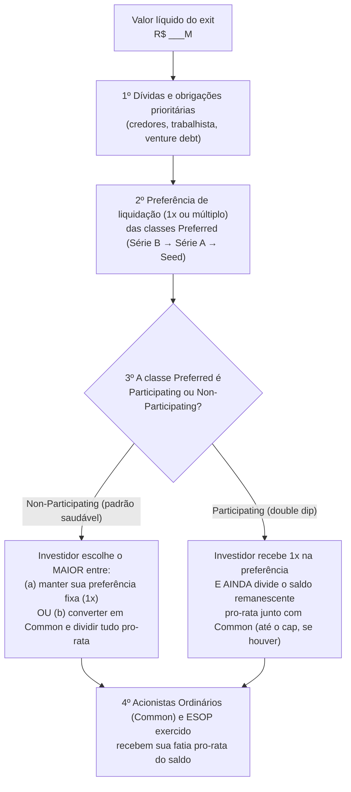
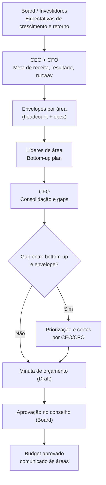
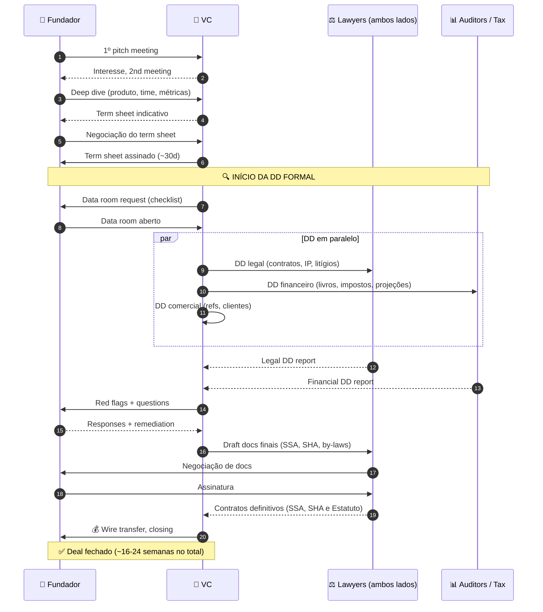
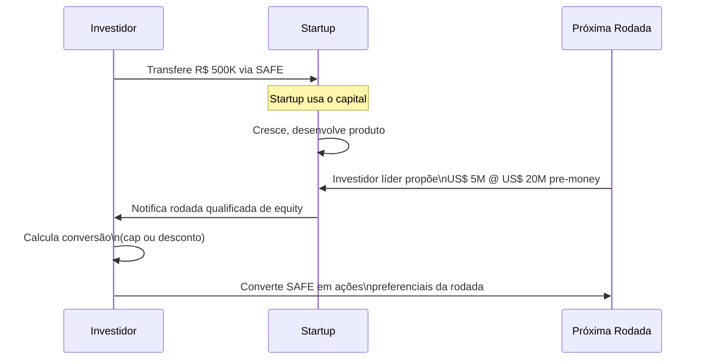

# IGNIÇÃO: Volume 5, Finanças, Captação e Venture Capital

**Contabilidade, Reforma Tributária, FP&A, Comércio Exterior, Caixa e Rodadas de Investimento (Fase 14 e Capítulos 1 a 15)**

*João Prado · 2026 · Edição Narrativa Enxuta (v5.3)*

---

## Sobre este Volume

Este é o **Volume 5 (Finanças, Captação e Venture Capital)** da coleção IGNIÇÃO: O manual operacional do empreendedor brasileiro (10 volumes).

Manual do CEO e do CFO para finanças operacionais, contabilidade, tributário, comércio exterior, estruturação de capital e captação de recursos no Brasil. Abre com a Fase 14 (Capital para Escala, Rodadas e Eficiência Financeira), que reúne 11 frameworks financeiros e de valuation (Unit Economics, Coortes, LTV:CAC, Burn Multiple, Rule of 40, Magic Number, Quick Ratio, CCC, DCF, Comparables e DuPont), os canvases Storytelling/SCQA e Capital Stack/Waterfall e 6 templates completos de rodada (Data Room, Term Sheet Anotado, Plano de Rodada, Pitch Deck SCQA, Investor Update e Financiamento Não Diluitivo). Em seguida, apresenta 15 capítulos em ordem de execução: demonstrativos financeiros, contabilidade e Reforma Tributária (IBS/CBS), modelagem operacional e coortes, FP&A e projeção de receita, capital de giro e gestão de caixa, relacionamento bancário, Comércio Exterior e Importação (Ásia-Brasil, Radar/SISCOMEX, Landed Cost e benefícios estaduais de ICMS), seguros corporativos, Venture Capital e planejamento de rodada, valuation, SAFE e mútuo conversível, fomento não diluitivo (FINEP, BNDES e FAPESP), venture debt, crowdfunding CVM 88 / tokenização e relação com investidores.

---

## Mapa da Coleção IGNIÇÃO

```mermaid
graph LR
    subgraph J1["Do Zero à Validação"]
        V1["<b>Vol. 1: Ideação</b><br/>Fases 0 a 3 · Fundador e Teoria"]
        V2["<b>Vol. 2: Descoberta e Mercado</b><br/>Fases 4 a 6 · Cliente e Cunha"]
        V3["<b>Vol. 3: Hipóteses e Protótipo</b><br/>Fases 7 a 10 · Testes e Modelos"]
        V1 --> V2 --> V3
    end
    subgraph J2["Tração e Escala"]
        V4["<b>Vol. 4: Tração e PMF</b><br/>Fases 11 a 13 · MVP, GTM e Vendas"]
        V5["<b>Vol. 5: Finanças e Captação</b><br/>Fase 14 · Caixa, VC, Tributário e FP&A"]
        V6["<b>Vol. 6: Receita e Pessoas</b><br/>Fases 15 e 16 · Enterprise, Líderes e Cultura"]
        V7["<b>Vol. 7: Produto e Engenharia</b><br/>Fase 17 · Operações, IA e Arquitetura"]
        V8["<b>Vol. 8: Jurídico e Segurança</b><br/>Fase 18 · Societário, Contratos e LGPD"]
        V3 --> V4 --> V5 --> V6 --> V7 --> V8
    end
    subgraph J3["Ciclo Longo e Setores"]
        V9["<b>Vol. 9: Maturidade, Exit e Family Office</b><br/>Fases 19 e 20 · Board, Crise, M&A, IPO e Cash Cow"]
        V10["<b>Vol. 10: Economia da Inovação e 42 Verticais</b><br/>Hubs Globais, Regulação, 42 Setores e Dicionário"]
        V8 --> V9
    end
    V10 -. "Consulta Setorial e Dicionário" .-> J1
    V10 -. "Consulta Setorial e Dicionário" .-> J2
    V10 -. "Consulta Setorial e Dicionário" .-> J3
```



---

## Sumário deste Volume

### Fase da Etapa (Fase 14)
- [[#FASE 14: CAPITAL PARA ESCALA, RODADAS E EFICIÊNCIA FINANCEIRA|FASE 14: CAPITAL PARA ESCALA, RODADAS E EFICIÊNCIA FINANCEIRA]]
### Finanças Operacionais, Contabilidade, Reforma Tributária, Modelagem e FP&A (Capítulos 1 a 4)
- [[#CAPÍTULO 1: DEMONSTRATIVOS FINANCEIROS PARA O FUNDADOR|CAPÍTULO 1: DEMONSTRATIVOS FINANCEIROS PARA O FUNDADOR]]
- [[#CAPÍTULO 2: CONTABILIDADE, REGIMES FISCAIS E TRIBUTÁRIO ESTRATÉGICO (REFORMA IBS/CBS E INCENTIVOS)|CAPÍTULO 2: CONTABILIDADE, REGIMES FISCAIS E TRIBUTÁRIO ESTRATÉGICO (REFORMA IBS/CBS E INCENTIVOS)]]
- [[#CAPÍTULO 3: MODELAGEM FINANCEIRA OPERACIONAL BOTTOM-UP E PROJEÇÕES POR COORTES (COHORTS)|CAPÍTULO 3: MODELAGEM FINANCEIRA OPERACIONAL BOTTOM-UP E PROJEÇÕES POR COORTES (COHORTS)]]
- [[#CAPÍTULO 4: PLANEJAMENTO FINANCEIRO (FP&A), ORÇAMENTO E REVENUE FORECASTING|CAPÍTULO 4: PLANEJAMENTO FINANCEIRO (FP&A), ORÇAMENTO E REVENUE FORECASTING]]
### Capital de Giro, Crédito Bancário, Comércio Exterior, Caixa e Seguros (Capítulos 5 a 8)
- [[#CAPÍTULO 5: CAPITAL DE GIRO, RECEBÍVEIS E GESTÃO DE CAIXA EM PROFUNDIDADE|CAPÍTULO 5: CAPITAL DE GIRO, RECEBÍVEIS E GESTÃO DE CAIXA EM PROFUNDIDADE]]
- [[#CAPÍTULO 6: RELAÇÕES BANCÁRIAS E CRÉDITO NO BRASIL|CAPÍTULO 6: RELAÇÕES BANCÁRIAS E CRÉDITO NO BRASIL]]
- [[#CAPÍTULO 7: COMÉRCIO EXTERIOR, IMPORTAÇÃO (ÁSIA-BRASIL), DESEMBARAÇO ADUANEIRO, TRIBUTAÇÃO EM CASCATA E BENEFÍCIOS FISCAIS ESTADUAIS|CAPÍTULO 7: COMÉRCIO EXTERIOR, IMPORTAÇÃO (ÁSIA-BRASIL), DESEMBARAÇO ADUANEIRO, TRIBUTAÇÃO EM CASCATA E BENEFÍCIOS FISCAIS ESTADUAIS]]
- [[#CAPÍTULO 8: GESTÃO DE RISCO E SEGUROS PARA STARTUPS|CAPÍTULO 8: GESTÃO DE RISCO E SEGUROS PARA STARTUPS]]
### Captação de Capital, Venture Capital, Valuation e Alternativas (Capítulos 9 a 15)
- [[#CAPÍTULO 9: CAPTAÇÃO DE EQUITY: PLANEJAMENTO DE RODADA, PITCH E RELACIONAMENTO COM INVESTIDORES|CAPÍTULO 9: CAPTAÇÃO DE EQUITY: PLANEJAMENTO DE RODADA, PITCH E RELACIONAMENTO COM INVESTIDORES]]
- [[#CAPÍTULO 10: VALUATION METHODS: COMO INVESTIDORES CALCULAM E COMO VOCÊ CALCULA PARA NEGOCIAR|CAPÍTULO 10: VALUATION METHODS: COMO INVESTIDORES CALCULAM E COMO VOCÊ CALCULA PARA NEGOCIAR]]
- [[#CAPÍTULO 11: INSTRUMENTOS DE CAPTAÇÃO: SAFE, NOTA CONVERSÍVEL E MÚTUO CONVERSÍVEL|CAPÍTULO 11: INSTRUMENTOS DE CAPTAÇÃO: SAFE, NOTA CONVERSÍVEL E MÚTUO CONVERSÍVEL]]
- [[#CAPÍTULO 12: FINANCIAMENTO NÃO DILUITIVO|CAPÍTULO 12: FINANCIAMENTO NÃO DILUITIVO]]
- [[#CAPÍTULO 13: VENTURE DEBT E REVENUE-BASED FINANCING (RBF)|CAPÍTULO 13: VENTURE DEBT E REVENUE-BASED FINANCING (RBF)]]
- [[#CAPÍTULO 14: CAPTAÇÃO ALTERNATIVA DIGITAL: EQUITY CROWDFUNDING (CVM 88) E TOKENIZAÇÃO DE ATIVOS|CAPÍTULO 14: CAPTAÇÃO ALTERNATIVA DIGITAL: EQUITY CROWDFUNDING (CVM 88) E TOKENIZAÇÃO DE ATIVOS]]
- [[#CAPÍTULO 15: INVESTOR RELATIONS PÓS-RODADA|CAPÍTULO 15: INVESTOR RELATIONS PÓS-RODADA]]

---

Com o *Product-Market Fit* comprovado, você entra na etapa de Escala. A Fase 14 abre o manual do CEO e do CFO ensinando como monitorar as nove métricas de saúde de uma *scale-up*, estruturar o *data room* e levantar capital em posição de força, com onze frameworks financeiros e de *valuation*, dois canvases visuais e seis templates de rodada integrados na Oficina de Trincheira.

---

## FASE 14: CAPITAL PARA ESCALA, RODADAS E EFICIÊNCIA FINANCEIRA

Nesta fase, acompanhamos os quatro arquétipos do volume nas decisões de capital para escala: Lucas e Marina (SaaS B2B preparando a Série A após a rodada Seed e linhas complementares), Rafael e Bia (e-commerce de cosméticos gerenciando o Ciclo de Conversão de Caixa e o capital de giro entre o Recife e Goiânia), Henrique (indústria de hardware e sensores em Curitiba estruturando o Plano de Financiamento Não Diluitivo com Finep, EMBRAPII, Lei de Informática e BNDES) e Dra. Camila (rede de clínicas odontológicas em Belo Horizonte medindo o ciclo de recebimento dos convênios e o retorno sobre o patrimônio na expansão sem capital de risco tradicional).

### O Paradoxo do Foguete sem Tanque: Quando Crescer Mais Rápido Antecipa a Sua Morte

São 21h15 de uma quinta-feira chuvosa na Vila Olímpia, em São Paulo. Lucas projeta na TV da sala de reuniões o gráfico que todo fundador sonha mostrar: o ARR do SaaS B2B que ele e Marina fundaram saltou de R$ 2,4 milhões para R$ 7,8 milhões em quatorze meses, rumo aos R$ 9,6 milhões. Há garrafas de espumante sobre a mesa. Marina, porém, não abre nenhuma. Recém-chegada de Florianópolis para a reunião, ela está com o notebook aberto na planilha de tesouraria e aponta para a última linha em vermelho: para adicionar R$ 5,4 milhões de receita anualizada (ARR líquido), a empresa queimou R$ 11,2 milhões somando o caixa da rodada Seed de R$ 6 milhões, os R$ 3,5 milhões dos mútuos de ponte e a linha complementar de RBF. O *Burn Multiple* bateu 2,07x, o ciclo de recebimento dos clientes corporativos esticou para 75 dias e a conta corrente tem fôlego para exatos quatro meses e meio.

Por que empresas com recorde histórico de vendas quebram no trimestre seguinte ao melhor mês da sua história? Porque cada real novo de ARR custou mais de dois reais de caixa, e o dinheiro acaba na conta antes de o faturamento contratado para receber em 75 dias virar liquidez disponível. No Brasil, com o custo de capital onde está, escalar vendas com *unit economics* negativos só antecipa o dia em que o caixa zera.

Chamamos essa ilusão coletiva de A Euforia do Faturamento Oco: o vício de celebrar o crescimento do ARR enquanto cada real novo custa dois reais de caixa. Na Fase 14, sua prioridade passa a ser medir quanto dinheiro sai do tanque para sustentar cada real de receita nova, combinando eficiência de queima, empilhamento inteligente de fontes de financiamento e retorno disciplinado sobre o capital investido.

---

### A arquitetura de execução financeira: métricas de eficiência, capital stack e disciplina de caixa

#### Passo 1: defina e monitore métricas de saúde financeira

Depois do PMF, as métricas financeiras passam a guiar decisões estratégicas. Acompanhe nove delas.

| Métrica financeira central | Definição operacional | Referência SaaS B2B (faixas por estágio na tabela Métricas e benchmarks, adiante) |
|---|---|---|
| ARR / MRR | Receita recorrente anualizada/mensal | Crescimento de 70% a 150% ao ano (1,7x a 2,5x) em estágio de scale-up, alinhado à eficiência de queima (relatórios anuais Bessemer e KeyBanc, e série histórica da OpenView até 2023) |
| Gross Margin | (Receita - custo de entrega) / Receita | SaaS B2B: 70-85%. Serviços: 40-60% |
| NRR (Net Revenue Retention: receita líquida retida e expandida na base) | (MRR inicial + expansão - contração - churn) / MRR inicial | ≥110% excelente, 100-110% saudável, <100% vazando |
| Gross Revenue Retention (GRR) | (MRR inicial - churn - contração) / MRR inicial | ≥90% saudável |
| Burn Multiple (quantos reais você queima para gerar 1 real de receita nova) | Caixa líquido queimado no período ÷ ARR líquido adicionado | < 1,0x excelente, 1,0x a 1,5x ótimo, 1,5x a 2,0x bom, 2,0x a 3,0x suspeito, > 3,0x ruim (régua de David Sacks, Craft Ventures) |
| Magic Number | ARR novo líquido do trimestre ÷ S&M do trimestre anterior (ou variação da receita recorrente trimestral × 4 ÷ S&M do trimestre anterior) | ≥ 0,75 saudável para acelerar o investimento comercial, ≥ 1,0 ótimo (Scale Venture Partners / Lars Leckie) |
| CAC Payback | CAC ÷ (MRR do novo cliente × margem bruta) | Até 18 meses na Série A, até 12 meses em growth e até 9 meses em escala madura (tolerável até 24 meses só em enterprise com contrato multianual pago adiantado) |
| Rule of 40 | % crescimento de ARR + % EBITDA margin | ≥40 é benchmark de investidores |
| Fôlego de caixa (*cash runway*) | Saldo de caixa / queima líquida mensal | ≥ 18 meses pós-rodada (mínimo de 12 meses após novas contratações) |

#### Passo 2: estruture a captação estratégica (e não oportunista)

> [!note]
> Linhas de crédito PJ via Pronampe e BNDES, gestão de score PJ e relacionamento bancário em escala estão no [[#CAPÍTULO 6: RELAÇÕES BANCÁRIAS E CRÉDITO NO BRASIL|Capítulo 6: Relações Bancárias e Crédito]]. Gestão do ciclo de conversão de caixa (CCC) e antecipação de recebíveis estão no [[#CAPÍTULO 5: CAPITAL DE GIRO, RECEBÍVEIS E GESTÃO DE CAIXA EM PROFUNDIDADE|Capítulo 5: Capital de Giro]].

Captar capital exige planejamento deliberado. Responda a quatro perguntas antes de abrir uma rodada.

**Por que captar:** defina o uso específico do capital (contratações, expansão de canal, M&A seletivo ou fôlego de caixa), pois respostas vagas afastam fundos qualificados.

**Quanto captar:** calcule o valor necessário para atingir o próximo marco operacional (18 a 24 meses de execução), somado a uma margem de segurança de 30% a 50%, sem pedir de menos nem inflar a rodada.

**De quem captar:** o investidor estratégico (CVC ou executivo do setor) aporta rede comercial e validação técnica, mas exige cuidado com cláusulas de exclusividade, o investidor financeiro (fundo de VC institucional) aporta método de governança, cobrança por métricas e capacidade de acompanhar as rodadas seguintes (*follow-on*). Ambos são legítimos, desde que alinhados ao momento da empresa.

**Quando captar:** vá a mercado apoiado na força das métricas, e nunca no desespero do caixa. Inicie a preparação da rodada com nove a doze meses de *runway*, abaixo de seis meses de fôlego, a empresa entra em modo de sobrevivência e perde poder de barganha na mesa.

O cronograma típico de uma rodada Série A no Brasil e na América Latina em 2026 compreende quatro etapas (detalhadas no *Plano de Rodada*, adiante): Semanas 1 a 4: preparação (*pitch deck*, *data room*, modelo financeiro e lista de 30 a 45 fundos entre *Tier 1* e *Tier 2*). Semanas 5 a 10: prospecção ativa (*warm intros*) e primeiras reuniões. Semanas 10 a 16: aprofundamento de métricas, comitê de investimento com 3 a 5 fundos finalistas e negociação de *term sheets*. Semanas 16 a 22: *due diligence* confirmatória sob exclusividade (30 a 45 dias) e fechamento jurídico e cambial. Pela prática das gestoras e escritórios especializados no país, uma Série A leva de 5 a 7 meses até o dinheiro entrar na conta (e uma rodada Seed, de 3 a 5 meses).

> [!important] Comece cedo
> Cinco a sete meses de processo na Série A (e três a cinco meses no Seed) é o prazo normal até o dinheiro entrar na conta. Empresa que começa a captar com menos de seis meses de *runway* negocia em desespero, e os investidores percebem isso em dez minutos.

Os documentos necessários para a rodada compreendem: *pitch deck* (de 12 a 15 slides, com apêndice opcional), resumo executivo (*executive summary* de duas páginas), *data room* (repositório organizado com demonstrativos financeiros auditados, se houver, ou revisados pelo contador, *cap table*, indicadores operacionais, contratos materiais e documentação societária), modelo financeiro em planilha (cenário base e variações), apresentação de produto (demonstração e *roadmap*) e lista de referências (clientes, investidores atuais e conselheiros).

Abaixo destacamos os termos econômicos e de governança mais sensíveis de um *term sheet* que fundadores de primeira viagem costumam subestimar (para a tabela consolidada linha a linha, consulte o *Term Sheet* Anotado mais adiante nesta Fase):

**Valuation pré e pós-money:** além do número de manchete, calcule a diluição efetiva após a criação ou expansão do *pool* de opções.

**Reserva de opções (*option pool*):** percentual de participação separado para atrair executivos e talentos técnicos, verifique na tabela do [[#Template: Term Sheet Anotado, Guia de Leitura|Term Sheet Anotado]] o impacto diluitivo de criá-lo antes ou depois do aporte.

**Preferência de liquidação (*liquidation preference*):** prioridade de recebimento do investidor antes dos fundadores em evento de liquidez. A cláusula 1x não participativa (*1x non-participating*) é o padrão saudável. A 1x participativa com teto (*capped participating*) é negociável em mercados restritos, enquanto múltiplos de 2x ou participação sem teto devem ser recusados.

**Proteção antidiluição (*anti-dilution*):** cláusula que ajusta o preço de conversão dos investidores caso a empresa capte uma rodada futura por valor inferior (*down round*), priorize a média ponderada ampla (*broad-based weighted average*) e recuse o ajuste integral (*full ratchet*), conforme detalhado no [[#Template: Term Sheet Anotado, Guia de Leitura|Term Sheet Anotado]].

**Vesting e re-vesting de fundadores:** submeter novamente a um cronograma de aquisição (tipicamente de 3 a 4 anos) parte das ações que os fundadores já haviam consolidado é exigência comum na Série A, negocie sempre o reconhecimento de um percentual já liberado pelo tempo trabalhado desde a fundação.

**Composição do conselho (*board*):** define quantos assentos os fundadores mantêm, quantos os investidores passam a ter e como são escolhidos os membros independentes.

**Direito de proporcionalidade (*pro-rata rights*):** prerrogativa de investir na mesma proporção em rodadas futuras para manter a participação societária, cláusula habitual para os fundos líderes da rodada.

**Cláusulas de proteção (*protective provisions*):** definem quais matérias estratégicas exigem aprovação prévia dos investidores, como venda da empresa, nova emissão de títulos, mudança de estatuto ou aprovação do orçamento anual.

**Obrigação e direito de venda conjunta (*drag-along* e *tag-along*):** regras que disciplinam a venda total da empresa e a proteção dos minoritários em caso de aquisição, detalhadas com seus quóruns típicos no [[#Template: Term Sheet Anotado, Guia de Leitura|Term Sheet Anotado]].

> [!warning] Recomendação firme sobre advogado
> Contrate advogado com experiência comprovada em Venture Capital (e não um generalista) antes de assinar qualquer *term sheet*. Os erros mais caros em uma rodada vêm de negociar cláusulas de preferência e controle sem assessoria especializada. Tentar economizar nas ordens de grandeza praticadas em 2026 para revisão de *term sheet* (tipicamente de R$ 15 mil a R$ 35 mil) ou para o fechamento jurídico completo de uma Série A (de R$ 60 mil a R$ 150 mil em escritórios especializados no Brasil, conforme a praça e a complexidade societária) pode custar dezenas de milhões de reais em participação dos fundadores na saída.

#### Passo 3: monitore a eficiência de capital (além do crescimento bruto)

Até o fim de 2021, o mercado premiava crescimento a qualquer custo. A partir de 2022, com a alta global de juros, passou a premiar o crescimento eficiente. As métricas-chave são: *Burn Multiple* abaixo de 1,5x em SaaS B2B em escala, *CAC Payback* até 18 meses na Série A, até 12 meses em estágio de crescimento e até 9 meses em escala madura (tolerável até 24 meses apenas em B2B *enterprise* com ACV alto e contratos multianuais pagos adiantado), *Rule of 40* igual ou acima de 40% a partir da Série B avançada (taxa de crescimento anual somada à margem EBITDA), e margem bruta evoluindo com ganho de escala.

> [!warning] Eficiência versus crescimento bruto
> Crescer 100% ao ano queimando R$ 5 de caixa para cada R$ 1 de ARR novo líquido (*burn multiple* de 5,0x, muito acima do teto aceitável na régua de David Sacks) trava a captação de uma Série B em mercado seletivo. Já uma operação que cresce de 60% a 80% ao ano queimando R$ 1,20 para cada R$ 1 de ARR adicionado (*burn multiple* de 1,2x, faixa eficiente nos relatórios anuais de SaaS B2B da Bessemer e do KeyBanc) atrai disputa entre fundos. Crescimento bruto desacompanhado de eficiência de capital não financia a rodada seguinte.

### Quando a startup vira compradora (uso alternativo do capital da rodada)

> [!tip] Tratamento aprofundado em capítulo próprio
> A [[IGNICAO-Vol-9-Maturidade-e-Exit#FASE 20: ESTRATÉGIA DE SAÍDA (EXIT STRATEGY)|Fase 20 (Vol. 9)]] cobre aquisição como evento de exit (quando você vende a sua empresa). O caso inverso, startup pós-PMF como adquirente, segue uma regra implacável: bem-feita, a compra acelera a empresa. Malfeita, destrói valor mais rápido que qualquer outra decisão estratégica. O detalhamento operacional completo (critérios de prontidão, modalidades de aquisição, processo em seis passos, estrutura da operação e modelos de integração) está consolidado no [[IGNICAO-Vol-9-Maturidade-e-Exit#CAPÍTULO 12: M&A ATIVO E ROLL-UPS: FUNDADOR COMO COMPRADOR|Capítulo 12: M&A como Comprador (Vol. 9)]]. Aqui, destacamos os filtros de alocação de capital para a Fase 14.

**Critérios prévios para considerar M&A.** PMF sólido com *unit economics* saudáveis (M&A amplifica uma força que já existe e nunca conserta uma fraqueza estratégica), caixa ou *equity* forte para pagar (pós-rodada, múltiplos em alta, ou ações com liquidez programada), tese estratégica clara escrita em uma página antes de procurar alvo (por que essa aquisição supera o desenvolvimento interno ou uma parceria comercial, "ganhamos velocidade" é resposta insuficiente sem especificar para onde).

**Três modalidades de aquisição com lógicas distintas (ordens de grandeza ilustrativas praticadas em M&A de tecnologia no Brasil em 2025–2026, sujeitas ao ciclo de juros).** A compra de equipe e produto complementar (*tuck-in*, de 1 a 15 pessoas, tipicamente entre R$ 2 milhões e R$ 20 milhões combinando caixa e *equity*) tem como critério central de sucesso reter ao menos 80% do time-chave após 18 meses. A consolidação de concorrente direto (*horizontal*, frequentemente negociada entre 2x e 6x ARR em SaaS B2B saudável) exige projetar o caso-base retendo apenas 50% a 70% da receita adquirida, já que parte da carteira é sobreposta ou cancela na migração. Já a aquisição de fornecedor, canal ou integrador (*vertical*, avaliada por múltiplo de EBITDA em serviços ou de receita recorrente em software) obriga a absorver a operação inteira, e não apenas a funcionalidade desejada.

**A regra combinada.** Mesmo com caixa e tese clara, comprar outra operação só faz sentido quando três filtros táticos se sobrepõem: uma parceria comercial não resolve o problema (parcerias resolvem a grande maioria dos casos sem custo nem risco de integração), *e* build interno levaria 18+ meses, *e* o adquirido tem ativo que você não consegue recriar (marca, time muito específico, base com troca difícil). Faltando qualquer uma, o caminho mais barato é melhor.

> [!warning] Modelo de integração antes do deal
> Escolha o modelo de integração (total, operacional com marca separada, ou subsidiária autônoma) *antes* de fechar o negócio. Assinar a compra é um evento. Integrar sistemas, culturas e carteiras leva até dois anos. Como apontam estudos clássicos sobre M&A (Christensen e coautores, na *Harvard Business Review*, 2011), a maioria das aquisições falha em gerar o retorno esperado, e boa parte desse valor se perde na execução da integração pós-fechamento.

### A catraca de maturidade financeira: as provas de que sua máquina aguenta escala real

- [ ] Painel mensal das 9 métricas de saúde financeira implementado e auditado.
- [ ] *Data room* completo, *pitch deck* estruturado e modelo financeiro de 36 meses prontos antes do primeiro café com investidores.
- [ ] Termos de captação (*valuation*, *option pool*, *liquidation preference* 1x *non-participating*, *anti-dilution broad-based weighted average*) revisados por advogado especialista em VC.

---

### O Espelho da Fase 14: você está construindo patrimônio ou queimando combustível?

Antes de abrir o *data room* da Série A, Lucas e Marina encararam as perguntas abaixo na sala da Vila Olímpia: congelaram contratações não essenciais por noventa dias, converteram novos contratos corporativos para cobrança anual antecipada e cortaram o *Burn Multiple* de 2,07x para 1,15x, ampliando o fôlego de caixa de 4,5 para 11 meses.

> [!tip] O Espelho do Gestor (Autodiagnóstico Rápido)
> 1. **A Prova do Combustível (*Burn Multiple*):** Se você estivesse naquela sala na Vila Olímpia com Lucas e Marina, saberia responder seu *Burn Multiple* sem abrir a planilha? Nos últimos dois trimestres, quantos reais líquidos do caixa você queimou para cada R$ 1,00 de nova receita recorrente líquida adicionada? Se o número passa de 1,5x, onde está o vazamento?
> 2. **A Independência de Sobrevivência (*Default Alive*):** Se o mercado de capitais fechar amanhã de manhã e nenhum investidor ou banco atender o seu telefone pelos próximos 24 meses, sua empresa chega ao *breakeven* com o caixa atual ou morre no caminho?
> 3. **Custo da Fonte de Capital:** Você está financiando estoque e recebíveis de 60 dias entregando participação societária definitiva (*equity*) quando deveria usar linhas operacionais ou capital de giro estruturado?
>
> **Regra de bolso:** Nunca escale o orçamento de vendas e marketing enquanto o seu *CAC Payback* estiver acima do teto do seu estágio (18 meses na Série A, 12 meses em *growth* e 9 meses em escala madura, admitindo-se até 24 meses apenas em *enterprise* com contrato multianual pago adiantado) ou enquanto a sua margem de contribuição pós-impostos for incerta.
>
> **O Ritual de Segunda-Feira às 9h (como Marina instituiu entre Florianópolis e São Paulo):** toda segunda-feira às 9h, confira o saldo bancário conciliado, o fôlego semanal e a retenção líquida (NRR) por safra. Na segunda-feira seguinte à entrega do fechamento contábil mensal, apure com a DRE fechada a queima líquida e o Ciclo de Conversão de Caixa (CCC). Na primeira segunda-feira de cada trimestre, adicione o *Magic Number* e consolide no painel da diretoria os três indicadores-chave: Runway em meses exatos, Burn Multiple do trimestre e Ciclo de Conversão de Caixa em dias.

### Métricas e benchmarks desta fase (Fase 14)

| Métrica | Estágio Inicial (Seed / Série A) | Crescimento (Growth / Série B) | Estágio Maduro (Referência de Escala) |
|---|---|---|---|
| Retenção líquida de receita (NRR) | ≥ 95% | ≥ 100% (meta de saída Série A/B) | ≥ 110% (meta em escala madura) |
| CAC Payback | ≤ 18 meses (Série A / início) | ≤ 12 meses (Growth / Série B) | ≤ 9 meses (Maduro) |
| Margem bruta SaaS | ≥ 50% | ≥ 65% (meta em Growth) | ≥ 75% (referência madura) |
| Churn mensal de receita | ≤ 3% | ≤ 2% (meta em Growth) | ≤ 1% (referência madura) |
| Magic Number (eficiência de Vendas e Marketing) | ≥ 0,5 | ≥ 0,75 (meta em Growth) | ≥ 1,0 (escala eficiente) |
| Regra dos 40 (*Rule of 40*) | Não aplicável pré-PMF | ≥ 20 (meta inicial em Growth) | ≥ 40 (referência de escala madura) |
| Burn Multiple (régua de David Sacks) | ≤ 2,0x (antes da Série A) | ≤ 1,5x (ótimo: 1,0x a 1,5x, bom: 1,5x a 2,0x) | < 1,0x (excelente) |
| Retenção bruta de receita (GRR) | ≥ 85% | ≥ 90% (meta em Growth) | ≥ 92% (referência madura) |
| NPS (produtos B2C / consumidor) | ≥ 30 | ≥ 40 (meta em Growth) | ≥ 50 (referência madura) |
| NPS (produtos B2B / corporativo) | ≥ 20 | ≥ 30 (meta em Growth) | ≥ 40 (referência madura) |
| eNPS (engajamento da equipe) | ≥ 15 | ≥ 20 (meta em Growth) | ≥ 30 (referência madura) |

> [!note] Nota sobre benchmarks
> Benchmarks são médias de mercado e variam por setor, modelo de negócio e contexto macroeconômico. Usar como referência de diagnóstico, não como meta absoluta. O que importa é a tendência ao longo do tempo para a sua empresa, não a distância de um número de mercado.

---

### Oficina de Trincheira: frameworks, canvases e templates desta fase

Este bloco reúne a referência principal de finanças e estrutura de capital da coleção: onze frameworks, de *unit economics* à identidade DuPont, seguidos de dois canvases visuais (narrativa e cascata de liquidação) e seis templates operacionais de rodada.

> [!tip] Uso autocontido neste volume
> Todos os frameworks abaixo estão detalhados integralmente com origem, mecânica central, passo a passo de aplicação, exemplos práticos da trincheira brasileira e armadilhas de execução para aplicação imediata nesta Fase 14.

#### Framework: Unit Economics

##### De onde vem a ferramenta (e por que sobreviveu ao filtro do tempo)

Conceito vindo de economia clássica (análise de custo marginal/receita marginal), popularizado em startups nos anos 2010 via SaaS analysts (David Skok, Tomasz Tunguz, Bill Gurley). Hoje é vocabulário universal em VC e startup finance.

##### A mecânica central (sem jargão)

Análise da **rentabilidade de um único cliente** ao longo do seu tempo de vida na empresa. Se a economia unitária é negativa, a empresa perde dinheiro a cada venda e acelerar o crescimento só antecipa a insolvência. Se é positiva, a escala multiplica a geração de valor.

##### As regras do jogo

Componentes essenciais:

- **CAC (*Customer Acquisition Cost*):** gasto total de vendas e marketing (completo, incluindo salários, encargos, comissões e ferramentas) dividido pelo número de novos clientes adquiridos no período.

- LTV (Lifetime Value): receita líquida total esperada de um cliente durante sua vida.

Fórmulas básicas LTV para SaaS:

- LTV simples = ARPU × Gross Margin × (1 / Monthly Churn).
- LTV sofisticado considera expansion e decline.

- **Prazo de retorno (*CAC Payback*):** meses necessários para recuperar o CAC pela margem bruta gerada (até 18 meses na Série A, até 12 meses em *growth* e até 9 meses em escala madura).

- Contribution margin: gross margin - CAC allocation.

##### Benchmarks (SaaS B2B)

- **LTV:CAC:** saudável a partir de 3:1, excelente acima de 5:1, problemático abaixo de 1,5:1.
- **CAC Payback:** até 18 meses na Série A e abaixo de 12 meses em estágio de crescimento (*growth*).
- Gross margin > 70%: padrão SaaS.
- Burn Multiple (ver o framework *Burn Multiple*, adiante) < 1,0x: elite.

##### Aplicação imediata na rotina da empresa

Passo 1: instrumente as métricas integrando CRM, faturamento (*billing*) e marketing.

Passo 2: segmente por canal, vertical e porte de cliente. A média consolidada (*blended*) costuma esconder segmentos deficitários.

Passo 3: Decisões baseadas em cohort: LTV requer dados de cohorts reais com tempo.

Passo 4: atue nos canais e segmentos com LTV:CAC < 2 para corrigir a eficiência ou encerrar a alocação.

##### Na trincheira real: como isso funciona na prática

Considere um SaaS B2B brasileiro com métricas consolidadas aparentemente saudáveis:

- LTV: R$ 18.000.
- CAC: R$ 4.200.
- LTV:CAC consolidado: 4,3:1 (aparentemente saudável).

Segmentado:

- PMEs < 10 func: LTV R$ 8k. CAC R$ 2k, ratio 4:1 ✓.
- Médio porte (*mid-market*, 50 a 200 funcionários): LTV de R$ 35 mil, CAC de R$ 6 mil, razão de 5,8:1 ✓.
- Grandes contas (*enterprise*, 500+ funcionários): LTV de R$ 80 mil, CAC de R$ 38 mil, razão de 2,1:1 ⚠.

A média consolidada esconde que a operação *enterprise* drena capital com retorno marginal. A decisão executiva exige pausar a expansão nesse segmento ou corrigir a equação comercial (aumentando o tíquete anual ou reduzindo o ciclo de fechamento).

##### Onde o papel aceita tudo (armadilhas de execução)

**Quatro erros clássicos que invalidam a conta:** (1) calcular o LTV pela receita bruta em vez do lucro bruto (inflando o valor real do cliente), (2) usar um CAC parcial que exclui salários e encargos do time de marketing e vendas, (3) projetar LTV de longo prazo antes do Product-Market Fit, quando o cancelamento ainda oscila fortemente, e (4) olhar apenas a **média consolidada (*blended*)**, escondendo canais pagos deficitários atrás do tráfego orgânico.

---

#### Framework: Cohort Analysis

##### De onde vem a ferramenta (e por que sobreviveu ao filtro do tempo)

Técnica de análise originada na epidemiologia e no marketing de resposta direta, consolidada em empresas de SaaS como a forma rigorosa de medir a retenção real por safra em vez de olhar apenas a média geral de cancelamentos.

##### A mecânica central (sem jargão)

Análise que agrupa clientes por período de aquisição (ex.: "todos que assinaram em janeiro 2025") e acompanha seu comportamento ao longo do tempo. Revela como comportamento evolui e se produto melhora.

##### As regras do jogo

Cohort retention table:

| | M0 | M1 | M2 | M3 | M6 | M12 |
|----------|-----|-----|-----|-----|-----|-----|
| Jan 2025 | 100%| 85% | 78% | 73% | 68% | 62% |
| Fev 2025 | 100% | 88% | 82% | 78% | 72% | n/d |
| Mar 2025 | 100%| 90% | 84% | 80% | - | - |

O que observar:

- A retenção melhora a cada nova safra? (Fevereiro acima de janeiro indica evolução do produto e do *onboarding*.)
- Quando estabiliza? (M6 pode virar "piso".)
- Retenção líquida de receita (e não apenas de logotipos): incorpora expansões (*upsell*) e reduções de plano (*downgrade*).

##### Passos práticos de implantação

Passo 1: defina o critério de corte da safra (o mês de ativação ou assinatura é o padrão).

Passo 2: acompanhe mensalmente retenção de clientes, receita retida, expansão e cancelamento de cada safra.

Passo 3: consolide a extração em ferramentas analíticas (Amplitude, Mixpanel, Heap ou consultas diretas em SQL) e estabeleça a rotina mensal de reavaliação da validade das curvas de retenção.

Passo 4: Compare cohorts: tendência melhorando?

Passo 5: Investigue rupturas: cohort específica com retenção anomalamente baixa, o que aconteceu?

##### Na trincheira real: como isso funciona na prática

Um SaaS B2B brasileiro observava um cancelamento anual médio aparentemente estável em 35% ao ano (retenção média de 65% em 12 meses), mas a abertura por safra revelou a deterioração recente:

- Safras do 1º semestre de 2024: retenção de 70% no M12.
- Safras do 2º semestre de 2024: retenção de 58% no M12.
- Safras do 1º semestre de 2025: a retenção no M6 aponta para apenas 50% no M12.

Alerta: a qualidade do produto ou da aquisição de clientes deteriorou. Investigação:

- A aquisição migrou excessivamente para mídia paga de fundo de funil, trazendo clientes fora do perfil ideal (ICP).
- Um novo concorrente entrou no segmento de entrada com preço agressivo.

Ação corretiva: realocar verba para canais orgânicos e qualificados, reajustar o filtro comercial de entrada e corrigir o empacotamento de preços.

##### Onde o papel aceita tudo (armadilhas de execução)

- **Analisar apenas a média geral (*blended*):** misturar clientes antigos e novos esconde a deterioração das safras recentes.
- **Recorte semanal com amostra mínima:** abrir coortes semanais com apenas 5 clientes gera ruído estatístico em vez de sinal.
- **Olhar só retenção de logotipos (*users*) e ignorar receita:** o cliente pode continuar ativo no sistema enquanto reduz o valor pago (*downgrade*).

---

#### Framework: LTV:CAC Ratio

##### De onde vem a ferramenta (e por que sobreviveu ao filtro do tempo)

Métrica popularizada por **David Skok** (investidor da Matrix Partners e autor do blog *For Entrepreneurs*, forentrepreneurs.com) ao longo dos anos 2010. Hoje é métrica padrão para avaliar saúde de SaaS.

##### A mecânica central (sem jargão)

Razão entre LTV (Lifetime Value) e CAC (Customer Acquisition Cost). Responde: "para cada R$ 1 gasto adquirindo cliente, quantos R$ de valor trazemos ao longo da vida?"

##### Benchmarks

- Abaixo de 1: a empresa perde dinheiro a cada cliente novo (insustentável).
- De 1 a 3: a operação sobrevive, mas cresce lentamente e consome muito caixa.
- De 3 a 5: patamar saudável para SaaS B2B em estágio de crescimento.
- De 5 a 10: excelente eficiência, autorizando acelerar o investimento comercial.
- Acima de 10: raramente sustentável no longo prazo, a empresa provavelmente está investindo pouco em crescimento e deixando espaço para concorrentes.

##### As regras do jogo

LTV:CAC de 3+ combinado com payback < 12 meses = empresa pode escalar sem explodir em unit economics.

LTV:CAC alto mas payback longo = risco de capital (precisa financiar gap).

##### Execução prática com a equipe

Passo 1: Calcular LTV e CAC bem (Framework: Unit Economics (Fase 14)).

Passo 2: LTV:CAC por segmento.

Passo 3: Monitorar ao longo do tempo: LTV:CAC caindo = sinal de alerta.

Passo 4: Investir onde LTV:CAC > 3, reduzir onde < 2.

##### Onde o papel aceita tudo (armadilhas de execução)

- **Projetar LTV assumindo o *churn* inicial como perpétuo:** a taxa de cancelamento costuma subir quando a aquisição sai dos primeiros entusiastas para o mercado amplo.
- **Subestimar o CAC omitindo salários:** incluir apenas mídia paga e esquecer a folha de vendas e pré-vendas distorce o tempo real de retorno.
- **Tirar a média entre segmentos distintos:** um canal corporativo rentável pode mascarar quatro canais deficitários quando tudo é somado na mesma conta.

---

#### Framework: Burn Multiple (David Sacks, 2020)

##### De onde vem a ferramenta (e por que sobreviveu ao filtro do tempo)

**David Sacks**, que comandou a Yammer até vendê-la à Microsoft e fundou a Craft Ventures, publicou o artigo *The Burn Multiple* em 2020. A métrica combina queima líquida de caixa e velocidade de crescimento em um único indicador e tornou-se padrão em Venture Capital a partir de 2022, quando a eficiência de capital voltou ao centro das rodadas.

##### A mecânica central (sem jargão)

Burn Multiple = Queima Líquida de Caixa (Net Burn) / ARR Novo Líquido (Net New ARR)

- Net Burn: caixa gasto - receita (burn líquido).
- Net New ARR: novo ARR - churn - downgrades.

Responde: "para cada R$ 1 de novo ARR, quanto queimamos de caixa?"

##### Benchmarks (Sacks)

| Burn Multiple (Net Burn ÷ Net New ARR) | Classificação (régua de David Sacks, Craft Ventures) |
|---------------|---------------|
| < 1,0x | Excelente (*Amazing*, elite) |
| 1,0x a 1,5x | Ótimo (*Great*) |
| 1,5x a 2,0x | Bom (*Good*) |
| 2,0x a 3,0x | Suspeito (*Suspect*) |
| > 3,0x | Ruim (*Bad*) |

##### Aplicação imediata na rotina da empresa

- **Passo 1 (a cada trimestre):** divida a queima líquida de caixa do trimestre (saídas totais menos entradas de caixa recebidas na operação) pelo ARR novo líquido adicionado no trimestre (`New ARR + Expansion ARR − Churn ARR − Contraction ARR`).

- **Passo 2:** acompanhe a evolução trimestre a trimestre para verificar se a eficiência de queima está melhorando ou se deteriorando.

- **Passo 3:** mantenha o indicador abaixo de 2,0x (e idealmente entre 1,0x e 1,5x) antes de iniciar uma nova rodada institucional.

- **Passo 4:** se o *Burn Multiple* superar 3,0x por dois trimestres seguidos, acione revisão imediata de estrutura de custos, canais de aquisição e precificação.

##### Na trincheira real: como isso funciona na prática

Evolução de um SaaS B2B brasileiro em expansão (inspirado no diagnóstico de Lucas e Marina na Vila Olímpia):

- 1º trimestre: queima líquida de R$ 3,0 milhões para R$ 2,0 milhões de ARR novo líquido → *Burn Multiple* = 1,5x (Ótimo).
- 2º trimestre: queima líquida de R$ 4,0 milhões para R$ 2,0 milhões de ARR novo líquido → *Burn Multiple* = 2,0x (Limite entre Bom e Suspeito).
- 3º trimestre: queima líquida de R$ 5,0 milhões para R$ 1,5 milhão de ARR novo líquido → *Burn Multiple* = 3,3x (Ruim).

A deterioração mostra que a queima subiu sem resposta proporcional em receita nova. A reação exige pausar contratações de expansão, cortar canais com *payback* longo e antecipar recebimentos anuais.

##### Onde o papel aceita tudo (armadilhas de execução)

- **Usar queima bruta em vez de queima líquida (*Net Burn*):** ignorar a receita recebida no período distorce o numerador.
- **Tomar o ARR bruto sem descontar cancelamentos:** somar apenas vendas novas sem subtrair *churn* e contração infla artificialmente o denominador.
- **Avaliar um trimestre isolado sem olhar a tendência:** variações sazonais de vendas exigem acompanhar a média móvel de dois a quatro trimestres.

---

#### Framework: Rule of 40 (Brad Feld / SaaS community)

##### De onde vem a ferramenta (e por que sobreviveu ao filtro do tempo)

Popularizada por **Brad Feld** (Foundry Group) em um artigo de 2015, no qual ele credita a regra a investidores de fundos de *growth equity*. Hoje é benchmark universal para SaaS maduro (> $10M ARR).

##### A mecânica central (sem jargão)

Rule of 40: Growth rate (%) + Profit margin (%) ≥ 40%.

A métrica explicita a compensação (*trade-off*) entre velocidade de crescimento e rentabilidade operacional: uma empresa pode crescer 50% ao ano com margem EBITDA de -10% (soma 40, saudável) ou crescer 20% ao ano com margem EBITDA positiva de 20% (soma 40, igualmente saudável). Já crescer 80% queimando -60% de margem (soma 20) destrói caixa de forma desproporcional.

##### Execução prática com a equipe

Passo 1: Calcule YoY growth rate (receita ano atual vs. ano anterior).

Passo 2: Calcule EBITDA margin (EBITDA ÷ receita).

Passo 3: Soma. Se ≥ 40%, saudável.

Passo 4: Trade-offs explícitos: decisão "crescer 30% mais queimando 20% mais" passa teste?

##### Benchmarks

- **Abaixo de 40%:** zona de atenção para SaaS em escala madura (crescimento e rentabilidade somados ainda não compensam o consumo de caixa, embora possa ocorrer temporariamente em estágios iniciais de aceleração).
- **De 40% a 60%:** operação saudável e competitiva a partir da Série B avançada.
- **Acima de 60%:** desempenho de elite (atingido por líderes de software em nuvem em janelas de forte expansão, como Zoom e CrowdStrike em seus anos de escala acelerada).

##### Na trincheira real: como isso funciona na prática

- Caso 1: cresce 60% ao ano (margem -10%). 60 + (-10) = 50 (acima do piso, portanto passa).
- Caso 2: cresce 15% ao ano (margem 25%). 15 + 25 = 40. Passa no limite.
- Caso 3: cresce 80% ao ano (margem -50%). 80 + (-50) = 30 (abaixo do piso, portanto falha).

##### Onde o papel aceita tudo (armadilhas de execução)

Aplicar a métrica fora de estágio: a *Rule of 40* foi desenhada para SaaS em escala (tipicamente acima de US$ 10M–15M de ARR, ou a partir da Série B avançada), não como filtro de pré-PMF. Outro desvio frequente é fabricar um "EBITDA ajustado" cosmético expurgando despesas operacionais recorrentes para mascarar a queima real de caixa.

---

#### Framework: Magic Number (Scale Venture Partners. Popularizado por Lars Leckie / Hummer Winblad, 2008)

##### De onde vem a ferramenta (e por que sobreviveu ao filtro do tempo)

O conceito nasceu na Scale Venture Partners, a partir da análise de Rory O'Driscoll sobre a relação entre a variação da receita recorrente trimestral anualizada e os gastos de vendas e marketing do trimestre anterior em empresas de SaaS. Lars Leckie, da Hummer Winblad Venture Partners, popularizou o indicador em 2008 ao sistematizar suas faixas de decisão: acima de 0,75x, vale acelerar o investimento comercial. Acima de 1,0x, a máquina de vendas recupera o investimento dentro de um ano. Acima de 1,5x, a empresa provavelmente está investindo menos do que deveria em aquisição e deixando mercado na mesa.

##### A mecânica central (sem jargão)

Magic Number = (Receita Recorrente Trimestral atual - Receita Recorrente Trimestral anterior) × 4 ÷ Gasto de Vendas e Marketing (S&M) do trimestre anterior [ou: Net New ARR do trimestre ÷ S&M do trimestre anterior]

Ou seja: ARR anualizado gerado em um trimestre ÷ gasto em S&M do trimestre anterior.

##### Benchmarks

- **Abaixo de 0,5:** vendas e marketing ineficientes, revise funil, retenção e precificação antes de escalar.
- **De 0,5 a 0,75:** eficiência aceitável, expanda o investimento comercial com ajustes operacionais.
- **Acima de 0,75 (com aceleração ótima acima de 1,0):** cada real investido em vendas e marketing no trimestre anterior retorna rapidamente em receita recorrente anualizada líquida, justificando expandir o orçamento comercial.

##### Protocolo prático de execução

Passo 1: Trimestralmente calcular.

Passo 2: Tendência: subindo ou caindo?

Passo 3: Segmentar por canal quando possível.

Passo 4: Magic Number > 1 por 2+ trimestres = pode acelerar investimento em S&M.

##### Na trincheira real: como isso funciona na prática

- 1º trimestre: ARR de R$ 10 milhões, gasto de vendas e marketing (S&M) no 1º trimestre: R$ 2 milhões.
- 2º trimestre: ARR sobe para R$ 12 milhões, gasto de S&M no 2º trimestre: R$ 2,5 milhões.
- Magic Number no 2º trimestre = (R$ 12 milhões − R$ 10 milhões de ARR) ÷ R$ 2 milhões de S&M no 1º trimestre = R$ 2 milhões ÷ R$ 2 milhões = 1,0 (cada real investido em S&M trouxe um real de ARR novo líquido, autorizando acelerar o investimento comercial com disciplina).

##### Onde o papel aceita tudo (armadilhas de execução)

Aplicar a empresas pré-PMF sem escala de receita (o número fica instável) ou calcular S&M de forma incompleta (deixando de fora salários, ferramentas e contratos).

---

#### Framework: SaaS Quick Ratio (Mamoon Hamid, 2015)

##### De onde vem a ferramenta (e por que sobreviveu ao filtro do tempo)

**Mamoon Hamid**, VC da Kleiner Perkins (ex-Social Capital), popularizou Quick Ratio para SaaS em mid-2010s. Métrica de crescimento bruto vs. churn.

##### A mecânica central (sem jargão)

SaaS Quick Ratio = (New MRR + Expansion MRR) / (Churned MRR + Contraction MRR)

Razão entre crescimento bruto e perdas.

##### Benchmarks

- Abaixo de 1,0: a empresa está encolhendo em receita recorrente.
- De 1,0 a 2,0: crescimento líquido lento, corroído pelo *churn*.
- De 2,0 a 4,0: crescimento saudável em escala.
- Acima de 4,0: crescimento acelerado com alta retenção.

##### Execução prática com a equipe

Métrica mensal ou trimestral. Tendência revela saúde.

##### Na trincheira real: como isso funciona na prática

- Mês: new MRR R$ 200k, expansion R$ 50k, churned R$ 60k, contraction R$ 20k.
- Quick Ratio = (200 + 50) ÷ (60 + 20) = 250 ÷ 80 = 3,1x (crescimento saudável).

##### Onde o papel aceita tudo (armadilhas de execução)

Ignorar contraction: downgrades escondem churn real.

---

#### Framework: Cash Conversion Cycle (CCC)

##### De onde vem a ferramenta (e por que sobreviveu ao filtro do tempo)

Métrica clássica de administração financeira corporativa (central em obras como *Principles of Corporate Finance*, de Brealey, Myers e Allen), indispensável para operações com estoque (e-commerce, indústria e distribuição) e vendas B2B a prazo. Para o diagnóstico operacional aprofundado, antecipação de recebíveis e fluxo de caixa de 13 semanas, consulte o [[#CAPÍTULO 5: CAPITAL DE GIRO, RECEBÍVEIS E GESTÃO DE CAIXA EM PROFUNDIDADE|Capítulo 5 (Capital de Giro, Recebíveis e Gestão de Caixa)]].

##### A mecânica central (sem jargão)

CCC = PMR + PME - PMP  (equivalente a DSO + DIO - DPO)

- DIO (Days Inventory Outstanding): dias com inventário antes de vender.
- DSO (Days Sales Outstanding): dias para receber pagamento após vender.
- DPO (Days Payable Outstanding): dias para pagar fornecedores.

Interpretação: quantos dias empresa "financia" o ciclo. CCC = 45 → empresa precisa cobrir 45 dias de operação com caixa próprio antes de receber retorno.

##### Benchmarks

- Negativo: empresa é financiada pelos fornecedores e clientes. Amazon, Apple, Dell, modelo excelente.
- 0-30: muito saudável.
- 30-60: aceitável.
- 60-120: apertado, requer capital de giro significativo.
- > 120: estresse financeiro.

##### Roteiro de aplicação prática na operação

Passo 1: Calcular cada componente.

Passo 2: se o ciclo de conversão estiver alto, ataque primeiro o componente que mais pesa:

- DIO alto: inventário excessivo, otimizar.
- DSO alto: clientes demoram a pagar, cobrança mais agressiva, factoring.
- DPO baixo: pagando rápido demais, negociar prazos.

Passo 3: Monitoramento mensal.

##### Na trincheira real: como isso funciona na prática

E-commerce brasileiro:

- DIO: 60 dias (inventário).
- DSO (PMR no e-commerce brasileiro, como na marca de Rafael e Bia): embora o Pix liquide no ato, o cartão de crédito parcelado em 3x a 6x sem juros liquida em D+30 por parcela, elevando o prazo médio ponderado de recebimento do exemplo para 45 dias (dentro da faixa típica de 35 a 60 dias conforme a proporção entre Pix à vista e cartão parcelado, a menos que a empresa pague taxa de antecipação à credenciadora).
- DPO: 45 dias (acordo com fornecedores).
- CCC = 60 + 45 − 45 = **60 dias**.

Ciclo apertado: Rafael e Bia precisam financiar dois meses completos de operação com capital de giro próprio ou pagar taxa de antecipação à adquirente (e, na rede de clínicas odontológicas da Dra. Camila em Belo Horizonte, embora o estoque de insumos gire em 15 dias e os fornecedores sejam pagos em 30 dias, o repasse dos convênios e parcelamentos em 55 dias leva o CCC a 40 dias).

B2B que vende a grandes redes:

- DIO: 30 dias.
- DSO: 90 dias (redes pagam em 90).
- DPO: 30 dias (paga fornecedores em 30).
- CCC = 30 + 90 - 30 = 90 dias.

**Apertado:** Precisa ter em caixa o equivalente a 90 dias × R$ X de desembolso diário para operar. Factoring pode reduzir DSO.

---

#### Framework: Discounted Cash Flow (DCF)

##### De onde vem a ferramenta (e por que sobreviveu ao filtro do tempo)

DCF tem raízes em trabalhos de John Burr Williams (*The Theory of Investment Value*, 1938) e Irving Fisher. Consolidou-se como método de valuation em finanças corporativas ao longo do séc. XX. Texto clássico: McKinsey's *Valuation* (Koller, Goedhart, Wessels, atualizado periodicamente).

##### A mecânica central (sem jargão)

Método de valuation que calcula valor presente de fluxos de caixa futuros esperados, descontando pelo custo de capital (WACC).

##### As regras do jogo

Fórmula básica:
Valor = Σ [FCFt ÷ (1 + r)^t] + [Valor Terminal ÷ (1 + r)^n] (descontando tanto os fluxos anuais explícitos quanto o Valor Terminal a valor presente pelo custo de capital r)

Onde:

- FCFt = free cash flow no ano t.
- r = taxa de desconto (custo de capital).
- Terminal Value = valor dos fluxos após projeção explícita (geralmente 5-10 anos).

Terminal Value típico: Gordon Growth, FCF_(n+1) / (r - g), onde g = growth rate perpétuo.

##### Passos práticos de implantação

Passo 1: Projete FCF para 5-10 anos: receita, COGS, OpEx, CapEx, taxes, working capital changes.

Passo 2: Calcule WACC: custo de dívida + custo de equity ponderados.

Passo 3: Desconte FCFs a valor presente.

Passo 4: calcule o Valor Terminal (*Terminal Value*) ao fim do período explícito e desconte-o a valor presente pelo fator `(1 + r)^n`.

Passo 5: some o valor presente dos fluxos explícitos ao valor presente do Valor Terminal para obter o valor da operação (*Enterprise Value*) e ajuste pela dívida líquida.

##### Limitações em startups

O Fluxo de Caixa Descontado (DCF) é inadequado para startups em estágio inicial (sendo útil apenas a partir de estágios maduros de previsibilidade, conforme detalhado no [[#CAPÍTULO 10: VALUATION METHODS: COMO INVESTIDORES CALCULAM E COMO VOCÊ CALCULA PARA NEGOCIAR|Capítulo 10 (Valuation de Startups)]]) porque:

- FCF negativo por anos, projeções são ficção.
- Growth rates imprevisíveis.
- WACC difícil de estimar.

Antes da receita (*pre-revenue*), múltiplos de faturamento não se aplicam: use o **Método VC (*VC Method*), o Scorecard de Payne ou o Método de Berkus** (ajustes qualitativos por marcos de redução de risco), usando transações recentes do setor apenas como checagem de faixa de diluição (ver [[#CAPÍTULO 10: VALUATION METHODS: COMO INVESTIDORES CALCULAM E COMO VOCÊ CALCULA PARA NEGOCIAR|Capítulo 10]]).

##### Onde o papel aceita tudo (armadilhas de execução)

- **Projeções lineares de crescimento acelerado:** assumir expansão de 50% ao ano por cinco anos sem lastro de canais invalida o modelo.
- **Taxa de desconto (WACC) subestimada:** aplicar custo de capital de empresa listada ignora o prêmio de risco e de iliquidez de uma startup.
- **Valor de perpetuidade (*Terminal Value*) inflado:** quando a perpetuidade responde por mais de 60% do valor presente, toda a conta depende de uma suposição distante.
- **Aplicar fluxo de caixa descontado antes de haver receita previsível:** em estágio inicial, utilize os métodos de Venture Capital, Berkus ou Scorecard.

---

#### Framework: Comparable Company Analysis / Precedent Transactions

##### De onde vem a ferramenta (e por que sobreviveu ao filtro do tempo)

Método de valuation consagrado em investment banking e M&A. Usado há décadas, texto referência: Rosenbaum & Pearl, *Investment Banking* (atualizado).

##### A mecânica central (sem jargão)

Valuation baseado em **múltiplos** de empresas comparáveis:

- Comparable Company (public companies com atividade similar): EV/Revenue, EV/EBITDA, P/E.
- Precedent Transactions (M&A recentes): múltiplos pagos em transações similares.

##### Múltiplos típicos SaaS

- **EV / Receita projetada ou ARR:** no índice global BVP Nasdaq Emerging Cloud Index (que mede o valor da firma sobre a receita estimada para os 12 meses seguintes), o múltiplo atingiu cerca de 14x a 20x no pico de 2021, recuou para perto de 4,5x em 2024 e exibia média de 8,9x na consulta de outubro de 2026 (enquanto o topo do quartil em 2021 chegou a 25x–50x). Para SaaS privado no Brasil, aplica-se desconto de iliquidez e prêmio pelo custo de capital local (Selic), situando rodadas saudáveis tipicamente entre 4x e 8x ARR (ou 8x a 12x apenas para líderes com crescimento acelerado e NRR acima de 110%).
- EV/EBITDA: 15-30x para empresas lucrativas.
- Rule of 40 adjusted: empresas com Rule of 40 alto ganham prêmio.

##### Passos práticos de implantação

Passo 1: Seleção de comparáveis: empresas similares em setor, tamanho, growth, geografia.

Passo 2: Cálculo de múltiplos de cada comparável.

Passo 3: Estatísticas: média, mediana, range.

Passo 4: Aplicar ao alvo: target's revenue × múltiplo mediano = valor implícito.

Passo 5: Ajustar por especificidades: discount/premium por size, growth, profitability.

##### Na trincheira real: como isso funciona na prática

Valuation de SaaS B2B brasileiro com R$ 30M ARR, crescendo 60% a.a.:

Comparáveis ilustrativos de software B2B no Brasil (observando que empresas maduras listadas na B3 negociavam em outubro de 2026 a múltiplos sobre receita total mais conservadores, como TOTVS em torno de 3,95x e LWSA perto de 1,95x no 2T26, enquanto rodadas privadas de SaaS B2B em crescimento acelerado operam sobre ARR):

- Referência privada 1 (SaaS B2B corporativo em escala): 6,0x ARR.
- Referência privada 2 (SaaS vertical líder com NRR > 115%): 8,0x ARR.
- Referência privada 3 (SaaS B2B horizontal em Série B): 7,0x ARR.
- Referência privada 4 (SaaS para PMEs com crescimento moderado): 5,0x ARR.

Mediana do grupo privado comparável: 6,5x ARR. Para uma operação hipotética com R$ 30 milhões de ARR crescendo 60% ao ano (acima da média do grupo e com retenção líquida saudável), aplica-se prêmio de crescimento para 7,0x ARR.

Valuation implícito por múltiplos de rodadas comparáveis: R$ 30M × 7,0x = R$ 210M (faixa de R$ 180M a R$ 240M. Múltiplos de 10x ou mais exigem crescimento acelerado combinado a *Rule of 40* acima de 50%).

Transações precedentes (*precedent transactions*): duas aquisições estratégicas recentes de SaaS B2B de porte similar no país fechadas a 6,0x e 7,5x ARR (faixa implícita de R$ 180M a R$ 225M).

Valuation final por triangulação (comparáveis + transações precedentes): faixa de R$ 180M a R$ 240M.

##### Onde o papel aceita tudo (armadilhas de execução)

- **Escolher empresas incomparáveis:** usar múltiplos de um SaaS corporativo americano para avaliar uma operação local de serviços distorce a faixa de valor.
- **Ignorar o ciclo de liquidez do mercado:** múltiplos de receita oscilam drasticamente entre momentos de euforia (como 2021) e períodos de juros altos.
- **Seleção enviesada (*cherry-picking*):** filtrar apenas as transações com os maiores múltiplos da categoria tira a credibilidade da análise diante do investidor.

---

#### Framework: Identidade DuPont (Donaldson Brown, 1914)

##### De onde vem a ferramenta (e por que sobreviveu ao filtro do tempo)

Em 1914, Donaldson Brown, então tesoureiro assistente da DuPont Company, decompôs o retorno sobre o investimento em margem e giro do ativo para explicar por que divisões com margens semelhantes entregavam retornos sobre o capital muito diferentes (indicador útil sobretudo a partir do estágio maduro, em conjunto com as demonstrações do [[#CAPÍTULO 1: DEMONSTRATIVOS FINANCEIROS PARA O FUNDADOR|Capítulo 1]]). Em 1921, Pierre du Pont levou Brown para a vice-presidência de finanças da General Motors, onde o modelo serviu de base para a reorganização financeira conduzida ao lado de Alfred Sloan (que assumiu a presidência da GM em 1923). A versão moderna com três fatores (margem × giro × alavancagem) tornou-se o padrão clássico da análise financeira corporativa.

##### A mecânica central (sem jargão)

Decomposição do **ROE (Return on Equity)** em três drivers operacionais que podem ser gerenciados separadamente:

```text
ROE = Margem Líquida × Giro do Ativo × Multiplicador de Alavancagem
    = (Lucro Líquido / Receita) × (Receita / Ativo Total) × (Ativo Total / Patrimônio Líquido)
```

Cada fator representa uma alavanca diferente: margem (eficiência operacional), giro (eficiência de uso de ativos), alavancagem (estrutura de capital).

##### As regras do jogo

Duas empresas podem ter o mesmo ROE por razões completamente diferentes: uma via margem alta com giro baixo (luxo, software), outra via giro alto com margem baixa (varejo, distribuição). A análise DuPont revela qual alavanca está gerando (ou destruindo) retorno. Permite benchmarking setorial preciso. A versão DuPont de cinco fatores decompõe ainda a carga tributária, a carga de juros e a margem operacional (EBIT/Receita), distinguindo retorno de operações do retorno de alavancagem financeira.

##### Passos práticos de implantação

Passo 1: calcular os três componentes com os demonstrativos financeiros (DRE + Balanço). Passo 2: comparar cada componente contra a média do setor (não apenas o ROE final). Passo 3: identificar qual componente está abaixo da média setorial, esse é o diagnóstico. Passo 4: rastrear evolução temporal dos três componentes separadamente para detectar tendências de deterioração. Passo 5: modelar alavancas, se aumentarmos margem em 2pp mantendo giro, qual o impacto no ROE?

Exemplo aplicado na trincheira brasileira (varejo, indústria e clínicas). Em um cenário ilustrativo do varejo omnicanal ou da indústria de equipamentos de Henrique em Curitiba, duas operações podem entregar o mesmo ROE de 18% ao ano por caminhos opostos: um varejista com margem líquida estreita (4%) compensa pelo giro rápido do ativo (2,5x ao ano) e pelo financiamento via fornecedores (alavancagem de 1,8x), enquanto a rede de clínicas odontológicas da Dra. Camila em Belo Horizonte alcança retorno elevado combinando margem líquida de 18% com giro de ativo de 1,2x e baixíssima alavancagem bancária. A decomposição DuPont mostra imediatamente se o retorno vem da eficiência operacional (margem e giro) ou de endividamento.

##### Onde o papel aceita tudo (armadilhas de execução)

(1) Usar apenas o ROE final sem decompor, dois ROE de 18% podem ter perfis de risco completamente diferentes. (2) Comparar empresas de setores diferentes sem ajuste (varejo tem giro alto por design, software tem margem alta por design: comparação direta é inútil). (3) Confundir alavancagem financeira com eficiência operacional: ROE alto via alavancagem aumenta retorno mas também risco. (4) Não separar receita recorrente de não recorrente no cálculo da margem. (5) Usar dados de um único período sem análise de tendência: margem pode ser artificialmente alta por evento pontual.

---

### CANVASES VISUAIS (FASE 14: EXEMPLOS BRASILEIROS PREENCHIDOS)

#### Canvas: Storytelling Canvas

##### Por que este quadro visual foi criado

Não tem autor único. O Storytelling Canvas emerge da convergência de três tradições ao longo dos anos 2010: (1) o trabalho de Nancy Duarte (*Resonate*, 2010) e Simon Sinek (*Start With Why*, 2009), que sistematizaram estruturas narrativas para comunicação de liderança e pitch, (2) a adaptação da Jornada do Herói ao posicionamento comercial e ao enquadramento de valor, sistematizada por autores como Donald Miller (*Building a StoryBrand*, 2017), (3) a prática de pitch coaching em aceleradoras (YC, Endeavor, Wayra) onde templates de narrativa viram ferramentas de workshop. O Storytelling Canvas é o artefato visual que condensa essas três tradições: uma tela para construir a narrativa de pitch ou comunicação institucional antes de abrir o PowerPoint.

##### A anatomia visual de uma página

Tela visual organizada em **oito blocos** que correspondem às oito decisões narrativas centrais:

- **Herói**: quem é o protagonista da história? (O cliente, não a empresa.)
- **Mundo antes**: como era o mundo antes do problema existir, ou o mundo atual do herói, antes da solução.
- **Problema / Tensão**: o que perturba o equilíbrio? Qual a dor do herói?
- **Tentativas falhas**: o que o herói já tentou? Por que não funcionou?
- **A virada**: como a solução entra? Qual é o insight que muda tudo?
- **Mundo depois**: como o mundo do herói muda com a solução?
- **Evidências**: o que prova que a virada é real? (Dados, casos, depoimentos.)
- **Chamada para ação**: o que você quer que o ouvinte faça após ouvir a história?


A estrutura adapta o arco narrativo clássico de Joseph Campbell (*A Jornada do Herói*) ao contexto de produto e *pitch*, com uma diferença essencial: o herói é o cliente, e não o fundador nem a empresa. A empresa atua como o guia (Gandalf, Yoda) que equipa o herói (Frodo, Luke) para vencer o problema.

##### Quando montar este quadro na sala de guerra

Use o Storytelling Canvas em três contextos: (1) pitch de investimento, em qualquer conversa com VC, anjo ou aceleradora, (2) comunicação institucional, em lançamentos de produto, entrada em novo mercado ou apresentação ao conselho, e (3) venda B2B complexa, estruturando a proposta comercial sob a ótica do cliente, e não do fornecedor. Preencha o canvas antes de abrir os slides: a narrativa define a estrutura, e o *deck* apenas executa a história.

##### Princípios práticos para simular sem autoengano

A tese unificada de Duarte, Sinek e da escola de pitch é que dados sem narrativa não mudam comportamento. As decisões humanas passam primeiro por um julgamento rápido, associativo e intuitivo (o Sistema 1 descrito por Daniel Kahneman em *Thinking, Fast and Slow*) antes do escrutínio analítico do Sistema 2. Uma história bem construída ativa a decisão emocional. Os dados no bloco "Evidências" fornecem a justificativa racional. Inversamente, decks com dados sem narrativa produzem memorização zero: o investidor sai da reunião sem saber "o que essa empresa faz de diferente". O Storytelling Canvas força articular a narrativa primeiro, os dados depois.

##### Passo a passo na parede da sala (30 a 60 minutos)

Preencha individualmente primeiro (20-30 min), depois valide em grupo (30 min). A sequência importa:

1. **Herói**: descreva o cliente em uma frase: quem é, em que contexto, qual seu papel. Concreto: "Mariana, diretora de RH de empresa com 200 funcionários em SP, responsável por recrutamento de vagas técnicas."
2. **Mundo antes**: como é a vida de Mariana hoje, no contexto do problema? Sem mencionar a solução. Quanto tempo perde? Que ferramentas usa? Com que frustrações convive?
3. **Problema / Tensão**: qual perturbação ela sofre? Qual é a pergunta que ela não consegue responder? Qual é o custo (tempo, dinheiro, emocional) do problema?
4. **Tentativas falhas**: o que ela já tentou? LinkedIn Recruiter (caro, barulhento), indicações (lentas), agências (caras, incertas). Por que cada um falha?
5. **A virada**, como a solução entra? Não "o que o produto faz", qual insight muda tudo para Mariana? "E se ela tivesse acesso ao candidato passivo certo, antes de ele atualizar o LinkedIn?"
6. **Mundo depois**: como é a vida de Mariana com a solução? Concreto: "Mariana fecha vagas técnicas em 18 dias em vez de 45, sem agência, com candidatos que ela não encontraria no LinkedIn."
7. **Evidências**: dados, casos, resultados de pilotos. "3 clientes beta fecharam 87% das vagas abertas em <20 dias. NPS de 72 entre candidatos."
8. **Chamada para ação**: o que você quer que o ouvinte faça agora? "Assinar pilot de 60 dias com 3 vagas inclusas." Específico, com urgência.

##### Exemplo brasileiro preenchido: ERP para PMEs distribuído via contadores (inspirado na Série B da Omie em 2019, reconstrução didática)

Exemplo didático inspirado na tese de distribuição via escritórios contábeis da Omie, que captou sua Série B de R$ 80 milhões liderada pela Riverwood Capital em abril de 2019 e sua Série C de R$ 580 milhões liderada pelo SoftBank em agosto de 2021 (os indicadores operacionais e a meta da tabela abaixo são hipotéticos para exercício de sala de aula):

| Bloco | Conteúdo |
|---|---|
| **Herói** | Carlos, dono de empresa contábil com 80 clientes PME em São Paulo. Responsável por fechar a contabilidade de todos os clientes, muitos dos quais usam sistemas diferentes ou planilhas. |
| **Mundo antes** | Carlos passa 40% do seu tempo recoletando dados de cada cliente: nota fiscal em um sistema, fluxo de caixa em planilha, folha em outro fornecedor. Nenhum sistema conversa. Cada cliente usa software diferente. Fechar o balancete mensal exige 3-4 dias de trabalho manual. |
| **Problema / Tensão** | Carlos não consegue escalar: com os 80 clientes atuais já está no limite. Para crescer para 150, precisaria contratar 3 auxiliares. Mas o problema não é falta de mão de obra: é que o modelo de coleta manual é insustentável em qualquer escala. |
| **Tentativas falhas** | Outros ERPs (Totvs, SAP) são caros demais para PME e exigem implementação. Excel é insustentável. ERPs simples de PME não têm API para o escritório contábil acessar dados do cliente. |
| **A virada** | E se o ERP do cliente PME e o sistema do contador fossem o mesmo ambiente? Cliente lança nota, contador vê em tempo real. Fim do mês de coleta. |
| **Mundo depois** | Carlos atende 150 clientes com a mesma equipe de hoje. Balancete fecha em 4 horas. Carlos se torna consultor estratégico dos clientes, não operador de dados. |
| **Evidências** | Cenário didático hipotético: 12.000 empresas ativas na plataforma, NPS de 76, *churn* mensal < 1% e *onboarding* em 3 dias (contra 3 meses de ERPs tradicionais). |
| **Chamada para ação** | Cenário didático hipotético: aporte para expandir de São Paulo para todo o Brasil e dobrar a equipe de produto e sucesso do cliente nos próximos 18 meses. |

Esse exemplo ilustra o efeito de posicionar o contador como herói, e não apenas o dono da PME ou a própria software house: no mercado brasileiro, o contador funciona como guardião (*gatekeeper*) da adoção tecnológica, pois é ele quem recomenda o sistema de gestão ao cliente PME. Ao colocar o parceiro contábil no centro da proposta de valor, a narrativa engaja o investidor e o canal de distribuição ao mesmo tempo. Quem você escolhe como herói define quem abraça a narrativa. Em B2B com canal, o herói costuma ser o intermediário que decide a adoção.

##### Variações e extensões

- **Pitch Deck Canvas**: versão que mapeia cada bloco do Storytelling Canvas para um slide do deck, Herói → slide de problema, Virada → slide de solução, Evidências → slide de tração.
- **Press Release Canvas** (Amazon): variação do "trabalhar de trás para frente" da Amazon, escrever o press release do produto *antes* de construí-lo, forçando articular o "Mundo depois" com precisão.
- **One-Pager Canvas**: comprime o Storytelling Canvas em uma única página A4 para comunicação escrita (email para investidor, proposta comercial).

##### Extensão A. SCQA, a narrativa para contextos além do pitch

O **SCQA** (*Situation → Complication → Question → Answer*), criado por Barbara Minto na McKinsey e sistematizado em *The Pyramid Principle* (publicado originalmente pela Minto International em 1978 e difundido na edição comercial da Pitman em 1987), é a estrutura de comunicação executiva mais útil para o fundador quando o Storytelling Canvas completo seria extenso demais.

**A lógica do SCQA:**

```text
Situation:    O que todos já sabem: o contexto compartilhado
              (estabelece base comum, não discute)

Complication: O que mudou, o problema, a tensão que apareceu
              (por que estamos tendo essa conversa agora?)

Question:     A pergunta implícita que a Complication gera
              (o que fazemos a respeito?)

Answer:       A resposta: sua recomendação, tese ou pedido
              (o que estou propondo)
```

**Por que SCQA, não Storytelling Canvas:**

| Contexto | Use Storytelling Canvas | Use SCQA |
|---|---|---|
| Pitch de investimento (primeira reunião) | ✅ Define o arco narrativo e a conexão emocional | ✅ Estrutura a sequência lógica dos slides (ver template Pitch Deck SCQA adiante) |
| Update de board (trimestral) | Não se aplica | ✅ Contexto já existe, foco em problema e ação |
| Investor update mensal (escrito) | Não se aplica | ✅ Curto, direto, explica por que a questão importa agora |
| Email para parceiro estratégico | Não se aplica | ✅ Respeita o tempo, faz o ponto sem rodeio |
| PR/press release | Não se aplica | ✅ Lead jornalístico já é SCQA (who/what/why now) |
| Comunicação interna de mudança | Não se aplica | ✅ Time precisa entender o porquê antes de aceitar o o quê |
| All-hands em momento de crise | Risco: emoção sem substância | ✅ Explica a situação antes de propor a solução |

**SCQA em prática: exemplos do fundador brasileiro:**

*Investor update mensal em SCQA:*

```text
S: Estamos crescendo MRR 15% ao mês há 6 meses. Agendamos 
   100+ demos no trimestre com conversão de 23%.

C: Nos últimos 30 dias, o ciclo de fechamento dobrou de 21 
   para 42 dias. A causa identificada: 80% dos deals agora 
   envolvem aprovação de TI, que não estava no processo original.

Q: Como ajustar o processo sem perder velocidade de vendas?

A: Estamos criando deck técnico específico para TI e adicionando 
   discovery técnico de TI como validação obrigatória na segunda etapa do funil.
   [Pedido: intro para CISOs de 3 empresas mid-market no seu portfólio]
```

*Comunicação interna de reestruturação em SCQA:*

```text
S: Levantamos R$ 8M em agosto e planejamos crescimento 
   de 40% de headcount ao longo de 2024.

C: O mercado desacelerou. Churn acelerou para 4,5% ao mês. 
   No ritmo atual, atingimos burn decisivo em 7 meses.

Q: O que precisamos fazer para preservar a empresa?

A: Vamos reduzir o time em 20%, focando nas áreas de produto 
   e vendas que sustentam o núcleo. Aqui está o que muda para 
   quem fica, e como vamos apoiar quem vai sair.
```

**SCQA no board deck:**
No slide de "Gargalos e Riscos" do *board deck* ([[IGNICAO-Vol-9-Maturidade-e-Exit#TEMPLATES OPERACIONAIS E SIMULAÇÃO DE M&A DESTA FASE (FASE 20)|Template: Board Deck e Prontidão para M&A (Apresentação para o Conselho) (Vol. 9)]]), cada problema ganha clareza quando lido em formato SCQA: o contexto operacional do trimestre é a Situação, a célula "Risco / problema" apresenta a Complicação, a pergunta implícita é o que fazer agora, e a "Mitigação atual" somada à "Ajuda necessária do conselho" forma a Resposta acionável.

##### Extensão B: Strategic Narrative Framework (Andy Raskin)

O modelo de **Narrativa Estratégica (*Strategic Narrative*)** foi sistematizado por Andy Raskin a partir do estudo do *deck* comercial da Zuora no ensaio *The Greatest Sales Deck I've Ever Seen* (2016). No texto original, Raskin identifica cinco movimentos (nomear uma transformação inegável no mundo, mostrar que haverá vencedores e perdedores, apresentar a terra prometida, introduzir as capacidades do produto como meios para superar os obstáculos e fechar com a evidência de que o novo futuro já começou). Abaixo, adaptamos esses cinco movimentos em cinco elementos práticos, deslocando o foco da jornada individual de um cliente para a mudança estrutural no mercado que torna o *status quo* insustentável.

**A estrutura de 5 elementos:**

```text
1. MUDANÇA PARADIGMÁTICA NO MUNDO
   "Algo mudou, e isso muda tudo."
   Uma mudança estrutural de mercado, regulação ou tecnologia que abre uma janela concreta para novos líderes.
   Trata-se da força externa que tornou o problema inevitável para o cliente.

2. PERDEDORES E VENCEDORES
   "Quem perde com essa mudança, quem ganha."
   Posiciona o cliente como potencial vencedor se agir.
   Cria urgência sem pressão artificial.

3. A TERRA PROMETIDA
   "Como é o mundo para quem ganhar."
   O estado desejado: específico, concreto e mensurável.
   Mostre a transformação operacional que o produto viabiliza para o cliente.

4. OS OBSTÁCULOS (e por que a velha solução falha)
   "Por que o caminho para a Terra Prometida é difícil."
   O que impede os potenciais vencedores de chegar lá.
   Por que as soluções existentes não resolvem.

5. A PONTE
   "Como a empresa remove os obstáculos."
   O produto como instrumento para a Terra Prometida.
   Apresentado por último, quando o interlocutor já compreendeu a urgência da mudança.
```

**Por que é diferente do Storytelling Canvas:**

| Aspecto | Storytelling Canvas | Strategic Narrative |
|---|---|---|
| Protagonista | Cliente como herói | A mudança no mundo é o protagonista |
| Tom | Empático, próximo | Estratégico, macro |
| Melhor para | Pitch 1:1 com investidor ou cliente | Comunicação de categoria: site, all-hands, press, keynote |
| Inimigo explícito | Ausente (foco na falha da solução atual, sem vilão) | Presente: o *status quo* defasado pode ser nomeado |
| Urgência | Via storytelling emocional | Via inevitabilidade da mudança |

**Exemplo brasileiro: Nubank Strategic Narrative (implícito):**

```text
1. MUDANÇA: A internet transformou como consumidores comparam, escolhem
   e exigem serviços em todos os setores, exceto nos bancos tradicionais.

2. PERDEDORES / VENCEDORES: Brasileiros que continuam com os 5 grandes 
   bancos pagam tarifas e enfrentam burocracia desenhada para outra era. 
   Quem migra para modelo digital tem custo zero e controle real.

3. TERRA PROMETIDA: Serviço financeiro sem agência, sem tarifa, com 
   experiência de produto de tecnologia, longe da burocracia bancária. Controle do
   dinheiro na palma da mão, sem horário de atendimento.

4. OBSTÁCULOS: Abertura de conta é burocrática. Cartões têm tarifas 
   ocultas. Para cancelar, o cliente enfrenta um atendimento confuso, desenhado para dificultar a saída. Os incumbentes têm inércia 
   de décadas de monopólio regulatório.

5. A PONTE: Nubank: conta e cartão digital sem tarifas, com suporte
   humano via app, abertura em 2 minutos, produto desenhado como software.
```

**Como combinar Strategic Narrative com Storytelling Canvas:**

O Strategic Narrative é o macro, define o posicionamento de categoria. O Storytelling Canvas é o micro, operacionaliza a narrativa para uma audiência e contexto específicos. Em prática:

1. Construa o Strategic Narrative primeiro: essa é a tese da empresa
2. Use o bloco "Mudança Paradigmática" como contexto para o Storytelling Canvas
3. O Storytelling Canvas herda "Mundo antes" e "Tentativas falhas" do Strategic Narrative
4. Para investidor: Strategic Narrative nos primeiros 3 slides do deck, Storytelling Canvas nos próximos 5
5. Para o site: Strategic Narrative no hero section, Storytelling Canvas na página de cases/testimonials

##### Onde os fundadores mentem para si mesmos neste canvas

- Fazer a empresa o herói: ouvinte não se importa com a jornada da empresa, se importa com o problema do cliente.
- Pular "Tentativas falhas": sem esse bloco, a solução não tem contraste, parece mais uma entre muitas.
- "Chamada para ação" vaga ("entre em contato", "vamos conversar"): ouvinte não sabe o próximo passo, taxa de avanço cai.
- Evidências genéricas ("clientes adoram", "crescemos 2x"): não constroem credibilidade, dado específico com contexto é o que convence.
- Usar o mesmo Storytelling Canvas para audiências diferentes: investidor, cliente, parceiro e imprensa têm "Herói" e "Chamada para ação" distintos, o canvas precisa ser refeito para cada audiência.

---

#### Canvas: Capital Stack / Waterfall Canvas

##### Por que este quadro visual foi criado

O Waterfall Canvas não tem um autor único: emerge da prática de M&A e de VC como ferramenta para visualizar a distribuição de valor entre diferentes classes de acionistas em um evento de liquidez. Advogados e banqueiros usam modelos de waterfall em planilhas desde os anos 1990. A versão em canvas surgiu da necessidade de tornar esse cálculo compreensível para fundadores em negociações de term sheet e de saída.

##### A anatomia visual de uma página

Tela visual que mapeia como o valor total de um evento de liquidez (venda da empresa, IPO, secondary) é distribuído entre os diferentes detentores de participação, respeitando a hierarquia de liquidation preferences. Permite simular múltiplos cenários de exit price e visualizar quem recebe quanto em cada um.



**Os seis blocos estruturais da simulação de cascata (*Waterfall*):**

- **Quadro societário atual (*cap table*):** percentual e número de ações de cada classe (ordinárias dos fundadores, preferenciais de cada rodada e opções)
- **Preferências de liquidação (*liquidation preferences*):** múltiplo (1x ou mais) e modalidade (não participante ou participante) por série, conforme glossário do [[#Template: Term Sheet Anotado, Guia de Leitura|Term Sheet Anotado]]
- **Ajustes de antidiluição (*anti-dilution*):** impacto sobre o preço de conversão caso tenha ocorrido rodada com redução de valor (*down round*)
- **Option pool**: opções outorgadas, exercíveis, não exercidas
- **Cenários de valor de saída (*exit*):** faixas de preço de venda simuladas (conservador, base e otimista)
- **Líquido embolsado por classe e por sócio:** valor em reais destinado a cada acionista após aplicar a ordem de prioridade em cada cenário

##### Quando montar este quadro na sala de guerra

Monte o Waterfall Canvas em três ocasiões decisivas: (1) **ao analisar uma proposta de investimento (*term sheet*), para enxergar na prática quanto sobra aos fundadores sob diferentes regras de preferência de liquidação, (2) antes de abrir negociações de M&A, para calcular o retorno líquido de cada classe de acionistas em diferentes faixas de oferta, e (3) ao converter mútuos conversíveis ou SAFEs**, para medir a diluição combinada antes da assinatura.

##### Princípios práticos para simular sem autoengano

**Primeiro: a modalidade de preferência de liquidação altera mais o bolso do fundador em saídas médias do que o *valuation* nominal da manchete.** Em uma venda por R$ 50 milhões após captar R$ 20 milhões com preferência de 2x participante, os titulares de ações ordinárias podem receber uma fração mínima do preço mesmo detendo 30% do *cap table*.

**Segundo: projete sempre ao menos três faixas de saída.** Simule uma venda modesta (1x o capital total captado), uma saída intermediária (3x) e um resultado expressivo (10x), observando em que ponto exato as ações preferenciais convertem para ordinárias.

**Terceiro: mapeie o desalinhamento de incentivos antes de sentar à mesa.** Enquanto titulares de ações preferenciais priorizam proteção de capital em cenários baixos, fundadores com ações ordinárias dependem do ganho proporcional acima do piso, colocar a cascata no papel antecipa onde surgirão impasses de aprovação.

##### Passo a passo na parede da sala (30 a 60 minutos)

**Passo 1: Montar o cap table completo:**

| Holder | Classe | # Ações | % Fully Diluted | Liq. Pref. | Valor Pref. |
|---|---|---|---|---|---|
| Fundador A | Ordinárias (ON) | 4.000.000 | 30,0% (sobre a base total de 13.333.333 ações) | Sem preferência | Sem preferência |
| Fundador B | Ordinárias (ON) | 3.000.000 | 22,5% | Sem preferência | Sem preferência |
| Fundo Seed | Preferred A | 2.000.000 | 15,0% | 1x non-participating | R$ 3M |
| Fundo Série A | Preferred B | 3.000.000 | 22,5% | 1x participating (cláusula gravosa simulada para mostrar o custo) | R$ 12M |
| Option pool | Ordinárias (ON) | 1.333.333 | 10,0% | Sem preferência | Sem preferência |

**Passo 2: Simular cenários de exit:**

Para cada preço de venda simulado, calcular na sequência:

1. Pagar liquidation preference de cada série preferred (ordem: mais recente primeiro, ou pari passu, checar o acordo de sócios)
2. Se preferred for participating: dividir o remanescente pro-rata entre todos
3. Se preferred for non-participating: comparar o resultado da preference com a conversão, o holder escolhe o maior
4. Distribuir o remanescente entre common shareholders pro-rata

**Exemplo simplificado de saída por R$ 20M:**

```text
Exit: R$ 20M
Dívidas: zero
Preferred A (Seed, 15,0%): R$ 3,00M pref. 1x non-participating → recebe R$ 3,00M OU converte em 15,0%
Preferred B (Série A): R$ 12M pref. 1x participating → recebe R$ 12M + participa no restante
Remanescente após prefs: R$ 20M - R$ 3M - R$ 12M = R$ 5M
  Como a preferência da Série A (R$ 12,00M) é sênior, sobram R$ 8,00M. Se o Seed convertesse (15,0% de R$ 8,00M = R$ 1,20M), receberia menos que sua preferência de R$ 3,00M, portanto o Seed resgata R$ 3,00M fixos. Os R$ 5,00M restantes são divididos pro-rata entre os 85,0% do capital que participam do saldo (22,5% da Série A + 52,5% dos Fundadores + 10,0% do Option pool):
  Preferred B (Série A, 22,5% ÷ 85,0% de R$ 5,00M): R$ 1,32M adicional
  Fundadores (52,5% ÷ 85,0% de R$ 5,00M): R$ 3,09M
  Option pool (10,0% ÷ 85,0% de R$ 5,00M): R$ 0,59M
Distribuição total no exit de R$ 20,00M:
  Fundo Seed: R$ 3,00M (15,0% do exit)
  Fundo Série A: R$ 12,00M + R$ 1,32M = R$ 13,32M (66,6% do exit)
  Fundadores: R$ 3,09M (15,4% do exit) | Option pool: R$ 0,59M (3,0% do exit)
  → Fundadores com 52,5% do cap table recebem apenas 15,4% do exit por efeito da participação dupla da Série A
```

**Exit @ R$ 80M (mesmas condições):**

```text
Remanescente após a preferência participativa da Série A (R$ 80,00M − R$ 12,00M = R$ 68,00M, divididos entre 100% das ações, pois o Seed converte):
  Preferred A (Seed, 15,0%, 1x não participante): converte em ações ordinárias (15,0% × R$ 68,00M = R$ 10,20M > R$ 3,00M de preferência)
  Preferred B (Série A, 22,5%, 1x participante): R$ 12,00M de preferência + (22,5% × R$ 68,00M = R$ 15,30M) = R$ 27,30M (34,1% do exit)
  Option pool (10,0% do total): 10,0% × R$ 68,00M = R$ 6,80M (8,5% do exit)
  Fundadores (52,5% do total): 52,5% × R$ 68,00M = R$ 35,70M (44,6% do exit de R$ 80,00M)
  → Exit mais alto = common shareholders recuperam participação real
```

##### Onde os fundadores mentem para si mesmos neste canvas

- Não modelar participating preferred separado de non-participating: a diferença é enorme em exits medianos.
- Calcular dilution apenas como % do cap table: a % não conta onde está o dinheiro.
- Ignorar o option pool não exercido: em muitos acordos, opções não exercidas voltam para o common no momento do exit.
- Usar o cap table "de memória" em vez do documento legal atual: cap tables têm erros, use o documento oficial.

---

### Templates operacionais (e casos preenchidos) desta fase

> **Casos preenchidos de referência deste volume:**
> 1. **Plano de Financiamento Não Diluitivo (Henrique, AgroTech Hardware em Curitiba):** necessidade total de R$ 3,2M para 18 meses de P&D e lotes-piloto. Combinado de R$ 700 mil em subvenção econômica Finep (não reembolsável), R$ 500 mil em cofinanciamento não reembolsável EMBRAPII (para validação pré-competitiva em TRL 3 a 6), R$ 600 mil em crédito reembolsável Finep Inovacred / BNDES (com 24 meses de carência), R$ 800 mil de cofinanciamento industrial (verba obrigatória de P&D da Lei de Informática via parceiro âncora) e R$ 600 mil em antecipação de contratos de integradores via FIDC, preservando 100% do *equity* antes da rodada institucional.
> 2. **Plano de Rodada Série A (Lucas e Marina, SaaS B2B em São Paulo e Florianópolis):** meta de captação de R$ 18M por 20% de diluição (*post-money* de R$ 90M), iniciada após baixar o *Burn Multiple* de 2,07x para 1,15x com ARR de R$ 9,6M, NRR de 112% e 11 meses de caixa. Funil com 12 fundos *Tier 1* e 25 *Tier 2*, e fechamento planejado em 22 semanas (cerca de 5,5 meses) com cláusula *1x non-participating* e *pool* de opções calibrado em 10% pós-rodada.

#### Template: Plano Integrado de Financiamento Não Diluitivo (Subvenção, Crédito e Fomento)

Documento de 2-3 páginas, revisão semestral. Tipologia das fontes (Lei do Bem, Finep, BNDES, FAPESP, Venture Debt, RBF), critérios de elegibilidade e ordem de ataque em [[#CAPÍTULO 12: FINANCIAMENTO NÃO DILUITIVO|Capítulo 12 (Financiamento Não Diluitivo)]].

**Necessidade de caixa nos próximos 18 meses:**

- Cenário pessimista (estresse): R$ _____
- Cenário base (realista): R$ _____
- Cenário otimista (aceleração): R$ _____

**Composição planejada:**

| Fonte | Valor (R$) | % do total | Janela | Status |
|---|---|---|---|---|
| Caixa atual | | | - | Ativo |
| Receita orgânica prevista | | | 18m | - |
| Incentivos fiscais (Lei do Bem: exclusivo para empresas no Lucro Real e com lucro fiscal no exercício, ver Capítulos 2 e 12) | | | 12m | Planejado / Em análise |
| Grants/editais (Finep, BNDES, FAPESP) | | | 3-9m | - |
| Antecipação de recebíveis | | | Contínuo | - |
| Venture Debt | | | - | - |
| RBF | | | - | - |
| Equity (rodada) | | | - | - |
| **Total** | | 100% | | |

**Decisões-chave:**

- Qual o gap a cobrir, após receita orgânica?
- Qual a ordem de ataque (priorizar não diluitivo antes de equity)?
- Quais covenants/condições são aceitáveis?
- Quais garantias corporativas ou pessoais estão na mesa?

**Próximos 90 dias:**

1. _____
2. _____
3. _____

---

#### Template: Pitch Deck SCQA, Esqueleto Canônico (12 a 15 slides, com apêndice opcional)

Documento em Google Slides ou Keynote de 12 a 15 slides, com apêndice técnico opcional. Princípios da estrutura SCQA (*Situation, Complication, Question, Answer*), critérios para cada slide e relacionamento com investidores em [[#CAPÍTULO 9: CAPTAÇÃO DE EQUITY: PLANEJAMENTO DE RODADA, PITCH E RELACIONAMENTO COM INVESTIDORES|Capítulo 9 (Captação de Equity: Planejamento de Rodada, Pitch e Relacionamento com Investidores)]].

**Slide 1: Capa**

- Nome da empresa + logo
- Tagline de 1 frase
- Data | Nome do fundador | Papel

**Slide 2: Tagline expandida (opcional)**

- Uma frase: "[Empresa] é [categoria] para [ICP] que faz [job] de forma [diferencial]."

**Slide 3: SITUAÇÃO (S do SCQA)**

- 3-5 dados do mercado atual
- TAM e crescimento
- Estrutura do mercado (fragmentação, concentração, comportamento)

**Slide 4: COMPLICAÇÃO (C do SCQA)**

- O problema específico que o mercado atual não resolve
- Quantificação (dor em R$, tempo, fricção)
- Uma quote de cliente real (opcional, mas forte)

**Slide 5: QUESTÃO (Q do SCQA)**

- Pergunta central que a situação + complicação levantam
- Janela de "por que agora"

**Slide 6: RESPOSTA / Produto (A do SCQA, início)**

- O que a empresa faz
- Screenshot real (não mockup)
- Mecanismo (como funciona), não lista de features

**Slide 7: Tração**

- ARR/MRR atual + crescimento MoM/YoY
- Número de clientes + churn mensal
- NPS ou outra métrica de satisfação
- Coortes de retenção (gráfico)

**Slide 8: Modelo de Negócio / Unit Economics**

- Ticket médio (ACV)
- Margem bruta
- LTV : CAC e payback
- Observação sobre como escalam

**Slide 9: Go-to-Market**

- Canais validados com % da aquisição
- CAC por canal
- Plano de expansão 12-18 meses

**Slide 10: Competição**

- Mapa competitivo (grid 2x2 ou tabela comparativa)
- Diferenciação em dimensão não óbvia
- Moat estrutural

**Slide 11: Time**

- Fundadores (background relevante, 2-3 linhas cada)
- Contratações-chave recentes
- "Por que este time ganha" em 1 frase

**Slide 12: Projeção Financeira**

- 3-5 anos: receita, margem, burn, headcount
- Premissas por trás
- 3 cenários projetados (pessimista, base e otimista)

**Slide 13: Rodada**

- Valor captando e estágio (Seed / Série A / etc.)
- Uso de capital (% produto, time, marketing, etc.)
- Milestones que atingem com capital
- Cronograma para próxima rodada

**Slide 14: Contato / Ask**

- Próximos passos sugeridos
- Informações de contato
- O que estão buscando além de capital (conselheiros, intros, etc.)

**Slide 15: Apêndice (opcional)**

- Cap table detalhado
- Roadmap de produto
- Análise competitiva detalhada
- Casos de uso reais com métricas de retenção por safra (conforme o [[#Framework: Cohort Analysis|Framework: Cohort Analysis]] desta fase e o [[#CAPÍTULO 3: MODELAGEM FINANCEIRA OPERACIONAL BOTTOM-UP E PROJEÇÕES POR COORTES (COHORTS)|Capítulo 3]])

---

#### Template: Investor Update Mensal

E-mail mensal para todos os investidores. Enviar no mesmo dia de cada mês (ex.: sempre dia 5). Cadência completa de relacionamento com investidores, governança da rodada e regras de transparência em [[#CAPÍTULO 9: CAPTAÇÃO DE EQUITY: PLANEJAMENTO DE RODADA, PITCH E RELACIONAMENTO COM INVESTIDORES|Capítulo 9 (Captação de Equity: Planejamento de Rodada, Pitch e Relacionamento com Investidores)]].

```text
Assunto: [Empresa], Update [Mês/Ano]

Olá investidores,

**TLDR:**
[2-3 frases sintetizando o mais importante do mês]

**MÉTRICAS-CHAVE**
- MRR/ARR: R$ X (crescimento Y% MoM)
- Clientes: N total (+X novos, -Y churn)
- Churn mensal: Z%
- Burn: R$ W / mês
- Runway: M meses
- North Star [métrica]: [número] (+X% MoM)

**DESTAQUES DO MÊS**
1. [Conquista operacional concreta]
2. [Movimento estratégico ou parceria]
3. [Contratação-chave ou perda relevante]
4. [Outro destaque, se houver]

**DESAFIOS**
1. [Problema honesto 1, o que está fazendo a respeito]
2. [Problema honesto 2, o que está fazendo a respeito]

**PEDIDOS DE AJUDA**
1. [Intro específica: "conhecem alguém em [empresa/função]?"]
2. [Candidato: "buscando [perfil] para [posição]"]
3. [Feedback: "queremos input sobre [decisão estratégica]"]

**PRÓXIMOS 30 DIAS**
1. [Objetivo mensurável 1]
2. [Objetivo mensurável 2]
3. [Objetivo mensurável 3]

Como sempre, estou à disposição para conversar.

Abraço,
[Nome]
CEO, [Empresa]
```

Regras:

- Enviar mesmo dia do mês, sempre.
- Mesmas métricas, todo update (não trocar sem contexto).
- Pedidos específicos, não "ajuda geral".
- Transparência em desafios, não maquiar.
- Manter formato consistente para leitura rápida.

---

#### Template: Data Room de Captação, Checklist de Diligência Prévia (Due Diligence)

> [!note] Quando usar
> Ao preparar captação de rodada (Seed, Série A em diante) ou processo de M&A. O data room organiza os documentos que um investidor ou adquirente vai solicitar durante a due diligence. Monte antes de iniciar o processo: improvisação no meio da DD sinaliza desorganização.

> [!tip] Ferramentas
> Notion, Google Drive com permissões granulares por pasta, DocSend, Datasite ou Ansarada para controle de acesso, marca-d'água e histórico de visualização.

##### Seção 1: Empresa e societário

- [ ] Contrato social / estatuto social (versão vigente consolidada)
- [ ] Atas de assembleias e reuniões de sócios (últimos 3 anos)
- [ ] Cap table atual: percentuais, classes de ações, opções outorgadas e em aberto
- [ ] Acordos de sócios e shareholders agreements
- [ ] Certidões de regularidade fiscal: Certidão Conjunta de Débitos Federais e Dívida Ativa (RFB/PGFN, incluindo previdenciários), CRF do FGTS (Caixa), Certidão Negativa de Débitos Trabalhistas (CNDT/TST) e certidões fazendárias Estadual e Municipal
- [ ] Histórico de alterações societárias (entradas, saídas, fusões)
- [ ] Estrutura holding / subsidiárias (se houver): organograma societário

##### Seção 2: Financeiro

- [ ] DRE dos últimos 24–36 meses (auditada, se houver, ou revisada pelo contador)
- [ ] Balanço patrimonial dos últimos 24–36 meses
- [ ] Cashflow statement dos últimos 12 meses
- [ ] Projeções financeiras para 24–36 meses (com premissas explícitas)
- [ ] Modelo financeiro com unit economics: CAC, LTV, payback, gross margin, burn
- [ ] Extrato bancário dos últimos 6 meses
- [ ] Lista de dívidas ativas: banco, montante, vencimento, garantias
- [ ] Contratos de venture debt ou RBF ativos (se houver)
- [ ] Relatório das notas fiscais emitidas e conciliação com a receita contábil (últimos 12 meses)

##### Seção 3: Clientes e receita

- [ ] Lista dos top 20 clientes: nome, MRR/ARR, data de início, status de renovação
- [ ] Contratos dos top 10 clientes (MSA, SOW ou equivalente)
- [ ] Histórico de churn: clientes perdidos nos últimos 12 meses e razão
- [ ] Análise de cohort de retenção (mínimo 12 meses)
- [ ] Pipeline de vendas atual: CRM export ou planilha com stage, valor, responsável
- [ ] NPS ou CSAT score e metodologia de coleta

##### Seção 4: Produto e tecnologia

- [ ] Descrição da arquitetura técnica (diagrama de sistemas)
- [ ] Inventário de infra: cloud provider, custos mensais, SLAs
- [ ] Política de segurança da informação e relatório de pentest (se houver)
- [ ] Histórico de incidentes de segurança ou downtime relevante
- [ ] Stack tecnológico: linguagens, frameworks, dependências decisivas
- [ ] Dívida técnica conhecida: lista priorizada

##### Seção 5: Propriedade Intelectual

- [ ] Registro de marcas: número de processo, status, classes (INPI ou equivalente internacional)
- [ ] Patentes: número, status, jurisdição (se aplicável)
- [ ] Contratos de cessão de IP com fundadores e funcionários-chave
- [ ] Contratos de confidencialidade (NDAs) com ex-funcionários relevantes
- [ ] Licenças de software de terceiros usadas no produto
- [ ] Domínios registrados e DNS

##### Seção 6: Time e RH

- [ ] Organograma atual
- [ ] Contratos de trabalho / prestação de serviço dos C-levels e tech leads
- [ ] Plano de ESOP/stock options: pool total, outorgado, vesting schedule, good/bad leaver
- [ ] Política de remuneração: faixas por nível
- [ ] Benefícios vigentes
- [ ] Processos trabalhistas ativos (descrição + status)
- [ ] Últimas duas folhas de pagamento

##### Seção 7: Jurídico e regulatório

- [ ] Contratos de fornecedores decisivos (cloud, pagamentos, infraestrutura)
- [ ] Contratos de parceiros comerciais relevantes
- [ ] Processos judiciais ativos: cível, tributário, trabalhista (descrição + estimativa de valor)
- [ ] Passivo tributário contingente (se houver parecer jurídico, incluir)
- [ ] Licenças e autorizações regulatórias (BCB, ANVISA, ANATEL: conforme setor)
- [ ] Política de privacidade e termos de uso vigentes
- [ ] DPA (Data Processing Agreement) com clientes enterprise (se houver)
- [ ] Laudo LGPD / relatório de adequação (se disponível)

##### Seção 8: Rodadas anteriores

- [ ] Documentos de captações anteriores: term sheet, contrato de investimento, side letters
- [ ] Notas conversíveis ou SAFEs em aberto: valor, cap, desconto, vencimento
- [ ] Relatórios de gestão enviados a investidores (últimos 4 quarters)
- [ ] Comunicações materiais com o board (atas de reunião)

##### Dicas operacionais

- Organize por pasta com numeração (1. Societário / 2. Financeiro etc.)
- Versionamento: sempre inclua a data no nome do arquivo (`DRE_2026-Q1.pdf`)
- Controle de acesso: investidores nas conversas iniciais recebem acesso parcial (Seções 1 a 4), a *due diligence* confirmatória libera o restante mediante confidencialidade.
- Watermark em documentos confidenciais com nome do investidor: rastreável

---

#### Template: Term Sheet Anotado, Guia de Leitura

> [!note] Quando usar
> Ao receber um term sheet de investidor (Seed, Série A, SAFE com cap, nota conversível). Não substitui advogado especializado em venture, mas permite que você entre na negociação entendendo o que cada cláusula faz antes de chamar o jurídico.

> [!warning] Aviso
> Cláusulas variam por fundo, jurisdição e estágio. Este guia traduz os termos do padrão internacional de Venture Capital e sua adaptação prática no Brasil. Aqui, rodadas Pré-Seed e Seed costumam usar mútuo conversível ou instrumentos do Marco Legal das Startups (LC 182/2021). A emissão de ações preferenciais para uma Série A institucional costuma exigir a transformação em S.A. fechada, embora a IN DREI 81/2020 admita quotas preferenciais em Ltda. com regência supletiva da Lei das S.A. Já os direitos de preferência de liquidação, composição de conselho e matérias de veto (*protective provisions*) são disciplinados no acordo de sócios ou de acionistas. Leia sempre o documento original e consulte advogado com experiência em VC antes de assinar qualquer instrumento.

##### Estrutura típica de um term sheet

**Parte I: Termos econômicos**

| Cláusula econômica | O que define na rodada | Ponto de atenção na negociação |
|---|---|---|
| **Valuation pré-money** | Valor da empresa antes do aporte. Determina a participação do investidor: `participação = aporte / (pré-money + aporte)` | Principal alavanca. Fundo âncora tem mais poder aqui. |
| **Montante do aporte** | Valor total da rodada, incluindo conversão de notas anteriores | Verifique se inclui conversão de SAFEs: impacta participação real |
| **Participação pós-rodada** | Percentual do investidor após o aporte, fully diluted (inclui option pool) | Pool criado *antes* da rodada dilui fundadores, não o investidor: negocie tamanho |
| **Reserva de opções (*option pool* / ESOP)** | Fatia reservada para atrair e reter executivos e talentos-chave (usual no Brasil: 5% a 10% em Seed e 10% a 15% na Série A) | Se já existe reserva ativa, apresente o plano de contratações de 18 meses para dimensionar apenas o complemento necessário, pois criar todo o *pool* no pré-money dilui exclusivamente os fundadores |
| **Tipo de ação** | Preferred shares (ações preferenciais) vs. ordinária. Preferred tem direitos especiais | Quase universal em venture. O que varia são os direitos específicos: veja abaixo |
| **Liquidation preference** | Prioridade de recebimento do investidor em evento de liquidez (venda ou encerramento da empresa) | O padrão saudável é 1x não participativa (*1x non-participating*). A 1x participativa com teto (*capped*) é negociável, múltiplos de 2x ou participação sem teto devem ser recusados |
| **Participating preferred** | Investidor recebe a preferência inicial e ainda participa pro-rata na distribuição do saldo restante com as ações ordinárias | Evite a participação irrestrita (*double dip*), que reduz drasticamente o retorno dos fundadores em saídas médias, se inevitável, exija teto de retorno (*cap*) |
| **Anti-dilution** | Proteção do investidor se rodada futura tiver valuation menor (down round) | Broad-based weighted average é razoável. Full ratchet é extremo: evite |
| **Dividendos** | Podem ser cumulativos ou não cumulativos, startups raramente distribuem dividendos em caixa antes da saída | Dividendo cumulativo soma-se à preferência de liquidação na venda da empresa e comprime a fatia das ações ordinárias |

**Parte II: Termos de controle e governança**

| Cláusula de Governança | O que significa na prática | Ponto central de negociação |
|---|---|---|
| **Assento no board** | Quantos assentos o investidor recebe e em que composição (fundador / investidor / independente) | No Brasil (referências ABVCAP e práticas de escritórios de VC), em Série A é comum conselho de 3 membros (2 fundadores e 1 investidor) ou 5 membros no formato 2-2-1 (2 fundadores, 2 investidores e 1 independente eleito em consenso) |
| **Direito de voto** | Matérias reservadas que exigem aprovação prévia do investidor (veto) | Vetos usuais incluem venda da empresa, emissão de novas ações, mudança de estatuto e aprovação do orçamento anual (negocie quórum e alçadas), veto sobre contratações abaixo do C-level é excessivo |
| **Protective provisions** | Lista de ações que requerem aprovação dos preferred shareholders | Negocie para proteger decisões operacionais cotidianas da interferência do investidor |
| **Pro-rata rights** | Direito de manter participação em rodadas futuras | Razoável para investidores lead. Pode encarecer e complicar rodadas futuras se muito amplo |
| **Information rights** | Relatórios que você deve enviar (mensal, trimestral, anual) | Defina formato e prazo realistas. Investidores anjos aceitam relatório trimestral simples |
| **ROFR (Right of First Refusal)** | Investidor tem direito de comprar ações antes de terceiros | Padrão e razoável. Verifique se vem acompanhado de tag-along (direito de venda conjunta / co-sale) |
| **Co-sale (tag-along)** | Se fundador vende, investidor pode vender junto nas mesmas condições | Padrão. Protege investidor minoritário |
| **Obrigação de venda conjunta (*drag-along*)** | Cláusula do acordo de sócios que permite aos titulares que alcancem o quórum qualificado (em geral maioria votante com anuência dos investidores) obrigar os demais a vender suas ações nas mesmas condições em uma aquisição aprovada | Indispensável para dar segurança jurídica ao comprador em M&A, no mercado brasileiro de VC, exija quórum qualificado (tipicamente 67% a 75%) e piso mínimo de preço de venda |

**Parte III: Termos de processo e fechamento**

| Cláusula do Term Sheet | O que define na prática | Ponto de atenção na negociação |
|---|---|---|
| **Vesting dos fundadores** | Agenda de consolidação das ações dos fundadores, geralmente reset parcial na rodada | 4 anos / 1 ano cliff é padrão. Crédito por tempo já trabalhado é negociável |
| **Exclusividade (*no-shop*)** | Período em que a empresa e os fundadores ficam impedidos de solicitar ou negociar propostas com outros fundos enquanto o *term sheet* está ativo | No padrão praticado no Brasil (guias ABVCAP e Anjos do Brasil), 30 a 45 dias é o intervalo usual, garanta cláusula de liberação automática caso o fundo não conclua a diligência no prazo |
| **Condições precedentes** | O que precisa acontecer antes do closing (due diligence, aprovação regulatória) | Liste itens específicos: condição genérica ("a critério do investidor") é perigosa |
| **Despesas da rodada (*legal fees*)** | Reembolso, pela empresa, dos honorários de auditoria e advogados contratados pelo fundo para a diligência | Exija sempre um teto máximo em reais (*cap* de despesas) condicionado ao efetivo fechamento do aporte |
| **Multa de desistência (*break-up fee*)** | Penalidade financeira caso alguma das partes desista da operação sem justa causa após a assinatura do *term sheet* | Pouco comum no Brasil, se incluída, deve valer de forma simétrica para ambas as partes |
| **Representations e warranties** | Declarações e garantias que você faz sobre o estado da empresa | Mantenha dentro do razoável. Indemnification ilimitada é arriscada |

##### Checklist antes de assinar

- [ ] Calculei minha participação pós-rodada fully diluted (incluindo option pool e conversão de notas)?
- [ ] Simulei o impacto da preferência de liquidação em cenários de saída de 1x, 3x e 10x o capital investido (no Waterfall Canvas)?
- [ ] O vesting dos fundadores foi discutido? Quanto de crédito pelo passado?
- [ ] Quais matérias o investidor tem veto efetivo?
- [ ] A composição do board após o investimento foi definida?
- [ ] O período de exclusividade é razoável para a due diligence que o investidor vai conduzir?
- [ ] Advogado com experiência em venture revisou o documento?

---

#### Template: Plano de Rodada (Fundraising Project Plan)

> [!note] Quando usar
> Ao iniciar preparação para captação de rodada (Seed ou Série A). Captação é projeto com prazo, stakeholders e dependências: trate como projeto. Ver também [[#CAPÍTULO 9: CAPTAÇÃO DE EQUITY: PLANEJAMENTO DE RODADA, PITCH E RELACIONAMENTO COM INVESTIDORES|Capítulo 9 (Captação de Equity: Planejamento de Rodada, Pitch e Relacionamento com Investidores)]] para o método completo.

> [!warning] Tempo real
> O processo Seed leva de 3 a 5 meses em média. A Série A, de 5 a 7 meses até o dinheiro entrar na conta. Não inicie a captação com menos de 9 meses de caixa (abaixo de 6 meses de runway, você negocia em desespero).

---

**Empresa:** `[Nome]`
**Rodada target:** `[Seed / Série A / etc.]`
**Montante target:** `[R$ ___ / US$ ___]`
**Valuation pretendido (pré-money):** `[R$ ___ / US$ ___]`
**Runway atual:** `[___ meses]`
**Data de início do processo:** `[DD/MM/AAAA]`
**Meta de closing:** `[DD/MM/AAAA]`
**Lead do processo:** `[Nome do fundador responsável]`

---

##### Etapa 1: Preparação (semanas 1 a 4)

| Entregável | Responsável | Prazo | Status |
|---|---|---|---|
| Tese da rodada (por que agora, por que esse montante) | `[Nome]` | `[___]` | `[ ]` |
| Deck de pitch v1 (12 a 15 slides, com apêndice opcional) | `[Nome]` | `[___]` | `[ ]` |
| One-pager executivo | `[Nome]` | `[___]` | `[ ]` |
| Modelo financeiro: projeções 24–36 meses + premissas | `[Nome]` | `[___]` | `[ ]` |
| Data room inicial organizado (seções 1 a 4 do Template de Data Room desta fase, acima) | `[Nome]` | `[___]` | `[ ]` |
| Lista de investidores alvo: tier 1 (10–15), tier 2 (20–30) | `[Nome]` | `[___]` | `[ ]` |
| Mapa de warm intros: quem pode apresentar para quem | `[Nome]` | `[___]` | `[ ]` |
| Narrativa da empresa refinada (SCQA ou Elevator Pitch) | `[Nome]` | `[___]` | `[ ]` |

---

##### Etapa 2: Prospecção ativa (*outreach*) e primeiras reuniões (semanas 5 a 10)

| Entregável | Responsável | Prazo | Status |
|---|---|---|---|
| Envio de outreach para tier 1 (warm intros prioritários) | `[Nome]` | `[___]` | `[ ]` |
| Envio de outreach para tier 2 | `[Nome]` | `[___]` | `[ ]` |
| Deck v2 refinado após primeiros feedbacks | `[Nome]` | `[___]` | `[ ]` |
| CRM de fundraising atualizado semanalmente | `[Nome]` | toda sexta | `[ ]` |
| Sessão de mock pitch com advisor ou investidor de confiança | `[Nome]` | `[___]` | `[ ]` |
| Meta de reuniões nesta fase: `[___]` primeiras conversas | - | - | - |

##### Painel de acompanhamento do pipeline

| Investidor | Tier | Quem apresentou | Status | Última interação | Próximo passo |
|---|---|---|---|---|---|
| `[Fundo A]` | 1 | `[Nome]` | `[1ª reunião / DD / Term sheet / Pass]` | `[DD/MM]` | `[___]` |
| `[Fundo B]` | 1 | `[Nome]` | `[___]` | `[DD/MM]` | `[___]` |

---

##### Etapa 3: Due diligence e negociação (semanas 10 a 16)

| Entregável | Responsável | Prazo | Status |
|---|---|---|---|
| Data room completo aberto para fundos em DD | `[Nome]` | `[___]` | `[ ]` |
| Respostas a perguntas de DD (log de Q&A) | `[Nome]` | contínuo | `[ ]` |
| Advogado de venture contratado | `[Nome]` | `[___]` | `[ ]` |
| Term sheet recebido e revisado com jurídico | `[Nome]` | `[___]` | `[ ]` |
| Negociação de termos: valuation, liquidation preference, board | `[Nome]` | `[___]` | `[ ]` |
| Referências do fundo / parceiro checadas (back-channel) | `[Nome]` | `[___]` | `[ ]` |

---

##### Etapa 4: Fechamento (semanas 16 a 22)

| Entregável | Responsável | Prazo | Status |
|---|---|---|---|
| Documentos definitivos enviados pelo fundo | `[Nome]` | `[___]` | `[ ]` |
| Revisão completa com advogado | `[Nome]` | `[___]` | `[ ]` |
| Assinaturas de todos os sócios | `[Nome]` | `[___]` | `[ ]` |
| Transferência bancária (*wire*) e confirmação do aporte na conta | `[Nome]` | `[___]` | `[ ]` |
| Comunicação interna: time informado | `[Nome]` | `[___]` | `[ ]` |
| Comunicação externa: press release / LinkedIn (opcional) | `[Nome]` | `[___]` | `[ ]` |
| Reunião de kick-off com novo investidor | `[Nome]` | `[___]` | `[ ]` |

---

##### Regras operacionais do processo

- **Não pare de operar.** Captação não suspende o negócio. Métricas continuando a crescer durante o processo fortalecem a posição do fundador.
- **Crie urgência real.** Múltiplas conversas paralelas criam competição natural. Fabricar urgência sem base (prazo falso) destrói a confiança.
- **Documente tudo.** Cada reunião: o que foi dito, o que o investidor pediu, próxima ação combinada. CRM simples funciona (planilha ou Notion).
- **Proteja o tempo.** Bloquear 3–4h por dia para captação é suficiente para a maioria dos processos. Fundador que passa 100% do tempo levantando capital destrói o produto que está vendendo.

---

### Fechamento da Fase 14: o que muda na sua cabeça e na sua empresa a partir de agora

Na Vila Olímpia, Lucas e Marina seguiram exatamente o diagnóstico daquela quinta-feira chuvosa: congelaram contratações de expansão por noventa dias, renegociaram contratos anuais com pagamento antecipado, cortaram canais de aquisição com *payback* acima de 18 meses e puxaram o *Burn Multiple* de 2,07x para 1,15x, estendendo o fôlego de caixa de 4,5 para 11 meses com ARR de R$ 9,6 milhões antes de abrir o *data room* da Série A. Toda segunda-feira às 9h, Marina passou a abrir a reunião de diretoria pelo saldo conciliado, pelo fôlego semanal e pela retenção líquida (NRR) por safra, consolidando após cada fechamento contábil o *Burn Multiple* e o Ciclo de Conversão de Caixa. A Fase 14 transforma o capital em instrumento de alavancagem deliberada, longe da vaidade de manchetes. Com essa base instalada, os capítulos a seguir deste Volume 5 aprofundam contabilidade, Reforma Tributária, FP&A, *valuation*, Venture Capital, dívida e instrumentos conversíveis.

---

# FINANÇAS OPERACIONAIS, CONTABILIDADE, REFORMA TRIBUTÁRIA, MODELAGEM E FP&A (CAPÍTULOS 1 A 4)

Lucro na DRE não paga boleto na segunda-feira, e um enquadramento tributário errado drena o caixa da empresa mês a mês. Estes quatro capítulos constroem a base contábil, fiscal (incluindo a transição para o IBS/CBS e incentivos como a Lei do Bem), a modelagem financeira *bottom-up* por coortes e o processo vivo de *FP&A* e projeção de receita.

---

## CAPÍTULO 1: DEMONSTRATIVOS FINANCEIROS PARA O FUNDADOR

### O paradoxo do lucro sem caixa: por que a DRE mostrava lucro recorde no dia em que faltou saldo para a folha

Na segunda clínica que abriu no bairro Funcionários, em Belo Horizonte, a Dra. Camila recebeu do contador um relatório encadernado com uma notícia que parecia motivo de festa: a operação havia fechado o trimestre com R$ 142 mil de lucro líquido contábil na DRE. Três dias depois, às 16h30 de uma sexta-feira, o gerente do banco ligou avisando que a conta PJ não tinha saldo suficiente para cobrir a folha de pagamento de R$ 68 mil e o boleto do laboratório de próteses. Camila ficou paralisada diante da tela: *"Como uma empresa que deu R$ 142 mil de lucro não tem R$ 68 mil na conta para pagar os salários?"*

A resposta estava escondida no abismo entre competência e caixa. As cirurgias de reabilitação oral haviam sido faturadas na nota fiscal (entrando como receita na DRE), mas tinham sido parceladas em dez vezes no cartão e no boleto para os pacientes, enquanto o titânio importado, os impostos sobre a nota e os dentistas parceiros eram pagos à vista no mês da execução.

Uma máxima clássica do venture capital lembra que a regra número um do CEO é não deixar o dinheiro acabar: ninguém paga folha com "lucro contábil". Quando a rede de clínicas da Dra. Camila registrou R$ 142 mil de lucro líquido na DRE pelo regime de competência, mas parcelou as reabilitações em até 10x no cartão sem antecipação enquanto pagava à vista o titânio importado, os impostos da nota, os laboratórios de prótese e os repasses semanais dos dentistas parceiros, o capital de giro engoliu a liquidez antes de virar saldo bancário (caso que destrincharemos passo a passo na conciliação entre lucro e caixa e no fechamento deste capítulo). Ler DRE, Balanço Patrimonial e Fluxo de Caixa (DFC) integrados não é tarefa para terceirizar ao escritório contábil. É o instrumento de navegação que impede a empresa de quebrar por falta de liquidez em pleno crescimento.

---

> [!note] Nota de validade
> As estruturas de DRE, Balanço, e DFC descritas aqui seguem as normas contábeis brasileiras (CPC/IFRS). Limites e tabelas do Simples Nacional dependem de Lei Complementar (LC 123/2006) e de resoluções do Comitê Gestor (CGSN), devendo suas faixas e sublimites ser conferidos a cada exercício. Benchmarks de margem por segmento variam com o ciclo econômico. Este capítulo reflete o cenário de outubro de 2026. Revisar anualmente com o contador responsável.

O [[#CAPÍTULO 3: MODELAGEM FINANCEIRA OPERACIONAL BOTTOM-UP E PROJEÇÕES POR COORTES (COHORTS)|Capítulo 3 (modelagem e coortes)]] mostra como projetar o futuro a partir de alavancas operacionais, e o [[#CAPÍTULO 4: PLANEJAMENTO FINANCEIRO (FP&A), ORÇAMENTO E REVENUE FORECASTING|Capítulo 4 (FP&A e orçamento)]] ensina a converter essa projeção em orçamento anual aprovado pelo conselho. Este capítulo trata do alicerce anterior: a capacidade de ler o que já aconteceu nos registros contábeis e financeiros para não governar no escuro.

### Por que terceirizar a leitura dos números para o contador deixa a gestão às cegas

O escritório de contabilidade processa as guias e emite os relatórios formais para o fisco, mas cabe aos fundadores dominar a leitura gerencial de cada linha para decidir preços, prazos de recebimento, contratações e fôlego de caixa.

Delegar a leitura ao contador cria três problemas. Primeiro, o contador responde perguntas feitas, não perguntas que o fundador não sabe que deveria fazer. Segundo, a interpretação estratégica dos números cabe a quem conhece o negócio. O contador conhece normas contábeis. Terceiro, em reunião de conselho ou conversa com investidor, o fundador que não sabe explicar sua própria DRE perde credibilidade rapidamente.

Leitura de demonstrativos não cabe apenas ao diretor financeiro (CFO). É responsabilidade direta do fundador: o CFO aprofunda a análise, mas a decisão de alocação de caixa continua sendo sua.

> [!important] Demonstração contábil fiscal versus demonstrativo gerencial de decisão
> A DRE fiscal atende às regras da Receita Federal, enquanto a DRE gerencial organiza receitas, custos diretos e despesas por área para guiar a gestão semanal. Em empresas optantes pelo Simples Nacional ou com receita diferida, conciliar as duas visões evita decisões no escuro.

---

### Os três demonstrativos e como se conectam

#### DRE: Demonstração do Resultado do Exercício

A DRE responde à pergunta: a empresa foi lucrativa neste período?

```text
Receita Bruta
(-) Deduções de receita (impostos sobre vendas, devoluções, abatimentos)
= Receita Líquida
(-) CMV / CPV / CSP (Custo das Mercadorias Vendidas, dos Produtos Vendidos ou dos Serviços Prestados)
= Lucro Bruto
(-) Despesas Operacionais
   (-) Despesas com Vendas (comissões, marketing, frete)
   (-) G&A - Geral e Administrativa (salários administrativos, aluguel, TI, jurídico)
   (-) P&D - Pesquisa e Desenvolvimento (engenharia de produto)
= EBITDA (Lucro antes de Juros, Impostos, Depreciação e Amortização)
(-) Depreciação e Amortização (D&A)
= EBIT (Lucro Operacional)
(+/-) Resultado Financeiro (juros pagos, juros recebidos, variação cambial)
= LAIR (Lucro Antes do Imposto de Renda)
(-) IR / CSLL
= Lucro Líquido
```

**O que cada linha diz.**

- **Receita Bruta** é o faturamento total antes de qualquer dedução. É o número que aparece na nota fiscal e no DAS do Simples.
- **Deduções** incluem PIS, COFINS, ISS ou ICMS dependendo da atividade. No Lucro Presumido ou Real, aparecem como linhas separadas. No Simples, estão embutidas no DAS e a DRE gerencial pode precisar de ajuste.
- **CMV / CPV / CSP (ou COGS, *Cost of Goods Sold*): são os custos diretamente ligados à entrega do produto ou serviço vendido. No varejo, é o CMV (custo da mercadoria comprada para revenda), na indústria, o CPV (matéria-prima e manufatura direta), em empresas de serviços, clínicas e SaaS, o CSP** (hospedagem em nuvem de produção, processamento de pagamentos, suporte técnico direto, insumos clínicos e licenças de terceiros embutidas na entrega).
- **Lucro Bruto e Margem Bruta** dizem quanto sobra depois dos custos diretos. É a primeira linha estratégica: se a margem bruta é negativa, o modelo de negócio está com problema estrutural.
- **EBITDA** é o resultado operacional antes de efeitos não caixa (D&A) e financeiros. O indicador mais usado por investidores para comparar empresas entre si.
- **Resultado Financeiro** captura o custo da dívida e o rendimento do caixa. Empresa com muito endividamento vê EBIT bom virar LAIR ruim aqui.
- **Lucro Líquido** é o que sobra para os sócios após tudo. Pode ser distribuído como dividendos ou reinvestido.

#### Balanço Patrimonial

O Balanço responde à pergunta: o que a empresa tem e o que ela deve nesta data?

```text
ATIVO                              PASSIVO + PATRIMÔNIO LÍQUIDO
─────────────────────────────────  ─────────────────────────────────
Ativo Circulante                   Passivo Circulante
  Caixa e Equivalentes               Fornecedores
  Aplicações Financeiras             Salários e Encargos a Pagar
  Contas a Receber                   Impostos a Recolher
  Estoques                           Empréstimos de Curto Prazo
  Despesas Antecipadas               Receita Diferida
                                     Outras Obrigações CP

Ativo Não Circulante               Passivo Não Circulante
  Realizável a Longo Prazo           Empréstimos de Longo Prazo
  Investimentos                      Debêntures
  Imobilizado                        Provisões LP
  Intangível
  Ágio                            Patrimônio Líquido
                                     Capital Social
                                     Reservas de Capital (APIC)
                                     Lucros / Prejuízos Acumulados
                                     Ajustes de Avaliação
─────────────────────────────────  ─────────────────────────────────
Total do Ativo = Total do Passivo + PL (sempre igual)
```

**O que cada bloco diz sobre a saúde da empresa.**

- **Caixa e equivalentes**: dinheiro disponível imediatamente. Número bruto. Compare com o burn mensal para calcular runway.
- **Contas a receber**: receita faturada ainda não recebida. Se cresce mais rápido que a receita, clientes estão atrasando pagamentos ou os prazos se alongaram.
- **Estoques**: capital imobilizado em produto não vendido. Para software puro, costuma ser zero. Para hardware, marketplace com consignação, ou serviços com insumos, é relevante.
- **Imobilizado**: ativos físicos de longo prazo (equipamentos, mobiliário, veículos). Em startup de tecnologia, tende a ser pequeno. Cresce em empresas industriais.
- **Intangível**: software proprietário capitalizado, marcas, patentes, e contratos de clientes adquiridos em M&A. Atenção: goodwill (ágio em aquisições) pode inflar o balanço se a aquisição não performar.
- **Passivo Circulante**: o que vence em até doze meses. Se maior que o Ativo Circulante, a empresa pode ter problema de liquidez no curto prazo.
- **Receita Diferida**: dinheiro recebido de clientes por serviço ainda não prestado (ex: assinatura anual paga antecipadamente). É passivo porque a empresa ainda deve o serviço. Irrelevante na DRE do mês, mas importante no fluxo de caixa.
- **Patrimônio Líquido (PL):** o saldo residual dos sócios caso todos os passivos fossem liquidados naquela data. Quando os prejuízos acumulados superam o capital social e as reservas, o PL fica negativo, configurando passivo a descoberto: embora ocorra em startups que financiam o crescimento inicial via mútuos conversíveis antes da conversão em capital, um PL negativo no balanço aciona travas automáticas de risco em bancos comerciais, encarece linhas de giro e pode restringir limites de crédito junto a grandes fornecedores.

#### DFC: Demonstração de Fluxo de Caixa

A DFC responde à pergunta: como o dinheiro de fato entrou e saiu?

Há dois métodos de apresentação.

**Método Direto**: lista as entradas e saídas brutas de caixa (recebimentos de clientes, pagamentos a fornecedores, etc.). Mais intuitivo. Menos comum porque exige mapeamento detalhado de cada transação.

**Método Indireto**: começa pelo lucro líquido e ajusta pelos itens não caixa e variações de capital de giro. Mais usado na prática porque deriva da DRE e do Balanço.

```text
ATIVIDADES OPERACIONAIS (método indireto)
  Lucro Líquido
  (+) Depreciação e Amortização (não caixa)
  (+/-) Variação em Contas a Receber
  (+/-) Variação em Estoques
  (+/-) Variação em Contas a Pagar
  (+/-) Variação em Receita Diferida
  (+/-) Outras variações de capital de giro
= Caixa Gerado pelas Operações

ATIVIDADES DE INVESTIMENTO
  (-) Aquisição de Imobilizado (Capex)
  (-) Aquisição de Intangíveis
  (+) Venda de Ativos
  (-) Aquisições / M&A
= Caixa Líquido de Investimentos

ATIVIDADES DE FINANCIAMENTO
  (+) Captação de Equity (aporte de investidores)
  (+) Novos Empréstimos / Debêntures
  (-) Amortização de Dívidas
  (-) Distribuição de Dividendos
= Caixa Líquido de Financiamentos

Variação Total de Caixa = Op + Inv + Fin
Caixa Inicial + Variação = Caixa Final (deve bater com o Balanço)
```

**Por que o fluxo operacional é o número mais importante.**

Fluxo de caixa operacional positivo significa que o negócio gera dinheiro por conta própria, independente de captações ou venda de ativos. É o sinal mais claro de sustentabilidade.

Startups em crescimento tipicamente têm fluxo operacional negativo por anos: esse é o burn. O que importa é a trajetória: está melhorando trimestre a trimestre? O fluxo de financiamento (aportes de investidores) precisa cobrir o operacional até o breakeven.

Atividades de investimento negativas são sinal neutro ou positivo: a empresa está investindo em crescimento. Atividades de financiamento negativas em startup (amortização de dívida, dividendos) merecem atenção: está drenando caixa para fora.

---

### A diferença entre lucro e caixa

Esta é a confusão mais comum e mais cara que um fundador pode ter.

**Regime de competência** (base da DRE): receita é reconhecida quando o serviço é prestado ou o produto é entregue, independentemente de quando o dinheiro entra. Custo é reconhecido quando incorrido, independentemente de quando é pago.

**Regime de caixa** (base da DFC): registra apenas quando o dinheiro de fato entra ou sai.

> [!warning] Empresa lucrativa pode quebrar por falta de caixa
> Uma empresa B2B com prazo de recebimento de 90 dias reconhece receita em março mas recebe em junho. Se crescer rápido, a DRE mostra lucro, mas o caixa está sempre negativo. Sem funding para cobrir esse gap, a empresa fecha com balanço positivo.

**Exemplo prático 1 (SaaS B2B) e Exemplo prático 2 (a conciliação de Dra. Camila).**

1. **SaaS B2B com faturamento a prazo:** uma empresa de software fecha R$ 1 milhão em contratos anuais em janeiro, com pagamento faturado para 60 dias, e tem R$ 600 mil de custos anuais desembolsados à razão de R$ 50 mil por mês. A DRE de janeiro reconhece R$ 83,3 mil de receita (1/12 do contrato) e R$ 50 mil de custo, apurando lucro contábil de R$ 33,3 mil. Já a DFC de janeiro registra entrada zero (o cliente só pagará em março) e saída de R$ 50 mil, gerando queima operacional de R$ 50 mil no mês.

2. **A clínica da Dra. Camila (R$ 142 mil de lucro na DRE contra caixa negativo):** naquele mês de recorde comercial em Belo Horizonte, a rede de Camila faturou R$ 620 mil em reabilitações orais. Na DRE por competência, após R$ 58 mil de tributos sobre a nota, R$ 210 mil de custos diretos (implantes de titânio, laboratório de prótese e repasse dos especialistas) e R$ 210 mil de despesas fixas (incluindo a folha quinzenal de R$ 68 mil, aluguel e marketing), sobrou um lucro líquido contábil de R$ 142 mil. Porém, na DFC pelo método indireto, a conciliação revelou o dreno de liquidez: `+ R$ 142 mil` (lucro líquido) `− R$ 434 mil` (aumento de Contas a Receber de cartões, já que 70% das vendas foram parceladas em 10x sem antecipação) `− R$ 85 mil` (compra à vista de lote de implantes importados para recompor estoque) `+ R$ 22 mil` (variação de fornecedores) = geração de caixa operacional negativa de −R$ 355 mil no mês, consumindo todo o saldo bancário na véspera da folha de R$ 68 mil.

---

### EBITDA: o que é, por que importa, e por que não é suficiente

**Definição.** EBITDA (Earnings Before Interest, Taxes, Depreciation and Amortization) é o resultado operacional excluindo efeitos de estrutura de capital (juros), tributários (impostos), e contábeis não caixa (depreciação e amortização).

**Como calcular a partir da DRE.**

```text
EBITDA = Lucro Líquido + IR/CSLL + Despesas Financeiras Líquidas (ou − Resultado Financeiro, se positivo) + D&A

ou, de cima para baixo:
EBITDA = Receita Líquida - CMV/CPV - Despesas Operacionais (antes de D&A)
```

**Por que investidores usam.** EBITDA permite comparar empresas com estruturas de capital e regimes tributários diferentes. Uma empresa alavancada (muita dívida, muito juro) e uma empresa sem dívida podem ter EBITDA similar mesmo com lucros líquidos muito diferentes. Para valuation por múltiplos (EV/EBITDA), é a base mais comum.

**Por que EBITDA não é suficiente.**

EBITDA ignora três itens que custam dinheiro real:

1. **Capex**: investimento em ativo imobilizado e intangível. Uma empresa com EBITDA de R$ 10 milhões mas Capex de R$ 8 milhões gera R$ 2 milhões de caixa livre, não R$ 10 milhões.
2. **Variação de capital de giro**: crescimento rápido consome capital de giro. EBITDA não captura esse consumo.
3. **Impostos efetivos pagos**: o EBITDA exclui IR/CSLL. Mas eles são saídas reais de caixa.

**Free Cash Flow (FCF) = EBITDA - Capex - Impostos - Variação de Capital de Giro.**

FCF é o número que mede geração real de caixa. Para avaliação de sustentabilidade e eventual M&A ou IPO, FCF supera EBITDA como indicador de saúde.

> [!tip] Regra prática
> Em startups early-stage, EBITDA é o alvo de médio prazo (provar que o modelo é lucrativo na operação). FCF positivo é o alvo de longo prazo (provar que gera caixa sem depender de capital externo). Não confunda os dois.

---

### Margens críticas

**Margem Bruta** = Lucro Bruto / Receita Líquida × 100

Indica o quanto sobra depois dos custos diretos de entrega. É a primeira linha estratégica.

**Margem EBITDA** = EBITDA / Receita Líquida × 100

Indica eficiência operacional antes de efeitos financeiros e contábeis.

**Margem Líquida** = Lucro Líquido / Receita Líquida × 100

Indica o resultado final após todos os custos, impostos, e efeitos financeiros.

#### Faixas ilustrativas de margens por segmento no Brasil (referenciais de mercado com base em companhias abertas na B3 e relatórios setoriais de SaaS, 2025–2026)

| Segmento | Margem Bruta | Margem EBITDA | Margem Líquida |
|---|---|---|---|
| SaaS B2B (maduro) | 70-80% | 20-35% | 15-25% |
| SaaS B2B (crescimento) | 60-75% | -20% a 0% | -30% a -10% |
| Marketplace (take rate) | 60-80% | 15-30% | 10-20% |
| E-commerce / Varejo Digital | 30-50% | 5-15% | 2-8% |
| Serviços Profissionais | 40-60% | 15-25% | 10-18% |
| Fintech (crédito) | 40-65% | 20-35% | 10-20% |
| Healthtech B2B | 55-70% | 10-25% | 8-18% |
| Hardware / IoT | 35-55% | 8-18% | 5-12% |

> [!warning] Benchmarks são referências, não metas automáticas
> Margem bruta de 75% para SaaS não significa que toda empresa SaaS deve ter 75%. Depende do custo de entrega, percentual de serviços profissionais na receita, e maturidade do produto. Use benchmarks para identificar desvio significativo, não para copiar.

**O que uma queda de margem bruta trimestre a trimestre sinaliza.**

- Custos de hospedagem crescendo mais rápido que receita (escala não gerenciada)
- Crescimento via contratos com alto componente de serviços (diluindo margem de software)
- Fornecedor repassando aumento sem contrapartida no preço
- Mix de produto mudando para SKUs de menor margem

Qualquer queda de mais de dois pontos percentuais por trimestre por dois trimestres consecutivos exige diagnóstico formal.

---

### Capital de giro e ciclo financeiro

Capital de giro é o dinheiro necessário para financiar o gap entre pagar fornecedores e receber de clientes. Quem não entende capital de giro confunde crescimento saudável com crise de caixa.

**Os três prazos.**

- **PMR: Prazo Médio de Recebimento**: quantos dias, em média, a empresa espera para receber de clientes após faturar.
- **PME: Prazo Médio de Estoque**: quantos dias, em média, o produto fica no estoque antes de ser vendido. Para software puro, é zero.
- **PMP (Prazo Médio de Pagamento):** quantos dias, em média, a empresa dispõe para pagar seus fornecedores (evite a sigla *PMC*, que na literatura financeira brasileira designa o Prazo Médio de Cobrança/Recebimento).

**Ciclo Financeiro (Ciclo de Conversão de Caixa) = PMR + PME − PMP**

Quanto maior o ciclo financeiro, mais capital de giro a empresa precisa para cada real de receita.

**Cálculo dos prazos.**

```text
PMR = (Contas a Receber / Receita Bruta) × 30 dias
PME = (Estoques / CMV) × 30 dias
PMP = (Fornecedores a Pagar / CMV) × 30 dias
```

**Exemplo prático.**

Uma empresa de software com serviços recorrentes e entregas mensais:

- Contas a receber: R$ 2 milhões
- Receita mensal: R$ 1 milhão → PMR = (2/1) × 30 = 60 dias
- Sem estoques → PME = 0
- Fornecedores a pagar: R$ 150 mil, CMV mensal: R$ 200 mil → PMP = (150/200) × 30 = 22 dias
- Ciclo Financeiro = 60 + 0 − 22 = 38 dias

Isso significa que a empresa financia 38 dias de operação com capital próprio. Se cresce R$ 100 mil/mês de receita, precisa de R$ 127 mil adicionais de capital de giro (38 dias × R$ 100 mil / 30).

> [!tip] Alavancas para reduzir o ciclo financeiro
> Cobrar antecipadamente (planos anuais pré-pagos reduzem o PMR para zero em SaaS), negociar prazos maiores com fornecedores (aumentar o PMP) e enxugar estoques (reduzir o PME). Cada dia ganho nesses três ponteiros reduz a necessidade de capital de giro e libera caixa operacional.

---

### Sinais de alerta nos demonstrativos

Oito padrões que merecem investigação imediata quando aparecem nos demonstrativos.

**1. Margem bruta caindo trimestre a trimestre.**

Causas prováveis: custo de entrega crescendo sem repasse de preço, mudança de mix de produto, ou contrato grande com condições comerciais ruins. Ação: mapear COGS por componente e por cliente.

**2. Contas a receber crescendo mais rápido que receita.**

Se receita cresceu 10% no trimestre e contas a receber cresceram 30%, o PMR está se alongando. Clientes estão pagando mais devagar ou a empresa está aceitando prazos maiores para fechar contratos. Ação: analisar aging de recebíveis e política de cobrança.

**3. Caixa operacional negativo com lucro positivo.**

O caso clássico da diferença entre lucro e caixa. Causas: aumento de contas a receber (crescimento rápido), aumento de estoques, ou redução de contas a pagar. Não é necessariamente emergência, mas requer diagnóstico.

**4. Passivo circulante maior que ativo circulante (liquidez corrente < 1).**

```text
Liquidez Corrente = Ativo Circulante / Passivo Circulante
```

Uma Liquidez Corrente abaixo de 1,0 indica que o ativo circulante é menor que o passivo circulante. Em negócios tradicionais ou sem reserva de caixa, é um alerta clássico de insolvência de curto prazo. Em empresas de SaaS que vendem planos anuais pagos à vista, contudo, uma Liquidez Corrente menor que 1,0 pode ser um falso negativo benigno: como o pagamento antecipado do cliente entra no passivo circulante como Receita Diferida (e parte do caixa já foi investida no crescimento via CAC), o passivo circulante fica inflado por uma obrigação que será liquidada com a entrega do software em nuvem (a margem bruta de 80%), e não com desembolso financeiro. Sempre separe a Receita Diferida dos passivos financeiros reais antes de julgar a liquidez.

**5. Dívida financeira crescendo sem EBITDA correspondente.**

Alavancagem medida por Dívida Líquida / EBITDA. Abaixo de 2x é confortável para a maioria dos setores. Acima de 4x começa a gerar tensão com credores. Se o EBITDA cai de um trimestre para o outro, o múltiplo Dívida Líquida / EBITDA piora mesmo sem a empresa contrair um único real de novo endividamento.

**6. Receita diferida caindo em empresa de assinaturas.**

Receita diferida (unearned revenue) em SaaS representa anuidades pagas antecipadamente. Se está caindo, ou a empresa parou de vender novos contratos anuais, ou os clientes estão migrando para mensal (sinal de menor comprometimento, risco de churn maior).

**7. D&A crescendo desproporcionalmente.**

Pode indicar que a empresa está capitalizando despesas que deveriam ser reconhecidas imediatamente (prática agressiva de reconhecimento), ou que está amortizando ativos intangíveis identificados em aquisições (como carteira de clientes, marcas ou software adquirido. Pelo CPC 15 / IFRS 3, o ágio por expectativa de rentabilidade futura, *goodwill*, não sofre amortização contábil, sendo submetido a teste anual de *impairment* em linha própria).

**8. Resultado financeiro muito negativo.**

Custo da dívida consumindo o resultado operacional. Em ambiente de juros altos como o Brasil, empresa com CDI + 5% em dívida de R$ 10 milhões paga R$ 1,5 a 2 milhões por ano só em juros. Esse número precisa ser monitorado junto com o EBITDA.

---

### Como ler demonstrativos de concorrentes na B3

Toda companhia aberta no Brasil é obrigada a publicar demonstrativos financeiros trimestrais (ITR: Informações Trimestrais), demonstrações anuais (DFP: Demonstrações Financeiras Padronizadas) e o Formulário de Referência (FRE) (que substituiu o antigo IAN, extinto pela CVM em 2010), todos disponíveis gratuitamente nos sites de Relações com Investidores (RI), na consulta de companhias da CVM (Sistema Empresas.NET) e em lote no Portal de Dados Abertos (`dados.cvm.gov.br`).

**Como acessar.**

1. Acesse o site de Relações com Investidores (RI) da empresa, ou
2. Consulte a pesquisa de companhias abertas no site da CVM (Sistema Empresas.NET/RAD) ou baixe os pacotes de DFP, ITR e Formulário de Referência no Portal de Dados Abertos (`dados.cvm.gov.br`), ou
3. Use o portal da B3 em `b3.com.br → Empresas Listadas`.

**O que procurar como fundador.**

- **DRE**: evolução de receita líquida, COGS, e EBITDA por trimestre. Calcule as margens e veja a tendência.
- **Notas Explicativas da DRE**: detalhamento de receita por segmento, produto, ou geografia. Benchmarks reais de custo de entrega.
- **DFC operacional**: a empresa está gerando ou consumindo caixa na operação? Em que ritmo?
- **Balanço**: nível de endividamento (dívida bruta e líquida), contas a receber, e estrutura do patrimônio líquido.
- **Releases de Resultados (MD&A)**: o comentário da administração sobre os números. Linguagem estratégica que complementa os números contábeis.

> [!tip] Empresas comparáveis úteis para startups brasileiras
> **Onde consultar demonstrações reais:** (1) Empresas de tecnologia e varejo digital listadas na B3 (formulários ITR e DFP na CVM): TOTVS, LWSA (ex-Locaweb), Neogrid, Bemobi, Enjoei e Americanas (esta última útil como estudo de caso forense pós-fraude contábil de risco sacado). (2) Empresas brasileiras listadas nos EUA (formulários 20-F ou 10-K na SEC): PagSeguro e Nu Holdings (NYSE), além de StoneCo e Inter&Co (Nasdaq). (3) Benchmark regional latino-americano na SEC: Mercado Livre (de origem argentina, listado na Nasdaq, cuja operação brasileira representa mais da metade da receita consolidada). Use esses relatórios como referência real de estrutura de margens, capital de giro e notas explicativas.

A **TOTVS** funciona como referência de margem para SaaS B2B listado na B3: combina ERP especializado por vertical, alta receita recorrente e expansão contínua desde o IPO em 2006, mantendo margens de EBITDA ajustado acima de 20%.

**Ressalva importante.** Empresas abertas têm demonstrativos auditados e atendem a IFRS pleno. Startups em Simples Nacional seguem normas simplificadas. A comparação de margens é válida como referência, mas ajuste pela diferença de regime tributário.

---

### Contexto brasileiro: DRE fiscal vs. DRE gerencial

A leitura contábil no Brasil apresenta três armadilhas recorrentes que distorcem a análise gerencial quando o fundador apenas replica o balancete fiscal do contador.

**O problema do Simples Nacional.**

No Simples Nacional, os impostos sobre receita (PIS, COFINS, ISS/ICMS, IRPJ, CSLL, e contribuições previdenciárias) são recolhidos em uma guia única, o DAS, com alíquota calculada sobre a receita bruta. Isso significa que a DRE fiscal produzida pelo sistema contábil pode não separar esses componentes de forma útil para gestão.

**DRE fiscal vs. DRE gerencial.**

| Item | DRE Fiscal | DRE Gerencial |
|---|---|---|
| Objetivo | Atender Receita Federal e CVM | Apoiar decisão operacional |
| Tratamento do DAS (Simples) | Uma linha no total | Decomposto em tributos individuais |
| Regime | Competência (CPC) | Pode ser caixa ou competência |
| Frequência | Mensal / trimestral / anual | Semanal / mensal |
| Quem usa | Contador, fisco, auditoria | CEO, CFO, board |

**Como montar DRE gerencial no Simples.**

O contador entrega os números brutos. O fundador (ou o CFO) precisa adicionar uma camada de interpretação:

1. Calcular a alíquota efetiva do DAS sobre a receita bruta.
2. Desmembrar a alíquota efetiva do DAS conforme a tabela de repartição do Simples Nacional: a fração de ISS, ICMS, PIS e Cofins fica nas Deduções da Receita Bruta, a fração de CPP (INSS patronal) é realocada para os custos e despesas de pessoal, e a fração de IRPJ e CSLL desce para a linha de impostos sobre o lucro.
3. Recriar a DRE com essas linhas separadas para ver margem bruta real e EBITDA real.

Sem essa reclassificação gerencial, o empreendedor que lança o boleto inteiro do DAS como despesa administrativa ou imposto único abaixo do lucro bruto superestima artificialmente a Receita Líquida e a Margem Bruta (pois deixa de deduzir os tributos sobre o faturamento no topo da DRE), inviabilizando a comparação correta com concorrentes no Lucro Presumido ou no Lucro Real.

**DRE societária vs. DRE para gestão.**

A **DRE societária (contábil/fiscal)** obedece estritamente aos pronunciamentos do CPC e à legislação tributária para fins de auditoria, bancos e fisco (classificando despesas por natureza contábil e reconhecendo itens não caixa, como depreciação fiscal e valor justo de opções sob o CPC 10, detalhado no Capítulo 2). Já a DRE gerencial reorganiza as mesmas contas por função e centro de custo (separando o custo de servir em CS, o custo de aquisição em Vendas e Marketing e a margem de contribuição por linha de produto ou unidade), permitindo enxergar onde cada real de receita gera ou consome caixa.

---

### Pares contábeis que todo fundador confunde

| Termo | Definição objetiva | Erro comum |
|---|---|---|
| Receita Bruta vs. Receita Líquida | Bruta é antes das deduções fiscais. Líquida é depois. | Usar "faturamento" como sinônimo de receita líquida |
| EBITDA vs. Lucro Operacional | EBITDA exclui D&A. EBIT (lucro operacional) inclui D&A. | Usar os dois de forma intercambiável |
| Caixa vs. Lucro | Caixa é efetivo. Lucro é por competência. | Assumir que lucro = dinheiro no banco |
| Passivo Circulante vs. Exigível Total | Circulante vence em até 12 meses. Total inclui longo prazo. | Calcular endividamento só pelo circulante |
| Ativo Circulante vs. Caixa | Circulante inclui recebíveis e estoques. Caixa é só o disponível imediato. | Calcular runway com o total do ativo circulante |
| CMV / CPV vs. CSP (COGS) | **CMV** é o custo da mercadoria revendida (varejo), **CPV** o custo do produto fabricado (indústria) e **CSP** o custo do serviço prestado (SaaS, clínicas, consultorias), no jargão de tecnologia, os três são agrupados na sigla em inglês **COGS**. | Lançar servidores de produção, insumos clínicos ou suporte direto como despesa administrativa (G&A) em vez de CSP/COGS infla artificialmente a Margem Bruta da empresa. |
| Margem Bruta vs. Markup | Margem bruta = (receita - custo) / receita. Markup = (preço - custo) / custo. Uma margem de 50% equivale a markup de 100%. | Usar os dois como se fossem iguais |
| D&A | Depreciação (ativos tangíveis) + Amortização (ativos intangíveis). Ambos são não caixa, reduzem o EBIT, e são excluídos no EBITDA. | Incluir D&A no cálculo do EBITDA |
| Patrimônio Líquido vs. Valuation | PL é valor contábil histórico. Valuation é valor de mercado negociado. | Usar PL como proxy de valuation |
| Receita Diferida vs. Receita Reconhecida | Diferida é dinheiro recebido, serviço ainda não prestado (passivo). Reconhecida já passou pela DRE. | Contar a anuidade inteira como receita realizada já no mês do recebimento |

---

### O Espelho dos Demonstrativos: você governa pelo saldo bancário ou pela estrutura patrimonial?

Ao implantar o fechamento integrado das três demonstrações em Belo Horizonte depois do susto com a folha de R$ 68 mil, a Dra. Camila parou de tomar decisões olhando para o lucro contábil isolado da DRE. Passou a exigir a conciliação mensal pela DFC indireta, limitou o parcelamento sem juros das reabilitações ao prazo que cabia no ciclo financeiro dos insumos, contratou antecipação pontual apenas para casar os vencimentos de titânio e laboratório e constituiu uma reserva intocável equivalente a dois meses de folha fixa.

> [!tip] O Espelho do Gestor (Autodiagnóstico Rápido)
> 1. **A Regra do 5º Dia Útil:** Até que dia útil do mês você recebe a DRE gerencial e a DFC (Demonstração dos Fluxos de Caixa) fechadas e conciliadas do mês anterior (com fechamento contábil formal até o 10º dia útil)? Se o gerencial passa do 5º dia útil, você toma decisões de caixa olhando apenas pelo retrovisor.
> 2. **Ponte Lucro-Caixa:** Você sabe explicar em trinta segundos, sem gaguejar, por que o lucro líquido do último mês na sua DRE foi diferente da variação de saldo na conta corrente do banco?
> 3. **A Verdade da Margem Bruta:** Seus custos de servidor de IA, frete de entrega, meios de pagamento e impostos sobre a venda estão corretamente alocados antes da Margem Bruta, ou foram jogados em "despesas gerais" para fingir que o produto tem margem alta?
>
> **Regra de bolso:** Receita valida o interesse do mercado e lucro contábil mede a eficiência econômica, mas é o fluxo de caixa operacional disponível que mantém a empresa viva. Nunca aprove contratações ou expansão olhando apenas para a DRE sem cruzar com a DFC projetada dos próximos 90 dias.
>
> **O Ritual de Segunda-Feira às 9h:** Exija no fechamento mensal a colocação lado a lado da DRE Gerencial e da DFC pelo método indireto, identificando exatamente quantos reais do lucro contábil ficaram retidos na variação de Contas a Receber, Estoques e Fornecedores no último mês.

---

## CAPÍTULO 2: CONTABILIDADE, REGIMES FISCAIS E TRIBUTÁRIO ESTRATÉGICO (REFORMA IBS/CBS E INCENTIVOS)

### A armadilha do regime errado: como a falta de planejamento tributário drena a margem de uma empresa saudável

Em Recife e Goiânia, Rafael e Bia comemoravam o salto da operação D2C e B2B2C: o faturamento bruto anualizado havia rompido a barreira de R$ 4,8 milhões (o teto do Simples Nacional), avançando para R$ 6,5 milhões no ano seguinte. O contador tradicional da família, acostumado a escritórios de serviços com margem altíssima e folha enxuta, migrou a empresa automaticamente para o Lucro Presumido sem rodar uma única simulação de cenários. Seis meses depois, ao fecharem o balanço do semestre com uma CFO fracionada, Rafael e Bia descobriram um dreno invisível: como a operação comprava insumos, embalagens, fretes e serviços logísticos com margens operacionais apertadas (cerca de 7% de margem líquida durante a fase de expansão) e mantinha uma equipe crescente de atendimento e logística registrada na CLT, a empresa estava pagando PIS/Cofins cumulativo sem aproveitar créditos sobre compras e recolhendo IRPJ e CSLL sobre um lucro presumido que não refletia as despesas de crescimento, além de arcar com cerca de 28% de encargos patronais sobre a folha (20% de INSS patronal, 1% a 3% de RAT ajustado pelo FAP e ~5,8% de Sistema S/terceiros). A migração mal calibrada engoliu 6,8 pontos percentuais da margem líquida em seis meses, dinheiro limpo que teria financiado a abertura do novo centro de distribuição.

Por que empreendedores que negociam cada centavo com fornecedores entregam dezenas de milhares de reais a mais ao fisco todos os meses sem perceber? Porque tratam a contabilidade como uma repartição despachante de guias (DARFs e DAS) para evitar multas, em vez de operá-la como engenharia financeira legítima de preservação de margem e caixa.

Como destacou o ministro Luiz Fux no julgamento do Tema 69 da repercussão geral (RE 574.706, que excluiu o ICMS da base de cálculo do PIS e da Cofins), tributos calculados sobre o faturamento bruto sem conexão com a capacidade contributiva real podem corroer a margem operacional de empresas de giro rápido. Chamamos o erro de Rafael e Bia de O Imposto sobre a Inércia: permanecer num regime tributário inadequado por preguiça de simular os números reais da operação. No Brasil da transição para o IVA Dual (CBS e IBS), esse diagnóstico exige separar duas frentes distintas: no varejo físico e D2C de Rafael e Bia, as alavancas centrais são a recuperação de créditos não cumulativos sobre estoque e frete no Lucro Real, o ICMS/DIFAL interestadual e a preparação do capital de giro para o split payment (a retenção automática do tributo no ato da liquidação financeira pelo adquirente ou banco a partir de 2027/2028, que elimina o antigo *float* de 30 a 45 dias entre a venda e o pagamento do imposto). Já em startups de software e serviços, as alavancas passam pelo Fator R no Simples, pela trava de presunção da LC 224/2025 no Lucro Presumido e pelos incentivos de P&D da Lei do Bem no Lucro Real.

---

> [!note] Nota de validade
> Os regimes tributários (Simples Nacional, Lucro Presumido e Lucro Real) e a Reforma Tributária (EC 132/2023, regulamentada pela LC 214/2025 e pela LC 227/2026) atravessam período de transição entre 2026 e 2033: após o ano-teste de 2026 (0,9% de CBS e 0,1% de IBS compensáveis), em 2027 a CBS entra em vigor integral com a extinção do PIS e da Cofins (e redução a zero do IPI, exceto para produtos industrializados na Zona Franca de Manaus), enquanto o IBS substitui gradualmente o ICMS e o ISS entre 2029 e 2032 até a vigência plena em 2033. Além disso, desde janeiro de 2026 vigoram a tributação de dividendos e alta renda da Lei 15.270/2025 e as travas do Lucro Presumido e do JCP da LC 224/2025. Sempre valide alíquotas e enquadramentos vigentes com contador e advogado tributarista.

A [[IGNICAO-Vol-8-Juridico-LGPD-e-Seguranca#FASE 18: ESTRUTURAÇÃO JURÍDICA, SOCIETÁRIA E BLINDAGEM OPERACIONAL|Fase 18 (Vol. 8)]] cobre constituição da empresa, cap table e contratos. Este capítulo aprofunda o que muitos fundadores brasileiros aprendem errado ou tarde. Contabilidade e tributação como disciplinas operacionais. Erros aqui podem gerar passivos de R$ 5 a R$ 50 milhões, descobertos em due diligence, e fazer exit desmoronar por questões que custariam R$ 50 mil para prevenir.

### Quanto custa errar: diligência, multas e benefício sem documentação

Um regime tributário mal escolhido pode custar de 3 a 10 pontos percentuais da receita bruta todos os anos em tributos pagos a maior ou créditos desperdiçados.

Em rodadas de Série A em diante, a auditoria fiscal e trabalhista (*due diligence*) vasculha os últimos cinco anos de escrituração: contingências ocultas de pejotização, ISS recolhido no município errado ou ausência de suporte documental reduzem o *valuation* na mesa, travam parte do preço em conta vinculada (*escrow*) ou inviabilizam o negócio.

Autuações da Receita Federal aplicam multa de ofício de 75% sobre o tributo devido (podendo chegar a 150% em casos de sonegação, fraude ou conluio), acrescida de correção e juros equivalentes à taxa Selic acumulada.

Na ponta oposta, incentivos legais como a Lei do Bem e o Fator R no Simples Nacional reduzem legalmente a carga efetiva, mas exigem enquadramento contábil prévio e documentação técnica contemporânea aos gastos.
> Como demonstraremos na simulação numérica da seção seguinte, duas empresas com o mesmo faturamento de R$ 3 milhões a R$ 5 milhões anuais podem ter uma diferença de R$ 150 mil a R$ 320 mil por ano em caixa líquido apenas pela escolha fundamentada entre Simples Nacional (com Fator R), Lucro Presumido e Lucro Real.

Esta seção responde à pergunta prática: qual regime escolher hoje, quando faz sentido migrar e como calcular na ponta do lápis o ponto de virada da sua operação.

#### 1. Regimes tributários brasileiros, escolha consciente

**Simples Nacional (Lei Complementar 123/2006):** aplicável a micro e pequenas empresas com receita bruta anual de até R$ 4,8 milhões (com sublimite estadual de R$ 3,6 milhões para recolhimento de ICMS e ISS dentro do DAS, acima de R$ 3,6 milhões até R$ 4,8 milhões, ICMS e ISS passam a ser apurados por fora).

Para empresas de tecnologia, desenvolvimento de software e serviços intelectuais, a regra decisiva no Simples Nacional é o Fator R (razão entre a folha de salários, incluídos pró-labore, 13º, FGTS e INSS, e a receita bruta acumulada dos últimos 12 meses), quando o Fator R é igual ou superior a 28%, a tributação migra do Anexo V (alíquotas nominais de 15,5% a 30,5%) para o Anexo III (alíquotas nominais de 6,0% a 33,0%, com alíquota efetiva muito menor nas faixas intermediárias). Limitações do Simples: (1) não permite transferir créditos integrais de PIS/Cofins nem de CBS/IBS pela alíquota cheia aos clientes corporativos (embora a LC 214/2025 permita ao optante transferir crédito equivalente ao IBS/CBS efetivamente pago no DAS ou optar por apurar IBS e CBS pelo regime regular por fora do DAS para não perder competitividade B2B), (2) veda a participação de outra pessoa jurídica no capital social (LC 123/2006, art. 3º, § 4º, I) e de sócio domiciliado no exterior, o que obriga a desenquadrar a empresa quando há conversão de mútuo ou entrada direta de fundo ou holding no *cap table* (ressalvado o aporte via contrato de participação de investidor-anjo do art. 61-A, que não integra o capital social), e (3) a alíquota efetiva sobe progressivamente conforme o faturamento se aproxima de R$ 4,8 milhões.

**Lucro Presumido:** aplicável a empresas com faturamento anual de até R$ 78 milhões. O fisco presume uma margem de lucro fixa sobre a receita bruta (na regra base: 32% para serviços em geral e licenciamento/desenvolvimento de software e 8% para comércio e indústria no IRPJ, além de 32% e 12% na CSLL), aplicando sobre essa base presumida 15% de IRPJ (mais 10% de adicional sobre o lucro presumido que exceder R$ 60 mil no trimestre) e 9% de CSLL. Atenção à trava da LC 224/2025 (vigente desde 2026): para a parcela da receita bruta anual que ultrapassar R$ 5 milhões (ou R$ 1,25 milhão por trimestre), os percentuais de presunção sofrem acréscimo de 10%, subindo de 32% para 35,2% nos serviços e de 8%/12% para 8,8%/13,2% no comércio e indústria. No PIS/Cofins (até a entrada plena da CBS em 2027), aplica-se o regime cumulativo de 3,65% (0,65% de PIS e 3% de Cofins, sem direito a créditos), acrescido de ISS (2% a 5%, sendo ~2% a 2,9% para TI em capitais como São Paulo) ou ICMS. Desvantagens: (1) como o INSS patronal (~28% com RAT e Sistema S) corre por fora sobre a folha CLT, empresas intensivas em pessoal sofrem salto de custo trabalhista ao sair do Simples, (2) se a startup tiver margem real baixa ou prejuízo operacional planejado, pagará IRPJ e CSLL sobre um lucro fictício, e (3) com a entrada da CBS em 2027 substituindo o PIS/Cofins cumulativo de 3,65% pela alíquota cheia não cumulativa, empresas de serviços com poucos insumos creditáveis precisam recalcular o impacto na margem.

**Lucro Real:** obrigatório para faturamento anual acima de R$ 78 milhões (ou atividades financeiras específicas) e opcional para qualquer porte. O IRPJ (15% + 10% de adicional acima de R$ 20 mil/mês) e a CSLL (9%) incidem estritamente sobre o lucro contábil líquido ajustado pelo LALUR: se a empresa operar em prejuízo fiscal no período de crescimento, o IRPJ e a CSLL devidos são zero, e o prejuízo fiscal acumulado pode compensar até 30% do lucro tributável de exercícios futuros (*trava de 30%*). No PIS/Cofins (até 2026), a regra geral no Lucro Real é o regime não cumulativo de 9,25% com desconto de créditos sobre insumos, energia e armazenagem, com uma exceção importante da Lei 10.833/2003 (art. 10, XXV): receitas de desenvolvimento de software e licenciamento ou cessão de direito de uso de programas de computador permanecem sujeitas à alíquota cumulativa de 3,65% mesmo no Lucro Real (até a unificação na CBS em 2027). Além disso, o Lucro Real é o único regime que habilita os incentivos fiscais de P&D da Lei do Bem. Exigência operacional: escrituração contábil rigorosa (ECD e ECF) e controle estrito de documentos fiscais.

> [!tip] Regra prática para regime
> Como regra prática para orientar a simulação anual (comparando o Simples Nacional nos Anexos III e V pelo Fator R de 28% contra o Lucro Presumido com o adicional da LC 224/2025 acima de R$ 5 milhões/ano e o Lucro Real), refaça as contas sempre que a folha de pagamento, a margem operacional ou o faturamento mudarem de patamar.

Para substituir palpites pela aritmética, veja a simulação comparativa em dois cenários reais, primeiro, uma startup de SaaS B2B com R$ 3,0 milhões de receita anual e folha total de R$ 1,20 milhão (Fator R de 40%) operando com lucro zero durante a tração, segundo, a transição aos R$ 5,0 milhões de receita e o caso D2C de Rafael e Bia aos R$ 6,5 milhões:

| Regime e Cenário Operacional | Tributos sobre Receita e Lucro | Encargos Patronais de Folha (INSS + RAT + Terceiros, s/ FGTS) | Carga Total Anual (% da Receita Bruta) | Veredito Prático |
|---|---|---|---|---|
| **1A. SaaS a R$ 3,0M/ano no Simples (Anexo III via Fator R ≥ 28%)** (Folha R$ 1,2M, lucro contábil zero) | DAS efetivo de ~13,7% (R$ 411 mil/ano, já incluindo ISS e INSS patronal) | **R$ 0 por fora** (CPP já embutida no DAS) | **~R$ 411 mil (13,7%)** | **Vencedor até R$ 3,6M** (e competitivo até R$ 4,8M se não houver PJ no *cap table* e o Fator R superar 28%). |
| **1B. SaaS a R$ 3,0M/ano no Simples (Anexo V sem Fator R, folha < 28%)** | DAS efetivo de ~21,1% (R$ 633 mil/ano) | **R$ 0 por fora** | **~R$ 633 mil (21,1%)** | **Armadilha:** perder o piso de 28% do Fator R custa **R$ 222 mil/ano** a mais em impostos. |
| **1C. SaaS a R$ 3,0M/ano no Lucro Presumido** (Folha R$ 1,2M, lucro contábil zero, ISS 2,9%) | PIS/Cofins (3,65%) + ISS (2,9%) + IRPJ/CSLL s/ 32% c/ adicional (~10,1%) = **16,65% (R$ 500 mil)** | ~28% sobre a folha CLT = **R$ 336 mil/ano** | **~R$ 836 mil (27,9%)** | **Pior cenário para SaaS em investimento:** paga IRPJ/CSLL sobre lucro fictício e soma R$ 336 mil de INSS patronal. |
| **1D. SaaS a R$ 3,0M/ano no Lucro Real** (Folha R$ 1,2M, lucro contábil zero, software a 3,65% PIS/Cofins) | PIS/Cofins (3,65%) + ISS (2,9%) + **IRPJ/CSLL = R$ 0** (prejuízo/zero a zero) = **6,55% (R$ 197 mil)** | ~28% sobre a folha CLT = **R$ 336 mil/ano** | **~R$ 533 mil (17,8%)** | **Economiza R$ 303 mil/ano contra o Presumido** quando a startup já saiu do Simples e reinveste toda a margem. |
| **2. Varejo D2C de Rafael e Bia a R$ 6,5M/ano (margem real de 7%)** | No Presumido: PIS/Cofins sem crédito + ICMS cheio + IRPJ/CSLL c/ acréscimo de 10% na presunção acima de R$ 5M (**LC 224/2025**). No Real: créditos de 9,25% de PIS/Cofins e ICMS sobre insumos, embalagens e frete + IRPJ/CSLL apenas sobre os 7% reais. | Equivalentes nos dois regimes (~28% sobre a folha CLT) | **Queda de 6,8 pp na carga sobre a receita ao migrar do Presumido para o Real (~R$ 442 mil/ano preservados)** | Operações D2C/industriais com margem comprimida e alto volume de insumos creditáveis devem migrar do Simples direto para o **Lucro Real**. |
> Rodar cálculo do próximo ano em cada regime, antes de escolher. Diferenças de R$ 200 a R$ 500 mil por ano, em empresa de R$ 10 milhões de faturamento, são comuns.

#### 2. Reforma Tributária do Consumo, transição 2026-2033

A EC 132/2023 substitui progressivamente ICMS, ISS, PIS, Cofins, e IPI, por IBS (Imposto sobre Bens e Serviços, estadual, e municipal), mais CBS (Contribuição sobre Bens e Serviços, federal). Alíquota combinada projetada, cerca de vinte e sete a vinte e oito por cento.

A Reforma Tributária do consumo (EC 132/2023, regulamentada pela LC 214/2025 e pela LC 227/2026) substitui cinco tributos fragmentados e cumulativos (PIS, Cofins, IPI, ICMS e ISS) por um IVA Dual de padrão internacional com não cumulatividade plena (crédito financeiro amplo sobre todas as aquisições intermediárias, exceto bens e serviços de uso e consumo pessoal) e cobrança no destino:

**Cronograma visual da transição para IBS e CBS.**

```mermaid
gantt
 title Reforma Tributária do Consumo EC 132/2023, transição
 dateFormat YYYY
 axisFormat %Y
 todayMarker off

 section Sistema atual
| **2027** | **Entrada plena da CBS** e **extinção do PIS e da Cofins**. Alíquotas de teste de 2026 deixam de existir como mero destaque. Redução a zero das alíquotas do **IPI** em todo o país, exceto para produtos que tenham industrialização incentivada na Zona Franca de Manaus. Início da implementação operacional do *split payment* nas liquidações financeiras. |
    ICMS e ISS (transição gradual para o IBS até 2032) :active, a2, 2026, 2033

 section Transição
 2026 - Teste sem cobrança (CBS + IBS) :milestone, t1, 2026, 1d
 2027-2028 - CBS entra (federal) :t2, 2027, 2y
 2029-2032 - IBS substitui ICMS/ISS :t3, 2029, 4y

 section Sistema novo
 2033+ IBS + CBS plenos (~27-28%) :crit, n1, 2033, 2y
```

Para empresas de **serviços e tecnologia (SaaS, consultorias, clínicas)** que pagavam 3,65% de PIS/Cofins cumulativo e 2% a 5% de ISS no Lucro Presumido (carga indireta bruta de 5,65% a 8,65%) e possuem poucos insumos físicos para tomar crédito (já que folha de pagamento CLT não gera crédito de IBS/CBS), a migração para a alíquota padrão do IVA Dual (estimada entre 26,5% e 28% somando CBS e IBS na transição plena) representa aumento relevante na alíquota nominal sobre o valor adicionado. A compensação virá por três vias: (1) em vendas B2B para clientes no regime regular, o cliente corporativo descontará integralmente como crédito o IBS e a CBS destacados na sua nota fiscal, o que significa que o peso econômico da negociação passa a ser o preço líquido de tributos, (2) para áreas específicas listadas na LC 214/2025 (como serviços de saúde da Dra. Camila, educação e regimes diferenciados), aplicam-se redutores de 30% ou 60% na alíquota padrão, e (3) na contratação de servidores em nuvem, marketing digital, *software* de terceiros, energia e aluguel comercial, a startup no regime regular recuperará 100% do crédito de CBS/IBS.

O segundo impacto estrutural da Reforma Tributária, e o mais subestimado no fluxo de caixa, é o Split Payment (pagamento segregado, arts. 31 a 35 da LC 214/2025): no momento em que o cliente paga via PIX, cartão de crédito, cartão de débito ou boleto, a instituição financeira ou credenciadora segrega automaticamente a parcela correspondente à CBS e ao IBS (abatendo os créditos já registrados no sistema do Comitê Gestor e da Receita Federal) e transfere à conta da empresa apenas o valor líquido do tributo. Na prática, o *split payment* extingue o antigo capital de giro fiscal (*tax float*), em que empresas como a de Rafael e Bia recebiam 100% da venda à vista ou no D+2 e usavam a parcela do imposto por 25 a 45 dias até o vencimento da guia no mês seguinte. A partir de 2027/2028, toda projeção de capital de giro e DFC deve considerar o recebimento já líquido de CBS/IBS na boca do caixa, exigindo também que seus fornecedores emitam notas e recolham corretamente o imposto para que o crédito seja abatido em tempo real na liquidação.

> [!important] Planejar cenários 2027 em diante
> **Ação imediata na transição 2026–2027:** (1) audite o ERP e o emissor de notas fiscais para garantir o preenchimento correto das novas tags de CBS e IBS e da classificação fiscal por código NBS/NCM, (2) mapeie 100% dos seus fornecedores (se um fornecedor estiver no Simples Nacional e não optar por recolher CBS/IBS pelo regime regular, ele transferirá um crédito menor para a sua empresa, exigindo desconto equivalente no preço de compra), e (3) recalcule a necessidade de capital de giro no modelo financeiro sem contar com o *float* dos tributos retidos via *split payment*.

#### Tributação da folha de pagamento e o fim gradual da desoneração (CPRB)

O JCP é instrumento previsto na Lei 9.249/1995, art. 9º, que permite à empresa no Lucro Real distribuir resultado aos sócios calculando uma remuneração equivalente aos juros sobre o patrimônio líquido. A vantagem central, JCP é dedutível da base de cálculo de IRPJ e CSLL na empresa pagadora. Dividendo não é.

#### Juros sobre Capital Próprio (JCP) e a tributação de dividendos (Lei 15.270/2025 e LC 224/2025)

**Juros sobre Capital Próprio (JCP, Lei 9.249/1995, art. 9º):** aplicável a empresas no Lucro Real que possuam patrimônio líquido positivo e reservas de lucro. A empresa remunera o capital dos sócios até o limite da TJLP aplicada sobre as contas elegíveis do Patrimônio Líquido (limitado a 50% do lucro do exercício ou 50% dos lucros acumulados e reservas de lucros). O JCP pago é despesa financeira dedutível na apuração do IRPJ e da CSLL (gerando economia de 34% na pessoa jurídica) e sofre retenção de 17,5% de IRRF na fonte a partir de janeiro de 2026 (alíquota elevada de 15% para 17,5% pela LC 224/2025). Mesmo com a alíquota de 17,5% na fonte, o benefício fiscal líquido consolidado na estrutura continua altamente favorável (`34% de economia na PJ − 17,5% na fonte = 16,5 pontos percentuais de ganho fiscal líquido`).

**Quando vale.** Empresa lucrativa em Lucro Real, com patrimônio líquido substancial (capital integralizado, mais reservas, mais lucros acumulados). Sócios pessoa física em alta faixa de renda. Disciplina anual de calcular e deliberar JCP em assembleia.

**Quando não vale.** Empresa em Simples Nacional ou Lucro Presumido, onde não há base para deduzir o JCP. Sócio pessoa jurídica que é holding em Lucro Real ou Presumido, onde o tratamento na recepção reduz o ganho líquido. Empresa em prejuízo no exercício, onde não há resultado a distribuir e a dedução gera apenas prejuízo fiscal.

**Dividendos e Imposto Mínimo das Altas Rendas (Lei 15.270/2025, vigente desde 1º de janeiro de 2026):** a antiga isenção irrestrita de dividendos vigentes desde 1996 foi substituída por uma dupla trava para pessoas físicas residentes no Brasil: (1) Retenção mensal na fonte (IRRF de 10%): os lucros e dividendos pagos, creditados ou entregues por uma mesma pessoa jurídica a uma mesma pessoa física permanecem isentos até R$ 50.000,00 por mês, porém, se o valor pago no mês ultrapassar R$ 50 mil (ainda que por R$ 1,00), a alíquota de 10% de IRRF incide sobre a totalidade do valor distribuído naquele mês, sem faixa de dedução (distribuir R$ 50.000 no mês gera R$ 0 de IRRF, distribuir R$ 51.000 gera R$ 5.100 de IRRF retido na fonte), e (2) Ajuste anual pelo IRPFM (Imposto de Renda da Pessoa Física Mínimo): na declaração anual, se a soma de todos os rendimentos da pessoa física (incluindo dividendos, salários e aplicações não expressamente excluídas) superar R$ 600.000,00 no ano, aplica-se uma alíquota mínima progressiva que parte de 0% em R$ 600 mil e atinge 10% para rendas globais a partir de R$ 1,2 milhão/ano, descontando-se o IR já pago na fonte e aplicando-se redutor caso a alíquota efetiva de IRPJ/CSLL da empresa pagadora somada ao imposto da pessoa física supere 34%.

Para startups em estágio inicial ou de crescimento acelerado, a regra operacional permanece clara: reinvestir 100% da geração de caixa no negócio (crescimento, P&D e aquisição de clientes) preserva o caixa e difere qualquer tributação na pessoa física. Quando a empresa já for madura e geradora de caixa no Lucro Real, o contador deve esgotar primeiro o limite anual de JCP (que reduz o IRPJ/CSLL em 34% contra 17,5% na fonte) e calibrar o cronograma mensal de dividendos respeitando a regra de R$ 50 mil/mês e o teto anual do IRPFM.

> [!warning] JCP exige deliberação formal
> JCP não é despesa que se lança contabilmente sem documentação. Exige assembleia ou ata de deliberação específica, antes do encerramento do exercício. Pagamento sem deliberação formal é desconsiderado pela Receita Federal e tributado como lucro distribuído normal.

- [ ] **Conversão de Sociedade Limitada (Ltda.) para S.A. de capital fechado** (etapa necessária quando fundos institucionais exigem emissão de ações preferenciais com classes distintas, bônus de subscrição ou debêntures conversíveis).

- [ ] **Acordo de Acionistas** arquivado na sede da companhia (Lei 6.404/1976, art. 118), garantindo execução específica para direito de preferência, *tag-along*, *drag-along*, matérias de veto e composição do conselho.

- [ ] **Regimento do Conselho de Administração** instalado, com calendário trimestral de reuniões e alçadas formais de aprovação para orçamento, endividamento e contratações de nível executivo.

- [ ] **Auditoria contábil independente** contratada (obrigatória para S.A. de grande porte sob a Lei 11.638/2007 e exigida contratualmente pela maioria dos fundos de Série A em diante).

- [ ] **Plano de *Stock Options* (Opções de Compra de Ações) estruturado sob natureza estritamente mercantil (onerosidade no preço de exercício, ausência de garantia contra oscilação e risco real de mercado, conforme os Temas 1.226 e 1.379 do STJ**).

- [ ] **Regularidade fiscal e societária plena**, com emissão limpa de Certidões Negativas de Débitos (CND ou CPEND federal, estadual, municipal e de FGTS) e livros societários assinados.

- [ ] **Avaliação de holding patrimonial dos fundadores** antes de evento de liquidez relevante, ponderando o diferimento em dividendos societários contra o custo tributário em venda secundária de participação (Ver também: seção de reorganização societária ao final deste capítulo e [[IGNICAO-Vol-9-Maturidade-e-Exit#CAPÍTULO 17: TRIBUTAÇÃO DO EXIT PARA FUNDADORES BRASILEIROS|Volume 9, Capítulo 17]]).

**Stock options em trânsito.** Plano de opções que existia na Ltda como contrato anexo precisa ser reescrito como plano formal de S.A., aprovado em assembleia. Vesting que existia em quotas precisa ser convertido em vesting de ações, com compatibilização do cronograma. Esse trabalho de migração é oportunidade para limpar inconsistências históricas e padronizar good leaver, bad leaver, e janela de exercício. Para detalhes de vesting sob lei BR, ver [[IGNICAO-Vol-6-Receita-e-Pessoas#CAPÍTULO 12: STOCK OPTIONS E ESOP NO BRASIL|Capítulo 12 (Stock Options e ESOP no Brasil) (Vol. 6)]].

Referência complementar: para term sheet de Série A que tipicamente exige a conversão, ver [[#CAPÍTULO 9: CAPTAÇÃO DE EQUITY: PLANEJAMENTO DE RODADA, PITCH E RELACIONAMENTO COM INVESTIDORES|Capítulo 9 (Captação de Equity: Planejamento de Rodada, Pitch e Relacionamento com Investidores)]].

#### 3. Tributação de stock options, e planos de incentivo de longo prazo (ILP)

Planos de opção de compra de ações (*stock options*) no Brasil viveram décadas de disputa entre a Receita Federal (que tentava tributá-los como remuneração salarial sujeita a até 27,5% de IRPF mais encargos trabalhistas e previdenciários) e os contribuintes (que sustentavam sua natureza mercantil, sujeita apenas ao IR sobre ganho de capital de 15% a 22,5% na venda das ações). A controvérsia foi pacificada pelo Superior Tribunal de Justiça (STJ) sob o rito vinculante dos recursos repetitivos em duas etapas complementares: em setembro de 2024, no Tema Repetitivo 1.226 (REsp 2.069.644/SP e REsp 2.074.564/SP), a 1ª Seção fixou que, no regime de *stock options* mercantil (com voluntariedade, onerosidade no preço de exercício e risco real de mercado), não incide IRPF na outorga nem no exercício da opção, tributando-se apenas o ganho de capital quando o beneficiário vender as ações com lucro, e em 14 de outubro de 2026, no Tema Repetitivo 1.379, a mesma 1ª Seção do STJ estendeu o entendimento à esfera previdenciária, afastando a cobrança de contribuição previdenciária patronal e do segurado (INSS) sobre planos mercantis de *stock options* (ver arquitetura completa no [[IGNICAO-Vol-6-Receita-e-Pessoas#CAPÍTULO 12: STOCK OPTIONS E ESOP NO BRASIL|Capítulo 12 do Volume 6]]).

**Natureza mercantil (favorável).** O colaborador paga strike price no exercício (oneroso). Risco mercantil genuíno (a opção pode expirar sem valor caso o preço de exercício, *strike price*, supere o valor de mercado das ações no evento de liquidez). Voluntariedade (não é obrigatório participar). Tempo de vesting razoável (geralmente quatro anos). Sem vinculação direta a desempenho salarial (não é bônus em ações mascarado).

Para que o plano da sua startup esteja protegido pelas teses vinculantes dos Temas 1.226 (IRPF) e 1.379 (INSS) do STJ, o contrato e a prática operacional precisam comprovar os três elementos da natureza mercantil (caso contrário, se as ações forem entregues gratuitamente como *RSUs* ou com recompra garantida sem risco de perda, a fiscalização caracterizará remuneração salarial):

**Natureza trabalhista (desfavorável).** Plano é essencialmente bônus em ações (sem strike price, ou simbólico). Sem risco real (ações entregues gratuitamente, ou quase). Vinculado diretamente a metas de desempenho, com entrega garantida. Tempo de vesting curto, ou eventos de aceleração frequentes.

Nesse caso, tributação como salário. 7,5 a 27,5% na tabela progressiva, mais INSS (até teto), mais FGTS, mais 13º proporcional, mais encargos patronais.

**Desenho de plano que maximiza chance de classificação mercantil.**

1. Strike price igual ou maior que fair market value, no momento da concessão (FMV pode ser baseado em última rodada, ou valuation formal).
2. Vesting mínimo de quatro anos, com cliff de um ano (padrão internacional).
3. Exercício voluntário. O colaborador decide quando, e se, exerce.
4. Aprovação societária formal do plano (assembleia).
5. Plano como documento corporativo formal (não cláusula em contrato de trabalho).
6. Reconheça o valor justo das opções como despesa ao longo do período de *vesting* em contrapartida à reserva de capital no Patrimônio Líquido, conforme exige o CPC 10 (IFRS 2): o que sustenta a natureza mercantil perante o fisco e o STJ (Tema 1.226) é a onerosidade e o risco de mercado do contrato, não omitir a contabilização.
7. Sem vinculação direta a salário (não é "quinze por cento do salário em ações").
8. Comunicação alinhada. Em documentos internos, e externos, tratar como participação societária.

**Modelos práticos.**

**Plano clássico de Stock Options (padrão YC adaptado).** Concessão de opções com preço de exercício (*strike price*) no valor justo de mercado (FMV). Aquisição (*vesting*) em 4 anos, com carência inicial (*cliff*) de 1 ano. Exercício dentro da janela contratual (tipicamente de 90 dias após o desligamento, embora algumas empresas estendam essa janela para 7 a 10 anos, modalidade conhecida como *long exercise window*). O exercício exige desembolso em dinheiro, salvo previsão de exercício sem desembolso (*cashless exercise*) em eventos de liquidez.

**RSU, Restricted Stock Units.** Direito a receber ações após vesting (sem pagamento de strike). Por natureza, tende mais à classificação trabalhista. Usado mais em empresas listadas, ou pré-IPO. Nas estruturas Delaware Flip, RSUs no nível da holding DE podem ter tratamento diferenciado.

**Phantom Stock (ações fantasmas, modelo que a Dra. Camila estruturou para alinhar o CEO profissional contratado na maturação da rede de clínicas no Volume 9 sem alterar o quadro societário da Ltda.):** direito contratual de receber bônus em dinheiro indexado à valorização econômica da empresa ou a um evento de liquidez, sem emissão nem entrega de quotas ou ações. A vantagem é evitar diluição societária e dispensar a conversão imediata para S.A., a desvantagem é que todo o pagamento tem natureza remuneratória e sofre tributação de salário/bônus.

**Stock Appreciation Rights (SAR).** Similar ao Phantom Stock. Menos comum no Brasil.

**PLR (Participação nos Lucros ou Resultados, Lei 10.101/2000):** bônus anual ou semestral em dinheiro atrelado a metas previamente pactuadas (detalhado na seção própria mais adiante neste capítulo). Funciona como complemento de curto prazo e não substitui o alinhamento de longo prazo do *equity*.

**Eventos tributários em stock options.**

1. Concessão (grant). Geralmente não tributada. Apenas direito de opção futura.
2. **Vesting:** Geralmente não tributado. Direito se consolida.
3. Exercício (exercise). Sob natureza mercantil. Sem tributação imediata (apenas custo de aquisição igual a strike price). Sob natureza trabalhista. Diferença entre FMV, e strike, é tributada como salário no momento.
4. Venda das ações. Sob natureza mercantil. Ganho de capital (FMV na venda menos strike) tributado a quinze a 22,5%. Sob natureza trabalhista. Venda apenas tributa diferença entre FMV no exercício, e FMV na venda (se existir).

**Em estrutura com Delaware Flip.** Funcionário pode ter opções sobre ações da holding DE. Tributação segue regras americanas no nível da holding. ISOs (Incentive Stock Options), e NSOs (Non-Qualified), têm tratamentos diferentes nos EUA. No Brasil, mesmo sendo ações estrangeiras, ganho de capital em alienação é tributado no Brasil (na declaração do funcionário residente).

**Jurisprudência vinculante e limites de aplicação:** com os julgamentos dos Temas 1.226 (setembro/2024, IRPF) e 1.379 (outubro/2026, INSS) pelo STJ, planos de *stock options* genuinamente mercantis contam com segurança jurídica superior no Brasil. O cuidado redobrado recai sobre planos híbridos ou *matching shares* gratuitos sem desembolso do beneficiário, nos quais o CARF e a Receita Federal continuam exigindo recolhimento previdenciário e IRPF na fonte por ausência de onerosidade e risco.

> [!important] Recomendação operacional sobre stock options
> Plano desenhado por tributarista especializado (R$ 20 a R$ 60 mil de projeto). Pareceres tributários antes da implementação. Revisão anual do plano, considerando mudanças regulatórias. Documentação rigorosa de cada concessão, exercício, e vesting. Consciência de que tributação pode mudar. O estado da arte em 2026 pode evoluir em qualquer direção.

**Reserva de *pool* de opções (*ESOP*): costuma partir de 10% no estágio Seed e expandir-se para 10% a 15% na Série A** (ver tabelas de alocação por cargo e cronograma de *vesting* no [[IGNICAO-Vol-6-Receita-e-Pessoas#CAPÍTULO 12: STOCK OPTIONS E ESOP NO BRASIL|Capítulo 12 do Volume 6]]).

#### Panorama de incentivos fiscais aplicáveis a startups

**Lei do Bem (Lei 11.196/2005, Capítulo III):** empresas no Lucro Real e com lucro fiscal no exercício podem deduzir 100% dos dispêndios operacionais de P&D como despesa e aplicar uma exclusão adicional de 60% a 80% dos dispêndios elegíveis de P&D na apuração do lucro real e da base de cálculo da CSLL (podendo somar mais 20% se o projeto resultar em patente concedida ou cultivar registrado, chegando a 100% de exclusão adicional, conforme detalhado na seção específica mais adiante neste capítulo). Não exige aprovação prévia do projeto pelo MCTI, bastando comprovar regularidade fiscal (CND/CPEND), manter memória técnica contemporânea e enviar o formulário anual FORMP&D até 31 de julho do ano seguinte.

> [!warning] Exigência de dossiê técnico para a Lei do Bem
> A fruição dos incentivos da Lei do Bem (detalhada passo a passo na segunda metade deste capítulo) exige apuração pelo Lucro Real, lucro tributável no exercício, regularidade fiscal (CND/CPEND) e controle técnico de horas e dispêndios por projeto.

**Incentivos regionais (SUDAM, SUDENE e Zona Franca de Manaus):** empreendimentos habilitados nas áreas da SUDAM (Norte) e da SUDENE (Nordeste) contam com redução de até 75% do IRPJ e adicionais não restituíveis pelo prazo de 10 anos, enquanto a Zona Franca de Manaus oferece regime fiscal e aduaneiro próprio para operações industriais e de tecnologia.

**Incentivos setoriais e subvenções de fomento:** operações de hardware e mobilidade acessam mecanismos próprios (como a Lei de Informática e o Programa Mover, analisados adiante neste capítulo), que podem ser combinados com linhas de subvenção econômica e crédito à inovação da FINEP, do BNDES e da FAPESP (detalhadas no [[#CAPÍTULO 12: FINANCIAMENTO NÃO DILUITIVO|Capítulo 12]]).

**Programas estaduais e municipais e a transição da Reforma Tributária:** diversos municípios oferecem redução de alíquota de ISS (até o piso constitucional de 2%) para empresas de tecnologia, enquanto estados concediam benefícios de ICMS para centros logísticos e indústrias. Atenção: sob a EC 132/2023, os incentivos financeiros e fiscais de ICMS e ISS serão gradualmente extintos na transição de 2029 a 2032 (compensados parcialmente pelo Fundo de Compensação de Benefícios Fiscais para projetos habilitados no prazo legal). Já as exportações de serviços e de software para clientes no exterior em que o resultado se verifique fora do país já gozam de isenção de ISS (LC 116/2003, art. 2º, I), de não incidência de PIS/Cofins e de imunidade/alíquota zero de CBS e IBS na nova legislação.

#### 5. Rotinas operacionais mensais

**Fechamento mensal (DRE gerencial até o 5º dia útil e contábil até o 10º dia útil do mês seguinte).** Contas a pagar e a receber conciliadas, extratos bancários reconciliados, provisões lançadas (férias, 13º e encargos) e DRE gerencial revisada.

**Obrigações acessórias (não atrasar).** eSocial (folha e encargos mensais, que já substituiu RAIS e CAGED), EFD-Reinf (retenções na fonte), DCTFWeb unificada com o MIT (Módulo de Inclusão de Tributos, que substituiu a antiga DCTF Mensal em 2025), EFD-Contribuições e EFD ICMS/IPI (mensais conforme o regime), ECD e ECF (anuais) e emissão de NFS-e / NF-e adaptada aos campos de IBS e CBS. Relatórios estaduais, ou municipais (varia).

**Controller check mensal.** Caixa versus DRE (diferença entre regime de caixa, e competência). Margens por produto, ou segmento. Contas em variação acima de dez por cento do mês anterior (investigar).

### Implicações fiscais e contábeis na estruturação de rodadas e *Cap Table*

Investimento-anjo no Brasil opera sob regime específico, estabelecido pela Lei Complementar 155/2016 (que incluiu Art. 61-A na LC 123/2006). Posteriormente, o Marco Legal das Startups (LC 182/2021) aperfeiçoou esse dispositivo do Estatuto da Micro e Pequena Empresa, reforçou a blindagem patrimonial do aportador (art. 8º) e listou os instrumentos que não integram o capital social (art. 5º, como mútuo conversível, opção de subscrição e contrato de participação). O estado da arte em 2026 tem instrumentos maduros. Mas ainda em evolução, comparado a estruturas americanas.

Problema histórico. Antes de 2016, o investidor-anjo em Ltda brasileira tinha risco de desconsideração de personalidade jurídica. Podia ser responsabilizado pessoalmente por dívidas trabalhistas, fiscais, e civis, da empresa. Isso afastava investidores.

- **Mútuo conversível e contrato de participação (LC 123/2006, art. 61-A, atualizado pela LC 182/2021, Marco Legal das Startups):** o mútuo conversível é o instrumento padrão no Brasil pré-Série A por postergar a transformação em S.A. até uma rodada institucional. Quando estruturado via contrato de participação de investidor-anjo (art. 61-A da LC 123/2006, importante para startups que desejam preservar o Simples Nacional, já que o aporte não integra o capital social nem desenquadra a empresa mesmo se o anjo for PJ ou fundo), a LC 182/2021 modernizou as regras: o prazo máximo de vigência é de até 7 anos, o resgate só pode ocorrer após no mínimo 2 anos do aporte, foi revogado o antigo limite que travava a remuneração em 50% dos lucros (valendo o percentual pactuado em contrato) e as partes podem prever a conversão do aporte em participação societária. Na tributação (IN RFB 1.719/2017), os rendimentos pagos na distribuição periódica ou no ganho do resgate sofrem IRRF regressivo de 22,5% (até 180 dias), 20% (181 a 360 dias), 17,5% (361 a 720 dias) e 15% (acima de 720 dias).

#### Mútuo Conversível, instrumento dominante

- **Ágio na emissão de ações ou quotas (*share premium*, Lei 6.404/1976, arts. 13, § 2º, e 182, § 1º, "a"):** em rodadas de *equity* primário, para evitar diluição desproporcional do capital nominal ou reflexos fiscais indevidos, o investidor subscreve novas ações destinando uma parcela ao Capital Social e a maior parte à Reserva de Capital (ágio na emissão de ações). Esse ágio não transita pela DRE como receita e não sofre incidência de IRPJ, CSLL, PIS ou Cofins (nem de CBS/IBS).

- **AFAC (Adiantamento para Futuro Aumento de Capital):** deve ser evitado como substituto de mútuo conversível, pois a jurisprudência fiscal exige que o aumento de capital seja efetivamente deliberado e registrado em até 120 dias após o encerramento do período-base, se não houver conversão tempestiva ou se houver cláusula de devolução, o fisco reclassifica o AFAC como empréstimo sujeito a IOF-Crédito e mutação financeira.

Para a modelagem de diluição, negociação de *valuation* e governança de rodadas de *Seed* e *Série A*, consulte os [[#CAPÍTULO 9: CAPTAÇÃO DE EQUITY: PLANEJAMENTO DE RODADA, PITCH E RELACIONAMENTO COM INVESTIDORES|Capítulos 9]], [[#CAPÍTULO 10: VALUATION METHODS: COMO INVESTIDORES CALCULAM E COMO VOCÊ CALCULA PARA NEGOCIAR|10]] e [[#CAPÍTULO 11: INSTRUMENTOS DE CAPTAÇÃO: SAFE, NOTA CONVERSÍVEL E MÚTUO CONVERSÍVEL|11]]. Nos subtópicos abaixo, resumimos apenas os impactos societários, contábeis e fiscais diretos de cada veículo de investimento.

**Vantagens para investidor.** Proteção da LC 155/2016. Desconto em conversão (entra mais cedo, por preço melhor). Cap de valuation (se a empresa explode, o anjo não é diluído demais). Juros garantidos em caso de não conversão.

**Cláusulas decisivas em mútuo conversível.**

1. Trigger de conversão automática. Rodada acima de R$ X, e/ou com investidor qualificado.
2. Trigger de conversão opcional. O investidor pode escolher converter em certos eventos.
3. **Desconto:** Aplicado sobre preço por quota, ou ação, da nova rodada.
4. Valuation cap. Ceiling para proteção, em caso de mega-rodada.
5. MFN (Most Favored Nation). Se o próximo investidor tiver termos melhores, o anjo iguala.
6. Pro-rata rights. Direito de participar de rodadas futuras.
7. **Informação:** Relatórios periódicos, e inspeção.
8. Tag-along. Se os fundadores venderem, o anjo tem direito de vender também.
9. Anti-diluição. Proteção contra down-rounds.

> [!warning] Armadilhas em mútuo conversível
> Múltiplos mútuos sem coordenação. A conversão simultânea complica cap table. Valuation cap muito baixo. O anjo captura demais em sucesso. Valuation cap muito alto. O anjo não tem proteção real. Conversion trigger mal-definido. Ambiguidade em evento ativa disputa. Prazo sem evento. Ao fim do prazo, a empresa pode não ter capital para quitar. Juros altos. Se não converter, a empresa carrega dívida pesada.

#### SAFE adaptado ao Brasil (SAFE-BR)

SAFE (Simple Agreement for Future Equity). Instrumento criado pela Y Combinator (2013), para investimentos seed nos EUA. É promessa de equity futuro, sem ser dívida formal.

**SAFE (*Simple Agreement for Future Equity*, padrão Y Combinator): contrato de direito futuro de subscrição de ações sem data de vencimento nem taxa de juros, concebido para estruturas internacionais (Delaware C-Corp / Inc.** com subsidiária operacional brasileira). Quando a startup capta diretamente na pessoa jurídica brasileira (Ltda. ou S.A. sem *holding* no exterior), o equivalente jurídico seguro é o mútuo conversível (com prazo de vencimento e índice de correção formais exigidos pelo Código Civil brasileiro para não ser descaracterizado como doação ou receita tributável).

**Adaptação ao Brasil.** Estrutura SAFE pura não é juridicamente reconhecida no Brasil, como contrato societário. Tentativas de adaptação usam combinação de mútuo conversível, mais promessa de compra futura, mais opções. "SAFE-BR" é termo informal para essas adaptações. Ainda em evolução jurisprudencial.

**Quando SAFE-BR faz sentido.** Investidor internacional que conhece SAFE. Estrutura já em Delaware Flip (SAFE em DE). Rodada muito rápida, onde as partes priorizam simplicidade.

**Quando não faz sentido.** Primeiros anjos brasileiros (mútuo conversível é mais reconhecido). Valores altos com complexidade (mútuo conversível com cláusulas detalhadas é superior).

#### Outros instrumentos

Equity direto (compra de quotas, ou ações). O investidor vira sócio formal. Sem a blindagem do contrato de participação da LC 155/2016: a responsabilidade ordinária fica limitada ao capital social (na Ltda.) ou ao preço de emissão (na S.A.), mas na Ltda. há maior exposição a pedidos de desconsideração da personalidade jurídica, especialmente na Justiça do Trabalho. Usado em rodadas maiores, com investidores sofisticados, e estrutura de S.A.

Convertible Note (nota promissória conversível). Dívida formal, que pode ser convertida. Muito similar ao mútuo conversível, mas com registro diferente. Menos comum em rodadas anjo BR. Mais em venture debt.

Mútuo participativo (instrumento híbrido): Parte mútuo, parte participação. Estrutura complexa. Tributariamente desafiadora. Uso limitado.

#### Termos típicos de rodada anjo BR (2026)

#### Aspectos societários e fiscais do aporte anjo e da conversão em S.A.

No ecossistema brasileiro, os primeiros cheques combinam redes de investidores-anjo (como Anjos do Brasil, Poli Angels, Insper Angels, FGV Angels, Gávea Angels e Curitiba Angels), plataformas de *crowdfunding* reguladas pela Resolução CVM 88/2022 (como EqSeed, Captable e Kria) e fundos *pre-seed/seed* institucionais (como Canary, DOMO Invest, Norte Ventures, Bossa Invest e  Astella). Para a mecânica completa de prospecção, *valuation* e *term sheet* dessas rodadas, veja o [[#CAPÍTULO 11: INSTRUMENTOS DE CAPTAÇÃO: SAFE, NOTA CONVERSÍVEL E MÚTUO CONVERSÍVEL|Capítulo 11]].

#### Considerações tributárias em investimento-anjo BR

**Para o investidor-anjo pessoa física.** Juros remuneratórios ou rendimentos pagos ao investidor pessoa física (no mútuo conversível ou no contrato de participação da LC 155/2016, regulamentado pela IN RFB 1.719/2017): sofrem tributação na fonte pela tabela regressiva de renda fixa, de 22,5% (até 180 dias) a 15,0% (acima de 720 dias). Ganho em conversão (diferença entre valor investido, e valor das quotas, ou ações, recebidas). Ganho de capital (quinze a 22,5%). Venda posterior das quotas, ou ações. Ganho de capital.

**Para o investidor-anjo pessoa jurídica.** Juros recebidos. Receita financeira (IRPJ, mais CSLL, mais PIS/Cofins sobre receita). Ganho em conversão, e venda. Depende do regime tributário da PJ.

**Para a empresa.** Recebimento do valor. Não é receita tributável (é capital, ou dívida); na conversão, Não gera fato gerador de IRPJ, ou CSLL (ajuste de capital). Pagamento de juros. Dedutível (se a empresa em Lucro Real).

#### 7. Cap table brasileiro em profundidade

Cap table (capitalization table) é o mapa de propriedade da empresa. Em startup brasileira, a complexidade vem de dois lados. Tipo societário (Ltda versus S.A.), e instrumentos de investimento (mútuos, SAFEs, e opções).

#### Ltda versus S.A., impactos no cap table

**Sociedade Limitada (Ltda).** Capital dividido em quotas (não ações). Transferência de quotas. Requer alteração contratual (assinatura no contrato social). Todos os sócios geralmente constam no contrato social (público). Uma classe única de quotas, na maioria dos casos (dificulta estruturação de preferred shares). Limite informal. Cerca de dez a trinta sócios torna gestão complicada.

Na **Sociedade Anônima (S.A. de capital fechado, Lei 6.404/1976)**, a titularidade das ações é registrada no Livro de Registro de Ações Nominativas (que pode ser mantido de forma digital ou por instituição financeira escrituradora contratada), garantindo sigilo perante terceiros na Junta Comercial, facilidade para emitir ações preferenciais com direitos políticos e econômicos distintos e segurança jurídica para o *pool* de *stock options*.

#### Classes de ações em S.A. brasileira

**Ações Ordinárias (ON).** Direito a voto. Dividendos proporcionais. Residuais em liquidação (última classe a receber).

**Ações Preferenciais (PN).** Geralmente sem direito a voto (exceto em casos específicos). Preferência em dividendos (mínimo legal), ou em liquidação. Podem ter direitos especiais (conversibilidade, e participação).

**Ações Preferenciais (PN, *Preferred Shares*): classe subscrita pelos fundos de Venture Capital após a transformação em S.A., equipada com direitos econômicos e protetivos no Estatuto e no Acordo de Acionistas, tais como: (1) preferência de liquidação (*liquidation preference* de 1x não participante, padrão de mercado), garantindo que em venda ou liquidação o investidor recupere 1x o capital investido antes do rateio ou converta em ordinárias, o que for maior, (2) proteção antidiluição (*broad-based weighted average*)** em eventual *down round*, e (3) direito de conversão em ações ordinárias a qualquer momento.

#### Exemplo de cap table em evolução

**Estágio 0: fundação.**

```text
Fundador A: 60%
Fundador B: 40%
Total: 100%
```

**Estágio 1: após rodada anjo (R$ 1 milhão com mútuo conversível).**

Cap table "formal" (antes da conversão) permanece.

```text
Fundador A: 60%
Fundador B: 40%
```

Mas há pendente. Mútuo conversível R$ 1 milhão a converter em próxima rodada, com desconto vinte por cento, e cap R$ 8 milhões.

**Estágio 2: após Série A (R$ 10 milhões, pré-money R$ 20 milhões).**

`Participação do Investidor (%) = Investimento ÷ Valuation Post-Money`. No mesmo exemplo: `R$ 5M ÷ R$ 25M = 20,0%`.

Para os sócios anteriores, a fração retida após a rodada é dada por `Participação Pós-Rodada = Participação Pré-Rodada × (1 − % Diluição da Rodada)`. Se os fundadores detinham 100% antes da Série A e o novo investidor passa a deter 20%, os fundadores passam a deter `100% × (1 − 0,20) = 80,0%`.

Post-money cap table.

```text
Fundador A: 60% × 66,7% × 87,5% = 35,0%
Fundador B: 40% × 66,7% × 87,5% = 23,3%
Anjo: 12,5% × 66,7% = 8,3%
Série A: 33,3%
Total: 100,0%
```

**Nota:** ESOP pool geralmente criado antes da rodada (dez a quinze por cento). Dilui fundadores.

Pre-rodada, com ESOP quinze por cento.

```text
Fundadores pós-diluição para pool: 85% × distribuição original
Anjos (já diluídos por ESOP): proporcional
ESOP reservado: 15%
```

Post-rodada completa, com tudo.

|Fundador A | 50,0% | 45,0% | **29,8%** |
|Fundador B | 33,3% | 30,0% | **19,8%** |
|Anjo (mútuo c/ 20% desconto) | 0,0% | 10,8% | **7,1%** |
|Série A (R$ 10M @ R$ 20M pre) | 0,0% | 0,0% | **33,3%** |
|ESOP Pool (expandido pré-Série A) | 16,7% | 14,2% | **10,0%** |
|**Total** | **100,0%** | **100,0%** | **100,0%** |
Total: 100%
```

**Estágio 3: Série B, ou C.** Novas rodadas diluem todos proporcionalmente. Os fundadores frequentemente têm cinco a vinte por cento na Série C.

#### Ferramentas de cap table

Carta (cartainc.com). Padrão internacional. Excelente para estrutura Delaware.

Captable.io, e Pulley. Alternativas.

Eqvista, e Shareworks. Opções diferentes.

### Planejamento tributário em escala: Lucro Real, Lei do Bem, subvenções e estrutura societária

#### Armadilhas típicas em cap table BR

Diluição invisível. Os fundadores não percebem impacto cumulativo de rodadas.

Enquanto a primeira parte deste capítulo tratou da escolha de regime até a Série A, esta segunda metade aprofunda as alavancas tributárias de empresas em expansão (Série A em diante e operações industriais ou de P&D intensivo), quando a apuração pelo Lucro Real supera o Lucro Presumido, como capturar os benefícios fiscais da Lei do Bem, da Lei de Informática e do Programa Mover, como estruturar holdings e reorganizações societárias com segurança frente ao CARF e como gerenciar PLR, ISS e remessas internacionais.

Múltiplos mútuos sem coordenação. Conversão simultânea com termos conflitantes.

ESOP pool não reservado antes da rodada. Dilui fundadores na criação do pool.

Anti-diluição ratchet. Em down-round, o investidor anterior não é diluído. Os fundadores absorvem tudo.

Cláusulas de vesting reverso, sem proteção. O fundador sai, e perde ações rapidamente.

Sem acordo de acionistas formal. Disputas societárias sem resolução clara.

---

### Metas de higiene fiscal e cálculo da Alíquota Efetiva Total

Como vimos na comparação dos três regimes no início deste capítulo, o Simples Nacional (limitado a R$ 4,8 milhões/ano e vedado a empresas com sócio PJ no capital social) e o Lucro Presumido (limitado a R$ 78 milhões/ano, com presunção de 32% para serviços elevada para 35,2% na parcela da receita acima de R$ 5 milhões/ano pela LC 224/2025) deixam de ser eficientes quando a empresa opera com margens líquidas baixas, prejuízo operacional planejado ou alto volume de compras e P&D. A tabela a seguir resume os gatilhos de migração para o Lucro Real:

**Pontualidade em obrigações acessórias:** meta de 100% de entregas dentro do prazo legal, sem atrasos.

**Tempo de fechamento mensal:** DRE gerencial até o 5º dia útil e fechamento contábil formal até o 10º dia útil após o encerramento do mês.

Percentual de reconciliações bancárias completas mensalmente. Cem por cento.

Divergências DRE gerencial versus fiscal. Igual ou menor que cinco por cento.

Créditos tributários recuperáveis identificados. Revisão trimestral.

Tempo para produzir dados em DD. Igual ou menor que uma semana, com data room em dia.

---

### Incentivos fiscais para empresas de tecnologia

#### Lei do Bem (Lei 11.196/2005)

O principal incentivo fiscal para empresas de tecnologia em fase lucrativa no Brasil (atenção: a exclusão da Lei do Bem fica limitada ao lucro fiscal do período e o eventual excesso não pode ser aproveitado em exercícios futuros. Startups em *burn* que fecham o ano com prejuízo fiscal não usufruem do benefício naquele ano). Quando há lucro tributável, permite que optantes do Lucro Real excluam da base de cálculo do IRPJ e da CSLL entre 60% e 80% (podendo chegar a 100% com patente concedida) dos gastos realizados em atividades de Pesquisa, Desenvolvimento e Inovação Tecnológica (P&DI).

**Como funciona na prática:**

```text
Empresa gastou R$ 2.000.000 em P&D (salários de engenheiros, infraestrutura de desenvolvimento,
materiais, serviços técnicos).

Dedução adicional (60% dos gastos): R$ 1.200.000

Impacto no IRPJ + CSLL (alíquota combinada ~34%):
  R$ 1.200.000 × 34% = R$ 408.000 de redução de impostos no ano

2. **Exclusão adicional de 60% a 80% no LALUR e na base da CSLL (Decreto 5.798/2006, art. 8º):** além da dedução normal de 100% como despesa operacional, a empresa exclui da base do IRPJ e da CSLL mais 60% de todos os dispêndios de P&D elegíveis. Essa exclusão adicional sobe para 70% se a empresa incrementar o número de pesquisadores contratados com dedicação exclusiva no ano em até 5%, e atinge 80% se o aumento de pesquisadores exclusivos superar 5% em relação à média do ano anterior (podendo somar mais 20% no exercício em que houver concessão de patente ou registro de cultivar resultante do projeto, chegando a 100% de exclusão adicional).
  R$ 2.000.000 × 80% × 34% = R$ 544.000 de redução
```

**Quem pode usar:**

- Empresas tributadas pelo Lucro Real
- Com atividades de P&D que se qualifiquem como pesquisa básica, pesquisa aplicada ou desenvolvimento experimental
- Sem débitos com o INSS ou com o FGTS (exigência de regularidade fiscal)

**O que qualifica como P&D:**

- Desenvolvimento de novos produtos, processos ou serviços
- Melhoria incremental de produtos ou processos existentes com incerteza tecnológica
- Testes, protótipos, projetos-piloto com objetivo tecnológico
- Salários de engenheiros, cientistas e técnicos alocados a projetos de P&D
- Depreciação de equipamentos e infraestrutura dedicados a P&D

**O que não qualifica:**

- Manutenção de sistemas existentes sem inovação tecnológica
- Suporte técnico ou atendimento ao cliente
- Treinamento de equipes em tecnologias já existentes
- Adaptações cosméticas de produto (mudança de interface sem inovação técnica)

**Como documentar (o que a Receita Federal exige em auditoria):**

- Relatório técnico por projeto, descrevendo a incerteza tecnológica e o objetivo
- Controle de horas por projeto e por colaborador (timesheet)
- Notas fiscais de insumos e serviços alocados ao P&D
- Parecer técnico assinado por responsável qualificado (engenheiro, mestre ou doutor)
- Sem necessidade de habilitação prévia: a empresa aplica a exclusão diretamente na apuração do Lucro Real e tem a obrigação legal de enviar o relatório anual FORMP&D ao MCTI até 31 de julho do ano seguinte (sem o envio tempestivo do FORMP&D e o dossiê técnico de dispêndios, o benefício fica sujeito a glosa fiscal).

> [!warning] Documentação ou autuação
> A Receita Federal e o MCTI auditam a correlação entre o descritivo técnico do FORMP&D e as notas fiscais e folhas de pagamento contabilizadas: projetos descritos de forma genérica ("manutenção evolutiva do sistema" ou "correção de bugs de rotina") têm o benefício glosado com multa de 75% mais Selic.

**Percentuais de dedução adicionais possíveis:**

| Faixa de Exclusão Adicional | Condição Legal (Lei 11.196/2005, art. 19, e Decreto 5.798/2006, art. 8º) | Exclusão Adicional da Base de IRPJ/CSLL |
|---|---|---|
| **Exclusão Base (Automática)** | Qualquer dispêndio elegível de pesquisa tecnológica e desenvolvimento de inovação tecnológica | **+60%** dos dispêndios de P&D |
| **Incremento de Pesquisadores (até 5%)** | Aumento de até 5% no número de pesquisadores contratados com dedicação exclusiva no ano-base | **+70%** dos dispêndios (60% base + 10% adicional) |
| **Incremento de Pesquisadores (> 5%)** | Aumento superior a 5% no número de pesquisadores exclusivos contratados no ano-base | **+80%** dos dispêndios (60% base + 20% adicional) |
| **Adicional de Patente Concedida** | Concessão de patente de invenção ou modelo de utilidade (cumulativo com os limites acima) | **+20%** adicionais (podendo elevar a exclusão total a **até 100%**) |

#### Lei de Informática (Lei 8.248/1991, atualizada pela Lei 13.969/2019)

Para startups de *hardware*, IoT, agroindústria conectada e telecomunicações que fabricam bens de informática e automação no Brasil, como a operação de sensores e telemetria industrial de Henrique em Curitiba: , a Lei de Informática (reformulada pela Lei 13.969/2019 após acordo na OMC) substituiu as antigas isenções diretas de IPI por créditos financeiros calculados sobre o investimento em P&D.

**Condições principais:**

- Produção no Brasil (não apenas importação e revenda)
- Investimento mínimo em P&D (percentual variável sobre faturamento de produtos incentivados)
- Habilitação junto ao MCTI

- **Benefício vigente até dezembro de 2029:** geração de crédito financeiro (utilizável para compensar tributos federais administrados pela Receita Federal, como IRPJ, CSLL, PIS/Cofins e futura CBS) correspondente a um multiplicador sobre os dispêndios de P&D realizados no país, desde que a empresa cumpra o Processo Produtivo Básico (PPB) e invista o percentual mínimo legal de P&D sobre a receita bruta de bens incentivados.

#### Zona Franca de Manaus

O **PADIS** concede alíquota zero de PIS/Cofins (e créditos financeiros na transição) e redução de imposto de importação e IPI para empresas que produzam ou instalem no país semicondutores, displays e insumos estratégicos de microeletrônica habilitados pelo MDIC e pelo MCTI.

- Isenção de IPI para produtos fabricados na ZFM
- Redução do Imposto de Importação (II) para insumos utilizados na produção local
- Redução de ICMS (estadual, com convênios específicos)
- Benefício adicional para empresas de software e TI que instalam operações na ZFM

**Quando considerar:**

- Empresa de hardware com volume de produção que justifique operação em Manaus
- Empresa de software com time técnico que pode ser alocado remotamente
- O custo logístico e de gestão remota deve ser calculado contra o benefício fiscal

#### PADIS e PATVD

- **PADIS** (Programa de Apoio ao Desenvolvimento Tecnológico da Indústria de Semicondutores): Reformulado pelo programa Brasil Semicon (Lei 14.968/2024), concede créditos financeiros calculados sobre os dispêndios em P&D e redução de alíquotas sobre insumos e equipamentos para empresas habilitadas na cadeia de semicondutores, displays e painéis solares no Brasil (adaptado à transição de PIS/Cofins para a CBS em 2027). Relevante para deep tech e chips especializados.
- **PATVD** (Programa de Apoio ao Desenvolvimento Tecnológico da Indústria de Equipamentos para TV Digital): Redução de tributação para fabricantes de equipamentos de TV digital.

#### Programa Mover (Lei 14.902/2024) e incentivos de mobilidade e descarbonização

O **Programa Mobilidade Verde e Inovação (Mover, instituído pela Lei 14.902/2024 em substituição ao antigo Rota 2030)** concede créditos financeiros em contrapartida a investimentos em P&D, eficiência energética e descarbonização para fabricantes e fornecedores de sistemas automotivos, baterias, telemetria embarcada e soluções de mobilidade.

#### Como acessar incentivos na prática

1. **Identificar o incentivo aplicável** com tributarista especializado em tech (não contador generalista)
2. **Verificar elegibilidade**: regime tributário, setor, regularidade fiscal
- Habilitação prévia do projeto no MDIC / Programa Mover e apuração pelo Lucro Real.
4. **Montar processo de documentação** antes de usufruir do benefício
5. **Registrar e controlar** por projeto, por colaborador, por despesa
6. **Manter obrigações acessórias**: formulários específicos na ECF (Escrituração Contábil Fiscal)

> [!tip] O benefício paga o custo de compliance
> Para uma empresa no Lucro Real com lucro tributável suficiente para absorver a dedução, R$ 1 milhão em gastos elegíveis de P&D na Lei do Bem gera redução direta de R$ 204 mil a R$ 272 mil em IRPJ e CSLL no exercício, superando com folga o custo de organizar os controles contábeis e o relatório técnico ao MCTI.

Startups de logística eletrificada, gestão de frotas com hardware embarcado, sistemas de recarga e biocombustíveis podem se habilitar na cadeia de fornecedores do Programa Mover ou estruturar projetos cooperados com montadoras e sistemistas.

---

### Estrutura de holding para startups

#### Holding patrimonial versus holding operacional

**Holding patrimonial:** Detém participações societárias e ativos (imóveis, investimentos). Não tem operação própria. Objetivo principal: proteção patrimonial, planejamento sucessório e diferimento de ganho de capital em exit.

**Holding operacional:** Detém a operação (contratos, funcionários, receita). Pode ou não deter ativos. Menos comum para startups: a separação entre holding patrimonial e operação é o arranjo mais frequente.

#### Separar IP da operação: por que e como

Separar unidades de negócio distintas em pessoas jurídicas próprias pode proteger ativos regulatórios e facilitar um *carve-out* (venda isolada de uma vertical) no futuro, mas exige cautela jurídica no direito brasileiro: na esfera trabalhista (CLT, art. 2º, §§ 2º e 3º, e tese do STF no Tema 1.232 sobre inclusão na execução) e em cobranças fiscais com confusão patrimonial ou direção única, empresas integrantes do mesmo grupo econômico respondem solidariamente pelas dívidas trabalhistas e previdenciárias umas das outras. A segregação societária só isola riscos comerciais quando há autonomia operacional, contabilidade independente e ausência de desvio de finalidade.

- Passivos trabalhistas que alcançam patrimônio da empresa
- Desconsideração de personalidade jurídica em execuções fiscais
- Dificuldade de licenciar o IP para operações internacionais

**Estrutura típica de separação:**

```text
Holding IP (Ltda. ou S.A.)
  └─ Detém: software, marcas registradas, patentes, código-fonte

Empresa Operacional (Ltda. ou S.A.)
  └─ Detém: contratos com clientes, funcionários, receita
  └─ Licencia o IP da Holding IP mediante royalties
```

1. **Diferimento na distribuição societária:** dividendos pagos pela empresa operacional para uma holding pessoa jurídica brasileira permanecem isentos de IRRF sob a Lei 15.270/2025 (pois a retenção de 10% acima de R$ 50 mil/mês incide apenas nos pagamentos a pessoas físicas). Assim, enquanto os lucros permanecerem dentro da holding PJ para reinvestimento em novos negócios ou ativos, não há a retenção de 10% na fonte, o imposto só incidirá quando a holding distribuir dividendos acima de R$ 50 mil/mês para o sócio pessoa física (ou no ajuste anual do IRPFM acima de R$ 600 mil).

2. **Royalties pagos a sócio pessoa física não são dedutíveis:** a legislação do Imposto de Renda (RIR/2018, art. 365, e Lei 4.506/1964, art. 71, parágrafo único, "d") veda a dedutibilidade de royalties pela cessão de marcas, patentes ou software quando pagos a sócios (pessoas físicas ou jurídicas) ou dirigentes da empresa, além de tributar a pessoa física recebedora pela tabela progressiva de até 27,5%.
3. **Tributação da receita na holding:** se a holding prestar serviços ou licenciar ativos a terceiros no Lucro Presumido, pagará cerca de 11,33% a 14,53% (ou mais com ISS e adicional de IRPJ) na pessoa jurídica antes de disponibilizar o lucro líquido.

#### Holding patrimonial: diferimento de lucros versus armadilha no *exit*

A decisão de interpor uma holding pessoal dos fundadores no *cap table* da startup exige separar dois momentos opostos: a distribuição recorrente de dividendos (em que a holding PJ difere os 10% de IRRF da Lei 15.270/2025 enquanto reinveste o caixa) e a **venda das ações no *exit*** (detalhada no [[IGNICAO-Vol-9-Maturidade-e-Exit#CAPÍTULO 17: TRIBUTAÇÃO DO EXIT PARA FUNDADORES BRASILEIROS|Volume 9, Capítulo 17]]).

- **Venda das ações diretamente pela Pessoa Física:** o ganho de capital na alienação de participação societária por pessoa física sofre tributação definitiva pelas alíquotas progressivas da Lei 13.259/2016: 15% (até R$ 5 milhões de ganho), 17,5% (de R$ 5M a R$ 10M), 20% (de R$ 10M a R$ 30M) e 22,5% (acima de R$ 30 milhões).
- **Venda das ações por dentro de uma Holding PJ brasileira (a armadilha do *exit*): se é a holding PJ que vende as ações da startup para o comprador, o ganho de capital apurado dentro da holding é tributado como ganho de capital da pessoa jurídica à alíquota combinada de ~34% de IRPJ e CSLL (tanto no Lucro Real quanto no Lucro Presumido, pois ganho de capital na alienação de investimento permanente entra integralmente na base do IRPJ/CSLL). Além dos 34% na PJ, quando o fundador retirar o saldo líquido da holding para a sua conta pessoal acima de R$ 50 mil/mês, ainda sofrerá o impacto da Lei 15.270/2025 (10% de IRRF/IRPFM, observando o redutor de carga corporativa). Por isso, para fundadores cujo evento de liquidez principal será a venda secundária das ações da startup**, deter a participação diretamente na pessoa física (ou converter a estrutura com antecedência legítima) costuma economizar mais de 11 pontos percentuais de imposto em comparação à venda por dentro de uma holding PJ.
- **Planejamento sucessório e governança familiar:** quando a família já possui patrimônio diversificado ou múltiplos herdeiros, a holding facilita a doação de quotas com reserva de usufruto e cláusulas de impenhorabilidade e incomunicabilidade (atentando para a progressividade do ITCMD estadual tornada obrigatória pela EC 132/2023).

Para detalhes sobre tributação de exit, ver [[IGNICAO-Vol-9-Maturidade-e-Exit#CAPÍTULO 17: TRIBUTAÇÃO DO EXIT PARA FUNDADORES BRASILEIROS|Capítulo 17: Tributação do Exit (Vol. 9)]].

#### Holding offshore: quando faz sentido

Após a **Lei 14.754/2023**, os lucros apurados por entidades controladas no exterior (*offshores*) detidas por pessoas físicas residentes no Brasil passaram a ser tributados anualmente em 31 de dezembro à alíquota de 15%, independentemente de distribuição efetiva, sempre que a controlada estiver sediada em país com tributação favorecida/paraíso fiscal ou apurar renda ativa própria inferior a 60% da renda total (regra que alcança a totalidade das *holdings* patrimoniais e *PICs* de investimento passivo). Apenas sociedades operacionais no exterior fora de paraísos fiscais e com mais de 60% de renda operacional ativa preservam o diferimento até a efetiva disponibilização dos lucros.

**Quando offshore ainda faz sentido:**

- Empresa com operações reais e substanciais no exterior
- Estrutura de captação de investimento estrangeiro (Cayman ou Delaware para fundo americano investir na startup)
- Fundador que planeja mudança de residência fiscal antes do exit
- Delaware Flip para empresa que planeja IPO em bolsa americana

**Custos mínimos de manutenção de estrutura offshore:**

- Constituição: USD 3.000–10.000 (dependendo da jurisdição)
- Manutenção anual: USD 2.000–8.000 (agente registrado, relatórios)
- Declaração CBE (Capitais Brasileiros no Exterior) ao Banco Central: obrigatória na periodicidade anual apenas para residentes fiscais no Brasil que detenham ativos no exterior em valor igual ou superior a US$ 1 milhão na data-base de 31 de dezembro (e trimestral a partir de US$ 100 milhões, conforme Resolução BCB nº 279/2022)
- Assessoria tributária especializada em estruturas internacionais

#### Holding e cap table

A constituição de holding patrimonial antes de receber investimento tem impacto direto no cap table:

- O investidor passa a deter participação na operação, não na holding
- O fundador, via holding, mantém participação indireta com camada de proteção patrimonial
- O pacto de sócios precisa prever as obrigações da holding como se fossem do fundador (vesting, lock-up, drag-along)

Constituir uma holding pessoal apenas quando a startup já recebeu proposta de compra (*term sheet* de M&A) é um erro clássico: embora o art. 23 da Lei 9.249/1995 permita à pessoa física integralizar quotas ou ações em uma PJ pelo valor constante na declaração de IRPF sem apurar ganho de capital naquele ato, transferir a participação às vésperas do *exit* para tentar reduzir tributos é reiteradamente autuado pela Receita Federal e pelo CARF por ausência de propósito negocial e abuso de forma, além de deslocar o ganho da venda para dentro da PJ (onde pagaria ~34% de IRPJ/CSLL em vez de 15% a 22,5% na PF). Qualquer arquitetura patrimonial deve ser desenhada no início da jornada ou com anos de antecedência e substância econômica real.

---

### Decisões tributárias cotidianas

#### PLR: Participação nos Lucros e Resultados

A PLR (Lei 10.101/2000) permite pagar bônus a funcionários sem incidência de INSS (patronal e do empregado) e com tributação exclusiva na fonte em tabela progressiva específica (mais favorável que a tabela normal de salários).

**Regras para que a PLR não vire salário:**

- Negociação formalizada previamente por comissão paritária escolhida pelas partes, integrada também por um representante indicado pelo sindicato da respectiva categoria, ou mediante convenção ou acordo coletivo de trabalho (Lei 10.101/2000, art. 2º, I e II), com arquivamento do instrumento na entidade sindical.
- Regras claras e objetivas assinadas antes de qualquer pagamento de antecipação e com antecedência mínima de 90 dias em relação ao pagamento da parcela final (conforme art. 2º, § 7º, da Lei 10.101/2000, incluído pela Lei 14.020/2020), negociadas por comissão paritária integrada também por um representante indicado pelo sindicato da categoria
- Pagamento em até duas parcelas por ano
- Critérios objetivos de distribuição (metas de resultado, indicadores)
- Sem vinculação direta à remuneração mensal (não pode ser "13º salário disfarçado")

**O que a PLR não substitui:** PLR não é equity, não gera senso de propriedade, e não tem os mesmos efeitos de retenção de longo prazo. Funciona bem como complemento ao salário fixo, especialmente em momentos de forte crescimento quando a empresa pode distribuir parte do resultado.

#### ISS para serviços digitais: a guerra fiscal dos municípios

O ISS (Imposto Sobre Serviços) é municipal. Alíquotas variam de 2% a 5% dependendo do município. Para serviços digitais (SaaS, plataformas, APIs), a competência municipal, qual prefeitura recolhe o ISS, é objeto de disputa.

**A regra geral da LC 116/2003 (art. 3º):** o ISS é devido ao município do estabelecimento prestador (onde fica a sede da sua empresa, salvo as exceções listadas nos incisos do art. 3º, com a transição até 2033 pela LC 214/2025, o IBS passa a ser cobrado no destino, esvaziando essa disputa histórica). Para serviços digitais, isso gerou décadas de litigância sobre se o ISS vai para o município do prestador ou do tomador.

**Jurisprudência consolidada do STF e regra de local do ISS:** em fevereiro de 2021, no julgamento histórico das ADIs 1.945 e 5.659, o Supremo Tribunal Federal (STF) pacificou em definitivo que o licenciamento e a cessão de direito de uso de software (padronizado, de prateleira ou por assinatura em nuvem/SaaS) estão sujeitos exclusivamente ao ISS municipal, afastando a cobrança de ICMS pelos estados. Quanto ao município competente para cobrar o ISS (LC 116/2003, art. 3º, e decisão do STF na ADPF 499/RE 1.167.509), para serviços de tecnologia e SaaS (subitem 1.05 da lista anexa), o imposto é devido no município do estabelecimento prestador (sede real com estrutura operacional, evitando "sedes de fachada" sem substância física, que geram autuação pelo município onde a equipe efetivamente trabalha). A partir de 2029–2033, o ISS será gradualmente absorvido pelo IBS com cobrança automática no destino.

**Armadilha clássica:** Registrar a empresa em um município com alíquota de 2% (mínimo legal) apenas para economizar ISS, sem operação real lá. A Receita do município do tomador pode autuar o prestador por ISS não recolhido. O resultado é ISS duplo: pago nos dois municípios durante o processo de disputa.

#### IRRF em pagamentos ao exterior

Toda remessa de pagamento para fornecedor no exterior por empresa brasileira é sujeita a análise de IRRF (Imposto de Renda Retido na Fonte) e CIDE.

| Natureza da Remessa ao Exterior | IRRF Padrão (sem tratado) | CIDE (10%), PIS/Cofins-Importação (9,25%) e ISS (2%–5%) | Efeito de Tratado contra Dupla Tributação |
|---|---|---|---|
| Dividendos / lucros remetidos ao exterior | 10% (Lei 15.270/2025, art. 6º-A, vigente desde jan/2026, ressalvadas isenções específicas para fundos soberanos e previdência externa) | Não incidem | Pode reduzir conforme o tratado vigente |
| Royalties, licenciamento de tecnologia e serviços técnicos / assistência técnica | 15% (25% se paraíso fiscal) | **Incidem CIDE (10%)**, PIS/Cofins-Imp. (9,25%) e ISSImp. (**custo total efetivo de ~40% a 48% com *gross-up***, em 2027, PIS/Cofins dá lugar à CBS compensável) | Maioria dos tratados mantém 10% a 15% de IRRF, mas **não afasta a CIDE de 10%** (que é contribuição da empresa brasileira) |
| Serviços não técnicos (puros, sem transferência de tecnologia nem assistência técnica) | 25% | Incidem PIS/Cofins-Imp. (9,25%) e ISSImp. (sem CIDE de 10%) | Nos tratados com qualificação no Artigo 7º (Lucros das Empresas, conforme ADN COSIT 1/2000 e jurisprudência do STJ), o IRRF pode cair a **0%** se não houver transferência de tecnologia |
| Juros sobre empréstimos internacionais | 15% (25% se paraíso fiscal) | Isento de CIDE e PIS/Cofins, IOF-câmbio zero na liquidação | 15% (ou 17,65% com *gross-up*, reduções via tratado aplicáveis) |
| SaaS, licenciamento de software de prateleira e *Cloud* (AWS, GCP, Azure) | 15% (royalties/remuneração de direitos) ou 15%+CIDE (serviço técnico em nuvem) | CIDE (10%) conforme enquadramento da RFB + PIS/Cofins-Importação (9,25%) + ISS (2%–5%) | ~28% a 42% (consultar estrutura de faturamento local em reais vs. remessa direta) |

**Tratados para evitar a dupla tributação (ADT):** em outubro de 2026, o Brasil possui cerca de 37 acordos em vigor segundo a Receita Federal (incluindo países como Portugal, Espanha, França, Países Baixos, Suíça, Japão, Coreia do Sul, Singapura, Emirados Árabes Unidos, Israel, México e Chile). Atenção: os Estados Unidos não possuem tratado em vigor com o Brasil, o acordo com a Alemanha deixou de vigorar em 2006 e o tratado assinado com o Reino Unido em novembro de 2022 ainda depende da conclusão do trâmite de promulgação/vigência bilateral (verifique sempre a tabela atualizada da RFB antes da remessa). Além do IRRF, lembre-se de que na importação de software, nuvem e serviços técnicos do exterior a conta real para uma startup brasileira inclui CIDE (10%), PIS/Cofins-Importação (9,25%), ISS na importação (2% a 5%) e IOF-Câmbio, que serão progressivamente simplificados na transição para a CBS e o IBS sobre importações a partir de 2027 (gerando crédito integral para empresas no regime regular).

**Classificação de cloud como serviço vs. royalty:** A Receita Federal tem tratado pagamentos para AWS, Google Cloud e similares como royalties (15% de IRRF) em alguns cenários, e como serviços técnicos ou locação em outros. A classificação afeta a alíquota e a possibilidade de dedução de CIDE. Consultar o regime de pagamento específico com tributarista antes de escalar contratos de cloud.

#### Remuneração de sócios: pró-labore versus distribuição de lucros

Esta é a decisão de planejamento tributário mais cotidiana e mais mal executada em startups brasileiras.

| Item | Pró-labore | Distribuição de lucros |
|---|---|---|
| Natureza | Remuneração pelo trabalho do sócio | Participação no resultado da empresa |
| **IRPF / IRRF** | Tabela progressiva mensal (até **27,5%**) | **Isento até R$ 50.000,00/mês** pagos por uma mesma PJ a uma mesma PF, **se o pagamento mensal superar R$ 50 mil, incide 10% de IRRF sobre o valor total pago no mês** (sem faixa de isenção), além do ajuste anual do **IRPFM de até 10%** para renda global acima de R$ 600 mil/ano (**Lei 15.270/2025**, em vigor desde jan/2026) |
| INSS do sócio | 11% (sobre o pró-labore) | Não incide |
| INSS patronal | 20% (sobre o pró-labore) | Não incide |
| Exigência | Obrigatório para sócio que trabalha na empresa | Precisa de lucro apurado |

**A estratégia:** Em empresas lucrativas, a calibragem depende do regime: no Simples Nacional, ajuste o pró-labore dos sócios (sobre o qual incide retenção de 11% de INSS até o teto previdenciário e tabela progressiva de IRPF até 27,5%) para garantir que a folha total atinja os 28% da receita exigidos pelo Fator R (Anexo III), já no Lucro Presumido e no Lucro Real, onde incide mais 20% de INSS patronal sobre o pró-labore, compare esse custo com as regras vigentes de distribuição de lucros e dividendos. A economia em INSS e IRPF pode ser relevante.

> [!important] Atenção à Reforma Tributária da Renda
> Desde janeiro de 2026, a **Lei nº 15.270/2025** exige disciplina aritmética na tesouraria: se uma mesma pessoa jurídica pagar, creditar ou entregar R$ 50.000,00 de dividendos no mês a um sócio pessoa física, a retenção de IRRF é zero. Se pagar R$ 50.001,00, a retenção de 10% incide sobre a totalidade dos R$ 50.001,00 naquele mês, somando-se ao ajuste anual do IRPFM (alíquota progressiva de 0% a 10% para rendas globais entre R$ 600 mil e R$ 1,2 milhão+ no ano). Planeje o cronograma mensal de distribuição e utilize o limite de JCP (quando no Lucro Real) junto ao seu contador.

### Onde empresas saudáveis criam passivos milionários: pejotização com subordinação, enquadramento de CNAE e retenções na fonte

Três falhas operacionais concentram os passivos fiscais que mais reprovam startups em auditorias de captação, somando-se aos erros de gestão listados a seguir: (1) pejotização com subordinação direta (profissionais contratados como PJ, mas submetidos a pessoalidade, habitualidade e controle de horário, geram risco de vínculo empregatício na Justiça do Trabalho e autuação fiscal retroativa de cinco anos de INSS patronal e FGTS, em outubro de 2026, o Tema 1.389 de repercussão geral do STF sobre a validade de contratos civis/PJ segue pendente de julgamento de mérito, tendo o STF levantado parcialmente a suspensão nacional em junho de 2026 para que os processos tramitem até o TRT antes de ficarem sobrestados), (2) CNAE mal selecionado, que pode bloquear incentivos ou empurrar a empresa para alíquotas maiores, e (3) omissão nas retenções na fonte sobre serviços tomados de PJs (IRRF de 1,5%, CSRF de 4,65%, ISS retido e INSS de 11% em cessão de mão de obra), nos quais a contratante responde diretamente pelo tributo não retido.

Contador generalista, ou família. "Meu tio contador" gera passivos em DD.

**Regime tributário escolhido por inércia:** permanecer no Simples Nacional sem monitorar o Fator R de 28% (caindo no Anexo V, cuja alíquota efetiva parte de 15,5% e supera 19% acima de R$ 1,8 milhão/ano) ou migrar para o Lucro Presumido sem somar o adicional de 10% de IRPJ. Em SaaS com folha enxuta abaixo de 28% da receita e faturamento entre R$ 1,5 milhão e R$ 2,0 milhões/ano, os tributos sobre a receita no Lucro Presumido somam cerca de 14,9% a 18,3% (3,65% de PIS/Cofins + 2% a 5% de ISS + 7,68% de IRPJ/CSLL base + 1,6% a 2,0% do adicional de 10% de IRPJ sobre o lucro presumido trimestral acima de R$ 60 mil), além de ~28% de encargos apenas sobre a folha reduzida, conta que só vence o Anexo V quando a folha é muito pequena, mas perde feio para o Anexo III (quando o Fator R atinge 28%) e para o Lucro Real quando a margem contábil é baixa.

Benefícios fiscais sem documentação. Usar Lei do Bem sem docs de P&D gera autuação.

Stock options como remuneração, sem estrutura tributária. Vira tributação salarial, que destrói o incentivo.

Misturar pessoal, e empresarial. "Pix do CNPJ da empresa pagando Uber pessoal" vira autuação por despesa indedutível, e problema em DD.

Ignorar municipal (ISS). Cada município tem alíquota, e regras próprias. Operação em dez cidades, igual a dez compliances municipais distintos.

Reforma Tributária ignorada. Empresa não se planeja para transição 2027 a 2033, e descobre mudança abrupta de carga.

Não reconhecer prejuízos fiscais acumulados (Lucro Real). Podem compensar lucros futuros. Ativo fiscal ignorado é dinheiro na mesa.

### Checklist de higiene tributária e escolha anual de regime fiscal

A operação atinge maturidade contábil e fiscal quando conta com assessoria especializada desde o início, escolhe o regime tributário mediante simulação formal de cenários, entrega o fechamento gerencial até o 5º dia útil e o contábil até o 10º dia útil do mês seguinte, mantém certidões negativas em dia nas três esferas, estrutura planos de incentivos de longo prazo com respaldo jurídico e documenta o uso de incentivos fiscais aplicáveis.

- [ ] Contador especializado em startup contratado.
- [ ] Simulação tributária comparativa concluída entre outubro e novembro, preparando a opção irretratável do ano seguinte (Simples Nacional formalizado até o último dia útil de janeiro, Lucro Presumido ou Real definido no pagamento do primeiro DARF de IRPJ/CSLL do exercício).
- [ ] Fechamento gerencial concluído até o 5º dia útil e fechamento contábil entregue até o 10º dia útil de cada mês.
- [ ] Obrigações acessórias em dia: eSocial, EFD-Reinf, DCTFWeb integrada ao MIT, EFD-Contribuições e EFD ICMS/IPI (conforme o regime), ECD e ECF anuais, além da NFS-e nacional com destaque dos campos de IBS e CBS exigidos desde 2026.
- [ ] Plano de stock options, se houver, foi revisado por tributarista.
- [ ] Benefícios fiscais aplicáveis (Lei do Bem, SUDAM, ou SUDENE, regionais) mapeados.
- [ ] Separação clara de pessoal, e empresarial, com políticas escritas.
- [ ] Reconciliações bancárias cem por cento mensais.
- [ ] Plano de transição da Reforma Tributária (IBS, mais CBS) mapeado.
- [ ] Advogado tributarista identificado, para questões decisivas.

---

### O Espelho Fiscal: seu regime tributário trabalha a favor ou contra a sua margem?

Ao rodarem a simulação comparativa completa em Recife e Goiânia com a CFO fracionada, Rafael e Bia encerraram a sangria da operação D2C: prepararam a migração do Lucro Presumido para o Lucro Real na virada de janeiro, passaram a escriturar 100% dos créditos não cumulativos sobre insumos, embalagens e fretes (recuperando 5,4 pontos percentuais de margem líquida já no primeiro trimestre) e recalibraram o modelo de capital de giro para absorver a retenção automática de CBS e IBS no *split payment* sem depender de *float* de imposto atrasado.

> [!tip] O Espelho do Gestor (Autodiagnóstico Rápido)
> 1. **A Simulação dos 3 Cenários:** No último mês de novembro, o seu contador entregou uma planilha comparando na vírgula quanto a sua empresa pagaria nos próximos 12 meses no Simples Nacional, no Lucro Presumido e no Lucro Real considerando sua projeção de folha e margem?
> 2. **O Paradoxo do Prejuízo Tributado:** Se a sua startup está em fase de investimento pesado e opera no zero a zero ou com prejuízo operacional planejado, por que você está no Lucro Presumido pagando IRPJ e CSLL sobre um lucro que não existiu, em vez de operar no Lucro Real?
> 3. **O Teste da CND:** Se um grande cliente corporativo ou o BNDES exigir hoje às 14h a Certidão Negativa de Débitos federais, estaduais e municipais da sua empresa, ela sai limpa em cinco minutos no site?
>
> **Regra de bolso:** Nunca confie em decisões tributárias baseadas em "médias do setor". O melhor regime depende de três variáveis exclusivas da sua operação: margem de lucro real, peso da folha CLT sobre a receita e volume de insumos que geram crédito fiscal.
>
> **O Ritual de Segunda-Feira às 9h:** Peça ao financeiro o cálculo da Alíquota Efetiva Total (Total de Tributos Pagos ÷ Receita Bruta) dos últimos 3 meses e agende a revisão comparativa de regime tributário caso sua receita ou margem tenha mudado mais de 20%.

---

## CAPÍTULO 3: MODELAGEM FINANCEIRA OPERACIONAL BOTTOM-UP E PROJEÇÕES POR COORTES (COHORTS)

### A ficção do "1% do mercado": por que planilhas top-down falham e como construir um motor bottom-up

Durante a preparação para a rodada de Série A com fundos de Venture Capital na Faria Lima, Lucas passou o fim de semana inteiro polindo uma planilha no Excel que projetava a empresa dele e de Marina saindo de R$ 300 mil de MRR (R$ 3,6 milhões de ARR) para cerca de R$ 120 milhões de ARR em 48 meses. Na segunda-feira de manhã, o sócio de um fundo olhou para a aba de receitas por trinta segundos e perguntou: *"Lucas, na linha 14 você diz que vai adicionar R$ 3,5 milhões de novo ARR no terceiro trimestre do ano que vem. Quantos vendedores plenamente rampados você terá sentados na cadeira em abril, considerando que o seu ciclo de venda atual é de 90 dias, o ramp-up de cada executivo leva 5 meses e a sua taxa de conversão de demonstração para fechamento é de 14%?"* Lucas abriu a fórmula da célula: era apenas `=F14*1,076`, uma taxa composta linear de 7,6% ao mês (ou 24,5% ao trimestre) arrastada pelo mouse por 48 colunas no Excel sem nenhum lastro na capacidade física de contratação (conta que refaremos passo a passo na seção de alavancas operacionais deste capítulo).

Por que tantos modelos financeiros apresentados por fundadores desmoronam na primeira pergunta de um operador experiente? Porque foram construídos de cima para baixo (*top-down*), partindo do desejo do fundador ou de uma fatia imaginária do mercado total, em vez de nascerem da física operacional das engrenagens da empresa.

Em *High Output Management*, Andy Grove ensinava a gerir uma operação como uma fábrica de café da manhã, em que a entrega depende da etapa limitante, do ritmo de produção e dos materiais disponíveis. Projetar receita e caixa obedece à mesma física de uma linha fabril: se você quer produzir dez mil unidades no fim do mês, precisa saber quantas máquinas tem instaladas, qual o tempo de ciclo de cada estação e quantos insumos entram na ponta. A primeira planilha que Lucas levou ao fundo era um clássico Excel de Ficção Científica: o documento onde a receita cresce exponencialmente no papel sem que o número de demonstrações, o orçamento de mídia, os servidores ou os gerentes de implantação precisem crescer na mesma proporção. Modelagem *Bottom-Up* é o oposto: transformar a mecânica real da operação em equações verificáveis de causa e efeito.

---

> [!note] Nota de validade
> Os fundamentos da modelagem em três demonstrações integradas por alavancas operacionais permanecem estáveis há décadas. O que evolui são as plataformas de planejamento colaborativo (do Excel e Google Sheets para ferramentas como Abacum, Pigment, Runway e, em porte corporativo, Workday Adaptive Planning e Anaplan), as normas de reconhecimento de receita (CPC 47 / IFRS 15) e os referenciais de eficiência de capital.

A base contábil das três demonstrações (DRE, Balanço Patrimonial e DFC) foi estabelecida no [[#CAPÍTULO 1: DEMONSTRATIVOS FINANCEIROS PARA O FUNDADOR|Capítulo 1]]. Aqui o foco é construir o motor de projeção futura a partir de alavancas operacionais (*drivers*), integrar as demonstrações projetadas e simular cenários e sensibilidades.

Vários pontos do manual mencionam "modelo financeiro": [[IGNICAO-Vol-4-Tracao-e-PMF#FASE 12: VALIDAÇÃO DO MODELO DE NEGÓCIO|Fase 12 (Vol. 4)]] (validação do modelo de negócio), [[#CAPÍTULO 9: CAPTAÇÃO DE EQUITY: PLANEJAMENTO DE RODADA, PITCH E RELACIONAMENTO COM INVESTIDORES|Capítulo 9 (Captação de Equity: Planejamento de Rodada, Pitch e Relacionamento com Investidores)]] (captação) e [[#CAPÍTULO 12: FINANCIAMENTO NÃO DILUITIVO|Capítulo 12 (Financiamento Não Diluitivo)]] (financiamento). Construir esse modelo exige ligar cada premissa operacional da rua diretamente às linhas de receita, custo e caixa. O fundador iniciante que nunca modelou chega à primeira captação com planilha improvisada, que o investidor rejeita em dois minutos.

Este capítulo trata da modelagem financeira como instrumento de decisão operacional cotidiana, estruturando premissas, alavancas, coortes e cenários: , e não apenas como um arquivo preparado às vésperas de uma rodada de captação.

### Por que projetar crescimento linear na planilha sem lastro em alavancas operacionais compromete a credibilidade da gestão

Um modelo financeiro bem construído é antes de tudo um instrumento de clareza estratégica: escrever as equações que ligam marketing, vendas, retenção e folha de pagamento obriga os fundadores a explicitar o que realmente move o negócio.

Decisões operacionais de alto impacto, como contratar dez engenheiros, captar R$ 30 milhões ou abrir uma nova vertical, exigem simulação prévia de caixa e retorno antes de assinar o primeiro contrato.

Em processos de *due diligence* de Série A em diante, os fundos exigem acesso ao modelo operacional aberto em 24 a 72 horas, prazo curto demais para quem tenta construir a planilha do zero sob pressão.

Board e investidores esperam visibilidade do plano financeiro em cada trimestre.

> [!important] Modelo expõe fragilidades
> O modelo expõe fragilidades do plano, antes de serem expostas pela realidade. Melhor descobrir que LTV (Lifetime Value, valor do cliente ao longo do tempo) não cobre CAC em planilha do que depois de gastar R$ 5 milhões tentando.

### Arquitetura em sete abas integradas: premissas, motor de receita, plano de pessoal, custos diretos e três demonstrativos

Para evitar planilhas labirínticas, organize o arquivo em sete abas conectadas em cascata: (1) Premissas e Cenários (onde ficam 100% dos parâmetros editáveis e o seletor Base/Otimista/Pessimista), (2) Motor de Receita e Coortes (funil comercial, *ramp-up* de vendedores, retenção e expansão), **(3) Plano de Pessoal (*Headcount Plan*) (contratações por cargo, salários e fator de encargos de 1,7x a 1,8x), (4) Custos Diretos (COGS/CSP) e Despesas Operacionais, desaguando automaticamente nas três abas contábeis integradas: (5) DRE Projetada, (6) Balanço Patrimonial Projetado e (7) Fluxo de Caixa (DFC) e *Dashboard* de Métricas**.

#### Integração das três demonstrações projetadas

O princípio estrutural do modelo é que tudo se conecta por fórmulas: alterar qualquer alavanca na aba de premissas (número de vendedores, salário médio ou *churn*) propaga o efeito automaticamente pela DRE, pelo Balanço Patrimonial e pelo Fluxo de Caixa.

**DRE (Demonstração de Resultado).**

```text
Receita Bruta
(-) Impostos sobre receita
= Receita Líquida
(-) COGS (custos variáveis diretos)
= Lucro Bruto (e Margem Bruta %)
(-) Sales & Marketing
(-) R&D / Engenharia
(-) G&A (administrativo)
= EBITDA
(-) Depreciação & Amortização
= EBIT
(-) Juros
= Lucro antes de IR
(-) Imposto de Renda
= Lucro Líquido
```

**Balanço.**

```text
ATIVO                                  | PASSIVO + PATRIMÔNIO LÍQUIDO
---------------------------------------|---------------------------------------
- Caixa e equivalentes                 | - Fornecedores e contas a pagar
- Contas a receber de clientes         | - Empréstimos e mútuos conversíveis
- Estoques (quando aplicável)          | - Receita diferida (planos anuais)
- Imobilizado e Intangível líquidos    | - Patrimônio Líquido (capital + lucros)
```

**Fluxo de Caixa.**

```text
ENTRADAS
+ Recebimentos de clientes
+ Captação de capital

SAÍDAS
- Pagamentos a fornecedores
- Folha de pagamento
- Impostos efetivos
- CAPEX

= Caixa líquido do período
+ Caixa inicial
= Caixa final
```

A conexão contábil fecha o circuito: o lucro (ou prejuízo) líquido da DRE acumula no Patrimônio Líquido do Balanço. A geração ou queima líquida da DFC atualiza a linha de Caixa no Ativo, e as variações de Contas a Receber, Estoques, Fornecedores e Receita Diferida no Balanço fazem a ponte exata entre o regime de competência da DRE e o regime de caixa da DFC.

#### Alavancas operacionais (*drivers*): o coração do modelo e a conta de Lucas e Marina

> [!important] Princípio do modelo
> Receita, custos e saldo de caixa não são dados digitados manualmente, mas sim resultados calculados a partir das alavancas operacionais (*drivers*) do negócio.

**Alavancas de receita em SaaS B2B (refazendo a linha 14 de Lucas e Marina):** quando Marina reconstruiu a projeção do 3º trimestre do ano seguinte a partir da física do funil, substituiu o `=F14*1,076` pela equação real da operação. Com ticket anual médio (ACV) de R$ 35 mil, adicionar R$ 3,5 milhões de novo ARR no 3º trimestre exigia fechar 100 novos contratos naquele trimestre. Como a conversão histórica de demonstração para fechamento era de 14% e o ciclo de venda durava 90 dias, essas 100 vendas do 3º trimestre dependiam de realizar 715 demonstrações qualificadas durante o 2º trimestre (abril a junho) (`715 × 14% = 100,1`). Sabendo que cada executivo de contas (*Account Executive*) plenamente rampado conduzia 30 demonstrações por mês (90 no trimestre, gerando 12,6 vendas ou R$ 441 mil de novo ARR trimestral), a empresa precisava ter 8 vendedores 100% rampados sentados na cadeira em 1º de abril (`8 × R$ 441 mil = R$ 3,528 milhões`). E como o *ramp-up* levava 5 meses e 25% dos contratados não atingiam a meta, sair dos 3 vendedores atuais para 8 rampados em abril obrigava a contratar 7 novos executivos até novembro do ano anterior (`3 + 7 × 75% = 8,25`):

```text
Novos logos por mês = f(leads, taxa de conversão)
ARR novo = Novos logos × ACV médio
Churn mensal = % base × ARR médio
Expansion MRR = % base ativa × multiplicador
NRR = (receita inicial - churn + expansion) / receita inicial
ARR = ARR_anterior + ARR novo + expansion - churn
MRR = ARR / 12
Revenue reconhecido = MRR (competência mensal)
```

**Alavancas de pessoal (*headcount-driven*, centro de custo em tecnologia):**

```text
Headcount por função = plano trimestral
Custo/cabeça por função = salário + encargos + benefícios
Total payroll = Σ (headcount × custo/cabeça)
```

**Alavancas de custos diretos e aquisição comercial:**

```text
COGS = receita × (1 - margem bruta target)
 ou
`COGS mensal = Hospedagem em nuvem (função do número de usuários ativos e volume de dados) + Processamento de pagamentos (função do volume transacionado) + Suporte/Implantação (função do número de clientes ativos)`

Sales & Marketing = salários de sales + marketing paid + eventos + ferramentas
CAC = Sales & Marketing / novos logos
```

> [!warning] Regra operacional
> Todo número em DRE deve ser calculado a partir de driver. Se você digitou "receita igual a R$ 5 milhões no mês três", o modelo é decorativo.

#### Horizonte temporal em três camadas

Para startups em estágio inicial ou de tração, estruture o horizonte temporal em três camadas: projeção mensal detalhada para os primeiros 24 meses, visão trimestral do mês 25 ao mês 36 e consolidação anual para os anos 4 e 5.

Essa granularidade acompanha o ritmo real das decisões: contratações, fluxo de caixa e metas comerciais são geridos mês a mês, enquanto expansão geográfica, novos produtos e rodadas de captação são calibrados em janelas trimestrais e anuais.

Projeções detalhadas além de cinco anos raramente têm utilidade operacional, quando solicitadas por fundos de estágio avançado para dimensionar potencial de mercado de longo prazo, devem ficar em aba separada do modelo de gestão.

#### Simulação em três cenários: Base, Otimista (Aceleração) e Pessimista (Estresse)

**Cenário Base (50% de probabilidade):** premissas ancoradas na média histórica recente de conversão, retenção e CAC. Representa a trajetória central esperada da operação, distinta do orçamento anual comprometido no [[#CAPÍTULO 4: PLANEJAMENTO FINANCEIRO (FP&A), ORÇAMENTO E REVENUE FORECASTING|Capítulo 4]], que é calibrado de forma mais conservadora para ser batido em 70% a 80% dos casos.

**Cenário Otimista / Aceleração (20% de probabilidade de ser superado):** hipóteses superiores à média histórica, porém defensáveis (por exemplo: retenção +5 pontos percentuais, velocidade de aquisição +20% e expansão de contas +30%, com diluição gradual do CAC).

**Cenário Pessimista / Estresse (80% de probabilidade de ser superado):** teste de resistência operacional realista (por exemplo: retenção -10 pontos percentuais, conversão comercial -30% ou aquisição -40% e expansão estagnada), desenhado para responder quantos meses de caixa a empresa preserva e quais cortes automáticos serão acionados caso o mercado desacelere.

> [!important] Regra prática sobre cenários
> O investidor lê os três. Mas foca no Downside. "Se o pior realista acontecer, a empresa ainda tem runway? Ainda faz sentido investir?".

Os três cenários compartilham exatamente a mesma estrutura de fórmulas e as mesmas alavancas operacionais, diferindo apenas no vetor de parâmetros selecionado na aba de premissas (*churn*, conversão comercial, CAC e ritmo de contratações).

#### Análise de sensibilidade

Como complemento aos três cenários, a tabela de sensibilidade isola uma única variável por vez para medir seu impacto direto sobre o ARR final e o fôlego de caixa (*runway*).

Exemplo realista (partindo de R$ 2,40 milhões de ARR inicial, R$ 200 mil de MRR: , adição bruta constante de R$ 30 mil de novo MRR por mês, R$ 360 mil de novo ARR/mês: , margem bruta de 80%, custos fixos mensais de R$ 380 mil no Ano 1 subindo para R$ 480 mil no Ano 2 e R$ 4,50 milhões de caixa inicial): veja quanto cada 1 ponto percentual a mais de *churn* líquido mensal retira do ARR ao final de 24 meses e do fôlego de caixa:

| Churn mensal líquido | MRR no mês 24 | ARR ao fim de 24 meses | Runway projetado (c/ R$ 4,5M de caixa) |
|---|---|---|---|
| **1,0% ao mês** | R$ 803 mil | **R$ 9,64M** | **28 meses** (atinge o *break-even* operacional no mês 14) |
| **2,0% ao mês** | R$ 693 mil | **R$ 8,32M** | **22 meses** |
| **3,0% ao mês** | R$ 606 mil | **R$ 7,27M** | **18 meses** |
| **4,0% ao mês** | R$ 536 mil | **R$ 6,43M** | **15 meses** (perde R$ 3,21M de ARR anualizado frente ao cenário de 1%) |

A análise de sensibilidade costuma revelar que uma variação de 1 a 2 pontos percentuais no cancelamento mensal (*churn*) encurta drasticamente o fôlego de caixa, pois o efeito da retenção sobre a receita recorrente é cumulativo mês após mês.

Principais variáveis de sensibilidade em SaaS: *churn* (cada ponto percentual altera a curva de retenção), ACV médio, CAC, ritmo de contratações (*headcount burn*) e janela da captação (postergar ou antecipar a rodada em seis meses altera de forma expressiva a necessidade de caixa e a diluição).

#### Métricas calculadas automaticamente no painel do modelo

Do modelo saem as métricas de operação.

**Economia unitária (*unit economics*):** o `CAC` corresponde à despesa total de Vendas e Marketing dividida pelo número de novos clientes adquiridos no período, o `LTV = (ACV × Margem Bruta) ÷ Churn Anual` (ou, em base mensal, `ARPA Mensal × Margem Bruta ÷ Churn Mensal`), a relação `LTV ÷ CAC` mede o múltiplo de retorno vitalício, e o tempo de retorno da aquisição é dado por `CAC Payback (em meses) = CAC ÷ [(ACV ÷ 12) × Margem Bruta (%)]`.

**Eficiência de capital:** o `Burn Multiple = Queima Líquida de Caixa ÷ Novo ARR Líquido do Período` (saudável abaixo de 1,5x e excelente abaixo de 1,0x), a `Regra dos 40 (Rule of 40) = Taxa de Crescimento Anual da Receita (%) + Margem EBITDA (%)` (referência de 40%+ para SaaS em escala), e o `Magic Number = [(Receita Recorrente do Trimestre t − Receita Recorrente do Trimestre t−1) × 4] ÷ Despesa de Vendas e Marketing do Trimestre t−1` (ou `Novo ARR Líquido do Trimestre ÷ S&M do Trimestre Anterior`, saudável acima de 0,75x e excelente acima de 1,0x, conforme detalhado na [[#FASE 14: CAPITAL PARA ESCALA, RODADAS E EFICIÊNCIA FINANCEIRA|Fase 14]]).

**Indicadores financeiros e de liquidez:** margem bruta, margem EBITDA e margem líquida, fôlego de caixa (*runway*) em meses, geração de caixa operacional e necessidade de capital de giro.

#### Revisão mensal contra o realizado (*plan vs. actual*)

Execute o ritual de fechamento mensal até o 7º dia útil após o encerramento de cada mês:

1. **Importação dos dados realizados:** receitas e funil via CRM, despesas por competência via contabilidade e saldo/conciliação via extratos bancários.
2. **Confronto entre planejado e realizado (*plan vs. actual*):** apuração das variações em R$ e em percentual por linha de receita e centro de custo.
3. **Acionamento da escada de governança de desvios (5%, 10% e 15%):** aplique os gatilhos de justificativa, plano corretivo e revisão formal da projeção (*reforecast*) definidos na seção de autópsia mensal do [[#CAPÍTULO 4: PLANEJAMENTO FINANCEIRO (FP&A), ORÇAMENTO E REVENUE FORECASTING|Capítulo 4]].
4. **Atualização da projeção futura:** recalcular os próximos 12 a 24 meses com a base real do mês fechado.
5. **Reporte à liderança e ao conselho:** documentar as decisões operacionais tomadas a partir das variações.

> [!warning] Regra operacional
> Utilize no modelo financeiro exatamente a mesma escada de tolerância do orçamento operacional detalhada no [[#CAPÍTULO 4: PLANEJAMENTO FINANCEIRO (FP&A), ORÇAMENTO E REVENUE FORECASTING|Capítulo 4]] (justificativa acima de 5%, plano de ação acima de 10% e *reforecast* obrigatório quando o desvio superar 15% por dois meses seguidos). Quando uma premissa estrutural mudar, recalibre os *drivers* do modelo em vez de apenas remendar células.

#### Ferramentas de modelagem por estágio

**Excel ou Google Sheets (padrão recomendado até a Série A):** têm custo marginal zero, flexibilidade total para modelar regras de negócio específicas e leitura universal por investidores e analistas. Para evitar que uma fórmula quebrada contamine a projeção, adote convenções rígidas de engenharia de planilha: destaque premissas editáveis em fonte azul, mantenha fórmulas travadas em preto e separe uma aba para cada bloco da arquitetura.

**Plataformas dedicadas de FP&A para *scale-ups* (Abacum, Runway, Pigment, note que a antiga Causal foi adquirida pela Lucanet em outubro de 2024 e a Mosaic foi comprada pela HiBob em fevereiro de 2025, integrando-se às plataformas compradoras):** oferecem integração direta com ERP e CRM, controle de versões e simulação ágil de cenários em tempo real, com licenças típicas entre US$ 500 e US$ 2.500 mensais (cerca de R$ 3 mil a R$ 15 mil/mês conforme o porte). Recomendadas da Série A em diante, quando a conciliação multi-departamento supera a segurança das planilhas.

**Sistemas corporativos de grande porte (Workday Adaptive Planning, Anaplan e IBM Planning Analytics):** padrão para operações complexas a partir da Série B ou C, com implementação dedicada e custo mensal superior a R$ 20 mil.

**Notebooks em Python ou R:** úteis como apoio analítico para regressões de sobrevivência de safras e simulações de Monte Carlo, mas complementam (e nunca substituem) a planilha contábil de três demonstrações.

### Indicadores de produtividade operacional e metas de saúde do modelo

Um modelo financeiro bem construído deve calcular automaticamente quatro indicadores de eficiência operacional lado a lado com as metas de qualidade da própria planilha:
- **Produtividade por vendedor rampado:** `New ARR mensal ÷ Número de executivos de contas equivalentes a 100% de rampa` (verifica se a meta comercial cobre ao menos 3x a 4x o custo total do vendedor).
- **Receita anualizada por funcionário (ARR per FTE):** `ARR total ÷ Total de colaboradores em tempo integral` (em SaaS B2B eficiente no Brasil, evolui de R$ 250 mil a R$ 400 mil no Seed para R$ 500 mil a R$ 800 mil+ na escala).
- **Margem de contribuição operacional e Ponto de Equilíbrio (*Break-even*):** `Custos e Despesas Fixas Mensais ÷ Margem de Contribuição (%)`, indicando exatamente qual faturamento mensal zera a queima de caixa.

**Tempo de atualização mensal do modelo:** concluído até o 7º dia útil, consumindo no máximo três dias de trabalho entre a extração contábil e a revisão executiva.

**Aderência entre orçado e realizado nas linhas críticas:** desvio médio trimestral mantido abaixo de 10%, acionando a revisão formal (*reforecast*) conforme a escada do [[#CAPÍTULO 4: PLANEJAMENTO FINANCEIRO (FP&A), ORÇAMENTO E REVENUE FORECASTING|Capítulo 4]].

**Cobertura integral por alavancas (*drivers*):** 100% das linhas projetadas na DRE, no Balanço e no Fluxo de Caixa nascem de fórmulas conectadas à aba de premissas, com 0% de valores fixos digitados no meio das células.

**Três cenários vivos:** cenários Base, Aceleração (*Upside*) e Estresse (*Downside*) revisados a cada fechamento trimestral.

**Integração contábil automática:** DRE, Balanço Patrimonial e Fluxo de Caixa conectados dinamicamente por fórmulas, com verificação automática de fechamento do balanço.

**Agilidade de simulação para o conselho e investidores:** capacidade de rodar e responder a qualquer pergunta de sensibilidade sobre o modelo em até 24 horas.

---

### Construção do modelo de projeção por coortes (passo a passo)

Para os conceitos fundamentais de retenção bruta, retenção líquida (NRR) e leitura da tabela triangular de safras, consulte a ferramenta **Análise de Coortes (*Cohort Analysis*)** na [[#FASE 14: CAPITAL PARA ESCALA, RODADAS E EFICIÊNCIA FINANCEIRA|Fase 14]]. Aqui damos o passo seguinte: usar as curvas históricas de cada safra para projetar a receita futura no modelo financeiro e orientar a alocação de capital.

**Passo 1: levantamento do histórico por safra (coorte).**

Organize no histórico pelo menos 12 meses de safras de aquisição (agrupadas por mês ou trimestre de entrada), registrando o número de clientes iniciais, o MRR de partida e a evolução mensal de clientes ativos, expansões (*upgrades*), contrações (*downgrades*) e cancelamentos (*churn*).

Essa extração pode ser feita diretamente em SQL/BI (Looker, Power BI, Metabase) ou em planilha a partir do faturamento recorrente.

**Passo 2: identificação do padrão da curva de retenção.**

Veja como o formato da curva de retenção das coortes revela a presença (ou ausência) de *Product-Market Fit* em negócios de receita recorrente:

**Curva em "J" (padrão saudável de expansão):** a retenção recua levemente nos primeiros meses com a saída de clientes fora do perfil ideal, estabiliza em um platô e passa a subir impulsionada pela expansão de receita nas contas ativas, encerrando o mês 24 entre 110% e 140% da receita inicial da coorte.

**Curva em platô:** cai para cerca de 80% nos primeiros 12 meses e depois estabiliza, mantendo a retenção líquida anual daquela safra próxima de 100% do segundo ano em diante. É o padrão saudável em SaaS voltado a pequenas e médias empresas (PMEs).

**Curva de decaimento contínuo:** a retenção cai mês após mês sem formar platô, recuando para 70% em 12 meses e 50% em 24 meses, o que evidencia falha estrutural de retenção típica de produtos sem diferenciação.

**Curva em "J invertido":** sobe nos primeiros meses por expansão rápida de uso inicial, mas despenca em seguida, sinalizando que o produto entrega percepção de valor imediata, porém não sustenta retenção de longo prazo.

**Passo 3: segmentação das coortes.**

Uma coorte agregada esconde comportamentos opostos. Segmente as curvas pelos recortes que alteram a retenção e a margem: canal de aquisição (orgânico, mídia paga, indicação ou parceiros), porte/plano (PME, *Mid-Market* ou *Enterprise*), vertical de mercado, geografia e intensidade de uso nos primeiros 30 dias.

A abertura por segmento evita erros graves de alocação: não é raro uma safra *Enterprise* apresentar NRR de 130% enquanto a safra PME opera em 85%, diferença que desaparece quando o fundador olha apenas para a média geral.

**Passo 4: ajuste da curva (*curve fitting*) e projeção futura.**

Com 12 meses ou mais de histórico, projete o comportamento das safras futuras aplicando os coeficientes médios de retenção e expansão observados:

**Abordagem prática em planilha (padrão até a Série B):** calcule o percentual médio de retenção líquida em cada mês de vida da safra (`Mês 1, Mês 2 . Mês 24`) e aplique essa curva sobre o MRR inicial de cada nova safra projetada.

Exemplo: se as coortes históricas mostram, em média, retenção de 95% no mês 1, 90% no mês 3, 85% no mês 6, 80% no mês 12 e 75% no mês 24, uma nova safra projetada para junho de 2026 com 200 clientes a R$ 500/mês (MRR inicial no Mês 0 = R$ 100.000) entregará R$ 95.000 no mês 1, R$ 90.000 no mês 3, R$ 85.000 no mês 6, R$ 80.000 no mês 12 e R$ 75.000 no mês 24.

**Abordagem estatística (Série C em diante):** ajuste de curvas paramétricas de sobrevivência (como Weibull ou Kaplan-Meier) combinadas a modelos de expansão por safra, validando o erro fora da amostra (*out-of-sample*, treinando o modelo na safra de dois anos atrás para testar a aderência na safra recente).

**Passo 5: composição da receita total mês a mês.**

A receita recorrente total de qualquer mês projetado é o somatório vertical das safras antigas ainda ativas mais a nova safra adquirida naquele mês:

`MRR(t) = MRR remanescente das safras anteriores + MRR da nova safra no mês t`.

Na planilha, organize cada linha (ou coluna) como uma coorte mensal de entrada (coorte jan/2024, fev/2024, mar/2024) e distribua nas colunas o tempo decorrido desde a aquisição (Mês 0, Mês 1, Mês 2 em diante), preenchendo cada célula com o MRR ou o percentual retido daquela coorte no respectivo mês.

Safra jan/24 em jan/24 = MRR inicial. Safra jan/24 em fev/24 = `MRR inicial × taxa de retenção (%)`. Safra fev/24 em fev/24 = MRR inicial de fev/24, e assim sucessivamente. A soma de todas as safras ativas em cada coluna resulta no `MRR total do mês`.

**Passo 6: projeção de aquisição de novas safras.**

A projeção de entrada de novas safras é onde mora o maior risco de superestimativa. Seja honesto sobre quanto cada canal vai gerar, o CAC por canal (esperado versus histórico), o ciclo de venda entre o *lead* e o fechamento e o ponto em que cada canal satura e o CAC marginal sobe.

Métodos de projeção: no **bottom-up**, multiplica-se a capacidade de cada canal pela taxa de conversão (`1.000 leads/mês via SEO × 5% de conversão × R$ 500 de ticket médio = R$ 25.000 de novo MRR mensal`). No top-down, parte-se do mercado endereçável multiplicado pela fatia-alvo ("alcançar 10% do mercado SMB financeiro em 3 anos"), abordagem útil para dimensionar ambição, mas inadequada para o orçamento operacional.

Um modelo confiável impõe travas físicas (*constraints*) a cada canal: capacidade de atendimento dos vendedores rampados, teto de impressões qualificadas no canal pago e taxa histórica de conversão.

**Passo 7: apuração de custos variáveis e LTV por coorte.**

Associe a cada safra o seu custo completo: o CAC inicial (marketing e vendas do mês de entrada), o custo de implantação (*onboarding*) nos primeiros meses e o custo mensal de servir (nuvem, suporte e CS).

Isso permite apurar o LTV por safra: `LTV = Σ (MRR mensal da safra × margem bruta)` ao longo da vida útil esperada. Quando a safra mantém NRR de 110%, o LTV se expande com o tempo.

Na relação `LTV ÷ CAC` por safra, um patamar acima de 3x em SaaS B2B é saudável. Abaixo de 2x exige correção, e acima de 5x pode sinalizar subinvestimento em aquisição.

**Passo 8: simulação dos três cenários nas coortes.**

Conecte a aba de coortes aos três cenários já definidos na arquitetura do modelo (Base, Otimista/Aceleração com retenção +5 pp, aquisição +20% e expansão +30%, e Pessimista/Estresse com retenção -10 pp, conversão -30% e expansão estagnada), medindo o impacto imediato no fôlego de caixa e nos gatilhos de contenção de despesa.

---

### Sinais operacionais que a projeção por coortes revela

**Sinal 1: evolução da retenção entre safras sucessivas.** Se a coorte de 2023 retinha 80% no mês 12 e a coorte de 2024 alcançou 87% no mesmo marco, há evidência concreta de que a integração inicial (*onboarding*), o produto e o recorte do cliente ideal (ICP) evoluíram.

**Sinal 2: deterioração da retenção entre safras recentes.** Se a safra de 24 meses atrás retinha 85% no primeiro ano, a de 12 meses atrás caiu para 75% e a safra recente projeta 70%, algo estrutural está piorando (como escalada de mídia paga trazendo clientes fora do perfil ideal, acirramento competitivo ou gargalo de implantação), exigindo diagnóstico imediato antes de acelerar o gasto comercial.

**Sinal 3: expansão concentrada apenas nas safras antigas.** Quando 80% da receita de expansão provém de coortes anteriores a 2020 e as safras recentes não expandem, investigue se os novos clientes têm menor porte (menor espaço para crescimento de conta), se os módulos adicionais deixaram de ser ofertados na jornada ou se a venda adicional exige anos de maturação.

**Sinal 4: cancelamento concentrado em um canal específico.** Abrir a coorte por canal de aquisição frequentemente revela que clientes trazidos por mídia paga cancelam à razão de 3x a taxa do canal orgânico, mostrando com clareza onde o custo de aquisição destrói valor.

**Sinal 5: alongamento do tempo de retorno do CAC (*payback*).** Se o retorno do investimento comercial subiu de 14 meses na coorte de 2022 para 22 meses na safra recente, o custo de aquisição cresceu mais rápido que a margem gerada e cada cliente novo leva quase dois anos para devolver o CAC, o que exige mais capital de giro para financiar o crescimento e retenção mínima acima de 22 meses para não destruir valor.

---

### Alocação de capital e decisões baseadas em coortes

**Decisão 1: alocar ou cortar verba por canal.** Um canal com CAC elevado, mas curva de coorte ascendente (NRR de 130%) e alto valor vitalício, merece capital paciente. Já um canal de aquisição barata cuja coorte encolhe para 80% de NRR destrói margem se for escalado sem correção.

**Decisão 2: segmentar produto.** A abertura por safra e plano revela: plano Básico com NRR de 75%, plano Pro com NRR de 115% e plano Enterprise com NRR de 140%. Conclusão: concentrar aquisição e migração nos planos Pro e Enterprise e redesenhar ou restringir o plano Básico.

**Decisão 3: priorização geográfica.** Ao separar as coortes por região (por exemplo, Brasil com NRR de 110%, América Latina com 95% e Estados Unidos com 125%), fica visível qual praça sustenta maior expansão líquida após o custo inicial de entrada.

**Decisão 4: política de preços e descontos.** Quando os clientes da coorte que entraram com desconto comercial de 20% ou mais apresentam taxa de cancelamento duas vezes maior do que a base que pagou preço cheio, há duas hipóteses operacionais, ou o desconto está atraindo clientes fora do perfil ideal, ou o cliente não enxerga valor real no produto. Teste as duas hipóteses antes de revisar a alçada de descontos.

**Decisão 5: janela ideal de captação (*fundraising timing*).** Se as safras dos últimos quatro meses mostram que a retenção líquida (NRR) vai superar 120% em seis meses graças a um novo módulo já lançado, e a empresa dispõe de caixa confortável, aguardar dois trimestres para consolidar a curva na planilha comprova a tese e reduz a diluição na rodada.

### Onde o papel aceita tudo: esquecer o ramp-up comercial, os encargos da folha, a inadimplência e os vícios de modelagem

Ao auditar sua planilha antes de enviá-la ao conselho ou a um fundo, verifique primeiro os três erros aritméticos que mais destroem projeções em rodadas de Série A: (1) **ignorar o tempo de *ramp-up* comercial, assumindo que um vendedor contratado em março já bate 100% da meta em março (na prática, leva de 3 a 6 meses), (2) projetar a folha apenas pelo salário nominal, esquecendo os 70% a 80% adicionais de encargos patronais, provisões de 13º/férias e benefícios no regime normal (multiplicador de 1,7x a 1,8x, ou 1,4x a 1,5x nos Anexos III e V do Simples Nacional), e (3) assumir 100% de recebimento à vista**, sem descontar a provisão para inadimplência (*bad debt*, tipicamente de 1,5% a 4% em PMEs), o prazo médio de recebimento e a retenção imediata do *split payment* na ponte entre DRE e fluxo de caixa.

Além da aritmética, elimine os oito vícios estruturais de modelagem recorrentes em fundadores de primeira viagem:

1. **Crescimento exponencial arbitrário e *churn* subestimado:** projetar que a receita crescerá 20% ao mês por 36 meses ou cravar *churn* de 0,5% ao mês sem histórico transforma a planilha em peça de ficção, parta de curvas reais de retenção (como 3% a 4% ao mês em PMEs iniciais) e da capacidade física dos canais.

2. **CAC constante na escala e explosão de quadro sem alavanca:** assumir que o CAC permanecerá fixo quando o investimento em mídia triplicar ignora a saturação dos canais mais baratos, da mesma forma, projetar salto para 200 funcionários sem amarrar cada vaga a uma métrica de produtividade gera queima de caixa sem entrega.

3. **Desconexão entre as três demonstrações e o capital de giro:** apresentar uma DRE lucrativa sem integrar o Balanço e a DFC esconde o buraco de caixa de vendas B2B recebidas em 60 a 90 dias.

4. **Cópia cega de *templates* norte-americanos:** importar planilhas padronizadas do Vale do Silício sem adaptar para a estrutura brasileira de encargos CLT (13º, terço de férias, FGTS, INSS), tributos sobre receita/transição do IVA Dual e sazonalidade local.

5. **Modelo decorativo e excesso de complexidade:** construir uma planilha de 47 abas apenas para a rodada e nunca mais atualizá-la, ou depender de uma única rodada futura no mês 18 sem simular o plano de sobrevivência caso a captação atrase seis meses.

6. **Misturar os papéis de fundador e CFO sem governança:** manter um modelo improvisado que só o CEO entende, recusando-se a estruturar a rotina de finanças e deixando de comunicar atualizações de cenário à liderança e ao conselho.

### Checklist de auditoria de um modelo Bottom-Up à prova de diligência

A modelagem financeira cumpre seu papel quando as três demonstrações estão integradas por fórmulas, 100% das saídas nascem de alavancas operacionais, os três cenários permanecem atualizados, as métricas de eficiência (CAC, LTV, *burn multiple*, NRR) são apuradas automaticamente e qualquer pergunta de sensibilidade de um investidor é respondida com precisão em até 24 horas. Use a lista abaixo para auditar sua planilha:

- [ ] Modelo financeiro com três demonstrações integradas existe.
- [ ] Todos os outputs são calculados de drivers operacionais.
- [ ] Horizonte de 24-36 meses coberto.
- [ ] Três cenários (base, upside, downside) mantidos atualizados.
- [ ] Análise de sensibilidade rodada para três a cinco drivers-chave.
- [ ] Processo mensal de plan versus actual formalizado, com variações explicadas.
- [ ] Unit economics (CAC, LTV, payback) calculados automaticamente.
- [ ] Modelo é usado em decisões operacionais reais.
- [ ] Ferramenta escolhida adequada ao estágio.
- [ ] Pelo menos uma pessoa além do CEO entende, e consegue atualizar.
- [ ] Benchmarks externos referenciados, para validar premissas.
- [ ] Board recebe dashboard consolidado trimestralmente.

---

### O Espelho da Modelagem: sua planilha obedece às leis da física ou à sua torcida?

Depois da pergunta do sócio do fundo na Faria Lima sobre a linha 14, Lucas e Marina voltaram ao escritório em São Paulo e Florianópolis e reconstruíram o modelo inteiro a partir da física operacional: substituíram a taxa linear pela curva de *ramp-up* de 5 meses dos executivos de contas, incluíram a perda histórica de 25% nas contratações comerciais e recalcularam a folha com multiplicador de 1,75x. Na semana seguinte, Lucas voltou ao fundo mostrando que, com os vendedores já contratados, o novo ARR do 3º trimestre seria de R$ 1,76 milhão, e apresentou o cronograma exato de contratações de novembro para atingir R$ 3,5 milhões, transparência técnica que destravou o *term sheet* da Série A.

> [!tip] O Espelho do Gestor (Autodiagnóstico Rápido)
> 1. **O Teste da Célula de Receita:** Abra a sua planilha financeira agora e clique na célula de receita prevista para daqui a seis meses. Ela é resultado de uma multiplicação física (Leads Qualificados × Taxa de Conversão × Ticket Médio ou Vendedores Rampados × Quota Realista) ou é apenas a célula anterior multiplicada por uma porcentagem arbitrária?
> 2. **A Travessia do Ramp-Up:** O seu modelo incorpora que um executivo de contas B2B no Brasil leva de 3 a 6 meses para atingir 100% da meta (gerando novo ARR acima do próprio custo mensal somente após essa maturação, salvo em vendas transacionais de ciclo curtíssimo) e que cerca de 25% das contratações comerciais não performam?
> 3. **A Fricção Brasileira nos Custos:** Sua aba de pessoal multiplica o salário nominal por 1,7x a 1,8x no regime normal (ou 1,4x a 1,5x nos Anexos III e V do Simples Nacional) para refletir encargos CLT, férias, 13º e benefícios reais, ou você lançou apenas o salário nominal da proposta?
>
> **Regra de bolso:** Um modelo financeiro só serve para alguma coisa se você puder apontar para cada linha de receita e dizer o nome da pessoa, do canal e da capacidade instalada que vão entregá-la.
>
> **O Ritual de Segunda-Feira às 9h:** Abra a aba de receitas da sua planilha atual, destaque em vermelho toda célula cuja fórmula seja apenas `= célula anterior × (1 + X%)` e substitua cada uma pela multiplicação explícita das variáveis operacionais que geram aquele resultado (canais, vendedores rampados, conversão e retenção), testando em seguida os três cenários do modelo: Base, Otimista (Aceleração) e Pessimista (Estresse, com -30% na conversão comercial).

---

## CAPÍTULO 4: PLANEJAMENTO FINANCEIRO (FP&A), ORÇAMENTO E REVENUE FORECASTING

### O cemitério do orçamento estático: como transformar o orçamento em um sistema vivo de comando e controle

Em Curitiba, Henrique lembra com amargura do primeiro "Orçamento Anual" que tentou implantar na sua empresa de automação industrial e telemetria agrícola. Em dezembro, ele trancou os líderes de engenharia, vendas e operações numa sala de hotel por dois dias inteiros. Saíram de lá com uma planilha impecável de doze meses, aprovada com aplausos. Em fevereiro, uma quebra climática na safra de soja do Mato Grosso atrasou as compras das usinas em noventa dias, e o dólar subiu 11%, encarecendo os sensores importados. Mesmo vendo a receita do primeiro trimestre ficar 38% abaixo do previsto, o diretor de engenharia continuou contratando os quatro desenvolvedores e comprando os lotes de placas previstos na planilha original. Quando Henrique cobrou explicações em abril, ouviu a resposta burocrática de que a verba já estava aprovada desde dezembro. No ciclo seguinte, Henrique redesenhou os cinco blocos do seu FP&A (que detalharemos a seguir): indexou a curva de receita à sazonalidade da safra agrícola, modelou o COGS das placas com gatilho de repasse cambial acima de R$ 5,20 e criou um gatilho trimestral de liberação de gastos pelo qual nenhuma vaga de engenharia ou compra de lote de sensores é aberta se a receita realizada do trimestre ficar mais de 15% abaixo da meta.

O erro que levou o diretor de engenharia de Henrique a contratar fora de hora nasce de uma confusão recorrente em empresas em crescimento: tratar uma premissa de navegação desenhada em dezembro como uma autorização automática para gastar caixa em abril, mesmo quando a receita do primeiro trimestre ficou abaixo do planejado.

Na gestão operacional de empresas em crescimento acelerado, o orçamento anual não pode funcionar como uma peça estática gravada em dezembro. Chamamos o erro de Henrique de A Tirania do Orçamento Cadáver: seguir executando o plano de despesas de ontem quando o cenário de receitas de hoje já mudou. Instalar um FP&A (Financial Planning & Analysis, ou Planejamento e Análise Financeira) com **orçamento amarrado a gatilhos de liberação (e, mais tarde, *rolling forecast*)** significa condicionar a abertura de novas vagas e despesas ao cumprimento das metas reais de receita e margem, revisando a rota a cada trimestre.

---

> [!note] Nota de validade
> As práticas de orçamentação (*budgeting*) descritas aqui são estáveis como disciplina. O que muda com o tempo são as ferramentas de FP&A (como Abacum, Pigment, Runway e Anaplan), as alíquotas de encargos trabalhistas e os referenciais de tamanho de equipe (*headcount*) por estágio. Este capítulo reflete o cenário de outubro de 2026. Revise referências salariais e encargos anualmente.

Enquanto o [[#CAPÍTULO 1: DEMONSTRATIVOS FINANCEIROS PARA O FUNDADOR|Capítulo 1]] ensinou a ler os demonstrativos históricos e o [[#CAPÍTULO 3: MODELAGEM FINANCEIRA OPERACIONAL BOTTOM-UP E PROJEÇÕES POR COORTES (COHORTS)|Capítulo 3]] mostrou como construir projeções a partir de alavancas operacionais, este capítulo trata do planejamento financeiro e orçamentário: como converter a visão do negócio em um orçamento aprovado pelo conselho, operado pelos líderes com autonomia condicional e recalibrado trimestralmente (*reforecast*).

### Por que orçamento sem gatilho de receita é um cheque em branco para queimar caixa

Sem orçamento aprovado, cada contratação é uma negociação. Cada pedido de investimento em marketing é uma discussão ad hoc. O CEO passa o tempo arbitrando alocações em vez de executar.

Com orçamento aprovado, o time opera com autonomia dentro de limites claros. O líder de engenharia sabe que tem envelope para contratar três pessoas no segundo trimestre. O time de marketing sabe que tem R$ 150 mil para o semestre. Dentro do envelope do trimestre vigente, o gestor executa sem microgerenciamento, porém, a abertura do envelope de novas contratações e expansão de despesas do trimestre seguinte fica condicionada ao gatilho de receita do trimestre anterior (por exemplo, atingir ao menos 85% do New ARR orçado).

O orçamento também cria uma linguagem comum entre fundador, CFO e conselho. Quando o resultado sai diferente do esperado, a discussão concentra-se na causa do desvio em relação ao plano, e não em qual deveria ter sido o plano.

> [!important] Orçamento aprovado funciona como teto condicionado a gatilhos de receita
> Modelo financeiro é o que você acredita que vai acontecer. Orçamento é o que você se compromete a alcançar, e dentro de quais limites de gasto. Confundir os dois leva a orçamentos que ninguém cumpre ou a gastos autorizados que ninguém questiona porque "o modelo dizia isso".

---

### O encontro das águas: a diretriz estratégica do CEO (top-down) confrontada com a capacidade real das áreas (bottom-up)

Existem duas formas puras e uma híbrida.

#### Top-down

O CEO (ou board) define o crescimento esperado para o ano e distribui envelopes para cada área. "Vamos crescer 80%. Vendas recebe R$ 4 milhões de orçamento. Engenharia recebe R$ 6 milhões. G&A recebe R$ 2 milhões."

**Quando funciona**: empresa em estágio inicial sem estrutura para bottom-up, ou quando o board impõe restrições de capital rígidas que tornam o processo bottom-up inútil (qualquer proposta que saia dos parâmetros será rejeitada de qualquer forma).

**Problemas**: as áreas recebem envelopes sem validar se são executáveis. Headcount plan descolado da realidade. Resistência dos times por não terem participado.

#### Bottom-up

Cada área submete suas necessidades de pessoal, ferramentas, e operação para atingir a meta de negócio. O CFO consolida. O resultado é apresentado ao CEO e ao board.

**Quando funciona**: empresa com mais de 50 pessoas, onde os líderes têm contexto operacional que o CEO não tem mais em nível granular.

**Problemas**: áreas tendem a pedir mais do que precisam (budget maximization). O processo de consolidação é longo. O total raramente cabe no envelope disponível, gerando rodadas de corte que desgastam as áreas.

#### Híbrido (o mais comum e saudável)

1. **Top-down define a direção**: CEO e CFO estabelecem as metas de crescimento, resultado esperado, e o envelope total disponível.
2. **Bottom-up valida a viabilidade**: cada área constrói seu plano dentro do envelope, mostrando o que consegue entregar e o que precisaria de capital adicional para ir além.
3. **Calibração**: CFO e CEO revisam, priorizam, e aprovam o plano consolidado. Board aprova ou pede ajustes.



---

### A folha de pagamento como centro de gravidade: por que 70% do seu orçamento se resume a quem e quando você contrata

Em startups de tecnologia, 60 a 80% dos custos totais são pessoas: salários, encargos, benefícios, e custos associados. Isso significa que a decisão de contratação é a decisão orçamentária mais importante que existe.

#### Custo real de uma contratação

O salário bruto é apenas o ponto de partida.

| Componente | Referência (CLT) |
|---|---|
| Salário Bruto | Base |
| Encargos patronais no regime normal (INSS patronal de 20%, RAT ajustado pelo FAP de 0,5% a 6%, Sistema S/terceiros como Salário-Educação, INCRA, SEBRAE e SESC/SENAC de ~3,3% a 5,8%, e FGTS de 8%) | ~35-40% do salário bruto |
| 13º salário + 1/3 de férias | ~11% do salário bruto |
| Vale-transporte, alimentação, plano de saúde, odonto | R$ 500 a R$ 2.000/mês |
| Equipamento (notebook, periféricos) | R$ 3.000 a R$ 8.000 (amortizado em 2-3 anos) |
| Licenças de software por cabeça (GitHub, Slack, Figma, etc.) | R$ 200 a R$ 600/mês |
| Espaço físico ou auxílio home office | R$ 100 a R$ 500/mês |

> [!warning] Regra prática de custo total
> Para um planejamento conservador em CLT nos regimes de Lucro Presumido ou Lucro Real, use um fator multiplicador de 1,7x a 1,8x sobre o salário bruto nominal (incluindo provisões mensais de 13º, férias com 1/3, encargos patronais e pacote de benefícios). Se a startup ainda estiver no Simples Nacional (Anexos III ou V), como o INSS patronal já é recolhido dentro do DAS sobre a receita, o multiplicador mensal sobre a folha cai para 1,4x a 1,5x (confirme sempre com o contador. Ver Capítulo 2). Um engenheiro com salário bruto de R$ 12.000 custa, na prática, entre R$ 20.000 e R$ 22.000 por mês para a empresa.

**Para contratação via PJ ou cooperativa**, o desembolso imediato não inclui FGTS, INSS patronal de 20% sobre folha CLT nem 13º e férias obrigatórios, mas o risco de reconhecimento de vínculo empregatício na Justiça do Trabalho e de cobrança previdenciária retroativa exige cautela jurídica rigorosa (no Tema 1.389 de repercussão geral do STF, sobre a validade de contratos civis/comerciais de prestação de serviços, o julgamento de mérito segue pendente na Corte em outubro de 2026, após a retirada parcial da suspensão nacional em junho de 2026 permitir que as ações tramitem até o TRT antes de ficarem sobrestadas, ver Volume 8): jamais contrate como PJ quem trabalha com subordinação direta, controle de horário e pessoalidade típica de empregado CLT.

#### Como montar o headcount plan por departamento

Para cada área, o headcount plan responde a quatro perguntas:

1. Qual o headcount atual?
2. Quais posições serão abertas, em qual trimestre?
3. Qual o motivo de cada contratação (substituição, crescimento, nova função)?
4. Qual o salário médio esperado por nível?

```text
Exemplo: plano de contratações (*headcount plan*) de Engenharia para o orçamento de 2027 (com transição de PIS/Cofins para a CBS simulada na DRE):

Função               | Q1 | Q2 | Q3 | Q4 | Salário médio (bruto)
---------------------|----|----|----|----|----------------------
**Eng:** Backend Sr      |  4 |  4 |  5 |  5 | R$ 14.000
**Eng:** Backend Pl      |  2 |  3 |  3 |  4 | R$ 9.000
**Eng:** Frontend Sr     |  2 |  2 |  3 |  3 | R$ 13.000
**Eng:** Frontend Pl     |  1 |  2 |  2 |  2 | R$ 8.500
Tech Lead            |  1 |  1 |  2 |  2 | R$ 18.000
QA / SDET            |  1 |  1 |  1 |  2 | R$ 8.000
DevOps / SRE         |  1 |  1 |  1 |  1 | R$ 15.000
---------------------|----|----|----|----|----------------------
Total headcount      | 12 | 14 | 17 | 19 |
Custo total (×1,75)  |    |    |    |    | (calcular por mês)
```

#### Quando contratar: antes da necessidade vs. just-in-time

**Antes da necessidade** é a lógica de startup em hipercrescimento: contratar antecipado para não travar escala. O risco é contratar para crescimento que não vem, aumentando o burn sem justificativa.

**Just-in-time** é contratar quando o gargalo já apareceu. Mais conservador, preserva runway. O risco é que contratação leva de 30 a 90 dias entre início do processo e onboarding produtivo: o gargalo pode durar meses.

**Regra prática**: para posições decisivas de engenharia e produto, abrir o processo com dois a três meses de antecedência em relação à necessidade. Para posições de vendas, abrir quando o pipeline já justifica o adicional de headcount (não antes). Para G&A, contratar just-in-time.

---

### Estrutura do orçamento anual

Um orçamento bem estruturado tem cinco blocos.

#### Bloco 1: Receita por produto, segmento, e canal

```text
Receita                    | Q1     | Q2     | Q3     | Q4     | Total
---------------------------|--------|--------|--------|--------|-------
Produto A - assinatura     | 500K   | 600K   | 720K   | 850K   | 2.67M
Produto B - one-time       | 100K   | 80K    | 120K   | 150K   | 450K
Serviços profissionais     | 50K    | 60K    | 70K    | 80K    | 260K
---------------------------|--------|--------|--------|--------|-------
Receita Bruta Total        | 650K   | 740K   | 910K   | 1.08M  | 3.38M
(-) Deduções (tributos s/ receita, ~10%. Em 2027, simular CBS/IBS) | (65 mil) | (74 mil) | (91 mil) | (108 mil) | (338 mil)
= Receita Líquida          | 585K   | 666K   | 819K   | 972K   | 3.04M
```

#### Bloco 2: COGS por componente

Mapear o custo de entrega por linha de receita: hosting/infraestrutura, licenças de terceiros, suporte de primeiro nível, processamento de pagamentos, e headcount de CS técnico que é alocado em COGS (não em G&A).

#### Bloco 3: Despesas por departamento e categoria

| Departamento | Quadro (fim do ano) | Folha Nominal Anual | Folha Total c/ Encargos (×1,75) | Opex da Área | Custo Total Orçado |
|---|---|---|---|---|---|
| Engenharia e Produto | 19 | R$ 2,80M | **R$ 4,90M** | R$ 0,40M | **R$ 5,30M** |
| Vendas e Marketing | 12 | R$ 1,60M | **R$ 2,80M** | R$ 0,60M | **R$ 3,40M** |
| Customer Success (CS) | 8 | R$ 0,96M | **R$ 1,68M** | R$ 0,10M | **R$ 1,78M** |
| Geral e Administrativo (G&A) | 5 | R$ 0,55M | **R$ 0,96M** | R$ 0,35M | **R$ 1,31M** |
| **Total** | **44** | **R$ 5,91M** | **R$ 10,34M** | **R$ 1,45M** | **R$ 11,79M** |

#### Bloco 4: Capex vs. Opex

Capex (Capital Expenditure) é gasto que cria ativo de longo prazo: servidores, equipamentos, desenvolvimento de software capitalizado, aquisições. Vai ao balanço, não à DRE diretamente: é depreciado/amortizado ao longo do tempo.

Opex (Operational Expenditure) é gasto operacional recorrente: salários, aluguel, SaaS, marketing. Vai à DRE no período em que ocorre.

Em startups de software, a maioria dos gastos é Opex. Capex costuma ser pequeno (servidores se não usar cloud, ou desenvolvimento capitalizado). Mas a distinção importa para entender o EBITDA real: empresa que capitaliza agressivamente o desenvolvimento interno pode ter EBITDA artificialmente alto.

#### Bloco 5: Resultado esperado e runway implícito

```text
Receita Líquida                                      R$ 3,04M
(-) COGS (Custos Diretos)                           (R$ 1,10M)
= Lucro Bruto                                        R$ 1,94M   → Margem Bruta: 63,8%
(-) Despesas Operacionais (Folha ×1,75 + Opex)     (R$ 11,79M)
= EBITDA Orçado                                     (R$ 9,85M)  → Queima operacional média: R$ 821 mil/mês
                                                                → Com R$ 16,00M em caixa pós-Série A: 19,5 meses de runway (saldo final de R$ 5,80M após R$ 0,35M de CapEx/giro)
                                                                → Alerta: se o fundador esquecesse os encargos de 1,75x e somasse só os R$ 5,91M nominais (despesa aparente de R$ 7,36M e EBITDA de -R$ 5,42M), acharia que R$ 8,00M de caixa duram 17,7 meses quando na realidade duram apenas 9,7 meses!

---

### O processo de planejamento

#### Quando começar

O processo de budget para o ano seguinte começa em setembro ou outubro. Mais cedo que isso, as premissas são voláteis demais. Mais tarde, o budget não estará aprovado quando o ano virar.

**Calendário típico de planejamento.**

| Período | Atividade |
|---|---|
| Setembro | CFO e CEO definem premissas macro (crescimento esperado, envelope de caixa disponível, meta de runway) |
| Outubro | Líderes de área recebem envelope e constroem bottom-up plan |
| Novembro 1ª quinzena | CFO consolida, identifica gaps, e propõe ajustes |
| Novembro 2ª quinzena | Rodada de calibração com líderes: o que fica, o que corta, o que vai para contingência |
| Dezembro 1ª quinzena | Budget draft apresentado ao board |
| Dezembro 2ª quinzena | Board aprova (com ou sem ajustes) |
| Janeiro | Budget comunicado a todos os times. Líderes operam com autonomia dentro dos envelopes aprovados. |

#### Quem participa em cada estágio

| Estágio | Participantes |
|---|---|
| Premissas macro | CEO, CFO, board (expectativas de retorno e crescimento) |
| Envelope por área | CEO, CFO |
| Bottom-up por departamento | Líderes de área com seus diretos |
| Consolidação e gaps | CFO |
| Calibração | CEO, CFO, líderes de área |
| Aprovação | Board |
| Comunicação | CEO para toda a empresa |

#### Como calibrar entre ambição e realismo

**Armadilha 1: Budget agressivo demais.**

Board aprova crescimento de 120% porque o modelo mostra que é possível. Mas o time de vendas sabe que o pipeline não suporta. Resultado: empresa corta custo no Q3 para compensar receita que não veio, atrasa produto, e perde talentos que percebem a dissonância.

**Armadilha 2: Budget conservador demais.**

Para evitar pressão, o fundador submete budget que sabe que vai bater. Board fica confortável. Mas a empresa deixa de contratar e investir na janela certa. Concorrente toma o mercado.

**Separação entre cenário central do modelo e orçamento comprometido:** no modelo financeiro de longo prazo ([[#CAPÍTULO 3: MODELAGEM FINANCEIRA OPERACIONAL BOTTOM-UP E PROJEÇÕES POR COORTES (COHORTS)|Capítulo 3]]) trabalha-se com o Cenário Base (50% de probabilidade), mas na aprovação anual junto ao conselho o orçamento comprometido deve ser calibrado com 70% a 80% de probabilidade de entrega dado o funil existente, mantendo o cenário otimista como meta de superação atrelada a gatilhos de receita.

#### O que fazer quando as áreas pedem mais do que a empresa pode dar

É o cenário padrão. Sempre há mais demanda por recursos do que recursos disponíveis.

Processo de priorização:

1. Separar pedidos em três categorias: (a) essencial para manter o negócio funcionando, (b) necessário para atingir a meta, (c) desejável se houver capital adicional.
2. Financiar completamente a categoria (a). Financiar parcialmente a categoria (b) com base no ROI esperado de cada investimento. Categoria (c) vai para lista de contingência.
3. Documentar o que foi cortado e por quê: isso evita retrabalho em discussões futuras e mantém credibilidade com os líderes.

---

### A arte do Reforecast trimestral: recalibrando a rota sem perder a disciplina de meta

#### Budget original vs. reforecast

**Budget original (Base Budget)** é o plano aprovado em dezembro para o ano seguinte. É o compromisso com o board. Não muda ao longo do ano: mesmo que a realidade mude, o budget original permanece como referência histórica de intenção.

**Reforecast** é uma nova projeção de como o ano vai terminar, dado o que já aconteceu e o que se sabe sobre o restante do ano. Não substitui o budget: convive com ele como coluna adicional de comparação.

```text
Comparação típica em painel do conselho (exemplo de revisão após um 1º semestre acima da meta no orçamento dos Blocos 1 a 5):

Linha          | Orçado Ano | 1T Real   | 2T Real   | 3T Prev   | 4T Prev   | Ano Previsto (Reforecast) | Δ% vs. Orçado
---------------|------------|-----------|-----------|-----------|-----------|---------------------------|--------------
Receita Líq.   | R$ 3,04M   | R$ 640K   | R$ 750K   | R$ 880K   | R$ 1,02M  | R$ 3,29M                  | +8,2%
EBITDA         | (R$ 9,85M) | (R$ 2,40M)| (R$ 2,35M)| (R$ 2,30M)| (R$ 2,20M)| (R$ 9,25M)                | +6,1% (menor queima)
```

#### Quando fazer reforecast

Dois gatilhos:

1. **Gatilho temporal**: trimestralmente. No final de Q1, atualizar projeção para o ano completo. Idem Q2 e Q3.
2. **Gatilho de desvio acumulado:** conforme a escada de governança detalhada na seção de autópsia mensal a seguir, sempre que a receita ou o EBITDA desviar mais de 15% do orçado por dois meses consecutivos, execute imediatamente o *reforecast* sem esperar o encerramento do trimestre.

#### Rolling forecast vs. budget anual fixo

| Característica | Budget Anual Fixo | Rolling Forecast (12M contínuos) |
|---|---|---|
| Horizonte | 12 meses fixos (jan-dez) | Sempre 12 meses à frente |
| Frequência de atualização | Anual (+ reforecast trimestral) | Mensal ou trimestral |
| Complexidade operacional | Menor | Maior (exige processo FP&A robusto) |
| Relevância em ambientes voláteis | Pode perder relevância em Q3-Q4 | Mantém-se relevante o ano todo |
| Adoção em startups no Brasil | Padrão até a Série A (combinado a gatilhos trimestrais) | Comum da Série B em diante com analista de FP&A dedicado |

Rolling forecast é mais poderoso em negócios com alta variabilidade ou sazonalidade. Para a maioria das startups brasileiras até a Série A, a combinação ideal contra o orçamento estático é o **orçamento anual amarrado a gatilhos trimestrais de liberação de gastos e revisão (*reforecast*) a cada fechamento de trimestre**, evoluindo para o *rolling forecast* contínuo de 12 meses quando houver analista de FP&A dedicado.

#### Como comunicar reforecast para o board sem perder credibilidade

O reforecast que vai na direção certa (receita acima, burn abaixo) é fácil de comunicar. O problema é o contrário.

Três princípios para comunicar desvio negativo com credibilidade:

1. **Antecipar, não surpreender.** Board que descobre desvio pelo número, sem explicação prévia, perde confiança no fundador. O sinal de alerta deve chegar antes do número. "Estamos vendo pressão em X, projetamos que o Q2 vai fechar abaixo do budget: atualizo na board meeting."

2. **Causa raiz, não desculpa.** "O mercado desacelerou" não é causa raiz. "A taxa de conversão de trial para pago caiu de 18% para 12% em março, investigamos e identificamos problema de onboarding que está sendo corrigido" é causa raiz.

3. **Plano corretivo com prazo e responsável:** quando um trimestre fecha abaixo da meta, apresente a resposta operacional já em execução. Por exemplo, se a receita do 1º trimestre frustrar o orçamento em 4% e a projeção anual cair 10% (de R$ 3,04M para R$ 2,74M de receita líquida): *"Congelamos duas contratações não decisivas e cortamos R$ 390 mil de Opex nos trimestres seguintes, contendo a queima adicional de EBITDA em R$ 100 mil no ano e preservando R$ 5,40 milhões de caixa final."*

---

### Autópsia mensal de desvios (Orçado vs. Realizado): separando erro de premissa de falha de execução

#### O que reportar para o board

O fechamento gerencial deve ser concluído até o 7º dia útil de cada mês e governado por uma escada única de tolerância a desvios (referenciada também no Capítulo 3): (a) variação mensal acima de 5% exige justificativa documentada pelo dono da linha, (b) desvio acima de 10% requer diagnóstico de causa raiz e plano de ação corretivo com prazo, e (c) divergência superior a 15% por dois meses consecutivos dispara obrigatoriamente a revisão formal da projeção anual (*reforecast*). Para cada linha material do orçamento, o relatório ao conselho apresenta:

1. **Variação absoluta**: R$ acima ou abaixo do budget (ex: R$ -120K em receita).
2. **Variação percentual**: % de desvio (ex: -4,2% abaixo do budget).
3. **Causa raiz**: identificação do driver que explica o desvio.
4. **Ação corretiva**: o que está sendo feito, por quem, até quando.

#### Desvio de receita vs. desvio de custo: impactos diferentes

Um desvio negativo de receita bruta de R$ 200 mil significa menos caixa entrando na operação, e o impacto direto no EBITDA equivale à margem de contribuição dessa receita perdida (no orçamento dos Blocos 1 a 5, com 10% de tributos sobre o faturamento e 63,8% de margem bruta sobre a receita líquida, cada R$ 200 mil a menos de receita bruta retira cerca de R$ 115 mil do EBITDA e da geração de caixa).

Gastar R$ 200 mil abaixo do orçamento planejado exige investigação imediata da causa raiz: se a economia decorreu de atraso em contratações-chave ou da não execução de campanhas comerciais previstas, trata-se de subexecução operacional que cobrará o preço na receita dos trimestres seguintes.

> [!warning] A armadilha de estar "no budget" cortando custo quando receita falha
> Empresa que corta R$ 500K de opex para compensar R$ 500K de miss de receita pode reportar EBITDA dentro do budget. Mas pagou com três meses de atraso de produto e pipeline de vendas menor. O board vê o número verde. O fundador sabe que o negócio foi para trás. Transparência sobre esse trade-off é parte do trabalho do CEO.

---

### Budget em diferentes estágios

#### Pré-Série A: orçamento enxuto guiado por caixa

Antes de levantar uma rodada formal, o "orçamento" é uma resposta à pergunta: quanto runway temos e em que ritmo estamos queimando?

O instrumento correto é simples:

- Caixa atual
- Burn mensal (médio dos últimos três meses)
- Runway = Caixa / Burn
- Próximas doze semanas: quais despesas relevantes vêm aí? (Contratações planejadas, renovações de contrato, impostos trimestrais)

Formalizar budget anual neste estágio é overhead desnecessário. O fundador deve saber o burn de cor, não precisar consultar planilha para responder.

#### Série A: o primeiro orçamento formal aprovado pelo conselho

Com capital de R$ 5-20M e time de 15-40 pessoas, o budget formal se torna necessário. As principais razões:

1. O board, agora com investidor institucional, espera o orçamento anual aprovado antes do início do exercício e a comparação sistemática entre realizado e orçado nas reuniões trimestrais do conselho.
2. Com líderes de área (Head de Eng, Head de Vendas, Head de CS), é preciso dar autonomia com limites claros.
3. Com mais headcount, as decisões de contratação são suficientemente grandes para merecer planejamento formal.

Estrutura do orçamento na Série A: DRE gerencial integrada aos cinco blocos (receita, COGS, folha com encargos de 1,75x e Opex por área), plano de contratações (*headcount plan*) e projeção mensal de caixa.

#### Série B em diante: orçamento descentralizado por área e metas de eficiência

Com mais de R$ 30M levantados e time de 60-150 pessoas, o budget ganha camadas:

- Orçamento por departamento com linha de responsabilidade clara
- Análise de eficiência (receita por cabeça, CAC por canal, margem por produto)
- Capex separado de Opex com decisões de capitalização de software
- Análise de sensibilidade formal para o conselho

Neste estágio, faz sentido contratar o primeiro profissional dedicado de FP&A, enquanto o CFO lidera a estratégia de capital e o relacionamento com investidores, o especialista de FP&A mantém o modelo vivo, conduz a autópsia mensal de desvios até o 7º dia útil e prepara o pacote do conselho.

#### Quando contratar o primeiro FP&A

| Sinal | Ação |
|---|---|
| Orçamento não é atualizado até o 7º dia útil por falta de braço do CFO | Contratar analista de FP&A |
| Reunião do conselho consome mais de 3 dias úteis de preparação manual por trimestre | Contratar analista de FP&A |
| Série B captada ou em estruturação | Contratar FP&A sênior ou *Head* de FP&A |
| Empresa com múltiplos produtos ou segmentos com P&Ls separados | FP&A sênior ou manager |
| CFO passou a delegar análises de variação para o fundador | Urgência: contratar agora |

---

### Template de estrutura: DRE por trimestre com variação

A tabela abaixo integra exatamente os números dos Blocos 1 a 5 deste capítulo em um relatório de Orçado vs. Realizado do 1º trimestre quando ocorre uma frustração de receita (-4% no 1T e revisão de -10% no ano), demonstrando a resposta no EBITDA e no saldo de caixa:

```text
Linha                                  | 1T Orçado | 1T Real   | Var. R$   | Var. % | Forecast FY | Budget FY  | Var. FY %
---------------------------------------|-----------|-----------|-----------|--------|-------------|------------|----------
RECEITA
Receita Bruta                          | R$ 650K   | R$ 624K   | -R$ 26K   | -4,0%  | R$ 3,04M    | R$ 3,38M   | -10,0%
(-) Deduções (~10%)                    | (R$ 65K)  | (R$ 62K)  | +R$ 3K    | +4,0%  | (R$ 304K)   | (R$ 338K)  | +10,0%
= Receita Líquida                      | R$ 585K   | R$ 562K   | -R$ 23K   | -4,0%  | R$ 2,74M    | R$ 3,04M   | -10,0%

COGS
(-) Infraestrutura e Nuvem             | (R$ 100K) | (R$ 96K)  | +R$ 4K    | +4,0%  | (R$ 410K)   | (R$ 450K)  | +8,9%
(-) Suporte Técnico / CS em COGS       | (R$ 150K) | (R$ 148K) | +R$ 2K    | +1,3%  | (R$ 630K)   | (R$ 650K)  | +3,1%
= Lucro Bruto                          | R$ 335K   | R$ 318K   | -R$ 17K   | -5,1%  | R$ 1,70M    | R$ 1,94M   | -12,4%
Margem Bruta %                         | 57,3%     | 56,6%     | -0,7 pp   |        | 62,0%       | 63,8%      | -1,8 pp

DESPESAS OPERACIONAIS (Folha ×1,75 + Opex)
(-) Engenharia e Produto               | (R$ 1,25M)| (R$ 1,24M)| +R$ 10K   | +0,8%  | (R$ 5,10M)  | (R$ 5,30M) | +3,8%
(-) Vendas e Marketing                 | (R$ 800K) | (R$ 830K) | -R$ 30K   | -3,8%  | (R$ 3,30M)  | (R$ 3,40M) | +2,9%
(-) Customer Success (CS Comercial)    | (R$ 420K) | (R$ 415K) | +R$ 5K    | +1,2%  | (R$ 1,72M)  | (R$ 1,78M) | +3,4%
(-) Geral e Administrativo (G&A)       | (R$ 320K) | (R$ 318K) | +R$ 2K    | +0,6%  | (R$ 1,28M)  | (R$ 1,31M) | +2,3%

= EBITDA                               | (R$ 2,455M)| (R$ 2,485M)| -R$ 30K | -1,2%  | (R$ 9,70M)  | (R$ 9,85M) | +1,5%
Total de Despesas Operacionais         | (R$ 2,79M)| (R$ 2,803M)| -R$ 13K  | -0,5%  | (R$ 11,40M) | (R$ 11,79M)| +3,3%

CONCILIAÇÃO DE CAIXA E RUNWAY
Caixa Inicial do Período               | R$ 16,00M | R$ 16,00M | R$ 0      |        | R$ 16,00M   | R$ 16,00M  |
(-) Queima Líquida (EBITDA − CapEx/Giro)| (R$ 2,55M)| (R$ 2,60M)| -R$ 50K | -2,0% | (R$ 10,15M) | (R$ 10,20M)| +0,5%
= Caixa Final (Caixa Inicial − Queima) | R$ 13,45M | R$ 13,40M | -R$ 50K   | -0,4%  | R$ 5,85M    | R$ 5,80M   | +0,9%
Runway ao Fim do Ano (Saldo ÷ Burn/mês)| 15,8 m    | 15,5 m    |           |        | 6,9 m rest. | 6,8 m rest.|
```

> [!note] Como usar esse template
> Preencha a tabela **até o 7º dia útil de cada mês**, extraindo o realizado da contabilidade gerencial e atualizando o *Forecast* anual. Observe a consistência aritmética do bloco de caixa: o `Caixa Final` é sempre `Caixa Inicial − Queima Líquida de Caixa` (por exemplo, numa operação mais enxuta com R$ 8,00M de caixa inicial e queima anual revista de R$ 3,00M para R$ 3,60M, o caixa final cai de R$ 5,00M para R$ 4,40M, reduzindo o fôlego residual ao fim do ano de 20,0 meses para 14,7 meses), e o sinal de variação da queima acompanha a convenção financeira (`-R$ 50K` indica queima R$ 50 mil maior que o orçado).

---

### O ARR waterfall

O modelo de ARR waterfall é a representação mais precisa da dinâmica de receita recorrente. Ele decompõe a variação de ARR em seus componentes, tornando visível o que está crescendo, o que está encolhendo e por quê.

#### Fórmula e componentes

```text
ARR inicial do período
+ New ARR          (novos clientes adquiridos no período)
+ Expansion ARR    (upsell e cross-sell de clientes existentes)
- Contraction ARR  (downgrades de plano de clientes existentes)
- Churn ARR        (cancelamentos de clientes existentes)
= ARR final do período

Net New ARR = New ARR + Expansion ARR - Contraction ARR - Churn ARR
```

#### Exemplo numérico (em R$)

```text
ARR em 1/jan:                          R$ 2.400.000

New ARR (Q1):
  Janeiro: R$ 90.000
  Fevereiro: R$ 120.000
  Março: R$ 150.000
  Subtotal New ARR: R$ 360.000

Expansion ARR (Q1):
  Upsell de clientes existentes: R$ 85.000
  Cross-sell: R$ 30.000
  Subtotal Expansion: R$ 115.000

Contraction ARR (Q1):
  Downgrades de plano: - R$ 45.000

Churn ARR (Q1):
  Cancelamentos: - R$ 72.000
  (equivale a churn bruto de 3,0% no trimestre)

Net New ARR Q1: R$ 360.000 + R$ 115.000 - R$ 45.000 - R$ 72.000 = R$ 358.000

ARR em 31/mar: R$ 2.400.000 + R$ 358.000 = R$ 2.758.000

NRR (clientes que existiam em 1/jan):
  ARR dos mesmos clientes em 31/mar: (R$ 2.400.000 - R$ 72.000 - R$ 45.000 + R$ 115.000)
  = R$ 2.398.000
  NRR Q1: R$ 2.398.000 / R$ 2.400.000 = 99,9%
```

Esse nível de decomposição transforma uma conversa de "crescemos X%" em "crescemos X% com Y de churn e Z de expansão, e o gargalo está em W". É a diferença entre gestão intuitiva e gestão baseada em dados.

> [!tip] O sinal mais valioso do waterfall
> Quando o ARR de Expansão (*Expansion ARR*) supera a soma do ARR Cancelado (*Churn ARR*) com o ARR de Contração (*Contraction ARR*), a base existente passa a crescer sozinha mesmo sem novos clientes: isso é o NRR acima de 100% (no exemplo acima, a expansão de R$ 115 mil superou o cancelamento de R$ 72 mil, mas ficou R$ 2 mil abaixo da soma de cancelamento + contração de R$ 117 mil, fechando o NRR em 99,9%). É o sinal de maturidade de *go-to-market* que investidores de Série A mais valorizam.

---

### Pipeline-based forecast

Para o componente de New ARR, o forecast baseado em pipeline é o método padrão. A qualidade desse forecast depende de três decisões metodológicas.

#### Stage weighting

Cada estágio do funil de vendas recebe uma probabilidade de fechamento (*win rate* por etapa), calibrada com dados históricos reais do CRM, e não com intuição:

```text
Estágio         | Evidência verificável no comprador (critério de saída) | Conversão típica B2B SaaS
----------------+----------------------------------------+-------------------------
Prospectado     | Lead identificado, sem contato         | 5-10%
Qualificado     | BANT/MEDDIC confirmado, dor validada   | 15-25%
Demo realizada  | Produto demonstrado, interesse real    | 25-40%
Proposta enviada| Proposta formal enviada, em análise    | 40-60%
Negociação      | Termos sendo discutidos                | 65-80%
Verbal          | Compromisso verbal de fechamento       | 85-95%
```

A previsão ponderada (*weighted pipeline*) é a soma de `(Valor do Negócio × Probabilidade da Etapa)` para todas as oportunidades ativas no funil.

#### Commit methodology

Para evitar distorções estatísticas em funis com poucos contratos de alto valor, a área de FP&A cruza a previsão ponderada com as **três categorias de compromisso comercial (*commit methodology*)** geridas pela operação de *Revenue Operations* (detalhadas no [[IGNICAO-Vol-6-Receita-e-Pessoas#CAPÍTULO 3: REVENUE OPERATIONS: INFRAESTRUTURA, DADOS E PROCESSO PARA CRESCER COM PREVISIBILIDADE|Volume 6, Capítulo 3]]):

```text
Commit (Compromisso firme): negócios em fase final (> 75% de chance) que o executivo e o diretor comercial garantem fechar no trimestre (base do orçamento).
Best Case (Melhor cenário): soma dos negócios em Commit mais as oportunidades avançadas (> 30% a 50%) com caminho claro de fechamento no período.
Pipeline (Funil aberto):    demais oportunidades qualificadas em estágios iniciais, monitoradas para abastecer os trimestres seguintes.
```

#### Como apresentar ao board sem mentir

A apresentação de forecast ao board tem uma armadilha específica: o fundador que quer parecer otimista usa best case como número principal. O board que já viu isso antes vai questionar. A apresentação honesta e eficaz tem:

**Número principal: commit.** O que o time se comprometeu a entregar. Baseado em dados, não em vontade.

**Upside explícito.** O que pode acontecer se os deals de best case fecharem. Não como número principal, mas como contexto.

**Risco explícito.** O que acontece se dois ou três deals principais atrasarem. Fundador que apresenta risco proativamente demonstra maturidade. O board já sabe que o risco existe: preferem ouvir de você.

**Comparação com período anterior.** Forecast deste trimestre versus resultado do trimestre anterior. Isso constrói o histórico de calibração que cria credibilidade ao longo do tempo.

---

### Sazonalidade no modelo brasileiro

O calendário econômico brasileiro impõe variações sazonais e cambiais previsíveis que precisam estar explícitas nas premissas mensais do orçamento, tanto em SaaS B2B e varejo B2C quanto em operações industriais e de *agtech*.

#### Os cinco padrões sazonais e cambiais que mais importam

**Recesso de janeiro.** Empresas brasileiras operam em velocidade reduzida de 20 de dezembro a 20 de janeiro. Ciclo de vendas B2B praticamente para. Decisões de compra são adiadas. Fundadores que constroem forecast de janeiro com o mesmo ritmo de outubro erram consistentemente. A correção: modelar janeiro com 40-50% da velocidade de pipeline normal. Deals que estão em commit em dezembro mas não fecharam frequentemente fecham em fevereiro.

**Julho: férias escolares.** Impacto menor que janeiro, mas relevante em B2C e em B2B com decisores que viajam. Durante o recesso escolar de julho (cujo calendário varia por estado e rede de ensino), diversos segmentos B2C e B2B registram redução no ritmo de fechamento, meça no histórico do seu CRM o desvio específico da sua operação. Equipes de vendas com metas mensais devem calibrar a cota de julho considerando essa menor disponibilidade de decisores.

**13º salário (novembro/dezembro).** Para B2C voltado a consumo, e-commerce, apps de pagamento, marketplaces, novembro e dezembro são os meses de maior receita do ano. O 13º libera poder de compra concentrado. O modelo precisa refletir essa sazonalidade positiva para não subestimar a receita no período.

**Março/abril.** Em muitos verticais B2B, com os orçamentos corporativos do ano já liberados e o pós-Carnaval destravando agendas executivas, março e abril costumam concentrar o destravamento de contratos B2B represados desde dezembro. Março-abril é frequentemente o melhor período para fechar deals enterprise que estavam em pipeline desde o último trimestre.
**5. Safra agrícola, ciclos industriais e gatilho cambial no COGS (o caso de Henrique).** Empresas que vendem para o agronegócio, indústria ou *hardware* conectado, como a operação de telemetria e automação de Henrique em Curitiba, obedecem ao calendário físico da safra (compras concentradas na entressafra de manutenção das usinas e travadas durante o plantio ou quebras climáticas) e sofrem impacto direto do dólar nos componentes eletrônicos importados. Para blindar a margem bruta e o caixa no orçamento, modele duas travas explícitas: (a) distribua a meta anual de novas vendas pelos pesos históricos reais de cada trimestre da safra (em vez de dividir por 4 trimestres iguais), e (b) inclua na planilha de COGS e nos contratos comerciais uma **cláusula de gatilho cambial (*FX pass-through*)**, reajustando automaticamente a tabela de preços de implantação ou acionando compra de trava cambial (*hedge* via NDF, detalhado no Capítulo 7) sempre que o dólar ultrapassar o teto orçado (no caso de Henrique, R$ 5,20).
#### Como modelar sazonalidade

A abordagem mais simples e eficaz:

```text
1. Coletar os dois últimos anos de receita mensal por componente (new, expansion, churn)
2. Calcular o índice de sazonalidade de cada mês descontando a tendência de crescimento orgânico: divida a receita de cada mês pela média móvel centrada de 12 meses (ou pelo valor estimado na linha de tendência de regressão), evitando confundir o crescimento natural da startup com sazonalidade de fim de ano
3. Aplicar o índice sazonal ao forecast base

Exemplo:
  Receita média mensal histórica: R$ 150.000
  Índice sazonal de janeiro (2 anos atrás): 0,62 / (ano passado): 0,68 / média: 0,65
  Forecast de janeiro = R$ 150.000 × crescimento_projetado × 0,65
```

Para empresas com menos de dois anos de histórico, usar benchmarks de setor como aproximação até ter dados próprios suficientes.

---

### O Espelho do FP&A: seu orçamento é um painel de voo ou uma peça de ficção arquivada em janeiro?

No ciclo anual seguinte em Curitiba, Henrique aplicou o novo modelo à risca, quando o dólar voltou a oscilar acima de R$ 5,20 no segundo trimestre, o gatilho automático de repasse cambial preservou a margem bruta dos sensores, e o condicionamento da abertura de vagas de engenharia ao piso de 85% da meta de receita do trimestre anterior impediu que a folha descolasse do faturamento, mantendo o caixa da empresa acima de 18 meses de fôlego.

> [!tip] O Espelho do Gestor (Autodiagnóstico Rápido)
> 1. **O Gatilho de Contratação (*Hiring Trigger*):** As novas vagas previstas para o próximo trimestre só são abertas quando a receita e a margem do trimestre anterior superam o piso mínimo (como 85% do orçado), ou sua operação continua contratando no piloto automático apenas porque constava na planilha anual?
> 2. **A Prestação de Contas por Dono:** Cada linha relevante da sua DRE tem o nome e o CPF de um líder específico que senta todo mês até o 7º dia útil para explicar qualquer desvio maior que 5% entre o Orçado e o Realizado?
> 3. **Horizonte de Planejamento e Gatilhos Trimestrais:** Até a Série A, você combina o orçamento anual com revisão trimestral (*reforecast*) e gatilhos de liberação de verba (evoluindo para a projeção rolante de 4 trimestres, ou *rolling forecast*, assim que estruturar a área de FP&A) ou ainda navega às cegas até o muro de 31 de dezembro?
>
> **Regra de bolso:** Orçamento de despesa é uma permissão condicional, nunca uma promessa garantida. Se a receita realizada do trimestre ficou 15% abaixo da meta, o plano de novas despesas do trimestre seguinte entra em trava automática no mesmo segundo.
>
> **O Ritual de Segunda-Feira às 9h:** Imprima a tabela Orçado vs. Realizado do último mês fechada por centro de custo, circule em vermelho as três maiores variações percentuais e exija um plano de correção com dono e prazo até sexta-feira.

---

# CAPITAL DE GIRO, CRÉDITO BANCÁRIO, COMÉRCIO EXTERIOR, CAIXA E SEGUROS (CAPÍTULOS 5 A 8)

No Brasil, empresas em pleno crescimento quebram por asfixia de capital de giro. Este bloco mostra como dominar o Ciclo de Conversão de Caixa, a gestão profunda de tesouraria e recebíveis, o relacionamento com bancos e FIDCs, a operação completa de Comércio Exterior e Importação (Ásia-Brasil, *Landed Cost* e benefícios fiscais estaduais) e a blindagem do balanço via seguros corporativos.

---

## CAPÍTULO 5: CAPITAL DE GIRO, RECEBÍVEIS E GESTÃO DE CAIXA EM PROFUNDIDADE

### O imposto do prazo no ciclo de caixa: como quase quebrar dobrando as vendas na economia real

Quando fechou o maior contrato da história da sua empresa de monitoramento industrial em Curitiba, Henrique viu trinta e duas usinas sucroenergéticas e cooperativas agrícolas assinarem o pedido de instalação de módulos inteligentes de telemetria, somando R$ 4,8 milhões em vendas no semestre. Ele comemorou com a equipe, contratou seis técnicos de campo e encomendou os componentes. Noventa dias depois, Henrique estava sentado na antessala de um banco tentando desesperadamente tomar um empréstimo de emergência a 2,4% ao mês para não atrasar os salários. O que havia dado errado se todas as usinas eram clientes solventes e os contratos estavam assinados?

A resposta estava nos 135 dias entre pagar o fornecedor e receber da usina, medidos pelo Ciclo de Conversão de Caixa (CCC). Os fornecedores de componentes eletrônicos exigiam pagamento antecipado no embarque (dia 0). A montagem, o transporte e a instalação nas usinas levavam 45 dias (Prazo Médio de Estocagem), e o departamento de compras das grandes cooperativas só pagava a fatura em 90 dias após o aceite técnico da instalação (Prazo Médio de Recebimento). Desembolsando no dia zero para só receber no dia 135, com um faturamento médio de R$ 800 mil por mês (R$ 4,8 milhões no semestre), o atalho gerencial da Necessidade de Capital de Giro que veremos adiante (R$ 800 mil ÷ 30 × 135) exigia que Henrique financiasse até R$ 3,6 milhões de giro na operação. Ele só destravou o crescimento quando combinou três alavancas deste capítulo: passou a cobrar 30% de *setup fee* no pedido para cobrir o hardware chinês, negociou prazo de 45 dias com o distribuidor local e estruturou uma linha de antecipação de contratos performados das usinas a CDI + 3,2% ao ano.

Chamamos essa armadilha de **O Imposto do Prazo**: quanto mais rápido você cresce com um ciclo financeiro positivo longo, mais dinheiro a operação drena da conta bancária antes de devolver o lucro. Dominar a engenharia do capital de giro, comprimindo prazos operacionais, negociando adiantamentos (*setup fees*), estruturando antecipação de recebíveis a custo baixo ou usando FIDCs, é o que separa as empresas que crescem financiadas pelos próprios clientes daquelas que batem recorde de vendas na sexta-feira e atrasam a folha na segunda, como quase aconteceu com Henrique.

---

> [!important] Escopo deste capítulo
> Este capítulo concentra o diagnóstico de capital de giro e a rotina de tesouraria de curto prazo (fluxo de caixa de 13 semanas, PME/DIO, PMR/DSO e PMP/DPO). O [[#CAPÍTULO 6: RELAÇÕES BANCÁRIAS E CRÉDITO NO BRASIL|Capítulo 6]] aprofunda o relacionamento bancário e as linhas de crédito no Brasil, e o [[IGNICAO-Vol-9-Maturidade-e-Exit#CAPÍTULO 8: TESOURARIA EM ESCALA: GESTÃO DE CAIXA MULTI-MOEDA, MULTI-PAÍS E MULTI-CONTA|Capítulo 8 do Volume 9]] trata da tesouraria multimoeda em escala.

Capital de giro é o assunto que mais derruba startups que já provaram o modelo comercial. Não falta receita, não falta cliente e não falta NPS: falta caixa para pagar o time enquanto o dinheiro do cliente ainda não chegou. Na linguagem técnica de tesouraria, O Imposto do Prazo corresponde ao descasamento entre o desembolso operacional e o recebimento. Ele é previsível, calculável e gerenciável, desde que o fundador entenda o mecanismo antes de entrar no buraco.

Para blindar a operação antes que o crescimento seque a conta corrente, o fundador precisa dominar o ciclo de conversão de caixa, os instrumentos de financiamento de recebíveis (direitos a receber de clientes) disponíveis no Brasil, os custos reais de cada linha, a lógica do FIDC (Fundo de Investimento em Direitos Creditórios) para empresas com volume alto, os indicadores que devem estar no painel semanal de caixa e a matriz de decisão entre dívida e equity para financiar operação.

---

### A autópsia da morte por crescimento: por que dobrar as vendas pode zerar a sua conta bancária

A DRE mostra o resultado do período pelo regime de competência: a empresa reconhece a receita quando presta o serviço ou entrega o produto, e não quando o dinheiro entra na conta. Essa convenção contábil apura se a operação dá lucro econômico, mas pode esconder uma empresa que queima caixa enquanto reporta lucro contábil.

**Exemplo concreto.** Uma startup B2B vende contratos anuais de R$ 120 mil com pagamento parcelado em 12 boletos mensais de R$ 10 mil. O contrato é assinado em janeiro. O DRE de janeiro reconhece R$ 10 mil de receita (a competência do mês). Mas o fundador comemorou o contrato de R$ 120 mil como se esse dinheiro já existisse. Ele existe como receita futura, não como caixa presente.

Considere dois exemplos práticos. No primeiro, a startup contrata dois desenvolvedores para atender um novo contrato, paga a folha à vista em janeiro, mas só recebe o boleto do cliente no fim de fevereiro: durante quase sessenta dias, o crescimento é financiado pelo caixa próprio. No segundo, a empresa fatura em janeiro um projeto de implantação de R$ 60 mil entregue no próprio mês, com custo de folha de R$ 25 mil pago à vista em janeiro, mas parcela o recebimento em seis boletos mensais de R$ 10 mil: a DRE de janeiro registra R$ 60 mil de receita por competência e lucro contábil de R$ 35 mil, enquanto o caixa de janeiro fecha negativo em R$ 15 mil (entrou apenas o primeiro boleto de R$ 10 mil contra R$ 25 mil desembolsados).

> [!warning] O erro de leitura mais perigoso
> Fundadores em fase de crescimento leem o DRE como referência primária de saúde financeira. O fluxo de caixa fica relegado ao contador. Essa inversão é a principal causa de crise de liquidez em startups com modelo de negócio validado. O DRE diz o que você ganhou. O fluxo de caixa diz o que você tem.

**Por que o crescimento piora o descasamento.** Em uma startup em expansão, mais vendas significam mais custos adiantados: mais time contratado, mais infraestrutura provisionada, mais custo de aquisição pago antes da receita recorrente se consolidar. Startups SaaS com expansão rápida costumam ter fluxo de caixa livre negativo por 12 a 24 meses mesmo com margens brutas de 70%. É a matemática do crescimento no regime de caixa. O perigo real está em não saber de quanto giro a empresa precisa.

**A distinção operacional.** Toda decisão de contratação, de expansão de time comercial, de abertura de canal novo deve ser avaliada pelo seu impacto no caixa no prazo de 30, 60 e 90 dias, não apenas pelo impacto no DRE do trimestre. A pergunta correta não é "essa contratação melhora minha margem?" mas "tenho caixa para bancar esse salário pelos próximos 4 meses enquanto a receita associada ainda não chegou?"

---

### A equação dos três relógios (PME + PMR − PMP): medindo quantos dias o seu dinheiro fica preso na operação

*(Nota de padronização: em todo este volume usamos PME para Prazo Médio de Estocagem, equivalente a DIO, PMR para Prazo Médio de Recebimento, equivalente a DSO, e PMP para Prazo Médio de Pagamento a fornecedores, equivalente a DPO. As fórmulas completas e faixas de referência por modelo de negócio estão no framework Cash Conversion Cycle da [[#FASE 14: CAPITAL PARA ESCALA, RODADAS E EFICIÊNCIA FINANCEIRA|Fase 14]].)*

Conforme detalhado na ferramenta da [[#FASE 14: CAPITAL PARA ESCALA, RODADAS E EFICIÊNCIA FINANCEIRA|Fase 14]], o Ciclo de Conversão de Caixa (CCC) mede quantos dias, em média, o dinheiro fica preso no ciclo operacional da empresa antes de se tornar caixa disponível:

```text
CCC = PMR + PME - PMP   (ou, na sigla em inglês: DSO + DIO - DPO)

PMR  Prazo Médio de Recebimento     = quantos dias o cliente demora para pagar
PME  Prazo Médio de Estocagem       = quantos dias o produto fica parado (para SaaS: zero ou próximo)
PMP  Prazo Médio de Pagamento       = quantos dias a empresa demora para pagar fornecedores

CCC positivo  → empresa financia o giro com capital próprio ou dívida
CCC negativo  → negócio autofinancia o crescimento (modelo de supermercado ou de SaaS com assinatura anual paga à vista)
```

**CCC negativo é o nirvana do capital de giro.** Supermercados, grandes e-commerces e aplicativos de delivery chegam a CCC de menos 10 a menos 30 dias: cobram do cliente no ato (PMR próximo de zero), pagam fornecedor em 30 dias (PMP alto) e giram estoque rápido. O crescimento gera caixa em vez de consumi-lo.

**Exemplo 1: SaaS B2B brasileiro.**

```text
Cenário: SaaS de gestão para clínicas, ticket R$ 800/mês, cobrança via boleto mensal

PMR  = 22 dias (cliente paga boleto com algum atraso, média entre vencimento e liquidação)
PME  = 0 dias (software, sem estoque físico)
PMP = 30 dias (fornecedores de infraestrutura, SaaS de terceiros pagos no boleto)

CCC  = 22 + 0 - 30 = -8 dias

Interpretação: empresa recebe antes de pagar. CCC ligeiramente negativo.
Capital de giro necessário: baixo. O crescimento não drena caixa estruturalmente.
```

**Exemplo 2: Marketplace de serviços com repasse ao prestador.**

```text
Cenário: marketplace de reforma e construção, ticket médio R$ 8.000,
         cliente paga via cartão parcelado em 3x, marketplace repassa ao prestador em D+15
         após a contratação/conclusão da etapa inicial do serviço

PMR = 62 dias nas vendas em cartão de crédito em 3x sem antecipação (parcelas liquidadas em D+30, D+60 e D+90, média de 60 dias mais 2 dias de processamento. Se metade do volume entra via Pix/antecipação seletiva, o PMR médio cai para 32 dias)
PME  = 0 dias (sem estoque)
PMP = 15 dias (prestadores recebem 15 dias após a conclusão, antes da liquidação das parcelas do cartão)

CCC = 62 + 0 - 15 = +47 dias sem antecipação (ou 32 + 0 - 15 = +17 dias no mix com Pix/antecipação)

Interpretação: sem antecipação, a empresa banca 47 dias de descasamento (R$ 5M ÷ 30 × 47 = R$ 7,83M
               de giro para R$ 5M/mês de GMV). Mesmo reduzindo o PMR médio para 32 dias (CCC de +17 dias),
               ainda são necessários cerca de R$ 2,83M (R$ 5M ÷ 30 × 17) de capital de giro imobilizado.
```

> [!note] Impacto do parcelamento no PMR brasileiro
> O parcelamento no cartão de crédito é cultural no Brasil. A liquidação para o lojista de uma compra parcelada em 6x pode chegar a D+180 nos planos padrão de adquirência. Startups de e-commerce ou marketplace que não antecipam recebíveis têm PMR naturalmente alto e precisam financiar esse descasamento de forma estruturada.

**Como calcular o capital de giro necessário a partir do CCC.**

```text
Capital de giro mínimo (atalho gerencial) = (Faturamento mensal ÷ 30) × CCC [Ex.: no caso de Henrique, R$ 800 mil ÷ 30 × 135 dias = R$ 3,6 milhões. Na contabilidade analítica, PME e PMP são medidos sobre o CMV e PMR sobre a receita bruta]

Exemplo: startup com R$ 2M/mês de receita e CCC de +20 dias
Capital de giro mínimo = (2.000.000 / 30) × 20 = R$ 1.333.333
```

Esse montante precisa estar coberto por geração operacional acumulada ou por linhas rotativas lastreadas em recebíveis. Enquanto a empresa crescer mantendo um CCC positivo, a exigência de capital de giro crescerá na mesma proporção: financiar essa necessidade perpétua emitindo *equity* dilui os fundadores de forma definitiva para cobrir um ciclo que dívida autoliquidável resolve.

---

### Transformando notas fiscais e agenda de cartões em liquidez imediata sem destruir sua margem

Recebível é um direito futuro de receber dinheiro por venda ou serviço já realizado. Esse direito pode ser cedido a um terceiro (banco, fintech ou FIDC) em troca de caixa imediato com deságio, operação conhecida como antecipação ou desconto de recebíveis.

**Modalidades disponíveis no Brasil em 2025-2026.**

```text
Tipo de recebível     Instrumento              Prazo típico   Quem opera
─────────────────────────────────────────────────────────────────────────
Cartão de crédito     Antecipação na           D+1 a D+2      Adquirente (Cielo,
                      adquirente ou banco                     Stone, PagSeguro)
                                                              ou banco da conta

Boleto bancário       Desconto de títulos      D+1            Banco comercial,
                      (borderô)                               fintech de crédito

Duplicata             Desconto de duplicata    D+1 a D+3      Banco comercial,
                      ou cessão fiduciária                    FIDC

NF + contrato         CCB (Cédula de           D+3 a D+5      Banco, fintech
(recebível futuro)    Crédito Bancário)                       especializada
```

**Custo real da antecipação.** O mercado cotiza a antecipação em taxa nominal ao mês sobre o valor de face da duplicata ou agenda de cartão. Com a Selic em 13,75% ao ano e o CDI próximo de 13,65% ao ano (referência de outubro de 2026), as faixas praticadas no mercado e suas taxas anuais equivalentes compostas são:

```text
Modalidade                         Taxa mensal típica    Taxa anual equivalente (e spread s/ CDI)
──────────────────────────────────────────────────────────────────────────────────
Antecipação na adquirente          1,5% a 2,8% a.m.     19,6% a 39,3% a.a. (CDI + 6 a 26 pp)
Desconto de boleto (banco)         1,8% a 3,2% a.m.     23,9% a 45,9% a.a. (CDI + 10 a 32 pp)
Desconto de duplicata (banco)      1,6% a 2,5% a.m.     21,0% a 34,5% a.a. (CDI + 7 a 21 pp)
Fintech de antecipação             2,0% a 4,5% a.m.     26,8% a 69,6% a.a. (CDI + 13 a 56 pp)
```

> [!important] Comparar taxas pelo custo efetivo total
> Taxa nominal ao mês não se confunde com o Custo Efetivo Total (CET), ainda mais porque o desconto comercial bancário incide sobre o valor de face futuro do título. Nas operações de empréstimo e financiamento para pessoa jurídica fora do Simples Nacional, incidem IOF-crédito (pela regra tradicional do Decreto 6.306/2007, 0,38% de adicional fixo mais 0,0041% ao dia, ou 1,88% em 12 meses. Sob a majoração dos Decretos de 2025, como o Decreto 12.499/2025, o adicional PJ foi elevado a 0,95% mais 0,0082% ao dia, chegando a cerca de 1,20% em 30 dias e 3,94% em 12 meses. Já para optantes do Simples Nacional em operações até R$ 30 mil, a alíquota diária é reduzida), tarifas de contratação e custos cadastrais. Em contrapartida, a antecipação de recebíveis de cartão estruturada como cessão definitiva de direitos creditórios sem coobrigação financeira não sofre incidência de IOF-crédito. Compare sempre alternativas pelo CET anualizado.

**Quando faz sentido antecipar.**

A antecipação faz sentido quando o seu custo efetivo é menor do que o custo da alternativa (capital parado, multa por atraso em fornecedor decisivo ou perda de oportunidade de crescimento com retorno comprovado).

```text
Regra prática: antecipe se o custo do recebível antecipado for menor do que:

  (a) o custo de capital da empresa (hurdle rate)
  (b) o desconto que você perderia por não pagar fornecedor no prazo
  (c) o custo de oportunidade de não executar uma campanha ou contratação
```

Antecipar 100% dos recebíveis no automático como política permanente de caixa corrói a margem operacional. A abordagem mais eficiente é manter um fluxo de caixa projetado com 13 semanas de horizonte e acionar a antecipação de forma pontual quando o projetado mostra risco de insuficiência.

> [!tip] Antecipação como ferramenta, não como muleta
> Empresas que antecipam recebíveis de forma sistemática sem reduzir o CCC estrutural estão pagando para manter um problema operacional. A antecipação resolve o sintoma. Renegociar prazo de pagamento com fornecedores, cobrar mais rápido, ou migrar modelo de cobrança (anual à vista com desconto) ataca a causa.

---

### Como funciona a engrenagem dos FIDCs: quando plugar sua operação num FIDC multicedente ou estruturar um veículo próprio

Antes de pensar em constituir um fundo exclusivo (que exige alta escala), a rota mais acessível para startups e scale-ups é plugar a operação como cedente em um FIDC multicedente já existente (operado por gestoras de crédito estruturado e plataformas especializadas). Nesse modelo, a partir de R$ 200 mil a R$ 500 mil mensais em duplicatas performadas (notas fiscais de mercadorias entregues ou serviços prestados a clientes PJ com bom histórico), o FIDC compra seus recebíveis com ou sem coobrigação (regresso), aplicando critérios objetivos de elegibilidade (limite de concentração por sacado e checagem de protestos) a taxas frequentemente menores que o desconto bancário tradicional, porque o risco precificado na ponta é o da carteira pulverizada de sacados.

O FIDC é um veículo de securitização regulado pela CVM (Instrução CVM 356 e, a partir de 2023, Resolução CVM 175) que permite a uma empresa ceder sua carteira de recebíveis para um fundo, que por sua vez emite cotas vendidas a investidores. A empresa recebe caixa imediato. Os investidores recebem rendimento quando os recebíveis são liquidados.

**Estrutura simplificada de um FIDC.**

```text
  ┌─────────────┐   cede recebíveis   ┌───────────────┐
  │  Empresa    │ ─────────────────── │  FIDC         │
  │  (cedente)  │ ◄── caixa imediato ─│  (fundo)      │
  └─────────────┘                     └───────┬───────┘
                                              │ emite cotas
                                    ┌─────────┴──────────┐
                                    │ Cota sênior         │ ← investidor externo
                                    │ (prioridade de      │   (menor risco, menor retorno)
                                    │  pagamento)         │
                                    ├─────────────────────┤
                                    │ Cota subordinada    │ ← geralmente retida pela
                                    │ (absorve perdas     │   empresa cedente (mantém
                                    │  primeiro)          │   risco no balanço/CPC 48)
                                    └─────────────────────┘
```

**Quando o FIDC faz sentido para startups.**

O FIDC próprio tem custo fixo elevado de estruturação (gestor, custodiante, auditor, advogado e registro na CVM), que varia entre R$ 200 mil e R$ 600 mil na montagem inicial, mais custos correntes de R$ 150 mil a R$ 350 mil por ano. Por isso, um veículo exclusivo só faz sentido econômico quando o volume de recebíveis cedidos é alto o suficiente para diluir essa estrutura.

```text
Ordem de grandeza para FIDC próprio compensar custos fixos: R$ 8M a R$ 15M/mês em recebíveis (abaixo disso, use FIDC multicedente a partir de R$ 200k-500k/mês ou linha garantida por recebíveis)

Abaixo desse volume: antecipação bancária ou de adquirente é mais barata (apesar
da taxa unitária maior) porque não tem custo fixo de estrutura.

Acima de R$ 15M/mês: o FIDC costuma ter custo total menor que antecipação bancária
em 1,5 a 3 pontos percentuais ao ano, com maior previsibilidade de limite.
```

**Vantagens do FIDC para startups maduras.**

- Limite de crédito baseado no volume de recebíveis, não no balanço da empresa (nota contábil: a baixa dos recebíveis do balanço, *off-balance*, só é permitida pelo CPC 48 / IFRS 9 quando há transferência substancial dos riscos e benefícios, se a startup detém a cota subordinada que absorve as primeiras perdas, a regra geral exige manter os recebíveis e o passivo no balanço, devendo a estrutura ser validada previamente com a auditoria).
- Previsibilidade de custo: com cotas seniores prefixadas (ou *swap* de juros), o custo total fica travado contra altas da Selic, já quando a cota é remunerada em CDI mais *spread* fixo, o custo acompanha a variação da Selic, mas a empresa garante o *spread* máximo e o limite contratado.
- Permite securitizar recebíveis de prazo mais longo (90, 120, 180 dias) com custo menor que desconto bancário convencional.
- Investidores do FIDC aceitam recebíveis com risco de crédito pulverizado (muitos devedores pequenos) que o banco convencional não aceita como garantia limpa.

**Desvantagens e riscos.**

- Tempo de estruturação: 3 a 6 meses do início até o primeiro desembolso.
- Exige governança: relatórios mensais de desempenho da carteira, covenants de inadimplência, e subordinação mínima (a empresa precisa manter cota subordinada como "skin in the game", geralmente 10% a 20% do patrimônio líquido do fundo).
- Covenants podem restringir outros instrumentos de crédito da empresa.
- Em caso de deterioração da carteira (inadimplência acima do gatilho), o fundo pode ser bloqueado e a empresa perde acesso ao caixa.

> [!warning] FIDC não é para todas as startups
> Estruturar ou acessar um FIDC exige contabilidade auditável, lastro documental íntegro (notas fiscais e comprovantes de entrega) e histórico rastreável de perdas na carteira. Startups com menos de 12 a 18 meses de faturamento limpo raramente superam a diligência da gestora e do custodiante.

---

### Calculando o Custo Efetivo Total (CET) das linhas de giro no Brasil e o peso financeiro da reciprocidade bancária

Para calcular o verdadeiro **Custo Efetivo Total (CET)** de um capital de giro bancário, some aos juros nominais (CDI + *spread*) o IOF-crédito (adicional fixo na largada mais alíquota diária limitada a 365 dias, conforme o enquadramento fiscal da PJ), a tarifa de estruturação (TAC) e o custo líquido das exigências de reciprocidade: se o banco pede R$ 200 mil travados em CDB a 85% do CDI ou um seguro/pacote de tarifas de R$ 1.500 mensais para liberar R$ 1 milhão, você está dispondo de apenas R$ 800 mil de caixa líquido novo e precisa dividir todo o gasto financeiro + tarifas + perda de rendimento por esses R$ 800 mil efetivos. A reciprocidade só compensa quando envolve serviços que a empresa já usaria a preço competitivo (como folha de pagamento, custódia remunerada a 100% do CDI ou liquidação de recebíveis sem sobretaxa).

O mercado brasileiro oferece diversas linhas de crédito para capital de giro. As características, garantias exigidas e custo variam significativamente. Conhecer cada opção evita pagar mais caro por ignorância ou recusar crédito barato por desconhecimento.

**Mapa das linhas disponíveis.**

```text
Linha                  Operador          Taxa típica (out./2026)  Garantia mínima
────────────────────────────────────────────────────────────────────────────────
Capital de giro        Banco privado     CDI + 4% a 12% a.a.  Recebíveis,
convencional           (Itaú, Bradesco,                        aval dos sócios,
                       Santander, C6)                          imóvel (às vezes)

Capital de giro        Fintechs de       CDI + 6% a 18% a.a.  Recebíveis,
(fintech)              crédito           (varia muito)         dados transacionais

Pronampe               Banco agente      Selic + 6% a.a.       Aval dos sócios
                       (Caixa, BB,       (Lei 13.999/2020 e       (+ FGO, quando ativo)
                       outros) - teto    Lei 14.161/2021)

BNDES Crédito PME      Banco agente      TLP/TFB + spread         FGI (até 80%) + aval
                       (repassador)      banco agente          (varia por porte)

FGI (Fundo de          Banco agente      Vinculado à linha     Garantia parcial do
Garantia para          c/ habilitação    principal             fundo (complementa
Investimentos)         BNDES             contratada            garantia própria)

Crédito com            Banco privado     CDI + 2% a 6% a.a.   Ativo imobilizado
garantia real          ou BDC            (mais barato pela     ou imóvel (alienação
                                         garantia)             fiduciária)
```

**Pronampe e linhas garantidas como ponte de capital de giro (síntese operacional, ver o mapa completo de relacionamento bancário, FGI, BNDES e garantias no Capítulo 6 a seguir).**

O Pronampe (Programa Nacional de Apoio às Microempresas e Empresas de Pequeno Porte) é a linha mais acessível para startups enquadradas na LC 123/2006 como ME (receita bruta anual de até R$ 360 mil), EPP (receita bruta anual de até R$ 4,8 milhões) e, quando a portaria vigente permitir, MEI. Em períodos de ativação, oferece:

- Limite: até 30% da receita bruta anual do último exercício fiscal.
- Prazo de pagamento: até 72 meses, incluindo até 12 meses de carência (Leis 14.554/2023 e 14.995/2024).
- Taxa teto: Selic + 6% a.a. (em outubro de 2026, com a meta Selic em 13,75% a.a., o teto é de 19,75% a.a., abaixo do capital de giro convencional de banco privado).
- Garantia: cobertura de até 80% do risco de inadimplência pelo FGO, mantendo-se em regra a exigência de aval pessoal dos sócios (negocie limite de valor e prazo).

> [!note] Pronampe não está sempre disponível
> O Pronampe opera com garantia do FGO (Fundo Garantidor de Operações) limitada aos recursos orçamentários alocados a cada ciclo. Monitorar a abertura de novas tranches nos bancos credenciados e manter a regularidade fiscal e cadastral em dia (CNPJ ativo, ECF/PGDAS transmitidos e certidões negativas válidas) é o que separa quem consegue contratar a linha de quem fica de fora.

**Garantias: o que os bancos pedem na prática.**

Startups sem histórico bancário longo e sem imóveis registrados no CNPJ raramente obtêm capital de giro limpo sem aval ou fiança dos sócios (com outorga uxória do cônjuge quando casados em regimes não separados). Como a execução atinge o patrimônio pessoal dos garantidores, compreenda o alcance jurídico do título antes de assinar e priorize estruturas que substituam ou limitem o aval pessoal:

- Cessão fiduciária de recebíveis: o banco fica com o direito de receber os recebíveis cedidos se a empresa não pagar.
- FGI e FGO: fundos garantidores que cobrem até 80% da exposição de risco do banco e reduzem drasticamente a exigência de garantias reais (como imóveis ou trava integral de aplicações), embora os bancos costumem manter a exigência de aval pessoal dos sócios nos contratos (negocie sempre a limitação do aval à sua participação societária ou sua substituição gradual por cessão de recebíveis).
- Ônus ou cessão fiduciária sobre agenda de recebíveis de cartão: registrada em registradora autorizada pelo Banco Central (CERC, TAG, B3 ou Nuclea), permitindo dar o fluxo futuro de cartões em garantia a bancos, SCDs ou FIDCs.

**Custo efetivo total: como calcular.**

```text
CET = taxa de juros + IOF + tarifas + seguros obrigatórios

Exemplo: capital de giro de R$ 500.000 por 12 meses
  Taxa nominal:       CDI + 5% a.a. → ~19,3% a.a. em out./2026 (CDI ~13,65% a.a.)
  IOF-crédito (PJ fora do Simples, Decreto 12.499/2025): 0,95% fixo + 0,0082%/dia × 365 = ~3,94% no ano (ou ~1,88% na alíquota tradicional de 0,38% + 0,0041%/dia)
  Tarifa de abertura: R$ 2.500 (0,5% sobre o capital)
  Seguro obrigatório: 0,3% a.a. sobre saldo devedor

  CET aproximado:     ~24% a.a.
  Custo total no período: ~R$ 120.000 em 12 meses sobre R$ 500.000
```

> [!tip] Negociar spread é possível
> Bancos comerciais reduzem o *spread* quando a empresa concentra folha de pagamento, cobrança e fluxo operacional na instituição e apresenta DRE, balanço e fluxo de 13 semanas organizados. Ao negociar, exija que toda reciprocidade pedida pelo gerente (saldo médio parado, seguro ou pacote de tarifas) seja somada na ponta do lápis ao Custo Efetivo Total (CET): a contrapartida só compensa quando utiliza serviços que a empresa já contrataria a custo competitivo.

---

### A caixa-preta dos marketplaces e adquirência: conciliação centavo a centavo, chargeback e registradoras

Operações de comércio eletrônico e marketplace têm dinâmica própria de capital de giro porque ficam no meio do fluxo financeiro entre comprador, adquirente e vendedor ou fornecedor. Na operação de comércio eletrônico de Rafael e Bia entre o Recife e Goiânia, por exemplo, vender em até 6x sem juros no cartão enquanto os fornecedores e parceiros logísticos cobravam em 15 dias drenava o caixa a cada pico sazonal, até que Bia estruturou a conciliação automatizada de adquirência e o registro de agendas nas registradoras para leiloar taxas de antecipação. Cada dia de *float* é capital gerenciável, mas traz também responsabilidade operacional e regulatória.

**O *float* (saldo em trânsito) de repasse ao lojista (*seller*):**

```text
  Comprador paga      Adquirente liquida     Marketplace repassa
  no cartão           para o marketplace     para o seller
  D+0                 D+28 a D+32            D+2 após liquidação
  ────────────────────────────────────────────────────────────
                  ← 28 a 32d na adquirente → ← float de 2d (ou até 30d se venda via Pix e repasse D+30) →
```

Esse *float*, enquanto permanece nas contas do marketplace, gera rendimento financeiro se aplicado em liquidez diária (compromissada, LFT ou fundo DI). No fluxo padrão do cartão de crédito no Brasil (liquidação da adquirente em D+30), se o marketplace não antecipa o recebível e repassa ao lojista em D+32, o dinheiro fica apenas 2 dias úteis na conta da plataforma: para um GMV de R$ 20M/mês, isso representa um saldo médio em trânsito de cerca de R$ 1,33M, que aplicado a 100% do CDI rende aproximadamente R$ 15 mil/mês. Já quando a plataforma recebe à vista via Pix do comprador e contrata prazo de repasse em D+30 ao lojista (ou opera antecipação própria de recebíveis para a base de vendedores), o *float* de 30 dias sobre R$ 20M/mês aplicado a um CDI próximo de 13,65% a.a. gera cerca de R$ 230 mil/mês de receita financeira, alavanca relevante para a DRE e para o capital de giro.

**Chargeback e seu impacto no capital de giro.**

Chargeback ocorre quando o portador do cartão contesta a transação junto à emissora. A adquirente debita o valor do marketplace. O marketplace já pode ter repassado o valor ao seller. O resultado é uma perda que deve ser absorvida pelo operador (se o seller não tiver saldo retido suficiente) ou pelo próprio seller (se houver retenção de garantia).

```text
Impacto no capital de giro:

1. Chargeback não repassado ao seller → perda direta do marketplace
2. Chargeback com retenção insuficiente → marketplace adianta e cobra depois
3. Chargeback coberto por conta de reserva adequada → marketplace neutro

Taxa de chargeback saudável: < 0,5% do GMV (acima de 1% gera risco de descredenciamento)
Conta de reserva típica para lojistas (sellers) novos: 5% a 10% do GMV retido por 90 a 180 dias
```

**Conciliação de cartão como processo decisivo.**

A conciliação financeira de um marketplace ou D2C omnicanal envolve cruzar três fluxos distintos: o fluxo do comprador (o que foi cobrado no checkout), o fluxo da adquirente (o que foi liquidado, descontados MDR, antecipação e *chargebacks*) e o fluxo do *seller* ou fornecedor (o que foi repassado). Cada discrepância entre esses fluxos é dinheiro não rastreado, originado por perda, cobrança contratual indevida ou fraude.

> [!warning] Conciliação manual é armadilha de escala
> Marketplace que concilia recebíveis em planilha suporta até certo volume. A partir de R$ 3M a R$ 5M em GMV mensal, a taxa de erro manual começa a gerar perdas maiores que o custo de uma solução automatizada. Plataformas especializadas em conciliação financeira de cartões, Pix e marketplaces (como Concil, Boavista/Equals, Koncili ou módulos nativos de conciliação de adquirentes nos ERPs Omie e TOTVS) pagam o próprio custo já no primeiro trimestre ao estancar perdas invisíveis de *chargeback* e taxas cobradas acima do contrato.

**Float e regulação de pagamentos.**

O Banco Central, por meio das Resoluções BCB 80 e 81/2021 (atualizadas pelas Resoluções BCB 494 e 495/2025), define regras estritas de segregação patrimonial dos recursos de clientes mantidos em contas de pagamento e de autorização para funcionar como Instituição de Pagamento (IP). Com a revogação das antigas dispensas por teto de volume pela Resolução BCB 494/2025, toda instituição que preste serviço de pagamento fora da exceção de mero marketplace/intermediário liquidante (ou que atue como subcredenciadora ou emissora de moeda eletrônica) precisa obter autorização prévia do Banco Central (as que já operavam em regime de dispensa tiveram prazo até maio de 2026 para protocolar o pedido) ou operar plugada em instituição parceira autorizada (via *Banking as a Service* ou *split* direto na adquirente com liquidação centralizada na CIP/Nuclea). Esse desenho regulatório define quem pode reter o *float* legalmente.

---

### Os sinais amarelos na tesouraria 60 dias antes da crise de liquidez explodir

O fundador que olha o extrato bancário para saber se a empresa tem caixa já chegou tarde. O painel de caixa deve ser prospectivo, não histórico. Os indicadores abaixo formam o conjunto mínimo para gestão de liquidez operacional.

**PMR / DSO (*Prazo Médio de Recebimento / Days Sales Outstanding*, conforme a fórmula do CCC apresentada acima):**

```text
DSO = (Contas a receber / Receita do período) × número de dias do período

Exemplo:
  Contas a receber em aberto: R$ 480.000
  Receita dos últimos 30 dias: R$ 720.000
  DSO = (480.000 / 720.000) × 30 = 20 dias

Interpretação: clientes estão pagando, em média, 20 dias após o faturamento.
DSO crescendo sem aumento de vendas = deterioração de cobrança ou aumento de inadimplência.
```

**PMP / DPO (*Prazo Médio de Pagamento a Fornecedores / Days Payable Outstanding*):**

```text
DPO = (Contas a pagar / Custo das mercadorias/serviços) × número de dias

DPO alto = empresa demora para pagar = benefício temporário de caixa
DPO baixo = empresa paga rápido = possível perda de float, mas pode gerar desconto
```

**Execução semanal com o Fluxo de Caixa Rolante de 13 Semanas (*13-Week Cash Flow*):** enquanto o CCC dimensiona o ciclo operacional de 30 a 180 dias (PME, PMR, PMP e linhas de giro ou FIDC), a ferramenta de execução diária para não ser surpreendido no meio do mês é o fluxo de caixa projetado para 13 semanas, descrito a seguir.

O instrumento mais eficaz de gestão de liquidez de curto prazo é a planilha de Fluxo de Caixa Rolante de 13 Semanas (90 dias) com granularidade semanal: uma coluna para cada uma das próximas treze semanas, abrindo pelo saldo bancário conciliado na segunda-feira, somando os recebimentos previstos semana a semana (calculados a partir das faturas emitidas e do atraso real dos clientes) e deduzindo todas as saídas com data certa (folha no 5º dia útil, FGTS, DARFs/DAS, aluguel, nuvem e fornecedores) até o saldo final projetado de cada sexta-feira.

```text
Estrutura mínima do fluxo de caixa semanal de 13 semanas:

  Semana        S1      S2      S3      S4     .    S13
  ─────────────────────────────────────────────────────────
  Saldo inicial
  + Recebimentos previstos
    - Recebíveis vencendo (boletos, contratos)
    - Antecipações contratadas
    - Outras entradas
  - Desembolsos previstos
    - Folha e encargos
    - Fornecedores (datas de vencimento reais)
    - Tributos (calendário fiscal)
    - Outras saídas
  = Saldo final da semana
  = Saldo mínimo aceitável (linha de alerta)
  = Gap de caixa (negativo = ação necessária)
```

> [!important] O saldo mínimo aceitável é uma decisão de política
> Definir o piso de caixa antes da crise (ex.: 45 dias de despesas fixas) cria um gatilho automático de ação: quando o projetado cruza esse piso em qualquer semana do horizonte de 13, a equipe sabe que precisa tomar decisão (antecipar recebíveis, acionar linha de crédito, reduzir despesas discricionárias) naquela semana, não no dia em que o caixa zerar.

**Outros indicadores de alerta.**

```text
Indicador                      Sinal de alerta
──────────────────────────────────────────────────────────────────────────
DSO crescendo > 20% em 60 dias  Inadimplência aumentando ou cobrança fraca
Contas a pagar vencidas          Sinal de alerta vermelho: empresa atrasando
crescendo mês a mês              fornecedores para cobrir buraco de caixa
Queima mensal > 15% do saldo    Runway < 7 meses - janela de captação estreita
de caixa atual
Uso de limite de crédito        Empresa operando com liquidez de emergência,
rotativo > 60%                  não planejada
Churn de receita > 5% a.m.      Receita futura projetada superestimada.
(SaaS)                          rever projeção de recebíveis
```

---

### Por que queimar equity dos fundadores para financiar contas a receber de clientes é um erro patrimonial grave

A pergunta aparece em todo ciclo de crescimento: levantar rodada (equity) para ter mais caixa de giro, ou estruturar dívida? A resposta certa depende da combinação de quatro variáveis: custo, dilução, velocidade, e risco de descasamento.

**Regra de casamento de prazos:** capital de giro é necessidade operacional recorrente, não investimento pontual. Financiar necessidade recorrente com *equity* dilui os sócios de forma permanente para cobrir um ciclo que prazos de fornecedores ou linhas lastreadas em recebíveis cobrem enquanto a operação girar. Financiar com dívida é mais barato quando a empresa tem receita previsível suficiente para servir a dívida.

```text
MATRIZ DE DECISÃO: DÍVIDA vs. EQUITY para capital de giro

                        RECEITA PREVISÍVEL?
                        Sim                     Não
                  ┌─────────────────────┬──────────────────────┐
CUSTO DA DÍVIDA   │ Dívida é a escolha  │ Equity ou redução    │
< Custo do equity │ correta. Preserve   │ de burn. Dívida sem  │
(dilução ajustada)│ o equity para capex │ receita é roleta.    │
                  │ ou crescimento não  │                      │
                  │ orgânico.           │                      │
                  ├─────────────────────┼──────────────────────┤
CUSTO DA DÍVIDA   │ Avaliar caso a caso:│ Equity obrigatório   │
> Custo do equity │ taxa muito alta =   │ se a empresa ainda   │
(ex.: empresa em  │ dívida destrói      │ for de alto risco    │
escala rápida com │ valor. Equity pode  │ e não tiver          │
múltiplo alto)    │ ser mais barato     │ acesso a dívida      │
                  │ pelo múltiplo atual.│ razoável.            │
                  └─────────────────────┴──────────────────────┘
```

**Critérios objetivos para escolher dívida.**

- A empresa tem 12+ meses de receita recorrente com churn mensal abaixo de 3%.
- O serviço da dívida (juros + amortização) representa menos de 15% da receita mensal.
- O CCC é positivo e mensurável, e a dívida financia especificamente esse gap.
- Existe garantia ou recebível para lastrear a operação (reduz taxa significativamente).
- Se houver rodada de *equity* planejada para os próximos 6 meses, contrate a linha de giro antes de abrir o *roadshow* e informe os investidores com transparência no *data room* (conforme a tabela de decisão adiante, a dívida bem dimensionada alonga o *runway* e fortalece o poder de barganha na mesa, desde que seus *covenants* e garantias estejam mapeados para a diligência).

**Critérios objetivos para escolher equity.**

- A empresa está em pré-receita ou receita muito cedo (< 6 meses de dados).
- O capital será usado para investimento em produto ou time: não apenas giro.
- O crescimento esperado justifica o múltiplo: pagar 20% de dilução para crescer 5x em 18 meses é matematicamente favorável.
- O custo efetivo total da dívida supera o retorno marginal do capital investido na operação ou o banco exige aval pessoal incompatível com o patrimônio dos sócios (lembrando que o custo implícito do *equity* em Venture Capital costuma superar 30% a 40% ao ano em TIR esperada pelo fundo, mas não impõe serviço mensal de caixa nem risco de execução pessoal).

> [!tip] Venture Debt como híbrido
> Para startups pós-Seed ou Série A, o *Venture Debt* e o *Revenue-Based Financing* (RBF, precificado por múltiplo fixo sobre o montante adiantado) funcionam como alternativas de capital com baixa ou zero diluição societária entre rodadas de *equity*. A modelagem completa de custos, *warrants* e *covenants* está no [[#CAPÍTULO 13: VENTURE DEBT E REVENUE-BASED FINANCING (RBF)|Capítulo 13]].

**O erro mais comum: levantar equity caro para cobrir gap de caixa barato.**

Startup que levanta R$ 5M de Série A e usa R$ 2M apenas para cobrir necessidade permanente de capital de giro (que poderia ser financiada com antecipação de recebíveis performados, FIDC multicedente ou linha de giro com garantia do FGI PEAC) diluiu os sócios desnecessariamente. Essa decisão parece conservadora mas é financeiramente ineficiente. A regra prática: use a forma de capital mais barata para cada finalidade. Dívida para operação recorrente. Equity para apostas de crescimento que dívida não financia.

---

### As regras de ferro para comprimir seu ciclo financeiro e fazer o cliente financiar o seu crescimento

```text
QUANDO AGIR EM CADA FRENTE DE CAPITAL DE GIRO

Situação                         Ação prioritária
────────────────────────────────────────────────────────────────────────
CCC > 30 dias e crescendo        Renegociar PMP com fornecedores.
                                 avaliar cobrança antecipada (plano anual)

Gap de caixa nos próximos 30 d   Antecipar recebíveis imediatamente.
                                 acionar linha de crédito rotativo

Volume de recebíveis > R$10M/mês Iniciar estruturação de FIDC
                                 (prazo: 3 a 6 meses)

Chargeback > 0,8% do GMV         Revisar política de antifraude e
(marketplace)                    reserve account de sellers

DSO crescendo > 25% sem          Auditar cobrança: boletos sendo
crescimento de vendas            enviados? Régua de cobrança ativa?

Rodada de equity em até 6 meses Contrate a linha de giro antes do roadshow,
                                 não use equity para giro recorrente e mapeie
                                 covenants para a diligência
```

> [!note] Capital de giro é a matemática do crescimento: estruture as linhas com 3 a 6 meses de antecedência
> O fundador que só pensa em capital de giro quando está sem caixa já perdeu o melhor momento de agir. As decisões de estrutura (FIDC, linhas de crédito, política de antecipação e prazo de repasse ao *seller*) devem ser tomadas com 3 a 6 meses de antecedência. A empresa que estrutura essas linhas antes de precisar delas consegue taxas menores, condições melhores e não negocia sob pressão.

---

### Alavancas táticas de tesouraria: desconto de fornecedor, Pix Automático, cartão corporativo e gatilhos de fôlego

Na execução semanal do fluxo de 13 semanas e do monitoramento de PME, PMR e PMP, quatro alavancas táticas protegem o caixa operacional sem exigir novas linhas bancárias:

#### 1. Negociação com fornecedores e matemática do desconto por pagamento à vista
Cada trinta dias adicionais conquistados no Prazo Médio de Pagamento (PMP / DPO) reduzem na mesma proporção a necessidade de capital de giro. Ao contratar softwares e serviços B2B, negocie faturamento mensal ou trimestral sem juros em vez de pagar a anuidade inteira no dia zero.

Quando um fornecedor oferecer desconto para pagamento antecipado, calcule a taxa anual implícita antes de decidir. Por exemplo, ganhar 2% de desconto para pagar à vista (em 10 dias) em vez de em 30 dias equivale a `(1 ÷ 0,98)^(360/20) − 1 = 44,5% ao ano` em juros compostos (ou ~36,7% ao ano em juros simples). Se a empresa tem caixa excedente aplicado a 100% do CDI (~13,65% ao ano em outubro de 2026), aproveitar o desconto de 2% rende mais que o triplo do CDI. Se o fôlego de caixa (*runway*) está abaixo de 12 meses, preserve a liquidez.

#### 2. Régua de faturamento, Pix Automático e leilão em registradoras

Emita a nota fiscal no exato dia da entrega ou ativação do contrato, defina multa e juros moratórios claros em contrato, automatize lembretes preventivos antes do vencimento e escalone a cobrança administrativa e jurídica para títulos vencidos há mais de 90 dias.

Antes de recorrer a linhas bancárias caras ou *factoring* tradicional, ative duas ferramentas da infraestrutura brasileira de pagamentos: (1) migre assinaturas e mensalidades do boleto para o Pix Automático (regulamentado pelo Banco Central para débito recorrente mediante autorização única do pagador, cortando tarifas de cobrança e reduzindo a inadimplência involuntária), e (2) utilize seus recebíveis de cartão de crédito e duplicatas escriturais registrados em registradoras autorizadas pelo BC (CERC, TAG, B3 ou Nuclea) para colocar bancos, SCDs e FIDCs em leilão competitivo pela menor taxa de desconto.

#### 3. Cartão corporativo e adiantamento de anuidades
Pague com cartão de crédito corporativo os fornecedores de nuvem, mídia e serviços que aceitam a modalidade sem acréscimo de preço: você ganha de 30 a 40 dias de fôlego médio de caixa sem juros, desde que 100% da fatura seja paga rigorosamente no vencimento (jamais entre no crédito rotativo corporativo, que tem uma das taxas mais destrutivas do mercado). Na ponta oposta, ofereça desconto financeiro calibrado para clientes que optarem por planos anuais pagos à vista (*upfront*), convertendo receita recorrente futura em capital de giro imediato.

#### 4. Uso disciplinado de RBF e Venture Debt

Plataformas de *Revenue-Based Financing* (RBF, como a55 e Divibank no Brasil) adiantam capital hoje em troca de um percentual da receita mensal futura até atingir um múltiplo fixo (*cap*) de 1,3x a 1,8x o valor recebido em 12 a 36 meses. Já linhas de *Venture Debt* (operadas pelo BNDES, fundos especializados e áreas dedicadas de bancos como Itaú BBA, Bradesco, Santander e BV) custam tipicamente **CDI + 3% a 8% ao ano mais *warrants*** (cerca de 17% a 22% ao ano em outubro de 2026, conforme detalhado no [[#CAPÍTULO 13: VENTURE DEBT E REVENUE-BASED FINANCING (RBF)|Capítulo 13]]). Use esses instrumentos apenas para capital de giro autoliquidável, extensão planejada de *runway* entre rodadas ou investimentos com retorno previsível, nunca para financiar queima experimental sem *payback* claro.

#### 5. Alertas e gatilhos de fôlego de caixa (*runway*)

Mantenha políticas escritas que definam qual protocolo acionar conforme o número de meses de fôlego de caixa projetado:

| Meses de runway | Ação |
|---|---|
| > 18 | Execução normal |
| 12-18 | Começar processo de rodada |
| 6-12 | Rodada em curso urgente OU bridge |
| 3-6 | Modo sobrevivência, cortar custos agressivamente, aceitar term sheet pior |
| < 3 | Crise aguda: CEO dedicado à captação/liquidez e corte profundo |

---

**Leituras complementares:**

- [[#CAPÍTULO 3: MODELAGEM FINANCEIRA OPERACIONAL BOTTOM-UP E PROJEÇÕES POR COORTES (COHORTS)|Capítulo 3: Modelagem Financeira Operacional]] para construção do fluxo de caixa projetado e premissas de crescimento
- [[#FASE 14: CAPITAL PARA ESCALA, RODADAS E EFICIÊNCIA FINANCEIRA|Fase 14: Unit Economics e Métricas e Benchmarks desta Fase]] para calcular o *break-even* por unidade, DSO, *churn* e demais indicadores do modelo recorrente
- [[#CAPÍTULO 9: CAPTAÇÃO DE EQUITY: PLANEJAMENTO DE RODADA, PITCH E RELACIONAMENTO COM INVESTIDORES|Capítulo 9: Captação de Equity]] para entender quando *equity* faz sentido e como negociar termos
- [[IGNICAO-Vol-4-Tracao-e-PMF#FASE 12: VALIDAÇÃO DO MODELO DE NEGÓCIO|Fase 12: Validação do Modelo de Negócio (Vol. 4)]] onde a estrutura de cobrança e o ciclo financeiro são desenhados pela primeira vez
- [[IGNICAO-Vol-7-Produto-Engenharia-e-Operacoes#Fase 17: Operações, Processos e Gestão em Escala|Fase 17: Operações, Processos e Gestão em Escala (Vol. 7)]] onde a gestão de capital de giro ganha escala operacional

---

### O Espelho do Capital de Giro: Quantos Dias o Seu Dinheiro Fica Preso na Rua?

Quando redesenhou o ciclo financeiro da sua empresa em Curitiba cobrando 30% de sinal na assinatura do pedido, alongando o prazo com distribuidores para 45 dias e trocando o desconto bancário avulso por uma linha lastreada nos contratos performados das usinas, Henrique reduziu o Ciclo de Conversão de Caixa de 135 para 45 dias e liberou mais de R$ 2,4 milhões de liquidez sem diluir uma única quota societária.

> [!tip] O Espelho do Gestor (Autodiagnóstico Rápido)
> 1. **O Número na Ponta da Língua:** Sem abrir nenhuma planilha agora, você sabe dizer exatamente quantos dias dura o seu Ciclo de Conversão de Caixa (Prazo de Estoque + Prazo de Recebimento − Prazo de Pagamento a Fornecedores)?
> 2. **A Comissão Desalinhada:** Nas vendas parceladas a prazo, você está pagando comissão integral à vista ao vendedor na assinatura do contrato, enquanto o cliente corporativo só liquida as parcelas ao longo de 90 ou 180 dias? *(Lembre-se: pelo art. 466, § 1º, da CLT e art. 5º da Lei 3.207/1957, nas vendas em prestações é lícito pactuar a exigibilidade proporcional da comissão conforme o recebimento das parcelas. Já estornar comissão paga por simples atraso é vedado pela jurisprudência trabalhista, pois o art. 7º da Lei 3.207/1957 restringe o estorno à insolvência comprovada do comprador.)*
> 3. **O Vazamento da Antecipação Automática:** Sua empresa deixou ativada a "antecipação automática" na maquininha de cartão ou no portal do banco pagando 2,2% ao mês sem comparar com linhas garantidas ou FIDCs multicedentes, que costumam ter custo efetivo substancialmente menor?
>
> **Regra de bolso:** Nunca dê prazo ao cliente que você não tenha acabado de conquistar do seu fornecedor ou que não esteja integralmente embutido no preço com a taxa financeira real do período.
>
> **O Ritual de Segunda-Feira às 9h:** Calcule na lousa a sua Necessidade de Capital de Giro (NCG = `Contas a Receber + Estoques − Fornecedores`, ou pelo atalho gerencial `(Faturamento mensal ÷ 30) × Ciclo de Conversão de Caixa em dias`) projetada para os próximos 6 meses de crescimento e estruture a política de comissionamento comercial dos novos contratos de vendedores nas vendas a prazo atrelada à **liquidação proporcional das faturas (*cash-in*, nos termos do art. 466, § 1º, da CLT e do art. 5º da Lei 3.207/1957)**, validando antes com o advogado trabalhista qualquer transição na equipe atual para evitar risco de alteração contratual lesiva (art. 468 da CLT).

---

## CAPÍTULO 6: RELAÇÕES BANCÁRIAS E CRÉDITO NO BRASIL

### Banco só empresta barato a quem se prepara antes: como construir histórico de crédito no Brasil

Entre a operação no Recife, com Rafael, e a gestão financeira em Goiânia, com Bia, os dois sócios sempre tiveram orgulho de dizer nos eventos de empreendedorismo que sua empresa de comércio eletrônico "nunca havia pegado um centavo emprestado em banco". Operavam 100% em uma única conta digital gratuita, sem gerente de relacionamento, sem histórico no Sistema de Informações de Crédito (SCR) do Banco Central e sem linhas aprovadas. Até que, em agosto, surgiu a oportunidade da década: comprar à vista o lote inteiro de matéria-prima de um concorrente que estava encerrando as atividades, com 45% de desconto, para abastecer a Black Friday. Eles precisavam de R$ 1,2 milhão em dez dias. Quando bateram à porta de três grandes bancos com balanços saudáveis debaixo do braço, levaram um banho de água fria: sem histórico de relacionamento creditício, sem rating interno construído ao longo de doze meses e sem garantias reais ou aval do FGI/Fampe pré-habilitado, a única linha disponível saía com taxa de 3,1% ao mês mais seguro prestamista embutido. A oportunidade passou.

Por que fundadores inteligentes descobrem tarde demais que no sistema bancário brasileiro o melhor momento para abrir uma linha de crédito é exatamente quando você não precisa do dinheiro? O comitê de crédito de um grande banco aprova limites para quem já construiu histórico auditável de adimplência no SCR, reciprocidade calculada e garantias estruturadas com antecedência.

Batizamos o tropeço de Rafael e Bia de **O Mito do CNPJ Virgem de Crédito**: achar que operar sem histórico bancário é virtude financeira, quando para o comitê de risco uma empresa estagnada no Estágio 1 de relacionamento é uma incógnita estatística que só recebe proposta punitiva de 3,1% ao mês. Depois de perderem aquele lote de matéria-prima de R$ 1,2 milhão em agosto, Rafael e Bia percorreram em doze meses (aproveitando que já tinham os balanços fechados dos exercícios anteriores) os três primeiros estágios que veremos neste capítulo e anteciparam o quarto com garantia pública: abriram conta secundária em cooperativa (Sicoob) e no Banco do Nordeste, construíram reciprocidade e *rating* limpo no SCR e pré-aprovaram limites garantidos pelo FGI PEAC junto com linhas regionais de fomento (FNE para a matriz no Recife e FCO para o centro de distribuição em Goiânia), reduzindo o custo efetivo de giro para a casa de 1,1% ao mês antes da safra seguinte de vendas.

---

Para o diagnóstico de capital de giro e ciclo de conversão de caixa, ver o [[#CAPÍTULO 5: CAPITAL DE GIRO, RECEBÍVEIS E GESTÃO DE CAIXA EM PROFUNDIDADE|Capítulo 5: Capital de Giro e Recebíveis]]. Este capítulo trata especificamente da relação bancária PJ no Brasil, *score*, FGI, FAMPE, BNDES, Pronampe e construção de histórico de crédito.

### Cinco bancos, uma camada de fintechs e onde a startup cabe

O relacionamento bancário formal entre uma empresa e uma instituição financeira começa no dia em que o CNPJ abre a primeira conta corrente, mas a maioria dos fundadores só descobre como o comitê de risco funciona quando precisa de limite.

O Brasil tem um dos sistemas bancários mais concentrados do mundo. Segundo o Relatório de Economia Bancária (REB) do Banco Central do Brasil (dados de 2024 publicados em 2025), embora a participação de cooperativas e fintechs tenha crescido desde 2020, os cinco maiores conglomerados bancários (Itaú, Banco do Brasil, Caixa, Bradesco e Santander) ainda concentram cerca de dois terços a três quartos (aproximadamente 70% no segmento PJ) do estoque de crédito do Sistema Financeiro Nacional. Em paralelo, na última década surgiu uma camada de fintechs e bancos digitais que derrubou o custo de entrada na vida bancária PJ e criou alternativas de crédito fora dos bancos tradicionais. Entender o que cada camada entrega na prática, em vez do que promete no site, é o ponto de partida.

Para evitar que o banco feche a porta exatamente quando o crescimento exige caixa, o fundador precisa estruturar suas contas PJ, construir histórico no SCR do Banco Central e na Serasa, destravar garantias de fundos públicos (FGI e FGO) e usar o Open Finance a seu favor com pelo menos doze meses de antecedência.

### Crédito se constrói antes da necessidade: o preço de chegar sem histórico

Ignorar o sistema bancário até precisar de crédito urgente é o erro mais caro que o fundador pode cometer. Quando você precisa de dinheiro rápido para cobrir folha, pagar fornecedor ou financiar crescimento, o banco analisa o histórico que você deveria ter construído nos doze a vinte e quatro meses anteriores. Se esse histórico não existe, é fraco ou está contaminado por mistura de PF e PJ, você não consegue crédito no momento em que mais precisa.

Rafael e Bia perderam o lote de matéria-prima na véspera da Black Friday porque a única proposta disponível sem relacionamento custava 3,1% ao mês. Eles descobriram na pele que relacionamento bancário PJ se constrói desde o primeiro mês de operação, muito antes de a empresa precisar do primeiro empréstimo. Duas características estruturais do sistema financeiro brasileiro explicam esse custo.

A primeira é que crédito barato no Brasil é escasso. Taxa Selic em dois dígitos torna o capital de terceiros caro por padrão. As linhas subsidiadas ou garantidas que existem (BNDES, Pronampe, FGI PEAC, FAMPE e FCO/FNO/FNE) exigem regularidade fiscal, demonstrações contábeis em dia e histórico bancário prévio. Quem não se preparou fica restrito ao crédito bancário livre, que frequentemente ultrapassa 35% a 45% ao ano.

A segunda é que o sistema foi feito para excluir quem não tem garantia real. Fundador de startup sem imóvel, sem equipamento industrializado e sem recebível previsível é exatamente o perfil para quem o banco diz não por padrão. Entender os mecanismos de mitigação de risco (FGI, cessão de recebíveis, fundos garantidores) permite acessar crédito mesmo sem patrimônio.

Separar com rigor as contas da pessoa física (PF) e da pessoa jurídica (PJ) desde o primeiro dia (conforme as regras societárias e contábeis detalhadas no [[#CAPÍTULO 2: CONTABILIDADE, REGIMES FISCAIS E TRIBUTÁRIO ESTRATÉGICO (REFORMA IBS/CBS E INCENTIVOS)|Capítulo 2]] e no Volume 8) tem efeito direto na análise bancária: pagar despesas pessoais pelo CNPJ ou receber receitas fora da conta empresarial esvazia o extrato auditável da PJ e derruba o limite aprovado pelo comitê de crédito.

### Banco tradicional, banco digital e fintech: o papel de cada um e o que o comitê de crédito consulta

Quando sua empresa pede limite em qualquer uma das camadas bancárias descritas abaixo, o analista e o motor de risco consultam cinco pontos em sequência: (1) o SCR do Banco Central (histórico de pontualidade e endividamento total de curto e longo prazo de todas as operações do cliente cujo conjunto alcance ou supere o piso de R$ 200 da Circular BCB 3.870/2017, em dia ou em atraso), (2) a consistência entre faturamento fiscal declarado (PGDAS-D ou ECF/SPED) e a movimentação real em conta corrente, (3) os demonstrativos contábeis assinados (capital social, geração de caixa e alavancagem), (4) apontamentos em birôs (Serasa/Boa Vista) e certidões negativas (CND federal e FGTS), e (5) a qualidade das garantias oferecidas (agenda de recebíveis de cartão/duplicatas, aplicações ou aval).

O ecossistema bancário brasileiro divide-se em três camadas práticas para startups: bancos tradicionais e cooperativas repassadoras (Itaú, Bradesco, Banco do Brasil, Santander, BTG Pactual, Sicredi, Sicoob, BRB), instituições de pagamento e fintechs com conta PJ (Nubank PJ, Mercado Pago, PicPay Empresas, Stone) e bancos digitais focados em gestão corporativa (Inter Empresas, C6 Bank PJ, Cora, Conta Simples). No monitoramento de crédito do CNPJ, além do SCR do Banco Central e da Serasa Experian, acompanhe também Quod, Equifax BoaVista e SPC Brasil.

Cada camada foi construída para servir um perfil de empresa diferente. Misturar as expectativas é a fonte da maioria das frustrações de fundador com o sistema financeiro.

Os bancos tradicionais têm três vantagens que a camada digital ainda não replicou por completo: acesso amplo às linhas públicas de fomento e garantias (BNDES, Finep Inovacred, FGI PEAC, FAMPE e Pronampe, hoje também operado por algumas instituições digitais e cooperativas credenciadas), emissão de carta de fiança bancária e mesa estruturada de câmbio e comércio exterior, e gerente PJ com alçada em comitê de crédito para defender operações sob medida. A desvantagem está no custo de manutenção (mensalidades de R$ 200 a R$ 2.000 em pacotes PJ intermediários, negociáveis por reciprocidade) e na burocracia cadastral.

Os bancos digitais corporativos têm conta gratuita ou de custo muito baixo, abertura em dias (não semanas), integração com sistemas contábeis via API, e cartão corporativo sem burocracia. A desvantagem é que o crédito PJ nessas plataformas costuma ser mais limitado em valor e prazo (concentrado em cartão corporativo, antecipação de recebíveis de cartão/boletos e capital de giro curto com trava de recebíveis) e o relacionamento não gera o histórico bancário tradicional que os grandes bancos usam para liberar linhas de crédito subsidiado.

As fintechs de pagamentos (Nubank PJ, Mercado Pago) têm a conta mais fácil de abrir e a melhor experiência de usuário, mas são plataformas de transação, não de crédito institucional. Servem bem para receber pagamentos, pagar fornecedores e fazer gestão de caixa básica. Não servem como banco principal em empresas que precisam de acesso a crédito estruturado.

> [!note] O paradoxo do banco digital
> Abrir conta em banco digital é fácil e barato. Mas se o objetivo é conseguir crédito de BNDES, Pronampe ou FGI em vinte e quatro meses, você precisa de conta no banco agente dessas linhas. Conta digital pode ser o banco secundário. Banco tradicional precisa estar no plano desde o começo.

A estratégia prática para a maioria das startups é manter duas ou três contas PJ em paralelo com funções claramente separadas. Não confundir quantidade de contas com complexidade: a separação é funcional e operacionalmente simples de manter.

A primeira das duas ou três contas da arquitetura recomendada é a conta operacional principal, aberta em banco comercial ou cooperativa credenciada como agente repassador do BNDES e do Pronampe (como Itaú, Bradesco, Banco do Brasil, BTG Pactual, Sicredi ou Sicoob). Nela concentram-se o faturamento, os pagamentos a fornecedores e a folha salarial, formando o histórico transacional que alimenta o rating interno de crédito.

A segunda conta concentra a movimentação diária em banco digital PJ de baixo custo (como Inter Empresas, C6 Bank PJ, Cora ou Conta Simples): por ela transitam pagamentos correntes com alçada limitada, cartões corporativos por centro de custo e conciliação automática via API com o ERP, mantendo a reserva de liquidez isolada na conta de tesouraria.

A terceira é a conta de reserva de liquidez: o colchão equivalente a três a seis meses de despesas operacionais fica segregado em títulos públicos federais (LFTs adquiridas via tesouraria bancária ou corretora, já que o Tesouro Direto é restrito a pessoas físicas), operações compromissadas, CDBs DI de liquidez diária de bancos de primeira linha ou fundos DI soberanos/taxa zero, nunca misturado à conta corrente de pagamentos. Lembre-se de que o FGC (Fundo Garantidor de Créditos) cobre apenas até R$ 250 mil por CNPJ em cada conglomerado financeiro. Acima desse patamar, diversifique entre instituições de primeira linha ou utilize títulos públicos federais e fundos soberanos.

### Separação estrita entre PF e PJ, abertura de contas e proteção contra bloqueio em banco único

Misturar contas pessoais dos sócios com o caixa da empresa (confusão patrimonial, já tratada no Volume 1, Capítulo 1, com o Pix da clínica de Camila) expõe o patrimônio pessoal pelo art. 50 do Código Civil e reduz diretamente o limite de crédito PJ, pois vendas desviadas ou despesas pessoais pagas no CNPJ distorcem o extrato e o balancete analisados pelo banco. Essa distinção precisa ser compreendida em suas três dimensões: contábil, tributária e bancária.

Do ponto de vista legal, movimentar receita da empresa em conta PF ou pagar despesas pessoais com conta PJ é retirada de pró-labore ou de lucro sem registro contábil adequado. Em caso de auditoria da Receita Federal, isso gera tributação adicional e multa. Em caso de responsabilização judicial (trabalhista, cível), pode levantar a desconsideração da personalidade jurídica da empresa. O patrimônio pessoal do sócio passa a responder por dívidas da empresa.

Na análise de crédito corporativo, o banco avalia a consistência do faturamento diretamente nos últimos 12 meses de extrato da conta PJ: quando recebimentos de clientes transitam por contas pessoais dos sócios (erro já superado por Camila no início da operação), o histórico bancário da empresa parece artificialmente fraco e reduz o limite aprovado.

> [!warning] Impacto da confusão patrimonial no limite de crédito PJ
> No início da empresa, quando o fundador injeta reservas pessoais no negócio, registre formalmente a entrada como integralização de capital social ou contrato de mútuo/AFAC. Nunca pague fornecedores da empresa diretamente da conta pessoal sem lastro contábil.

Ao abrir conta PJ em banco tradicional, os documentos típicos solicitados são CNPJ, contrato social ou estatuto, documentos dos sócios (RG, CPF, comprovante de residência), faturamento esperado, e CNAE da atividade. Bancos digitais pedem menos: CNPJ ativo na Receita, documentos dos sócios, selfie. O prazo varia de dois a três dias úteis (digital) a dez a quinze dias úteis (tradicional).

### O mapa completo das linhas PJ no Brasil: do Capital de Giro com Aval Público (FGI e FAMPE) ao Compror e Vendor

O mercado de crédito para startups tem três categorias com características muito distintas: linhas públicas com taxa subsidiada, linhas com garantia de fundo (FGI e similares), e crédito bancário privado a taxas de mercado.

**Pronampe (Programa Nacional de Apoio às Microempresas e Empresas de Pequeno Porte)**

O Pronampe foi criado em 2020 como resposta à pandemia e foi institucionalizado permanentemente em 2021. É o principal instrumento de crédito para pequenas empresas no Brasil.

Elegibilidade e limites vigentes em 2026 (Lei 13.999/2020 e Lei 14.161/2021): atende ME (receita bruta anual de até R$ 360 mil) e EPP (receita bruta anual de até R$ 4,8 milhões, nos termos da LC 123/2006, além de MEI quando habilitado na portaria vigente), exigindo CNPJ ativo e regularidade fiscal e cadastral. O limite de contratação é de até 30% da receita bruta anual registrada no exercício anterior. Para empresas com menos de 12 meses de funcionamento, o teto corresponde a até 50% do capital social ou a 30% de 12 vezes a média da receita bruta mensal apurada desde o início das atividades, o que for mais vantajoso.

Características: taxa máxima de Selic + 6% ao ano (em outubro de 2026, com a Selic a 13,75% ao ano, o teto nominal fica em 19,75% ao ano), prazo total de até 72 meses e carência de até 12 meses (conforme as Leis 14.554/2023 e 14.995/2024). Garantia: o Fundo Garantidor de Operações (FGO), administrado pelo Banco do Brasil, cobre até 80% do risco de inadimplência da operação (limitado ao índice máximo de perda da carteira), dispensando garantias reais imobiliárias, embora o banco credenciado ainda costume exigir aval pessoal dos sócios.

Como contratar: diretamente pelo aplicativo ou gerência PJ do banco credenciado onde a empresa mantém conta e relacionamento, após autorizar o compartilhamento eletrônico do faturamento fiscal declarado à Receita Federal (via e-CAC / PGDAS-D ou ECF). Entre a liberação do limite pelo FGO e o crédito em conta, o processo leva tipicamente de 3 a 15 dias úteis.

**FGI (Fundo Garantidor para Investimentos, do BNDES) e FAMPE (Sebrae)**

Na escada de custo e prazo, o FGI (Fundo Garantidor para Investimentos, gerido pelo BNDES, inclusive na modalidade FGI PEAC) e o FAMPE (Fundo de Aval às Micro e Pequenas Empresas, do Sebrae) atuam como mecanismos públicos de garantia complementar: eles não são linhas de crédito isoladas, mas fundos de aval que cobrem até 80% do risco da operação perante o banco ou cooperativa credenciada, destravando prazos de até 60 meses para capital de giro e investimento sem exigir garantia imobiliária.

Com FGI, empresa pode tomar crédito em banco parceiro do BNDES mesmo sem imóvel dado em garantia. O fundo cobre até oitenta por cento do saldo devedor em caso de inadimplência, o que aumenta a disposição do banco em emprestar.

Elegibilidade: empresas com faturamento de até trezentos milhões de reais, projetos de investimento ou capital de giro ligados a expansão. Banco credenciado faz a análise.

Custo: o FGI cobra taxa de aval (comissão pela garantia) que varia de zero vírgula seis a dois por cento ao ano sobre o saldo garantido. Esse custo entra no custo total do crédito.

Já as linhas de **Vendor** e Compror financiam a cadeia comercial B2B: no Vendor, o fabricante ou distribuidor (dotado de rating bancário mais forte) vende a prazo para seu cliente PJ, recebe à vista do banco e transfere o prazo financiado ao comprador com taxa menor. No Compror, o banco financia diretamente os pequenos e médios compradores para que paguem o fornecedor à vista e parcelam o saldo com a instituição. Na plataforma de tesouraria e *Embedded Finance* de Lucas e Marina em São Paulo, acoplar linhas de Compror/Vendor e antecipação via registradoras permitiu que os distribuidores clientes financiassem a reposição de estoque das lojas sem travar o próprio capital de giro.

**FCO, FNO e FNE (Fundos Constitucionais)**

Os Fundos Constitucionais de Financiamento foram criados pela Constituição de 1988 para reduzir desigualdades regionais. São três: FCO (Centro-Oeste), FNO (Norte) e FNE (Nordeste). São operados pelo Banco do Brasil (FCO), Banco da Amazônia (FNO) e Banco do Nordeste (FNE).

Para startups localizadas nas regiões cobertas, esses fundos oferecem condições excepcionais:

- Taxa de juros subsidiada: calculada pela TFC (Taxa dos Fundos Constitucionais, definida pelo CMN conforme inflação e fatores setoriais e regionais) com bônus de adimplência de 15% a 25% sobre os encargos, resultando historicamente nas linhas mais baratas do país para quem opera no Norte (FNO), no Nordeste (FNE, onde fica a matriz da operação de Rafael no Recife) ou no Centro-Oeste (FCO, onde opera o centro de distribuição coordenado por Bia em Goiânia)
- Prazo: de doze a cento e vinte meses dependendo do tipo de projeto
- Carência: de seis a vinte e quatro meses
- Elegibilidade: empresa sediada na região e com atividade econômica na região coberta

O FNE Verde e o FNE Inovação têm condições especiais para projetos de tecnologia, inovação e sustentabilidade no Nordeste. Rafael, no Recife (área do FNE via Banco do Nordeste), e Bia, em Goiânia (área do FCO via Banco do Brasil), eram o público natural desses fundos constitucionais: uma linha de giro ou inovação aprovada seis meses antes teria financiado o lote de matéria-prima de agosto a uma fração dos 3,1% ao mês da única proposta emergencial que receberam.

Limitação: aprovação lenta (trinta a noventa dias úteis), exige projeto de investimento formal, volume de documentação elevado. Não serve para necessidade urgente de caixa.

**Crédito bancário privado**

Crédito bancário livre (sem subsídio, fundo constitucional ou fundo garantidor) deve ser a última alternativa da startup, nunca a primeira. Faixas praticadas no mercado (referência de outubro de 2026):

```text
Modalidade                    Taxa típica (out./2026)
-------------------------------------------
Capital de giro rotativo      24% a 48% a.a.
Desconto de duplicatas        18% a 36% a.a.
Antecipação de recebíveis     1,5% a 3,5% a.m.
Cheque especial PJ            7% a 12% a.m.
Crédito pessoal (sócios)      2% a 5% a.m.
```

Antecipação de recebíveis (desconto de boletos ou notas) é o crédito privado mais acessível para startup que já tem receita faturada. Banco adianta o valor de recebíveis futuros com desconto. A aprovação é mais rápida porque o título performado serve de lastro, mas atenção: no desconto bancário tradicional há direito de regresso (coobrigação), ou seja, o banco analisa tanto o cliente sacado quanto a sua empresa e, se o cliente não pagar no vencimento, o banco debita o valor da sua conta. É a porta de entrada mais rápida para capital de giro em startup de B2B com contratos assinados.

> [!tip] Sequência de acesso a crédito
> Use esta ordem de prioridade pelo menor Custo Efetivo Total: (1) Fundos Constitucionais (FCO, FNO ou FNE), quando a empresa opera na região elegível, (2) Finep Inovacred ou BNDES Mais Inovação, para projetos de P&D e desenvolvimento tecnológico, (3) Pronampe, para ME e EPP com faturamento até R$ 4,8 milhões, (4) Linha bancária com garantia pública do FGI PEAC ou FAMPE, (5) BNDES Crédito PME, Automático ou Finame via agente financeiro, (6) Antecipação de recebíveis registrados sem coobrigação ou via FIDC multicedente, e (7) Crédito bancário livre apenas como último recurso.

### Desmistificando o BNDES indireto e direto: como destravar linhas de longo prazo via agentes financeiros

O BNDES é o maior banco de desenvolvimento da América Latina e o principal financiador de longo prazo no Brasil. Mas fundador de startup comete dois erros recorrentes sobre o BNDES: achar que dá para acessar diretamente (não dá, com raras exceções) e subestimar o tempo de aprovação.

**Como funciona o acesso**

O BNDES opera predominantemente via rede de agentes financeiros credenciados, que são bancos e instituições financeiras autorizados a operar linhas do BNDES. O tomador final vai ao banco agente, não ao BNDES. O banco agente analisa o crédito, estrutura a operação e repassa ao BNDES. O BNDES fornece o funding a custo baixo, o banco agente adiciona sua margem (spread).

Os principais agentes financeiros do BNDES são Banco do Brasil, Caixa Econômica Federal, Itaú, Bradesco, Santander, BTG Pactual, BNB (para Nordeste) e Basa (para Amazônia).

O acesso direto ao BNDES (sem intermediação de banco repassador) aplica-se, em geral, a operações acima de R$ 20 milhões via BNDES Finem Direto (salvo chamadas específicas de inovação). Para startups em estágio inicial, o caminho operacional passa por um agente financeiro credenciado.

**Programas relevantes para startups**

O programa **BNDES Mais Inovação** apoia projetos de P&D, desenvolvimento de produto, digitalização, automação industrial e adoção de tecnologias emergentes. No repasse indireto via agentes financeiros (como bancos comerciais e bancos regionais de desenvolvimento, a exemplo do BRDE), o custo é referenciado na Taxa Referencial (TR, TFC-TR ou TFBTR) acrescida da remuneração básica do BNDES e do *spread* do agente (tipicamente TR + 5,5% a 7,6% ao ano para MPMEs no repasse indireto, com teto de até R$ 50 milhões a cada 12 meses), prazo de até 120 meses e carência de 12 a 24 meses, podendo contar com garantia do FGI.

O **BNDES Crédito Pequenas e Médias Empresas** (que sucedeu os antigos programas Progeren e BNDES Giro) financia o capital de giro isolado e a expansão de MPMEs (estoque, produção e ciclo operacional), com custo referenciado em TLP, taxa prefixada (TFB) ou Selic acrescida do *spread* do agente financeiro, prazo total de até 60 meses e carência de até 24 meses.

O **BNDES Automático** financia projetos de implantação, expansão e modernização de até R$ 150 milhões por meio de banco repassador. Já o BNDES Finame, também operado via agente financeiro, financia a aquisição e a comercialização de máquinas, equipamentos e hardware industrial nacional credenciado. Para startups de hardware industrial como a de Henrique em Curitiba, o Finame funciona em mão dupla: equipa a própria linha de montagem e, uma vez credenciado o sensor no CFI do Finame, permite que as usinas clientes comprem os equipamentos financiados pelo BNDES.

O capital de giro associado aparece como subcrédito dentro de projetos de investimento do BNDES Automático e do BNDES Finem (permitindo destinar até 30% do financiamento ao caixa operacional do projeto), além da linha autônoma BNDES Crédito Pequenas e Médias Empresas. Útil para startups industriais ou de hardware que financiam maquinário e precisam cobrir o ciclo operacional até a entrada em operação comercial.

**Documentação típica exigida pelo banco agente**

Antes de iniciar qualquer processo BNDES, tenha em mãos: CNPJ ativo com situação regular na Receita Federal, contrato social atualizado, últimos três balanços patrimoniais ou declarações de IR PJ, extratos bancários dos últimos doze meses, certidões negativas de débitos federais (CND), estaduais e municipais, certidão de regularidade do FGTS, descrição do projeto de investimento com orçamento detalhado e, se houver equipamentos, cotações de três fornecedores. Banco agente pode pedir documentos adicionais dependendo do porte da operação. Ter essa documentação organizada antecipadamente reduz o tempo de análise em quinze a trinta dias.

**Tempo real de aprovação**

O BNDES não aprova em dias. Tempo médio real para operação via agente:

```text
Etapa                              Tempo típico
-------------------------------------------------
Solicitação ao banco agente        1 a 5 dias
Análise de crédito pelo agente     15 a 45 dias
Envio ao BNDES (se necessário)     5 a 10 dias
Análise BNDES                      15 a 60 dias
Assinatura e desembolso            10 a 20 dias
-------------------------------------------------
Total mínimo                       45 dias
Total típico                       90 a 150 dias
Total em operações complexas       6 a 12 meses
```

Planejamento financeiro precisa considerar esse tempo. Empresa que precisa do dinheiro em trinta dias não deve contar com BNDES. Use antecipação de recebíveis ou capital de giro bancário para urgência, e estruture BNDES como parte do planejamento de médio prazo.

> [!important] BNDES não é para necessidade imediata
> Fundador que vai pedir BNDES em março e conta com o dinheiro em abril vai ter problema. A operação mínima leva quarenta e cinco dias, a típica leva três a cinco meses. Use BNDES para projetos de investimento planejados com antecedência. Nunca como solução para crise de caixa.

### A guerra das garantias: como substituir o aval pessoal no CPF dos sócios por cessão fiduciária de recebíveis e fundos garantidores

No mercado bancário brasileiro, a principal barreira para uma startup tomar crédito está na exigência de garantias reais ou de aval pessoal dos sócios, o que exige conhecer as linhas públicas de equalização, os fundos garantidores e as estruturas de recebíveis.

**O que o banco sempre vai pedir**

Para qualquer operação de crédito PJ acima de cem mil reais sem fundo garantidor, o banco vai pedir alguma combinação de:

- Aval dos sócios (assinatura pessoal dos sócios como garantidores da dívida)
- Imóvel em alienação fiduciária (imóvel do sócio ou da empresa como garantia)
- Cessão de recebíveis (fluxo futuro de receita cedido ao banco como garantia)
- Alienação fiduciária de equipamentos (equipamento comprado com o crédito fica em nome do banco até quitação)
- Penhor de aplicações financeiras (CDB, fundo) mantidas no próprio banco

**Aval de sócios: entenda o risco real**

Assinar **aval pessoal (em títulos de crédito/CCBs)** ou fiança solidária (em contratos bancários, exigindo outorga conjugal pelo art. 1.647, III, do Código Civil) significa que, se a startup inadimplir, o banco pode executar diretamente as contas bancárias, aplicações financeiras, veículos e imóveis de investimento dos sócios avalistas (resguardada, em regra, a impenhorabilidade do único imóvel residencial da família pela Lei 8.009/1990, que não é afastada por mero aval comercial, salvo se o imóvel tiver sido dado em alienação fiduciária ou hipoteca direta). Isso quebra a separação entre PF e PJ que o regime de responsabilidade limitada da ltda teoricamente garante. Sócio que assina aval está colocando patrimônio pessoal na mesa.

Quando assinar: quando o crédito é estratégico, a operação financiada tem retorno esperado maior que o custo do crédito e o risco de inadimplência é baixo.

Quando recusar ou travar, quando o aval exigido supera o patrimônio pessoal líquido do sócio, quando a operação financia aposta especulativa de retorno incerto, ou quando o banco exige aval solidário de sócios minoritários ou investidores, que responderiam pela dívida inteira sem benefício proporcional à sua participação.

Negociar o escopo do aval ou da fiança, enquanto o aval é garantia cambial autônoma aposta diretamente no título de crédito (CCB) e a fiança é obrigação contratual acessória, nas minutas bancárias padrão o sócio fiador assina invariavelmente como *devedor solidário e principal pagador*, renunciando expressamente ao benefício de ordem pelo art. 828, I e II, do Código Civil (o que permite ao banco executar diretamente o CPF do sócio sem precisar exaurir antes os bens da empresa). Por isso, negocie sempre aval ou fiança limitados à fração descoberta pelo FGI/FGO (tipicamente 20%) ou proporcionais à participação societária, com redução automática conforme a amortização do contrato.

**Cessão de recebíveis: a melhor garantia para startup de receita recorrente**

Startup que tem contratos recorrentes (SaaS, contratos de serviço, mensalidades) pode ceder esses recebíveis futuros como garantia para crédito. O banco trava a receita dos próximos X meses como garantia sem exigir imóvel.

Funciona assim: empresa tem R$ 100 mil de receita recorrente mensal. Quer tomar R$ 500 mil de crédito. Cede ao banco o direito sobre os próximos seis meses de receita como garantia. Banco empresta com taxa menor porque o risco é coberto por fluxo real.

Para startups B2B com contratos recorrentes, a cessão fiduciária de recebíveis (duplicatas ou agenda de cartão) é o colateral mais eficiente: dispensa imóveis, reduz a exposição patrimonial direta dos sócios (embora muitos bancos ainda peçam aval complementar na operação, exigindo negociar sua limitação) e vincula a amortização ao próprio fluxo de vendas.

> [!tip] Cessão de recebíveis como alavanca de crédito
> Se você tem receita recorrente documentada em contratos, apresente isso ao gerente como proposta de garantia antes que ele peça aval de imóvel. Banco aceita cessão de recebível de boa qualidade com frequência. Você mantém o imóvel fora da equação.

**FGI como substituto de garantia**

Como o FGI cobre até 80% do risco da operação perante o banco repassador (conforme visto na seção de linhas públicas), use essa garantia pública na mesa de negociação para exigir que o aval pessoal dos sócios fique estritamente limitado aos 20% residuais da operação ou seja substituído por trava de recebíveis.

Custo do FGI (taxa de aval) vai de zero vírgula seis a dois por cento ao ano sobre o saldo garantido. Em operação de quinhentos mil reais, isso é três mil a dez mil reais por ano. Custo acessível para eliminar exigência de imóvel.

### Construindo seu Rating no SCR do Banco Central e na Serasa Experian antes de precisar de limites altos

O score de crédito PJ funciona de forma análoga ao score PF mas com alguns mecanismos específicos.

O principal birô de crédito para PJ é o Serasa Experian. Outros sistemas relevantes são o SCR (Sistema de Informações de Crédito) do Banco Central, que registra todas as operações de crédito, limites contratados, avais e coobrigações a partir de R$ 200 por cliente no sistema financeiro nacional, e o Cadastro Positivo PJ, que compila comportamento de pagamento de forma estruturada.

**O que afeta o score PJ negativamente**

Protestos em cartório são o pior item. Fornecedor que não recebe, emite protesto. Protesto aparece imediatamente nos sistemas dos birôs e derruba o score significativamente. Empresa com protesto ativo dificilmente consegue crédito até regularização.

Cheques sem fundo ou recusados. Em conta PJ, cheque devolvido por falta de fundos gera registro no CCF (Cadastro de Emitentes de Cheques sem Fundos), que é público e vincula o CNPJ.

CNPJ irregular na Receita Federal. CNPJ com pendências (débitos não regularizados, CNPJ inapto por declaração de IR não entregue, CNPJ suspenso) é automaticamente rejeitado por sistemas de crédito. O banco faz consulta à situação cadastral antes de qualquer análise.

Dívidas com o FGTS ou INSS. Certidão Negativa de Débitos (CND) é solicitada em quase toda operação de crédito institucional. Empresa com débitos previdenciários ativos não consegue CND e não consegue crédito subsidiado.

Ações judiciais trabalhistas ou cíveis com execução. Processos com penhora em andamento aparecem nos sistemas de análise de crédito e aumentam o risco percebido.

Alta concentração de crédito sem histórico de pagamento. Empresa que nunca tomou crédito tem score baixo por falta de histórico (não por histórico ruim). Paradoxo: para construir score, precisa tomar crédito. Para tomar crédito, precisa de score.

**Como monitorar o score PJ**

Serasa Experian tem plano gratuito e pago de monitoramento de CNPJ. O plano gratuito permite consultar situação do CNPJ, ver protestos registrados e acompanhar score geral. O plano pago (Serasa Premium PJ, cerca de cento e cinquenta a trezentos reais por mês em 2025) permite alertas em tempo real de qualquer mudança no score, novos protestos, consultas feitas por terceiros e análise detalhada.

**Quod**, Equifax | BoaVista e SPC Brasil também mantêm bases de score e monitoramento de CNPJ consultadas pelos motores de crédito. Em operação relevante de crédito, vale consultar todos os três antes de ir ao banco para não ser surpreendido.

**Como construir e melhorar o score PJ**

A construção do score PJ é progressiva e leva tempo. As ações mais efetivas são:

Tomar crédito pequeno e pagar rigorosamente em dia constrói histórico auditável no SCR. Um cartão de crédito PJ com limite inicial enxuto, utilizado para despesas operacionais recorrentes e pago 100% no vencimento, e o Cartão BNDES (emitido por bancos credenciados com limite de até R$ 2 milhões por banco emissor para MEIs e empresas com faturamento bruto anual de até R$ 300 milhões, permitindo parcelar compras de insumos e equipamentos do catálogo em 3 a 48 prestações fixas) são instrumentos práticos para construir *rating* positivo.

Manter CNPJ regular. Declarar IR PJ (IRPJ, CSLL via SPED ou Simples) todo ano, sem atraso. Pagar FGTS e INSS. Pagar DAS (Simples) sem atraso. Regularidade fiscal é o alicerce do score.

Pagar fornecedores dentro do prazo. Fornecedores que registram você no Cadastro Positivo (sistema que já é obrigatório) alimentam positivamente o score a cada pagamento no prazo.

Nunca deixar protestar. Se há dificuldade temporária com algum fornecedor, ligar antes do vencimento e negociar prazo. Protesto é o pior cenário. Título negociado diretamente não gera protesto.

Quitar protestos e negativações existentes. Protesto quitado sai do registro em cinco dias úteis após apresentação do comprovante de pagamento ao cartório. Negativação no Serasa sai em cinco dias úteis após quitação. O score melhora, mas a informação de que houve um protesto no passado pode permanecer como histórico negativo por alguns anos.

Diversificar tipos de crédito. Score PJ melhora mais rapidamente quando a empresa usa diferentes modalidades de crédito (cartão, boleto parcelado, financiamento de equipamento, capital de giro) e paga todas em dia. Concentrar tudo em um único produto de crédito tem efeito menor do que ter três ou quatro produtos diferentes com histórico limpo.

Manter proporção saudável de utilização de limite. Usar mais de oitenta por cento do limite de crédito disponível de forma consistente sinaliza dependência de crédito. O ideal é usar entre vinte e sessenta por cento do limite. Se o limite é baixo e você usa tudo todo mês, peça aumento de limite para a relação de utilização cair.

### Como negociar linhas PJ separando a operação de crédito de produtos agregados e medindo a reciprocidade no CET

Condicionar a liberação de uma linha de crédito à compra de título de capitalização, consórcio ou seguro sem relação direta com o risco da operação configura venda casada, prática vedada pelas normas de conduta e relacionamento do CMN e do Banco Central (nota jurídica: segundo a jurisprudência do STJ, como no REsp 1.497.574/SC, o Código de Defesa do Consumidor não se aplica automaticamente a empréstimos de capital de giro tomados por pessoa jurídica, salvo quando comprovada em concreto a vulnerabilidade técnica, jurídica ou econômica da micro ou pequena empresa). Na mesa de negociação: (1) peça sempre a simulação formal do crédito isolado de produtos agregados e, se o gerente alegar exigência de sistema, solicite a condição por escrito no e-mail corporativo (ou registre reclamação no Banco Central caso haja condicionamento indevido em linha pública como Pronampe ou FGI), (2) se decidir conceder reciprocidade comercial legítima para reduzir o *spread*, ofereça contrapartidas que preservem o caixa (folha de pagamento, domicílio de recebíveis ou CDB DI a 100% do CDI), e (3) caso aceite qualquer tarifa ou seguro na operação, incorpore 100% desse desembolso no cálculo do CET antes de comparar propostas.

Gerente de conta de banco PJ tem papel diferente do que a maioria dos fundadores imagina. Entender o que ele pode e não pode fazer é essencial para usar esse relacionamento bem.

**O que o gerente pode fazer**

O gerente pode liberar pré-aprovações de crédito dentro da alçada dele. Alçada típica de gerente de conta PJ em banco de médio a grande porte é de duzentos mil a quinhentos mil reais para crédito emergencial, com análise interna simplificada. Acima disso, vai para comitê.

O gerente pode agilizar análise de crédito dentro do banco, priorizando o pedido, completando documentação que faltou e defendendo o caso internamente. Com um gerente que te conhece e acredita na empresa, a análise que levaria trinta dias pode levar quinze.

O gerente pode indicar produtos adequados ao momento da empresa (antecipação de recebíveis em vez de capital de giro rotativo, por exemplo) e informar sobre condições de linhas como Pronampe e FGI antes de você precisar delas.

O gerente pode negociar condições dentro da margem do banco (spread, prazo, carência) quando o relacionamento é bom e a empresa tem histórico positivo.

**O que o gerente não pode fazer**

O gerente não pode aprovar crédito acima da alçada dele sem passar pelo comitê. Promessa de "eu vou te conseguir isso" sem passar pelo processo formal não é garantia de nada.

O gerente não controla a política de crédito do banco. Se o banco decidiu parar de emprestar para startups pré-faturamento naquele trimestre, o gerente não muda isso sozinho.

O gerente não tem acesso privilegiado a linhas do BNDES que o banco não operou antes. Se o banco não é agente ativo de determinada linha, o gerente não tem como habilitar.

**Como construir histórico de crédito progressivo**

A construção deliberada de limite bancário percorre quatro estágios progressivos (em contraste direto com o caso de Rafael e Bia na abertura deste capítulo, que chegaram à véspera da Black Friday ainda no Estágio 1 e não conseguiram levantar R$ 1,2 milhão em dez dias a custo viável).

No primeiro estágio, do zero ao sexto mês, o objetivo é existir. Abrir conta PJ com movimentação real. Depositar capital inicial. Fazer todas as movimentações da empresa pela conta. Pegar cartão PJ com limite pequeno e usar. Pagar em dia. O banco precisa te ver como empresa ativa, não como CNPJ criado e esquecido.

No segundo estágio, do sexto ao décimo segundo mês, o objetivo é criar relacionamento. Agendar reunião com gerente para apresentar a empresa, o modelo de negócio e os planos de crescimento. Mostrar projeção de faturamento. Perguntar sobre pré-aprovações disponíveis, mesmo que não precise usar agora. O gerente que conhece a empresa antes de precisar do crédito está muito mais bem posicionado para aprovar quando você precisar.

No terceiro estágio, do décimo segundo ao vigésimo quarto mês, o objetivo é usar crédito pequeno. Pedir antecipação de recebíveis ou linha de capital de giro de valor pequeno (cinquenta a cem mil reais). Usar. Pagar antes do prazo se possível. Histórico de operação quitada é o ativo mais valioso para a próxima solicitação.

No quarto estágio, tipicamente a partir do vigésimo quarto mês de operação (ou a partir do décimo segundo mês para empresas que já possuíam balanços auditáveis de exercícios anteriores e aceleram o relacionamento com garantias públicas do FGI/FGO, como fizeram Rafael e Bia), o objetivo é acessar limites estruturados de maior porte: combinando fundos constitucionais (FNE, FNO ou FCO, quando elegível), Pronampe, linhas de giro e investimento do BNDES garantidas pelo FGI e limites rotativos pré-aprovados em condições institucionais.

**Quando mudar de banco**

Trocar de banco principal tem custo de transição: embora o seu histórico oficial de crédito pago no SCR do Banco Central e os dados compartilhados via Open Finance acompanhem o CNPJ, você precisará reconstruir do zero o *rating* comportamental interno e a alçada de confiança com o novo gerente, mas às vezes é necessário.

Mudar quando o banco não tem as linhas que você precisa (não é agente do BNDES para a linha que importa, não opera FGI). Mudar quando o gerente saiu e o banco não ofereceu substituto adequado por mais de noventa dias. Mudar quando o banco aumentou tarifas sem negociação ou reduziu limite de crédito sem justificativa.

Nunca mudar em crise. Banco que recebe empresa em dificuldade como novo cliente não vai emprestar. Mudar de banco em momento de saúde financeira, com tempo de sobra para construir o novo relacionamento antes de precisar de crédito.

Ao migrar, faça a transição em paralelo por pelo menos seis meses. Mantenha a conta antiga ativa com movimentação mínima enquanto constrói histórico no novo banco. Não feche a conta antiga até ter limite pré-aprovado no destino. Informe fornecedores e clientes do novo número de conta com antecedência de trinta dias para não perder recebíveis em trânsito. Transfira os débitos automáticos (DAS, FGTS, INSS) após confirmar que a nova conta está operacional.

Um detalhe importante de calendário é evitar a troca de banco principal às vésperas do aniversário de renovação da sua linha de giro: como o *rating* comportamental interno recomeça do zero na nova instituição, renove ou liquide a operação vigente antes de migrar a movimentação principal.

> [!note] Estratégia de múltiplos bancos
> Ter conta ativa em dois bancos tradicionais diferentes (com movimentação real em ambos) é proteção estratégica. Se um banco corta limite ou muda política de crédito, você não está sem saída. Dividir fluxo de receita entre dois bancos desde o início, mesmo que um seja maior que o outro.

### Usando o Open Finance PJ para colocar bancos em disputa pela sua taxa de juros

Implantado pelo Banco Central do Brasil a partir de 2021, o Open Finance permite que empresas com operação bancária limpa (como fizeram Lucas e Marina ao compartilhar o histórico de recebimentos e conciliação da plataforma com três instituições simultaneamente) usem seus dados reais de fluxo de caixa para reduzir o *spread* de linhas de capital de giro.

**Como o Open Finance muda o jogo para startups**

O princípio é simples: dados financeiros pertencem ao cliente, não ao banco. Com o consentimento da empresa, qualquer instituição financeira credenciada pode acessar o histórico de transações, saldo, créditos e investimentos de outra instituição.

Para startup, isso significa que uma instituição financeira ou fintech de crédito participante pode consultar, mediante consentimento ativo do seu CNPJ via Open Finance, os últimos 12 meses de histórico de movimentação, faturamento e limites bancários da sua conta principal e fazer oferta de crédito com base nesse histórico real, sem exigir que você já seja cliente dela. O monopólio informacional dos bancos tradicionais foi quebrado.

Em 2026, o ecossistema do Open Finance no Brasil já ultrapassou 160 milhões de consentimentos ativos e chegou a cerca de 589 mil empresas conectadas (mais que dobrando a base corporativa em doze meses), embora ainda tenha amplo espaço de expansão entre PMEs. Na prática, uma empresa com dois ou três anos de histórico sólido no banco X já consegue receber proposta competitiva do banco ou fintech Y sem movimentar conta prévia lá, apenas compartilhando seus dados transacionais via consentimento no Open Finance. Em São Paulo, Lucas e Marina usaram exatamente essa portabilidade em duas frentes: compartilharam o histórico auditado do próprio SaaS para leiloar a linha de giro da empresa entre três instituições e integraram APIs de Open Finance e registradoras à sua plataforma para qualificar o risco dos distribuidores clientes em tempo real.

Para startup, a ação prática é manter dados financeiros organizados e histórico limpo desde o início, porque esses dados são portáveis e passam a ser ativos de crédito em qualquer instituição do sistema.

O segundo efeito prático do Open Finance é a portabilidade do histórico financeiro entre categorias distintas de originadores: bancos comerciais, cooperativas de crédito, plataformas de empréstimo com garantia imobiliária ou veicular (como a Creditas), originadores de financiamento baseado em receita (*Revenue-Based Financing*, RBF) e sociedades de empréstimo entre pessoas (P2P). Ao compartilhar os dados transacionais da conta PJ mediante consentimento, o fundador força a competição direta de *spread* e CET entre o banco de relacionamento e os credores especializados.

**Fintechs de crédito PJ relevantes**

O mercado de crédito PJ via fintech cresceu substancialmente entre 2018 e 2025. As principais plataformas operam em nichos distintos.

**Crédito com garantia real imobiliária ou veicular (*Home Equity* corporativo, como Creditas Empresas):** utiliza imóvel dos sócios ou da empresa em alienação fiduciária para reduzir a taxa (tipicamente entre 14% e 24% ao ano + IPCA/CDI em 2026, abaixo do capital de giro sem garantia). Exige cautela patrimonial máxima por comprometer bem imóvel.

**Sociedades de Empréstimo entre Pessoas (SEPs, reguladas pelo Banco Central pela Resolução CMN 4.656/2018):** conectam empresas tomadoras diretamente a investidores em processo 100% digital, sem intermediação de balanço bancário tradicional. As taxas variam tipicamente de 18% a 36% ao ano conforme o *score* de crédito e as garantias apresentadas.

**Fintechs de capital de giro digital para PMEs (como BizCapital e linhas de giro de adquirentes e contas PJ digitais):** oferecem aprovação rápida (24 a 72 horas) com análise baseada em faturamento fiscal, extratos via Open Finance e agenda de recebíveis, sem exigir garantia imobiliária, mas cobram taxas nominais e CET mais elevados (30% a 55% ao ano), devendo ser usadas apenas para necessidades táticas e pontuais de curtíssimo prazo.

**Plataformas de *Revenue-Based Financing* (RBF, como a55 para SaaS/receita recorrente e Divibank para e-commerce e *sellers* de marketplaces):** adiantam capital com base no MRR ou nas vendas digitais em plataformas (Mercado Livre, Shopee, Amazon) e cobram um percentual da receita mensal futura até completar um múltiplo fixo pactuado, sem exigir garantia real nem diluição societária.

> [!warning] Custo de fintech de crédito vs banco
> Linhas rápidas de fintechs de capital de giro e operações de *Revenue-Based Financing* (RBF, nas quais o custo é fixado como múltiplo total de 1,3x a 1,8x sobre o valor adiantado, detalhado no [[#CAPÍTULO 13: VENTURE DEBT E REVENUE-BASED FINANCING (RBF)|Capítulo 13]]) resolvem necessidades táticas de curtíssimo prazo, mas não substituem linhas bancárias estruturadas com garantia de FGI/FGO: financiar a operação de forma recorrente a taxas efetivas próximas de 40% ao ano corrói a margem de contribuição.

**Comparativo de alternativas de crédito PJ**

| Instrumento | Taxa típica (2026) | Prazo | Garantia | Velocidade |
| :--- | :--- | :--- | :--- | :--- |
| **FCO / FNO / FNE** | TFC c/ bônus (~6% a 11% a.a.) | Até 120m | Projeto + aval/real | 30 a 90 dias |
| **Pronampe** | Selic + 6% a.a. (19,75% a.a. em out./2026) | Até 72m (car. até 12m) | FGO (80%) + aval | 3 a 15 dias úteis |
| **BNDES Crédito PME + FGI** | TLP/Selic + *spread* | Até 60m (car. até 24m) | FGI (até 80%) + aval | 15 a 45 dias |
| **BNDES Mais Inovação** | TR + *spread* (teto R$ 50M/12m no repasse) | Até 120m (car. 12-24m) | FGI ou garantia real | 60 a 150 dias |
| **Antecipação de recebíveis** | 1,5% a 3,2% a.m. (~19,6% a 45,9% a.a.) | 30 a 180 dias | Recebíveis registrados | 1 a 3 dias úteis |
| **Crédito c/ garantia de imóvel** | ~14% a 24% a.a. (+ indexador) | 60 a 120m | Alienação de imóvel | 15 a 30 dias |
| **Capital de giro bancário livre** | 24% a 48% a.a. | 12 a 36m | Aval solidário / recebíveis | 5 a 15 dias |
| **Fintech de giro sem garantia real** | 30% a 55% a.a. | 6 a 24m | Aval / dados Open Finance | 1 a 3 dias |
| **RBF (Antecipação de Receita)** | Múltiplo de 1,3x a 1,8x (ver [[#CAPÍTULO 13: VENTURE DEBT E REVENUE-BASED FINANCING (RBF)|Cap. 13]]) | 12 a 36m | Cessão de receita futura | 5 a 10 dias |

### Checklist prático de estruturação bancária e negociação de linhas PJ

> [!tip] Checklist de relações bancárias para fundador
> - [ ] Conta PJ aberta na mesma semana da emissão do CNPJ (jamais misturar despesas com conta PF).
> - [ ] Capital inicial transferido como integralização formal do contrato social (ou via contrato de AFAC/mútuo).
> - [ ] Conta em banco tradicional credenciado no BNDES/FGI PEAC e Pronampe (BB, Itaú, Bradesco, Santander ou BTG) aberta para construir relacionamento.
> - [ ] Conta operacional digital configurada para pagamentos diários via API, boletos e Pix Automático sem tarifa.
> - [ ] Reserva de tesouraria isolada em terceira conta (LFT via tesouraria/corretora, compromissada, fundo DI soberano/taxa zero ou CDB DI de liquidez diária em banco de primeira linha, observando o limite de R$ 250 mil do FGC por conglomerado).
> - [ ] Certidões negativas (Conjunta RFB/PGFN, FGTS e CNDT) emitidas e arquivadas trimestralmente.
> - [ ] Monitoramento ativo do CNPJ na Serasa Experian (Cadastro Positivo ativo) e consulta semestral ao sistema Registrato/SCR do Banco Central.
> - [ ] Gerente de conta PJ no banco principal identificado e reunião de apresentação realizada nos primeiros 90 dias, com envio trimestral de balancete.
> - [ ] Histórico de crédito iniciado com cartão PJ ou Cartão BNDES utilizado para compras operacionais e pago 100% no vencimento, mantendo fornecedores rigorosamente em dia sem protestos.
> - [ ] Linhas garantidas (Pronampe, FGI PEAC, FAMPE e fundos constitucionais FNE/FNO/FCO) e repasses do BNDES mapeados com 6 meses de antecedência, priorizando cessão de recebíveis registrados em vez de aval imobiliário.

---

### O Espelho Bancário: Você Negocia com Bancos de Joelhos ou de Pé?

Depois que abriram contas de relacionamento no Banco do Nordeste e no Sicoob, enviaram balancetes trimestrais auditados e habilitaram garantias do FGI PEAC junto com linhas do FNE e do FCO na operação do Recife e de Goiânia, Rafael e Bia financiaram a compra antecipada de estoque da Black Friday seguinte a cerca de 1,1% ao mês, capturando o desconto de 40% dos fornecedores à vista sem sufocar o caixa.

> [!tip] O Espelho do Gestor (Autodiagnóstico Rápido)
> 1. **O Risco da Conta Única:** Se o sistema do seu banco principal travar hoje por 48 horas ou bloquear preventivamente sua conta PJ por falha de compliance automatizado, você tem uma segunda conta ativa e testada em outra instituição para rodar a folha de pagamento e o faturamento?
> 2. **A Armadilha do Aval no CPF:** Quantos contratos bancários da sua empresa têm hoje o seu CPF (e o do seu cônjuge) como devedor solidário, com aval pessoal ilimitado quando poderiam contar com garantia complementar do FGI (Fundo Garantidor para Investimentos do BNDES, nas modalidades vigentes) e aval limitado à sua participação ou por trava de recebíveis de cartão/duplicatas?
> 3. **O Teste do CET:** Você sabe exatamente qual é o Custo Efetivo Total (CET anual) de cada linha da sua empresa, incluindo IOF, tarifas de abertura (TAC) e seguros embutidos pelo gerente, ou você olha apenas para a taxa nominal mensal prometida no WhatsApp?
>
> **Regra de bolso:** Cavar o poço de crédito leva seis meses. Sentir sede leva seis horas. Construa e teste pequenas linhas de crédito quando o seu balanço estiver impecável e o seu caixa estiver cheio.
>
> **O Ritual de Segunda-Feira às 9h:** Extraia gratuitamente o relatório do SCR (sistema Registrato do Banco Central) do seu CNPJ, envie o balancete trimestral atualizado para dois bancos comerciais e uma cooperativa de crédito (Sicredi ou Sicoob) e peça cotação formal de linha de giro com garantia do BNDES FGI e aval limitado.

---

## CAPÍTULO 7: COMÉRCIO EXTERIOR, IMPORTAÇÃO (ÁSIA-BRASIL), DESEMBARAÇO ADUANEIRO, TRIBUTAÇÃO EM CASCATA E BENEFÍCIOS FISCAIS ESTADUAIS

### A cascata do porto: como um contêiner mal calculado de Shenzhen engole a margem em Paranaguá

Quando Henrique decidiu importar de Shenzhen, na China, a primeira remessa de 500 controladores industriais com sensores IoT para suas usinas clientes no Paraná, a conta que ele fez no guardanapo parecia o negócio do século: cada unidade custava US$ 40 na fábrica chinesa (R$ 200 ao câmbio de R$ 5,00, totalizando US$ 20 mil de mercadoria), enquanto o equipamento equivalente vendido por distribuidores já nacionalizados no Brasil custava R$ 580. Henrique fechou o pedido em condição *EXW (Ex Works)*, imaginando que os tributos adicionariam "uns 35% ou 40%". Quarenta e dois dias depois, ao receber o espelho da Declaração de Importação (DI), descobriu na pele a cascata que decomporemos neste capítulo: sobre os R$ 100 mil da carga somaram-se R$ 22 mil de coleta interna na China, frete marítimo e seguro (elevando o Valor Aduaneiro a R$ 122 mil), mais II de 16%, IPI de 10%, PIS/Cofins-Importação de 11,75%, ICMS de 18% calculado "por dentro" e R$ 31 mil de capatazia, armazenagem e *demurrage*, levando o desembolso do lote a R$ 246 mil (R$ 492 por peça). No embarque seguinte, ao migrar para condição FOB em operação estruturada por encomenda via *trading* catarinense com TTD 409 e aproveitar créditos tributáveis e Ex-Tarifário para o módulo sem similar nacional, reduziu o custo líquido nacionalizado para R$ 318 por peça e credenciou o equipamento final no BNDES Finame (após comprovar na montagem em Curitiba o Índice de Credenciamento IC ≥ 50% e o Índice de Estrutura do Produto IEP ≥ 30%).

O que havia acontecido entre a fábrica na China e o galpão em Curitiba? Na primeira remessa, Henrique importou direto sem regime especial pelo Porto de Paranaguá e só depois avaliou abrir filial em Santa Catarina ou operar por encomenda via *trading* com TTD 409. Ele descobriu da pior forma a Matemática do Imposto em Cascata no Brasil: o Imposto de Importação (II) incidiu sobre o produto somado ao frete internacional e ao seguro. O IPI incidiu sobre a soma do valor aduaneiro com o II. O PIS e a COFINS-Importação adicionaram mais 11,75% sobre o valor aduaneiro (Lei 12.865/2013), e, no golpe final, o ICMS de 18% na entrada foi calculado "por dentro" sobre a soma de todos os tributos anteriores, das taxas de capatazia e do próprio ICMS. Como se não bastasse, o contêiner ficou retido oito dias em canal vermelho na Receita Federal, gerando uma multa dolarizada de *demurrage* (sobre-estadia do contêiner) que consumiu o lucro projetado do lote.

Chamamos esse batismo de fogo de A Ilusão do Preço de Fábrica: calcular a viabilidade de um produto físico olhando o preço na porta da fábrica asiática sem dominar a engenharia do *Landed Cost*, a habilitação correta no Radar/SISCOMEX e os benefícios fiscais estaduais de ICMS na importação (como o TTD 409 de Santa Catarina ou a sistemática de Alagoas e do Espírito Santo). No Brasil, quem importa no improviso compromete a margem em tributos cumulativos. Quem estrutura a operação aduaneira constrói uma vantagem duradoura de custo frente aos concorrentes.

---

### Por que dominar a estrutura de importação é a maior vantagem de margem em hardware, indústria, saúde e varejo D2C

No Brasil, duas empresas podem importar exatamente o mesmo sensor industrial de Shenzhen ou o mesmo insumo cosmético da Coreia do Sul pelo mesmo preço FOB de US$ 10,00 por unidade e chegar ao armazém com uma diferença de **30% a 45% no custo final nacionalizado (*Landed Cost*)**. A primeira desconhece a classificação fiscal (NCM), importa sem incentivo estadual, desembolsa ICMS cheio no porto, sofre retenção em canal vermelho e paga sobre-estadia (*demurrage*) de contêiner. A segunda utiliza classificação NCM respaldada por laudo técnico, pleiteia *Ex-Tarifário* quando o item se enquadra como bem de capital (BK) ou de informática e telecomunicações (BIT) sem produção nacional equivalente (reduzindo o Imposto de Importação para zero) e opera via filial ou *Trading Company* com Tratamento Tributário Diferenciado (como o TTD 409 em Santa Catarina ou o COMPETE-ES e o INVEST-ES no Espírito Santo).

Em negócios de bens físicos (hardware, IoT, marcas D2C, varejo, indústria, energia solar, dispositivos médicos e agronegócio), a logística internacional e a engenharia tributária aduaneira definem a margem bruta e o Ciclo de Conversão de Caixa (CCC): na importação brasileira, os tributos incidem em cascata uns sobre os outros e sobre o frete e o seguro.

---

### A chave da porta: habilitação no Radar (Expressa, Limitada e Ilimitada) e quando usar Importação Direta, Conta e Ordem ou Encomenda

Nenhuma pessoa jurídica brasileira pode importar ou exportar mercadorias comercialmente sem antes obter a habilitação no Radar / SISCOMEX (Sistema Integrado de Comércio Exterior) junto à Receita Federal do Brasil (RFB), regulamentada pela Instrução Normativa RFB nº 1.984/2020.

#### Submodalidades do Radar e limites por semestre
A Receita Federal concede a habilitação com base na capacidade financeira estimada da empresa (calculada a partir dos recolhimentos de IRPJ/CSLL ou da contribuição previdenciária nos últimos 5 anos, ou mediante comprovação de recursos líquidos imediatos em conta bancária/integralização de capital social):

| Submodalidade Radar | Limite de Importação (a cada 6 meses) | Quando Usar | Como Destravar se a Startup for Recém-Criada |
| :--- | :--- | :--- | :--- |
| **Expressa** | Sem limite (aplicável a S.A. de capital aberto, subsidiárias integrais e empresas públicas/economia mista, nos termos da IN RFB 1.984/2020) | Companhias abertas listadas na B3 e estatais | Não aplicável a startups privadas fechadas |
| **Limitada (até US$ 50 mil)** | Até **US$ 50.000 CIF** por semestre | Primeiros lotes de teste, protótipos de hardware e validação inicial de SKU (como o primeiro lote de US$ 24,4 mil CIF de Henrique) | Concessão automática via Portal Único Siscomex para empresas ativas e regulares |
| **Limitada (até US$ 150 mil)** | Até **US$ 150.000 CIF** por semestre | Operação inicial em tração (~R$ 750k a R$ 900k de valor aduaneiro por semestre) | Exige capacidade financeira estimada entre US$ 50 mil e US$ 150 mil pela RFB ou revisão com liquidez livre |
| **Ilimitada** | Acima de **US$ 150.000 CIF** por semestre | Escala industrial, D2C consolidado, distribuição nacional | Processo formal de Revisão de Estimativa na RFB comprovando *funding* (ex.: aporte de rodada integralizado no capital social e disponível em caixa/aplicação de liquidez imediata) |

> [!warning] Exportação não tem limite
> Os limites de US$ 50 mil e US$ 150 mil aplicam-se exclusivamente à importação (valor CIF: mercadoria + frete + seguro). Qualquer empresa habilitada no Radar (mesmo na faixa de US$ 50 mil) pode exportar sem limite de valor.

#### Importação Direta vs. Conta e Ordem vs. Encomenda
Quando a empresa cresce e busca eficiência tributária e operacional, ela escolhe entre três estruturas jurídicas reguladas pela IN RFB nº 1.861/2018:

1. **Importação Direta (Própria):** A própria startup fecha o câmbio com o fornecedor estrangeiro, figura como importadora na Declaração Única de Importação (DUIMP / DI) e recolhe todos os tributos no seu CNPJ. Ideal para pequenos lotes, componentes de P&D ou quando a própria empresa detém benefício fiscal (ex.: *Drawback* ou PPB).
2. **Importação por Conta e Ordem de Terceiros:** A startup (adquirente) contrata uma *Trading Company* (importadora por conta e ordem) para prestar o serviço de despacho aduaneiro e operação portuária em um estado com benefício fiscal de ICMS, como SC, ES ou AL. Atenção ao Tema 520 do STF: o imposto estadual na entrada do exterior cabe à unidade federativa onde está domiciliado o destinatário jurídico que dá causa ao negócio, nessa modalidade contratual, os fiscos estaduais tratam a contratante como destinatária legal, de modo que aproveitar com segurança incentivo portuário de outra UF costuma exigir a modalidade por encomenda ou filial própria estabelecida no estado incentivado, sempre com parecer tributário prévio. O dinheiro e a negociação comercial com o fabricante chinês vêm da startup, mas a entrada física e fiscal ocorre via *Trading*, constando ambos os CNPJs na DUIMP.
3. **Importação por Encomenda:** A *Trading Company* compra a mercadoria do exterior com recursos próprios (fechando o câmbio em seu nome e assumindo o risco da operação internacional) e, após a nacionalização, revende a mercadoria no mercado interno exclusivamente para a startup (encomendante predeterminada). Exige que a *Trading* tenha capacidade financeira própria compatível: nunca simule uma encomenda adiantando recursos ocultos para uma *trading* sem lastro, pois a Receita Federal tipifica como interposição fraudulenta de terceiros, punida com pena de perdimento da mercadoria.

---

### FOB vs. EXW vs. CIF: por que comprar em FOB (Free on Board) protege o importador brasileiro de armadilhas no porto de origem

Ao negociar com fábricas na Ásia, EUA ou Europa, o preço unitário sem o Incoterm (International Commercial Terms: ICC) não significa nada. Os quatro termos fundamentais que todo fundador deve dominar são:

* **EXW (*Ex Works*: Na Fábrica): O fornecedor apenas disponibiliza a carga embalada na porta da fábrica dele no interior da China. Você assume todo o custo e risco** de coleta interna, desembaraço de exportação chinês, porto de origem, frete marítimo/aéreo e seguro. *(Evite EXW na China, pois o desembaraço de exportação local exige licença chinesa).*
* **FOB (*Free On Board*: Livre a Bordo no Porto de Origem): O padrão ouro para importadores profissionais. O fabricante chinês entrega a mercadoria desembaraçada para exportação e embarcada dentro do navio em Shenzhen, Ningbo ou Xangai. A partir da amurada do navio, você** escolhe o seu próprio Agente de Carga (*Freight Forwarder*) e contrata o frete internacional e o seguro.
* **CIF (*Cost, Insurance and Freight*):** O fornecedor estrangeiro paga o frete marítimo e o seguro até o porto brasileiro (ex.: Santos ou Navegantes).
  * **Armadilha clássica do CIF:** Fábricas estrangeiras frequentemente oferecem um "frete CIF baratinho", mas o armador conveniado delas cobra taxas locais abusivas de desconsolidação e liberação do *Bill of Lading* (BL) na chegada ao Brasil, custando 3x mais caro do que se você tivesse fechado FOB com seu próprio agente de carga brasileiro.
* **DDP (*Delivered Duty Paid*):** O vendedor estrangeiro entrega na sua porta com tudo pago. Na prática brasileira, é usado apenas em remessas expressas via *courier* (DHL/FedEx) ou Correios (*Importa Fácil*), até o limite de US$ 3.000 do Regime de Tributação Simplificada (RTS), para amostras e protótipos de bancada. Isso ocorre porque a importação formal exige registro da DI/DUIMP em nome do importador brasileiro habilitado no Radar, e no RTS a carga de Imposto de Importação (20% até US$ 50 e 60% com dedução de US$ 20 acima disso) somada ao ICMS estadual por dentro inviabiliza a revenda comercial com margem.

---

### Dissecando o efeito cascata (II, IPI, PIS/COFINS e ICMS "por dentro"): como simular o Landed Cost centavo a centavo antes de embarcar

O maior choque de um importador de primeira viagem é descobrir que os tributos de importação no Brasil incidem em cascata uns sobre os outros, incluindo o frete internacional e o seguro na base de cálculo.

#### A Fórmula Exata da Cascata Tributária Aduaneira
Seja **VA (Valor Aduaneiro em R$)** a soma de:

`VA = Valor FOB da Mercadoria + Frete Internacional + Seguro Internacional`

Os cinco tributos e as taxas portuárias incidem na seguinte ordem estrita:
1. **II (Imposto de Importação, federal, custo não recuperável):**
   `II = VA × Alíquota II (TEC/NCM, tipicamente 0% a 35%)`
2. **IPI (Imposto sobre Produtos Industrializados, federal, vigente em 2026 e reduzido a zero a partir de 2027 para produtos sem similar industrializado na Zona Franca de Manaus nos termos da EC 132/2023 e da LC 214/2025, como todo importador é equiparado a industrial pelo Tema 906 do STF, o IPI pago no desembaraço gera crédito compensável na saída em qualquer regime exceto no Simples Nacional):**
   `IPI = (VA + II) × Alíquota IPI (tipicamente 0% a 15%. Atenção: pela Reforma Tributária, EC 132/2023 e LC 214/2025, a partir de 2027 as alíquotas do IPI são reduzidas a zero para a generalidade dos produtos, mantendo-se apenas para bens com industrialização incentivada na Zona Franca de Manaus)`
3. **PIS-Importação (2,10%) e COFINS-Importação (9,65%, totalizando 11,75% na regra geral em 2026 e gerando crédito no Lucro Real Não Cumulativo, a partir de 2027, são substituídos pela CBS-Importação plenamente não cumulativa):**
   `PIS/COFINS = VA × 11,75%`
4. **Taxa SISCOMEX e demais despesas aduaneiras tributáveis**, que entram na base de cálculo por dentro do ICMS no desembaraço.
5. **ICMS-Importação (estadual, calculado "por dentro", isto é, dividindo a base por `1 - Alíquota ICMS`):**
   `Base ICMS = (VA + II + IPI + PIS + COFINS + Taxa Siscomex + Despesas Aduaneiras Tributáveis) ÷ (1 - Alíquota ICMS)`
   `ICMS = Base ICMS × Alíquota ICMS`
6. **Custos Logísticos e Portuários Extras (fora da base dos tributos federais):**
   * **AFRMM (Adicional ao Frete para Renovação da Marinha Mercante):** 8% sobre o valor do frete marítimo internacional (navegação de longo curso).
   * Armazenagem portuária/recinto alfandegado (THC: *Terminal Handling Charge*, capatazia e desova), taxas de liberação de BL, honorários do despachante aduaneiro e frete rodoviário do porto até o seu CD. Na primeira remessa de Henrique em Paranaguá (500 unidades a US$ 40 = R$ 100 mil FOB + R$ 22 mil de frete/coleta/seguro = R$ 122 mil de VA), a cascata somou R$ 19.520 de II (16%), R$ 14.152 de IPI (10%), R$ 14.335 de PIS/Cofins (11,75%), cerca de R$ 45 mil de ICMS por dentro (18%) e R$ 31 mil de capatazia, armazenagem e *demurrage* em canal vermelho, totalizando R$ 246 mil no desembolso (R$ 492/peça), antes que ele migrasse na segunda remessa para operação estruturada em Santa Catarina (R$ 318/peça líquidos).

#### Simulação Comparativa: Importação de Lote de US$ 100.000 FOB (Câmbio R$ 5,50)
Compare o impacto de importar no Lucro Presumido ou no Lucro Real sem benefício estadual versus operar no Lucro Real via filial ou *Trading* com TTD 409/SC e Ex-Tarifário (considerando em 2026 II de 14%, IPI de 5%, PIS/COFINS de 11,75% e Frete+Seguro de US$ 8.000. A partir de 2027, lembre-se de que o IPI zera exceto para concorrentes da ZFM e a CBS substitui PIS/Cofins):

| Componente de Custo | Importação Direta Desavisada (Lucro Presumido: SP 18%) | Importação Estruturada (Lucro Real + Ex-Tarifário/TTD Estadual) |
| :--- | :--- | :--- |
| **1. Valor FOB (US$ 100.000)** | R$ 550.000 | R$ 550.000 |
| **2. Frete + Seguro Internacional (US$ 8.000)** | R$ 44.000 | R$ 44.000 |
| **Valor Aduaneiro (VA = 1 + 2)** | **R$ 594.000** | **R$ 594.000** |
| **3. Imposto de Importação (II: 14% padrão vs. 0% se houver Ex-Tarifário)** | R$ 83.160 | R$ 0 *(com Ex-Tarifário BK/BIT, sem Ex-Tarifário: R$ 83.160)* |
| **4. IPI (5% sobre VA + II)** | R$ 33.858 *(recuperável como crédito pelo equiparado a industrial, inclusive no Presumido, STF Tema 906)* | R$ 29.700 *(100% recuperável como crédito)* |
| **5. PIS + COFINS Importação (11,75% sobre VA)** | R$ 69.795 *(vira custo no Presumido)* | R$ 69.795 *(100% recuperável no Lucro Real)* |
| **6. ICMS Importação ("por dentro")** | R$ 171.600 *(18% cheio no desembaraço, recuperável na escrita fiscal)* | R$ 21.000 *(diferido no porto, desembolso efetivo ~2,6% a 3,6% c/ TTD e fundos)* |
| **7. AFRMM + Porto + Despachante + Frete Interno** | R$ 32.000 | R$ 32.000 |
| **Desembolso Bruto de Caixa no Desembaraço (antes dos créditos recuperáveis)** | **R$ 984.413** | **R$ 746.495** |
| **Custo Líquido Efetivo (desembolso bruto menos créditos recuperáveis de IPI/ICMS no Presumido, mais PIS/Cofins no Real)** | **R$ 778.955 no Presumido (+41,6% s/ FOB) / R$ 709.160 no Real (+28,9% s/ FOB)** | **R$ 626.000 c/ TTD 409 + Ex-Tarifário (+13,8% s/ FOB)** *(ou R$ 709.160 sem Ex-Tarifário, mas com R$ 150 mil a menos de caixa desembolsado no porto)* |

---

### Reduzindo a carga legalmente: Ex-Tarifário (II a 0%), Drawback e os Benefícios Estaduais de ICMS (TTD 409/SC, INVEST-ES/COMPETE-ES e Alagoas)


1. **Tratamentos Tributários Diferenciados Estaduais (SC, ES, AL, MG e RO, convalidados nos termos da LC 160/2017):**
   * **Santa Catarina (TTD 409 / 410):** O mais utilizado do país por empresas de tecnologia, D2C e distribuidores. A alíquota modal interna de Santa Catarina é de 17%, mas o TTD oferece diferimento do ICMS no desembaraço aduaneiro (você não desembolsa o imposto na chegada do navio) e concede crédito presumido na saída subsequente. Pelo RICMS/SC (Anexo 2, art. 246, na redação do Decreto Estadual 830/2020), nas saídas interestaduais sujeitas à alíquota de 4% para importados (Resolução do Senado nº 13/2012), o encargo efetivo cai para 2,6% nos primeiros 36 meses do regime e 1,0% após esse prazo (acrescido das contribuições aos fundos estaduais, o que leva o desembolso efetivo na saída à faixa de ~2,6% a 3,6%, aplicando-se 3,6% também a hipóteses específicas como saídas internas destinadas a não contribuintes).
   * **Espírito Santo (INVEST-ES para projetos industriais e logísticos e COMPETE-ES para atacadistas e e-commerce, o antigo FUNDAP perdeu competitividade após a alíquota interestadual de 4% da Resolução do Senado 13/2012)** e Alagoas (Sistemática Atacadista e compensação com créditos judiciais/precatórios, sujeita a estrita revisão jurídica): estados que disputam centros de distribuição com Santa Catarina.
   * **Nota sobre a Reforma Tributária (EC 132/2023 e LC 214/2025):** Os benefícios estaduais de ICMS permanecem íntegros até 2028 e passam por redução gradual à razão de 10% ao ano entre 2029 e 2032 (com compensação aos titulares de benefícios onerosos, até 2032, via Fundo de Compensação de Benefícios Fiscais ou Financeiro-Fiscais do ICMS), sendo o ICMS integralmente substituído pelo IBS no destino em 2033. Na esfera federal, em 2027 a CBS substitui o PIS e a Cofins e o IPI tem suas alíquotas reduzidas a zero (exceto para produtos com industrialização incentivada na Zona Franca de Manaus). Pela LC 214/2025, tanto a CBS quanto o IBS na importação são não cumulativos para o contribuinte regular, ficando a apropriação do crédito condicionada à efetiva extinção (pagamento) do débito tributário na importação.
2. **Ex-Tarifário (bens de capital, BK, e bens de informática e telecomunicações, BIT):**
   * Se sua indústria, *agritech*, *healthtech* ou empresa de infraestrutura precisa importar maquinário, sensores especiais, robôs ou equipamentos de telecomunicações que não possuem produção nacional equivalente, é possível pleitear (ou utilizar um Ex-Tarifário já publicado) a redução temporária da alíquota do Imposto de Importação (II) para 0%.
3. **Drawback Integrado (Suspensão e Isenção):**
   * Se sua empresa importa componentes (ex.: chips, baterias, embalagens, princípios ativos) para industrializar no Brasil e exportar o produto final, o regime de *Drawback* suspende ou isenta 100% dos tributos na importação (II, IPI, PIS, COFINS, ICMS e até o AFRMM).
4. **Entreposto Aduaneiro na Importação:**
   * Permite armazenar a mercadoria importada em recinto alfandegado no Brasil por até 1 ano (prorrogável por mais 1) com suspensão total dos impostos, nacionalizando e pagando os tributos aos poucos, lote a lote, conforme você vende no mercado interno: protegendo o fluxo de caixa da empresa.

---

### Fechamento de câmbio, trava de hedge cambial e o financiamento dos 120 dias entre o sinal na Ásia e a venda no Brasil

Importar da Ásia alonga drasticamente o Ciclo de Conversão de Caixa (CCC). Em um pedido típico na China:
* **Dia 0:** Pagamento de 30% de sinal (*deposit*) mediante fechamento de câmbio de importação (remessa antecipada) para a fábrica iniciar a produção.
* **Dia 35:** Fim da fabricação e Inspeção Pré-Embarque Obrigatória (contratar auditoria independente local como QIMA, SGS ou Bureau Veritas por US$ 300–400 por homem-dia para testar amostra física na fábrica antes de embarcar e antes de pagar os 70% finais!).
* **Dia 40:** Embarque marítimo da carga e emissão do Conhecimento de Embarque (*Bill of Lading*, BL) pelo armador.
* **Dia 85:** Chegada do navio ao Brasil, registro da DUIMP/DI, parametrização aduaneira (Canal Verde libera em 24h, Canal Amarelo analisa documentos, Canal Vermelho faz vistoria física da carga, Canal Cinza investiga fraude de valor/origem) e recolhimento dos impostos.
* **Dia 95:** Mercadoria entra no estoque do seu Centro de Distribuição.

> [!tip] Regra de Ouro do Capital de Giro e do Hedge Cambial para Importadores
> Entre o sinal de 30% pago à fábrica chinesa e o recebimento da venda do cliente brasileiro, seu dinheiro fica imobilizado por 100 a 140 dias e exposto à variação do dólar nos 70% restantes do embarque. Nunca financie estoque importado com cheque especial nem assuma dívida em moeda estrangeira como FINIMP (Financiamento à Importação) ou **Carta de Crédito (*Letter of Credit*: LC) a descoberto: regule suas operações sob o Marco Legal do Câmbio (Lei nº 14.286/2021), considere a alíquota vigente de IOF nas liquidações cambiais e trave a cotação do saldo devedor via NDF (*Non-Deliverable Forward*)** ou contrato a termo de moeda (regra de bolso: só contrate FINIMP com *hedge* cambial atrelado ou se a sua receita também for dolarizada).

---

### Onde importadores quebram: classificação NCM errada, Demurrage de contêiner em canal vermelho e subfaturamento

1. **Classificação NCM (*Nomenclatura Comum do Mercosul*) "criativa" para pagar menos imposto:** Escolher um código NCM com alíquota menor sem amparo técnico na *Regra Geral de Interpretação do Sistema Harmonizado* gera reclassificação pelo fiscal da Receita Federal no desembaraço, cobrança de toda a diferença retroativa dos últimos 5 anos + multa de ofício de 75% + multa de 1% sobre o Valor Aduaneiro por classificação incorreta.
2. **Embarcar mercadoria sem NCM auditada e licenças de anuência prévia deferidas (Anatel, Anvisa, Mapa, Inmetro, Exército):** Produtos com conectividade sem fio (Anatel), uso médico ou cosmético (Anvisa), brinquedos, eletrodomésticos ou baterias (Inmetro) e insumos de origem vegetal ou animal (Mapa) exigem homologação e Licença de Importação (LI) deferida antes do embarque no exterior, sob pena de multa aduaneira pesada e determinação de devolução ou destruição da carga às custas do importador.
3. **Cair na armadilha da *Demurrage* (Sobre-estadia de Contêiner):** Os armadores marítimos concedem um prazo livre (*Free Time*) padrão de 7 a 14 dias após a atracação do navio para desembaraçar, desovar a carga e devolver o contêiner vazio. Se a carga cair em parametrização aduaneira de Canal Vermelho ou faltar documento e atrasar 20 dias, a diária em dólar (*demurrage*) pode superar o valor da própria mercadoria. **Negocie sempre de 14 a 21 dias de *Free Time* de contêiner antes do embarque (exigindo pelo menos 21 dias em cargas sujeitas a anuência ou primeiro embarque).**
4. **Subfaturamento de *Commercial Invoice*: Pedir ao fornecedor chinês para emitir uma fatura comercial por metade do valor real é crime contra a ordem tributária e aduaneira, facilmente detectado pelos bancos de dados de valoração aduaneira da Receita Federal (Canal Cinza), resultando em multa de 100% sobre a diferença de valor ocultada (art. 88 da MP 2.158-35/2001), pena de perdimento da mercadoria caso haja falsificação documental ou ocultação do real comprador (interposição fraudulenta)** e representação fiscal para fins penais.
5. **Pagar 100% ao fornecedor sem Inspeção Pré-Embarque:** Uma vez que o contêiner cruzou o oceano e os impostos foram pagos no Brasil, descobrir que o lote veio fora de especificação técnica é financeiramente irreversível (a logística reversa internacional e a recuperação de impostos levam meses). Jamais autorize o embarque sem relatório fotográfico e funcional de inspeção na origem.

---

### O Espelho do Comércio Exterior: Você Sabe o Seu Landed Cost Real ou Está Jogando Dados no Porto?

Ao migrar suas compras de Shenzhen da modalidade EXW em Paranaguá para FOB com *Free Time* contratual de 21 dias, inspeção física pré-embarque na fábrica chinesa e operação estruturada via Santa Catarina, Henrique derrubou o custo líquido unitário dos controladores de R$ 492 para R$ 318 e blindou o capital de giro da operação em Curitiba contra surpresas aduaneiras.

> [!tip] O Espelho do Gestor (Autodiagnóstico Rápido)
> 1. **A Simulação Pré-Embarque:** Antes de enviar o sinal de 30% para a fábrica no exterior, você tem em mãos a planilha de **Simulação de Custos de Importação (*Landed Cost*)** assinada pelo despachante aduaneiro com a NCM validada, o ICMS "por dentro" e todas as taxas portuárias e de armazenagem?
> 2. **O Controle do Frete (*Incoterm*): Você está comprando na modalidade FOB (onde o seu agente de cargas controla o frete internacional e as taxas de destino no Brasil) ou caiu na armadilha do CIF/EXW**, ficando refém de taxas abusivas de desconsolidação cobradas no porto brasileiro?
> 3. **Eficiência Tributária Legal:** Se você importa regularmente para revenda ou industrialização, já avaliou importar por encomenda via *trading* ou por filial própria em Santa Catarina com TTD 409 (observando o Tema 520 do STF e respaldado por parecer tributário prévio) ou pleitear Ex-Tarifário para bens de capital e informática sem similar nacional?
>
> **Regra de bolso:** Nunca embarque uma carga na Ásia sem antes ter três coisas travadas no Brasil: NCM auditada e licenças de anuência prévia (Anvisa, Inmetro, Mapa, Anatel) já deferidas no Portal Único Siscomex, Frete negociado com 14 a 21 dias de Free Time de contêiner (pelo menos 21 dias em cargas sujeitas a anuência) contra *demurrage* e Inspeção física pré-embarque na fábrica.
>
> **O Ritual de Segunda-Feira às 9h:** Pegue as 5 matérias-primas ou equipamentos mais caros da sua operação hoje, levante a NCM de 8 dígitos de cada um e peça a um despachante aduaneiro uma simulação comparativa de Importação Direta Padrão vs. Importação via Trading com Benefício de ICMS.

---

## CAPÍTULO 8: GESTÃO DE RISCO E SEGUROS PARA STARTUPS

### O dia em que o passivo atravessa o CNPJ, quando um erro operacional atinge o patrimônio da sua família

Em Belo Horizonte, lidando com prontuários odontológicos (dados pessoais sensíveis de saúde pela LGPD) e responsabilidade clínica direta, a Dra. Camila operava duas unidades próprias da sua rede de clínicas e preparava a inauguração da terceira quando um servidor de agendamento e prontuários sofreu uma tentativa de sequestro de dados (*ransomware*) num feriado prolongado, na mesma semana em que um ex-prestador terceirizado ingressou com uma ação trabalhista milionária pedindo o bloqueio cautelar das contas da empresa e dos bens pessoais dos administradores. Camila passou a madrugada de domingo acordada com o advogado: o custo imediato de perícia forense digital, notificação preventiva à ANPD, assessoria jurídica especializada e caução para destravar as contas bloqueadas passava de R$ 380 mil. E o pior: como a empresa não possuía apólice de D&O (Directors & Officers), E&O (Responsabilidade Civil Profissional) nem Seguro Cyber, tanto a resposta técnica ao ataque e a comunicação regulatória (cobertas pelo Cyber) quanto a defesa patrimonial dos gestores contra o bloqueio (amparada pelo D&O), além da reclamação trabalhista (que em regra não é segurável e recai sobre o empregador), teriam de sair diretamente do caixa das clínicas ou da conta pessoal de Camila.

Por que fundadores brasileiros seguram o carro de R$ 180 mil no primeiro minuto em que saem da concessionária, mas operam empresas de R$ 15 milhões de faturamento completamente descobertas contra os três riscos que podem destruir o negócio em uma tarde? Porque sofrem da Ilusão da Invulnerabilidade Estatística: como o sinistro catastrófico não aconteceu nos últimos vinte e quatro meses, o fundador assume que a probabilidade dele no mês vinte e cinco é zero.

No Brasil, a desconsideração da personalidade jurídica em disputas trabalhistas, fiscais e regulatórias é frequente, e contratos corporativos (*enterprise*) bem como rodadas institucionais em que o fundo passa a ocupar assento no conselho (tipicamente a partir da Série A) costumam exigir apólices de D&O e E&O/Cyber ativas no fechamento. Por isso, gestão de riscos corporativos e seguros funcionam como parede corta-fogo jurídica e financeira entre um incidente operacional grave e o patrimônio dos sócios. Este capítulo complementa a prevenção técnica do [[IGNICAO-Vol-8-Juridico-LGPD-e-Seguranca#CAPÍTULO 13: SEGURANÇA DA INFORMAÇÃO: DA CERTIFICAÇÃO À ENGENHARIA DEFENSIVA|Capítulo 13 do Volume 8]], a proteção societária do [[IGNICAO-Vol-8-Juridico-LGPD-e-Seguranca#CAPÍTULO 2: RESPONSABILIDADE DO SÓCIO E DO ADMINISTRADOR|Capítulo 2 do Volume 8]], a gestão de liquidez do [[#CAPÍTULO 5: CAPITAL DE GIRO, RECEBÍVEIS E GESTÃO DE CAIXA EM PROFUNDIDADE|Capítulo 5]] e os protocolos de crise do [[IGNICAO-Vol-9-Maturidade-e-Exit#CAPÍTULO 9: GESTÃO DE CRISE, CONTINUIDADE OPERACIONAL E COMUNICAÇÃO CRÍTICA|Capítulo 9 do Volume 9]].

---

> [!note] Aviso: material educativo e consulta a corretora especializada
> Este capítulo é material educacional, não assessoria de seguros ou consultoria de riscos. Coberturas, prêmios, exclusões e condições variam por seguradora, setor, porte e histórico da empresa. Nenhuma decisão de contratação de seguro deve ser tomada sem consulta a corretora especializada em empresas de tecnologia. As faixas de preço mencionadas refletem o mercado brasileiro de 2026 e devem ser verificadas na renovação.

---

### Por que uma única falha técnica ou bloqueio judicial sem apólice pode consumir 12 meses de caixa de uma startup

Gestão de risco e seguros corporativos parecem temas exclusivos de grandes corporações, mas uma startup em crescimento é estruturalmente mais vulnerável a choques operacionais e jurídicos por três razões.

**Concentração.** Uma grande empresa tem dezenas de produtos, centenas de clientes e múltiplos mercados. Uma startup tem um produto (às vezes em validação), poucos clientes e um ou dois mercados. Um evento adverso, como falha de produto, cancelamento de cliente âncora ou afastamento de fundador, pode comprometer toda a operação.

**Ausência de reservas.** Empresas estabelecidas têm caixa, crédito e capacidade de absorver choques. Startups operam com poucos meses de fôlego de caixa. Um litígio de R$ 500 mil (ruído contábil em uma empresa de R$ 100 milhões) pode encerrar uma startup com R$ 3 milhões em conta.

**Dependência de pessoas específicas.** O CTO que conhece toda a arquitetura. O fundador que é o rosto do produto para os clientes. O vendedor que tem os relacionamentos. Em empresas grandes, a redundância está embutida. Em startups, a saída de uma pessoa pode travar a operação.

A gestão de risco em uma startup cabe em um protocolo enxuto de quatro etapas (identificar, avaliar, responder e monitorar), executado com regularidade trimestral para preservar a capacidade de reagir a tempo.

---

### O protocolo de 4 etapas: Identificar, Avaliar (Probabilidade x Impacto), Responder e Monitorar

#### Etapa 1: Identificar

O inventário de riscos deve cobrir seis dimensões:

**Risco operacional:** falhas em produto ou serviço que causam perda de receita ou multas contratuais, indisponibilidade de infraestrutura, perda de dados de clientes.

**Risco financeiro:** concentração de receita em poucos clientes, inadimplência, variação cambial, custo de capital acima do planejado.

**Risco jurídico:** litígios com clientes, ex-funcionários ou parceiros, violações regulatórias (LGPD, ANPD, regulação setorial), disputas societárias.

**Risco reputacional:** cobertura negativa na imprensa, incidente público de segurança, polêmica envolvendo fundadores ou executivos nas redes sociais.

**Risco tecnológico:** obsolescência da stack, dependência de fornecedor decisivo (único cloud provider, único banco de APIs), vulnerabilidade de segurança explorada.

**Risco de pessoal:** saída de fundador ou executivo decisivo, processo trabalhista coletivo, dificuldade de contratar função essencial.

A identificação deve ser feita em reunião anual com o time de liderança. O resultado é uma lista objetiva de 15 a 25 riscos nomeados e descritos.

#### Etapa 2: Avaliar

Cada risco é avaliado em duas dimensões:

- **Probabilidade:** baixa (evento improvável nos próximos 12 meses), média, alta
- **Impacto:** baixo (absorvível sem dano estrutural), médio (prejudica mas não ameaça a sobrevivência), alto (ameaça existencial)

A matriz de calor resultante orienta a priorização:

```text
              IMPACTO
              Baixo     Médio      Alto
P  Alta   |  Monitorar | Mitigar  | Eliminar/Transferir |
R  Média  |  Aceitar   | Mitigar  | Transferir (seguro) |
O  Baixa  |  Aceitar   | Aceitar  | Transferir (seguro) |
B
```

Os riscos no quadrante "Alta probabilidade + Alto impacto" exigem resposta imediata. Já os riscos de "Baixa probabilidade + Alto impacto" (eventos raros, mas devastadores se ocorrerem) devem, em regra, ser tratados com Transferir via seguro ou cláusula contratual sempre que houver apólice ou limitação contratual disponível, combinada à mitigação operacional.

#### Etapa 3: Responder

Quatro respostas possíveis para cada risco identificado:

**Aceitar:** o custo de mitigar supera o impacto esperado. Documentar a decisão, "aceitamos este risco conscientemente."

**Mitigar:** reduzir a probabilidade ou o impacto por mudança de processo, redundância técnica, diversificação de cliente, documentação de conhecimento. Exemplo: criar documentação técnica para reduzir dependência do CTO.

**Transferir:** contratar seguro, incluir cláusulas de limitação de responsabilidade no contrato com clientes, exigir seguro do fornecedor. O risco não desaparece: apenas a consequência financeira é transferida para terceiro.

**Eliminar:** mudar o processo que gera o risco. Exemplo: deixar de armazenar dados brutos de cartão de crédito nos servidores próprios da startup e delegar 100% da custódia à tokenização homologada do gateway de pagamento elimina na raiz o risco de vazamento daquelas credenciais financeiras.

#### Etapa 4: Monitorar

O **mapa de riscos (*risk register*)** deve ser revisado trimestralmente pelo CEO e apresentado ao conselho (ou aos investidores) em cada reunião formal, acompanhando os dez principais riscos, mudanças no trimestre, responsáveis e vigência das apólices (o modelo completo de tabela está na seção sobre a pauta de conselho adiante).

---

### Os 10 riscos reais que derrubam empresas brasileiras (e que nunca aparecem no pitch deck)

| # | Risco | Prob. | Impacto | Resposta recomendada |
|---|---|---|---|---|
| 1 | Cliente principal cancela (>30% da receita) | Média | Alto | Mitigar (diversificar base) + monitorar NPS |
| 2 | Fundador ou CTO decisivo morre/fica incapacitado ou sai | Baixa | Alto | Morte/invalidez: Transferir (Key Man Insurance), Saída voluntária: Mitigar (vesting, não concorrência e documentação) |
| 3 | Incidente de segurança com vazamento de dados | Média | Alto | Transferir (Cyber Insurance) + mitigar ([[IGNICAO-Vol-8-Juridico-LGPD-e-Seguranca#CAPÍTULO 13: SEGURANÇA DA INFORMAÇÃO: DA CERTIFICAÇÃO À ENGENHARIA DEFENSIVA|Capítulo 13 (Segurança da Informação: Da Certificação à Engenharia) (Vol. 8)]]) |
| 4 | Multa regulatória (LGPD, ANPD, setor) | Média | Médio | Mitigar (compliance) + transferir (Cyber Insurance) |
| 5 | Processo trabalhista de ex-funcionário | Alta | Médio | Mitigar (RH estruturado) + aceitar residual |
| 6 | Falha do produto que gera indenização a cliente | Média | Alto | Transferir (E&O Insurance) + mitigar (SLA realista) |
| 7 | Cloud provider fora do ar por 24h+ | Baixa | Alto | Mitigar (redundância multi-região) + aceitar residual |
| 8 | Decisão de diretoria contestada por sócio ou investidor | Baixa | Alto | Transferir (D&O Insurance, negociando exclusão de sócio relevante ≥ 25%) + mitigar (governança) |
| 9 | Dependência de único fornecedor de API/pagamento | Média | Alto | Mitigar (fornecedor alternativo mapeado) |
| 10 | Reputação afetada por crise pública | Baixa | Alto | Mitigar (plano de crise: [[IGNICAO-Vol-9-Maturidade-e-Exit#CAPÍTULO 9: GESTÃO DE CRISE, CONTINUIDADE OPERACIONAL E COMUNICAÇÃO CRÍTICA|Capítulo 9 (Gestão de Crise, Continuidade Operacional e Comunicação Crítica) (Vol. 9)]]) |

---

### A anatomia das apólices: D&O (protegendo o CPF dos gestores), E&O (erros técnicos/profissionais) e Cyber (vazamento e ransomware)

#### Seguro D&O (*Directors and Officers Liability*): base legal, coberturas A/B/C e contratação

**Por que importa e base legal no Brasil:**

A legislação brasileira responsabiliza pessoalmente o administrador por atos praticados com culpa, dolo ou violação da lei, do estatuto ou do contrato social (art. 158 da Lei 6.404/1976 para S.A. e arts. 1.011 e 1.016 do Código Civil para sociedades limitadas), além das hipóteses de desconsideração da personalidade jurídica e redirecionamento fiscal ou trabalhista (bloqueio via Sisbajud). O seguro D&O protege o patrimônio pessoal dos diretores, administradores e conselheiros contra reclamações decorrentes de decisões de gestão, cobrindo:

- Decisões de gestão contestadas por sócios minoritários, investidores, credores ou órgãos reguladores (atenção à cláusula de exclusão de sócio relevante, tratada abaixo)
- Reclamações de funcionários por atos discriminatórios, demissão irregular
- Erros ou omissões em comunicações ao mercado (relevante pós-IPO)
- Custos de defesa em processo judicial ou administrativo
- Indenizações fixadas por arbitragem ou sentença

**Estrutura tripartite (Coberturas A, B e C):**

- **Side A:** defesa jurídica e indenização pagas diretamente ao administrador pessoa física quando a empresa não pode indenizá-lo (por insolvência ou vedação legal/estatutária).
- **Side B:** reembolso à empresa pelos valores que ela adiantou ou pagou para indenizar ou defender o administrador.
- **Side C:** defesa da própria sociedade em demandas específicas do mercado de capitais (*securities claims*, relevante em companhias abertas ou emissoras de valores mobiliários).

**Quando contratar:**

- **Exigido em contrato de investimento (*condition precedent* ou obrigação pós-fechamento):** sempre que um fundo institucional entra no *cap table* com assento no conselho (*board*) ou direito de indicação (tipicamente no Seed institucional ou na Série A, antes da primeira reunião formal de conselho), e condição prática para atrair conselheiros independentes. Embora não seja um seguro obrigatório por lei no art. 20 do Decreto-Lei 73/1966, nas companhias abertas a CVM exige divulgar no Formulário de Referência as políticas de seguro de responsabilidade de administradores.
- **Recomendado preventivamente:** antes de assinar contratos de alto valor ou operações de crédito/M&A que exponham os administradores.

**Ordens de grandeza no mercado brasileiro (referência de cotações em corretoras corporativas, 2026):**
Apólices iniciais para startups em estágio Seed ou Série A costumam partir de R$ 2 milhões a R$ 10 milhões de Limite Máximo de Garantia (LMG), chegando a R$ 50 milhões ou mais em *scale-ups*. O prêmio anual varia tipicamente entre 0,4% e 1,5% da importância segurada (subindo em setores regulados como fintechs e saúde, onde uma rede de clínicas como a da Dra. Camila também enfrenta maior exposição):
| Porte da empresa | Custo anual estimado |
|---|---|
| Startup Seed (até R$ 5M de faturamento, LMG de R$ 2M–R$ 5M) | R$ 12.000–30.000 |
| Startup em crescimento (R$ 5M–30M) | R$ 30.000–60.000 |
| Scale-up (R$ 30M–100M) | R$ 60.000–120.000 |

**D&O e responsabilidade pessoal do administrador:**

O D&O não elimina a responsabilidade pessoal: ele a cobre financeiramente. O administrador ainda pode ser réu no processo. O seguro paga os custos de defesa e eventuais indenizações dentro do limite contratado. Para entender a extensão da responsabilidade pessoal do administrador em detalhes, ver [[IGNICAO-Vol-8-Juridico-LGPD-e-Seguranca#CAPÍTULO 2: RESPONSABILIDADE DO SÓCIO E DO ADMINISTRADOR|Capítulo 2: Responsabilidade do Sócio e Administrador (Vol. 8)]].

> [!important] Escopo do D&O e exclusões decisivas (*insured vs. insured*)
> O D&O protege primordialmente o administrador pessoa física (Side A), alcançando a empresa apenas no reembolso de despesas (Side B) e em reclamações societárias/mercado de capitais (Side C). Falhas técnicas do produto ou serviço perante clientes exigem apólice de E&O. Exclusões padrão do D&O: fraude ou dolo comprovados em decisão transitada em julgado, ilícitos intencionais, passivos ambientais (cobertos por apólice específica), sinistros ou notificações pré-existentes à vigência e a chamada **exclusão de acionista relevante (*major shareholder / insured vs. insured*, tipicamente para detentores de 25% ou mais do capital)**. Como em startups os fundadores e por vezes o fundo líder detêm 25% ou mais, exija que a corretora negocie a revogação ou flexibilização dessa trava para que disputas entre sócios e investidores não fiquem descobertas. Consulte também o [[IGNICAO-Vol-8-Juridico-LGPD-e-Seguranca#CAPÍTULO 2: RESPONSABILIDADE DO SÓCIO E DO ADMINISTRADOR|Capítulo 2 do Volume 8]], o [[IGNICAO-Vol-9-Maturidade-e-Exit#CAPÍTULO 1: BOARD E GOVERNANCE|Capítulo 1 do Volume 9]] e o [[#CAPÍTULO 9: CAPTAÇÃO DE EQUITY: PLANEJAMENTO DE RODADA, PITCH E RELACIONAMENTO COM INVESTIDORES|Capítulo 9]].

#### E&O: Erros e Omissões (Responsabilidade Civil Profissional)

**O que cobre:**

Reclamações de clientes por falhas no produto ou serviço entregue. Para startups de software:

- Indisponibilidade do sistema além do SLA contratado
- Erro no software que causa perda financeira ao cliente
- Falha em entrega de serviço profissional (consultoria, implementação)
- Custos de defesa em processo movido por cliente insatisfeito

**Diferença entre E&O e D&O:**

| E&O | D&O |
|---|---|
| Cobre reclamações por falha no produto/serviço | Cobre reclamações por decisão de gestão |
| O reclamante é o cliente | O reclamante é sócio, investidor, funcionário, regulador |
| Protege a empresa | Protege o administrador |
| Relevante para qualquer startup com clientes pagantes | Relevante a partir de governança formalizada |

**SLA como fator de precificação:**

A seguradora avalia o SLA contratado com os clientes para precificar o E&O. SLAs com penalidades severas (crédito de 10x o valor do mês para downtime acima de 1h) aumentam o prêmio. SLAs razoáveis com cláusulas de limitação de responsabilidade reduzem.

> [!tip] Alinhar SLA com cobertura de seguro
> Antes de assinar SLAs com grandes clientes, verificar se o E&O cobre as penalidades previstas. SLA que vai além da cobertura é risco descoberto.

**Custo típico:** R$ 20.000–50.000/ano para startups de médio porte com faturamento entre R$ 5M e R$ 30M. Varia com SLA, setor e histórico de sinistros.

#### Cyber Insurance

**Por que o Seguro Cibernético passou a ser necessário após a LGPD:**

A Lei Geral de Proteção de Dados (LGPD) e a ANPD (Agência Nacional de Proteção de Dados, transformada em agência reguladora pela MP 1.317/2025, convertida na Lei 15.352/2026) criaram um regime rigoroso de responsabilidade para empresas que tratam dados pessoais. Pela LGPD (art. 48) e pelo Regulamento de Comunicação de Incidente de Segurança da ANPD (Resolução CD/ANPD nº 15/2024), todo incidente de segurança que possa acarretar risco ou dano relevante aos titulares deve ser comunicado à ANPD e aos titulares em até 3 dias úteis do conhecimento do fato (especialmente quando envolve dados pessoais sensíveis, como os prontuários de saúde das clínicas de Camila, ou dados financeiros). As sanções administrativas da ANPD podem atingir até 2% do faturamento no Brasil (limitadas a R$ 50 milhões por infração), e o Seguro Cibernético cobre os custos imediatos de perícia forense digital, contenção, assessoria jurídica especializada e comunicação aos titulares.

**O que cobre:**

- **Custos de resposta ao incidente:** forense digital, contenção, comunicação com clientes e órgãos regulatórios
- **Notificação:** custo de comunicar titulares de dados afetados (exigido pela LGPD)
- **Multas regulatórias:** dependendo da apólice, pode cobrir multas aplicadas pela ANPD
- **Extorsão cibernética (ransomware):** pagamento de resgate (se a empresa decidir pagar) e suporte em negociação
- **Restauração de sistemas:** custos de recuperação de dados e sistemas comprometidos
- **Responsabilidade civil a terceiros:** indenizações a clientes ou titulares de dados por vazamento

**O que não cobre:**

- Danos físicos à própria infraestrutura de hardware (cobertos por seguro patrimonial, e não pela apólice cibernética)
- Atos de guerra cibernética ou ataques patrocinados por estados (exclusão padrão na maioria das apólices)
- Incidentes, invasões ou reclamações já conhecidos pelos fundadores antes da contratação e omitidos no questionário de risco (*declarações pré-contratuais*, regidas pelo art. 44 da Lei 15.040/2024: a omissão dolosa implica perda do direito à garantia, e a omissão culposa reduz proporcionalmente a indenização)
- Negligência grosseira documentada (empresa sem controles mínimos pode ter cobertura negada)

**Como a seguradora avalia o risco:**

Antes de precificar o Cyber Insurance, a seguradora aplica um questionário de postura de segurança. Os pontos mais avaliados:

- MFA (autenticação multifator) em todos os sistemas decisivos
- Política de backup e teste de restauração
- Inventário de dados pessoais tratados e finalidade
- Treinamento de colaboradores em phishing e engenharia social
- Política de acesso por privilégio mínimo
- Gestão de patches e vulnerabilidades
- Plano de resposta a incidentes documentado

Empresas sem esses controles básicos podem ter a apólice negada ou os prêmios triplicados.

> [!warning] Seguro não substitui segurança
> O Cyber Insurance cobre as consequências de um incidente, não previne o incidente. Seguradora que descobre que a empresa não tinha controles básicos declarados no questionário pode recusar o pagamento. Ver [[IGNICAO-Vol-8-Juridico-LGPD-e-Seguranca#CAPÍTULO 13: SEGURANÇA DA INFORMAÇÃO: DA CERTIFICAÇÃO À ENGENHARIA DEFENSIVA|Capítulo 13: Segurança da Informação (Vol. 8)]] para a base técnica.

**Custo típico (2026):**

| Perfil | Custo anual estimado |
|---|---|
| Startup com dados pessoais limitados, controles básicos | R$ 20.000–40.000 |
| Startup com base de usuários significativa (>100K usuários) | R$ 40.000–80.000 |
| Scale-up em setor regulado (saúde, fintech) | R$ 80.000–200.000+ |

#### Key Man Insurance

**O que é:**

Seguro de vida ou invalidez contratado pela empresa sobre a vida de um fundador ou executivo cuja perda causaria dano econômico significativo à operação. O beneficiário é a empresa (não a família), e o valor do seguro é usado para financiar a continuidade do negócio.

**Quando faz diferença:**

- Fundador-técnico único que conhece a arquitetura do produto
- CEO que é o principal relacionamento com todos os grandes clientes
- CTO ou cientista cujo trabalho representa o core da propriedade intelectual
- Cofundador em período de *vesting*, cujo falecimento ou invalidez geraria impasse sucessório sobre a recompra das quotas

**Como usar o valor do seguro:**

- Compra das cotas ou ações dos herdeiros do falecido (pacto de sócios deve prever o mecanismo)
- Capital para contratar e treinar o substituto
- Quitação de dívidas corporativas que o falecido havia garantido pessoalmente
- Runway adicional enquanto a empresa se reorganiza

**Acordo de compra e venda financiado por seguro de vida societário (*Buy-Sell Agreement* no acordo de sócios):**

Para que o Key Man Insurance funcione como mecanismo de compra das cotas do falecido, o pacto de sócios precisa prever:

- Obrigatoriedade de a empresa contratar o seguro sobre cada sócio-fundador
- Que o valor recebido será usado prioritariamente para comprar as cotas dos herdeiros
- O valor de referência para a compra (último valuation acordado, ou fórmula predefinida)
- O prazo para execução da compra após o sinistro

**Valor da apólice:**

Para dimensionar o capital segurado na sucessão societária, utilize o valor estimado da participação do sócio segurado (com base no último *valuation* ou em fórmula de múltiplos de receita/EBITDA pré-acordada no acordo de sócios), somado ao custo de recrutamento e transição de um executivo substituto por 12 meses. *(Nota jurídica: em sociedades limitadas no Brasil, se a recompra das quotas dos herdeiros for feita pela própria sociedade usando a indenização do seguro, observe os requisitos do Código Civil para aquisição e amortização de quotas com fundos disponíveis sem redução do capital, ou estruture apólices cruzadas diretamente entre os sócios com assessoria societária.)* Para uma startup com faturamento de R$ 8M e fundador com 40% de participação a valuation de R$ 30M, a cobertura adequada seria R$ 10–15M sobre aquele fundador.

**Custo:** Depende da idade, saúde e cobertura. Para fundadores entre 30 e 45 anos, prêmio anual de R$ 15.000–50.000 para coberturas de R$ 5–15M é comum.

#### Outros seguros relevantes

**RC Empregador (Responsabilidade Civil do Empregador):**

Cobre a empresa contra reclamações de funcionários CLT por acidentes de trabalho e doenças ocupacionais. Fortemente recomendado para operações com exposição a risco físico e frequentemente exigido em contratos corporativos ou convenções coletivas (embora não seja obrigatório por lei federal, ao contrário do SAT/RAT recolhido na folha). Recomendado para qualquer empresa com funcionários presenciais. Complementa o SAT (Seguro Acidente do Trabalho), que é obrigatório e pago via INSS patronal.

**Responsabilidade Civil Geral:**

Cobre danos a terceiros causados pela empresa, seus funcionários ou operações. Relevante para:

- Empresa com escritório físico visitado por clientes
- Realização de eventos
- Operações de campo (hardware, IoT com instalação física)

Custo: R$ 5.000–20.000/ano dependendo do escopo.

**Business Interruption (Lucros Cessantes):**

Cobre a perda de receita causada por evento catastrófico que interrompe a operação: incêndio no escritório, queda de estrutura, desastre natural. Relevante principalmente para empresas com:

- Data center próprio (em vez de cloud)
- Operação física decisiva (manufatura, laboratório)
- Escritório concentrado sem capacidade de trabalho remoto

Para empresas 100% cloud e remote-first, o Business Interruption tem relevância menor: o risco de interrupção está mais coberto pelo Cyber Insurance.

**Garantia contratual:**

Pode ser exigida de startups que vendem para o setor público via licitação, como na operação de Henrique ao fornecer sistemas de telemetria para prefeituras do Paraná e do Mato Grosso. Pela Lei 14.133/2021 (art. 96), a garantia contratual é exigida a critério da Administração quando prevista no edital, cabendo à empresa contratada escolher entre caução, seguro-garantia, fiança bancária ou título de capitalização. A importância garantida é, em regra, de até 5% do valor do contrato (até 10% mediante justificativa, ou percentual superior em obras e fornecimentos de grande vulto), e o prêmio anual pago à seguradora equivale a uma pequena fração (em geral de 1% a 4% ao ano sobre a importância garantida, conforme o risco e o crédito do tomador).

---

### Como negociar apólices com corretores corporativos especializados sem pagar por coberturas inúteis

#### Corretora especializada

A diferença entre uma corretora especializada em tech e uma corretora de massa é significativa. A corretora especializada:

- Conhece as exclusões relevantes para startups (e sabe negociá-las)
- Tem relação com seguradoras que oferecem apólices adequadas para tech (não apenas seguros de pessoa física adaptados)
- Consegue estruturar coberturas combinadas (Cyber + E&O + D&O em apólice coordenada)
- Representa o segurado na regulação e liquidação do sinistro, e não apenas na venda da apólice

No Brasil, corretoras com presença em seguros para tech incluem Lockton, Marsh, Aon e algumas corretoras menores especializadas. Corretora de carro ou de imóvel não tem a expertise necessária.

#### O que negociar

- **Franquia (*deductible*):** parcela do prejuízo que a empresa assume antes da indenização da seguradora, franquia mais alta reduz o prêmio anual, mas amplia a exposição de caixa em sinistros menores (calibre o valor com a liquidez disponível da empresa).
- **Limite de cobertura:** valor máximo pago pela seguradora por sinistro e no agregado anual. Contratar importância segurada inferior à exposição real (subseguro ou infrasseguro) tem efeitos distintos conforme o ramo: nos seguros de bens e danos patrimoniais, aplica-se a regra de rateio proporcional em sinistros parciais (Lei 15.040/2024), já nos seguros de responsabilidade e riscos financeiros (D&O, E&O e Cyber), contratados em regra a primeiro risco absoluto, não há rateio proporcional, mas qualquer prejuízo ou condenação que ultrapasse o limite contratado recai integralmente sobre o caixa da empresa e dos gestores.
- **Exclusões:** ler as exclusões com atenção. A lista pode tornar a apólice inútil para o principal risco da empresa.
- **Retroatividade:** em seguros de responsabilidade civil (D&O, E&O, Cyber), a cobertura pode ser retroativa a uma data anterior à contratação. Retroatividade ampla protege contra sinistros de atos praticados antes do início formal da apólice.
- **Cláusula de extensão de reporte:** após o cancelamento ou não renovação de uma apólice, há período em que sinistros de atos anteriores ainda podem ser reportados. Negociar esse prazo.

#### Declarações pré-contratuais

Ao contratar qualquer seguro, a empresa responde ao questionário de avaliação de risco. Pelo Marco Legal dos Seguros (Lei 15.040/2024, art. 44, em vigor desde 11 de dezembro de 2025, que revogou os antigos arts. 757 a 802 do Código Civil), cabe à seguradora formular questionário claro sobre o risco: a omissão dolosa de informação relevante (como incidente de segurança anterior, notificação extrajudicial ou processo em andamento) implica perda do direito à garantia, enquanto a omissão meramente culposa reduz a indenização na proporção da diferença de prêmio (verifique sempre o registro da seguradora e da corretora na SUSEP).

Preencher o questionário com transparência técnica determina se a apólice pagará a indenização quando o sinistro ocorrer.

#### Revisão anual obrigatória

O perfil de risco de uma startup muda rapidamente. A apólice contratada no estágio Seed pode ficar defasada na Série A:

- Novo produto lançado (novas responsabilidades de E&O)
- Novos mercados (novos riscos regulatórios)
- Novo executivo (novo perfil de D&O)
- Aumento de faturamento (limite de cobertura pode estar insuficiente)
- Novo contrato com cliente enterprise (pode exigir cobertura específica)

A renovação anual serve para reavaliar se os limites, as franquias e as exclusões ainda correspondem ao estágio atual da operação.

---

### O risco da concentração, quando um único cliente, um único fornecedor ou uma única pessoa-chave detém a vida da empresa

#### Concentração de cliente

Um cliente responsável por mais de 20% a 30% da receita total representa um risco estrutural de continuidade: se cancelar o contrato, a startup pode não ter fôlego de caixa para substituir a receita a tempo.

**Como monitorar:** NPS e saúde contratual do top-3 de clientes, presença do CEO em QBRs (Quarterly Business Reviews) com esses clientes, dependência de um único champion dentro do cliente (se ele sair, o contrato vai junto).

**Como mitigar:** Plano ativo de diversificação de base, cláusulas de multa por rescisão antecipada, contratos de longo prazo com renovação automática.

**O que o seguro não cobre:** Não há seguro eficiente para risco de concentração de receita. A única resposta é mitigar via operação.

#### Concentração de fornecedor

Uma startup 100% dependente de um único cloud provider, de uma única plataforma de pagamento ou de uma única API decisiva sem alternativa é vulnerável a:

- Mudanças unilaterais de preço (o fornecedor aumenta 40% e a empresa não tem alternativa)
- Indisponibilidade sem SLA adequado
- Encerramento ou descontinuação do produto pelo fornecedor
- Bloqueio de conta por violação de termos de uso (especialmente em pagamentos e cloud)

**Como mitigar:** Manter pelo menos um fornecedor alternativo mapeado e tecnicamente integrado (mesmo que não em produção), cláusulas de SLA com penalidades nos contratos de fornecedores decisivos.

#### Concentração de pessoa

O risco mais ignorado porque envolve falar sobre as limitações de colegas.

**Sinais de alerta:**

- O código de produção só é entendido por uma pessoa
- Os relacionamentos com todos os grandes clientes passam por um único executivo
- O processo de vendas está "na cabeça" do head de vendas
- A lógica de pricing está em uma planilha que só o CFO conhece

**Mitigação:**

- Documentação técnica obrigatória como parte do processo de desenvolvimento
- Pair programming e rotação de responsabilidades
- Passagem de relacionamentos de cliente para mais de uma pessoa da empresa
- Processos documentados em runbooks, não em memória de uma pessoa

**Key Man Insurance:** O seguro cobre as consequências financeiras da perda de uma pessoa-chave. A documentação e a redundância operacional evitam que a perda cause dano irreversível.

---

### Como transformar o mapa de riscos em pauta trimestral madura de conselho

O registro de riscos (*risk register*) consolida em uma única tabela operacional as ameaças monitoradas pela diretoria e pelo conselho:

```text
RISK REGISTER - [EMPRESA] - [TRIMESTRE]

| # | Descrição do risco | Categoria | Prob. | Impacto | Resp. | Status | Ação em curso |
|---|---|---|---|---|---|---|---|
| 1 | Cliente X (35% da receita) cancela | Financeiro | Média | Alta | CEO | Amarelo | QBR agendado para mai/26 |
| 2 | Vazamento de dados de usuários | Tecnológico | Baixa | Alta | CTO | Verde | Pen test Q3 realizado |
| 3 | Morte/invalidez ou saída do CTO fundador | Pessoal | Baixa | Alta | CEO | Verde | Key Man Insurance ativo (morte/invalidez) + vesting e runbooks técnicos (saída) |
.
```

**Frequência de reporte:**

- Revisão completa: trimestral (junto com reunião de board)
- Alerta extraordinário, quando um risco muda de "Verde" para "Vermelho" fora do ciclo trimestral
- Novo risco identificado: comunicar ao board em até 30 dias

**Quem é responsável por cada risco:**

Cada risco deve ter um dono único (CEO, CTO, CFO, CPO ou líder de RH, conforme a natureza da ameaça), responsável por executar o plano de mitigação e reportar o status ao conselho.

---

### As letras miúdas que anulam o seguro na hora do sinistro e os seis erros de contratação

Duas cláusulas técnicas concentram a maior parte das negativas de cobertura quando o sinistro explode: (1) **reticência ou omissão no questionário de avaliação de risco (*proposal form*), regida pelo art. 44 da Lei 15.040/2024 (Marco Legal dos Seguros, em vigor desde dezembro de 2025, que revogou o antigo art. 766 do Código Civil: omitir dolosamente uma notificação extrajudicial já recebida, um incidente de segurança anterior ou a ausência de MFA/backup imutável gera perda do direito à garantia, e a omissão culposa reduz proporcionalmente a indenização), e (2) exclusão por dolo, fraude ou ato ilícito intencional** de administradores (que afasta a indenização final, embora boas apólices de D&O adiantem os custos de defesa até decisão transitada em julgado). Somam-se a esses dois pontos os seis erros operacionais abaixo:

**1. Contratar seguro pelo prêmio mais baixo sem ler as exclusões.**
A apólice mais barata costuma trazer mais exclusões e sublimites restritivos, descobertos tarde demais quando a seguradora nega a cobertura no sinistro.

**2. Não atualizar a apólice quando a empresa muda.**
A apólice contratada em seed cobre a empresa de seed. Empresa que cresceu, lançou novo produto ou entrou em novo mercado sem atualizar o seguro pode estar descoberta exatamente no risco mais relevante do estágio atual.

**3. Assumir que o seguro da empresa cobre o administrador pessoalmente.**
O E&O protege a empresa contra falhas técnicas perante clientes. O D&O protege o patrimônio pessoal do administrador em ações de gestão. Um fundador processado pessoalmente como gestor precisa de apólice de D&O ativa.

**4. Confundir dano reputacional com despesa de resposta a crise.**
O abalo de imagem em si e a perda comercial decorrente de crise pública não são seguráveis por nenhuma apólice, embora os custos técnicos de assessoria de imprensa, perícia forense e notificação a titulares após um incidente digital costumem estar cobertos pelo Seguro Cyber. Contra o dano reputacional puro, a proteção é preventiva: comunicação transparente e plano de crise documentado (ver [[IGNICAO-Vol-9-Maturidade-e-Exit#CAPÍTULO 9: GESTÃO DE CRISE, CONTINUIDADE OPERACIONAL E COMUNICAÇÃO CRÍTICA|Capítulo 9 do Volume 9]]).

**5. Montar o risk register uma vez e nunca revisar.**
Uma lista de riscos feita no ano 1 e nunca atualizada é pior que não ter lista: cria falsa sensação de controle enquanto os riscos reais do estágio atual ficam sem resposta.

**6. Comprar seguro sem corretora especializada.**
Contratar diretamente com a seguradora (sem corretora especializada) parece economizar, mas o custo de uma apólice mal calibrada supera com folga a comissão de corretagem. Na hora do sinistro, quem defende tecnicamente o segurado perante a seguradora é a corretora, e esse suporte vale cada centavo.

---

### O Espelho do Risco: O Que Acontece com o Seu CPF se o Pior Cenário Bater à Porta Amanhã?

Em Belo Horizonte, a Dra. Camila precisou desembolsar os R$ 380 mil de resposta ao ataque de *ransomware* e de caução judicial retirando recursos da reserva de expansão da terceira clínica. No trimestre seguinte, com apoio de uma corretora corporativa especializada em saúde e tecnologia, contratou apólices coordenadas de Seguro Cyber, E&O (RC Profissional Odontológica) e D&O e instituiu a revisão trimestral do mapa de riscos antes da inauguração das novas unidades.

> [!tip] O Espelho do Gestor (Autodiagnóstico Rápido)
> 1. **A Exposição do CPF (*D&O*): Se amanhã um órgão regulador, o fisco ou uma ação judicial trabalhista ou cível pedir o bloqueio cautelar dos bens dos administradores da sua empresa (como ocorreu na clínica da Dra. Camila), você tem uma apólice de D&O** ativa que adianta os custos de defesa jurídica e protege seu patrimônio pessoal?
> 2. **O Teste do Cliente Baleia:** Qual porcentagem da sua receita total vem hoje do seu maior cliente individual? Se esse cliente cancelar o contrato na próxima segunda-feira, sua empresa sobrevive sem demitir metade do time?
> 3. **O Teste da Falha Técnica (*E&O e Cyber*): Se um bug do seu software ou um erro técnico da sua equipe causar R$ 1 milhão de prejuízo operacional a um cliente corporativo, seus contratos têm cláusula de limitação de responsabilidade (*Liability Cap*) casada com uma apólice de E&O**?
>
> **Regra de bolso:** Segure tudo aquilo que, se acontecer uma única vez, tem poder para tirar você do jogo. Absorva no caixa apenas o que for pequeno e frequente.
>
> **O Ritual de Segunda-Feira às 9h:** Audite a cláusula de Limitação de Responsabilidade do seu contrato padrão com clientes (válida em contratos empresariais B2B, travando o teto indenizatório em até 12 meses do valor pago pelo cliente. Já em relações de consumo B2C, como nas clínicas de Camila ou no e-commerce de Rafael e Bia, o art. 51, I, do CDC anula cláusulas que atenuem a responsabilidade, devendo a proteção vir do seguro de RC Profissional/Produtos) e peça cotação formal de D&O + E&O a uma corretora corporativa especializada.

---

# CAPTAÇÃO DE CAPITAL, VENTURE CAPITAL, VALUATION E ALTERNATIVAS (CAPÍTULOS 9 A 15)

Com a operação financeira sob controle, estes sete capítulos dissecam as fontes de capital para escalar: o processo completo de captação de Venture Capital e planejamento de rodada, os métodos reais de *Valuation*, os contratos conversíveis (mútuo conversível, SAFE e Contrato de Opção de Compra de Participação, o COCP), o fomento não diluitivo (Finep, BNDES e FAPESP), *Venture Debt* e *Revenue-Based Financing* (RBF), captação pública via *Crowdfunding* CVM 88 e tokenização, e a governança de *Investor Relations* pós-aporte.

---

## CAPÍTULO 9: CAPTAÇÃO DE EQUITY: PLANEJAMENTO DE RODADA, PITCH E RELACIONAMENTO COM INVESTIDORES

### O teatro do café na Faria Lima: por que investidores dizem "adorei, me mantenha atualizado" quando já decidiram não investir

Quando Lucas começou a buscar a rodada Seed da startup, comemorou o fato de ter conseguido agendar 22 reuniões com fundos de Venture Capital na Faria Lima e no Leblon ao longo de quatro meses. Em quase todas, os associados e sócios sorriam, elogiavam o produto, faziam perguntas amigáveis durante 45 minutos e encerravam dizendo a frase clássica do ecossistema: *"Adorei o que vocês estão construindo, Lucas! Ainda é um pouquinho cedo para a nossa tese, mas me mantenha atualizado quando vocês baterem R$ 250 mil de MRR!"* Lucas voltava para o escritório na Vila Olímpia convencido de que tinha dezenas de investidores "quase fechados". (Era a primeira tentativa de captar o Seed, seis meses antes de organizarem o processo em ondas que garantiu o aporte de R$ 6 milhões.) Quando Marina olhou o calendário e o saldo bancário, deu o choque de realidade: quatro meses haviam evaporado, o *runway* havia caído para cinco meses, nenhum *Term Sheet* havia chegado à mesa e a operação comercial havia desacelerado porque o CEO passara o trimestre inteiro tomando café sem processo estruturado.

A maioria absoluta das apostas de um fundo de *early-stage* fica pelo caminho sem gerar retorno múltiplo. Mesmo assim, fundadores brilhantes na operação tropeçam na mesa de captação quando entram na reunião achando que o investidor está avaliando um "bom negócio estável", quando na verdade a matemática de um fundo de VC é regida pela **Lei de Potência (*Power Law*)**: como sete em cada dez startups do portfólio vão morrer ou devolver apenas o capital investido, cada cheque que o sócio do fundo assina precisa ter potencial matemático plausível de devolver o fundo inteiro sozinho (10x a 50x).

Captar *equity* significa vender fatias definitivas da sua empresa a sócios institucionais. Exige narrativa estruturada, tensão competitiva real e leitura clara de quem assina o cheque.

---

> [!note] Nota de validade
> Este capítulo reflete práticas de captação de equity no ecossistema brasileiro e internacional em outubro de 2026. Os fundamentos (narrativa, unit economics, termos-chave de term sheet, cadência de investor update) são estáveis ao longo de uma década ou mais. O que muda rápido é a temperatura do mercado de capitais (valuations e disponibilidade), os termos específicos em voga (por exemplo, participating versus non-participating preference varia por ciclo) e as ferramentas de processo (plataformas de data room, pitch e investor relations). Revisar anualmente, com atenção ao ciclo de mercado vigente no momento da captação.

A operação da rodada como projeto estruturado (cronograma de preparação e fase ativa, lista priorizada de investidores, gestão de funil e *data room*) está detalhada nas seções de planejamento e execução adiante neste mesmo capítulo.

O [[#CAPÍTULO 12: FINANCIAMENTO NÃO DILUITIVO|Capítulo 12]] trata de fomento não diluitivo (subvenções, Finep, BNDES, FAPs e Lei do Bem), o [[#CAPÍTULO 13: VENTURE DEBT E REVENUE-BASED FINANCING (RBF)|Capítulo 13]] cobre *venture debt* e RBF, e o [[#CAPÍTULO 5: CAPITAL DE GIRO, RECEBÍVEIS E GESTÃO DE CAIXA EM PROFUNDIDADE|Capítulo 5]] aborda antecipação de recebíveis. Este capítulo trata da venda de participação societária (*equity*) a investidores profissionais. As duas vias são complementares, e a maioria das startups que escalam combina ambas ao longo do tempo.

Este capítulo é extenso, porque captação é disciplina densa, com muitos pontos não óbvios. Os fundadores que tratam o tema de forma amadora tipicamente levantam em condições piores (valuation menor e termos pesados), consomem tempo excessivo em processos que morrem por má execução, constroem relacionamentos investidor-fundador que envenenam anos e perdem optionality em rodadas futuras por erros iniciais.

Os fundadores que tratam captação como disciplina, com preparação séria, processo estruturado, narrativa clara, perguntas praticadas e relacionamento consistente captam mais, em condições melhores. E constroem rede de investidores que gera composição ao longo da trajetória.

A matemática interna de um fundo de venture capital explica quase todo o comportamento que parece estranho visto de fora. Além da lei de potência, todo fundo fechado tem um ciclo de vida contratual de 10 anos (prorrogável por mais 1 ou 2 anos): nos anos 1 a 4 (período de investimento), os sócios alocam capital em novas empresas. Nos anos 4 a 8, concentram o capital reservado (*follow-on*) nas vencedoras da carteira, e nos anos 8 a 10 (colheita e liquidação), precisam vender as participações para devolver o capital acrescido de retorno aos seus cotistas (*Limited Partners* ou LPs). Por isso, um fundo que está no sétimo ano da sua safra (*vintage*) raramente assinará um cheque de liderança em uma nova startup, por mais que elogie o seu produto no café.

Antes de entrar no processo, vale calibrar como o outro lado da mesa pensa. Há dois ensaios de Paul Graham que, quando você os interioriza, fazem captação de equity deixar de ser combate, e virar algo mais parecido com conversa técnica entre pessoas que estão na mesma matemática. Resumo abaixo os dois. Porque respeitar como o VC pensa muda tática de captação profundamente.

**Black Swan Farming, a matemática power-law do VC (Graham, 2012).**

A intuição dominante entre fundadores iniciantes é que VC é "banco que cobra muito". Dão dinheiro esperando retorno razoável, e acompanhamento de governança. Está errado. VC opera dentro de uma matemática radicalmente diferente. De cada dez empresas financiadas por um fundo de early-stage, estatisticamente, uma paga todo o fundo, e gera o lucro. Duas ou três empatam. Seis ou sete somem. A distribuição de retornos é uma power-law, não uma curva normal. Graham chama isso de "black swan farming". A atividade de investir em coisas que individualmente provavelmente falham, mas que coletivamente se pagam, porque uma, ou outra, vira múltiplo gigante.

Três consequências práticas que isso tem para o fundador.

> [!important] A matemática de retorno dos fundos de Venture Capital (Power Law)
> Se a sua empresa tem potencial teto de R$ 50 milhões, ela não encaixa na matemática de um fundo com tese de múltiplo dez vezes sobre US$ 500 milhões. Não é desprezo. É matemática. Busque investidor cujo fundo faça sentido para a sua escala potencial. Anjo, family office, fundo micro-VC, ou fundo nichado.

Essa estrutura cria assimetria entre como o fundador pensa e como o VC avalia. Fundador que numa reunião se esforça para "provar que não vai quebrar" está otimizando o critério errado. O VC sabe que parte relevante do portfólio não dará retorno. O que ele precisa enxergar é o que acontece se tudo der certo e qual a plausibilidade de a empresa ser uma das poucas que devolvem o fundo inteiro.

Contrato de VC reflete essa matemática. Liquidation preference, anti-dilution, pro-rata rights. Tudo existe para otimizar um portfólio, onde poucas empresas precisam carregar tudo. Entender a origem do termo ajuda a negociá-lo, sem demonização.

Para o fundador, três implicações práticas saem dessa matemática. A primeira é que a conversa de pitch precisa ter um capítulo claro sobre o tamanho do destino final, não apenas sobre a solidez do ponto de partida. Um negócio com ótimo *unit economics* em mercado de R$ 80 milhões por ano é excelente empresa para o dono e péssimo investimento para um fundo de R$ 300 milhões. A segunda é que um "não" de VC frequentemente significa "não consigo ver como isso vira 20 vezes o meu cheque", e não "sua empresa é ruim". A terceira é que investidores diferentes têm carteiras de tamanhos diferentes: um micro-VC de R$ 30 milhões faz a conta fechar com uma saída de R$ 150 milhões. Um fundo de R$ 1 bilhão precisa enxergar potencial de R$ 3 bilhões a R$ 5 bilhões. Isso dá licença para você não aguar a tese só para parecer mais conservador.

**How to Raise Money, as táticas de Graham (ensaio de 2013, paulgraham.com/fr.html).**

Ensaio denso, que vale leitura integral antes da sua primeira captação. Sumário operacional das táticas que eu achei mais úteis.

Capte em modo de campanha (*fundraising mode*), e não tentando captar o ano inteiro. Uma rodada ativa consome quase 100% da agenda do CEO. Alternar janelas definidas de captação e de execução operacional preserva mais valor do que misturar as duas agendas permanentemente.

Conduza as conversas com investidores em paralelo, e não em fila indiana: concentre vinte a trinta primeiras reuniões numa janela compacta de duas a três semanas.

Não estabeleça deadline artificial, se você não pode cumpri-lo. A mentira de "vou fechar semana que vem" morre quando a semana chega, e você continua captando. Reputação queima instantaneamente. Use deadlines reais (sair de caixa, janela de produto, decisão de contratação esperando). Ou não use deadline.

Separe fatos de esperança em projeções. Investidor experiente vê claramente a diferença entre "vendemos para 12 clientes que pagam R$ 8 mil por mês" (fato), e "o TAM é R$ 4 bilhões" (esperança). Quanto mais você enfatizar fato, mais credibilidade ganha. Esperança tem espaço. Mas nomeada como esperança.

O valor esperado de cada reunião importa: multiplique a probabilidade de o investidor entrar na rodada pelo tamanho do cheque e pelo que ele agrega além do capital. Se a conversa tem valor esperado baixo (investidor fora de tese ou sem capital disponível para novos cheques, tíquete pequeno e nenhuma rede útil), recusar com educação preserva a agenda para quem decide.

Captar uma rodada menor e mais enxuta costuma ser mais rápido do que tentar fechar uma rodada gigante de uma só vez: exige menos investidores na mesa. A diligência é mais leve. O processo, mais rápido. Startup early-stage deve resistir à tentação de "rodada big bang". E preferir captações menores, com frequência maior.

Investidor que diz "não" é favor. "Estamos avaliando" por três semanas destrói runway, e foco. "Não, porque X" libera você para a próxima conversa. Empurre por respostas rápidas. Aprecie o "não" mais do que o "talvez".

Duas lições que eu considero as mais importantes dos dois ensaios juntos.

> [!important] Alinhamento de tese entre fundador e fundo: captação como parceria societária de 7 a 10 anos
> Você está oferecendo uma oportunidade que encaixa na matemática do fundo do outro lado da mesa. Se não encaixa, é porque o fundo está errado. Não você. Encontre o fundo certo.

Captação é um projeto com deadline próprio. Não um estado permanente. Enquanto está captando, você não está construindo. Enquanto não está captando, não fale com VC (exceto em modo relacionamento, via update mensal). Mistura de modos destrói tanto a captação, quanto a construção.

### Por que o investidor errado custa mais caro do que o dinheiro que ele traz (e quando é melhor crescer com o próprio caixa)

Três razões pelas quais captação bem-feita muda a trajetória da empresa, para além do capital.

A pergunta é legítima e a resposta nem sempre é "sim". Crescer com o próprio caixa (*bootstrapping*, discutido no [[IGNICAO-Vol-1-Ideacao#CAPÍTULO 4: BOOTSTRAP vs VENTURE CAPITAL: A ESCOLHA FUNDACIONAL|Capítulo 4 do Volume 1]]) preserva 100% do controle e evita a pressão artificial por crescimento a qualquer custo. Já o capital de risco faz sentido em três cenários claros, quando o mercado tem dinâmica de "o vencedor leva a maior parte" (*winner-takes-most*) e crescer devagar entrega o território ao concorrente capitalizado, quando o desenvolvimento inicial exige meses ou anos de investimento pesado antes da primeira receita, ou quando a economia unitária já está validada e o capital funciona como combustível direto para multiplicar uma máquina comercial que já se paga.

Condições de rodada compostas. Valuation baixo em seed e cláusula de anti-dilution ratchet corroem a participação percentual no cap table ao longo das rodadas. Já uma liquidation preference pesada em Série A (múltipla ou participativa) não reduz o percentual de ações, mas corrói o valor em dinheiro destinado aos criadores do negócio na venda (*exit*). Empresa que fez term sheet ruim no seed descobre, em Série B, que os fundadores têm 18% da empresa, quando deveriam ter 40%. Mudança de jogo.

Relacionamento define optionality em crise. Os momentos difíceis (caixa decisivo, pivô, perda de cliente-âncora) são quando você descobre se os investidores estão com você. Investidores que tiveram relacionamento transparente, e recorrente, ajudam em crise. Investidores que foram negligenciados reagem mal, atrasam aprovação de bridge, espalham dúvida no mercado, e bloqueiam opções.

**Duração da rodada.** Planeje de 16 a 24 semanas no total (cerca de 3 a 5 meses no Seed e 5 a 7 meses na Série A até o dinheiro cair na conta), divididas em 4 a 6 semanas de preparação, 6 a 10 semanas de conversas ativas em ondas e 4 a 8 semanas de diligência confirmatória e fechamento jurídico. O fundador deve iniciar o processo ativo tendo de 9 a 12 meses de caixa disponível, garantindo que o fechamento ocorra com pelo menos 6 meses de fôlego no banco.

### Construindo uma narrativa SCQA, o pitch deck de 12 a 15 slides e o data room que fecha reuniões

#### 1. Preparação da Narrativa, SCQA

SCQA (Situation, Complication, Question, Answer) é framework de storytelling formalizado por Barbara Minto (ex-McKinsey), no *Pyramid Principle*. É a espinha dorsal de qualquer comunicação persuasiva de negócio. E é particularmente poderoso em pitch, porque força o narrador a estabelecer contexto, tensão, pergunta central, e resposta, de forma sequencial, e clara.

**Estrutura.**

**S, Situação (Situation).** Descrição objetiva do estado atual do mundo, ou mercado. Fatos não contestáveis. Estabelece terreno comum com o investidor.

Exemplo aplicado ao SaaS B2B de Lucas e Marina (substituindo o pitch descritivo da abertura que havia gerado o educado *"adorei, me mantenha atualizado"*): *"O Brasil possui mais de 180 mil empresas de serviços B2B e distribuidoras de médio porte que faturam entre R$ 5 milhões e R$ 80 milhões por ano, mas mais de 75% delas ainda conciliam faturamento, cobrança, recebíveis e fluxo de caixa em planilhas desconectadas do ERP, perdendo em média 4,5% da margem líquida com atrasos, taxas bancárias ocultas e retrabalho manual."*

**C, Complicação (Complication).** O que é insatisfatório, perigoso, ou limitante na situação atual. A tensão que torna a situação instável. Precisa ser verificável. Não retórica.

Exemplo: *"Empresas B2B de médio porte perdem de 4% a 6% da margem líquida porque o faturamento no ERP não conversa com a conciliação bancária nem com a régua de cobrança. Os ERPs tradicionais focam em contabilidade fiscal, e não em tesouraria preditiva, obrigando o diretor financeiro a gastar 15 horas por semana cruzando planilhas manualmente enquanto paga taxas caras de antecipação avulsa."*

**Q, Questão (*Question*).** A pergunta central que a Situação e a Complicação levantam na cabeça do investidor.

Exemplo: *"Como automatizar a conciliação, a régua de cobrança e a gestão de caixa das médias empresas B2B brasileiras em menos de 7 dias de implantação, gerando retorno financeiro mensurável já no primeiro trimestre?"*

**A, Resposta (*Answer*).** O que a empresa construiu, por que funciona e qual evidência concreta prova que já está funcionando.

Exemplo: *"Construímos a plataforma de automação financeira e tesouraria B2B de Lucas e Marina, que se conecta via API aos principais ERPs e bancos brasileiros em 48 horas, automatiza a cobrança inteligente e antecipa o risco de inadimplência. Hoje operamos com 160 empresas pagantes a um tíquete médio de R$ 1.250/mês (R$ 2,4 milhões de ARR), crescendo 15% ao mês com retenção bruta mensal de 98,5%, retenção líquida (NRR) de 112% e payback de CAC de 7 meses. Nossa cunha inicial nas 18 mil distribuidoras e empresas de serviços do Sul e Sudeste representa R$ 270 milhões de ARR endereçável imediato, abrindo caminho para um mercado nacional de R$ 2,7 bilhões de ARR nos próximos 5 a 7 anos."*

**Como aplicar SCQA ao pitch deck.** Slides 1 e 2 (Capa, mais tagline). Introduz SCQA em versão ultra-condensada. Slide 3 (Situação). S do SCQA como slide próprio. Mostra mercado. Slide 4 (Complicação). C do SCQA. Mostra o problema. Slide 5 (Questão, ou Oportunidade). Q do SCQA. Articula a pergunta que o produto responde. Slide 6 em diante. A do SCQA detalhado. Produto, tração, time, financeiro, e rodada.

> [!warning] Quando o SCQA falha
> Se a Situação é óbvia demais, a Complicação é fraca, a Questão é forçada, ou a Resposta é desproporcional à Complicação declarada, o pitch sente falso. Revisar iterativamente com mentores, antes de apresentar a investidores.

#### 2. Pitch Deck: a lógica narrativa da sequência de slides

A estrutura completa slide a slide (slides 1 a 15, com o objetivo, o conteúdo obrigatório e os erros que matam cada slide) encontra-se pronta para uso no Template: Pitch Deck SCQA (12 a 15 Slides) na [[#FASE 14: CAPITAL PARA ESCALA, RODADAS E EFICIÊNCIA FINANCEIRA|Fase 14 deste volume]]. Ao montar a apresentação, o segredo é manter a progressão lógica: os slides 1 a 5 estabelecem a abertura SCQA (capa, resumo executivo em uma frase, Situação do mercado, Complicação/dor quantificada e Questão/"por que agora"). Os slides 6 a 10 provam a Resposta (produto real em operação, tração e coortes de retenção, *unit economics*, canais de aquisição e diferenciação competitiva), e os slides 11 a 15 fecham a decisão de investimento (time fundador, projeção financeira de 3 a 5 anos, tamanho e uso da rodada com os marcos que levam ao próximo estágio, e apêndice técnico para perguntas).

> [!tip] Dois pitch decks diferentes
> Opere sempre com duas versões do material: o Teaser Deck (5 a 8 slides), enviado por e-mail ou LinkedIn junto com a apresentação (*warm intro*) para despertar interesse sem abrir dados confidenciais de clientes ou *cap table*, e o Full Deck (12 a 15 slides), apresentado ao vivo na reunião e compartilhado via link rastreável (DocSend ou Papermark) após o primeiro encontro.

#### 3. As Perguntas Mais Feitas por Investidores

Investidores sérios têm conjunto razoavelmente consistente de perguntas. Preparação significa ter respostas claras para todas, antes da primeira reunião.

**Perguntas sobre mercado.** Qual é o TAM real calculado *bottom-up* (mostre a conta)? Por que agora (que mudança tecnológica, regulatória ou comportamental destrava esta janela)? Qual é a taxa de crescimento anual do mercado (10% ao ano ou 50% ao ano) e quem mais disputa esse orçamento?

**Perguntas sobre produto, e diferenciação.** O que especificamente o seu produto faz, que o concorrente X não faz? Qual é o moat daqui a três anos? Se concorrente com dez vezes o seu capital decide atacar, o que acontece? Qual é o insight não óbvio que vocês têm sobre esse mercado?

**Perguntas sobre tração, e métricas.** Qual é a retenção por coorte, nos últimos doze meses? (Prepare gráfico). Qual é o NRR, e como está evoluindo? Qual é o payback de CAC, e em quais canais? O churn está subindo, estável, ou caindo? Por quê? Qual é o seu North Star Metric, e por que esse?

**Perguntas sobre time.** Por que esse time? Qual é o founder-market-fit específico? Quais são as próximas três contratações? Quando fecha cada uma? Quem poderia sair, e destruir a empresa? Como os fundadores dividem responsabilidades executivas e participação societária entre si, e como está estruturado o *cap table* atual?

**Perguntas sobre modelo, e unit economics.** Qual é a margem bruta na escala atual? Como evolui em escala? Qual é o CAC por canal? Qual canal escala? Se o ciclo de mercado aperta, como defende o negócio?

**Perguntas sobre captação, e uso de capital.** Com esse capital, onde vocês estão em 18-24 meses? Quais são os três riscos maiores de não atingir esses milestones? Quanto vale a empresa, e por que esse valuation? Quem mais está na rodada? Para o que especificamente o dinheiro vai (percentual em produto, time, marketing)?

**Perguntas sobre exit, ou visão longa.** Qual é o caminho para R$ 1 bilhão de receita? Quem são os compradores potenciais em 5-7 anos? O que precisa ser verdade, para que essa empresa faça IPO?

**Perguntas de stress-test.** Qual é a pior coisa que poderia acontecer com a empresa, nos próximos doze meses? Que suposição-chave do seu plano está mais frágil? Como testa?

> [!important] Como responder bem
> Traga números exatos sempre que existirem, evitando adjetivos vagos ("muito", "bastante", "rápido"). Assumir que vai checar um dado ("Não tenho esse recorte de cabeça, mas envio a abertura até sexta-feira") constrói credibilidade. Inventar número destrói a rodada na diligência. Reconheça tensões operacionais com plano de ação ("O *churn* está em 6% e nossa meta trimestral é reduzi-lo para 4%") e treine a apresentação em sessões simuladas (*mock pitches*) gravadas com mentores ou investidores atuais.

#### 4. Rodando o Processo de Rodada

O processo completo dura de 16 a 24 semanas, dividido em quatro blocos: preparação (4 a 6 semanas para afinar narrativa, modelo financeiro, *data room* e lista priorizada de fundos), ativação de apresentações qualificadas (*warm intros*), reuniões concentradas em ondas paralelas (6 a 10 semanas) e negociação de *term sheet*, diligência e fechamento (4 a 8 semanas). Apresentações feitas por fundadores do portfólio do fundo ou co-investidores têm taxa de conversão dez a vinte vezes superior à abordagem fria. A paralelização das agendas é indispensável: conversar com 15 a 25 fundos na mesma janela cria tensão competitiva legítima, ao passo que blefar sobre propostas inexistentes destrói sua reputação em poucos dias.

Para o detalhamento operacional de cronograma semana a semana e abordagem em ondas, veja as etapas de mapeamento e processo ativo adiante neste capítulo.

#### 5. Data Room, o que incluir

O *data room* é organizado em pastas numeradas (visão geral, societário e *cap table*, financeiro e contábil, métricas e *unit economics*, comercial e contratos de clientes, jurídico/tributário/trabalhista, produto/tecnologia/LGPD e pessoas). Investidores institucionais pedem acesso logo após a primeira reunião positiva. Utilize ferramentas que permitam controle de permissão e rastreamento de leitura por página, como DocSend, Papermark, Notion ou Google Drive estruturado em rodadas Seed e Série A, ou salas virtuais dedicadas (Ansarada, Datasite, iDeals) em rodadas de estágio avançado.

A árvore completa de pastas e documentos obrigatórios encontra-se no Template: Data Room de Captação (Estrutura de Pastas) na [[#FASE 14: CAPITAL PARA ESCALA, RODADAS E EFICIÊNCIA FINANCEIRA|Fase 14 deste volume]].

#### 6. Term Sheet, termos-chave

Term sheet é documento não vinculante (exceto cláusulas específicas como exclusividade, e confidencialidade), que resume condições da rodada. Tamanho típico, três a seis páginas.

**Termos financeiros principais.**

**Valuation pré-money e pós-money.** O *pre-money* é o valor atribuído à empresa antes da entrada do novo recurso, valendo a identidade `Pré-money + Capital investido = Pós-money`. Exemplo: R$ 20 milhões *pre-money* + R$ 5 milhões de aporte = R$ 25 milhões *post-money*, resultando em 20% de participação para o novo investidor.

**Preferência de liquidação (*Liquidation Preference*): define quanto os titulares de ações preferenciais recebem antes das ações ordinárias na venda ou liquidação da empresa. O padrão equilibrado de mercado é 1x não participante (*1x non-participating*)**, em que o investidor opta entre recuperar 1x o valor aportado ou converter suas ações para participar proporcionalmente (*pro-rata*) do valor total, evite cláusulas de 2x ou 3x participantes (*participating*), que acumulam o reembolso múltiplo com a fatia proporcional e podem absorver quase todo o valor de uma saída intermediária.

**Cláusula antidiluição (*Anti-dilution*):** protege o investidor caso a empresa emita ações em rodada futura por um *valuation* inferior (*down round*). Existem duas modalidades: a **média ponderada ampla (*broad-based weighted average*), padrão equilibrado de mercado que recalcula o preço de conversão de forma proporcional ao volume financeiro da nova emissão, e o ajuste integral (*full ratchet*)**, cláusula punitiva que reajusta o preço de conversão das ações preferenciais do investidor protegido para o menor preço emitido na rodada futura, diluindo severamente os fundadores.

**Vesting dos fundadores (*Fundador Vesting*):** na entrada de um fundo institucional, a participação que os fundadores já detêm também fica sujeita a um novo cronograma de consolidação gradual (descontado o tempo já cumprido). Padrão. Quatro anos, com um ano de cliff. Acelerações. Single trigger (na venda). Double trigger (venda, mais demissão sem causa). Double trigger é padrão saudável.

**Pool de ESOP (*Employee Stock Option Pool*).** Reserva de opções para atrair e reter executivos e especialistas, tipicamente dimensionada entre 10% e 15% do capital pós-rodada. Quando o *term sheet* exige que a reserva seja constituída ou expandida no *pre-money*, essa diluição recai integralmente sobre os sócios anteriores à rodada.

**Cláusulas de governança e controle:**

**Assentos no conselho de administração (*Board Seats*): em rodadas Seed com conselho formal, a composição típica é de 3 membros (2 fundadores e 1 representante do fundo líder), na Série A, evolui para 3 ou 5 membros** (2 fundadores, 2 investidores e 1 conselheiro independente escolhido em comum acordo), da Série B em diante, pode chegar a 5 ou 7 assentos.

**Matérias sujeitas a aprovação qualificada (*Protective Provisions*):** rol de decisões estratégicas que dependem de anuência prévia dos investidores preferenciais ou do conselho, como venda da empresa, alteração do objeto social, emissão de nova classe de ações ou endividamento acima de um teto acordado, negocie pisos monetários claros para não engessar a gestão diária.

**Direito à informação (*Information Rights*):** obrigação contratual de enviar relatórios periódicos aos investidores, cujo padrão combina atualização gerencial mensal (*investor update*), demonstrativos trimestrais e balanço anual auditado a partir da Série A.

**Direito de preferência em novas rodadas (*Pro-rata Rights*):** prerrogativa que assegura ao investidor atual o direito de subscrever sua proporção na rodada seguinte para manter seu percentual de participação, é cláusula padrão para fundos líderes e investidores institucionais.

ROFR (Right of First Refusal). Direito de investidor comprar primeiro, se o fundador vender ações. Padrão, sim, nas vendas secundárias de ações ou quotas existentes (previsto no acordo de sócios. Já em emissões primárias de novas ações, o que se aplica é o direito de preferência ou *pro-rata* na subscrição, previsto no art. 171 da Lei 6.404/1976).

**Outros termos negociais do Term Sheet e particularidades societárias brasileiras (ver [[#CAPÍTULO 11: INSTRUMENTOS DE CAPTAÇÃO: SAFE, NOTA CONVERSÍVEL E MÚTUO CONVERSÍVEL|Capítulo 11]] e [[IGNICAO-Vol-8-Juridico-LGPD-e-Seguranca#CAPÍTULO 1: MARCO LEGAL DAS STARTUPS: LC 182/2021|Volume 8, Capítulo 1]]):** no Brasil, enquanto rodadas Anjo e Pré-Seed costumam ocorrer com a empresa ainda constituída como Sociedade Limitada (usando mútuo conversível ou contrato de opção, ou ainda quotas preferenciais admitidas pela IN DREI 81/2020), a chegada de um fundo institucional na Série A quase sempre exige a transformação da Ltda. em Sociedade Anônima (S.A.) de capital fechado (Lei 6.404/1976, beneficiada pelo regime simplificado de publicações eletrônicas da LC 182/2021 para empresas que faturam até R$ 78 milhões anuais), pois a S.A. oferece segurança jurídica consolidada para emissão de classes distintas de ações preferenciais resgatáveis ou conversíveis, voto plural (Lei 14.195/2021), planos de opções (*stock options*) e execução específica de acordo de acionistas.

No-shop (exclusividade). Compromisso do fundador de não negociar com outros investidores, após assinar term sheet, por trinta a sessenta dias (cláusula vinculante).

**Conversibilidade:** Ações preferenciais convertem em ordinárias, em evento de liquidez, ou automaticamente em IPO.

Cláusulas de saída. Drag-along, tag-along, e right of first offer, em venda de controle.

> [!important] Recomendação decisiva
> Contrate advogado especializado em VC, antes de assinar qualquer term sheet. Não generalista. Escritórios brasileiros com especialização. Mattos Filho, Machado Meyer, Demarest, Derraik, entre outros. Custo típico em Série A, R$ 80 a R$ 200 mil. Paga-se sozinho em apenas um termo mal-negociado.

#### 6.1 Worked example, anti-dilution na prática de um cap table BR

A cláusula de antidiluição (*anti-dilution*) é a que mais penaliza os fundadores em uma rodada de baixa (*down round*), e a única maneira de compreender seu impacto no quadro societário brasileiro é simulando os números. Aqui está um caso brasileiro típico.

**Configuração inicial.** Uma startup brasileira constituída como S.A. fechada captou R$ 5 milhões na rodada Seed a um *valuation* pré-money de R$ 20 milhões (*post-money* de R$ 25 milhões). No *cap table* pós-Seed, os fundadores detêm 80% (800 mil ações) e o fundo Seed detém 20% (200 mil ações subscritas a R$ 25,00 por ação, em uma base total de 1 milhão de ações).

**Cenário de rodada de baixa (*down round*). Doze meses depois, o mercado contraiu e a startup precisa captar uma Série A de R$ 10 milhões**, mas o melhor *term sheet* recebido propõe um *valuation pre-money* de R$ 18 milhões (*post-money* de R$ 28 milhões). Como a empresa possuía 1.000.000 de ações antes da Série A, o preço da nova rodada é de R$ 18,00 por ação (`R$ 18.000.000 ÷ 1.000.000`), exigindo a emissão de 555.556 novas ações (`R$ 10.000.000 ÷ R$ 18,00`) para o fundo da Série A. Trata-se de um *down round* em relação aos R$ 25,00 por ação pagos pelo fundo Seed.

**Três tipos de anti-dilution.**

**Catraca cheia (*Full Ratchet*). Modalidade mais agressiva: o preço de conversão de todas as ações do fundo Seed cai integralmente de R$ 25,00 para os R$ 18,00 por ação** praticados na Série A, como se o investidor Seed tivesse investido seus R$ 5 milhões originais pelo novo preço mais baixo.

**Média ponderada ampla (*Broad-Based Weighted Average*).** Padrão equilibrado de mercado e o que você deve exigir na negociação. A fórmula pondera o preço antigo pelo volume real de novas ações emitidas:

NCP = OCP × (A + B) / (A + C)

- **Onde:**

- NCP, novo preço de conversão
- OCP, preço original de conversão
- A, total de ações pre-rodada (fully diluted)
- B, ações que TERIAM sido emitidas no novo round se o preço fosse o original (ou seja, novo investimento dividido pelo OCP)
- C, ações EFETIVAMENTE emitidas (novo investimento dividido pelo novo preço efetivo)

**Aplicando a conta exata ao nosso caso (1.000.000 de ações pré-Série A, sendo 800.000 dos fundadores e 200.000 do Seed pagas a R$ 25,00/ação = R$ 5 milhões, seguidas de uma Série A de R$ 10 milhões a R$ 18,00/ação que emite 555.556 novas ações):**
- **Sem cláusula antidiluição (referência base):** o total de ações vai a `1.555.556` (`800.000` dos fundadores = 51,43%, `200.000` do Seed = 12,86%, `555.556` da Série A = 35,71%).
- **Com Média Ponderada Ampla (*Broad-Based Weighted Average*): o novo preço de conversão do Seed é `NCP = R$ 25,00 × [1.000.000 + (R$ 10.000.000 ÷ R$ 25,00)] ÷ [1.000.000 + 555.556] = R$ 25,00 × (1.400.000 ÷ 1.555.556) = R$ 22,50/ação`. Com isso, o investimento original de R$ 5 milhões do Seed passa a equivaler a `R$ 5.000.000 ÷ R$ 22,50 = 222.222 ações` (recebendo 22.222 ações extras sem novo desembolso). Num total de `1.577.778 ações`, a participação dos fundadores recua de 51,43% para 50,70% (uma perda adicional moderada de 0,73 ponto percentual**).
- **Com Catraca Cheia (*Full Ratchet*): o preço de conversão do Seed despenca integralmente de R$ 25,00 para R$ 18,00/ação, dando ao Seed `R$ 5.000.000 ÷ R$ 18,00 = 277.778 ações` (77.778 ações gratuitas, mais que o triplo do ajuste ponderado!). Num total de `1.633.334 ações`, a fatia dos fundadores cai para 48,98% (perda adicional de 2,45 pontos percentuais** num único *down round* leve de R$ 25 para R$ 18, em quedas severas de 50% a 70% de *valuation* ou quando múltiplos investidores antigos têm *full ratchet*, a diluição punitiva facilmente arranca de 10 a 15 pontos percentuais dos fundadores).

**Narrow-based weighted average.** Variante intermediária, em que a base de cálculo exclui pool de opções não alocadas e instrumentos conversíveis em trânsito. Resultado fica entre full ratchet e broad-based, geralmente mais próximo do broad-based.

**Resultado prático no exemplo.** Mesmo num *down round* moderado (de R$ 25,00 para R$ 18,00 por ação), o *full ratchet* impõe aos fundadores uma diluição extra mais de três vezes superior à da média ponderada ampla (2,45 pontos percentuais contra **0,73 ponto percentual**). Em *down rounds* mais bruscos ou acumulados ao longo de múltiplas rodadas, essa diferença chega a 10 ou 15 pontos percentuais do *cap table* no momento da saída.

**O que aceitar em term sheet.** Full ratchet em term sheet brasileiro de 2026 é marca de investidor agressivo, ou de fundo com tese de proteção de portfolio em mercado em contração. Quase sempre vale a pena contra-propor broad-based, e se o fundo recusar, considerar se o investidor faz sentido como parceiro. A cláusula *broad-based weighted average* é o padrão de mercado e é difícil recusar em rodada institucional. Aceitar broad-based, e otimizar liquidation preference (1x non-participating) e composição do board para compensar.

Referência complementar: para os métodos de avaliação que ancoram o *pre-money* e o *post-money*, consulte o [[#CAPÍTULO 10: VALUATION METHODS: COMO INVESTIDORES CALCULAM E COMO VOCÊ CALCULA PARA NEGOCIAR|Capítulo 10]]. Para a simulação de instrumentos conversíveis em cascata, veja o [[#CAPÍTULO 11: INSTRUMENTOS DE CAPTAÇÃO: SAFE, NOTA CONVERSÍVEL E MÚTUO CONVERSÍVEL|Capítulo 11]].

#### 7. Due Diligence, o que esperar

**Sequência típica de um processo de DD.**



*Processo típico de rodada com DD em três frentes paralelas. Sem data room organizado desde dia 1, o processo trava aqui. E trava em momento ruim. Term sheet assinado, due diligence expondo fraquezas, e bridge de capital se encerrando.*

Após o term sheet assinado, segue due diligence formal (trinta a quarenta e cinco dias típicos).

**A due diligence tipicamente cobre.**

Financial DD. Revisão de DREs, balanços, fluxo de caixa, reconciliação com sistema contábil, análise de qualidade de receita (não recorrente versus recorrente), e contratos de top dez clientes.

Legal DD. Revisão de contrato social, todos os contratos relevantes, IP, passivos, e processos.

Tax DD. Obrigações fiscais, contencioso tributário, e benefícios fiscais usados.

HR DD. Contratos de trabalho, políticas, e passivos trabalhistas.

Technical DD. Arquitetura, dívida técnica, e processos de desenvolvimento. Em rodadas seed, ou A, pode ser leve. Em B em diante, fica sério.

Customer DD. Calls com três a cinco clientes da empresa, para validar uso, e satisfação.

Reference checks. Conversas com ex-colegas, ex-investidores, e advisors do fundador.

**Como se preparar.** Data room organizado desde o início da rodada acelera DD significativamente. Avisar cinco clientes-referência, que podem receber ligação. E garantir que são clientes felizes. Listar dez pessoas para reference check, que vão falar bem, e com substância. Não esconder problemas. A DD descobre. Proativo é melhor que reativo.

> [!warning] Armadilha comum
> A *due diligence* leva duas a três vezes mais tempo quando há lacunas no *data room* e passivos não revelados: se a documentação atrasar ou vier incompleta, uma diligência confirmatória de 4 a 6 semanas facilmente se arrasta por mais de 90 dias.

### Lines, Not Dots (Mark Suster): como construir confiança meses antes da rodada e manter a governança depois do fechamento

Na fase pré-rodada, aplica-se a regra de Mark Suster (*Invest in Lines, Not Dots*): um investidor raramente assina um cheque milionário com base em um único ponto no tempo (a reunião em que você pede dinheiro). Ele decide com base na linha formada por múltiplos pontos ao longo de seis a nove meses: na primeira conversa informal, quando você ainda não está captando, você compartilha os dois ou três marcos operacionais que pretende atingir nos trimestres seguintes. A cada trimestre, envia uma atualização curta mostrando que entregou o que prometeu, transformando ceticismo em confiança acumulada antes de abrir o *roadshow*. Já depois que a rodada fecha (detalhada na governança pós-rodada do [[#CAPÍTULO 15: INVESTOR RELATIONS PÓS-RODADA|Capítulo 15]]), essa mesma disciplina continua para preparar a Série B:

A rodada fechou. O dinheiro entrou. Agora começa a parte longa. Os fundadores que tratam fechamento como "fim" fazem pior em todas as próximas rodadas. Os fundadores que tratam fechamento como "começo do relacionamento" constroem redes, que compõem em dez a vinte anos de trajetória.

#### 1. Investor Update, o hábito mais subestimado

O *investor update* é a comunicação recorrente e estruturada do CEO para todos os investidores da empresa (mensal no estágio inicial. Mensal ou trimestral em estágios maduros). É a alavanca de relacionamento de maior retorno por hora investida em toda a jornada de captação: o modelo completo pronto para copiar encontra-se no Template: Investor Update Mensal na [[#FASE 14: CAPITAL PARA ESCALA, RODADAS E EFICIÊNCIA FINANCEIRA|Fase 14]], e a operação detalhada de governança, conselho e gestão de crise com acionistas é aprofundada no [[#CAPÍTULO 15: INVESTOR RELATIONS PÓS-RODADA|Capítulo 15]].

Para que o *investor update* cumpra seu papel estratégico (usando o template de 6 blocos da Fase 14: *TLDR, Métricas-Chave Padronizadas, O Que Foi Bem, O Que Não Foi Bem, Pedidos de Ajuda Acionáveis e Prioridades dos Próximos 30 Dias*), siga seis princípios inegociáveis:

Transparência radical. Compartilha problemas, junto com conquistas. A tentativa de parecer perfeito destrói credibilidade, quando as coisas quebram (e vão quebrar).

Números consistentes. Mesmas métricas em todo update. Adicionar nova métrica só com contexto.

Pedidos específicos. "Ajudem" é ruim. "Vocês conhecem alguém em [empresa X], em posição de [cargo Y]?" é acionável.

**Pontualidade:** envie sempre até o 5º dia útil de cada mês (logo após o fechamento gerencial). A regularidade nos meses difíceis é o maior sinal de maturidade executiva.

**Tom:** Profissional, mas humano. Nem robótico, nem drama.

**Ferramentas:** E-mail simples funciona perfeitamente (reply-all restringido). Ferramentas especializadas. Visible, Standard Metrics, Carta Investor Updates. Para começar, basta e-mail.

#### 2. Board Governance

Após a rodada, há board formal, ou informal. Como usá-lo bem.

**Reunião de board, estrutura padrão (reunião trimestral, duas a três horas).**

1. Check-in (15 min). Cada membro compartilha estado atual.
2. Métricas, e financials (30 min). O CEO apresenta resultado do trimestre versus OKRs.
3. Tópicos estratégicos e deliberações previstas no acordo de acionistas (60-90 min): dois a três temas em profundidade, com pauta enviada 72 horas antes.
4. Decisões pendentes (15 min). O que precisa de aprovação.
5. Sessão executiva (*executive session*, 15 a 30 min): conversa reservada dos conselheiros (com e sem o CEO), padrão saudável de governança para alinhamento franco.

**Material para board, enviado 72 horas antes.** Board deck (10-20 slides), métricas, OKRs, riscos, e decisões. Report detalhado (texto, 5-15 páginas), aprofundamento das áreas. Financials do trimestre, mais projeções.

> [!important] Princípio de governança: o conselho aprova as matérias do acordo de acionistas, fiscaliza a gestão e desafia a estratégia.
> **Como usar o Conselho de Administração:** pela Lei das S.A. (art. 142) e pelo acordo de acionistas, o conselho tem o dever formal de fiscalizar a diretoria e deliberar sobre matérias estratégicas e de alçada (orçamento anual, M&A, dívida relevante e remuneração executiva). Cumprida essa governança obrigatória, não transforme a reunião em um teatro defensivo para buscar aplauso: use os conselheiros como caixa de ressonância para testar decisões difíceis e destravar portas comerciais. Trate os membros como recursos. Não como supervisores.

**Quando o board vira problema.** Membro que dá opinião sem ler material (sinal de desengajamento). Membro que tenta operar a empresa (fora do papel). Dinâmica onde decisões acontecem em pre-board calls privadas, e não na reunião. Conflito entre investidores não endereçado, que trava decisões.

**Como endereçar board disfuncional.** Conversa direta com chair (se houver), ou com cada membro um a um. Em casos extremos, renegociar composição em próxima rodada.

#### 3. Relacionamento Individual com Investidores

Para além de board, e updates formais, os relacionamentos individuais compõem ao longo do tempo.

Coffee, ou call, bimestral, com principais investidores em formato informal, com Atualização sem agenda fixa.

Pedidos específicos em momentos oportunos: *"Estamos fechando a proposta para o novo diretor comercial e eu gostaria da sua leitura sobre o pacote de remuneração"* ou *"Você conhece o diretor de operações da empresa X na sua rede para nos apresentar?"*.

Compartilhamento de contexto. Situações complexas, que não cabem em update formal, mas merecem atenção.

**Reciprocidade:** Oferecer valor ao investidor também: apresentações a startups promissoras do seu radar, retorno prático sobre teses setoriais e leitura de campo do mercado.

> [!warning] Armadilha comum: relação transacional com investidores
> O CEO que só procura os investidores quando precisa de dinheiro ou de um favor urgente constrói uma relação puramente transacional. As melhores relações entre fundador e investidor dedicam 70% das conversas à leitura franca de mercado, produto e estratégia, e 30% a pedidos objetivos de apoio.

#### 4. Gestão de Crise com Investidores (cross-referência [[IGNICAO-Vol-9-Maturidade-e-Exit#CAPÍTULO 9: GESTÃO DE CRISE, CONTINUIDADE OPERACIONAL E COMUNICAÇÃO CRÍTICA|Capítulo 9 (Gestão de Crise, Continuidade Operacional e Comunicação Crítica) (Vol. 9)]])

Em crise, o relacionamento construído previamente é o que determina se os investidores ajudam, ou atrapalham.

**Regras.** Transparência imediata. O investidor descobre primeiro pelo CEO. Não por terceiros. Plano apresentado. "É crise. Aqui está o plano. Preciso de X de vocês". Cadência aumentada. Em crise, semanal (não mensal). Não esconder número ruim. Esconder piora quando sai.

Exemplo condensado de e-mail de crise.

*"Pessoal, estamos enfrentando caixa decisivo. Runway caiu para 5 meses, com trajetória atual. Aqui está o plano [detalhes]. Precisamos de bridge round de R$ X até [data], para não parar operação. Quem topa?"*

Investidores que receberam updates honestos por dezoito meses tendem a responder. Investidores que foram negligenciados tendem a atrasar, ou recusar.

#### 5. Captação de Próxima Rodada Começa Dia 1 Pós-Atual

Ciclo típico de startup que escala. Série A fechou, depois 18-24 meses para Série B. Quem começa a captar três meses antes de o caixa acabar negocia sem poder de barganha e aceita termos piores. Quem trabalhou relacionamento desde dia um pós-Série A, tem três a cinco fundos conversando proativamente, quando for hora de captar formalmente.

**Como preparar Série B desde o dia 1 da Série A.** Identificar dez a vinte fundos-alvo de Série B. Reunião de café semestral com cada top cinco. Sem pedir nada. Só update. Cheque antes o acordo de acionistas: para fundos externos que você deseja conquistar na Série B, envie trimestralmente uma **versão externa resumida do *update*** (destacando marcos de produto, contratações e crescimento percentual, sem abrir saldo exato de caixa nem dados confidenciais), e só conceda assento de observador no conselho (*board observer*) a quem já é investidor relevante da empresa sob termo de confidencialidade. Construir pipeline de métricas, que cada fundo específico busca, para Série B.

Quando for hora de captar, três dos cinco já conhecem a empresa profundamente. E o processo de term sheet é semanas. Não meses.

### Métricas de conversão do funil de captação e disciplina pós-rodada

**Métricas do processo de captação:** lista mapeada inicial (*long list*) de 30 a 80 fundos qualificados, filtrada para uma lista prioritária (*short list*) de 15 a 25 alvos, duração total planejada de 16 a 24 semanas (cerca de 3 a 5 meses no Seed e 5 a 7 meses na Série A até a liquidação financeira), taxa de resposta às apresentações qualificadas (*warm intros*) ≥ 70%, conversão da 1ª reunião para o 2º encontro (*deep dive*) ≥ 40%, conversão da 2ª reunião em *term sheet* ≥ 20%, recebimento de 2 a 5 propostas competitivas na mesma quinzena, e desvio de diluição efetiva ≤ 5 pontos percentuais acima da meta inicial.

**Métricas do relacionamento pós-rodada (ver [[#CAPÍTULO 15: INVESTOR RELATIONS PÓS-RODADA|Capítulo 15]]):** envio mensal do *investor update* rigorosamente até o 5º dia útil do mês, taxa de resposta dos investidores aos relatórios > 50%, ao menos 1 conversa individual por trimestre com cada um dos 5 principais investidores, e pelo menos 3 pedidos específicos de ajuda (*asks*) convertidos em apresentações ou ações reais por trimestre.

---

### Etapa 1: quando começar a planejar

Comece o planejamento estratégico de 9 a 12 meses antes de o caixa acabar. A fase ativa de reuniões com fundos (*roadshow*) deve ser disparada quando a empresa ainda possui de 9 a 12 meses de caixa disponível, garantindo que a assinatura e a entrada do dinheiro na conta ocorram com pelo menos 6 meses de runway restante.

Planejar doze meses antes. Alinhar governance interna (board, e cofundadores) sobre tese de próxima rodada. Começar métricas a evoluir na direção desejada (NRR, ARR growth, payback). Começar relações com VCs-alvo antes de precisar (conversa consultiva, não sale).

Planejar seis meses antes. Definir alvo de rodada (tamanho, e valuation target). Começar a preparar material. Mapear fundos-alvo em detalhe.

**Fase ativa (iniciada com 9 a 12 meses de caixa no banco):** disparar as ondas de reuniões, conduzir os aprofundamentos técnicos, negociar os *term sheets* e concluir a diligência confirmatória fechando a operação com no mínimo 6 meses de fôlego financeiro para não negociar sob coação.

> [!warning] Errado
> Começar com quatro meses de runway. Pressão evidente para o investidor. Perde leverage. A fórmula do desespero é a mais cara de todas.

---

### Etapa 2: mapeamento de investidores (4 a 5 meses antes)

#### 2.1 Construir lista longa

**Mapeamento do universo potencial (30 a 80 fundos):** segmente previamente as gestoras por estágio de atuação (*Seed*, Série A, Série B, *Growth*), geografia (Brasil, América Latina, EUA ou global), tese setorial, faixa de cheque (nas referências observadas no Brasil em 2025-2026 segundo ABVCAP e Distrito: *Seed* de R$ 2 milhões a R$ 12 milhões, Série A de R$ 8 milhões a R$ 45 milhões, Série B de R$ 45 milhões a R$ 150 milhões e Série C acima de R$ 150 milhões) e momento de carteira (priorizando fundos com capital recém-captado disponível para novos aportes, *dry powder*, em vez de veículos em fim de período de investimento que reservam saldo apenas para *follow-on* do portfólio atual).

**Fontes de pesquisa e qualificação:** combine bases públicas e setoriais (relatórios da ABVCAP, mapeamentos do Distrito, Crunchbase, Dealroom e PitchBook) com consulta direta a fundadores que captaram nos últimos doze meses e mapeamento no LinkedIn dos sócios (*partners*) responsáveis pela sua vertical.

#### 2.2 Priorizar short list

**Priorização da lista-alvo (10 a 15 fundos prioritários):** filtre o mapeamento inicial para as dez a quinze gestoras que reúnem simultaneamente tese aderente ao seu modelo, sócio com histórico comprovado no setor, cheque compatível com a rodada, ponte quente de apresentação (*warm intro* via fundador investido ou conselheiro) e reputação sólida de parceria pós-investimento.

#### 2.3 Pipeline de intros

Para cada fundo-alvo, mapeie a ponte de apresentação mais forte (*warm intro*): o canal de maior conversão é a recomendação direta feita por um investidor atual do seu cap table ou por um fundador do portfólio daquele fundo que admire a sua execução. A abordagem fria (*cold outreach* por e-mail ou LinkedIn) deve ser usada apenas de forma cirúrgica e complementar quando não houver conexão de segundo grau.

#### 2.4 Timing de abordagem

Organize o disparo em um **cronograma sincronizado de 12 semanas pré-abertura e ondas ativas**:
- **Semanas −12 a −9 (aquecimento e calibragem com o Lote C):** realize as primeiras 5 a 8 reuniões com fundos menores ou de menor prioridade imediata (Lote C), teste a clareza da narrativa SCQA, mapeie as objeções reais ao modelo financeiro e refine o *pitch deck* e o *data room*.
- **Semanas −8 a −7 (acionamento simultâneo dos Lotes A e B):** dispare todas as apresentações qualificadas (*warm intros*) na mesma quinzena para os fundos mais aderentes em tese e reputação (Lote A) e para os fundos altamente qualificados de segunda onda (Lote B).
- **Semanas −6 a −4 (primeiras reuniões concentradas):** concentre todos os *first calls* com os sócios dos Lotes A e B em uma janela compacta de 10 a 15 dias úteis.
- **Semanas −3 a −1 (aprofundamento e *Partner Meeting*):** conduza as segundas reuniões (*deep dive* de produto, métricas e referências de clientes) e apresente ao comitê de sócios (*Partner Meeting*) na mesma janela, alinhando a entrega dos *term sheets* para a Semana 0.

---

### Etapa 3: processo ativo em ondas (6 a 10 semanas)

#### 3.1 Primeira reunião com cada VC

**Duração e roteiro da primeira reunião (60 a 90 minutos):** estruture a conversa em três blocos: cinco minutos iniciais de contexto e conexão, trinta a quarenta minutos de apresentação da tese e das métricas centrais com espaço para perguntas, e vinte a trinta minutos finais de aprofundamento técnico e definição de próximos passos.

**Critério objetivo de qualificação ao final da conversa:** avalie o interesse real pelo compromisso de agenda: fundos genuinamente engajados saem da reunião com data de retorno, pedido de acesso ao *data room* ou apresentação aos demais sócios, respostas vagas sem próximo passo datado indicam baixa prioridade e não devem travar o seu cronograma.

#### 3.2 Second meetings, ou diligence

Os fundos que avançam para a segunda etapa solicitam quatro aprofundamentos: demonstração técnica do produto, auditoria das premissas do modelo financeiro, entrevistas de referência com clientes ativos e reuniões com os líderes do time.

Em paralelo, o data room é acessado. Os pedidos de informação são respondidos.

#### 3.3 Partner meeting

Em grandes fundos, a decisão final requer "partner meeting", apresentação para comitê de partners. Preparar especificamente. Entender preferências de cada partner, questões que vão surgir, e como o CEO vai se apresentar.

#### 3.4 Term sheets

> [!important] Objetivo do processo
> Múltiplos term sheets competitivos, em janela de duas a três semanas. Isso exige comunicar a todos os VCs mais ou menos o mesmo timeline, manter pressão (follow-ups semanais em VCs que prometeram, mas não entregaram), e aceitar que alguns vão dropar (normal).

Com múltiplos term sheets, a negociação ganha leverage. Sem, o VC solo negocia forte.

#### 3.5 Negociação do Term Sheet e Due Diligence Formal

Com dois ou mais *term sheets* na mesa na mesma quinzena, compare sempre o pacote econômico e societário completo (avaliando *pre-money*, tamanho do *pool* de opções no *pre-money*, preferência de liquidação de 1x não participante, antidiluição por média ponderada ampla, composição equilibrada do conselho, lista enxuta de vetos e *vesting* dos fundadores sem reinício abusivo do tempo já cumprido, conforme detalhado na Seção 6: Term Sheet acima).

Assinado o *term sheet* com assessoria de advogado especializado em Venture Capital, inicia-se a **diligência confirmatória formal (*due diligence*), com duração típica de 4 a 8 semanas cobrindo as frentes jurídica, contábil/financeira, tributária, trabalhista, técnica e de referências com clientes (conforme o fluxo passo a passo da Seção 7: Due Diligence** acima).

#### 3.6 Documentação definitiva e fechamento (*closing*)

Os advogados dos dois lados redigem. Pacote societário definitivo no Brasil (e seus equivalentes internacionais): (1) Contrato de Investimento ou Boletim de Subscrição de Ações/Mútuo (*Subscription / Purchase Agreement*), (2) Acordo de Sócios ou Acordo de Acionistas (*Shareholders' Agreement / SHA*, que regula conselho, vetos, *tag-along*, *drag-along* e preferência), (3) Transformação em S.A. e Reforma do Estatuto Social (ou Alteração do Contrato Social na Ltda., *Articles of Incorporation / Bylaws*), e (4) Cartas Laterais de Direitos (*Side Letters*, para direitos de informação ou *pro-rata* específicos), seguidos da assinatura, cumprimento de condições precedentes, integralização do capital via TED/Pix ou câmbio e anúncio.

Assinatura, depois captação, depois anúncio (se for o caso).

### Catorze erros de captação, do PMF ao valuation (dinheiro desalinhado, cláusulas leoninas e perda de foco operacional)

**Captar Venture Capital institucional (Seed institucional ou Série A) antes de validar a retenção do produto:** enquanto rodadas Anjo, Pré-Seed e editais de fomento (ver [[#CAPÍTULO 12: FINANCIAMENTO NÃO DILUITIVO|Capítulo 12]]) existem justamente para financiar a construção do MVP e os primeiros testes de hipótese, levantar uma rodada institucional grande antes de comprovar retenção e encaixe de produto no mercado (*Product-Market Fit*) combina *valuation* baixo com pressão por escala prematura, acelerando a queima de caixa.

Warm intro negligenciada. Começar cold em vez de investir duas a três semanas em ativar rede. Cold outreach é último recurso. Não padrão.

Processo serial (um investidor de cada vez). Destrói timing, e leverage. Paralelização é obrigatória.

Blefe em FOMO. Dizer "temos cinco term sheets" quando tem um. Os investidores conversam entre si, e descobrem.

Ignorar termos não financeiros. Obsessão com valuation, ignorando liquidation preference, anti-dilution, e governança. Liquidation 2x participating pode custar exit inteiro.

Advogado generalista. Pode custar R$ 500 mil a R$ 2 milhões em termos mal-negociados, por economia de R$ 50 a R$ 100 mil em fees.

Esconder problemas em DD. Vai ser descoberto. Fechar negócio escondendo problema destrói confiança. E pode ser quebra de contrato (declarações falsas).

Investor update como obrigação, não ferramenta. Enviar update mecânico, sem pedidos, e sem substância. Desperdiça o único canal estruturado com os seus maiores aliados.

Board como palco de CEO. Usar board para "prestar contas", em vez de buscar input. O board se torna carimbo. Não recurso.

Negligenciar investidores entre rodadas. Só falar quando precisa. Transforma investidor em fornecedor. Deveria ser parceiro.

Captar da pessoa errada, mesmo com cheque bom. Investidor que não entende o setor, não tem rede aplicável, ou tem estilo que conflita com fundador. Cheque é temporário. Relacionamento é longo.

Não rodar mock pitch antes de reuniões reais. Apresentar frio para os primeiros investidores é desperdício. O pitch será melhor na quinta reunião. Rodar três a cinco mocks com advisors, antes dos primeiros reais.

Esquecer de preparar próxima rodada. Fechar Série A, e esquecer que Série B começa em dezoito meses. Três meses antes de acabar caixa, começar processo sob pressão.

Confundir valuation alto com sucesso. Valuation muito acima do mercado cria pressão insustentável para próxima rodada. "Down round" é muito pior do que rodada sólida em valuation moderado.

### Checklist de prontidão antes de abordar o primeiro investidor da lista

Para validar prontidão para captar.

- [ ] Maturidade compatível com o estágio da rodada (hipótese e protótipo validados com primeiros pilotos para Pré-Seed/Anjo, ou retenção de coorte e *Product-Market Fit* comprovados conforme a [[IGNICAO-Vol-4-Tracao-e-PMF#FASE 13: PRODUCT-MARKET FIT|Fase 13 (Vol. 4)]] para Seed institucional e Série A)?
- [ ] Pitch deck atualizado, e testado em três ou mais mock pitches?
- [ ] SCQA articulado em um parágrafo?
- [ ] Modelo financeiro com três cenários existe?
- [ ] Data room organizado, e mantido?
- [ ] Lista de trinta a cinquenta investidores-alvo priorizada, com path to warm intro?
- [ ] Advisors, ou rede, ativados para introduções?
- [ ] Trinta perguntas clássicas têm respostas praticadas?
- [ ] Advogado especializado em VC contratado, ou em short-list?
- [ ] Cronograma completo de 16 a 24 semanas (4 a 6 semanas de preparação, 6 a 10 semanas de processo ativo em ondas e 4 a 8 semanas de *due diligence* e fechamento) alinhado com os cofundadores, o conselho e os *advisors*, iniciando com 9 a 12 meses de caixa no banco?

> [!warning] Sinal de prematuridade
> Se há três ou mais "não" nos cinco primeiros itens, captação provavelmente é prematura. Priorizar preparação, antes de iniciar warm intros.

### Diligência reversa: como avaliar o investidor antes de aceitar o cheque

A maior parte deste capítulo tratou de como preparar a empresa para ser avaliada pelos fundos. Esta seção trata da etapa complementar e indispensável: como você investiga o investidor antes de assinar o Term Sheet. A diligência precisa ser bidirecional: se o fundo analisa sua empresa durante quatro a oito semanas, reserve ao menos duas semanas para checar o histórico e o comportamento real do sócio que sentará no seu conselho pelos próximos cinco a dez anos.

Investidor errado, com cheque bom, pode destruir a empresa em três a cinco anos. Board dominado por VC tóxico impõe decisões que quebram produto, esgotam time, e aceleram timeline artificialmente. Investidor certo, com cheque menor, pode ser multiplicador, que salva a empresa em momentos críticos, abre portas, traz co-investidores, introduz primeiros clientes enterprise, e apoia nos momentos difíceis. A assimetria entre bom, e ruim, é gigante. E o custo de escolher mal é alto, porque a saída é praticamente impossível, uma vez comprometido.

**Quatro dimensões de avaliação do VC candidato.**

**1. Histórico operacional, e padrão de decisão.**

Pergunte nas suas conversas iniciais. Quantas empresas do portfólio em estágios similares ao seu? Quais delas ainda estão ativas, versus quebraram? Quantas chegaram a rodadas subsequentes? Percentual que fez exit, versus percentual que ficou no zombie status (viva, mas sem tração)? Esses dados raramente estão públicos. Você precisa perguntar diretamente. Respostas vagas, ou recusa de compartilhar, é sinal.

Além dos números. Como o VC se comporta em crises do portfólio? Ele segue investindo na empresa em rodada de follow-on? Ou abandona na primeira queda? Ele ajuda fundador a pivotar? Ou pressiona por exit fire-sale?

**2. Valor além do cheque, o que o VC realmente entrega.**

Bom VC entrega três tipos de valor. Capital (o cheque). Sinalização (a marca dele atrai talento, co-investidores, e imprensa). E trabalho operacional (apresentações a clientes, apoio em contratação, orientação estratégica, e introduções para rodadas futuras).

O dinheiro em si é homogêneo, mas a sinalização de mercado e o apoio prático variam drasticamente. No Brasil, gestoras com histórico consolidado (como Kaszek, Monashees, Valor Capital, Astella, Canary ou Atlântico) abrem portas comerciais e atraem outros fundos nas rodadas seguintes. Ainda assim, a qualidade da relação depende acima de tudo do **sócio específico (*partner*)** que será o responsável direto pela sua empresa dentro do fundo.

Pergunte aos fundadores do portfólio. "Quanto tempo o Fulano dá por mês? O que ele efetivamente ajudou a resolver no último ano? Em que momento específico ele fez diferença?". Histórias concretas importam. Generalidades ("o Fulano é ótimo") não.

**3. Expectativa de governance, e controle.**

Cláusulas comuns no term sheet têm impacto enorme na operação. Assentos no board (quantos, com direito a voto em quais decisões), drag-along (capacidade do investidor forçar venda), liquidation preference (ordem de pagamento em exit), anti-dilution (proteção do investidor em rodada subsequente de menor valor), e **reinício de *vesting* dos fundadores (*vesting reset*)**, cláusula pela qual o fundo exige que parte ou a totalidade das ações já adquiridas pelos fundadores volte a ficar sujeita a um novo período de aquisição de 3 a 4 anos.

Um fundo agressivo tentará maximizar direitos de veto e cláusulas de proteção. Um fundo alinhado adota os padrões equilibrados de mercado para o seu estágio (Seed, Série A ou Série B). Conhecer esses parâmetros e contar com um advogado especializado em Venture Capital antes de assinar o *term sheet* protege a governança da sua operação.

**4. Reputação no ecossistema de fundadores.**

Fundadores de empresas que quebraram, ou em crise, falam com franqueza sobre VCs que os apoiaram, ou abandonaram. Antes de aceitar cheque, marque conversas de vinte a trinta minutos, com três a cinco fundadores de portfólio. Especialmente os que não estão nos momentos ótimos. Pergunte explicitamente. "Em que situações o VC foi mais útil? Em que foi pior do que você esperava?". Se o sócio do fundo hesita ou se recusa a colocar você em contato com fundadores do portfólio que passaram por momentos difíceis, trate isso como sinal de alerta vermelho.

O ecossistema brasileiro de Venture Capital é concentrado e a reputação dos fundos circula rapidamente entre fundadores. Antes de assinar exclusividade (*no-shop*), converse reservadamente com mentores e fundadores que já captaram com aquele fundo.

> [!warning] Red flags que devem acionar extrema cautela
> VC que oferece term sheet com prazo curto para assinar ("vence sexta"). A pressão artificial costuma esconder termos desfavoráveis, que eles esperam que você não leia com atenção. Recusa explícita de conectar você a fundadores do portfólio. Board seat com veto em decisões operacionais amplas (contratação de C-level, pivots, roadmap de produto). É estrutura para microgestão. Liquidation preference acima de 1x non-participating em seed ou Série A. O padrão de mercado é 1x. Acima disso, protege o investidor às custas do fundador. Promessas verbais que não entram no term sheet. "Vamos te ajudar com X" que não está escrito não será entregue. Valuation muito acima do mercado, acompanhado de cláusulas agressivas. O valuation alto vira ancoragem que obriga você a crescer rápido. As cláusulas garantem que você paga o custo se não conseguir.

**Quando recusar um cheque, mesmo bom.**

Há situações em que a decisão mais lucrativa de longo prazo é recusar a proposta:

Você não confia no partner que vai te acompanhar. O investidor precisa controlar demais para você executar livremente. As cláusulas te prendem em timeline, que pode não fazer sentido em dezoito meses. O cheque vem com co-investidor que você não quer (os VCs muitas vezes trazem parceiros). Você está desconfortável com a tese que o VC te impõe sobre o seu próprio negócio.

Recusar um cheque dói no curto prazo, mas aceitar um sócio desalinhado trava a empresa por uma década. O ecossistema brasileiro de Venture Capital amadureceu em ciclos: após o pico de liquidez de 2021 e o ajuste de 2022–2023, o mercado conta hoje em 2025–2026 com dezenas de gestoras locais e regionais capitalizadas (segundo levantamentos da ABVCAP/TTR e do Distrito), porém altamente seletivas em eficiência de caixa. Se a sua startup tem tração real e bons fundamentos, outras opções surgirão.

**Checklist rápido antes de aceitar term sheet.**

- [ ] Conversei com três ou mais fundadores do portfólio do VC, dos quais pelo menos um em situação difícil.
- [ ] Entendo exatamente quem será o meu partner de contato, e tenho boa relação com ele, ou ela.
- [ ] Revisei o term sheet com advogado especialista em venture (não generalista).
- [ ] Comparei as cláusulas com pelo menos um outro term sheet recente, no mesmo estágio.
- [ ] Entendo as implicações de cada cláusula em três cenários. Empresa cresce rápido, empresa cresce devagar, e empresa quebra.
- [ ] Confortável com valuation. Nem alto demais (pressiona a rodada subsequente). Nem baixo demais (dilui cedo).
- [ ] Sem red flags conhecidos sobre reputação do VC no ecossistema.
- [ ] Pronto para conviver com esse investidor por cinco a dez anos.

> [!info] Fases relacionadas
> Referenciado em: [[#FASE 14: CAPITAL PARA ESCALA, RODADAS E EFICIÊNCIA FINANCEIRA|Fase 14: Gestão Financeira e Métricas]] e [[IGNICAO-Vol-4-Tracao-e-PMF#FASE 13: PRODUCT-MARKET FIT|Fase 13: Product-Market Fit (Vol. 4)]].

---

### O espelho do fundraising: seu negócio é realmente um caso de Venture Capital?

Quando Lucas e Marina substituíram os cafés avulsos em fila indiana por trimestres de atualizações consistentes (*Lines, Not Dots*) e um processo em ondas sincronizadas de 12 semanas entre São Paulo e Florianópolis, fecharam a rodada Seed de R$ 6 milhões com dois *term sheets* competitivos na mesma quinzena, termos limpos (*1x non-participating*) e mais de 8 meses de caixa restante no banco.

> [!tip] O Espelho do Gestor (Autodiagnóstico Rápido)
> 1. **A Pergunta da Power Law (após as 22 reuniões de Lucas):** Olhando com rigor para a matemática do seu mercado, a sua empresa tem caminho defensável para valer mais de R$ 500 milhões a R$ 1 bilhão em 7 a 10 anos, ou você tem uma excelente operação de R$ 30 milhões de faturamento que seria distorcida na esteira de pressão do VC?
> 2. **Linhas vs. Pontos (a lição das 22 reuniões de Lucas):** Depois que Lucas ouviu *"me mantenha atualizado quando bater R$ 250 mil de MRR"* em 22 cafés, Marina passou a enviar três atualizações trimestrais curtas mostrando cada meta batida até que os próprios fundos pediram para abrir a rodada. Os cinco fundos que você mais admira já recebem sua linha de execução há pelo menos seis meses vendo você cumprir exatamente o que prometeu no café anterior, ou você vai bater na porta deles a frio pedindo dinheiro para o mês que vem?
> 3. **A Diligência Reversa:** Antes de aceitar o *Term Sheet* de um anjo ou fundo, você já ligou em *off* para dois fundadores do portfólio dele cujas empresas deram errado para perguntar como aquele investidor se comportou quando o caixa apertou?
>
> **Regra de bolso:** Um divórcio consensual no Brasil pode sair em um único dia no cartório. Divórcio com investidor no seu Cap Table leva dez anos de litígio. Nunca aceite dinheiro de quem você não respeita sob estresse.
>
> **O Ritual de Segunda-Feira às 9h:** Reescreva os 4 slides de abertura narrativa do seu Pitch Deck usando a estrutura Situação (Slide 3) → Complicação / Problema (Slide 4) → Questão / Por que agora (Slide 5) → Nossa Solução / Resposta (Slide 6), aplicando o método SCQA diretamente ao coração da apresentação, e teste a leitura em 3 minutos cronometrados com um fundador que já captou Série A.

---

### LEITURAS E REFERÊNCIAS COMPLEMENTARES

*Pyramid Principle*, de Barbara Minto (origem do SCQA e pensamento estruturado). *Venture Deals*, de Brad Feld e Jason Mendelson (term sheets em profundidade, referência obrigatória). *Secrets of Sand Hill Road*, de Scott Kupor (a16z), sobre como VCs pensam internamente. *Raising Venture Capital for the Serious Entrepreneur*, de Dermot Berkery. *The Hard Thing About Hard Things*, de Ben Horowitz (relacionamento conselho-CEO em crise). Ensaios de Paul Graham sobre captação (*Black Swan Farming* em `paulgraham.com/swan.html` e *How to Raise Money* em `paulgraham.com/fr.html`). *Fundraising Playbook* da First Round Capital. Série clássica *Term Sheet Series*, publicada por Brad Feld no blog *Feld Thoughts* (`feld.com`), e o artigo *Invest in Lines, Not Dots*, de Mark Suster (Upfront Ventures). Para o contexto brasileiro: relatórios e guias práticos da ABVCAP, do Distrito e da ACE Startups.

---

## CAPÍTULO 10: VALUATION METHODS: COMO INVESTIDORES CALCULAM E COMO VOCÊ CALCULA PARA NEGOCIAR

### O preço da vaidade, quando um valuation inflado hoje vira uma armadilha na próxima rodada

No auge de um ciclo recente de euforia global, um fundador próximo a Lucas comemorou nos jornais ter captado R$ 30 milhões (somando Seed e Série A, entregando 25% do capital) a um *valuation post-money* de R$ 120 milhões quando sua startup faturava apenas R$ 1,8 milhão por ano (um múltiplo irreal de mais de 65x o ARR), assinando em troca cláusulas de preferência de liquidação de 2x participante e **antidiluição por catraca cheia (*full ratchet*)**. Dois anos e meio depois, com os juros no Brasil em dois dígitos e o mercado exigindo eficiência, a mesma empresa já faturava R$ 7,2 milhões de ARR (havia quadruplicado de receita), mas precisava de R$ 20 milhões adicionais para chegar ao equilíbrio de caixa (*breakeven*). Quando foi ao mercado, os fundos aplicaram o múltiplo realista de 5,5x ARR e ofereceram um *valuation pre-money* máximo de R$ 40 milhões (*post-money* de R$ 60 milhões).

O que aconteceu a seguir foi uma carnificina societária: o *down round* (de R$ 120 milhões para R$ 40 milhões *pre-money*, reduzindo o preço por ação a um terço do pago na Série A) acionou a cláusula de **antidiluição *Full Ratchet*** dos investidores anteriores, triplicando o número de ações detidas por eles sem que precisassem colocar um centavo novo e esmagando a participação dos fundadores para menos de 14%. Pior: com R$ 60 milhões de preferência de liquidação de 2x dos fundos antigos somados aos R$ 20 milhões de preferência da nova rodada (R$ 80 milhões no topo da cascata), qualquer venda futura da empresa por até R$ 80 milhões entregaria zero aos fundadores e aos executivos com *stock options*, provocando a debandada da liderança. A operação havia quadruplicado de tamanho comercial, mas foi sufocada pelo peso do *valuation* de vaidade da rodada anterior.

No capital de risco, o *valuation* nunca é um troféu para exibir em jantar: ele é a barra de salto em altura que você posiciona sobre a própria cabeça e que precisará superar com folga antes de o caixa acabar na rodada seguinte. Chamamos essa armadilha de A Maldição do Valuation de Ego: buscar o maior preço nominal da rodada cedendo em troca termos tóxicos nas letras miúdas ou assumindo uma meta matemática impossível de entregar dentro do prazo do caixa. Dominar os métodos reais de avaliação, múltiplos de receita ajustados pela Regra dos 40 e pela retenção líquida, método de Venture Capital, Fluxo de Caixa Descontado (DCF) e múltiplos de EBITDA, é o que permite negociar um preço justo, limpo e sustentável.

---

### O que é valuation e as três famílias de métodos

O *valuation* é o valor econômico atribuído a uma empresa em uma data e contexto específicos. Não existe um número único absoluto: o valor calculado em uma rodada minoritária de Venture Capital difere da avaliação em uma aquisição estratégica de controle (M&A), em uma oferta pública (IPO), em uma apuração judicial de haveres ou em uma outorga de opções. Por isso, o fundador precisa dominar três pontos: qual método se aplica a cada decisão, qual conta o investidor ou comprador está fazendo do outro lado da mesa e como triangular a própria faixa de valor para negociar com fundamento.

Há três categorias principais de métodos.

1. **Múltiplos de mercado (empresas e transações comparáveis):** método dominante em rodadas de Venture Capital (Seed em diante) e em fusões e aquisições (M&A) de tecnologia.
2. **Fluxo de Caixa Descontado (DCF, *Discounted Cash Flow*):** método fundamentalista padrão para empresas maduras, geração previsível de caixa e fundos de *Private Equity*.
3. **Métodos específicos por estágio e comprador:** heurísticas de redução de risco (*Berkus*, *Scorecard* e *Risk Factor Summation*) para rodadas Anjo e Pré-Seed, Método Venture Capital (conta reversa pela saída) para Séries A e B, modelo de compra alavancada (*LBO*) para *Private Equity*, e análise de sinergias (*Build vs. Buy*) para compradores estratégicos.

### Quanto custa negociar valuation sem método

Negociar mal por desconhecimento é comum, e caro. O fundador aceita o valuation que o VC propõe "porque não tem argumento". Seis meses depois, descobre que empresa similar captou com múltiplo trinta por cento maior. E era tarde. Ter modelo próprio é poder de barganha.

Entender a lógica do investidor vira argumento. "Você está usando múltiplo de seis vezes a receita. Mas a empresa X, no mesmo setor, captou a nove vezes há três meses. Por que descontando?". O argumento só funciona se o fundador entende o método.

Decisões internas também dependem de uma avaliação consistente: quanto vale o lote de opções (*stock options*) oferecido a um diretor contratado, quanto vale a participação de um cofundador em eventual recompra societária ou a que preço ocorre uma venda secundária parcial. Precificar essas operações no escuro gera passivos fiscais e conflitos societários.

Na saída (*exit*), a escolha e a defesa do método mudam o preço em dezenas ou centenas de milhões: uma empresa de software com ARR de R$ 100 milhões pode ser avaliada em R$ 400 milhões por um fundo conservador que olha apenas fluxo de caixa imediato, em R$ 800 milhões por múltiplo mediano de mercado (8x ARR) ou em R$ 1,2 bilhão por um comprador estratégico que precifica sinergias de canal (12x ARR).

> [!important] Em apuração de haveres, dissolução parcial de sociedade, divórcio ou partilha (critério do contrato social/acordo de sócios ou balanço de determinação pelo art. 606 do CPC)
> Na saída ou exclusão de sócio com apuração de haveres, a avaliação segue obrigatoriamente o critério pactuado no contrato social ou no acordo de sócios. Porém, se o contrato for omisso, o Código de Processo Civil (art. 606) determina que o juiz nomeie perito para apurar o valor pelo Balanço de Determinação (patrimônio líquido contábil ajustado a valor de saída), que em empresas de tecnologia quase sempre ignora o potencial de receita futura. Defina a fórmula de avaliação no acordo de sócios enquanto todos estão alinhados.

### Pre-Money vs. Post-Money e a pegadinha do Pool de Opções (ESOP) saindo exclusivamente do bolso dos fundadores

Essa confusão custa dinheiro real em negociações. A distinção é simples. Mas as consequências são profundas. *Diluição* é a redução do percentual de propriedade do fundador toda vez que entra capital novo na empresa em troca de equity.

**Definições.**

Pre-money valuation (valor pré-investimento) é o valor da empresa antes do investimento entrar. Post-money valuation (valor pós-investimento) é o valor da empresa depois do investimento entrar. A relação é direta.

```text
Post-money = Pre-money + Investimento
Ownership do investidor (%) = Investimento / Post-money
```

**Exemplo numérico completo.**

Cenário: startup SaaS B2B com ARR de R$ 3 milhões crescendo mais de 100% ao ano. O fundador busca captar R$ 5 milhões e o fundo propõe um *valuation* de R$ 20 milhões (cerca de 6,7x o ARR atual, dentro da faixa de mercado para o estágio).

O fundador precisa perguntar: "R$ 20 milhões é pré-money ou post-money?".

Se R$ 20 milhões é pré-money.

```text
Post-money = R$ 20 milhões + R$ 5 milhões = R$ 25 milhões
Ownership do VC = R$ 5 M / R$ 25 M = 20%
Ownership do fundador (antes) = 100% → (depois) = 80%
```

Se R$ 20 milhões é post-money.

```text
Pre-money implícito = R$ 20 milhões − R$ 5 milhões = R$ 15 milhões
Ownership do VC = R$ 5 M / R$ 20 M = 25%
Ownership do fundador (antes) = 100% → (depois) = 75%
```

A diferença de interpretação, R$ 20 milhões pre versus post, equivale a 5% de ownership. Em exit de R$ 500 milhões, isso são R$ 25 milhões na mão do fundador, ou na mão do VC. Sempre confirmar qual dos dois está sendo discutido.

**Diluição em múltiplas rodadas.**

O fundador raramente faz só uma rodada. A diluição é cumulativa. Exemplo de trajetória real.

```text
Rodada         Pre-money   Captação   Post-money   Ownership fundador
Seed           R$ 6 M      R$ 2 M     R$ 8 M       75% (perdeu 25% da rodada)
Série A        R$ 30 M     R$ 8 M     R$ 38 M      75% × 78,9% = 59,2%
Série B        R$ 120 M    R$ 25 M    R$ 145 M     59,2% × 82,8% = 49,0%
Série C        R$ 400 M    R$ 60 M    R$ 460 M     49,0% × 87,0% = 42,6%
```

Ao chegar na Série C, o fundador com 100% no dia zero retém 42,6%. Em exit de R$ 1 bilhão, são R$ 426 milhões. A diferença de 5% em qualquer rodada, multiplicada ao longo das demais, é material. Negociar cada rodada com atenção ao pré-money é imperativo.

**Diluição pelo option pool.**

Os fundos frequentemente propõem o chamado *option pool shuffle*: antes de aplicar o percentual do novo cheque, exigem que a empresa crie ou amplie no *pre-money* a reserva de opções para executivos (*ESOP*, tipicamente de 10% a 15% do capital pós-rodada. Veja o detalhamento no [[#CAPÍTULO 9: CAPTAÇÃO DE EQUITY: PLANEJAMENTO DE RODADA, PITCH E RELACIONAMENTO COM INVESTIDORES|Capítulo 9]]). Como essa reserva sai do *pre-money*, toda a diluição do *pool* recai sobre os sócios existentes antes da entrada do fundo.

> [!warning] Option pool shuffle
> Se o VC pede um pool de 15% criado pré-money, e o pré-money é R$ 20 milhões, o pool vale R$ 3 milhões. O fundador efetivamente dilui 15% antes do VC entrar. A alocação real para o fundador é pré-calculada com esse desconto. Negociar o tamanho do pool é tão importante quanto negociar o valuation.

### Método 1: Múltiplos de Receita (ARR) e EBITDA: o que puxa o seu múltiplo para cima ou para baixo no Brasil

**Como funciona.** Identificar empresas similares (setor, estágio, tamanho), cujo valuation é conhecido. Extrair múltiplo (por exemplo, valor sobre receita, valor sobre EBITDA, valor sobre GMV, valor sobre usuário). Aplicar à sua empresa.

**Múltiplos comuns por setor.**

**SaaS B2B:** em estágio inicial (Seed a Série A), de 5x a 10x o ARR em condições normais de mercado (tendo chegado a 12x–20x no pico de 2021 e recuado para 4x–7x no ajuste de 2022–2023), em estágio de expansão (Séries B e C), de 6x a 12x o ARR em 2025–2026 para operações eficientes. Três fatores puxam o múltiplo para o topo da faixa: retenção líquida (*NRR*) acima de 120% (adiciona prêmio de 20% a 40% sobre a mediana), crescimento anual superior a 100% com *payback* curto e índice da **Regra dos 40 (*Rule of 40*) acima de 60%** (que destrava múltiplos de 10x a 15x o ARR).

**Marketplaces e plataformas transacionais:** o *valuation* é ancorado na **receita líquida de intermediação (*net revenue* gerada pelo *take rate*), tipicamente entre 4x e 8x a receita líquida anual (o que equivale a cerca de 0,2x a 1,0x o GMV anualizado**, conforme o *take rate* e a margem de contribuição da plataforma).

Fintech, ou banco digital. Early. Cinco a quinze vezes revenue run rate. Valoração por usuário em alguns modelos (US$ 200 a US$ 500 por usuário ativo). Late. Price/book value em duas a quatro vezes para bancos digitais. Múltiplos de receita em escala tech.

D2C e-commerce. Uma a três vezes revenue (e-commerce está em múltiplos comprimidos pós-2022). Ajustes por margem bruta, retention, e marca.

HealthTech, ou Biotech. Pré-revenue. Múltiplos sobre valor da tecnologia, fase de ensaio clínico, e área terapêutica. Não cabe em múltiplo simples. Revenue-stage. Cinco a quinze vezes revenue, dependendo de modelo (SaaS-like versus serviço).

HRtech, EdTech, e Construtech vertical. Similar a SaaS B2B. Ajustes por nicho, e tamanho de mercado.

**Como obter comparables.**

Fontes de comparables brasileiros. Distrito (relatórios públicos anuais). Crunchbase (rodadas globais). PitchBook (acesso pago, mais detalhado). B3 (empresas listadas). Rankings, e reports, de VCs (Astella, Kaszek, Monashees publicam análises). DealRoom Brazil. Conversas com banqueiros de investimento (BTG, Itaú BBA, XP), em setores específicos.

> [!warning] Cuidados com comparables
> Empresas comparáveis idênticas raramente existem: ajuste sempre por porte, geografia, margem bruta e momento macroeconômico. Rodadas fechadas em 2025–2026 refletem o custo de capital atual, muito diferente da euforia de 2021. Além disso, ao usar múltiplos de empresas listadas em bolsa (*public comps*), aplique um desconto de iliquidez de 20% a 30% para refletir o capital fechado.

**Exemplo prático.**

Sua empresa. SaaS B2B, ARR R$ 50 milhões, crescendo sessenta por cento ao ano, NRR 125%, e Rule of 40 igual a quarenta.

**Transações e referências históricas no Brasil:** no pico de liquidez de março de 2021, a aquisição de 92% da RD Station pela TOTVS por R$ 1,861 bilhão (conforme Fato Relevante divulgado na B3, avaliando 100% da companhia em cerca de R$ 2,0 bilhões sobre uma receita líquida projetada de R$ 206 milhões para 2021) estabeleceu um múltiplo histórico de ~9,7x o ARR para um SaaS líder em escala no país, enquanto rodadas privadas de crescimento no mesmo ano (como a Série C da Pipefy) superaram 15x o ARR. Já no ciclo disciplinado de 2024–2026, esses picos de 2021 servem apenas como teto histórico: a precificação real ancora-se na eficiência operacional medida pela Regra dos 40.

**Ajustando para a realidade da sua empresa em 2025–2026:** com crescimento saudável de 60% ao ano, retenção líquida (*NRR*) forte de 125% e Regra dos 40 exatamente em 40%, a empresa posiciona-se no quartil superior de eficiência.

**Conclusão para a mesa de negociação:** no mercado de 2025–2026, essa combinação sustenta um múltiplo defensável de 7x a 10x o ARR, resultando em um intervalo de avaliação de R$ 350 milhões a R$ 500 milhões. Se um fundo oferecer 5x o ARR (R$ 250 milhões), você tem dados objetivos de retenção e eficiência para demonstrar que a proposta subprecifica o ativo e conduzir o fechamento para a faixa de 8x a 9x o ARR (R$ 400 milhões a R$ 450 milhões).

**Armadilhas clássicas no uso de múltiplos:** aplicar um múltiplo genérico ("somos SaaS, logo valemos 10x") sem ponderar crescimento, *churn* e margem bruta, escolher apenas transações do pico de 2021 como referência (*selection bias*), ou confundir faturamento bruto de um único mês atípico multiplicado por doze (*run rate* inflado) com ARR contratado e recorrente.

### Por que empresas que batem a Regra dos 40 (Crescimento % + Margem EBITDA % ≥ 40%) valem o dobro por real de receita

A Rule of 40 é o indicador de saúde operacional mais citado em SaaS global, e seu impacto nos múltiplos é direto e quantificável.

**Definição.**

```text
Rule of 40 = Taxa de crescimento de receita (% a.a.) + Margem de lucro operacional (%)
```

Uma empresa SaaS é considerada saudável quando o índice é igual ou superior a quarenta. O índice permite comparar empresas em estágios diferentes, equilibrando crescimento agressivo com eficiência.

Exemplos de composição.

```text
Perfil A: 80% crescimento + (−40%) margem = 40 (aceitável, early-growth)
Perfil B: 40% crescimento + 0% margem = 40 (razoável, eficiente)
Perfil C: 20% crescimento + 25% margem = 45 (maduro, lucrativo)
Perfil D: 60% crescimento + (−10%) margem = 50 (excelente, growth eficiente)
```

**Como a Regra dos 40 e o ciclo de juros afetam os múltiplos no Brasil (referência 2025-2026, pós-ajuste global de 50% a 60% em relação aos picos de 2021):**
- **Rule of 40 abaixo de 20%:** desconto severo (3x a 5x o ARR, ou avaliação restrita a múltiplo de EBITDA).
- **Rule of 40 entre 20% e 39%:** faixa intermediária de mercado (5x a 7x o ARR).
- **Rule of 40 entre 40% e 59%:** faixa saudável e competitiva (7x a 10x o ARR para SaaS B2B com NRR > 105%).
- **Rule of 40 de 60% ou mais (com NRR > 115%):** prêmio de eficiência de primeiro quartil (10x a 15x o ARR).

Enquanto o mercado de 2021 premiava o crescimento bruto quase independentemente da queima de caixa, o ciclo de 2024–2026 passou a precificar crescimento e eficiência de forma combinada:

```text
Rule of 40       Múltiplo ARR típico (2025-2026)  Contexto de mercado
Abaixo de 20%    3x a 5x ARR                      Capital seletivo, desconto severo
20% a 39%        5x a 7x ARR                      Faixa padrão de mercado
40% a 59%        7x a 10x ARR                     Faixa saudável, acesso a rodadas competitivas
60% ou mais      10x a 15x ARR                    Primeiro decil, prêmio de eficiência
```

**Contração de múltiplos no Brasil (2023-2024).**

O ajuste global pós-2022 penalizou duramente operações ineficientes: startups com Regra dos 40 abaixo de 20% sofreram compressão de 50% a 60% nos múltiplos em relação a 2021, enquanto aquelas com Regra dos 40 acima de 40% preservaram poder de precificação e lideraram a retomada das rodadas em 2025–2026.

A razão é estrutural: com juros básicos de dois dígitos no Brasil, o investidor exige eficiência comprovada de capital para compensar o prêmio de risco-país.

**Expansão de múltiplos: o que sinaliza recuperação.**

Em 2025–2026, as startups brasileiras de software que captam na faixa de 8x a 12x o ARR compartilham cinco fundamentos operacionais:

- Rule of 40 acima de quarenta e cinco.
- NRR acima de 115%.
- CAC payback abaixo de dezoito meses.
- Margem bruta acima de setenta e cinco por cento.
- Crescimento acima de cinquenta por cento, com path to profitability documentado.

> [!tip] Rule of 40 como argumento de negociação
> Calcular o índice antes de entrar em qualquer conversa com investidor. Se estiver acima de cinquenta, usar como anchor explícito. "Nosso Rule of 40 é cinquenta e três, top quartile do setor segundo o Bessemer Cloud Index. Por que o múltiplo que você propõe está abaixo de empresas com índice inferior?" Funciona.

**Burn multiple como complemento.**

No ciclo de 2024–2026, os fundos acrescentaram o **múltiplo de queima (*Burn Multiple* = queima líquida de caixa dividida pelo novo ARR líquido adicionado no período)** como filtro complementar à Regra dos 40: abaixo de 1,0x é excepcional. Entre 1,0x e 1,5x é saudável. Acima de 2,0x acende alerta de baixa eficiência comercial.

A combinação de Rule of 40 alto e burn multiple baixo é o perfil que maximiza múltiplo no mercado atual.

### Método 2: Fluxo de Caixa Descontado (DCF) e o peso real do custo de capital (WACC e Selic) no Brasil

**Como funciona.** Projetar fluxo de caixa livre da empresa por cinco a dez anos. Calcular valor terminal. Descontar tudo a valor presente, usando custo de capital (WACC).

`Enterprise Value (DCF) = Σ [FCFF_t ÷ (1 + WACC)^t] (para t = 1 até N) + [Valor Terminal_N ÷ (1 + WACC)^N]`

**Onde:** `FCFF` (*Free Cash Flow to the Firm*) é o fluxo de caixa livre operacional da firma (`EBIT × (1 − alíquota de IR/CSLL) + Depreciação/Amortização − CapEx − variação da Necessidade de Capital de Giro`). Já o `WACC` (*Weighted Average Cost of Capital*) é o custo médio ponderado de capital: no Brasil, partindo de uma taxa Selic de 13,75% a.a. em outubro de 2026, o WACC nominal em reais de empresas maduras situa-se tipicamente entre 18% e 25% ao ano (equivalente a 15% a 22% ao ano em dólar), enquanto para startups em estágio Série A ou B os investidores descontam os fluxos pela própria TIR exigida pelo Venture Capital (30% a 50% ao ano). O Valor Terminal representa o valor perpétuo da operação após o ano N, calculado por múltiplo de EBITDA de saída ou pela fórmula de perpetuidade de Gordon (`FCFF_(N+1) ÷ (WACC − g)`).

**Quando DCF funciona.** Empresa madura com FCF previsível. Negócios com poucos cenários de ruptura. Análise de aquisição por strategic buyer, que vai operar o negócio por décadas.

**Quando DCF falha.** Startup pré-receita, ou com receita muito volátil. Mercado com alta incerteza sobre trajetória. Empresa cujo valor está em opcionalidade (patentes, dados, network effect, que pode ou não materializar).

> [!warning] DCF é sensível a premissas
> Mesmo em casos que DCF "funciona", o WACC é sensível. Variar WACC de quinze por cento para vinte por cento muda valuation em trinta por cento. Variar crescimento terminal de três por cento para dois por cento muda valuation em quinze por cento. DCF é ferramenta de ordem de grandeza. Não de precisão.

**Exemplo simplificado.**

**Cenário (empresa de tecnologia já lucrativa e em expansão, avaliada em moeda constante/dólar a uma taxa real de desconto de 15% a.a.):** EBITDA projetado de R$ 20 milhões no Ano 1, R$ 30 milhões no Ano 2, R$ 45 milhões no Ano 3, R$ 65 milhões no Ano 4 e R$ 85 milhões no Ano 5.

CapEx, R$ 3 a R$ 5 milhões por ano. WACC, quinze por cento. Valor terminal, múltiplo oito vezes EBITDA ano cinco, igual a R$ 680 milhões.

Descontando impostos sobre o lucro (34%), reinvestimento em CapEx e variação de capital de giro para apurar o Fluxo de Caixa Livre da Firma (FCFF) de uma empresa em crescimento, a soma trazida a valor presente para os FCFFs dos Anos 1 a 5 (a WACC de 15% ao ano) fica próxima de R$ 95 milhões. Valor presente do terminal, R$ 680 milhões dividido por 1,15 elevado a cinco, igual a R$ 338 milhões.

**Valuation total (Enterprise Value pelo DCF):** `R$ 95 milhões + R$ 338 milhões = R$ 433 milhões`.

**Para startups em estágio inicial:** antes da Série B, o DCF tradicional tem pouca utilidade prática isolada, pois a dispersão de cenários (a startup pode multiplicar por dez ou ir a zero) torna o valor terminal excessivamente sensível às premissas. Utilize o DCF como verificação de sanidade do modelo financeiro e apoie a negociação em múltiplos de receita e no método de Venture Capital.

### Método 3: A conta reversa do VC: partindo do valor de saída lá na frente para achar o máximo que ele pode pagar hoje

**Como funciona.** O investidor projeta valor de saída (exit) em cinco a sete anos. Aplica TIR (taxa interna de retorno) desejada para descontar. Calcula valuation atual.

Valor hoje igual a valor na saída, dividido por 1 mais TIR esperada, elevado a anos até a saída.

**Onde:** a TIR exigida por fundos de Venture Capital em estágio inicial situa-se entre 30% e 50% ao ano (o que equivale a dobrar o capital investido a cada 21 a 32 meses), e o valor esperado na saída (*exit value*) é estimado multiplicando a receita recorrente projetada para o ano 5 a 7 pelo múltiplo conservador de saída do setor.

**Exemplo.**

Startup projeta ARR R$ 200 milhões no ano cinco. Múltiplo de saída dez vezes igual a valor na saída R$ 2 bilhões. VC quer TIR de trinta e cinco por cento ao ano. Valuation hoje igual a R$ 2 bilhões dividido por 1,35 elevado a cinco, igual a R$ 445 milhões.

Se o VC está investindo R$ 50 milhões, o ownership é R$ 50 milhões dividido por R$ 445 milhões, igual a cerca de onze por cento.

**Quando o Método VC é utilizado:** principalmente em rodadas Seed institucional, Série A e Série B, nas quais já existem métricas iniciais de tração e economia unitária, mas ainda não há geração de caixa livre estabilizada para um DCF tradicional.

**Armadilhas.** TIR demanda alta reduz valuation. Fundo que quer cinquenta por cento de TIR te valoriza muito menos que fundo que aceita vinte e cinco por cento. Projeções otimistas tornam valuation irreal. Se você promete R$ 500 milhões de ARR no ano cinco, para vir a quinze vezes múltiplo, o VC deve descontar. E desconta.

### Método 4: Como precificar rodadas Anjo e Pré-Seed quando ainda não há histórico financeiro robusto

Para empresas pré-receita, ou muito cedo, métodos estruturados de "heurística".

**Método Berkus (criado pelo investidor-anjo norte-americano Dave Berkus):** na formulação original em dólares para empresas pré-receita nos EUA, atribui-se de US$ 0 a US$ 500 mil para cada um de cinco redutores de risco (1. Tese e proposta de valor sólidas, 2. Protótipo funcional que mitiga o risco tecnológico, 3. Qualidade e histórico de execução do time fundador, 4. Parcerias estratégicas ou conselho consultivo, 5. Primeiros sinais de tração comercial ou pilotos validados), chegando a um teto de **US$ 2,5 milhões *pre-money***. Adaptação prática por grupos de anjos no Brasil: converte-se a régua para a realidade local atribuindo de R$ 0 a R$ 1,5 milhão (ou R$ 2,0 milhões) por fator, resultando em avaliações *pre-money* entre R$ 3 milhões e R$ 10 milhões para startups brasileiras em estágio Anjo e Pré-Seed.

**Scorecard Method.** Valuation médio do mercado em pré-seed (por exemplo, R$ 5 milhões), ajustado para cima, ou para baixo, por fatores. Qualidade do time (trinta por cento do peso). Tamanho de oportunidade (vinte e cinco por cento). Produto, ou tecnologia (quinze por cento). Ambiente competitivo (dez por cento). Marketing, vendas, e parcerias (dez por cento). Necessidade de capital adicional (cinco por cento). Outros (cinco por cento).

No método Scorecard, cada fator multiplica seu peso pela nota relativa da startup frente à média das rodadas da região: por exemplo, um Time Fundador (peso de 30%) avaliado em 125% da média contribui com `0,30 × 1,25 = 0,375` na composição do multiplicador final aplicado sobre o *valuation* base.

**Risk Factor Summation.** Valuation base ajustado por doze fatores de risco. Tecnologia, capital, regulatório, competição, gestão, etc. Cada fator menos dois a mais dois pontos. Cada ponto, mais ou menos R$ 250 mil.

Esses métodos são usados por angels, e pre-seed investors, brasileiros (Bossa Nova, Domo, KPTL), para "disciplinar" negociação em estágio muito cedo. Não são precisos, mas sim heurística para justificar cheque.

### Método 5: a cabeça do comprador estratégico: sinergias, custo de oportunidade (Build vs. Buy) e earn-out

Comprador estratégico (corporate acquirer) usa métodos específicos.

Accretion, ou dilution analysis. O adquirente pergunta. "Essa aquisição vai aumentar, ou diminuir, o meu lucro por ação?". Impacta a decisão.

Sinergia específica. "Quanto custo consigo cortar? Quanto revenue consigo cross-sell?". O valor da sinergia, acima do stand-alone value, é pago ao vendedor como prêmio.
**Custo de oportunidade (*Build vs. Buy*) e *Earn-out*:** além das sinergias de receita e custo, a grande corporação calcula quanto tempo e dinheiro gastaria para construir internamente a tecnologia e a carteira de clientes da startup (*Build vs. Buy*): comprar uma operação pronta que antecipa em dois ou três anos a entrada em um mercado estratégico justifica pagar prêmio sobre o múltiplo financeiro puro. Para alinhar incentivos após a compra, parte relevante do preço costuma ser atrelada a metas de retenção e crescimento nos 24 a 36 meses seguintes (**cláusula de *earn-out***, veja a estruturação completa no Volume 9).
**Prêmio estratégico em transações brasileiras:** uma corporação adquirente frequentemente paga acima do múltiplo financeiro isolado quando a compra bloqueia um concorrente direto ou adiciona uma camada inteira de distribuição. Exemplos emblemáticos na B3 incluem a compra de 92% da RD Station pela TOTVS em março de 2021 (avaliando a empresa em cerca de R$ 2,0 bilhões, ou ~9,7x o ARR projetado de 2021) e a disputa pela Linx em 2020, vencida pela Stone com oferta final de R$ 6,8 bilhões (ativo que anos depois, na reorganização estratégica de 2025–2026, acabaria adquirido pela própria TOTVS por R$ 3,41 bilhões).

### Método 6: A lente do Private Equity: geração de caixa livre e retorno via desalavancagem

PE compra empresa madura, com mix equity, mais dívida. Opera por três a sete anos e depois vende a participação.

1. LBO model. Quanta dívida a empresa consegue suportar, mais quanto equity o PE precisa colocar.
2. **Meta de retorno (*return target*):** fundos de Private Equity buscam tipicamente uma Taxa Interna de Retorno (TIR) entre 20% e 25% ao ano sobre o capital próprio investido (`Múltiplo de Capital = (1 + TIR)^n`).
3. Valuation máximo pago igual a valor de saída projetada, dividido por 1 mais TIR, elevado a anos. Menos dívida paga ao longo do período.

No Brasil, gestoras de *Private Equity* e *Growth Equity* (como Patria Investimentos, Advent International, Vinci Partners, HIG Capital, KKR, General Atlantic e Riverwood Capital) buscam tipicamente empresas com EBITDA consolidado ou liderança clara de mercado, utilizando múltiplos de EBITDA e expansão operacional (como nos históricos investimentos da Advent na Microsiga/TOTVS em 1999 e na CI&T em 2019, no fechamento de capital da Arco Educação por General Atlantic e Dragoneer em 2023 e nas rodadas de *growth* conduzidas por Riverwood e General Atlantic no país).

### O Desconto Brasil real: por que importar múltiplos do Vale do Silício sem ajuste cambial e de liquidez trava sua rodada

Empresa brasileira com o mesmo perfil de uma empresa americana tipicamente recebe valuation quinze a trinta e cinco por cento inferior. Não é percepção. É lógica de risco precificada sistematicamente.

**Country risk premium: o que é e como funciona.**

O country risk premium (CRP) é o retorno adicional que investidores exigem para alocar em um país com risco maior que os EUA. O modelo padrão usa o spread do CDS (credit default swap) soberano do Brasil como proxy.

Em 2024–2026, o prêmio de risco-país (*Country Risk Premium* ou CRP) do Brasil situou-se na faixa de 2,5% a 4,5% ao ano acima do custo base norte-americano, elevando diretamente a taxa de desconto aplicada pelos comitês globais:

```text
Custo de capital (WACC em US$ vs. retorno exigido em R$):
WACC base EUA (SaaS early-stage, em US$): 12% a 18% a.a.
WACC Brasil em dólar (mesmo perfil): 15% a 22% a.a. em dólar (somando o prêmio de risco-país ao custo de capital norte-americano). Já em reais nominais, partindo da Selic de 13,75% a.a. em outubro de 2026, o custo de capital corporativo situa-se entre 18% e 25% a.a., enquanto para startups em Série A a taxa de desconto efetiva reflete a TIR exigida pelos fundos de VC (30% a 50% a.a.)
```

Um WACC cinco pontos percentuais mais alto reduz o valor presente de um DCF em vinte a trinta por cento, tudo mais constante.

**Fatores específicos que investidores aplicam ao Brasil.**

Risco cambial. Startup com receita em reais e investidor em dólares: a variação do câmbio afeta diretamente o retorno. Em 2024, o real desvalorizou cerca de vinte por cento frente ao dólar. Isso apagou parte do retorno em dólar de fundos internacionais que captaram em 2022-2023. O mercado precifica esse risco como prêmio sobre a empresa.

Risco regulatório e tributário. A complexidade tributária brasileira (reforma em curso, carga efetiva alta), e a instabilidade de marcos regulatórios em setores como fintech, saúde e educação, adicionam prêmio de incerteza ao WACC.

Risco de liquidez de saída. O mercado de IPO brasileiro (B3) é menor e menos líquido que Nasdaq ou NYSE. A janela de IPO fecha com frequência. M&A local é limitado a poucos compradores estratégicos. O investidor precifica a possibilidade de um "exit difícil" adicionando desconto de iliquidez de quinze a vinte e cinco por cento.

Risco macroeconômico. Juros altos (Selic historicamente elevada), pressão fiscal, e eleições recorrentes com potencial de mudança de política econômica criam volatilidade de cenário que fundos globais descontam.

**Como reduzir o desconto país.**

Não é impossível neutralizar parte do desconto. As estratégias mais eficazes observadas em startups brasileiras.

Receita em dólar ou dolarizada. Empresa com receita em dólar, ou com contratos indexados ao dólar, elimina o risco cambial do ponto de vista do investidor. O desconto diminui substancialmente.

**Estrutura internacional (*Cayman/Delaware flip*) quando exigida por fundos globais:** constituir uma *holding* estrangeira proprietária da operação brasileira reduz a fricção jurídica para fundos internacionais a partir da Série A ou B, mas envolve custos permanentes de manutenção societária e contábil em dólar, risco de ganho de capital na permuta de participações e regras estritas de tributação anual de lucros de controladas no exterior para pessoas físicas residentes no Brasil (Lei 14.754/2023, avalie sempre com tributarista especializado conforme detalhado no Volume 9, Capítulo 5).

Evidência de path to exit. Mostrar que compradores estratégicos internacionais (Salesforce, SAP, Oracle, Microsoft) são acquirers naturais aumenta a percepção de liquidez e reduz o desconto.

Comparables internacionais com ajuste explícito. Apresentar valuation usando comparables internacionais e aplicar explicitamente o desconto país. "Nossa empresa vale oito vezes ARR nos EUA. Aplicamos trinta por cento de desconto Brasil. Chegamos a cinco vírgula seis vezes. Portanto, nosso ask de seis vezes é justo." Narrativa estruturada.

> [!note] O desconto país não é fixo
> Em janelas de juros baixos e mercado de capitais aberto (como em 2020–2021), o desconto de liquidez e risco-país comprimiu-se para 10% a 15%. Já no ambiente de juros elevados de 2024–2026, o desconto estrutural situa-se entre 20% e 30%, exigindo que o fundador ancore sua defesa em eficiência de caixa (*Rule of 40* e *Burn Multiple*).

### Como defender seu intervalo de valuation na mesa sem dar o primeiro número de forma amadora

Para fundador antes de rodada, ou aquisição.

Passo 1: triangulação. Usar três ou mais métodos. Comparar resultados. Múltiplos de mercado (primário). DCF, se maduro suficiente. VC method (o que o VC usaria). Comparable transactions recentes.

Passo 2: cenários. Valuation em cenário conservador (base), cenário otimista (upside), e cenário pessimista (downside). Se o range é R$ 200 a R$ 600 milhões, a negociação será nessa faixa.

Passo 3: storytelling numérico. Valuation alto precisa ser defendido com narrativa. Por que múltiplo Y, e não X? Por que comparables Z, e não W? Por que esse crescimento é sustentável? Sem narrativa, número é só número. O VC, ou comprador, precisa "comprar a story" antes do número.

Passo 4: precedentes de mercado. Quem captou em setor similar recentemente? Qual valuation? Qual condição? Esses números são base. Desviar precisa justificar.

**Passo 5: Assessoria financeira e jurídica especializada (Série B em diante e M&A):** em rodadas de *growth equity* (Série B+) ou processos de venda estratégica (M&A acima de R$ 100 milhões), a contratação de bancos de investimento (como BTG Pactual, Itaú BBA, XP ou Santander), butiques independentes especializadas em M&A de tecnologia ou práticas de *corporate finance* das *Big Four* (PwC, EY, KPMG, Deloitte) organiza o leilão competitivo e costuma destravar múltiplos significativamente superiores ao custo dos honorários.

### As métricas que você precisa ter na ponta da língua para justificar um múltiplo premium

Para parecer (e ser) competente.

ARR (Annual Recurring Revenue), para SaaS. NRR (Net Revenue Retention), revela expansão. GRR (Gross Revenue Retention), revela churn puro. Rule of 40, igual a growth percentual mais profit percentual (maior que quarenta por cento é saudável para SaaS). Burn multiple, igual a net burn dividido por net new ARR (menor que dois é saudável). CAC payback em meses. LTV/CAC multiplicador. Magic Number, igual a new ARR dividido por S&M spend. Quick Ratio, igual a (new MRR mais expansion) dividido por (churn mais downgrade). Margem bruta (maior que setenta por cento é padrão SaaS). Gross margin por cohort, quando aplicável.

> [!tip] Fluência sinaliza sofisticação
> Fundador que conversa fluente nesses termos sinaliza sofisticação. Material em negociação. Os investidores ajustam expectativas para cima, quando percebem que estão lidando com alguém que entende o jogo.

### O Term Sheet Envenenado: Participating Preferred, múltiplos de liquidação de 2x/3x e antidiluição Full Ratchet

Um *valuation* nominal alto pode esconder cláusulas que transferem a maior parte do valor de saída para o investidor. Imagine uma startup que captou R$ 20 milhões por 25% na Série A (post-money de R$ 80 milhões) e é vendida anos depois pelos mesmos R$ 80 milhões:
- **Com preferência 1x não participativa (*1x non-participating*, padrão saudável): o investidor escolhe entre resgatar seus R$ 20 milhões de preferência ou converter em 25% da venda (R$ 20 milhões), os R$ 60 milhões restantes (75%)** ficam com fundadores, equipe e anjos.
- **Com preferência 2x participativa (*2x participating preferred*, o *double dip*): o investidor retira primeiro 2x o cheque na largada (R$ 40 milhões) e ainda leva 25% dos R$ 40 milhões restantes (R$ 10 milhões), embolsando R$ 50 milhões (62,5% da empresa)** enquanto os detentores de 75% do capital dividem apenas R$ 30 milhões.
- **Com antidiluição *Full Ratchet* (catraca cheia) contra Média Ponderada Ampla (*Broad-Based Weighted Average*):** se antes da venda a empresa fizer uma rodada ponte na metade do preço por ação, o *full ratchet* reajusta 100% das ações da Série A para a metade do preço (dobrando o número de ações do fundo às custas dos fundadores), enquanto a média ponderada ampla ajusta o preço proporcionalmente ao tamanho real do novo aporte.

### Doze erros clássicos de precificação na rodada

Confiar em projeções muito otimistas. Valuation com projeção de duzentos por cento de growth sustentado por cinco anos vai levar a desapontamento, quando o real entrega oitenta por cento. O investidor de próxima rodada vai cobrar a promessa.

Comparar com unicórnios como benchmark. "O meu valuation tem que ser tipo Nubank". Nubank é outlier. Comparables realistas são empresas dez a cem vezes menores.

Ignorar estágio. Valuation de Série B não serve para benchmark de Seed. Múltiplos diferem por estágio.

Foco só em valuation. Não em termos. Rodada a R$ 500 milhões com liquidation preference 2x pode render menos que rodada a R$ 400 milhões com 1x. Termos importam (ver [[#CAPÍTULO 9: CAPTAÇÃO DE EQUITY: PLANEJAMENTO DE RODADA, PITCH E RELACIONAMENTO COM INVESTIDORES|Capítulo 9 (Captação de Equity: Planejamento de Rodada, Pitch e Relacionamento com Investidores)]]).

**Negociar com múltiplos de pico defasados:** ancorar sua expectativa nos múltiplos de 20x a 30x ARR praticados no auge de 2021 trava a rodada no mercado disciplinado de 2025–2026, em que a mediana de SaaS B2B eficiente opera entre 6x e 10x o ARR.

Super-ajustar DCF com hockey stick. Projeção de FCF que dobra a cada ano, por cinco anos, não é realista. DCF baseado nisso é exercício fictício.

Não considerar dilution futura. Valuation hoje R$ 300 milhões. Ownership quarenta por cento. Duas rodadas adiante, dilui para vinte por cento. Em exit de R$ 1 bilhão, o fundador leva R$ 200 milhões. Saber desde já.

Aceitar "valuation é só um número", sem pushing back. O VC diz "vamos com o número, foque em crescer". Mas o ownership final é função do valuation de hoje. Cada ponto percentual de ownership em exit futuro é material.

Não formalizar avaliação em eventos especiais. Stock options, earn-outs, buyouts parciais, e secundária de sócio. Tudo requer valuation formal. Sem laudo, vira pilha de atritos depois.

Confundir pré-money com post-money. Pre-money mais rodada igual a post-money. Ownership do investidor igual a rodada dividido por post-money. Confundir é erro clássico em negociação.

**Tratar múltiplos de bolha como padrão permanente:** o pico de 2021 foi uma anomalia monetária global. Em 2025–2026, uma mesma operação de software que teria sido avaliada a 25x o ARR em 2021 é negociada entre 7x e 10x o ARR se tiver boa eficiência, exigindo que o fundador planeje a diluição com realismo.

Ignorar o efeito do option pool sobre a diluição real. O pool criado pré-money reduz o pré-money efetivo do fundador. Negociar tamanho do pool é tão importante quanto negociar o headline valuation.

### Checklist de preparação antes de discutir preço e termos com um investidor

Este checklist é diferente dos anteriores. Não é sobre o que construir ao longo do tempo. É sobre o que ter na mão, pronto, antes de qualquer reunião com investidor, comprador estratégico, ou advisor.

**Documentação financeira.**

- [ ] ARR atual calculado corretamente (contratos vigentes, não run rate projetado)
- [ ] MRR dos últimos doze meses, mês a mês, em planilha
- [ ] NRR e GRR calculados nos últimos quatro trimestres
- [ ] Burn rate mensal dos últimos seis meses (net burn, não gross burn)
- [ ] Burn multiple calculado (net burn dividido por net new ARR)
- [ ] Margem bruta por linha de receita, nos últimos quatro trimestres
- [ ] CAC por canal, e CAC payback em meses
- [ ] LTV por segmento de cliente (SMB, mid-market, enterprise)
- [ ] Rule of 40 calculado (crescimento mais margem operacional)

**Narrativa de valuation.**

- [ ] Cinco a dez comparables do setor levantados (rodadas recentes, preferencialmente dos últimos doze meses)
- [ ] Múltiplo de ARR de cada comparable identificado e documentado
- [ ] Ajuste de comparables feito (tamanho, estágio, NRR, Rule of 40)
- [ ] Faixa defensável de valuation calculada (mínimo, base, upside)
- [ ] Argumento escrito: por que esse múltiplo, e não o inferior que o VC vai propor
- [ ] Valuation pelo VC method simulado (para entender o que o investidor calcula internamente)
- [ ] Desconto país aplicado, e argumento de redução do desconto preparado (se aplicável)

**Cenários e projeções.**

- [ ] Projeção de ARR para três anos construída (base case, upside, downside)
- [ ] Cada premissa da projeção documentada e defendível
- [ ] Path to profitability, ou path to Rule of 40 positivo, calculado
- [ ] Uso de capital da rodada detalhado (para onde vai o dinheiro, com que impacto esperado)

**Estrutura da rodada.**

- [ ] Pre-money e post-money calculados para o ask pretendido
- [ ] Diluição do fundador pós-rodada calculada
- [ ] Diluição acumulada em duas rodadas futuras estimada
- [ ] Option pool existente e impacto de possível novo pool calculado
- [ ] Liquidation preference entendida e modelada em cenários de exit

**Postura de negociação.**

- [ ] Floor de valuation definido (abaixo do qual não vale fechar)
- [ ] Prioridades claras (valuation versus controle versus velocidade)
- [ ] Dois a três investidores alternativos identificados (para criar pressão competitiva legítima)
- [ ] Assessor ou advisor disponível para revisar term sheet, se necessário

> [!important] A preparação muda o poder de negociação
> O investidor experiente percebe em quinze minutos se o fundador fez o trabalho. O fundador que chega com comparables precisos, Rule of 40 calculado e argumento de múltiplo estruturado negocia em outro nível. O valuation final em rodadas competitivas costuma ser dez a vinte por cento mais alto para fundadores preparados, na comparação com fundadores que deixam o VC liderar o framing numérico.

---

### O espelho do valuation: você está olhando para o preço de vitrine ou para a cascata de liquidação?

**Lição consolidada na trincheira:** Quando Lucas e Marina simularam a cascata de saída (*exit waterfall*) entre São Paulo e Florianópolis antes de assinar a rodada, recusaram uma proposta com *valuation* nominal 25% maior que embutia preferência de liquidação de 2x participante e fecharam com um fundo de primeira linha em termos limpos (*1x non-participating*), preservando dezenas de milhões de reais para os fundadores nos cenários intermediários de M&A.

> [!tip] O Espelho do Gestor (Autodiagnóstico Rápido)
> 1. **A Matemática do Pool de Opções (*Option Pool Shuffle*):** Quando o investidor propôs incluir um novo *Pool de Stock Options* de 10% no *Pre-Money Valuation*, você colocou na planilha e percebeu que esses 10% estão diluindo exclusivamente você e seus cofundadores, reduzindo seu valuation efetivo real?
> 2. **O Teste da Próxima Rodada:** Para que os investidores da rodada atual ganhem 2,5x a 3x de valorização até a sua próxima captação em 18 meses, qual ARR ou EBITDA exato sua empresa precisará atingir considerando múltiplos conservadores de mercado? Isso é operacionalmente factível?
> 3. **Preço vs. Estrutura (*Dirty Terms*):** Você aceitaria um *valuation* 20% mais alto em troca de uma cláusula de *2x Participating Liquidation Preference* ou *Full Ratchet* que pode zerar o ganho dos fundadores num *exit* moderado?
>
> **Regra de bolso:** A máxima clássica de negociação em Venture Capital (*"você escolhe o valuation, desde que eu escreva os termos do contrato"*) resume onde os fundadores perdem a empresa. Prefira sempre um *valuation* justo com termos 100% limpos (*1x non-participating* e *broad-based weighted average*) a um número inflado cheio de cláusulas punitivas.
>
> **O Ritual de Segunda-Feira às 9h:** Construa na sua planilha de Cap Table uma aba de **Simulação de Saída (*Exit Waterfall*)** testando quanto dinheiro líquido vai para o bolso de cada fundador se a empresa for vendida por R$ 30M, R$ 80M ou R$ 200M após a rodada.

---

## CAPÍTULO 11: INSTRUMENTOS DE CAPTAÇÃO: SAFE, NOTA CONVERSÍVEL E MÚTUO CONVERSÍVEL

### O empilhamento silencioso de conversíveis: como ver sua fatia cair de 75% para 47% na Série A

Quando Lucas e Marina sentaram com o escritório de advocacia para preparar a tabela societária (*Cap Table*) para a chegada do fundo de Série A, acreditavam que ainda detinham 75% da empresa (pois na captação Seed institucional de R$ 6 milhões haviam cedido 15% ao fundo líder e separado 10% para o *pool* de opções, após Marina ter barrado no décimo mês de operação uma proposta amadora que exigia 35% por um cheque anjo). Afinal, nos dezoito meses seguintes ao Seed, eles não haviam alterado o contrato social na Junta Comercial porque levantaram **R$ 3,5 milhões adicionais em três instrumentos conversíveis (*post-money*) de ponte (*bridge*) assinados em sequência para acelerar integrações antes da Série A: primeiro um Mútuo 1 de R$ 1,0 milhão** com *cap post-money* de R$ 25,0 milhões (travando 4,0%). Depois um Mútuo 2 de R$ 1,28 milhão com *cap post-money* de R$ 32,0 milhões (mais 4,0%), e por fim um SAFE ponte de R$ 1,22 milhão com *cap post-money* de R$ 30,5 milhões (outros 4,0%, somando 12,0% comprometidos nos bastidores).

Quando o advogado rodou a planilha de conversão simultânea daqueles três contratos junto com a entrada da **Série A (20,0% para o novo fundo líder mais 5,0% de recomposição do *pool* de opções), o silêncio na sala foi sepulcral: os 12,0% dos conversíveis somados aos 25,0% da rodada derrubaram a participação de Lucas e Marina de 75,0% para 47,25% (~47%) em uma única tarde**, fazendo os fundadores perderem o controle majoritário do negócio no exato momento do fechamento.

Chamamos essa armadilha de **A Cegueira do Empilhamento de Conversíveis (*Note Stacking*)**: como o SAFE e o Mútuo Conversível não alteram o quadro societário na Junta Comercial no dia em que o dinheiro cai na conta, o fundador trata cada cheque avulso como se fosse "capital sem diluição imediata", esquecendo de somar as fatias já contratadas no *Cap Table Fully Diluted*. Dominar a mecânica jurídica e matemática dos instrumentos conversíveis no Brasil, diferenciando Mútuo Conversível (que é contrato de empréstimo no Código Civil com data de vencimento), Opção de Subscrição/Compra da LC 182/2021, Contrato de Participação de Investimento-Anjo e SAFE *Pre-Money* vs. *Post-Money*, é questão de sobrevivência societária.

---

> [!note] Posição no livro
> Este capítulo detalha os instrumentos de captação de conversão diferida usados em rodadas iniciais e pontes (*bridges*). O processo completo de planejamento e negociação da rodada está no [[#CAPÍTULO 9: CAPTAÇÃO DE EQUITY: PLANEJAMENTO DE RODADA, PITCH E RELACIONAMENTO COM INVESTIDORES|Capítulo 9]]. O Contrato de Opção de Subscrição ou Compra de Participação e os demais instrumentos do Marco Legal das Startups estão no [[IGNICAO-Vol-8-Juridico-LGPD-e-Seguranca#CAPÍTULO 1: MARCO LEGAL DAS STARTUPS: LC 182/2021|Capítulo 1 (Marco Legal das Startups: LC 182/2021) (Vol. 8)]]. Planos de *stock options* e *ESOP* estão no [[IGNICAO-Vol-6-Receita-e-Pessoas#CAPÍTULO 12: STOCK OPTIONS E ESOP NO BRASIL|Capítulo 12 (Stock Options e ESOP no Brasil) (Vol. 6)]].

---

### Por que transformar uma Ltda. em S.A. cedo demais custa caro e quando usar instrumentos de conversão diferida

No Brasil, operar como **Sociedade Limitada (Ltda.)** durante os estágios Anjo, Pré-Seed e Seed evita o custo fixo jurídico, contábil e societário de uma Sociedade Anônima (S.A. de capital fechado, Lei 6.404/1976), que mesmo após as simplificações do Marco Legal das Startups (LC 182/2021 para S.A. com receita bruta anual de até R$ 78 milhões, dispensando jornais impressos em favor de publicação eletrônica) exige livros societários, atas formais e assessoria especializada que consomem de R$ 40 mil a R$ 100 mil por ano. Além da economia societária, nas fases iniciais fundador e investidor raramente têm histórico suficiente para cravar um *valuation* definitivo sem travar a negociação.

Os instrumentos de conversão diferida resolvem ambos os problemas: a startup mantém sua estrutura ágil de Ltda., o dinheiro entra no caixa imediatamente e a conversão em participação societária ocorre apenas na rodada institucional futura (tipicamente na Série A, quando a empresa se transforma em S.A. e um fundo líder precifica a rodada), recompensando o investidor inicial com um **teto de avaliação (*valuation cap*) ou um desconto percentual** sobre o preço da rodada futura.

---

### O mapa comparativo: SAFE, Nota Conversível, Mútuo Conversível, Opção de Subscrição e Contrato de Participação (LC 123)

| Instrumento | Origem | Tem vencimento? | Gera juros? | Converte em | Regulação brasileira |
|---|---|---|---|---|---|
| **SAFE** (Simple Agreement for Future Equity) | Y Combinator (2013) | Não | Não | Equity na próxima rodada | Sem lei específica, contrato civil |
| **Nota Conversível** | EUA (*Convertible Note*) | Sim (12–24 meses) | Sim (6–12% a.a. típico) | Equity na próxima rodada qualificada ou resgate no vencimento | Contrato de dívida conversível sob a legislação estadual norte-americana aplicável |
| **Mútuo Conversível** | Brasil | Sim | Sim (CDI + spread ou taxa legal) | Equity ou repagamento | Código Civil (arts. 586 a 592) e LC 182/2021 (arts. 5º, § 1º, IV e 8º), IOF-crédito incide apenas quando o mutuante é PJ |
| **Opção de Subscrição / Compra (COCP)** | Brasil (LC 182/2021) | Prazo de exercício contratual | Não | Quotas ou ações no exercício da opção | Marco Legal das Startups (LC 182/2021, art. 5º, § 1º, I e II), não tem natureza de empréstimo (sem IOF-crédito) |
| **Contrato de Participação (Investimento-Anjo)** | Brasil (LC 123/2006) | Sim (máximo de 7 anos, resgate só após 2 anos) | Remuneração limitada a 50% do lucro (até 7 anos) | Conversão contratual ou resgate limitado | Lei Complementar 123/2006 (arts. 61-A a 61-D, atualizados pela LC 182/2021), pouco usado por fundos pelo limite de 7 anos e regras de remuneração |

> Para os detalhes societários dos instrumentos previstos no art. 5º da LC 182/2021, consulte o [[IGNICAO-Vol-8-Juridico-LGPD-e-Seguranca#CAPÍTULO 1: MARCO LEGAL DAS STARTUPS: LC 182/2021|Capítulo 1: Marco Legal das Startups: LC 182/2021 (Vol. 8)]].

---

### A mudança crítica do SAFE da Y Combinator: por que o SAFE Post-Money trava a fatia do investidor e concentra a diluição de novos cheques nos fundadores

#### Como funciona

O SAFE (*Simple Agreement for Future Equity*) entrega o capital hoje em troca do direito contratual de receber ações preferenciais no futuro quando ocorrer um **evento disparador (*trigger event*): em regra, uma rodada qualificada de *equity* (*Qualified Financing*) ou, caso ocorra antes, um evento de liquidez** (venda do controle da empresa ou IPO).

Não há vencimento. Não há juros. Não há data em que o fundador precisa "pagar de volta". O investidor aceita o risco de que a empresa pode nunca ter um evento de liquidez, ou pode ter um evento desfavorável.



#### Termos principais

**Teto de avaliação (*Valuation Cap*):** valor máximo no qual o SAFE se converte em ações. Se o *cap* é de R$ 10 milhões e a rodada futura ocorre a R$ 20 milhões *pre-money*, o titular do SAFE converte seu aporte como se a empresa valesse R$ 10 milhões, recebendo o dobro de ações por real investido em relação ao novo fundo.

**Desconto:** O SAFE converte com desconto sobre o preço da próxima rodada. Desconto de 20% em uma rodada a R$ 10/ação significa que o SAFE converte a R$ 8/ação.

**Quando cap e desconto coexistem:** O investidor converte pelo que for mais favorável (menor preço de conversão).

**Exemplo numérico:**

```
SAFE: R$ 500K | Cap: R$ 8M | Desconto: 20%

Próxima rodada: R$ 2M @ R$ 16M pre-money (R$ 8/ação)

Via cap (assumindo 2.000.000 de ações no pre-money, em que R$ 16M ÷ 2.000.000 = R$ 8,00/ação na rodada): Preço por ação do SAFE pelo cap = R$ 8.000.000 ÷ 2.000.000 ações = R$ 4,00/ação (gerando `R$ 500.000 ÷ R$ 4,00 = 125.000 ações` para o investidor do SAFE)
Via desconto: R$ 8/ação × (1 - 20%) = R$ 6,40/ação

Investidor usa o cap → converte a R$ 4/ação
R$ 500K / R$ 4 = 125.000 ações

Novo investidor paga R$ 8/ação → recebe 250.000 ações por R$ 2M
```

#### Versões de SAFE

| Versão | Característica | Quando usar |
|---|---|---|
| **Pre-money SAFE** (original Y Combinator, 2013) | *Cap* pré-investimento: a fatia final do investidor permanece incerta até a rodada qualificada, e cada novo SAFE emitido antes da Série A dilui tanto fundadores quanto titulares de SAFEs anteriores | Em desuso no mercado, ainda aparece em operações antigas ou minutas adaptadas sem revisão |
| **Post-money SAFE** (padrão Y Combinator desde 2018) | *Cap* já inclui os SAFEs (`investimento / post-money cap`): percentual do investidor é fixo na assinatura, e múltiplos SAFEs em sequência diluem **apenas os fundadores** antes da Série A | Padrão dominante nos EUA e em estruturas Cayman/Delaware, exige somar todos os SAFEs no *cap table* antes de fixar o *cap* |
| **SAFE sem cap** (apenas desconto) | Sem teto de valuation, investidor confia na empresa precificar bem | Só faz sentido se a empresa tem poder de barganha considerável |

> [!warning] SAFE no Brasil tem nuances jurídicas
> O SAFE americano foi desenhado para Delaware C-Corp. No contexto brasileiro (LTDA ou SA), há questões abertas: se caracteriza ou não mútuo (com implicação de IOF), se a opção de conversão é executável judicialmente e como tratar a preferência de liquidação em caso de venda. Use advogado com experiência em venture brasileiro.

---

### Quando a conversão tem relógio e juros correndo contra você

#### Como funciona

A nota conversível (*convertible note*) é juridicamente um título de dívida: o investidor empresta recursos com prazo de vencimento (*maturity date*) e taxa de juros contratual, mas com o objetivo principal de converter o saldo (principal + juros) em *equity* na próxima rodada qualificada, e não de receber o dinheiro de volta.

Se a rodada qualificada ocorrer antes do vencimento, o saldo converte-se automaticamente em ações aplicando o *valuation cap* ou o desconto pactuado. Porém, se o prazo vencer sem que a rodada tenha acontecido, a dívida torna-se exigível, forçando o fundador a negociar uma prorrogação ou uma conversão forçada sob pressão.

#### Termos principais

- **Principal:** valor do aporte
- **Taxa de juros:** acumula sobre o principal durante o prazo (típico: 6–12% a.a.), converte junto com o principal
- **Vencimento (maturity):** prazo para conversão ou repagamento (típico: 18–24 meses)
- **Desconto:** igual ao SAFE, sobre o preço da próxima rodada
- **Cap:** igual ao SAFE, teto de valuation para conversão

#### SAFE vs. Nota Conversível

| Aspecto | SAFE | Nota Conversível |
|---|---|---|
| Natureza jurídica | Contrato sui generis de equity futuro | Dívida conversível |
| Vencimento | Não | Sim: cria obrigação de converter ou pagar |
| Juros | Não | Sim: acumula, converte junto |
| Pressão sobre fundador | Menor | Maior (vencimento cria deadline) |
| Proteção ao investidor | Menor | Maior (pode exigir repagamento) |
| Uso típico | Pré-seed e seed sem pressão de tempo | Seed com investidor mais conservador |
| Complexidade jurídica | Menor | Maior |

> [!tip] Qual usar?
> Se você tiver poder de barganha, prefira uma estrutura sem exigibilidade de caixa no vencimento (como o SAFE em jurisdição compatível ou a Opção de Subscrição no Brasil). Caso utilize Nota ou Mútuo Conversível, negocie prazo mínimo de 24 meses, cláusula de **conversão automática pelo *cap* no vencimento (vedando cobrança em dinheiro) e regra de aditamento por maioria qualificada (ex.: aprovação de 60% do valor dos créditos)** para que um único investidor minoritário não consiga bloquear uma prorrogação.

---

### O Mútuo Conversível na realidade jurídica brasileira: risco de execução de dívida no vencimento e cuidados na Ltda.

O mútuo conversível é o equivalente brasileiro da nota conversível: um contrato de empréstimo (arts. 586 a 592 do Código Civil) acoplado ao direito de converter o crédito em quotas ou ações futuras. Tornou-se o instrumento mais utilizado nas rodadas Anjo, Pré-Seed e Seed no Brasil porque permite injetar capital rapidamente em uma Sociedade Limitada (Ltda.) mantendo o investidor fora do contrato social até a transformação em S.A. na Série A. Com isso, o investidor não responde por passivos trabalhistas, tributários ou desconsideração da personalidade jurídica da empresa, salvo em caso de dolo, fraude ou simulação com envolvimento direto do investidor (conforme o art. 8º da LC 182/2021). Cuidado decisivo no vencimento: como todo mútuo tem data de vencimento, exija cláusula expressa determinando que, na ausência de rodada qualificada até a data final, o crédito seja **automaticamente convertido pelo *valuation cap* ou prorrogado**, afastando o risco de execução judicial em dinheiro.

**Particularidades brasileiras:**

- **Incidência de IOF-crédito (distinção crucial entre mutuante PF e PJ):** no mútuo celebrado por investidor pessoa física (PF → PJ), não há incidência de IOF-crédito, pois o art. 13 da Lei 9.779/1999 tributa apenas operações de crédito em que o mutuante (credor) é pessoa jurídica. Já quando o aporte vem de **pessoa jurídica (PJ → PJ, como uma *holding* patrimonial, empresa ou veículo corporativo), incide o IOF-crédito (0,38% de alíquota adicional fixa na entrega do recurso mais 0,0082% ao dia até o limite de 365 dias pelo regime do Decreto 6.306/2007 restabelecido pelo STF sobre o Decreto 12.499/2025, totalizando cerca de 3,37% no ano, ou até 3,94% sob a alíquota de 0,95% anterior à liminar). Por isso, quando o investidor aporta via PJ, avalie estruturar a operação por meio do Contrato de Opção de Subscrição/Compra (art. 5º, § 1º, I e II da LC 182/2021)**, que não configura operação de crédito.
- **Taxa de juros:** Deve ser explicitada no contrato. No mútuo com fins econômicos sem taxa pactuada (art. 591 do Código Civil), presumem-se devidos juros pela taxa legal do art. 406 do Código Civil, que desde a Lei 14.905/2024 corresponde à Selic deduzida do IPCA (com piso zero), por isso, explicite sempre no contrato a taxa escolhida ou a eventual ausência de juros.
- **Código Civil:** O mútuo é disciplinado pelo Código Civil (arts. 586–592). Discussão jurídica sobre se a opção de conversão é válida como condição potestativa pura depende de como o contrato é redigido.

---

### O perigo do empilhamento de conversíveis (*Stacking*): simulando o efeito de múltiplos mútuos antes da Série A

A simulação abaixo mostra o impacto sobre o *cap table* de Lucas e Marina ao acumularem três conversíveis (*post-money cap*) após a rodada Seed antes de fecharem a Série A:
- **Antes dos mútuos (pós-Seed):** Fundadores detinham 75,0% (Seed com 15,0% e Pool inicial com 10,0%).
- **Mútuo 1 (R$ 1,0M com cap post-money de R$ 25,0M):** reserva 4,0% da empresa antes da Série A.
- **Mútuo 2 (R$ 1,28M com cap post-money de R$ 32,0M):** trava 4,0% da empresa.
- **Mútuo 3 (R$ 1,22M com cap post-money de R$ 30,5M):** trava 4,0% da empresa.
- **Impacto na conversão simultânea na Série A (que exige 20,0% para o novo fundo e recomposição do pool em 5,0% adicionais):** no fechamento da Série A, todos os conversíveis convertem simultaneamente, no formato *post-money*, os três contratos travam 12,0% inteiros, e a entrada dos 25,0% da Série A/Pool reduz a fatia dos fundadores de 75,0% para `75% × (1 − 0,25) − 9,0% = 47,25% (~47%)` em uma única manhã. Veja na comparação abaixo a diferença mecânica entre *Pre-Money* e *Post-Money* na conversão simultânea:

Quando uma startup emite múltiplos conversíveis antes da Série A, todos eles convertem simultaneamente no ato de fechamento da rodada qualificada (e não em fila cronológica). A diferença está em quem absorve a diluição:

**Comparação prática na conversão simultânea:**

```
Caso Lucas e Marina: 75,0% fundadores | 15,0% Seed | 10,0% Pool inicial
Três conversíveis emitidos: R$ 1,0M (cap R$ 25M) + R$ 1,28M (cap R$ 32M) + R$ 1,22M (cap R$ 30,5M)

1. No regime POST-MONEY SAFE / Mútuo Post-Money:
→ Cada contrato trava sua fatia exata antes da Série A (4,0% + 4,0% + 4,0% = 12,0% fixos)
→ Os três conversíveis NÃO diluem uns aos outros. Toda a diluição pré-Série A sai dos sócios anteriores
→ Com a entrada da Série A (20,0% novo fundo + 5,0% expansão do pool), os fundadores caem de 75,0% para 47,25%

2. No regime PRE-MONEY:
→ As ações de todos os conversíveis entram juntas na base pré-Série A, diluindo mutuamente fundadores e titulares das notas
→ Os fundadores preservam cerca de 2 a 3 pontos percentuais a mais do que no post-money, mas o investidor da nota não sabe seu % exato de antemão
```

**Mitigação:**

- Modele o cap table em cada cenário antes de assinar cada SAFE
- Limite o total de capital captado em instrumentos diferidos a 15–20% do valuation alvo da próxima rodada
- Use a mesma versão de SAFE (pré-money ou post-money) para todos os investidores de uma rodada
- Ferramentas: mantenha uma planilha auditada de *Cap Table Fully Diluted* ou utilize plataformas dedicadas de gestão societária (como Carta, Pulley ou Basement) para simular a conversão antes de cada assinatura.

---

### Checklist de 10 pontos obrigatórios antes de assinar qualquer Mútuo Conversível ou SAFE

**Antes de assinar qualquer instrumento:**

- [ ] Qual o cap? Está alinhado com o valuation que pretendo na próxima rodada?
- [ ] Qual o desconto? Como interage com o cap (qual é mais favorável ao investidor)?
- [ ] Há pro-rata rights (direito de participar da próxima rodada)?
- [ ] Se nota conversível: qual o vencimento? Há cláusula de prorrogação?
- [ ] O instrumento tem direitos de informação (relatórios mensais obrigatórios)?
- [ ] Há direito de veto ou aprovação sobre decisões operacionais? (Evite)
- [ ] Modelei o cap table pós-conversão em três cenários: rodada pequena, esperada e grande?
- [ ] Advogado com experiência comprovada em Venture Capital revisou a minuta?
- [ ] Se for Mútuo Conversível no Brasil, há cláusula expressa de **conversão automática pelo *cap* no vencimento** (vedando cobrança em dinheiro que quebre o caixa)?
- [ ] A soma acumulada de todos os conversíveis em aberto respeita o teto de segurança de no máximo 15% a 20% de diluição total antes da próxima rodada?

> [!info] Fases relacionadas
> Referenciado em: [[#FASE 14: CAPITAL PARA ESCALA, RODADAS E EFICIÊNCIA FINANCEIRA|Fase 14: Gestão Financeira e Métricas]] e [[IGNICAO-Vol-8-Juridico-LGPD-e-Seguranca#CAPÍTULO 1: MARCO LEGAL DAS STARTUPS: LC 182/2021|Volume 8, Capítulo 1: Marco Legal das Startups]].

---

### Cinco armadilhas contratuais em conversíveis: cap baixo demais, vencimento curto, empilhamento, pro-rata pulverizado e cláusula MFN

1. **Cap muito baixo.** Atrai investidores mas destrói o cap table se a empresa performar bem. Em conversão a valuation alto, o investidor ganha muito, o fundador perde muito.
2. **Nota com vencimento curto.** 12 meses não é suficiente para construir o produto e fechar uma rodada. Negocie 18–24 meses.
3. **Stacking descontrolado.** Cinco SAFEs de cinco investidores diferentes, com caps diferentes, sem modelar o cap table final.
4. **Direito de *pro-rata* pulverizado e erro de IOF no mútuo: conceder direito irrestrito de preferência a dezenas de pequenos investidores reduz a fatia disponível para o fundo líder na rodada seguinte, além disso, lembre-se de que o IOF-Crédito incide sobre mútuos conversíveis apenas quando o mutuante é pessoa jurídica (Lei nº 9.779/1999, art. 13, Decreto nº 6.306/2007 atualizado em 2025, com alíquota adicional de 0,38% mais alíquota diária limitada a 365 dias), sendo isento quando o investidor-anjo mutuante é pessoa física**.
5. **Distribuir cláusula de Nação Mais Favorecida (*MFN / Most Favored Nation*) sem controle:** a cláusula MFN garante ao investidor inicial o direito de herdar automaticamente qualquer condição mais vantajosa (*cap* menor ou desconto maior) concedida a um investidor posterior, travando sua flexibilidade negocial em pontes futuras.

**Ver também:** [[IGNICAO-Vol-8-Juridico-LGPD-e-Seguranca#CAPÍTULO 1: MARCO LEGAL DAS STARTUPS: LC 182/2021|Capítulo 1: Marco Legal das Startups: LC 182/2021 (Vol. 8)]], [[#CAPÍTULO 9: CAPTAÇÃO DE EQUITY: PLANEJAMENTO DE RODADA, PITCH E RELACIONAMENTO COM INVESTIDORES|Capítulo 9: Captação]], [[#CAPÍTULO 10: VALUATION METHODS: COMO INVESTIDORES CALCULAM E COMO VOCÊ CALCULA PARA NEGOCIAR|Capítulo 10: Valuation]], [[IGNICAO-Vol-6-Receita-e-Pessoas#CAPÍTULO 12: STOCK OPTIONS E ESOP NO BRASIL|Capítulo 12: Stock Options e ESOP (Vol. 6)]].

---

### O espelho dos conversíveis: você sabe quanto da sua empresa ainda é seu hoje no "Fully Diluted"?

Depois do susto na simulação pré-Série A, Lucas e Marina instituíram entre São Paulo e Florianópolis a regra de ouro de nunca assinar um único instrumento conversível sem antes projetar na planilha *Fully Diluted* o impacto exato sobre o controle societário nos cenários pessimista, base e otimista da rodada seguinte.

> [!tip] O Espelho do Gestor (Autodiagnóstico Rápido)
> 1. **A Verdade do Cap Table (*Fully Diluted*): Você tem uma planilha atualizada hoje que mostra a sua participação real após converter todos os Mútuos, SAFEs, opções prometidas em e-mail e bônus de assessores**, ou você ainda olha apenas para o quadro societário antigo da Junta Comercial?
> 2. **O Risco de Cobrança no Vencimento:** Se você assinou um Mútuo Conversível regido pela lei brasileira e a próxima rodada de investimento não acontecer até a data de vencimento (*Maturity Date*), o contrato prevê conversão automática pelo **teto de avaliação (*valuation cap*) pré-combinado ou dá ao investidor o direito de cobrar a dívida corrigida e quebrar o seu caixa**?
> 3. **A Soma do Empilhamento:** Se você já assinou mais de um instrumento conversível com *Caps* diferentes, você sabe exatamente qual porcentagem da empresa cada um deles leva quando o Series A acontecer?
>
> **Regra de bolso:** Nunca assine um novo SAFE ou Mútuo Conversível sem antes rodar na planilha a simulação da sua participação final pós-Series A. Se a soma dos conversíveis passar de 20% de diluição acumulada, pare de empilhar notas.
>
> **O Ritual de Segunda-Feira às 9h:** Reúna todos os contratos de mútuo, SAFE e promessas de *vesting* assinados desde o dia 1 da empresa, construa a aba Cap Table Fully Diluted e verifique as datas de vencimento e gatilhos de conversão de cada instrumento.

---

## CAPÍTULO 12: FINANCIAMENTO NÃO DILUITIVO

### O capital que não pede assento no conselho: como financiar P&D pesado no Brasil sem entregar 1% da sua empresa

Quando Henrique precisou desenvolver a segunda geração do seu hardware de visão computacional e sensores industriais para o agronegócio em Curitiba, o orçamento de engenharia assustava: R$ 3,2 milhões ao longo de dezoito meses de P&D, testes de laboratório e certificação. Um fundo de Venture Capital paulistano ofereceu o cheque, mas exigia 28% da empresa em uma fase em que o risco tecnológico ainda derrubava o *valuation*. Antes de assinar, durante um encontro nacional de startups de indústria e unidades EMBRAPII no Parque Tecnológico de São José dos Campos, Henrique conversou com um fundador veterano que lhe abriu os olhos: *"Henrique, por que você vai entregar quase um terço da sua empresa para pagar salário de doutor em engenharia e laboratório de hardware se a Finep, a EMBRAPII e a Fundação Araucária (via programa Tecnova no Paraná, equivalente ao PIPE FAPESP em São Paulo) existem exatamente para absorver risco tecnológico no Brasil sem diluir uma única ação sua?"*

Henrique estruturou o projeto técnico com rigor: aprovou R$ 1,8 milhão entre subvenção econômica e crédito subsidiado de inovação na Finep (com carência de dois anos) e cofinanciou o desenvolvimento dos protótipos com uma unidade EMBRAPII, onde um terço do projeto entrou como recurso não reembolsável e outra parte foi coberta por uma grande indústria parceira usando verba obrigatória de P&D da Lei de Informática (modelo análogo aos programas de P&D regulados da ANEEL e da ANP). Quando o hardware ficou pronto e validado em campo dezoito meses depois, Henrique havia preservado integralmente os 28% de participação societária que quase entregara na largada, e o *valuation* da empresa havia triplicado.

Chamamos o desconhecimento dessas ferramentas de O Imposto da Ignorância Institucional: entregar participação societária definitiva para financiar pesquisa e desenvolvimento tecnológico apenas por desconhecer o funcionamento dos editais públicos e dos fundos de P&D regulados (Finep, EMBRAPII, FAPs estaduais, BNDES, ANEEL e ANP). O capital não diluitivo exige disciplina rigorosa de prestação de contas, mas preserva fatias decisivas do *cap table* nas fases de maior risco técnico.

---

Henrique quase entregou 28% da sua empresa porque, como a maioria dos fundadores de primeira viagem, tratava "captação" como sinônimo de vender ações. Vender participação societária é apenas uma das formas de financiar uma startup, e quase sempre a mais cara no longo prazo, pois você cede uma fatia permanente do valor futuro do negócio para cobrir uma despesa temporária.

Este capítulo aprofunda os instrumentos de fomento público, subvenção econômica (Finep, FAPs e EMBRAPII), incentivos fiscais de P&D (Lei do Bem) e linhas de crédito de inovação (Finep Inovacred e BNDES) disponíveis no Brasil, apresentando apenas a síntese comparativa de Venture Debt e RBF (detalhados no Capítulo 13 a seguir), debêntures conversíveis (tratadas junto aos conversíveis no Capítulo 11) e *equity crowdfunding* via Resolução CVM 88 (modalidade diluitiva aprofundada no Capítulo 14).

> [!important] Regra geral
> Equity primeiro, quando você precisa de alguém no barco. Dívida, ou não diluitivo, quando você precisa só do dinheiro.

### A matemática da não diluição: como preservar de 15% a 28% do Cap Table nas fases de risco tecnológico

Três razões para priorizar não diluitivo, antes de cada rodada de equity.

**Preservação direta de participação para a saída (*exit*):** cada ponto percentual preservado no *cap table* ao longo da jornada de captação (conforme detalhado na [[#FASE 14: CAPITAL PARA ESCALA, RODADAS E EFICIÊNCIA FINANCEIRA|Fase 14 deste volume]]) multiplica o patrimônio líquido dos fundadores na venda da empresa. Um grupo fundador que chega à saída retendo 55% do capital recebe quase 40% a mais do que se tivesse sido diluído para 40%. Usar subvenções e dívida estruturada nas etapas certas preserva de 15 a 28 pontos percentuais que de outra forma seriam entregues em rodadas precoces.

Disciplina operacional. Dívida cobra juros em caixa. Revenue share consome margem. Grants exigem prestação de contas. Todos forçam disciplina, que equity não força. Equity permite queimar dinheiro com pouca cobrança de curto prazo. O que é a origem de operações infladas, que quebram quando o mercado aperta.

Bridge entre rodadas. Entre uma Série A e uma Série B, a startup frequentemente precisa de seis a doze meses extras de runway, para bater milestone. Levantar bridge round em equity é caro (valuation pressionado), e sinaliza fraqueza. Venture debt, ou receivables financing, cobrem o bridge sem o custo de sinal.

> [!warning] Custo de pular esta seção
> Fundadores que ignoram alternativas não diluitivas vendem *equity* cedo demais para financiar despesas que poderiam ser cobertas por instrumentos muito mais baratos. Imagine uma startup que entrega 23% da empresa em uma rodada de R$ 15 milhões quando poderia ter coberto os doze meses seguintes combinando R$ 5 milhões em *venture debt*, R$ 3 milhões em subvenção econômica ou crédito de inovação da Finep/BNDES e antecipação seletiva de contratos corporativos.

### Como escrever projetos vencedores (TRL, risco tecnológico e plano de trabalho) e o mapa de instrumentos não diluitivos

Para aprovar subvenção econômica na Finep, em editais Tecnova/FAPs ou cofinanciamento na EMBRAPII (como fez Henrique em Curitiba), o projeto técnico não pode parecer um plano comercial de marketing: a banca avalia risco tecnológico real. Estruture sua proposta em quatro blocos obrigatórios:
1. **Escala TRL (*Technology Readiness Level*, de 1 a 9): declare com precisão o nível de maturidade atual (tipicamente TRL 3 ou 4, prova de conceito validada em laboratório) e o nível de chegada ao fim do projeto (TRL 6 ou 7**, protótipo integrado validado em ambiente operacional real, como a usina-piloto de Henrique).
2. **Barreira tecnológica vs. mero desenvolvimento de software:** demonstre qual incerteza científica ou de engenharia ainda não tem solução pronta de prateleira (algoritmos proprietários de visão computacional embarcada, novos materiais, biotecnologia, hardware industrial).
3. **Plano de trabalho por metas físicas e entregas verificáveis (*Work Packages*):** divida os 18 a 24 meses em metas trimestrais com indicadores objetivos de teste, laudos e certificações.
4. **Gestão de rubricas carimbadas e contrapartida:** em editais públicos, o dinheiro da rubrica de *Bolsas/Pessoal de P&D* ou *Serviços de Terceiros/Laboratórios* não pode ser remanejado livremente para pagar vendas ou aluguel administrativo, e toda despesa exige conta bancária exclusiva do convênio e três cotações formais prévias.

A seguir, mapeamos o portfólio completo de instrumentos não diluitivos e de dívida estruturada disponíveis no Brasil:

#### Sete instrumentos além da rodada tradicional de equity (não diluitivos e semidiluitivos)

**Instrumento 1: Venture Debt.**

Dívida corporativa especializada em startups VC-backed. Tipicamente levantada junto, ou imediatamente após, uma rodada de equity.

Como funciona: financiamento estruturado de 24 a 48 meses, remunerado no Brasil tipicamente a CDI + 3% a 8% ao ano (o que, com a Selic a 13,75% a.a. em outubro de 2026, equivale a cerca de 17% a 22% ao ano), acompanhado de uma pequena parcela de opções de subscrição (warrants de 0,5% a 2% do capital).

**Quando faz sentido contratar Venture Debt:** tipicamente entre a Série A e a Série B, para financiar aquisição de ativos operacionais (equipamentos, sensores ou infraestrutura) ou estender o *runway* por 6 a 12 meses até um marco comercial claro sem emitir ações pelo preço atual.

**Requisitos típicos exigidos pelos credores:** rodada institucional de *equity* concluída nos últimos 6 a 12 meses com gestora reconhecida, receita anual recorrente (ARR) a partir de R$ 3 milhões a R$ 10 milhões, crescimento anual consistente e economia unitária positiva.

Provedores no Brasil e na América Latina: gestoras especializadas como Brasil Venture Debt (BVD), mesas estruturadas de bancos como BTG Pactual, Itaú BBA, Bradesco, Santander e BV, linhas de inovação do BNDES e fundos internacionais com atuação regional (como Partners for Growth, PFG e WTI. Veja o detalhamento completo no [[#CAPÍTULO 13: VENTURE DEBT E REVENUE-BASED FINANCING (RBF)|Capítulo 13]]).

> [!warning] Armadilhas de venture debt
> Os *warrants* parecem irrelevantes na assinatura, mas 1,5% do capital em uma saída de R$ 300 milhões custam R$ 4,5 milhões. Além disso, cláusulas de *covenants* financeiros (piso mínimo de caixa ou teto de queima mensal) podem disparar o vencimento antecipado da dívida (*acceleration*) se a operação desacelerar, e garantias reais sobre propriedade intelectual podem travar um M&A futuro.

**Instrumento 2: Revenue-Based Financing (RBF).**

Capital em troca de percentual de receita futura, por período, ou até atingir cap de retorno.

Como funciona: o financiador adianta R$ X e recebe mensalmente um percentual acordado da receita bruta ou líquida (tipicamente 5% a 15% do faturamento mensal) até atingir um múltiplo fixo do valor adiantado (cap de 1,3x a 1,8x o principal). Embora não tenha taxa de juros nominal fixa, quanto mais rápido a receita cresce, menor o prazo de amortização e maior a taxa interna de retorno (custo efetivo anualizado) paga pela startup.

Quando faz sentido. SaaS com MRR estável, e previsível. E-commerce com margem bruta maior que quarenta por cento, e receita recorrente. Negócios em crescimento, que preferem variabilização (pagamento menor em meses piores), a parcela fixa.

**Requisitos:** MRR, ou receita mensal, de R$ 100 a R$ 500 mil em diante. Histórico de seis a doze meses. Margem bruta saudável. Churn documentado.

Provedores no Brasil: plataformas de crédito estruturado baseadas em receita recorrente como a55 e Divibank (além de linhas de crédito atreladas à agenda de recebíveis de adquirentes e fintechs B2B como Stone e Mercado Pago. Veja a análise completa no [[#CAPÍTULO 13: VENTURE DEBT E REVENUE-BASED FINANCING (RBF)|Capítulo 13]]).

**Armadilhas:** Pareceu barato no papel, ficou caro quando a empresa cresceu mais rápido que o previsto (cap pago antes, custo efetivo altíssimo). Caps acima de 1,5x em prazo curto são juros disfarçados de trinta por cento ou mais. Limita captação futura, se o RBF senior pedir exclusividade em receivables.

**Instrumento 3: Antecipação de Recebíveis (Receivables Financing).**

Você vende os recebíveis futuros, para receber à vista (com desconto). É commodity financeira. Todo banco, e boa parte das fintechs, oferece.

Como funciona. Você tem contratos, ou notas fiscais, a receber em 30, 60, ou 90 dias. A instituição adianta o valor com deságio (1 a 4 por cento ao mês tipicamente).

Quando faz sentido: para financiar o descasamento do ciclo de caixa em operações B2B com clientes corporativos solventes. Do ponto de vista contábil e de diligência, porém, **a antecipação só sai do passivo financeiro quando é estruturada como cessão definitiva de crédito sem coobrigação (*true sale*)**. Se a startup mantiver coobrigação pelo inadimplemento do cliente (regra na maioria dos descontos bancários simples), a auditoria reclassifica a operação como dívida financeira.

**Provedores:** Praticamente qualquer banco (Itaú, Bradesco, Santander têm produtos). Fintechs especializadas (Monkey Exchange, Open.co, Nexoos, Capital Empreendedor).

> [!warning] Armadilha das antecipações
> O custo efetivo real precisa considerar taxa de desconto, mais tarifas, mais IOF. Os 1,5% ao mês anunciados viram 2,3% ao mês efetivos. Tomar antecipação crônica cria ciclo de dependência. Você vira escravo do próprio recebimento.

**Instrumento 4: Grants e Editais (Recursos Não Reembolsáveis).**

Dinheiro que você recebe, e não devolve, em troca de cumprir metas predefinidas do edital.

Provedores principais no Brasil.

- **Subvenção econômica não reembolsável (recursos a fundo perdido):** Finep Subvenção Econômica (recursos do FNDCT), Programa Centelha (estágio inicial, com subvenções de cerca de R$ 60 mil a R$ 85 mil mais bolsas do CNPq conforme a FAP estadual), Tecnova (operado pelas FAPs estaduais em parceria com a Finep para micro e pequenas empresas) e FAPESP PIPE em São Paulo (com Fase 1 de validação de viabilidade técnica até R$ 300 mil e Fase 2 de desenvolvimento até R$ 1,5 milhão, além do PIPE Invest/Fase 3), bem como o cofinanciamento não reembolsável de unidades EMBRAPII.

- **Crédito reembolsável subsidiado para inovação:** linhas de financiamento com juros reduzidos e carência estendida, como o Finep Inovacred (operado via bancos de desenvolvimento e agências estaduais de fomento) e o BNDES Mais Inovação, que são empréstimos reembolsáveis, e não subvenção a fundo perdido.

- **Aceleração pública e conexão institucional sem diluição (*equity-free*): programas federais como o InovAtiva Brasil (MDIC/Sebrae) oferecem mentoria especializada, capacitação e conexão direta com grandes empresas e investidores sem exigir participação societária (embora não transfiram subvenção financeira em caixa), enquanto o Sebrae (Sebraetec e ALI Inovação)** subsidia até 70% de serviços tecnológicos e laboratoriais.

Quando faz sentido: sempre que o edital financiar exatamente o *roadmap* tecnológico central que a sua empresa já precisaria desenvolver. A pergunta que o fundador deve responder antes de submeter a proposta é simples: o valor líquido do recurso compensa o esforço técnico de escrita, a exigência de contrapartida e a rigidez da prestação de contas?

**Armadilhas operacionais em editais de subvenção:** a elaboração técnica e a prestação de contas consomem de 5% a 15% do valor captado em horas de engenharia e contabilidade dedicada, nunca desvie o produto do mercado real apenas para cumprir requisitos de um edital desalinhado, reserve caixa próprio para a contrapartida financeira obrigatória (tipicamente de 10% a 30% do projeto) e revise as cláusulas de titularidade de propriedade intelectual nos convênios com universidades.

**Instrumento 5: Incentivos Fiscais.**

Reduções de imposto a pagar, em troca de realizar atividades específicas.

**Lei do Bem (Lei 11.196/2005, Capítulo III):** permite a exclusão adicional de 60% a 80% dos dispêndios elegíveis com P&D da base de cálculo do IRPJ e da CSLL (chegando a 100% quando há registro de patente concedida), o que gera uma economia tributária efetiva de 20,4% a 27,2% (ou até 34%) sobre o valor investido em P&D. Requisito estrutural indispensável: aplica-se exclusivamente a empresas tributadas pelo Lucro Real que apurem lucro fiscal tributável no exercício (pois a exclusão adicional reduz o imposto devido no ano e, em regra, não pode ser aproveitada por empresas em prejuízo fiscal nem no Simples Nacional ou Lucro Presumido).

Lei de Informática (Lei 8.248/1991, reformada pela Lei 13.969/2019): gera crédito financeiro compensável com tributos federais (em substituição à antiga redução de IPI), proporcional aos dispêndios em P&D, para fabricantes de bens de TIC que cumpram o Processo Produtivo Básico e invistam o percentual mínimo legal de seu faturamento bruto em P&D no país.

Programa Mover (Mobilidade Verde e Inovação, Lei 14.902/2024, sucessor do antigo Rota 2030), que concede créditos financeiros para investimentos em P&D e descarbonização no setor automotivo e de mobilidade, além de regimes específicos para determinadas indústrias.

**Incentivos municipais de ISS e benefícios regionais (SUDENE/SUDAM):** verifique os programas municipais de fomento tecnológico na sua sede (respeitado o piso constitucional de 2% de ISS da LC 116/2003) e, para operações industriais ou de infraestrutura instaladas nas áreas da SUDENE ou SUDAM, avalie o pleito de redução de 75% do IRPJ (exclusivo para empresas no Lucro Real com operação efetiva na região e laudo constitutivo aprovado).

> [!important] Lei do Bem: excelente alavanca para quem já opera no Lucro Real com lucro tributável
> Se a sua empresa já está no Lucro Real, fecha o ano com lucro tributável e mantém equipe de engenharia desenvolvendo inovação tecnológica, não utilizar a Lei do Bem é deixar de recuperar de 20,4% a 27,2% da folha de P&D em redução direta de IRPJ e CSLL.

**Requisitos de conformidade fiscal na Lei do Bem:** mantenha memória técnica contemporânea por projeto (horas de engenheiros dedicados, escopo tecnológico e dispêndios elegíveis) para entrega anual do formulário FORMP&D ao MCTI até 31 de julho do ano subsequente, empresas no Simples Nacional ou no Lucro Presumido não são elegíveis ao benefício.

**Instrumento 6: Crowdfunding Equity Regulamentado.**

Investimento de pequenos investidores pessoa física, em empresas early-stage, via plataformas autorizadas pela CVM.

Como funciona: plataformas eletrônicas registradas na CVM (como CapTable, EqSeed, Kria, antiga Broota: , SMU Investimentos e Bloxs. Veja a análise completa no [[#CAPÍTULO 14: CAPTAÇÃO ALTERNATIVA DIGITAL: EQUITY CROWDFUNDING (CVM 88) E TOKENIZAÇÃO DE ATIVOS|Capítulo 14]]) permitem captar até R$ 15 milhões por ano-calendário junto a dezenas ou centenas de investidores via títulos conversíveis ou participação societária.

**Regulamentação:** Resolução CVM 88/2022 atualizou limites, e condições. Empresa com receita anual até R$ 40 milhões pode captar até R$ 15 milhões em doze meses, via crowdfunding.

Quando faz sentido. Early stage com comunidade orgânica de apoiadores (clientes, usuários, comunidade setorial). Impossibilidade de acessar fundos VC tradicionais. Validação social como co-benefício.

**Armadilhas:** Cap table com cinquenta investidores em diante vira pesadelo em rodadas futuras. Os VCs pedem consolidação. Obrigação de reporte trimestral, ou semestral, a investidores mínimos consome tempo do CEO. Percepção de mercado. Rodada via crowdfunding pode ser lida como "não conseguiu com fundos sérios". Isso é injusto, mas é real.

> [!note] Limite da comparação: equity crowdfunding e conversíveis diluem no fechamento ou na conversão
> Ao contrário das subvenções, incentivos fiscais e linhas de dívida pura, tanto o *equity crowdfunding* (Instrumento 6) quanto as debêntures/mútuos conversíveis (Instrumento 7) geram diluição societária na emissão ou na conversão futura. Eles figuram nesta matriz apenas para que você compare todas as alternativas à rodada tradicional de Venture Capital em um único quadro.

**Instrumento 7: Debêntures Conversíveis, ou Notas Conversíveis Estruturadas.**

Dívida que pode virar equity em condições predefinidas (próxima rodada, evento de liquidez, ou prazo).

Como funciona: instrumento contratual de dívida estruturada com prazo de vencimento, remuneração, gatilhos de conversão, *valuation cap* e desconto. Em Sociedades Anônimas (S.A.), pode ser emitido via escritura de debêntures conversíveis (Lei 6.404/1976). Em Sociedades Limitadas (Ltda.), utiliza-se o mútuo conversível (detalhado no [[#CAPÍTULO 11: INSTRUMENTOS DE CAPTAÇÃO: SAFE, NOTA CONVERSÍVEL E MÚTUO CONVERSÍVEL|Capítulo 11]]), ao passo que a Nota Comercial (Lei 14.195/2021) opera como título executivo extrajudicial ágil para captação de dívida corporativa.

Quando faz sentido. Bridges entre rodadas. Aportes de investidores estratégicos, sem definir valuation imediato. Scaleups emitindo debêntures incentivadas (infraestrutura).

**Provedores:** Fundos de crédito privado, family offices, e corporates via corporate venture.

Armadilhas: os juros compostos ao longo do prazo somam-se ao principal e convertem-se em *equity* com desconto na rodada seguinte, ampliando a diluição. Além disso, cláusulas de **Nação Mais Favorecida (*MFN / Most Favored Nation*)** obrigam a empresa a estender aos investidores antigos qualquer condição mais vantajosa concedida a um investidor posterior, e a ausência de conversão automática no vencimento transforma o instrumento em dívida exigível em caixa.

#### Matriz comparativa, qual instrumento usar quando

| Instrumento | Dilui? | Custo aproximado | Velocidade | Estágio ideal | Principal risco |
|---|---|---|---|---|---|
| Venture Debt | Pouco (via warrants) | CDI + 3% a 8% a.a. (~17-22% a.a.) + 0,5-2% warrants | 6-12 sem | Pós-Série A | Covenants e vencimento antecipado |
| RBF | Não | Cap 1,3x-2,0x em 18-36m | 4-8 sem | MRR ≥ R$ 100k | Cap pago cedo = juro disfarçado alto |
| Antecipação recebíveis | Não | 1,5-3% a.m. efetivo | 1-2 sem | Qualquer estágio com receita | Dependência crônica |
| Grants/Editais | Não | Custo de compliance 5-15% | 3-9 meses | Qualquer, incluindo pré-receita | Meta do edital desalinha da estratégia |
| Incentivos fiscais | Não | Custo de estruturação | 3-12 meses | Lucro Real com P&D | Documentação rigorosa exigida |
| Crowdfunding Equity | Sim | Taxa plataforma 7-12% | 2-4 meses | Pre-seed a Series A | Cap table poluído |
| Debêntures conversíveis | Depende | Juros + desconto de conversão | 4-8 sem | Bridge entre rodadas | Custo aparece na conversão |

#### Ordem de ataque recomendada

Para uma startup com produto validado, receita recorrente inicial e necessidade de financiar os próximos 18 meses de expansão:

1. **Primeiro, incentivos fiscais automáticos (quando houver lucro tributável no Lucro Real):** se a empresa opera no Lucro Real com lucro fiscal e desenvolve P&D tecnológico, acione a Lei do Bem (exclusão adicional de 60% a 80% dos dispêndios de P&D da base de IRPJ e CSLL, chegando a 100% com patente concedida, gerando economia efetiva de 20,4% a 27,2% sobre o gasto elegível de P&D no exercício).
2. **Segundo, editais de subvenção econômica aderentes ao produto:** mapeie de três a cinco chamadas abertas (Finep, FAPESP PIPE ou fundações estaduais) cujo escopo financie exatamente o *roadmap* técnico já previsto pela empresa, priorizando aquelas com menor exigência de contrapartida financeira.
3. **Terceiro, antecipação de recebíveis** para financiar o ciclo operacional de curto prazo, quando aplicável, evitando diluir participação societária apenas para cobrir capital de giro.
4. **Quarto, RBF, ou Venture Debt**, dependendo do perfil (receita recorrente previsível e margem bruta alta pedem RBF, expansão comercial pós-rodada institucional ou financiamento de ativos/CapEx pedem Venture Debt).
5. **Só depois, considerar rodada de equity** para tudo que restou. Cada etapa anterior reduz o tamanho da rodada necessária, e o valuation exigido.

### Cinco indicadores para governar o capital não diluitivo e o endividamento

Percentual de caixa captado não diluitivo, dividido por captado total. Alvo igual ou maior que vinte por cento, em startups pós-Série A bem-geridas.

Custo efetivo anualizado (all-in cost) de cada instrumento. Deve ser sempre calculado com juros, mais warrants, mais custos de estruturação, mais compliance. Não só a taxa nominal.

Debt-to-Revenue Ratio. Dívida total dividida por receita anualizada. Saudável abaixo de 0,5x, para startup em crescimento. Alerta acima de 1x.

Runway pós-captação não diluitiva. Quantos meses de operação o dinheiro cobre, considerando burn atual.

Cobertura de serviço da dívida. EBITDA dividido por pagamentos de dívida (juros mais principal). Saudável acima de 1,5x. Decisivo abaixo de 1x.

### Onde empresas são obrigadas a devolver a subvenção corrigida pela Selic (e os riscos de covenants em dívida)

Na gestão de recursos públicos de subvenção (Finep, FAPs, BNDES Funtec), três erros de conformidade levam à reprovação da prestação de contas pelo agente financeiro ou pelo TCU e obrigam a empresa a devolver 100% do valor recebido corrigido pela taxa Selic:
1. **Misturar o dinheiro da subvenção na conta corrente operacional da empresa:** todo recurso de fomento exige conta bancária exclusiva e segregada, movimentada apenas para pagar itens aprovados no plano de trabalho.
2. **Comprar equipamentos ou contratar serviços sem as 3 cotações formais prévias** (ou adquirir de empresas ligadas a sócios/parentes, configurando conflito de interesses) e pagar despesas fora da rubrica autorizada (como usar verba de laboratório para pagar mídia ou comissão de vendas).
3. **Perder prazos de relatórios técnicos parciais ou abandonar o projeto sem comprovar a execução física das metas científicas**.

Quando a empresa combina fomento público com instrumentos privados de dívida (aprofundados no [[#CAPÍTULO 13: VENTURE DEBT E REVENUE-BASED FINANCING (RBF)|Capítulo 13]]), somam-se ainda os cuidados abaixo:

**Subestimar a rigidez do serviço da dívida:** ao contrário do capital societário (*equity*), que não exige pagamentos mensais, qualquer empréstimo ou *venture debt* cobra juros e amortização de principal em datas fixas, independentemente de as vendas do trimestre terem atrasado.

**Tratar *warrants* de *venture debt* como custo desprezível:** ceder 1,5% em opções de subscrição (*warrants*) parece pouco na assinatura, mas em uma saída futura de R$ 400 milhões representa R$ 6 milhões entregues ao credor além dos juros já pagos. Calcule sempre o custo efetivo total (*all-in cost*) na planilha *fully diluted*.

Ignorar covenants. "Burn cap máximo de R$ 3 milhões por mês" parece generoso, até o mês em que você precisou queimar R$ 3,5 milhões para bater uma oportunidade. Default em covenant aciona aceleração. A dívida inteira vence imediatamente.

Lei do Bem sem documentação rigorosa. Os benefícios aproveitados sem projeto formal de P&D, sem apontamento de horas, e sem comprovação técnica, resultam em glosa fiscal e auto de infração, com cobrança do imposto devido acrescido de juros Selic e multa de ofício padrão de 75% (que sobe para 100% em caso de sonegação, fraude ou conluio, ou 150% na reincidência em até dois anos, conforme a Lei 14.689/2023).

Grant como estratégia-mãe. Empresa que organiza estratégia em torno do próximo edital perde foco no cliente. Grants são combustível complementar. Nunca principal.

> [!warning] Garantia pessoal do sócio em venture debt
> Muitos contratos exigem. Isso transforma dívida da empresa em dívida pessoal. O sócio responde com patrimônio próprio, em caso de default. Evitar a todo custo. Se obrigatório, capped por montante específico.

Antecipação crônica de recebíveis. Usar antecipação para cobrir déficit operacional crônico (não apenas bridge) cria dependência. Você não consegue mais parar, sem quebrar.

Não atualizar estruturas, quando crescer. Instrumento que era barato em estágio X, vira caro em estágio X mais 2. Revisitar a cada rodada, se os instrumentos antigos deveriam ser liquidados, ou renegociados.

### Checklist de governança de dívida e prestação de contas à prova de auditoria (Finep, FAPs e TCU)

Antes de assinar qualquer contrato não diluitivo.

- [ ] Custo efetivo anualizado foi calculado, incluindo warrants, taxas de estruturação, compliance, e custos indiretos?
- [ ] Covenants foram simulados em cenário pessimista (receita menos trinta por cento, runway reduzido), e ainda cumpríveis?
- [ ] Há garantia pessoal exigida? Se sim, capped, e negociada?
- [ ] Garantias corporativas (IP, recebíveis, equipamento) não bloqueiam captações, ou M&A, futuros?
- [ ] Advogado especializado em dívida corporativa (não apenas societária) revisou?
- [ ] Cláusulas de aceleração foram mapeadas? O que dispara?
- [ ] Cross-default com outros instrumentos foi identificado, e quantificado?
- [ ] Impacto em cap table em caso de conversão (se for conversível) foi modelado?
- [ ] As alternativas foram comparadas na matriz de custo efetivo para confirmar que este é o instrumento mais adequado?
- [ ] **Em subvenções e editais públicos (Finep/FAPs/EMBRAPII):** foi aberta conta bancária exclusiva e segregada para o projeto, com processo formal de 3 cotações prévias para cada compra e bloqueio contra desvio entre rubricas?
- [ ] **Em projetos de P&D e Lei do Bem:** há cronograma de relatórios técnicos parciais, controle auditável de horas dos pesquisadores por projeto e guarda de notas fiscais e laudos por 5 anos?

> [!warning] Sinal de problema
> Se há três ou mais "não", renegocie, ou busque alternativa. Dívida mal-estruturada quebra startup mais rápido que falta de dinheiro.

---

> [!info] Fases relacionadas
> Referenciado em: [[IGNICAO-Vol-4-Tracao-e-PMF#FASE 11: MVP E EXPERIMENTOS DE MERCADO|Fase 11: Modelo de Receita e Unit Economics (Vol. 4)]] e [[#FASE 14: CAPITAL PARA ESCALA, RODADAS E EFICIÊNCIA FINANCEIRA|Fase 14: Gestão Financeira e Métricas]].

---

### O espelho do fomento: você está usando fomento para acelerar seu produto ou virando "caçador de edital"?

**Virada de chave na trincheira:** Ao alinhar o cronograma de engenharia de Curitiba às regras de conta segregada, três cotações e metas físicas de TRL da Finep e da EMBRAPII, Henrique financiou R$ 1,8 milhão do seu hardware industrial sem desviar um único dia do *roadmap* comercial e preservou os 28% de *equity* que quase entregara antes de validar o produto.

> [!tip] O Espelho do Gestor (Autodiagnóstico Rápido)
> 1. **A Regra do Roadmap Único:** O projeto técnico que você pretende submeter à Finep, FAPESP PIPE ou EMBRAPII é exatamente o produto central que os seus clientes já estão pedindo para comprar, ou você está inventando um projeto paralelo só para se encaixar no edital e ganhar o dinheiro?
> 2. **Risco Tecnológico vs. Engenharia Comum:** Sua proposta demonstra claramente incerteza tecnológica real (ex: novo algoritmo proprietário, novo material, integração de hardware inédita, TRL 3 a 6) ou descreve apenas desenvolvimento de software comercial padrão que a banca vai reprovar na primeira triagem?
> 3. **Higiene de Prestação de Contas:** Sua empresa tem maturidade administrativa para manter conta bancária exclusiva, exigir três orçamentos formais antes de cada compra e nunca desviar um único centavo de uma rubrica de "Bolsas/Pessoal" para "Marketing"?
>
> **Regra de bolso:** Fomento público deve financiar o motor que você já decidiu construir de qualquer jeito. Se o edital obrigar você a mudar de direção estratégica, recuse o dinheiro.
>
> **O Ritual de Segunda-Feira às 9h:** Mapeie no seu roadmap dos próximos 18 meses quais entregas possuem risco tecnológico de P&D e consulte uma unidade EMBRAPII credenciada na sua área ou o calendário vigente da Finep / FAP Estadual (FAPESP, FAPEMIG, FAPERGS, Araucária).

---

### LEITURAS E REFERÊNCIAS COMPLEMENTARES

*Venture Deals*, de Brad Feld e Jason Mendelson (capítulos sobre dívida estruturada e *venture debt*). Guia Prático da Lei do Bem (publicação oficial do Ministério da Ciência, Tecnologia e Inovação, MCTI). Manual de Prestação de Contas e Aquisições da Finep (`finep.gov.br`), Normas do Programa PIPE FAPESP (`fapesp.br/pipe`) e Guia Operacional de Projetos EMBRAPII (`embrapii.org.br`).

---

## CAPÍTULO 13: VENTURE DEBT E REVENUE-BASED FINANCING (RBF)

### Alugar dinheiro vs. vender a casa, quando usar Venture Debt, RBF e FIDCs em vez de diluir os sócios

Escaldados pela diluição dos conversíveis da fase inicial, quando o SaaS de Lucas e Marina bateu R$ 650 mil de MRR (R$ 7,8 milhões de ARR) com retenção líquida (*NRR*) de 112% e *Payback de CAC* de oito meses, eles precisavam de R$ 4 milhões para financiar a máquina comercial e o capital de giro de implantação de novos contratos *enterprise* antes de abrir a rodada seguinte. Um fundo propôs injetar os R$ 4 milhões por mais 18% da empresa (o que tiraria mais 13,5 pontos percentuais da fatia que Lucas e Marina detinham antes da Série A). Marina fez a conta na lousa para Lucas: *"Lucas, nós já comprovamos que cada R$ 100 mil investidos nessa máquina comercial voltam em oito meses com margem bruta de 82%. Por que vamos entregar mais uma fatia definitiva da empresa, que numa saída de R$ 200 milhões valerá de R$ 27 milhões a R$ 36 milhões, para financiar uma despesa cujo retorno já é previsível e matemático?"*

Em vez de emitir novas ações, Marina estruturou uma operação combinada de R$ 4 milhões divididos entre R$ 1,5 milhão em Revenue-Based Financing (RBF), com múltiplo total (*cap*) de 1,35x (R$ 2,025 milhões no total) amortizado com 10% da receita mensal, e R$ 2,5 milhões em Venture Debt de 30 meses a CDI + 5,5% ao ano (com 6 meses de carência de principal e *warrants* de apenas 0,8% do capital). À medida que o MRR dobrou de R$ 650 mil para R$ 1,3 milhão nos doze meses seguintes, os 10% de receita destinados ao RBF quitaram mais da metade do saldo antecipado e o serviço do *Venture Debt* consumiu menos de 9% da geração operacional, permitindo que Lucas e Marina chegassem à rodada seguinte com o dobro de receita e preservando mais de 12 pontos percentuais líquidos da própria empresa.

Chamamos o erro que Marina evitou na captação de O Erro da Gasolina Mais Cara do Mundo: entregar participação societária definitiva (*equity*, cujo custo compõe até o *exit*) para financiar capital de giro, equipamentos ou carteiras de recebíveis previsíveis. Combinar com disciplina Venture Debt, RBF e FIDCs na estrutura de capital preserva dezenas de milhões de reais para os fundadores na liquidez.

---

> [!note] Nota de validade
> Os produtos de financiamento não diluitivo no Brasil estão em forte evolução, 2023 a 2026. Termos, taxas, e providers mudam. Revisar anualmente.

### A matemática patrimonial: por que substituir 15% a 18% de diluição por dívida estruturada preserva dezenas de milhões para os fundadores

**1. Preservação patrimonial direta no *exit*: compare os dois caminhos da história de Lucas e Marina. Entregar 18% da empresa na rodada para levantar R$ 4 milhões custaria, em uma venda futura da companhia por R$ 200 milhões, R$ 36 milhões em valor acionário cedido** (além de perda de poder de voto). Já a linha combinada de R$ 4 milhões em *Venture Debt* e *RBF* custou ao todo cerca de **R$ 1,4 milhão em juros e prêmio de *cap*** mais **0,8% em *warrants* (R$ 1,6 milhão no *exit*), um custo total de R$ 3,0 milhões contra R$ 36 milhões, gerando R$ 33 milhões de ganho patrimonial líquido** para os sócios atuais.

**2. Uso cirúrgico para ativos previsíveis:** dívida estruturada e RBF funcionam quando o capital financia máquinas comerciais com *payback* curto (< 9 a 12 meses), estoque/equipamentos em comodato, extensão de *runway* de 6 a 9 meses para atingir um marco de *valuation* superior ou aquisições pontuais (*bolt-on M&A*).

**3. Governança preservada (mas com disciplina de *covenants*):** credores de *Venture Debt* e *RBF* não pedem assento deliberativo no conselho nem voto em matérias de produto, exigindo em contrapartida disciplina estrita de caixa e cumprimento de indicadores financeiros (*covenants*).

> [!note] Instrumentos modernos alternativos
> Além de venture debt e RBF, security tokens e tokenização de recebíveis começam a aparecer como instrumento alternativo de captação não diluitiva em casos específicos. Tratamento detalhado, regulação CVM 88 e CVM 175, e quando faz sentido versus quando é hype estão no [[#CAPÍTULO 14: CAPTAÇÃO ALTERNATIVA DIGITAL: EQUITY CROWDFUNDING (CVM 88) E TOKENIZAÇÃO DE ATIVOS|Capítulo 14 (Captação Alternativa Digital: Equity Crowdfunding (CVM 88) e Tokenização de Ativos)]].

### Negociando Covenants financeiros, Warrants (equity kicker), carência (grace period) e subordinação em FIDCs (visão comparada)

**1. Venture Debt (dívida estruturada para startups investidas por VC):** no Brasil (referência 2025–2026), destacam-se gestoras especializadas como Brasil Venture Debt (BVD), mesas de crédito estruturado e *special situations* do BTG Pactual e do Itaú BBA, linhas de inovação do BNDES e programas para *scale-ups* de bancos como Santander, Bradesco e BV, além de fundos internacionais com atuação na América Latina (como Partners for Growth, PFG, WTI, Hercules Capital, TriplePoint e First Citizens / SVB, estes últimos operando tipicamente com *holdings* Cayman/Delaware).

**Termos típicos de Venture Debt no Brasil:** prazo de 24 a 48 meses (negocie sempre **6 a 12 meses de carência de principal, *grace period***, pagando apenas juros no início), taxa de CDI + 3% a 8% ao ano (cerca de 17% a 22% a.a. com a Selic a 13,75% a.a. em outubro de 2026), **warrants (*equity kicker*) equivalentes a 0,5% a 2,0% do capital** (calculados como 10% a 20% do valor do empréstimo divididos pelo *valuation* da última rodada), covenants financeiros (saldo mínimo de caixa ou limite máximo de queima mensal), e garantias reais sobre recebíveis (evite dar propriedade intelectual como garantia executável).

**2. Revenue-Based Financing (RBF):**

Provedores e escopo: no Brasil, atuam plataformas especializadas como a55 e Divibank (além de linhas de crédito atreladas a faturamento em adquirentes e ecossistemas como Stone e Mercado Pago. Nos EUA e Europa, destacam-se Capchase e Founderpath).

**Termos típicos de RBF:** tíquetes de R$ 100 mil a R$ 15 milhões, teto total de pagamento (cap de 1,30x a 1,65x o principal), amortização mensal variável entre 5% e 15% da receita bruta mensal, sem *warrants* e sem assento em conselho, com análise e desembolso em 1 a 4 semanas.

**3. FIDCs (Fundos de Investimento em Direitos Creditórios, CVM 175) e a regra da subordinação:** quando uma fintech, * SaaS Com Finanças Embutidas* ou marketplace com crédito próprio ultrapassa R$ 20 milhões a R$ 50 milhões em carteira originada, o instrumento mais barato para financiar os clientes sem usar o caixa da startup é estruturar um FIDC (aprofundado no [[#CAPÍTULO 5: CAPITAL DE GIRO, RECEBÍVEIS E GESTÃO DE CAIXA EM PROFUNDIDADE|Capítulo 5]]). Na estrutura padrão, investidores institucionais compram as cotas seniores (remuneradas a CDI + *spread* baixo, ex.: CDI + 2,5% a.a.) e exigem que a startup subscreva de 10% a 20% do patrimônio do fundo em cotas subordinadas juniores, que funcionam como **colchão de primeira perda (*first-loss piece*)**: se a inadimplência da carteira (*over 90*) subir além do esperado, o prejuízo consome primeiro 100% da cota subordinada da startup antes de atingir os cotistas seniores.

**Quando RBF faz sentido.** Investimento em aquisição, paga com retorno rápido (três a nove meses). Extensão de runway de três a seis meses, entre rodadas. Capital de giro para B2B com recebimento atrasado.

> [!warning] Quando RBF é armadilha
> Jamais contrate RBF para financiar experimentos sem retorno validado ou se a sua margem bruta for baixa (< 50%), pois reter 12% da receita bruta em uma empresa com margem bruta de 30% consome 40% de toda a geração de caixa bruto. Cuidado também com cláusulas de pagamento mínimo mensal fixo em negócios sazonais e com a **renovação sucessiva (*stacking* de RBF)**, que transforma um adiantamento pontual em um imposto permanente sobre o faturamento.

**3. Estruturação.** Advogado financeiro (não generalista) decisivo. Leia todas as cláusulas. Especialmente covenants, default, e acceleration clauses. Entenda gatilhos de chamada antecipada.

### Checklist de análise de contrato de Venture Debt, RBF e FIDC antes da assinatura

- [ ] Uso específico do capital com ROI claro?
- [ ] Empresa pós-PMF com receita previsível?
- [ ] Comparação de custo efetivo de dívida versus diluição equity?
- [ ] Covenants factíveis dado plano operacional?
- [ ] Advogado especializado revisou termos?
- [ ] Plano de repagamento consistente com fluxo de caixa?
- [ ] Não é substituto de equity necessário?

---

### O espelho do Capital Stack: você está vendendo ações para financiar capital de giro?

Ao separar na matriz financeira de São Paulo e Florianópolis o que era capital de risco tecnológico/expansão incerta (financiado com *equity*) do que era capital de giro e aquisição comercial com payback de 8 meses (financiado via RBF e *Venture Debt*), Lucas e Marina dobraram o ARR sem emitir novas ações antes da Série A, preservando mais de 12 pontos percentuais do *cap table*.

> [!tip] O Espelho do Gestor (Autodiagnóstico Rápido)
> 1. **A Natureza do Uso do Recurso:** Da próxima captação que você planeja fazer, quantos por cento do dinheiro vão para construir algo incerto (P&D / novo mercado) e quantos por cento vão para financiar estoque, equipamentos em comodato, carteira de crédito ou mídia com retorno em menos de 9 meses?
> 2. **O Teste de Estresse dos Covenants:** Se você está negociando um contrato de *Venture Debt*, leu a cláusula de **covenants financeiros (*Financial Covenants*) e o gatilho de vencimento antecipado (*acceleration*)** que eles disparam? O que acontece se o seu saldo de caixa cair abaixo de 6 meses de queima ou se o crescimento do ARR desacelerar por dois trimestres?
> 3. **A Conta da Subordinação no FIDC:** Se a sua fintech ou operação de crédito usa um FIDC, você está monitorando a **taxa de inadimplência (*over 90*)** toda semana para garantir que ela não corroa a sua cota subordinada (o seu próprio capital de risco dentro do fundo)?
>
> **Regra de bolso:** Nunca use dívida para descobrir *Product-Market Fit*. Nunca use *equity* puro para descontar duplicata ou comprar ativo físico que se paga sozinho.
>
> **O Ritual de Segunda-Feira às 9h:** Separe as necessidades de capital dos próximos 12 meses em duas colunas na lousa, Capital de Risco (Incerto) vs. Capital de Giro/Performance (Previsível), e calcule quanto de diluição você economiza financiando a segunda coluna sem emitir ações.

---

## CAPÍTULO 14: CAPTAÇÃO ALTERNATIVA DIGITAL: EQUITY CROWDFUNDING (CVM 88) E TOKENIZAÇÃO DE ATIVOS

### Quando a sua comunidade vira sócia: a engenharia real do Equity Crowdfunding sob a Resolução CVM 88

Em Belo Horizonte, quando a Dra. Camila decidiu abrir a terceira unidade modelo da sua rede de clínicas e lançar sua linha própria de produtos de cuidado oral recorrente, precisava de R$ 2,5 milhões. Os fundos de Venture Capital tradicionais de São Paulo recusaram porque "clínica física e produto recorrente de saúde não são software puro", enquanto os bancos tradicionais exigiam garantias imobiliárias que ela não tinha. Só que Camila possuía um ativo que nenhum fundo da Faria Lima enxergava na planilha: uma comunidade fiel de 4.200 pacientes promotores (NPS 84) e cerca de 60 dentistas e médicos parceiros em Minas Gerais que encaminhavam casos complexos e acompanhavam seu trabalho técnico havia anos.

Em vez de insistir em reuniões frias com fundos fora de tese, Camila estruturou uma rodada pública de Equity Crowdfunding regulada pela Resolução CVM 88, agrupando todos os investidores em um veículo único sindicado para não poluir o *Cap Table* com centenas de CPFs individuais. Respeitando estritamente as regras publicitárias da Resolução CVM 88, Camila articulou previamente um investidor-líder e mobilizou o núcleo de médicos e parceiros próximos para que formalizassem suas reservas na plataforma logo nas primeiras 24 a 48 horas, garantindo 40% da meta. Quando a campanha abriu na terça-feira às 9h, os R$ 2,5 milhões esgotaram em 72 horas, e Camila ganhou 180 médicos, dentistas e empresários locais como sócios-embaixadores que passaram a indicar pacientes todas as semanas.

Chamamos o erro de quem fracassa nessa modalidade de A Ilusão da Plataforma Mágica: acreditar que basta subir um vídeo bonito num site de *crowdfunding* e esperar que desconhecidos invistam sozinhos, ou pior, colocar 200 investidores pessoa física diretamente no contrato social sem um veículo sindicado, inviabilizando qualquer futura rodada de Venture Capital.

---

### O que a Resolução CVM 88 permite e quem opera no Brasil

O *equity crowdfunding* (investimento participativo regulamentado) é a modalidade em que uma sociedade empresária de pequeno porte capta recursos junto a dezenas ou centenas de investidores por meio de plataforma eletrônica registrada na CVM, emitindo valores mobiliários (tipicamente títulos conversíveis ou participação via veículo sindicado) com processo 100% digital e documentação padronizada.

> [!note] Quadro regulatório da Resolução CVM 88 no Brasil
> No Brasil, equity crowdfunding é regulado pela Resolução CVM 88, de 2022, que substituiu a Instrução CVM 588, de 2017. A norma (arts. 3º e 4º, conferida em 2026) fixa teto de captação de R$ 15 milhões para sociedades empresárias de pequeno porte (receita bruta anual até R$ 40 milhões isolada ou R$ 80 milhões no grupo econômico), prazo máximo de 180 dias por oferta, período mínimo de 5 dias para desistência sem multa e teto anual de R$ 20 mil por ano-calendário para o investidor geral (ampliado a 10% para quem comprova ganhos ou ativos financeiros acima de R$ 200 mil, e livre para qualificados), plataformas autorizadas (registradas na CVM), regras de disclosure, limites de investimento por pessoa física (baseados em renda ou patrimônio), governança e obrigações pós-captação.

Principais plataformas eletrônicas de investimento participativo registradas na CVM e ativas no mercado brasileiro (referência 2026): Kria (pioneira no país, antiga Broota), EqSeed, CapTable (StartSe), SMU Investimentos (StartMeUp) e Bloxs (além de plataformas focadas em ativos tokenizados sob a Resolução CVM 88, como Liqi e Hurst). Cada uma com tese, e perfil de deal diferentes.

### Por que esta decisão muda a trajetória do negócio

O *equity crowdfunding* ganhou tração no Brasil em três situações principais:

**1. Empresas fora do radar de VC.** Negócios de economia real (alimentação, pequena indústria, varejo, e hospitalidade). SaaS verticais B2B com TAM (*total addressable market*, mercado endereçável total) pequeno. Empresas regionais. Frequentemente não são "tese" para VCs institucionais. Mas têm modelo viável, e podem captar R$ 2 milhões a R$ 10 milhões com 200 a 1.500 investidores pessoa física.

**2. Bridge antes de Série A.** Startup com tração inicial (R$ 1 milhão a R$ 5 milhões de ARR, *annual recurring revenue*, receita recorrente anual). Ainda não é robusta o suficiente para fechar Série A. Mas precisa de capital. Crowdfunding permite captar R$ 3 milhões a R$ 8 milhões, sem o padrão alto de due diligence (auditoria pré-investimento) de VCs institucionais.

**3. Captação com narrativa de comunidade.** Marcas com base de usuários, ou fãs (clubes de futebol, ventures de impacto social, ou produtos D2C, *direct-to-consumer*, com base leal). Crowdfunding vira ferramenta de engajamento além de capital. Investidor vira embaixador.

> [!warning] Quando não serve
> Equity crowdfunding não serve para quatro situações. Captações pós-Série A em que termos estruturados são necessários. Negócios complexos que exigem diligência profunda. Fundadores que não querem trezentos ou mais sócios no cap table (tabela societária, lista de quem detém quanto da empresa). Empresas com estrutura Delaware ou Cayman pré-existente (crowdfunding BR requer entidade BR).

### Anatomia financeira da oferta e a regra da sindicação em linha única no Cap Table

**Regra número um, Sindicação em veículo único (*Single-Line Cap Table*): antes de discutir preço ou vídeo, exija que a oferta seja estruturada por meio de um veículo de propósito específico (SPE), fundo/entidade sindicada ou título conversível com mandato de representação unificado ao investidor-líder, garantindo que os 150 ou 500 investidores ocupem uma única linha no seu Cap Table** e evitando o pesadelo societário de colher centenas de assinaturas individuais na futura Série A.

**Valor captado:** a faixa mais comum situa-se entre R$ 1,5 milhão e R$ 8 milhões, respeitando o teto regulatório de R$ 15 milhões por ano-calendário da Resolução CVM 88.

**Tipo de instrumento.** Ações ordinárias (mais raro. Implica diluição imediata). Ações preferenciais (com direitos específicos). Dívida conversível (mútuo conversível). Mais comum. Converte em ações na próxima rodada qualificada. Revenue share, ou royalties. Modalidades híbridas. Algumas plataformas exploram.

**Valuation.** Pre-money definido pelo empreendedor. Validado pela plataforma. Faixa típica. R$ 10 milhões a R$ 80 milhões.

**Comissão da plataforma.** Cinco a doze por cento do valor captado, mais taxa fixa R$ 5 mil a R$ 30 mil. Varia por plataforma, e complexidade.

**Diluição efetiva.** Se a empresa é avaliada em R$ 30 milhões *pre-money* e capta R$ 5 milhões, o *post-money* passa a ser de R$ 35 milhões, resultando em 14,3% de participação para os investidores da oferta (em títulos conversíveis, a participação definitiva se materializa no evento de conversão, tipicamente na rodada institucional seguinte).

**Limites por investidor (Resolução CVM 88, art. 4º):** para o investidor de varejo em geral, o limite de aplicação é de R$ 20 mil por ano-calendário (somadas todas as plataformas), para investidores que comprovem renda bruta anual ou patrimônio financeiro superior a R$ 200 mil, o teto sobe para 10% do maior desses valores, e para investidores qualificados (acima de R$ 1 milhão em investimentos financeiros), não há limite de valor, razão pela qual as rodadas bem-sucedidas combinam um investidor-líder qualificado (aportando de R$ 200 mil a R$ 800 mil) com centenas de tíquetes de R$ 2 mil a R$ 20 mil da comunidade.

**Número de investidores.** Tipicamente cem a 1.500 por rodada. Uma rodada de R$ 5 milhões com ticket médio de R$ 10 mil tem cerca de quinhentos investidores.

### A engenharia de bastidores: por que 40% da rodada precisa estar articulada antes da abertura pública

**Etapa 1 | Pré-lançamento e estruturação da oferta (8 a 12 semanas antes da abertura pública).** Escolher plataforma (análise comparativa, taxa, ajuste com tese, e track record). Submeter empresa à plataforma (diligência básica da plataforma. Documentação legal, métricas, e contratos-chave). Definir estrutura da oferta (valor, valuation, instrumento, e direitos). Preparar material. Memorial descritivo, pitch vídeo, documentação financeira, e projeções. Comunicação. Criar comunidade de interessados (warm lead) pré-lançamento. Essencial para momentum.

**Etapa 2 | Lançamento e campanha ativa (6 a 12 semanas).** Abertura oficial na plataforma com divulgação coordenada em canais próprios (e-mail e redes sociais), assessoria de imprensa e mídia paga, além de encontros ao vivo com investidores, seção pública de perguntas e respostas (Q&A) e comunicados semanais de avanço da reserva.

**Etapa 3 | Fechamento e liquidação (última semana).** Confirmação das reservas após o prazo legal de desistência e verificação da meta mínima da oferta (caso o piso não seja atingido, a rodada é cancelada e os valores retornam aos investidores). Cumprida a meta, concluem-se as assinaturas, a liquidação financeira e a emissão dos títulos.

**Etapa 4 | Governança pós-rodada.** Registro dos títulos ou do veículo sindicado no *cap table*, envio de relatórios periódicos (trimestrais ou semestrais) conforme as regras da Resolução CVM 88 e manutenção de canal organizado de comunicação com a base de investidores para futuros eventos societários.

### O trabalho real de campanha: vídeo, mobilização da comunidade, compliance CVM 88 e veículo sindicado

O sucesso da rodada de R$ 2,5 milhões da Dra. Camila não veio do tráfego orgânico da plataforma, mas da execução disciplinada de quatro frentes:
1. **Vídeo de 3 minutos e tese clara:** roteiro direto mostrando o problema real dos pacientes, a economia unitária auditada das duas primeiras clínicas e o destino exato do capital (inauguração da terceira unidade e expansão do sistema próprio de gestão).
2. **Efeito "restaurante cheio" (ancoragem dos primeiros 40% nas primeiras 24 a 48 horas):** nenhum investidor de varejo entra em uma barra de captação parada em 3%, alinhe previamente com um **investidor-líder (*lead investor*)** e com sua comunidade próxima para que formalizem suas reservas na plataforma logo nas primeiras 24 a 48 horas após a abertura.
3. **Compliance estrito com a Resolução CVM 88:** toda peça de comunicação em redes sociais, e-mail ou eventos presenciais deve ser previamente aprovada pela plataforma, conter o aviso obrigatório da CVM (*"A CVM não garante a veracidade das informações."*) e direcionar exclusivamente para a página oficial da oferta, sem prometer rentabilidade garantida.
4. **Veículo único de investimento (SPE ou título conversível sindicado com mandato de voto ao líder):** cláusula inegociável para consolidar os 180 investidores em uma única linha no Cap Table, evitando colher 180 assinaturas individuais em futuras atas societárias ou na Série A.

> [!warning] Cap table com centenas de nomes
> Enquanto uma Série A institucional adiciona um ou dois fundos ao quadro societário, uma oferta pública traz de 100 a 500 investidores. Se esses investidores entrarem diretamente no contrato social sem um veículo agregador e mandato de voto unificado, convocar assembleias, aprovar alterações societárias ou negociar uma Série A torna-se operacionalmente inviável.

Solução parcial. Usar estrutura de SPV (Special Purpose Vehicle), ou sociedade em conta de participação. Crowdfunders investem em veículo agregador. Veículo tem assento de cap table único na empresa. Reduz complexidade.

Disclosure público. Empresa listou números, estratégia, e contratos-chave em plataforma. Informação fica pública (ou semi-pública). Concorrentes têm acesso.

Investidores leigos têm expectativas descalibradas. Alguns esperam retorno rápido (em dois a três anos). Outros não entendem iliquidez de startup. Outros reagem emocionalmente a notícias ruins. Gestão de relacionamento é trabalhosa.

Potencial conflito em rodada futura. VC Série A olha cap table. Vê quinhentos investidores. Pode exigir consolidação (drag-along para todos saírem), reestruturação, ou simplesmente passar do deal por complexidade.

Obrigações regulatórias pós-captação. Reporting CVM, divulgação em plataforma, e AGs regulares. Overhead administrativo.

### Como proteger a atratividade da empresa para uma futura Série A institucional

**Negativo (parcial).** Cap table complicado pode desencorajar VCs que querem limpar. Alguns VCs preferem empresas que não fizeram crowdfunding, por sinalizar "não conseguiu VC antes". Valuation antigo de crowdfunding pode âncorar próxima rodada abaixo do ideal.

**Positivo.** Tração demonstrada com base de usuários, e investidores, pode virar argumento de Série A. Comunidade engajada pode acelerar growth (investidores viram usuários, ou promotores). Crowdfunding bem executado demonstra capacidade de execução, e comunicação.

**Gestão:** Avisar claramente em pitch de Série A que a campanha de crowdfunding foi estratégica. Com resultado mensurado. E que está sendo agregada via SPV para simplicidade. Preparado para perguntas.

### Lições reais de quem captou milhões pela CVM 88 no Brasil transformando clientes em embaixadores

As campanhas bem-sucedidas sob a Resolução CVM 88/2022 em plataformas autorizadas pela CVM (CapTable, EqSeed, Kria, SMU e Bloxs) concentram-se em três perfis que espelham a jornada da Dra. Camila: (1) saúde, bem-estar e varejo especializado com comunidade fiel, em que os próprios clientes e parceiros tornam-se sócios-embaixadores, (2) SaaS B2B nichados e healthtechs em estágio Seed, que utilizam um investidor-líder profissional para ancorar 40% da oferta nas primeiras 48 horas e completam a rodada com executivos do próprio setor, e (3) marcas de consumo recorrente (D2C) e alimentos/bebidas, que convertem fãs da marca em acionistas via veículo sindicado. *(Nota de distinção regulatória: não confunda o equity crowdfunding da Resolução CVM 88 com emissões institucionais de notas comerciais ou debêntures para investidores profissionais, como as notas comerciais de R$ 50 milhões emitidas pelo Cruzeiro SAF em 2023, nem com fan tokens de clubes esportivos, que são utility tokens sem participação societária, discutidos a seguir.)*

Várias startups early-stage em agtech, edtech, e retailtech. Cada ano plataformas lançam cinquenta a cem campanhas.

> [!note] Cuidado com generalização
> Alguns têm continuidade sólida. Outros quebram (como qualquer população de startups). Sucesso de campanha é diferente de sucesso do negócio. Investidor precisa saber.

### Métricas de campanha: % ancorado nas primeiras 48h (meta ≥ 40%), tíquete médio, custo total (%) e engajamento pós-oferta

Valor captado versus valor alvo. Número de investidores. Ticket médio. Sobre-demanda (captação com lista de espera, ou oversubscription). Custo de aquisição de investidor (quanto gastou em marketing, ou plataforma, por investidor). NPS dos investidores pós-campanha. Engajamento em reports trimestrais. Retention em próxima rodada (quantos crowdfunders participam de extensão, ou follow-on).

---

### Tokenização de ativos e criptoativos no Brasil, quando faz sentido e o marco regulatório (BCB, CVM e Receita Federal)

Durante a preparação da sua rodada em Belo Horizonte, a Dra. Camila chegou a ser procurada por uma consultoria que prometia "tokenizar as receitas futuras da clínica em *blockchain* sem precisar da CVM". Ao consultar seu advogado societário, descobriu que qualquer *token* que prometa participação em receita ou lucro de empreendimento gerido por terceiros é classificado como **valor mobiliário (*security token*)** pela CVM e exige exatamente o mesmo cumprimento regulatório (como a própria Resolução CVM 88 ou securitização formal), razão pela qual optou pela via limpa do *equity crowdfunding* tradicional. Para distinguir onde a tokenização realmente reduz custos operacionais de onde ela é apenas jargão, o fundador precisa dominar as três esferas regulatórias vigentes no Brasil (Banco Central, CVM e Receita Federal):

**BCB como supervisor de VASPs.** Desde 2025, o Banco Central supervisiona Virtual Asset Service Providers (prestadores de serviços de ativos virtuais), sob a Lei 14.478/2022 (Marco Legal dos Cripto-ativos). As Resoluções BCB 519, 520 e 521, editadas em novembro de 2025 com vigência em fevereiro de 2026 (após o Decreto 11.563/2023 ter atribuído a competência regulatória à autarquia, confira no portal oficial eventuais atualizações posteriores), consolidam o regime de prestadores de serviços de ativos virtuais, detalhando autorização, capital mínimo, governança, prevenção a lavagem de dinheiro e segregação patrimonial. Plataforma de exchange, custódia ou intermediação de cripto-ativo opera como VASP e precisa de autorização do BCB. Operar sem autorização é infração administrativa e pode configurar crime contra o sistema financeiro nacional.

**CVM e *tokens* com natureza de valor mobiliário (*Security Tokens*): a CVM mantém competência legal sobre qualquer ativo digital que represente direito de participação, parceria ou remuneração decorrente do esforço de empreendedor ou de terceiro (Lei 6.385/1976 e Parecer de Orientação CVM 40/2022**). Se o *token* se enquadra como valor mobiliário pelo teste de contrato de investimento Coletivo, sua emissão pública exige registro na CVM ou dispensa regulatória expressa, tipicamente por meio de plataforma autorizada sob a Resolução CVM 88/2022 (até R$ 15 milhões) ou de estruturas de securitização e fundos regidos pela Resolução CVM 175/2022.

**Receita Federal (reporte de operações e tributação de ganho de capital):** a IN RFB 1.888/2019 (atualizada pela IN RFB 2.291/2025) disciplina a obrigatoriedade de prestação mensal de informações sobre operações com criptoativos (com gatilho mensal de reporte de R$ 35 mil para operações realizadas fora de *exchanges* domiciliadas no Brasil ou no exterior, enquanto as *exchanges* nacionais reportam todas as operações). Já na tributação do imposto de renda da pessoa física, as alienações mensais cujo valor total somado não ultrapasse R$ 35 mil no mês contam com isenção de ganho de capital no regime geral de bens de pequeno valor, incidindo alíquotas progressivas de 15% a 22,5% sobre o ganho quando o total alienado supera esse limite (observadas as regras específicas para ativos virtuais no exterior da Lei 14.754/2023). Para pessoas jurídicas, o ganho compõe o resultado tributável conforme o regime (Lucro Real ou Presumido).

**Tokenização de recebível.** É securitização moderna. Pode usar FIDC tradicional (regulado pela CVM) ou estrutura via VASP. Se houver oferta pública ao mercado, a CVM exige registro. Sem registro, a operação precisa de dispensa por colocação restrita a investidor profissional ou qualificado.

**Stablecoins e serviços de ativos virtuais (Resoluções BCB 519, 520 e 521/2025):** o Banco Central regulamentou a prestação de serviços de ativos virtuais e o uso de *stablecoins* referenciadas em moeda fiduciária (incluindo regras de câmbio e pagamentos internacionais com vigência escalonada a partir de fevereiro e maio de 2026), exigindo autorização como Sociedade Prestadora de Serviços de Ativos Virtuais (PSAV/SPSAV), ou licença de instituição financeira/instituição de pagamento já autorizada, com requisitos rigorosos de capital mínimo, governança, prevenção à lavagem de dinheiro (PLD/FTP) e segregação patrimonial.

**DeFi (Decentralized Finance).** Área cinza. O BCB tem entendido que protocolo descentralizado sem operador identificável não se enquadra como VASP. Mas a fronteira está em construção e protocolo com governança centralizada de fato (mesmo com narrativa de descentralização) pode ser enquadrado.

Recomendação prática para o fundador: antes de emitir um *token* ou construir um produto Web3, responda a quatro perguntas jurídicas: (1) qual a natureza econômica do *token* (valor mobiliário/*security*, utilidade pura/*utility* ou ativo de pagamento/*stablecoin*), (2) se haverá intermediação ou custódia de ativos de terceiros (gatilho de autorização como PSAV/SPSAV perante o Banco Central sob as Resoluções BCB 519 a 521/2025), (3) se haverá captação pública de poupança popular (gatilho CVM 88 / Parecer CVM 40), e (4) qual o custo anual de conformidade frente aos trilhos tradicionais (FIDC, Nota Comercial ou *crowdfunding* societário). Consulte também o [[IGNICAO-Vol-10-Playbooks-Setoriais-e-Glossario#CAPÍTULO 4: REGULATÓRIO SETORIAL BRASILEIRO|Capítulo 4 do Volume 10 (Regulatório Setorial Brasileiro)]], o [[#CAPÍTULO 2: CONTABILIDADE, REGIMES FISCAIS E TRIBUTÁRIO ESTRATÉGICO (REFORMA IBS/CBS E INCENTIVOS)|Capítulo 2 deste volume (Tributário e Reforma IBS/CBS)]] e o [[IGNICAO-Vol-8-Juridico-LGPD-e-Seguranca#CAPÍTULO 13: SEGURANÇA DA INFORMAÇÃO: DA CERTIFICAÇÃO À ENGENHARIA DEFENSIVA|Capítulo 13 do Volume 8 (Segurança da Informação)]].

---

### USO 1, CAPTAÇÃO VIA SECURITY TOKEN

**O que seria.** Empresa emite token que representa ação, ou direito sobre receita futura. Investidores compram token via plataforma registrada. Empresa recebe capital. Tokens ficam em carteira digital do investidor.

**Por que raramente supera as alternativas tradicionais para captação societária de startups:** para ofertas de até R$ 15 milhões, o *equity crowdfunding* societário tradicional (tratado na primeira metade deste capítulo) já opera sob a mesma Resolução CVM 88 com menor complexidade tecnológica, para rodadas acima de R$ 15 milhões, fundos de Venture Capital exigem ações preferenciais em S.A. tradicional.

**Quando pode fazer sentido.** Empresa com comunidade internacional (cripto-natives) que prefere receber tokens. Liquidez secundária via marketplace é valor percebido real (raro em fase inicial). Operação Web3, ou blockchain, onde token faz parte da narrativa.

**Plataformas no Brasil.** Liqi, Mercado Bitcoin Tokens, BasisBlockchain, BlockBR, e Ribus. Cada uma com tese, e custo próprios; o processo exige Estrutura jurídica, mais documentação, mais emissão, mais distribuição.

---

### USO 2, PRODUTO TOKENIZANDO ATIVOS DE TERCEIROS

**Tese de produto.** Startup cria plataforma que tokeniza imóveis, precatórios, recebíveis, commodities, art, ou royalties.

**Exemplos brasileiros em operação na tokenização de ativos reais (RWA) e direitos creditórios (referência 2026):** Liqi (tokenização de direitos creditórios, notas comerciais e ofertas estruturadas sob a Resolução CVM 88 e regras de securitização da CVM), Hurst Capital (originação e fracionamento de ativos alternativos, como precatórios, royalties musicais e recebíveis imobiliários), MB Tokens (Mercado Bitcoin) e Bloxs (operações estruturadas de crédito e captação via mercado de capitais tokenizado, supervisionadas pela CVM quando caracterizam valores mobiliários pelo Parecer de Orientação CVM 40).

**Potencial real.** Tokenização de recebíveis, crédito estruturado, e alguns setores de imóveis (especialmente multifamily income), está gerando volume relevante. Rails tradicionais (contratos de cessão de crédito, FIDCs, e FIIs) têm overhead significativo. Tokenização reduz esse overhead em alguns casos.

**Desafios.** Regulatório ainda evoluindo (CVM, e BC). Liquidez secundária real depende de volume real (muitas plataformas têm volume pequeno). Investidor educado é escasso. Concorrência intensa de rails tradicionais maduros.

**para fundador considerando negócio de tokenização.** Validar que existe problema real sendo resolvido que rails tradicionais não resolvem. Tem regulatório sob controle. Tem distribuição (forma de trazer investidores, e ativos). Sem os três, é mais provável virar estudo de caso do que negócio.

---

### USO 3, EQUITY PARA COLABORADORES VIA TOKEN

**Ideia.** Substituir stock options tradicionais por tokens, que representam direito sobre equity, ou sobre receita futura. Pitched como mais transparente, líquido, e moderno.

**Realidade em 2026.** Estrutura legal é complexa (token é security. Regulamentado). Taxação é indefinida em muitos casos (token é rendimento? Ganho de capital? No Brasil, e no exterior?). Colaboradores sofisticados preferem stock options tradicionais (cap table claro. Estrutura conhecida). Colaboradores novos podem se encantar com token. Mas não entendem direitos reais.

> [!warning] Recomendação
> Evitar. Exceto se contexto muito específico (empresa Web3, ou crypto nativa) justifica. Stock options com boa documentação, mais vesting, mais acordo de acionistas, resolve noventa e nove por cento dos casos sem overhead regulatório adicional.

---

### ASPECTOS FISCAIS

**Para a pessoa jurídica emissora:** o tratamento fiscal depende da natureza jurídica do *token* emitido: se representar título de dívida/mútuo ou participação societária sob a CVM 88, o ingresso do principal segue o regime de aporte de capital ou passivo financeiro (não constituindo receita bruta na emissão), já se o *token* for vendido como direito de uso de software ou serviço futuro (*utility token*), o ingresso pode ser tributado como receita operacional antecipada (PIS/Cofins, ISS ou IBS/CBS e IRPJ/CSLL). Valide sempre a estrutura contábil antes da emissão.

**Para investidor pessoa física.** Cripto-ativo tem tratamento específico. Para criptoativos alienados no Brasil, a isenção de IRPF para pessoa física aplica-se quando o valor total das alienações no mês (somadas todas as espécies) é de até R$ 35 mil, quando o total vendido no mês supera R$ 35 mil, o ganho de capital apurado é tributado pelas alíquotas progressivas de 15% a 22,5% (já tokens que representam valores mobiliários ou títulos de renda fixa, como CRAs, debêntures ou cotas, seguem a tributação própria do ativo subjacente). Declaração obrigatória em IR de cripto-ativos em carteira (IN 1.888). Eventos de rendimento (dividendos tokenizados) podem ter retenção na fonte.

**Para investidor PJ.** Cripto-ativos como investimento. Regime normal de ganhos (Lucro Real, ou Presumido).

Fiscalidade evolui. Consultar contador especializado antes de estruturar.

### Subir oferta a frio sem âncora (efeito restaurante vazio), Cap Table pulverizado sem veículo único e promessas ilegais de retorno

Achar que é "dinheiro fácil". A campanha dá trabalho de seis meses ao fundador (comunicação, Q&A, e eventos). Custo de oportunidade real.

Valuation inflado. Empreendedor define valuation alto "porque crowdfunder não questiona". Próxima rodada VC vem, e pressiona para baixo. Crowdfunders sofrem down round. Reputação afetada. Melhor. Valuation realista desde o início.

Cap table sem SPV. Inserir quatrocentos investidores diretamente na sociedade. Inviabiliza decisões corporativas. Usar SPV desde o início.

**Silêncio pós-rodada:** o fundador capta e desaparece sem enviar os relatórios trimestrais prometidos, transformando 200 potenciais promotores da marca em detratores vocais nas redes sociais.

**Assinar contratos padronizados sem revisão societária:** aceitar minutas sem verificar cláusulas de sindicação, *drag-along* (obrigação de venda conjunta) e regras de conversão na Série A.

**Violar limites e regras publicitárias da Resolução CVM 88:** ultrapassar o teto de R$ 15 milhões por ano-calendário (somadas todas as ofertas da emissora no ano), divulgar promessas de rentabilidade garantida fora do material aprovado pela plataforma ou omitir informações obrigatórias sujeita a empresa e seus administradores a stop order e sanções da CVM.

Não entender LGPD. Dados de quinhentos investidores. Contatos. CPFs. Se vaza, complicação regulatória.

Promessas em pitch que não cumpriu. "Vamos lançar em seis meses em cinco países". Realiza um país em doze meses. Investidores acionam. Reserva honesta é melhor.

Achar que rodada substitui VC. Crowdfunding é bridge, ou alternativa. Não substituto. Para scale substantivo, VC ou equivalente é frequentemente necessário.

Rodar crowdfunding durante inverno macro. Investidor PF retrai primeiro em recessão. Rodadas em 2023 tiveram taxa menor de fechamento. Timing de mercado importa.

**Terceirizar o rosto da campanha:** nenhuma agência substitui a presença direta do fundador respondendo às perguntas dos investidores e mobilizando sua comunidade.

### Checklist de estruturação de rodada CVM 88 à prova de falhas

Rodada bem-sucedida atinge o valor alvo em prazo planejado, com investidores diversos (não dependente de dois a três tickets âncora), base engajada pós-rodada, estrutura societária administrável (SPV ou consolidação) e cap table que não trava Série A. Rodada problemática captou abaixo do threshold (cancelada), concentrou em poucos tickets (virou captação privada com taxa de plataforma), gerou cap table caótico, ou tem investidores frustrados por silêncio pós-rodada. Os itens abaixo viabilizam o cenário bom.

- [ ] Necessidade de capital compatível com teto (R$ 15 milhões), e prazo?
- [ ] Plataforma selecionada após análise (taxas, tese, e track record)?
- [ ] Empresa estruturada como entidade brasileira (ou plano de restruturação)?
- [ ] SPV, ou veículo agregador desenhado para cap table simplificado?
- [ ] Material preparado. Deck, vídeo, memorial, projeções, e contratos-chave?
- [ ] Pré-lista de interessados (warm leads) com três a cinco vezes valor alvo?
- [ ] Estratégia de comunicação (earned, owned, e paid) planejada?
- [ ] Valuation realista validado com advisor, ou comparables?
- [ ] Instrumento definido (dívida conversível é padrão, ações em casos específicos)?
- [ ] Contratos da plataforma revisados por advogado especializado?
- [ ] CVM compliance garantido (limites, disclosure, e documentação)?
- [ ] LGPD compliance para gestão de dados de investidores?
- [ ] Plano de reporting pós-campanha (trimestral mínimo)?
- [ ] Estratégia para próxima rodada considerando cap table resultante?
- [ ] Expectativa clara com investidores sobre timeline, e risco?
- [ ] Budget para comissão de plataforma, e custos da campanha?
- [ ] Dedicação de três a seis meses de fundador ao processo planejada?

> [!note] Nota de validade
> Resolução CVM 88, de 2022, está em vigor. Mas pode ser atualizada. Tetos, requisitos de disclosure, e obrigações, mudam. Consultar plataforma, e advogado especializado, sobre estado vigente. Consultar também site da CVM (cvm.gov.br) para atualizações oficiais.

---

### O espelho do crowdfunding: você tem uma comunidade pronta para ancorar ou espera um milagre da plataforma?

Com a oferta estruturada em veículo sindicado único e 40% ancorados nas primeiras 48 horas, a Dra. Camila captou os R$ 2,5 milhões em Belo Horizonte em três dias, inaugurou a terceira clínica sem dívida bancária e ganhou 180 sócios-embaixadores que aceleraram a ocupação das cadeiras já no primeiro trimestre.

> [!tip] O Espelho do Gestor (Autodiagnóstico Rápido)
> 1. **A Regra do Restaurante Cheio (*Pré-Comprometimento*): Antes de abrir a campanha ao público na plataforma, você já tem cerca de 40% do valor da rodada** articulados com um investidor-líder e com a sua rede próxima para formalizarem as reservas nas primeiras 24 a 48 horas?
> 2. **Higiene de Cap Table para o Futuro:** O instrumento jurídico da oferta garante que todos os investidores da rodada ficarão agrupados em um único veículo sindicado / representante com cláusula de *Drag-Along* (obrigação de venda conjunta), ou você vai precisar coletar 180 assinaturas físicas toda vez que quiser aprovar uma ata societária?
> 3. **Potencial de Embaixadores:** Os investidores que vão entrar nessa rodada podem virar clientes, prescritores ou abridores de portas comerciais para o seu negócio na vida real?
>
> **Regra de bolso:** Plataforma de *crowdfunding* é infraestrutura regulatória e tecnológica, não máquina mágica de vendas. Quem traz os primeiros 50% do dinheiro é a liderança direta do fundador.
>
> **O Ritual de Segunda-Feira às 9h:** Liste 30 clientes, parceiros, fornecedores ou executivos do seu setor que conhecem a qualidade do seu trabalho de perto e faça o teste de sondagem de Ancoragem Privada antes de assinar contrato com qualquer plataforma.

---

## CAPÍTULO 15: INVESTOR RELATIONS PÓS-RODADA

### O silêncio que mata o Follow-On: por que investidores só apoiam no inverno quem mandou updates na primavera

Absorvida pela estruturação da operação comercial e financeira depois que os R$ 6 milhões da rodada Seed institucional caíram na conta (antes da ponte e da Série A retratadas nos capítulos anteriores), Marina delegou a Lucas o envio dos relatórios mensais aos investidores, e Lucas, aliviado pelo caixa cheio, passou cinco meses sem disparar um único *Investor Update* estruturado. Quando batiam recorde de vendas, ele mandava uma mensagem solta comemorando no WhatsApp, quando dois meses seguidos vieram abaixo da meta por causa do cancelamento de um grande cliente, decidiu *"esperar o mês que vem melhorar para não preocupar o fundo com notícia ruim"*. No sétimo mês, quando surgiu a oportunidade de acelerar uma integração estratégica que pedia um aporte adicional rápido (*follow-on*) dos próprios investidores do *Cap Table*, Lucas pediu uma reunião urgente.

A resposta do sócio-líder do fundo foi um balde de gelo: *"Lucas, nós adoramos você, mas ficamos cinco meses no escuro sem receber um único Investor Update mensal padronizado e só fomos chamados agora porque você precisa de dinheiro em trinta dias. Nosso comitê de investimentos só aprova cheque de reserva (follow-on) para empresas cuja governança e transparência acompanhamos mês a mês."*

Uma regra clássica de governança em Venture Capital lembra que boas notícias podem caminhar no ritmo normal, mas más notícias precisam chegar primeiro pela voz do próprio CEO. Chamamos o hábito de sumir quando os números pioram de O Silêncio do Fundador Envergonhado: a ilusão de que omitir um tropeço operacional protege a sua imagem perante o conselho, quando na verdade corrói o principal ativo que sustenta o próximo cheque, que é a confiança na sua previsibilidade e transparência. A comunicação pós-rodada (*Investor Relations*) e reuniões de conselho bem conduzidas preparam, mês a mês, a credibilidade da sua próxima captação.

---

> [!note] Posição no livro
> Este capítulo cobre o relacionamento com investidores depois que a rodada fecha. O planejamento da rodada e a execução da captação (pitch, *term sheet* e *closing*) estão no [[#CAPÍTULO 9: CAPTAÇÃO DE EQUITY: PLANEJAMENTO DE RODADA, PITCH E RELACIONAMENTO COM INVESTIDORES|Capítulo 9 (Captação de Equity: Planejamento de Rodada, Pitch e Relacionamento com Investidores)]]. Este capítulo começa no dia seguinte ao wire (transferência do aporte).

---

### Por que o silêncio do fundador quando as metas atrasam destrói a reserva de capital (follow-on) do fundo

Muitos fundadores tratam o investidor como um chefe para quem precisam exibir apenas slides verdes. O efeito prático é destrutivo: dentro de todo fundo de Venture Capital, os sócios decidem a cada trimestre quais empresas da carteira receberão os cheques da **reserva técnica de *follow-on* (os 40% a 50% do patrimônio do fundo guardados para dobrar a aposta nas próximas rodadas)**. Quando o fundador some por cinco meses ou esconde problemas até a véspera de o caixa acabar, o comitê de investimentos congela a reserva daquela startup por falta de governança e previsibilidade.

O modelo correto: o investidor é um parceiro com informação assimétrica. Ele só pode ajudar com o que sabe. Sua função como fundador é garantir que ele saiba o que importa, não o que parece bom.

---

### O relógio da confiança: Investor Update mensal até o 5º dia útil e reunião de Conselho trimestral

| Artefato | Frequência | Para quem | Conteúdo |
|---|---|---|---|
| Update mensal | Mensal | Todos os investidores | Métricas, progresso, pedido de ajuda |
| Board deck | Trimestral | Investidores com assento | Revisão completa + decisões (ver [[IGNICAO-Vol-9-Maturidade-e-Exit#TEMPLATES OPERACIONAIS E SIMULAÇÃO DE M&A DESTA FASE (FASE 20)|Template: Board Deck e Prontidão para M&A (Vol. 9)]]) |
| Update de milestone | Ad hoc | Todos | Quando algo significativo acontece |
| Chamada 1:1 | Quando necessário | Investidor lead | Decisão estratégica, problema sério |

> [!tip] Regra dos 90 dias
> Nos primeiros 90 dias após o fechamento da rodada, faça uma chamada de kick-off (abertura) individual com cada investidor. Entenda o que cada um sabe fazer, o que querem aprender sobre a empresa, e como preferem ser acionados. Isso economiza muito tempo nos meses seguintes.

---

### A anatomia do Investor Update perfeito em 6 blocos (TLDR, Métricas Padronizadas, O Que Foi Bem, O Que Não Foi Bem, Pedidos de Ajuda e Próximos 30 Dias)

O *update* mensal é a ferramenta de maior retorno por hora investida na relação com acionistas: deve ter de 300 a 500 palavras, ser enviado sempre até o 5º dia útil do mês e permitir leitura completa em menos de 3 minutos. O modelo completo pronto para copiar e preencher encontra-se no Template: Investor Update Mensal na [[#FASE 14: CAPITAL PARA ESCALA, RODADAS E EFICIÊNCIA FINANCEIRA|Fase 14 deste volume]]. Veja por que cada um dos seus 6 blocos estruturais é indispensável:

- **Bloco 1: TLDR (Resumo em 3 linhas no topo):** entrega em 15 segundos a maior conquista do mês, o principal gargalo operacional e o pedido número um de ajuda, garantindo que mesmo o sócio de fundo mais ocupado leia o essencial.
- **Bloco 2: Painel de Métricas Padronizadas (Caixa, Burn, Runway, MRR/ARR, Net New ARR, NRR e Payback):** mantenha exatamente os mesmos indicadores todos os meses, comparando realizado vs. mês anterior e meta, mudar a métrica exibida a cada mês para esconder quedas destrói a confiança do conselho.
- **Bloco 3: O Que Foi Bem (Destaques):** vitórias comerciais, entregas de produto e contratações-chave com números concretos.
- **Bloco 4: O Que Não Foi Bem (Baixas e Aprendizados):** o bloco que separa fundadores maduros de amadores, explique com franqueza onde a meta falhou, qual a causa-raiz diagnosticada e qual ação corretiva já está em curso.
- **Bloco 5: Pedidos de Ajuda Acionáveis (*The Ask*):** de 1 a 3 pedidos cirúrgicos com nome, empresa e contexto (veja a técnica do *forwardable e-mail* a seguir).
- **Bloco 6: Prioridades dos Próximos 30 Dias:** as 3 entregas mensuráveis pelas quais você mesmo se cobrará no relatório do mês seguinte.

> [!warning] O trecho "O que não foi bem" é o mais importante
> Investidores que recebem updates perfeitos param de ler. Quando o problema chegar (e sempre chega), eles não terão contexto para ajudar. Os fundadores que são honestos sobre dificuldades recebem ajuda real, não julgamento.

---

### Como transformar investidores passivos em vendedores e recrutadores de elite com pedidos cirúrgicos (The Ask)

O maior desperdício de capital de relacionamento com investidores é o pedido vago: "Se tiver alguma intro que faça sentido, me avisa." Ninguém age sobre isso.

**Formato eficaz:**

```
Estou tentando chegar em [Nome], [Cargo] na [Empresa].
Contexto: [por que essa pessoa importa - 1 frase].
Você tem proximidade com ela para fazer a ponte? Se topar, já te respondo com um e-mail curto pronto para encaminhar (forwardable e-mail) de três linhas com o contexto e o deck anexado, para não tomar nem trinta segundos do seu tempo.

```

**Tipos de pedido legítimos:**

- Introductions para potenciais clientes (especifique cargo e empresa)
- Introductions para fundos da próxima rodada (especifique estágio e tese)
- Referências de candidatos (cargo específico, sênioridade, stack se técnico)
- Feedback sobre decisão estratégica (com contexto suficiente para ser útil)
- Due diligence reversa sobre parceiro ou fornecedor

**O que não pedir:**

- Validação pública sem substância ("me dá um LinkedIn post?")
- Introductions em volume sem critério
- Opinião sobre decisão que já foi tomada: só gera ruído

---

### A regra das 72 horas antes do Board: enviando o Pré-Read para que a reunião discuta estratégia de futuro, e não leitura de slides passados

**Semana -2 (antes da reunião):**

- [ ] Coletar métricas do período e montar slide de KPIs
- [ ] Redigir seção de roadblocks com honestidade (o que travou e por quê)
- [ ] Identificar as 2–3 decisões que precisam de input do board
- [ ] Pré-alinhar decisões polêmicas em chamadas 1:1 antes da reunião, sem surpresas no board

**Semana -1:**

- [ ] Deck finalizado e enviado (72h antes é padrão, 48h mínimo aceitável)
- [ ] Confirmar presença de todos os conselheiros
- [ ] Definir facilitador (geralmente o CEO) e timekeeper

**No dia:**

- Abra a reunião perguntando se alguém tem dúvida sobre o material: não resuma o deck
- Siga a agenda, mas deixe as decisões tomarem o tempo que precisam
- Documente cada decisão e próximo passo em tempo real

**Pós-reunião (até 24h):**

- Enviar board memo: decisões tomadas, responsáveis, prazos
- Registrar itens em aberto para o próximo board

---

### Como gerenciar investidores ansiosos, microgerenciadores ou desalinhados sem perder o comando do volante

Nem todo investidor agrega valor da mesma forma. Tipos comuns e como lidar:

**O hiperativo.** Manda mensagem toda semana, quer reunião informal além das estruturadas. Estabeleça expectativa na chamada de kick-off: "Vou te manter informado via update mensal. Para assuntos urgentes, me manda WhatsApp direto. Para o resto, vejo no board."

**O fantasma.** Nunca responde, nunca aparece no board. Quando você precisar de intro ou referência, vai ser mais difícil. Tente manter o relacionamento com check-ins esporádicos mesmo sem resposta consistente.

**O microgerenciador.** Questiona decisões operacionais que não são da alçada do board. Redirecione educadamente: "Isso é uma decisão operacional que o management tomou com base em [razão]. Se você quiser discutir o framework de decisão, podemos reservar tempo no próximo board."

**O negativo.** Vota contra todas as iniciativas, cria atrito em todas as rodadas. Este é um problema societário real: discutir com advogado especializado em venture e com outros investidores antes de qualquer ação.

> [!important] Quando pedir ajuda direta ao lead
> Situações que justificam ligar para o lead fora da cadência normal: proposta de aquisição ou term sheet recebido, saída iminente de C-level, crise de caixa com menos de 3 meses de runway, decisão que muda materialmente a estratégia. Nessas situações, o silêncio é pior que a conversa difícil.

---

### Por que 12 meses de Investor Updates consistentes encurtam a diligência da sua Série A

Um dos maiores valores do IR bem feito é que a Série A começa a ser preparada no dia em que a Seed fecha. Investidores de Série A verificam referências com seus antecessores. O que seus investidores atuais vão falar sobre você é tão importante quanto o deck.

**O que fundos de Série A verificam via back-channel:**

- O fundador comunica bem? Os updates chegam regularmente?
- Ele é honesto sobre problemas ou só aparece com boas notícias?
- Ele sabe pedir ajuda? Aproveita o capital de relacionamento disponível?
- Ele executa o que diz que vai executar?
- Como ele lida com pressão? Com feedback negativo?

**Construindo o histórico certo:**

- Updates mensais consistentes por 12–18 meses = prova de ritmo operacional
- Honestidade sobre problemas resolvidos = prova de capacidade de execução
- Board memos documentados = prova de governança

---

### Pontualidade de envio (100% até o 5º dia útil), taxa de resposta dos investidores e conversão de pedidos de ajuda (Asks)

| Métrica | Como medir | Referência |
|---|---|---|
| Taxa de resposta a updates | % dos investidores que respondem | > 50% indica engajamento saudável |
| Introductions efetivadas | # de pedidos que viraram reunião real | > 30% de conversão |
| Tempo de resposta do lead | Horas até resposta para mensagens urgentes | < 4h em horário comercial |
| NPS do board | Pesquisa interna semestral | Indicador de saúde de relacionamento |

---

### Sete erros que destroem a confiança do conselho e travam o follow-on

1. **Mudar as métricas do relatório todo mês para esconder o que foi mal (*metric shopping*):** trocar MRR por GMV ou ocultar o *churn* quando ele sobe é percebido imediatamente pelos analistas do fundo.
2. **Enviar o material do conselho (*Board Pack*) na véspera à meia-noite:** sem as 72 horas de antecedência, a reunião inteira é desperdiçada lendo slides do passado em vez de deliberar sobre o futuro.
3. **Usar a reunião de conselho como teatro de leitura de slides:** apresentações defensivas sem debate real fazem os melhores conselheiros perderem o interesse.
4. **Comunicar só quando as coisas vão bem e esconder problemas até virarem crise de caixa:** a surpresa destrói a reserva de *follow-on* muito mais do que o tropeço operacional em si.
5. **Fazer pedidos de ajuda vagos sem contexto (*"me apresente a clientes de varejo"*):** sem alvo nominal e sem *forwardable e-mail*, a taxa de conversão é zero.
6. **Despejar problemas graves pela primeira vez na reunião formal sem alinhamento prévio 1:1 com o conselheiro líder.**
7. **Não registrar ata e *board memo* em até 24 horas com decisões, responsáveis e prazos.**

**Ver também:** [[#CAPÍTULO 9: CAPTAÇÃO DE EQUITY: PLANEJAMENTO DE RODADA, PITCH E RELACIONAMENTO COM INVESTIDORES|Capítulo 9: Captação de Equity e Planejamento de Rodada]], [[IGNICAO-Vol-9-Maturidade-e-Exit#CAPÍTULO 1: BOARD E GOVERNANCE|Capítulo 1: Board e Governance (Vol. 9)]], [[IGNICAO-Vol-9-Maturidade-e-Exit#TEMPLATES OPERACIONAIS E SIMULAÇÃO DE M&A DESTA FASE (FASE 20)|Template: Board Deck e Prontidão para M&A (Vol. 9)]].

---

### O espelho da governança: seus investidores recebem um painel consistente todo mês ou só quando você precisa de dinheiro?

**Virada de chave na trincheira:** Depois do alerta do sócio-líder no sétimo mês pós-Seed, Lucas e Marina instituíram o disparo sagrado do *Investor Update* até o 5º dia útil de cada mês e o envio do *Board Pack* com 72 horas de antecedência entre São Paulo e Florianópolis, reconstruindo a confiança que garantiu a participação integral dos fundos atuais no *pro-rata* da rodada seguinte.

> [!tip] O Espelho do Gestor (Autodiagnóstico Rápido)
> 1. **O Update dos Meses Ruins:** Você envia seu *Investor Update* religiosamente até o 5º dia útil de cada mês com caixa, *burn* e *runway* reais, inclusive nos meses em que a meta comercial não foi batida?
> 2. **A Regra do Zero Surpresa no Board:** Quando você entra numa reunião trimestral de conselho, algum conselheiro descobre uma má notícia grave pela primeira vez olhando para o slide na tela, ou você já ligou individualmente para cada um antes e enviou o material (*Board Pack*) com 72 horas de antecedência?
> 3. **A Especificidade do Pedido (*The Ask*):** No final do seu update mensal, você escreve pedidos vagos (*"precisamos de conexões em varejo"*) ou pedidos acionáveis com nome e sobrenome (*"Quem pode nos apresentar ao Diretor de Logística da Raia Drogasil, Sr. Fulano, até sexta-feira?"*)?
>
> **Regra de bolso:** Nunca use uma reunião de conselho para ler slides do passado. Os primeiros 15 minutos validam os números que todos já leram antes, e os 90 minutos seguintes atacam as duas decisões estratégicas mais difíceis do trimestre.
>
> **O Ritual de Segunda-Feira às 9h:** Bloqueie na sua agenda recorrente a primeira segunda-feira após o 5º dia útil de cada mês, das 9h às 10h, para redigir e disparar o Investor Update Mensal completo aos acionistas atuais, e envie separadamente, a cada trimestre, uma versão externa resumida (sem dados sensíveis de caixa ou problemas internos) para os 10 fundos que você deseja conquistar na próxima rodada.

