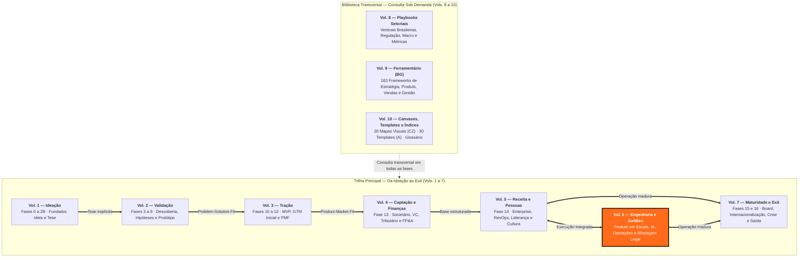
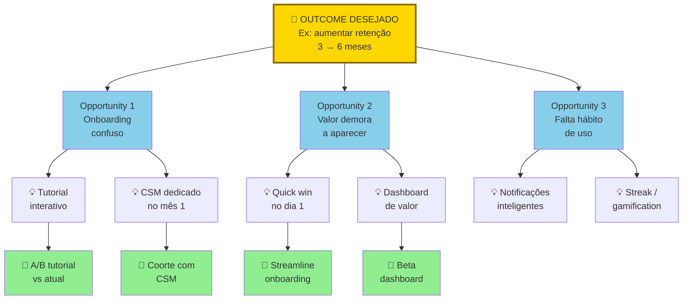
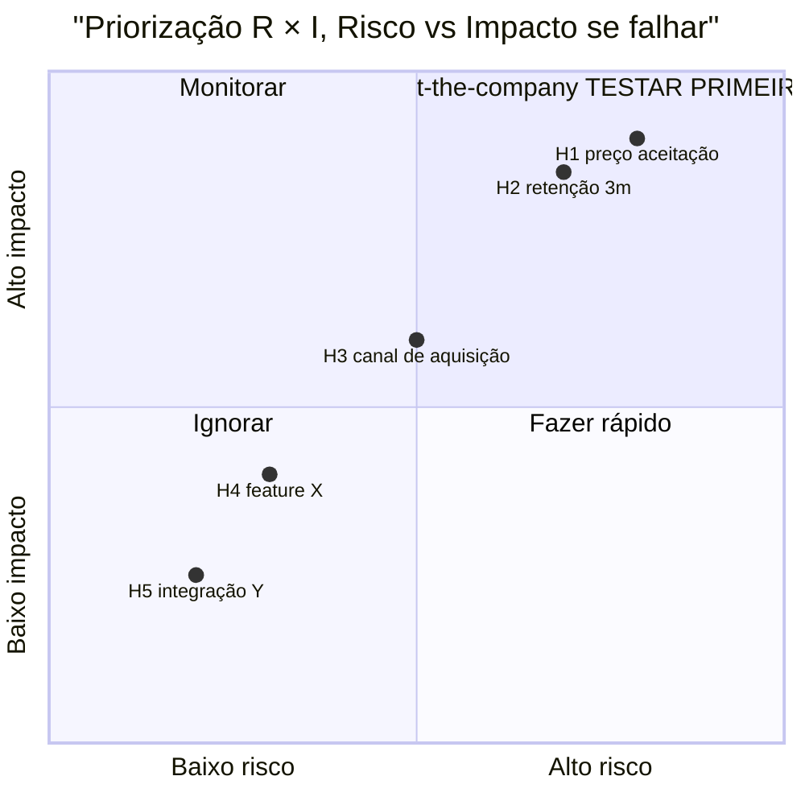
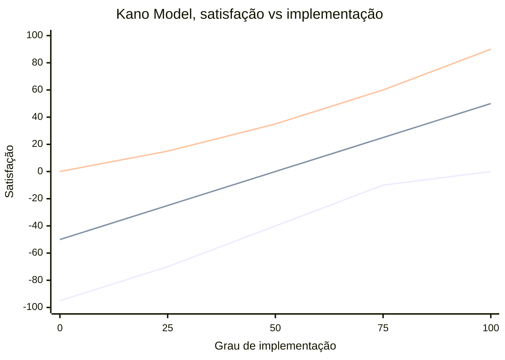
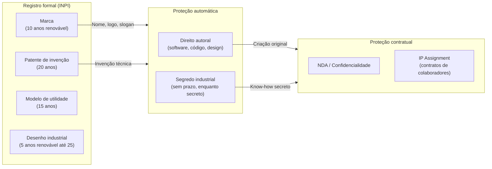
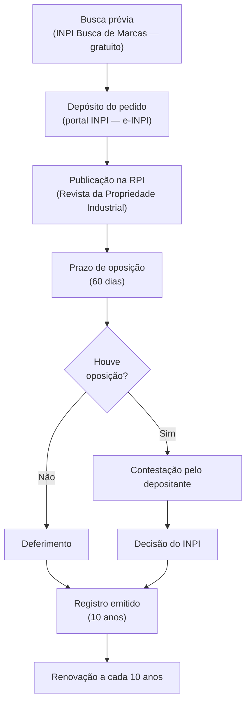

# IGNIÇÃO — Volume 6: Engenharia, Operações e Jurídico

*Produto em Escala, Gestão Técnica, IA, Design Organizacional e Blindagem Legal*

> [!tip] Dica para leitura no Obsidian e GitHub
> Este volume faz parte da coleção **IGNIÇÃO** (10 volumes). Os links para seções deste mesmo volume usam âncoras diretas (`[[#Seção]]`) e os links para outros volumes apontam para o arquivo correspondente (`[[IGNICAO-Vol-X-Nome#Seção]]`).

---

## Sobre este Volume

Este é o **Volume 6 (Engenharia, Operações e Jurídico)** da coleção **IGNIÇÃO — O manual operacional do empreendedor brasileiro** (10 volumes).

Terceiro volume da tríade de Escala (Volumes 4, 5 e 6) — o manual operacional do CTO, CPO, COO e General Counsel na scaleup brasileira. Reúne 23 apêndices divididos em três pilares: (1) descoberta contínua e produto em múltiplos squads, transição do fundador técnico para gestão, recrutamento de engenharia, Engineering Management e Developer Experience, gestão de dívida técnica, IA na engenharia de software e AI Ops; (2) design organizacional, gestão do conhecimento, comunicação interna assíncrona e excelência operacional; e (3) blindagem jurídica integral — propriedade intelectual/INPI, non-compete, LGPD, contratos operacionais e em profundidade, direito do trabalho para startups, compliance anticorrupção, contencioso, CDC, regulação de IA, prevenção a fraudes internas e segurança da informação (SOC 2 / ISO 27001).

> [!note] Consulta transversal e navegação entre os 10 volumes
> Cada volume da coleção IGNIÇÃO reúne as **Fases**, as **Introduções de Domínio** e os **Apêndices temáticos** do seu respectivo estágio ou disciplina. Para métricas por fase e playbooks de verticais brasileiras, consulte o **[[IGNICAO-Vol-8-Playbooks-Setoriais#APÊNDICE C — CATÁLOGO DE MÉTRICAS POR FASE|Volume 8 — Playbooks Setoriais (Vol. 8)]]**. Para os 163 frameworks de gestão e produto, consulte o **[[IGNICAO-Vol-9-Ferramentario#APÊNDICE BG — FERRAMENTÁRIO COMPLETO DO EMPREENDEDOR|Volume 9 — Ferramentário (BG) (Vol. 9)]]**. Para canvases visuais (CZ), templates copiáveis (A) e glossário geral, consulte o **[[IGNICAO-Vol-10-Canvases-e-Templates#APÊNDICE CZ — CANVASES E MAPAS VISUAIS DE MODELO|Volume 10 — Canvases, Templates e Índices (Vol. 10)]]**. A Nota do Autor e o guia geral de uso da obra encontram-se na abertura do **[[IGNICAO-Vol-1-Ideacao#Nota do autor|Volume 1 — Ideação (Vol. 1)]]**.

---

## Mapa da Coleção IGNIÇÃO



---

## Sumário deste Volume

### Produto em Escala, Engenharia de Software, Dívida Técnica e IA

- [[#APÊNDICE AB — PRODUTO EM ESCALA E DESCOBERTA CONTÍNUA]]
- [[#APÊNDICE DW — MANAGEMENT PARA O FUNDADOR TÉCNICO]]
- [[#APÊNDICE CO — RECRUTAMENTO TÉCNICO EM PROFUNDIDADE]]
- [[#APÊNDICE CR — ENGINEERING MANAGEMENT: GESTÃO DO TIME TÉCNICO E DEVELOPER EXPERIENCE]]
- [[#APÊNDICE BC — TECHNICAL DEBT COMO DISCIPLINA GERENCIADA]]
- [[#APÊNDICE CH — IA NA ENGENHARIA INTERNA: COPILOT, AGENTES E PRODUTIVIDADE DE DEV]]
- [[#APÊNDICE EI — AI OPS E AUTOMAÇÃO INTELIGENTE]]

### Arquitetura Organizacional, Conhecimento, Comunicação e Operações

- [[#APÊNDICE FB — DESIGN ORGANIZACIONAL]]
- [[#APÊNDICE FC — GESTÃO DO CONHECIMENTO]]
- [[#APÊNDICE DZ — COMUNICAÇÃO INTERNA]]
- [[#APÊNDICE DV — OPERAÇÕES EM ESCALA]]

### Propriedade Intelectual, LGPD, Contratos, Trabalhista, Compliance e Segurança

- [[#APÊNDICE DC — PROPRIEDADE INTELECTUAL E INPI]]
- [[#APÊNDICE DJ — NÃO-CONCORRÊNCIA E NÃO-SOLICITAÇÃO NO BRASIL]]
- [[#APÊNDICE T — LGPD, COMPLIANCE E GOVERNANÇA DE DADOS]]
- [[#APÊNDICE AH — CONTRATOS E ASPECTOS LEGAIS OPERACIONAIS]]
- [[#APÊNDICE EU — CONTRATOS EM PROFUNDIDADE POR TIPO]]
- [[#APÊNDICE EL — DIREITO DO TRABALHO PARA STARTUPS]]
- [[#APÊNDICE EM — COMPLIANCE E ANTICORRUPÇÃO PARA STARTUPS]]
- [[#APÊNDICE EO — CONTENCIOSO E LITÍGIO PARA STARTUPS]]
- [[#APÊNDICE EQ — DIREITO DO CONSUMIDOR E CDC PARA STARTUPS]]
- [[#APÊNDICE ET — REGULATÓRIO DE IA NO BRASIL]]
- [[#APÊNDICE BW — FRAUDE INTERNA E CONTROLES INTERNOS]]
- [[#APÊNDICE CV — SEGURANÇA DA INFORMAÇÃO: DA CERTIFICAÇÃO À ENGENHARIA]]

---

# PRODUTO EM ESCALA, ENGENHARIA DE SOFTWARE, DÍVIDA TÉCNICA E IA

---

### Arquitetura deste Domínio: Produto em Escala, Engenharia de Software, Dívida Técnica e IA Operacional

Enquanto o Volume 5 constrói a máquina comercial e humana da escala, este **Volume 6 (Engenharia, Operações e Jurídico)** é o manual de bolso do **CTO, CPO, COO e General Counsel** (e do CEO que precisa supervisionar essas áreas com profundidade). O primeiro bloco (**Apêndices AB, DW, CO, CR, BC, CH e EI**) resolve o desafio clássico da tecnologia pós-PMF: por que um time de engenharia que entregava rápido com 5 desenvolvedores parece travar quando chega a 40?

Os sete capítulos atacam o problema em todas as suas dimensões:
- **Descoberta Contínua e Gestão de Produto em Múltiplos Squads ([[#APÊNDICE AB — PRODUTO EM ESCALA E DESCOBERTA CONTÍNUA|Apêndice AB]]):** Como manter os times conectados ao cliente e evitar que a empresa vire uma "fábrica de features" burocrática à medida que o portfólio cresce (conectado ao exemplo de Opportunity Solution Tree no template A.23 do Volume 10).
- **A Transição e o Recrutamento da Liderança Técnica ([[#APÊNDICE DW — MANAGEMENT PARA O FUNDADOR TÉCNICO|Apêndice DW]] e [[#APÊNDICE CO — RECRUTAMENTO TÉCNICO EM PROFUNDIDADE|Apêndice CO]]):** Como o fundador técnico deixa de ser o único desenvolvedor sênior para se tornar líder de engenharia ou CTO (DW), e como desenhar processos seletivos técnicos que avaliam capacidade real de construção em vez de *puzzles* algorítmicos artificiais (CO).
- **Produtividade de Engenharia e Saúde Arquitetural ([[#APÊNDICE CR — ENGINEERING MANAGEMENT: GESTÃO DO TIME TÉCNICO E DEVELOPER EXPERIENCE|Apêndice CR]] e [[#APÊNDICE BC — TECHNICAL DEBT COMO DISCIPLINA GERENCIADA|Apêndice BC]]):** Rituais de gestão técnica, métricas DORA, *Developer Experience* e resposta a incidentes (CR, conectado ao template A.35 de Post-Mortem Técnico no Volume 10), somados ao gerenciamento deliberado da dívida técnica como alavanca financeira — sabendo quando contrair e quando amortizar sem cair na armadilha da "reescrita total do zero" (BC).
- **Alavancagem com Inteligência Artificial no Código e nas Operações ([[#APÊNDICE CH — IA NA ENGENHARIA INTERNA: COPILOT, AGENTES E PRODUTIVIDADE DE DEV|Apêndice CH]] e [[#APÊNDICE EI — AI OPS E AUTOMAÇÃO INTELIGENTE|Apêndice EI]]):** Como adotar assistentes de código e agentes autônomos no ciclo de desenvolvimento sem inflar dívida técnica ou vulnerabilidades (CH), e como automatizar fluxos operacionais inteiros da empresa com *AI Ops* (EI).

---

## APÊNDICE AB — PRODUTO EM ESCALA E DESCOBERTA CONTÍNUA

> [!note] Nota de validade
> Os frameworks de descoberta contínua (Teresa Torres), priorização (RICE, Kano, WSJF), Jobs to be Done e design systems têm vida útil longa. Ferramentas específicas evoluem a cada dezoito a vinte e quatro meses, e devem ser revisadas nesse intervalo.

As Fases 2 a 11 cobrem produto até o PMF: descoberta, validação, MVP, encaixe. Depois disso, produto vira disciplina contínua, em contexto diferente. Time maior, múltiplos stakeholders, roadmap disputado, sistema complexo, clientes com expectativas altas. O território pós-PMF fica subcoberto no manual até aqui.

Este apêndice cobre como Product funciona em empresa pós-PMF escalando para cinquenta a duzentas pessoas, onde a disciplina que levou até aqui já não basta para o que vem a seguir.

### O que esse apêndice cobre

Cinco territórios em Product pós-PMF. Primeiro, descoberta contínua: pesquisa de usuário não para em PMF, evolui de exploratória para iterativa. Segundo, priorização com framework estruturado, não opinião do CEO ou HIPPO (Highest Paid Person's Opinion, opinião da pessoa mais bem paga). Terceiro, roadmap como comunicação de aposta, não contrato de entrega. Quarto, Design Systems (sistemas de design), infraestrutura de UI que permite velocity (velocidade de entrega) em escala. Quinto, colaboração entre Product e Engineering: ritos, specs (especificações), definition of ready e definition of done (critérios de pronto para começar e pronto para entregar).

Os entregáveis são: opportunity solution tree (árvore de oportunidades) viva, framework de priorização aplicado, roadmap de três horizontes, design system documentado e processo de spec até implementação.

### POR QUE

Empresa em escala precisa de produto como disciplina, não como intuição. O que funcionou no founder sozinho não escala para quatro squads em paralelo. Sem descoberta contínua, a empresa vira feature factory (fábrica de funcionalidades), constrói o que stakeholders pedem, não o que gera valor.

Priorização sem framework é política. Quem grita mais alto, ou tem mais acesso ao CEO, ganha. Isso destrói moral e qualidade. Design sem system vira caos visual. Inconsistência agride o usuário e consome velocity de engineering. Product e Engineering sem ritos viram retrabalho: specs vagas, entregas erradas, moral em queda.

### Quando usar

[[IGNICAO-Vol-3-Tracao#FASE 12 — PRODUCT-MARKET FIT|Fase 12 (Vol. 3)]], primeiras disciplinas estruturadas (descoberta contínua e priorização leve). [[IGNICAO-Vol-5-Receita-e-Pessoas#FASE 14 — ESCALA: TIME, OPERAÇÕES, CRESCIMENTO E CAPITAL|Fase 14 (Vol. 5)]] com primeiros Product Managers contratados, todos os territórios começam a importar. [[IGNICAO-Vol-5-Receita-e-Pessoas#FASE 14 — ESCALA: TIME, OPERAÇÕES, CRESCIMENTO E CAPITAL|Fase 14 (Vol. 5)]] com múltiplos squads, Product Ops emerge como função. [[IGNICAO-Vol-5-Receita-e-Pessoas#FASE 14 — ESCALA: TIME, OPERAÇÕES, CRESCIMENTO E CAPITAL|Fase 14 (Vol. 5)]] em diante, Design System e Platform Product Management.

### Quem envolve

CPO ou VP Product lidera a disciplina. Product Managers (gerentes de produto): um PM por squad, e um a dois squads por PM sênior. Product Designers: idealmente um designer por squad. User Researchers (pesquisadores de usuário): um UR para dois a quatro squads em escala. Product Ops: uma pessoa dedicada a partir de cerca de seis PMs. Staff e Principal PMs: para problemas transversais e iniciativas estratégicas.

### Como executar

#### 1. Descoberta Contínua, framework Teresa Torres

O problema que ela resolve: evitar que o produto vire "o que o CEO quer" ou "o que clientes gritam mais alto", mantendo foco em valor.

Os ingredientes em duas peças. Weekly interviewing habit (hábito de entrevistar semanalmente): a equipe de produto entrevista pelo menos um usuário por semana, toda semana. Opportunity Solution Tree (árvore de oportunidade-solução): árvore visual que conecta outcome desejado (raiz, por exemplo "aumentar retenção de clientes de três para seis meses"), opportunities (galhos — problemas ou necessidades do usuário que, se endereçadas, movem o outcome), solutions (folhas — ideias de produto que endereçam a opportunity) e experiments (testes para validar se a solução move a opportunity).

A estrutura de uma Opportunity Solution Tree.



A árvore é viva, não documento morto. Descoberta semanal adiciona, e refina, nós. Se não atualiza em duas semanas, o hábito morreu.

O processo semanal em cinco passos. Entrevistar um a três usuários em torno do outcome atual. Adicionar opportunities novas na árvore, ou refinar existentes. Gerar solutions para opportunities que parecem promissoras. Escolher experiments para testar solutions. Executar o experiment, medir, ajustar.

> [!important] Papel do CPO em descoberta contínua
> Fazer a árvore viver. Revisão quinzenal. Evitar que vire documento morto. CPO que delega a árvore para PM júnior, e nunca olha de novo, garante que a descoberta vire teatro depois de três meses.

Livro-fonte. *Continuous Discovery Habits*, Teresa Torres.

#### 2. Priorização, frameworks aplicados

Framework define processo, não resultado. O resultado ainda é decisão humana informada.

**RICE (Reach, Impact, Confidence, Effort).** Reach, quantos usuários, ou clientes, afetados em período específico. Impact, quanto cada usuário ou cliente beneficiado (escala um a cinco, ou massive, high, medium, low, minimal). Confidence, quão seguros sobre Reach, e Impact (em percentual). Effort, pessoa-meses estimados. O score é (Reach vezes Impact vezes Confidence) dividido por Effort.

Matriz visual de priorização R x I.



O quadrante superior-direito (alto risco mais alto impacto se falhar) contém hipóteses bet-the-company. Essas são as que, se refutadas, destroem o negócio. Teste-as primeiro. Com mais rigor. Inferior-esquerdo (baixo risco mais baixo impacto), ignore. Não gere experimento. Útil para priorizar lista longa de features com dados.

**WSJF (Weighted Shortest Job First, do SAFe).** O score é (Business Value mais Time Criticality mais Risk Reduction ou Opportunity Enablement) dividido por Job Size. Útil para contexto mais enterprise, com coordenação entre múltiplos squads.

**Kano Model.** Categoriza features em cinco grupos. Basic (must-have), ausência frustra, presença não delighta. Performance, mais é melhor, linear. Delighter, inesperado, cria entusiasmo. Indifferent, o usuário não se importa. Reverse, o usuário prefere ausência.

Curvas do Kano Model (satisfação versus implementação).

> [!note] Compatibilidade — requer Mermaid 10+ (Obsidian 1.4+)



Três curvas principais. A linha inferior (Must-have) tem teto em zero. Ausência frustra, presença não delighta. A linha intermediária (Performance) é linear. Mais é melhor proporcional. A linha superior (Delighter) começa neutra, e sobe forte. Sequência: Basic, depois Performance, depois Delighter. Pular etapa destrói experiência. Útil para balancear "tapar buracos" com "criar amor".

**MoSCoW.** Must, Should, Could, Won't. Simples. Útil para alinhamento rápido de escopo em sprints.

**Opportunity Prioritization (Torres).** Dentro do Opportunity Solution Tree, escolher a próxima opportunity baseado em três critérios. Impacto esperado no outcome. Evidência acumulada (quantas entrevistas validam). Addressability (resolvível por solução factível).

A escolha do framework varia por estágio. [[IGNICAO-Vol-3-Tracao#FASE 12 — PRODUCT-MARKET FIT|Fase 12 (Vol. 3)]] a 13A, Opportunity mais RICE leve. [[IGNICAO-Vol-5-Receita-e-Pessoas#FASE 14 — ESCALA: TIME, OPERAÇÕES, CRESCIMENTO E CAPITAL|Fase 14 (Vol. 5)]] (Operações em diante), RICE mais Kano. Enterprise com múltiplos squads, WSJF.

#### 3. Roadmap, comunicação de aposta

O problema clássico. Roadmap virou contrato. Cliente, vendedor, ou board, pede "quando X?". Produto responde data. A data não bate. A confiança erode.

A reformulação é roadmap de três horizontes.

Now (próximas quatro a oito semanas). Comprometido. Data, e escopo, claros. Entrega prevista com alta confiança.

Next (próximos dois a quatro meses). Direção clara. Escopo provável. Não comprometido em data.

Later (seis ou mais meses). Área de foco estratégico. Sem escopo, ou data, específicos.

As regras. Now é "contrato" interno. O time não muda exceto por emergência. Next é conversa regular. Pode mudar conforme aprendizado. Later é visão. Ajustada trimestralmente.

A comunicação. Sales tem acesso, com treinamento sobre o que comunicar externamente. O cliente recebe Now como certeza. Next como provável. Later como visão. O board vê os três com contexto estratégico.

#### 4. Design Systems, infraestrutura visual

Quando implementar. Quando há dois ou mais designers, e dez ou mais engenheiros front-end, trabalhando no mesmo produto.

Os componentes em quatro camadas. Tokens, cores, tipografia, espaçamentos, sombras (variáveis base). Components, botões, inputs, cards, modais, tabelas (composições). Patterns, flows comuns (auth, checkout, onboarding). Documentação, como usar, quando usar, e exemplos.

Storage. Design em Figma, com bibliotecas compartilhadas. Código em biblioteca de componentes em React, Vue, ou Svelte, com Storybook.

Ownership. Inicialmente, design e engineer compartilhados. Em escala, Design Systems Team (uma a três pessoas) full-time.

Ferramentas. Figma, Storybook, Chromatic (visual regression), Tailwind mais shadcn/ui como base comum.

#### 5. Product e Engineering, ritos e specs

**Spec (PRD, Product Requirements Document).** Spec moderno não é "documento de vinte páginas". Em formato moderno, tem seis peças. Problema, um a dois parágrafos sobre o problema, ou opportunity. Success metrics, o que vai mudar, quantificado. User stories, ou JTBD, cenários reais de uso. Scope IN e OUT, explícito. Mocks, ou wireframes, link para o Figma. Open questions, o que ainda precisa decidir. Tamanho ideal, duas a cinco páginas. Mais longo significa que o spec não convergiu.

**Definition of Ready (quando o spec está pronto para dev).** Problema, e solução, claros. Designs (mocks, ou hi-fi) prontos. Success metrics definidas. Scope congelado (mudanças viram nova spec). Engineering teve sessão de Q&A.

**Definition of Done (quando a feature está pronta).** Código em produção. Analytics instrumentado para success metrics. Documentação atualizada. QA passou. Comunicação a clientes, ou a Sales, feita (se aplicável).

**Os ritos.** Product triad weekly (PM mais Design mais Eng lead), sessenta minutos por semana, alinhamento contínuo. Sprint review quinzenal, demo mais feedback. Squad retrospective quinzenal, o que melhorar. Planning semanal, próxima semana, com clareza em cada item.

#### 6. Jobs to be Done aplicado em produto maduro

JTBD ([[IGNICAO-Vol-2-Validacao#FASE 4 — PESQUISA COM USUÁRIOS (CUSTOMER DISCOVERY APROFUNDADO)|Fase 4 (Vol. 2)]] na descoberta inicial) continua relevante em escala. Mas em forma evoluída.

**Switch interview (Alan Klement).** Entrevistar clientes que recentemente mudaram para o seu produto (de competidor, ou de nenhum produto). Mapear evento gatilho, forças puxando para mudança, forças resistindo à mudança, e forças puxando de volta. Output: entendimento profundo do "job" que o produto está sendo contratado para fazer.

Aplicação em roadmap. Features que reforçam pull forces do job principal valem mais do que features random. Mesmo que populares.

#### 7. Shape Up (Ryan Singer / Basecamp, 2019)

Shape Up é a metodologia de desenvolvimento de produto criada por Ryan Singer na Basecamp, publicada como livro gratuito em 2019. Nasceu da insatisfação com Scrum e sprints de duas semanas em produto maduro: o ritmo constante de sprints cria pressão para "estar ocupado" em vez de entregar valor real, e features complexas ficam artificialmente cortadas para "caber no sprint". Shape Up opera em ciclos de seis semanas com três princípios centrais.

**Appetite em vez de estimativa.** Antes de começar qualquer trabalho, o time decide *quanto tempo está disposto a gastar* no problema — não quanto tempo vai demorar. Appetite de duas semanas significa: "se não resolvermos em duas semanas, não vale a pena." Isso força priorização real em vez de refinamento infinito de escopo.

**Shaping antes de executar.** Antes de entrar em ciclo, o problema é "moldado" em alto nível: problema definido, abordagem em esboço (fat marker sketch), elementos fora do escopo explicitados, riscos técnicos identificados. O pitch moldado vai para o betting table, não para o backlog. Backlog não existe no Shape Up — itens que ninguém aposta em ciclo após ciclo são descartados.

**Betting table e autonomia total.** A cada ciclo, líderes apostam em pitches. Time que "ganhou" a aposta tem seis semanas de autonomia total para executar — sem interrupcões, sem reuniões de status, sem mudança de escopo. Se não entregou em seis semanas, o projeto é cancelado (circuit breaker), não "carregado" para o próximo ciclo. A pressão é real, mas o tempo também é real.

Quando Shape Up faz sentido. Em produto maduro com mais de dois anos, com time estável de oito ou mais pessoas. Quando sprints de duas semanas estão produzindo "busyness" sem entregas de impacto. Quando features complexas estão sendo artificialmente quebradas sem coerência. Quando há frustração com backlog que cresce infinitamente sem priorização real.

Quando Shape Up *não* faz sentido. Em pré-PMF, onde o ciclo de aprendizado precisa ser mais rápido do que seis semanas. Em ambientes fortemente regulados onde mudanças precisam de aprovação formal em cada iteração. Em times menores que quatro pessoas onde o overhead de shaping não justifica.

Tensão com Scrum e Kanban. Shape Up não é substituto de Scrum para times que já têm boa higiene de processo. É alternativa para contextos onde Scrum virou ritual sem substância. Muitas empresas adotam Shape Up para iniciativas estratégicas maiores e mantêm Scrum para manutenção e bugs.

### Métricas

**Descoberta e validação.** Interviews por semana, ou mês, por squad. Opportunities na árvore (status: exploração, validação, ou endereçada). Experiments rodados por trimestre.

**Execução.** Cycle time (spec até produção). Escopo entregue versus planejado por sprint. Bug backlog.

**Impacto.** Impacto em North Star Metric por feature entregue. Adoption rate de novas features. Deprecation rate (features removidas por falta de uso).

**Organização.** PM e eng ratio (alvo de um para seis até um para dez). Design e eng ratio (alvo de um para cinco até um para oito). Squads autônomos (outcome definido, decisão local).

### Armadilhas

Feature factory. O time constrói o que stakeholders pedem, sem validação. Muito output. Pouco impacto.

Descoberta que para em PMF. "Atingimos PMF, agora é só escalar." Não. Descoberta continua em forma diferente.

Priorização baseada em quem grita. Sem framework, decisão política. Qualidade degrada.

Roadmap como contrato. Prometer data em "Later", e não cumprir. A confiança erode.

Design sem system. Cada feature com variação. UX inconsistente. Velocity destruída.

Spec vago. O engineer adivinha o que o PM queria. Retrabalho.

PM sem tempo para descoberta. Cem por cento do tempo em execution. Vira "project manager", não product.

HIPPO (Highest Paid Person's Opinion). O CEO muda roadmap em conversas de corredor.

Squad sem outcome claro. O time focado em output (features), não em outcome (métrica de negócio).

Métricas de vanity em review. "Lançamos doze features" não é sucesso. "Moveu a métrica X de Y para Z" é.

### Checklist

Produto em escala está no padrão quando todos os itens abaixo estão cumpridos.

- [ ] Descoberta contínua como hábito: weekly interviewing implementado em todas as squads, com OST viva (revisão quinzenal pelo CPO).
- [ ] Framework de priorização escolhido e aplicado consistentemente (RICE, WSJF, Kano ou combinação por estágio), não política.
- [ ] Roadmap em três horizontes (Now, Next, Later) documentado, comunicado e respeitado pelos times.
- [ ] Design System implementado e adotado em 80% ou mais de novas features.
- [ ] Spec padrão (PRD) definido com Definition of Ready e Done.
- [ ] Squads autônomos operando com outcome claro (métrica de negócio), não apenas lista de features.
- [ ] Product triad (PM, Design, Eng lead) em cadência semanal.
- [ ] Impacto de features é medido, reportado e usado para decisão. Não suposto.
- [ ] Switch interviews (JTBD aplicado) rodam periodicamente para reforçar decisões de roadmap.

### Ver também

[[IGNICAO-Vol-3-Tracao#APÊNDICE CB — SUBSCRIPTION ECONOMY EM PROFUNDIDADE: ALÉM DO "COBRA MENSALMENTE"|Apêndice CB (Vol. 3)]], Subscription economy. [[IGNICAO-Vol-2-Validacao#APÊNDICE CC — PLATAFORMA VS PRODUTO: QUANDO CONSTRUIR PLATAFORMA E QUANDO NÃO|Apêndice CC (Vol. 2)]], Plataforma versus produto. [[IGNICAO-Vol-2-Validacao#APÊNDICE AE — MARKETPLACE DYNAMICS E RISCO DE PLATAFORMA|Apêndice AE (Vol. 2)]], Marketplace dynamics. [[IGNICAO-Vol-3-Tracao#APÊNDICE AA — CUSTOMER SUCCESS COMO DISCIPLINA|Apêndice AA (Vol. 3)]], Customer Success.

> [!info] Fases relacionadas
> Referenciado em: Fase 12.

---

## APÊNDICE DW — MANAGEMENT PARA O FUNDADOR TÉCNICO

Este apendice especializa o [[#APÊNDICE CR — ENGINEERING MANAGEMENT: GESTÃO DO TIME TÉCNICO E DEVELOPER EXPERIENCE|Apêndice CR]] no tema da transicao do fundador tecnico para gestao.

Há um momento previsível na vida de todo fundador técnico, aquele em que ele percebe que parou de escrever código produtivo há seis semanas e que o time de engenharia, que era de três pessoas, agora tem oito. Os problemas que chegam até ele não são mais bugs nem decisões de arquitetura. São conflitos entre dois sêniors, a dev que entregou abaixo do esperado no último sprint (ciclo curto de entrega), o CTO (Chief Technology Officer, diretor de tecnologia) da empresa investidora querendo saber por que o time não está mais rápido.

Ninguém o preparou para isso. A escola ensinou algoritmos, não conversas difíceis. O primeiro emprego ensinou a programar bem, não a desenvolver pessoas. Os livros de gestão foram escritos para gerentes de banco, não para fundadores que ainda têm opinião sobre qual ORM (Object-Relational Mapper, biblioteca que mapeia banco para objetos) usar.

Este apêndice trata da travessia. Da pessoa que era o melhor engenheiro da empresa para quem constrói o time que constrói o produto. A travessia tem custo real, armadilhas previsíveis e ferramentas concretas. Cada uma delas vai coberta aqui.

---

### 1. A transição que ninguém te prepara

#### O que muda de verdade

A mudança fundamental não é de função. É de como você produz valor.

Como engenheiro, você cria valor escrevendo código. A relação é direta: esforço entra, feature sai. O resultado do seu trabalho é visível, mensurável, reversível. Você pode medir seu desempenho em pull requests, bugs resolvidos, sistemas entregues. Quando algo falha, você depura, encontra a causa, corrige.

Como gestor técnico, você cria valor através das pessoas. O resultado do seu trabalho é indireto, defasado no tempo e frequentemente invisível no dia a dia. Uma conversa difícil que você teve em março pode só mostrar resultado em julho, quando o engenheiro que quase saiu decide ficar e vira sênior. A decisão de contratar alguém específico molda a cultura do time por anos. A clareza que você deu sobre prioridades evita semanas de trabalho errado que nunca vão aparecer no dashboard.

Essa defasagem entre esforço e resultado desorenta fundadores técnicos. Em código, feedback é imediato: o teste passa ou falha. Em gestão, você raramente sabe na hora se tomou a decisão certa.

#### O que você precisa aprender a tolerar

Há três tolerâncias que o fundador técnico precisa desenvolver e que normalmente estão ausentes em pessoas que foram boas engenheiras.

A primeira é tolerância à ambiguidade em pessoas. Problemas técnicos têm uma causa raiz. Problemas com pessoas raramente têm. O dev que está desmotivado pode ter dez razões simultâneas, algumas que ele mesmo não sabe nomear. A dev que está entregando mal pode estar passando por algo fora do trabalho. Quem tenta depurar pessoas como se depura código vai se frustrar constantemente.

A segunda é tolerância à repetição. Em código, você resolve um problema uma vez e automatiza. Em gestão, você precisa repetir o mesmo contexto, a mesma direção, a mesma expectativa dezenas de vezes para dezenas de pessoas. Aquilo que parece óbvio para quem fundou a empresa não é óbvio para quem chegou mês passado.

A terceira é tolerância ao trabalho que não aparece. O melhor gestor técnico frequentemente parece que não fez nada. O time flui, os projetos entregam, as pessoas estão bem. O trabalho real foi feito nas conversas, nos bastidores, nas decisões invisíveis. Fundadores acostumados a ter pull requests como prova de trabalho acham isso psicologicamente difícil.

> [!important] A identidade é o problema real
> Fundadores técnicos que resistem à transição de gestão raramente resistem por preguiça ou incompetência. Resistem porque a identidade está ancorada em ser "o técnico". Ser o melhor dev do time era a fonte de respeito, segurança e autoestima. Virar gestor parece perda, não evolução. Reconhecer isso é o primeiro passo para não sabotar a transição.

#### O que você leva com você

A transição não anula o background técnico. Pelo contrário: o fundador que foi engenheiro tem vantagens estruturais que gestores sem background técnico nunca terão.

Você entende o que está sendo construído. Você sabe quando uma estimativa está sendo inflada por medo ou quando está sendo comprimida por pressão de cima. Você reconhece débito técnico quando vê, mesmo sem entrar no código. Você fala a língua dos engenheiros e sabe quando alguém está confundindo complexidade real com falta de clareza. Você entende o custo verdadeiro de uma decisão técnica tomada às pressas.

Essas vantagens só aparecem se você parar de usar o background técnico para resolver os problemas operacionais do time e começar a usar para fazer as perguntas certas.

---

### 2. O erro da gestão por admiração

#### O padrão mais comum

Existe um padrão que aparece com regularidade preocupante em fundadores técnicos que viraram gestores: o gestor continua resolvendo os problemas técnicos do time porque é mais rápido, mais prazeroso, e porque o time admira isso.

O engenheiro trava em um bug difícil. O fundador mergulha no problema, depura em quarenta minutos, o time aplaude, problema resolvido. Parece eficiente. Parece liderança.

Não é nem um nem o outro.

O que aconteceu, na prática: o engenheiro não aprendeu a resolver aquele tipo de problema. O fundador consumiu capital cognitivo que deveria estar em decisão de contratação, alinhamento de roadmap, conversa com o board. O time aprendeu que trazer problema para o fundador resolve mais rápido do que tentar resolver sozinho. O fundador criou dependência, não capacidade.

Esse padrão tem nome: gestão por admiração. Você gere pela reverência que o time tem por você como técnico, não pelo desenvolvimento que você promove nas pessoas.

#### Por que acontece

Gestão por admiração acontece por três razões simultâneas.

A primeira é que resolver problema técnico é imediato e prazeroso. A dopamina do bug resolvido, do código funcionando, é real. Conversas sobre desenvolvimento de carreira não têm essa gratificação instantânea.

A segunda é que o time encoraja ativamente. Engenheiros apreciam genuinamente quando o líder mais experiente entra e resolve. Eles pedem isso. Receber esse pedido e dizer "você consegue, o que você já tentou?" parece frio, parece abandono.

A terceira é que é invisível enquanto está acontecendo. O time não mostra sinais de alarme no curto prazo. Só seis a doze meses depois o problema aparece: o time não cresceu, ninguém sabe resolver problemas complexos sem o fundador, e o fundador está gargalo em tudo.

#### O sinal de que você está no padrão

Você está no padrão de gestão por admiração quando:

- Mais de vinte por cento do seu tempo é em tarefas técnicas operacionais (não estratégicas).
- Os engenheiros te procuram primeiro para problemas que deveriam resolver sozinhos.
- Você se sente mais produtivo nos dias em que "ajudou o time" do que nos dias em que teve conversas difíceis sobre desempenho.
- O time apresenta o mesmo tipo de problema mês após mês sem melhora incremental.
- Você não consegue tirar férias de uma semana sem o time travar em algo.

> [!warning] O custo oculto
> Cada hora que o fundador técnico passa resolvendo problema operacional do time é uma hora que ele não passou desenvolvendo a pessoa que poderia resolver esse problema sozinha daqui a três meses. O custo se inverte. O que parece eficiente hoje é o que cria ineficiência estrutural amanhã.

#### A transição de resolver para desenvolver

A mudança não é de um dia para o outro, e forçá-la de forma brusca é contraproducente. A transição saudável tem três estágios.

No primeiro estágio, você resolve junto. Em vez de resolver sozinho, você para ao lado do engenheiro e resolve em voz alta, explicando o raciocínio.

No segundo estágio, você guia sem resolver. "O que você já tentou? Qual seria o próximo passo lógico? O que você acha que está causando?" Você fica perto mas coloca a mão do engenheiro no volante.

No terceiro estágio, você não resolve mais. O engenheiro traz o problema, você pergunta o que ele já tentou, você confia no julgamento dele, você está disponível se travar de verdade.

O tempo entre os estágios depende da senioridade do engenheiro e do tipo de problema. Com júnior em problema crítico de produção, você talvez precise ficar no estágio um por mais tempo. Com sênior em problema não urgente, você devia estar no estágio três desde a primeira semana.

---

### 3. O 1:1 como ferramenta principal

#### Por que o 1:1 é a ferramenta mais importante

O 1:1 é a unidade mínima de gestão. É onde você detecta problemas antes que virem crise, onde você desenvolve as pessoas de forma individual, onde você colhe informação que nunca aparece em reunião de time, onde você constrói a confiança que permite conversas difíceis.

Fundadores técnicos costumam ter dois extremos: ou não fazem 1:1 nenhum ("não tem necessidade, estamos todos juntos o dia todo") ou transformam o 1:1 em status meeting de projeto. Os dois são erros.

O 1:1 que não acontece é o fundador sinalizando que não tem interesse genuíno no desenvolvimento individual. O 1:1 que vira status report deixa de ter a única função que não pode ser substituída por nenhuma outra reunião: o espaço da pessoa, não do projeto.

#### Cadência

A cadência recomendada é semanal para os primeiros três meses de qualquer engenheiro no time, e quinzenal depois. Reduzir para mensal só faz sentido para líderes sêniors que trabalham de forma muito autônoma, e mesmo assim com cautela.

Duração: trinta minutos por padrão, com possibilidade de estender. Nunca cortar antes do tempo sem razão legítima. Cortar 1:1 por prioridade envia mensagem forte sobre o que o gestor de fato prioriza.

> [!tip] Sobre cancelamento
> Cancelar 1:1 uma vez por mês está dentro do aceitável. Cancelar duas vezes seguidas é sinal de alerta para o engenheiro de que ele não é prioridade. Cancelar de forma sistemática é o fim da ferramenta. Se você cancela 1:1 com frequência, o problema não é sua agenda. É que você ainda não acredita que o 1:1 vale o tempo.

#### O que perguntar

A estrutura de 1:1 que funciona começa com o espaço da pessoa, não do gestor.

Abra com pergunta aberta: "Como você está?" não como protocolo social, mas como pergunta genuína que você ouve a resposta. "O que está travando você essa semana?" "Tem algo que você queria falar mas a reunião de time não era o lugar certo?"

Depois explore o que a pessoa quer explorar. Só então traga o que você quer abordar, e anuncie isso antes: "Tenho três coisas que quero falar hoje, posso trazer?"

Perguntas que acessam o que o 1:1 precisa acessar:

- O que você está aprendendo que não estava aprendendo há três meses?
- Existe alguma parte do trabalho que está consumindo energia de forma desproporcional?
- O que você acha que devíamos mudar e não mudamos ainda?
- O que você precisa de mim que não está recebendo?
- Onde você quer estar em doze meses?

Essas perguntas são desconfortáveis no começo, especialmente para engenheiros que não estão acostumados a ter espaço para isso. Persista nas primeiras semanas. O desconforto dissolve.

#### Como registrar

Documente 1:1. Não para vigilância, mas para continuidade. Sem registro, você repete as mesmas perguntas toda semana, perde fio das conversas anteriores e não consegue identificar padrões ao longo do tempo.

Formato minimalista que funciona: data, o que a pessoa trouxe, o que você trouxe, ações combinadas com responsável e prazo. Documento compartilhado entre você e o engenheiro é melhor que documento que só o gestor vê. Quando os dois têm acesso, o 1:1 vira compromisso mútuo, não auditoria.

#### Quando o 1:1 é difícil

Algumas pessoas resistem a 1:1. Engenheiros introvertidos, pessoas com histórico de gestores que usaram o 1:1 como espaço de cobrança, pessoas de culturas onde a gestão sempre foi distante. O 1:1 difícil pede calibração de formato.

Se a pessoa trava quando você pergunta "como você está?", comece com agenda mais estruturada. Se ela só fala de projeto, explore isso com profundidade, e aos poucos faça pontes para o desenvolvimento individual. Se ela claramente preferiria não ter 1:1, seja honesto: "Eu sei que pode parecer sem necessidade, mas para mim é importante ter esse espaço. O que tornaria mais útil para você?"

---

### 4. Feedback direto

#### Por que fundadores técnicos dão feedback ruim

Fundadores técnicos costumam ter um de dois padrões de feedback: ou não dão feedback nenhum (evitam a conversa, toleram comportamento problemático até não poder mais, e aí explodem), ou dão feedback de forma direta demais e abrupta (falam o problema sem qualquer consideração pela forma como vai ser recebido).

O padrão de evitar é mais comum. Ele vem de uma confusão entre ser direto e ser cruel. "Se eu disser que o trabalho dele está abaixo do esperado, vou destruir a motivação dele." O que destrói motivação não é o feedback. É a surpresa do feedback. E o que destrói confiança não é a mensagem difícil. É a mensagem que chega tarde demais, quando o dano já está feito.

#### O modelo SBI

O modelo SBI (Situação, Comportamento, Impacto) é a estrutura mais simples e mais eficaz para dar feedback específico, especialmente o difícil.

Situação é o contexto concreto. Não generalização, mas evento específico. "Na revisão de arquitetura de terça-feira" é situação. "Você sempre faz isso" não é situação, é acusação.

Comportamento é o que a pessoa fez ou disse, observável e factual. "Você interrompeu três vezes quando o Lucas estava apresentando" é comportamento. "Você foi desrespeitoso" é julgamento que vai gerar defesa imediata.

Impacto é o efeito que o comportamento teve. No time, no projeto, em você, nos outros. "O Lucas ficou visivelmente constrangido e encerrou a apresentação mais cedo do que o planejado. O restante do time ficou quieto no resto da reunião" é impacto concreto. "Isso foi um problema" não é impacto, é conclusão sem base.

A estrutura completa: "Na revisão de arquitetura de terça [situação], você interrompeu o Lucas três vezes enquanto ele apresentava [comportamento]. Ele ficou visivelmente incomodado e o restante do time ficou quieto pelo resto da reunião [impacto]. Quero entender o que estava acontecendo para você."

Essa última frase é importante. SBI não é monólogo de acusação. É abertura de conversa.

#### Feedback positivo com SBI

O SBI funciona igualmente bem para feedback positivo, e fundadores técnicos frequentemente subestimam o impacto de feedback positivo específico.

"Você fez um bom trabalho" não tem valor duradouro porque não diz à pessoa o que exatamente fazer de novo. "Na demo para o cliente na quinta [situação], você percebeu que ele estava confuso com o fluxo de onboarding e ajustou a apresentação em tempo real sem perder o fio [comportamento]. O cliente saiu com entendimento claro, e ele mencionou explicitamente que foi a demo mais clara que viu [impacto]" — isso a pessoa vai lembrar por anos.

#### Feedback negativo sem destruir confiança

Três princípios para dar feedback negativo sem destruir confiança.

O primeiro é privacidade absoluta. Feedback sobre comportamento problemático nunca em público. Nunca em reunião de time, nunca em canal aberto, nunca na frente de outros. A regra é elogiar em público, corrigir em privado.

O segundo é imediatismo relativo. Feedback dado dois meses depois do evento não serve. A pessoa não consegue conectar a mensagem ao comportamento, o gestor parece que estava guardando rancor, e não há mais nada a fazer sobre o evento específico. Dar feedback logo depois do evento, preferencialmente no mesmo dia ou na semana.

O terceiro é separar o comportamento da pessoa. "Essa entrega ficou aquém do esperado" é diferente de "você é descuidado". O primeiro abre espaço para mudar. O segundo fecha.

> [!note] Feedback como ato de respeito
> Dar feedback difícil é ato de respeito, não de crueldade. Quando você não dá feedback, sinaliza que a pessoa não pode melhorar ou que você não se importa o suficiente para investir na conversa difícil. Guardar o feedback "para não desmotivar" é, na prática, proteger o seu próprio conforto às custas do desenvolvimento da outra pessoa.

---

### 5. Delegação real vs. aparente

#### Por que fundadores não delegam de verdade

Delegação é um dos temas mais discutidos em gestão e um dos menos praticados de verdade. Fundadores técnicos têm razões específicas para não delegar que vão além das razões genéricas que qualquer gestor tem.

A primeira razão é padrão de qualidade. O fundador que construiu o sistema de zero tem padrões internalizados sobre como as coisas devem ser feitas. Quando outra pessoa faz de forma diferente, mesmo que o resultado final seja equivalente, há um desconforto visceral. Esse desconforto é frequentemente interpretado como "o resultado foi inferior", quando na realidade é "o processo foi diferente do meu".

A segunda razão é custo de transferência percebido. "Leva mais tempo explicar do que fazer eu mesmo." No curto prazo, frequentemente é verdade. No médio prazo, é a lógica que cria o gestor que nunca tem tempo para nada porque ninguém consegue fazer nada sem ele.

A terceira razão é confiança como pré-requisito. "Quando eu confiar mais nele, vou delegar mais." A lógica se inverte: confiança se constrói através de delegação progressiva, não antes dela. Você não aprende a confiar esperando. Aprende confiando em coisas pequenas e aumentando o escopo progressivamente.

#### Delegação aparente

Delegação aparente é quando você formalmente passa uma tarefa para alguém mas mantém controle tão próximo que a pessoa não tem autonomia real para decidir nada.

Os sinais de delegação aparente são claros. Você pede atualização diária sobre tarefa que você disse ter delegado. Você reverte decisões do time sem conversa, substituindo pelo que você teria feito. Você entra em tarefas técnicas quando nota que o caminho está sendo diferente do que você tomaria. Você define "como" junto com "o quê", deixando zero espaço de método para a pessoa.

Delegação aparente é mais prejudicial do que não delegar. Quem não delega, ao menos é honesto. Quem delega de forma aparente passa autonomia falsa, frustra a pessoa que achava que tinha responsabilidade real, e gera desengajamento.

#### Contrato de delegação

O contrato de delegação é uma conversa estruturada que transforma delegação de gesto vago em compromisso explícito.

O contrato cobre cinco elementos. O quê: o escopo claro da tarefa ou responsabilidade delegada. Resultado esperado: como fica quando está feito, qual o critério de sucesso. Prazo: quando você precisa do resultado, e quando quer check-ins intermediários, se quiser. Autonomia: o que a pessoa pode decidir sozinha sem consultar você. Escalação: o que deve ser escalado para você antes de decidir.

A conversa de delegação leva dez a quinze minutos. Evita semanas de retrabalho, expectativas não alinhadas e a frustração mútua de "eu pensei que você ia fazer X" e "você nunca disse que queria X".

```text
CONTRATO DE DELEGAÇÃO — ESTRUTURA

O QUÊ
  Descrição da responsabilidade delegada

RESULTADO ESPERADO
  Como fica quando está completo
  Critério de sucesso mensurável

PRAZO
  Data de entrega final
  Check-ins intermediários: [frequência] [formato]

AUTONOMIA
  Pode decidir sozinho: [lista]
  Precisa de aprovação: [lista]

ESCALAÇÃO
  Escalar se: custo acima de R$ X / impacto em cliente / risco de segurança / ...

RECURSOS
  Orçamento disponível: R$ X
  Pessoas disponíveis para ajudar: [lista]
  Informações ou acessos necessários: [lista]
```

---

### 6. Performance de engenheiros

#### Career ladder simplificado

Career ladder é o framework que define o que se espera de um engenheiro em cada nível, e o que é necessário para avançar. Sem career ladder, as conversas de promoção são subjetivas, as expectativas são implícitas e percebidas como arbitrárias, e a empresa perde pessoas que nunca entenderam o que precisavam fazer para crescer.

O ladder simplificado para startup tem quatro níveis.

```text
CAREER LADDER — ENGENHARIA (SIMPLIFICADO)

NÍVEL 1 — JÚNIOR
  Escopo: tarefas definidas, com supervisão
  Técnico: escreve código funcional com orientação, aprende padrões do time
  Colaboração: comunica bloqueios, participa de code review como revisor júnior
  Autonomia: baixa — precisa de direção clara em toda tarefa
  Promoção para N2: entrega sem supervisão em escopo definido, domina stack principal

NÍVEL 2 — PLENO
  Escopo: funcionalidades completas, com independência
  Técnico: projeta soluções para problemas de complexidade média, mentora júniors
  Colaboração: lidera discussão técnica no escopo próprio, comunica proativamente
  Autonomia: média — decide como dentro do que foi definido
  Promoção para N3: entrega consistente além do escopo, resolve problemas ambíguos

NÍVEL 3 — SÊNIOR
  Escopo: domínio técnico, influência além do time imediato
  Técnico: projeta sistemas, identifica e endereça débito técnico, eleva o time
  Colaboração: influencia decisões de produto e arquitetura, mentora plenos
  Autonomia: alta — define o como e influencia o quê
  Promoção para N4: impacto além do time, multiplica capacidade de outros

NÍVEL 4 — STAFF / PRINCIPAL
  Escopo: múltiplos times, decisões técnicas de longo prazo
  Técnico: define padrões, resolve problemas sem solução conhecida, reduz risco técnico sistêmico
  Colaboração: parceiro de produto e negócio, representa engenharia em fóruns estratégicos
  Autonomia: muito alta — define o quê e como para áreas inteiras
```

O ladder não precisa ter cinco ou seis níveis para funcionar. Um ladder com quatro níveis bem definidos é mais útil que um com oito mal definidos.

#### Separar desempenho de potencial

Desempenho é o que a pessoa entrega agora, contra expectativas do nível atual. Potencial é a velocidade e o teto até onde ela pode crescer.

A separação importa porque confundir os dois leva a dois erros opostos. O primeiro é promover quem entrega consistentemente sem checar se tem capacidade para o próximo nível. Resultado: a pessoa fica em posição para a qual não tem as competências ainda necessárias. O segundo é não promover quem mostra alto potencial porque o desempenho ainda não está no nível do próximo degrau. Resultado: a empresa perde a pessoa para outra que vai apostar nela.

A regra prática é simples: promoção exige desempenho consistente no nível atual por dois a três trimestres mais evidências claras de que está operando parcialmente no nível seguinte.

#### PIP sem surpresa

PIP (Performance Improvement Plan) é o instrumento formal de documentação de baixo desempenho e das ações necessárias para corrigi-lo. Em startup brasileira, o PIP tem importância legal além da gerencial: é documentação que pode ser necessária em eventual processo trabalhista.

O erro mais comum com PIP não é colocar alguém em PIP. É colocar alguém em PIP como surpresa.

Se o engenheiro chega ao PIP sem ter recebido feedback claro e frequente sobre o problema ao longo de dois a quatro meses, o PIP não vai funcionar. A reação vai ser choque, revolta ou paralisação, não melhoria.

PIP bem conduzido tem três pré-condições. Primeiro, meses de feedback específico documentado antes do PIP formal, com expectativas claras e ações pedidas. Segundo, conversa franca de "estamos em ponto de decisão" antes de abrir o PIP, onde a pessoa sabe o que está em jogo. Terceiro, suporte real durante o PIP, não apenas acompanhamento de não cumprimento.

O PIP em si tem estrutura clara:

- Descrição objetiva do problema de desempenho com exemplos concretos
- Expectativas específicas para os próximos trinta a noventa dias
- Ações de suporte que a empresa vai oferecer
- Critérios de sucesso para encerramento do PIP
- Consequência explícita se os critérios não forem atingidos

> [!warning] Cuidado com o PIP punitivo
> PIP usado como protocolo antes de demissão decidida é antiético e em alguns contextos pode criar passivo legal. Se a decisão de desligamento já está tomada, o caminho honesto é conversar diretamente sobre isso, não criar um PIP que a empresa não tem intenção de honrar.

---

### 7. Cultura de engenharia que você cria sem querer

#### Cultura não se declara, se pratica

Toda empresa tem cultura de engenharia, queira ou não. A diferença é se ela foi construída com intenção ou se emergiu por acidente das práticas cotidianas. Na maioria das startups, emergiu por acidente.

O fundador técnico cria cultura de engenharia não pelo que diz nos all-hands ou no Notion, mas pelo que faz e pelo que tolera todos os dias. E há quatro áreas onde isso acontece de forma especialmente visível.

#### Arquitetura como sinal cultural

As decisões de arquitetura que você toma — ou as que você permite que o time tome — ensinam como pensar sobre trade-offs.

Se você sempre opta pelo mais simples e funcional, o time aprende que pragmatismo é valor. Se você sempre opta pelo mais elegante e genérico, o time aprende que prematuridade de abstração é aceitável. Se você decide arquitetura sozinho e apresenta ao time como fato consumado, o time aprende que decisões técnicas são hierárquicas, não colaborativas.

Documentar decisões técnicas em ADRs (Architecture Decision Records) cria dois efeitos culturais importantes. Primeiro, o time aprende que decisões precisam ser explicadas, não apenas tomadas. Segundo, o histórico de decisões permite que times futuros entendam o raciocínio sem depender de quem estava presente.

#### Code review como ferramenta de desenvolvimento

Code review pode ser prática burocrática de checklist ou pode ser a principal ferramenta de desenvolvimento técnico do time. A diferença está no tom e no foco.

Code review burocrático: busca erros, aprova ou rejeita, comentários são imperativos. "Isso está errado." "Muda para X."

Code review como desenvolvimento: explora raciocínio, compartilha contexto, comentários são perguntas e sugestões. "Por que você escolheu essa abordagem? Considerei Y, que tem essa vantagem, mas pode haver razão para X que não estou vendo." "Isso funciona. Alternativa seria Z, que tem melhor performance em datasets grandes. Você quer experimentar ou manter o atual?"

O tom que o fundador usa em code review define o tom que todo o time usa. Se você revisa com imperativos, o time vai revisar com imperativos. Se você revisa com perguntas genuínas, o time vai revisar com perguntas genuínas.

#### Débito técnico e a cultura da honestidade

Como você trata débito técnico ensina ao time o que é aceitável esconder.

Startups que ignoram débito técnico até virar crise criam cultura de fingimento: o time aprende a não reportar problemas que não são urgentes, porque a resposta sempre vai ser "depois". O débito acumula, o depois nunca chega, e a crise é maior quando inevitavelmente chega.

Startups com cultura saudável de débito técnico fazem duas coisas diferentes. Primeiro, têm espaço explícito para nomear e priorizar débito sem que isso seja visto como confissão de falha. Segundo, tratam parte do débito de forma regular, mesmo sem crise, como manutenção preventiva e não como hemorragia controlada.

A forma prática de criar essa cultura é simples: no planning de cada sprint ou ciclo, reserve espaço explícito para débito. Não vinte por cento sempre, mas algum espaço, negociado e previsível. Isso sinaliza que falar de débito não é fraqueza.

#### Como você trata falha

Nada define a cultura de engenharia com mais clareza do que como o time reage quando algo falha em produção.

Se a reação default é buscar quem errou, o time aprende a esconder problemas, a trabalhar com medo e a não correr riscos. Se a reação default é entender o sistema, o time aprende que errar faz parte, que transparência é segura e que a empresa investe em melhoria estrutural.

Post-mortems blameless não são ingenuidade. São engenharia de sistema: a premissa de que, na maioria das vezes, o erro foi possível porque o sistema permitiu, não porque uma pessoa má se comportou maliciosamente. A pergunta correta não é "quem fez isso?" mas "o que no nosso sistema tornou isso possível e o que precisamos mudar?"

O fundador que na primeira falha pergunta publicamente "quem foi o responsável por isso?" destruiu a cultura de segurança psicológica para meses.

> [!note] O post-mortem como ritual cultural
> A forma como você conduz o primeiro post-mortem do time define a expectativa para todos os seguintes. Conduza bem, com foco em sistema, com curiosidade genuína, sem culpa. O time vai aprender com você como se faz.

---

### 8. Os 5 sinais de que você cresceu além do papel técnico

A transição do fundador técnico para líder de engenharia não tem um evento inaugural. É gradual, às vezes invisível, e frequentemente você só percebe olhando para trás.

Esses são os cinco sinais de que a transição aconteceu de verdade.

**Sinal 1: Você sente mais satisfação com o crescimento do time do que com seu próprio output técnico.**

Você acompanha com prazer genuíno quando um engenheiro que há seis meses travava em problemas de médio porte agora resolve problemas complexos de forma autônoma. Isso te satisfaz mais do que teria te satisfeito resolver o problema você mesmo.

**Sinal 2: Você consegue ficar uma semana de férias sem o time travar.**

Não porque você delegou tudo antes de sair e ficou verificando o celular no hotel. Mas porque você construiu um time que sabe tomar decisões no escopo correto, que tem processos claros para as situações previsíveis e que sabe o que escalar quando algo está fora do comum.

**Sinal 3: Você tem conversas difíceis no prazo certo.**

Você dá feedback negativo na semana em que o comportamento aconteceu, não no semestre seguinte. Você tem a conversa sobre desempenho abaixo do esperado antes de o problema virar crise. Você discorda de decisão de investidor, cofundador ou cliente quando tem razão para discordar, com dados e argumento, sem evitar o desconforto.

**Sinal 4: Você atrai e retém engenheiros melhores do que você.**

Esse é o sinal mais óbvio e mais revelador. Gestores que ainda estão presos na identidade de "melhor técnico do time" tendem, inconscientemente, a não contratar pessoas que os ameacem ou a não criar ambiente onde pessoas melhores queiram ficar. Quando você consegue atrair e reter engenheiros que você mesmo não consegue acompanhar em algumas dimensões técnicas, você virou gestor de verdade.

**Sinal 5: Você pensa em decisões técnicas pelo impacto no negócio e no time, não pela elegância da solução.**

Você ainda aprecia elegância técnica. Mas quando decide entre dois caminhos, a pergunta que vem primeiro não é "qual é mais elegante?" É "qual permite que o time entregue mais rápido?", "qual reduz o risco de falha para o cliente?", "qual o time consegue manter sem depender de uma pessoa específica?".

> [!important] A transição nunca termina
> Crescer além do papel técnico não é destino. É prática contínua. Haverá semanas em que você vai escorregar de volta para resolver problemas técnicos em vez de desenvolver pessoas. Haverá momentos em que a identidade técnica vai falar mais alto. O que define o gestor maduro não é nunca escorregar. É reconhecer quando escorregou e corrigir.

---

**Ver também:**

[[#APÊNDICE CR — ENGINEERING MANAGEMENT: GESTÃO DO TIME TÉCNICO E DEVELOPER EXPERIENCE|Apêndice CR]], Engineering management como raiz. [[IGNICAO-Vol-10-Canvases-e-Templates#APÊNDICE CZ — CANVASES E MAPAS VISUAIS DE MODELO|Apêndice CZ (Vol. 10)]], Canvases e Mapas Visuais. [[IGNICAO-Vol-7-Maturidade-e-Exit#APÊNDICE CW — CRISE E CONTINUIDADE: PREVENÇÃO, RESPOSTA, RECUPERAÇÃO|Apêndice CW (Vol. 7)]], Crise e Continuidade. [[IGNICAO-Vol-5-Receita-e-Pessoas#APÊNDICE AP — CULTURA COMO DISCIPLINA|Apêndice AP (Vol. 5)]], cultura organizacional. [[#APÊNDICE CV — SEGURANÇA DA INFORMAÇÃO: DA CERTIFICAÇÃO À ENGENHARIA|Apêndice CV]], Segurança da Informação. [[IGNICAO-Vol-5-Receita-e-Pessoas#APÊNDICE BN — EXECUTIVE HIRING: CONTRATAR LÍDERES SÊNIOR E C-LEVEL|Apêndice BN (Vol. 5)]], Executive hiring (CTO/VP Eng).

---

## APÊNDICE CO — RECRUTAMENTO TÉCNICO EM PROFUNDIDADE

Para a metodologia geral de bandas e benchmarks, ver [[IGNICAO-Vol-5-Receita-e-Pessoas#APÊNDICE ED — COMPENSAÇÃO E BENEFÍCIOS NO BRASIL|Apêndice ED (Vol. 5)]]. Aqui aprofundamos remuneracao no contexto de recrutamento tecnico.

### O QUE É

Processo completo de atrair, avaliar, contratar e integrar engenheiros e talentos técnicos (software, dados, ML ou aprendizado de máquina, produto, design técnico, SRE ou engenharia de confiabilidade, security ou segurança, platform ou plataforma). Cobre sourcing (busca de candidatos), avaliação, decisão, oferta, onboarding (integração) e retenção. E os trade-offs (compromissos) entre velocidade, qualidade e custo.

Este apêndice se distingue dos apêndices gerais de pessoas e talentos por focar nas particularidades da função técnica. Pipelines (filas de candidatos) escassos. Sinais difíceis de ler. Remuneração pressionada pelo mercado global. Avaliação que exige rigor sem virar teatro.

### POR QUE IMPORTA

Engenharia é produto. Produto é empresa. Contratar errado em engenharia degrada velocidade, qualidade e moral do time.

O mercado é global, e competitivo. Dev (desenvolvedor) sênior brasileiro compete com ofertas estrangeiras em dólar. Perder três contratações seguidas para o exterior pode custar seis a doze meses de roadmap (plano de produto).

> [!warning] Custo de erro em engenharia
> Dev ruim contratado demora seis a doze meses para sair. Deixa dívida técnica. Contamina cultura. E ainda gasta tempo de sêniors que poderiam estar construindo, em code review (revisão de código) remediativo.

A diversidade de time importa. Times homogêneos têm pontos cegos previsíveis.

Os engenheiros avaliam o processo. Processo ruim perde bons candidatos, que têm várias opções.

### QUEM CONDUZ

Founders (fundadores) ou CTO (diretor de tecnologia). Em early stage (estágio inicial), o fundador técnico conduz as entrevistas mais importantes. Não delegável antes de cerca de vinte engenheiros.

Engineering Managers (gerentes de engenharia). Hiring managers (gestores responsáveis pela contratação) responsáveis por contratações no time deles.

Senior, Staff, ou Principal Engineers. Conduzem entrevistas técnicas profundas.

Recruiters in-house (recrutadores internos), ou tech recruiters (recrutadores especializados em tecnologia). Cuidam de sourcing, triagem, coordenação e fechamento.

Agências (última opção). Caras. Mas úteis para posições críticas, e difíceis (por exemplo, staff em diante, com expertise rara). Custo de quinze a vinte e cinco por cento do salário anual.

Recruiting coordinators (coordenadores de recrutamento). Logística de entrevista em empresas maiores.

### FUNIL CLÁSSICO (E VARIAÇÕES)

Funil padrão para engenheiros, em ordem aproximada.

1. Sourcing, ou applicants. Os candidatos entram (inbound, ou outbound).
2. Recruiter screen. Vinte a trinta minutos. Filtra expectativas, motivação, e compensação.
3. Hiring manager screen. Trinta a quarenta e cinco minutos. Fit técnico, e de contexto.
4. Technical screen(s). Uma a duas sessões de sessenta a noventa minutos. Coding, system design, ou case técnico.
5. On-site (remoto, ou presencial). Três a cinco sessões em bloco. Coding, system design, behavioral, values, e tech leadership.
6. Debrief. Painel discute, e decide.
7. Reference checks. Dois a três ex-colegas, ou gestores.
8. Offer mais fechamento. Negocia, e fecha.

Taxa de conversão esperada. Sourcing para hire, cerca de um a três por cento no inbound. Outbound ativo, três a oito por cento.

### SOURCING, ONDE ENCONTRAR

**Inbound.** Página de carreiras. Objetiva, atrativa, e honesta. Descrição realista, salário (transparência vale ouro), stack, valores, e processo. LinkedIn Jobs, AngelList (Wellfound), Programa Vagas.com, Revelo, Turing, e similares. GitHub. Perfil público, issues abertas, e contribuições open source. Twitter, ou X técnico. Pessoas que escrevem sobre tech. Discord, ou Slack communities. Dev Brasil, Stack Overflow, Reactiflux, Rust, Go, etc. Referrals. Bônus para indicação (R$ 3 a R$ 10 mil é padrão). Indicações têm taxa de contratação três a cinco vezes maior que inbound frio. Eventos técnicos. RubyConf Brasil, The Developers Conference (TDC), Rust BR, PyCon, e meetups regionais.

**Outbound.** LinkedIn Recruiter. Mensagem personalizada, não template. GitHub search, mais e-mail. Funciona, se a mensagem for específica (viu projeto dele, elogio real, pergunta real). Sequences com toque humano. Lemlist, Gem, Woodpecker, são ferramentas. Mas a mensagem precisa ser de humano. Reverse-recruit (Gupy, Revelo). Os candidatos cadastrados, e você busca. Poaching ético. Mira em empresas adjacentes, com gente insatisfeita. Pesquisa via Glassdoor, LinkedIn, e network.

O que converte. Mensagem que mostra pesquisa genuína (não template). Clareza sobre o que a vaga é, e não é. Transparência de salário (mesmo que faixa ampla). Valor além de salário, o que o cara vai aprender, quem trabalhará com ele, e o impacto real.

O que não converte. Template que claramente é template. "Temos uma vaga incrível", sem dizer qual. Cold mais vaga júnior mais ping genérico mais exigência de leetcode. Processo com oito etapas.

### AVALIAÇÃO TÉCNICA, O TRADE-OFF CENTRAL

**Leetcode, ou algoritmos puros.** Prós. Escalável, mensurável, e reduz variância entre entrevistadores. Contras. Mede habilidade desligada do trabalho real. Favorece quem pode estudar, ou treinar (viés de classe). Hostil. Muitos bons engenheiros recusam. Quando faz sentido. FAANG competindo por volume massivo. Para startups, raramente faz sentido.

**Pair programming, ou live coding em problema real (não leetcode).** Prós. Mede como a pessoa pensa, colabora, debuga, e comunica. Contras. Nervosismo deforma sinal. Exige entrevistador treinado. Bom padrão. Sessenta a noventa minutos, problema real (extensão do que o seu time faz), com suporte (Google, docs permitidos, IDE local).

**Take-home challenge.** Prós. Ambiente calmo. Simula trabalho real. O candidato mostra estilo. Contras. Exige tempo do candidato (cinco a dez horas, e o sênior com oferta competitiva não faz). Difícil garantir autoria (agora com IA, ainda mais). Viés a favor de quem tem tempo. Bom padrão. Take-home pequeno (duas a três horas no máximo), com discussão pós, via call de quarenta e cinco minutos.

**System design.** Prós. Fundamental para sênior em diante. Mede abstração, trade-offs, e experiência. Contras. Exige entrevistador experiente. Sinal ruim, se mal conduzido. Bom padrão. Problema aberto, quarenta e cinco a sessenta minutos, entrevistador guia com perguntas, e o candidato projeta sistema discutindo alternativas.

**Behavioral, ou situation.** Prós. Mede cultura, comunicação, e maturidade. Contras. Fácil de fakear, sem rubric. Bom padrão. STAR method (Situation, Task, Action, Result). Perguntas comportamentais específicas. Rubric escrito. Entrevistador treinado.

**Work sample, ou projeto colaborativo.** Prós. Sinal altíssimo. O candidato passa um a dois dias dentro do time. Contras. Exige candidato disponível (raro em sênior empregado). Pagar pelo tempo. Quando. Contratações críticas (staff em diante, e fundadores técnicos adjacentes).

> [!tip] Recomendação sintética para startup brasileira
> Evite leetcode clássico. Use problemas reais. Mix indicado. Recruiter screen, hiring manager screen, um coding real, um system design (para sênior), um behavioral ou values, debrief e references. Total para o candidato, cinco a sete horas. Acima disso, você perde bons candidatos.

### O QUE AVALIAR (RUBRIC)

Sinais que realmente importam.

Qualidade do pensamento. Ordena ideias, identifica trade-offs, e considera casos de borda.

Domínio técnico. Profundidade na stack relevante mais amplitude.

Capacidade de aprender. Não precisa saber tudo. Precisa aprender rápido.

Comunicação. Explica decisões, recebe feedback, e argumenta sem ego.

Autonomia, e julgamento. Decide sozinho, ou precisa de mão na cabeça?

Entrega. Histórico de coisas completadas (não começadas).

Colaboração. Trabalha com PM, design, outras engs, e stakeholders.

Values fit. Alinha com como você trabalha (não "gosta de cerveja igual").

Ownership. Acha problema, e resolve? Ou só reclama que o time anterior era ruim?

Sinais enganosos (não confiar). Currículo impressionante, sem profundidade na conversa. Muita teoria, sem experiência prática. "Construí sistema X", sem detalhar contribuição real. Carisma alto, mais respostas vagas. Exatamente o perfil que você imaginou (viés de confirmação).

### LEVEL SETTING: JUNIOR, PLENO, SENIOR, STAFF, PRINCIPAL

Framework típico (varia por empresa).

Junior (L1 a L2). Autônomo em tarefas simples. Precisa de supervisão para projetos. Zero a dois anos.

Mid, ou Pleno (L3). Autônomo em features. Contribui para decisões técnicas. Dois a cinco anos.

Senior (L4 a L5). Autônomo em projetos grandes. Mentora plenos, e juniors. Técnico sólido mais comunicação. Cinco a dez anos.

Staff (L6). Impacto cross-team. Define arquitetura. Multiplica o time. Raro. Dez ou mais anos, com histórico excepcional.

Principal, ou Distinguished (L7 em diante). Impacto na empresa. Visão técnica de longo prazo. Muito raro. Geralmente contratação mundial.

> [!warning] Armadilha de nivelamento
> Nivelar errado na oferta. Contratar como "senior" alguém pleno, porque você precisa desesperadamente, gera frustração dos dois lados em seis meses. A pessoa pleno não entrega no nível esperado e perde confiança. A empresa frustra com a entrega e não consegue justificar o salário.

### REMUNERAÇÃO

Mercado brasileiro de engenharia (ordens de grandeza 2024 a 2026, sujeito a mudança).

Junior. R$ 4 a R$ 10 mil por mês CLT, ou R$ 8 a R$ 15 mil PJ.

Mid, ou Pleno. R$ 10 a R$ 22 mil CLT, ou R$ 18 a R$ 35 mil PJ.

Senior. R$ 20 a R$ 40 mil CLT, ou R$ 30 a R$ 60 mil PJ.

Staff. R$ 40 a R$ 80 mil CLT, ou R$ 60 a R$ 120 mil PJ.

Principal. R$ 60 a R$ 150 mil em diante, ou equivalente.

Ofertas gringa para brasileiros (cem por cento remoto). Senior, US$ 80 a US$ 180 mil (R$ 400 mil a R$ 900 mil ao ano). Competição direta. Staff em diante, US$ 200 a US$ 400 mil em diante all-in.

Decisões. CLT versus PJ. O candidato ganha mais PJ. Mas perde benefícios. Mix é comum. Em scale-up regulada, forçar CLT pode custar salário. Equity. Em startup early-stage, parte da comp é equity. Explique bem. Quanto é, strike price, vesting (quatro anos, e um cliff), e o que acontece no exit. Bônus. Menos comum em tech brasileiro do que nos EUA. Startups em crescimento, às vezes, têm bônus semestral. Benefícios. PJ sem plano de saúde, mais VR, mais VT, é oferta inferior. CLT tem CLT.

Transparência de salário. Alinhe cedo (recruiter screen). Candidato com expectativa de R$ 50 mil, sabendo que o teto é R$ 30 mil, economiza tempo de todos. Páginas de carreiras com faixas salariais convertem mais (vide empresas como Buffer, Basecamp, e muitas startups europeias).

### DIVERSIDADE

Se você não age ativamente, acaba com time de homens brancos de seis universidades. Não é acaso. É pipeline, viés de entrevista, e rede.

Ações que movem. Sourcing deliberado. Fontes específicas (PrograMaria, PretaLab, Reprograma, Code Like a Girl). Não depende só de indicações. Job description neutra. Linguagem inclusiva, sem exigir unicórnios. "Requisitos" curtos, "nice-to-have" separados. Panels diversos. Candidato mulher vê só homens no processo. Passa por cima de você. Rubric escrito. Reduz viés subjetivo. Treinamento em viés inconsciente, para entrevistadores. Meta por nível, ou time. Não "contratar mais mulheres" genérico. "Em doze meses, pipeline L3 de eng precisa ser trinta e cinco por cento mulheres, ou minorias". Paridade de oferta. Revisar ofertas por demografia. Pay gap surge por diferença de negociação.

### ONBOARDING TÉCNICO

Primeira semana. Laptop configurado no dia 1. Acessos resolvidos. Buddy técnico designado. Setup local funcional. Repositório clonado, build passa, testes rodam. Primeira PR (pequena), arrumar typo, ou adicionar teste. Objetivo. Contribuir código na primeira semana. Não no primeiro mês.

Primeiras duas a quatro semanas. Dominar primeiro serviço, ou área. Sombrear, ou pair programar, com duas a três pessoas do time. Ler documentação arquitetural, runbooks, e histórico de decisões. Participar de code reviews (passivamente primeiro).

Trinta-sessenta-noventa. Trinta dias, código em produção. Entende time, e contexto. Sessenta dias, feature pequena sua, fim-a-fim. Noventa dias, contribuição estável. Autonomia em tarefas de tamanho médio. Conversa de calibração com manager.

Red flags no onboarding. Buddy inexistente, ou desinteressado. Documentação ausente, ou errada. "Corre" já no primeiro mês. Ninguém explica "por que" das coisas. Expectativas não claras.

### RETENÇÃO

Contratar é metade da guerra. Reter é a outra metade.

Drivers de retenção técnica, em ordem de impacto. Qualidade do trabalho, problemas interessantes, tecnologia relevante, e aprendizado contínuo. Time, pessoas respeitáveis, e relações saudáveis. Manager, as pessoas saem de managers, não de empresas. Progresso de carreira, caminho visível, e promoções com critério. Compensação, dentro do mercado, e revisada. Autonomia, e propósito, confiança, impacto, e significado do trabalho. Flex, ou remoto, cultura de flexibilidade importa.

Drivers de saída, em ordem de prevalência. Manager ruim. Pouco aprendizado. Oferta melhor externa (salário, ou problema). Política interna, ou time tóxico. Falta de carreira visível. Burnout.

Intervenções. Um a um semanais regulares (manager-engineer), sem cancelar. Career conversations trimestrais. Revisão de compensação anual, idealmente duas vezes por ano para top performers. Internal mobility, mover dentro, em vez de perder. Stay interviews (perguntar "o que te manteria aqui?", antes da exit interview).

### Armadilhas

Over-hiring em bull market. Contratar cinquenta em seis meses, depois precisar demitir vinte. Destrói cultura.

Pressão por "fill the seat". Baixar barra, porque tem vaga aberta há quatro meses. Erro dolorosíssimo depois.

Processo lento. Candidato esperou três semanas pela oferta. Já tem outra.

Debrief fraco. "Ele é bom?". "Acho que sim". Decisão sem rubric.

Entrevista sem rubric. Viés vence. Qualidade desce.

Falta de bar-raiser. Ninguém responsável por manter barra, quando há pressão para contratar.

CTO que contrata por gut feeling. Funciona até os primeiros dez. Depois, quebra.

Excesso de etapas. Sete entrevistas, para um pleno.

Entrevistadores despreparados. Chegam sem ler CV. Fazem mesma pergunta cinco vezes.

"Cultural fit" sem definição. Virou proxy de "parece comigo". Define valores concretos, e avalia contra eles.

Ignorar referência. Reference check bem feito capta sinais que cinco entrevistas não pegam.

Contratar só seniors. Time sem pipeline jr, ou mid, fica caro. E tem problemas de mentoria invertida.

Contratar só juniors. Sem sêniors para mentorar, os juniors não crescem. O produto decai.

Contratar estranho "brilhante". 160 QI mais personalidade difícil afunda time inteiro.

Perder candidato bom por R$ 2 mil. Economia pontual, que custa três a seis meses de busca.

### CONTEXTO BRASIL

Mercado aquecido, para sênior em diante, que fala inglês. Competição direta com gringa.

Juniors abundantes. Pretos no mercado limitado. Formar juniors é investimento necessário. Mas não cabe em tudo.

PJ predominante em tech. CLT vira obstáculo em atração. Mas scale-ups reguladas (fintech com cuidado CARF, financeiras BCB) frequentemente forçam CLT.

Home office, ou remoto, virou default em tech pós-2020. Empresas que forçam presencial perdem talento.

Bootcamps, e programas alternativos (Reprograma, Awari, Trybe, Cubos Academy, Resilia Educacao), formam devs sem graduação tradicional. Sinal válido. Olhe portfolio, ou código.

Universidades referência. USP, Unicamp, UFMG, UFRJ, ITA, UFPE, UFRGS, UnB. Mas pedigree não é tudo. Muitos excelentes vieram de outros caminhos.

Regulatório. eSocial, e CLT, traz obrigações pesadas. PJ com exclusividade é frequentemente reclassificado pelo fisco. Risco real.

### Checklist

- [ ] JDs honestas, com salário ou faixa, stack real, e o que é, e não é
- [ ] Funil de entrevista definido (cinco a sete etapas, no máximo, para a maioria)
- [ ] Rubric escrito, por tipo de entrevista
- [ ] Entrevistadores treinados (inclusive em viés)
- [ ] Diversidade no painel
- [ ] Debrief estruturado, com decisão clara
- [ ] Reference checks antes da oferta
- [ ] Oferta rápida (idealmente vinte e quatro a quarenta e oito horas, após a decisão)
- [ ] Negociação com flexibilidade, mais equity explicada
- [ ] Onboarding com buddy, e primeira PR em uma semana
- [ ] Trinta-sessenta-noventa review com manager
- [ ] Um a um semanais estabelecidos
- [ ] Revisão de compensação pelo menos anual
- [ ] Stay interviews com top performers
- [ ] Offboarding construtivo, quando sai

### Ver também

[[IGNICAO-Vol-5-Receita-e-Pessoas#APÊNDICE BN — EXECUTIVE HIRING: CONTRATAR LÍDERES SÊNIOR E C-LEVEL|Apêndice BN (Vol. 5)]], Executive hiring. [[IGNICAO-Vol-5-Receita-e-Pessoas#APÊNDICE BZ — PERFORMANCE REVIEWS ESTRUTURADOS: CICLO, CALIBRAÇÃO E CONEXÃO COM COMPENSAÇÃO|Apêndice BZ (Vol. 5)]], Performance reviews. [[IGNICAO-Vol-5-Receita-e-Pessoas#APÊNDICE AP — CULTURA COMO DISCIPLINA|Apêndice AP (Vol. 5)]], Cultura. [[IGNICAO-Vol-5-Receita-e-Pessoas#APÊNDICE BU — DIVERSIDADE, EQUIDADE E INCLUSÃO (DEI) EM STARTUP BRASILEIRA|Apêndice BU (Vol. 5)]], DEI. [[#APÊNDICE CR — ENGINEERING MANAGEMENT: GESTÃO DO TIME TÉCNICO E DEVELOPER EXPERIENCE|Apêndice CR]], Engineering management em escala. [[IGNICAO-Vol-5-Receita-e-Pessoas#APÊNDICE ED — COMPENSAÇÃO E BENEFÍCIOS NO BRASIL|Apêndice ED (Vol. 5)]], Compensação e benefícios.

---

> [!info] Fases relacionadas
> Referenciado em: Fase 14.

---

## APÊNDICE CR — ENGINEERING MANAGEMENT: GESTÃO DO TIME TÉCNICO E DEVELOPER EXPERIENCE

Para a metodologia geral de bandas salariais e benchmarks brasileiros, ver [[IGNICAO-Vol-5-Receita-e-Pessoas#APÊNDICE ED — COMPENSAÇÃO E BENEFÍCIOS NO BRASIL|Apêndice ED (Vol. 5)]]. As faixas tratadas neste apendice sao especializacao para engineering.

Engenharia (de software) é a função organizacional que escala de forma mais diferente das outras. As regras de um time de vendas de 20 pessoas não funcionam num time de engenharia de 20 pessoas. As ferramentas de performance management (gestão de desempenho) de marketing não cabem em avaliação técnica. A estrutura hierárquica que dá certo em operações quebra em produto de software. Fundadores não-técnicos costumam aplicar ao time de engenharia o que aprenderam em outras áreas. O resultado é saída de engenheiros bons, débito técnico crescente e time cada vez menos produtivo a cada contratação.

Este apêndice trata das duas faces da disciplina. A **Parte 1** cobre Engineering Management (gestão de engenharia) em escala. Inclui career ladders (trilhas de carreira), levels (níveis), performance reviews (avaliações de desempenho), estrutura organizacional, o que fazer com o IC (Individual Contributor, contribuidor individual) sênior que não quer ser gerente, como montar chapters (capítulos) e squads (esquadrões), como dimensionar headcount (quadro de pessoal). A **Parte 2** cobre Developer Experience (experiência do desenvolvedor) como disciplina, relevante para empresas cujo produto é consumido por desenvolvedores (APIs, SDKs ou kits de desenvolvimento, developer tools ou ferramentas para devs), com princípios que valem também para o DX (developer experience) interno da sua própria engenharia.

---

### Parte 1 — ENGINEERING MANAGEMENT EM ESCALA

#### Por que engenharia precisa de regras próprias

Três características tornam engenharia uma disciplina de gestão particular. Primeira: o produto do trabalho é código, que é inspecionável de forma diferente de uma campanha de marketing ou de uma meta de vendas. Segunda: o melhor engenheiro individual pode gerar mais valor do que cinco engenheiros medianos juntos, o que distorce a economia do time. Terceira: há uma fratura cultural persistente entre os que querem codar (programar) para sempre e os que querem gerenciar pessoas. Forçar o caminho errado destrói talento em ambos os lados.

A consequência prática dessas três características é que Engineering Management tem um conjunto de boas práticas específicas, construídas pela indústria ao longo de décadas. As principais você encontra abaixo.

#### Career ladders duais: IC e Manager

O primeiro princípio: oferecer duas trilhas paralelas de carreira, não forçar todo engenheiro a virar gerente.

**Trilha de Individual Contributor (IC).** L3 Engineer (início de carreira), L4 Senior Engineer, L5 Staff Engineer, L6 Principal Engineer, L7+ Distinguished ou Fellow. Staff+ é um IC com impacto organizacional comparável ao de um gerente, frequentemente maior. Pessoas como Jeff Dean e Sanjay Ghemawat fizeram Google ser o que é construindo trajetorias predominantemente como ICs de altissimo impacto, com momentos pontuais de lideranca tecnica formal.

**Trilha de Manager.** L4 ou L5 Engineering Manager (gerencia 5-10 reports), L6 Senior EM (gerencia outros gerentes), L7 Director, L8 VP Engineering, L9 CTO.

Três princípios tornam o sistema funcional: (1) em cada level equivalente, IC e Manager têm o **mesmo impacto esperado e a mesma compensação**: um L5 Staff Engineer ganha o mesmo que um L5 EM, (2) a pessoa pode **transicionar entre trilhas** sem perder level, um Staff que quer virar EM, ou um EM que quer voltar para IC, mantém seu nível, (3) a trilha de IC tem teto alto, um Principal Engineer pode ter mais influência na empresa do que um Director.

Sem career ladder dual explícito, você perde o top IC que não quer gerenciar, e cria pressão perversa para que bons engenheiros virem maus gerentes só para subir.

#### Levels e critérios

Cada level precisa ter critérios **explícitos e documentados** do que se espera em três dimensões:

**Escopo.** O tamanho do problema que a pessoa resolve sozinha. L3: tarefa bem definida. L4: feature. L5: sistema. L6: plataforma. L7: estratégia técnica.

**Impacto.** O alcance do resultado. L3: no próprio time. L4: no time. L5: em múltiplos times. L6: na organização. L7: na indústria.

**Autonomia.** O grau de supervisão necessário. L3: supervisionado. L4: independente. L5: define direção de time. L6: define direção de área. L7: define direção da empresa.

Os critérios têm que estar escritos e ser compartilhados. Se a pergunta "por que ele é Senior e eu não?" não tem resposta clara e comparável, você tem um sistema injusto, e funcionários saindo como consequência.

#### Compensação por level

Empresas transparentes (GitLab, Buffer, Stripe em algumas faixas) publicam as bandas. Padrão médio de SaaS brasileiro mid-size em 2025-2026:

| Level | Salário mensal (R$) | Equity inicial |
|---|---|---|
| L3 | 10-16k | 0-0,05% |
| L4 | 15-25k | 0,05-0,15% |
| L5 Staff | 22-38k | 0,15-0,3% |
| L6 Principal | 30-55k | 0,2-0,5% |

Faixas conservadoras, baseadas em mid-cap. Empresas Serie B+ bem capitalizadas (Pave 2025, Atlantico Comp Survey 2024) podem pagar 30 a 50 por cento acima destas faixas, especialmente para L5 Staff e L6 Principal. Calibrar contra benchmarks setoriais antes de adotar.

Para empresas que captam em USD e operam no Brasil, as faixas podem ser substancialmente superiores. Benchmarking com serviços especializados (Radford, Option Impact, Pave) é obrigatório para evitar pagar muito acima ou muito abaixo do mercado, os dois destroem o time de formas diferentes.

Revisar bandas anualmente. Mercado de engenharia no Brasil teve inflação salarial entre 2020-2022 (dolarização, remoto global), correção parcial em 2023-2024, manter bandas estáticas por dois anos é fonte garantida de saídas.

#### Template de Career Ladder — Critérios por Dimensão

A tabela a seguir é um template base para formalizar o career ladder. Adapte para a realidade da sua empresa, mas mantenha os três eixos (Escopo, Impacto, Autonomia) e exemplos concretos para cada level — critérios vagos produzem avaliações inconsistentes.

| Level | Escopo | Impacto | Autonomia | Exemplo concreto |
|---|---|---|---|---|
| **L3 — Engineer** | Tarefa bem definida dentro de uma feature | Dentro do próprio time | Supervisionado; precisa de direcionamento frequente | Implementa endpoint específico dado design e spec claros |
| **L4 — Senior Engineer** | Feature completa, end-to-end | No time; influencia decisões técnicas do squad | Independente em execução; pede ajuda em arquitetura | Define e implementa módulo de autenticação sem supervisão |
| **L5 — Staff Engineer** | Sistema ou plataforma que serve múltiplos times | Multiplica times; muda como a organização resolve problemas | Define direção técnica de área; influencia roadmap | Redesenha a arquitetura de dados de toda a plataforma |
| **L6 — Principal Engineer** | Estratégia técnica da empresa | Organizacional; altera trajetória técnica de longo prazo | Define direção; age com mínimo contexto | Lidera migração de monolito para microserviços em empresa de 150+ eng |
| **L4 — Engineering Manager** | Time de 5-8 engineers | Saúde e performance do time; recrutamento | Gerencia pessoas; define processo do squad | Contrata 4 engineers, reduz cycle time do squad em 30% em 6 meses |
| **L5 — Senior EM** | Múltiplos times ou squads | Cultura de engenharia em área | Gerencia outros gerentes; define estrutura organizacional | Estrutura três squads autônomos com missões claras |
| **L6 — Director of Engineering** | Área de produto completa | Alinhamento eng × produto × negócio em escala | Define estratégia técnica de produto; representa eng no board | Entrega plataforma multitenancy que habilita expansão internacional |

**Como usar o template.** Para cada avaliação, o manager preenche os critérios do nível atual da pessoa e do nível seguinte, e documenta evidências concretas para cada dimensão. A decisão de promoção compara evidências com critérios — não com a percepção de "está pronto". Sem evidências documentadas, calibration é inviável.

**Promotion process.** Promoções não devem ser surpresa — manager e engineer concordam que a pessoa está "operando no próximo nível" com consistência antes da promoção formal. O processo típico: (1) manager identifica que engineer opera consistentemente no próximo nível por 2-3 meses, (2) manager elabora dossiê com evidências por dimensão, (3) calibration com outros managers para garantir consistência, (4) aprovação do director ou VP, (5) comunicação com o timeline de início da nova compensação. Promoções surpresa ou negadas sem feedback claro são as principais causas de saída de engenheiros seniores.

#### Performance reviews

A estrutura que funciona tem cadência semestral ou anual com cinco componentes. Self-review: o engenheiro escreve o que entregou, o impacto gerado e seus pontos de desenvolvimento. Manager review: avaliação do gerente direto, alinhada aos critérios do nível. Peer 360: feedback de três a cinco colegas próximos. Skip-level: conversa com o gerente do gerente, para capturar sinal que normalmente não sobe. Calibration: managers se reúnem em grupo para comparar notas e garantir consistência entre reviewers — sem calibration, gerente severo pune o próprio time e gerente leniente favorece o dele.

Ferramentas: Lattice, 15Five, Culture Amp. Empresas menores usam templates próprios em Notion ou documentos.

#### Tech Lead vs Engineering Manager

Um dos erros mais comuns em empresas brasileiras de porte médio: acumular as duas funções na mesma pessoa. Tech Lead e EM são papéis **diferentes**:

- **Tech Lead** é um IC com responsabilidade técnica sobre um time, define arquitetura, faz code reviews críticas, bloqueia decisões técnicas importantes. Não gerencia pessoas, não aprova férias, não faz 1:1s de desenvolvimento pessoal.
- **Engineering Manager** gerencia pessoas, desenvolvimento de carreira, performance reviews, alocação, contratações. Pode ou não codar no dia a dia, se codar, tende a fazer em menor escopo.

Acumular os dois papéis normalmente leva a negligência em um deles, ou a pessoa gerencia bem e o time perde referência técnica, ou a pessoa mantém contribuição técnica forte e abandona gestão. Em times de 6-10 pessoas, separar os papéis desde o começo é investimento com retorno garantido. Para a travessia especifica do fundador tecnico que vira gestor, ver [[#APÊNDICE DW — MANAGEMENT PARA O FUNDADOR TÉCNICO|Apêndice DW]].

### O primeiro EM, do engenheiro a gestor

A travessia tratada aqui e outra. Nao e a do fundador tecnico que vira CEO de fato. E a do engenheiro senior dentro do time que aceita virar Engineering Manager pela primeira vez na carreira. As duas se parecem na superficie e divergem no conteudo.

EM novo e o cargo de maior turnover em organizacoes de engenharia em escala. Doze a dezoito meses depois da promocao, o EM novo larga o cargo, volta para IC, ou e desmontado pela propria area. Tres choques explicam a maior parte dessa mortalidade.

O primeiro choque e de identidade. O engenheiro promovido construiu reputacao sendo quem resolve. O EM precisa virar quem decide quem resolve. A diferenca parece pequena no organograma e e enorme na cabeca. Quem nao faz a passagem fica resolvendo as coisas e deixando o time sem direcao.

O segundo choque e de metricas. O IC mede valor em codigo entregue, bugs fechados, sistemas no ar. O EM mede valor em resultado do time agregado e em saude do time ao longo dos meses. O sinal demora a chegar e e ambiguo. Quem nao tolera essa defasagem volta para o que da feedback rapido, e codigo.

O terceiro choque e de tempo. O IC opera em blocos longos de foco. O EM opera em calendar fragmentado por 1:1s, contratacao, calibration, conversas de carreira. Quem tenta manter o calendario antigo entrega mal os dois lados.

O gestor do EM novo tem trabalho proprio nesse periodo. Contrato explicito de papel no dia da promocao, com escopo, expectativas e o que deixa de ser cobrado. Mentoria semanal nos primeiros seis meses, focada em situacoes concretas de pessoas e processo. Primeira avaliacao formal aos noventa dias, com criterios distintos dos que avaliaram a pessoa como IC.

O EM novo, do lado dele, precisa abandonar tres coisas. Codigo critico, mesmo que doa delegar. Reunioes tecnicas onde nao adiciona alem de presenca. E a ilusao de que pode "fazer junto" o que entregava sozinho antes. O time nao precisa de mais um IC mediano disfarcado de manager.

Sinais de fracasso aparecem cedo. EM voltando para IC sem combinado. Time sem cadence visivel de 1:1, weekly e planning. Decisoes paradas no EM por semanas. Quando dois desses sinais coexistem aos seis meses, o gestor do gestor precisa intervir, nao esperar a avaliacao anual.

EM novo nao vira gestor por treino, vira por exposicao supervisionada. O gestor do gestor define o sucesso da transicao.

Para a transicao especifica do fundador tecnico, ver [[#APÊNDICE DW — MANAGEMENT PARA O FUNDADOR TÉCNICO|Apêndice DW]].

#### Chapters, Squads e Guilds

Modelos de organização em escala. O mais famoso é o modelo Spotify (publicado em 2012-2014 e adaptado em várias empresas desde então). Squads são times cross-funcionais orientados a produto ou missão, de seis a dez pessoas, com autonomia sobre como entregar. Chapters são agrupamentos horizontais por disciplina — todos os backend engineers de todos os squads formam um chapter, e o EM de backend gerencia o chapter, não o squad. Guilds são comunidades de interesse voluntárias (quem quer discutir IA/ML, segurança ou testing se junta à guild correspondente). Tribes são agrupamentos de squads relacionados.

O modelo funciona bem em empresas com mais de cem engenheiros. Abaixo disso, é complexo demais — introduz overhead organizacional sem o benefício que justifica. Para times menores, estruturas mais simples (squads ou um único time) funcionam melhor.

#### Headcount planning

Duas razões críticas que, desbalanceadas, criam problemas:

**Ratio Sênior:Júnior.** Ideal tipicamente 60:40, 60% de sêniores. Abaixo disso, você acumula débito de mentoria e qualidade técnica cai. Acima disso, você gasta caro sem retorno proporcional e pode sufocar desenvolvimento de júniores. Empresas early-stage tendem a ter ratio distorcido para sênior (não há tempo de treinar júnior), empresas maduras podem absorver mais júnior.

**Ratio EM:IC.** Ideal 1:6-8 (um gerente para cada 6 a 8 engenheiros). Acima de 1:10, a qualidade do management cai, o gerente não consegue acompanhar cada pessoa. Abaixo de 1:5, você tem mais managers do que o necessário, com overhead e risco de micromanagement.

#### Cultura de engenharia

Além de estrutura formal, há práticas culturais que definem times de engenharia saudáveis.

Code review obrigatório: todo merge precisa de pelo menos uma revisão de par. Exceções apenas para hotfix crítico, com post-review. Deployment frequente: continuous deployment ou, no mínimo, diário — releases mensais gigantescos geram risco e concentram debugging. Blameless post-mortems: quando algo dá errado, a investigação foca em sistema e processo, não em culpados. On-call justo: rotação com compensação adequada, alertas bem calibrados e documentação de runbooks. Tempo para refatoração e débito técnico: dez a vinte por cento do tempo do time alocado para trabalho não-de-feature. E decisões técnicas documentadas: ADRs (Architecture Decision Records) ou equivalente, para que quem chega depois entenda por que algo foi feito daquele jeito.

#### Promoção: processo, não prêmio

Promover é decisão organizacional, não recompensa por lealdade. Processo saudável de promoção:

1. **Pessoa candidata** ou gerente sinaliza que a pessoa está operando em level mais alto há algum tempo.
2. **Dossiê de promoção** é construído com evidências: projetos entregues, impacto medido, peer feedback, exemplos concretos do escopo/impacto/autonomia do novo level.
3. **Comitê de promoção** (managers pares do nível alvo ou acima) revisa o dossiê, compara com candidatos em outros times, toma decisão.
4. **Promoção oficializada** com mudança de level, título e compensação, tudo junto.

Promoção anunciada sem dossiê, sem comitê, sem comparação com outros candidatos é promoção enfraquecida. A pessoa promovida sente a diferença, colegas sentem a diferença.

---

### Parte 2 — DEVELOPER EXPERIENCE: PRODUTO PARA DEVELOPERS (E INTERNO)

#### O que é DX e por que importa

Developer Experience (DX, experiência do desenvolvedor) é a disciplina de construir produtos e interfaces técnicas que geram adoção e produtividade via qualidade técnica percebida. Aplica-se em dois contextos:

**DX externo:** quando seu produto é consumido por desenvolvedores. API, SDK, CLI (interface de linha de comando), biblioteca, developer tool (ferramenta para desenvolvedor). Neste caso, DX é o equivalente do UX (user experience, experiência do usuário) para consumer (consumidor final). É a principal alavanca de adoção. Exemplos: Stripe, Twilio, Vercel, Pagar.me, Pluggy.

**DX interno:** a experiência dos engenheiros da sua empresa em trabalhar no seu próprio codebase (base de código). Quanto tempo leva para um novo dev rodar o projeto pela primeira vez? Testes passam rápido? Build (compilação) é rápido? Deploy (publicação em produção) é simples? DX interno ruim é uma das principais fontes de queda de produtividade em empresas de engenharia em escala.

Esse apêndice foca principalmente em DX externo, mas os princípios se aplicam nos dois.

#### Por que DX é decisivo em produtos para devs

Desenvolvedores não toleram produtos mal-feitos. Documentação confusa, API inconsistente, error messages (mensagens de erro) opacos, SDK com bugs. Em minutos, o developer avaliando o seu produto decide que não vai adotar, e vai para o concorrente. Não há processo de venda que compense DX ruim. A decisão técnica acontece antes do comercial.

Produtos para developers frequentemente têm padrão de adoção bottom-up (de baixo para cima). O developer descobre, experimenta, integra. Depois a empresa paga. Se o desenvolvedor individual não consegue fazer o primeiro hello world em 5 minutos, nunca haverá cliente corporativo. DX ruim compromete o funil inteiro.

#### Os pilares de DX externo

**Documentação como produto.** Documentação não é auxílio à venda. É o produto em si, do ponto de vista do comprador. Investimento equivalente ao engineering do produto. Elementos.

Quickstart. Tutorial de "Hello World" em menos de cinco minutos. Copy-paste funciona. Stripe é referência. Em quatro linhas, você cobra a primeira taxa.

Guias de uso. Narrativos, por caso de uso ("Como receber pagamento por PIX", "Como listar usuários"). Não apenas referência.

API reference completo. Todos os endpoints, parâmetros, respostas, e códigos de erro. Exemplos em múltiplas linguagens.

Exemplos executáveis. Playgrounds, sandboxes, e Postman collections.

Versioning claro. O que mudou entre versões. Deprecations com prazo. Migration guides.

Ferramentas. Stoplight, ReadMe, Mintlify, Docusaurus. Empresas mais técnicas preferem Docusaurus mais custom.

**SDKs de qualidade.** Cobrir as linguagens principais do ICP (tipicamente Python, JS, ou TS, Go, Ruby, Java, PHP, e às vezes C#, ou Elixir). Type-safe, onde a linguagem permite. Retry, rate limiting, e error handling, built-in. Auto-gerados a partir da API spec (OpenAPI) mantêm consistência. Mas requerem revisão manual de ergonomia.

**Error messages que ajudam.** Mensagem clara do que deu errado (não apenas código genérico). Sugestão de solução, ou link para doc específica. Request ID para debug. Rate limit, quando aplicável, com `Retry-After` header. Error message ruim custa hora de suporte por cliente.

**Developer portal.** Playground para testar sem credenciais. API explorer inline na documentação. Dashboard de uso, logs, e debugging. Gestão de API keys. Webhook tester.

**Developer Relations (DevRel).** Engenheiros-advocates. Não marketeiros disfarçados. Perfil. Experiência de desenvolvimento real, capacidade de escrever código, e produzir conteúdo técnico, e presença em comunidade. Papel. Conteúdo técnico, participação em eventos, resposta em HackerNews, e Stack Overflow, e criação de exemplos. DevRel bem posicionado entrega pipeline qualificado. Mal posicionado vira marketing caro.

#### Métricas de DX

DX é disciplina mensurável.

TTFHW (Time To First Hello World). Tempo médio do signup, até a primeira chamada de API bem-sucedida. Minutos. Não horas.

TTFV (Time To First Value). Tempo do signup, até a primeira integração produtiva. Dias. Não semanas.

Weekly Active Developers (WAD). Developers únicos ativos por semana.

Ticket volume por MAU. Volume de support tickets, dividido por Monthly Active Users. Baixo é bom. Alto indica documentação, ou produto, ruim.

Developer NPS. Pesquisa direta com developers. Benchmark global. Trinta ou mais é bom. Cinquenta ou mais é excelente.

#### DX interno

Se os seus próprios engineers gastam horas por dia contornando a complexidade interna do seu produto, a produtividade cai linearmente. Sinais de DX interno ruim.

Setup de ambiente leva mais de meio dia, para novo dev.

Testes locais são lentos (mais de cinco minutos, para feedback).

Build lento, ou flaky.

Deploy complexo, requer memória humana ("precisa rodar script X antes").

Documentação interna desatualizada. Ou inexistente.

Débito técnico sobrepondo a qualquer feature nova.

> [!tip] Platform Engineering como ROI mensurável
> Investir em DX interno (Platform Engineering, como às vezes é chamado) tem ROI mensurável. Um time de plataforma com dois a cinco engenheiros atendendo trinta a cinquenta engenheiros de produto pode entregar ROI de duas a cinco vezes em produtividade. A matemática é simples. Cada hora economizada por engenheiro, multiplicada por trinta a cinquenta engenheiros e por duzentos dias úteis, paga o time de plataforma em pouco tempo.

---

### ARMADILHAS EM ENGINEERING MANAGEMENT

Forçar carreira única. Toda pessoa boa "tem que virar gerente" é receita para perder IC bom.

Título sem critério. Dar Senior para todo mundo com três anos de experiência dilui o significado, e mina calibração.

Calibration ignorada. Managers severos punem times. Managers lenientes favorecem times. Sem calibration entre managers, a meritocracia é fictícia.

EM que também é tech lead de time grande. Sobrecarga garantida. Separar.

Headcount desalinhado. Crescer time sem sêniores suficientes para mentorar gera débito de qualidade.

Ignorar DX interno. Toda hora gasta contornando o produto próprio é hora não produzindo valor.

DX externo como afterthought. Em produto para dev, documentação é o produto. Tratar como "vamos fazer depois que tiver usuário" garante que não vai ter usuário.

---

#### Plano de Sucessão Técnica

"Bus factor" é o número de pessoas que, se fossem atropeladas por um ônibus, pararia um sistema crítico ou área de negócio. Bus factor de 1 é risco existencial. Em engenharia, bus factor baixo é a norma não-gerenciada: o único que sabe como o pipeline de dados funciona, o único que conhece a API legada de pagamentos, o único que consegue deployar em produção em crise.

**Diagnóstico do bus factor atual.** Para cada sistema crítico e área de conhecimento, mapear: (1) quem pode operar em produção sem ajuda, (2) quem pode debugar em crise sem ajuda, (3) quem pode refazer do zero se necessário. Qualquer coluna com apenas 1 nome é risco.

**Estratégias de redução.**

*Pair programming e mob programming rotativos*: conhecimento transfere quando duas pessoas trabalham no mesmo problema. Não precisa ser sistemático — uma sessão mensal de pair em áreas de bus factor alto é suficiente para começar. Mob programming (time inteiro em um problema complexo) é especialmente eficaz para sistemas legados opacos.

*Runbooks e incident playbooks*: o "saber como deployar em crise" é frequentemente tácito. Forçar o expert a escrever o runbook como se outra pessoa fosse usar transforma conhecimento tácito em explícito. Regra: nenhum sistema em produção sem runbook de incident response.

*Rotação de on-call*: quem não foi on-call em um sistema não conhece os modos de falha. Rotação de on-call com shadowing por engenheiros fora da squad que construiu o sistema é a melhor forma de distribuir conhecimento operacional.

*Architecture decision records (ADRs)*: documentar não apenas o que foi decidido, mas por quê — as alternativas consideradas, os trade-offs, o contexto do momento. Quem chega depois entende a história, não apenas o estado atual.

**Sucessão para papel de CTO ou Tech Lead sênior.** Para o papel mais crítico de conhecimento concentrado, o plano deve incluir: (1) identificar internamente 1-2 candidatos de longo prazo, (2) dar-lhes exposição gradual às responsabilidades de liderança técnica (representação em board, decisões de arquitetura), (3) documentar decisões estratégicas com raciocínio, para que successor entenda o "why" além do "what". Em scaleup, o CTO que não tem sucessor planejado é risco para a empresa inteira — especialmente em M&A, onde adquirente avalia dependência de pessoa-chave.

**Quando não há candidato interno.** Contratação de Staff ou Principal Engineer com mandato explícito de distribuir conhecimento antes de escalar. Consultant ou advisor técnico temporário para documentar sistemas legados. Engineering manager que faz pair sistemático com o technical lead para aprender suficiente para gerenciar em ausência.

---

### Checklist

**Engineering Management:**

- [ ] Career ladder dual (IC, mais Manager) documentado
- [ ] Levels com critérios explícitos (escopo, impacto, autonomia)
- [ ] Compensation bands definidos, e revisados anualmente
- [ ] Performance reviews com cadência fixa, e calibration
- [ ] Tech Lead, e EM, como papéis separados
- [ ] Ratio EM:IC saudável (um para seis a oito)
- [ ] Ratio sênior:júnior calibrado à fase da empresa
- [ ] Processo de promotion com dossiê, e comitê
- [ ] On-call rotation com compensação

**Developer Experience externo (se aplicável):**

- [ ] TTFHW medido, e otimizado para menos de cinco minutos
- [ ] SDKs nas linguagens principais do ICP
- [ ] API reference completo, e atualizado
- [ ] Error messages acionáveis, com request ID
- [ ] Playground, ou sandbox, funcional
- [ ] DevRel com engineering background
- [ ] Ticket volume por MAU monitorado

**Developer Experience interno:**

- [ ] Setup do ambiente menor que meio dia
- [ ] Testes locais menores que cinco minutos
- [ ] Deploy simples, e documentado
- [ ] Documentação interna viva
- [ ] Platform team proporcional à escala

### Ver também

[[#APÊNDICE BC — TECHNICAL DEBT COMO DISCIPLINA GERENCIADA|Apêndice BC]], Technical debt como disciplina. [[#APÊNDICE CH — IA NA ENGENHARIA INTERNA: COPILOT, AGENTES E PRODUTIVIDADE DE DEV|Apêndice CH]], IA na engenharia interna (Copilot, e AI tooling no time). [[#APÊNDICE CO — RECRUTAMENTO TÉCNICO EM PROFUNDIDADE|Apêndice CO]], Recrutamento técnico. [[IGNICAO-Vol-5-Receita-e-Pessoas#APÊNDICE AP — CULTURA COMO DISCIPLINA|Apêndice AP (Vol. 5)]], Cultura organizacional, incluindo cultura de engenharia. [[#APÊNDICE DW — MANAGEMENT PARA O FUNDADOR TÉCNICO|Apêndice DW]], Travessia do fundador técnico. [[IGNICAO-Vol-5-Receita-e-Pessoas#APÊNDICE BN — EXECUTIVE HIRING: CONTRATAR LÍDERES SÊNIOR E C-LEVEL|Apêndice BN (Vol. 5)]], Executive hiring (CTO/VP Eng). [[IGNICAO-Vol-5-Receita-e-Pessoas#APÊNDICE ED — COMPENSAÇÃO E BENEFÍCIOS NO BRASIL|Apêndice ED (Vol. 5)]], Bandas de comp.

---

## APÊNDICE BC — TECHNICAL DEBT COMO DISCIPLINA GERENCIADA

Este apendice especializa o [[#APÊNDICE CR — ENGINEERING MANAGEMENT: GESTÃO DO TIME TÉCNICO E DEVELOPER EXPERIENCE|Apêndice CR]] no tema de debt.

> [!note] Aplicabilidade
> Empresas pós-Série A, com time de engenharia de dez ou mais pessoas.

### O que esse apêndice cobre

Technical debt (dívida técnica) é trabalho de engenharia acumulado que, deixado em aberto, aumenta o custo de mudanças futuras. A analogia útil são juros compostos negativos em codebase (base de código).

### POR QUE

Sem gestão explícita, o tech debt (dívida técnica) acumula até travar desenvolvimento.

Os sintomas. Velocity (velocidade de entrega) caindo, bugs aumentando, contratados desistindo, e incidents (incidentes em produção) crescendo.

> [!warning] Board, e investidor, não veem
> Tech debt é problema invisível até explodir. O board (conselho) olha para velocity e roadmap (mapa de produto) sem enxergar as causas. Quando a velocity cai trinta por cento de um trimestre para o outro e o motivo é débito acumulado por dois anos, a conversa fica dolorosa. Antecipar essa conversa é parte da disciplina.

### Como executar

#### 1. Medição

Qualitativo. Ticket bugs por sprint, e tempo para adicionar feature simples.

Engineering Time Survey. Percentual de tempo em "necessário, mas não agrega valor" (manutenção, e workarounds).

SPACE framework. Satisfaction, Performance, Activity, Communication, Efficiency.

DORA metrics. Deployment frequency, lead time for changes, MTTR, e change failure rate.

#### 2. Categorização

Deliberate debt. Conscientemente contraído por prazo ("vamos arrumar depois"). Deve ter prazo de pagamento.

Accidental debt. A decisão foi boa na hora. O contexto mudou. E agora é débito.

Rot. Debt de dependências desatualizadas, linguagens, ou frameworks antigos.

#### 3. Priorização de pagamento

High frequency vezes high cost. Pagar primeiro. Code path mexido diariamente, com custo alto de mudança.

Blocker. Bloqueia features planejadas.

Risk. Segurança, e confiabilidade.

Low frequency vezes low cost. Aceitar. Não pagar.

#### 4. Alocação de capacity

> [!important] Regra dos vinte por cento
> Vinte por cento do sprint capacity dedicado a debt. Não negociável. Cair abaixo disso por mais de dois trimestres seguidos é o sinal mais claro de que a empresa prioriza velocity de curto prazo em detrimento de capacidade de execução de longo prazo. A consequência aparece seis a doze meses depois. Sempre.

Fix-it weeks. Uma a duas semanas por trimestre, dedicadas cem por cento a debt.

Rewrite versus refactor. Reescrita raramente justifica custo. Refactor incremental é norma.

#### 5. Comunicação ao board

Em termos de business. Não "temos debt técnico". Mas "velocity caiu trinta por cento, quarenta por cento do tempo vai em manutenção, e isso impacta delivery de roadmap em dois trimestres".

Tradeoff explícito. Features de produto, versus pagamento de debt. O board precisa saber.

KPIs. Deployment frequency, MTTR, e percentual de tempo em features versus manutenção.

#### 6. Prevention

Code review rigoroso. Catch debt antes de merge.

Automated testing. Regression prevention.

Architecture decisions documented (ADRs). Raciocínio preservado.

Regular refactoring. Pequenos pagamentos contínuos.

### Checklist

- [ ] Tech debt mensurado (qualitativa, ou quantitativamente)?
- [ ] Capacity dedicado regularmente (regra dos vinte por cento, ou fix-it weeks)?
- [ ] Priorização clara (high-freq vezes high-cost primeiro)?
- [ ] Comunicação estruturada ao board, ou liderança não-técnica?
- [ ] DORA metrics, ou equivalente, rastreados?
- [ ] Prevention prática (reviews, testing, ADRs)?

### Ver também

[[#APÊNDICE CH — IA NA ENGENHARIA INTERNA: COPILOT, AGENTES E PRODUTIVIDADE DE DEV|Apêndice CH]], IA na engenharia interna. [[#APÊNDICE CR — ENGINEERING MANAGEMENT: GESTÃO DO TIME TÉCNICO E DEVELOPER EXPERIENCE|Apêndice CR]], Engineering management em escala, e Developer Experience.

---

## APÊNDICE CH — IA NA ENGENHARIA INTERNA: COPILOT, AGENTES E PRODUTIVIDADE DE DEV

Este apendice especializa o [[#APÊNDICE CR — ENGINEERING MANAGEMENT: GESTÃO DO TIME TÉCNICO E DEVELOPER EXPERIENCE|Apêndice CR]] no tema de IA na engenharia.

### O QUE É

IA (inteligência artificial) na engenharia interna é o uso de ferramentas baseadas em LLMs (*large language models*, modelos de linguagem grande) e agentes autônomos dentro do fluxo de trabalho de desenvolvimento de software. Code completion, ou autocomplete de código (Copilot, Codeium, Tabnine). Geração de código assistida (Cursor, Windsurf, Cody). Agentes autônomos para tarefas (Claude Code, Devin, AI-SWE, Factory). Auxílio em code review (revisão de código, como Greptile e CodeRabbit). Documentação automática. Geração de testes. Migração de código legado. Análise de logs e debugging.

Não é "IA no produto" (chatbot do lado do cliente ou feature de ML embarcada em produto). É IA como ferramenta de produtividade interna. Os devs do time usam IA para escrever, revisar, testar e manter código.

Até 2022, IA em engenharia era marginal (autocompleters de VSCode, com qualidade razoável). GitHub Copilot (2021 a 2022) popularizou code completion baseado em LLM. Cursor (2023) introduziu uma experiência em que o LLM atua como copiloto ativo, não só como completador. Claude Code (2024 a 2025) levou ao agente autônomo que executa tarefas complexas. Em 2026, os times de engenharia que não usam IA em ao menos vinte a quarenta por cento do fluxo de trabalho ficam para trás em produtividade.

Este apêndice trata de quatro perguntas. Quando adotar. Como adotar. Quais ferramentas usar em quais contextos. Como gerenciar riscos (segurança, qualidade, dependência) e medir impacto real.

### POR QUE IMPORTA

A produtividade de dev é fator de custo massivo. Engenheiro sênior no Brasil custa R$ 20 a R$ 40 mil por mês. Em empresas globais, R$ 50 a R$ 100 mil ou mais por mês (US$ 150 a US$ 250 mil por ano). Time de trinta engenheiros custa R$ 10 a R$ 20 milhões por ano. Aumento de produtividade de vinte a trinta por cento (ordem de magnitude típica reportada) equivale a economia, ou produção adicional, de R$ 2 a R$ 6 milhões por ano.

A velocidade de execução vira vantagem competitiva. Startup que lança produto em três meses, versus concorrente que lança em seis, tem janela. IA na engenharia comprime ciclos.

A qualidade aumenta, quando usada bem. Code review assistida por IA pega bugs que humanos perderiam. Testes gerados automaticamente aumentam cobertura. Refactoring (reescrita estrutural de código sem mudar comportamento) suportado por IA reduz risco em mudanças grandes.

A qualidade diminui, quando usada mal. Devs que aceitam sugestões sem entender produzem bugs sutis. Código gerado por IA, sem revisão, pode ter problemas de segurança, performance, ou licenciamento.

Contratação e cultura mudam. O perfil de engenheiro ideal evolui. Menos "digite rápido". Mais "defina problema bem, revise criticamente, arquitete sistema". O time precisa adaptar expectativas, e processos.

### O ESTADO DA ARTE (ABRIL 2026)

> [!note] Nota de validade
> O espaço evolui em trimestres. Não em anos. Ferramentas, e capacidades descritas aqui, refletem o momento dessa edição. Revisitar anualmente.

**Tier 1, code completion.** GitHub Copilot. Maduro, integrado em VSCode, e IDEs JetBrains. Sugere próximas linhas. Útil para boilerplate, e padrões conhecidos. Codeium, ou Windsurf. Alternativa open-source-leaning. Similar em output. Cursor. Cresceu como IDE alternativa, com experiência LLM-first. Chat com código, multi-file edits, e comandos customizáveis. Claude Code. Agentes para execução de tarefas complexas (não só completar código).

**Tier 2, agentes autônomos.** Claude Code, Devin AI, Factory AI, AI Software Engineer. Recebem tarefa de alto nível ("implemente feature X"), executam com autonomia (ler código, escrever código, testar, e iterar). Produtividade substancial em tarefas bem escopadas. Ainda precisam supervisão. Copilot Workspace. Interpretação de issues, e geração de PRs. Open Interpreter, Aider. Open-source na mesma direção.

**Tier 3, ferramentas de apoio.** Code review. Greptile, CodeRabbit, Graphite AI review. Substituem, ou augmentam, revisão humana. Testes. QA Wolf, Devzero, TestGPT. Geram testes automatizados a partir de código. Debugging. Tusk, Sentry AI, Datadog AI ops. Analisam logs, e stack traces. Documentação. Mintlify, Readme AI. Geram docs a partir de código. Migration. Gemini Code Transform, Facet. Migram código de uma tecnologia para outra.

**Tier 4, infraestrutura de model.** Self-hosted LLMs (Llama, Mistral, DeepSeek Coder), em empresas sensíveis a dados. API providers (Anthropic, OpenAI, Google), para uso geral. Fine-tuned models customizados (empresas com base de código grande, e recursos, treinam modelo próprio).

### QUANDO ADOTAR

> [!important] Recomendação pragmática em 2026
> Toda empresa de software deveria estar usando code completion. Não usar é deixar de ganhar produtividade gratuita, ou muito barata (US$ 10 a US$ 30 por mês por dev).

Decisão caso-a-caso.

Code completion (tier 1). Toda empresa com time de dev de três pessoas em diante. Sem argumento a favor de não usar.

Agentes autônomos (tier 2). Empresas com pipeline de tarefas bem definidas (bug fixes, migrations simples, feature requests de estilo conhecido). Em empresas com código altamente customizado, ou domínio muito específico, a adoção ainda é experimental.

Ferramentas de apoio (tier 3). Adoção seletiva por caso de uso. Code review AI para times grandes, com alta taxa de PRs. Geração de testes para áreas com baixa cobertura. Docs AI para projetos open-source, ou APIs públicas.

Infraestrutura self-hosted (tier 4). Apenas empresas com fortes restrições de dados (healthtech, fintech, govtech, dados regulamentados de clientes). Overhead grande.

### COMO ADOTAR (FRAMEWORK)

#### Fase 2, assessment (mês 1)

Entender o que o time usa hoje, o que sabe, e o que precisa. Perguntas. Quantos devs já usam Copilot, ou similares? (Tipicamente, alguns adotaram individualmente). Quais linguagens, e frameworks dominantes? (Algumas ferramentas são melhores em certas linguagens). Quais restrições de dados? (O código pode sair para API de modelo? Cliente confidencial?). Qual o estado do onboarding de novos devs? (IA pode acelerar). Quais são os gargalos atuais, testes, revisão, bug fixing, ou feature velocity?

#### Fase 3, piloto (mês 2 a 3)

Escolher duas a três ferramentas. Testar em subset do time (cinco a dez devs). Critérios de sucesso. Os developers relatam produtividade subjetiva. Métricas. PRs mergeados por dev por semana, bugs escapando para produção, e cycle time. Custo por dev por mês, versus benefício percebido.

#### Fase 4, rollout, e governança (mês 3 a 6)

Se o piloto for sucesso, rollout para todo o time. Treinamento em boas práticas de prompting. Política de segurança, o que pode, e o que não pode, ser compartilhado com IA externa. Guidelines, quando usar IA, e quando não usar (decisões de arquitetura, código sensível). Revisão contínua, a ferramenta X está gerando valor? Substituir?

#### Fase 5, maturidade (mês 6 em diante)

Integração profunda em workflow. Modelos fine-tuned para o código-base da empresa (se justifica). Agentes autônomos para tarefas repetitivas. Medição sistemática de produtividade, e qualidade. Evolução de role descriptions de engineer, para refletir a nova realidade.

### CASOS DE USO DE ALTO IMPACTO

**Caso 1, onboarding.** Dev novo em empresa pode demorar duas a quatro semanas para entender o código-base. Com IA acessando código, mais docs, mais explicações ("explique o que faz esse módulo"), o tempo cai para três a sete dias.

**Caso 2, bug fixing.** Bug em código legado. O dev lê stack trace, e pergunta à IA "o que pode estar causando esse erro?". A IA sugere hipóteses baseadas em código. O dev investiga. Tempo de resolução de bug cai trinta a cinquenta por cento, em casos comuns.

**Caso 3, refactoring.** Tornar código mais legível, mudar padrão arquitetural, ou migrar de library antiga, para nova. Tarefas tediosas, que devs evitam. IA assistindo reduz sessenta a setenta por cento o esforço.

**Caso 4, documentation.** Dev escreve pouca documentação, por preguiça, ou pressa. IA gera documentação a partir de código. O dev revisa, e ajusta. A cobertura de docs sobe substancialmente.

**Caso 5, test generation.** Gerar unit tests para código existente. IA escreve testes baseados no código. O dev revisa qualidade. A cobertura sobe. As regressões caem.

**Caso 6, code review.** PR grande, com muitos arquivos. IA faz primeira passada de revisão (comentários sobre bugs potenciais, performance, segurança). O reviewer humano foca em partes onde a IA sinalizou. Revisão mais rápida, e mais cuidadosa.

**Caso 7, investigação de produção.** Alert de produção. Dev usa IA para correlacionar logs, stack traces, e métricas. Hipóteses de causa raiz. Resolução mais rápida.

**Caso 8, migração tecnológica.** Migrar código de Python 2 para Python 3. De AngularJS para Angular versao atual (em 2026, versao 19+). De Ruby 2 para Ruby 3. Tarefas com padrões claros, mas volume alto. IA aumenta velocidade três a cinco vezes.

**Caso 9, entendimento de código legado.** O dev precisa modificar função escrita há cinco anos, por alguém que saiu. IA lê função, explica em português, e sugere como modificar. Tempo reduzido significativamente.

**Caso 10, geração de boilerplate.** Novo endpoint REST, novo CRUD, ou nova migração de database. Padrões repetitivos. IA gera oitenta por cento do código. O dev ajusta. Tempo por task cai cinquenta a setenta por cento.

### CASOS ONDE IA É MARGINAL OU PROBLEMÁTICA

Decisões de arquitetura. "Devo usar microserviços, ou monolito?". A IA pode dar pros, e contras. Mas a decisão precisa entender contexto específico da empresa, que a IA não tem.

Código altamente customizado, com domínio. Sistema de trading, com algoritmos proprietários. A IA não tem treinamento relevante. As sugestões podem ser perigosamente erradas.

Código de segurança crítica. Criptografia, autenticação, validação de input em áreas sensíveis. Erro sutil gerado por IA pode virar vulnerabilidade. Revisão humana rigorosa é essencial.

Debugging de problemas complexos, envolvendo race conditions, ou concurrency. A IA ainda é fraca em raciocinar sobre execução multi-threaded.

Performance optimization em hot paths. Requer perfil detalhado, e trade-offs profundos. A IA pode sugerir mudança "limpa", que piora performance crítica.

Entendimento de business logic complexa, que só o dev sênior tem. A IA não substitui conhecimento tácito.

### SEGURANÇA E GOVERNANÇA

Riscos.

Vazamento de código para API externa. Dev cola código proprietário no prompt. O código vai para servidor de terceiro. Pode ser usado em treinamento de modelo futuro. GitHub Copilot Enterprise, Claude Enterprise, e outros planos, têm cláusulas de não-treinamento. As versões grátis frequentemente não.

Geração de código inseguro. IA gera SQL injection, XSS vulnerabilities, ou hardcoded credentials. O dev aceita sem revisar. Revisão de segurança é essencial.

Dependência excessiva. O dev perde skills de escrever código do zero. Em cenário de falha de IA (outage, ou API blocked), a produtividade despenca.

Viés, e desinformação. IA treinada em código antigo pode sugerir padrões deprecados. Exemplo. Sugerir jQuery, quando o padrão moderno é React. O dev precisa conhecer boas práticas, para filtrar.

Licenciamento. Código gerado por IA pode derivar de código open-source, com licença restritiva. Risco legal em alguns casos. Política. Documentar uso. Evitar copy-paste direto de sugestões em código sensível.

Alucinação. A IA gera API call que não existe, ou função de library que não existe, ou padrão sintático errado. O dev aceita. O código não compila. Ou pior, compila, mas falha em runtime. Crítico em código não testado.

> [!warning] Governança não é opcional
> Política formal de uso de IA escrita e comunicada. Ferramentas aprovadas pela empresa (lista limitada). Regra. Código sensível (auth, crypto, payment) exige revisão adicional pós-IA. Nunca colocar em prompt credenciais, dados pessoais de clientes ou IP proprietário crítico. Training de todo dev sobre boas práticas. Auditoria periódica. Como o time usa IA? Há incidentes de código ruim aceito?

### MEDIÇÃO DE IMPACTO

Medir "aumento de produtividade por IA" é difícil. Mas essencial.

Métricas úteis.

Cycle time (issue até PR merged). Reduzir indica velocidade.

PRs mergeados por dev por semana. Aumentar indica throughput.

Bug escape rate (bugs encontrados em produção, após merge). Aumentar é sinal ruim (IA gerando código com defeito). Diminuir é sinal bom.

Test coverage. Aumentar é bom (IA gerando testes).

Time-to-onboard de novos devs. Reduzir é sinal de IA ajudando.

Developer satisfaction, ou NPS. Pesquisa trimestral com time.

Tempo em code review. Reduzir por IA é bom. Aumentar indica revisão mais cuidadosa (também pode ser bom).

Custo de ferramentas por dev por mês. Comparar com ganho.

Estudos externos relevantes. GitHub reportou estudos com Copilot, mostrando trinta a cinquenta e cinco por cento de aumento em produtividade percebida, e redução de tempo em tarefas específicas. METR (Model Evaluation and Threat Research) publicou estudos mais recentes, com achados mistos. Ganhos em tarefas simples, ou padronizadas. Ganhos menores, ou nulos, em tarefas complexas, ou domain-specific. Internal studies de empresas grandes (Meta, Google, Microsoft) reportam ganhos variando quinze a quarenta por cento, dependendo de tipo de código.

> [!warning] Cuidado com gains reportados por vendors
> Os ganhos reportados por vendors são otimistas. Medição interna honesta é essencial. "Copilot aumenta produtividade em cinquenta e cinco por cento" provavelmente é exagero. Medir internamente.

### CONTRATAÇÃO E CULTURA

A IA altera o perfil do engineer ideal. Tendências.

Habilidades que sobem em valor. Arquitetura, e design de sistemas. Critical thinking, e code review. Debugging, e análise de problemas complexos. Product sense, e tradeoffs. Capacidade de escrever especificações claras (prompts bons). Skills de domínio específico.

Habilidades que descem em valor relativo. Digitação rápida. Conhecimento memorizado de sintaxe. Escrita de boilerplate. Busca em Stack Overflow (a IA substitui).

Implicações.

As entrevistas precisam evoluir. Em vez de "resolve em quadro branco sem IA", permitir uso de IA, e avaliar como o candidato usa.

Junior devs. A IA comprime aprendizado. Mas também pode mascarar falta de entendimento. Os seniors precisam mentorar, para garantir profundidade.

Ramp-up mais rápido. O time pode absorver juniors mais rapidamente.

Seniors são mais valiosos (não menos). Arquitetura, decisões, revisão de IA output. Tudo depende de senior judgment.

### CENÁRIOS BRASILEIROS ESPECÍFICOS

Custo de ferramentas em real. Copilot custa US$ 10 a US$ 20 por mês por dev (cerca de R$ 50 a R$ 100). Cursor Pro é US$ 20 por mês. Claude Code, Claude Pro, ou API. Gemini Pro. Os custos variam. Para time de trinta devs, o custo de ferramenta-IA é R$ 1.500 a R$ 3.000 por mês. Baixo, comparado a payroll de R$ 600 mil a R$ 1,2 milhão por mês. ROI é positivo, mesmo com ganho marginal.

Regulamentação LGPD. Código em empresa que processa dados pessoais (maioria das startups brasileiras) não pode ser compartilhado com API de terceiro, se contiver dados pessoais. Usar ferramenta que garanta não-treinamento é condição. Versões enterprise (Copilot Enterprise, Claude Enterprise, Cursor Business) têm garantias adequadas.

Competência do time brasileiro. Os devs brasileiros tipicamente têm bom inglês (maioria), e adaptam-se rápido a ferramentas americanas. A barreira de adoção é cultura interna ("não vou usar, prefiro pensar sozinho"), mais que competência técnica.

Escassez de talento sênior. O Brasil tem escassez estrutural de engs seniors (muitos foram para empresas gringas, com salário em dólar). A IA pode compensar parcialmente. Junior, mais IA, em algumas tarefas, substitui mid-level.

### Armadilhas

Aceitar sugestão de IA, sem revisar. O código compila. O dev assume que está correto. Bug sutil em produção. "A IA disse que estava certo" não é desculpa.

Usar IA para evitar aprender. Junior dev aceita sugestões. Mas não entende fundamentos. Dois anos depois, tem título sênior, mas não consegue debug bug fora do caminho batido. Investir em learning, mesmo com IA.

Copy-paste direto de código IA, em domínio sensível. Sistema de pagamentos, autenticação, ou encryption. A IA pode produzir código plausível, mas inseguro. Revisão humana rigorosa, mais teste de segurança, é essencial.

Ignorar custos em escala. API de modelo cobra por token. Time de cinquenta devs, usando intensivamente, pode gerar custo de dezenas de milhares por mês. Monitorar, e otimizar.

Assumir que "agora um dev rende três". Os ganhos reais tendem a quinze a quarenta por cento. Não duzentos por cento. Decisão de redução de time, baseada em premissa otimista, leva a under-staffing.

Não ter plano de contingência. O dev depende cem por cento de IA. A API fica indisponível. O time para. Manter capacidade de trabalhar sem IA.

Ignorar dimensão de segurança. O dev cola código com credenciais em prompt. A credencial vaza. O dev cola código de cliente em prompt. O dado sensível vaza. Políticas, e training, essenciais.

Não atualizar ferramentas. O espaço evolui rápido. A ferramenta líder de hoje pode ser superada em seis meses. Revisão anual mínima.

Contratar só por capacidade de usar IA. "Vibe coding" sem fundamentos gera dev que funciona em cenário simples, mas trava em complexidade. Os fundamentos continuam essenciais.

Política "só posso usar IA em código não-crítico". Muito restritiva. Os devs usam escondido. Melhor. Política específica sobre dados sensíveis. Não sobre criticidade.

Acreditar em números de vendor. Medir internamente.

Desprezar ferramentas open-source. Aider, Continue, Open Interpreter têm capacidades comparáveis para alguns casos, com melhor privacidade. Avaliar.

Ignorar que a ferramenta certa depende do caso de uso. Copilot para code completion. Cursor para refactoring grande. Claude Code para agentes autônomos em tarefas longas. Greptile para code review. Não há ferramenta única que seja melhor em tudo.

### Checklist

Time de engenharia maduro em uso de IA quando todos os itens abaixo estão cumpridos.

- [ ] Assessment do estado atual de adoção de IA no time, com revisão trimestral.
- [ ] Política formal de uso de IA escrita e comunicada (segurança, dados sensíveis, ferramentas aprovadas).
- [ ] Code completion (Copilot, Cursor, Codeium) disponível para 100% dos devs com licenças Enterprise/Business para garantir não-uso de código em training.
- [ ] Cultura de "usar IA para rascunho, revisar criticamente" estabelecida; training inicial sobre boas práticas de prompting; guidelines de quando usar e quando não usar.
- [ ] Revisão adicional de segurança para código IA-generated em áreas sensíveis (pagamento, auth, encryption).
- [ ] Agentes autônomos (Claude Code, Devin) avaliados para tarefas específicas; code review assistida por IA (Greptile, CodeRabbit) considerada.
- [ ] Ferramentas integradas no workflow (IDE, code review, CI/CD, on-call).
- [ ] Métricas de produtividade instrumentadas: cycle time, PRs por dev, bug escape rate em queda, developer satisfaction alta.
- [ ] Onboarding de novos devs com IA como parte do fluxo (alvo: produtividade em < 1 semana).
- [ ] Plano de contingência para indisponibilidade de ferramentas IA.
- [ ] Monitoramento de custo (gasto mensal em APIs e licenças); ROI positivo claro.
- [ ] Auditoria periódica (vazamento de dados sensíveis, incidentes de código ruim).
- [ ] Adaptação de entrevistas de contratação para permitir e avaliar uso de IA, mantendo fundamentos de engenharia como essenciais.

> [!note] Nota de validade crítica
> Esse apêndice descreve o estado da arte em abril de 2026. O espaço evolui em trimestres. Ferramentas, modelos, capacidades, e práticas recomendadas, mudam rapidamente. Revisar esse apêndice a cada seis a doze meses.

### Ver também

[[#APÊNDICE BC — TECHNICAL DEBT COMO DISCIPLINA GERENCIADA|Apêndice BC]], Technical debt. [[#APÊNDICE CR — ENGINEERING MANAGEMENT: GESTÃO DO TIME TÉCNICO E DEVELOPER EXPERIENCE|Apêndice CR]], Engineering management. [[IGNICAO-Vol-1-Ideacao#APÊNDICE I — IA GENERATIVA COMO ACELERADOR DO EMPREENDEDOR (2026)|Apêndice I (Vol. 1)]], IA generativa como acelerador.

---

## APÊNDICE EI — AI OPS E AUTOMAÇÃO INTELIGENTE

**AI Ops e Automação Inteligente, Como Usar IA para Operar Melhor**

> [!tip] As quatro camadas de IA neste livro
> IA aparece em quatro camadas, cada uma com decisões e ferramentas distintas. Você está em **AI Ops** (camada 4). As outras três:
>
> - **Camada 1, IA como acelerador do empreendedor** ([[IGNICAO-Vol-1-Ideacao#APÊNDICE I — IA GENERATIVA COMO ACELERADOR DO EMPREENDEDOR (2026)|Apêndice I (Vol. 1)]]). Uso pessoal do fundador para escrita, pesquisa, análise.
> - **Camada 2, IA como co-piloto do fundador** ([[IGNICAO-Vol-1-Ideacao#APÊNDICE CT — IA COMO CO-PILOTO DO FUNDADOR (2026)|Apêndice CT (Vol. 1)]]). Versão atualizada de I para 2026, com casos de uso de alto ROI.
> - **Camada 3, AI no produto** ([[IGNICAO-Vol-3-Tracao#APÊNDICE Z — AI COMO PARTE DO PRODUTO (AI-NATIVE PRODUCT)|Apêndice Z (Vol. 3)]]). LLM como componente crítico do produto que vai a mercado.

---

### 1. AI Ops como vantagem operacional, não como diferencial de produto

Existe uma confusão recorrente em startups brasileiras que começam a explorar inteligência artificial: a empresa trata o uso interno de IA como se fosse o produto de IA. São estratégias distintas que exigem decisões distintas.

**AI Product** (IA como produto) é quando a IA está no núcleo da proposta de valor entregue ao cliente. O modelo é o produto, ou parte inseparável dele. Exemplos: uma plataforma de análise jurídica que usa LLM (Large Language Model, modelo de linguagem amplo) para extrair cláusulas de contratos, um SaaS (Software as a Service, software como serviço) de RH que gera descrições de vagas automaticamente, um copiloto de vendas que sugere respostas em tempo real.

**AI Ops** (operações com IA) é o uso de IA para operar a própria empresa com mais eficiência. O cliente não vê, não paga e muitas vezes não sabe que existe. Exemplos: triagem automática de tickets de suporte, resumo de chamadas de vendas para o CRM, geração do primeiro rascunho de propostas comerciais, categorização de feedbacks de usuário para o time de produto.

A distinção importa por razões práticas:

- AI Ops tem ROI mensurável em semanas, não em meses. Você reduz horas de trabalho repetitivo de pessoas que custam caro.
- AI Ops não exige produto novo, roadmap novo nem pitch novo para investidores. É operação.
- AI Ops falha silenciosamente quando a equipe não confia nas saídas da IA. AI Product falha publicamente quando o cliente não confia.
- AI Ops pode usar LLMs de terceiros sem expor propriedade intelectual core do negócio, desde que a governança de dados esteja correta.

> [!important]
> A maioria das startups em estágio inicial deveria tratar IA como AI Ops antes de tratá-la como AI Product. O ganho de eficiência operacional libera capacidade de equipe para trabalho estratégico sem aumentar headcount.

Para startups nos estágios cobertos em [[IGNICAO-Vol-2-Validacao#FASE 3 — DESCOBERTA DO PROBLEMA|Fase 3 — Tração Inicial (Vol. 2)]] e [[IGNICAO-Vol-2-Validacao#FASE 4 — PESQUISA COM USUÁRIOS (CUSTOMER DISCOVERY APROFUNDADO)|Fase 4 — Crescimento (Vol. 2)]], AI Ops é alavanca de capital: permite que uma equipe de 8 pessoas opere com a capacidade de uma equipe de 12, sem os custos de contratação, treinamento e gestão.

---

### 2. Automação de workflows com IA generativa

Nem todo trabalho é automatizável com IA. Mas cinco categorias de trabalho são substituíveis hoje, com modelos disponíveis comercialmente, sem engenharia de ponta.

**Tipo 1 — Triagem e categorização**

Qualquer fluxo em que um humano lê uma entrada (e-mail, ticket, formulário, mensagem de WhatsApp) e decide para onde ela vai é candidato a automação. A IA classifica, roteia e prioriza com precisão suficiente para eliminar o trabalho de triagem manual em volumes altos.

Exemplos práticos: categorizar tickets de suporte por tipo de problema, classificar leads inbound por segmento ou intenção, rotear mensagens de WhatsApp para o agente certo, identificar e-mails que exigem resposta urgente.

**Tipo 2 — Síntese de documentos longos**

A IA generativa lida bem com a tarefa de ler um documento extenso e produzir um resumo estruturado. Isso inclui chamadas de vendas transcritas, relatórios de pesquisa de usuário, feedbacks coletados em entrevistas, contratos, propostas de parceiros.

O ganho não é apenas velocidade. É consistência: o resumo segue sempre o mesmo formato, com os mesmos campos preenchidos, sem depender de quem fez a reunião.

**Tipo 3 — Primeiro rascunho de comunicação**

E-mails de follow-up, propostas comerciais, respostas de suporte, posts de redes sociais, atualizações para investidores. A IA produz o primeiro rascunho. O humano revisa, ajusta o tom e envia. O tempo gasto cai de 20 minutos para 4 minutos por tarefa.

> [!tip]
> Não tente eliminar o humano da etapa de revisão em comunicações externas. Use a IA para eliminar a folha em branco e o humano para garantir que o texto representa a empresa. O risco reputacional de enviar textos com erros factuais ou tom inadequado é real.

**Tipo 4 — Extração de dados estruturados**

Receber um PDF de nota fiscal e extrair CNPJ, valor, data e itens para uma planilha. Ler um currículo e preencher campos de um ATS. Processar um formulário de cadastro livre e normalizar os dados para um banco estruturado. A IA faz isso com precisão alta quando o schema de saída é bem definido no prompt.

**Tipo 5 — Suporte L1**

Responder perguntas frequentes, explicar como usar funcionalidades, esclarecer dúvidas de cobrança e conta. O modelo treinado na base de conhecimento interna responde com mais consistência e velocidade do que um agente humano para perguntas que já têm resposta documentada.

O limite do suporte L1 com IA é a consulta que exige julgamento, empatia com situação incomum ou acesso a sistemas legados mal documentados. Nesses casos, a IA deve escalar para humano, não tentar responder.

---

### 3. Stack de AI Ops para startups brasileiras

Uma stack funcional de AI Ops não exige engenheiro de ML, cientista de dados ou infraestrutura própria de GPU. O seguinte conjunto de ferramentas cobre a maioria dos casos de uso de startups em estágio inicial e de crescimento.

**LLMs — modelos de linguagem**

```text
Modelo          Fornecedor    Ponto forte para AI Ops
-------------------------------------------------------
GPT-4o          OpenAI        Velocidade, custo moderado, ampla adoção
Claude 3.5/3.7  Anthropic     Contexto longo, análise de documentos
Gemini 1.5 Pro  Google        Integração com Google Workspace
Llama 3.x       Meta (open)   Self-hosted, sem custo de API, privacidade
```

Para a maioria das tarefas de AI Ops, GPT-4o ou Claude Sonnet são suficientes. Modelos maiores (GPT-4 Turbo, Claude Opus) só se justificam quando a tarefa exige raciocínio complexo ou contexto muito longo.

**Orquestração — conectar IA com sistemas existentes**

- **n8n com IA**: plataforma de automação com nós nativos para LLMs. Permite criar workflows visuais que conectam CRM, e-mail, WhatsApp, planilhas e modelos de linguagem sem código. Versão self-hosted disponível, o que é relevante para conformidade com LGPD.
- **Make (ex-Integromat)**: alternativa ao n8n, com mais integrações prontas e curva de aprendizado menor. Versão cloud apenas.
- **LangChain**: framework em Python para construir pipelines de LLM mais complexos, como agentes com memória, RAG (retrieval-augmented generation) e chains multi-etapa. Exige desenvolvedor, mas oferece controle maior.
- **LlamaIndex**: alternativa ao LangChain, focado especificamente em RAG e conexão com bases de conhecimento.

**Bases de conhecimento vetorizadas**

Embeddings permitem que um LLM responda perguntas baseando-se na documentação interna da empresa, sem precisar treinar um modelo novo. O fluxo é:

```text
Documento interno
       |
  Chunking (divide em pedaços menores)
       |
  Embedding (converte texto em vetor numérico)
       |
  Banco vetorial (Pinecone, Qdrant, Chroma, pgvector)
       |
  Busca semântica (query do usuário vira vetor, busca os chunks mais próximos)
       |
  Prompt aumentado (chunks relevantes + pergunta do usuário → LLM)
       |
  Resposta fundamentada
```

Para startups com wiki interna no Notion, Confluence ou Google Drive, esse fluxo converte a documentação existente em um assistente conversacional sem reescrever nada.

**Interfaces — como o time interage com a IA**

- **Slack bots**: o canal onde o time já trabalha. Um bot no Slack que responde perguntas sobre a wiki interna, resume documentos colados ou classifica itens tem adoção muito maior do que uma ferramenta separada.
- **Formulários inteligentes**: formulários que usam IA para preencher campos derivados automaticamente (ex.: preenche "segmento" e "tamanho estimado de empresa" a partir do nome da empresa informado pelo usuário).
- **Interfaces embutidas no CRM**: extensões que adicionam um painel de IA dentro do HubSpot, Salesforce ou Pipedrive, acessível no contexto de trabalho.

> [!note]
> A ferramenta de AI Ops com maior ROI é quase sempre a que está onde o time já trabalha, não a que exige abrir um novo sistema.

---

### 4. Automação de operações internas

**Customer Success com IA**

Triagem de tickets: classificar por urgência, tipo de problema e cliente (plano, tempo de contrato, NPS histórico) antes de qualquer humano ver. O agente de CS abre o ticket já com contexto e prioridade definidos.

Resumo de chamadas: ferramentas como Fireflies, Otter ou integrações nativas do Zoom transcrevem e resumem chamadas automaticamente. O resumo é enviado para o CRM e para o canal do Slack do CS com próximos passos extraídos.

Sugestão de resposta: o agente vê o ticket e uma sugestão de resposta gerada com base nas últimas respostas aprovadas para casos similares. Aceita, edita ou descarta. Reduz o tempo de resposta sem reduzir a qualidade.

**Vendas com IA**

Enriquecimento de leads: ao receber um lead inbound com nome e e-mail corporativo, a IA busca informações públicas (LinkedIn, site, notícias recentes) e preenche campos no CRM automaticamente — setor, tamanho estimado, cargo do contato, tecnologias usadas.

Personalização de outreach: o SDR não escreve o e-mail do zero. Um template é preenchido com informações específicas do lead (cargo, empresa, contexto recente) pelo modelo. O SDR revisa e envia. A taxa de resposta aumenta porque o e-mail parece escrito para aquela pessoa.

Análise de calls de vendas: ferramentas como Gong, Chorus ou integrações LangChain com transcrições analisam padrões nas ligações. Quais objeções aparecem mais. Quais perguntas os melhores SDRs fazem. Onde o negócio tende a travar. Esse dado alimenta treinamento e playbook.

> [!tip]
> Antes de contratar Gong (que é caro para startups early-stage), avalie Fireflies.ai integrado com um LLM via API. O resultado é comparável para times de até 15 pessoas, com custo 10 vezes menor.

**Produto com IA**

Análise de feedback de usuário: o time de produto recebe feedbacks espalhados em NPS, Intercom, App Store, e-mail e entrevistas. Um pipeline que centraliza, classifica por tema e ranqueia por volume e severidade transforma ruído em sinal acionável.

Geração de casos de teste: dado um documento de requisitos ou uma descrição de funcionalidade, o LLM gera casos de teste em formato BDD (Given/When/Then) ou em formato de checklist manual. O QA revisa e expande. A cobertura aumenta sem aumentar o tempo de QA.

Documentação técnica: comentários de código, READMEs, changelogs e documentação de API podem ser rascunhados automaticamente a partir do código ou das histórias de usuário.

---

### 5. Governança de AI Ops

Usar LLMs externos para operar uma empresa brasileira cria obrigações legais e riscos contratuais que precisam ser gerenciados antes de escalar qualquer automação.

**LGPD e dados de clientes em LLMs externos**

A Lei Geral de Proteção de Dados (Lei 13.709/2018) classifica dados pessoais de clientes como informação protegida. Enviar esses dados para a API de um LLM externo sem base legal adequada e sem contrato de processamento de dados é violação potencial.

O que isso significa na prática:

- Antes de enviar qualquer dado de cliente para OpenAI, Anthropic ou Google, verifique se o contrato com o fornecedor inclui cláusulas de processamento de dados (Data Processing Agreement — DPA). Todos os grandes fornecedores têm DPAs disponíveis, mas é preciso assinar.
- Dados sensíveis (saúde, finanças, biometria, posição política) têm restrições adicionais. Evite enviá-los para LLMs externos sem avaliação jurídica específica.
- Informe na política de privacidade que dados podem ser processados por ferramentas de IA de terceiros. Clientes têm direito de saber.

**O que não pode entrar no prompt de um LLM de terceiro**

```text
NUNCA enviar para LLM externo:
- Senhas, tokens de API, chaves secretas
- Dados de cartão de crédito (PAN, CVV)
- CPF, RG, CNH em texto claro sem necessidade
- Dados médicos identificados
- Propriedade intelectual core do produto (algoritmos proprietários, modelos internos)
- Informações confidenciais de M&A, captação ou estratégia não pública
- Dados de menores de 18 anos sem consentimento dos responsáveis
```

**Sandbox seguro para experimentação**

Antes de colocar automação de IA em produção, valide em um ambiente controlado:

1. Use dados sintéticos ou dados anonimizados para prototipar o pipeline.
2. Defina um revisor humano obrigatório para as primeiras 200 saídas da automação antes de ativar o modo autônomo.
3. Crie um canal de feedback onde o time reporta saídas incorretas ou inadequadas. Isso alimenta a melhoria dos prompts.
4. Documente o prompt em uso, a versão do modelo e a data de ativação. Quando o comportamento mudar (e vai mudar quando o fornecedor atualizar o modelo), você saberá o que comparar.

> [!warning]
> Modelos de LLM são atualizados pelos fornecedores sem aviso prévio. O comportamento que você testou em fevereiro pode ser diferente em junho. Mantenha avaliações automatizadas (evals) para detectar regressões em automações críticas.

---

### 6. Custos e ROI de AI Ops

A reclamação mais comum de founders que abandonam AI Ops prematuramente é "ficou caro demais". Na maioria dos casos, o problema não é o custo da IA: é a ausência de medição do custo do trabalho manual que a IA substitui.

**Como calcular o custo por operação**

```text
Custo com IA (por operação):
  Tokens de entrada + tokens de saída × preço por token
  + custo da infraestrutura de orquestração (n8n, Make)
  + tempo de revisão humana (se houver)

Custo sem IA (por operação):
  Tempo médio do operador humano × custo hora
  + custo de erros e retrabalho
  + custo de atraso (ticket aberto por mais tempo, lead sem follow-up)
```

Exemplo concreto para triagem de 500 tickets por mês:

```text
SEM IA:
  Tempo por ticket: 3 minutos
  Total: 1.500 minutos = 25 horas
  Custo hora do analista: R$ 50,00
  Custo total: R$ 1.250,00/mês

COM IA (GPT-4o):
  Custo médio por ticket (prompt ~500 tokens): ~R$ 0,03
  Total: R$ 15,00/mês
  Infraestrutura (n8n cloud): R$ 100,00/mês
  Custo total: R$ 115,00/mês

Economia: R$ 1.135,00/mês — 25 horas de analista liberadas
```

> [!important]
> O ROI de AI Ops raramente aparece como redução de headcount. Aparece como capacidade liberada: o analista que triava tickets passa a resolver os casos complexos que antes ficavam sem atenção. Meça o valor do trabalho deslocado, não só o custo evitado.

**A armadilha do "caro demais"**

Founders que usam modelos premium (GPT-4 Turbo, Claude Opus) para tarefas simples, sem otimizar prompts e sem caching, podem chegar a custos 20 vezes maiores do que o necessário. Boas práticas:

- Use o modelo mais barato que resolve o problema. GPT-4o-mini resolve triagem. GPT-4o resolve síntese. Claude Opus é para casos que exigem raciocínio muito profundo.
- Ative prompt caching quando o sistema prompt é longo e repetido. A maioria dos fornecedores oferece desconto de 50 a 90% em tokens cacheados.
- Meça custo por tarefa, não custo total. Um gasto de R$ 300/mês em IA que libera 40 horas de trabalho é barato.

---

### 7. Automação de atendimento ao cliente no Brasil

O atendimento ao cliente via IA no Brasil tem particularidades que afetam a escolha de tecnologia e a conformidade regulatória.

**Chatbot vs. agente IA — a diferença que o cliente percebe**

Um chatbot tradicional opera com árvores de decisão e respostas fixas. O cliente percebe imediatamente quando sai do roteiro: o bot não entende, pede para reformular ou transfere sem contexto. A taxa de abandono é alta e o NPS do atendimento cai.

Um agente IA baseado em LLM interpreta a intenção do cliente em linguagem natural, consulta bases de conhecimento dinamicamente e compõe respostas contextualizadas. O cliente não percebe a diferença de um humano em consultas simples e médias.

```text
Chatbot tradicional          Agente IA
--------------------------   --------------------------
Fluxo fixo de perguntas      Linguagem natural livre
Falha fora do roteiro        Lida com variações
Sem memória da conversa      Contexto acumulado
Integração manual            Integração via API/RAG
Rápido de configurar         Exige prompt engineering
Barato para manter           Custo variável por uso
```

**Integração com WhatsApp Business (WABA)**

O WhatsApp é o canal de atendimento dominante no Brasil. Qualquer automação de atendimento que ignore o WhatsApp está ignorando onde o cliente prefere ser atendido.

Para integrar IA com WABA:

1. Obtenha acesso à API oficial do WhatsApp Business via Meta ou via BSP (Business Solution Provider) homologado — Zenvia, Take Blip, Infobip, Twilio são os mais usados no Brasil.
2. Use n8n, Make ou LangChain para conectar o webhook do WhatsApp ao LLM.
3. Respeite as janelas de atendimento da Meta: fora de uma conversa iniciada pelo cliente nas últimas 24 horas, só é possível enviar mensagens usando templates pré-aprovados.
4. Implemente handoff para humano com transferência de contexto. O agente humano deve receber o histórico da conversa com o bot, não começar do zero.

> [!warning]
> O uso de WhatsApp não oficial (APIs não homologadas, contas pessoais automatizadas) viola os termos de serviço da Meta e resulta em banimento do número. Startups que constroem atendimento sobre APIs não oficiais acumulam risco operacional crítico.

**Regulação do Banco Central para fintechs**

Fintechs supervisionadas pelo Banco Central (IPs, SFN, SCDs, SEPs) que usam IA em atendimento ao cliente devem observar:

- **Resolução BCB 96/2021 e complementares**: exige que o cliente seja informado quando está sendo atendido por sistema automatizado e tenha a opção de falar com humano.
- **Circular 3.461 e legislação de sigilo bancário**: dados financeiros de clientes têm proteção adicional. O processamento por LLM externo deve ser avaliado juridicamente.
- **Resolução CMN 4.949/2021 (ouvidoria)**: exige canal de ouvidoria com atendimento humano. A IA pode ser usada nas camadas anteriores, mas não substitui a ouvidoria regulada.

> [!note]
> A obrigação de informar ao cliente que está sendo atendido por sistema automatizado vale para todas as empresas reguladas. Para as não reguladas, é boa prática que aumenta confiança e reduz reclamações no Procon.

---

### 8. O risco de depender de fornecedor de IA

Toda startup que constrói operações críticas sobre APIs de terceiros assume risco de fornecedor. Com IA, esse risco tem características específicas que precisam ser gerenciadas.

**Lock-in de API**

Quando toda a lógica de processamento está amarrada a um modelo específico (prompts escritos para GPT-4, pipelines que assumem o formato de resposta do Claude), migrar para outro fornecedor exige reescrita significativa. O risco se manifesta quando:

- O fornecedor encerra o modelo ou a API sem aviso adequado (já aconteceu com GPT-3 da OpenAI).
- O fornecedor muda o comportamento do modelo em uma atualização silenciosa.
- O fornecedor aumenta o preço dramaticamente (como a OpenAI fez entre 2022 e 2023 em algumas famílias de modelos).

Estratégias de mitigação:

- Abstraia o acesso ao LLM em uma camada de serviço interna. O restante do código chama essa camada, não a API do fornecedor diretamente. Trocar o fornecedor vira mudança de uma função, não refatoração completa.
- Mantenha evals automatizados. Quando o modelo muda, você detecta a regressão antes do cliente.
- Teste o principal caso de uso com dois modelos diferentes antes de escolher. Se o segundo modelo resolve bem, a migração futura é viável.

**Mudança de pricing de LLM**

Os preços de LLM têm caído consistentemente desde 2023, mas o histórico não garante o futuro. E o custo de uso tende a aumentar à medida que você escala.

```text
Marcos de pricing da OpenAI (referência histórica):
  GPT-4 (2023): ~R$ 0,15-0,30 por 1k tokens de saída
  GPT-4o (2024): ~R$ 0,05 por 1k tokens de saída
  GPT-4o-mini (2024): ~R$ 0,003 por 1k tokens de saída

Lição: modelos mais baratos surgem rapidamente.
Risco: o modelo que você usa pode subir de preço antes do próximo.
```

Boas práticas financeiras:

- Monitore o custo de IA como linha separada no P&L, não diluído em "infra" ou "serviços".
- Defina um teto de custo por operação e alerte quando a média mensal se aproximar dele.
- Considere contratos de volume (committed use) com fornecedores se o consumo mensal for previsível e relevante.

**O que fazer quando o modelo que você usa muda**

A mudança de modelo por um fornecedor — mesmo sem mudança de versão explícita — é a causa mais comum de regressão silenciosa em AI Ops. O pipeline continua funcionando, mas a qualidade das saídas cai.

Protocolo recomendado:

1. Mantenha um conjunto de casos de teste com entradas e saídas esperadas (evals). Execute mensalmente ou a cada deploy.
2. Monitore métricas de qualidade de saída em produção: taxa de escalada para humano, tempo de resolução, nota de satisfação pós-atendimento.
3. Quando detectar regressão, compare o comportamento atual com o comportamento esperado nos evals antes de culpar o modelo. Pode ser um drift no dado de entrada.
4. Tenha um fallback documentado: se o modelo principal falha ou degrada, qual modelo alternativo assume e quais ajustes de prompt são necessários.

> [!tip]
> Guardar as versões dos prompts em um repositório Git com data de criação e modelo para o qual foram escritos é a forma mais simples de manter rastreabilidade. Quando algo muda, você compara o prompt atual com o anterior e com o comportamento do modelo.

---

### Checklist de AI Ops para startups

```text
FUNDAMENTOS
[ ] Distingui AI Ops de AI Product e tenho clareza do que estou fazendo
[ ] Mapeei os 3 workflows com maior volume de trabalho repetitivo
[ ] Calculei o custo atual (horas × valor hora) de cada workflow

STACK E IMPLEMENTAÇÃO
[ ] Escolhi um modelo LLM adequado ao caso de uso e ao orçamento
[ ] Tenho uma camada de abstração entre meu código e a API do fornecedor
[ ] Tenho ambiente de sandbox com dados sintéticos para experimentação

GOVERNANÇA E COMPLIANCE
[ ] Assinei o DPA com cada fornecedor de LLM que uso
[ ] Documentei o que não pode entrar em prompt de LLM externo
[ ] Atualizei a política de privacidade para mencionar uso de IA de terceiros
[ ] Se fintech: verifiquei conformidade com Resolução BCB 96/2021

ATENDIMENTO AO CLIENTE
[ ] Estou usando API oficial do WhatsApp (WABA) se automatizar WhatsApp
[ ] Tenho handoff para humano com transferência de contexto
[ ] Informo ao cliente quando está sendo atendido por sistema automatizado

CUSTOS E QUALIDADE
[ ] Monitoro custo de IA como linha separada no P&L
[ ] Tenho evals automatizados para detectar regressão de modelo
[ ] Defini métricas de qualidade de saída monitoradas em produção
[ ] Tenho fallback documentado para o caso de falha ou degradação do fornecedor
```

---

**Ver também:**

- [[IGNICAO-Vol-8-Playbooks-Setoriais#APÊNDICE CA — HARDWARE E DEEP TECH: CONSTRUIR NEGÓCIO COM FABRICAÇÃO, IP E HORIZONTES LONGOS|Apêndice CA — Cultura e Gestão de Pessoas (Vol. 8)]] — como introduzir ferramentas de IA sem gerar resistência no time
- [[IGNICAO-Vol-10-Canvases-e-Templates#APÊNDICE CZ — CANVASES E MAPAS VISUAIS DE MODELO|Apêndice CZ — Canvases e Mapas Visuais (Vol. 10)]] — ferramentas para mapear workflows antes de automatizá-los
- [[IGNICAO-Vol-2-Validacao#FASE 3 — DESCOBERTA DO PROBLEMA|Fase 3 — Tração Inicial (Vol. 2)]] — quando AI Ops começa a fazer sentido operacional
- [[IGNICAO-Vol-2-Validacao#FASE 4 — PESQUISA COM USUÁRIOS (CUSTOMER DISCOVERY APROFUNDADO)|Fase 4 — Crescimento (Vol. 2)]] — como escalar operações com IA sem perder qualidade
- [[IGNICAO-Vol-4-Captacao-e-Financas#APÊNDICE EC — PLANEJAMENTO FINANCEIRO E ORÇAMENTO|Apêndice EC — Planejamento Financeiro e Orçamento (Vol. 4)]] — como tratar custo de IA no P&L e no planejamento financeiro

---

# ARQUITETURA ORGANIZACIONAL, CONHECIMENTO, COMUNICAÇÃO E OPERAÇÕES

---

### Arquitetura deste Domínio: Desenho Organizacional, Conhecimento, Comunicação e Excelência Operacional

Quando a empresa dobra de tamanho, o número de canais de comunicação cresce quadraticamente — e o que antes se resolvia num corredor passa a gerar silos, retrabalho e lentidão. Os quatro capítulos deste bloco (**Apêndices FB, FC, DZ e DV**) formam a engenharia organizacional que mantém a empresa rápida mesmo quando se torna grande.

Veja como as quatro peças se encaixam:
1. **A Topologia dos Times ([[#APÊNDICE FB — DESIGN ORGANIZACIONAL|Apêndice FB]]):** Quando estruturar por função, por unidade de negócio, por jornada do cliente ou em *squads* multifuncionais; como definir *span of control* e evitar camadas intermediárias que só repassam recados.
2. **A Memória Institucional ([[#APÊNDICE FC — GESTÃO DO CONHECIMENTO|Apêndice FC]]):** Como documentar processos, decisões técnicas (ADRs, RFCs), *playbooks* de vendas e *onboarding* para que a saída de um colaborador crítico não ampute o conhecimento da empresa.
3. **O Sistema Nervoso de Informação ([[#APÊNDICE DZ — COMUNICAÇÃO INTERNA|Apêndice DZ]]):** Rituais de *All-Hands*, comunicação escrita assíncrona vs. síncrona, transparência de métricas e combate a rádios-corredor.
4. **A Máquina de Execução e Processos ([[#APÊNDICE DV — OPERAÇÕES EM ESCALA|Apêndice DV]]):** Como desenhar, medir e otimizar processos ponta a ponta, *supply chain*, atendimento, SLAs e automação operacional.

> [!tip] Metodologias de operações e execução conectadas no Vol. 9
> Este bloco dialoga diretamente com a seção **BG.16 (Operações e Execução)** no **Volume 9**: Lean Manufacturing / TPS (BG.16.2), Six Sigma e DMAIC (BG.16.3), Kanban (BG.16.5), Scrum (BG.16.6), Shape Up operacional (BG.16.7), SIPOC e Value Stream Mapping (BG.16.10), Kaizen e PDCA (BG.16.11), 5S e Gestão Visual (BG.16.12), e Incident Command System / Blameless Post-Mortems (BG.16.13).

---

## APÊNDICE FB — DESIGN ORGANIZACIONAL

> [!note] Escopo deste apêndice
> Design organizacional (organizational design — desenho da estrutura e relações de uma empresa) é a arte de alinhar estrutura, poder formal, fluxos de comunicação e incentivos ao problema que a empresa precisa resolver. Este apêndice cobre os oito temas mais críticos para founders: a Lei de Conway, modelos de estrutura, spans and layers (amplitude de comando e camadas hierárquicas), squads autônomas, reorganizações, o que quebra nos saltos de escala, platform teams (times de plataforma interna) e o debate remoto-presencial no contexto brasileiro. Cada seção termina com o erro mais caro que startups cometem naquele tópico.

> [!important] Por que estrutura importa desde cedo
> Founders costumam tratar design organizacional como problema de escala. Não é. A estrutura que você improvisa com 8 pessoas cria path dependence (dependência de trajetória, em que escolhas iniciais condicionam o futuro) que persiste até os 80. Cada decisão de reporting line (linha de reporte hierárquico), cada silo tolerado, cada ambiguidade de ownership (responsabilidade primária por uma área) que passa vira dívida organizacional. Dívida organizacional é mais cara de resolver do que dívida técnica, porque envolve pessoas, expectativas e política.

---

### Mapa do ciclo de talento (talent lifecycle) na Fatia People

O fundador-leitor que tenta montar o ciclo completo de gestao de pessoas precisa atravessar varios apendices distribuidos pelo livro. Este mapa orienta a sequencia. A Fatia People reune 26 apendices organizados pelos estagios do ciclo de talento.

**Atrair e contratar**

- [[IGNICAO-Vol-5-Receita-e-Pessoas#APÊNDICE BN — EXECUTIVE HIRING: CONTRATAR LÍDERES SÊNIOR E C-LEVEL|BN (Vol. 5)]], executive hiring (C-level)
- [[#APÊNDICE CO — RECRUTAMENTO TÉCNICO EM PROFUNDIDADE|CO]], recrutamento tecnico

**Desenhar a organizacao**

- FB (este apendice), design organizacional
- [[#APÊNDICE FC — GESTÃO DO CONHECIMENTO|FC]], gestao do conhecimento
- [[IGNICAO-Vol-5-Receita-e-Pessoas#APÊNDICE AG — REMOTE, HYBRID E DISTRIBUÍDO COMO DISCIPLINA|AG (Vol. 5)]], remoto e hibrido

**Pagar e medir**

- [[IGNICAO-Vol-5-Receita-e-Pessoas#APÊNDICE ED — COMPENSAÇÃO E BENEFÍCIOS NO BRASIL|ED (Vol. 5)]], compensacao (fonte canonica de bandas)
- [[IGNICAO-Vol-5-Receita-e-Pessoas#APÊNDICE DB — STOCK OPTIONS E ESOP NO BRASIL|DB (Vol. 5)]], stock options e ESOP
- [[IGNICAO-Vol-5-Receita-e-Pessoas#APÊNDICE BZ — PERFORMANCE REVIEWS ESTRUTURADOS: CICLO, CALIBRAÇÃO E CONEXÃO COM COMPENSAÇÃO|BZ (Vol. 5)]], performance reviews

**Cultura e DEI**

- [[IGNICAO-Vol-5-Receita-e-Pessoas#APÊNDICE AP — CULTURA COMO DISCIPLINA|AP (Vol. 5)]], cultura como disciplina
- [[IGNICAO-Vol-5-Receita-e-Pessoas#APÊNDICE BU — DIVERSIDADE, EQUIDADE E INCLUSÃO (DEI) EM STARTUP BRASILEIRA|BU (Vol. 5)]], DEI

**Engineering management**

- [[#APÊNDICE CR — ENGINEERING MANAGEMENT: GESTÃO DO TIME TÉCNICO E DEVELOPER EXPERIENCE|CR]], engineering management (raiz)
- [[#APÊNDICE BC — TECHNICAL DEBT COMO DISCIPLINA GERENCIADA|BC]], debt
- [[#APÊNDICE CH — IA NA ENGENHARIA INTERNA: COPILOT, AGENTES E PRODUTIVIDADE DE DEV|CH]], IA na engenharia
- [[#APÊNDICE DW — MANAGEMENT PARA O FUNDADOR TÉCNICO|DW]], a transicao do fundador tecnico

**Founder humano**

- [[IGNICAO-Vol-5-Receita-e-Pessoas#APÊNDICE R — FOUNDER MODE, DELEGAÇÃO E QUANDO PARAR DE FAZER|R (Vol. 5)]], founder mode e delegacao
- [[IGNICAO-Vol-5-Receita-e-Pessoas#APÊNDICE BQ — GESTÃO DE TEMPO DO FUNDADOR E OPERATING CADENCE|BQ (Vol. 5)]], tempo e cadence
- [[IGNICAO-Vol-1-Ideacao#APÊNDICE AJ — DINHEIRO PESSOAL DO FUNDADOR|AJ (Vol. 1)]], dinheiro pessoal
- [[IGNICAO-Vol-1-Ideacao#APÊNDICE Y — SAÚDE MENTAL, DINÂMICA DE CO-FOUNDERS E HUMANIDADE DO FUNDADOR|Y (Vol. 1)]], saude mental e cofounders

**Comunicacao** (sete apendices, com mapa de delimitacao proprio em cada um)

- [[IGNICAO-Vol-5-Receita-e-Pessoas#APÊNDICE BM — COMUNICAÇÃO PÚBLICA DO FUNDADOR: NARRATIVA, IMPRENSA E PORTA-VOZ|BM (Vol. 5)]], publica
- [[IGNICAO-Vol-5-Receita-e-Pessoas#APÊNDICE CY — MARCA PESSOAL DO FUNDADOR: DISTRIBUIÇÃO, AUTORIDADE E CUSTO DE REPUTAÇÃO|CY (Vol. 5)]], marca pessoal
- [[#APÊNDICE DZ — COMUNICAÇÃO INTERNA|DZ]], interna
- [[IGNICAO-Vol-1-Ideacao#APÊNDICE EW — COMUNICAÇÃO ESCRITA PARA NEGÓCIOS|EW (Vol. 1)]], escrita
- [[IGNICAO-Vol-1-Ideacao#APÊNDICE EX — APRESENTAÇÃO E FALA EM PÚBLICO|EX (Vol. 1)]], fala em publico
- [[IGNICAO-Vol-1-Ideacao#APÊNDICE EK — INFLUÊNCIA E PERSUASÃO SEM AUTORIDADE FORMAL|EK (Vol. 1)]], persuasao
- [[IGNICAO-Vol-7-Maturidade-e-Exit#APÊNDICE EV — COMUNICAÇÃO EM CRISE|EV (Vol. 7)]], crise

**Saida**

- [[IGNICAO-Vol-7-Maturidade-e-Exit#APÊNDICE BV — LAYOFFS E DOWNSIZING: COMO DEMITIR EM ESCALA SEM DESTRUIR A EMPRESA|BV (Vol. 7)]], layoffs
- [[IGNICAO-Vol-7-Maturidade-e-Exit#APÊNDICE DI — RETENÇÃO DE TALENTOS APÓS M&A: O QUE MUDA E O QUE SE PERDE|DI (Vol. 7)]], retencao pos M&A

---

### FB.1 Lei de Conway aplicada a startups

Em 1967, o programador Melvin Conway publicou uma observação que ficou sendo citada para sempre: "As organizações que projetam sistemas são constrangidas a produzir sistemas cujos designs são cópias das estruturas de comunicação dessas organizações."

A formulação original era descritiva. O uso moderno é prescritivo. Se você sabe que sua arquitetura vai espelhar sua estrutura de comunicação, então projete a estrutura de comunicação que produz a arquitetura que você quer. É o que os engenheiros da Thoughtworks chamam de Inverse Conway Maneuver (manobra de Conway invertida — reorganizar times para induzir a arquitetura desejada). Você reorganiza os times antes de reorganizar o código, para que o código siga naturalmente.

Para uma startup, a implicação é imediata. Se você tem um único time de engenharia fazendo backend, frontend e mobile, você vai produzir um monólito com fronteiras mal definidas. Se você separar frontend e backend em times diferentes com SLAs entre si, você vai produzir uma API que vira controle de facto entre camadas. Se você criar um time por jornada do usuário (cadastro, pagamento, engajamento), a tendência é que os serviços reflitam essas jornadas.

O erro clássico é o inverso: a empresa adota uma arquitetura de microsserviços enquanto mantém um único time de 12 engenheiros que decide tudo junto em reuniões de duas horas. O resultado é a arquitetura de microsserviços com a latência de decisão de um monólito.

> [!warning] Armadilha frequente
> Copiar a arquitetura da Netflix ou do Spotify sem copiar a estrutura de times que a produziu. Você vai construir a complexidade sem os mecanismos que a tornam sustentável.

**Perguntas diagnósticas para aplicar Conway:**

- Quais times precisam se falar para entregar uma feature? Se a resposta envolver mais de dois times, a arquitetura e a estrutura estão desalinhadas.
- Onde ficam os bugs de integração mais caros? Normalmente no limite entre dois times que têm incentivos diferentes.
- Quais decisões técnicas são travadas por dependência organizacional? Essa é a dívida que Conway acumula.

A Lei de Conway não determina que estrutura criar. Ela determina que você precisa projetar estrutura e arquitetura juntas, não sequencialmente.

---

### FB.2 Modelos de estrutura

Existem três arquétipos de estrutura organizacional relevantes para startups. Eles não são estágios evolutivos lineares — são escolhas com trade-offs.

#### Estrutura funcional

Agrupa pessoas por especialidade: todos os engenheiros juntos, todos os designers juntos, todos os analistas de dados juntos. É o padrão de quase toda empresa até 30 pessoas porque reduz custo de coordenação dentro de cada função e facilita desenvolvimento de expertise.

O problema aparece quando a entrega de valor para o cliente cruza funções — o que é sempre. Uma feature de produto precisa de design, engenharia e dados. Se esses três grupos têm chefias diferentes, calendários diferentes e prioridades diferentes, a entrega fica refém da coordenação entre silos. O custo de coordenação cresce exponencialmente com o número de handoffs.

#### Estrutura divisional

Agrupa pessoas por produto, mercado ou cliente. Cada divisão tem suas próprias funções. Uma empresa com três linhas de produto tem três mini-empresas com design, engenharia e dados próprios.

Maximiza autonomia e velocidade dentro de cada divisão. O custo é duplicação de capacidade — cada divisão reinventa soluções que outra já resolveu. Plataforma, infraestrutura e ferramental interno ficam fragmentados. Funciona bem quando os produtos são realmente independentes (mercados distintos, tecnologias distintas). Falha quando há dependências técnicas ou de dados entre divisões que a estrutura força a ignorar.

#### Modelo de squads (e a crítica ao Spotify Model)

O Spotify Model virou referência em 2012 depois de dois posts de blog do Henrik Kniberg descrevendo como o Spotify organizava times. O modelo tem quatro conceitos:

- **Squad**: time pequeno (6 a 12 pessoas) com missão específica, autonomia para decidir como trabalhar, dono de uma área de produto.
- **Tribe**: conjunto de squads com afinidade de produto ou domínio, agrupadas geograficamente.
- **Chapter**: pessoas com a mesma especialidade em squads diferentes, coordenadas por um chapter lead para desenvolvimento técnico e carreira.
- **Guild**: comunidade de interesse transversal, voluntária, sem hierarquia formal.

O modelo virou benchmark porque resolvia o problema de como escalar sem perder agilidade. O problema é que o que virou referência foi a taxonomia (nomes), não a lógica (por que funciona e quando não funciona).

> [!warning] A crítica ao Spotify Model
> O próprio Spotify declarou publicamente que não usa mais o modelo exatamente como descrito nos posts originais. O modelo foi fotografia de um momento, não blueprint. Mais importante, o que funcionou no Spotify dependia de cultura específica, engenheiros seniores em todas as squads e contexto de produto relativamente coeso (streaming de música). Empresas brasileiras que adotaram a taxonomia sem a cultura colheram matrix de reporting, conflitos de capítulo versus squad e ambiguidade de autoridade.

**Quando cada modelo faz sentido:**

```text
Estágio              Modelo recomendado        Razão
-----------          ----------------------    ------------------------------
1-15 pessoas         Funcional flat            Custo de coordenação baixo
15-50 pessoas        Squads + funções shared   Autonomia sem duplicação
50-150 pessoas       Squads + platform team    Economias de escala técnica
150+ pessoas         Divisional + plataforma   Complexidade exige separação
```

A regra prática: mude de modelo quando o custo de coordenação na estrutura atual superar o custo de transição. Não mude antes.

---

### FB.3 Spans and layers

Span of control (amplitude de comando) é o número de reports diretos que um gestor tem. Layer (camada hierárquica) é cada nível entre o CEO e o colaborador individual.

#### Quanto span é razoável?

Não existe número certo. Existe contexto. Um gestor de engenharia sênior com squads maduras pode ter 8 a 10 reports e funcionar bem. Um gestor de equipe júnior em produto novo, com muito coaching necessário, satura com 4. A variável que determina o span adequado é a quantidade de intervenção que cada report precisa — não o número absoluto.

O erro mais comum é comprimir o span porque parece mais seguro ("cada gestor cuida de menos gente"). O resultado é proliferação de camadas.

#### O custo oculto de hierarquia

Cada camada adicional na hierarquia tem custos que não aparecem no organograma:

- **Latência de decisão**: toda decisão que precisa subir e descer na hierarquia leva mais tempo. Em uma empresa com 5 camadas, uma decisão que deveria durar uma hora pode durar duas semanas.
- **Distorção de sinal**: informação se degrada à medida que sobe. O gestor de primeira linha ouve o cliente; o VP ouve o gestor; o C-level ouve o VP. Cada camada filtra, interpreta e reformula.
- **Custo de salário gerencial**: gestores custam mais por hora do que ICs (individual contributors). Camadas desnecessárias são custos desnecessários.
- **Infantilização**: quanto mais camadas, menos autonomia percebida nos níveis mais baixos. Profissionais bons saem para empresas mais planas.

> [!tip] Regra prática de camadas por tamanho
> Empresas de até 50 pessoas funcionam bem com 2 camadas (CEO mais líderes de área). Empresas de 50 a 150 pessoas raramente precisam de mais de 3 camadas. Empresas de 150 a 500 pessoas chegam a 4. Cada camada acima desse referencial precisa de justificativa explícita. Não "faz sentido ter um gerente médio aqui", mas "sem essa camada, este problema específico não tem solução".

Span otimo varia conforme o time e presencial, hibrido ou totalmente distribuido. Para a disciplina de remoto e hibrido, ver [[IGNICAO-Vol-5-Receita-e-Pessoas#APÊNDICE AG — REMOTE, HYBRID E DISTRIBUÍDO COMO DISCIPLINA|Apêndice AG (Vol. 5)]].

#### Quando criar nova camada

Crie nova camada hierárquica quando:

1. Um líder está com span tão alto que não consegue fazer 1:1s mensais com todos os reports.
2. A coordenação entre reports diretos está falhando e não existe mecanismo alternativo (processo, ritual, plataforma).
3. O trabalho dos reports é suficientemente diferente em domínio para que um único líder não tenha contexto adequado para todas as áreas.

Não crie nova camada para:

- Recompensar alguém com título de gestor sem que a função gerencial seja real.
- Resolver conflito entre dois sêniors fazendo um deles "gestor do outro".
- Imitar o organograma de uma empresa maior.

---

### FB.4 Squads autônomas

Squad autônoma não é time que faz o que quer. É time com missão clara, escopo bem definido, ownership (responsabilidade primária) de uma área de produto e capacidade de entregar valor sem depender de outro time para cada decisão operacional.

#### Os quatro elementos de uma squad funcional

**Missão**: uma frase que responde "por que este time existe?", formulada em termos de problema do cliente ou do negócio, não de funcionalidade. "Garantir que nenhum usuário abandone o fluxo de pagamento por atrito técnico" é missão. "Fazer o checkout" não é.

**Escopo**: a fronteira do que pertence a esta squad e o que não pertence. Escopo mal definido é a causa raiz da maioria dos conflitos entre squads. O escopo precisa ser explícito o suficiente para que qualquer pessoa na empresa possa dizer, sem consultar ninguém, se um determinado problema pertence a esta squad ou a outra.

**Ownership**: quem é responsável pelo produto, pelo código, pelos dados e pelos resultados daquele escopo. Ownership não é "quem fez" — é "quem acorda às 3h quando o sistema quebra e quem responde pelo número no final do trimestre".

**Capacidade de entrega autônoma**: a squad precisa de todos os perfis necessários para entregar valor sem esperar por outro time. Se toda feature de produto precisa passar pela squad de design centralizado, a squad não é autônoma — é funcional com nome diferente.

#### O problema do "isso não é minha squad"

Em qualquer modelo de squads com boa maturidade, surge inevitavelmente a situação onde um problema cai no espaço entre escopos. Nenhuma squad quer pegar. É o "land of nobody" — terra de ninguém.

Esse problema tem duas causas e dois tipos de solução:

A primeira causa é escopo mal definido. A solução é clarificar os escopos e criar um mecanismo explícito para lidar com inter-squad — um "embaixador" que representa a squad em integrações, ou um protocolo de escalada para o líder de tribo.

A segunda causa é incentivo errado. Se cada squad é avaliada somente pelo seu próprio OKR, qualquer problema que cruze escopos não tem dono com incentivo para resolver. A solução é criar OKRs compartilhados para outcomes que cruzam squads, e tornar a colaboração visível e recompensada.

> [!important] Sinal de problema sistêmico
> Se você ouve "isso não é nossa squad" mais de duas vezes por mês, o problema não é de atitude. É de design. Squads bem desenhadas têm incentivo e mecanismo para resolver o que pertence ao seu domínio. Quando o comportamento de evasão se generaliza, o design organizacional está criando o comportamento.

---

### FB.5 Reorganizações

Reorganização é uma das operações mais custosas que uma empresa pode fazer. E é uma das mais usadas como escape de problemas que não são estruturais.

#### Quando reorganização é necessária

Reorganize quando a estrutura atual está ativamente impedindo a estratégia — não quando está causando desconforto ou quando parece que poderia ser melhor.

Sinais de que a estrutura está impedindo a estratégia:

- Uma oportunidade de mercado importante exige trabalho conjunto de duas áreas que, pela estrutura atual, têm objetivos conflitantes e nenhum mecanismo de coordenação.
- O produto está crescendo para um novo segmento que a estrutura funcional trata como edge case, mas que representa 40% da receita futura.
- A arquitetura técnica que a estratégia exige não pode ser construída pelos times na configuração atual.

Reorganize quando a escala quebrou os mecanismos de coordenação (ver FB.6). Não reorganize para resolver conflitos interpessoais, para acomodar ego de líderes ou porque outro founder contou que reestruturou e ficou melhor.

#### Quando reorganização é fuga de problema

Se você está reorganizando porque "a comunicação não está boa", verifique primeiro se o problema é de estrutura ou de comportamento. Comunicação ruim entre dois líderes que competem por recursos não se resolve com um novo organograma — vai continuar ruim com os mesmos líderes em qualquer estrutura.

Se você está reorganizando porque um time está entregando mal, verifique se o problema é estrutural ou de capacidade. Mover pessoas para um novo agrupamento não aumenta a capacidade delas.

> [!warning] A reorganização como sinal para o mercado de talentos
> No Brasil, onde o mercado de tech é pequeno e bem conectado, cada reorganização é visível. Founders que reorganizam mais de uma vez por ano sinalizam instabilidade para candidatos e para o time atual. Talentos com opções saem. Os que ficam, ficam porque não têm para onde ir, o pior tipo de retention.

#### Como executar uma reorganização

Se a reorganização for necessária, execute rápido e comunique honestamente.

1. **Decida em privado, mas anuncie em público de uma vez.** Reorganizações que vazam em pedaços destroem confiança. A liderança decide, comunica ao mesmo tempo para todos os afetados e explica o raciocínio.

2. **Seja explícito sobre o "por quê" estratégico.** "A estratégia mudou e precisamos que engenharia e produto trabalhem juntos por segmento de cliente" é comunicação honesta. "Queremos aumentar a colaboração" não é — parece que o problema que gerou a reorganização foi escondido.

3. **Defina claramente o novo escopo de cada time antes de anunciar.** Reorganizações que anunciam nova estrutura sem definir escopos criam semanas de ambiguidade que destroem produtividade.

4. **Aceite 6 meses de perda de velocidade.** Este é o número que poucos founders aceitam: toda reorganização custa em torno de 3 a 6 meses de produtividade, porque as pessoas precisam aprender a trabalhar em novos agrupamentos, os processos precisam ser redesenhados e as relações de confiança precisam ser reconstruídas. Se você não pode absorver essa perda agora, não reorganize agora.

---

### FB.6 Crescimento e estrutura — o que quebra em cada limiar

O número de Dunbar (Robin Dunbar, 1992) descreve os limites cognitivos de manutenção de relações sociais: 5 relações íntimas, 15 próximas, 50 confiáveis, 150 conhecidas, 500 reconhecidas. Cada limiar representa um ponto onde os mecanismos informais de coordenação falham e precisam ser substituídos por mecanismos formais.

#### O que quebra em 10 pessoas

Antes de 10 pessoas, a empresa coordena por contato direto. Todo mundo sabe o que todo mundo está fazendo porque fala com todo mundo todo dia. A estrutura é irrelevante.

Em torno de 10 pessoas, o contexto compartilhado começa a se fragmentar. O que quebra: a pessoa que entrou há três semanas não tem o mesmo contexto de produto que a pessoa que fundou a empresa. Decisões que pareciam óbvias para os fundadores precisam ser explicadas.

O que precisa ser criado: ritual mínimo de alinhamento (weekly de 30 minutos onde o contexto estratégico é compartilhado) e documentação mínima de decisões importantes.

#### O que quebra em 50 pessoas

Em torno de 50 pessoas, o limite de confiança do número de Dunbar começa a ser pressionado. Não é mais possível confiar por experiência direta em todo mundo — você confia em quem você conhece pessoalmente. Quem você não conhece é "aquele cara de engenharia" ou "a menina de produto".

O que quebra: coordenação informal falha porque depende de relações que não existem entre todos. Decisões de produto que antes eram feitas em um café começam a exigir reunião formal. Prioridades conflitam entre times que não têm mais canal direto.

O que precisa ser criado: estrutura de times com escopos definidos, OKRs que conectem trabalho ao estratégico, rituais de coordenação entre líderes de área.

#### O que quebra em 150 pessoas

Este é o limiar de Dunbar mais clássico. Em 150 pessoas, a empresa ultrapassa a capacidade cognitiva de um ser humano de manter relacionamentos conhecidos com todos.

O que quebra: cultura. Antes de 150 pessoas, a cultura se propaga pelo exemplo direto dos fundadores — cada pessoa na empresa interage com os fundadores regularmente. Depois de 150, a maioria dos colaboradores nunca fala com o CEO. A cultura precisa ser codificada, ou vai ser reinventada por cada novo gestor.

O que também quebra: processo de hiring. Com menos de 150 pessoas, o fit cultural pode ser avaliado informalmente porque todos os envolvidos em hiring têm calibração comum. Depois de 150, a calibração diverge sem processo explícito.

O que precisa ser criado: declaração explícita de valores com comportamentos concretos (não frases motivacionais), processo de hiring codificado, programa de onboarding que transmita cultura, gestão média com capacidade de multiplicar cultura.

> [!note] O paradoxo da gestão média
> Startups com cultura de "empresa plana" tendem a resistir a criar gestão média muito depois de 150 pessoas. O resultado, founders e VPs tentando gerir 20 ou mais reports diretos cada, enquanto a cultura fragmenta porque não há ninguém no meio multiplicando-a. Gestão média bem selecionada e bem treinada não burocratiza. Escala a cultura dos fundadores.

#### O que quebra em 500 pessoas

Em 500 pessoas, as economias de escala de capacidade centralizada (design, dados, infraestrutura) começam a competir com a necessidade de autonomia das unidades de produto. A estrutura funcional cria silos que impedem entrega. A estrutura divisional cria duplicação que aumenta custo.

O que quebra: agilidade. Cada feature cruzada envolve múltiplas hierarquias, múltiplos processos de priorização, múltiplos orçamentos. O time-to-market se deteriora não por falta de capacidade mas por fricção estrutural.

O que precisa ser criado: plataformas internas que permitem autonomia das unidades sem duplicação de capacidade (ver FB.7), governança de arquitetura para evitar fragmentação técnica, modelo operacional que define onde as decisões são tomadas.

---

### FB.7 Platform teams e enablement

Platform team (time de plataforma interna) é um time que existe para aumentar a velocidade de entrega de outros times. Não entrega produto diretamente para o cliente externo. A distinção é importante porque define o modelo de sucesso do time.

#### Quando criar um platform team

Crie um platform team quando:

- Múltiplos times de produto estão resolvendo o mesmo problema de infraestrutura de forma independente e incompatível.
- O custo de coordenação técnica entre times está crescendo mais rápido do que a capacidade de entrega.
- Existe conhecimento especializado (segurança, observabilidade, CI/CD, dados) que nenhum time de produto tem capacidade de desenvolver sozinho.

Não crie um platform team para:

- Centralizar controle técnico porque a liderança de engenharia está desconfortável com autonomia.
- Criar "excelência técnica" desconectada de problema de produto real.
- Terceirizar decisões difíceis sobre arquitetura.

O sinal de que você está criando o platform team cedo demais: nenhum time de produto reclama ativamente de problemas que o platform team resolveria. Se ninguém está pedindo a plataforma, você vai construir uma solução sem demanda real.

#### O tax de infraestrutura

Todo platform team tem um custo oculto que chamaremos de infrastructure tax: o tempo que os times de produto precisam gastar aprendendo, integrando e se adaptando às ferramentas e processos que o platform team produz.

Quando o platform team funciona bem, o tax é baixo e os benefícios compensam amplamente. Quando o platform team funciona mal, o tax pode superar o benefício — os times de produto passam mais tempo gerenciando a plataforma do que entregando produto.

Sinais de platform team disfuncional:

- Os times de produto constroem workarounds para as ferramentas da plataforma em vez de usá-las.
- O onboarding de um novo serviço na plataforma demora mais do que construir o serviço do zero sem a plataforma.
- O platform team define roadmap baseado em preferências técnicas próprias, não em demanda dos times de produto.

#### Modelo de produto interno

O antídoto para o platform team disfuncional é tratar a plataforma como produto interno, com times de produto como clientes. Isso significa:

- O platform team tem SLAs mensuráveis para os times de produto (tempo de resposta a incidentes, tempo de onboarding, disponibilidade).
- O roadmap do platform team é priorizado pela demanda dos times de produto, não pela visão técnica da liderança de plataforma.
- O platform team faz discovery com os times de produto da mesma forma que times de produto fazem discovery com clientes externos: entrevistas, observação de uso, análise de friction points.

> [!tip] Referência prática
> O modelo de Team Topologies (Skelton e Pais, 2019) classifica os times em quatro tipos: stream-aligned (entrega de valor direta), platform, enabling e complicated-subsystem. A lógica central é que plataforma precisa reduzir cognitive load dos times stream-aligned, não aumentá-lo. Se você está criando uma plataforma que os times de produto precisam aprender profundamente para usar, você está criando complexidade, não reduzindo.

---

### FB.8 Remoto, presencial e híbrido no contexto brasileiro

O debate remoto versus presencial no Brasil tem uma dimensão que os frameworks americanos ignoram: a CLT.

#### A dimensão CLT

A Consolidação das Leis do Trabalho cria obrigações específicas para trabalho remoto que afetam o modelo operacional da empresa. A Reforma Trabalhista de 2017 regulamentou o teletrabalho, mas deixou ambiguidades que a prática jurídica ainda está resolvendo.

Os pontos mais relevantes para startups:

- **Controle de jornada**: em trabalho remoto, o controle de jornada é tecnicamente desnecessário desde que o contrato explicite a modalidade teletrabalho com autonomia de horário. Mas a empresa precisa ter política clara para não criar passivo trabalhista de horas extras.
- **Fornecimento de equipamento**: a lei permite que o custo de equipamento e infraestrutura seja dividido entre empresa e empregado desde que contratualmente previsto. Startups que não formalizam isso ficam expostas.
- **Controle de saúde e segurança**: o empregador é responsável pela ergonomia do home office do empregado. Na prática, isso significa ter política de auxílio ergonômico e, idealmente, checklist de setup.
- **Adicional de insalubridade**: para trabalho em casa, o risco de adicional de insalubridade é baixo, mas não zero — especialmente para atividades que envolvem exposição a substâncias ou equipamentos específicos.

> [!warning] O passivo oculto do "remoto informal"
> Muitas startups brasileiras operam em remoto de facto sem ter os contratos ajustados para teletrabalho. Isso cria passivo trabalhista porque os contratos anteriores presumem trabalho presencial. A conversão formal para teletrabalho requer aditivo contratual e, em muitos casos, concordância do empregado. Consulte jurídico antes de adotar remoto permanente.

#### O que as melhores startups brasileiras fazem

A tendência entre startups brasileiras de crescimento acelerado entre 2022 e 2025 foi convergir para modelos híbridos com clareza de expectativa — não "híbrido flexible" sem regra, mas modelos como:

- **Núcleo presencial com satélites remotos**: escritório em São Paulo (ou outro hub) com presença mínima de 2 dias por semana para times de produto e liderança. Funções de suporte e operações podem ser totalmente remotas.
- **Sprints presenciais**: time 100% remoto com encontros presenciais mensais ou trimestrais de 2 a 3 dias. Funciona melhor quando o time já tem cultura forte e o produto está em fase de execução.
- **Remoto para captação de talento, presencial para cultura**: startups que enfrentam escassez de talento específico (ML, segurança, infraestrutura) adotam remoto para essas funções enquanto mantêm presencial para funções de liderança e produto.

O que não funciona no contexto brasileiro:

- **Remoto total sem ritual de encontro**: a cultura do trabalho brasileiro é mais orientada a relação do que a cultura americana ou nórdica. Times 100% remotos sem encontros presenciais regulares tendem a ter problemas de coesão mais cedo do que times em contextos com maior cultura de comunicação escrita assíncrona.
- **Presencial obrigatório sem justificativa clara**: forçar presença sem que o trabalho presencial seja claramente melhor do que o remoto gera ressentimento, especialmente em cidades como São Paulo onde o deslocamento pode consumir 3 a 4 horas por dia.
- **Híbrido sem protocolo**: "venha quando quiser" parece flexível mas cria assimetria — quem vai ao escritório tem acesso a conversas informais e a visibilidade com a liderança que quem fica em casa não tem. Isso cria dinâmicas políticas involuntárias que prejudicam quem trabalha remotamente.

#### O custo de oportunidade geográfico

O Brasil tem um dos maiores diferenciais de custo de talent entre capitais e interior do mundo. Um engenheiro sênior em São Paulo pode custar o dobro de um engenheiro equivalente em Fortaleza, Belém ou Cuiabá. Startups que adotam remoto genuíno com infraestrutura e cultura adequadas têm acesso a esse diferencial. Startups que exigem presencial em São Paulo pagam o prêmio de São Paulo para todo o time.

> [!tip] A decisão de modelo de trabalho como decisão estratégica
> A decisão sobre remoto, presencial ou híbrido não é decisão de RH — é decisão estratégica que afeta modelo de talento, cultura, velocidade de entrega e custo. Founders que tratam isso como benefício operacional perdem a dimensão estratégica. A pergunta certa não é "onde as pessoas trabalham?" mas "qual modelo de trabalho nos permite contratar e reter as pessoas que precisamos para executar esta estratégia neste momento?"

---

### Erros mais caros por tema

```text
Tema                   Erro mais caro
-------------------    -------------------------------------------------------
Conway                 Adotar arquitetura de microsserviços sem times
                       correspondentes — complexidade sem autonomia
Modelos de estrutura   Copiar taxonomia do Spotify Model sem a cultura e a
                       maturidade técnica que o modelo pressupõe
Spans and layers       Criar camadas gerenciais para recompensar seniority
                       — aumenta latência sem aumentar capacidade
Squads autônomas       Declarar autonomia sem definir escopo — a squad não
                       sabe o que pertence a ela e evita o que é difícil
Reorganizações         Reorganizar para fugir de problema interpessoal —
                       os mesmos problemas reaparecem na nova estrutura
Limiares de escala     Ignorar o limiar de 150 pessoas — cultura fragmenta
                       sem gestão média e codificação explícita de valores
Platform teams         Construir plataforma sem demanda dos times de produto
                       — infrastructure tax supera benefício
Remoto/presencial      Operar remoto de facto sem ajustar contratos CLT —
                       passivo trabalhista silencioso
```

---

### Checklist de design organizacional por estágio

```text
Estágio        O que verificar
-----------    ---------------------------------------------------------------
Pre-seed       Escopo de cada fundador está claro?
               Decisões de produto têm dono único?

Seed           Times têm missão escrita (não lista de features)?
               Existe ritual de alinhamento semanal?
               Contratos CLT refletem modalidade de trabalho real?

Serie A        Escopos de squads estão documentados e sem sobreposição?
               Spans de gestão são sustentáveis (max 8-10 reports)?
               Cultura está codificada em comportamentos concretos?

Serie B        Platform team criado com modelo de produto interno?
               Hierarquia tem no máximo 4 camadas?
               Processo de hiring tem calibração explícita de cultura?

Serie C+       Reorganização foi evitada ou executada com plano de 6 meses?
               Estrutura espelha arquitetura técnica desejada (Conway)?
               Gestão média está multiplicando cultura ou burocratizando?
```

---

**Ver também:**

- [[IGNICAO-Vol-10-Canvases-e-Templates#APÊNDICE CZ — CANVASES E MAPAS VISUAIS DE MODELO|Apêndice CZ (Vol. 10)]], Canvases e Mapas Visuais
- [[IGNICAO-Vol-5-Receita-e-Pessoas#APÊNDICE BQ — GESTÃO DE TEMPO DO FUNDADOR E OPERATING CADENCE|Apêndice BQ (Vol. 5)]], operating cadence e OKRs
- [[IGNICAO-Vol-5-Receita-e-Pessoas#APÊNDICE AP — CULTURA COMO DISCIPLINA|Apêndice AP (Vol. 5)]], cultura organizacional
- [[IGNICAO-Vol-5-Receita-e-Pessoas#APÊNDICE AG — REMOTE, HYBRID E DISTRIBUÍDO COMO DISCIPLINA|Apêndice AG (Vol. 5)]], remoto e hybrid afetam span
- [[#APÊNDICE CR — ENGINEERING MANAGEMENT: GESTÃO DO TIME TÉCNICO E DEVELOPER EXPERIENCE|Apêndice CR]], engineering management
- [[#APÊNDICE FC — GESTÃO DO CONHECIMENTO|Apêndice FC]], gestão do conhecimento
- [[#APÊNDICE DZ — COMUNICAÇÃO INTERNA|Apêndice DZ]], comunicação interna em escala

---

## APÊNDICE FC — GESTÃO DO CONHECIMENTO

> [!note] Nota de validade
> Os princípios de captura, organização e transferência de conhecimento têm vida útil longa. O que muda são as ferramentas específicas — versões de Notion, Confluence, GitBook. Revise a cada dezoito a vinte e quatro meses para atualizar referências de plataforma. Os fundamentos de gestão do conhecimento (knowledge management — disciplina de capturar, organizar e transferir o conhecimento de uma organização) permanecem estáveis.

Toda startup que cresce rápido enfrenta, em algum momento, a mesma crise silenciosa. A pessoa que sabia como determinada coisa funcionava foi embora, e ninguém mais sabe. O cliente que apresentou um problema inédito gerou uma solução que existiu só na cabeça de quem resolveu. A decisão de produto foi tomada, discutida em reunião, nunca registrada. Seis meses depois, o time toma a mesma decisão errada outra vez.

Gestão do conhecimento não é burocracia. É a infraestrutura que permite à empresa aprender mais rápido que a competição, integrar pessoas novas sem perder velocidade e tomar decisões melhores porque os erros anteriores estão documentados.

Este apêndice cobre como construir essa infraestrutura de forma pragmática, sem criar wikis que ninguém usa e sem transformar documentação em fim em si mesmo.

---

### 1. O CUSTO INVISÍVEL DE NÃO DOCUMENTAR

O custo de não documentar raramente aparece no P&L (profit and loss — demonstrativo de resultados). Ele se manifesta de formas que parecem normais porque todo mundo está acostumado com elas.

**Conhecimento que sai com a pessoa.** Quando um engenheiro sênior sai, ele leva consigo o mapa mental de três anos de decisões arquiteturais. Por que determinado serviço foi separado do monolito. Por que o banco de dados foi modelado daquela forma. Por que a integração com o parceiro X funciona de um jeito não óbvio. Esse conhecimento não está em lugar nenhum. O próximo engenheiro vai descobrir tudo de novo, ou vai fazer diferente e quebrar algo.

**Onboarding lento.** O tempo médio para um engenheiro novo ser produtivo em uma startup sem documentação fica entre três e seis meses. Com documentação estruturada, esse número cai para seis a oito semanas. A diferença não é uma impressão. É tempo de rampa documentado em estudos do setor de People Operations (operações de RH com foco em escala e processos). Para uma empresa que contrata dez engenheiros por ano, a diferença representa meses de produtividade perdida.

**Decisão tomada duas vezes.** Sem registro de decisões anteriores, o time repete discussões que já aconteceram. A reunião sobre "deveríamos mudar o pricing?" acontece em janeiro, em junho, e em novembro. Cada vez, as mesmas posições, os mesmos argumentos, o mesmo resultado inconclusivo. O tempo gasto é invisível porque está distribuído entre muitas pessoas em muitas reuniões.

**Dependência de pessoas específicas.** Quando o conhecimento está apenas nas cabeças de certas pessoas, essas pessoas se tornam gargalos. Elas não podem tirar férias sem que algo quebre. Elas ficam sobrecarregadas com perguntas que poderiam estar respondidas em um documento. Elas viram pontos únicos de falha operacional.

> [!important]
> O custo de não documentar é real, mas é distribuído no tempo e entre muitas pessoas, o que o torna invisível. Nenhuma linha do seu P&L vai mostrar "R$ 80.000 em produtividade perdida por ausência de documentação". Mas o número está lá.

---

### 2. TIPOS DE CONHECIMENTO

A distinção mais útil para gestão do conhecimento em startups é entre conhecimento explícito e conhecimento tácito.

**Conhecimento explícito** é o que pode ser articulado, escrito e transferido diretamente. Processos, procedimentos, especificações, manuais, políticas. É o tipo mais fácil de documentar e o que a maioria das wikis (sites colaborativos editáveis pela equipe) captura razoavelmente bem.

**Conhecimento tácito** é o que a pessoa sabe, mas não consegue descrever completamente. Como reconhecer um bom lead pelo comportamento. Por que aquele cliente específico é difícil de lidar. Como detectar que um projeto está em risco antes dos indicadores mostrarem. O julgamento que vem de anos de experiência em um domínio. É o tipo mais valioso e o mais difícil de capturar.

O problema é que a maioria das iniciativas de gestão do conhecimento foca apenas no explícito. Documenta-se o processo de vendas, mas não o instinto do vendedor sênior. Documenta-se o runbook de deployment, mas não o raciocínio do arquiteto sobre trade-offs.

**Como capturar o tácito antes que a pessoa saia.**

Entrevistas de saída focadas em conhecimento, não em satisfação. A entrevista de desligamento padrão pergunta sobre clima, liderança, e motivo da saída. Inclua uma sessão de transferência de conhecimento. Quais são os três projetos mais críticos que você tocou? Quais decisões técnicas ou de negócio que você tomou estão documentadas? Quais as coisas que você faz no piloto automático, que ninguém mais faz?

Sessões de knowledge transfer estruturadas. Quando alguém relevante sai, o gestor deve organizar pelo menos duas sessões de uma hora com o time antes do último dia. O propósito é explícito: extrair o que está na cabeça e colocar em algum lugar acessível.

Pair working antes da saída. Nas últimas duas ou três semanas de alguém que tem conhecimento crítico, faça com que ela trabalhe em par com o substituto ou com quem vai absorver aquela responsabilidade. Muito mais eficaz do que documentação.

Gravação de sessões de trabalho real. Quando a pessoa está resolvendo um problema complexo, grave a sessão (com consentimento). O raciocínio em voz alta captura tácito de forma que documentação escrita raramente consegue.

> [!tip]
> Se você identificar hoje quem são as três pessoas cujas saídas mais prejudicariam a empresa, você tem o seu mapa de risco de conhecimento tácito. Comece a captura por essas pessoas, agora, não quando elas pedirem demissão.

```text
MATRIZ DE RISCO DE CONHECIMENTO

                   CRÍTICO        MODERADO       BAIXO
POUCA COBERTURA   EMERGÊNCIA     PRIORITÁRIO    MONITORAR
COBERTURA MÉDIA   PRIORITÁRIO    ADEQUADO       ADEQUADO
BOA COBERTURA     ADEQUADO       ADEQUADO       OK
```

---

### 3. INFRAESTRUTURA DE WIKI

A pergunta "qual ferramenta de wiki usar?" é menos importante do que a pergunta "como criar uma wiki que as pessoas realmente usam?". A maioria das wikis corporativas morre por falta de uso, não por falta de funcionalidade.

**As principais opções para startups brasileiras.**

Notion é a escolha mais comum para startups em estágio inicial e médio. Interface amigável, flexível, fácil de criar páginas e bancos de dados. O problema: exatamente porque é fácil criar qualquer coisa, a estrutura tende a virar caos em seis a doze meses. Sem arquitetura de informação deliberada, o Notion se torna um cemitério de documentos que ninguém consegue encontrar.

Confluence é a escolha tradicional de empresas maiores e times de engenharia. Mais rígido, mais estruturado, mais feio visualmente. Tem integração nativa com Jira, o que é relevante para times que usam Jira para gestão de produto. O custo por usuário é mais alto que Notion. Para startups com menos de cinquenta pessoas, Confluence frequentemente é excesso de complexidade.

GitBook é a melhor opção para documentação técnica voltada para desenvolvedores, especialmente documentação pública de API. Integra com Git, tem controle de versão nativo, e gera documentação com aparência profissional. Não é ideal para documentação operacional interna não técnica.

**O problema da wiki que ninguém usa.**

Wikis morrem por três razões.

A primeira é ausência de ownership. Ninguém é responsável pela saúde da wiki. Documentos ficam desatualizados, ninguém percebe, e em seis meses ninguém confia mais no que está lá. A solução é designar um "knowledge owner" por área — não para escrever tudo, mas para garantir que o que está escrito está correto e atualizado.

A segunda é dificuldade de encontrar o que se procura. Estrutura de pastas mal planejada, sem convenção de nomenclatura, sem taxonomia consistente. A solução é investir em arquitetura de informação antes de começar a popular a wiki. Defina a estrutura de segundo e terceiro nível antes de criar os documentos.

A terceira é a wiki estar desacoplada do trabalho real. As pessoas documentam depois que o projeto acabou, como obrigação, e nunca mais acessam o que escreveram. A solução é integrar documentação no fluxo de trabalho. O ticket de produto deve ter link para o PRD. O deploy deve atualizar o runbook. A reunião de retrospectiva deve atualizar o playbook.

> [!warning]
> Wiki desatualizada é pior do que nenhuma wiki. Cria falsa sensação de que o conhecimento está documentado, quando na verdade o documento leva à decisão errada. Defina política clara de "data de revisão" para documentos críticos e estabeleça quem responde pela revisão.

**Estrutura recomendada para startups até cem pessoas.**

```text
ESTRUTURA DE WIKI

/empresa
  missao-visao-valores.md
  organograma.md
  politicas-rh.md

/produto
  /prds            — especificações de produto
  /decisoes        — registro de decisões (ADRs)
  /roadmap         — histórico de roadmap

/engenharia
  /arquitetura     — diagramas e decisões técnicas
  /runbooks        — operação de sistemas
  /onboarding-eng  — guia para novos engenheiros

/operacoes
  /playbooks       — processos repetíveis
  /postmortems     — análises de incidentes
  /fornecedores    — contratos e contatos

/vendas-cs
  /playbooks-vendas
  /materiais-cliente
  /casos-de-uso
```

---

### 4. ONBOARDING COMO SISTEMA DE CONHECIMENTO

Onboarding estruturado é a primeira e mais visível aplicação de gestão do conhecimento. É o momento em que todo o conhecimento acumulado da empresa precisa ser transferido para uma pessoa nova de forma eficiente.

O onboarding mal estruturado tem um padrão reconhecível: a pessoa nova fica os primeiros dias assistindo reuniões sem contexto, lendo documentos aleatórios que outros indicam, e tentando entender o que é esperado dela sem que ninguém deixe isso claro. Em três semanas, ela ainda não produziu nada e está frustrada.

**O modelo 30/60/90 dias.**

Trinta dias é o período de absorção. A pessoa nova não deve ser pressionada a entregar. Ela deve entender o produto profundamente, conhecer os stakeholders, aprender os processos, e fazer perguntas. O objetivo é ter clareza sobre o que é esperado dela e por quê.

Sessenta dias é o período de contribuição inicial. A pessoa nova deve estar entregando algo real, mesmo que de escopo limitado. Ela deve estar integrada ao ritmo do time. Ela deve ter identificado pelo menos uma área onde pode contribuir além do escrito na descrição da vaga.

Noventa dias é o ponto de avaliação. A pessoa deve ser produtiva de forma independente. Deve ter construído relacionamentos internos suficientes para navegar a organização. Deve ser capaz de explicar para um externo o que a empresa faz, como ela funciona, e qual é o seu papel.

**O que colocar no plano de onboarding.**

```text
TEMPLATE 30/60/90 DIAS

SEMANA 1 — ORIENTAÇÃO
  - Encontros: CEO/co-founder (contexto estratégico)
  - Encontros: gestor direto (expectativas e prioridades)
  - Encontros: pares imediatos
  - Leitura: mission, vision, values
  - Leitura: pitch deck da empresa (versão interna)
  - Leitura: OKRs do trimestre
  - Setup: ferramentas, acessos, ambientes

SEMANAS 2-4 — IMERSÃO
  - Mapeamento: stakeholders da área
  - Leitura: documentação de produto relevante
  - Shadowing: acompanhar processos chave da área
  - Primeiro entregável: pequeno, claro, de escopo definido
  - Checkpoint: reunião com gestor ao final da semana 4

DIAS 31-60 — CONTRIBUIÇÃO
  - Assumir responsabilidade de uma área definida
  - Entregar dois a três projetos de escopo médio
  - Participar de rituais de time como membro pleno
  - Identificar gap de conhecimento e propor como preencher
  - Checkpoint: reunião formal de feedback na semana 8

DIAS 61-90 — AUTONOMIA
  - Operar de forma independente na área de responsabilidade
  - Contribuir ativamente em reuniões estratégicas
  - Documentar aprendizados para próximo onboarding
  - Avaliação formal ao final do dia 90
```

**O papel do buddy.**

O buddy é um par — não o gestor direto — designado para ser o ponto de contato informal da pessoa nova. Responde perguntas que a pessoa teria vergonha de fazer ao gestor. Explica cultura e política não escrita. Facilita conexões com outras pessoas do time.

Bons buddies não são necessariamente as pessoas mais seniores. São as pessoas com boa capacidade de explicação, paciência, e que entendem bem a cultura da empresa. Rodízio de buddies é saudável porque aumenta a diversidade de perspectivas que o novo colaborador recebe.

**O que é avaliado ao final do onboarding.**

Não é apenas entrega. É também compreensão do contexto, integração cultural, e capacidade de navegar a organização. A avaliação formal de noventa dias deve cobrir quatro dimensões: entrega técnica ou funcional, compreensão do negócio e da estratégia, relacionamentos construídos, e alinhamento com valores e cultura.

> [!note]
> O onboarding documenta a si mesmo quando bem estruturado. A pessoa nova que passa por um bom onboarding tem, ao final, uma visão limpa do que a empresa podia ter explicado melhor. Colete esse feedback ativamente. É a forma mais eficaz de melhorar continuamente o processo.

---

### 5. DOCUMENTAÇÃO DE PRODUTO

Times de produto produzem diferentes tipos de documentação para diferentes propósitos. A confusão sobre quando usar cada formato gera dois problemas opostos: excesso de documentação onde não é necessária, e ausência de documentação onde é crítica.

**PRD — Product Requirements Document.**

O PRD é o documento mais formal da documentação de produto. Ele define o que será construído, por quê, para quem, e com quais critérios de sucesso. É o documento de referência durante o desenvolvimento e a base para avaliação pós-lançamento.

Um PRD completo contém: contexto e problema que está sendo resolvido, personas impactadas, requisitos funcionais e não funcionais, critérios de aceitação, métricas de sucesso, dependências e riscos, e o que está fora do escopo.

Quando usar: para features de médio e grande porte, para qualquer mudança que afete múltiplos times, para funcionalidades com impacto significativo na experiência do usuário ou na arquitetura do sistema.

**Brief de produto.**

O brief é uma versão mais curta e mais ágil do PRD. Uma a duas páginas. Contexto, objetivo, proposta de solução, critérios de sucesso, e próximos passos. Não entra em detalhes de implementação.

Quando usar: para features menores, para experimentos e testes A/B, para mudanças de UX de escopo limitado, para iterações em cima de algo já existente.

**One-pager.**

O one-pager é o documento de alinhamento estratégico, não de especificação técnica. Uma página. Problema, solução proposta, impacto esperado, recursos necessários, e prazo. O objetivo é conseguir alinhamento de stakeholders antes de investir tempo em especificação detalhada.

Quando usar: para validar se uma ideia vale ser especificada, para apresentar uma proposta a liderança, para alinhar times antes de iniciar um projeto.

```text
QUANDO USAR CADA FORMATO

ESCOPO        COMPLEXIDADE    FORMATO RECOMENDADO
Pequeno       Baixa           Brief (1-2 páginas)
Médio         Média           Brief ou PRD simplificado
Grande        Alta            PRD completo
Estratégico   Qualquer        One-pager primeiro, PRD depois
```

> [!tip]
> A regra prática: se a feature vai levar mais de duas semanas de desenvolvimento, escreva um PRD. Se vai levar menos, um brief é suficiente. Se você não sabe ainda se vai ser desenvolvida, escreva um one-pager e valide primeiro.

**Onde armazenar e como versionar.**

Toda documentação de produto deve ser versionada e associada ao ciclo de desenvolvimento correspondente. A prática recomendada é manter o PRD no mesmo repositório de gestão do projeto — no mesmo espaço do Notion ou Confluence onde o projeto está sendo gerenciado, não em uma pasta genérica de "documentos de produto".

Documentos de produto devem incluir data da última atualização e nome do responsável. PRDs de features já lançadas devem ser marcados como "concluído" com link para os resultados reais versus critérios de sucesso originais.

---

### 6. PÓS-MORTEM COMO BASE DE CONHECIMENTO

O pós-mortem é o mecanismo mais poderoso de aprendizado organizacional disponível para startups. Incidentes, falhas, e projetos que deram errado contêm informação valiosa sobre fragilidades do sistema, gaps de processo, e pontos cegos da liderança. A maioria das startups não captura essa informação de forma sistemática.

**O conceito de blameless postmortem.**

O pós-mortem sem culpa é um princípio desenvolvido em engenharia de confiabilidade de sites (SRE) no Google e disseminado pela indústria. A premissa é que sistemas complexos falham por razões complexas. Atribuir culpa a uma pessoa específica é empiricamente impreciso (porque ignorar os fatores sistêmicos que tornaram o erro possível) e é contraproducente (porque cria incentivo para esconder problemas futuros).

O pós-mortem sem culpa foca em: o que aconteceu (linha do tempo factual), por que aconteceu (causas raiz sistêmicas), qual foi o impacto, o que foi feito para resolver, e o que será feito para evitar recorrência.

O que não deve aparecer: nomes associados a erros, linguagem de julgamento, conclusões sobre incompetência ou negligência.

**Template de pós-mortem.**

```text
TEMPLATE BLAMELESS POSTMORTEM

CABEÇALHO
  Data do incidente:
  Data do postmortem:
  Severidade: (P1 crítico / P2 alto / P3 médio)
  Status: (resolvido / em andamento)
  Responsável pelo documento:

SUMÁRIO EXECUTIVO
  (2-3 linhas: o que aconteceu, impacto, status atual)

LINHA DO TEMPO
  HH:MM — evento
  HH:MM — evento
  (formato factual, sem interpretação)

IMPACTO
  Usuários afetados:
  Duração do impacto:
  Impacto em receita (se aplicável):
  Outros sistemas afetados:

CAUSA RAIZ
  Causa imediata: (o que diretamente causou o problema)
  Causas contribuintes: (fatores que tornaram o problema possível)
  Causa raiz sistêmica: (por que o sistema permitiu que isso acontecesse)

O QUE DEU CERTO
  (o que funcionou bem na detecção e resposta)

O QUE PODE MELHORAR
  (lacunas no processo, nos sistemas, no monitoramento)

ITENS DE AÇÃO
  | Ação | Responsável | Prazo | Status |
  |------|-------------|-------|--------|

LIÇÕES APRENDIDAS
  (síntese do que o time aprendeu)
```

**Onde guardar pós-mortems.**

Pós-mortems devem estar em um lugar de fácil acesso, organizado por data e por categoria de incidente. Não devem estar em pastas privadas nem em documentos restritos. O valor do pós-mortem está em ser acessível para que a pessoa que enfrentar um problema similar possa pesquisar se algo parecido já aconteceu.

A estrutura recomendada: uma pasta `/postmortems` na wiki, com subpastas por trimestre ou por categoria (infraestrutura, produto, processo, segurança). Cada pós-mortem deve ser indexado com tags para facilitar busca.

> [!important]
> O pós-mortem sem lição aprendida operacionalizada não serve. A seção de "itens de ação" deve ser acompanhada em retrospectiva. Em equipes maduras, o início de cada ciclo de retrospectiva inclui uma revisão dos itens de ação de pós-mortems anteriores que ainda estão em aberto.

A prática de pós-mortem deve se expandir além de incidentes técnicos. Projetos que atrasaram significativamente, lançamentos que ficaram aquém das metas, perdas de clientes importantes — todos esses eventos merecem o mesmo tratamento estruturado. O conhecimento gerado tem o mesmo valor.

---

### 7. RUNBOOKS E PLAYBOOKS OPERACIONAIS

Runbooks e playbooks são a documentação operacional que permite que pessoas executem processos críticos corretamente, mesmo sem experiência prévia naquele processo específico.

**A diferença entre os dois.**

Runbook é documentação operacional técnica. Descreve como executar uma tarefa técnica específica, passo a passo. Deployment em produção. Rollback de uma versão. Configuração de um novo ambiente. Resposta a um alerta específico de monitoramento. O runbook presume que a pessoa sabe o que precisa fazer — ela só precisa do guia de como fazer.

Playbook é documentação de processo de negócio. Descreve como executar um processo repetível com múltiplos participantes, decisões, e variáveis. O playbook de onboarding de clientes. O playbook de resposta a solicitação de suporte crítico. O playbook de lançamento de produto. O playbook pressupõe que a pessoa entende o contexto — ela precisa do guia de qual é o processo e quais as decisões a tomar.

```text
RUNBOOK vs. PLAYBOOK

DIMENSÃO         RUNBOOK                    PLAYBOOK
Domínio          Técnico/operacional        Negócio/processo
Público          Engenheiros, DevOps        Qualquer função
Formato          Passo a passo linear       Fluxo com decisões
Gatilho          Alerta ou tarefa           Evento de negócio
Frequência       Alta (repetido muitas      Variável (mensal,
de uso           vezes por semana)          trimestral, eventual)
Evolução         Atualizado a cada mudança  Atualizado a cada ciclo
                 de infraestrutura          de melhoria de processo
```

**O que colocar em um runbook técnico.**

Objetivo: o que esse runbook resolve. Pré-requisitos: acessos, ferramentas, e contexto necessário antes de começar. Passos: instruções numeradas, específicas, com comandos exatos onde aplicável. Verificação: como confirmar que o procedimento foi executado com sucesso. Rollback: o que fazer se algo der errado. Contato: quem acionar se o runbook não resolver.

Um runbook bom pode ser executado por um engenheiro que nunca fez aquele procedimento antes. Se requer conhecimento implícito para ser executado, ele não está completo.

**O que colocar em um playbook de processo.**

Contexto: por que esse processo existe e qual problema ele resolve. Escopo: quando esse playbook se aplica e quando não se aplica. Participantes: quem está envolvido e qual o papel de cada um. Fluxo principal: os passos do processo em ordem, com decisões mapeadas. Variações: o que fazer em casos não padrão. Métricas: como medir se o processo está funcionando bem. Histórico de revisões: data e motivo das últimas atualizações.

> [!warning]
> Runbooks e playbooks desatualizados são piores do que ausentes. Quem segue runbook desatualizado em produção pode causar incidente que não teria ocorrido se tivesse pedido ajuda. Estabeleça política clara, quem é o dono de cada documento, qual a frequência mínima de revisão e como sinalizar que um documento pode estar desatualizado.

**Manutenção da documentação operacional.**

A documentação operacional deve ser tratada como código: tem dono, tem versão, e tem processo de revisão. Cada runbook deve ter um campo "última revisão" e "próxima revisão prevista". Runbooks críticos (deployment, rollback, resposta a incidentes) devem ser revisados pelo menos a cada três meses.

Uma prática eficaz é o "game day" — simulação periódica em que membros do time executam runbooks em ambiente de staging para verificar se estão corretos e completos. Além de validar a documentação, é uma forma de treino para situações reais.

---

### 8. INDICADORES DE SAÚDE DO CONHECIMENTO

Gestão do conhecimento sem métricas é fé. É possível instrumentar o quanto a empresa está aprendendo e retendo, e usar esses dados para priorizar onde investir.

**Tempo de onboarding até produtividade plena.**

A métrica mais objetiva de gestão do conhecimento em startups é o tempo médio para uma pessoa nova atingir produtividade plena — definida como "entregando no mesmo nível que um colaborador com seis meses de casa". Essa métrica é medida por função e por área.

Benchmark geral: engenheiros de software, oito a doze semanas com onboarding estruturado. Papéis de negócio (vendas, CS, marketing), quatro a oito semanas. Gestores, doze a dezesseis semanas.

Se o tempo de sua empresa está consistentemente acima do benchmark, o problema é quase sempre documentação insuficiente, onboarding não estruturado, ou ausência de buddy.

**Frequência de perguntas repetidas.**

Uma proxy simples para medir lacunas de documentação: quantas vezes por semana as mesmas perguntas são feitas em canais de comunicação interna. Perguntas como "como faço deploy?", "qual o processo de aprovação de despesas?", "onde encontro o template de proposta comercial?" são sinais de que existe conhecimento que deveria estar documentado e facilmente acessível.

Ferramentas como Slack e Microsoft Teams permitem buscar por padrões de perguntas. Um time de gestão do conhecimento maduro monitora perguntas frequentes e as usa como insumo para priorizar o que documentar.

> [!note]
> Uma forma simples de capturar isso: peça que o time use uma tag específica (por exemplo, #wiki-needed) sempre que fizer uma pergunta que deveria estar respondida na documentação. Em um mês, você terá uma lista priorizada do que documentar.

**Satisfação do novo colaborador com onboarding.**

Uma pesquisa curta (três a cinco perguntas, escala de um a dez) aplicada no final do trigésimo e do nonagésimo dia de cada novo colaborador. As perguntas devem cobrir: clareza sobre expectativas, qualidade do material disponível, facilidade de encontrar informação, e se a pessoa sente que tem o que precisa para ser bem-sucedida.

Um NPS de onboarding abaixo de 30 é sinal de problema estrutural. Entre 30 e 50, processo funcional mas com gaps. Acima de 50, onboarding saudável.

**Taxa de atualização de documentação.**

Percentual de documentos críticos que foram revisados nos últimos noventa dias. Se a wiki tem cem documentos considerados críticos e apenas quarenta foram revisados no último trimestre, sessenta por cento do conhecimento crítico pode estar desatualizado.

```text
PAINEL DE SAÚDE DO CONHECIMENTO

INDICADOR                          META          FREQUÊNCIA
Tempo de onboarding até            8-12 semanas  Por contratação
produtividade (eng)
Tempo de onboarding até            4-6 semanas   Por contratação
produtividade (negócio)
NPS de onboarding (30 dias)        > 30          Mensal
NPS de onboarding (90 dias)        > 40          Trimestral
Perguntas repetidas em Slack       < 5/semana    Semanal
(sem resposta documentada)
Documentos críticos atualizados    > 80%         Trimestral
nos últimos 90 dias
Pós-mortems com itens de ação      > 90%         Mensal
concluídos no prazo
```

**Indicador qualitativo: o teste da bus factor.**

Bus factor (ou fator ônibus) é um indicador informal que mede quantas pessoas precisariam "ser atropeladas por um ônibus" para que um processo crítico ficasse inoperante. Bus factor igual a um é risco crítico: existe apenas uma pessoa que sabe fazer aquilo.

Mapear o bus factor de processos e sistemas críticos é uma forma de identificar onde o conhecimento está perigosamente concentrado. O objetivo não é chegar a bus factor infinito — é garantir que nenhum processo crítico tenha bus factor igual a um.

> [!tip]
> O bus factor não precisa ser resolvido apenas com documentação. Pair working, rotação de responsabilidades, e treinamento cruzado entre membros do time são formas igualmente eficazes de aumentar o bus factor sem criar burocracia documental excessiva.

---

### GESTÃO DO CONHECIMENTO NA PRÁTICA

O maior erro na implementação de gestão do conhecimento em startups é tentar fazer tudo de uma vez. O resultado é um projeto de wiki de três meses que nunca fica pronto, ou um processo de documentação tão pesado que o time rejeita.

A abordagem mais eficaz é incremental e baseada em dor real. Comece pelo que mais dói. Se o onboarding está lento, estruture o plano 30/60/90. Se um incidente recente causou impacto, implante o pós-mortem. Se a pessoa que sabe como determinado sistema funciona está cogitando sair, faça a transferência de conhecimento tácito agora.

Cada intervenção bem-sucedida cria credibilidade para a próxima. O time começa a associar documentação com valor real, não com burocracia. Essa é a condição necessária para construir uma cultura de gestão do conhecimento sustentável.

Em estágio mais avançado, gestão do conhecimento se torna vantagem competitiva. A empresa que aprende mais rápido — que captura e aplica lições de cada ciclo — itera mais rápido do que a concorrência. A velocidade de aprendizado organizacional é, em última análise, a única vantagem sustentável em mercados competitivos.

---

**Ver também:**

- [[#APÊNDICE FB — DESIGN ORGANIZACIONAL|Apêndice FB]], design organizacional
- [[IGNICAO-Vol-5-Receita-e-Pessoas#APÊNDICE AG — REMOTE, HYBRID E DISTRIBUÍDO COMO DISCIPLINA|Apêndice AG (Vol. 5)]], remote como disciplina e documentação como base
- [[#APÊNDICE DW — MANAGEMENT PARA O FUNDADOR TÉCNICO|Apêndice DW]], management para fundador técnico
- [[IGNICAO-Vol-5-Receita-e-Pessoas#APÊNDICE AP — CULTURA COMO DISCIPLINA|Apêndice AP (Vol. 5)]], cultura como disciplina
- [[#APÊNDICE DZ — COMUNICAÇÃO INTERNA|Apêndice DZ]], comunicação interna

---

## APÊNDICE DZ — COMUNICAÇÃO INTERNA

> [!abstract] Onde este apendice se posiciona no bloco de comunicacao
> O livro tem sete apendices de comunicacao com territorios distintos,
> - [[IGNICAO-Vol-5-Receita-e-Pessoas#APÊNDICE BM — COMUNICAÇÃO PÚBLICA DO FUNDADOR: NARRATIVA, IMPRENSA E PORTA-VOZ|BM (Vol. 5)]], narrativa publica e imprensa
> - [[IGNICAO-Vol-5-Receita-e-Pessoas#APÊNDICE CY — MARCA PESSOAL DO FUNDADOR: DISTRIBUIÇÃO, AUTORIDADE E CUSTO DE REPUTAÇÃO|CY (Vol. 5)]], marca pessoal e canais proprios
> - [[#APÊNDICE DZ — COMUNICAÇÃO INTERNA|DZ]], comunicacao com o time
> - [[IGNICAO-Vol-1-Ideacao#APÊNDICE EW — COMUNICAÇÃO ESCRITA PARA NEGÓCIOS|EW (Vol. 1)]], escrita executiva (memo, update, postmortem)
> - [[IGNICAO-Vol-1-Ideacao#APÊNDICE EX — APRESENTAÇÃO E FALA EM PÚBLICO|EX (Vol. 1)]], fala em publico (pitch, all-hands, board)
> - [[IGNICAO-Vol-1-Ideacao#APÊNDICE EK — INFLUÊNCIA E PERSUASÃO SEM AUTORIDADE FORMAL|EK (Vol. 1)]], persuasao sem autoridade
> - [[IGNICAO-Vol-7-Maturidade-e-Exit#APÊNDICE EV — COMUNICAÇÃO EM CRISE|EV (Vol. 7)]], comunicacao em crise
>
> Este apendice cobre comunicacao interna com o time, rituais e mecanismos que sustentam alinhamento em escala. Para os outros territorios, ver acima.

**Cultura, Transparência e Alinhamento em Escala**

Comunicação interna não é RH. É infraestrutura. Quando ela falha, a empresa opera com informação corrompida, cada pessoa tomando decisões com um mapa diferente da realidade. O resultado é retrabalho, desconfiança, politicagem e saída de pessoas boas que não aguentam a ambiguidade crônica.

Este apêndice cobre os mecanismos, rituais e decisões de design que constroem uma empresa onde a informação certa chega nas mãos certas na hora certa, sem depender de fofoca de corredor ou de um fundador que explica tudo na boca.

---

### 1. Por que a Comunicação Interna Quebra em 15 Pessoas

Abaixo de 10 pessoas, comunicação acontece por osmose. Todos estão na mesma sala, ouvem as mesmas conversas, participam das mesmas reuniões. Não existe lacuna de informação porque não existe distância.

Em torno de 15 pessoas, essa osmose para de funcionar. O motivo é estrutural: o número de pares de pessoas cresce exponencialmente com o headcount, mas a capacidade de comunicação direta do fundador não escala no mesmo ritmo.

```text
PARES DE COMUNICAÇÃO POR TAMANHO DE TIME

  5 pessoas  →   10 pares possíveis
 10 pessoas  →   45 pares possíveis
 15 pessoas  →  105 pares possíveis
 20 pessoas  →  190 pares possíveis
 50 pessoas  →  1225 pares possíveis

Conclusão: dobrar o time quadruplica a complexidade de comunicação.
```

O sintoma mais comum nesse ponto de inflexão é o "todo mundo sabe" — a crença de que uma informação foi comunicada só porque o fundador a mencionou uma vez em algum canal. Não foi. Comunicação efetiva exige repetição, contexto e confirmação de recebimento.

Os três padrões de falha mais comuns entre 15 e 30 pessoas:

- **Informação retida na liderança:** decisões importantes ficam no Slack do cofundador durante semanas antes de chegar ao time
- **Rumor como mecanismo de distribuição:** a notícia de uma contratação ou de um problema com cliente chega primeiro via conversa informal
- **Ausência de registro:** decisões são tomadas em reuniões sem ata, e seis semanas depois ninguém concorda sobre o que foi decidido

> [!important]
> O ponto de inflexão de 15 pessoas exige que a empresa deliberadamente construa mecanismos de comunicação — não improvise. Cada semana de atraso nessa transição custa confiança que demora meses para recuperar.

A solução não é mais reuniões. É arquitetura de informação: definir quem sabe o quê, quando, por qual canal, e com qual nível de contexto.

---

### 2. All-Hands — Frequência, Estrutura e o que Nunca Esconder

O all-hands é o ritual de alinhamento coletivo mais importante da empresa. Não é apresentação de PowerPoint para o time. É o momento em que a liderança mostra o mapa completo e convida perguntas honestas.

**Frequência recomendada por estágio:**

```text
FREQUÊNCIA DE ALL-HANDS POR ESTÁGIO

Até 20 pessoas     | Quinzenal (30-40 min)
20-50 pessoas      | Mensal    (60 min)
50-150 pessoas     | Mensal    (75-90 min) + updates assíncronos semanais
Acima de 150       | Mensal    (90 min) + all-hands por área quinzenal
```

**Estrutura recomendada (60 minutos):**

1. **Contexto do momento** — onde estamos no ciclo, o que mudou desde o último all-hands (5 min)
2. **Métricas** — as 3-5 métricas mais importantes da empresa, com comparativo do período anterior (10 min)
3. **Highlights** — o que funcionou, com atribuição de crédito clara (10 min)
4. **Lowlights** — o que não funcionou, com análise honesta de causa (10 min)
5. **Próximos passos** — o que a empresa vai fazer diferente nas próximas semanas (10 min)
6. **Q&A aberto** — perguntas do time, incluindo as enviadas anonimamente (15 min)

A seção de lowlights é onde a maioria das lideranças falha. Existe uma tentação forte de suavizar, omitir ou recontextualizar os problemas para não "desmotivar o time". Essa tentação é um erro de cálculo. O time já sabe dos problemas — eles trabalham na empresa. O que eles precisam é ver a liderança reconhecer a realidade e ter um plano.

**O que nunca esconder de um all-hands:**

- Runway atual e o que está sendo feito para estendê-lo
- Churn significativo de cliente ou perda de receita relevante
- Mudança de estratégia ou pivô (mesmo que incompleto)
- Saída de executivo ou líder importante
- Problemas sérios com produto ou infraestrutura

> [!warning]
> Esconder informação crítica em all-hands não protege o time. Protege a ansiedade da liderança. O time percebe a omissão, preenche a lacuna com rumor e perde confiança na liderança. O custo da transparência é desconforto temporário. O custo da opacidade é desconfiança permanente.

**Mecanismo de Q&A anônimo:** use um formulário aberto (Google Forms, Slido, Mentimeter) para coletar perguntas antes e durante o all-hands. Responda todas as perguntas recebidas, incluindo as difíceis. Se não souber a resposta, diga que não sabe e defina quando vai saber.

---

### 3. Comunicação de Demissão — RIF e Como Comunicar para Quem Fica

RIF (Reduction in Force — redução de quadro, ou demissão coletiva) é uma das situações de comunicação mais difíceis e mais consequentes que uma empresa enfrenta. A forma como é comunicada determina se quem fica mantém confiança na liderança ou começa a atualizar o LinkedIn.

**Princípios inegociáveis:**

- **Velocidade:** a comunicação para quem sai e para quem fica deve acontecer no mesmo dia, preferencialmente na mesma manhã
- **Sequência:** primeiro os afetados (em 1:1 com o gestor direto), depois o time imediato, depois a empresa toda
- **Clareza sobre o motivo:** dizer "decisão difícil por contexto financeiro" é aceitável. Dizer "estamos otimizando recursos humanos" é insulto à inteligência
- **Sem vagueza sobre quem saiu:** o time precisa saber quem saiu para processar a perda e reorganizar o trabalho

**Sequência de comunicação em um RIF:**

```text
SEQUÊNCIA DE COMUNICAÇÃO — RIF

Dia -1 (preparação)
  └── Cofundadores alinham mensagem e respondem Q&A interno

Dia 0 — manhã (execução simultânea)
  ├── 09h00 — 1:1s com pessoas afetadas (gestor direto + RH)
  ├── 09h30 — e-mail/mensagem para afetados com próximos passos
  └── 10h00 — comunicado para toda a empresa (all-hands emergencial ou e-mail)

Dia 0 — tarde
  ├── 1:1 ou reunião de time com quem ficou (cada gestor com seu time)
  └── Canal aberto para perguntas (síncronas ou assíncronas)

Dias 1-3
  └── Follow-up com time sobre reorganização e prioridades
```

**O que o comunicado para quem fica deve conter:**

- Quantas pessoas saíram e de quais áreas (não precisa listar nomes, mas precisa dar dimensão)
- Motivo honesto (financeiro, mudança de estratégia, redundância após aquisição)
- O que muda na estrutura e nas responsabilidades
- O que não muda — produto, missão, clientes principais
- Como o time pode tirar dúvidas

> [!note]
> O maior erro em comunicação de RIF é não reconhecer a perda humana. Quem saiu eram colegas. Dizer "desejamos sucesso a elas em suas próximas jornadas" sem reconhecer que a saída foi forçada soa cínico. Reconheça que é difícil. O time aguenta a honestidade. Não aguenta a hipocrisia.

---

### 4. Comunicação de Crise Interna

Crises não avisam. Produto caiu às 3h da manhã. Um cliente de R$2 milhões em ARR cancelou. O CTO foi demitido. Em cada cenário, a comunicação interna precisa acontecer rápido, com contexto suficiente, sem pânico e sem minimização.

**Os quatro tipos de crise interna mais comuns:**

```text
TIPO DE CRISE         | URGÊNCIA     | QUEM COMUNICA       | PRAZO
----------------------|--------------|---------------------|-------
Produto fora do ar    | Alta         | CTO / Head de Eng   | < 30 min
Saída de cliente      | Média-alta   | CEO / Head de CS    | < 4 horas
Demissão de executivo | Alta         | CEO                 | < 2 horas
Problema financeiro   | Alta         | CEO                 | < 24 horas
```

**Estrutura de comunicado de crise:**

1. **O que aconteceu** — factual, sem especulação
2. **O que já sabemos** — dados concretos disponíveis no momento
3. **O que estamos fazendo** — ações em curso, quem é o responsável
4. **O que ainda não sabemos** — honestidade sobre incerteza
5. **Quando haverá atualização** — horário concreto para próxima comunicação

> [!warning]
> Comunicar "estamos investigando" sem dar horário de retorno cria um vácuo que o time preenche com ansiedade. Mesmo que a atualização em 2 horas seja "ainda estamos investigando", ela demonstra que a liderança está no controle do processo de comunicação, mesmo que ainda não esteja no controle do problema em si.

**Crise de produto (sistema fora do ar):**

A comunicação interna deve acontecer antes da comunicação externa para clientes. O time precisa saber o que está acontecendo para não ser pego de surpresa por clientes furiosos sem contexto. O canal de incidente deve ter atualizações a cada 30 minutos até a resolução.

**Saída de executivo:**

Quando um C-level sai — seja demissão ou pedido de demissão — a comunicação precisa acontecer no mesmo dia para o time antes de qualquer anúncio público. O comunicado deve responder: quem vai assumir as responsabilidades interinamente, qual o plano de transição, e qual é o status do papel daqui para frente.

> [!tip]
> Para crises recorrentes (produto instável, por exemplo), crie um "war room" channel no Slack com postmortem público após cada incidente. Isso transforma uma crise em aprendizado documentado e demonstra que a empresa não esconde seus erros operacionais.

---

### 5. Cultura de Documentação Assíncrona

Documentação assíncrona é o mecanismo pelo qual uma empresa escala seu raciocínio coletivo sem aumentar o número de reuniões. Quando bem implementada, ela permite que alguém contratado hoje entenda decisões tomadas há 18 meses — incluindo o contexto, as alternativas consideradas e o motivo da escolha final.

**Os três formatos mais importantes:**

**RFC (Request for Comments)**

Usado para propor mudanças significativas — em produto, processo, arquitetura ou estratégia. O autor escreve a proposta, lista alternativas consideradas, e abre para comentários por um período definido (geralmente 5-10 dias úteis). Ao final, a decisão é tomada e documentada no próprio RFC.

Estrutura mínima de um RFC:

```text
RFC-[número]: [título]
Autor: [nome]
Status: [rascunho | em revisão | aprovado | rejeitado]
Data: [data de criação]

## Contexto
[Por que este RFC existe? Qual problema resolve?]

## Proposta
[O que está sendo proposto especificamente?]

## Alternativas consideradas
[O que mais foi avaliado e por que foi descartado?]

## Impactos e riscos
[O que pode dar errado? Quais áreas são afetadas?]

## Definição de sucesso
[Como saberemos que funcionou?]

## Comentários
[thread aberta para feedback estruturado]
```

**Design Doc**

Usado por times de produto e engenharia para documentar o design de uma feature antes de iniciar o desenvolvimento. Alinha stakeholders, expõe premissas, e serve como referência durante e após a implementação.

**ADR (Architecture Decision Record)**

Registro pontual e permanente de uma decisão técnica tomada. Não discute — registra. Formato mínimo: contexto, decisão, consequências. Um ADR não é editado após ser fechado — se a decisão mudou, um novo ADR é criado documentando a mudança.

**Onde fica a documentação:**

```text
REPOSITÓRIO DE DOCUMENTAÇÃO RECOMENDADO

Notion / Confluence     | Documentação de processo, playbooks, RFCs, ADRs
GitHub / GitLab Wiki    | Documentação técnica, design docs, runbooks
Google Drive            | Documentos colaborativos em edição ativa
Loom / Tella            | Explicações em vídeo para contexto complexo
```

> [!important]
> Documentação só tem valor se for encontrável. Um Notion com 800 páginas sem estrutura de navegação é pior do que nenhum Notion. Cria a ilusão de que a empresa documenta, quando na prática ninguém encontra nada. Defina estrutura de árvore antes de começar a documentar e revise a cada 6 meses.

**Quem escreve:**

A cultura de documentação não se impõe por decreto. Começa quando a liderança documenta suas próprias decisões e cobranças de forma consistente. Se o CEO toma decisões importantes em reuniões sem registro, o time aprende que documentação é burocracia, não ferramenta.

---

### 6. Slack e Teams como Infraestrutura Cultural

Ferramentas de mensageria não são neutras. A forma como os canais são organizados, as normas de uso e o que circula neles molda a cultura da empresa tão diretamente quanto os valores declarados.

**Convenções de canais recomendadas:**

```text
ESTRUTURA DE CANAIS — REFERÊNCIA

#geral             | Comunicados oficiais da empresa (apenas liderança posta)
#random            | Conversas informais, links, cultura
#anuncios          | Novidades de produto, conquistas de clientes, contratações
#ops-[area]        | Canais operacionais por área (ops-produto, ops-cs, etc.)
#proj-[nome]       | Canal temporário para projeto específico (arquivado ao final)
#incidente         | Canal de war room durante crises (pode ser criado ad hoc)
#feedback-produto  | Input do time para produto (estruturado)
#[cidade/escritório| Para empresas com múltiplos escritórios
```

**Normas de uso que precisam ser explicitadas:**

- **Tempo de resposta esperado:** Slack não é SMS. Defina se a expectativa é resposta no mesmo dia ou na mesma hora — e documente isso
- **@here e @channel:** restrito a comunicados urgentes e relevantes para todos no canal. Abuso dessas notificações treina o time a ignorá-las
- **Decisões não vivem no Slack:** qualquer decisão tomada via mensagem precisa ser registrada no sistema de documentação oficial e linkada no canal
- **Horário de silêncio:** defina explicitamente que não existe expectativa de resposta fora do horário comercial, e configure isso nas configurações de notificação da ferramenta

> [!note]
> Nunca use o Slack como repositório de conhecimento. Mensagens desaparecem do plano free, são difíceis de encontrar depois, e não têm estrutura para raciocínio complexo. O Slack é para comunicação síncrona-assíncrona de curto prazo. Para tudo que precisa durar, use a ferramenta certa.

**O que não vai para o Slack:**

- Feedback de performance (vai para 1:1 documentado)
- Decisões estratégicas importantes (vão para RFC ou ata de reunião)
- Discussões de conflito interpessoal (vão para conversa direta ou RH)
- Informações confidenciais de clientes ou investidores (vão para canais com acesso restrito ou e-mail)

**Sinais de que o Slack se tornou disfuncional:**

- Mais de 80% das mensagens importantes chegam via DM em vez de canais
- Decisões são tomadas em conversas de grupo sem registro externo
- O time tem ansiedade com notificações fora do horário
- Existe um canal não-oficial onde as conversas "reais" acontecem

---

### 7. Feedback Ascendente — Como o Time Fala com a Liderança sem Medo

O mecanismo mais importante e menos implementado de comunicação interna é o feedback ascendente — a capacidade de o time dar feedback honesto para a liderança sem consequência. Sem esse mecanismo, a empresa opera com informação filtrada: a liderança recebe a versão polida da realidade, toma decisões com dados errados, e se surpreende quando pessoas-chave pedem demissão.

**Por que o feedback ascendente é difícil:**

A assimetria de poder entre liderança e time cria um filtro automático. Mesmo em culturas declaradamente abertas, as pessoas calibram o que dizem com base em percepção de segurança. Um fundador que reage mal a críticas — mesmo de forma não-intencional — treina o time a não criticar.

**Mecanismos estruturais que funcionam:**

**Pesquisa de Engajamento (quarterly)**

Pesquisa anônima trimestral com 8-12 perguntas cobrindo: clareza de direção, confiança na liderança, qualidade do feedback recebido, equilíbrio de trabalho e vida pessoal, e intenção de permanência. Os resultados devem ser compartilhados com o time inteiro — incluindo os negativos — com plano de ação.

```text
PERGUNTAS ESSENCIAIS — PESQUISA DE ENGAJAMENTO

1. Eu entendo claramente as prioridades da empresa nos próximos 3 meses.
2. Tenho confiança que a liderança toma boas decisões para a empresa.
3. Recebo feedback útil e frequente do meu gestor direto.
4. Sinto que minha opinião é levada em consideração.
5. Estou satisfeito com o equilíbrio entre trabalho e vida pessoal.
6. Recomendaria a empresa como ótimo lugar para trabalhar.
7. Estou planejando continuar na empresa nos próximos 12 meses.

Escala: 1-5 + campo aberto para comentários em cada pergunta.
```

**Town Hall com perguntas anônimas**

Sessão mensal ou trimestral de 60-90 minutos dedicada exclusivamente a perguntas do time para a liderança. As perguntas são enviadas anonimamente antes e durante o evento. A liderança responde todas — incluindo as desconfortáveis. "Não sei" é uma resposta válida quando acompanhada de "vou descobrir e comunicar até [data]".

> [!tip]
> Publique as perguntas e respostas do Town Hall em um documento acessível a todos após o evento. Isso aumenta o valor do mecanismo para quem não pôde participar e cria um registro de transparência ao longo do tempo.

**Skip-level 1:1s**

Reuniões regulares entre um líder e pessoas dois níveis abaixo dele na hierarquia. O objetivo não é criar canal paralelo ao gestor direto, mas entender a experiência real do time e calibrar a percepção da liderança com a realidade operacional.

**Criando segurança psicológica para feedback:**

A segurança psicológica não é criada por declaração — é criada por comportamento consistente da liderança. Quando a liderança recebe feedback crítico e responde com curiosidade em vez de defensividade, o time aprende que é seguro ser honesto. Quando responde com justificativa automática ou punição velada, o time aprende a calar.

> [!important]
> Se a pesquisa de engajamento mostra que o time não confia na liderança ou não se sente seguro para dar feedback, o problema não é a pesquisa nem o time. O problema está no comportamento da liderança. Contratar coach externo ou facilitador para conduzir as conversas difíceis pode ajudar a criar o espaço de segurança necessário.

---

### 8. Como Evoluir a Comunicação de 5 para 50 para 200 Pessoas

Comunicação não tem tamanho único. O que funciona para 5 pessoas quebra em 20. O que funciona para 20 pessoas se torna burocracia insuportável em 200. O design certo para cada estágio é diferente — e a liderança precisa antecipar as transições antes que a comunicação quebre.

**Estágio 1 — 5 a 15 pessoas (osmose estruturada)**

```text
MECANISMO                  | FREQUÊNCIA     | FORMATO
---------------------------|----------------|------------------
Reunião de time completo   | Semanal        | 45-60 min, síncrona
1:1 fundador com todos     | Quinzenal      | 30 min
Decisões documentadas      | Por evento     | Notion / doc compartilhado
Canal de comunicados       | Conforme necc. | Slack #geral
```

Nesse estágio, a comunicação ainda é predominantemente síncrona. O fundador ainda consegue ter contexto de todo o time. O risco é criar dependência excessiva do fundador como único ponto de distribuição de informação.

**Estágio 2 — 15 a 50 pessoas (estrutura intencional)**

```text
MECANISMO                  | FREQUÊNCIA     | FORMATO
---------------------------|----------------|------------------
All-hands                  | Mensal         | 60 min, síncrona
1:1 líderes com seus times | Semanal        | 30 min por pessoa
Reunião de liderança       | Semanal        | 60 min, decisões documentadas
Pesquisa de engajamento    | Trimestral     | Anônima, resultados públicos
RFC para decisões grandes  | Por evento     | Template padronizado
Newsletter interna         | Quinzenal      | Assíncrona, escrita
```

Aqui a comunicação começa a depender de gestores intermediários. O risco é o "telefone sem fio" — informações que chegam distorcidas ao time porque cada camada adiciona ou remove contexto. A solução é comunicação direta da liderança sênior para o time completo em paralelo à comunicação em cascata pelos gestores.

**Estágio 3 — 50 a 200 pessoas (arquitetura de comunicação)**

```text
MECANISMO                  | FREQUÊNCIA     | FORMATO
---------------------------|----------------|------------------
All-hands empresa          | Mensal         | 75-90 min
All-hands por área         | Quinzenal      | 45 min por área
Town Hall                  | Trimestral     | 90 min, Q&A aberto
Newsletter interna         | Semanal        | Assíncrona, curada
1:1s em cascata            | Semanal        | Cada nível com o próximo
Pesquisa de engajamento    | Trimestral     | Com benchmark histórico
Onboarding estruturado     | Por contratação| Inclui cultura de comunicação
Postmortem público         | Por incidente  | Time completo tem acesso
```

Nesse estágio, a comunicação informal não consegue mais carregar o peso de alinhar a organização. A empresa precisa de uma função ou responsável dedicado à comunicação interna — não necessariamente um cargo full-time, mas alguém com mandato claro para coordenar os mecanismos.

> [!note]
> A transição mais crítica e menos antecipada é a de 50 para 100 pessoas. Nesse ponto, a empresa deixa de ser "todo mundo se conhece" e passa a ter subgrupos que não têm contato regular entre si. Culturas de produto e operações divergem. Times em cidades diferentes desenvolvem normas diferentes. Sem comunicação deliberada, a empresa começa a ter múltiplas culturas paralelas e, em algum momento, conflitantes.

**Indicadores de que a comunicação está quebrando:**

- Times diferentes têm versões diferentes da estratégia da empresa
- Novos funcionários levam mais de 30 dias para entender quem toma quais decisões
- Informações importantes chegam ao time via rumor antes de chegar via canal oficial
- A liderança sênior não sabe de problemas operacionais relevantes até que virem crise
- Funcionários antigos reclamam que "a empresa mudou" sem conseguir articular o que mudou

**O princípio central:**

Comunicação em escala não é sobre mais mensagens. É sobre informação certa, no canal certo, com o contexto certo, para as pessoas certas, no momento certo. Cada mecanismo adicionado sem propósito claro aumenta o ruído e diminui a atenção do time para o que realmente importa.

A melhor comunicação interna é aquela que o time não percebe como comunicação — percebe como clareza.

---

**Ver também:**

- [[IGNICAO-Vol-1-Ideacao#APÊNDICE EX — APRESENTAÇÃO E FALA EM PÚBLICO|Apêndice EX (Vol. 1)]], fala em público (all-hands, board)
- [[IGNICAO-Vol-1-Ideacao#APÊNDICE EW — COMUNICAÇÃO ESCRITA PARA NEGÓCIOS|Apêndice EW (Vol. 1)]], escrita executiva (memo, update, postmortem)
- [[IGNICAO-Vol-7-Maturidade-e-Exit#APÊNDICE BV — LAYOFFS E DOWNSIZING: COMO DEMITIR EM ESCALA SEM DESTRUIR A EMPRESA|Apêndice BV (Vol. 7)]], comunicação interna em layoff
- [[IGNICAO-Vol-5-Receita-e-Pessoas#APÊNDICE AP — CULTURA COMO DISCIPLINA|Apêndice AP (Vol. 5)]], cultura organizacional
- [[IGNICAO-Vol-5-Receita-e-Pessoas#APÊNDICE BZ — PERFORMANCE REVIEWS ESTRUTURADOS: CICLO, CALIBRAÇÃO E CONEXÃO COM COMPENSAÇÃO|Apêndice BZ (Vol. 5)]], performance reviews
- [[#APÊNDICE FB — DESIGN ORGANIZACIONAL|Apêndice FB]], desenho da estrutura

---

## APÊNDICE DV — OPERAÇÕES EM ESCALA

> [!abstract] Posicao no livro
> Operacao como vantagem competitiva, processo, cadencia e instrumentacao para escala previsivel. Vizinhos relevantes,
> - [[IGNICAO-Vol-4-Captacao-e-Financas#APÊNDICE EY — GESTÃO DE RISCO E SEGUROS PARA STARTUPS|Apêndice EY (Vol. 4)]], transferencia de risco residual via seguros
> - [[IGNICAO-Vol-7-Maturidade-e-Exit#APÊNDICE CW — CRISE E CONTINUIDADE: PREVENÇÃO, RESPOSTA, RECUPERAÇÃO|Apêndice CW (Vol. 7)]], BCP e DRP como camada operacional de continuidade
> - [[#APÊNDICE CV — SEGURANÇA DA INFORMAÇÃO: DA CERTIFICAÇÃO À ENGENHARIA|Apêndice CV]], seguranca como disciplina operacional
> - [[#APÊNDICE FB — DESIGN ORGANIZACIONAL|Apêndice FB]], desenho de equipes, papeis e cadencias que sustentam a operacao
> - Apendices verticais com operacao fisica (CM, CA, DL, DQ), quando o playbook exige integracao com mundo nao digital

Processos, Infraestrutura e Excelência Operacional

---

### 1. Operações como Vantagem Competitiva

A maioria dos empreendedores trata operações como custo a minimizar. Os que constroem negócios duráveis tratam operações como motor de crescimento. A cadeia causal é direta: excelência operacional reduz fricção para o cliente, fricção menor eleva NPS (Net Promoter Score, índice de recomendação), NPS alto aumenta retenção e recomendação, retenção e recomendação ampliam LTV (Lifetime Value, valor total do cliente ao longo do relacionamento) sem elevar CAC (Customer Acquisition Cost, custo de aquisição de cliente) na mesma proporção.

Essa cadeia não é teórica. Empresas como Amazon, Nubank e Loft construíram fossos competitivos principalmente via operações. O produto pode ser copiado em meses. A máquina operacional leva anos para replicar.

```text
CADEIA DE VALOR OPERACIONAL

Processo bem desenhado
       ↓
Entrega consistente e previsível
       ↓
Experiência acima da expectativa
       ↓
NPS elevado (promotores ativos)
       ↓
Menor churn + maior expansão
       ↓
LTV/CAC saudável
       ↓
Margem para reinvestir em produto e operação
```

Excelência operacional não significa burocracia. Significa que os processos críticos funcionam de forma previsível, os desvios são detectados rapidamente e as correções são aprendizadas incorporadas ao sistema.

> [!important]
> O teste de excelência operacional não é "funciona quando está tudo certo". É "quanto tempo leva para detectar e corrigir quando algo dá errado".

**Os três pilares das operações em escala:**

- Documentação: o que deve ser feito, por quem e em que sequência
- Cadência: quando revisar, decidir e comunicar
- Instrumentação: como saber se está funcionando antes que o cliente reclame

---

### 2. Documentação de Processos

#### Quando Documentar

Documentar cedo demais desperdiça energia em processos que ainda vão mudar. Documentar tarde demais deixa conhecimento preso na cabeça de pessoas específicas — o que cria gargalos, riscos de bus factor e dificuldade de onboarding.

A regra prática: documente quando o processo for executado por mais de uma pessoa, ou quando a ausência de documentação já causou erro pelo menos uma vez.

> [!tip]
> Se você está explicando o mesmo processo para a segunda pessoa diferente, é hora de documentar. Não antes.

#### Os Três Formatos e Quando Usar Cada Um

```text
FORMATOS DE DOCUMENTAÇÃO

┌─────────────┬──────────────────────────────┬───────────────────────────────┐
│ Formato     │ Para que serve               │ Quando usar                   │
├─────────────┼──────────────────────────────┼───────────────────────────────┤
│ Runbook     │ Guia passo a passo para       │ Incidentes, deploys,          │
│             │ executar uma tarefa           │ onboarding técnico            │
│             │ operacional específica        │                               │
├─────────────┼──────────────────────────────┼───────────────────────────────┤
│ SOP         │ Procedimento padrão que       │ Processos recorrentes com     │
│ (Standard   │ define quem faz o quê,        │ múltiplos responsáveis:       │
│ Operating   │ em que ordem e com quais      │ cobrança, suporte, lançamento │
│ Procedure)  │ critérios de qualidade        │                               │
├─────────────┼──────────────────────────────┼───────────────────────────────┤
│ Checklist   │ Lista de verificação para     │ Tarefas críticas onde         │
│             │ garantir que nada foi         │ esquecimento tem custo alto:  │
│             │ esquecido                     │ fechamento de mês, go-live    │
└─────────────┴──────────────────────────────┴───────────────────────────────┘
```

#### Estrutura Mínima de um SOP

Um SOP que não é usado é pior que nenhum SOP — cria falsa sensação de controle. Para ser usado, precisa ser curto, direto e acessível onde a pessoa está no momento de executar.

Campos obrigatórios de um SOP:

- Nome do processo e versão
- Responsável (dono do processo) e executores
- Trigger: o que inicia o processo
- Etapas numeradas com outputs esperados em cada uma
- Critério de conclusão: como saber que foi feito corretamente
- Escalação: o que fazer quando algo foge do padrão
- Data da última revisão

> [!warning]
> SOP sem data de revisão é SOP desatualizado. Coloque revisão semestral no calendário no momento em que o documento é criado.

#### Onde Guardar

A localização da documentação é mais importante que o formato. A regra: a documentação deve estar a no máximo dois cliques de onde o trabalho acontece. Notion, Confluence, Google Drive ou qualquer outra ferramenta funciona — o que não funciona é ter documentação espalhada em lugares diferentes sem um índice central.

---

### 3. Cadência Operacional

Cadência operacional é o ritmo de reuniões, revisões e decisões que mantém a organização alinhada e os problemas visíveis antes de se tornarem crises. A maioria das startups tem cadência fraca: reuniões demais no nível errado, revisões de lagging indicators quando deveriam olhar leading indicators.

#### O Modelo de Cadências

```text
PIRÂMIDE DE CADÊNCIAS OPERACIONAIS

ANUAL
└── Planejamento estratégico + definição de OKRs anuais
    Revisão de cultura e estrutura organizacional

TRIMESTRAL — QBR (Quarterly Business Review)
└── Performance vs. OKRs do trimestre
    Revisão de métricas financeiras e operacionais chave
    Prioridades do próximo trimestre
    Decisões de alocação de recursos
    Quem participa: liderança + founders

MENSAL
└── Revisão de métricas por área
    Análise de desvios e planos de ação
    Atualização de previsões financeiras
    Quem participa: leads de cada área + founders

SEMANAL — Weekly
└── Status de projetos em andamento
    Bloqueios que precisam de decisão
    Métricas da semana vs. semana anterior
    Comunicados da empresa
    Quem participa: time completo ou por departamento

DIÁRIO — Standup
└── O que fiz ontem | O que farei hoje | Bloqueios
    Máximo 15 minutos, em pé ou assíncrono
    Foco em bloqueios, não em relatório de atividades
```

#### O Que Vai em Cada Cadência

**Standup diário (15 min):** não é reunião de status para o gestor — é sincronização horizontal entre o time. O único output útil são bloqueios identificados e desbloqueados. Se ninguém tem bloqueio, o standup pode ser assíncrono (mensagem no Slack).

**Weekly semanal (60-90 min):** combina métricas da semana, decisões táticas e comunicação. Estruture em blocos fixos: 20 min de métricas, 40 min de tópicos com dono e decisão esperada, 10 min de comunicados. Evite transformar weekly em fórum de apresentação.

**QBR trimestral (meio dia a um dia):** é o momento de sair da execução e olhar para o padrão. Perguntas centrais: onde estamos vs. onde imaginávamos estar? O que aprendemos? O que muda nas prioridades? Erros frequentes no QBR: focar só em números positivos, não tomar decisões durante a reunião, não registrar os compromissos assumidos.

> [!note]
> Uma cadência bem executada elimina a maioria das reuniões ad hoc. Quando todo mundo sabe que o problema será discutido na weekly de quinta, ele não precisa de reunião emergencial na terça.

---

### 4. Gestão de Incidentes

Incidentes são inevitáveis em qualquer operação em escala. A diferença entre empresas que crescem e empresas que travam em crises está na capacidade de responder com rapidez e aprender sistematicamente.

#### Classificação por Severidade

```text
MATRIZ DE SEVERIDADE DE INCIDENTES

┌──────┬────────────────────────────────┬───────────────┬────────────────────┐
│ Nível│ Definição                      │ Tempo de      │ Comunicação        │
│      │                                │ resposta      │ obrigatória        │
├──────┼────────────────────────────────┼───────────────┼────────────────────┤
│  P0  │ Sistema completamente fora     │ Imediato      │ CEO + clientes     │
│      │ OU perda de dados de clientes  │ (< 15 min)    │ afetados em < 1h   │
│      │ OU problema de segurança ativo │               │                    │
├──────┼────────────────────────────────┼───────────────┼────────────────────┤
│  P1  │ Funcionalidade crítica         │ < 1 hora      │ Time interno +     │
│      │ degradada para maioria dos     │               │ clientes afetados  │
│      │ usuários                       │               │ em < 2h            │
├──────┼────────────────────────────────┼───────────────┼────────────────────┤
│  P2  │ Funcionalidade secundária      │ Próximo dia   │ Ticket interno +   │
│      │ com problema ou degradação     │ útil          │ update no canal    │
│      │ para subconjunto de usuários   │               │ de status          │
└──────┴────────────────────────────────┴───────────────┴────────────────────┘
```

#### O Papel do Incident Commander

Em incidentes P0 e P1, designe imediatamente um Incident Commander (IC). O IC não precisa ser o mais técnico da sala — precisa ser quem vai coordenar a resposta. Responsabilidades do IC:

- Manter o canal de comunicação do incidente organizado
- Garantir que cada hipótese tem alguém investigando
- Atualizar stakeholders a cada 30 minutos enquanto o incidente está ativo
- Declarar o fim do incidente e convocar o postmortem

> [!warning]
> O maior erro em incidentes P0 é todo mundo tentando resolver ao mesmo tempo sem coordenação. Isso duplica esforço, contamina os logs de investigação e atrasa a resolução. Designe um IC nos primeiros cinco minutos.

#### Blameless Postmortem

O postmortem blameless é a prática de revisar incidentes sem atribuir culpa a indivíduos. O pressuposto central: se um sistema permitiu que um erro humano causasse um incidente, o sistema precisa ser corrigido — não a pessoa.

Estrutura mínima de um postmortem:

- Linha do tempo do incidente (o que aconteceu, quando, quem detectou)
- Impacto quantificado (usuários afetados, receita impactada, duração)
- Causa raiz (com os "5 porquês" para chegar ao sistema, não à pessoa)
- Ações corretivas com responsável e prazo (não "melhorar monitoramento" — "configurar alerta X até sexta")
- O que funcionou bem na resposta ao incidente

> [!tip]
> Postmortems públicos internamente constroem cultura de segurança psicológica. Quando a liderança compartilha postmortems dos próprios erros, o time aprende que incidentes são dados, não fracassos.

#### Comunicação Durante Incidentes

A regra de ouro: comunique cedo, comunique frequentemente, nunca fique em silêncio. Um cliente que recebe atualização a cada 30 minutos tolera um incidente de 4 horas. Um cliente que fica sem notícia por 2 horas não tolera um incidente de 45 minutos.

Estrutura da comunicação de incidente:

- Status page ou canal público (para clientes)
- Canal interno dedicado (para o time resolver)
- Update executivo (para founders e investidores em P0)

---

### 5. Métricas Operacionais por Tipo de Negócio

Métricas operacionais são os sinais que indicam a saúde do motor antes que os resultados financeiros mostrem o problema. Cada modelo de negócio tem seu conjunto específico.

#### SaaS

```text
MÉTRICAS OPERACIONAIS — SaaS

┌──────────────────────┬────────────────────────────────┬──────────────────┐
│ Métrica              │ O que mede                     │ Referência sadia │
├──────────────────────┼────────────────────────────────┼──────────────────┤
│ Uptime               │ % do tempo em que o serviço    │ ≥ 99,9%          │
│                      │ está disponível                │                  │
├──────────────────────┼────────────────────────────────┼──────────────────┤
│ MTTR                 │ Tempo médio para restaurar     │ P0: < 1h         │
│ (Mean Time to        │ o serviço após incidente       │ P1: < 4h         │
│  Recovery)           │                                │                  │
├──────────────────────┼────────────────────────────────┼──────────────────┤
│ Deploy Frequency     │ Com que frequência o time      │ ≥ 1x por dia     │
│                      │ faz deploys em produção        │ (elite)          │
├──────────────────────┼────────────────────────────────┼──────────────────┤
│ Change Failure Rate  │ % de deploys que causam        │ < 5%             │
│                      │ incidente ou rollback          │                  │
├──────────────────────┼────────────────────────────────┼──────────────────┤
│ Lead Time for Change │ Tempo entre commit e deploy    │ < 1 dia (elite)  │
│                      │ em produção                    │                  │
└──────────────────────┴────────────────────────────────┴──────────────────┘
```

#### Marketplace

```text
MÉTRICAS OPERACIONAIS — Marketplace

┌──────────────────────┬────────────────────────────────────────────────────┐
│ Métrica              │ O que mede e por que importa                       │
├──────────────────────┼────────────────────────────────────────────────────┤
│ GMV                  │ Volume bruto de transações. Indica saúde do lado   │
│ (Gross Merchandise   │ da demanda. Atenção: GMV alto com take rate baixo  │
│  Value)              │ pode mascarar unit economics ruins.                │
├──────────────────────┼────────────────────────────────────────────────────┤
│ Fill Rate            │ % das requisições de compra que encontram oferta.  │
│                      │ Indicador de liquidez do marketplace. < 70%        │
│                      │ indica problema grave no lado da oferta.           │
├──────────────────────┼────────────────────────────────────────────────────┤
│ Time to Match        │ Tempo entre requisição e match confirmado.         │
│                      │ Correlaciona diretamente com conversão.            │
├──────────────────────┼────────────────────────────────────────────────────┤
│ Dispute Rate         │ % de transações com disputa. Proxy de qualidade    │
│                      │ de ambos os lados. > 3% é sinal de alerta.        │
└──────────────────────┴────────────────────────────────────────────────────┘
```

#### D2C (Direct-to-Consumer)

```text
MÉTRICAS OPERACIONAIS — D2C

┌──────────────────────┬────────────────────────────────────────────────────┐
│ Métrica              │ Definição e benchmark                              │
├──────────────────────┼────────────────────────────────────────────────────┤
│ NPS                  │ Net Promoter Score. Benchmark varia por categoria: │
│                      │ > 50 é bom, > 70 é excelente em D2C.              │
├──────────────────────┼────────────────────────────────────────────────────┤
│ OTIF                 │ On Time In Full — % de pedidos entregues no prazo  │
│ (On Time In Full)    │ e completos. Meta mínima: 95%.                     │
├──────────────────────┼────────────────────────────────────────────────────┤
│ Taxa de Devolução    │ % de pedidos devolvidos. Acima de 10% indica       │
│                      │ problema de expectativa vs. entrega.               │
├──────────────────────┼────────────────────────────────────────────────────┤
│ Custo de Fulfillment │ Custo por pedido (picking + packing + envio).      │
│ por Pedido           │ Precisa cair com escala, não crescer junto.        │
├──────────────────────┼────────────────────────────────────────────────────┤
│ Repeat Purchase Rate │ % de clientes que compram mais de uma vez em 90   │
│                      │ dias. Indicador primário de product-market fit.   │
└──────────────────────┴────────────────────────────────────────────────────┘
```

> [!note]
> Empresas que não definem suas métricas operacionais até os 50 funcionários invariavelmente passam por uma crise de gestão entre 50 e 150 pessoas. Defina antes de precisar.

---

### 6. Automação de Operações

#### Quando Automatizar vs. Contratar

A decisão entre automatizar e contratar não é técnica — é econômica e estratégica. A regra de base: automatize processos repetitivos de alta frequência, contrate para processos que requerem julgamento ou que estão evoluindo.

```text
MATRIZ DE DECISÃO — AUTOMATIZAR vs. CONTRATAR

                        PROCESSO BEM DEFINIDO?
                        Sim              Não
                   ┌────────────────┬────────────────┐
Alta     │         │                │                │
Frequência│        │  AUTOMATIZAR   │  DOCUMENTAR    │
          │        │  primeiro      │  e depois      │
          │        │                │  automatizar   │
          ├────────┼────────────────┼────────────────┤
Baixa    │         │                │                │
Frequência│        │  CHECKLIST     │  CONTRATAR     │
          │        │  ou runbook    │  ou terceirizar│
          │        │                │                │
          └────────┴────────────────┴────────────────┘
```

#### Calculando o ROI da Automação

Antes de automatizar, calcule:

- Tempo atual gasto na tarefa por semana (em horas)
- Custo hora da pessoa que executa
- Custo de construir ou assinar a automação
- Tempo de manutenção mensal esperado

Fórmula básica:

```text
Payback (meses) = Custo da automação ÷ (economia mensal em horas × custo/hora)

Exemplo:
- Processo manual: 10h/semana × R$ 50/h = R$ 500/semana = R$ 2.000/mês
- Custo da automação: R$ 3.000 (implementação)
- Manutenção: 1h/mês × R$ 50 = R$ 50/mês
- Economia líquida: R$ 2.000 - R$ 50 = R$ 1.950/mês
- Payback: R$ 3.000 ÷ R$ 1.950 = 1,5 meses
→ Automatize.
```

#### Ferramentas por Nível de Complexidade

```text
STACK DE AUTOMAÇÃO POR MATURIDADE

NÍVEL 1 — Sem código (até ~R$ 500/mês)
├── Zapier: integrações entre SaaS, ideal para notificações e sincronização
├── Make (ex-Integromat): mais flexível que Zapier, bom para fluxos complexos
└── n8n: open source, self-hosted, sem limite de execuções

NÍVEL 2 — Low code (R$ 500–5.000/mês ou equipe técnica interna)
├── Retool: dashboards internos e ferramentas operacionais com acesso a DB
├── Bubble: automação com lógica de negócio mais sofisticada
└── Airtable + automações nativas: bom para operações de conteúdo e logística

NÍVEL 3 — Código (equipe de engenharia)
├── Scripts Python/Node para automações customizadas
├── Prefect ou Airflow para orquestração de pipelines de dados
└── Integrações diretas via API com webhooks
```

> [!tip]
> Comece sempre no nível mais simples que resolve o problema. Uma automação em Zapier que funciona vale mais do que um script perfeito que nunca é entregue.

#### Armadilha da Automação Prematura

Automatizar antes de validar o processo é desperdiçar engenharia. Se o processo vai mudar daqui a 30 dias, automatizá-lo hoje cria débito técnico. A sequência correta é:

1. Executar manualmente até entender o processo completamente
2. Documentar o processo estabilizado
3. Automatizar as etapas de alta frequência e baixo julgamento
4. Manter humano no loop para exceções e casos de borda

---

### 7. Escala Não-Linear

Dobrar a receita sem dobrar o headcount é o objetivo declarado de toda startup, mas poucos têm um framework para conseguir. A pergunta central: o que, exatamente, precisa escalar para dobrar a receita?

#### O Framework PPP: Produto, Processo, Pessoa

Quando uma tarefa ou capacidade cresce para além da capacidade humana de executar manualmente, ela precisa virar produto, processo ou pessoa — nessa ordem de preferência.

```text
FRAMEWORK PPP — DECISÃO DE ESCALA

Capacidade crescendo além do manual?
              ↓
    Pode virar produto?
    (feature, automação, self-service)
              ↓ Não
    Pode virar processo?
    (SOP, runbook, treinamento escalonável)
              ↓ Não
    Contrate pessoa
    (mas com processo definido para onboarding rápido)
```

**Produto** é a forma mais eficiente de escalar. Cada novo cliente que se onborda sozinho via produto não gera custo incremental. Exemplos: onboarding self-service, central de ajuda com busca, calculadoras e configuradores de produto.

**Processo** é a forma de escalar antes do produto estar pronto. Um bom processo permite que uma pessoa júnior execute uma tarefa que antes exigia um sênior. Isso reduz custo e aumenta throughput sem aumentar headcount qualificado.

**Pessoa** é o fallback necessário para o que não pode ser produto nem processo — mas contratar sem processo é escalar caos.

> [!important]
> Cada vez que você contrata alguém para resolver um problema recorrente sem criar processo ou produto, você está adiando a escala não-linear e criando dependência de headcount.

#### O Índice de Escala Não-Linear

Uma forma de medir se você está escalando de forma saudável:

```text
Índice de Escala = Crescimento de Receita (%) ÷ Crescimento de Headcount (%)

Índice > 1,5: escala saudável (receita crescendo mais rápido que time)
Índice 1,0–1,5: atenção — crescimento linear, pressão sobre margens
Índice < 1,0: alarme — headcount crescendo mais rápido que receita
```

Monitore esse índice trimestral. Se estiver abaixo de 1,2 por dois trimestres consecutivos, revise o que está sendo resolvido com contratação que deveria ser produto ou processo.

#### O Que Normalmente Vira Produto

- Onboarding manual de novos usuários — vira wizard self-service
- FAQ respondido por humanos — vira base de conhecimento com busca
- Relatórios gerados manualmente — viram dashboards
- Aprovações manuais com critérios claros — viram workflows automatizados
- Configurações feitas pelo time técnico — viram painel de configuração para o cliente

#### O Que Normalmente Vira Processo

- Vendas consultivas complexas — viram playbook de vendas + training
- Onboarding de novos funcionários — vira trilha de onboarding documentada
- Suporte a casos de borda — vira árvore de decisão + runbook de escalação
- Controle de qualidade visual — vira checklist com critérios objetivos

---

### 8. Armadilhas Operacionais em Escala

Empresas que passam de 10 para 100 funcionários cometem erros operacionais previsíveis. Conhecê-los antecipadamente não evita todos, mas reduz o custo de aprender na prática.

#### Armadilha 1 — Processo para Tudo Antes da Hora

Processos excessivos antes da maturidade engessam a velocidade de iteração. Times pequenos precisam de velocidade, não de conformidade. A regra: processo é para repetição. Se uma tarefa ainda está sendo descoberta, não precisa de SOP — precisa de experimento.

#### Armadilha 2 — Métricas de Vaidade no Lugar de Métricas Operacionais

Número de usuários registrados, downloads, sessões — são métricas de vaidade. Elas crescem sem que o negócio melhore. Métricas operacionais são as que mudam comportamento quando ficam vermelhas. Se a equipe vê a métrica e não sabe o que fazer, é métrica de vaidade.

#### Armadilha 3 — Reuniões que Crescem com o Time

Em times pequenos, comunicação acontece por osmose. Em times de 30+ pessoas, comunicação precisa de estrutura. O erro clássico é adicionar reuniões ao invés de substituir comunicação informal por processos escritos. Antes de criar uma reunião, pergunte: isso pode ser resolvido com um documento ou uma mensagem assíncrona?

> [!warning]
> Reuniões são o custo mais oculto em operações de escala. Uma reunião de 1 hora com 8 pessoas custa 8 horas de trabalho. Trate reuniões como interrupções planejadas, não como o método padrão de trabalho.

#### Armadilha 4 — Onboarding Informal

Em startups de até 10 pessoas, o founder onborda cada pessoa diretamente. Isso não escala. Quando o onboarding é informal, cada novo funcionário aprende uma versão diferente do trabalho, da cultura e dos processos. A inconsistência se manifesta em qualidade irregular e dificuldade de diagnóstico de problemas.

Crie um onboarding estruturado antes de contratar a décima pessoa, não depois.

#### Armadilha 5 — Heroísmo Operacional

O herói operacional é a pessoa que resolve crises sozinha, trabalha de madrugada para entregar e conhece todos os atalhos do sistema. No curto prazo, parece um ativo. No médio prazo, é um passivo: cria bus factor, não compartilha conhecimento e mascara problemas sistêmicos que deveriam ser corrigidos.

> [!warning]
> Se uma operação depende de um herói para funcionar, ela não está funcionando — está sendo mantida funcionando artificialmente. O herói não é o problema, é o sintoma de um processo ausente.

#### Armadilha 6 — Automatizar Processos Quebrados

Automatizar um processo ruim cria erros em escala. Antes de automatizar, verifique se o processo produz o output correto quando executado manualmente. Se não produz, corrija o processo. Automatização amplifica o que existe — bom ou ruim.

#### Armadilha 7 — Ignorar a Dívida Operacional

Assim como dívida técnica, dívida operacional se acumula: processos gambiarra, integrações manuais entre sistemas, exceções vira regra. Em estágios iniciais, essa dívida é aceitável para ganhar velocidade. Em escala, ela vira gargalo e risco operacional. Reserve capacidade trimestral para amortizar dívida operacional — refatore processos, elimine gambiarra, consolide ferramentas.

#### Armadilha 8 — Separar Produto de Operações

Empresas que tratam produto e operações como silos distintos criam produtos que ignoram a realidade operacional e operações que não se beneficiam da tecnologia. Os melhores produtos operacionais nascem da colaboração entre quem constrói e quem opera. Inclua os operadores no processo de produto desde o início.

---

### Resumo Executivo

```text
CHECKLIST DE MATURIDADE OPERACIONAL

Fase 0–10 pessoas
□ Processos críticos documentados informalmente
□ Cadência semanal de time
□ Classificação básica de incidentes (crítico vs. não-crítico)

Fase 10–50 pessoas
□ SOPs para processos de alta frequência
□ Cadência completa: standup + weekly + monthly
□ Métricas operacionais definidas por área
□ Runbook de incidentes P0/P1 testado
□ Onboarding documentado e testado com novas contratações

Fase 50–150 pessoas
□ QBR trimestral estruturado
□ Postmortems blameless como prática sistemática
□ Stack de automação implementado para processos de alto volume
□ Índice de escala não-linear monitorado trimestralmente
□ Programa de amortização de dívida operacional ativo

Fase 150+ pessoas
□ Operações com ownership por área, não centralizado no founder
□ Métricas de DORA para times de engenharia
□ SLA formal para suporte interno e externo
□ Processo de revisão e atualização de SOPs estabelecido
```

---

**Ver também:**

- [[IGNICAO-Vol-5-Receita-e-Pessoas#APÊNDICE CX — CANAIS INDIRETOS E PARCERIAS: PARCERIAS, FRANQUIAS, CHANNEL|Apêndice CX — Experiência do Cliente e Jornada (Vol. 5)]] para como operações impactam NPS diretamente
- [[IGNICAO-Vol-3-Tracao#APÊNDICE AN — MODELAGEM FINANCEIRA OPERACIONAL|Apêndice AN — Modelagem Financeira Operacional (Vol. 3)]] para métricas financeiras que complementam as operacionais
- [[IGNICAO-Vol-10-Canvases-e-Templates#APÊNDICE CZ — CANVASES E MAPAS VISUAIS DE MODELO|Apêndice CZ — Canvases e Mapas Visuais (Vol. 10)]] para ferramentas visuais de mapeamento de processos
- [[IGNICAO-Vol-2-Validacao#FASE 5 — MAPEAMENTO DE MERCADO E CONCORRÊNCIA|Fase 5 — Construção (Vol. 2)]] para como configurar operações nos primeiros meses
- [[IGNICAO-Vol-2-Validacao#FASE 8 — IDEAÇÃO E PROTOTIPAGEM DE SOLUÇÕES|Fase 8 — Escala (Vol. 2)]] para o contexto estratégico em que este apêndice se insere

---

# PROPRIEDADE INTELECTUAL, LGPD, CONTRATOS, TRABALHISTA, COMPLIANCE E SEGURANÇA

---

### Arquitetura deste Domínio: Blindagem Jurídica, Propriedade Intelectual, Trabalhista, Compliance e Segurança

No ambiente regulatório e judiciário brasileiro, crescer sem blindagem jurídica e de segurança da informação é construir um prédio em terreno minado: um único passivo trabalhista coletivo, vazamento de dados pessoais, perda de marca ou fraude interna pode comprometer uma rodada inteira ou inviabilizar um M&A futuro. Os doze capítulos que fecham o Volume 6 (**Apêndices DC, DJ, T, AH, EU, EL, EM, EO, EQ, ET, BW e CV**) entregam o mapa completo de defesa institucional.

Para facilitar a consulta, o bloco organiza-se em quatro linhas de defesa:
- **Ativos Intangíveis, Segredo e Dados ([[#APÊNDICE DC — PROPRIEDADE INTELECTUAL E INPI|Apêndice DC]], [[#APÊNDICE DJ — NÃO-CONCORRÊNCIA E NÃO-SOLICITAÇÃO NO BRASIL|Apêndice DJ]] e [[#APÊNDICE T — LGPD, COMPLIANCE E GOVERNANÇA DE DADOS|Apêndice T]]):** Registro de marca, patentes, *software* e cessão de IP no INPI (DC); validade e limites reais de cláusulas de *non-compete* e *non-solicit* na jurisprudência brasileira (DJ); e implementação prática da LGPD como requisito de vendas enterprise (T).
- **Arquitetura Contratual e Relações de Consumo ([[#APÊNDICE AH — CONTRATOS E ASPECTOS LEGAIS OPERACIONAIS|Apêndice AH]], [[#APÊNDICE EU — CONTRATOS EM PROFUNDIDADE POR TIPO|Apêndice EU]] e [[#APÊNDICE EQ — DIREITO DO CONSUMIDOR E CDC PARA STARTUPS|Apêndice EQ]]):** Gestão do ciclo de vida de contratos e SLAs (AH), anatomia detalhada de cláusulas críticas por tipo contratual — SaaS, parceria, fornecedor, NDA, mútuo (EU) — e prevenção de passivos sob o Código de Defesa do Consumidor, Procon e Reclame Aqui (EQ).
- **Pessoas, Ética, Litígios e Regulação de IA ([[#APÊNDICE EL — DIREITO DO TRABALHO PARA STARTUPS|Apêndice EL]], [[#APÊNDICE EM — COMPLIANCE E ANTICORRUPÇÃO PARA STARTUPS|Apêndice EM]], [[#APÊNDICE EO — CONTENCIOSO E LITÍGIO PARA STARTUPS|Apêndice EO]] e [[#APÊNDICE ET — REGULATÓRIO DE IA NO BRASIL|Apêndice ET]]):** Riscos de pejotização, teletrabalho, banco de horas e variáveis na CLT (EL); Lei Anticorrupção e integridade em vendas B2B/B2G (EM); gestão de disputas judiciais, arbitragem e provisionamento (EO); e o marco regulatório de Inteligência Artificial e direitos autorais no Brasil (ET).
- **Controles Internos e Cibersegurança ([[#APÊNDICE BW — FRAUDE INTERNA E CONTROLES INTERNOS|Apêndice BW]] e [[#APÊNDICE CV — SEGURANÇA DA INFORMAÇÃO: DA CERTIFICAÇÃO À ENGENHARIA|Apêndice CV]]):** Segregação de funções, auditoria e prevenção de desvios financeiros (BW), aliadas à engenharia de segurança da informação, resposta a incidentes e certificações SOC 2 / ISO 27001 exigidas por clientes corporativos e compradores estratégicos (CV).

---

## APÊNDICE DC — PROPRIEDADE INTELECTUAL E INPI

> [!note] Nota de validade
> Taxas do INPI, prazos processuais, e decisões sobre patenteabilidade de software mudam por resolução administrativa. Este apêndice reflete o cenário de abril de 2026. Verificar tabela de retribuições vigente no site do INPI antes de qualquer depósito. A interpretação sobre software patents no Brasil continua evoluindo — acompanhar as Diretrizes de Exame de Patentes do INPI.

O [[#APÊNDICE AH — CONTRATOS E ASPECTOS LEGAIS OPERACIONAIS|Apêndice AH]] cobre IP (propriedade intelectual) assignment (cessão de direitos) em contratos. O [[IGNICAO-Vol-2-Validacao#APÊNDICE BE — OPEN SOURCE COMO ESTRATÉGIA|Apêndice BE (Vol. 2)]] cobre open source (código aberto) como modelo de negócio. O [[IGNICAO-Vol-8-Playbooks-Setoriais#APÊNDICE CA — HARDWARE E DEEP TECH: CONSTRUIR NEGÓCIO COM FABRICAÇÃO, IP E HORIZONTES LONGOS|Apêndice CA (Vol. 8)]] cobre patentes em deep tech e hardware. Este apêndice cobre a disciplina completa de propriedade intelectual: o que registrar, quando, como, a que custo, e o que acontece quando você não registra e deveria ter registrado.

### O que esse apêndice cobre

Quatro instrumentos de PI e sua aplicação prática em startups.

1. **Marca**. Registro no INPI, classes, estratégia de proteção, e expansão internacional.
2. **Patente e modelo de utilidade**. Quando patenteiam o quê, processo, custos, e software patents no Brasil.
3. **Segredo industrial**. Quando é melhor não patentear. Como proteger.
4. **Direito autoral e IP assignment**. Código, design, e conteúdo. Como garantir que pertence à empresa.

### POR QUE

PI mal estruturado mata exits (eventos de liquidez para os sócios). A due diligence de M&A (fusão ou aquisição) descobre três categorias de problema que fazem acquirers (compradores) pedirem desconto ou saírem do deal: passivo trabalhista, dívida fiscal, e PI sem ownership (titularidade) claro.

Uma startup que construiu produto por quatro anos com freelancers sem cláusula de cessão de direitos pode perder a titularidade do próprio código. Uma startup que não registrou a marca pode ser forçada a rebrandear na hora de expandir para outro estado, porque alguém registrou o nome antes. Uma startup de deep tech que não depositou patente antes de publicar artigo acadêmico perdeu o direito de prioridade.

PI não é só proteção ofensiva. É higiene operacional básica.

### Quando usar

[[IGNICAO-Vol-1-Ideacao#FASE 2 — ARTICULAÇÃO E CAPTURA DA IDEIA|Fase 2 (Vol. 1)]]. Busca prévia de marca antes de nomear a empresa. Verificar se o nome está disponível no INPI e nos principais domínios.

[[IGNICAO-Vol-4-Captacao-e-Financas#FASE 13 — ESTRUTURAÇÃO JURÍDICA, FINANCEIRA E OPERACIONAL|Fase 13 (Vol. 4)]]. Depositar pedido de marca. Revisar todos os contratos de colaboradores para cláusula de cessão de IP. Fazer inventário de PI.

[[IGNICAO-Vol-5-Receita-e-Pessoas#FASE 14 — ESCALA: TIME, OPERAÇÕES, CRESCIMENTO E CAPITAL|Fase 14 (Vol. 5)]] (pré-Série B). Preparar dossiê de PI para due diligence. Avaliar estratégia de patentes se relevante para o modelo.

Antes de qualquer publicação científica ou apresentação pública de tecnologia inédita. Depositar pedido de patente antes de tornar a invenção pública — a publicação elimina o direito de prioridade.

---

### Mapa dos instrumentos de PI



---

### Marca

#### Por que registrar primeiro

Marca é o ativo de PI mais relevante para a maioria das startups de software. Não porque protege tecnologia — mas porque protege o relacionamento com o mercado. Nome, logo, e tagline são o ponto de contato. Perder o direito a eles depois de construir audiência é devastador.

O sistema brasileiro de marcas é declaratório: **quem registra primeiro, tem prioridade** — não quem usou primeiro. Uma empresa pode usar um nome por dois anos sem registro, e perder para um concorrente que registrou depois mas antes do pedido da startup.

#### Classes: o que registrar

O INPI usa a Classificação de Nice (45 classes para produtos e serviços). Startups de tech tipicamente precisam de:

| Classe | Descrição resumida | Relevante para |
|---|---|---|
| 9 | Software, apps, hardware eletrônico | Todo produto tech |
| 42 | Serviços de TI, SaaS, cloud, design | Todo serviço tech |
| 35 | Publicidade, gestão empresarial, e-commerce | Marketplaces, B2B SaaS |
| 36 | Serviços financeiros, fintech | Fintech, insurtech |
| 38 | Telecomunicações, mensageria | Comunicação, telecom |
| 44 | Serviços médicos, healthtech | Healthtech |
| 41 | Educação, entretenimento | Edtech, jogos |

**Quanto custa**. Em 2026, cada pedido de marca no INPI custava aproximadamente R$ 355 para micro/pequena empresa (50% de desconto sobre a taxa padrão de R$ 710). Cada classe é um pedido separado. Uma startup que registra nas classes 9 e 42 paga ~R$ 710 no depósito.

#### O processo passo a passo



**Tempo total**: 12 a 36 meses. Pode ser mais longo se houver oposição ou exigências.

**Prioridade de depósito**: do dia do depósito em diante, a startup tem prioridade sobre qualquer pedido posterior para marca idêntica ou similar na mesma classe. Não precisa esperar o registro para ter prioridade.

> [!tip] Registrar o nome antes de lançar publicamente
> O ideal é depositar o pedido de marca antes do lançamento do produto, ou simultaneamente. O custo (~R$ 700–1.400 para duas classes) é mínimo comparado ao rebranding forçado depois de tração.

#### Busca prévia

Antes de depositar, buscar no [buscamar.inpi.gov.br](https://buscamar.inpi.gov.br) se há marca idêntica ou similar registrada na mesma classe. Busca gratuita.

Também verificar: domínios (.com.br, .com), redes sociais, e registro de CNPJ com nome idêntico na Junta Comercial.

#### Expansão internacional

**Madrid Protocol** (Protocolo de Madri): sistema centralizado da WIPO para registrar marcas em múltiplos países com uma única solicitação. Brasil é membro desde 2019.

Como funciona: depositar no INPI a marca base brasileira → solicitar extensão internacional via Madrid → escolher países designados → cada país examina de forma independente.

Custo: taxa básica da WIPO (~CHF 653 + taxas por país designado). Mais barato do que depositar individualmente em cada país.

**Quando usar**: ao iniciar expansão para EUA, União Europeia, ou outros mercados relevantes. Não antes — é custo sem retorno se o mercado ainda não está confirmado.

---

### Patentes e modelos de utilidade

#### Quando patentear

Patente protege **invenção técnica** — um novo processo, produto, ou método com aplicação industrial. No Brasil, a Lei 9.279/1996 (LPI) define os requisitos: novidade, atividade inventiva, e aplicação industrial.

**Startup de software puro**: barra de patenteabilidade alta. O INPI não concede patente para software como tal (algoritmo, método matemático, ou regra de negócio puras). Mas concede para **invenção implementada por computador** com efeito técnico identificável — ou seja, o software que controla uma máquina, otimiza um processo físico, ou produz efeito técnico além do computacional.

| Tipo de startup | Relevância de patente |
|---|---|
| SaaS puro (CRM, ERP, analytics) | Baixa — software como tal não é patenteável |
| Fintech com algoritmo de decisão | Média — se houver efeito técnico demonstrável |
| Healthtech com diagnóstico por IA | Alta — método diagnóstico com efeito técnico |
| Hardware + software (IoT, dispositivo médico) | Alta — invenção híbrida |
| Deep tech, biotech, agritech | Alta — invenção técnica clara |
| Marketplace, plataforma digital | Baixa — modelo de negócio não é patenteável |

#### Modelo de utilidade

Proteção para **melhoria funcional de objeto** de uso prático (não para processo ou método). Mais rápido e mais barato que patente de invenção. Relevante para hardware com forma física nova. Não se aplica a software.

#### O processo de patente

**Depósito**: protocolar no INPI via e-INPI com relatório descritivo, reivindicações, resumo, e desenhos (se aplicável).

**Exame**: após o depósito, o pedido fica em sigilo por 18 meses, depois é publicado. O examinador pode fazer exigências (office actions). O depositante responde. Processo de exame pode levar 4 a 10 anos no INPI (backlog histórico).

**Custos aproximados (2026)**:
- Depósito de patente de invenção (ME/EPP): ~R$ 255
- Pedido de exame: ~R$ 640
- Anuidades (por ano, a partir do 3º ano): R$ 120 a R$ 2.000 dependendo do ano
- Total até concessão (sem advogado): R$ 2.000 a R$ 5.000
- Com escritório de PI especializado: R$ 15.000 a R$ 50.000+ dependendo da complexidade

> [!important] O depósito cria a data de prioridade — não espere o exame
> A proteção conta da data do depósito, não da concessão. Depositar cedo estabelece a prioridade. Mesmo que o exame demore anos, a data do depósito é o marco legal de anterioridade.

#### PCT — Patente Internacional

O Patent Cooperation Treaty permite um único depósito que vale como pedido em até 153 países membros. O depositante tem 30 meses (a partir da data de prioridade nacional) para entrar nas fases nacionais dos países escolhidos.

**Quando usar**: quando há real intenção de operar ou licenciar em múltiplos mercados. Uma patente concedida no Brasil tem valor limitado se o produto for vendido globalmente. PCT é o passo para proteção real nos EUA (USPTO), Europa (EPO), China (CNIPA), e outros.

**Custo do PCT**: USD 1.500 a USD 3.000 (taxa da WIPO + taxas de busca). Mais fases nacionais (USD 3.000–10.000 por país, com advogado local).

---

### Segredo industrial

#### Quando é melhor do que patentear

A patente revela a invenção ao público (requisito de disclosure). Em troca de proteção temporária (20 anos), a empresa publica o método completo. Após 20 anos, qualquer um pode usar livremente.

O segredo industrial não tem prazo — dura enquanto o segredo for mantido. E não revela nada ao concorrente. O trade-off:

| Critério | Patente | Segredo industrial |
|---|---|---|
| Prazo de proteção | 20 anos | Ilimitado (enquanto secreto) |
| Disclosure | Obrigatório | Zero |
| Proteção contra reverse engineering | Sim (uso ilegal) | Não (se descoberto independentemente) |
| Proteção contra vazamento interno | Não (qualquer um pode usar após vencer) | Sim (via NDA e controles) |
| Custo de manutenção | Anuidades anuais | Controles internos + NDAs |

**Casos onde segredo supera patente**: algoritmos que não podem ser reverse-engineered facilmente (fórmula Coca-Cola, algoritmos de ranking do Google, modelos de ML proprietários). Processos que evoluem rapidamente e estariam obsoletos antes da concessão da patente. Situações onde revelar o método ensinaria ao concorrente mais do que a proteção vale.

#### Como proteger o segredo industrial

1. **NDA (Non-Disclosure Agreement)** com todos os colaboradores, fornecedores, e parceiros que têm acesso.
2. **Controle de acesso** granular: só quem precisa sabe o que precisa saber.
3. **Documentação de segredo**: registrar internamente quais informações são consideradas segredo industrial, com data e descrição. Cria evidência de que o segredo existia e era tratado como tal.
4. **Cláusula de devolução**: ao sair, colaborador devolve ou destrói todos os materiais com informação confidencial.
5. **Auditoria de acesso**: log de quem acessou o quê e quando.

---

### Direito autoral e software

#### Proteção automática

Código-fonte é protegido automaticamente pela Lei 9.609/1998 (Lei do Software) desde o momento da criação — sem necessidade de registro. O autor (ou a empresa, se criado por colaborador em contrato de trabalho) tem direitos exclusivos de reprodução, distribuição, e modificação.

**Registro voluntário no INPI**: existe, mas não é obrigatório. Cria evidência de anterioridade em disputas futuras. Custo baixo (~R$ 80). Vale em situações de litígio onde a data de criação é disputada.

#### Obra de colaborador CLT

O art. 4º da Lei 9.609/1998 estabelece: o software criado por empregado durante a vigência do contrato de trabalho, utilizando recursos da empresa, pertence ao empregador — independente de cláusula contratual específica.

Mas a proteção automática tem limites. Só vale para o que foi criado **nos limites do contrato de trabalho**. Software criado em tempo pessoal, com recursos pessoais, e sem relação com o objeto da empresa, pertence ao colaborador.

**Boa prática**: cláusula explícita de IP assignment no contrato CLT que esclareça o escopo — especialmente em empresas de tecnologia onde a linha entre "trabalho" e "projeto pessoal" é frequentemente disputada.

#### Obra de PJ e freelancer

Aqui não há proteção automática. O contrato precisa ter **cessão explícita de direitos patrimoniais**. Sem cessão no contrato, o freelancer retém os direitos sobre o código que escreveu — mesmo tendo sido pago por ele.

**Cláusula mínima necessária**:

> *"O PRESTADOR cede, em caráter irrevogável e irretratável, com exclusividade, todos os direitos patrimoniais de autor sobre as obras criadas no âmbito deste contrato, incluindo código-fonte, documentação, e materiais derivados, para a CONTRATANTE, que poderá utilizá-los, reproduzi-los, modificá-los, e sublicenciá-los sem qualquer restrição."*

> [!warning] Código de freelancer sem cessão é PI de risco
> Em due diligence de M&A ou Série A, o acquirer ou investidor vai perguntar sobre chain of title de todo o código-fonte. Se partes foram escritas por freelancers sem cessão, isso cria risco legal que pode travar o deal ou gerar desconto. Retroativamente regularizar é possível, mas requer localizar e convencer cada freelancer a assinar — o que nem sempre é viável.

#### Código open source: risco de contaminação

O uso de bibliotecas open source com licenças **copyleft** (GPL, LGPL, AGPL) pode contaminar o código proprietário. A GPL, por exemplo, exige que qualquer software que incorpore código GPL seja distribuído também sob GPL — ou seja, o código da startup se tornaria obrigatoriamente open source.

**Licenças "permissivas"** (MIT, Apache 2.0, BSD) não têm esse problema. Podem ser usadas em software proprietário sem restrição.

**Inventário de open source**: em pré-Série A, fazer um FOSS (Free and Open Source Software) audit — listar todas as bibliotecas usadas, verificar as licenças, e identificar riscos de copyleft. Ferramentas: FOSSA, Black Duck, ou análise manual com `license-checker`.

---

### IP Assignment: como fazer certo

O IP assignment é a cláusula que garante que tudo criado por colaboradores pertence à empresa. Sem ela, o IP pode estar espalhado entre ex-funcionários, freelancers, e cofundadores que saíram.

#### Checklist de IP assignment por tipo de colaborador

| Tipo | Documento | Cláusula obrigatória |
|---|---|---|
| Fundador | Acordo de fundadores (Founder Agreement) | IP assignment + non-compete + non-solicit |
| CLT | Contrato de trabalho | IP assignment explícito (reforça lei, clarifica escopo) |
| Estagiário | Termo de estágio | IP assignment explícito (lei de estágio não garante automaticamente) |
| PJ / Freelancer | Contrato de prestação de serviços | Cessão explícita de direitos patrimoniais |
| Advisor | Contrato de advisory | IP assignment para qualquer material criado |
| Pesquisador universitário | Contrato de pesquisa aplicada | IP assignment + licença para publicação acadêmica |

#### Regularização retroativa

Se a empresa tem código antigo com IP assignment ausente, é possível regularizar:
1. Identificar todos os colaboradores que criaram IP sem cessão.
2. Para CLT ativos: assinar adendo ao contrato com cessão retroativa.
3. Para ex-CLT e ex-PJ: contatar e solicitar assinatura de cessão autônoma.
4. Documentar todas as tentativas (mesmo as malsucedidas) para evidenciar due diligence.

---

### PI em due diligence

O que qualquer investidor ou acquirer vai examinar:

**1. Ownership do código-fonte (chain of title)**. Todo colaborador que escreveu código assinou IP assignment? Há freelancers sem cessão? Founders que saíram cederam o IP deles?

**2. Registro de marca**. A marca está registrada? Há conflitos com marcas similares registradas por terceiros? A marca está registrada nas classes corretas?

**3. Patentes e pedidos pendentes**. Há pedidos de patente? Estão em ordem? Há anuidades em atraso (que causariam o arquivamento do pedido)?

**4. Open source compliance**. O software usa bibliotecas GPL ou AGPL em produtos proprietários? Há conflito de licença?

**5. Litigância de PI**. Há ações judiciais ou administrativas envolvendo PI da empresa? Há cartas de C&D (cease and desist) recebidas?

**6. NDAs assinados**. Há NDAs com todos os parceiros, fornecedores, e colaboradores com acesso a informação confidencial?

> [!important] PI como valor em M&A
> Em aquisições de tech, o IP é frequentemente o principal ativo. Um acquirer comprando uma startup de R$ 50M pode estar pagando R$ 40M pelo código, marca, e patentes — e R$ 10M pelo time e receita. Problema de ownership no IP pode reduzir o valor percebido em 30–70%.

---

### Estratégia de PI para startups em diferentes estágios

| Estágio | Prioridade de PI | Ação concreta |
|---|---|---|
| Pré-seed (ideia, nome) | Baixa-Média | Busca prévia de marca. Depositar pedido quando tiver CNPJ. |
| Seed (produto em construção) | Média | Registrar marca. IP assignment em todos os contratos. FOSS audit. |
| Série A (PMF, escala inicial) | Alta | Inventário completo de PI. Regularizar retroativo. Avaliar patente se relevante. |
| Série B+ (crescimento) | Alta | Madrid Protocol se internacionalizando. Estratégia defensiva de patentes (deep tech). |
| Pré-exit (M&A ou IPO) | Crítica | PI data room completo. Resolver todo conflito de ownership antes de entrar em processo de venda. |

---

### Armadilhas

**Registrar a marca só no Brasil e não internacionalizar.** Empresa cresce, decide entrar nos EUA, e descobre que outra empresa já registrou o mesmo nome para a mesma classe. Rebranding forçado em mercado estrangeiro custa muito mais do que o Madrid Protocol teria custado antes.

**Publicar artigo científico antes de depositar patente.** A publicação coloca a invenção em domínio público. O direito de prioridade exige que o depósito preceda qualquer divulgação pública. Ordem correta: depositar → depois publicar.

**Usar nome no mercado sem registrar.** A startup cresceu, a marca tem valor, e aí um concorrente registra. O concorrente tem prioridade. A startup precisa provar uso anterior (não há proteção automática por uso no Brasil — o sistema é de registro).

**Não incluir IP assignment em contratos de estagiários.** A Lei de Estágio não tem disposição automática de ownership de IP como a CLT tem. Estagiário sem cláusula pode reivindicar direitos sobre código que escreveu.

**Acumular anuidades em atraso em patente.** Patente com pedido em andamento requer pagamento de anuidades a partir do 3º ano. Falta de pagamento causa arquivamento do pedido. Há possibilidade de restauração, mas com custo adicional e risco. Monitorar datas de anuidade com calendar automatizado.

**Confundir registro de software no INPI com patente.** Registro de software cria prova de anterioridade, mas não protege a funcionalidade ou o algoritmo — apenas a expressão específica do código. Não impede que alguém crie software diferente com função idêntica.

---

### Conexão com outros apêndices

| Tópico | Apêndice |
|---|---|
| IP assignment em contratos (visão geral de contratos) | [[#APÊNDICE AH — CONTRATOS E ASPECTOS LEGAIS OPERACIONAIS|Apêndice AH]] |
| Open source como modelo estratégico de negócio | [[IGNICAO-Vol-2-Validacao#APÊNDICE BE — OPEN SOURCE COMO ESTRATÉGIA|Apêndice BE (Vol. 2)]] |
| Patentes em deep tech, hardware, e TRL | [[IGNICAO-Vol-8-Playbooks-Setoriais#APÊNDICE CA — HARDWARE E DEEP TECH: CONSTRUIR NEGÓCIO COM FABRICAÇÃO, IP E HORIZONTES LONGOS|Apêndice CA (Vol. 8)]] |
| PI em biotecnologia, ANVISA, ensaios | [[IGNICAO-Vol-8-Playbooks-Setoriais#APÊNDICE CM — BIOTECH E HEALTHTECH: PLAYBOOK DE REGULAÇÃO, ENSAIOS E CAPITAL|Apêndice CM (Vol. 8)]] |
| Estruturação societária, constituição de S/A | [[IGNICAO-Vol-4-Captacao-e-Financas#FASE 13 — ESTRUTURAÇÃO JURÍDICA, FINANCEIRA E OPERACIONAL|Fase 13 (Vol. 4)]] |
| Marco Legal das Startups, COCP | [[IGNICAO-Vol-4-Captacao-e-Financas#APÊNDICE DA — MARCO LEGAL DAS STARTUPS: LC 182/2021|Apêndice DA (Vol. 4)]] |
| Expansão internacional, estrutura holding | [[IGNICAO-Vol-7-Maturidade-e-Exit#APÊNDICE CU — INTERNACIONALIZAÇÃO: ESTRUTURA E PRODUTO PARA MÚLTIPLOS MERCADOS|Apêndice CU (Vol. 7)]] |
| M&A, due diligence como vendedor | [[IGNICAO-Vol-7-Maturidade-e-Exit#FASE 16 — EXIT STRATEGY|Fase 16 (Vol. 7)]] |

### Leitura adicional

- **Lei 9.279/1996 (LPI)** — Lei de Propriedade Industrial: marcas, patentes, desenhos industriais, e segredo industrial.
- **Lei 9.609/1998** — Lei do Software: direito autoral aplicado a programas de computador.
- **Diretrizes de Exame de Patentes do INPI** — documento que define como o INPI examina pedidos de patente de software (atualizado periodicamente, buscar versão mais recente).
- **Portal e-INPI** — para depósito de marcas, patentes, e consulta de status.
- **WIPO Madrid Monitor** — para acompanhar pedidos internacionais via Madrid Protocol.
- **"Patentes de Software no Brasil" — ABPI** — análise setorial sobre estado atual da jurisprudência.

---

## APÊNDICE DJ — NÃO-CONCORRÊNCIA E NÃO-SOLICITAÇÃO NO BRASIL

> [!note] Aviso legal
> Este apêndice é material educacional. A validade de cláusulas de não-concorrência no Brasil é questão jurídica ativa, com jurisprudência divergente. Consulte advogado trabalhista com experiência em tecnologia e startups antes de assinar ou incluir essas cláusulas.

> [!note] Posição no livro
> Relevante para [[IGNICAO-Vol-4-Captacao-e-Financas#FASE 13 — ESTRUTURAÇÃO JURÍDICA, FINANCEIRA E OPERACIONAL|Fase 13 — Estruturação (Vol. 4)]], [[#APÊNDICE AH — CONTRATOS E ASPECTOS LEGAIS OPERACIONAIS|Apêndice AH — Contratos e Aspectos Legais]], [[#APÊNDICE CO — RECRUTAMENTO TÉCNICO EM PROFUNDIDADE|Apêndice CO — Recrutamento Técnico]] e [[IGNICAO-Vol-7-Maturidade-e-Exit#FASE 16 — EXIT STRATEGY|Fase 16 — Exit (Vol. 7)]] (onde o adquirente frequentemente exige não-concorrência do fundador).

---

### O estado atual da não-concorrência no Brasil

Diferente dos EUA (onde estados como Califórnia proíbem por completo a non-compete — cláusula de não-concorrência) ou da Europa (onde existe regulação específica), o Brasil não tem lei explícita sobre não-concorrência pós-emprego. O que existe é um equilíbrio tenso entre:

- **Art. 5º, XIII da Constituição Federal:** livre exercício de trabalho, ofício ou profissão
- **Art. 421 do Código Civil:** liberdade contratual limitada pela boa-fé e função social
- **Art. 482 da CLT (implicitamente):** concorrência desleal como falta grave

O resultado é que tribunais brasileiros tratam não-concorrência de forma ambígua. Algumas decisões consideram válida a cláusula; outras consideram nula por ofensa à liberdade de trabalho. O que determina o resultado é a forma como a cláusula é escrita.

---

### Tipos de restrição pós-vínculo

#### 1. Não-concorrência (non-compete)

Proíbe o ex-funcionário de trabalhar para concorrentes ou criar empresa concorrente por período determinado após o desligamento.

**Validade jurídica no Brasil:**

O TST (Tribunal Superior do Trabalho) tem decidido que a cláusula de não-concorrência pós-emprego é válida **se cumulativamente:**

- Tiver prazo determinado (máximo entendido pela maioria da doutrina: 1–2 anos)
- Tiver âmbito geográfico e setorial delimitado (não pode ser "qualquer empresa em qualquer lugar")
- Tiver **contraprestação econômica** ao ex-funcionário pelo período de restrição

A ausência de contraprestação é o principal motivo de nulidade. Cláusula que diz "você não pode trabalhar para concorrentes por 2 anos após a saída" sem pagamento pelo período é, na maioria das decisões recentes, nula.

> [!warning] Sem contraprestação = sem validade
> Se a empresa não está pagando pelo período de não-concorrência, dificilmente conseguirá executar a cláusula na Justiça do Trabalho. A maioria dos juízes entende que impedir trabalho sem pagamento viola a dignidade da pessoa humana e a liberdade de trabalho constitucionalmente garantida.

**Contraprestação mínima sugerida pela prática:**

Não há valor legal fixo. A doutrina e jurisprudência mais recentes indicam que o valor deve ser proporcional ao período e à perda efetiva de renda. Referências informais:

- 50–100% do salário mensal para cada mês de restrição é o patamar mais citado
- Para cargos de R$ 15K/mês com non-compete de 12 meses: R$ 90K–180K de contraprestação

**Como estruturar a contraprestação:**

- Paga mensalmente durante o período de restrição (melhor para o funcionário, pior para o fluxo de caixa da empresa)
- Paga de uma vez na rescisão (melhor para a empresa, mas exige capital)
- Incorporada ao salário durante o emprego (prática comum mas juridicamente questionável — o TST tem criticado)

#### 2. Não-solicitação de clientes (non-solicit clients)

Proíbe o ex-funcionário de abordar clientes da empresa anterior por período determinado.

**Validade:** Mais aceita pelos tribunais do que o non-compete puro, especialmente quando focada em clientes com os quais o funcionário teve contato direto. Exige a mesma estrutura: prazo, delimitação e (para ser robusta) contraprestação.

#### 3. Não-solicitação de funcionários (non-solicit employees)

Proíbe o ex-funcionário de recrutar colegas para outra empresa.

**Validade:** Geralmente mais aceita do que non-compete geral, pois restringe comportamento ativo (recrutar), não a mera existência de emprego paralelo.

#### 4. Confidencialidade (NDA)

Tecnicamente não é non-compete — é proteção de informação confidencial. A obrigação de não divulgar segredos industriais, dados de clientes e informações estratégicas pode ter prazo indefinido e é mais robusta juridicamente do que o non-compete.

> [!tip] NDA é mais executável do que non-compete
> Se o objetivo da empresa é proteger informação estratégica e relacionamentos com clientes, um NDA bem redigido combinado com não-solicitação tem mais chance de ser executado do que um non-compete genérico. Foque na proteção de informação, não no impedimento de trabalho.

---

### Non-compete em contratos de M&A

O contexto mais robusto para não-concorrência no Brasil é o contrato comercial (não trabalhista) entre pessoas jurídicas. Quando um fundador vende sua empresa, o adquirente quase sempre exige cláusula de não-concorrência — desta vez entre empresas, não entre empregado e empregador.

**Por que é diferente:**

- O fundador assina como sócio (PJ) vendendo participação, não como empregado
- O Código Civil admite restrições comerciais entre partes iguais com maior amplitude
- A liberdade de trabalho constitucionalmente protegida é do trabalhador; o empresário tem autonomia de vontade mais ampla
- Tribunais civis (não trabalhistas) aplicam regras diferentes

**Estrutura típica em M&A:**

```
Não-concorrência: 3–5 anos após o closing
Âmbito: produtos/serviços similares aos da empresa vendida
Geografia: Brasil + países onde a empresa opera
Contrapartida: parte do preço de venda é alocada à não-concorrência
```

**O que não se pode incluir nem em M&A:**

- Restrição vitalícia (viola liberdade de trabalho mesmo em contexto comercial, segundo doutrina dominante)
- Âmbito absolutamente genérico ("qualquer atividade empresarial") sem delimitação de setor
- Multa desproporcionalmente alta sem base econômica (pode ser reduzida pelo juiz)

---

### Não-concorrência para cofundadores e sócios

Acordos de sócios frequentemente incluem cláusula de não-concorrência para o sócio que sai. Contexto societário é diferente do trabalhista:

- Não há relação de subordinação — é acordo entre empresários
- Código Civil admite restrições desde que não sejam abusivas
- A cláusula deve ter prazo, âmbito e (para ser robusta) contraprestação

Para sócio que sai voluntariamente vs. sócio excluído: a validade pode variar. Sócio que saiu voluntariamente com pagamento pelo valor de suas cotas tem argumento para aceitar a restrição; sócio excluído sem justa causa tem argumento mais forte para contestar.

---

### Comparativo internacional (para founders com estrutura offshore)

| Jurisdição | Regime | Observação |
|---|---|---|
| **Califórnia (EUA)** | Non-compete proibido | Exceto em contexto de venda de empresa |
| **Delaware (EUA)** | Non-compete válido com limitações razoáveis | Padrão para acordos de M&A americanos |
| **Reino Unido** | Válido se razoável (prazo, âmbito, proteção de interesse legítimo) | Garden leave comum para executivos |
| **Portugal** | Código do Trabalho: non-compete pós-emprego válido com contraprestação (mínimo 50% do salário) | Similar ao Brasil |
| **Brasil** | Sem lei específica; validade dependente de jurisprudência e estrutura | Este apêndice |

---

### Checklist para o fundador — antes de assinar

**Como empregador (inserindo cláusula nos contratos do time):**

- [ ] A cláusula tem prazo determinado (máximo 24 meses para empregado)?
- [ ] Há delimitação geográfica e setorial (não pode ser "qualquer concorrente no mundo")?
- [ ] Há contraprestação explícita e proporcional ao período de restrição?
- [ ] A cláusula é de confidencialidade + não-solicitação (mais executável) ou non-compete puro (mais contestável)?
- [ ] A cláusula foi revisada por advogado trabalhista?

**Como fundador (assinando em contrato de M&A):**

- [ ] Qual o prazo? 3 anos é razoável; 5 anos é prazo que começa a ser questionado
- [ ] Qual o âmbito? "Produtos similares aos da empresa" é razoável; "qualquer negócio digital" é excessivo
- [ ] Qual a contraprestação alocada especificamente à non-compete (separada do goodwill)?
- [ ] Qual a multa por violação? Proporcional à contraprestação recebida?
- [ ] O que acontece se o adquirente me demitir antes do prazo — a non-compete persiste?
- [ ] Há exceções (ex: posso ser advisor de empresa não-concorrente)?

> [!info] Fases relacionadas
> Referenciado em: Fase 16.

---

### Armadilhas

1. **Non-compete sem contraprestação para empregados.** Juridicamente frágil; gera ônus de prova invertido para a empresa na Justiça do Trabalho.
2. **Âmbito genérico demais.** "Não pode trabalhar em tecnologia" não é executável. "Não pode trabalhar em SaaS de gestão para padarias no Brasil por 12 meses" é.
3. **Non-compete para cargos com pouco acesso a informação sensível.** Quanto menor o acesso a segredos industriais, menor a justificativa — e menor a chance de execução.
4. **Confundir NDA com non-compete.** São instrumentos diferentes para fins diferentes. NDA protege informação; non-compete protege mercado.
5. **Ignorar a non-compete do adquirente no M&A.** Assinar sem ler ou sem negociar âmbito e exceções pode prender o fundador por 5 anos.
6. **Non-compete excessivamente longa em M&A com earnout.** Se o adquirente tem meios de demitir o fundador antes do earnout terminar, a non-compete que persiste é instrumento de pressão desproporcional.

**Ver também:** [[#APÊNDICE AH — CONTRATOS E ASPECTOS LEGAIS OPERACIONAIS|Apêndice AH — Contratos]], [[#APÊNDICE DC — PROPRIEDADE INTELECTUAL E INPI|Apêndice DC — Propriedade Intelectual]], [[IGNICAO-Vol-7-Maturidade-e-Exit#FASE 16 — EXIT STRATEGY|Fase 16 — Exit (Vol. 7)]], [[IGNICAO-Vol-7-Maturidade-e-Exit#APÊNDICE BJ — M&A ATIVO E ROLL-UPS: FUNDADOR COMO COMPRADOR|Apêndice BJ — M&A (Vol. 7)]]

---

## APÊNDICE T — LGPD, COMPLIANCE E GOVERNANÇA DE DADOS

> [!abstract] Mapa da Fatia 5 — Legal, Ops e Regulatorio
> A Fatia 5 reune 45 apendices em sete familias tematicas. Use este mapa para navegar.
>
> **Governanca de dados** ([[#APÊNDICE T — LGPD, COMPLIANCE E GOVERNANÇA DE DADOS|T]] entrada, [[#APÊNDICE CV — SEGURANÇA DA INFORMAÇÃO: DA CERTIFICAÇÃO À ENGENHARIA|CV]] engenharia, [[#APÊNDICE EM — COMPLIANCE E ANTICORRUPÇÃO PARA STARTUPS|EM]] integridade)
>
> **Contratos e PI** ([[#APÊNDICE AH — CONTRATOS E ASPECTOS LEGAIS OPERACIONAIS|AH]] panorama, [[#APÊNDICE EU — CONTRATOS EM PROFUNDIDADE POR TIPO|EU]] profundidade por tipo, [[#APÊNDICE DJ — NÃO-CONCORRÊNCIA E NÃO-SOLICITAÇÃO NO BRASIL|DJ]] retencao, [[#APÊNDICE DC — PROPRIEDADE INTELECTUAL E INPI|DC]] PI)
>
> **Governanca societaria** ([[IGNICAO-Vol-7-Maturidade-e-Exit#APÊNDICE AM — BOARD E GOVERNANCE|AM (Vol. 7)]] entrada, [[IGNICAO-Vol-7-Maturidade-e-Exit#APÊNDICE BI — EMPRESA FAMILIAR E SUCESSÃO: GOVERNANÇA, DINÂMICA E PSICOLOGIA|BI (Vol. 7)]] familia, [[IGNICAO-Vol-7-Maturidade-e-Exit#APÊNDICE BP — DISPUTA SOCIETÁRIA E SAÍDA DE SÓCIO|BP (Vol. 7)]] disputa, [[IGNICAO-Vol-4-Captacao-e-Financas#APÊNDICE EP — RESPONSABILIDADE DO SÓCIO E DO ADMINISTRADOR|EP (Vol. 4)]] limites, [[IGNICAO-Vol-4-Captacao-e-Financas#APÊNDICE DA — MARCO LEGAL DAS STARTUPS: LC 182/2021|DA (Vol. 4)]] marco legal)
>
> **Ciclo de crise** ([[#APÊNDICE BW — FRAUDE INTERNA E CONTROLES INTERNOS|BW]] preparacao, [[IGNICAO-Vol-7-Maturidade-e-Exit#APÊNDICE CW — CRISE E CONTINUIDADE: PREVENÇÃO, RESPOSTA, RECUPERAÇÃO|CW (Vol. 7)]] resposta, [[IGNICAO-Vol-7-Maturidade-e-Exit#APÊNDICE EV — COMUNICAÇÃO EM CRISE|EV (Vol. 7)]] comunicacao, [[IGNICAO-Vol-7-Maturidade-e-Exit#APÊNDICE ES — RECUPERAÇÃO JUDICIAL E WIND-DOWN — QUANDO A STARTUP NÃO CONSEGUE CONTINUAR|ES (Vol. 7)]] encerramento, [[IGNICAO-Vol-4-Captacao-e-Financas#APÊNDICE EY — GESTÃO DE RISCO E SEGUROS PARA STARTUPS|EY (Vol. 4)]] seguros)
>
> **Regulatorio** ([[IGNICAO-Vol-8-Playbooks-Setoriais#APÊNDICE AW — REGULATÓRIO SETORIAL BRASILEIRO|AW (Vol. 8)]] indice, [[#APÊNDICE ET — REGULATÓRIO DE IA NO BRASIL|ET]] IA, [[IGNICAO-Vol-8-Playbooks-Setoriais#APÊNDICE ER — CADE E ANTITRUSTE — QUANDO O CRESCIMENTO ATRAI O REGULADOR|ER (Vol. 8)]] antitrust, [[IGNICAO-Vol-8-Playbooks-Setoriais#APÊNDICE FE — POLÍTICA PÚBLICA COMO ESTRATÉGIA|FE (Vol. 8)]] politica publica, [[#APÊNDICE EQ — DIREITO DO CONSUMIDOR E CDC PARA STARTUPS|EQ]] CDC)
>
> **Verticais regulados** ([[IGNICAO-Vol-8-Playbooks-Setoriais#APÊNDICE CM — BIOTECH E HEALTHTECH: PLAYBOOK DE REGULAÇÃO, ENSAIOS E CAPITAL|CM (Vol. 8)]], [[IGNICAO-Vol-8-Playbooks-Setoriais#APÊNDICE CA — HARDWARE E DEEP TECH: CONSTRUIR NEGÓCIO COM FABRICAÇÃO, IP E HORIZONTES LONGOS|CA (Vol. 8)]], [[IGNICAO-Vol-8-Playbooks-Setoriais#APÊNDICE DK — GOVTECH: STARTUP VENDENDO PARA GOVERNO|DK (Vol. 8)]], [[IGNICAO-Vol-8-Playbooks-Setoriais#APÊNDICE DL — AGRITECH: PLAYBOOK PARA O CAMPO BRASILEIRO|DL (Vol. 8)]], [[IGNICAO-Vol-8-Playbooks-Setoriais#APÊNDICE DM — EDTECH: PLAYBOOK PARA TECNOLOGIA DE EDUCAÇÃO NO BRASIL|DM (Vol. 8)]], [[IGNICAO-Vol-8-Playbooks-Setoriais#APÊNDICE DN — CLEANTECH E ESG: STARTUPS DE IMPACTO AMBIENTAL NO BRASIL|DN (Vol. 8)]], [[IGNICAO-Vol-8-Playbooks-Setoriais#APÊNDICE DO — PROPTECH: TECNOLOGIA NO MERCADO IMOBILIÁRIO BRASILEIRO|DO (Vol. 8)]], [[IGNICAO-Vol-8-Playbooks-Setoriais#APÊNDICE DP — LEGALTECH: TECNOLOGIA JURÍDICA NO BRASIL|DP (Vol. 8)]], [[IGNICAO-Vol-8-Playbooks-Setoriais#APÊNDICE DQ — LOGTECH: TECNOLOGIA EM LOGÍSTICA E SUPPLY CHAIN NO BRASIL|DQ (Vol. 8)]])
>
> **Modelos de negocio especiais** ([[IGNICAO-Vol-2-Validacao#APÊNDICE AE — MARKETPLACE DYNAMICS E RISCO DE PLATAFORMA|AE (Vol. 2)]], [[IGNICAO-Vol-2-Validacao#APÊNDICE CC — PLATAFORMA VS PRODUTO: QUANDO CONSTRUIR PLATAFORMA E QUANDO NÃO|CC (Vol. 2)]], [[IGNICAO-Vol-2-Validacao#APÊNDICE CK — B2B2C: QUANDO SUA EMPRESA VENDE PARA OUTRA EMPRESA QUE VENDE PARA CONSUMIDOR|CK (Vol. 2)]], [[IGNICAO-Vol-5-Receita-e-Pessoas#APÊNDICE CX — CANAIS INDIRETOS E PARCERIAS: PARCERIAS, FRANQUIAS, CHANNEL|CX (Vol. 5)]], [[IGNICAO-Vol-2-Validacao#APÊNDICE BE — OPEN SOURCE COMO ESTRATÉGIA|BE (Vol. 2)]], [[IGNICAO-Vol-5-Receita-e-Pessoas#APÊNDICE FD — PARCERIA COM GRANDES CORPORAÇÕES BRASILEIRAS|FD (Vol. 5)]])
>
> **Direito do dia a dia** ([[#APÊNDICE EL — DIREITO DO TRABALHO PARA STARTUPS|EL]] trabalhista, [[IGNICAO-Vol-4-Captacao-e-Financas#APÊNDICE EN — TRIBUTÁRIO ESTRATÉGICO PARA STARTUPS|EN (Vol. 4)]] tributario, [[#APÊNDICE EO — CONTENCIOSO E LITÍGIO PARA STARTUPS|EO]] contencioso, [[IGNICAO-Vol-7-Maturidade-e-Exit#APÊNDICE CU — INTERNACIONALIZAÇÃO: ESTRUTURA E PRODUTO PARA MÚLTIPLOS MERCADOS|CU (Vol. 7)]] internacional, [[IGNICAO-Vol-7-Maturidade-e-Exit#APÊNDICE BS — VISTO E IMIGRAÇÃO PARA FUNDADOR BRASILEIRO|BS (Vol. 7)]] visto, [[IGNICAO-Vol-7-Maturidade-e-Exit#APÊNDICE AF — ESG, IMPACT E GOVERNANÇA PARA STARTUP|AF (Vol. 7)]] ESG, [[IGNICAO-Vol-3-Tracao#APÊNDICE DS — NEGOCIAÇÃO COMO DISCIPLINA|DS (Vol. 3)]] negociacao, [[#APÊNDICE DV — OPERAÇÕES EM ESCALA|DV]] operacao)

> [!note] Nota de validade
> Esse apêndice reflete o estado da regulação de dados pessoais brasileira e as práticas de mercado em abril de 2026. LGPD, regulamentações da ANPD, decisões judiciais e regulações setoriais (Bacen, ANS) evoluem ano a ano. Revisar anualmente, com atenção a novas resoluções da ANPD, mudanças setoriais aplicáveis ao seu negócio e jurisprudência relevante sobre multas e responsabilidade. Quando houver divergência entre esse apêndice e a regulação atual, a regulação atual prevalece.

A [[IGNICAO-Vol-4-Captacao-e-Financas#FASE 13 — ESTRUTURAÇÃO JURÍDICA, FINANCEIRA E OPERACIONAL|Fase 13 (Vol. 4)]] (Estruturação Jurídica, Financeira e Operacional) cobre o essencial de formalização da empresa. Esse apêndice expande o tratamento de dados pessoais e compliance, tema que deixa de ser "papel do jurídico" quando a startup passa a operar com volumes relevantes de dados pessoais (tipicamente a partir da [[IGNICAO-Vol-3-Tracao#FASE 11 — VALIDAÇÃO DO MODELO DE NEGÓCIO|Fase 11 (Vol. 3)]]) e vira risco existencial se mal conduzido.

A LGPD (Lei Geral de Proteção de Dados, Lei 13.709/2018) entrou em vigor em 2020 e as sanções em 2021. Para a maioria das startups brasileiras pós-PMF, LGPD não é opcional nem "avaliar depois". É infraestrutura. As multas podem chegar a dois por cento do faturamento da pessoa jurídica, limitado a R$ 50 milhões por infração.

> [!warning] A multa é o menor dos problemas
> O risco maior é vazamento de dados, com exposição pública, que destrói reputação em semanas.

### O que esse apêndice cobre

Programa de LGPD, e governança de dados, é o conjunto de processos, pessoas, e ferramentas, que garante.

1. Bases legais claras para cada tratamento de dados (consentimento, execução de contrato, legítimo interesse, cumprimento de obrigação legal, etc.).
2. Direitos dos titulares operacionalizados. Acesso, correção, anonimização, portabilidade, revogação de consentimento, e eliminação.
3. Encarregado (DPO) formal, com canal de contato público.
4. Registro de operações (RIPD, Relatório de Impacto à Proteção de Dados), quando aplicável.
5. Resposta a incidentes de segurança envolvendo dados pessoais.

Entregável. Manual de Privacidade, e Dados. Documento interno de dez a vinte páginas, que articula política de privacidade pública, processos internos, e papéis, e responsabilidades.

### POR QUE

Risco financeiro. Multas de até dois por cento do faturamento, mais reparação civil por vazamentos. Tanto ANPD (Autoridade Nacional de Proteção de Dados), quanto ações civis individuais, e coletivas, são realidades.

Risco reputacional. Vazamento público destrói marca. Bases de clientes podem cair vinte a quarenta por cento em noventa dias, pós-incidente mal-gerido.

Risco comercial. Clientes enterprise fazem due diligence de privacidade, como pré-requisito de contrato. Sem compliance demonstrável, você não vende.

Risco em M&A. Due diligence de adquirente identifica passivo de privacidade, como motivo de ajuste de preço, ou quebra de deal.

> [!warning] Custo de pular
> Startups que ignoram LGPD até "ter tempo" costumam ter dois despertares. Um cliente enterprise pede SOC 2 e LGPD como pré-requisito. Ou ocorre incidente de segurança. Em ambos, reagir sob pressão custa cinco a dez vezes mais que implementar preventivamente.

### Quando usar

Quatro níveis de implementação, em escada crescente de maturidade. **A base mínima é obrigatória para todos** a partir da Fase 13; os níveis 2-4 são acionados por gatilhos específicos (escala de dados pessoais, setor regulado, exigência comercial), não pela passagem de fase em si.

**Nível 1 — Base mínima** (contratos, política de privacidade, termos de uso). Implementar ainda na [[IGNICAO-Vol-4-Captacao-e-Financas#FASE 13 — ESTRUTURAÇÃO JURÍDICA, FINANCEIRA E OPERACIONAL|Fase 13 (Vol. 4)]], sem exceção, junto com a constituição da empresa. Custo baixo, risco regulatório alto se faltar. **Essa é a única camada obrigatória pela passagem da Fase 13.**

**Nível 2 — DPO formal e processos operacionais.** Acionado por **volume relevante de dados pessoais** (tipicamente a partir da [[IGNICAO-Vol-3-Tracao#FASE 12 — PRODUCT-MARKET FIT|Fase 12 (Vol. 3)]] em B2C, ou da [[IGNICAO-Vol-5-Receita-e-Pessoas#FASE 14 — ESCALA: TIME, OPERAÇÕES, CRESCIMENTO E CAPITAL|Fase 14 (Vol. 5)]] em B2B). Não é exigência de fase — é exigência de operação. Empresa com 10 mil usuários precisa; com 100 não.

**Nível 3 — Programa estruturado** (auditorias, RIPDs, governança). Acionado pela [[IGNICAO-Vol-5-Receita-e-Pessoas#FASE 14 — ESCALA: TIME, OPERAÇÕES, CRESCIMENTO E CAPITAL|Fase 14 (Vol. 5)]] em escala média ou pelo setor (B2B enterprise, financeiro, healthtech) — antes da escala se o setor exige. SaaS B2B vendendo para grandes corporativos precisa do nível 3 mesmo em Série Seed, porque o cliente vai exigir no contrato.

**Nível 4 — Certificações** (ISO 27001, SOC 2). **Sempre guiado por demanda comercial específica**, não por estágio. Implementar quando o primeiro cliente exigir e o ROI justificar — tipicamente na [[IGNICAO-Vol-5-Receita-e-Pessoas#FASE 14 — ESCALA: TIME, OPERAÇÕES, CRESCIMENTO E CAPITAL|Fase 14 (Vol. 5)]] (escala inicial até Série C).

### Quem envolve

Executor inicial. CEO, mais advogado externo especializado em proteção de dados. Não delegue para generalista.

DPO (Encarregado). Pode ser interno (a partir de certo tamanho), ou externo (comum em startups pequenas). Deve ser figura independente, com autonomia.

Área técnica. CTO, mais security engineer (pode ser freelance inicialmente), para implementação de medidas técnicas.

Jurídico. Interno, ou externo. Para contratos, cláusulas de proteção de dados com parceiros, e resposta a solicitações de titulares.

Operação (atendimento). Treinamento de quem recebe solicitações de titulares. A linha de frente precisa saber identificar, e escalonar.

### Como executar

#### 1. Bases legais, o núcleo conceitual

Toda operação com dados pessoais precisa estar em uma das dez bases legais do Art. 7º (dados pessoais), ou Art. 11 (dados sensíveis). As mais usadas em startup.

Consentimento. Explícito, específico, e revogável. Não é base padrão. É base de último recurso. Porque pode ser revogado.

Execução de contrato. Dados necessários para executar o contrato com o titular. Cobre a maior parte de operação SaaS.

Legítimo interesse. Tratamento necessário para interesse legítimo do controlador. Desde que não sobreponha direitos do titular. Exige análise, e documentação.

Cumprimento de obrigação legal. Dados obrigatórios por lei (fiscal, e trabalhista).

Exercício regular de direitos em processo. Em litígio.

> [!warning] Erro comum sobre consentimento
> Startups adotam "consentimento" como base universal. Errado. Se você coleta dado para executar contrato (por exemplo, nome, e endereço, para entregar produto), a base é "execução de contrato". Não consentimento. E o titular não pode simplesmente "revogar consentimento", para deixar de receber o produto.

#### 2. Os direitos dos titulares, operacionalizados

O titular (pessoa física cujos dados são tratados) tem direitos que a empresa obrigatoriamente precisa atender. Não basta ter política linkada no rodapé do site. Tem que ter processo.

Confirmação, e acesso. O titular pede "quais dados vocês têm sobre mim?". A empresa responde em até quinze dias.

Correção. O titular aponta dado errado. A empresa corrige.

Anonimização, bloqueio, ou eliminação, de dados desnecessários, ou tratados em desconformidade.

Portabilidade. O titular pede dados, para levar a outro serviço.

Eliminação de dados tratados com base em consentimento.

Informação sobre compartilhamento com terceiros.

Revogação de consentimento.

Entregável prático. Canal de atendimento a titulares (email dedicado, tipo `privacidade@empresa.com.br`). Fluxo documentado internamente. Prazo de quinze dias respeitado. Log de todas as solicitações.

#### 3. O papel do DPO (Encarregado)

Pessoa indicada pelo controlador, com contato público, responsável por. Receber reclamações, e comunicações, de titulares. Receber comunicações da ANPD, e prestar esclarecimentos. Orientar funcionários sobre práticas. Executar demais atribuições regulamentadas.

Pode ser interno, ou externo (DPO as a Service). Em startups até cerca de trinta pessoas, DPO externo, com contato regular, é padrão viável. Acima disso, interno faz mais sentido.

> [!important] Contato do DPO público
> O contato do DPO precisa estar público (site, e política de privacidade). Não basta ter. Precisa estar acessível.

#### 4. Medidas técnicas, o que a área de engenharia precisa garantir

Criptografia em trânsito, e em repouso. TLS obrigatório em APIs. Criptografia em banco de dados, para campos sensíveis (CPF, cartão, e saúde).

Controle de acesso por princípio de menor privilégio. Cada funcionário acessa só o que precisa. Auditoria periódica.

Logs de auditoria. Quem acessou o quê, e quando. Retenção mínima de seis meses.

Backup, e recuperação testados. Não basta ter. Tem que funcionar (teste de restore trimestral).

Segregação de ambientes. Dados reais não vão para dev, ou homologação, sem anonimização.

Resposta a incidentes documentada. Runbook claro. Quem aciona quem, em que prazo.

Em B2B enterprise, isso evolui para certificações formais (SOC 2 Tipo II, e ISO 27001). Que viram pré-requisito comercial em clientes grandes.

#### 5. Contratos com operadores (terceiros)

Qualquer fornecedor que trata dados pessoais em nome da empresa, é um operador na terminologia LGPD. E precisa de contrato com cláusulas específicas. Objeto, e finalidade, do tratamento definidos. Obrigação de seguir instruções do controlador. Confidencialidade, e medidas de segurança. Devolução, ou eliminação, de dados ao fim do contrato. Direito do controlador auditar. Subcontratação condicionada a autorização. Responsabilidade por incidentes.

Operadores típicos em startup. AWS, GCP, ou Azure. Provedores de email marketing. CRMs. Plataformas de atendimento. Processadoras de pagamento. Provedores de RH. Ferramentas de analytics.

Os contratos padrão desses provedores (DPA, Data Processing Agreement) cobrem maior parte. Revisar, e assinar DPA, de cada fornecedor principal, é trabalho inicial típico de DPO.

#### 6. Resposta a incidente de segurança

Incidente que cause risco, ou dano relevante, a titulares, exige comunicação à ANPD, e aos titulares afetados, em 3 dias uteis (6 dias para agente de pequeno porte) conforme Resolucao CD/ANPD 15/2024 (RCIS). Se a empresa nunca pensou sobre incidentes antes do primeiro, vai responder mal.

**Runbook mínimo.**

1. Detecção, e contenção técnica (engineering). Parar o vazamento. Preservar evidências.
2. Avaliação de impacto (DPO, mais jurídico). Quantos titulares afetados, que dados, e risco.
3. Comunicação à ANPD, se aplicável.
4. Comunicação aos titulares, se risco relevante.
5. Revisão pós-incidente. O que falhou. Como evitar recorrência.

> [!tip] Simulação pré-incidente
> Pré-incidente. Rodar simulação de incidente, pelo menos uma vez por ano (tabletop exercise). O time fica destravado quando acontece de verdade.

#### 7. Compliance setorial específico

A LGPD é base. Mas não basta para setores regulados.

Financeiro. Bacen (resoluções sobre cibersegurança, e Open Finance). CVM para corretoras, ou fintechs de investimento.

Saúde. LGPD, mais resoluções CFM, ou ANS, mais Lei 13.787/2018 (prontuário eletrônico). Dados de saúde são sensíveis. Regime mais rigoroso.

Menores. Art. 14 LGPD, mais ECA. Consentimento específico de responsáveis. Dificuldade estrutural de operar com menores.

Educação. LGPD, mais LDB, mais portarias setoriais.

Marketing, ou telemarketing. LGPD, mais Código de Defesa do Consumidor, mais regras do Procon.

Startup em setor regulado precisa mapear regime completo (não só LGPD) na [[IGNICAO-Vol-4-Captacao-e-Financas#FASE 13 — ESTRUTURAÇÃO JURÍDICA, FINANCEIRA E OPERACIONAL|Fase 13 (Vol. 4)]]. Idealmente com especialista do setor.

### PERGUNTAS A RESPONDER

Que bases legais usamos para cada tipo de tratamento? Está documentado?

Temos DPO formal, com contato público?

O titular consegue exercer os nove direitos em menos de quinze dias?

Os contratos com operadores principais (AWS, email marketing, CRM, etc.) têm DPA assinado?

O nosso produto, por design, trata dados mínimos necessários?

Temos runbook de incidente, testado nos últimos doze meses?

Estamos em setor regulado? Se sim, mapeamos regime completo, além da LGPD?

### Métricas

Percentual de operações de tratamento mapeadas, e com base legal definida. Alvo igual ou maior que noventa e cinco por cento.

Tempo médio de resposta a solicitações de titulares. Alvo igual ou menor que dez dias (o prazo legal é quinze).

Percentual de operadores principais com DPA assinado. Alvo cem por cento, em seis meses.

Incidentes detectados, divididos por estimados. Em empresa com bom monitoramento, razão próxima a um. Em empresa imatura, só os catastróficos chegam ao radar.

Tempo entre detecção, e contenção técnica. Alvo menor que quatro horas, para incidentes severos.

### Definição de sucesso

Programa de LGPD está no padrão, quando os sete itens estão em pé.

1. Manual de Privacidade, e Dados, existe. Atualizado nos últimos doze meses.
2. DPO formal, com canal público ativo.
3. Todas as bases legais documentadas, em mapeamento de tratamentos.
4. Direitos dos titulares operacionalizados, com SLA.
5. DPAs com todos os operadores principais.
6. Runbook de incidente testado, nos últimos doze meses.
7. Comunicação comercial (marketing) revisada, quanto a consentimentos.

### Armadilhas

Tratar LGPD como "compliance paper". Política de privacidade linda no site. Nada acontece internamente. No primeiro pedido de titular, ou incidente, desmorona.

Consentimento como base universal. Base errada para a maior parte das operações. Exporta ao titular o direito de travar a operação contratual.

DPO sem autonomia, ou sem contato público. Nomeação formal sem poder efetivo. Não atende requisito legal na prática.

Ignorar operadores. Usar Mailchimp, HubSpot, ou AWS, sem DPA assinado, é exposição direta. O fornecedor responde no contrato dele. Mas se você não tem contrato, você responde sozinho.

> [!warning] SaaS famoso não é automaticamente compliant
> Mesmo Google, AWS, e Microsoft, operam sob modelos de responsabilidade compartilhada. Configuração insegura do cliente (bucket público, ou permissão ampla) é responsabilidade do cliente.

Retenção eterna de dados. "Guardamos para análise futura", sem prazo definido, é não-conformidade. A política de retenção precisa ser específica por tipo de dado.

Treino de equipe negligenciado. O time de atendimento não reconhece solicitação de titular. Perde prazo. O titular denuncia à ANPD. A empresa é autuada.

Marketing inconsciente da LGPD. Envio de email marketing para base coletada, sem base legal adequada. Uso de cookies de tracking, sem banner adequado. Multa via Procon é corriqueira.

Vazamento tratado como problema só técnico. A engenharia contém. Mas ninguém comunica à ANPD, nem aos titulares. Autuação por falta de comunicação é padrão.

### Direito digital alem da LGPD, Marco Civil, responsabilidade de plataforma e CDC digital

LGPD nao cobre tudo. Ela protege dado pessoal. Mas a operacao digital de uma startup gera outros riscos juridicos que vivem em leis distintas. Ignorar esse perimetro e ficar exposto em frentes que o programa de LGPD nao alcanca.

**Marco Civil da Internet (Lei 12.965/2014).** Estabelece principios de neutralidade de rede, privacidade e protecao de dados na camada de conexao, e regula retencao de logs. Provedor de conexao guarda log por um ano. Provedor de aplicacao guarda log de acesso por seis meses. Esses logs viram prova em processo civil e penal, e podem ser requisitados por ordem judicial. O Marco Civil tambem define o regime de responsabilidade do provedor de aplicacao por conteudo de terceiro, que e o coracao do contencioso de plataforma no Brasil.

**STF Tema 533 (RE 1.057.258, julgado em 26 de junho de 2025 em conjunto com o Tema 987).** Consolidou que plataforma so responde por conteudo ilicito de terceiro apos notificacao especifica e descumprimento de ordem de remocao. E o regime conhecido como notice and takedown. Notificacao generica ("ha conteudo ilicito em algum lugar") nao gera responsabilidade. Notificacao com URL especifica e descricao do ilicito gera obrigacao de remover em prazo razoavel.

**STF Tema 987.** Foi decidido em 26 de junho de 2025 (8 a 3). O Supremo declarou o artigo 19 do Marco Civil parcialmente inconstitucional, criou regime de remocao por notificacao extrajudicial para crimes graves e modulou efeitos prospectivamente. O regime brasileiro pos-decisao e hibrido, nao mais notice-and-takedown puro do art. 19 original. O regime brasileiro nao segue mais o notice-and-takedown classico do art. 19 do Marco Civil. Apos a decisao do STF, e regime hibrido com remocao por notificacao extrajudicial para crimes graves.

**CDC digital (Lei 8.078/1990).** Responsabilidade objetiva por defeito do servico, aplicavel a marketplace e plataforma onde o consumidor identifica a startup como prestadora ou cadeia de fornecimento. Mesmo que o vendedor seja terceiro, o marketplace pode responder solidariamente se aparece como fornecedor para o consumidor medio. Ver [[#APÊNDICE EQ — DIREITO DO CONSUMIDOR E CDC PARA STARTUPS|Apêndice EQ]] e [[IGNICAO-Vol-2-Validacao#APÊNDICE AE — MARKETPLACE DYNAMICS E RISCO DE PLATAFORMA|Apêndice AE (Vol. 2)]].

**Decreto 11.856/2023.** Instituiu a Politica Nacional de Ciberseguranca (PNCiber), com governanca pelo GSI/PR, aplicavel a servicos publicos digitais. Em paralelo, a Lei 14.460/2022 transformou a ANPD em autarquia de natureza especial, fortalecendo o orgao. Aplica-se a servicos publicos digitais, mas estabelece padrao de mercado que clientes enterprise e governo passam a exigir em vendor onboarding.

Recomendacao pratica para o fundador. Quatro entregaveis fora do escopo classico de LGPD. Termos de uso solidos com regime de moderacao explicito (o que pode, o que nao pode, prazo para acao apos notificacao). Politica de moderacao publica com canal de notificacao acessivel. Log de notificacoes recebidas, acoes tomadas e prazo de resposta, auditavel. Processo de takedown integrado ao juridico, com SLA interno claro (24 a 72 horas para conteudo ilicito notificado, prazo legal especifico para ordem judicial). Cross-ref para [[IGNICAO-Vol-2-Validacao#APÊNDICE AE — MARKETPLACE DYNAMICS E RISCO DE PLATAFORMA|Apêndice AE (Vol. 2)]] (marketplace), [[#APÊNDICE EQ — DIREITO DO CONSUMIDOR E CDC PARA STARTUPS|Apêndice EQ]] (CDC), [[#APÊNDICE CV — SEGURANÇA DA INFORMAÇÃO: DA CERTIFICAÇÃO À ENGENHARIA|Apêndice CV]] (seguranca da informacao) e [[#APÊNDICE EO — CONTENCIOSO E LITÍGIO PARA STARTUPS|Apêndice EO]] (contencioso).

### CHECKLIST OPERACIONAL

Para validar programa de LGPD, e governança.

- [ ] Mapeamento de tratamentos, com base legal para cada operação?
- [ ] DPO formalmente nomeado, com contato público no site?
- [ ] Canal de atendimento a titulares, com SLA interno?
- [ ] DPAs com todos os operadores principais?
- [ ] Política de retenção por tipo de dado, com automação de eliminação?
- [ ] Criptografia em trânsito, e em repouso, para dados sensíveis?
- [ ] Controle de acesso por menor privilégio, mais auditoria periódica?
- [ ] Runbook de incidente, com responsáveis nomeados, testado no último ano?
- [ ] Treinamento anual obrigatório do time, sobre LGPD?
- [ ] Se setor regulado. Regime específico mapeado, além da LGPD?

> [!important] Frágil ou não
> Se há três ou mais "não", o programa está frágil. Priorizar nos próximos noventa dias.

### Ver também

[[#APÊNDICE CV — SEGURANÇA DA INFORMAÇÃO: DA CERTIFICAÇÃO À ENGENHARIA|Apêndice CV]], Segurança, e certificações. [[#APÊNDICE CV — SEGURANÇA DA INFORMAÇÃO: DA CERTIFICAÇÃO À ENGENHARIA|Apêndice CV]], Security engineering. [[IGNICAO-Vol-8-Playbooks-Setoriais#APÊNDICE AW — REGULATÓRIO SETORIAL BRASILEIRO|Apêndice AW (Vol. 8)]], Regulatório setorial.

---

> [!info] Fases relacionadas
> Referenciado em: Fase 13.

---

## APÊNDICE AH — CONTRATOS E ASPECTOS LEGAIS OPERACIONAIS

> [!important] Relacao com o Apendice EU
> Este apendice oferece o panorama operacional de contratos para o fundador, foco em quando chamar advogado, quando assinar sem revisao, quando recusar. Para tratamento por TIPO de contrato (LOI, NDA, SLA, MSA, contrato de trabalho, contrato de socio, etc.) com clausulas standard explicadas item a item, ver [[#APÊNDICE EU — CONTRATOS EM PROFUNDIDADE POR TIPO|Apêndice EU]].

> [!note] Nota de validade
> A legislação contratual e de consumidor evolui em ciclos de cinco a dez anos. Códigos específicos (CDC, CLT e Marco Civil) mudam periodicamente. Revisar a cada vinte e quatro meses, de preferência com advogado brasileiro especializado.

A [[IGNICAO-Vol-4-Captacao-e-Financas#FASE 13 — ESTRUTURAÇÃO JURÍDICA, FINANCEIRA E OPERACIONAL|Fase 13 (Vol. 4)]] cobre constituição da empresa. O [[#APÊNDICE T — LGPD, COMPLIANCE E GOVERNANÇA DE DADOS|Apêndice T]] cobre LGPD (Lei Geral de Proteção de Dados). O [[IGNICAO-Vol-4-Captacao-e-Financas#APÊNDICE W — CONTABILIDADE, TRIBUTÁRIO E REGIMES FISCAIS PARA STARTUP BRASILEIRA|Apêndice W (Vol. 4)]] cobre tributário. Esse apêndice cobre contratos operacionais e aspectos legais não cobertos em outros: contratos com clientes (além de política de privacidade), termos de uso robustos, contratos com fornecedores, contratos com freelancers, IP (Intellectual Property, propriedade intelectual), aspectos trabalhistas em startup e litígios.

### O que esse apêndice cobre

Cinco áreas: contratos com clientes (Termos de uso, MSA e SLA), contratos com fornecedores (SaaS vendors, consultorias e freelancers), contratos com colaboradores (CLT, PJ, estágio e ESOP — Employee Stock Ownership Plan, plano de opções de ações para colaboradores), propriedade intelectual (marca, patente, direitos autorais e código) e litígios e disputas (prevenção, gestão e documentação). Contratos ruins geram passivos que aparecem em due diligence, travam exits e consomem tempo executivo. IP mal-estruturado pode inviabilizar a venda da empresa.

### Quando usar

[[IGNICAO-Vol-4-Captacao-e-Financas#FASE 13 — ESTRUTURAÇÃO JURÍDICA, FINANCEIRA E OPERACIONAL|Fase 13 (Vol. 4)]]. Contratos base (termos de uso e contrato de trabalho padrão).

[[IGNICAO-Vol-5-Receita-e-Pessoas#FASE 14 — ESCALA: TIME, OPERAÇÕES, CRESCIMENTO E CAPITAL|Fase 14 (Vol. 5)]] (Time e Liderança, em diante). Contratos customizados com clientes enterprise.

Pré-rodada. Revisão completa para DD (due diligence).

Pré-exit. Auditoria jurídica profunda.

### Quem envolve

Advogado especializado em startup, em relacionamento contínuo.

In-house counsel (advogado interno) a partir de Série B, ou cerca de oitenta pessoas.

Especialistas pontuais: trabalhista, tributário, IP ou M&A (mergers and acquisitions, fusões e aquisições), conforme necessidade.

### Due diligence reversa, o que o investidor vai pedir na fatia legal

Due diligence reversa (DD reversa) é o exercício de antecipar, do lado do fundador, o pacote de documentos e respostas que o investidor vai exigir na rodada. Em vez de reagir sob pressão na due diligence formal, o fundador organiza o data room legal antes de sair captar. Quando o investidor entra, o material esta pronto, e a velocidade de fechamento dobra.

A DD legal padrao em Series A, Series B e M&A cobre sete blocos.

1. Estrutura societaria. Contrato social ou estatuto atualizado, cap table fully diluted (incluindo opcoes outorgadas e nao outorgadas, vesting em curso, SAFEs e notas conversiveis), acordo de socios vigente, atas de reuniao de socios e de board dos ultimos vinte e quatro meses.
2. Contratos materiais. Top dez contratos com clientes por receita, contratos com fornecedores criticos (cloud, gateway de pagamento, integradores), MSAs e SOWs ativos, contratos de licenciamento de tecnologia recebida ou cedida.
3. Compliance trabalhista. Registros de CLT por colaborador, contratos de PJ com analise de risco de pejotizacao (ver [[#APÊNDICE EL — DIREITO DO TRABALHO PARA STARTUPS|Apêndice EL]]), processos trabalhistas em curso com classificacao de risco (provavel, possivel, remoto), acordos coletivos aplicaveis.
4. Compliance fiscal. Certidoes negativas federal, estadual e municipal, parcelamentos ativos (Refis, Pert, Litigio Zero), autuacoes em curso e historico de tres exercicios. Esse bloco sai em quinze a trinta dias se nao foi mantido.
5. Compliance LGPD e dados. ROPA (Registro das Atividades de Tratamento, art. 37 da LGPD, em paralelo ao Records of Processing Activities do GDPR art. 30), DPO designado e publicado, log de incidentes de seguranca dos ultimos vinte e quatro meses, contratos com operadores incluindo DPA. Ver [[#APÊNDICE T — LGPD, COMPLIANCE E GOVERNANÇA DE DADOS|Apêndice T]].
6. Propriedade intelectual. Registros INPI de marca depositados ou concedidos, registro de software (opcional mas defensavel), patentes em curso, dominios renovados em nome da pessoa juridica, contratos de cessao de PI assinados por todo colaborador e prestador que tocou codigo. Ver [[#APÊNDICE DC — PROPRIEDADE INTELECTUAL E INPI|Apêndice DC]].
7. Litigios. Mapeamento de processos ativos (judiciais e administrativos) com numero, vara, valor, fase processual e probabilidade de perda calculada por advogado externo. Esse calculo vira a provisao contabil que aparece no balanco que o investidor le.

Sinal de pre-operacional bem-feito. Data room legal pronto antes de sair captar, organizado em pastas correspondentes aos sete blocos, com indice e versionamento. O investidor entra, baixa o pacote, e em quarenta e oito horas devolve a primeira lista de pendencias. Sem data room, a primeira lista chega em duas semanas e cada item adiciona dias de atraso.

A DD reversa tambem ajuda contratos com clientes enterprise (que pedem o mesmo pacote em vendor onboarding) e M&A (que pede o pacote ampliado). Ver [[#APÊNDICE EU — CONTRATOS EM PROFUNDIDADE POR TIPO|Apêndice EU]] para clausulas-padrao por tipo de contrato, [[#APÊNDICE EM — COMPLIANCE E ANTICORRUPÇÃO PARA STARTUPS|Apêndice EM]] para programa de integridade, [[IGNICAO-Vol-4-Captacao-e-Financas#APÊNDICE EP — RESPONSABILIDADE DO SÓCIO E DO ADMINISTRADOR|Apêndice EP (Vol. 4)]] para limites pessoais e [[IGNICAO-Vol-4-Captacao-e-Financas#APÊNDICE V — CAPTAÇÃO DE EQUITY, PITCH E RELACIONAMENTO COM INVESTIDORES|Apêndice V (Vol. 4)]] para fluxo de captacao.

### Como executar

#### 1. Contratos com clientes

**Termos de Uso (Terms of Service).** Escopo do serviço. Condições de uso aceitável. Limitações de responsabilidade. Propriedade intelectual. Renovação, cancelamento, e reembolso. Foro, e lei aplicável. Integrado com Política de Privacidade (LGPD, [[#APÊNDICE T — LGPD, COMPLIANCE E GOVERNANÇA DE DADOS|Apêndice T]]).

**Master Service Agreement (MSA), contratos enterprise.** Base geral do relacionamento. Statements of Work (SOW) específicos para cada engajamento. SLA (Service Level Agreement), com métricas, e remédios. Data Processing Agreement (DPA), LGPD. Confidentiality, IP, e indemnities. Payment terms, renovação, e termination.

**SLA (Service Level Agreement).** Uptime target, por exemplo, 99,9% mensal igual a quarenta e três minutos de downtime permitido. Remédios. Crédito em fatura, se não atingir. Exclusions. Manutenção programada, e força maior.

> [!warning] Armadilhas em contratos enterprise BR
> Cliente exige "tudo" (uptime 99,99%, indemnity sem cap, IP amplo). Negociar caps. Auto-renewal sem notice period. Preso no contrato. SLA sem exclusões. Punição por downtime de terceiro não-atribuível.

#### 2. Contratos com fornecedores

SaaS vendors. Revisão de DPA, data residency, e termination clauses.

Consultorias. Scope of work claro, deliverables, e pagamento.

Freelancers (PJ). Cuidado com pejotização.

Infraestrutura (cloud). Cost commitments versus flexibilidade.

#### 3. Contratos de trabalho

**CLT.** Padrão no Brasil. Direitos claros. FGTS, férias, 13º, e aviso prévio. Custo total (CLT, mais encargos), cerca de setenta a oitenta e cinco por cento sobre salário bruto. Cláusulas-chave. Confidencialidade, IP assignment (código é da empresa), e non-compete razoável.

**PJ.** Comum em tech. Legítimo se a relação é genuinamente de serviço.

> [!warning] Risco de pejotização
> Se há subordinação, habitualidade, pessoalidade, exclusividade, e salário, igual a vínculo empregatício disfarçado. Passivo trabalhista enorme. Para evitar. Horário flexível. Múltiplos clientes possíveis. Não-subordinação direta. Pagamento por entrega.

**Estágio.** Lei do Estágio (Lei 11.788/2008). Bolsa, mais auxílio transporte, sem encargos trabalhistas. Atenção ao limite de carga horária.

**ESOP.** Planos de opções estruturados conforme [[IGNICAO-Vol-4-Captacao-e-Financas#APÊNDICE W — CONTABILIDADE, TRIBUTÁRIO E REGIMES FISCAIS PARA STARTUP BRASILEIRA|Apêndice W (Vol. 4)]] (tributário). Contrato específico, com vesting, cliff, strike, e exercise window.

#### 4. Propriedade intelectual

**Marca (INPI).** Registrar cedo (pode levar doze a vinte e quatro meses). Classes aplicáveis ao seu negócio (9, e 42 para tech. Outras para setoriais). Considerar registro em Madrid Protocol, para expansão internacional.

**Patente.** Raramente aplicável em software puro (barra de patenteabilidade alta no Brasil). Relevante em hardware, biotech, e processos industriais.

**Direito autoral.** Código é automaticamente protegido por direito autoral. Obra coletiva versus individual. Atenção a contratos com freelancers (cessão de direitos explícita).

**IP Assignment.** Contratos com colaboradores (CLT, ou PJ) devem ter cláusula explícita de cessão de IP. "Tudo que você criou usando recursos da empresa, em tempo de trabalho, pertence à empresa". Freelancers. Cláusula específica de cessão de direitos autorais (não basta pagar. Precisa estar no contrato).

#### 5. Litígios

**Prevenção.** Contratos claros, revisados por advogado. Comunicação documentada (email, e Slack). Termination clauses claras. Escalation clauses (mediação antes de litígio).

**Gestão quando acontece.** Advogado especializado (não generalista). Preservação de evidências. Não falar com a parte contrária, sem advogado. Avaliar acordo versus processo (tempo, mais custo, mais risco).

**Processos trabalhistas.** Comuns em startup em escala (turnover, mais escala). Preventivo. Contratos bem-feitos. Folha correta. Horas extras documentadas. Ambiente saudável. Reativo. Resposta rápida com advogado trabalhista. Documentação completa.

### Métricas

Contratos-padrão em template (percentual de coverage).

Tempo médio para fechar contrato enterprise.

Percentual de contratos com revisão jurídica externa.

Processos em andamento (trabalhista, cível, ou tributário).

Cobertura de IP (percentual de produtos, ou marcas, com proteção formal).

### Armadilhas

Contrato genérico copiado da internet. Não cobre específicos do negócio brasileiro.

Pejotização. Vira passivo de dezenas de PJs simultaneamente.

IP Assignment ausente em contrato de colaborador. Freelancer, ou ex-funcionário, disputa ownership.

Marca não-registrada. Concorrente registra. Você precisa mudar nome, em anos críticos.

SLA irreal. Promessa de 99,99% sem arquitetura para isso. Crédito crescente.

Contratos enterprise sem cap de liability. Cliente usa serviço de R$ 100 mil, processa por R$ 10 milhões.

Não revisar contratos antes de DD. O comprador encontra problemas. O preço cai, ou o deal morre.

Negligenciar trabalhista em contratos. Demissões geram processos em massa, se os contratos foram ruins.

Litígio sem advogado especializado. Perde causa que era ganhável.

### Checklist

Disciplina contratual no padrão quando os contratos-padrão (termos de uso, CLT, NDA, MSA) estão em template atualizado, o advogado especializado tem relação contínua, SLA e DPA cobrem todo contrato enterprise, IP assignment é explícito em todo contrato de colaborador, marca está registrada (ou em processo), e contratos preventivos reduzem litígios a mínimo. Os itens abaixo sustentam isso.

- [ ] Termos de uso, e política de privacidade, atualizados.
- [ ] MSA padrão para enterprise, com DPA, e SLA.
- [ ] Contratos de trabalho (CLT), com IP assignment, e confidentiality.
- [ ] Contratos PJ estruturados, para evitar pejotização.
- [ ] ESOP com contratos específicos, e tributação otimizada.
- [ ] Marca registrada, ou em processo, no INPI.
- [ ] Contratos com fornecedores revisados (DPA, termination, e data).
- [ ] Advogado especializado em startup, com relação contínua.
- [ ] Processos preventivos (revisão anual de contratos) em prática.
- [ ] IP de freelancers, com cessão explícita de direitos autorais.

> [!info] Fases relacionadas
> Referenciado em: Fase 0, Fase 13, Fase 14.

---

## APÊNDICE EU — CONTRATOS EM PROFUNDIDADE POR TIPO

> [!important] Relacao com o Apendice AH
> Este apendice e a referencia por TIPO de contrato. Para o panorama operacional (quando chamar advogado, fluxo de aprovacao, governanca contratual no dia a dia), ver primeiro [[#APÊNDICE AH — CONTRATOS E ASPECTOS LEGAIS OPERACIONAIS|Apêndice AH]].

> [!note] Aviso legal
> Este apêndice é material educacional. Contratos têm efeitos jurídicos vinculantes e suas consequências dependem do contexto específico de cada negociação. As descrições aqui apresentadas refletem práticas de mercado e legislação brasileira vigente em maio de 2026. Consulte advogado especializado antes de assinar ou redigir contratos relevantes para a operação da empresa.

> [!note] Posição no livro
> Relevante para [[#APÊNDICE AH — CONTRATOS E ASPECTOS LEGAIS OPERACIONAIS|Apêndice AH — Contratos e Aspectos Legais]], [[#APÊNDICE T — LGPD, COMPLIANCE E GOVERNANÇA DE DADOS|Apêndice T — LGPD]], [[#APÊNDICE DJ — NÃO-CONCORRÊNCIA E NÃO-SOLICITAÇÃO NO BRASIL|Apêndice DJ — Não-concorrência]], [[#APÊNDICE DC — PROPRIEDADE INTELECTUAL E INPI|Apêndice DC — Propriedade Intelectual]] e [[IGNICAO-Vol-4-Captacao-e-Financas#FASE 13 — ESTRUTURAÇÃO JURÍDICA, FINANCEIRA E OPERACIONAL|Fase 13 — Estruturação (Vol. 4)]].

---

### Por que o fundador precisa entender contratos, não só assinar

Existe uma ilusão confortável de que contratos são "coisa de advogado". O fundador assina onde o advogado manda e segue em frente. Essa postura funciona até o momento em que o contrato vira problema. O fundador então descobre que não entende o que assinou.

Os três erros mais caros que fundadores cometem em contratos:

**1. Assinar MSA (Master Services Agreement, contrato guarda-chuva entre empresas) com IP assignment (cessão de propriedade intelectual) irrestrito sem ler.**

Um grande cliente envia um MSA padrão. A equipe jurídica interna do cliente é bem treinada. A cláusula de propriedade intelectual diz que tudo que a startup desenvolver durante o contrato pertence ao cliente. O fundador assina sem ler. Dois anos depois, a startup percebe que funcionalidades desenvolvidas para esse cliente — e depois incorporadas ao produto base — pertencem juridicamente ao cliente. A due diligence (auditoria pré-investimento) de Série A revela o problema.

**2. Renovação automática de contrato de SaaS ou serviço com lock-in (período mínimo obrigatório) de 2 anos.**

Contrato com fornecedor crítico renova automaticamente por igual período se não houver notificação 90 dias antes. A startup não monitora o prazo. Renova por mais 2 anos um contrato que não quer mais. A rescisão antecipada tem multa de 12 meses.

**3. NDA (Non-Disclosure Agreement, acordo de confidencialidade) que não protege nada porque o confidencial não foi definido.**

A empresa assina um NDA bilateral com potencial parceiro. O contrato diz que "informações confidenciais são as assim marcadas por escrito". A startup compartilha verbalmente estratégia de produto e base de clientes em reunião, sem marcar como "confidencial". O parceiro usa a informação. A startup não tem proteção contratual porque não cumpriu os formalismos do próprio NDA.

Este apêndice desmonta os principais tipos de contrato que uma startup usa e explica o que está em jogo em cada um.

---

### Princípios gerais antes dos tipos específicos

#### Contrato é lei entre as partes

O art. 421 do Código Civil brasileiro estabelece a liberdade de contratar — e com ela, a responsabilidade pelo que foi acordado. Não existe proteção automática para a parte que leu mal o contrato. A ignorância do conteúdo não invalida as obrigações assumidas.

Isso tem uma implicação direta: toda cláusula que o fundador não entende deve ser explicada por alguém que entende, antes da assinatura — não depois.

#### Cláusulas abusivas vs. cláusulas incomuns

Nem toda cláusula dura é inválida. A nulidade por abusividade no direito civil brasileiro (diferente do CDC, que protege consumidores) é mais restrita. Entre empresas, presume-se negociação paritária. Uma cláusula draconiana que o fundador assinou porque não leu é, em geral, vinculante.

O que pode ser nulo entre empresas:

- Cláusula que viola norma de ordem pública (ex: contrato que exige descumprimento de lei).
- Cláusula que configura lesão enorme (uma parte recebe valor irrisório pelo que entrega).
- Cláusula inserida mediante dolo ou coação comprovada.

O que não invalida: cláusula que favorece muito o outro lado, se foi negociada livremente (mesmo que você não tenha lido com atenção).

#### Limitação de responsabilidade

Toda empresa de software deve incluir cláusula de limitação de responsabilidade nos seus contratos. Sem ela, a empresa fica exposta a pedidos de indenização irrestrita por danos consequenciais — que podem ser ordens de magnitude maiores do que o valor do contrato.

Estrutura padrão de limitação:

```text
A responsabilidade máxima da [EMPRESA] sob ou relacionada a este contrato
não excederá o valor total pago pelo CLIENTE nos 12 (doze) meses anteriores
ao evento que originou a responsabilidade.

Em nenhuma hipótese a [EMPRESA] será responsável por danos indiretos,
consequenciais, incidentais, punitivos ou danos por lucros cessantes,
mesmo que tenha sido avisada da possibilidade de tais danos.
```

Alguns clientes corporativos resistem a limitações de responsabilidade. A negociação é possível — mas o floor da limitação deve ser o valor do contrato, não responsabilidade ilimitada.

#### Foro e arbitragem

**Foro:** define qual comarca julgará disputas. Para empresas brasileiras, o padrão é o foro da sede do réu ou da sede do autor, com preferência pelo foro contratualmente eleito. Vantagem de escolher o foro: previsibilidade sobre onde a disputa ocorrerá.

**Arbitragem:** método alternativo de resolução de disputas — um árbitro privado (ou painel) julga em vez do Judiciário. Vantagens: mais rápido (6–18 meses vs. 3–7 anos no Judiciário), mais especializado (árbitros são técnicos no tema), sigiloso. Desvantagem: custo inicial mais alto (taxas administrativas da câmara + honorários dos árbitros).

Para contratos B2B acima de R$ 500K de valor anual ou alta complexidade técnica, arbitragem faz sentido. Para contratos menores, o custo da arbitragem pode ser desproporcional à disputa.

**Câmaras de arbitragem relevantes no Brasil:**

- CAM-CCBC (Centro de Arbitragem e Mediação da Câmara de Comércio Brasil-Canadá): referência em São Paulo.
- CAMARB: câmara com atuação nacional e custos moderados.
- FGV Câmara: especialização em disputas empresariais.

#### Legislação aplicável em contratos com empresas estrangeiras

Quando a startup brasileira contrata com empresa estrangeira (cliente, fornecedor, investidor), há escolha de lei aplicável. O Brasil adota a **Lei de Introdução às Normas do Direito Brasileiro (LINDB)**, que permite escolha de lei estrangeira para contratos internacionais desde que não viole a ordem pública brasileira.

Na prática: contratos com VCs americanos ou clientes americanos frequentemente escolhem lei de Nova York ou Delaware. Contratos com empresas europeias frequentemente escolhem lei inglesa ou de algum estado-membro da UE. Para o fundador brasileiro, isso significa que disputas nesses contratos são regidas por regras que ele provavelmente não conhece — mais uma razão para assessoria jurídica especializada antes de assinar.

---

### MSA — Master Services Agreement (contrato guarda-chuva B2B)

O MSA é o contrato base que rege toda a relação comercial com um cliente corporativo. Uma vez assinado, as transações específicas são formalizadas por Ordens de Serviço (SoW) que referenciam o MSA.

#### Estrutura do MSA

```text
MSA (Master Services Agreement)
├── Definições e interpretação
├── Escopo geral dos serviços
├── Propriedade intelectual
├── Confidencialidade
├── Representações e garantias
├── Limitação de responsabilidade
├── Indenização (indemnification)
├── Vigência e rescisão
├── Lei aplicável e foro/arbitragem
└── Anexos: SoW #1, SoW #2, DPA

SoW (Statement of Work) — por projeto/módulo
├── Descrição dos serviços específicos
├── Entregáveis e critérios de aceite
├── Cronograma
├── Valor e forma de pagamento
└── Responsabilidades de cada parte
```

#### O que deve estar no MSA — ponto por ponto

**Definições.** Criar glossário explícito das expressões usadas no contrato. Ambiguidade em definições é a origem de 80% das disputas contratuais. O que é "entregável"? O que é "defeito"? O que conta como "hora de suporte"?

**Propriedade intelectual.** Cláusula mais crítica para empresas de software. Há três abordagens possíveis:

- *IP fica com a startup (licença para o cliente):* a startup mantém a propriedade de tudo, o cliente recebe licença de uso. Ideal para produto SaaS ou desenvolvimento sobre plataforma própria.
- *IP fica com o cliente (work-for-hire):* tudo desenvolvido para o cliente pertence ao cliente. Cuidado extremo — se a startup desenvolver funcionalidade genérica que vai para o produto base, está cedendo seu próprio produto.
- *IP dividido:* a startup mantém o que é genérico (background IP), o cliente recebe o que é específico (foreground IP). É o modelo mais equilibrado para desenvolvimento customizado.

> [!warning] IP assignment irrestrito pode destruir o cap table
> Se um MSA cede ao cliente "todos os direitos sobre software desenvolvido durante o contrato", e a startup desenvolve funcionalidades para esse cliente que depois incorpora ao produto base, o cliente tem argumento jurídico sobre o produto. Isso aparece em due diligence e pode bloquear rodadas de investimento ou M&A.

**SLA e penalidades.** Define disponibilidade mínima do sistema (ex: 99,5% uptime) e as consequências do descumprimento (crédito de serviço, desconto em fatura). Negociar SLA realista — prometer 99,9% quando a infraestrutura não suporta cria passivo automático.

**Confidencialidade.** No MSA, confidencialidade recíproca com definição clara de o que é confidencial, como deve ser tratado, e prazo de vigência após o término do contrato.

**Vigência e rescisão.** Definir: prazo de vigência (se determinado ou indeterminado), condições de rescisão por justa causa (breach material não curado em X dias), rescisão imotivada com aviso prévio (tipicamente 30–90 dias), e o que acontece com SoWs em andamento na rescisão do MSA.

#### O que deve estar na SoW

A SoW é onde vive o escopo. Um MSA bem redigido com SoW mal escrita ainda causa problemas. O que uma SoW precisa definir:

- **Escopo exato dos serviços:** o que está incluído e, explicitamente, o que não está.
- **Entregáveis com critérios de aceite:** não "sistema funcionando" — "sistema que realiza as funções X, Y e Z conforme especificação em Anexo A, aprovada pelo cliente em até 5 dias úteis após entrega".
- **Cronograma com marcos:** datas específicas, não "aproximadamente".
- **Valor e forma de pagamento:** valor total, parcelamento, condição de reajuste.
- **Gestão de mudanças (change order):** o que acontece quando o cliente pede algo fora do escopo — não pode virar desconto no preço original.

**Armadilha do escopo aberto.** SoW que diz "desenvolver o sistema de gestão de estoque conforme necessidades do cliente" sem especificar funcionalidades cria escopo ilimitado. O cliente pode pedir qualquer coisa e argumentar que está no escopo. Cada funcionalidade deve ser listada explicitamente. O que não está na lista não está no escopo.

---

### DPA — Data Processing Agreement

O DPA formaliza a relação de tratamento de dados pessoais entre controlador (quem decide o que fazer com os dados) e operador (quem processa os dados a serviço do controlador).

#### Quando é obrigatório

A LGPD (Lei 13.709/2018) exige que o controlador firme contrato com operadores de dados pessoais que "preveja as obrigações do operador em relação às instruções do controlador" (art. 39). Na prática, toda relação SaaS ou de serviço gerenciado onde há tratamento de dados pessoais de terceiros exige DPA.

Exemplos que exigem DPA:

- Plataforma de RH que acessa dados de colaboradores do cliente.
- Software de CRM que armazena dados de leads e clientes do usuário.
- Serviço de analytics que processa dados comportamentais de usuários.
- Agência de marketing que acessa base de e-mails do cliente.

#### O que o DPA deve conter

```text
1. Identificação das partes (controlador / operador)
2. Finalidade do tratamento
3. Categorias de dados pessoais tratados
4. Categorias de titulares
5. Operações de tratamento realizadas
6. Instruções do controlador ao operador
7. Uso de suboperadores (subprocessadores)
8. Medidas técnicas e organizacionais de segurança
9. Notificação de incidentes de segurança (prazo e procedimento)
10. Cooperação com a ANPD
11. Retenção e exclusão de dados ao término do contrato
12. Auditoria e evidências de conformidade
13. Transferência internacional de dados (se aplicável)
```

**Medidas técnicas e organizacionais.** O DPA deve especificar (ou referenciar política separada) as salvaguardas aplicadas: criptografia em trânsito e em repouso, controle de acesso, logs de auditoria, política de senhas, backup, gestão de vulnerabilidades. Cláusula genérica "adotará medidas razoáveis de segurança" não é suficiente para demonstrar conformidade em uma auditoria.

**Suboperadores.** Se a startup usa AWS, Google Cloud, Twilio, SendGrid ou qualquer outro fornecedor que processa dados dos usuários do cliente, esses são suboperadores. O DPA deve listar os suboperadores aprovados ou exigir aprovação prévia do controlador para novos suboperadores.

**Notificação de incidentes.** A LGPD exige notificação à ANPD e ao titular em prazo razoável após descoberta do incidente. O DPA deve definir o prazo de notificação do operador ao controlador — na prática do mercado, 72 horas após descoberta do incidente é o padrão (alinhado ao GDPR europeu).

#### DPA BR vs. DPA EU

Se a startup opera com clientes europeus ou trata dados de residentes europeus, precisa de DPA conforme o GDPR — que tem requisitos mais detalhados que a LGPD.

| Aspecto | LGPD (Brasil) | GDPR (UE) |
|---|---|---|
| Prazo de notificação de incidente | "Prazo razoável" (ANPD orientou 72h para incidentes graves) | 72 horas para autoridade; sem demora injustificada para titulares |
| Suboperadores | Deve haver previsão contratual | Aprovação prévia específica ou geral com direito a objeção |
| Cláusulas contratuais padrão | Não há equivalente formal | SCCs (Standard Contractual Clauses) para transferência internacional |
| Transferência internacional | Autorização da ANPD ou salvaguardas específicas | Adequacy decisions, SCCs, ou BCRs |
| DPO obrigatório | Encarregado obrigatório para controladores (sem limiar claro) | DPO obrigatório acima de certos volumes ou categorias sensíveis |

Se a startup serve clientes nos dois mercados, o DPA pode ser estruturado para satisfazer ambos os regimes simultaneamente — incorporando as SCCs europeias como anexo quando aplicável.

---

### NDA — Acordo de Confidencialidade

#### NDA unilateral vs. bilateral

**Unilateral:** apenas uma parte divulga informação confidencial à outra, que assume obrigações de sigilo. Usado quando a relação é assimétrica — ex: startup apresentando pitch para potencial investidor ou parceiro.

**Bilateral (mutual):** ambas as partes divulgam informação confidencial entre si. Usado quando há troca recíproca de informações — ex: negociação de parceria, due diligence mútua, exploração conjunta de oportunidade.

Na dúvida, negociar bilateral — é mais equilibrado e não é mais difícil de redigir.

#### O que deve ser definido como confidencial

A definição de "informação confidencial" é a cláusula mais importante do NDA e a mais frequentemente mal redigida.

**Definição ruim:**

```text
"Qualquer informação trocada entre as partes."
```

Essa cláusula é tão ampla que é praticamente inaplicável — e pode incluir informações que uma das partes não considerou confidenciais.

**Definição ruim do outro lado:**

```text
"Apenas informações marcadas como CONFIDENCIAL por escrito no momento da divulgação."
```

Essa cláusula exige formalismo que ninguém cumpre em reuniões e e-mails. Informação estratégica compartilhada verbalmente fica desprotegida.

**Definição equilibrada:**

```text
"Informação confidencial inclui: (a) informações marcadas como confidenciais; (b)
informações divulgadas verbalmente e identificadas como confidenciais no ato
da divulgação; e (c) informações que, pela sua natureza, uma pessoa razoável
reconheceria como confidenciais, incluindo, sem limitação, tecnologia, dados de
clientes, estratégia de negócio, dados financeiros e pessoal."
```

#### Exceções à confidencialidade

Todo NDA bem redigido lista informações que não são confidenciais, mesmo que divulgadas pela outra parte:

- Informação que já era de domínio público antes da divulgação.
- Informação que se tornou pública sem culpa do receptor.
- Informação que o receptor já possuía antes da divulgação.
- Informação que o receptor recebeu legitimamente de terceiro sem obrigação de sigilo.
- Informação que o receptor desenvolveu independentemente (sem usar a informação divulgada).
- Divulgação exigida por lei ou ordem judicial (com notificação prévia à parte divulgante, se possível).

#### Prazo

NDAs com prazo vitalício ou indefinido são juridicamente questionáveis no Brasil — podem ser considerados excessivos pela doutrina e jurisprudência. O prazo razoável de mercado:

- **2 a 3 anos** após a divulgação ou término do relacionamento: padrão para informações comerciais.
- **5 anos** para informações técnicas sensíveis ou segredos industriais: justificável para tecnologia de produto.
- **Indefinido para segredos de negócio** (trade secrets): informações que não têm prazo de expiração econômico — ex: algoritmo proprietário, base de dados única — podem ter obrigação de sigilo indefinida, mas isso deve ser tratado por cláusula específica e separada do NDA geral.

#### NDA com colaboradores internos vs. externos

**Colaboradores CLT:** o dever de lealdade e confidencialidade já existe implicitamente na relação de emprego (art. 482, "g" e "h" da CLT). O NDA formaliza o dever e torna as obrigações mais claras — mas a inexistência de NDA assinado não elimina a obrigação de confidencialidade do empregado.

**Prestadores PJ:** não têm relação de emprego. A obrigação de confidencialidade existe apenas se contratualmente estabelecida. NDA é obrigatório.

**Advisors, investidores e parceiros:** não têm relação com a empresa além do contrato específico. NDA é obrigatório antes de qualquer divulgação de informação sensível.

#### NDAs que não protegem nada

- NDA assinado depois que a informação foi compartilhada.
- NDA com definição tão vaga que qualquer coisa é confidencial e nada é confidencial.
- NDA que não especifica consequências do descumprimento (ausência de multa contratual dificulta a quantificação de danos).
- NDA assinado por quem não tem poderes de representação da empresa (colaborador sem poderes de assinatura).
- NDA que exige marca "CONFIDENCIAL" por escrito, mas as partes nunca marcam nada.

> [!tip] Incluir cláusula penal no NDA
> Sem multa contratual, o descumprimento do NDA gera direito à indenização por danos — o que exige provar o dano e seu valor, o que é difícil. Com cláusula penal (ex: R$ 500.000 por violação), a empresa tem valor predefinido e exigível sem precisar provar o dano específico. Incluir cláusula penal razoável e proporcional.

---

### LOI e MOU — Letter of Intent e Memorando de Entendimento

#### A confusão sobre binding vs. non-binding

LOI (Letter of Intent) e MOU (Memorandum of Understanding) são documentos que formalizam o entendimento preliminar entre as partes sobre uma transação ou parceria. A natureza jurídica depende da linguagem — não do nome do documento.

Um documento chamado "MOU" pode ser completamente vinculante. Um documento chamado "LOI" pode ser completamente não vinculante. O que determina é o que está escrito.

**Non-binding:** as partes expressam intenção de negociar, mas sem obrigação de chegar a acordo. A recusa posterior de assinar o contrato definitivo não gera responsabilidade.

**Binding:** as partes assumem obrigação contratual sobre aquelas cláusulas específicas. O descumprimento gera responsabilidade.

Na prática, LOIs e MOUs têm um híbrido: a maioria das cláusulas é non-binding (o acordo em si é apenas intenção), mas algumas cláusulas são binding (exclusividade, confidencialidade, custos da transação).

#### O que costuma ser binding em LOI "non-binding"

Mesmo quando o LOI diz "este documento não é vinculante", as seguintes cláusulas costumam ser tratadas como vinculantes pelo mercado e pela jurisprudência:

- **Exclusividade (no-shop):** a parte que recebeu o LOI se compromete a não negociar com terceiros por determinado período. Binding quase universalmente.
- **Confidencialidade:** as informações trocadas durante a due diligence são confidenciais. Binding quase universalmente.
- **Custos da transação:** cada parte arca com seus próprios custos (advisors, advogados) durante a negociação.
- **Cláusula de good faith negotiation:** a obrigação de negociar de boa fé pode ser executável mesmo que o contrato definitivo não se concretize.

#### LOI em M&A

No contexto de aquisição de startup, o LOI define os termos indicativos da transação:

```text
Elementos típicos de um LOI de M&A:
- Valuation indicativo (ou range)
- Estrutura: compra de participação? Compra de ativos? Fusão?
- Condições para o closing (due diligence, aprovações regulatórias)
- Forma de pagamento (cash, ações do adquirente, earnout)
- Período exclusivo de due diligence (tipicamente 30–60 dias)
- Confidencialidade durante o processo
- Quais partes assumem custos da transação
- Prazo para assinar contrato definitivo após LOI
```

O LOI de M&A deve ser non-binding na maioria das cláusulas financeiras — o adquirente precisa de due diligence para confirmar o valuation. Mas a exclusividade deve ser binding, para dar ao adquirente segurança de que não está competindo enquanto faz a due diligence.

> [!warning] LOI sem prazo de exclusividade favorece o adquirente
> Se o LOI dá exclusividade ao adquirente por 60 dias sem limitação de escopo para a due diligence, a startup fica presa. Use prazo razoável (30–45 dias) com possibilidade de extensão bilateral.

#### LOI em parceria comercial

Em parceria entre startups ou entre startup e empresa, o LOI define os termos da colaboração antes do contrato definitivo. Risco principal: o LOI dá credibilidade à parceria (usada em pitch, press release, relação com investidores), mas sem contrato definitivo, não existe obrigação real.

Estrutura recomendada:

- Descrever o que cada parte fará (non-binding, mas claro).
- Estabelecer prazo para assinar contrato definitivo (binding).
- Estabelecer confidencialidade sobre a existência das negociações (binding).
- Não fazer anúncios públicos sem ambas as assinaturas no contrato definitivo.

#### Como redigir a cláusula de não-vinculatividade de forma robusta

```text
"Exceto pelas cláusulas [X, Y, Z] (exclusividade, confidencialidade e custos), este
instrumento tem caráter não vinculante e não cria obrigação para nenhuma das partes
de celebrar o Contrato Definitivo. Qualquer das partes poderá encerrar as negociações
a qualquer tempo, sem responsabilidade, mediante notificação escrita à outra parte."
```

Listar explicitamente quais cláusulas são vinculantes — não apenas dizer que "este instrumento não é vinculante".

---

### Contrato de advisor

#### Escopo de trabalho

O advisor fornece orientação estratégica, conexões e experiência — não executa trabalho operacional. O contrato deve refletir isso:

- O advisor não tem responsabilidade fiduciária (não é sócio, não é diretor).
- O advisor não tem metas de resultado — tem disponibilidade de tempo (ex: 2 horas por mês, reunião mensal).
- O advisor pode trabalhar simultaneamente com empresas concorrentes, a menos que haja restrição explícita e negociada.
- O advisor não recebe salário — recebe equity.

#### Equity de advisor

O mercado brasileiro (influenciado pelo padrão americano, especialmente o FAST Agreement) usa:

| Nível de advisor | Comprometimento mensal | Equity típico | Vesting |
|---|---|---|---|
| Standard | 1–2 horas/mês | 0,1% a 0,25% | 1–2 anos, cliff de 6 meses |
| Strategic | 2–5 horas/mês | 0,25% a 0,5% | 2 anos, cliff de 6 meses |
| Expert | 5+ horas/mês ou board observer | 0,5% a 1% | 2 anos, cliff de 6 meses |

Phantom shares ou opções são os instrumentos mais comuns para advisors (não quotas diretas). Ver [[IGNICAO-Vol-5-Receita-e-Pessoas#APÊNDICE DB — STOCK OPTIONS E ESOP NO BRASIL|Apêndice DB — Stock Options e ESOP (Vol. 5)]] para estruturação.

#### O que não incluir

- **Exclusividade:** advisors trabalham com múltiplas empresas. Pedir exclusividade setorial para um advisor que investe parte do valor no seu equity é irreal e afasta bons advisors.
- **Responsabilidade por resultados:** o advisor opina — não executa. Vincular o vesting ao atingimento de metas da empresa cria incentivo perverso e estrutura que se parece com relação de emprego.
- **Cargo executivo:** advisor com título de "Chief Advisor" ou "VP of Strategy" pode gerar questionamentos sobre relação de emprego e responsabilidade societária. Usar simplesmente "Advisor" ou "Conselheiro".

#### Cláusula de non-solicit

O contrato de advisor deve incluir cláusula de não-solicitação de colaboradores (non-solicit) pelo prazo de 12–24 meses após o encerramento. Advisor com acesso à equipe não pode sair e recrutar o time para outra empresa.

Não incluir non-compete (proibir o advisor de trabalhar em concorrentes) — viola a premissa de que o advisor tem portfolio diversificado.

#### Como encerrar um contrato de advisor que não está funcionando

O contrato deve ter cláusula de rescisão imotivada com aviso prévio de 30 dias. O que acontece com o equity depende do estágio de vesting:

- Opções vested até a data de rescisão: o advisor pode exercer dentro do prazo pós-saída (definido no contrato, tipicamente 90–180 dias).
- Opções não-vested: canceladas automaticamente.

Se não houver cláusula de rescisão explícita, a saída do advisor pode ser juridicamente mais complexa — especialmente se ele tiver equity real (não opções). Incluir sempre a cláusula de rescisão.

---

### Termos de Uso e Política de Privacidade como contratos com o usuário

#### Clickwrap vs. browsewrap

**Browsewrap:** o usuário "concorda" com os termos simplesmente usando o site ou produto. Validade jurídica baixa — tribunais brasileiros e americanos têm rejeitado browsewrap em disputas, especialmente quando os termos não eram claramente visíveis.

**Clickwrap:** o usuário marca ativamente uma caixa ("Li e aceito os Termos de Uso") ou clica em botão que claramente indica aceitação antes de concluir o cadastro. Validade jurídica muito maior — há ato afirmativo de aceitação.

Recomendação: usar clickwrap para cadastro e para atualizações materiais nos termos. Guardar logs de quando cada usuário aceitou quais versões dos termos — essa evidência é crítica em disputas.

#### O que os Termos de Uso devem cobrir

- **Escopo e descrição do serviço:** o que a plataforma faz e o que não faz.
- **Elegibilidade:** quem pode usar (idade mínima, restrições geográficas, tipos de usuário).
- **Obrigações do usuário:** o que o usuário pode e não pode fazer.
- **Proibições:** uso para fins ilegais, spam, scraping, engenharia reversa.
- **Conteúdo gerado pelo usuário:** quem é dono do conteúdo, que licença o usuário concede à plataforma para exibir/distribuir.
- **Limitação de responsabilidade:** a plataforma não garante disponibilidade ininterrupta, resultados específicos, ou adequação para fim específico.
- **Rescisão de conta:** quando e como a empresa pode suspender ou encerrar conta.
- **Foro e resolução de disputas.**

#### Política de Privacidade como contrato

A Política de Privacidade não é apenas documento de conformidade com a LGPD — é o contrato pelo qual o usuário entende e consente com o tratamento de seus dados. Deve incluir:

- Quais dados são coletados (listagem específica, não "outros dados pertinentes").
- Como são coletados (formulário, cookies, SDK, terceiros).
- Para que são usados (cada finalidade deve ser listada explicitamente).
- Bases legais para cada tratamento (consentimento, legítimo interesse, execução de contrato, etc.).
- Com quem são compartilhados (parceiros, anunciantes, suboperadores).
- Por quanto tempo são retidos.
- Direitos do titular (acesso, correção, exclusão, portabilidade, revogação do consentimento).
- Como exercer os direitos (canal de contato).
- Contato do encarregado de dados (DPO/Encarregado).

#### Atualizações — como fazer de forma legalmente válida

Atualizar os termos sem notificar usuários e esperar que aceitem passivamente é juridicamente frágil. Prática robusta:

- Notificar usuários com antecedência mínima de 30 dias antes de mudanças materiais (que afetem direitos ou forma de tratamento de dados).
- Enviar e-mail com resumo das mudanças e link para versão completa.
- Exigir novo clickwrap no próximo login após a data de vigência.
- Manter histórico de versões anteriores dos termos acessível publicamente.

---

### Contrato de fornecedor e SLA

#### O que negociar com fornecedores críticos

Fornecedores críticos são aqueles cuja interrupção paralisa a operação: provedores de cloud, gateways de pagamento, provedores de e-mail transacional, plataformas de CDN. Para esses, o contrato padrão do fornecedor não é suficiente.

O que negociar:

- **SLA com créditos:** o fornecedor deve compensar financeiramente por downtime acima do threshold definido. Créditos de 10x o valor proporcional do tempo de indisponibilidade é o padrão de mercado.
- **Prazo de notificação de incidente:** o fornecedor deve notificar dentro de X horas após descoberta de incidente de segurança.
- **Plano de continuidade:** o que o fornecedor faz em caso de desastre ou falha sistêmica.
- **Portabilidade de dados:** garantia de exportação dos dados em formato padrão (não proprietário) antes do término do contrato.
- **Prazo de saída:** o contrato deve permitir saída em 30–90 dias com acesso garantido aos dados durante o período.
- **Auditoria:** para fornecedores que tratam dados sensíveis, direito de auditar conformidade com LGPD/GDPR.

#### Cláusulas de exclusividade com fornecedores

Fornecedores tentam incluir exclusividade (a startup não pode contratar concorrentes do fornecedor). Aceitar exclusividade:

- Elimina o poder de negociação em renovações.
- Cria lock-in que pode ser difícil de dissolver.
- Pode ser problemático em due diligence (investidor pergunta por que a empresa não tem alternativa).

Recusar ou limitar exclusividade a segmentos muito específicos é o padrão de boas práticas.

#### Renovação automática — como rastrear

Contratos com renovação automática (auto-renewal) são a principal fonte de gastos indesejados em startups. O padrão: contrato de 1 ano renova automaticamente por igual período se não houver notificação 30–90 dias antes do vencimento.

Sistema mínimo de controle:

```text
Spreadsheet ou ferramenta de gestão de contratos com:
- Fornecedor
- Valor anual
- Data de vencimento
- Prazo de notificação para não-renovação
- Data limite para notificação (= data de vencimento - prazo de aviso)
- Responsável interno pelo contrato
- Alertas automáticos: 90 dias antes + 30 dias antes da data limite
```

#### Contrato com agências (marketing, desenvolvimento)

Contratos com agências merecem atenção especial porque frequentemente são redigidos pela agência — e favorecem a agência.

O que revisar:

- **IP:** quem é dono das peças criativas, código, lista de leads? Para criações sob encomenda, o IP deve pertencer à empresa contratante — mas isso precisa estar explícito. A Lei de Direitos Autorais presume que o autor é o criador, salvo cessão contratual.
- **Confidencialidade:** acesso a dados de clientes, estratégia, e marca exige NDA.
- **Critérios de entrega e aceite:** o que define que o trabalho está concluído?
- **Cláusula de saída:** com quanto de aviso a empresa pode encerrar? 30 dias é razoável.
- **Subconstratação:** a agência pode subcontratar sem autorização? Subcontratados têm acesso a dados da empresa?

---

### Checklist de revisão contratual

O que verificar em qualquer contrato antes de assinar:

- [ ] Quais são as obrigações da minha empresa? Consigo cumprir todas?
- [ ] Qual é a limitação de responsabilidade? Está do meu lado ou do outro?
- [ ] Quem é dono da propriedade intelectual gerada durante o contrato?
- [ ] Qual é o prazo de vigência? Há renovação automática?
- [ ] Como o contrato pode ser rescindido? Qual o aviso prévio?
- [ ] O que acontece se o outro lado não cumprir? Qual é a multa?
- [ ] Há cláusula de confidencialidade? Ela cobre o que precisa cobrir?
- [ ] Qual é o foro? Arbitragem ou Judiciário?
- [ ] Qual lei aplica?
- [ ] Há exclusividade? Por quê? Por quanto tempo?
- [ ] O DPA está incluído (se houver tratamento de dados pessoais)?
- [ ] Há cláusulas que limitam a capacidade de fazer negócios com terceiros?
- [ ] Um advogado leu este contrato?

---

**Ver também:** [[#APÊNDICE AH — CONTRATOS E ASPECTOS LEGAIS OPERACIONAIS|Apêndice AH — Contratos e Aspectos Legais]], [[#APÊNDICE T — LGPD, COMPLIANCE E GOVERNANÇA DE DADOS|Apêndice T — LGPD]], [[#APÊNDICE DJ — NÃO-CONCORRÊNCIA E NÃO-SOLICITAÇÃO NO BRASIL|Apêndice DJ — Não-concorrência]], [[#APÊNDICE DC — PROPRIEDADE INTELECTUAL E INPI|Apêndice DC — Propriedade Intelectual]], [[#APÊNDICE EL — DIREITO DO TRABALHO PARA STARTUPS|Apêndice EL — Direito do Trabalho]]

---

## APÊNDICE EL — DIREITO DO TRABALHO PARA STARTUPS

> [!note] Aviso legal
> Este apêndice é material educacional. A legislação trabalhista brasileira é complexa, com jurisprudência em evolução constante. As regras aqui descritas refletem a CLT, a Reforma Trabalhista (Lei 13.467/2017) e o entendimento do TST vigente em maio de 2026. Consulte advogado trabalhista especializado em startups antes de tomar qualquer decisão sobre contratação, rescisão ou estruturação de benefícios.

> [!note] Posição no livro
> Relevante para [[IGNICAO-Vol-4-Captacao-e-Financas#FASE 13 — ESTRUTURAÇÃO JURÍDICA, FINANCEIRA E OPERACIONAL|Fase 13 — Estruturação (Vol. 4)]], [[IGNICAO-Vol-5-Receita-e-Pessoas#APÊNDICE ED — COMPENSAÇÃO E BENEFÍCIOS NO BRASIL|Apêndice ED — Compensação e Benefícios (Vol. 5)]], [[IGNICAO-Vol-7-Maturidade-e-Exit#APÊNDICE BV — LAYOFFS E DOWNSIZING: COMO DEMITIR EM ESCALA SEM DESTRUIR A EMPRESA|Apêndice BV — Layoffs (Vol. 7)]], [[#APÊNDICE DJ — NÃO-CONCORRÊNCIA E NÃO-SOLICITAÇÃO NO BRASIL|Apêndice DJ — Não-concorrência]] e [[IGNICAO-Vol-4-Captacao-e-Financas#APÊNDICE EP — RESPONSABILIDADE DO SÓCIO E DO ADMINISTRADOR|Apêndice EP — Responsabilidade do Administrador (Vol. 4)]].

---

### Por que direito do trabalho é o risco jurídico mais subestimado de qualquer startup

A maioria dos fundadores descobre o direito do trabalho brasileiro da pior forma possível: recebendo uma notificação de ação trabalhista de ex-colaborador. Nesse momento, o passivo já existe, o prazo de contestação começa a correr e o custo financeiro e de tempo já é irreversível.

O problema não é má-fé. É ignorância estrutural. Fundadores com formação em tecnologia, produto ou finanças raramente estudam CLT (Consolidação das Leis do Trabalho). A suposição tácita é que "contratar PJ (pessoa jurídica) resolve" ou que "startups são diferentes". Não são.

A Justiça do Trabalho no Brasil processa em média 3,5 milhões de novos casos por ano. A taxa de procedência parcial ou total nas ações contra empresas gira em torno de 40–60%. O prazo prescricional para propor ação é de 2 anos após o desligamento, com retroatividade de até 5 anos de parcelas devidas.

Isso significa que a startup fundada em 2021, que contratou de forma irregular até 2023 e ainda não foi acionada, pode receber ações até 2025 com cálculos retroativos que remontam a 2020. O risco não desaparece com o tempo — fica amadurecendo.

Três contextos onde o fundador aprende isso da forma errada:

1. Primeiro desenvolvedor contratado como PJ exclusivo, 8h por dia, 5 dias por semana, durante 3 anos. Na saída, ele ajuíza ação pedindo reconhecimento de vínculo empregatício. A empresa perde na primeira instância.

2. Time de engenharia sem controle formal de jornada. Após demissão coletiva, ex-engenheiros ajuízam cobrando horas extras dos últimos 5 anos. A empresa não tem documentação para se defender.

3. Fundador demite com "justa causa" um colaborador problemático sem documentação de faltas. O processo é revertido em juízo. A empresa paga tudo que devia na dispensa sem justa causa, mais indenização por dano moral.

Este apêndice é o mapa do que você precisa saber antes de crescer o time.

---

### CLT vs. PJ — a decisão e seus riscos

#### Os cinco elementos da relação de emprego

A CLT (art. 3º) define empregado pela presença simultânea de cinco elementos. Se todos estiverem presentes, a relação é de emprego independente do contrato assinado — a realidade prevalece sobre o papel.

**1. Pessoalidade.** O serviço é prestado pela pessoa contratada, não por um preposto. Se o "PJ" não pode mandar outro no lugar dele, é pessoal.

**2. Não-eventualidade (habitualidade).** O trabalho ocorre de forma contínua e regular, não episódica. Se o "PJ" trabalha todos os dias úteis, é habitual.

**3. Onerosidade.** Há pagamento pelo trabalho. Todo prestador de serviço recebe — isso sempre está presente.

**4. Subordinação.** A empresa determina o que fazer, como fazer e quando fazer. Se a empresa define horário, ferramentas, metodologia e prioridades, há subordinação.

**5. Alteridade (não assunção de riscos).** O trabalhador não assume os riscos do negócio — eles ficam com o empregador. Se o "PJ" não tem outros clientes e depende exclusivamente daquela receita, o risco é do contratante.

> [!warning] Contrato não define a relação — a realidade define
> Assinar um contrato de prestação de serviços PJ não afasta o reconhecimento de vínculo empregatício se os cinco elementos estiverem presentes na prática. O TST chama isso de "princípio da primazia da realidade". O juiz trabalhista olha para o que aconteceu, não para o que está escrito.

#### O que a Reforma Trabalhista (Lei 13.467/2017) mudou

A Reforma de 2017 foi a maior mudança na CLT desde 1943. O que efetivamente mudou:

- **Trabalho intermitente:** nova modalidade contratual — o empregado é chamado quando necessário, recebendo por hora trabalhada (mínimo R$ 7,00/hora ou salário mínimo proporcional). Pouco usado na prática porque cria vínculos empregatícios com obrigações parciais.
- **Trabalho remoto (teletrabalho):** foi regulamentado (art. 75-A a 75-E da CLT). Exige contrato escrito, cláusula sobre responsabilidade por equipamentos e infraestrutura, e registro na CTPS.
- **Banco de horas:** passou a poder ser acordado individualmente (antes exigia ACT/CCT) com prazo de compensação de 6 meses.
- **Prevalência do negociado sobre o legislado:** em alguns temas, convenção ou acordo coletivo pode derrogar a CLT. Isso ampliou o espaço para negociação com sindicatos.

O que não mudou com a Reforma:

- Os cinco elementos da relação de emprego.
- O reconhecimento de vínculo quando há subordinação e habitualidade.
- As verbas rescisórias devidas na dispensa sem justa causa.
- A proteção contra discriminação e assédio.
- O prazo prescricional de 2 anos com retroatividade de 5 anos.

#### PJ para tech — quando é juridicamente sólido

Contratar PJ é legal e válido quando a relação tem as características de prestação de serviço autônoma:

- O profissional tem **múltiplos clientes simultâneos** (não exclusividade).
- O trabalho tem **escopo e prazo definidos** — um projeto, não uma função contínua.
- O profissional **determina como e quando** entrega — sem controle de jornada ou metodologia.
- A remuneração é por **resultado ou projeto**, não por hora trabalhada.
- O profissional **assume riscos** do negócio (se o projeto falhar, não recebe).

Exemplos que tendem a ser juridicamente sólidos:

- Freelancer de design contratado para criar o brand visual da empresa (projeto único, prazo definido).
- Advogado tributarista contratado para estruturar um planejamento fiscal (escopo específico).
- Consultor de marketing contratado por 3 meses para estruturar o funil (projeto, não função).

Exemplos que tendem a ser recaracterizados como CLT:

- Desenvolvedor backend que trabalha das 9h às 18h, usa Slack da empresa, atende ao CTO, e não tem outros clientes.
- Designer de produto "PJ" que participa de daily, tem metas de sprint e está no organograma.
- Analista de dados que recebe planilha de horas, cujo acesso ao sistema é bloqueado fora do horário comercial.

#### Risco de passivo trabalhista retroativo

O cálculo do passivo em caso de reconhecimento de vínculo é brutal. Para um desenvolvedor "PJ" com NF de R$ 15.000/mês durante 3 anos:

```text
Salário reconhecido (estimado):                  R$ 15.000/mês
Período retroativo (5 anos máx.):                36 meses (3 anos)

Verbas devidas (estimativa):
- 13º salário (3 anos):                          R$ 45.000
- Férias + 1/3 (3 anos):                         R$ 60.000
- FGTS não depositado (8% x 36 meses):           R$ 43.200
- Multa FGTS (40%):                              R$ 17.280
- INSS patronal não recolhido (~20%):            R$ 108.000
- Horas extras (se configuradas):                variável
- Indenização por danos morais:                  variável (R$ 5K–50K)

Total estimado:                                  R$ 273.480+
```

Esse número é para um colaborador. Se a startup tem 5 desenvolvedores PJ na mesma situação, o risco consolidado passa de R$ 1 milhão.

---

### Admissão e documentação

#### O que deve existir antes do primeiro dia

Contrato de trabalho por escrito não é obrigatório pela CLT (o vínculo pode ser verbal), mas é indispensável como prova em eventuais litígios. O contrato deve especificar:

- Nome completo e CPF/CNPJ do empregado e do empregador.
- Cargo e descrição de funções.
- Salário base e periodicidade de pagamento.
- Jornada de trabalho (dias, horários, intervalo).
- Local de trabalho (presencial, remoto, híbrido).
- Data de início e, se houver, período de experiência.
- Referência ao regime de home office, se aplicável (obrigatório por lei desde a Reforma).

Além do contrato, documentar antes do início:

- Ficha de registro do empregado (modelo no eSocial).
- Termo de responsabilidade por equipamentos fornecidos.
- Política de segurança da informação assinada.
- Termo de confidencialidade (NDA).
- Cláusula de IP assignment (ver [[#APÊNDICE DC — PROPRIEDADE INTELECTUAL E INPI|Apêndice DC — Propriedade Intelectual]]).

#### Período de experiência

O contrato de experiência tem prazo máximo de 90 dias. Pode ser prorrogado uma única vez, desde que o prazo total não ultrapasse 90 dias. Exemplos válidos:

- 45 dias + prorrogação de 45 dias = 90 dias total.
- 30 dias + prorrogação de 60 dias = 90 dias total.
- 60 dias + prorrogação de 30 dias = 90 dias total.

O que não é válido: dois contratos de 60 dias = 120 dias (ilegal) ou três contratos de 30 dias (apenas uma renovação é permitida).

Na rescisão durante o período de experiência, as verbas são reduzidas. Se a empresa rescindir sem justa causa antes do término, deve pagar indenização equivalente à metade dos dias restantes do contrato.

#### Registro na CTPS e eSocial

A CTPS (Carteira de Trabalho e Previdência Social) é hoje digital, gerenciada pelo Gov.br. O empregador não retém mais a carteira física. O registro é feito diretamente no eSocial.

**eSocial — prazos obrigatórios:**

- Admissão: deve ser informada ao eSocial **antes do início das atividades** do empregado. Não no dia — antes.
- Folha de pagamento: até o dia 7 do mês seguinte.
- Desligamento: até o 10º dia do mês seguinte ao desligamento.
- Afastamento (férias, licença): antes do início do afastamento.

**Penalidades por atraso no eSocial:**

- Admissão fora do prazo: multa de R$ 402,53 a R$ 805,06 por empregado não registrado.
- Folha fora do prazo: multa de R$ 1.812,87 ou mais, dependendo do porte da empresa.
- Reincidência: dobro das multas.

> [!warning] Admitir sem registrar no eSocial antes do início é crime
> Além das multas administrativas, manter empregado sem registro caracteriza infração penal (art. 47 da CLT). Em fiscalização do Ministério do Trabalho, cada empregado não registrado pode gerar autuação individual. Não existe "vou registrar amanhã" — o registro precede o primeiro dia de trabalho.

---

### Jornada e remuneração

#### Jornada padrão

A CLT estabelece jornada máxima de 8 horas diárias e 44 horas semanais (art. 58). O excedente é hora extra.

Regimes de jornada reduzida (6 horas, turno noturno) existem para categorias específicas e precisam constar em contrato ou convenção coletiva.

#### Horas extras

- Limite legal: 2 horas extras por dia (art. 59 da CLT).
- Adicional mínimo: 50% sobre a hora normal em dias úteis.
- Adicional em domingos e feriados: 100%.
- Hora noturna (22h às 5h): adicional de 20% sobre a hora diurna + cômputo reduzido (52 minutos e 30 segundos = 1 hora noturna).

Horas extras habituais por período superior a 1 ano **integram o salário** para todos os fins (férias, 13º, FGTS). Isso cria passivo silencioso em times que trabalham "um pouco a mais" de forma sistemática sem controle formal.

#### Banco de horas

Com a Reforma de 2017, banco de horas pode ser acordado individualmente por escrito (não precisa mais de ACT/CCT). Regras:

- Excedentes de jornada são compensados com folgas equivalentes.
- Prazo máximo para compensação: 6 meses (banco individual).
- Saldo positivo não compensado no prazo vira hora extra paga na folha.
- Se o colaborador for demitido com saldo positivo no banco, as horas são pagas como extras.

#### Sobreaviso e prontidão em tecnologia

Este é um ponto pouco conhecido e com alto risco para startups de tech.

**Sobreaviso** (art. 244, §2º da CLT): período em que o empregado permanece em casa aguardando ser chamado. Gera adicional de 1/3 da hora normal, mesmo que não haja chamada efetiva.

O TST entende (Súmula 428) que o uso de **celular ou aplicativos de mensagem fora do horário de trabalho configura sobreaviso** se o empregado fica à disposição aguardando chamados. Isso inclui:

- Estar no grupo de WhatsApp da empresa e ser esperado para responder.
- Receber alertas de monitoramento de produção e ser responsável por agir.
- Ter plantão informal via Slack sem formalização.

Para afastar o sobreaviso, a empresa precisa:

- Não criar expectativa de resposta fora do horário.
- Ter comunicação explícita de que mensagens fora do horário não precisam de resposta imediata.
- Formalizar plantões técnicos com escala, adicional específico e revezamento.

> [!tip] Formalizar plantão de engenharia protege a empresa
> Se há necessidade de plantão de infraestrutura ou suporte técnico fora do horário, criar uma escala formal com adicional de sobreaviso explicitamente pago é mais barato do que perder uma ação trabalhista onde o juiz reconhece sobreaviso informal de 3 anos para toda a equipe de engenharia.

#### Home office

Desde a Reforma de 2017, o trabalho remoto é modalidade contratual regulamentada. Exige:

- Cláusula explícita no contrato de trabalho.
- Definição de quem arca com custos de infraestrutura (internet, equipamentos, energia elétrica).
- Registro no eSocial como "teletrabalho".

A empresa pode optar por fornecer equipamentos ou pagar auxílio home office. O auxílio home office, quando pago a título de ressarcimento de despesas (não como salário), tem tratamento tributário favorável — não incide INSS nem IR até certo limite (ver [[IGNICAO-Vol-5-Receita-e-Pessoas#APÊNDICE ED — COMPENSAÇÃO E BENEFÍCIOS NO BRASIL|Apêndice ED — Compensação e Benefícios (Vol. 5)]]).

#### Salário vs. pró-labore

O sócio que trabalha ativamente na empresa recebe **pró-labore**, não salário CLT. Diferenças práticas:

- Pró-labore: não gera FGTS, não tem 13º, não tem férias obrigatórias, não tem aviso prévio. Incide INSS (11% do sócio + 20% da empresa sobre o pró-labore) e IR.
- Salário CLT: todos os encargos e benefícios aplicáveis.

Sócio com contrato de trabalho assinado (sócio-empregado) é possível mas gera camadas de complexidade tributária e trabalhista. Em geral, sócios fundadores não assinam CLT com a própria empresa.

---

### Benefícios obrigatórios e opcionais

#### Vale-Transporte

Obrigatório por lei (Lei 7.418/1985). A empresa custeia o valor integral do deslocamento casa-trabalho-casa, podendo descontar do empregado até **6% do salário bruto mensal**. O excedente é custo da empresa.

Empregado em home office integral pode não ter direito ao VT (sem deslocamento, sem necessidade). Híbrido: proporcional aos dias presenciais.

#### Vale-Refeição e Vale-Alimentação

Não são obrigatórios por lei geral — dependem de convenção ou acordo coletivo do setor. Na prática, são universais no mercado de tecnologia e startups. A ausência cria desvantagem competitiva imediata.

VR e VA pagos dentro do Programa de Alimentação do Trabalhador (PAT) têm isenção de INSS para o empregado e dedução adicional no IRPJ para empresas no Lucro Real. Vale estruturar via PAT.

#### FGTS

Obrigatório. Alíquota de **8% do salário bruto mensal** (incluindo horas extras e adicionais habituais), depositado até o dia 7 de cada mês na conta vinculada do trabalhador. Depósito fora do prazo gera multa de 5% sobre o valor + juros de mora.

#### 13º Salário

Obrigatório. Equivalente a 1/12 do salário por mês trabalhado (fração de 15 dias ou mais conta como mês cheio). Pago em duas parcelas:

- 1ª parcela: até 30 de novembro (entre 50% e 100% do valor bruto, sem desconto de INSS).
- 2ª parcela: até 20 de dezembro (restante, com desconto de INSS e IR).

Empregado demitido sem justa causa tem direito ao 13º proporcional.

#### Férias

30 dias corridos por ano de trabalho. Adicional constitucional de 1/3 sobre o valor das férias. Podem ser parceladas em até 3 períodos (com acordo do empregado), sendo que nenhum período pode ser inferior a 14 dias e os outros não inferiores a 5 dias cada.

Férias não concedidas no período concessivo (até 12 meses após o período aquisitivo) viram **férias em dobro** — o custo duplica por inação da empresa.

#### Custo total de um funcionário CLT

O custo real de um empregado CLT é significativamente superior ao salário bruto. Fator multiplicador típico:

| Componente | Percentual sobre salário bruto |
|---|---|
| Salário bruto | 100% |
| FGTS | +8% |
| INSS patronal (Lucro Presumido/Real) | +20% |
| RAT (Risco de Acidente de Trabalho) | +1% a 3% (média: 2%) |
| Contribuições a terceiros (Salário Educação, SESI/SENAI, etc.) | +5,8% |
| 13º salário | +8,33% |
| Férias + 1/3 | +11,11% |
| **Subtotal encargos** | **+55,2%** |
| Benefícios (VT + VR/VA estimado) | +R$ 800–1.500/mês |
| **Fator multiplicador (sem benefícios)** | **~1,55x** |
| **Fator multiplicador (com benefícios médios)** | **~1,7x a 2,0x** |

Para empresa no Simples Nacional, o INSS patronal é substituído pela alíquota do Simples — o custo pode ser menor dependendo do anexo e faixa de faturamento.

> [!important] Orçar headcount com fator 1,7x
> Ao planejar contratação, nunca orçar pelo salário bruto. Um engenheiro com salário de R$ 15.000 custa efetivamente R$ 25.000–28.000/mês para a empresa quando somados todos os encargos e benefícios. Ignorar isso compromete o runway.

---

### Rescisão

#### Tipos de rescisão e o que cada um paga

| Tipo | Aviso Prévio | FGTS | Multa FGTS (40%) | 13º Prop. | Férias Prop. + 1/3 | Saque FGTS |
|---|---|---|---|---|---|---|
| Pedido de demissão | Deve cumprir ou indenizar | Depositar saldo | Não | Sim | Sim | Não (só aposentadoria) |
| Dispensa sem justa causa | Empresa paga ou trabalha | Depositar saldo | **Sim** | Sim | Sim | **Sim** |
| Dispensa com justa causa | Não | Depositar saldo | Não | Não | Apenas vencidas | Não |
| Acordo (art. 484-A) | 50% do aviso | Depositar saldo | **20%** (metade) | Sim | Sim | **Sim (80% do saldo)** |
| Término de contrato (experiência) | Indenização dos dias restantes | Depositar saldo | Proporcional | Proporcional | Proporcional | Sim |

#### Aviso prévio na dispensa sem justa causa

O aviso prévio é de **30 dias** para até 1 ano de trabalho, acrescido de **3 dias por ano trabalhado**, limitado a **90 dias** no total (art. 7º, XXI da CF + Lei 12.506/2011).

Exemplos:

- 6 meses trabalhados: 30 dias de aviso.
- 2 anos trabalhados: 30 + 3 = 33 dias de aviso.
- 10 anos trabalhados: 30 + 27 = 57 dias de aviso.
- 20 anos trabalhados: limitado a 90 dias (teto).

A empresa pode optar por **aviso prévio indenizado** — paga os dias sem exigir que o colaborador trabalhe. O período de aviso conta para todos os fins trabalhistas (FGTS, férias, 13º).

#### Dispensa com justa causa

A justa causa (art. 482 da CLT) permite dispensar sem pagar a maioria das verbas rescisórias, mas exige prova robusta da falta.

Causas legais incluem: ato de improbidade, incontinência de conduta ou mau procedimento, negociação habitual por conta própria sem autorização, condenação criminal, desídia no desempenho das funções, embriaguez habitual ou em serviço, violação de segredo da empresa, ato de indisciplina ou insubordinação, abandono de emprego (30 dias sem comunicação), ato lesivo à honra ou à boa fama, agressão física, prática constante de jogos de azar.

**O que a empresa precisa para aplicar justa causa com segurança:**

- Documentação da falta (e-mail, registro formal, testemunhas).
- Aplicação do princípio da imediatidade (a punição deve ocorrer logo após a falta — punição meses depois enfraquece a tese).
- Proporcionalidade (não aplicar justa causa por primeiro episódio leve sem advertências prévias).
- Gradação: advertência escrita → suspensão → justa causa (em casos de indisciplina; em casos graves como improbidade, pode ser direta).

> [!warning] Justa causa revertida custa mais do que a dispensa sem justa causa
> Quando o juiz reverte a justa causa para dispensa imotivada, a empresa paga tudo da sem justa causa mais indenização por dano moral (pelo constrangimento da acusação indevida). A taxa de reversão no TST é alta para empresas sem documentação sólida. Use justa causa apenas com assessoria jurídica e prova robusta.

#### Acordo rescisório (art. 484-A da CLT)

Introduzido pela Reforma de 2017, o acordo permite que empregador e empregado encerrem o contrato de comum acordo com ônus reduzido para a empresa:

- Aviso prévio: 50% do que seria devido.
- Multa do FGTS: 20% (metade dos 40% normais).
- O empregado pode sacar 80% do saldo do FGTS.
- O empregado **não tem acesso ao seguro-desemprego**.

Quando usar: quando o colaborador quer sair mas a empresa não pode arcar com a dispensa sem justa causa completa, ou quando há interesse mútuo em encerrar com fluxo reduzido de saída.

Quando não usar: se o colaborador precisar do seguro-desemprego (para ele, pode ser melhor a sem justa causa).

#### Homologação da rescisão

Para contratos com mais de 1 ano, a rescisão precisa ser homologada. Com a Reforma, a homologação obrigatória pelo sindicato foi extinta — a empresa pode fazer diretamente. Porém, erros no cálculo rescisório geram ação de diferenças.

Recomendação: para rescisões de colaboradores com mais de 1 ano, contratar contador ou advogado trabalhista para conferir o Termo de Rescisão antes de assinar. O custo é muito menor do que uma ação posterior.

---

### Assédio moral e sexual

#### O que configura assédio moral

Assédio moral é a exposição do trabalhador a situações humilhantes, constrangedoras e repetitivas, que ocorrem durante a jornada e em razão do exercício das funções, com o objetivo de desestabilizar emocionalmente a vítima.

Exemplos que configuram:

- Cobrar metas impossíveis de forma pública e sistemática.
- Ignorar deliberadamente o colaborador em reuniões ou comunicações de equipe.
- Ameaçar demissão de forma constante sem fundamento objetivo.
- Ridicularizar erros de forma pública (reunião all-hands, Slack público).
- Isolar o colaborador de projetos ou informações relevantes ao seu cargo.
- Atribuir tarefas deliberadamente abaixo da qualificação para humilhar.

O que não configura assédio moral (embora seja má gestão):

- Feedback duro sobre performance, desde que dado em privado e com base objetiva.
- Demissão, desde que feita de forma digna.
- Exigência de resultados dentro de metas razoáveis.

#### O que configura assédio sexual

Conduta de natureza sexual não consentida que constranja, ofenda ou crie ambiente hostil. A CLT (art. 216-A do CP) e a Lei 9.029/1995 protegem trabalhadores de:

- Propostas sexuais com promessa de benefício ou ameaça de prejuízo.
- Comentários, gestos ou contato físico não desejados de natureza sexual.
- Exposição a material sexual no ambiente de trabalho.

Assédio sexual entre pares (horizontal, sem relação de hierarquia) também é responsabilidade da empresa se ela souber e não agir.

#### Responsabilidade da empresa

A empresa responde por assédio praticado por seus funcionários — inclusive entre pares — se:

- Tinha conhecimento da situação e não tomou providências.
- Não tinha canais de denúncia nem política de prevenção.
- O assédio ocorreu no ambiente de trabalho ou em contexto de trabalho (inclusive eventos da empresa, comunicação profissional digital).

Consequências: indenização por danos morais (R$ 10.000–200.000+, dependendo da gravidade e do salário da vítima), indenização por danos materiais (tratamento psicológico, afastamento), e responsabilidade criminal individual do assediador.

#### Como estruturar prevenção

Elementos mínimos:

- Política de conduta e anti-assédio por escrito, assinada por todos os colaboradores.
- Canal de denúncias anônimo (pode ser e-mail dedicado, formulário, ou terceiro).
- Protocolo de investigação com prazo definido.
- Treinamento anual para líderes sobre o que configura assédio.
- Consequências claras, aplicadas de forma consistente.

> [!important] Tamanho não exime responsabilidade
> Startups de 5 pessoas cometem assédio. O porte da empresa não reduz a responsabilidade jurídica — reduz apenas a probabilidade estatística de ocorrência. Uma empresa sem política de prevenção que é acionada por assédio tem pouquíssima defesa.

---

### Sindicatos e negociação coletiva

#### ACT vs. CCT

**CCT (Convenção Coletiva de Trabalho):** negociação entre o sindicato dos trabalhadores e o sindicato patronal de toda uma categoria. Aplica-se a todas as empresas do setor, independente de participação ativa.

**ACT (Acordo Coletivo de Trabalho):** negociação direta entre a empresa específica e o sindicato dos trabalhadores daquela empresa. Aplica-se apenas àquela empresa.

Para startups, a CCT do setor de tecnologia é a mais relevante — define pisos salariais, reajustes anuais, benefícios mínimos e condições de trabalho.

#### Sindicatos que representam startups de tech

A representação sindical patronal varia por estado e por atividade econômica principal (CNAE). Principais entidades:

- **SEPROSC** (Sindicato das Empresas de Serviços de Processamento de Dados, Tecnologia, Comunicação e Informação): ativo em São Paulo.
- **SINDIGITAL** (Sindicato das Empresas de Tecnologia, Informação e Comunicação): foco em empresas de tecnologia.
- **Sindicatos estaduais de TI/informática:** cada estado tem entidades próprias (ex: SEPROSC-SP, SINDPD-SP, SETI-MG).

A identificação do sindicato patronal correto depende do CNAE principal da empresa. Contratar sem saber o sindicato equivalente é risco de não aplicar a CCT vigente — o que vira passivo quando a categoria audita.

#### O que pode ser negociado coletivamente pós-Reforma

A Reforma ampliou o princípio do "negociado sobre o legislado" em temas específicos (art. 611-A da CLT). Convenção ou acordo coletivo pode estabelecer:

- Jornada de trabalho diferente (respeitando 10h diárias máximas e 44h semanais).
- Banco de horas com prazo de até 1 ano.
- Teletrabalho e condições de home office.
- Remuneração por produtividade.
- Plano de cargos e salários.
- Regulamento empresarial.

O que **não pode** ser negociado coletivamente (art. 611-B):

- Salário mínimo.
- Normas de saúde e segurança do trabalho.
- Proibições de discriminação.
- Licença maternidade/paternidade.
- 13º salário e FGTS.

#### Data-base

Cada categoria tem uma data-base — o mês em que o sindicato negocia o reajuste anual. Em TI em São Paulo, a data-base de referência é tipicamente outubro. A empresa deve aplicar o reajuste negociado a partir daquele mês, retroativamente se necessário.

Não aplicar o reajuste da data-base é passivo automático — e o colaborador pode cobrar retroativamente dentro do prazo prescricional.

---

### Armadilhas clássicas de startups

**1. PJ para desenvolvedor com exclusividade e subordinação.**

O erro mais comum. Desenvolvedor que trabalha exclusivamente para a startup, 8 horas por dia, segue metodologia definida pelo CTO, está no daily scrum, e não tem outros clientes. Isso é CLT — independente do contrato assinado. O risco existe a cada mês que passa.

**2. Não pagar horas extras de engenheiros por entender que são "cargos de confiança".**

A exceção de jornada para "cargo de confiança" (art. 62 da CLT) se aplica a gerentes com poder de mando e representação, com salário diferenciado (pelo menos 40% acima dos subordinados). Desenvolvedor sênior, líder técnico, ou head de produto **não se enquadram automaticamente**. O TST rejeita aplicação extensiva desse artigo para cargos técnicos. Se esses profissionais trabalham horas extras sistematicamente sem controle formal, o risco existe.

**3. Demitir com justa causa sem documentação.**

Já descrito acima — reversão frequente, custo mais alto do que a sem justa causa.

**4. Não registrar no eSocial em dia.**

Admitir no dia 1 e registrar no dia 5. Multa. Repetir isso para todos os colaboradores. Auditoria do Ministério do Trabalho. Custo acumulado desproporcional ao problema que era fácil de evitar.

**5. Promessas verbais de bônus ou promoção.**

Fundador diz em reunião 1-1 "você vai ter um bônus de R$ 30k no final do ano". Não está documentado. A empresa não atinge a meta, não paga. O colaborador sai e ajuíza ação cobrando o bônus prometido. Sem documento que defina critérios, a promessa pode ser reconhecida como parcela remuneratória.

**6. Benefícios informais que viram direito adquirido.**

Festa de natal com R$ 5.000 por pessoa durante 3 anos. No quarto ano, a empresa não faz. Ex-colaboradores cobram como parcela habitual incorporada ao salário. Benefícios dados de forma contínua e uniforme podem ser reconhecidos como verbas remuneratórias. Documentar sempre que um benefício é eventual, discricionário e não incorporado ao salário.

**7. Home office sem contrato escrito.**

Empregado trabalha em casa há 2 anos. Nunca foi formalizado por escrito. A empresa decide retornar ao escritório. O colaborador argumenta que o modelo remoto era condição do contrato. Sem registro formal, a empresa tem posição frágil — o empregado pode se recusar a retornar presencialmente e ter razão.

---

### Checklist do empregador tech

O que ter em ordem antes de crescer o time além dos primeiros 5 colaboradores:

- [ ] Todos os empregados CLT registrados no eSocial antes do primeiro dia.
- [ ] Contratos de trabalho por escrito, assinados, com cargo, jornada, salário e local definidos.
- [ ] Colaboradores PJ com escopo limitado, múltiplos clientes documentáveis, e sem subordinação diária.
- [ ] Controle de jornada implementado (sistema, planilha, ou ponto eletrônico) para todos os CLT.
- [ ] Banco de horas com acordo individual escrito, se utilizado.
- [ ] Contratos de home office formalizados e registrados no eSocial.
- [ ] Plantões técnicos com escala formal e adicional de sobreaviso.
- [ ] FGTS depositado mensalmente até o dia 7.
- [ ] Vale-Transporte ativo e desconto dentro do limite de 6%.
- [ ] Sindicato patronal identificado e CCT do setor monitorada.
- [ ] Data-base registrada e reajuste anual aplicado.
- [ ] Política de conduta e anti-assédio assinada por todos.
- [ ] Canal de denúncias implementado (mesmo que simples).
- [ ] Processo de offboarding com cálculo rescisório conferido antes da assinatura.
- [ ] Advogado trabalhista de confiança com experiência em tech.

---

**Ver também:** [[IGNICAO-Vol-5-Receita-e-Pessoas#APÊNDICE ED — COMPENSAÇÃO E BENEFÍCIOS NO BRASIL|Apêndice ED — Compensação e Benefícios (Vol. 5)]], [[IGNICAO-Vol-7-Maturidade-e-Exit#APÊNDICE BV — LAYOFFS E DOWNSIZING: COMO DEMITIR EM ESCALA SEM DESTRUIR A EMPRESA|Apêndice BV — Layoffs (Vol. 7)]], [[#APÊNDICE DJ — NÃO-CONCORRÊNCIA E NÃO-SOLICITAÇÃO NO BRASIL|Apêndice DJ — Não-concorrência]], [[IGNICAO-Vol-4-Captacao-e-Financas#APÊNDICE EP — RESPONSABILIDADE DO SÓCIO E DO ADMINISTRADOR|Apêndice EP — Responsabilidade do Administrador (Vol. 4)]], [[IGNICAO-Vol-5-Receita-e-Pessoas#APÊNDICE DB — STOCK OPTIONS E ESOP NO BRASIL|Apêndice DB — Stock Options e ESOP (Vol. 5)]]

---

## APÊNDICE EM — COMPLIANCE E ANTICORRUPÇÃO PARA STARTUPS

Compliance (conformidade regulatória) é a categoria que todo fundador sabe que existe, acha que é coisa de banco ou empresa listada e descobre que importa na pior hora possível. O momento da descoberta pode ser um due diligence (auditoria pré-investimento) travado, um processo administrativo, um investidor americano pedindo políticas que não existem, ou um incidente de dados que a empresa não sabe nem como notificar. Este apêndice trata compliance como disciplina operacional para startups: o que você precisa, quando precisa e como construir sem travar a operação.

O argumento central é simples. A não-conformidade é cara, não só por multa, mas por oportunidade perdida. O custo de não ter um programa de integridade aparece no valuation (avaliação de valor) em M&A (fusões e aquisições), na diligência do Series A americano, na negociação com cliente enterprise, no onboarding (integração inicial) de parceiro multinacional. Compliance não é obstáculo à velocidade. É infraestrutura de crescimento.

---

### 1. Por que compliance importa para startups — o custo da não-conformidade

A premissa de que compliance é coisa de empresa grande está errada em pelo menos três dimensões: legal, comercial e reputacional.

#### A dimensão legal: responsabilidade objetiva

A Lei 12.846/2013 (Lei Anticorrupção) é o texto mais importante que a maioria dos fundadores brasileiros nunca leu. Ela introduziu no direito brasileiro a responsabilidade objetiva da pessoa jurídica por atos lesivos à administração pública. Isso significa que a empresa responde independentemente de culpa ou dolo. Não importa se o fundador não sabia. Não importa se um vendedor de campo sem supervisão direta cometeu o ato. A empresa é responsável.

As sanções chegam a vinte por cento do faturamento bruto do último exercício anterior à instauração do processo administrativo. Quando não for possível usar a base de faturamento, o teto vai a sessenta milhões de reais. Além da multa, a lei prevê publicação extraordinária da decisão condenatória, proibição de receber incentivos, subsídios, subvenções, doações ou empréstimos de órgãos e entidades públicas — o que inclui FINEP, BNDES, Embrapii e editais de inovação dos quais startups dependem.

> [!warning]
> A multa de vinte por cento do faturamento se aplica ao faturamento bruto, não ao lucro. Para uma startup em crescimento com faturamento de R$ 10 milhões e margem negativa, a multa pode ser de R$ 2 milhões — uma quantia capaz de encerrar a operação antes do próximo aporte.

#### A dimensão comercial: due diligence de M&A e IPO

Quando um acquirer estratégico ou um fundo de private equity faz due diligence, o trabalho de compliance não é formalidade. É verificação de passivo oculto. Uma empresa sem programa de integridade documentado é tratada como uma empresa de risco desconhecido — e risco desconhecido entra no preço. Desconto de valuation entre cinco e quinze por cento por ausência de controles de compliance é documentado em transações brasileiras.

Para IPO, a situação é ainda mais explícita. A CVM exige, para companhias abertas, divulgação de práticas de governança e gestão de riscos incluindo anticorrupção. Empresas que chegam ao processo de abertura sem histórico de conformidade precisam fazer remediação onerosa — ou atrasar a operação.

O mesmo vale para o investidor americano. Fundos com LP americano operam sob FCPA (Foreign Corrupt Practices Act) e têm obrigação própria de diligência sobre práticas anticorrupção das empresas investidas. Um fundo americano que investe em startup brasileira sem política anticorrupção está assumindo risco que precisa reportar. Isso trava o fechamento.

#### A dimensão reputacional

Escândalos de compliance destroem mais do que multa. Destroem pipeline, parceria e talento. A Odebrecht, a JBS e dezenas de empresas de médio porte que foram investigadas a partir da Operação Lava Jato perderam contratos, acesso a crédito e capacidade de contratar antes de qualquer condenação definitiva. O anúncio de investigação foi suficiente para travar operações.

Para startup, a escala é menor mas o efeito é proporcionalmente mais grave. Uma rodada em andamento trava. Um cliente enterprise pausa a negociação. O head de engenharia que estava em oferta retira o interesse.

---

### 2. Lei Anticorrupção Brasileira (Lei 12.846/2013)

#### O que é ato lesivo à administração pública

A lei lista atos lesivos no artigo segundo. O núcleo são cinco categorias:

- Prometer, oferecer ou dar vantagem indevida a agente público, nacional ou estrangeiro
- Financiar, custear, patrocinar ou de qualquer forma subvencionar a prática dos atos ilícitos da lei
- Utilizar-se de interposta pessoa física ou jurídica para ocultar ou dissimular seus reais interesses ou a identidade dos beneficiários dos atos praticados
- Atuar de forma lesiva nas licitações e nos contratos administrativos (fraude, conluio, manipulação)
- Dificultar atividade de investigação ou fiscalização de órgãos, entidades ou agentes públicos

> [!note]
> "Agente público" na lei inclui qualquer pessoa que, mesmo que transitoriamente ou sem remuneração, exerça cargo, emprego ou função em entidade de direito público — o que abrange conselheiros de agências reguladoras, membros de comitês técnicos de editais, servidores de universidades públicas, e qualquer funcionário de empresa estatal mesmo que de capital misto.

A lei também se aplica a atos praticados contra administração pública estrangeira. Uma startup brasileira que suborna um funcionário público em Portugal, nos Estados Unidos ou no México está sob o alcance da Lei 12.846/2013 — além de possivelmente estar sob o alcance do FCPA e do UK Bribery Act, conforme discutido na seção 4.

#### Responsabilidade objetiva da pessoa jurídica

O artigo segundo da lei é explícito: as pessoas jurídicas serão responsabilizadas objetivamente, nos âmbitos administrativo e civil, pelos atos lesivos previstos nesta Lei praticados em seu interesse ou benefício, exclusivo ou não. A expressão-chave é "em seu interesse ou benefício". A empresa responde se o ato beneficiou a empresa — mesmo que o agente tenha agido por conta própria, mesmo que a empresa não tenha ordenado, mesmo que a empresa nem soubesse.

A única defesa disponível não é a de ausência de culpa — é a de que o programa de integridade é suficientemente robusto para ter sido capaz de prevenir o ato. E mesmo isso não isenta a empresa: o artigo sétimo permite que o programa de integridade seja considerado como atenuante nas sanções, não como excludente de responsabilidade.

#### O programa de integridade como atenuante

O Decreto 8.420/2015, que regulamentou a lei, estabelece parâmetros para avaliação do programa de integridade. O Ministério da Transparência publica notas metodológicas que detalham o que é considerado adequado. Um programa bem estruturado pode reduzir a multa em até dois terços no cálculo das sanções administrativas.

Os parâmetros do decreto cobrem:

- Comprometimento da alta direção
- Padrões de conduta e código de ética
- Treinamento periódico
- Canais de denúncia
- Due diligence de terceiros e fornecedores
- Controles internos e registros contábeis precisos
- Auditoria e monitoramento
- Processo disciplinar
- Mecanismos de remediação

A CGU (Controladoria-Geral da União) publica um programa de avaliação e certificação do programa de integridade (PRO-ÉTICA) para o qual empresas podem se candidatar. Estar no PRO-ÉTICA funciona como sinal público de maturidade de compliance e tem peso em licitações públicas.

---

### 3. Programa de integridade mínimo viável para startup

O erro frequente é tentar replicar o programa de uma empresa grande numa startup. Programa burocrático demais não é adotado, não é cumprido, e não protege. O objetivo do MVP de compliance é cobrir os vetores de risco reais da empresa no estágio atual, com controles que funcionam na prática.

#### Código de conduta — o que precisa ter

O código de conduta não é o documento que a empresa exibe no site. É o documento que o time lê, entende, e sabe aplicar em situações concretas. Um código eficaz para startup tem menos de dez páginas, usa linguagem direta, e cobre situações reais que o time vai encontrar.

O conteúdo mínimo obrigatório inclui:

- Definição de "agente público" e restrições a pagamentos, presentes e hospitalidade
- Política de brindes e hospitalidade — valores máximos aceitáveis, proibições absolutas
- Conflito de interesses — definição e processo de declaração
- Uso de ativos e informações da empresa
- Relação com fornecedores e parceiros — restrição a relações pessoais com poder de decisão
- Política de contribuições políticas (a lei veda diretamente, mas a empresa precisa declarar explicitamente)
- Canal de denúncias — como usar, proteção ao denunciante
- Consequências por descumprimento

> [!tip]
> A CGU disponibiliza um guia para elaboração de código de ética e conduta empresarial (disponível em cgu.gov.br) com templates adaptáveis. Para startups em estágio inicial, é possível adaptar o template da CGU em dois dias de trabalho de um advogado com experiência em compliance.

#### Canal de denúncias — requisitos legais e práticos

A Lei 13.608/2018 (Lei do Disque-Denúncia) e o Decreto 9.492/2018 estabelecem parâmetros para canais de denúncia em órgãos públicos. Para empresas privadas, os requisitos formais são menores — mas o Decreto 8.420/2015 lista canal de denúncia como componente do programa de integridade para fins de atenuação de sanções.

Os requisitos práticos para um canal eficaz são:

- Anonimato: o denunciante precisa poder relatar sem se identificar
- Acessibilidade: não pode depender de aprovação de um superior para ser acionado
- Independência: a pessoa que recebe a denúncia não pode ser o alvo potencial da denúncia
- Rastreabilidade interna: a empresa precisa demonstrar que investigou e deu retorno
- Proteção ao denunciante: represália documentada contra quem denunciou de boa-fé deve ter consequência disciplinar

Para startups, a solução prática inicial é um email dedicado (compliance@empresa.com.br) gerenciado por pessoa que não seja o CEO ou o sócio com maior poder operacional — idealmente um conselheiro independente ou advogado externo. Ao crescer além de cinquenta funcionários, plataformas como EthicsPoint, NAVEX ou soluções brasileiras como a GRC da Totvs oferecem canais com anonimato técnico garantido.

> [!important]
> Canal de denúncias sem protocolo de investigação é teatro de compliance. O que protege a empresa é a cadeia: denúncia recebida, avaliada, investigada com prazo definido, com conclusão documentada, e com retorno ao denunciante (ainda que anonimizado). A ausência de protocolo de investigação é o item mais frequentemente apontado pela CGU como deficiência em avaliações de programas.

#### Due diligence de fornecedores e parceiros — terceiros como vetor de corrupção

Terceiros são o vetor mais comum de corrupção em empresas privadas. O caso Odebrecht mostrou isso em escala macro — intermediários e agentes comerciais foram os canais principais. Para startups, os vetores típicos são outros: representantes comerciais para venda a governo, lobistas de regulamentação, consultores de acesso a editais públicos, e parceiros locais em expansão regional.

O processo básico de due diligence de terceiros cobre:

```text
CHECKLIST DE DDQ (DUE DILIGENCE QUESTIONNAIRE) BÁSICO

Identificação e estrutura
[ ] Razão social, CNPJ, sócios identificados (não há PEP ou lista restritiva?)
[ ] Histórico de processos administrativos ou judiciais (CEIS, CNEP, SICAF)
[ ] Beneficiários finais declarados (CVM, Receita Federal, BACEN)

Reputação e antecedentes
[ ] Consulta ao CEIS (Cadastro de Empresas Inidôneas e Suspensas - CGU)
[ ] Consulta ao CNEP (Cadastro Nacional de Empresas Punidas - CGU)
[ ] Pesquisa em mídia estruturada (últimos 5 anos, palavras: fraude, lavagem, corrupção)
[ ] Listas de sanções internacionais (OFAC, UN, EU) se houver exposição estrangeira

Capacidade e proporcionalidade
[ ] O parceiro tem estrutura operacional compatível com o serviço prestado?
[ ] A remuneração é proporcional ao mercado? Comissões acima de 15-20% em contratos
    públicos são sinal de alerta
[ ] Há justificativa documentada para a escolha deste parceiro específico?

Comprometimento com compliance
[ ] O contrato contém cláusula anticorrupção (representação e compliance)
[ ] O parceiro tem código de conduta ou política anticorrupção própria?
[ ] Há previsão contratual de auditoria e rescisão por violação?
```

A frequência de due diligence deve ser proporcional ao risco: parceiros com acesso a contratos públicos ou com poder de representação perante reguladores merecem revisão anual; fornecedores de insumos padrão de mercado podem ter revisão bienal ou por renovação contratual.

---

### 4. FCPA e UK Bribery Act — quando a legislação estrangeira alcança a startup brasileira

#### Quando o FCPA se aplica

O Foreign Corrupt Practices Act americano de 1977, com emendas de 1988 e 1998, tem alcance extraterritorial explícito. Ele se aplica a:

- Issuers: empresas com valores mobiliários listados em bolsas americanas ou registradas na SEC
- Domestic concerns: qualquer empresa ou cidadão americano
- Qualquer empresa ou pessoa que use o sistema financeiro americano ou pratique ato em território americano enquanto comete o suborno

Para a startup brasileira, os gatilhos práticos são:

- Fundo americano no cap table: o fundo opera como US domestic concern e precisa garantir que as investidas não pratiquem atos que criem liability para o fundo. O LP agreement tipicamente inclui representações de compliance e direito de auditoria.
- Transação em dólar que passa pelo sistema bancário americano: pagamentos em USD entre partes não-americanas frequentemente passam por correspondent banks nos EUA, criando jurisdição.
- Operação ou filial nos Estados Unidos: qualquer atividade física ou jurídica em território americano ativa jurisdição direta.
- Funcionário americano que toma decisão: se um diretor americano da empresa toma decisão relacionada ao ato corrupto, o FCPA alcança a empresa.

O DOJ (Department of Justice) americano e a SEC têm histórico de processar empresas não-americanas. Embraer pagou USD 205 milhões em 2016 para resolver violações de FCPA em transações com Angola, Moçambique, República Dominicana e Arábia Saudita. Braskem pagou USD 957 milhões em 2016 em resolução conjunta com autoridades americanas, brasileiras e suíças.

> [!warning]
> Pensar que "somos uma startup brasileira, o FCPA não nos pega" é o erro de avaliação mais comum. O gatilho não é o tamanho — é o nexo com o sistema financeiro americano ou com pessoas sujeitas à jurisdição americana. Qualquer rodada com fundo americano cria nexo suficiente para que o fundo exija representações de compliance compatíveis com FCPA.

#### UK Bribery Act

O UK Bribery Act de 2010 é mais amplo que o FCPA em dois aspectos: proíbe suborno tanto de agentes públicos quanto de agentes privados, e cria responsabilidade para empresa por falha em prevenir suborno (Section 6) com uma defesa específica de "adequate procedures" — análoga ao programa de integridade brasileiro.

A jurisdição se aplica quando há nexo com o Reino Unido: empresa com sede ou operação britânica, cidadão ou residente britânico envolvido, transação que passa pelo sistema financeiro britânico, ou cliente no Reino Unido.

Para startup brasileira, os gatilhos são similares ao FCPA: fundo britânico no cap table, cliente enterprise britânico, parceiro de distribuição no Reino Unido.

#### O que fazer na prática

Quando a startup recebe investimento de fundo americano ou britânico, o processo típico inclui:

- Assinatura de representações anticorrupção no contrato de investimento
- Entrega de código de conduta ou política anticorrupção
- Compromisso de notificação de investigações governamentais
- Direito de auditoria do fundo em caso de suspeita

Um programa de integridade minimamente viável nos termos da seção 3 deste apêndice é suficiente para satisfazer a maioria das exigências de due diligence de fundos americanos em early stage. A partir do Series B, fundos esperam políticas mais elaboradas, treinamento documentado, e evidência de que o programa está operando, não apenas existindo no papel.

---

### 5. LGPD como compliance de dado

A Lei Geral de Proteção de Dados Pessoais (Lei 13.709/2018) entrou em vigor em setembro de 2020. As sanções administrativas, incluindo a multa de dois por cento da receita com teto de cinquenta milhões por infração, estão vigentes desde agosto de 2021. A ANPD (Autoridade Nacional de Proteção de Dados) escalou suas atividades de fiscalização e começou a publicar decisões de relevância a partir de 2023.

#### O que o DPO precisa fazer nos primeiros 90 dias

O Data Protection Officer (DPO), ou Encarregado de Proteção de Dados no vocabulário da LGPD, é a figura que a lei prevê como ponto de contato entre a empresa, os titulares de dados e a ANPD. Para startups, o DPO pode ser um funcionário interno (não precisa ser advogado, mas precisa ter conhecimento da lei) ou um serviço externo (DPO as-a-Service).

```text
PLANO DE 90 DIAS DO DPO

Dias 1-30: Mapeamento
- Inventário de dados pessoais tratados (quais dados, de quem, para qual finalidade)
- Mapeamento de fluxo de dados (onde são coletados, onde ficam, com quem são compartilhados)
- Identificação de bases legais para cada tratamento (consentimento, legítimo interesse,
  contrato, obrigação legal, etc.)
- Levantamento de contratos com fornecedores que acessam dados pessoais (DPAs pendentes)

Dias 31-60: Documentação e políticas
- Política de privacidade pública (site, app) — linguagem clara, bases legais declaradas
- Política interna de proteção de dados (acesso, retenção, descarte)
- Contratos de DPA (Data Processing Agreement) com fornecedores críticos
- Aviso de privacidade para colaboradores
- Formulário de resposta a solicitações de titulares (acesso, correção, exclusão, portabilidade)

Dias 61-90: Controles e resposta a incidentes
- Processo de resposta a solicitações de titulares (prazo legal: 15 dias)
- Plano de resposta a incidentes de dados
- Treinamento básico do time (o que é dado pessoal, o que não fazer)
- Definição de processo para RIPD quando aplicável
- Notificação da identidade do DPO à ANPD (via sistema SIGEN)
```

#### RIPD — quando é exigido

O Relatório de Impacto à Proteção de Dados (RIPD) é exigido pela LGPD no artigo 38 quando o tratamento tem "potencial de causar impacto" aos titulares. A ANPD publicou a Resolução CD/ANPD 02/2022 que detalha os casos em que o RIPD é obrigatório ou recomendado.

Os casos que tipicamente afetam startups:

- Tratamento de dados sensíveis (saúde, biometria, orientação sexual, origem racial, dados financeiros) em escala
- Perfilamento de usuários para decisões automatizadas com impacto significativo
- Tratamento de dados de crianças e adolescentes
- Vigilância sistemática (geolocalização contínua, monitoramento de comportamento)
- Tecnologias emergentes com impacto ainda não totalmente avaliado (IA generativa sobre dados pessoais, por exemplo)

O RIPD documenta: natureza do tratamento, necessidade e proporcionalidade, riscos identificados, medidas de mitigação adotadas. Não é público (exceto quando a ANPD requisita), mas precisa estar disponível para apresentação à autoridade.

#### Incidente de dados — notificação obrigatória em 72 horas

A ANPD publicou a Resolução CD/ANPD 04/2023 estabelecendo que incidentes de segurança com dados pessoais que possam causar risco ou dano relevante aos titulares devem ser comunicados à autoridade em até 72 horas após o conhecimento do incidente pelo controlador.

```text
PROTOCOLO DE RESPOSTA A INCIDENTE DE DADOS

Hora 0: Detecção
- Confirmar que é um incidente de segurança com dados pessoais
- Acionar o DPO e o responsável de segurança
- Isolar o vetor (desligar sistema comprometido, revogar credencial, etc.)
- Iniciar log de linha do tempo do incidente

Horas 0-24: Contenção e avaliação inicial
- Determinar: quais dados foram afetados? De quantos titulares? Que tipo de dado?
- Determinar: há risco de dano relevante aos titulares? (fraude, discriminação, dano físico?)
- Se sim → acionar protocolo de notificação à ANPD
- Preservar evidências (logs, snapshots) — não destruir antes de documentar

Horas 24-72: Notificação à ANPD
- Preencher formulário de notificação preliminar no sistema SIGEN da ANPD
- Conteúdo mínimo: data/hora do incidente, natureza dos dados, número aproximado de titulares,
  medidas adotadas, contato do DPO
- Nota: notificação é preliminar — ANPD aceita atualização posterior com informações completas

Após 72 horas: Notificação aos titulares
- Decidir se há obrigação ou conveniência de notificar os titulares afetados
- Se sim: notificação direta (email, push), linguagem clara, o que aconteceu, o que a empresa fez,
  o que o titular pode fazer
- Documentar todo o processo para eventual auditoria

Semanas 1-4: Remediação e relatório final
- Relatório interno documentando causa raiz, impacto, medidas corretivas
- Atualização de processos e controles para prevenir recorrência
- Complemento da notificação à ANPD com informações definitivas
```

> [!important]
> O prazo de 72 horas é contado a partir do momento em que a empresa tem conhecimento do incidente. "Não tínhamos certeza de que era um incidente" não é defesa sólida se houver evidência de que os sistemas de alerta sinalizaram algo e a empresa não investigou com diligência. A ANPD pode — e tem — responsabilizado empresas não só pelo incidente mas pela demora na notificação.

---

### 6. PLD/CFT — Prevenção à Lavagem de Dinheiro e Financiamento ao Terrorismo

#### Quais startups têm obrigação regulatória

A Lei 9.613/1998 (Lei de Lavagem de Dinheiro), com emendas relevantes pela Lei 12.683/2012, e as regulamentações setoriais do COAF (Conselho de Controle de Atividades Financeiras) definem quais pessoas jurídicas são obrigadas a implementar programas de PLD/CFT e reportar operações suspeitas.

Para startups, os setores obrigados mais relevantes são:

- Fintechs com autorização do BACEN (IPs, SEPs, SCD, SCFI): regulamentadas pela Circular BACEN 3.978/2020 e Resolução BCB 44/2021
- Exchanges de criptoativos: regulamentadas pela Lei 14.478/2022 (Marco Legal dos Criptoativos) e Resolução BCB 455/2023
- Corretoras de seguros e plataformas de distribuição de seguros: regulamentadas pela SUSEP
- Plataformas de crédito (gestoras, SCDs): Resolução CMN 4.557/2017 e normas BACEN
- Startups de mercado imobiliário (proptech com intermediação): COAF Resolução 36/2021
- Joalherias e negócios de alto valor (acima de R$ 10.000 em transação): COAF
- Factoring e securitizadoras
- Consultorias especializadas em gestão patrimonial

> [!note]
> A dúvida sobre obrigatoriedade de registro no COAF é mais comum do que deveria ser. A regra prática é: se sua startup movimenta dinheiro de terceiros, intermedia transações financeiras, ou opera em setor listado na Lei 9.613/1998, consulte um advogado especializado antes de lançar. Operar sem registro quando obrigado é infração administrativa com multa e pode caracterizar o próprio crime de lavagem por omissão.

#### Cadastro no COAF

Pessoas obrigadas precisam se cadastrar no sistema SISCOAF e enviar Relatórios de Inteligência Financeira (RIF) quando identificam operações suspeitas. O COAF disponibiliza o Manual do Usuário do SISCOAF com instruções de cadastro e operação.

O cadastro envolve: registro da empresa, indicação do responsável pela comunicação ao COAF, e configuração para envio de comunicações periódicas (operações em espécie acima de limites legais) e comunicações de operações suspeitas.

#### Programa PLD básico

Um programa PLD mínimo viável para startup financeiramente regulada inclui:

```text
COMPONENTES DO PROGRAMA PLD BÁSICO

1. Política de PLD/CFT
   - Aprovada pela alta direção
   - Define abordagem baseada em risco
   - Cobre clientes, produtos, canais e geografias

2. KYC (Know Your Customer)
   - Identificação e verificação de identidade (CPF/CNPJ, documento, biometria)
   - Qualificação (renda, patrimônio, atividade econômica declarada)
   - Atualização cadastral periódica (mínimo anual para clientes de risco alto)
   - Consulta a listas restritivas (PEPs, OFAC, ONU, listas de terrorismo)

3. KYB (Know Your Business) para PJs
   - Identificação de beneficiários finais (acima de 25% de participação)
   - Consulta ao Cadastro de Beneficiários Finais do BACEN (quando disponível)
   - Due diligence aprimorada para estruturas complexas

4. Monitoramento de transações
   - Regras de alerta para transações fora do perfil
   - Monitoramento de operações fracionadas (evasão de limite)
   - Revisão de alertas com prazo definido

5. Comunicações ao COAF
   - Operações em espécie acima de R$ 50.000 (obrigatório, prazo 24h)
   - Operações suspeitas (prazo: até 24h após tomada de decisão de comunicar)

6. Treinamento
   - Integração: todo colaborador que lida com clientes ou transações
   - Atualização anual
   - Registro de conclusão
```

---

### 7. SOX-lite para startups que recebem investimento americano

#### O que é SOX e por que não se aplica diretamente

A Sarbanes-Oxley Act de 2002 se aplica a empresas com valores mobiliários registrados na SEC. Uma startup brasileira em Series A não está obrigada legalmente à SOX. Mas os fundos americanos que investem nela aplicam princípios análogos como condição de investimento — não por exigência legal, mas por gestão de risco própria.

O que VCs americanos chamam de "SOX-like controls" ou "investor-grade financials" é um conjunto de controles internos financeiros que permitem ao fundo:

- Verificar que os números reportados são confiáveis
- Identificar erros e fraudes antes que se acumulem
- Preparar a empresa para auditoria de crescimento acelerado
- Reduzir o risco de restatement (revisão dos números) que destrói credibilidade

#### Controles que VCs americanos esperam ver antes do Series A/B

```text
CONTROLES INTERNOS FINANCEIROS — CHECKLIST SÉRIE A/B

Segregação de funções
[ ] A pessoa que aprova pagamentos não é a mesma que os executa
[ ] A pessoa que registra transações no sistema não tem acesso ao banco
[ ] Reconciliações bancárias são feitas por pessoa diferente de quem faz os pagamentos
[ ] Aprovação dupla para pagamentos acima de limite definido (ex: R$ 10.000)

Contabilidade e fechamento
[ ] Fechamento mensal dentro de 10 dias úteis após o mês
[ ] Reconciliação de contas a receber, contas a pagar, caixa e aplicações mensalmente
[ ] Demonstrações financeiras em IFRS ou BR-GAAP consistentemente aplicados
[ ] Controle de estoque ou ativos intangíveis (SaaS: MRR, ARR, churn documentados)

Auditoria externa
[ ] Auditoria anual por firma de auditoria independente (não precisa ser Big Four para Series A)
[ ] Carta de representação da administração
[ ] Ausência de ressalvas materiais ou, se houver, plano de remediação documentado

Despesas e reembolsos
[ ] Política de despesas escrita com limites por categoria
[ ] Aprovação de despesas com hierarquia definida
[ ] Notas fiscais ou recibos para toda despesa reembolsável
[ ] Cartão corporativo com fatura revisada mensalmente

Acesso a sistemas financeiros
[ ] MFA em todos os sistemas financeiros (banco, ERP, folha)
[ ] Revisão de acessos a sistemas financeiros semestralmente
[ ] Acesso de ex-funcionários revogado no dia do desligamento
[ ] Log de acessos e transações preservado por mínimo 5 anos

Transações com partes relacionadas
[ ] Registro e divulgação de todas as transações entre a empresa e seus sócios/diretores
[ ] Aprovação do conselho ou board para transações com partes relacionadas
[ ] Preços de mercado documentados para serviços prestados por partes relacionadas
```

> [!tip]
> A maioria dos controles acima não requer sistema caro. Requer processo documentado, aprovação dupla e segregação real de funções. Uma startup de dez pessoas consegue implementar todos os controles da lista com spreadsheets e WhatsApp aprovado — o que importa é o processo consistente, não a ferramenta.

#### O que não é SOX mas parece SOX

Fundos americanos frequentemente usam linguagem como "precisamos de SOX-compliant controls" ou "nosso LP exige controles SOX-like". Isso não significa literalmente Sarbanes-Oxley — significa os princípios de controle interno que a SOX codificou para empresas públicas, aplicados com proporcionalidade ao estágio da empresa. O framework COSO (Committee of Sponsoring Organizations) é a referência técnica por trás da SOX e está disponível publicamente. Para a maioria das startups em Series A, o checklist acima cobre o essencial.

---

### 8. Construindo a cultura de compliance

#### O papel do fundador como "tone from the top"

Programas de compliance falham quando existem no papel mas não na prática. A causa mais frequente de falha é liderança que trata compliance como custo de conformidade — algo que se assina, se arquiva, e se esquece até o próximo due diligence. Nenhum código de conduta muda comportamento se o fundador fecha o olho para o parceiro que tem "jeito" de resolver licitações, ou se o COO paga "taxa de agilização" para destravar uma licença municipal.

O conceito de "tone from the top" é simples: o que a liderança faz define o que a empresa considera aceitável, independentemente do que o código diz. Um fundador que diz não para um contrato com cheiro de corrupção, explica o motivo para o time, e sustenta a posição mesmo perdendo receita — esse ato único de liderança vale mais do que dois dias de treinamento.

Os comportamentos concretos que definem o tom:

- O fundador ou CEO assina o código de conduta como primeiro signatário, antes do resto do time
- Decisões de negócio com implicação ética são discutidas em reuniões de liderança, não apenas resolvidas individualmente
- Quando alguém denuncia um problema pelo canal de denúncias, há resposta visível — não necessariamente pública, mas o denunciante sabe que foi ouvido
- Desligamentos por violação de ética são comunicados ao time (sem detalhes, mas com clareza de que houve violação e houve consequência)

#### Como treinamento de compliance não é workshop de 1 hora por ano

Treinamento de compliance de uma hora por ano, seguido de clique em "concluir" numa plataforma LMS, não muda comportamento. É teatro regulatório que protege a empresa em auditoria mas não previne violações.

Treinamento eficaz de compliance é:

- Frequente e curto: microlearning de cinco a dez minutos mensalmente supera um workshop anual de oito horas em retenção e mudança de comportamento
- Situacional: dilemas reais ("o fornecedor ofereceu um jantar caro antes da renovação do contrato — o que você faz?") são mais eficazes do que definições legais
- Aplicado ao papel: o vendedor precisa saber o que fazer quando o prospect é um agente público; o time financeiro precisa saber como documentar despesas de relacionamento; o recrutador precisa saber como triar parceiros de seleção
- Com consequência visível: treinamento que nunca resulta em ação disciplinar quando violado ensina que não há consequência

Uma startup de vinte pessoas não precisa de plataforma sofisticada. Precisa de trinta minutos por mês em reunião de all-hands discutindo um dilema ético real, com o fundador dando sua perspectiva e ouvindo o time.

#### Métricas de maturidade de compliance por estágio

```text
MATURIDADE DE COMPLIANCE POR ESTÁGIO

PRÉ-SEED / SEED (1-10 pessoas)
Nível esperado: Fundação básica
- Código de conduta assinado por todos os sócios e primeiros colaboradores
- Política de conflito de interesses dos fundadores documentada
- Política de privacidade pública no site/app (LGPD)
- Aviso de privacidade para colaboradores
- DPO designado (pode ser um dos fundadores)
- Sem necessidade de canal de denúncias formal neste estágio

SÉRIE A (10-50 pessoas)
Nível esperado: Controles operacionais
- Todos os itens do estágio anterior
- Canal de denúncias com anonimato (email externo ou plataforma simples)
- Due diligence documentada de parceiros e fornecedores com acesso a governo
- Controles internos financeiros básicos (checklist da seção 7)
- Auditoria externa anual
- Treinamento de compliance documentado (mesmo que informal)
- DPO com dedicação parcial definida

SÉRIE B (50-200 pessoas)
Nível esperado: Programa estruturado
- Todos os itens do estágio anterior
- Programa de integridade nos termos do Decreto 8.420/2015
- Política anticorrupção endereçando FCPA/UK Bribery Act se aplicável
- Canal de denúncias com plataforma dedicada e protocolo de investigação
- DDQ padronizado para terceiros com processo de aprovação
- Compliance Officer ou Comitê de Compliance com reuniões documentadas
- Treinamento periódico com registro de conclusão
- RIPD para tratamentos de alto risco
- Revisão de acessos a sistemas (trimestral)

GROWTH / PRÉ-IPO (200+ pessoas)
Nível esperado: Programa auditável
- Todos os itens do estágio anterior
- Auditoria de compliance por firma independente
- Comitê de Auditoria com independente no conselho
- Certificação ou participação em programas como PRO-ÉTICA (CGU)
- Integração de compliance com avaliação de risco ESG
- Divulgação de práticas de integridade no relatório anual
- Programa PLD/CFT completo se em setor regulado
- Compliance data: métricas de denúncias, investigações, treinamentos no dashboard do board
```

> [!note]
> A coluna "nível esperado" não é o mínimo legal — é o que investidores, acquirers e parceiros estratégicos esperam de uma empresa no estágio correspondente. Empresas que chegam ao Series B com programa de compliance de Seed-stage encontram isso como ponto de negociação (no melhor caso) ou como bloqueio de deal (no pior caso).

#### O argumento econômico final

Construir um programa de compliance custa. Para a maioria das startups em estágio inicial, o custo anual de um programa básico — advogado externo de compliance em regime de consultoria, plataforma de canal de denúncias simples, DPO as-a-service — fica entre R$ 30.000 e R$ 80.000 por ano.

A multa mínima por ato lesivo à administração pública sob a Lei 12.846/2013 é de R$ 6.000. A multa máxima é vinte por cento do faturamento. Um único incidente de dados notificado à ANPD com evidência de ausência de controles pode resultar em sanção de R$ 500.000 a R$ 1.000.000 para uma empresa de médio porte.

A conta não fecha a favor de ignorar compliance. Fecha a favor de construir cedo, com proporcionalidade ao estágio, e crescer o programa conforme o risco cresce.

---

**Ver também:**

- [[#APÊNDICE CV — SEGURANÇA DA INFORMAÇÃO: DA CERTIFICAÇÃO À ENGENHARIA|Apêndice CV — Segurança da Informação: Da Certificação à Engenharia]] — complementa a LGPD com a dimensão técnica de proteção de dados
- [[IGNICAO-Vol-2-Validacao#APÊNDICE CK — B2B2C: QUANDO SUA EMPRESA VENDE PARA OUTRA EMPRESA QUE VENDE PARA CONSUMIDOR|Apêndice CK — Governança Corporativa (Vol. 2)]] — conselhos, conselheiros independentes e o papel do board em compliance
- [[IGNICAO-Vol-1-Ideacao#APÊNDICE CN — DIVERSIDADE DE JORNADAS: CASOS ALÉM DO CÂNONE|Apêndice CN — Estrutura Jurídica e Societária (Vol. 1)]] — CNPJ, escolha de tipo societário e implicações para responsabilidade
- [[IGNICAO-Vol-5-Receita-e-Pessoas#FASE 14 — ESCALA: TIME, OPERAÇÕES, CRESCIMENTO E CAPITAL|Fase 14 — Escala e Governança (Vol. 5)]] — quando compliance entra na agenda estratégica do crescimento
- [[IGNICAO-Vol-7-Maturidade-e-Exit#FASE 16 — EXIT STRATEGY|Fase 16 — Saída e Liquidez (Vol. 7)]] — due diligence de M&A e IPO onde o histórico de compliance é auditado

---

## APÊNDICE EO — CONTENCIOSO E LITÍGIO PARA STARTUPS

> [!abstract] Posicao no livro
> Gestao do passivo contingente e do litigio em curso, trabalhista, civel, tributario e consumerista. Vizinhos relevantes,
> - [[IGNICAO-Vol-7-Maturidade-e-Exit#APÊNDICE BP — DISPUTA SOCIETÁRIA E SAÍDA DE SÓCIO|Apêndice BP (Vol. 7)]], conflito societario como vertente especifica de litigio
> - [[IGNICAO-Vol-4-Captacao-e-Financas#APÊNDICE EP — RESPONSABILIDADE DO SÓCIO E DO ADMINISTRADOR|Apêndice EP (Vol. 4)]], limites pessoais quando a personalidade juridica e desconsiderada
> - [[#APÊNDICE EU — CONTRATOS EM PROFUNDIDADE POR TIPO|Apêndice EU]], clausulas que evitam ou determinam disputa, foro e arbitragem
> - [[#APÊNDICE AH — CONTRATOS E ASPECTOS LEGAIS OPERACIONAIS|Apêndice AH]], panorama operacional, prevencao no dia a dia

**Como Lidar com Processos sem Paralisar**

---

### 1. A inevitabilidade do litígio

Contencioso (área que cuida dos processos judiciais e administrativos da empresa) é parte da operação de qualquer startup que cresce. Toda startup que escala enfrenta processos. Não existe empresa com cinco ou mais anos de operação, folha de pagamento relevante e base de clientes significativa sem ao menos um processo trabalhista em andamento. Ações consumeristas, autos de infração tributária e disputas com fornecedores chegam depois. É só questão de tempo e escala.

O objetivo não é zero litígios. Esse alvo é inatingível e economicamente irracional. Tentar eliminar qualquer risco de processo significa contratos tão defensivos que afastam parceiros, ou compliance (conformidade regulatória) tão caro que inviabiliza o crescimento. O objetivo correto é gerir o risco jurídico de forma inteligente: identificar as exposições mais prováveis, quantificá-las, provisioná-las adequadamente e ter processos que reduzam a frequência e a severidade dos sinistros jurídicos.

> [!important]
> Litígio não gerenciado mata startup. Não pelo custo da condenação em si — que muitas vezes é suportável — mas pelo desvio de atenção dos fundadores, pelo impacto em rodadas de captação e pela paralisação operacional que ações cautelares podem causar.

Este apêndice cobre os quatro grandes vetores de contencioso que afetam startups brasileiras (trabalhista, cível, tributário e consumerista), como gerir o passivo contingente (dívida potencial dependente de evento futuro) no balanço e como escolher o advogado certo para cada tipo de batalha.

---

### Arbitragem e mediacao como alternativa ao judiciario

Antes de mergulhar na mecanica judicial por vetor, vale entender duas vias paralelas que retiram disputa do Judiciario e geralmente entregam resultado melhor para a startup quando o ticket e relevante.

**Arbitragem (Lei 9.307/1996, atualizada pela Lei 13.129/2015).** Jurisdicao privada com forca de coisa julgada. O pre-requisito e clausula compromissoria assinada em contrato (ou compromisso arbitral firmado apos a disputa). As partes escolhem o tribunal arbitral, os arbitros, a sede e o regulamento aplicavel. Sentenca arbitral e titulo executivo judicial e nao cabe recurso de merito.

Vantagens. Sigilo (processo nao publico, relevante em disputa societaria ou de PI). Especializacao (arbitros escolhidos pelas partes, tipicamente com expertise no tema). Velocidade (12 a 18 meses, contra cinco a dez anos do Judiciario brasileiro em primeira instancia mais recurso). Executoriedade internacional via Convencao de Nova York (1958), reconhecida em mais de 170 paises, util para contratos cross-border.

Custos. Taxas administrativas das camaras (CCBC, CAM-CCBC, AmCham, ICC, CAMARB) variam de R$ 50 mil para causas medias a multiplos milhoes em causas grandes. Honorarios de arbitros somam de USD 5 mil a USD 15 mil por arbitro por dia em casos complexos, com painel tipicamente de tres arbitros. Custo total fica em tres a oito por cento do valor em disputa, pago em parcelas ao longo do procedimento.

Quando vale. Disputa societaria entre socios ou contra investidor. M&A com earnout em disputa. Contrato de fornecimento estrategico de ticket alto. Joint venture com conflito de governanca. Operacao com contraparte estrangeira.

Quando nao vale. Causa abaixo de R$ 500 mil (custo desproporcional ao valor em disputa). Conflito de baixa especificidade tecnica em que o Judiciario decide rapido. Disputa trabalhista (Justica do Trabalho tem jurisdicao especializada e arbitragem trabalhista e restrita).

**Mediacao (Lei 13.140/2015).** Processo voluntario com mediador neutro que ajuda as partes a construir acordo. Sem decisao imposta. Sem forca de coisa julgada se nao houver homologacao judicial ou registro em camara. Custo baixo (mediador cobra hora, R$ 500 a R$ 2 mil), prazo curto (60 a 120 dias). Camaras como CNDM relatam taxa de sucesso de 60 a 70 por cento em disputas contratuais.

Recomendacao pratica. Contratos com ticket acima de R$ 500 mil e disputa potencial complexa devem ter clausula escalonada. Negociacao direta de 30 dias, mediacao de 60 dias, arbitragem em caso de impasse. Essa estrutura resolve a maior parte das disputas antes de chegar ao painel arbitral. Cross-ref para [[#APÊNDICE AH — CONTRATOS E ASPECTOS LEGAIS OPERACIONAIS|Apêndice AH]] (contratos), [[IGNICAO-Vol-7-Maturidade-e-Exit#APÊNDICE BP — DISPUTA SOCIETÁRIA E SAÍDA DE SÓCIO|Apêndice BP (Vol. 7)]] (disputa societaria), [[#APÊNDICE EU — CONTRATOS EM PROFUNDIDADE POR TIPO|Apêndice EU]] (clausulas standard) e [[IGNICAO-Vol-4-Captacao-e-Financas#APÊNDICE EP — RESPONSABILIDADE DO SÓCIO E DO ADMINISTRADOR|Apêndice EP (Vol. 4)]] (responsabilidade).

---

### 2. Trabalhista: a maior fonte de passivo

A área trabalhista concentra o maior passivo contingente em startups operacionais. Três razões explicam:

- O modelo de contratação de startups frequentemente usa PJ, MEI ou prestadores autônomos onde a realidade fática pode caracterizar vínculo empregatício
- A rotatividade de pessoal em fases de crescimento acelerado aumenta o volume de ex-colaboradores com potencial reclamatório
- O prazo prescricional é de dois anos após a extinção do contrato, mas o período que pode ser cobrado retroativamente é de cinco anos — gerando passivo potencial muito superior ao que os fundadores imaginam

**Como funciona o reconhecimento de vínculo**

A Justiça do Trabalho analisa quatro elementos do artigo 3o da CLT: pessoalidade, não eventualidade, onerosidade e subordinação. Contratos PJ que apresentem subordinação técnica ou organizacional, exclusividade e cumprimento de jornada têm altíssima taxa de reconhecimento de vínculo — historicamente acima de 60% nas reclamatórias que chegam ao mérito.

O risco do fundador como devedor solidário é frequentemente subestimado. Em empresas de pequeno porte, o juiz pode desconsiderar a personalidade jurídica e redirecionar a execução aos sócios-administradores, especialmente quando a empresa está sem ativos. Fundadores que distribuíram dividendos ou retiraram pró-labore enquanto deixaram passivos trabalhistas acumulados estão particularmente expostos.

**Cálculo do passivo potencial**

Para provisionar corretamente, calcule por cabeça:

```text
CÁLCULO SIMPLIFICADO DE PASSIVO TRABALHISTA POR PRESTADOR PJ

Remuneração mensal média (R$):          __________
x 5 anos retroativos:                   x 60 meses
= Base de cálculo bruta:                __________

Verbas adicionais estimadas:
  13o salário (8,33% ao ano):           __________
  Férias + 1/3 (11,11% ao ano):         __________
  FGTS 8% sobre tudo:                   __________
  Multa 40% FGTS em rescisão:           __________
  Horas extras estimadas (20%):         __________

Total estimado por colaborador:         __________
x Número de prestadores PJ:             __________
= Passivo trabalhista potencial total:  __________
```

Aplique um fator de probabilidade baseado nos elementos de subordinação presentes. Se o prestador tinha exclusividade e cumpria jornada, use probabilidade alta (acima de 70%). Se era genuinamente autônomo com múltiplos clientes, use probabilidade baixa (abaixo de 30%).

**Provisão no balanço**

O CPC 25 classifica o risco trabalhista em três categorias:

- Provável: probabilidade acima de 50% — deve ser provisionado no balanço como passivo certo
- Possível: probabilidade entre 10% e 50% — divulgado em nota explicativa sem provisão
- Remoto: probabilidade abaixo de 10% — apenas mencionado se material

> [!warning]
> Auditores de rodadas Series A em diante pedem lista completa de processos com classificação de risco e montante provisionado. Startups que chegam a due diligence com passivo trabalhista não provisionado perdem valuation e às vezes perdem a rodada.

---

### 3. Cível e contratual

Disputas contratuais com clientes, fornecedores e parceiros chegam mais cedo do que os fundadores esperam. Um contrato de SaaS mal redigido, um SLA descumprido, um fornecedor que entregou produto defeituoso — qualquer um desses eventos pode gerar ação judicial.

**Foro de eleição e sua eficácia**

Todo contrato B2B deve conter cláusula de foro de eleição. A finalidade é concentrar eventuais litígios na comarca onde a startup tem sua sede — reduzindo o custo logístico de se defender em cidades remotas onde o cliente está localizado. Nos contratos B2C (consumidor final), a cláusula de foro é relativa e o juiz pode declinar para o domicílio do consumidor, mas em B2B ela é amplamente respeitada.

**Mediação e arbitragem como alternativas**

Para contratos de valor relevante (acima de R$ 100 mil em disputas), a arbitragem é frequentemente mais eficiente que a Justiça comum:

```text
COMPARATIVO: ARBITRAGEM vs. JUSTIÇA COMUM

                          ARBITRAGEM    JUSTIÇA COMUM
Tempo médio até decisão:  6-18 meses    3-7 anos (1a instância)
Custo total estimado:     3-8% do valor Variável, frequentemente
  (taxa + honorários)     em disputa    maior em termos de tempo
Confidencialidade:        Sim           Não (processo público)
Executividade:            Título        Requer transitar em
                          executivo     julgado
Especialização do árbitro: Alta         Variável
```

A câmara arbitral mais adequada para startups em disputas de menor valor é o CAM-CCBC, CAMARB ou câmaras estaduais — com custos menores que as câmaras internacionais. Para disputas acima de R$ 500 mil com componente societário ou contratual complexo, considere câmaras como CIESP/FIESP ou CAMARB.

A mediação é ainda mais barata e deve ser o primeiro recurso antes de qualquer arbitragem ou processo judicial. Câmaras como o CNDM (Conselho Nacional de Mediação e Arbitragem) oferecem mediação com taxa de sucesso entre 60% e 70% em disputas contratuais.

> [!tip]
> Inclua cláusula escalonada nos contratos relevantes: primeiro tentativa de negociação direta (30 dias), depois mediação (60 dias), depois arbitragem. Essa cláusula elimina a maioria das disputas antes de chegarem ao árbitro.

**Ações cautelares e tutelas de urgência**

O risco cível mais agudo para startups é uma liminar que paralisa operações. Concorrentes mal intencionados, parceiros insatisfeitos ou clientes que não tiveram demanda atendida podem buscar tutelas de urgência alegando risco de dano irreparável. Ter advogado contencioso de confiança em stand-by para responder a uma liminar em 24 a 48 horas é essencial — o prazo para o contraditório em tutela de urgência é curto e a inércia pode significar decisão desfavorável mantida por meses.

---

### 4. Tributário: autos de infração e defesa administrativa

O contencioso tributário tem uma característica que o distingue de outros: existe toda uma esfera administrativa antes da judicialização, e aproveitá-la corretamente reduz custo e aumenta chance de êxito.

**Os três níveis de fiscalização**

- Federal (Receita Federal do Brasil): autuações por IRPJ, CSLL, PIS/COFINS, contribuições previdenciárias. Valores costumam ser expressivos — multas de 75% a 150% sobre o tributo exigido, mais juros SELIC
- Estadual (SEFAZ): autuações por ICMS, DIFAL, SPED inconsistente. Startups de e-commerce e com operações multiestado são alvos frequentes
- Municipal (Prefeitura): autuações por ISS, especialmente em modelos onde o enquadramento do serviço é disputado

**Defesa administrativa: o primeiro campo de batalha**

Antes de qualquer judicialização, o auto de infração passa por uma fase administrativa obrigatória:

```text
RITO ADMINISTRATIVO FEDERAL (CARF)

Auto de Infração (Receita)
       |
       v
Impugnação administrativa (30 dias)
       |
       v
Delegacia da Receita — 1a instância
       |
       v
CARF — 2a instância administrativa
  (Câmaras e Turmas especializadas)
       |
       v
CSRF — Câmara Superior (casos relevantes)
       |
       v
Judicial (se esgotado administrativo)
```

A defesa administrativa no CARF tem taxa de êxito historicamente entre 30% e 50% dependendo da matéria. O investimento em advogado tributarista para a fase administrativa é muito menor que para a judicial, e uma decisão favorável administrativa encerra o caso definitivamente.

> [!note]
> Parcelamentos especiais (REFIS federal, Pert e programas estaduais equivalentes) reabrem periodicamente. Monitorar essas janelas com seu advogado tributário pode reduzir multas e juros em 50% a 100% sobre o valor principal. A adesão, porém, implica confissão de dívida — avalie o mérito da tese antes de aderir.

**Riscos específicos de startups**

Startups com Simples Nacional que cresceram e saíram do regime sem planejamento adequado frequentemente têm autuações por diferenças de apuração no período de transição. Startups que distribuíram lucros antes de fechar balanço positivo auditado têm risco de autuação previdenciária sobre a parcela que a Receita entenda como pró-labore disfarçado.

---

### 5. Consumerista e CDC

O Código de Defesa do Consumidor cria responsabilidade objetiva por defeito do produto ou serviço — não é necessário provar culpa da empresa para que ela seja condenada. Para startups B2C, esse é um vetor de litígio subestimado.

**Os três canais de demanda consumerista**

- PROCON: instância administrativa. Notificação do PROCON deve ser respondida em prazo (geralmente 10 dias úteis) ou a empresa leva multa administrativa. A ausência de resposta é frequentemente tratada como confissão de infração
- Juizado Especial Cível (JEC): ações de até 40 salários mínimos sem advogado, até 20 salários mínimos sem custas. É o principal canal de ações individuais de consumidores. Decisões são rápidas (3 a 6 meses) e a empresa sempre precisa de advogado para se defender
- Ação Civil Pública / Ação Coletiva: movida pelo Ministério Público, Defensorias ou associações de consumidores. Diferentemente das ações individuais, a condenação aqui vale para toda a coletividade afetada — o passivo pode ser ordens de grandeza maior

> [!warning]
> Uma ação coletiva bem sucedida pode condenar a empresa a indenizar todos os consumidores afetados por determinada prática, retroativamente. Startups de fintech, edutech e healthtech com base de usuários grande devem monitorar de perto a jurisprudência sobre suas práticas contratuais e de pricing.

**Estratégia de resposta por canal**

```text
CANAL           PRAZO TÍPICO   RESPOSTA PRIORITÁRIA

PROCON          10 dias úteis  Designar responsável interno,
                               responder sempre por escrito,
                               propor acordo quando possível

JEC individual  Audiência em   Advogado presente, levar
                30-60 dias     documentação completa,
                               avaliar acordo antes da audiência

Ação coletiva   Citação        Advogado especialista em
                               class actions imediatamente,
                               mapear escopo do dano potencial
```

Para startups com volume alto de reclamações no JEC, vale analisar o perfil das ações: se mais de 70% das condenações são sobre o mesmo tema (cancelamento, cobrança indevida, prazo de entrega), o problema é operacional, não jurídico. Resolver a causa raiz é mais barato que continuar pagando condenações em série.

---

### 6. Gestão do passivo contingente

O passivo contingente é o conjunto de obrigações potenciais que podem ou não se materializar dependendo de eventos futuros — uma decisão judicial desfavorável, a confirmação de uma autuação fiscal, o reconhecimento de um vínculo trabalhista.

**Classificação conforme CPC 25 / IAS 37**

```text
CLASSIFICAÇÃO DE RISCO CONTINGENTE

CLASSIFICAÇÃO  PROBABILIDADE  TRATAMENTO CONTÁBIL

Provável       > 50%          Provisionar no passivo
                              (reduz resultado)

Possível       10% a 50%      Divulgar em nota explicativa
                              sem provisão no balanço

Remoto         < 10%          Apenas menção se o valor
                              for materialmente relevante
```

A classificação deve ser feita pelo advogado responsável pelo processo com base no mérito jurídico, e revisada a cada demonstração financeira. Advogados que classificam tudo como "possível" para não criar provisão estão prestando um desserviço à empresa — e ao fundador que vai usar essas demonstrações para captar.

**O que auditor e investidor perguntam sobre litígios**

Em due diligence de rodada, o investidor (ou seu advogado) vai pedir:

- Lista completa de processos com número, vara, assunto e valor da causa
- Classificação de risco (provável, possível, remoto) por processo
- Montante provisionado no balanço por categoria
- Processos com tutela de urgência ativa
- Processos administrativos fiscais em andamento (CARF, SEFAZ)
- Se há pessoal em regime PJ com características de vínculo

> [!important]
> Omitir ou minimizar passivos contingentes em due diligence é quebra de representação e pode anular o investimento ou gerar responsabilidade pessoal do fundador. Seja transparente e apresente o passivo com o plano de mitigação — investidores entendem risco, mas não toleram surpresa.

**Índice de cobertura do passivo**

Uma métrica útil para gestão interna: passivo provisionado / passivo potencial total classificado como provável. Empresas maduras geralmente provisionam entre 70% e 100% do passivo provável. Startups em fase inicial frequentemente provisionam menos por restrição de caixa — o que é compreensível, desde que a nota explicativa seja clara.

---

### 7. Prevenção é mais barata que litigar

O custo de um advogado preventivo é uma fração do custo de um advogado contencioso. A afirmação é óbvia mas frequentemente ignorada por startups que otimizam custo de curto prazo.

**Os 5 documentos que eliminam 80% do contencioso trabalhista**

A maioria das reclamatórias trabalhistas prospera por ausência de documentação que comprove o cumprimento de obrigações. Esses cinco documentos, quando bem mantidos, eliminam a maior parte do risco:

1. Contrato de trabalho ou contrato de prestação de serviços com descrição clara das condições — data de admissão, remuneração, jornada, cargo
2. Registro de ponto eletrônico com backup — ausência de ponto é presunção de jornada máxima legal mais horas extras
3. Comprovantes de pagamento de verbas rescisórias assinados pelo colaborador — quitação expressa de cada rubrica
4. Comprovantes de homologação de rescisão (quando aplicável) ou recibo de entrega de TRCT
5. Política de remuneração variável documentada e assinada — ausência de clareza sobre metas e comissões é a segunda maior fonte de reclamatória depois de horas extras

> [!tip]
> Para equipes 100% PJ, documente também: as outras fontes de renda do prestador (outros clientes), a ausência de exclusividade, a liberdade de horário e a assunção de risco pelo prestador. Esses elementos afastam o reconhecimento de vínculo.

**O checklist contratual que evita litígio com clientes**

Um contrato B2B bem redigido deve conter, no mínimo:

- Descrição objetiva do escopo entregável com critérios de aceite mensuráveis
- SLA com tolerâncias explícitas e consequências por descumprimento (penalidade limitada ao valor pago, não ao dano futuro do cliente)
- Cláusula de limitação de responsabilidade (cap de indenização igual ao valor total pago nos últimos 12 meses)
- Exclusão de danos indiretos, lucros cessantes e perda de oportunidade
- Procedimento de resolução de disputas escalonado (negociação, mediação, arbitragem ou foro)
- Cláusula de confidencialidade com prazo e definição de informação confidencial
- Condições de rescisão com aviso prévio e consequências financeiras claras

> [!note]
> Para contratos com grandes empresas, o cliente frequentemente impõe seu próprio contrato. Identifique as cláusulas de risco (indenização ilimitada, foro do cliente, penalidades sem cap) e negocie explicitamente cada uma antes de assinar — não apenas aceit as condições padrão por conveniência comercial.

---

### 8. Escolhendo o advogado contencioso

O advogado contencioso é diferente do advogado preventivo. Contencioso exige habilidade técnica específica em cada área (trabalhista, cível, tributário), conhecimento da vara e dos juízes, e disposição para litigar — que não é uma habilidade universal entre advogados.

**Contingência vs. hora**

A remuneração por contingência (percentual sobre o resultado favorável) é comum em trabalhista e cível. O honorário variável tipicamente fica entre 20% e 35% do valor da condenação evitada ou obtida, dependendo da complexidade e do risco.

```text
QUANDO USAR CADA MODELO

MODELO          QUANDO FAZ SENTIDO

Contingência    Processos com valor definido e alto risco
                de condenação. Alinha incentivo do advogado
                com o resultado da empresa.

Hora            Litígios tributários (valor incerto),
                due diligence, contratos complexos. Mais
                previsível para planejamento de caixa.

Fee mensal      Para empresas com volume alto de processos
(retainer)      — contrata capacidade, não processo isolado.
                Funciona bem a partir de 20-30 processos
                ativos simultâneos.
```

**Escritório especializado vs. generalista**

Para passivo trabalhista relevante (acima de 50 processos simultâneos ou valor consolidado acima de R$ 500 mil), contrate escritório especializado em trabalhista. A especialização vale o custo adicional — um especialista conhece a jurisprudência das varas locais, o perfil dos juízes e os argumentos que funcionam em cada câmara.

Para tributário federal, especialmente CARF, o escritório precisa ter advogados que já tenham atuado no próprio CARF — ex-conselheiros são especialmente valiosos porque conhecem a dinâmica interna de votação das câmaras.

Para ações consumeristas individuais no JEC, um escritório generalista ou uma operação de correspondentes locais é mais eficiente que um especialista caro — o valor de cada causa não comporta honorário elevado.

> [!warning]
> O custo de trocar advogado no meio de um processo é alto. Além dos honorários do advogado sainte (que frequentemente tem direito a honorários sobre eventual êxito mesmo após a substituição, pelo artigo 24 do EOAB), o novo advogado demora de 30 a 90 dias para absorver o processo e pode cometer erros em prazos processuais durante a transição. Só troque quando o problema for estrutural — ausência de comunicação, perda de prazos ou conflito de interesse.

**Sinais de que o advogado não está entregando**

- Nenhuma atualização espontânea por mais de 60 dias em processo ativo
- Impossibilidade de explicar a estratégia de defesa em linguagem que o fundador entenda
- Classificação sistemática de todos os processos como "possível" — ausência de opinião técnica real
- Ausência de planilha consolidada de passivo contingente com atualização trimestral
- Nunca recomendar acordo quando o cálculo econômico claramente favorece a transação

> [!tip]
> Peça relatório trimestral de todos os processos ativos com: estado atual, próxima movimentação esperada, prazo, risco atualizado e valor provisionado. Se o advogado recusar ou não conseguir entregar, é um sinal relevante sobre a qualidade da gestão.

---

### Resumo executivo

```text
MAPA DE RISCOS JURÍDICOS PARA STARTUPS

VETOR         PROBABILIDADE   IMPACTO      AÇÃO PRIORITÁRIA
              (startup típica)

Trabalhista   Alta            Alto         Documentar tudo,
                                           provisionar PJ,
                                           contratar especialista

Cível/        Média           Médio-Alto   Contratos com cap,
Contratual                                 cláusula arbitral,
                                           mediação prévia

Tributário    Média           Alto         Defesa administrativa
                                           antes de judicializar,
                                           monitorar janelas REFIS

Consumerista  Alta (B2C)      Médio        Responder PROCON sempre,
              Baixa (B2B)                  monitorar JEC por tema,
                                           vigilância ação coletiva
```

Este apêndice cobre os quatro vetores de contencioso (trabalhista, cível, tributário e consumerista), a gestão contábil do passivo contingente (CPC 25) e os critérios para escolha de advogado. Ele se conecta à Fase 5 (estrutura jurídica), ao Apêndice EC (compliance trabalhista) e ao Apêndice ED (planejamento tributário), onde a prevenção começa antes de qualquer processo ser aberto.

---

**Ver também:**

- [[IGNICAO-Vol-5-Receita-e-Pessoas#APÊNDICE EB — VENDAS COMPLEXAS ENTERPRISE: CICLO LONGO, ALTO VALOR, MÚLTIPLOS DECISORES|Apêndice EB — Contratos Essenciais para Startups (Vol. 5)]] — modelos de contrato que reduzem risco contratual na origem
- [[IGNICAO-Vol-4-Captacao-e-Financas#APÊNDICE EC — PLANEJAMENTO FINANCEIRO E ORÇAMENTO|Apêndice EC — Compliance Trabalhista e Gestão de Pessoas (Vol. 4)]] — estruturação da área de RH para evitar passivo
- [[IGNICAO-Vol-5-Receita-e-Pessoas#APÊNDICE ED — COMPENSAÇÃO E BENEFÍCIOS NO BRASIL|Apêndice ED — Planejamento Tributário para Startups (Vol. 5)]] — escolha de regime e gestão do risco fiscal
- [[IGNICAO-Vol-2-Validacao#APÊNDICE EE — INTELIGÊNCIA COMPETITIVA — MONITORAMENTO, ANÁLISE E RESPOSTA|Apêndice EE — Proteção de Dados e LGPD (Vol. 2)]] — litígios regulatórios e responsabilidade por dados
- [[IGNICAO-Vol-2-Validacao#FASE 5 — MAPEAMENTO DE MERCADO E CONCORRÊNCIA|Fase 5 — Estrutura Jurídica e Societária (Vol. 2)]] — fundamentos da estruturação legal da empresa
- [[IGNICAO-Vol-10-Canvases-e-Templates#APÊNDICE CZ — CANVASES E MAPAS VISUAIS DE MODELO|Apêndice CZ — Canvases e Mapas Visuais (Vol. 10)]] — ferramentas de diagnóstico para mapeamento de risco operacional

---

## APÊNDICE EQ — DIREITO DO CONSUMIDOR E CDC PARA STARTUPS

> [!abstract] Posicao no livro
> CDC e a moldura que rege a relacao com o consumidor final, pessoa fisica ou pequena empresa em vulnerabilidade. Vizinhos relevantes,
> - [[#APÊNDICE T — LGPD, COMPLIANCE E GOVERNANÇA DE DADOS|Apêndice T]], dado pessoal do consumidor, base legal e direitos
> - [[#APÊNDICE EU — CONTRATOS EM PROFUNDIDADE POR TIPO|Apêndice EU]], termos de uso, contratos de adesao e clausulas abusivas
> - [[#APÊNDICE EO — CONTENCIOSO E LITÍGIO PARA STARTUPS|Apêndice EO]], reclamacoes consumeristas, juizado especial e provisao de passivo
> - [[IGNICAO-Vol-2-Validacao#APÊNDICE AE — MARKETPLACE DYNAMICS E RISCO DE PLATAFORMA|Apêndice AE (Vol. 2)]], responsabilidade solidaria do marketplace pelo lojista terceiro

**Compliance, Riscos e Relacionamento com o Cliente**

O CDC (Código de Defesa do Consumidor, Lei 8.078/1990) é uma das legislações mais agressivas do mundo em favor do consumidor. Para startups que vendem direto ao público ou operam em cadeias que chegam ao usuário final, ignorar o CDC não é opção. É passivo acumulando juros. Este apêndice traduz os pontos críticos em linguagem operacional.

---

### 1. Quando o CDC se Aplica: Consumidor, Fornecedor e a Linha Tênue no B2B2C

O CDC define **consumidor** como "toda pessoa física ou jurídica que adquire ou utiliza produto ou serviço como destinatário final" (Art. 2º). A palavra-chave é "destinatário final" — quem usa o produto ou serviço para consumo próprio, sem repassar a terceiros nem incorporar em cadeia produtiva.

**Fornecedor** é qualquer pessoa física ou jurídica que desenvolva atividade de produção, montagem, criação, construção, transformação, importação, exportação, distribuição ou comercialização de produtos ou prestação de serviços (Art. 3º). Se sua startup cobra por um produto ou serviço, você é fornecedor.

**A linha tênue no B2B2C**

O modelo B2B2C cria ambiguidade relevante: sua startup vende para uma empresa (B2B), mas o produto chega a usuários finais (C). Neste caso, o CDC se aplica à relação entre a empresa-cliente e o consumidor final. Você pode estar indiretamente obrigado por contrato com seu parceiro B2B a cumprir exigências derivadas do CDC — e pode ser solidariamente responsável por vícios que causem dano ao consumidor final.

> [!important]
> Pessoa jurídica também pode ser consumidora. O STJ consolidou que pequenas empresas que adquirem produto ou serviço fora de sua área de expertise, em posição de vulnerabilidade técnica ou econômica, são tratadas como consumidoras. Marketplace que vende software de gestão para MEI: o MEI é consumidor.

**Situações práticas de aplicação do CDC:**

- Plataforma SaaS vendida a pessoa física: sempre CDC
- Plataforma SaaS vendida a empresa de médio porte para uso interno: depende da vulnerabilidade e da especialidade do contratante
- Fintech que concede crédito a pessoa física: sempre CDC, com legislação adicional do Banco Central
- Marketplace: fornecedor direto ao consumidor final, mesmo que o produto venha de terceiro lojista
- Aplicativo de delivery com restaurantes parceiros: a relação com o usuário final é regida pelo CDC

---

### 2. Direitos do Consumidor que Toda Startup Deve Conhecer

**Direito de arrependimento — Art. 49 do CDC**

O consumidor que contrata fora do estabelecimento comercial — o que inclui toda venda por internet, telefone ou domicílio — tem direito de desistir do contrato em até **7 dias corridos** a partir da assinatura ou do recebimento do produto. Sem necessidade de justificativa. Sem custo ao consumidor. Sem retenção de valores.

Pontos operacionais críticos:

- O prazo começa no momento da contratação, não da entrega
- Para assinaturas SaaS, o prazo começa na data da adesão
- A devolução de valores deve ser integral, incluindo frete
- Nos serviços já iniciados (streaming, acesso imediato a software), o STJ tem decidido caso a caso — políticas claras no Termo de Uso ajudam, mas não eliminam o risco
- O fornecedor deve informar o direito de arrependimento de forma ostensiva

> [!warning]
> Cobrar taxa de cancelamento dentro do período de 7 dias, reter valores parciais ou dificultar o exercício do arrependimento configura prática abusiva (Art. 51) e pode gerar autuação pelo PROCON e ação individual ou coletiva.

**Vício do produto ou serviço**

O consumidor pode reclamar de vício (defeito) do produto ou serviço nos seguintes prazos (Art. 26):

- **30 dias** para produtos e serviços não duráveis
- **90 dias** para produtos e serviços duráveis

Para software e plataformas SaaS, o STJ tem classificado como serviço durável em regra — aplica-se o prazo de 90 dias. O prazo começa a contar a partir do momento em que o vício se torna aparente.

Quando o consumidor reclama de vício, o fornecedor tem **30 dias** para sanar o problema. Se não sanar, o consumidor pode exigir substituição do produto, restituição do valor pago ou abatimento proporcional (Art. 18).

Para serviços, o prazo para reexecução, restituição ou abatimento é imediato após a reclamação não atendida.

**Publicidade enganosa e abusiva**

O CDC proíbe duas modalidades distintas (Arts. 37 e 38):

- **Enganosa:** qualquer publicidade que contenha informação falsa ou que, mesmo verdadeira, seja capaz de induzir o consumidor ao erro — incluindo omissões relevantes. A responsabilidade é objetiva: não importa se foi intencional.
- **Abusiva:** publicidade discriminatória, que incite violência, explore o medo ou superstição, abuse da falta de julgamento de crianças, ou desrespeite valores ambientais.

O ônus da prova da veracidade da publicidade é do anunciante (Art. 38). Guarde evidências de tudo que você anuncia.

> [!note]
> Dark patterns — como urgência falsa ("apenas 3 vagas restam" quando há dezenas), contagem regressiva reiniciando, ou botão de cancelamento propositalmente difícil de encontrar — configuram publicidade enganosa por omissão e prática abusiva. A SENACON tem autuado por essas práticas com frequência crescente desde 2022.

---

### 3. Termo de Uso e Política de Privacidade como Contratos com o Consumidor

Termos de Uso e Políticas de Privacidade são contratos de adesão — o consumidor não negocia as cláusulas. O CDC estabelece regras específicas para contratos de adesão e lista cláusulas que são **nulas de pleno direito** independentemente de assinatura ou aceite (Art. 51).

**Cláusulas que o CDC invalida automaticamente:**

- Renúncia a direitos garantidos pelo CDC (ex.: "ao aceitar estes termos, o usuário renuncia ao direito de arrependimento")
- Foro de eleição que dificulte o acesso do consumidor à Justiça — foro em outra cidade do consumidor, por exemplo, é abusivo quando não há justificativa razoável
- Limitação desproporcional de responsabilidade por danos causados ao consumidor
- Cláusula que permita alteração unilateral do preço ou das condições sem consentimento do consumidor
- Imposição de representante sem liberdade de escolha
- Cláusula que obrigue o consumidor a recorrer apenas a arbitragem para todos os conflitos, quando isso dificulta o acesso à Justiça

> [!important]
> O fato de a cláusula ser nula não invalida o contrato inteiro — apenas a cláusula é desconsiderada. O contrato segue vigente sem ela. Isso significa que sua startup pode ser obrigada a honrar obrigações que seu Termo de Uso tentou excluir.

**Boas práticas para Termos de Uso CDC-compatíveis:**

- Linguagem clara e acessível — a interpretação de cláusula ambígua é sempre feita a favor do consumidor (Art. 47)
- Seção explícita sobre direito de arrependimento com instruções claras de como exercê-lo
- Política de cancelamento transparente, sem burocracia desproporcional
- Informação sobre canais de atendimento com prazos de resposta definidos
- Revisão jurídica específica para CDC, não apenas para proteção da empresa

**Política de Privacidade e LGPD**

A Política de Privacidade é complementar ao Termo de Uso e tem superposição com a LGPD (ver [[IGNICAO-Vol-4-Captacao-e-Financas#APÊNDICE EP — RESPONSABILIDADE DO SÓCIO E DO ADMINISTRADOR|Apêndice EP — LGPD para Startups (Vol. 4)]]). O CDC exige transparência sobre coleta e uso de dados — qualquer uso de dados pessoais para fins que o consumidor não esperaria ao contratar configura prática abusiva.

---

### 4. PROCON: Notificação, Resposta e Defesa Administrativa

O PROCON (Programa de Proteção e Defesa do Consumidor) é o órgão estadual ou municipal de fiscalização do CDC. Cada estado tem o seu, com autonomia para autuações e multas dentro de seu território.

**Como funciona uma notificação do PROCON**

Quando um consumidor registra reclamação no PROCON, o processo segue este fluxo:

```text
CONSUMIDOR registra reclamação
        |
PROCON analisa admissibilidade
        |
NOTIFICAÇÃO ao fornecedor (prazo: 10 dias corridos para resposta)
        |
FORNECEDOR responde com defesa e documentos
        |
PROCON tenta conciliação em audiência
        |
Se não resolvido: processo administrativo com possibilidade de multa
        |
Decisão administrativa (recurso possível internamente)
        |
Se necessário: encaminhamento ao MP ou ação civil pública
```

**Prazo de resposta: 10 dias**

O prazo padrão é de 10 dias corridos a partir do recebimento da notificação. Algumas notificações concedем prazo diferente — sempre leia o documento com atenção. Solicitar prorrogação é possível em casos complexos, mas deve ser feito formalmente antes do vencimento.

> [!warning]
> Ignorar uma notificação do PROCON é o erro mais caro que uma startup pode cometer. A não-resposta configura infração autônoma, independente do mérito da reclamação original. Multas por não-resposta no PROCON-SP, por exemplo, variam de R$ 880 a R$ 13,2 milhões dependendo do porte da empresa.

**O que acontece se ignorar**

- Multa por não-resposta ao PROCON
- Presunção relativa de veracidade dos fatos alegados pelo consumidor
- Agravante em eventual condenação
- Inscrição no cadastro de fornecedores com histórico negativo
- Em casos graves, possibilidade de ação civil pública pelo PROCON ou pelo MP

**Como montar a defesa administrativa**

Uma boa defesa ao PROCON deve conter:

- Identificação completa da empresa e do representante legal
- Narrativa dos fatos do ponto de vista da empresa, com linha do tempo
- Documentação de suporte: contrato assinado, histórico de atendimento, registros de entrega, protocolos de suporte
- Tese jurídica, se aplicável (ex.: produto entregue conforme especificado, prazo de garantia já expirado, direito de arrependimento exercido fora do prazo legal)
- Proposta de solução, quando cabível — o PROCON valoriza fornecedores que chegam à audiência com proposta concreta

> [!tip]
> Em startups de até 3 anos, o custo de contratar um advogado especializado em defesa do consumidor para lidar com as primeiras notificações do PROCON compensa amplamente. A defesa bem feita nos primeiros casos cria precedentes internos e reduz o risco em casos futuros.

---

### 5. Reclame Aqui como Tribunal Informal

O Reclame Aqui não tem poder legal, mas tem poder econômico. Estudos setoriais indicam que consumidores consultam o índice de reputação da plataforma antes de comprar, especialmente em tickets acima de R$ 200. Uma nota baixa no Reclame Aqui pode reduzir significativamente a taxa de conversão.

**Métricas que importam na plataforma**

```text
ÍNDICE RA 1000 (metodologia pública da plataforma)
├── % de reclamações respondidas (peso alto)
├── Nota média de satisfação pós-resposta (peso alto)
├── % de reclamações com status "Resolvido" (peso médio)
├── Tempo médio de resposta (peso médio)
└── % de reclamações voltando após resposta (peso negativo)
```

**Como responder publicamente com eficácia**

A resposta pública no Reclame Aqui é lida por todos os consumidores que pesquisam sua empresa — não apenas pelo reclamante. Ela é, na prática, material de marketing.

Estrutura de resposta eficaz:

- Agradecimento objetivo pela manifestação (sem bajulação)
- Reconhecimento do problema ou da percepção do consumidor, sem admitir culpa precipitada
- Explicação clara do que aconteceu, quando aplicável
- Ação tomada ou proposta de resolução com prazo definido
- Canal para contato direto (e-mail, telefone, chat) — mover para canal privado para dados sensíveis
- Tom humano, sem juridiquês e sem linguagem de call center

> [!warning]
> O que nunca fazer numa resposta pública no Reclame Aqui:
> - Questionar a veracidade do relato do consumidor publicamente
> - Usar linguagem técnica ou jurídica agressiva
> - Copiar e colar respostas genéricas — consumidores percebem e avaliam negativamente
> - Pedir dados pessoais na resposta pública
> - Ignorar o problema e apenas convidar para "entrar em contato"
> - Culpar o consumidor pelo problema

**Política de "Resolvido" vs. "Avaliado"**

No Reclame Aqui, "Resolvido" significa que o consumidor marcou o problema como solucionado. "Avaliado" significa que o consumidor deu uma nota, mas pode não ter marcado como resolvido. Para o índice RA 1000, resolução importa mais que avaliação. Meta operacional razoável: 75% de taxa de resolução ou mais.

---

### 6. Ação Coletiva e Dano Moral Coletivo

Quando um problema afeta um grupo de consumidores com características similares, o PROCON, o Ministério Público ou associações de defesa do consumidor podem mover **ação civil pública** em nome do grupo — sem que cada consumidor precise entrar individualmente com sua ação.

**Quem pode mover ação coletiva**

- Ministério Público (MP) — principal ator em casos de grande repercussão
- PROCON estadual ou municipal
- Defensoria Pública
- Associações de defesa do consumidor com mais de um ano de constituição
- A própria União, estados ou municípios

**O que determina o valor da indenização coletiva**

A indenização por dano moral coletivo não é a soma de danos individuais. Os tribunais consideram:

- Extensão do dano (quantos consumidores afetados)
- Gravidade da conduta do fornecedor
- Caráter pedagógico da condenação — a indenização deve desestimular a repetição
- Porte econômico do fornecedor
- Duração do comportamento lesivo

Para fintechs e e-commerces, condenações em ação coletiva têm variado de R$ 500 mil a dezenas de milhões, dependendo do porte da empresa e da extensão do dano.

**Casos relevantes no segmento de fintechs e e-commerces**

- Fintechs de crédito que cobraram tarifas não informadas previamente no CET (Custo Efetivo Total) foram alvo de ações coletivas movidas pelo MP de diversos estados, com condenações em dano moral coletivo revertido ao Fundo de Defesa dos Direitos Difusos
- Plataformas de e-commerce que cancelaram pedidos unilateralmente durante picos de demanda (como Black Friday) após confirmar o pagamento foram autuadas pelo SENACON e enfrentaram ações coletivas estaduais
- Empresas SaaS B2C que alteraram planos de assinatura sem aviso adequado enfrentaram ações coletivas baseadas no Art. 6º, III (direito à informação adequada e clara)

> [!note]
> O valor da condenação em dano moral coletivo não vai para os consumidores individualmente — vai para o Fundo de Defesa dos Direitos Difusos (FDD), gerido pelo Ministério da Justiça. Os consumidores individuais precisam entrar com ações próprias para receber indenização pessoal.

---

### 7. Publicidade Digital e CDC

**Regras do CONAR para influenciadores**

O CONAR (Conselho Nacional de Autorregulamentação Publicitária) emitiu o Código Brasileiro de Autorregulamentação Publicitária com regras específicas para publicidade digital por influenciadores. As exigências principais:

- Uso de marcação explícita de conteúdo pago: #publi, #publicidade, #ad, ou equivalente em posição visível
- A marcação deve aparecer antes de qualquer "saiba mais" ou corte no texto
- Em vídeos, a identificação visual deve aparecer no início e durar tempo suficiente para ser lida
- A marca anunciante é corresponsável pela publicidade do influenciador — se o conteúdo for enganoso, a empresa também responde

O SENACON tem colaborado com o CONAR e tem poder legal de autuar empresas (não apenas influenciadores) por publicidade enganosa veiculada por terceiros a seu mando.

**Dark patterns e publicidade enganosa digital**

A SENACON publicou nota técnica em 2023 identificando práticas recorrentes de dark patterns em plataformas digitais brasileiras. As que mais geraram autuações:

```text
DARK PATTERN                        ENQUADRAMENTO CDC
─────────────────────────────────────────────────────
Urgência falsa (timer reiniciante)  Art. 37, §1º — publicidade enganosa
Escassez falsa ("só 2 restam")     Art. 37, §1º — publicidade enganosa
Cancelamento proposit. difícil      Art. 51, IV — prática abusiva
Pré-seleção de cobranças extras     Art. 39, III — prática abusiva
Confirmshaming (opt-out pejorativo) Art. 37, §2º — publicidade abusiva
Roach motel (fácil entrar, difícil sair) Art. 51 — cláusula abusiva
```

> [!important]
> A proibição de dark patterns não é apenas ética — é legal. O CDC, combinado com o Marco Civil da Internet e a LGPD, cria base legal suficiente para autuação e condenação de plataformas que usem técnicas de manipulação na interface. A ANPD também tem investigado dark patterns no contexto de consentimento para coleta de dados.

**Regras para publicidade de crédito**

Para fintechs que anunciam crédito ao consumidor, o Banco Central exige que toda publicidade informe o CET (Custo Efetivo Total) de forma clara, incluindo:

- Taxa de juros mensal e anual
- Todas as tarifas aplicáveis
- IOF e outros tributos
- Prazo total da operação

Omitir qualquer desses elementos em publicidade configura infração ao CDC e às regulações do Banco Central simultaneamente.

---

### 8. Checklist de Compliance CDC por Tipo de Negócio

**E-commerce (venda direta ao consumidor final)**

- [ ] Informar direito de arrependimento de 7 dias de forma ostensiva na página de checkout
- [ ] Canal de atendimento funcional com prazo de resposta de até 5 dias úteis (boa prática; PROCON espera até 10 dias corridos)
- [ ] Política de devolução e reembolso clara, sem taxa de cancelamento dentro do prazo de arrependimento
- [ ] Prazo de entrega informado antes da conclusão da compra
- [ ] NF-e emitida e enviada ao consumidor
- [ ] Termo de Uso sem cláusulas nulas pelo Art. 51
- [ ] Publicidade com preços corretos e sem urgência falsa
- [ ] CNPJ, endereço e telefone visíveis no site (Lei do E-commerce, Decreto 7.962/2013)
- [ ] Registro ativo no PROCON do estado de operação (recomendado)

**SaaS B2C (software como serviço para pessoa física)**

- [ ] Direito de arrependimento de 7 dias com cancelamento em um clique ou processo simples
- [ ] Política de cancelamento sem fidelização mínima abusiva ou multa desproporcional
- [ ] Notificação prévia de 30 dias para alterações de preço ou plano
- [ ] Suporte responsivo com SLA público
- [ ] Termo de Uso sem renúncia de direitos do CDC
- [ ] Política de Privacidade em conformidade com LGPD e CDC
- [ ] Reembolso proporcional em caso de downtime significativo (definir threshold no Termo de Uso)
- [ ] Ausência de dark patterns no fluxo de cadastro, upgrade e cancelamento

**Marketplace (plataforma que conecta vendedores e compradores)**

- [ ] Responsabilidade solidária do marketplace com lojistas por vícios e danos ao consumidor (Art. 7º, parágrafo único do CDC)
- [ ] Mecanismo de mediação de conflitos entre consumidor e lojista
- [ ] Canal de atendimento do marketplace como ponto de contato do consumidor
- [ ] Critérios de curadoria de lojistas que incluam exigências de compliance com CDC
- [ ] Política clara sobre quem responde pelo direito de arrependimento (lojista, marketplace ou ambos)
- [ ] Avaliações de produto sem manipulação ou supressão de avaliações negativas

**Fintech de crédito ao consumidor**

- [ ] CET informado de forma clara antes da contratação e na publicidade
- [ ] Direito de arrependimento de 7 dias para crédito contratado online
- [ ] Proibição de cobrar mais de uma comissão de permanência por período
- [ ] Informação clara sobre todas as tarifas antes da assinatura do contrato
- [ ] Limite de cobrança de juros de mora (2% ao mês, Art. 52 do CDC)
- [ ] Cláusula de liquidação antecipada com redução proporcional de juros (Lei 10.931/2004)
- [ ] Vedação à negativação do consumidor sem notificação prévia
- [ ] Atendimento humano disponível para reclamações — não apenas bot
- [ ] Conformidade com as resoluções do Banco Central sobre transparência de preços de serviços bancários

> [!tip]
> Para startups em fase inicial, o investimento mínimo em compliance CDC é: (1) revisar Termo de Uso e Política de Privacidade com advogado especializado; (2) implementar fluxo de cancelamento simples; (3) criar protocolo de resposta a notificações do PROCON com SLA interno de 3 dias úteis para triagem. Esse conjunto cobre os riscos de maior probabilidade e maior impacto financeiro.

---

### Referências Normativas

```text
NORMA                              CONTEÚDO RELEVANTE
──────────────────────────────────────────────────────────────────
CDC — Lei 8.078/1990               Base de todo o sistema
Decreto 7.962/2013                 Lei do E-commerce
Lei 12.965/2014 (Marco Civil)      Responsabilidade de plataformas
Lei 13.709/2018 (LGPD)             Dados pessoais — interseção com CDC
Res. BCB 6/2021                    Tarifas e CET em crédito digital
Nota Técnica SENACON 2023          Dark patterns — enquadramento legal
Código CONAR — Anexo P             Publicidade digital e influenciadores
```

---

**Ver também:**

- [[IGNICAO-Vol-4-Captacao-e-Financas#APÊNDICE EP — RESPONSABILIDADE DO SÓCIO E DO ADMINISTRADOR|Apêndice EP — LGPD para Startups (Vol. 4)]] — proteção de dados pessoais e interface com o CDC
- [[IGNICAO-Vol-8-Playbooks-Setoriais#APÊNDICE ER — CADE E ANTITRUSTE — QUANDO O CRESCIMENTO ATRAI O REGULADOR|Apêndice ER — Contratos Digitais e Validade Jurídica (Vol. 8)]] — Termos de Uso, assinatura eletrônica e validade probatória
- [[IGNICAO-Vol-7-Maturidade-e-Exit#APÊNDICE ES — RECUPERAÇÃO JUDICIAL E WIND-DOWN — QUANDO A STARTUP NÃO CONSEGUE CONTINUAR|Apêndice ES — Propriedade Intelectual para Startups (Vol. 7)]] — proteção de marca e software
- [[IGNICAO-Vol-2-Validacao#FASE 3 — DESCOBERTA DO PROBLEMA|Fase 3 — Validação com Clientes Reais (Vol. 2)]] — momento em que a relação de consumo se inicia de fato
- [[IGNICAO-Vol-2-Validacao#FASE 5 — MAPEAMENTO DE MERCADO E CONCORRÊNCIA|Fase 5 — Produto e Operação (Vol. 2)]] — implementação de compliance operacional no produto

---

## APÊNDICE ET — REGULATÓRIO DE IA NO BRASIL

> [!note] Escopo deste apêndice
> Este apêndice trata do ambiente regulatório de inteligência artificial relevante para startups e empresas brasileiras em 2025-2026. Cobre o cenário global (EU AI Act, OCDE), o projeto de lei brasileiro em tramitação, a interface com a LGPD, regras setoriais (Banco Central, SUSEP, ANPD), riscos de viés algorítmico, propriedade intelectual gerada por IA e o que analisar em contratos com fornecedores de modelos. Termina com um checklist de AI governance que permite crescer sem surpresa regulatória.

Regulatório (conjunto de leis e normas que governam um setor) de IA (inteligência artificial) é o tema que mais fundadores deixam para depois. E que costuma voltar como problema no pior momento, quando o produto já está em produção, o dado de cliente já circula e o contrato com o fornecedor do modelo já foi assinado sem leitura.

O ambiente regulatório de IA está em formação. Não está finalizado. Esse é o motivo pelo qual agir agora custa menos. As obrigações de compliance (conformidade regulatória) são mais simples antes de você ter escala, antes de o regulador ter dentes e antes de um incidente público criar pressão sobre o setor inteiro.

---

### 1. O cenário regulatório global de IA

O mapa regulatório global tem três camadas relevantes para uma empresa brasileira.

**EU AI Act — em vigor a partir de 2024-2025**

O EU AI Act é a primeira regulação abrangente de IA no mundo. Publicada como Regulamento (UE) 2024/1689, entrou em vigor em agosto de 2024, com implementação faseada até agosto de 2026. A lógica central é baseada em risco: quanto maior o risco de dano ao ser humano, maior a obrigação do sistema de IA.

A relevância para uma empresa brasileira não é óbvia à primeira vista. Mas é real. Qualquer empresa que:

- vende um produto com IA para usuários ou empresas na União Europeia
- usa IA em decisões que afetam cidadãos europeus
- tem parceiro ou investidor europeu que exige adequação

...está sujeita ao EU AI Act, independentemente de onde está incorporada. O princípio é o mesmo do GDPR: a lei segue o dado e o titular, não a sede da empresa.

As categorias do EU AI Act são:

```text
CATEGORIA          EXEMPLOS                          OBRIGAÇÃO
-----------------------------------------------------------------------
Proibida           Sistemas de crédito social,       Não pode existir
                   manipulação subliminar
Alto risco         Recrutamento, crédito,            Conformidade completa:
                   infraestrutura crítica,           avaliação de risco,
                   decisões de migração              documentação, supervisão
                                                     humana, registro na EU
Risco limitado     Chatbots, deepfakes               Transparência ao usuário
                   (conteúdo gerado por IA)          (aviso que é IA)
Risco mínimo       Filtros de spam,                  Nenhuma (conduta
                   recomendações de conteúdo         voluntária)
```

Para sistemas de alto risco, as obrigações incluem: avaliação de conformidade antes do lançamento, documentação técnica detalhada, registro em banco de dados europeu, supervisão humana obrigatória, monitoramento pós-mercado, e relatório de incidentes graves.

As multas chegam a 35 milhões de euros ou 7% do faturamento global anual para sistemas proibidos, e 15 milhões ou 3% para outros sistemas de alto risco.

**Princípios da OCDE sobre IA**

Os Princípios da OCDE sobre IA (2019, atualizados 2024) não são regulação vinculante, mas funcionam como referência global de soft law adotada por mais de 40 países. O Brasil é signatário. Os princípios cobrem: IA inclusiva e sustentável, valores centrados no ser humano, transparência e explicabilidade, robustez e segurança, e responsabilização. Qualquer empresa que vende para grandes corporações ou governo brasileiro já encontra esses princípios refletidos em editais, RFPs, e avaliações de due diligence de fornecedores.

**PL 2338/2023 — o projeto de lei brasileiro**

O Brasil não tem, ainda, lei de IA. O PL 2338/2023 está em tramitação no Senado Federal desde 2023. Foi aprovado na Comissão Especial do Senado em 2024 e aguarda votação no plenário. Pode ser aprovado em 2025 ou 2026, com período de vacatio legis de 18 a 24 meses após promulgação.

> [!warning] PL 2338/2023 ainda não é lei
> O conteúdo descrito neste apêndice reflete o texto do substitutivo aprovado em comissão em 2024. O texto final pode mudar na votação em plenário ou na sanção presidencial. Consulte a versão mais recente disponível no site do Senado Federal antes de tomar qualquer decisão de compliance baseada neste apêndice.

---

### 2. PL 2338/2023 em detalhes

O PL 2338/2023 adota a mesma abordagem baseada em risco do EU AI Act, com adaptações ao contexto brasileiro. A lógica central: sistemas de IA que podem causar dano significativo a pessoas têm obrigações mais pesadas.

**Três categorias de risco**

```text
NÍVEL DE RISCO    DEFINIÇÃO                            CONSEQUÊNCIA
----------------------------------------------------------------------
Alto risco        Pode afetar direitos fundamentais,   Obrigações de
                  saúde, segurança, subsistência       compliance completas
                  ou acesso a serviços essenciais

Risco limitado    Interação com humano sem             Transparência
                  decisão significativa sobre           obrigatória ao usuário
                  direitos ou acesso

Risco mínimo      Demais sistemas                      Código de conduta
                                                       voluntário
```

**Sistemas de alto risco no contexto brasileiro**

O PL lista explicitamente sistemas de IA de alto risco. Os mais relevantes para startups:

- Concessão de crédito, scoring de crédito, avaliação de solvência e seguros
- Contratação, seleção, avaliação de desempenho e demissão de trabalhadores
- Triagem, diagnóstico e tratamento em saúde
- Educação: admissão, avaliação, certificação, personalização de trilhas
- Segurança pública: identificação biométrica, avaliação de risco criminal, monitoramento
- Benefícios sociais: elegibilidade a programas governamentais

Para uma fintech de crédito, um RH-tech com triagem automatizada de candidatos, uma healthtech com triagem de sintomas, ou uma edtech com avaliação automatizada de aprendizado: o produto principal é quase certamente de alto risco segundo o PL.

**Obrigações dos desenvolvedores vs. implantadores**

O PL distingue dois papéis com obrigações diferentes.

O desenvolvedor (quem cria o modelo ou sistema) é responsável por: documentação técnica do modelo, avaliação de conformidade, monitoramento de desempenho pós-lançamento, e informar implantadores sobre limitações e riscos.

O implantador (quem usa o modelo ou sistema em contexto real) é responsável por: avaliar a adequação do sistema ao uso específico, garantir supervisão humana, manter registros de uso, comunicar incidentes, e assegurar que os usuários finais saibam que interagem com IA.

> [!important] Quem usa API de IA de terceiro é implantador
> Se sua startup usa GPT-4, Claude, Gemini ou qualquer modelo via API para tomar ou recomendar decisões sobre usuários, você é implantador segundo o PL 2338/2023. Isso significa que as obrigações de alto risco recaem sobre você, não sobre a OpenAI ou a Anthropic. A empresa que integra o modelo na decisão é quem responde perante o usuário e o regulador brasileiro.

**Sanções previstas**

As sanções do PL são graduadas:

- Advertência com prazo para correção
- Multa de até 2% do faturamento bruto do grupo econômico no Brasil no último exercício, limitada a R$ 50 milhões por infração
- Suspensão temporária da atividade de IA que causou o dano
- Proibição de atividade de IA em casos graves e reincidentes

> [!note] Comparação com LGPD
> A estrutura sancionatória do PL 2338/2023 espelha a da LGPD, com multa de até 2% do faturamento. A ANPD (Autoridade Nacional de Proteção de Dados) aparece como candidata natural ao papel de autoridade regulatória de IA no Brasil, embora o PL ainda deixe isso em aberto.

---

### 3. LGPD e IA: o que já existe hoje

Mesmo sem o PL aprovado, a LGPD já cria obrigações relevantes para sistemas de IA. O artigo 20 é o mais importante.

**Art. 20 da LGPD — Decisões automatizadas**

O Art. 20 da LGPD estabelece que o titular de dados tem direito de "solicitar a revisão de decisões tomadas unicamente com base em tratamento automatizado de dados pessoais que afetem seus interesses, incluídas as decisões destinadas a definir o seu perfil pessoal, profissional, de consumo e de crédito ou os aspectos de sua personalidade."

Três pontos práticos sobre o Art. 20:

Primeiro, o direito de revisão humana é do titular, não uma obrigação proativa da empresa. A empresa não precisa automaticamente revisar toda decisão automatizada. Mas precisa ter mecanismo funcional para atender a pedido de revisão.

Segundo, a LGPD exige que, quando solicitado, a empresa informe "os critérios e os procedimentos utilizados para a decisão automatizada". Na prática, isso significa que você precisa ser capaz de explicar a lógica do modelo ao titular. Não é necessário revelar o modelo inteiro, mas é obrigatório explicar quais fatores influenciaram a decisão específica.

Terceiro, o que "lógica utilizada" significa na prática:

```text
EXIGÊNCIA LEGAL     O QUE SIGNIFICA NA PRÁTICA
----------------------------------------------------------------
"Critérios          Quais variáveis o modelo considerou
utilizados"         (ex.: histórico de pagamento, renda, região)

"Procedimentos      Qual foi o processo de decisão — modelo de
utilizados"         crédito, algoritmo de scoring, política de
                    corte, supervisão humana envolvida

"Revisão humana"    Ter alguém capaz de analisar o caso
                    específico e tomar decisão diferente da
                    automática se pertinente
```

**Quando o Art. 20 é ativado**

O Art. 20 se aplica quando a decisão:

- é tomada unicamente com base em tratamento automatizado (sem intervenção humana real)
- usa dados pessoais do titular
- afeta interesses do titular de forma relevante

Isso inclui: recusa de crédito automatizada, rejeição de candidatura por triagem algorítmica, precificação diferenciada por perfil, e personalização que resulta em exclusão de oferta.

> [!tip] Documente a "lógica" antes de precisar explicar
> A maioria das startups não sabe exatamente o que o modelo usa para tomar uma decisão — especialmente se o modelo foi treinado por terceiro ou mudou desde o lançamento. Antes de escalar um sistema de decisão automatizada, documente: quais features entram no modelo, como o score é calculado, qual o threshold de corte, e quem pode fazer override. Essa documentação serve ao Art. 20, ao PL 2338/2023 e a qualquer due diligence de investidor.

---

### 4. Setores regulados com regras específicas de IA

Além do framework geral, três reguladores setoriais já publicaram orientações específicas sobre IA.

**Banco Central — Resolução CMN 4.557**

A Resolução CMN 4.557/2017 (Estrutura de Gerenciamento de Riscos e Capital) exige que instituições financeiras reguladas pelo Banco Central — fintechs com licença bancária, IPs, SCDs, SEPs — mantenham estrutura de gerenciamento de risco que inclui modelos usados em decisões de crédito e operação.

O BCB já publicou orientações adicionais (Carta Circular 3.978 sobre prevenção à lavagem de dinheiro com uso de IA, e Resolução BCB 85/2021 sobre critérios para uso de modelos em gestão de riscos) que impõem:

- Governança do ciclo de vida do modelo: desenvolvimento, validação, aprovação, monitoramento e descontinuação
- Validação independente: quem valida o modelo não pode ser quem o desenvolveu
- Backtesting: comparação periódica entre previsões do modelo e resultados reais
- Plano de contingência para falha de modelo crítico

Para fintechs que usam scoring de crédito com ML: a validação independente de modelo não é opcional, é obrigação regulatória do BCB. E o regulador tem pedido explicações sobre modelos de crédito em exames temáticos.

**SUSEP — seguradoras usando IA para precificação**

A SUSEP publicou a Circular 638/2021 e orientações posteriores sobre uso de modelos de ML em precificação de seguros. Os pontos centrais:

- O modelo precificador precisa ser explicável ao regulador
- Variáveis proxies de raça, gênero ou origem regional que não sejam atuarialmente justificadas são vedadas
- Backtesting obrigatório com frequência definida pela própria seguradora e reportada à SUSEP
- Seguradoras devem conseguir explicar, por escrito, por que uma apólice foi recusada ou precificada de determinada forma

Para insurtechs: o produto de IA que você chama de "modelo proprietário de risco" provavelmente já está no radar da SUSEP. Prepare-se para explicá-lo.

**ANPD — orientação sobre tratamento de dados em IA**

A Autoridade Nacional de Proteção de Dados publicou em 2024 o Guia Orientativo sobre IA e Proteção de Dados Pessoais. Os pontos práticos:

- Toda atividade de treinamento de modelo com dados pessoais exige base legal na LGPD (consentimento, legítimo interesse, ou obrigação legal)
- Dados usados para treinar modelos são "tratamento de dados" para fins da LGPD — mesmo que o modelo final não exponha os dados individualmente
- Transfer learning com modelos pré-treinados em dados de terceiros cria risco de vazamento de dados pessoais via "ataques de extração de membros"
- A ANPD considera que dados biométricos usados em IA (reconhecimento facial, de voz) são dados sensíveis e exigem consentimento explícito

> [!warning] Retreinamento com dados de usuário
> Se a sua empresa usa dados de usuários para retreinar ou ajustar o modelo de IA, essa atividade precisa de base legal LGPD e precisa estar descrita na política de privacidade. A maioria das startups não faz isso. A ANPD tem priorizado esse tema em sua agenda de fiscalização para 2025-2026.

---

### 5. Viés algorítmico como risco jurídico

Viés algorítmico é um problema técnico. Mas já é também um problema jurídico. E vai se tornar mais explicitamente um problema jurídico à medida que o PL 2338/2023 for aprovado.

**O que é viés algorítmico relevante do ponto de vista jurídico**

Viés jurídico relevante é quando um sistema de IA produz resultados sistematicamente desfavoráveis para grupos protegidos por lei, sem justificativa objetiva. O problema não é ter um modelo imperfeito. O problema é ter um modelo que discrimina de forma sistemática e injustificada.

**Crédito**

Um modelo de crédito que usa CEP como variável pode estar usando um proxy de raça e renda sem intenção. No Brasil, o CEP 08000 (Zona Leste de São Paulo) concentra população negra e de baixa renda de forma muito mais pronunciada que o CEP 01310. Um modelo que nega crédito mais frequentemente para CEP 08000 que para CEP 01310, com mesma faixa de renda e histórico, pode estar discriminando por raça indiretamente.

Isso não é ilegal de forma explícita no Brasil hoje — mas é um risco que cresce. A Lei 12.865/2013 e as regulações do BCB proíbem discriminação em serviços financeiros. E o Código de Defesa do Consumidor protege contra práticas comerciais abusivas.

**Seguros**

O mesmo raciocínio aplica-se a modelos de precificação de seguros que usam variáveis de localização, comportamento de navegação, ou histórico de consumo como proxies. A SUSEP já sinalizou que variáveis não atuarialmente justificadas são vedadas. Isso é, na prática, uma vedação a proxies discriminatórios.

**Contratação**

Sistemas de triagem de candidatos com IA são os mais expostos no Brasil. A Lei 9.029/1995 proíbe práticas discriminatórias em contratação por motivo de sexo, origem, raça, cor, estado civil, situação familiar, deficiência, reabilitação profissional, idade ou gravidez. Um sistema que treina com histórico de contratações passadas da empresa pode perpetuar vieses históricos de quem foi contratado.

A CF Art. 5, I (igualdade perante a lei) e Art. 7, XXX (proibição de diferença de salários por motivo de sexo, etnia, cor ou estado civil) criam base constitucional para contestar discriminação algorítmica.

**Casos internacionais como sinal**

- Amazon descontinuou em 2018 um sistema de triagem de CVs com IA que penalizava CVs com a palavra "feminino" e candidatas de faculdades femininas
- O caso COMPAS nos EUA (algoritmo de reincidência criminal) gerou decisões judiciais questionando o uso de IA em sentenças por viés racial documentado
- A Holanda teve sistema governamental de IA de benefícios sociais (SyRI) declarado ilegal por tribunal em 2020 por violar direitos humanos

O Brasil não tem jurisprudência consolidada sobre discriminação algorítmica. Mas a ausência de jurisprudência não é ausência de risco. É apenas ausência de precedente — que será criado quando o primeiro caso chegar ao Judiciário.

> [!important] Auditoria de viés é proteção, não compliance
> Auditar o modelo para viés não é só evitar multa. É evitar que o produto cause dano real a pessoas reais. E é evitar o risco reputacional de um jornalismo investigativo revelar que a sua fintech nega crédito para negros com o mesmo perfil financeiro de brancos. Esse risco reputacional mata empresas.

---

### 6. Propriedade intelectual e IA

**Quem é autor do conteúdo gerado por IA no Brasil**

A Lei 9.610/1998 (Lei de Direitos Autorais) exige que o autor de obra protegida seja pessoa natural. Isso é: um ser humano, não uma máquina. Em 2025, o Brasil não tem lei que atribua autoria a conteúdo gerado por IA. O que isso significa na prática:

- Texto, imagem, código, música ou outro conteúdo gerado inteiramente por IA não tem proteção autoral no Brasil
- Qualquer pessoa pode copiar, distribuir e vender esse conteúdo sem violação de direitos autorais
- Se você vende um produto cujo diferencial é conteúdo gerado por IA, esse conteúdo não está protegido

A exceção relevante: se um ser humano fez escolhas criativas relevantes na produção do resultado (seleção, curadoria, edição substancial, combinação com elementos originais humanos), a obra resultante pode ter proteção parcial pela contribuição humana. Mas a parte gerada por IA em si não está protegida.

> [!warning] Estratégia de IP que depende de conteúdo gerado por IA
> Se o seu moat competitivo é "a IA gera conteúdo único que a concorrência não tem", esse moat não existe do ponto de vista jurídico. A concorrência pode copiar todo o conteúdo gerado. A proteção real nesse cenário vem de: velocidade de geração, qualidade da curadoria humana, relacionamento com usuário, e rede de distribuição — não de IP formal.

**IP de modelos proprietários vs. open source**

Modelos de ML têm duas camadas de IP relevantes: a arquitetura (código) e os pesos (parâmetros treinados).

A arquitetura pode ser protegida como software — sujeita à Lei 9.609/1998 (Software) e à proteção de segredo industrial se não for publicada.

Os pesos treinados são a camada mais valiosa e a mais ambígua. O investimento em computação e dados para treinar o modelo é economicamente relevante, mas a proteção jurídica é incerta. Modelos open source (LLaMA, Mistral, Qwen) têm licenças específicas que variam de totalmente livres a restrições de uso comercial ou derivação. Ler as licenças antes de usar é obrigação, não opcional.

```text
LICENÇA             USO COMERCIAL     DERIVAÇÃO     REDISTRIBUIÇÃO
-------------------------------------------------------------------
MIT / Apache 2.0    Permitido         Permitida     Permitida
CC BY-SA            Permitido         SA obrigatório Permitida
Llama 3 Community   Permitido*        Permitida     Permitida*
  (* exceto empresas com >700M MAU)
OpenRAIL            Permitido         Permitida     Com restrições
                    (com restrições   (com cláusulas de uso)
                    de uso)
Proprietária        Depende do        Geralmente    Geralmente não
(OpenAI, Anthropic) contrato          não           permitida
```

**O risco de treinar com dados de terceiros**

Treinar um modelo com dados que você não tem direito de usar é um risco crescente. As ações judiciais no exterior:

- Getty Images vs. Stability AI: alegação de uso de imagens sem licença para treinar Stable Diffusion
- New York Times vs. OpenAI: alegação de uso de artigos para treinar GPT
- Grupo de autores vs. OpenAI e Meta: uso de livros para treinar LLMs

No Brasil, a Lei de Direitos Autorais não tem exceção explícita para treinamento de IA. Isso significa que treinar com conteúdo protegido sem licença pode ser infração autoral. E mesmo que a lei ainda não tenha jurisprudência consolidada nesse sentido, o risco em due diligence de aquisição ou investimento é real: um investidor sério vai perguntar sobre a origem dos dados de treinamento.

> [!tip] Documente a origem dos dados de treinamento
> Para cada conjunto de dados usado no treinamento, documente: fonte, licença, base legal para uso, e qualquer anonimização ou transformação aplicada. Essa documentação tem duas utilidades: responder ao regulador (ANPD, Art. 20 LGPD) e responder ao investidor em due diligence.

---

### 7. Contratos com fornecedores de IA

Usar a API do OpenAI, Anthropic ou Google não é uma decisão de infraestrutura. É uma decisão jurídica. Os Termos de Uso desses fornecedores têm cláusulas que afetam sua posição perante usuários, reguladores e a própria LGPD.

**Uso de prompts para retreinamento**

A OpenAI, historicamente, usou dados de conversas para melhorar seus modelos. A API (uso comercial) tem política diferente do produto consumer: dados enviados via API não são usados para treinamento por padrão desde 2023. Mas essa política pode mudar. E a versão gratuita de qualquer produto consumer tem regras distintas da API.

A Anthropic tem política similar: dados da API não são usados para treinamento por padrão, com possibilidade de opt-in. O Google tem variações dependendo do produto (Gemini API via Google AI Studio vs. Vertex AI têm políticas diferentes de retenção e uso).

O que verificar nos Termos de Uso de qualquer fornecedor de modelo de IA:

```text
CLÁUSULA A VERIFICAR         PERGUNTA RELEVANTE
--------------------------------------------------------------
Uso de dados para            Meus prompts e outputs podem
retreinamento                ser usados para treinar o modelo?
                             É opt-in ou opt-out?

Retenção de dados            Por quanto tempo o fornecedor
                             retém os dados enviados na API?

Propriedade do output        Quem é dono do conteúdo gerado?
                             O fornecedor tem alguma licença
                             sobre os outputs?

Subprocessadores             O fornecedor usa terceiros para
                             processar os dados? Quem são?

DPA (Data Processing         Existe acordo de processamento
Agreement)                   de dados compatível com LGPD?

Lei aplicável e foro         Em caso de disputa, qual lei
                             aplica? Qual o foro?

Limitação de                 Qual o cap de responsabilidade
responsabilidade             do fornecedor em caso de falha
                             ou vazamento?
```

**DPA para LGPD**

A LGPD exige que, quando uma empresa contrata terceiro para processar dados pessoais em seu nome, exista um contrato (ou aditivo) que estabeleça as obrigações do operador — o fornecedor de IA nesse caso. Esse documento é chamado de DPA (Data Processing Agreement) ou, na linguagem da LGPD, contrato de operação de dados.

OpenAI, Anthropic e Google oferecem DPAs para clientes enterprise. Para clientes de planos básicos de API, a cobertura contratual é menor. Se sua startup processa dados pessoais de usuários brasileiros via API de IA, você precisa de um DPA compatível com a LGPD com o fornecedor. Sem isso, você está operando sem a formalização exigida por lei.

> [!important] Versão enterprise vs. versão básica de API
> A diferença entre o plano básico de API do OpenAI e o ChatGPT Enterprise, do ponto de vista regulatório, é substancial. O Enterprise inclui: dados não usados para treinamento, retenção configurável, DPA disponível, acordo de confidencialidade, e suporte para compliance. Para qualquer produto que processe dados pessoais relevantes (saúde, financeiro, crédito), usar a versão enterprise — ou equivalente em outro fornecedor — não é luxo, é necessidade de compliance.

---

### 8. Como se preparar hoje: o checklist de AI governance

AI governance soa como burocracia corporativa. Na prática, é a diferença entre crescer com controle e ter que parar para apagar incêndio regulatório no momento em que você menos quer distrações — geralmente numa rodada de captação ou numa expansão internacional.

O checklist a seguir é calibrado para startups em estágio inicial e crescimento. Não para grandes corporações. O nível de formalidade e documentação deve ser proporcional ao estágio da empresa.

**Passo 1 — Inventário de sistemas de IA**

Antes de qualquer análise de risco, faça um inventário. Para cada sistema de IA em uso (modelos próprios, APIs de terceiros, ferramentas SaaS com IA embutida):

```text
CAMPO DO INVENTÁRIO          EXEMPLO
--------------------------------------------------------------
Nome/Identificação           "Modelo de scoring de crédito v3"

Função no produto            Recomendar limite de crédito para
                             novos usuários

Tipo de dado processado      CPF, histórico de pagamento,
                             renda declarada, CEP

Desenvolvedor                Interno (squad de dados)

Fornecedores externos        AWS SageMaker (infraestrutura),
                             bureau de crédito X (dados)

Usuários afetados            Todos os usuários que solicitam
                             crédito — atualmente 12 mil/mês

Data da última atualização   Outubro 2024

Responsável interno          Head de dados
```

**Passo 2 — Avaliação de risco por sistema**

Com o inventário em mãos, classifique cada sistema:

```text
PERGUNTA DE RISCO                          SIM / NÃO / PARCIAL
--------------------------------------------------------------
O sistema toma ou recomenda decisões
que afetam direitos de pessoas?

A decisão pode negar acesso a crédito,
trabalho, saúde ou serviço essencial?

O sistema usa dados pessoais de usuários?

A decisão é tomada "unicamente" por
algoritmo, sem revisão humana real?

O sistema opera em setor regulado
(financeiro, saúde, seguros, educação)?

Os dados de treinamento incluem grupos
sub-representados (risco de viés)?

O produto atende usuários europeus
(risco EU AI Act)?
```

Cada "sim" sobe o nível de risco. Sistemas com três ou mais "sim" em perguntas críticas requerem documentação de modelo, avaliação de viés e mecanismo de revisão humana antes de escalar.

**Passo 3 — Documentação de modelo**

Para cada sistema de alto risco, crie e mantenha um Model Card — documento de uma a três páginas que descreve:

- Propósito e escopo de uso
- Dados de treinamento: fonte, período, processo de limpeza
- Features de entrada: quais variáveis o modelo usa
- Métrica de desempenho: como o modelo é avaliado e qual o benchmark atual
- Limites conhecidos: o que o modelo não faz bem, onde falha mais
- Viés documentado: grupos onde a taxa de erro é diferente da média
- Versão e histórico de mudanças

Esse documento serve a três fins: onboarding de novos engenheiros, due diligence de investidor, e resposta ao Art. 20 da LGPD.

**Passo 4 — Mecanismo de revisão humana**

Para sistemas de alto risco, o mecanismo de revisão humana precisa ser real, não cosmético. Isso significa:

- Existe um canal claro pelo qual o usuário pode solicitar revisão da decisão
- Existe uma pessoa ou equipe capaz de fazer a revisão
- Essa pessoa tem autoridade para mudar a decisão do algoritmo
- O tempo de resposta é razoável (dias, não semanas)
- O resultado da revisão é registrado

Revisão humana cosmética — onde um humano "aprova" a decisão do algoritmo sem análise real — não atende o Art. 20 da LGPD nem o PL 2338/2023. O regulador vai perguntar quantas revisões foram feitas, em quanto tempo, e qual a taxa de reversão.

**Passo 5 — Monitoramento de desempenho e viés pós-lançamento**

Modelo que vai bem no dia do lançamento pode degradar com o tempo. Dados de produção mudam. Comportamento do usuário muda. A distribuição de entrada pode sair do domínio de treinamento. Para cada sistema crítico:

- Defina as métricas que você vai monitorar (acurácia, precisão, recall, taxa de falso positivo por grupo demográfico)
- Estabeleça limites de alerta (se a métrica cai abaixo de X, aciona revisão)
- Faça backtesting periódico (compare previsões do modelo com resultados reais observados)
- Registre os resultados e as ações tomadas

**Passo 6 — Gestão de fornecedores de IA**

Para cada API de IA ou fornecedor de modelo:

- Verifique e arquive o DPA atual (atualize quando o fornecedor revisar os termos)
- Confirme a política de uso de dados para retreinamento
- Avalie se a versão em uso (consumer vs. enterprise) é adequada para o dado processado
- Verifique a licença do modelo se for open source
- Documente a origem dos dados de treinamento se o modelo for próprio

**Passo 7 — Política interna de uso de IA**

Se a sua equipe usa IA generativa no trabalho (e usa), defina uma política interna que cubra:

- Quais dados podem ser enviados a ferramentas de IA externas (e quais não podem)
- Quais ferramentas são permitidas (e quais são vedadas por falta de DPA)
- Como atribuir conteúdo gerado por IA (quando e como divulgar ao cliente)
- Como revisar outputs antes de usar em produto, comunicação ou decisão

Não precisa ser longa. Uma página é suficiente para empresa de até 50 pessoas. O objetivo é que todos saibam o que é permitido sem precisar perguntar toda vez.

**Passo 8 — Responsável por AI governance**

Alguém precisa ser o dono desse processo. Em empresas pequenas, pode ser o CTO ou o Head de Dados. Em empresas maiores, pode ser um AI Governance Lead dedicado ou um comitê. O importante é que exista uma pessoa identificada que:

- Mantém o inventário atualizado
- Monitora novidades regulatórias (PL 2338/2023, ANPD, BCB, SUSEP)
- Conduz as avaliações de risco de novos sistemas antes do lançamento
- Responde a pedidos de revisão humana (Art. 20 LGPD)
- É o ponto de contato em caso de incidente

> [!tip] Não espere o regulador bater na porta
> O custo de implementar AI governance desde o início é baixo. O custo de retroativamente documentar, corrigir e explicar um sistema que já está em produção e já causou dano é alto — tanto em tempo quanto em reputação. A janela de menor custo é agora, quando o sistema é novo, a equipe é pequena, e o regulador ainda está formulando as regras.

---

### Linha do tempo regulatória

```text
DATA                MARCO
--------------------------------------------------------------
Ago 2024            EU AI Act em vigor (início implementação
                    faseada)

Ago 2025            EU AI Act: obrigações de sistemas de alto
                    risco para novos lançamentos

Ago 2026            EU AI Act: plena implementação (todos os
                    sistemas existentes)

2025 (estimado)     PL 2338/2023: votação no plenário do Senado

2026-2027           PL 2338/2023: possível vacatio legis
(estimado)          (18-24 meses após promulgação)

2027-2028           Primeiras obrigações do PL 2338/2023
(estimado)          plenamente em vigor no Brasil

Contínuo            LGPD Art. 20: já em vigor, sem data futura
                    a aguardar — aplica-se hoje
```

> [!note] Data de referência deste apêndice
> Este apêndice foi escrito com referência a maio de 2026. O ambiente regulatório de IA está em rápida evolução. A situação do PL 2338/2023, as orientações da ANPD e as resoluções do BCB podem ter mudado após essa data. Consulte fontes primárias para decisões de compliance.

---

**Ver também:**

- [[IGNICAO-Vol-1-Ideacao#APÊNDICE CT — IA COMO CO-PILOTO DO FUNDADOR (2026)|Apêndice CT — IA como Co-Piloto do Fundador (2026) (Vol. 1)]] — uso prático de IA no dia a dia do fundador
- [[#APÊNDICE CV — SEGURANÇA DA INFORMAÇÃO: DA CERTIFICAÇÃO À ENGENHARIA|Apêndice CV — Compliance e Regulatório para Startups]] — framework geral de compliance, não específico de IA
- [[IGNICAO-Vol-10-Canvases-e-Templates#APÊNDICE CZ — CANVASES E MAPAS VISUAIS DE MODELO|Apêndice CZ — Canvases e Mapas Visuais de Modelo (Vol. 10)]] — ferramentas visuais de análise, incluindo Risk Canvas
- [[IGNICAO-Vol-1-Ideacao#FASE 2 — ARTICULAÇÃO E CAPTURA DA IDEIA|Fase 2 — Articulação do Modelo de Negócio (Vol. 1)]] — onde as decisões sobre sistemas de IA são tomadas inicialmente
- [[IGNICAO-Vol-3-Tracao#FASE 11 — VALIDAÇÃO DO MODELO DE NEGÓCIO|Fase 11 — Modelo de Receita e Unit Economics (Vol. 3)]] — onde modelos de crédito e precificação com IA aparecem com maior frequência

---

## APÊNDICE BW — FRAUDE INTERNA E CONTROLES INTERNOS

> [!abstract] Posicao no livro
> Preparacao e detecao de fraude interna, controles, segregacao de funcoes, canal de denuncia. Primeiro estagio do ciclo de crise. Vizinhos relevantes,
> - [[IGNICAO-Vol-7-Maturidade-e-Exit#APÊNDICE CW — CRISE E CONTINUIDADE: PREVENÇÃO, RESPOSTA, RECUPERAÇÃO|Apêndice CW (Vol. 7)]], resposta operacional quando a fraude vira crise
> - [[#APÊNDICE EM — COMPLIANCE E ANTICORRUPÇÃO PARA STARTUPS|Apêndice EM]], programa de integridade e Lei Anticorrupcao
> - [[#APÊNDICE CV — SEGURANÇA DA INFORMAÇÃO: DA CERTIFICAÇÃO À ENGENHARIA|Apêndice CV]], controle tecnico de acesso e auditoria de logs
> - [[IGNICAO-Vol-4-Captacao-e-Financas#APÊNDICE EY — GESTÃO DE RISCO E SEGUROS PARA STARTUPS|Apêndice EY (Vol. 4)]], seguro D&O e cyber para transferencia de risco residual

> [!warning] Tema sensível
> Fraude interna é tema que fundadores subestimam de forma quase universal. Probabilidade e impacto reais são maiores do que a intuição diz. Esse apêndice é mapa preventivo, não exercício de paranoia.

[[IGNICAO-Vol-7-Maturidade-e-Exit#APÊNDICE CW — CRISE E CONTINUIDADE: PREVENÇÃO, RESPOSTA, RECUPERAÇÃO|Apêndice CW (Vol. 7)]] e [[IGNICAO-Vol-3-Tracao#APÊNDICE CP — SALES: MOTION COMPLETA, DO OUTBOUND AO RENEWAL|Apêndice CP (Vol. 3)]] tocam tangencialmente em controles internos. Esse apêndice trata em profundidade o que é fraude interna, como se previne, como se detecta e como se responde quando acontece. É tema que o fundador cedo resiste a tratar (alegando confiança no time) e que scale-ups (empresas em escala) descobrem, caro, que deveriam ter estruturado antes.

### O que é fraude interna

Fraude interna é ato intencional de colaborador, prestador ou terceiro com acesso privilegiado que causa dano financeiro ou reputacional à empresa. As categorias principais são seis e cobrem quase todos os casos vistos.

A primeira é apropriação de ativos. Roubo de caixa ou valores. Fraude em reembolsos via notas fiscais falsas. Uso indevido de cartões corporativos. Desvio de inventário ou bens.

A segunda é corrupção. Suborno (receber ou pagar em troca de benefícios). Conflito de interesse não declarado, como fornecedor que é parente, ou negociação com empresa de sócio oculto. Kickback, que é a comissão paga a funcionário por fornecedor.

A terceira é fraude em demonstrações financeiras. Reconhecimento de receita inflado. Despesas mascaradas ou diferidas indevidamente. Ativos superavaliados. Tipicamente envolve gestão sênior e tem motivação ligada a meta, valuation, bônus.

A quarta é fraude em pagamentos. Transferências para contas pessoais disfarçadas de pagamentos a fornecedores. Fornecedor fantasma, ou seja, empresa fictícia que fatura. Payroll fantasma, ou seja, funcionário que não existe recebendo salário.

A quinta é roubo de IP ou de informação. Vazamento de código, dados de clientes, planos estratégicos. Venda ou uso para concorrente.

A sexta é cyber-fraud interno. Acesso não autorizado a sistemas. Manipulação de dados. Facilitação de ataques externos por insider.

### Por que importa

Fraude é mais comum do que fundadores acreditam. Estatísticas globais da ACFE (Association of Certified Fraud Examiners) indicam que empresas típicas perdem cerca de cinco por cento de receita anual para fraude interna. Em startups em crescimento rápido com controles frágeis, a taxa pode ser maior.

A frequência aumenta em fases de crescimento acelerado. O time expande, o volume de transações cresce, e os controles não acompanham. A janela de oportunidade para fraude se abre.

O fundador é alvo específico. Atacantes externos sabem que o fundador está distraído construindo produto. Ataques de Business Email Compromise (BEC, ou comprometimento de email corporativo) exploram isso de forma sistemática. Email falso do CEO pedindo transferência urgente é vetor recorrente.

O impacto vai além de perda financeira. A confiança do time, de clientes e de investidores é abalada. O founder pode enfrentar responsabilização pessoal se os controles eram claramente inexistentes. A evidência de "due care" (cuidado devido) é requerida por investidores. Rodada Série B em diante exige controles formais. Compliance (conformidade) regulatório (PCI DSS, GDPR, LGPD, SOC 2, ISO 27001) também exige framework (estrutura de referência) de controles.

### Quando estruturar

Desde o primeiro funcionário cabe segregação de funções básica, mesmo informal. Com dez a vinte pessoas, surgem os primeiros controles formais (aprovações, política de reembolso, expense approval). Com cinquenta ou mais, framework de controles internos documentado. Com cem ou mais, ou pré-Série B, vem a função formal (controller, compliance officer, internal audit). Pós-Série B e pré-IPO, SOC 2, ISO 27001 e possivelmente SOX readiness.

### Quem responde

CFO ou Controller é dono do framework de controles internos. CTO ou CISO cuida dos controles de TI e segurança. Head of Legal ou Compliance Officer cuida do framework ético, do canal whistleblower e das investigações. Auditoria interna, em escala, é independente e reporta ao board. Big 4 ou boutique faz auditoria externa, SOC 2 e advisory. Forensic accountant entra em cena se fraude é detectada, na investigação. Advogado criminal entra se a fraude é severa o bastante para gerar ação criminal. Seguro D&O e cyber insurance cobrem parte do risco financeiro.

### Framework de controles internos

O padrão internacional de referência é o COSO (Committee of Sponsoring Organizations), que organiza controles em cinco componentes que funcionam em conjunto.

O primeiro é o ambiente de controle. Tone at the top, com liderança demonstrando integridade. Código de ética. Políticas de RH com background checks e compliance no hiring. Estrutura organizacional com autoridades claras.

O segundo é avaliação de riscos. Identificar onde fraude pode ocorrer. Avaliar probabilidade e impacto. Priorizar áreas de maior risco.

O terceiro é atividades de controle. Segregação de funções. Aprovações com limites em camadas. Reconciliação regular de contas bancárias e caixa. Segurança física de ativos e documentos. Controles gerais de TI sobre acesso, mudança e backup.

O quarto é informação e comunicação. Reporting acurado e tempestivo. Canais de comunicação que incluem o whistleblower. Documentação de políticas.

O quinto é monitoramento. Supervisão de controles. Auditoria interna. Follow-up de exceções e violações.

### Controles específicos

Os controles financeiros começam pela segregação de funções. Quem aprova não pode executar, quem executa não pode reconciliar. O funcionário que paga fornecedor não pode ser o mesmo que aprova nota fiscal. CFO não deve ter acesso a executar pagamentos e reconciliar contas simultaneamente.

Os limites de aprovação em camadas dão estrutura previsível. Até R$ 5 mil, qualquer manager aprova. De R$ 5 mil a R$ 50 mil, exige aprovação de VP ou diretor mais CFO. De R$ 50 mil a R$ 200 mil, CFO mais CEO. Acima de R$ 200 mil, CEO mais board ou mandatários. Os valores são exemplos a ajustar pelo perfil da empresa.

Dual signature em transferências acima de valor limite é controle simples e eficaz. Reconciliação bancária semanal ou mensal por pessoa independente de quem faz pagamentos é outro controle de baixo custo e alto impacto. Reviews de expense reports passam por manager mais RH ou compliance. Validação de fornecedores via KYC do fornecedor (CNPJ ativo, pessoas físicas não duplicadas com funcionários, endereço legítimo) bloqueia o vetor de fornecedor fantasma. Rotação de funções, onde possível, evita acumulação de conhecimento e acesso não auditado.

Os controles operacionais incluem inventory counts regulares quando aplicável, key controls documentados e testados em processos críticos, e canal whistleblower confidencial hospedado por terceiro.

Os controles de TI funcionam em camadas. Least privilege access, com pessoas tendo acesso apenas ao necessário. MFA obrigatório em sistemas críticos. Access reviews trimestrais. Remoção imediata de acesso ao desligamento. Logging e monitoring de atividades privilegiadas. Separação de ambientes de dev, staging e produção.

Os controles de RH abrangem background checks pré-hire (especialmente para roles com acesso a valores ou dados sensíveis), reference checks obrigatórias, code of conduct assinado por todos, compliance training anual e performance management que identifica outliers.

### Áreas de maior risco em startup brasileira

> [!warning] Sete focos de risco recorrentes
> **Reembolsos.** Colaborador reembolsa despesas pessoais ou fictícias. Controle: review por manager mais amostragem por compliance, corporate card com auto-reconciliação (Vexpenses, Clicko), categorização mandatória.
>
> **Fornecedores.** Fornecedor-fantasma (empresa fictícia que fatura), fornecedor real com kickback. Controle: KYC obrigatório, detecção de duplicidade por CNPJ, endereço e titular, verificação de conta bancária, auditorias aleatórias.
>
> **Payroll.** Funcionário fantasma, ajustes indevidos de salário. Controle: review mensal por manager, aprovação separada por RH e Finance, anomaly detection.
>
> **Caixa.** Pequeno caixa sem controles. Controle: reconciliação semanal, petty cash com limite pequeno, eliminar dinheiro físico onde possível.
>
> **BEC (Business Email Compromise).** Email falso do CEO pedindo transferência urgente. Controle: protocolos de verificação com call-back para números conhecidos antes de transferências grandes, training de awareness.
>
> **Acesso privilegiado em sistemas.** Admin de tech roubando dados ou manipulando. Controle: logging extenso, segregação de funções em DevOps, controles tipo SOC 2.
>
> **Vendor invoices duplicadas.** Fornecedor (ou cúmplice interno) envia nota duas vezes. Controle: AP software com detecção de duplicatas, approval workflow.

### Ferramentas e software

Em ERP e contabilidade vão Omie, Conta Azul, Sage e SAP no nível enterprise, todos com controles nativos. Em AP automation entram Tipalti, Bill.com, Pleo e Okoa, com approval workflows. Em expense management entram Expensify, Ramp, Vexpenses e Clicko, com integração de corporate card. Em procurement enterprise vão Coupa e Oracle Procurement. Em audit tools, AuditBoard e Workiva. Em whistleblower, EthicsPoint, Convercent e Navex. Em access management, Okta, OneLogin e Auth0. Em logging e SIEM, Splunk, Datadog Security e Panther.

### Detecção de fraude em curso

Os red flags financeiros são variações inusitadas em contas, pagamentos round-number (R$ 50.000,00 exato versus R$ 48.342,50), fornecedores novos com volume crescente rápido. Os comportamentais incluem funcionário que nunca tira férias (sinal clássico, pode estar ocultando ato contínuo), lifestyle acima do salário, fornecedor exclusivo com um funcionário como contato. Os operacionais incluem reconciliação demorada ou não feita, exceptions acumuladas, acesso fora de horário inusitado. Em métricas, outliers em expense reports, cartão corporativo usado em fins de semana em locais não relacionados a trabalho, aprovações após o expediente.

Em analytics, Lei de Benford (frequência de dígitos em dados financeiros) detecta desvios que indicam manipulação. Anomaly detection com ML. Data analytics em auditoria via ACL ou IDEA.

> [!important] Whistleblower é o canal número um de detecção
> Globalmente, cerca de quarenta por cento das fraudes grandes são descobertas via tip. Cultura de não retaliação é essencial. Sem ela, o canal fica silenciado e a detecção depende exclusivamente de auditoria, que costuma ser tarde demais.

### Resposta a fraude detectada

Quando evidência preliminar de fraude aparece, a resposta tem fases.

A contenção, nas primeiras vinte e quatro a setenta e duas horas, começa com reunião confidencial entre CEO, CFO, Legal, CHRO se envolvido, e outside counsel. Não confrontar a pessoa suspeita imediatamente. Confrontação prematura destrói evidências. Preservar evidências (emails, logs, documentos). Considerar forensic specialist para preservação. Suspender acessos do suspeito se necessário, com justificativa neutra. Comunicação zero ao time até a estratégia estar clara.

A investigação leva tipicamente uma a doze semanas. Forensic accountant mais advogado mais investigador interno ou externo. Revisão de documentos, emails, transações. Entrevistas com pessoas não suspeitas que tenham informação. Entrevista formal com suspeito (com representação legal própria, com documentação rigorosa). Quantificação da perda.

A ação depende do que a investigação confirmar. Se confirmado, demissão por justa causa (CLT Art. 482, inciso "a", ato de improbidade). Ação civil para recuperar valores via processo de cobrança e penhora de bens. Possibilidade de ação criminal por estelionato, apropriação indébita ou lavagem em alguns casos. Notificação a autoridades (Polícia, Receita Federal, BCB se aplicável, CVM se empresa listada). Reporting a investidores e board. Claim em seguro se houver cobertura.

A remediação fecha o ciclo. Fortalecer os controles que falharam. Training para o time. Comunicação ao time, balanceando transparência e privacidade. Comunicação externa se necessário. Lessons learned documentadas.

> [!info] Timeline e custo
> Do detect ao caso fechado, seis a dezoito meses. Forensic e legal somam de R$ 100 mil a R$ 500 mil tipicamente. Loss direto é variável, com mediana global da ACFE em US$ 150 mil para SMBs. O impacto reputacional é difícil de quantificar mas real.

### Governance de controles

Em startup Série A ou B, CFO ou controller é o owner, com review anual de framework e board audit committee se o board for sofisticado.

Em escala (Série C ou pré-IPO), surgem internal audit function, audit committee formal no board, external audit anual via Big 4, SOC 2 Type II ou similar e SOX readiness se IPO se aproxima.

### Métricas

Loss por fraude detectada, em porcentagem de receita, comparada a benchmarks. Tempo médio de detecção do ato à descoberta, com target abaixo de doze meses. Porcentagem de tips investigados (todos devem ser tratados com rigor). Internal audit coverage, ou seja, porcentagem de áreas críticas auditadas anualmente. Completude de access reviews realizados no trimestre. Compliance training completion. Time-to-remediation de exceções encontradas até fechamento.

### Armadilhas

> [!warning] Padrões que falham com regularidade
> A síndrome do "confio no meu time" garante que controles nunca sejam estruturados. Sem controles, fraude vira questão de tempo.
>
> Founder com acesso total ironicamente é o maior risco. CEO costuma ser quem cria a maior exposição.
>
> Sem segregação de funções, mesma pessoa executa e aprova. Sistema falha por design.
>
> Approval limits muito altos fazem com que tudo passe sem review real. Limites desenhados para conveniência viram convite à fraude.
>
> Reconciliação bancária atrasada deixa manipulação sem detecção em tempo útil.
>
> Vendor master contaminado, com duplicatas e fictícios acumulados, é vetor clássico que ninguém limpa.
>
> Whistleblower canal não confidencial não é usado. Detecção fica para auditoria anual, tarde demais.
>
> Cultura de retaliação seca o pipeline de tips. Quem reportaria é punido, então ninguém reporta.
>
> Resposta desorganizada. Fraude detectada e confrontação impulsiva produz evidências destruídas.
>
> Sem forensic profissional, investigação amadora produz caso inconsistente no tribunal.
>
> Sem seguro D&O ou crime, perda não recuperada vira perda definitiva.
>
> Só tecnologia sem cultura. Sistemas sofisticados sem tone at the top falham.

### Checklist

Programa de controles funciona quando há framework documentado baseado em COSO ou similar, segregação de funções em processos críticos, limites de aprovação definidos e seguidos, reconciliações regulares feitas por pessoas independentes, access management com least privilege e reviews, canal whistleblower operacional e confidencial, compliance training anual para todos, audit trail digital para transações críticas, plano de resposta a fraude pronto antes de precisar, e incidents baixos e bem-resolvidos quando acontecem. Os itens abaixo sustentam isso.

> [!tip] Auditoria de controles internos
> **Fundação.** Código de ética escrito e assinado, framework de controles documentado, risk assessment anual, segregação de funções em processos financeiros.
>
> **Controles financeiros.** Limites de aprovação em camadas, dual signature acima de threshold, reconciliação bancária mensal por pessoa independente, review de expense reports, vendor master com KYC, validação de payroll independente.
>
> **Controles de TI.** Least privilege access, MFA obrigatório, access reviews trimestrais, remoção imediata de acesso em desligamento, logging de atividades privilegiadas.
>
> **RH.** Background checks para roles sensíveis, code of conduct assinado, compliance training anual, performance reviews com sinais de anomalia observados.
>
> **Detecção.** Whistleblower channel confidencial, analytics de red flags, auditoria interna ou outsourced, dashboard de exceções.
>
> **Resposta.** Response plan documentado, outside counsel identificado preemptivamente, forensic partner identificado, seguro D&O e crime em vigor.
>
> **Governance.** CFO ou controller responsável formal, audit committee em board (em escala), external audit anual, SOC 2 ou ISO 27001 (em escala).

### Ver também

[[IGNICAO-Vol-7-Maturidade-e-Exit#APÊNDICE AM — BOARD E GOVERNANCE|Apêndice AM (Vol. 7)]] cobre board e governance. [[#APÊNDICE CV — SEGURANÇA DA INFORMAÇÃO: DA CERTIFICAÇÃO À ENGENHARIA|Apêndice CV]] cobre segurança da informação e security engineering. [[#APÊNDICE T — LGPD, COMPLIANCE E GOVERNANÇA DE DADOS|Apêndice T]] cobre LGPD em detalhe.

---

## APÊNDICE CV — SEGURANÇA DA INFORMAÇÃO: DA CERTIFICAÇÃO À ENGENHARIA

Segurança da informação é aquele tema que todo fundador trata como importante em abstrato e adia em concreto. Até o dia em que um cliente enterprise pede o seu SOC 2 (certificação de controles de segurança). Até o dia em que alguém comete o primeiro incidente. Ou até o dia em que a ANPD ativa uma investigação após um vazamento. Nesse dia, a empresa costuma descobrir que segurança não era linha de despesa opcional. Era infraestrutura de sobrevivência.

Esse apêndice se divide em duas partes. A Parte 1 cobre a visão geral da segurança como disciplina: o que você precisa implementar, certificações relevantes, frameworks (modelos), decisões básicas. É o que todo fundador precisa entender, mesmo que nunca contrate um security engineer (engenheiro de segurança). A Parte 2 entra em profundidade na engenharia de segurança como disciplina organizacional: como montar um programa que escala, como responder a incidentes, como pensar em arquitetura zero-trust (modelo de "confiança zero", em que nada é confiável por padrão).

---

### Parte 1 — Segurança da informação: visão geral e certificações

#### Por que segurança importa cedo

Em startups, a tentação é tratar segurança como "coisa de empresa grande". Essa é uma tentação perigosa por três razões.

A primeira é regulação. A LGPD (Lei 13.709 de 2018), vigente desde 2020, atribui responsabilidades a qualquer empresa que trate dados pessoais de brasileiros. Multas podem chegar a dois por cento da receita anual, com teto de cinquenta milhões de reais por infração. A ANPD começou fiscalização ativa em 2022 e escalou desde então. Startup brasileira que trata dados de cliente brasileiro tem de cumprir.

A segunda é venda. Qualquer cliente enterprise (grande empresa) vai pedir, antes ou durante a diligência, o seu relatório de segurança. Se você não tem SOC 2 Type II ou ISO 27001, o ciclo de venda trava, e às vezes termina. Empresas que deixam a certificação para quando um cliente pede descobrem que ela leva seis a doze meses. E o cliente já fechou com o concorrente.

A terceira é risco concreto. Ataques acontecem. Ransomware (sequestro de dados por resgate) virou indústria bilionária. Empresas brasileiras são alvos conhecidos. JBS pagou onze milhões de dólares em 2021. Renner, Havan, Lojas Americanas, CVC e órgãos de governo sofreram ataques de grande escala. Startup média sem postura de segurança é alvo fácil. O incidente custa cinco a vinte vezes o que teria custado prevenção.

#### A fundação mínima que qualquer empresa precisa

Mesmo uma empresa com cinco funcionários tem obrigações de segurança que não podem ser adiadas. A base é estável e conhecida.

Controle de acesso é o primeiro item. Todos os sistemas críticos precisam de autenticação multi-fator (MFA). Email, produção, admin panels, VPN. Use authenticator app ou chave de hardware (Yubikey). SMS é fraco e deve ser evitado. Single Sign-On (SSO) via Okta, Google Workspace ou Azure AD unifica acesso a aplicativos corporativos e reduz vetor de ataque.

Gerenciamento de senhas é o segundo. Password manager corporativo (1Password, Bitwarden) é obrigatório. Senha compartilhada via Slack é erro fatal recorrente.

Princípio do menor privilégio é o terceiro. Ninguém tem mais acesso do que precisa para fazer seu trabalho. Acesso a produção é restrito a quem opera, revisado mensalmente.

Criptografia em repouso e em trânsito é o quarto. TLS em todas as conexões, discos criptografados, dados sensíveis em banco também criptografados.

Gestão de secrets é o quinto. Credenciais e chaves de API vivem em gerenciador de secrets (AWS Secrets Manager, HashiCorp Vault), nunca em código. Arquivo `.env` commitado no Git é erro infantil com consequências graves.

Logs centralizados são o sexto. CloudWatch, Datadog, Splunk, ELK. Sem logs, você não consegue investigar incidente. Retenção mínima: um ano.

Backup com teste de restore é o sétimo. Backup que nunca foi restaurado é esperança, não segurança. Teste trimestralmente.

Offboarding rigoroso é o oitavo. Quando funcionário sai, acessos revogados em menos de vinte e quatro horas. Lista de sistemas para revogar documentada.

Patching automatizado é o nono. Sistemas operacionais e aplicações atualizados automaticamente. Vulnerabilidades conhecidas não remediadas são o vetor número um de ataques.

#### As certificações que importam no Brasil

Uma vez que a fundação está em pé, sua empresa eventualmente vai buscar certificação formal. As três mais relevantes no contexto brasileiro são SOC 2 Type II, ISO 27001 e PCI DSS.

SOC 2 Type II é o padrão americano da AICPA. Avalia desenho e operação efetiva de controles em cinco critérios (segurança, disponibilidade, integridade, confidencialidade, privacidade). Auditoria externa em janela de seis a doze meses. Custo típico: oitenta a trezentos mil reais por ano de auditoria, mais trinta a cem mil reais por ano de plataforma (Vanta, Drata, SecureFrame), mais tempo interno. Quando fazer: quando primeiros clientes enterprise pedem, o que em fintech e SaaS B2B acontece cedo.

ISO 27001 é o padrão internacional (ISO/IEC). Baseia-se em um Sistema de Gestão de Segurança da Informação (SGSI). Preferida em mercados europeus e em setores regulados no Brasil. Auditoria por certificadora acreditada (BSI, BVQI, DNV, TÜV). Custo e prazo similares ao SOC 2.

PCI DSS é obrigatório para qualquer empresa que processa, armazena ou transmite dados de cartão de crédito, não apenas processadoras. Use tokenização via Stripe, Pagar.me, MercadoPago ou Cielo para reduzir o escopo e, idealmente, sair dele.

Além dessas, em contextos específicos, há HIPAA (se você atende clientes americanos na área de saúde), LGPD (obrigatória no Brasil, não é certificação mas é lei) e Marco Civil da Internet (responsabilidades de guarda de logs e notificação).

#### Maturidade média: a camada de crescimento

Quando você tem cinquenta ou mais funcionários e atende B2B com dados sensíveis, a fundação mínima não basta. Você precisa de oito coisas adicionais. Vulnerability management com scanners contínuos (Snyk, Dependabot, AWS Inspector, Qualys, Tenable) e SLA para corrigir críticos e altos. SAST, DAST, SCA, ferramentas de análise de código estático, dinâmico e de dependências no pipeline. WAF e DDoS protection (Cloudflare, AWS WAF, Akamai). Endpoint Detection and Response (EDR) em todo laptop corporativo (CrowdStrike, SentinelOne, Microsoft Defender for Endpoint). DLP (Data Loss Prevention) que controla onde dados sensíveis podem ir. Security awareness training (KnowBe4, Hoxhunt, Ninjio) com phishing simulado trimestral. Incident Response Plan escrito e testado via tabletop exercises. E on-call de segurança, alguém que atenda às três da manhã se der ataque.

---

### Parte 2 — Security engineering: como defender uma empresa que cresce

#### Segurança como disciplina organizacional

A Parte 1 desse apêndice descreveu o que. A Parte 2 trata do como. Como construir um programa de segurança que escala. Quem contratar. Em que ordem. Como responder quando algo dá errado. Essa é a visão de engenheiro de segurança, não de compliance officer (responsável por conformidade regulatória).

Security Engineering, como disciplina, tem oito sub-áreas que eventualmente viram especialidades separadas em empresas grandes. Application Security (AppSec) cuida da segurança do código que você escreve. Infrastructure Security (InfraSec ou Cloud Security) cuida da infraestrutura (AWS, GCP, Kubernetes, redes). Identity and Access Management (IAM) cuida de quem tem acesso a quê. Data Security cobre criptografia, classificação, DLP. Endpoint Security cuida de laptops e celulares de funcionários. Security Operations (SecOps, SOC) faz monitoramento, detecção, resposta. Governance, Risk and Compliance (GRC) cuida de políticas, auditoria, certificações. E Privacy Engineering cuida de LGPD, GDPR, tratamento de dados pessoais.

#### Escalonamento do time de segurança

Como em quase toda função, a pergunta certa não é "quando contratar um CISO", mas "qual é o nível de investimento em segurança para minha fase".

Em estágio early (zero a quinze funcionários), o fundador cuida. Básico: MFA, password manager, backup, revisão de código por par. Sem CISO.

Em growth (quinze a cinquenta), um engenheiro de plataforma ou DevOps acumula responsabilidade de segurança. Começa a consultar consultor externo especializado.

De cinquenta a cento e cinquenta funcionários, vem o primeiro contrato de security engineer dedicado, ou head of security part-time. Início de SOC 2 ou ISO 27001. Formalização de políticas.

De cento e cinquenta a quinhentos, time de três a oito pessoas. Normalmente um líder, um a dois AppSec, um a dois InfraSec, um GRC, um SecOps. CISO dedicado entra nesse range.

Acima de quinhentos, organização completa: AppSec, InfraSec, IAM, SecOps/SOC, GRC, Privacy, Red Team, DFIR (Digital Forensics and Incident Response). CISO reporta ao CEO, COO, ou às vezes ao Conselho diretamente.

#### Maturidade alta: os elementos de enterprise-grade

Quando sua empresa tem duzentas ou mais pessoas e vende para enterprise, a camada de maturidade alta inclui várias práticas adicionais.

Zero Trust Architecture significa que ninguém é confiável por localização, nem mesmo na rede interna. Cada acesso é autenticado, autorizado e registrado. A referência canônica é o BeyondCorp do Google.

Privileged Access Management (PAM) trata acesso a sistemas críticos como just-in-time e gravado. Ferramentas: CyberArk, BeyondTrust.

Threat intelligence monitora ameaças relevantes ao seu setor. Intel 471, Recorded Future, SOCRadar.

SIEM (Security Information and Event Management) correlaciona logs de toda a operação. Splunk, Sumo Logic, Datadog Security Monitoring, Panther.

SOC 24/7, próprio ou terceirizado (MDR, Managed Detection and Response). No Brasil: Tempest, CIPHER, NEC. Globais: CrowdStrike Falcon Complete, Arctic Wolf.

Red team e pentest recorrente. Pentest anual no mínimo. Red team interno ou contratado em empresas maiores.

Bug bounty via plataformas (HackerOne, Bugcrowd) ou programa próprio. Hackers éticos reportam falhas em troca de recompensa, tipicamente de quinhentos a cinquenta mil reais por bug, dependendo da severidade.

Supply chain security parte de uma constatação simples: você é tão seguro quanto seus fornecedores. Pedir SOC 2 ou ISO de vendors críticos, vendor risk management.

Privacy by design. DPO dedicado, LGPD compliance estruturado, DPIA (Data Protection Impact Assessment) em tratamentos de risco, registro de operações.

#### Resposta a incidentes

Mesmo em programas maduros, incidentes acontecem. A diferença entre empresas que sobrevivem e empresas que não é a qualidade da resposta.

O framework de referência é NIST SP 800-61, em quatro fases. Preparação (plano, ferramentas, runbooks, contatos, feito antes). Detecção e análise (SOC recebe alerta, triage, escalação). Contenção, erradicação e recuperação (isolar, remover causa, restaurar). E pós-incidente (análise de causa raiz, lições aprendidas, atualização de controles).

> [!warning] Decisões críticas em tempo real
> Comunique cedo e claro. Ocultar resulta pior do que admitir. A LGPD exige comunicação à ANPD e a titulares em prazo razoável (a ANPD aplicou multas em casos com dias ou semanas de delay). O GDPR exige setenta e duas horas.
>
> Pagamento de ransomware é controverso. FBI e polícia geralmente orientam não pagar. Backup testado evita precisar. OFAC nos EUA pode penalizar pagamento a entidades sancionadas.
>
> Acionar autoridades. Polícia Federal (DCIBER), ANPD (vazamento), CVM ou BCB se aplicável ao setor.
>
> PR e comunicação. Pré-defina porta-voz e template de comunicado.
>
> Forense. Preservar evidências. Contratar DFIR (Mandiant, CrowdStrike Services, Deloitte, Big 4. Brasileiras: Apura, Tempest).
>
> Jurídico. Notificar seguradora (cyber insurance), preparar defesa contra processos.

#### Métricas de segurança

Um programa de segurança sem métricas é fé, não disciplina. As métricas que importam começam por MTTD (Mean Time To Detect), do início do ataque à detecção. Excelente é abaixo de uma hora, bom é abaixo de vinte e quatro horas, ruim é dias ou semanas. Em seguida vem MTTR (Mean Time To Respond), da detecção até contenção e recuperação. Depois, número de vulnerabilidades por severidade e tempo para remediar (SLA por severidade). Percentual de funcionários com MFA ativado. Percentual de cobertura de logs. Taxa de cliques em phishing simulado (decrescente ao longo do tempo significa awareness funcionando). Conformidade com controles SOC 2 ou ISO 27001. Risk score interno.

#### Armadilhas em segurança

> [!warning] Armadilhas recorrentes
> Security theater. Processos burocráticos sem redução real de risco. Auditoria feliz, empresa insegura.
>
> "Vamos terceirizar tudo". MSSP (provedor gerenciado) sem dono interno significa que ninguém é responsável. Você precisa de pelo menos um cérebro interno, mesmo que pequeno.
>
> CISO sem poder. Se o CISO não pode vetar lançamento ou exigir mudança de processo, é figurante.
>
> Segurança depois do crescimento. Deixar para "quando crescer". O débito fica impagável e um vazamento chega antes.
>
> Confiar apenas em firewall. Firewall é um de muitos controles, não THE control. Zero trust assume que rede interna também é hostil.
>
> Ex-funcionários com acesso. Offboarding mal feito é breach esperando acontecer.
>
> Logs sem análise. Coletar sem olhar vira espelho para auditor, não segurança real.
>
> Certificação como fim em si. Passar em SOC 2 não significa estar seguro. Significa passar em SOC 2. São coisas diferentes.

---

### Contexto brasileiro

A ANPD está ativa desde 2020, e a fiscalização acelerou em 2022 e 2023. Casos conhecidos: Serasa Experian, Decolar, entre outros sob investigação.

O framework regulatório brasileiro é composto por LGPD, Marco Civil da Internet, e resoluções específicas setoriais (CMN e BCB para bancário, Circular SUSEP para seguros, RDC ANVISA para saúde).

Fraude e engenharia social têm incidência alta no Brasil. PIX, boleto falso, SIM swap. Fintechs precisam de time antifraude separado de cybersec clássico.

O mercado de fornecedores brasileiros inclui Tempest, Apura, Kryptus, CIPHER, Blockbit. Multinacionais bem estabelecidas: CrowdStrike, Palo Alto, Fortinet, Cisco Talos.

Cyber insurance é mercado nascente no Brasil, e cresceu pós-2020. Apólices exigem comprovação de maturidade (auditorias, controles) antes da contratação.

A Polícia Federal Cibercrime (DCIBER) responde, mas com capacidade limitada. Casos grandes são encaminhados para lá.

> [!tip] Checklist mínimo aplicável a qualquer empresa
>
> - MFA obrigatório em todos os sistemas críticos
> - SSO implementado
> - Password manager corporativo
> - Acesso a produção restrito e auditado
> - Backup automatizado com teste de restore periódico
> - Logs centralizados (mínimo um ano de retenção)
> - Vulnerability scanning contínuo em código e infraestrutura
> - Secrets fora do código, em vault
> - WAF e DDoS protection em apps públicas
> - EDR em laptops
> - Awareness training e phishing simulado
> - Incident Response Plan escrito e testado
> - Políticas formais (acesso, senha, incidente, BYOD)
> - LGPD compliance: DPO (se aplicável), registro de tratamento, canal titular
> - Vendor risk management para fornecedores críticos
> - Cyber insurance cotada
> - Offboarding checklist (revogação de acesso em até vinte e quatro horas)
> - Plano de continuidade em caso de ransomware

### Ver também

[[#APÊNDICE T — LGPD, COMPLIANCE E GOVERNANÇA DE DADOS|Apêndice T]] cobre a camada legal de LGPD e governança de dados. [[#APÊNDICE BW — FRAUDE INTERNA E CONTROLES INTERNOS|Apêndice BW]] cobre segurança contra fraude interna, não apenas cyber. [[IGNICAO-Vol-7-Maturidade-e-Exit#APÊNDICE CW — CRISE E CONTINUIDADE: PREVENÇÃO, RESPOSTA, RECUPERAÇÃO|Apêndice CW (Vol. 7)]] cobre resposta a incidentes em escopo maior. [[#APÊNDICE CR — ENGINEERING MANAGEMENT: GESTÃO DO TIME TÉCNICO E DEVELOPER EXPERIENCE|Apêndice CR]] cobre cultura de segurança no time de engenharia.
