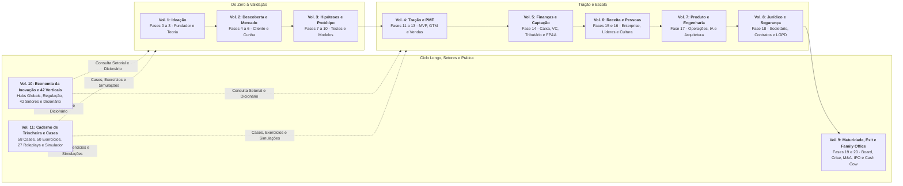
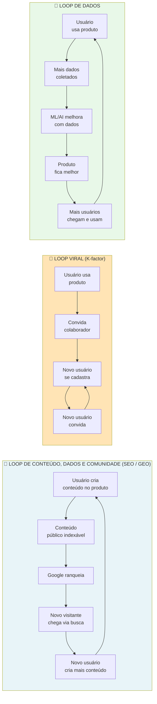
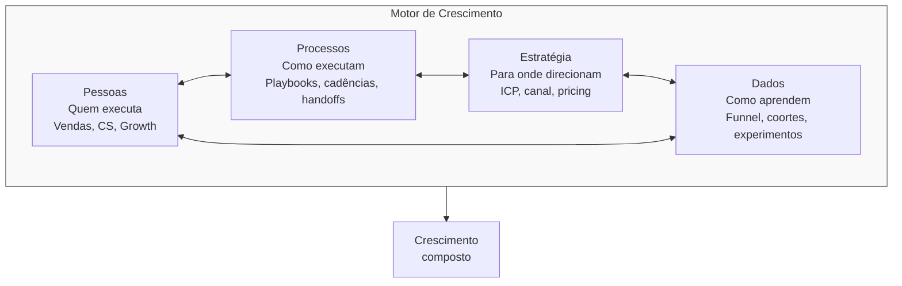
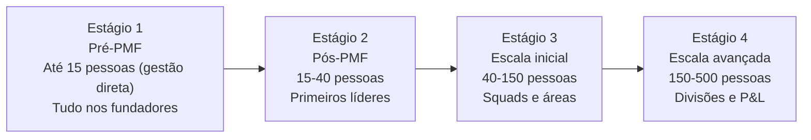
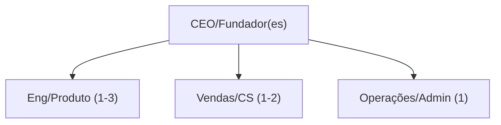
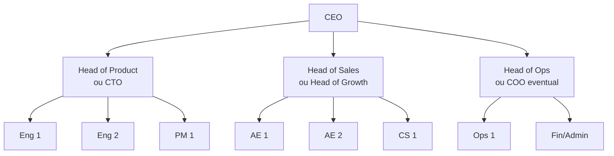
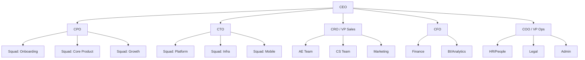
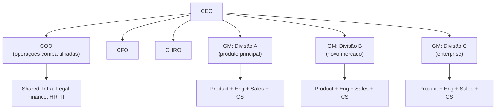
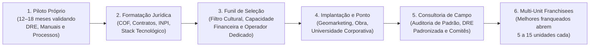
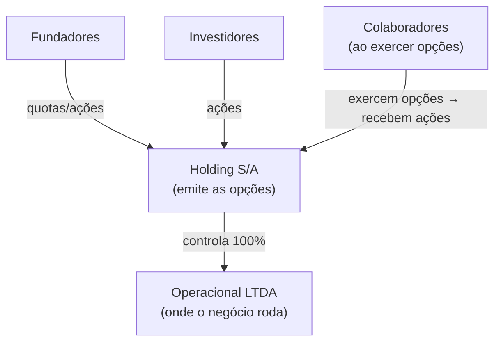

# IGNIÇÃO: Volume 6: Receita Enterprise, Liderança e Cultura

**Máquina Comercial em Escala, Operações de Receita, Franquias, Liderança Executiva, Remuneração, Opções de Ações e Cultura (Fases 15 e 16 e Capítulos 1 a 15)**

*João Prado · 2026 · Edição Narrativa Enxuta (v5.3)*

---

## Sobre este Volume

Este é o **Volume 6 (IGNIÇÃO: Volume 6: Receita Enterprise, Liderança e Cultura)** da coleção IGNIÇÃO: O manual operacional do empreendedor brasileiro (11 volumes).

Volume dedicado à construção da máquina comercial Enterprise, canais de distribuição, franquias e evolução de liderança, pessoas e cultura na scale-up. Abre com a Fase 15 (Máquina de Crescimento e Expansão em Escala) e a Fase 16 (Time, Liderança Executiva e Cultura em Escala), trazendo os frameworks clássicos de metodologias de vendas (MEDDPICC, SPIN, Challenger, Sandler, Solution Selling, BANT e Command of the Message), crescimento em escala e liderança (Radical Candor, Lencioni, Topgrading, Who, Horowitz, Culture Code, Netflix, SPADE e 7S), além de templates e quadros visuais práticos, seguidos por 15 capítulos sobre Growth, vendas Enterprise, Operações de Receita (RevOps), desenvolvimento de negócios corporativos, canais indiretos, Franchising e Licenciamento de Redes (Lei 13.966/2019 e COF), marca e relações públicas, modo fundador e cadência operacional, contratação executiva, avaliação de desempenho, remuneração e benefícios, planos de opções (Stock Options e ESOP), cultura em situações críticas, diversidade e trabalho remoto ou híbrido.

---

## Mapa da Coleção IGNIÇÃO



---

## Sumário deste Volume

### Fases da Etapa (Fases 15 e 16)

- [[#FASE 15: MÁQUINA DE CRESCIMENTO E EXPANSÃO EM ESCALA|FASE 15: MÁQUINA DE CRESCIMENTO E EXPANSÃO EM ESCALA]]
- [[#FASE 16: TIME, LIDERANÇA EXECUTIVA E CULTURA EM ESCALA|FASE 16: TIME, LIDERANÇA EXECUTIVA E CULTURA EM ESCALA]]

### Crescimento em Escala, Vendas Enterprise, RevOps, Parcerias, Franquias e Marca (Capítulos 1 a 7)

- [[#CAPÍTULO 1: GROWTH COMO FUNÇÃO ORGANIZACIONAL: TIME DE GROWTH, BUILD VS HIRE, RELAÇÃO COM PRODUTO|CAPÍTULO 1: GROWTH COMO FUNÇÃO ORGANIZACIONAL: TIME DE GROWTH, BUILD VS HIRE, RELAÇÃO COM PRODUTO]]
- [[#CAPÍTULO 2: VENDAS COMPLEXAS ENTERPRISE: CICLO LONGO, ALTO VALOR, MÚLTIPLOS DECISORES|CAPÍTULO 2: VENDAS COMPLEXAS ENTERPRISE: CICLO LONGO, ALTO VALOR, MÚLTIPLOS DECISORES]]
- [[#CAPÍTULO 3: REVENUE OPERATIONS: INFRAESTRUTURA, DADOS E PROCESSO PARA CRESCER COM PREVISIBILIDADE|CAPÍTULO 3: REVENUE OPERATIONS: INFRAESTRUTURA, DADOS E PROCESSO PARA CRESCER COM PREVISIBILIDADE]]
- [[#CAPÍTULO 4: BUSINESS DEVELOPMENT E PARCERIAS COM GRANDES CORPORAÇÕES BRASILEIRAS|CAPÍTULO 4: BUSINESS DEVELOPMENT E PARCERIAS COM GRANDES CORPORAÇÕES BRASILEIRAS]]
- [[#CAPÍTULO 5: CANAIS INDIRETOS E PARCERIAS: PARCERIAS, FRANQUIAS, CHANNEL|CAPÍTULO 5: CANAIS INDIRETOS E PARCERIAS: PARCERIAS, FRANQUIAS, CHANNEL]]
- [[#CAPÍTULO 6: FRANCHISING, LICENCIAMENTO E EXPANSÃO DE REDES MULTI-UNIDADES (LEI 13.966/2019)|CAPÍTULO 6: FRANCHISING, LICENCIAMENTO E EXPANSÃO DE REDES MULTI-UNIDADES (LEI 13.966/2019)]]
- [[#CAPÍTULO 7: MARCA CORPORATIVA, PR, COMUNICAÇÃO PÚBLICA E MARCA PESSOAL DO FUNDADOR|CAPÍTULO 7: MARCA CORPORATIVA, PR, COMUNICAÇÃO PÚBLICA E MARCA PESSOAL DO FUNDADOR]]

### Liderança Executiva, Contratação Sênior, Remuneração, ESOP e Cultura (Capítulos 8 a 15)

- [[#CAPÍTULO 8: FOUNDER MODE, DELEGAÇÃO, GESTÃO DE TEMPO E CADÊNCIA OPERACIONAL DO CEO|CAPÍTULO 8: FOUNDER MODE, DELEGAÇÃO, GESTÃO DE TEMPO E CADÊNCIA OPERACIONAL DO CEO]]
- [[#CAPÍTULO 9: EXECUTIVE HIRING: CONTRATAR LÍDERES SÊNIOR E C-LEVEL|CAPÍTULO 9: EXECUTIVE HIRING: CONTRATAR LÍDERES SÊNIOR E C-LEVEL]]
- [[#CAPÍTULO 10: PERFORMANCE REVIEWS ESTRUTURADOS: CICLO, CALIBRAÇÃO E CONEXÃO COM COMPENSAÇÃO|CAPÍTULO 10: PERFORMANCE REVIEWS ESTRUTURADOS: CICLO, CALIBRAÇÃO E CONEXÃO COM COMPENSAÇÃO]]
- [[#CAPÍTULO 11: COMPENSAÇÃO E BENEFÍCIOS NO BRASIL|CAPÍTULO 11: COMPENSAÇÃO E BENEFÍCIOS NO BRASIL]]
- [[#CAPÍTULO 12: STOCK OPTIONS E ESOP NO BRASIL|CAPÍTULO 12: STOCK OPTIONS E ESOP NO BRASIL]]
- [[#CAPÍTULO 13: CULTURA COMO DISCIPLINA E EM SITUAÇÕES CRÍTICAS (HIPERCRESCIMENTO, M&A E REMOTO)|CAPÍTULO 13: CULTURA COMO DISCIPLINA E EM SITUAÇÕES CRÍTICAS (HIPERCRESCIMENTO, M&A E REMOTO)]]
- [[#CAPÍTULO 14: DIVERSIDADE, EQUIDADE E INCLUSÃO (DEI) EM STARTUP BRASILEIRA|CAPÍTULO 14: DIVERSIDADE, EQUIDADE E INCLUSÃO (DEI) EM STARTUP BRASILEIRA]]
- [[#CAPÍTULO 15: TRABALHO REMOTO, HÍBRIDO E DISTRIBUÍDO COMO DISCIPLINA|CAPÍTULO 15: REMOTE, HYBRID E DISTRIBUÍDO COMO DISCIPLINA]]

### Prática, Cases e Simulações Desta Etapa (Volume 11: Capítulos 16 a 18)

- [[IGNICAO-Vol-11-Workbook-Cases-e-Exercicios#CAPÍTULO 16: CASES GLOBAIS E BRASILEIROS DE ESCALA COMERCIAL, REVOPS, FRANCHISING, CULTURA E ESOP|CAPÍTULO 16: CASES GLOBAIS E BRASILEIROS DE ESCALA COMERCIAL, REVOPS, FRANCHISING, CULTURA E ESOP (Vol. 11)]]
- [[IGNICAO-Vol-11-Workbook-Cases-e-Exercicios#CAPÍTULO 17: CADERNO DE EXERCÍCIOS COM GABARITO COMENTADO: COMISSIONAMENTO OTE, REVOPS, DRE DE FRANQUIA E PLANO DE OPÇÕES|CAPÍTULO 17: CADERNO DE EXERCÍCIOS COM GABARITO COMENTADO: COMISSIONAMENTO OTE, REVOPS, DRE DE FRANQUIA E PLANO DE OPÇÕES (Vol. 11)]]
- [[IGNICAO-Vol-11-Workbook-Cases-e-Exercicios#CAPÍTULO 18: SIMULAÇÕES DE DECISÃO E ROLEPLAYS EXECUTIVOS: DEMISSÃO DE EXECUTIVO, RADICAL CANDOR E FECHAMENTO ENTERPRISE|CAPÍTULO 18: SIMULAÇÕES DE DECISÃO E ROLEPLAYS EXECUTIVOS: DEMISSÃO DE EXECUTIVO, RADICAL CANDOR E FECHAMENTO ENTERPRISE (Vol. 11)]]

---

# FASES DA ETAPA: ESCALA COMERCIAL, LIDERANÇA E CULTURA (FASES 15 E 16)

As **[[#FASE 15: MÁQUINA DE CRESCIMENTO E EXPANSÃO EM ESCALA|Fases 15]]** e [[#FASE 16: TIME, LIDERANÇA EXECUTIVA E CULTURA EM ESCALA|16]] atacam a travessia humana e comercial mais difícil de uma empresa em crescimento: substituir o heroísmo comercial do fundador por uma máquina previsível de receita e escalar o time de 20 para 200+ pessoas sem deixar a burocracia matar a velocidade.

---

## FASE 15: MÁQUINA DE CRESCIMENTO E EXPANSÃO EM ESCALA

### A Armadilha da Venda Artesanal: o que levou você ao primeiro milhão de receita trava o caminho até os R$ 10 milhões de ARR

Em Florianópolis, Marina fechou pessoalmente os primeiros quarenta e cinco contratos da plataforma B2B que fundou com Lucas. Ela conhecia cada cliente pelo nome, respondia mensagens de áudio no domingo à noite, adaptava o preço de cabeça no meio da chamada de vídeo e usava seu repertório comercial para destravar qualquer objeção. Dois anos antes (repetindo em escala maior a pressa da contratação prematura vista no Volume 4, Capítulo 2), assim que a empresa bateu R$ 180 mil de receita recorrente mensal (MRR), eles contrataram três vendedores plenos achando que as vendas iriam triplicar. Três meses depois, o caos estava instalado: os três vendedores juntos não fechavam metade do que Marina vendia sozinha, cada um concedia um desconto diferente, o time de implantação recebia promessas impossíveis de cumprir e Marina trabalhava catorze horas por dia salvando reuniões mal conduzidas.

Por que o talento comercial natural do fundador, que é uma bênção para conquistar os primeiros quarenta e cinco contratos, vira o maior gargalo da empresa na transição para a escala? Carisma não se transfere para a equipe. O que se transfere é processo escrito: o roteiro de diagnóstico, o critério binário de qualificação e o limite de desconto.

Aaron Ross, em *Receita Previsível* (2011), e Mark Roberge, em *The Sales Acceleration Formula* (2015), mostram que escalar receita exige substituir o heroísmo comercial individual por uma máquina previsível de aquisição e expansão, aplicando a alavancagem gerencial descrita por Andy Grove em *High Output Management*. Chamamos esse gargalo de Marina de A Armadilha da Venda Artesanal: tentar crescer adicionando braços humanos antes de extrair da cabeça do fundador o processo repetível, o script de diagnóstico, os critérios de qualificação, as travas de precificação e os *loops* de crescimento. Na Fase 15, o produto que você está construindo deixa de ser apenas o software ou o serviço entregue ao cliente e passa a ser a própria máquina comercial que vende sem precisar de você na sala.

---

### A física da Máquina de Crescimento: como transformar aquisição, retenção e expansão em um sistema fechado

Marina precisava de um sistema comercial e de aquisição que operasse com previsibilidade sem depender de sua presença em cada chamada. Ao documentar o roteiro de vendas no Passo 1, validar a passagem de bastão com os vendedores e escalar canais com economia unitária saudável nos Passos 2 a 4, e priorizar a retenção líquida antes de abrir novas frentes no Passo 5, a operação destravou o crescimento rumo aos R$ 650 mil de MRR. Nessa arquitetura, os *growth loops* (laços de crescimento) atuam como motor complementar ao funil linear e à seleção disciplinada de canais:



> [!important] A diferença entre funil e loop
> Um funil exige aporte constante (CAC por visitante), enquanto o loop se retroalimenta. Exemplos reais: Glassdoor (loop de conteúdo gerado por usuários), Dropbox (loop viral de indicação) e Spotify (loop de dados e recomendação). Os SaaS mais eficientes combinam dois a três loops simultâneos. Sem loop o crescimento é linear com o gasto de mídia, e com loop torna-se composto.

> [!question] Pergunta de FMF nessa fase
> Em escala, o erro comum é delegar tudo sem critério e virar burocrata. A pergunta de aderência fundador-mercado (FMF) aqui é: *quais decisões estratégicas só você pode tomar porque detém o contexto acumulado do cliente e do produto?* Delegar essas escolhas nucleares destrói valor. Por outro lado, apegar-se a rotinas operacionais que um executivo sênior faria melhor transforma você em gargalo. O equilíbrio exige preservar o *Founder Mode* seletivo nas frentes críticas ([[#CAPÍTULO 8: FOUNDER MODE, DELEGAÇÃO, GESTÃO DE TEMPO E CADÊNCIA OPERACIONAL DO CEO|Capítulo 8 (Founder Mode, Delegação, Gestão de Tempo e Cadência Operacional do CEO)]]) e preparar lideranças autônomas para o restante da operação.

> [!note] Entregáveis e critérios da Fase 15
> Growth Plan de 18 meses + Capital Plan + Expansion Plan (novos segmentos, geografias ou produtos). A venda conduzida pelo fundador raramente passa de R$ 5 a 10 milhões de ARR. Marketing ad-hoc não gera previsibilidade. Internacionalização intuitiva queima caixa. Comece depois da Fase 14 (Capital para escala), com a estratégia de financiamento definida. Termine quando a máquina de aquisição estiver previsível, o plano de capital executado, e a expansão (se aplicável) em curso com pelo menos uma vertical ou geografia validada. Revisite anualmente, e a cada saturação de canal (12-18 meses). Executor: CEO + Head of Sales/Marketing + CFO. Participantes: board, advisors, investidores potenciais.

### Os 6 passos da escala: documentar o playbook, dominar um canal até a exaustão, medir unit economics e expandir em profundidade antes da amplitude

O roteiro de escala comercial desdobra-se em seis passos (do Passo 0 ao Passo 5): compreender o motor integrado de quatro peças (Passo 0), transformar a venda conduzida pelo fundador em processo repetível (Passo 1), escalar canais de marketing validados até a exaustão (Passo 2), estruturar parcerias e canais indiretos (Passo 3), instalar a governança de *unit economics* e alocação de capital por canal (Passo 4) e planejar a expansão em profundidade antes da amplitude (Passo 5).

> [!tip] Canvases Visuais: Pirate Canvas / AARRR em escala (Fase 11) e Network Effects Map (Fase 6)
> A máquina de crescimento opera no AARRR: cada etapa do funil (Acquisition, Activation, Retention, Referral, Revenue) tem dono e métrica em escala. O [[IGNICAO-Vol-4-Tracao-e-PMF#Canvas: Pirate Canvas / AARRR (Dave McClure, 2007)|Canvas: Pirate Canvas / AARRR (Dave McClure, 2007) (Vol. 4)]] é o mapa para identificar onde investir capital marginal de growth (CAC alto sinaliza Acquisition. Ativação fraca trava Retention). Em modelos de plataforma ou marketplace, o [[IGNICAO-Vol-2-Descoberta-e-Mercado#Canvas: Network Effects Map|Canvas: Network Effects Map (Vol. 2)]] classifica o tipo de efeito de rede (direto, indireto, dados, social) e identifica onde investir para fortalecer defensibilidade conforme cresce: efeito de rede é o moat mais durável em mercados winner-takes-most.

#### Passo 0: entenda o Motor de Crescimento como sistema integrado

Antes de otimizar isoladamente vendas, marketing ou retenção, trate o motor de crescimento como um sistema integrado. O modelo do Motor de Quatro Peças adotado neste livro articula quatro componentes interdependentes:



> [!warning] A regra do motor quebrado
> Se qualquer um dos quatro componentes falha, o motor inteiro gira no vazio. Pessoas certas + processos + estratégia, mas sem dados: "não sabem se estão ganhando, otimizam por intuição." Pessoas + processos + dados, mas sem estratégia: "executam bem a coisa errada, aceleram na direção do penhasco."

Diagnóstico mensal do motor. A cada trinta dias, avalie honestamente cada um dos quatro em escala de um a cinco.

| Componente | 1-2 (quebrado) | 3 (ok) | 4-5 (forte) |
|---|---|---|---|
| Pessoas | Vagas decisivas abertas >6m, rotatividade >25%/ano | Vagas chave preenchidas, rotatividade aceitável | Bench forte, retenção >85%, perfil sênior atrai pares |
| Processos | Documentação ausente, handoffs informais | Top 5 processos documentados, cadência funcional | Playbooks revisados trimestralmente, onboarding sistemático |
| Estratégia | ICP difuso, canais não priorizados | ICP definido, 1-2 canais focados | Estratégia escrita, testada, revista por board |
| Dados | Decisões por opinião, sem dashboard | Dashboards principais, análise quinzenal | Data warehouse, experimentação contínua, cultura data-first |

> [!important] Quando qualquer componente fica vermelho
> Se qualquer componente marcar um a dois por dois trimestres consecutivos, *pare de escalar investimento*, e conserte antes de acelerar. Multiplicar investimento sobre motor quebrado multiplica queima. Não crescimento.

#### Passo 1: transforme venda fundador-led em motor repetível (se B2B)

Faça três perguntas diagnósticas: (1) mais da metade das vendas fechadas nos últimos seis meses teve o fundador na sala? (2) o primeiro vendedor contratado fecha contratos com custo de aquisição (CAC) comparável ao do fundador? (3) você tem pelo menos três vendedores batendo meta de forma consistente?

Se a resposta for "sim" para a primeira pergunta ou "não" para qualquer uma das duas seguintes, a empresa ainda depende da venda artesanal do fundador. A transição para um time comercial repetível exige cinco alicerces:

Playbook de vendas escrito. Scripts de outbound, roteiros de discovery, tratamento de objeções, critérios de qualificação (MEDDPICC) e propostas padronizadas.

Pipeline hygiene (higiene de pipeline: manter o CRM limpo e atualizado). CRM com estágios claros, taxas de conversão conhecidas por estágio e previsão de vendas semanal.

Ramp time (tempo de rampa: período até o vendedor atingir produtividade plena) definido. O executivo de contas (AE, *Account Executive*) deve bater meta em três a seis meses em vendas para PMEs e *mid-market*. Em vendas *enterprise* de ciclo longo, conte um ciclo de venda completo mais um trimestre.

**Remuneração variável estruturada:** vendedores operam com OTE (*on-target earnings*, a remuneração total ao atingir 100% da meta), combinando tipicamente 50% a 70% de salário fixo e 30% a 50% de comissão atrelada a contratos efetivamente faturados e recebidos, e nunca apenas a propostas emitidas. No regime CLT, as comissões integram o salário para todos os efeitos legais e geram reflexos obrigatórios em descanso semanal remunerado (DSR, conforme a Súmula 27 do TST), férias acrescidas de um terço, 13º salário, FGTS e INSS. Contratar vendedores com subordinação, horário fixo e metas individuais como pessoa jurídica (PJ) cria elevado passivo trabalhista e fiscal (ver o detalhamento completo no [[#CAPÍTULO 11: COMPENSAÇÃO E BENEFÍCIOS NO BRASIL|Capítulo 11 (Compensação e Benefícios no Brasil)]]).

**Operações de receita (*Sales Ops / RevOps*):** contrate a primeira pessoa dedicada a CRM, previsão de vendas e plano de comissões a partir de cinco vendedores (quando a equipe comercial e de marketing soma de 10 a 20 profissionais em *go-to-market*), evoluindo para um time estruturado de RevOps a partir de 20 pessoas na operação comercial.

Framework de maturidade da equipe de vendas:

| Estágio | Composição | O que medir |
|---|---|---|
| Fundador-led | 1 fundador vendendo | Taxa de fechamento, ACV |
| Primeira contratação | 1 AE + fundador | Se AE atinge 80% da produtividade do fundador em 6 meses |
| Time de 3 | 3 AEs + 1 SDR | Consistência: os 3 estão batendo quota? |
| Time estruturado | 5+ AEs, 2+ SDRs, 1 sales ops, 1 manager | Velocity, magic number, pipeline coverage |
| Sales machine | Times por segmento (SMB/Mid/Enterprise), regiões, verticais | NRR, win rate por segmento |

#### Passo 2: escale marketing baseado no canal validado

Lembre-se do [[IGNICAO-Vol-4-Tracao-e-PMF#CAPÍTULO 1: GTM PLAYBOOK E ARQUITETURA DE CANAIS: DA PRIMEIRA VENDA AO PRIMEIRO MILHÃO DE ARR|Capítulo 1 (GTM Playbook e Arquitetura de Canais: Da Primeira Venda ao Primeiro Milhão de ARR) (Vol. 4)]]. Você deve ter escolhido um a dois canais validados na [[IGNICAO-Vol-4-Tracao-e-PMF#FASE 12: VALIDAÇÃO DO MODELO DE NEGÓCIO|Fase 12 (Vol. 4)]]. Agora, escalar.

A estratégia por canal escalado, em seis frentes.

SEO e marketing de conteúdo: contrate um ou dois estrategistas de conteúdo e um produtor editorial. Produção consistente de quatro a doze pieces por mês. Keyword research estruturado. Link-building deliberado. Resultados em seis a doze meses.

Paid (Google, Meta, LinkedIn). Contrate um especialista em mídia paga, monte uma biblioteca de criativos, rode testes A/B contínuos e meça atribuição além do último clique.

**Prospecção ativa (*outbound*):** estruture equipes de pré-vendas (SDRs/BDRs) com cadências multicanal documentadas (e-mail, telefone, LinkedIn e WhatsApp com abordagem consultiva), apoiadas por ferramentas de enriquecimento e automação (como Apollo.io, Exact Spotter, Ramper, Meetime, Reev ou Outreach) e SLAs claros de passagem de bastão para os executivos de contas.

Parcerias comerciais (*partnerships*): gerente de parcerias dedicado, programa estruturado em níveis (*tiers*), comissionamento, verba de marketing cooperado (*Market Development Funds*, ou MDF) e ações conjuntas.

**Comunidade:** Community manager, mais rituais (eventos, Slack ou Discord, conteúdo UGC).

Eventos corporativos: gestor de eventos, calendário anual e apuração rigorosa de retorno (ROI) por evento.

> [!warning] Regra de escala de canal
> Não escale um segundo canal até o primeiro dar sinais claros de saturação (quando o CAC marginal do canal sobe por dois meses seguidos mesmo testando criativos e ofertas novos).

#### Passo 3: estruture canais indiretos e parcerias estratégicas após validar a venda direta

Quando o processo comercial direto já converte de forma previsível, amplie o alcance mapeando parceiros que já detêm a confiança do seu cliente ideal: programas de indicação estruturada (*referral*), consultorias de implantação, integradores tecnológicos e alianças de venda conjunta (*co-selling*). A regra operacional é não terceirizar a descoberta do processo de venda: escale canais indiretos apenas quando o roteiro de qualificação, a precificação e o material de habilitação já estiverem testados pela sua própria equipe (ver [[#CAPÍTULO 4: BUSINESS DEVELOPMENT E PARCERIAS COM GRANDES CORPORAÇÕES BRASILEIRAS|Capítulo 4]] e [[#CAPÍTULO 5: CANAIS INDIRETOS E PARCERIAS: PARCERIAS, FRANQUIAS, CHANNEL|Capítulo 5]]).

#### Passo 4: instale a governança mensal de unit economics e alocação de capital por canal

Meça separadamente o CAC, o tempo de recuperação (*payback*), a retenção líquida (NRR) e a razão LTV/CAC de cada canal e segmento de cliente. Quando um canal cresce em volume bruto, mas seu *payback* ultrapassa 18 meses ou a retenção daquela safra (*cohort*) cai no segundo trimestre, trave a expansão de verba naquele canal antes que ele drene o caixa da rodada (ver [[IGNICAO-Vol-5-Financas-e-Captacao#FASE 14: CAPITAL PARA ESCALA, RODADAS E EFICIÊNCIA FINANCEIRA|Fase 14 (Vol. 5)]]).

#### Passo 5: planeje a expansão em dois eixos, começando pela profundidade antes da amplitude

Quando o encaixe produto-mercado (PMF) está consolidado em um segmento inicial, a próxima fronteira é expandir. Muitos fundadores tratam expansão como sinônimo de buscar clientes em novos mercados, mas ela ocorre em dois eixos distintos, com custos e riscos muito diferentes:

**Eixo 1: expansão intra-conta (profundidade).** Consiste em expandir a receita dentro dos clientes que você já atende: o custo de aquisição é baixo porque a relação comercial já existe, o ciclo de fechamento é curto e o risco operacional é reduzido porque o produto já foi validado na conta.

Eixo 2, expansão fora da base atual (amplitude): conquistar novos clientes em segmentos adjacentes, novas geografias ou linhas adicionais de produto envolve CAC mais elevado, ciclo de maturação mais longo e maior risco de execução, pois cada degrau exige validação própria.

> [!important] Esgote a profundidade antes da amplitude
> Com retenção líquida (NRR) abaixo de 100%, a base atual encolhe sozinha. Entre 100% e 110%, o crescimento orgânico dentro da carteira ainda é tímido. Nos dois cenários, estancar o cancelamento (*churn*) e destravar a expansão intra-conta (profundidade) vêm antes de multiplicar o gasto em novos mercados (amplitude). Acelerar a aquisição sobre uma base que vaza receita apenas acelera a queima de caixa.

**Eixo 1: expansão intra-conta, os três caminhos.**

Caminho 1, workflow adjacente no mesmo papel. Estenda o produto para o próximo passo lógico no mesmo processo da mesma pessoa. Reuse os mesmos dados, integrações, e comprador. Por exemplo, se você automatiza revisão de KYC para *compliance managers*, o próximo caminho é monitoramento de transações, depois relatório regulatório. Muda apenas a fatia do fluxo de trabalho: o papel do usuário, o comprador e a infraestrutura continuam os mesmos. A vantagem: CAC marginal próximo de zero. A venda é reunião de "expansão" com cliente atual. O risco: o "próximo workflow" pode ter concorrentes diferentes, e exigir especialização técnica nova.

**Caminho 2: papel adjacente na mesma organização.** Uma vez estabelecido com um usuário específico, expanda para áreas vizinhas que dependem do fluxo de trabalho inicial (por exemplo, do gestor de *compliance* para a diretoria de risco e, em seguida, para o diretor de operações). Use a prova interna da primeira área para destravar a adoção na segunda e crescer dentro da conta antes de buscar novos CNPJs. A vantagem é contar com um campeão interno e contrato-mestre já aprovado no jurídico e em compras, reduzindo substancialmente o ciclo de fechamento frente à prospecção fria. O risco é esquecer que cada nova diretoria tem seu próprio comprador econômico e critérios distintos de sucesso. Repita o Teste de Precisão do Comprador ([[IGNICAO-Vol-2-Descoberta-e-Mercado#FASE 6: MAPEAMENTO DE MERCADO E CONCORRÊNCIA|Fase 6 (Vol. 2)]]) antes de cada papel adicional.

**Caminho 3: evolução de ferramenta pontual para infraestrutura do cliente.** A empresa integra fluxos anteriores e posteriores (*upstream* e *downstream*), consolida painéis de controle e torna-se o sistema central de registro ou orquestração daquela área. Por exemplo, uma solução de validação cadastral evolui para monitoramento contínuo de transações e, depois, para governança regulatória completa. Este caminho constrói forte custo de mudança (*switching cost*) e prepara a transição de cunha para plataforma (ver [[IGNICAO-Vol-2-Descoberta-e-Mercado#FASE 6: MAPEAMENTO DE MERCADO E CONCORRÊNCIA|Fase 6 (Vol. 2)]]), mas exige maturidade técnica elevada: só avance por ele depois que os Caminhos 1 e 2 já sustentarem um NRR previsível.

A métrica-guia do Eixo 1 é o NRR. Com NRR entre 100% e 110%, o Caminho 1 já opera no nível básico. Para atingir 120% ou 130%+ (patamar de excelência), os três caminhos intra-conta precisam atuar de forma combinada.

**Eixo 2: expansão extra-conta, os três caminhos.**

Caminho 4, expansão de segmento (ICP adjacente). Por exemplo, validou em startups de dez a cinquenta funcionários. Expandir para cinquenta a duzentos. O que muda na operação: outro modelo comercial, ticket anual (ACV) maior, CAC mais alto e ciclo mais longo. O risco principal é diluir o foco. A defesa é manter o time principal no segmento original e dedicar um time separado ao segmento adjacente.

**Caminho 5: expansão geográfica.** Ocorre quando a rede de clínicas de Camila avança de Belo Horizonte para novas praças em Minas Gerais e no interior paulista, ou quando um SaaS brasileiro decide operar no México ou na Colômbia. Cada nova região impõe adaptações regulatórias, fiscais, culturais e de suporte local (para expansão internacional e escolha entre operação remota, representantes ou subsidiária local, ver [[IGNICAO-Vol-9-Maturidade-e-Exit#CAPÍTULO 5: INTERNACIONALIZAÇÃO: ESTRUTURA E PRODUTO PARA MÚLTIPLOS MERCADOS|Capítulo 5 (Expansão Internacional: LatAm, EUA e Europa a partir do Brasil) (Vol. 9)]]).

**Caminho 6: expansão de produto (novo produto ou linha funcional).** Exemplo: um SaaS de gestão que adiciona um módulo próprio de inteligência analítica (BI). O que muda: exige novo ciclo de P&D, equipe dedicada e posicionamento comercial mais complexo. O risco principal é diluir a proposta de valor e distrair a engenharia do produto central, a defesa é garantir que qualquer módulo adicional reforce diretamente a retenção e o uso do produto principal.

> [!tip] A regra dos 70/20/10
> **Regra 70/20/10 de alocação de recursos (Bansi Nagji e Geoff Tuff, *Harvard Business Review*, maio de 2012): concentre 70%** do orçamento e da energia de engenharia e comercial no negócio principal (*core*: otimização do produto atual no segmento e nos canais já validados), 20% em adjacências de baixo risco (Eixo 1 de profundidade ou segmento vizinho imediato) e 10% em apostas exploratórias de longo prazo (novas geografias ou linhas de produto). Se a sua empresa tenta lançar três países novos e dois produtos paralelos ao mesmo tempo, ela inverte essa proporção e compromete a operação principal.

**Regra transversal. Mude uma variável por vez.**

Independente do caminho escolhido (intra ou extra-conta), respeite o princípio da variável isolada. Uma operação de expansão não deve mudar múltiplas dimensões ao mesmo tempo. As dimensões de expansão são cinco: papel do usuário, produto, fluxo de trabalho, segmento e geografia.

**O que fazer:** combinar o mesmo papel de usuário e o mesmo produto com um fluxo de trabalho adjacente (isolando o fluxo de trabalho como única variável nova), ou levar o mesmo segmento e o mesmo produto para uma nova geografia.

**O que não fazer:** tentar atacar simultaneamente um novo segmento, uma nova geografia e um novo produto. Mudar as três dimensões de uma vez significa abrir uma segunda empresa do zero em vez de expandir a primeira.

Por que isso importa na prática. Quando você muda duas ou mais variáveis ao mesmo tempo, e o resultado é ruim, você não consegue atribuir a causa. Foi o novo segmento que rejeitou o produto? Foi a geografia nova que rejeitou a proposta de valor? Foi o produto novo que não encaixou com o ICP atual? Sem poder atribuir, você perde o aprendizado do experimento, e gasta as duas coisas (tempo e dinheiro) sem acumular inteligência.

Em síntese, a regra 70/20/10 orienta tanto o orçamento de produto quanto a distribuição da verba comercial: proteja os 70% que sustentam o caixa atual, financie com 20% a expansão adjacente medida por marcos trimestrais e trate os 10% exploratórios como experimentos com teto estrito de perda.

### Os sinais objetivos de que sua máquina de vendas já funciona sem o fundador na sala

A Fase 15 atinge maturidade quando sete critérios objetivos são comprovados na operação: (1) mais de 70% dos novos contratos são fechados sem o fundador na sala e pelo menos dois vendedores contratados batem meta por três meses consecutivos, (2) dois ou mais canais de aquisição operam validados e sem dependência exclusiva de uma única fonte, (3) o *payback* de CAC permanece abaixo de 12 meses em PMEs/*mid-market* (ou até 18 meses em vendas *enterprise*), (4) a retenção líquida de receita (NRR) atinge 110% ou mais no acumulado de 12 meses, (5) a governança trimestral com conselho consultivo ou administrativo está ativa, (6) o plano financeiro e de capital para os próximos 18 a 24 meses está documentado (conforme a [[IGNICAO-Vol-5-Financas-e-Captacao#FASE 14: CAPITAL PARA ESCALA, RODADAS E EFICIÊNCIA FINANCEIRA|Fase 14 (Vol. 5)]]), e (7) o funil de parcerias estratégicas conta com ao menos três alianças ativas ou em validação operacional.

### A catraca operacional para liberar orçamento pesado de escala

- [ ] Tenho motor de aquisição replicável e escalável (dois ou mais canais validados, sem dependência única)?
- [ ] Tenho *payback* de CAC abaixo de 12 meses em PME/*mid-market* (ou até 18 meses em vendas *enterprise*) no canal principal?
- [ ] NRR está em cento e dez por cento ou mais?
- [ ] Tenho governança mínima (conselho, ainda que consultivo, e reporting trimestral)?
- [ ] Avaliei quais tipos de capital usar nos próximos vinte e quatro meses (equity, debt, não diluitivo, [[IGNICAO-Vol-5-Financas-e-Captacao#CAPÍTULO 12: FINANCIAMENTO NÃO DILUITIVO|Capítulo 12 (Financiamento Não Diluitivo) (Vol. 5)]])?
- [ ] Tenho plano de expansão geográfica, ou vertical, documentado, com milestones?
- [ ] Estou avaliando parcerias estratégicas sistematicamente ([[#CAPÍTULO 5: CANAIS INDIRETOS E PARCERIAS: PARCERIAS, FRANQUIAS, CHANNEL|Capítulo 5 (Canais Indiretos e Parcerias: Parcerias, Franquias, Channel)]])?
- [ ] Considerei (pelo menos pensei estrategicamente) em M&A como adquirente?

### Próximos passos

1. Mapear canais de aquisição em planilha. Percentual do pipeline, CAC, LTV, payback por canal.
2. Calcular a retenção líquida de receita (NRR) dos últimos 12 meses (receita recorrente atual gerada pela safra de clientes que já estava ativa há 12 meses, dividida pela receita original daquela mesma safra).
3. Abrir Template Plano de Financiamento (Fase 14), e definir os próximos dezoito meses de caixa.
4. Listar três a cinco parceiros potenciais que podem acelerar distribuição ([[#CAPÍTULO 5: CANAIS INDIRETOS E PARCERIAS: PARCERIAS, FRANQUIAS, CHANNEL|Capítulo 5 (Canais Indiretos e Parcerias: Parcerias, Franquias, Channel)]]).

### Caso brasileiro real: máquina de crescimento da Stone (2014-2018, escala pós-PMF até IPO)

A trajetória da Stone entre 2014 e 2018 (já analisada sob o ângulo de cunha de mercado na Fase 6, no Volume 2, e de produto mínimo na Fase 11, no Volume 4) ilustra três pilares da escala comercial no Brasil: combinação disciplinada de canais, captação concentrada em investidores institucionais de longo prazo e aquisições estratégicas voltadas à expansão intra-conta (*cross-sell*).

**Composição de canais no pico de eficiência (2016-2017):**

| Canal | % novos lojistas | CAC | Payback | Escalabilidade |
|---|---|---|---|---|
| Polos próprios (*Green Angels*, venda direta porta a porta) | ~55% | R$ 1.500 a R$ 2.500 | 6 a 9 meses | Alta (replicável em novas praças com abertura de polo local) |
| Indicação de lojista satisfeito | ~25% | ~R$ 200 (incentivo) | 3-4 meses | Média (limitada por densidade local) |
| Parcerias com bancos regionais e contadores | ~10% | R$ 800-1.200 | 6-8 meses | Média |
| Marketing digital e brand | ~10% | Variável | 9-12 meses | Crescente (papel maior pós-IPO) |

*Nota metodológica:* As participações por canal, o CAC e o *payback* na tabela acima são estimativas ilustrativas do autor para fins didáticos (a companhia não reporta abertura de CAC por canal no prospecto F-1 de 2018), refletindo uma operação com retenção líquida de receita (NRR) superior a 110% (impulsionada pelo crescimento do volume processado, antecipação de recebíveis, conta digital e crédito) e relação LTV/CAC estimada acima de 5x à medida que a indicação boca a boca reduz o custo marginal de aquisição.

**Captação institucional e IPO (conforme prospecto F-1 da StoneCo na SEC, outubro de 2018):** após o capital inicial dos fundadores André Street e Eduardo Pontes (oriundos da Arpex Capital) e rodadas privadas com fundos globais como Madrone Capital Partners, Tiger Global, T. Rowe Price e Actis, a companhia realizou seu IPO na Nasdaq em outubro de 2018 a US$ 24 por ação, levantando cerca de US$ 1,2 bilhão na oferta primária e secundária (com Berkshire Hathaway e Ant Financial como investidores âncoras) a um *valuation* aproximado de US$ 6,7 bilhões no preço de emissão, que superou US$ 9 bilhões na estreia em bolsa.

**M&A como comprador**: Linx adquirida por ~R$ 6,7 bi (2020-21) com tese de combinar adquirência + software de gestão para PME. A integração foi mais complexa que projetado, e a Stone enfrentou turbulência operacional em 2021-22 (Stone Mais/crédito, integração Linx, macro). A integração da Linx consumiu anos de ajuste operacional e reestruturação da carteira de crédito antes que a companhia estabilizasse a rentabilidade combinada.

> [!important] Por que é difícil copiar uma peça isolada do modelo da Stone
> **O que explica a eficiência do modelo em escala:** a combinação de distribuição proprietária capilar (polos locais com atendimento técnico em minutos, sem depender apenas das redes bancárias tradicionais), expansão contínua de receita por lojista (antecipação de recebíveis, conta digital, crédito e software de gestão adquirindo a Linx em 2020/2021) e disciplina de retorno sobre o capital investido em cada polo.

> [!quote] Heurística de operadores brasileiros experientes
> **Regra de ouro em aquisições estratégicas (M&A):** só adquira uma empresa que faça sentido operacional e financeiro por conta própria nos próximos dois anos, mesmo que as sinergias comerciais projetadas na planilha demorem o dobro do tempo para se materializar.

---

### Síntese de conclusão da Fase 15: critérios de saída e armadilhas fatais da escala comercial

A Fase 15 (Máquina de crescimento e expansão em escala) está concluída quando os cinco critérios abaixo estão cumpridos.

1. **Independência comercial e canais validados:** menos de 30% das novas vendas dependendo diretamente do fundador e ao menos dois canais de aquisição operando com *payback* dentro do teto do segmento (consolidando os sete marcos da seção de sinais objetivos acima).
2. **Métricas financeiras saudáveis:** NRR $\ge$ 110%, *burn multiple* $\le$ 1,5x, *Rule of 40* $\ge$ 40 e *payback* de CAC $\le$ 12 meses em PME/mid-market (ou $\le$ 18 meses em *enterprise*).
3. **Previsibilidade de funil e fôlego de caixa:** cobertura de pipeline $\ge$ 3x a meta trimestral, tempo de rampa dentro do alvo por segmento, NRR medido por coorte (alinhados ao plano de capital da Fase 14, no Volume 5) e *runway* pós-rodada de 18 a 24 meses.
4. **Expansão validada por piloto (quando aplicável):** abertura de novo segmento, geografia ou linha de produto iniciada com piloto concluído e representando ao menos 10% da receita após 12 meses de operação.
5. **Governança societária preservada:** termos de captação negociados com assessoria jurídica especializada e dentro de padrões equilibrados de diluição e controle.

### Onde empresas pós-PMF estagnam: abrir cinco canais ao mesmo tempo, contratar executivo de grife cedo demais e expandir sem dominar a praça

- **Pulverização prematura de canais:** abrir cinco frentes de aquisição ao mesmo tempo divide a verba e a atenção da liderança antes que qualquer canal atinja eficiência mínima. Domine um ou dois canais até a saturação comprovada antes de abrir o próximo.

- **Acreditar que "crescimento resolve tudo":** crescer com economia unitária negativa apenas acelera o esgotamento do caixa quando o mercado de capitais fecha.

- **Escalar equipe comercial sem *playbook* documentado:** contratar dez vendedores antes de padronizar o roteiro de qualificação, as taxas de conversão e o CAC queima caixa sem gerar receita previsível.

- **Promover o melhor vendedor a diretor comercial sem método de gestão:** perde-se o melhor fechador de negócios da equipe e ganha-se um gestor sem cadência de treinamento, auditoria de funil e previsão de receita.

- **Expandir sem medir retenção e rampa da nova safra:** abrir um novo segmento sem acompanhar a retenção líquida (NRR) por coorte e o tempo de rampa (*ramp-up*) dos novos vendedores mascara a deterioração da margem (para as armadilhas de captação e termos societários de Série A e *growth*, consulte a Fase 14 no Volume 5).

- **Expansão oportunista puxada por exceções:** aceitar demandas isoladas fora do ICP (*"esse cliente grande pediu, vamos construir"*) sem análise estratégica transforma o *roadmap* em fábrica de projetos sob encomenda.

- **Contratação em massa logo após a rodada (*over-hiring*):** ceder à pressão para inflar o quadro de pessoal na velocidade do cheque recebido dilui a densidade de talento e destrói a cultura operacional.

- **Foco em métricas de vaidade (*vanity metrics*):** comemorar GMV bruto sem margem líquida, visualizações de página ou cadastros inativos que não se convertem em receita recorrente auditada.

---

> [!note] Captação progressiva como instrumento, não troféu
> O Nubank (já tratado como caso na Fase 0, no Volume 1) ilustra captação vinculada a marcos operacionais entre 2013 e o IPO de 2021: cada rodada com Sequoia, Tiger e Berkshire foi vinculada a um marco específico (PMF, expansão de produto, internacionalização, preparação de IPO) e executada em posição de força, preservando a participação dos fundadores e da equipe inicial mesmo após múltiplas emissões. Rodadas são combustível para marcos operacionais claros, não objetivo em si: fundador que comemora o cheque sem saber exatamente qual entrega ele financia vai precisar de outro cheque antes da hora.

---

### O Espelho da Fase 15: Você Construiu uma Máquina de Vendas ou É o Único Vendedor de Elite da Empresa?

**Desfecho na trincheira (Fase 15):** Quando Marina e Lucas substituíram o improviso comercial pelo roteiro documentado de qualificação, travaram o desconto máximo em 10% mediante contrapartida de contrato anual e passaram a auditar duas chamadas reais toda segunda-feira em Florianópolis e São Paulo, os três vendedores plenos atingiram a cota no quinto mês e a participação direta de Marina nos fechamentos caiu de 100% para menos de 20% das novas contas.

> [!tip] O Espelho do Gestor (Autodiagnóstico Rápido)
> 1. **O Teste das Férias de 30 Dias:** Se você e seus sócios ficarem trinta dias sem participar de nenhuma chamada comercial nem aprovar descontos especiais no WhatsApp, a receita nova do mês seguinte mantém pelo menos 80% do ritmo planejado ou o funil congela?
> 2. **A Prova dos Dois Vendedores:** Você já tem pelo menos dois vendedores contratados do mercado (não fundadores) que aprenderam o processo pelo seu Playbook escrito e bateram 100% da meta por três meses consecutivos?
> 3. **Foco vs. Dispersão (*Lei da Cabeça-de-Praia*):** Você já domina mais de 30% do seu nicho inicial com referência cruzada automática entre clientes, ou está tentando lançar três produtos novos em quatro estados diferentes porque achou o primeiro nicho "difícil"?
>
> **Regra de bolso:** Nunca contrate dez vendedores para descobrir como se vende. Contrate dois vendedores para provar que o processo que o fundador documentou funciona nas mãos de terceiros, e só então contrate os outros oito.
>
> **O Ritual de Segunda-Feira às 9h (45 minutos com o time comercial):** Escolha duas gravações reais de reuniões da semana anterior (uma vitória limpa e uma oportunidade perdida), ouça os trechos decisivos de diagnóstico e objeção com os vendedores e atualize imediatamente uma linha do *Playbook Comercial* com a resposta padrão validada.

---

### MANUAL PASSO A PASSO DOS FRAMEWORKS (FASE 15)

> [!tip] Uso autocontido neste volume
> Os frameworks abaixo estão detalhados com origem, estrutura, passo a passo de aplicação, exemplo prático (com contexto brasileiro quando aplicável) e armadilhas para execução imediata nesta Fase 15.

#### Framework: Growth Loops (Balfour, Winters, Kwok, A. Chen / Reforge, 2019)

##### De onde vem a ferramenta (e por que sobreviveu ao filtro do tempo)

O conceito de *Growth Loops* foi sistematizado por Brian Balfour (ex-VP de Growth da HubSpot e cofundador da Reforge), Andrew Chen (sócio da Andreessen Horowitz e ex-líder de crescimento na Uber), Casey Winters (ex-Pinterest e Eventbrite) e Kevin Kwok na série de ensaios da Reforge publicada entre 2018 e 2020.

##### A mecânica central (sem jargão)

Conceito de **mecanismos auto-reforçados** onde a própria atividade do usuário gera mais aquisição de novos usuários (ou retenção, ou receita). O output do loop alimenta o input.

##### As regras do jogo

Estrutura de um loop:

1. Input (novo usuário ou ação).
2. Ações que o usuário faz.
3. Output (conteúdo, convite, dado, etc.).
4. Output vira input novo (aquisição de outro usuário, engajamento, etc.).

Tipos de loops:

- Viral loops: usuário convida outros (WhatsApp, Dropbox).
- Content loops: usuário cria conteúdo que atrai outros (Quora, Pinterest, YouTube).
- Paid loops: LTV de um usuário financia aquisição de próximo (Netflix).
- Loops de indicação (boca a boca estruturado, como em Slack e Notion) e loops de vendas (em que a receita líquida gerada por novos clientes financia a contratação e a rampa do próximo vendedor).
- Data loops: mais usuários geram mais dados que melhoram o produto que atrai mais usuários (Google, Amazon, Waze).

##### Aplicação imediata na rotina da empresa

Passo 1: Identifique o loop dominante do seu negócio.

Passo 2: Mapeie cada passo explicitamente.

Passo 3: Otimize o loop, não etapas isoladas. Melhorar uma etapa sem considerar efeito no resto quebra o loop.

**Passo 4:** Meça o tempo de ciclo do laço (*cycle time*, quantos dias leva para um usuário ativo gerar o próximo usuário ativo) e a taxa de conversão de cada etapa. Mesmo quando o coeficiente viral puro ($K$) é inferior a 1, reduzir o tempo de ciclo e reinvestir parte da margem no próprio laço produz crescimento composto muito mais defensável do que a compra linear de mídia.

Passo 5: Identifique o gargalo do loop.

##### Na trincheira real: como isso funciona na prática

Loop de conteúdo na era da busca com IA (evolução do caso histórico do Quora: hoje, com respostas diretas geradas por IA reduzindo cliques em buscas genéricas, o loop exige dados proprietários, ferramentas interativas e comunidade ativa para ser citado pelas IAs e atrair tráfego direto):

- Input: pessoa busca no Google "como fazer X".
- Google mostra resposta do Quora.
- Pessoa lê resposta, percebe valor.
- Se se cadastra, recebe mais perguntas similares.
- Algumas pessoas **respondem** perguntas (action).
- Nova resposta é indexada pelo Google → aparece em busca → atrai nova pessoa.

Laço de crescimento: o conteúdo publicado no Quora atrai novos usuários na busca orgânica, que por sua vez geram mais perguntas e respostas.

Viral loop de Dropbox (clássico):

- Usuário instala Dropbox.
- Dropbox oferece espaço grátis se convidar amigo.
- Amigo aceita, instala.
- Ambos usuários têm mais espaço.
- Amigo convida próximo.

K-factor atingiu > 1 em certo período, crescimento explosivo sem gastar em paid.

##### Onde o papel aceita tudo (armadilhas de execução)

Achar que tem loop quando tem funnel: "temos acquisition, activation, retention", é funnel. Loop requer OUTPUT que vira INPUT. Múltiplos loops dispersos: melhor um loop forte que cinco fracos. Otimizar sem entender o loop inteiro: mudar uma etapa quebra outra. Forçar viralidade em produto que não é viral: não é todo produto que tem loop viral, alguns são content, alguns são paid.

---

#### Framework: T2D3 (Neeraj Agrawal, 2015)

##### De onde vem a ferramenta (e por que sobreviveu ao filtro do tempo)

Neeraj Agrawal, sócio da Battery Ventures, publicou o artigo "The SaaS Adventure" no *TechCrunch* em fevereiro de 2015 descrevendo o padrão de crescimento das empresas SaaS que se tornaram unicórnios. T2D3 é a trajetória de receita histórica dessas empresas: triplicar por dois anos e dobrar por três anos (*Triple, Triple, Double, Double, Double*). Em 2026, vale situar as duas pontas: empresas nativas de IA chegaram a superar US$ 100 milhões de ARR em menos de dois anos, enquanto no SaaS vertical brasileiro (como o de Lucas e Marina) o crescimento saudável costuma ser mais gradual, priorizando eficiência de capital e retenção líquida sobre velocidade bruta. Virou benchmark informal em SaaS B2B.

##### A mecânica central (sem jargão)

Padrão de crescimento de ARR (Annual Recurring Revenue) de SaaS de sucesso:

- Ano 1 (após $1-2M ARR): **Triplica** para $3-6M.
- Ano 2: **Triplica** para $9-18M.
- Ano 3: **Dobra** para $18-36M.
- Ano 4: **Dobra** para $36-72M.
- Ano 5: **Dobra** para $72-144M (próximo de IPO).

##### As regras do jogo

Agrawal observou empresas como Marketo, NetSuite, Omniture, Salesforce, ServiceNow, Workday e Zendesk seguindo esse padrão aproximado. Empresas que desviavam significativamente tendiam a não atingir IPO em prazo similar.

Implicações:

- Crescimento que decai em ritmo T2D3 é natural: empresas mais maduras crescem mais devagar em %.
- Se está crescendo menos: sinal de alerta (produto, canal, mercado).
- Se está crescendo mais: ótimo, mas sustentabilidade?
- Ritmo deve ser mantido via investimento em sales, produto, marketing.

##### Passos práticos de implantação

Passo 1: Use como benchmark, não como meta rígida.

Passo 2: Após atingir $1M ARR (marco decisivo), esperar crescimento 3x nos próximos 12 meses.

Passo 3: Acompanhe quarterly: crescimento de 3x em 12 meses = ~31% QoQ compounded. Meta trimestral clara.

Passo 4: Identifique desvios cedo. Se Q1 ficou abaixo, ajustar Q2 para compensar ou revisar expectativa.

Passo 5: Investimentos devem acompanhar: T2D3 exige hiring agressivo em sales, investimento em marketing, iteração rápida em produto.

##### Na trincheira real: como isso funciona na prática

Benchmark simulado de SaaS B2B brasileiro:

- ARR atingiu $1M em janeiro 2024.
- Meta T2D3 para 2024: $3M ARR.
- Meta 2025: $9M.
- Meta 2026: $18M.
- Meta 2027: $36M.
- Meta 2028: US$ 72M, patamar para IPO ou grande Série D.

Se em junho o ARR está perto de US$ 1,7 milhão (metade do ano na curva composta trimestral para chegar a US$ 3 milhões em dezembro), a empresa está no ritmo. Se está em $1.2M, sinal de alerta.

##### Onde o papel aceita tudo (armadilhas de execução)

- **Forçar a régua T2D3 em mercados de nicho ou de ciclo ultra-longo:** a trajetória de triplicar duas vezes e dobrar três vezes foi observada em empresas de SaaS horizontal nos Estados Unidos com mercados endereçáveis gigantescos (Bessemer Venture Partners / Neeraj Agrawal). Em SaaS vertical brasileiro ou operações industriais de implantação física pesada, crescer de 80% a 120% ao ano com queima de caixa controlada (*Burn Multiple* abaixo de 1,5x) costuma gerar muito mais valor líquido para os fundadores do que queimar capital tentando fabricar um T2D3 artificial.

---

#### Framework: Blitzscaling (Reid Hoffman & Chris Yeh, 2018)

##### De onde vem a ferramenta (e por que sobreviveu ao filtro do tempo)

Reid Hoffman (cofundador LinkedIn, sócio Greylock) e Chris Yeh publicaram *Blitzscaling* em 2018, baseado em curso de Stanford ministrado por Hoffman. Conceito formaliza estratégia de priorizar velocidade sobre eficiência para capturar mercados "winner-takes-most", comum em tech (LinkedIn, Airbnb, Uber, Facebook).

##### A mecânica central (sem jargão)

Estratégia de crescimento que aceita ineficiências operacionais temporárias (queima deliberada de caixa, atrito organizacional e contratação acelerada) para ocupar o mercado antes dos concorrentes em setores nos quais o primeiro player a atingir escala captura efeitos de rede dominantes.

##### As regras do jogo

5 estágios de Blitzscaling (por número de funcionários):

1. Family (1-9): fundador-led, tudo manual.
2. Tribe (10-99): contratação decisiva, cultura emerge.
3. Village (100-999): processos necessários, primeira camada de gestão.
4. City (1.000-9.999): divisões autônomas, sistemas de escala.
5. Nation (10.000+): maturidade corporativa, inovação interna.

3 técnicas-chave:

- Aceitar caos: priorizar velocidade vs. perfeição.
- Regras contraintuitivas (*counterintuitive rules*, como Reid Hoffman chama em *Blitzscaling*): deixar incêndios menores queimarem (*let fires burn*) para apagar apenas os que ameaçam a sobrevivência, contratar quem é bom o bastante para o momento e substituir na escala os processos informais da fase inicial.
- Descartar processos obsoletos: rotinas que serviam no estágio de tribo travam a operação no estágio de vila e precisam ser redesenhadas.

Condição para usar: mercado com network effects, escala como vantagem, ou winner-takes-most dynamics. Blitzscaling em mercado fragmentado é suicídio.

##### Execução prática com a equipe

Passo 1: Validar que mercado suporta blitzscaling (network effects, escala ou switching costs fortes).

Passo 2: levantar capital suficiente para financiar 24 meses ou mais de queima planejada (ressalva para o Brasil: com juros reais elevados e escassez de capital desde 2022, o *blitzscaling* só se sustenta por aqui quando há efeito de rede vencedor-leva-tudo comprovado e fundos globais capitalizados bancando a tese. Sem isso, queimar caixa acelerado é apenas suicídio financeiro).

Passo 3: Contratação velocidade > qualidade individual: prefira contratar no ritmo exigido alguém bom o bastante para os próximos 12 meses a esperar seis meses pelo candidato perfeito.

Passo 4: Priorizar adoção sobre unit economics: LTV:CAC ruim no curto prazo é aceitável SE loops de network/escala se manifestam.

**Passo 5 - Gestão deliberada de incêndios (*Let Fires Burn*, Reid Hoffman e Chris Yeh em *Blitzscaling*, 2018): em momentos de corrida por participação de mercado com efeito de rede vencedor-leva-tudo, classifique os problemas operacionais em duas colunas: (a) incêndios fatais (fraude, falha de segurança ou LGPD, queda de infraestrutura crítica, violação trabalhista ou regulatória), que exigem resolução imediata, e (b) incêndios toleráveis temporariamente** (processos internos manuais, relatórios gerenciais ainda em planilha, suporte reativo em produto secundário), que você aceita monitorar por um trimestre enquanto concentra 80% da engenharia e do capital no gargalo número um da escala.

Passo 6: Quando atingir liderança, mudar modo: blitzscaling não é permanente. Fase de consolidação vem depois.

##### Na trincheira real: como isso funciona na prática

LinkedIn (exemplo icônico de Hoffman):

- 2003-2006: crescimento moderado, validando modelo.
- 2007-2011: blitzscaling. Contratação agressiva (time cresce 10x), expansão internacional, produtos múltiplos simultâneos, compliance atrasado.
- **2011:** IPO na NYSE em maio de 2011 (a US$ 45 por ação, alcançando cerca de US$ 9 bilhões de valor de mercado no primeiro dia de negociação).
- 2016: adquirido Microsoft por $26B.

Empresa aceitou caos temporário para capturar posição dominante em social profissional, mercado winner-takes-most.

Contraexemplo recorrente: startups de entregas ultrarrápidas (como diversas operações de *quick commerce* entre 2021 e 2023) que queimaram centenas de milhões tentando blitzscaling sem efeito de rede local sustentável e fecharam as portas. Mercado não suportava.

##### Onde o papel aceita tudo (armadilhas de execução)

Blitzscaling em mercado errado: sem network effects ou escala-moat, queima de capital sem retorno. Ignorar unit economics para sempre: blitzscaling compra tempo, eventualmente unit economics têm que fechar. Caos virando cultura permanente: após escala atingida, caos mata. Transição para rigor é decisiva. Hires erradas em velocidade extrema: contratar 100/mês sem filtro, vem demissão em massa depois. Sub-capitalização: iniciou blitzscaling sem runway. Demite em 12 meses, arruína credibilidade.

---

#### Framework: BANT (IBM, anos 1960)

##### De onde vem a ferramenta (e por que sobreviveu ao filtro do tempo)

BANT (Budget, Authority, Need, Timeline) foi desenvolvido pela IBM nos anos 1960 para qualificação sistemática de oportunidades de venda de mainframes. Tornou-se o framework de qualificação mais conhecido, ensinado em escolas de vendas por décadas. Hoje considerado antiquado para vendas modernas em muitos contextos, mas ainda útil como base.

##### A mecânica central (sem jargão)

4 critérios para qualificar um lead como oportunidade real:

1. Budget: tem orçamento?
2. Authority: é decisor?
3. Need: tem necessidade?
4. Timeline: quando vai decidir?

Se todos sim, lead qualificado. Se algum não, desqualificar ou trabalhar.

##### Execução prática com a equipe

Passo 1: Integre perguntas BANT em discovery calls de forma natural, não inquisitiva.

**Passo 2 - Orçamento (*Budget*):** mapeie a capacidade de investimento e o custo atual do problema. Em vez de perguntar de forma abrupta "qual é o seu orçamento?", investigue primeiro quanto a ineficiência atual custa por mês e valide a ordem de grandeza do investimento ("projetos deste porte na nossa base costumam exigir entre R$ X e R$ Y mensais, essa faixa faz sentido dentro do orçamento deste semestre?").

Passo 3: Authority: "Quem mais participa da decisão?", identifica stakeholders.

Passo 4: Need: "O que aconteceria se esse problema continuasse?", quantifica dor.

Passo 5: Timeline: "Quando precisam ter isso implementado?", urgência real.

Passo 6: Desqualificar sem dó: leads sem BANT raramente fecham em prazo útil.

##### Críticas modernas

BANT tem limitações para B2B moderno:

- Budget pode emergir: em compras maiores ou transformacionais, budget vem depois do valor percebido.
- **Autoridade diluída em comitês de compra:** em vendas B2B complexas (como as usinas atendidas por Henrique), a decisão raramente cabe a uma única pessoa, levantamentos da Gartner para compras corporativas B2B indicam que o comitê de decisão envolve tipicamente de 6 a 10 interlocutores de áreas distintas (operações, TI, financeiro, compras, jurídico e segurança), o que exige usar o BANT apenas como triagem inicial de pré-vendas e migrar para o MEDDPICC na condução da oportunidade.
- Need é inadequado: clientes que "não têm need" podem ter antes de reconhecer.
- Timeline pode ser construída: vendedor pode criar urgência (desconto de fim de trimestre, case time-sensitive).

Substituídos por MEDDIC, MEDDPICC em muitos contextos enterprise.

##### O gatilho exato para sacar este framework

- Inbound simples com alto volume e baixo ticket.
- PMEs com ciclos rápidos.
- Vendas transacionais (vs. consultivas).

---

#### Framework: SPIN Selling (Neil Rackham, 1988)

##### De onde vem a ferramenta (e por que sobreviveu ao filtro do tempo)

Neil Rackham liderou pesquisa de 12 anos sobre vendas complexas, analisando 35.000+ sales calls em 23 países, um dos maiores estudos de campo já realizados na área comercial. *SPIN Selling* (1988) apresentou achados. Conclusão central: técnicas que funcionam em vendas simples (ex.: "closing aggressive") destroem vendas complexas. SPIN é metodologia para vendas de alto valor/ciclo longo.

##### A mecânica central (sem jargão)

Framework de perguntas em 4 categorias sequenciais em discovery call:

- S, Situation: entender contexto atual do cliente.
- P, Problem: identificar problemas específicos.
- I, Implication: explorar consequências dos problemas.
- N, Need-Payoff: ajudar cliente a articular valor da solução.

##### As regras do jogo

Pesquisa de Rackham mostrou que:

- Vendedores excepcionais fazem muito mais perguntas (especialmente Implication e Need-Payoff).
- Técnicas de "closing aggressive" pioram resultados em vendas complexas.
- Objeções não devem ser "superadas": devem ser prevenidas via boas perguntas anteriores.

##### Passos práticos de implantação

Passo 1: Situation questions (contexto): "Como vocês fazem X hoje?". Cuidado: muitas situation questions = cliente fica entediado. Fazer pesquisa prévia para minimizar.

Passo 2: Problem questions: "Onde isso dá problema?". Faz cliente verbalizar dor.

Passo 3: Implication questions (foco principal): "Se esse problema continuar, qual o impacto?". Amplifica o custo da dor até que o cliente perceba a gravidade do problema.

**Passo 4: perguntas de retorno (*Need-Payoff questions*):** *"Se conseguíssemos resolver X, que impacto financeiro isso traria para a sua área?"* O próprio comprador verbaliza o valor da solução, o que tem muito mais força do que o discurso do vendedor.

Passo 5: Apresentar solução alinhada com necessidades verbalizadas.

##### Na trincheira real: como isso funciona na prática

Discovery call para SaaS financeiro (90 min):

- **Perguntas de Situação (primeiros 10 minutos, com parcimônia):** levante apenas os fatos que você não conseguiu pesquisar antes da reunião ("Quantas filiais operam hoje no sistema legado e como a equipe consolida o fechamento mensal?").

- Problem (25 min): "Onde o processo atual quebra? O que mais dá retrabalho? Quando teve erro mais recente?"

- Implication (30 min): "Se um erro desse passasse, qual seria o impacto? Já aconteceu? O que custou? Se retrabalho continuar crescendo, como afeta sua capacidade de crescimento?"

- Need-Payoff (15 min): "Se tivéssemos automação que eliminasse 80% desse retrabalho, quanto tempo livraria? Em que você investiria esse tempo? Vale quanto para sua empresa?"

Cliente sai da call articulando valor em centenas de milhares. Fechamento natural.

##### Onde o papel aceita tudo (armadilhas de execução)

Pular para apresentação sem SPIN: "apresenta produto" cedo, cliente não verbalizou dor, objeções explodem. Situation questions demais: entediam, gaste-os em pesquisa prévia. Problem questions sem Implication: cliente reconhece problema mas minimiza, precisa amplificação. Need-Payoff artificial: tentar forçar em lead sem problema, soa manipulador.

---

#### Framework: Solution Selling (Mike Bosworth, 1983. Livro de 1994)

##### De onde vem a ferramenta (e por que sobreviveu ao filtro do tempo)

Mike Bosworth fundou Solution Selling em 1983, depois de carreira em Xerox Computer Services e influência do trabalho de Neil Rackham (SPIN). Iniciou licenciamento da metodologia em 1988 (mais de 50 afiliados ao vender em 1999). Publicou *Solution Selling: Creating Buyers in Difficult Selling Markets* pela McGraw-Hill em 1994. Popularizou a ideia de vendedor como consultor de problemas, não demonstrador de features. Base para metodologias subsequentes (MEDDIC, Challenger).

##### A mecânica central (sem jargão)

Metodologia comercial em que o vendedor diagnostica causas-raiz do problema operacional do cliente e constrói a visão da solução em conjunto com o comprador antes de apresentar funcionalidades ou preços.

##### As regras do jogo

A metodologia combina dois artefatos distintos que não devem ser confundidos:

- **A Matriz 3×3 de Conversa (*9-Box Pain-Vision Model* de Bosworth): cruza três tipos de perguntas nas linhas (abertas, de controle e de confirmação) com três estágios psicológicos do comprador nas colunas (1. diagnosticar as causas da dor, 2. explorar o impacto financeiro/operacional da dor e 3. co-construir a visão da solução**), totalizando as 9 células que guiam a reunião de descoberta.
- **O Ciclo de Execução Comercial em 9 Etapas:** (1) *Preparation* (pesquisa prévia da conta), (2) *Opening* (abertura sem pitch prematuro), (3) *Diagnosing pain* (ativação da dor com a Matriz 3×3), (4) *Creating vision* (visão diferenciada de solução), (5) *Negotiating access to power* (acesso ao comprador econômico mediante plano mútuo de avaliação), (6) *Handling objections*, (7) *Closing*, (8) *Implementation* e (9) *Follow-up*.

Princípio-chave: se cliente não tem dor reconhecida e quantificada, não há venda. Primeiro trabalho é ativar a dor (fazer cliente perceber problema).

##### Protocolo prático de execução

Complementa o SPIN Selling (Fase 15) ao estruturar o roteiro da reunião em torno do diagnóstico de cada perfil do cliente: enquanto o SPIN foca na sequência de perguntas de implicação, o Solution Selling amarra cada dor diagnosticada a uma visão compartilhada de solução e a um plano de avaliação. Solution Selling enfatiza mais a co-construção de vision: cliente não só reconhece dor, mas imagina o "estado desejado" com a solução.

##### Na trincheira real: como isso funciona na prática

Vendedor B2B para CFO de varejista:

Em vez de "apresento nosso produto", pergunta: "Se pudéssemos eliminar 10 horas por semana de reconciliação manual, como isso afetaria decisões que você toma todos os dias?"

O CFO conclui o raciocínio: menos retrabalho → decisões mais rápidas → resposta ágil às mudanças de mercado → maior margem operacional por meio de otimização contínua.

Solução co-construída: CFO possui a vision, vendedor é o enabler.

##### Onde o papel aceita tudo (armadilhas de execução)

- **Confundir venda consultiva com conversa passiva:** o vendedor que apenas ouve reclamações e anota pedidos sem diagnosticar a dor latente vira tirador de pedido, por outro lado, conduzir um diagnóstico interminável para vender um produto simples de baixo ticket encarece o CAC sem necessidade.

---

#### Framework: Challenger Sale (Matthew Dixon & Brent Adamson, 2011)

##### De onde vem a ferramenta (e por que sobreviveu ao filtro do tempo)

Matthew Dixon e Brent Adamson, do CEB (Corporate Executive Board), publicaram *The Challenger Sale* em 2011 após pesquisa com 6.000 sales reps em 90 empresas. Descoberta contra-intuitiva: em vendas complexas, o perfil "relationship builder" (construir amizade com cliente) não é o mais eficaz. Perfil "Challenger" (que desafia cliente) supera todos em complexas.

##### A mecânica central (sem jargão)

Teoria que categoriza sales reps em 5 perfis e identifica o Challenger como o que performa melhor em vendas complexas B2B.

##### Princípios / estrutura: 5 perfis de sales rep

1. The Relationship Builder: foca em relacionamento, evita conflito. Performa mal em vendas complexas.
2. The Hard Worker: dedicação, persistência, segue playbook.
3. The Lone Wolf: independente, improvisa, difícil de gerenciar.
4. The Reactive Problem Solver: resolve issues do cliente.
5. The Challenger: **melhor em vendas complexas**.

Challenger tem 3 capabilities:

- Teach: ensina cliente algo novo sobre seu próprio negócio.
- Tailor: adapta a conversa a stakeholder específico.
- Take control: direciona conversa, não bajula.

Commercial teaching: aprendizados educacionais que levam cliente a reconsiderar premissas sobre seu negócio, e posicionam vendedor/empresa como autoridade.

##### Aplicação imediata na rotina da empresa

Passo 1: Desenvolva aprendizados proprietários sobre o setor do cliente. Pesquisa profunda + dados agregados.

**Passo 2: Reframe o problema**: faça cliente perceber que o problema é maior ou diferente do que pensava.

Passo 3: Construa "commercial teaching": 3-5 aprendizados que desafiam premissas comuns.

Passo 4: Tailor para stakeholder: CFO quer dados financeiros. CTO quer arquitetura. CEO quer estratégia.

Passo 5: Take control da conversa: não espera cliente guiar, conduz.

Passo 6: Assert constructive tension: incômodo produtivo que leva à mudança.

##### Na trincheira real: como isso funciona na prática

Vendedor Challenger em call com CFO de rede de varejo:

Relationship builder diria: "O que podemos fazer por vocês?"

**Exemplo de abordagem Challenger (*Ensinar, Adaptar e Assumir o Controle*):** na usina sucroenergética, em vez de perguntar "quais são suas prioridades de manutenção?", o vendedor de Henrique abre com um dado proprietário: *"Analisamos 45 plantas industriais do setor nos últimos doze meses e descobrimos que 68% das paradas não planejadas de moenda não vêm da falha mecânica principal, mas de microvariações térmicas ignoradas nas 72 horas anteriores, o que custa em média R$ 420 mil por safra em cada linha. Vou mostrar onde esse padrão costuma aparecer na telemetria de plantas do porte da sua."*

CFO: interessado, sente-se desafiado, aprende algo novo. Conversa vira sobre reframing do problema (não "quanto custa?"), vendedor controla agenda.

Fechamento mais rápido, valor percebido mais alto.

##### Onde o papel aceita tudo (armadilhas de execução)

- **Confundir postura desafiadora com arrogância:** o vendedor *Challenger* desafia a premissa técnica ou financeira do cliente com dados e respeito, nunca a inteligência do interlocutor. Sem repertório real do setor e sem empatia, a tentativa de provocar tensão construtiva soa agressiva e encerra a reunião.

---

#### Framework: MEDDIC / MEDDPICC (Dick Dunkel e Jack Napoli, PTC, 1996 para o MEDDIC. Extensões posteriores MEDDPICC)

##### De onde vem a ferramenta (e por que sobreviveu ao filtro do tempo)

O método **MEDDIC** foi criado em 1996 por Dick Dunkel (com Jack Napoli e John McMahon na liderança comercial da Parametric Technology Corporation, PTC), época em que a empresa multiplicou suas vendas de software *enterprise* de US$ 300 milhões para mais de US$ 1 bilhão. As versões expandidas MEDDPICC acrescentaram *Paper Process* (processo de compras, jurídico e assinatura) e *Competition* (concorrência direta, indireta e inércia do *status quo*).

##### A mecânica central (sem jargão)

Framework de qualificação para vendas complexas B2B enterprise com múltiplos stakeholders, alto ticket, ciclos longos. Cada letra é critério que PRECISA ser verificado.

##### As regras do jogo

MEDDIC (6 critérios):

- M, Metrics: qual KPI quantificável a solução impacta?
- E, Economic Buyer: quem assina o contrato (final decisor de orçamento)?
- D, Decision Criteria: como cliente avalia soluções?
- D, Decision Process: etapas do processo decisório?
- I, Identify Pain: dor quantificada + implicação de não resolver?
- C, Champion: quem dentro do cliente defende você nos bastidores?

**MEDDPICC** adiciona:

- **P (*Paper Process*, Processo de Papelada e Contratos):** qual é o fluxo formal de cadastro de fornecedor, revisão jurídica, auditoria de segurança da informação, compras (*procurement*) e alçada de assinatura (completando as oito letras de MEDDPICC: *Metrics, Economic Buyer, Decision Criteria, Decision Process, Paper Process, Identify Pain, Champion* e *Competition*)?
- C, Competition: com quem competimos?

##### Passos práticos de implantação

Passo 1: Metrics: pergunte cedo. "Qual número específico esperam impactar?" Se cliente não sabe, é red flag.

Passo 2: Economic Buyer: identifique e eventualmente acesse. Vender para não decisor é desperdício.

Passo 3: Decision Criteria: explicite. "Como vão avaliar opções?" Lista de critérios = guia seu pitch.

Passo 4: Decision Process: mapear todas as etapas (demos, POCs, pricing, legal, procurement, aprovações). Timelines realistas.

Passo 5: Identify Pain: use SPIN/Solution Selling para extrair dor quantificada.

**Passo 6: Champion**: identifique aliado interno. Sem champion, deal não fecha em enterprise.

Passo 7: MEDDIC scoring: pontue deal em cada letra. Negócios com todas as frentes do MEDDIC mapeadas têm taxa de fechamento muito superior àqueles em que faltam comprador econômico ou campeão interno.

Passo 8: Sales management: review semanal de pipeline via MEDDIC. Deals sem Economic Buyer conhecido são de risco.

##### Na trincheira real: como isso funciona na prática

**Aplicação prática no contrato enterprise de Henrique em uma usina sucroenergética (R$ 480 mil de ARR, alinhado à faixa da sua operação industrial):**

| MEDDIC | Status | Próximo passo |
|--------|--------|---------------|
| M | R$ 30M/ano em ineficiência identificada | Validar com CFO |
| **E** (*Economic Buyer*) | Diretor Financeiro (CFO) da usina, que detém a palavra final sobre o orçamento do comitê de compra | Agendar reunião executiva de 30 minutos ao lado do Diretor Industrial (*Champion*) após validar o cálculo de retorno na planta-piloto |
| D (critérios) | ROI > 3x, integração nativa ao ERP SAP e implantação em 6 semanas | Entregar memorial de cálculo e arquitetura técnica |
| D (processo) | Piloto técnico → *business case* → suprimentos → jurídico → assinatura da diretoria | Acompanhar cada etapa com cronograma reverso |
| I | Perda energética e paradas não programadas quantificadas na auditoria inicial | Apresentar custo mensal da inação para o CFO |
| C | Diretora de Operações Industriais (defensora interna) | Municiá-la com o dossiê técnico e financeiro para o comitê |

Deal com MEDDIC completo → alta probabilidade de fechar.

##### Onde o papel aceita tudo (armadilhas de execução)

- **Avançar estágios no CRM sem acesso ao Decisor Econômico (*Economic Buyer*):** passar quatro meses negociando apenas com gerentes técnicos sem nunca validar a tese financeira com quem assina o orçamento, depender de um "campeão" que simpatiza com a solução, mas não tem influência política interna, ou tratar o MEDDPICC como formulário burocrático de sexta-feira em vez de bússola viva de qualificação.

---

#### Framework: Sistema de Vendas Sandler (David Sandler, 1967)

##### De onde vem a ferramenta (e por que sobreviveu ao filtro do tempo)

David Sandler fundou a Sandler Training em 1967 após décadas em vendas. Sistema foi desenvolvido como alternativa ao "traditional sales" dos anos 1960 que Sandler considerava manipulativo e de baixa eficácia. Sandler Training virou uma das maiores franquias globais de treinamento de vendas.

##### A mecânica central (sem jargão)

Metodologia de vendas estruturada em 7 passos, com ênfase em equal business stature (vendedor e cliente como pares, não subordinado), questioning relentlessly, e upfront contracts (acordos explícitos sobre processo).

##### Princípios / estrutura: Submarine (7 compartimentos)

1. Bonding & Rapport: construir relacionamento.
2. Up-front Contract: acordo explícito sobre objetivos/próximos passos da call.
3. Pain: descobrir dor real (equivalente a SPIN Problem/Implication).
4. Budget: capacidade financeira.
5. Decision: processo decisório.
6. Fulfillment: apresentar solução.
7. Post-sell: garantir no deal fechado (evitar remorso do comprador).

##### Execução prática com a equipe

**Contrato prévio de reunião (*Upfront Contract*):** nos primeiros dois minutos da chamada, combine com transparência o objetivo, o tempo, os papéis de cada lado e o desfecho binário do encontro: *"Temos 30 minutos hoje. Minha proposta é entendermos nos primeiros 20 minutos como vocês controlam as paradas de linha e quais métricas querem mover neste semestre, se virmos que não há aderência, encerramos com total franqueza sem tomar seu tempo, se houver encaixe claro, reservamos os 10 minutos finais para definir o escopo do teste técnico. Esse formato funciona para você?"*

Pain profundo: Sandler insiste em "pain funnel", 3 níveis abaixo da superfície (". e o que isso gera em relação ao seu negócio?").

Técnica "pain reverser": quando cliente traz objeção, "reversa" a pergunta. Cliente: "é caro". Vendedor: "você considera caro, comparado a quê?"

##### Na trincheira real: como isso funciona na prática

Sales call com Sandler método:

- Abertura: "Obrigado pelo tempo. Tempo está apertado pra nós dois. Hoje proponho: 30 min de conversa, se eu identificar que faz sentido, apresentamos proposta, se não, combinamos fim do processo. Topa?"
- Pain funnel:
- "O que mais incomoda no seu processo atual?"
- "Como isso te afeta pessoalmente?"
- "E se continuar assim pelos próximos 6 meses?"
- ". e qual o custo real disso?"
- Se resistência: reversa. "Entendo que soa caro. Em comparação a quê?"

##### Onde o papel aceita tudo (armadilhas de execução)

- **Execução mecânica ou agressiva:** recitar o contrato prévio como um robô, transformar o funil de dor em interrogatório invasivo ou aplicar o estilo de desqualificação abrupta sem adaptá-lo à cultura relacional de compras corporativas no Brasil.

---

#### Framework: Command of the Message / Force Management

##### De onde vem a ferramenta (e por que sobreviveu ao filtro do tempo)

Metodologia proprietária da Force Management, consultoria de capacitação comercial fundada por John Kaplan e adotada em transformações de vendas B2B como a da MongoDB. Foca em alinhamento de narrativa entre sales, marketing e produto.

##### A mecânica central (sem jargão)

Framework para construir mensagem de venda que captura value propositions, differentiators, proof points, and business outcomes de forma alinhada e repetível em toda a organização.

##### As regras do jogo

Componentes:

- Required capabilities: capabilities que cliente precisa ter (categoria).
- Unique capabilities: o que você faz que concorrentes não fazem.
- Positive business outcomes: resultados mensuráveis que cliente alcança.
- Metrics: como medir outcomes.
- Proof points: cases que provam.

##### Passos práticos de implantação

Convoque liderança de produto, marketing e vendas para construir em uma página a *Message House* da oferta principal:

1. **Roteiro prático de reunião (60 min):** nos primeiros 20 minutos, alinhem a mensagem entre produto, marketing e vendas definindo os três resultados de negócio mensuráveis (*Positive Business Outcomes*) que o cliente compra, nos 20 minutos seguintes, separem as capacidades obrigatórias da categoria (*Required Capabilities*) dos diferenciais exclusivos da sua tecnologia (*Unique Capabilities*) e amarrem um caso real auditável (*Proof Point*) para cada diferencial, nos 20 minutos finais, pratiquem as perguntas de descoberta (*Trap-Setting Questions*) que levam o comprador a reconhecer que precisa daquele diferencial exclusivo.
2. **Exemplo na trincheira:** quando Henrique vende telemetria industrial para usinas, em vez de abrir a reunião falando de protocolos MQTT, o vendedor pergunta quanto custa uma hora de caldeira parada não planejada (resultado de negócio), mostra que planilhas e sensores sem integração ao ERP não preveem falha de rolamento (capacidade exclusiva) e apresenta o laudo da usina vizinha que reduziu paradas em 28% em seis meses (prova concreta).

##### Onde o papel aceita tudo (armadilhas e quando evitar)

Evite implantar o *Command of the Message* antes do *Product-Market Fit* (quando a proposta de valor ainda muda todo mês) ou em vendas autoatendidas de ticket muito baixo. A principal armadilha é transformar o método em um glossário burocrático de dezenas de páginas que os vendedores decoram para a prova interna, mas abandonam na primeira chamada com o cliente.

---

### TEMPLATES OPERACIONAIS E CASOS PREENCHIDOS (FASE 15)

#### Template: Matriz de Parcerias (Pipeline dos 5 Tipos de Canal)

Documento único para gestão mensal do funil de alianças, adotando a taxonomia unificada dos cinco tipos de parceria detalhados nos [[#CAPÍTULO 4: BUSINESS DEVELOPMENT E PARCERIAS COM GRANDES CORPORAÇÕES BRASILEIRAS|Capítulo 4]] e [[#CAPÍTULO 5: CANAIS INDIRETOS E PARCERIAS: PARCERIAS, FRANQUIAS, CHANNEL|Capítulo 5]] (**1 = Indicação/*Referral***, 2 = Revenda/VAR, 3 = Integração Tecnológica/API, 4 = OEM/Embarcada, **5 = Aliança Estratégica/*Co-selling***).

| # | Parceiro | Tipo (1-5: Indicação / Revenda / Integração / OEM / Aliança) | Estágio | Métrica sucesso 90d | Sponsor do lado deles | Sponsor nosso | Próximo passo | Data próximo passo | Status |
|---|---|---|---|---|---|---|---|---|---|
| 1 | | | Prospecção / Discovery / POC / Contrato / Ativo / Encerrada | | | | | | Verde / Amarelo / Vermelho |

Preencher com 5-15 parcerias ativamente em movimento. Parcerias em "standby há 2+ trimestres" devem ser encerradas formalmente ou reativadas, não deixar zumbis.

---

#### Template: Plano de Marca e PR

Documento vivo de 4-6 páginas, revisão trimestral. Princípios de posicionamento de longo prazo, narrativa, calendário editorial e gestão de imprensa em [[#CAPÍTULO 7: MARCA CORPORATIVA, PR, COMUNICAÇÃO PÚBLICA E MARCA PESSOAL DO FUNDADOR|Capítulo 7 (Marca Corporativa, PR, Comunicação Pública e Marca Pessoal do Fundador)]].

**Narrativa Oficial (uma página):**

- Para quem somos a primeira escolha, e por quê?
- Qual mudança no mundo justifica existirmos agora?
- Qual é a "inimiga declarada"?

**Cadência do fundador:**

- LinkedIn: [X posts/semana]
- Newsletter: [quinzenal/mensal, tamanho]
- Podcasts: [X por trimestre]

**Relações com imprensa:**

- Lista viva de 10-20 jornalistas-chave (nome, veículo, última interação, status relação)
- Press releases: calendário + critério de release

**Conteúdo institucional:**

- Blog: [X posts/mês]
- Recursos baixáveis: [X por ano]
- Estudos setoriais próprios: [cronograma]

**Eventos:**

- Que patrocinamos: [lista]
- Em quais falamos: [lista]
- Próprios: [cronograma]

**Métricas mensais:**

- Share of Voice: _____
- Branded Search: _____
- Direct Traffic: _____
- Cobertura editorial: _____
- Pipeline atribuído a marca/referência: _____
- NPS: _____

---

### Fechamento da Fase 15: o que muda na sua cabeça e na sua empresa a partir de agora

Na **Fase 15**, você transformou o esforço comercial concentrado no fundador em um sistema previsível de aquisição, retenção e expansão em dois eixos (profundidade no core antes da amplitude em novos mercados). Na sequência imediata deste volume ([[#FASE 16: TIME, LIDERANÇA EXECUTIVA E CULTURA EM ESCALA|Fase 16]]), você construirá a liderança executiva e a cultura organizacional capazes de sustentar essa máquina.

---

## FASE 16: TIME, LIDERANÇA EXECUTIVA E CULTURA EM ESCALA

### O Muro Invisível das 38 Pessoas: Quando Gerenciar Tudo Pessoalmente Colapsa a Sua Empresa

Quando a rede de clínicas odontológicas da Dra. Camila em Belo Horizonte chegou a 38 colaboradores (entre dentistas, recepcionistas, faturamento, marketing e estoque), a rotina dela virou um gargalo insustentável. O celular de Camila recebia 190 mensagens de WhatsApp por dia: a recepcionista da unidade Savassi perguntando se podia dar 5% de desconto no Pix. O estoquista perguntando qual marca de luva cirúrgica comprar. Dois profissionais discutindo pela escala de sábado. O contador pedindo aprovação de um reembolso de R$ 80. Camila chegava em casa às onze da noite exausta, sentindo que carregava trinta e oito adultos nas costas e que a rede entregava menos resultado líquido com 38 pessoas do que quando tinha 12. Ao aplicar a disciplina desta Fase 16, Camila desenhou seu Mapa de Responsabilidades no Passo 1, estruturou gerentes por unidade e promoveu sua primeira gerente geral de operações no Passo 4, instalou uma alçada autônoma de até R$ 2.000 com manual de descontos padronizado e recuperou vinte horas semanais para liderar a expansão da rede.

Por que toda empresa em crescimento atravessa uma zona de turbulência quando passa da faixa de 20 para 50 e depois 100 pessoas? Gino Wickman, em *Traction*, chama de **Bater no Teto (*Hitting the Ceiling*) o momento em que o modelo atual de gestão perde capacidade para o próximo salto, e a aritmética combinatória das redes explica o motivo: com 7 pessoas na sala, existem 21 linhas de comunicação possíveis. Com 50 pessoas, existem 1.225 linhas de comunicação simultâneas**. Se todas as decisões continuarem convergindo para o cérebro do fundador como um hub central, o fundador vira o gargalo que trava a velocidade da empresa.

Chamamos esse colapso de gestão de A Falência do Comando Radial: o modelo em que o fundador permanece no centro de uma roda onde cada colaborador precisa pedir permissão direta antes de agir. O Comando Radial funciona com dez pessoas na mesma sala, mas paralisa a empresa quando o quadro passa de trinta colaboradores.

---

> [!abstract] As quatro frentes paralelas da Escala (Fases 14 a 17)
> A etapa de escala opera em quatro frentes interdependentes distribuídas nos Volumes 5 a 7:
> - **[[IGNICAO-Vol-5-Financas-e-Captacao#FASE 14: CAPITAL PARA ESCALA, RODADAS E EFICIÊNCIA FINANCEIRA|Fase 14: Capital para Escala (Vol. 5)]]**: eficiência financeira, *unit economics* em escala e rodadas Série A em diante.
> - **[[#FASE 15: MÁQUINA DE CRESCIMENTO E EXPANSÃO EM ESCALA|Fase 15: Máquina de Crescimento]]**: transformar a tração pós-PMF em aquisição, retenção e expansão previsíveis e compostas.
> - **Fase 16: Time e Liderança Executiva**: transição do primeiro funcionário à primeira camada de gestão, C-level, avaliação de performance e cultura.
> - **[[IGNICAO-Vol-7-Produto-Engenharia-e-Operacoes#FASE 17: OPERAÇÕES, PROCESSOS E GESTÃO EM ESCALA|Fase 17: Operações e Processos (Vol. 7)]]**: passar de uma empresa que depende do fundador no dia a dia para um sistema operacional autônomo.
>
> As frentes não são sequenciais, mas sim paralelas. Em geral, fundadores fortes em uma das quatro precisam buscar liderança complementar nas outras três.

### Por que a gestão informal de corredor quebra entre 20 e 50 pessoas (e a matemática das 703 conexões pares)

Atingir o encaixe produto-mercado (PMF) valida a oferta, mas escalar exige construir a organização capaz de entregá-la repetidamente. A fórmula combinatória $N(N-1)/2$ explica por que a gestão puramente informal colapsa: em um time de 5 pessoas existem apenas 10 canais possíveis de comunicação par a par. Com 15 pessoas, já são 105 conexões, quando Camila chegou a 38 colaboradores, havia 703 pares possíveis de interação ($38 \times 37 / 2 = 703$). Sem estrutura clara de decisão, rituais semanais e líderes intermediários, o fundador vira o único roteador humano de centenas de alinhamentos diários.

A escala também muda quem você é como líder. Na [[IGNICAO-Vol-4-Tracao-e-PMF#FASE 13: PRODUCT-MARKET FIT|Fase 13 (Vol. 4)]] você é artesão. Na Fase 16 você é industrial. O conjunto de habilidades muda e às vezes se inverte. Muitos fundadores tropeçam aqui não por falta de mérito, mas porque insistem no modo artesão quando a empresa já exige gestão em escala. Trocar de modo é parte da Fase 16.

### O primeiro funcionário: a transição de fundador solo para líder de equipe

A **Fase 16 (Time, Liderança Executiva e Cultura em Escala)** guia a construção da arquitetura humana desde a transição das primeiras contratações-chave até a formação da bancada executiva, dos rituais de gestão e da cultura documentada para operações de 20 a mais de 200 pessoas.

> [!important] Por que é momento decisivo
> Na fase inicial, o fundador executa pessoalmente quase todas as funções. Na transição para a escala, o desafio deixa de ser puramente técnico e passa a ser emocional e organizacional: aprender a selecionar pessoas melhores que você em cada especialidade, transferir contexto por escrito e cobrar resultados sem microgerenciar a tarefa.

> [!tip] Canvases Visuais: Org Chart Evolution (Fase 16)
> A estrutura organizacional deve evoluir a cada degrau de porte. O [[#Canvas: Org Chart Evolution (Arquitetura Organizacional de 20 a 250 Pessoas)|Canvas: Org Chart Evolution (Arquitetura Organizacional de 20 a 250 Pessoas)]] detalha como redesenhar caixas, linhas de reporte e rituais nas passagens de 15, 40, 150 e 500 pessoas.

#### Quando contratar o primeiro funcionário

Sinais de que é hora. O fundador (ou dupla) está no gargalo há dois a três meses seguidos, sem conseguir avançar em frentes específicas. Há capital disponível para doze a dezoito meses de salário dessa pessoa. Há PMF inicial, ou claro caminho para ele (receita recorrente começando, ou grande confiança). Você sabe *exatamente* o que essa pessoa vai fazer nos próximos seis meses.

Sinais de que *não* é hora. "Seria bom ter alguém, mas não sei bem para quê": contratar por vaidade ou ansiedade. Caixa para menos de seis meses do novo salário, sem plano de caixa claro. Ainda não tem PMF, e está iterando muito. Contratação cria pressão a manter curso, e reduz flexibilidade. A sua própria agenda está quarenta por cento livre. O fundador não está no gargalo ainda.

#### Quem contratar, perfis mais eficazes

Perfil A, ex-colega sênior que já confia em você (ideal). Você já trabalhou com essa pessoa. Sabe como ela trabalha sob pressão. Ela está trocando emprego estável por aposta. Precisa acreditar em você, e na ideia. Compensação frequentemente abaixo de mercado, mais equity significativo (um a cinco por cento dependendo de perfil).

Perfil B, generalista de alto potencial. Pessoa de três a sete anos de experiência. Adaptável. Quer aprender ampliando skills em empresa pequena. Topa fazer "tudo que aparecer" nos primeiros meses. Salário próximo ao de mercado, somado a participação societária modesta (0,25% a 1%, como faixa de referência para primeiras contratações-chave).

Perfil C, especialista em gargalo específico. Se o fundador é técnico, e o gargalo é vendas, contratar AE sênior. Se o fundador é comercial, e o gargalo é tech, contratar full-stack sênior. Especialista com cinco a dez anos. Salário próximo a mercado.

> [!warning] Evitar no primeiro funcionário
> Júnior que precisa de muito suporte (o fundador não tem tempo). Superstar de empresa grande sem experiência em startup (cultura choque). Parente, ou amigo próximo (conflitos são mais difíceis de resolver).

#### Onde encontrar

**Canais de busca por estágio:** nas primeiras contratações-chave e de liderança inicial, a rede de confiança dos fundadores, mentores e investidores ([[IGNICAO-Vol-1-Ideacao#CAPÍTULO 12: REDE, MENTORES E ADVISORS: COMO CONSTRUIR O CAPITAL HUMANO DO EMPREENDEDOR|Capítulo 12 (Rede, Mentores e Advisors: Como Construir o Capital Humano do Empreendedor) (Vol. 1)]]) responde pela maioria dos acertos, complementada por abordagem ativa no LinkedIn, plataformas de recrutamento no Brasil (como Gupy, Revelo, GeekHunter e Coodesh), redes globais (Wellfound) e comunidades técnicas setoriais.

#### Processo de contratação para primeiro funcionário

Roteiro executável de contratação em sete etapas: (1) Escreva a vaga (30 min): título claro, 5 a 7 responsabilidades e 3 a 5 critérios de sucesso em seis meses, (2) Busque candidatos (1 a 2 semanas): rede pessoal, LinkedIn e plataformas, abordando de 20 a 40 nomes, (3) Triagem inicial (30 min cada): alinhamento cultural, motivação e aderência básica de competências (8 a 15 candidatos), (4) Entrevista técnica ou case prático (90 min cada): avaliação de trabalho real (4 a 6 candidatos), (5) Entrevista de cultura aprofundada (60 min): conversa sobre valores, ritmo de trabalho e tolerância à ambiguidade (2 a 3 finalistas), (6) Checagem de referências (mínimo de 2 referências diretas por telefone, nunca por e-mail): peça exemplos concretos de entrega, e (7) Oferta formal e fechamento.

Prazo total: três a seis semanas até a proposta aceita, mais o aviso prévio caso o candidato esteja empregado na CLT (em regra 30 dias), somando de oito a dez semanas até o primeiro dia de trabalho.

#### Oferta para primeiro funcionário, estrutura típica

Salário de oitenta a noventa e cinco por cento do mercado, para cargo equivalente. Pagar um pouco abaixo do teto corporativo é compreensível numa startup em estágio inicial, mas manter o fixo próximo ao mercado reconhece o risco que a pessoa assume ao deixar um emprego estável.

> [!tip] Aprofundamento no Capítulo 11: Compensação e Benefícios no Brasil
> Para o desenho completo de faixas salariais, encargos CLT, benefícios flexíveis (PAT), PLR e remuneração variável, consulte o [[#CAPÍTULO 11: COMPENSAÇÃO E BENEFÍCIOS NO BRASIL|Capítulo 11 (Compensação e Benefícios no Brasil)]].

**Participação societária (*equity*) para contratações fundadoras e executivos iniciais: para o primeiro líder ou especialista sênior contratado no estágio pré-Série A (Perfil A, profissional experiente que abre mão de remuneração corporativa estável para construir a área do zero), a outorga individual situa-se tipicamente entre 0,5% e 2,5% (podendo chegar a 3% a 5% apenas para um cofundador tardio ou executivo C-level que entra na origem da empresa), para generalistas de alto potencial (Perfil B), varia de 0,25% a 1%**, e, a partir da Série A, as outorgas seguem a reserva formal do plano de opções (*pool* de 8% a 15%, detalhado no [[#CAPÍTULO 12: STOCK OPTIONS E ESOP NO BRASIL|Capítulo 12 (Stock Options e ESOP no Brasil)]]).

Adote como regra o *vesting* de quatro anos com *cliff* de doze meses, estruturado por contrato mercantil de opção de compra ou *phantom shares* conforme a natureza societária da empresa (ver [[#CAPÍTULO 12: STOCK OPTIONS E ESOP NO BRASIL|Capítulo 12 (Stock Options e ESOP no Brasil)]]).

Benefícios mínimos mas claros: plano de saúde se o caixa permitir e vale-refeição ou vale-alimentação conforme a convenção coletiva da categoria e as regras vigentes do PAT (confirme com o contador).

**Regime de contratação:** adote a CLT como regra sempre que houver pessoalidade, habitualidade, onerosidade e subordinação (arts. 2º e 3º da CLT), reservando a contratação via pessoa jurídica (PJ) exclusivamente para prestadores e consultores com autonomia real de operação (ver a análise completa de riscos trabalhistas e do Tema 1.389 do STF no [[IGNICAO-Vol-8-Juridico-LGPD-e-Seguranca#CAPÍTULO 6: DIREITO DO TRABALHO PARA STARTUPS|Capítulo 6 (Direito do Trabalho para Startups) (Vol. 8)]] e no [[#CAPÍTULO 11: COMPENSAÇÃO E BENEFÍCIOS NO BRASIL|Capítulo 11]]).

#### Marcos de integração nos primeiros 90 dias (30-60-90)

- **Dias 1 a 7 (Imersão e alinhamento):** apresentação ao produto, ao mercado, às métricas da empresa e aos estudos de caso dos principais clientes, fechando a primeira semana com as metas de 30, 60 e 90 dias pactuadas por escrito.

- **Dias 8 a 30 (Diagnóstico e primeira entrega rápida):** acompanhamento de chamadas reais com clientes, execução de um primeiro projeto bem delimitado para gerar vitória rápida e conversas individuais (1:1) semanais de 45 a 60 minutos com o gestor direto.

- **Dias 31 a 60 (Autonomia operacional):** condução autônoma da área ou frente técnica, coleta de feedback bidirecional e integração com parceiros, clientes-chave e conselheiros.

- **Dias 61 a 90 (Avaliação de confirmação):** revisão objetiva das entregas frente ao *Scorecard* acordado no primeiro dia, se os marcos foram atingidos, amplia-se a alçada de decisão, se houver desalinhamento grave de competência ou valores, corrige-se a rota imediatamente ou encerra-se o vínculo ainda no período de experiência.

#### A primeira demissão, quando acontecer

> [!tip] Capítulo 10 (Vol. 9): Layoffs e Desligamentos
> Quando e como conduzir desligamentos individuais ou coletivos: protocolo legal, comunicação ao time, impacto de moral, e como preservar a cultura durante reduções de headcount (número de funcionários).

Mesmo com processo seletivo estruturado, parte das contratações não se adapta à velocidade ou à ambiguidade de uma empresa em crescimento. Reconhecer rapidamente um erro de contratação protege o restante da equipe e evita que o padrão de entrega caia.

**Como conduzir o desligamento com rigor e respeito:** constatado que o problema não é falta de contexto nem falha de integração, mas incompatibilidade real com a função, aja sem procrastinar. Prepare o desligamento com o apoio da contabilidade e do jurídico, comunique a decisão presencialmente ou por chamada de vídeo individual (nunca por mensagem de texto) e pague integralmente no prazo legal todas as verbas rescisórias (na dispensa sem justa causa na CLT: saldo de salário, aviso prévio proporcional, férias acrescidas de um terço e 13º proporcionais, além da multa de 40% sobre o FGTS, conforme o art. 477 da CLT, em contratos PJ autônomos, o cumprimento do aviso prévio contratual). Comunique a saída ao time no mesmo dia com objetividade e respeito à dignidade do profissional.

> [!note] Lições do processo de primeira demissão
> A primeira demissão ensina dez vezes mais sobre gestão do que a primeira contratação, porque obriga o fundador a distinguir se o erro veio da escolha da pessoa errada, da contratação fora de hora (*timing* prematuro para o estágio da empresa) ou de falha na própria liderança e integração, calibrando todas as contratações seguintes.

A evolução da estrutura organizacional, dos fundadores até equipes de 10, 50 e 200 pessoas:


> [!warning] Transições não são suaves
> Cada salto (cinco para dez, dez para trinta, trinta para cem) exige mudança estrutural do fundador. Deixar de executar, depois liderar, depois liderar líderes. A maioria das crises organizacionais acontece nos saltos, não nos plateaus.

> [!note] Entregáveis e critérios de maturidade da Fase 16
> **Entregáveis:** Mapa de Responsabilidades (*Accountability Chart*) + Plano de Contratações de 12 a 18 meses + Código de Valores com regras de decisão sob tensão + Roteiro de Integração de 90 dias. Quando iniciar: assim que a tração comercial estiver validada e a equipe ultrapassar 15 a 20 pessoas. Quando considerar concluída: quando cada área funcional tiver um único líder responsável por suas métricas, os rituais semanais operarem sem atraso e o fundador dedicar a maior parte da agenda à estratégia, cultura e liderança de líderes.

### Desenhando o Mapa de Responsabilidades (Accountability Chart), contratando líderes melhores que você e instalando rituais de gestão

Para desenhar o *Accountability Chart* (Gino Wickman, *Traction*), comece pelas funções que a operação exige nos próximos 12 meses antes de escrever qualquer nome: crie uma caixa para cada área vital (por exemplo, na rede de clínicas de Camila: Expansão, Operação Clínica, Aquisição de Pacientes e Financeiro/Suprimentos), liste de três a cinco resultados mensuráveis por caixa e atribua um único dono para cada cadeira.

O roteiro para construir a liderança e a arquitetura organizacional da escala divide-se em sete passos operacionais (do Passo 1 ao Passo 7): desenhar o Mapa de Responsabilidades antes de colocar nomes nas caixas (Passo 1), mapear as contratações decisivas dos próximos 12 meses (Passo 2), estruturar o funil seletivo de executivos e líderes (Passo 3), evoluir o papel do fundador para eliminar o Comando Radial (Passo 4), documentar os valores como regras práticas de decisão (Passo 5), padronizar a integração de 90 dias em escala (Passo 6) e instrumentar os indicadores de saúde cultural e retenção (Passo 7).

#### Passo 1: faça o diagnóstico de "onde o fundador virou gargalo"

Nos doze primeiros meses pós-PMF, quase todo fundador é gargalo em pelo menos três áreas. Identifique as suas por escrito, respondendo cinco perguntas. Em quais decisões a empresa trava esperando a minha aprovação? Em quais áreas sou competente, mas outra pessoa faria melhor? Em quais áreas sou incompetente, mas continuo fazendo? De quais reuniões eu poderia sair sem prejuízo e continuo participando mesmo assim? Que tipo de trabalho consome mais de trinta por cento do meu tempo, mas poderia ser delegado?

As respostas revelam as primeiras contratações decisivas.

> [!warning] Sinal-alerta de gargalo (remetendo à régua de 48 horas e 30 decisões semanais do Passo 4)
> Se você se sente indispensável em tudo, você é o maior risco estrutural da empresa.

#### Passo 2: mapeie as contratações críticas dos próximos 12 meses

Use o framework dos "três pilares" (mesmo da [[IGNICAO-Vol-1-Ideacao#FASE 0: PREPARAÇÃO DO EMPREENDEDOR|Fase 0 (Vol. 1)]], agora em escala). Pilar Técnico: head de engenharia, VP de engenharia, ou CTO (se ainda não existe). Pilar Comercial: head of sales, head of marketing, e head of customer success. Pilar Operacional: head of finance (ou CFO), head of people, e head of operations.

A ordem típica de contratação C-level para startups SaaS B2B pós-PMF:

| Estágio (Porte da Equipe) | Receita Anual (ARR em SaaS ou Faturamento Bruto em Clínica, Indústria e Varejo) | Contratações-Chave e Meta de Pessoas |
|---|---|---|
| Pós-PMF inicial (10-20 pessoas) | R$ 1-5M ARR | Primeiros sêniores em engenharia, primeiro vendedor não fundador, controller financeiro |
| Crescimento inicial (20-50 pessoas) | R$ 5-15M ARR | VP de Engenharia, Head of Sales, Head of Customer Success |
| Scale-up (50-100 pessoas) | R$ 15-50M ARR | CFO, Head of People, VP Marketing |
| Pré-Série B+ (100-200 pessoas) | R$ 50M+ ARR | COO, CRO (Chief Revenue Officer), General Counsel |

> [!important] Regra operacional sobre C-level
> Contrate cada C-level só quando *existir função clara e métrica associada*. Contratar um CTO sem time técnico para liderar é pagar cargo pelo ego. Contratar CFO antes de haver complexidade financeira real é peso morto no payroll.

#### Passo 3: defina critérios de contratação de C-level (diferentes dos de quem executa sem liderar equipe)

> [!tip] Aprofundamento no Capítulo 9: Contratação de Executivos e C-Level
> Para o roteiro completo de *Scorecard*, uso de consultorias de *executive search*, entrevistas estruturadas, checagem de referências em camada dupla e pacote de remuneração de diretores e VPs, consulte o [[#CAPÍTULO 9: EXECUTIVE HIRING: CONTRATAR LÍDERES SÊNIOR E C-LEVEL|Capítulo 9 (Executive Hiring: Contratar Líderes Sênior e C-Level)]].

> [!tip] Capítulo 3 (Vol. 7): Recrutamento Técnico
> Contratação de engenheiros seniores, tech leads e CTOs: avaliação de competência técnica, desafios de coding, e como calibrar senioridade em startups sem bancada de engenharia prévia.

Contratar um primeiro vendedor é diferente de contratar um Head of Sales. Os erros mais comuns:

Contratar pela empresa anterior prestigiosa. "Veio da Google" é diferente de "vai performar aqui". Pergunte o que a pessoa fez concretamente, em que estágio e com que recursos.

Contratar só por fit cultural. É necessário, mas não suficiente. Resultado passado em contexto similar é o melhor preditor.

Manter sócio-fundador no papel apenas porque "ele é o sócio", quando ele já não é a pessoa ideal para o estágio. É uma conversa difícil, mas necessária.

Contratar rápido demais: nunca faça isso. Senioridade exige três a oito entrevistas, pelo menos um teste prático ou case e três ou mais referências reais.

O processo padrão de contratação sênior leva de quatro a seis semanas e segue nove etapas numeradas: 1) descrição da vaga (*job description*) com entregas esperadas em 3, 6 e 12 meses (e não apenas lista de tarefas), 2) triagem estruturada pelo recrutador ou diretamente pelo fundador, 3) entrevista de cultura e valores com o CEO (30 a 45 minutos), 4) entrevista técnica conduzida por especialista sênior da área ou conselheiro técnico, 5) estudo de caso ou teste prático remunerado (4 a 8 horas de trabalho real), 6) entrevista com avaliador independente de outra área (*bar-raiser*) com poder de veto para proteger a barra de qualidade, 7) checagem rigorosa de três a cinco referências profissionais (perguntando "de 1 a 10, quão forte foi o desempenho dessa pessoa?" e investigando qualquer nota abaixo de 9), 8) proposta formal e negociação, e 9) roteiro de integração de 90 dias com marcos claros.

#### Passo 4: evolua o papel do fundador (anti-gargalo)

Tipicamente, o CEO-fundador passa por três transições de papel.

1. **De "faz tudo" para "faz algumas coisas bem" (em torno de 20 a 50 pessoas):** você delega a operação diária de vendas, marketing e engenharia para líderes dedicados, mantendo sob sua responsabilidade direta a visão de longo prazo, as decisões estratégicas, a contratação de executivos, a alocação de capital e o relacionamento com os dez maiores clientes.

2. **De "gerenciar executores" para "gerenciar líderes" (entre 50 e 150 pessoas):** você passa a ter de cinco a oito subordinados diretos (faixa clássica de amplitude de controle recomendada por Andy Grove em *High Output Management*), todos diretores ou VPs donos de área. Seu impacto torna-se indireto e multiplicador, apoiado por reuniões *skip-level* (conversas periódicas do CEO com profissionais dois níveis abaixo na estrutura) para manter o pulso real da operação.

3. **De "operador" para "institucionalizador" (acima de 150 pessoas):** sua função primária passa a ser arquitetar a organização que constrói o produto, concentrando energia em desenho organizacional, sucessão executiva, alocação de capital e preservação da cultura em escala.

> [!warning] Sinais de que você virou gargalo
> No **Comando Radial**, toda decisão precisa passar pelo fundador antes de virar ação (como as 190 mensagens diárias que travavam a rede de clínicas da Dra. Camila): decisões aguardam aprovação por mais de 48 horas, reuniões sem a sua presença não deliberam nada, a equipe pergunta "o que o fundador quer?" em vez de decidir pela regra de alçada, você acumula mais de 8 subordinados diretos e aprova mais de 30 microdecisões operacionais por semana.

Quando três ou mais desses sinais aparecerem, pare e desenhe intervenção. A transição mais frequente é contratar um COO, ou segundo CEO operacional. Revisite mensalmente.

> [!tip] Aprofundamento no Capítulo 8: Modo Fundador, Delegação e Cadência do CEO
> Para a alocação ideal de agenda do CEO por estágio, matriz de delegação por alçada e desenho dos rituais semanais, mensais e trimestrais, consulte o [[#CAPÍTULO 8: FOUNDER MODE, DELEGAÇÃO, GESTÃO DE TEMPO E CADÊNCIA OPERACIONAL DO CEO|Capítulo 8 (Founder Mode, Delegação, Gestão de Tempo e Cadência Operacional do CEO)]].

#### Passo 5: documente valores e cultura antes dos primeiros 15 contratados

> [!tip] Aprofundamento no Capítulo 13: Cultura como Disciplina em Escala
> Como documentar, reforçar e medir cultura em empresas de dez a quinhentas pessoas: rituais, artefatos, processo de contratação cultural e diagnóstico quando a cultura começa a derivar.

O momento ideal para explicitar os valores por escrito é entre 15 e 20 colaboradores, quando a cultura ainda é plástica e o exemplo direto dos fundadores pode ser codificado sem ruído. Se a sua operação já passou desse porte (como a rede de Camila aos 38 colaboradores, ou empresas entre 40 e 100 pessoas), não invente slogans aspiracionais: faça a engenharia reversa dos comportamentos que você realmente premiou, promoveu ou demitiu nos últimos doze meses e transforme-os em princípios explícitos.

Valores efetivos têm três características. São específicos o suficiente para gerar disputa. "Respeitamos as pessoas" é inútil: todo mundo concorda. "Priorizamos clareza sobre cordialidade em feedbacks" é acionável. Pode haver discordância legítima. E isso orienta escolha. Têm uma versão negativa explícita. "Valorizamos X, *mesmo quando* isso significa não fazer Y". Sem trade-off, é apenas aspiração. São enforçáveis. Você está disposto a demitir alguém de alta performance por violá-los. Se não está, não é valor. É preferência.

Exemplos de valores com escolhas explícitas (traduzindo na prática princípios como autonomia, franqueza direta e obsessão pelo usuário): "Autonomia responsável. Esperamos que você tome decisões sem pedir permissão, *mesmo que isso signifique errar mais vezes*." "Radical candor. Damos feedback duro rapidamente, *mesmo quando é desconfortável*." "Customer obsession. Escutamos cliente antes de escutar intuição interna, *mesmo quando o cliente pede o que a gente sabe que é errado*. Porque o 'errado' revela a necessidade real."

Os rituais que reforçam valores na prática incluem reuniões gerais (*all-hands*) semanais ou quinzenais conduzidas pelo CEO, reconhecimento público de comportamentos exemplares na semana, análises pós-incidente focadas em processo e não em culpa (*blameless post-mortems*) e conversas semestrais de desenvolvimento (evoluindo para ciclos formais com avaliação 360º e calibração cruzada quando a empresa supera 25 a 30 pessoas).

> [!tip] Aprofundamento no Capítulo 10: Ciclos de Avaliação e Calibração
> Estrutura de ciclos de avaliação (360º, calibração, PIP), como separar conversa de desenvolvimento da conversa de compensação, e cadência recomendada por tamanho de time.

#### Passo 6: construa o processo de onboarding de novos contratados

Cada novo integrante deve atingir produtividade básica em 30 dias e autonomia plena em 90 dias (conforme os marcos de 30, 60 e 90 dias detalhados anteriormente). Sem um processo estruturado de recepção e transferência de contexto, a rampa de aprendizado se arrasta por seis a nove meses e eleva a rotatividade precoce nos primeiros 90 dias.

Para escalar a integração quando a empresa contrata todos os meses, complemente os marcos de 30-60-90 dias com três artefatos padronizados: (1) **Manual da Empresa (*Handbook*) com a história do negócio, os valores com exemplos reais, o mapa de áreas e os dez principais estudos de caso de clientes, (2) Padrinho de integração (*Buddy*) de área par, designado antes do primeiro dia para destravar dúvidas cotidianas e apresentar a cultura informal, e (3) Avaliação formal de fechamento dos 90 dias**, registrando por escrito se o profissional está confirmado na função, se precisa de plano específico de apoio ou se deve ser desligado ao término do contrato de experiência.

#### Passo 7: instrumente eNPS e pesquisa de clima mensal

Cultura degrada sem medição. eNPS (Employee Net Promoter Score: índice de satisfação e recomendação dos funcionários) trimestral é o mínimo. A pergunta: "Em escala de zero a dez, quão provável é você recomendar trabalhar aqui para um amigo?".

Acompanhe também três coisas. Taxa de retenção de doze meses. Tempo médio de permanência por nível de seniority. E razão de saídas (categorize, e aprenda).

### Cada área da operação com um único dono claro, rituais semanais rodando no relógio e alta densidade de talentos

A **Fase 16** está consolidada quando os sete marcos operacionais abaixo estão comprovados na rotina da empresa:

1. Diagnóstico de gargalo do fundador está escrito, e ações de delegação definidas. Decisões por semana que só você pode tomar abaixo de 5 (até 50 pessoas) ou 3 (acima de 100), com trajetória trimestral decrescente.
2. Plano de contratação de doze meses documentado, priorizado, e em execução. Tempo médio para preencher vaga decisiva ≤60 dias para especialistas, ≤90 dias para C-level. Taxa de aceitação de oferta ≥70%.
3. Processo de contratação sênior está formalizado. Da JD às entrevistas, ao case, ao reference, à offer.
4. Valores e cultura estão escritos, com trade-offs explícitos. Aprovados pelo time fundador.
5. Playbook de onboarding de noventa dias está em uso. Tempo até produtividade plena ≤90 dias.
6. O eNPS e o clima organizacional são medidos trimestralmente (em uma escala de -100 a +100, mantendo-se na faixa saudável de +30 a +60, ou excelente acima de +60, e investigando imediatamente qualquer área abaixo de +10).
7. O CEO mantém no máximo de cinco a oito liderados diretos (amplitude de controle eficaz segundo Andy Grove em *High Output Management*), com retenção em 12 meses após a contratação igual ou superior a 85% entre líderes e especialistas seniores e a 80% no quadro geral.

**Critérios observáveis.**

1. Organograma (org chart) documentado, com reportes claros.
2. Pelo menos uma contratação sênior realizada nos últimos noventa dias.
3. Rituais básicos (all-hands, 1:1, skip) acontecendo consistentemente por dois ou mais meses.
4. Valores escritos em uma página, e compartilhados no onboarding de novos.
5. Pipeline de contratação mapeado para os próximos seis meses.
6. Retenção voluntária de key-people nos últimos doze meses, noventa por cento ou mais.

**Checklist de avanço.**

- [ ] Mapeei as posições decisivas para os próximos doze meses (aquelas cuja ausência cria gargalo)?
- [ ] Tenho plano de contratação com perfis definidos, não só cargos?
- [ ] Defini estrutura organizacional provisória (quem se reporta a quem)?
- [ ] Contratei pelo menos uma pessoa sênior em área-chave (engenharia lead, ou head de vendas)?
- [ ] Implementei rituais básicos (weekly all-hands, 1:1s, skip-level mensal)?
- [ ] Documentei cultura inicial (valores, comportamentos, e o que NÃO toleramos)?
- [ ] Defini framework de feedback (estrutura, frequência, formato)?
- [ ] Tenho retenção esperada mapeada (quem seria perda decisiva, plano de risco)?

**Próximos passos.**

1. Listar as três próximas contratações em ordem de prioridade. Perfil, não só cargo.
2. Escrever "valores iniciais" em uma página. O que faz a sua empresa única? O que não aceitamos?
3. Definir cadência de rituais. Weekly all-hands de trinta minutos. 1:1s semanais com liderança. Skip-level mensal.
4. Identificar uma contratação-âncora nos próximos sessenta dias. Pessoa sênior, que eleva o padrão.

### Plano de time, rituais e cultura na prática: a transição de 22 para 45 pessoas de Lucas e Marina

**Plano de Time e Liderança: scale-up B2B de Lucas e Marina na transição de 22 para 45 colaboradores após a Série A (São Paulo e Florianópolis).**

**Quadro atual no início do ciclo:** 22 colaboradores (os dois fundadores, 12 profissionais em produto e engenharia sob Lucas em São Paulo e 8 em vendas, implantação e administrativo sob Marina em Florianópolis).

**Próximas três contratações prioritárias.**

| # | Papel | Perfil | Justificativa |
|---|---|---|---|
| 1 | Diretor(a) Comercial (*Head of Sales*, 8 a 12 anos de experiência) | Histórico comprovado escalando equipes de vendas B2B de R$ 200 mil para R$ 1 milhão de MRR com ciclo consultivo | Marina ainda dedica 70% da semana a fechar grandes contas e gerenciar vendedores diretamente |
| 2 | Engenheiro(a) Principal (*Staff Engineer*) | Mais de 8 anos em arquitetura distribuída, segurança e integrações decisivas com ERPs e bancos | Desacoplar Lucas da revisão diária de código e sustentar a estabilidade da plataforma para clientes *enterprise* |
| 3 | Líder de Sucesso do Cliente (*Head of Customer Success*) | 5+ anos liderando implantação, retenção e expansão de contas B2B (NRR > 110%) | Estruturar a passagem de bastão pós-venda e proteger a retenção líquida na dobra da carteira |

**Valores iniciais (uma página).**

- **Obsessão pelo resultado operacional do cliente:** toda decisão de produto ou atendimento responde à pergunta: *"Isso reduz o tempo de fechamento financeiro ou o custo operacional do nosso cliente?"* Se o benefício não puder ser medido na ponta, o projeto volta para a prancheta.

- **Simplicidade deliberada na solução:** nosso diferencial é resolver problemas operacionais complexos por meio de fluxos simples. Qualquer tentativa de justificar telas ou processos confusos em nome de uma suposta "completude técnica" é tratada como falha de projeto.

- **Franqueza direta com respeito (*Radical Candor*):** tratamos divergências e falhas de entrega abertamente nos rituais de equipe ou nas conversas individuais (1:1), nunca em fofoca de bastidor. Discordar com dados na reunião é dever, sabotar a decisão depois que ela foi tomada é inaceitável.

- **Urgência com qualidade técnica:** velocidade sem confiabilidade gera cancelamento (*churn*), enquanto perfeccionismo lento leva à irrelevância. Equilibramos entregas semanais rápidas com padrões inegociáveis de segurança e estabilidade.

- **Dono do resultado, não apenas da tarefa:** cada líder responde pelo indicador final na ponta do cliente, e não apenas pelo cumprimento burocrático da sua etapa. Se entregar o resultado exige destravar uma dependência em outra área, atravesse a fronteira e resolva em conjunto.

**Rituais de gestão em cadência unificada (para o porte de 20 a 50 pessoas):** 1) **Reunião geral semanal (*all-hands*): 30 minutos às segundas-feiras às 9h (evoluindo para mensal de 60 minutos quando a empresa passar de 50 colaboradores, conforme a régua do Capítulo 8), cobrindo métricas da semana, voz do cliente e prioridades, 2) Conversas individuais (1:1): 30 a 45 minutos semanais entre cada gestor e seus liderados diretos, 3) Conversas *skip-level* do CEO: 45 minutos mensais com profissionais de dois níveis abaixo, e 4) Retrospectiva quinzenal de execução:** revisão integrada entre produto, engenharia e comercial.

**Framework de feedback.** SBI (Situação-Comportamento-Impacto) como padrão. Feedback semanal em 1:1. Obrigatório pelo menos um item construtivo. Conversa estruturada de desenvolvimento a cada seis meses (deixando a avaliação formal com calibração cruzada para quando a empresa passar de 25 a 30 pessoas).

> [!note]
> Fundadores com perfil técnico que estão transitando para gestão encontram no [[IGNICAO-Vol-7-Produto-Engenharia-e-Operacoes#CAPÍTULO 2: MANAGEMENT PARA O FUNDADOR TÉCNICO|Capítulo 2: Management para o Fundador Técnico (Vol. 7)]] o detalhamento de 1:1 eficaz, feedback SBI, delegação e career ladder.

**Mapa de risco de retenção (*Key-Person Risk*): (1) Arquitetura central concentrada em Lucas (CTO):** mitigação via documentação técnica obrigatória (RFCs) e contratação do *Staff Engineer* como sucessor técnico da plataforma, (2) Relacionamento com as 15 maiores contas concentrado na especialista sênior de implantação: mitigação via criação do cargo de *Head of CS*, documentação do roteiro de *onboarding* de clientes e apresentação de dupla de atendimento em todas as contas corporativas.

### Armadilhas na transição de escala: promover o melhor técnico sem preparo, delegar sem documentar e contratar C-level sem operação

- **Promover o melhor especialista técnico a gestor sem vocação nem preparo:** transformar o melhor desenvolvedor ou vendedor em chefe apenas para conceder aumento salarial costuma gerar um gestor frustrado e privar a empresa do seu melhor executor. O antídoto é estruturar a carreira em Y (detalhada no [[#CAPÍTULO 11: COMPENSAÇÃO E BENEFÍCIOS NO BRASIL|Capítulo 11 (Compensação e Benefícios no Brasil)]]), permitindo que especialistas cresçam em remuneração e prestígio (*Staff*, *Principal*) sem obrigação de chefiar equipes. Do mesmo modo, entregar uma área a um novo líder e sumir sem transferir contexto nem manter rituais semanais de acompanhamento é abdicar em vez de delegar.

- **Delegar antes de documentar o processo básico:** transferir uma operação que só existe na cabeça do fundador sem registrar os critérios de decisão e os padrões de entrega gera retrabalho imediato.

- **Contratar executivo C-level sem operação que justifique:** trazer um vice-presidente de grande corporação para liderar uma equipe de três pessoas cria custo fixo pesado e distância da execução.

- **Achar que a cultura inicial se mantém sozinha:** os rituais informais que funcionavam com dez pessoas na mesma sala deixam de bastar com cinquenta colaboradores, exigindo codificação explícita a cada mudança de porte.

- **Contratar em massa logo após captar (*over-hiring*):** abrir dezenas de vagas simultâneas sem capacidade de entrevista e integração (*onboarding*) dilui a barra técnica e queima o caixa da rodada.

- **Tolerar executivo desalinhado por amizade ou lealdade antiga:** adiar o desligamento de um líder que não entrega ou corrói o ambiente custa meses de tração e desmotiva os melhores profissionais da equipe.

- **Adotar valores decorativos e consensuais:** palavras genéricas de parede que ninguém discordaria não orientam decisões difíceis; valores úteis são aqueles que impõem escolhas reais na contratação e na priorização.

---

### Caso brasileiro real: Hotmart e a cultura organizacional intencional

A **Hotmart**, fundada em 2011 em Belo Horizonte por João Pedro Resende e Mateus Bicalho como plataforma de distribuição e comercialização de produtos digitais, cresceu nos primeiros anos reinvestindo o próprio fluxo de caixa antes de atrair fundos globais como General Atlantic, Koolen & Partners e TCV.

Ao longo da década seguinte, a operação saltou de poucas dezenas para mais de mil colaboradores, com presença na América Latina, nos Estados Unidos e na Europa (incluindo escritórios em Amsterdã e Madri, além da sede em Belo Horizonte, e aquisições como Teachable, Kajabi/Hotmart Sparkle e eNotas). Nesse salto, a cultura informal dos primeiros anos precisou ser codificada para não se diluir.

**Codificação e rituais culturais:** os fundadores documentaram princípios operacionais explícitos no *Culture Book* da empresa (como foco no criador de conteúdo, autonomia com responsabilidade, simplicidade e franqueza direta) e amarraram esses critérios à triagem seletiva, à imersão de novos contratados e às reuniões gerais periódicas com toda a equipe.

O que funcionou. A cultura documentada não substituiu a cultura vivida. Mas serviu como referência durante o crescimento acelerado. Os novos contratados chegavam sabendo o que esperar. As decisões de promoção e desligamento podiam referenciar valores concretos. A narrativa de empresa tinha consistência em canais externos (recrutamento, PR, marketing).

O que exigiu ajuste. Nem toda versão inicial dos valores sobreviveu ao escalar. Alguns valores originais mostraram-se abstratos demais em escala. Outros precisaram ser reescritos para clareza de aplicação. A cultura documentada foi revisitada e ajustada ao longo dos anos. Não foi escrita uma vez, e arquivada.

A comunicação externa da cultura. Os fundadores optaram por comunicar a construção cultural publicamente. Entrevistas em podcasts. Postagens em LinkedIn. Eventos do ecossistema. Isso gerou tanto benefícios (atração de talento, marca empregadora), quanto riscos (escrutínio público quando a cultura é testada por incidentes).

**O que o caso demonstra na prática:**

Cultura informal não escala. Entre trinta e cem pessoas, cultura "sabida mas não dita" começa a derivar. Documentar e ritualizar não é burocracia. É infraestrutura para preservar o que funcionou.

Valores sem aplicação concreta são decorativos. Cada valor precisa ter comportamento observável associado. "Obsessão por creator" sem critério de quando uma decisão é, ou não, obsessiva é slogan.

Cultura é processo de contratação. É mais fácil contratar pessoas que ressoam com a cultura, do que tentar converter. Entrevistas culturais formais (não só "chemistry check") fazem diferença em dezoito meses.

Cultura evolui ou estagna. Empresa em crescimento precisa revisitar valores a cada dois a três anos, para garantir que ainda servem. Valores fossilizados viram folclore.

A comunicação externa da cultura é arma de dois gumes. Atrai talento alinhado, mas expõe a empresa quando incidentes testam os valores declarados. Valores declarados precisam resistir a testes reais.

---

### O Espelho da Fase 16: Você É o Arquiteto do Sistema ou o Gargalo Central de Todas as Decisões?

**Desfecho na trincheira (Fase 16):** Ao desenhar o Mapa de Responsabilidades das unidades de Belo Horizonte, promover sua gerente geral de operações e formalizar o manual de alçadas de até R$ 2.000, a Dra. Camila reduziu as mensagens operacionais diárias no seu WhatsApp de 190 para menos de 15 por semana, elevou o eNPS da rede para +48 e liberou agenda para estruturar o modelo de franquias que veremos no Capítulo 6.

> [!tip] O Espelho do Gestor (Autodiagnóstico Rápido)
> 1. **O Teste do Organograma Funcional (*Accountability Chart*) e da Régua de Gargalo: Se você desenhar hoje as 5 a 7 grandes caixas da empresa (Vendas, Marketing, Produto/Operações, Sucesso do Cliente, Finanças/Pessoas), existe um único nome próprio** dono dos números de cada caixa, ou o seu nome ainda ocupa quatro delas (fazendo decisões esperarem mais de 48 horas e levando você a aprovar mais de 30 decisões operacionais por semana, conforme a régua do Passo 4)?
> 2. **O Teste do Guardião (*Keeper Test*, de Reed Hastings na Netflix):** Olhando para as pessoas que reportam diretamente a você hoje, se alguma delas pedisse demissão às 10h da manhã, por quais você lutaria ferozmente para manter e para quais você sentiria um alívio secreto?
> 3. **Delegação vs. Microgestão:** Quantas decisões operacionais abaixo de R$ 2.000 ainda precisam do seu "de acordo" no WhatsApp porque você nunca escreveu uma regra clara de alçada?
>
> **Regra de bolso (Andy Grove, *High Output Management*): O resultado de um gestor não é o que ele executa isoladamente com as próprias mãos, mas o resultado produzido pela sua unidade organizacional somado ao resultado das unidades vizinhas sob a sua influência**.
>
> **O Ritual de Segunda-Feira às 9h (60 minutos, individual):** Desenhe em uma folha em branco o **Mapa de Responsabilidades (*Accountability Chart*)** com as cinco caixas funcionais essenciais, três indicadores objetivos por caixa e a regra de alçada financeira (quem aprova despesas de até R$ 2.000 sem passar por você), pensando primeiro nas funções que a empresa precisa para os próximos 12 meses (sem colocar nomes), e só depois preencha os nomes e identifique as cadeiras onde você ainda é o gargalo.

---

### MÉTRICAS E BENCHMARKS DESTA FASE (FASE 16)

| Métrica | O que medir | Referência saudável |
|---|---|---|
| Tempo de fechamento de vaga decisiva | Dias entre abertura do *Scorecard* e proposta aceita | ≤ 45 a 60 dias (especialistas) e ≤ 90 dias (executivos C-level) |
| Retenção no 1º ano (*12-month retention*) | % de contratados que permanecem e performam após 12 meses | ≥ 85% em lideranças e seniores (≥ 80% no quadro geral) |
| Retenção nos primeiros 90 dias | % de novos contratados aprovados ao fim do período de experiência | ≥ 90% a 95% (quedas indicam falha no *Scorecard* ou no *onboarding*) |
| Amplitude de controle do CEO | Número de subordinados diretos reportando ao CEO | 5 a 8 executivos/líderes diretos |
| Decisões operacionais represadas no fundador | Microdecisões semanais que aguardam aprovação direta do CEO | < 5 por semana (meta de eliminação do Comando Radial) |
| Crescimento do quadro (*Headcount growth*) | Ritmo de novas contratações frente ao crescimento da receita | Receita por colaborador estável ou crescente a cada trimestre |
| eNPS (*Employee Net Promoter Score*) | Índice trimestral de recomendação interna (escala de -100 a +100) | +30 a +60 (saudável), > +60 (excelente) |
| Rotatividade voluntária lamentada (*Regrettable attrition*) | % anual de saídas voluntárias de profissionais de alto desempenho | ≤ 10% ao ano (rotatividade voluntária total ≤ 15% a 20%) |
| Receita Anual por Colaborador (*ARR per FTE*) | Eficiência organizacional da folha de pagamento | ≥ R$ 350 mil a R$ 600 mil por colaborador em scale-ups brasileiras |

> [!warning] Sinal de alerta
> Se a retenção nos primeiros 90 dias cair abaixo de 85% ou o eNPS recuar por dois trimestres seguidos enquanto o quadro de pessoal cresce, congele novas aberturas de vagas não decisivas por 60 dias e audite o processo de seleção e integração.

---

### MANUAL PASSO A PASSO DOS FRAMEWORKS (FASE 16)

> [!tip] Uso autocontido neste volume
> Os frameworks abaixo trazem a origem histórica, a mecânica central, o roteiro prático de aplicação na segunda-feira às 9h, exemplos reais das operações brasileiras deste volume (como Lucas e Marina em São Paulo e Florianópolis e a Dra. Camila em Belo Horizonte) e as principais armadilhas de execução na Fase 16.

#### Framework: DACI / RACI / RAPID (RAPID é da Bain. Demais têm origens distintas)

##### De onde vem a ferramenta (e por que sobreviveu ao filtro do tempo)

- RACI: origem anos 1950s em consultoria de gestão genérica (também chamado "Decision Rights Matrix" ou "Responsibility Charting"), uso massivo em gestão de projetos a partir dos anos 1970-80.
- DACI: criado na Intuit nos anos 1980 e popularizado pelo *Team Playbook* da Atlassian nos anos 2010.
- RAPID: framework proprietário (marca registrada) da Bain & Company desde os anos 2000s para decisões executivas complexas.

Todos são variações do mesmo problema: quem é responsável por o quê em uma decisão ou projeto?

##### Comparativo estrutural: quando usar RACI, DACI ou RAPID

RACI (melhor para execução de tarefas):

- Responsible: quem faz o trabalho.
- Accountable: quem é dono final (uma pessoa só).
- Consulted: quem dá input antes da decisão.
- Informed: quem é notificado após.

DACI (melhor para decisões de projeto):

- Driver: quem conduz o processo decisório.
- Approver: quem aprova decisão final (uma pessoa).
- Contributors: quem traz expertise.
- Informed: quem é notificado.

RAPID (melhor para decisões complexas, especialmente estratégicas/corporativas):

- Recommend: quem desenvolve proposta.
- Agree: quem precisa concordar (pode vetar).
- Perform: quem executa.
- Input: quem é consultado.
- Decide: quem decide final (uma pessoa).

##### As regras do jogo

Todos compartilham: clareza sobre uma pessoa com autoridade final + papéis de suporte não confundidos.

Diferenças:

- RACI: tarefas operacionais, simples.
- DACI: projetos/decisões de médio porte, comum em tech.
- RAPID: decisões grandes/estratégicas, rigor adicional de "Agree" (permite veto, não só input).

##### Roteiro de aplicação prática na operação

Passo 1: Identificar a decisão/projeto específico.

Passo 2: Listar stakeholders.

Passo 3: Atribuir papel a cada. Regra: uma pessoa no Decide/Approver/Accountable. Decisão com "2 aprovadores" = sem aprovador.

Passo 4: Validar com envolvidos. Surpreendentemente comum: atribuir papel sem confirmar que pessoa aceita.

Passo 5: Documentar em 1 página.

Passo 6: Aplicar. Se decisão fica travada, voltar: papel claro? Conflito entre papéis?

##### Exemplo aplicado: RAPID para decisão de rebranding

- R (Recommend): CMO + agência contratada. Desenvolvem proposta.
- A (Agree): CEO, CPO, Head of Sales. Qualquer um pode vetar, força alinhamento.
- P (Perform): time de marketing + agência. Executam após decisão.
- I (Input): Board members, alguns advisors, funcionários-chave. Consulta sem poder de veto.
- D (Decide): CEO. Decisão final.

##### Onde o papel aceita tudo (armadilhas de execução)

Principais armadilhas de governança: (1) **Múltiplos donos finais (*Accountable* ou *Decider*): quando duas pessoas dividem a caneta final, ninguém responde pelo atraso, (2) Excesso de consultados (*Consulted*): transformar qualquer decisão simples em comitê de dez pessoas paralisa a execução, e (3) Matriz de gaveta:** preencher a planilha no planejamento anual e ignorá-la nas reuniões semanais.

---

#### Framework: Radical Candor (Kim Scott, 2017)

##### De onde vem a ferramenta (e por que sobreviveu ao filtro do tempo)

**Kim Scott**, ex-executiva do Google (onde liderou equipes de AdSense, YouTube e DoubleClick), professora na Apple University e coach de CEOs em empresas como Dropbox e Twitter, publicou *Radical Candor* em 2017 baseado em coaching de centenas de executivos. O livro é resposta à falsa dicotomia entre "ser legal" e "ser direto", Scott argumenta que o melhor feedback é diretamente honesto e profundamente afetuoso ao mesmo tempo.

##### A mecânica central (sem jargão)

Framework de feedback em 2 eixos:

- Care Personally (importar-se genuinamente com a pessoa).
- Challenge Directly (desafiar diretamente o trabalho).

4 quadrantes:

- Radical Candor (alto em ambos): desejado.
- Ruinous Empathy (care alto, challenge baixo): "nice" mas sem feedback útil. Mais comum.
- Obnoxious Aggression (care baixo, challenge alto): "brutally honest" sem empatia.
- Manipulative Insincerity (ambos baixos): politicking, fofocas.

##### As regras do jogo

Princípios-chave:

- Feedback deve ser **específico** e imediato (não acumulado para review anual).
- Solicitar feedback antes de dar, reduz defensividade.
- Public praise, private criticism.
- Ruinous Empathy é o inimigo principal: bem-intencionado, mas trunca crescimento.

##### Passos práticos de implantação

Passo 1: Construa confiança primeiro. Care Personally não é ato, é relacionamento.

**Passo 2: Dê feedback imediato, específico, em privado** (decisiva) ou público (elogio).

Passo 3: Peça feedback primeiro: "tem algo que eu poderia fazer melhor?" Abre ciclo.

Passo 4: Evite ruinous empathy: não amenize feedback genuíno para "proteger sentimentos". A longo prazo, é mais cruel.

Passo 5: Desafie respeitosamente, não humilhe.

##### Na trincheira real: como isso funciona na prática

Funcionário com código de má qualidade:

Ruinous Empathy (erro comum): "É. tá bom, talvez a gente possa ajustar pequenos detalhes."
Resultado: pessoa não melhora, tempo/time desperdiçado, eventualmente demissão surpresa.

Radical Candor: "Maria, esse PR tem 3 problemas significativos: [X, Y, Z]. Preciso que você reescreva. Estou te falando isso porque te vejo com potencial de senior engineer em 12-18 meses, e essa qualidade precisa subir pra chegar lá. Como posso ajudar?"

Resultado: Maria sabe exatamente o que melhorar, sabe que CEO se importa, tem caminho claro.

##### Onde o papel aceita tudo (armadilhas de execução)

- **Franqueza sem cuidado pessoal (*Obnoxious Aggression*):** usar a "sinceridade radical" como licença para grosseria ou humilhação pública, guardar decisivas por meses para despejar na avaliação semestral em vez de corrigir na semana do fato, ou aplicar o modelo de cima para baixo sem aceitar que a equipe também dê feedback direto ao fundador.

---

#### Framework: Situational Leadership (Paul Hersey & Ken Blanchard, 1969)

##### De onde vem a ferramenta (e por que sobreviveu ao filtro do tempo)

**Paul Hersey** (professor e diretor do Center for Leadership Studies, com passagem pela Ohio University) e Ken Blanchard (professor na Ohio University e depois na University of Massachusetts Amherst) desenvolveram o modelo de Liderança Situacional no fim dos anos 1960, publicado em *Management of Organizational Behavior* (1969).

##### A mecânica central (sem jargão)

Framework que classifica liderados em 4 níveis de desenvolvimento (combinação de competência + comprometimento) e propõe 4 estilos de liderança correspondentes.

##### As regras do jogo

4 níveis de desenvolvimento do liderado:

- D1: baixa competência + alto comprometimento (entusiasta iniciante).
- D2: alguma competência + baixo comprometimento (desiludido aprendiz).
- D3: alta competência + comprometimento variável (cauteloso performer).
- D4: alta competência + alto comprometimento (alto performer autodirigido).

4 estilos de liderança:

- S1, Directing (alta direção, baixo apoio): aplica a D1.
- S2, Coaching (alta direção, alto apoio): aplica a D2.
- S3, Supporting (baixa direção, alto apoio): aplica a D3.
- S4, Delegating (baixa direção, baixo apoio): aplica a D4.

##### Passos práticos de implantação

Passo 1: Avalie cada subordinado em cada tarefa (mesma pessoa é D4 numa tarefa e D1 em outra).

Passo 2: Adapte estilo: novo em task = directing, confortável = delegating.

Passo 3: Mova pessoa pelos estágios: novo funcionário em D1 pode evoluir a D4 em meses.

Passo 4: Evite estilo fixo: "sempre delego" falha com D1, "sempre dirijo" sufoca D4.

##### Na trincheira real: como isso funciona na prática

Líder com 3 subordinados na mesma tarefa "criar feature X":

- Ana (junior, primeira feature): D1. Estilo: Directing, instruções específicas, checkins diários.
- Bruno (mid-level, já fez 3 features mas essa é diferente): D2. Estilo: Coaching, explicar o "porquê", 1:1s frequentes.
- Carlos (senior, já fez 30 features): D4. Estilo: Delegating, "vai fazer, me avisa se precisar".

Mesmo líder, estilos diferentes, respeita onde cada um está.

##### Onde o papel aceita tudo (armadilhas de execução)

Estilo uniforme: "eu delego para todos", D1 e D2 quebram, Micromanage D4: top performer deixa em meses, Não reavaliar: pessoa evolui, tratamento não acompanha.

---

#### Framework: 5 Dysfunctions of a Team (Patrick Lencioni, 2002)

##### De onde vem a ferramenta (e por que sobreviveu ao filtro do tempo)

**Patrick Lencioni**, fundador do The Table Group, publicou *The Five Dysfunctions of a Team* em 2002 como fábula de negócios. Baseado em 15+ anos de consultoria executiva. Mais de 3M cópias vendidas. Framework padrão para diagnóstico de disfunção em leadership teams.

##### A mecânica central (sem jargão)

Pirâmide de 5 disfunções que emergem sequencialmente em times. Cada camada causa a seguinte. Resolver exige trabalhar de baixo pra cima.

##### Princípios / estrutura: A Pirâmide

De baixo para cima:

1. Absence of Trust: time não confia o suficiente para mostrar vulnerabilidades. Causa raiz.
2. Fear of Conflict: sem trust, evita conflito produtivo. "Harmonia artificial".
3. Lack of Commitment: sem debate, não há commitment real às decisões.
4. Avoidance of Accountability: sem commitment, ninguém cobra ninguém.
5. Inattention to Results: cada um cuida do seu, resultados coletivos ignorados.

##### Protocolo prático de execução

Passo 1: Diagnose: assessment de 38 perguntas (Lencioni disponibiliza).

Passo 2: Trust: construído por vulnerabilidade do líder primeiro. "História pessoal" exercise é comum.

Passo 3: Conflict: incentive debate construtivo. "Mining for conflict", líder provoca discordância.

Passo 4: Commitment: após debate, decisão clara. "Disagree and commit" (Bezos).

Passo 5: Accountability: peer accountability é superior a líder-accountability.

Passo 6: Results: team scoreboard visível, resultados coletivos acima de individuais.

##### Na trincheira real: como isso funciona na prática

Leadership team de startup de 40 pessoas, sinais de disfunção:

Sintomas observáveis:

- Reuniões sem debate (todos concordam).
- Decisões revisitadas mil vezes sem execução.
- Sócios se queixam entre si sobre outros (back-channel).
- Times isolados em silos.

Intervenção Lencioni:

- Offsite de 2 dias com facilitador externo.
- Exercício "personal histories" (sócios abrem vulnerabilidades).
- Debate estruturado sobre 3 decisões pendentes.
- "Team charter" com compromissos claros.

Após 6 meses: reuniões ganham energia, decisões mais rápidas, conflito produtivo aumentou, times mais alinhados.

##### Onde o papel aceita tudo (armadilhas de execução)

Pular trust-building: "vamos direto à estratégia". Sem trust, debate não acontece, Conflito pessoal confundido com conflito produtivo: pessoal ataca pessoa, produtivo ataca ideia, Accountability só de cima: peer-to-peer é o real game changer.

---

#### Framework: Topgrading (Brad Smart, 1999)

##### De onde vem a ferramenta (e por que sobreviveu ao filtro do tempo)

**Brad Smart**, psicólogo organizacional PhD, desenvolveu Topgrading ao longo de 40 anos de consultoria executiva. Publicou *Topgrading* em 1999 (3ª edição 2012). Pesquisa com 4000+ contratações executivas. Empresas adotantes incluem GE (era de Jack Welch), Honeywell, American Heart Association.

##### A mecânica central (sem jargão)

Metodologia rigorosa de contratação que busca encher empresa com "A-players" (top 10%). Diferenciador: entrevista de Topgrading de 3-4 horas que cobre toda carreira profissional do candidato cronologicamente.

##### As regras do jogo

Topgrading Interview:

- 3-4 horas (não 45 min).
- Cronológico: começa primeiro emprego, avança ano a ano.
- Cada emprego: metas, resultados, highlights, lowlights, avaliação do supervisor, razão para sair.
- Threat of Reference Check (TORC): "vou entrar em contato com todos seus ex-chefes", elimina mentiras sobre passado.

Pilares:

- Scorecard de role (antes de entrevistar): o que A-player faria?
- Interview sourcing de 10:1 (entrevistar 10 para contratar 1).
- Topgrading interview (rigoroso).
- Reference checks genuínos (falando com ex-chefes, não 2 referências pessoais).

##### Aplicação imediata na rotina da empresa

**Passo 1 - Desenhe o *Scorecard* antes de abrir a vaga:** defina em uma página a missão da cadeira, de 3 a 5 entregas mensuráveis para os primeiros 12 meses e de 5 a 8 competências comportamentais e técnicas indispensáveis.

Passo 2: Sourcing amplo: networking referrals, LinkedIn, headhunter.

Passo 3: Screen: 30 min para eliminar óbvios.

Passo 4: Topgrading interview de 3-4 horas com 2 entrevistadores.

Passo 5: Reference checks genuínos.

Passo 6: Decisão.

##### Na trincheira real: como isso funciona na prática

Contratação de VP de Engineering:

Scorecard:

- Mission: escalar engineering de 15 para 45 pessoas em 18 meses com delivery consistente.
- Outcomes: reduzir time-to-ship em 40%, contratar 30 engineers, implementar SRE.
- Competências: scaling experience, hiring, prior CTO/VP, SRE, hands-on capability.

Fontes: 120 candidatos identificados. Screen: 25 qualificados. Topgrading interviews: 8. Finalistas: 2. Escolhido: 1.

Segundo Brad Smart em *Topgrading*, sem método estruturado apenas cerca de uma em cada quatro contratações atinge alto desempenho, enquanto empresas que aplicam o processo completo elevam a taxa de acerto para a faixa de 75% a 90%.

##### Onde o papel aceita tudo (armadilhas de execução)

Entrevista superficial: 45 min não capta profundidade, Ignorar reference checks: "confio no que o candidato disse", Sem scorecard: entrevista sem clareza do que buscar, Contratar para "gaps": pessoa 80%, cultura de mediocridade instaurada.

---

#### Framework: Roteiro Prático das 4 Entrevistas do Método Who (Geoff Smart e Randy Street, 2008)

##### De onde vem a ferramenta (e por que sobreviveu ao filtro do tempo)

Geoff Smart (filho de Brad Smart) e Randy Street, ambos da ghSMART (consultoria CEO), publicaram *Who* em 2008. Simplificação operacional do Topgrading para empresas menores. Baseado em 1300+ horas de entrevistas com CEOs. Livro virou padrão em hiring de startups.

##### A mecânica central (sem jargão)

Metodologia de 4 passos, **Scorecard, Source, Select, Sell**: com ferramentas específicas para cada.

##### Princípios / estrutura: A-Method

**Estrutura operacional do funil de quatro entrevistas (aplicada sobre o *Scorecard* definido no framework anterior):**

- Mission da role.
- 5-8 outcomes mensuráveis.
- 8-12 competências.

Source (sourcing ativo):

- Peça 3 referências por rede.
- Construa pipeline contínuo (não só quando preciso).

Select (4 entrevistas sequenciais):

1. Screening interview (30 min): fit básico.
2. Topgrading interview (estilo Brad Smart).
3. Focused interview: deep-dive em competências-chave.
4. Reference interview: 5+ referências com perguntas estruturadas.

Sell (onboarding começa no offer):

- 5 Fs: fit, family, freedom, fortune, fun.
- Onboarding com clareza total.

##### Protocolo prático de execução

Operacionalização do Topgrading:

- Scorecard de 1 página por role.
- Processo de entrevista documentado (não improvisado).
- Reference checks reais com perguntas específicas.

##### Na trincheira real: como isso funciona na prática

Startup contrata Head of Sales:

Scorecard:

- Mission: construir motor de vendas que atinge $5M ARR em 12 meses.
- Outcomes: contratar 5 AEs. CAC < R$ 25k, conversion lead→close 18%.
- Competências: sales hiring, process building, enterprise SaaS sales experience, coaching.

Sourcing: rede + referrals + LinkedIn = 80 candidatos. Screening: 20. Topgrading + focused: 6. Reference checks: 3 finalistas. Sell: offer + 5 Fs.

##### Onde o papel aceita tudo (armadilhas de execução)

Scorecard genérica: "bom comunicador" em vez de outcome específico, pular a checagem de referências: muitos candidatos inflam o próprio histórico em entrevistas, Sell depois da decisão: ganha candidato ruim que sai em 6 meses.

---

#### Framework: Crucial Conversations (Patterson, Grenny, McMillan, Switzler, 2002)

##### De onde vem a ferramenta (e por que sobreviveu ao filtro do tempo)

**Kerry Patterson, Joseph Grenny, Ron McMillan, Al Switzler**, fundadores do VitalSmarts, publicaram *Crucial Conversations* em 2002 baseado em 20+ anos de pesquisa com milhares de "opinion leaders" em organizações. Livro vendeu 5M+ cópias. Foco: conversas onde stakes altos, opiniões divergentes, emoções fortes, situações onde maioria falha.

##### A mecânica central (sem jargão)

Framework para **conversar produtivamente em situações críticas**: feedback difícil, conflito, negociação sob pressão, conversas que podem quebrar relacionamentos.

##### As regras do jogo

7 princípios:

1. Start with heart: qual seu motivo real? "Quero que o outro melhore" vs. "quero ganhar discussão".

2. Learn to look: note quando conversa vira crucial (tom muda, emoções sobem, silêncios).

3. Make it safe: garantir que outro se sinta seguro para falar. Mutual purpose + mutual respect.

4. Master my stories: entre fato e emoção há "story" (narrativa que construímos). Desafie suas próprias stories.

5. STATE my path: Share facts, Tell story, Ask for others' paths, Talk tentatively, Encourage testing.

6. Explore others' paths: Ask, Mirror, Paraphrase, Prime, técnicas AMPP para extrair perspectiva do outro.

7. Move to action: decisão clara + owner + deadline + follow-up.

##### Passos práticos de implantação

Preparação:

- Clarify intention (start with heart).
- Gather facts (não story + emoção).

Durante:

- Watch for safety signals.
- Use STATE para falar sem blame.
- Use AMPP para ouvir.
- Fechar com ação.

##### Na trincheira real: como isso funciona na prática

Na fintech brasileira de Lucas e Marina, quando Marina precisa ter uma conversa decisiva com Lucas após três atrasos seguidos nas entregas de produto para clientes corporativos:

Sem Crucial Conversations:
"Você não tá entregando. Parece que você não tá commit com a empresa."
Outro reage defensivo, relacionamento quebra.

Com Crucial Conversations:

1. **Comece pelo propósito (*Start with Heart*):** alinhe internamente que o objetivo da conversa é proteger a empresa e recuperar a parceria, nunca vencer uma discussão.
2. **Estabeleça segurança psicológica (*Make It Safe*):** abra deixando claro o respeito mútuo (*"Preciso conversar sobre um ponto delicado da operação porque nossa sociedade e o futuro da empresa importam para mim"*).
3. **Comece pelos fatos observáveis (*State My Path / Share Your Facts*):** apresente dados concretos sem adjetivos acusatórios (*"Nos últimos 60 dias, os marcos X e Y atrasaram e três decisões técnicas da área ficaram sem resposta"*).
4. **Compartilhe a sua leitura como hipótese aberta (*Tell Your Story*):** *"A impressão que fico ao ver esses três atrasos sem aviso é que você está sobrecarregado com a arquitetura legada ou desmotivado com o escopo atual."*
5. **Convide a perspectiva do outro (*Ask for Others' Paths*):** *"Como você está enxergando essa situação do seu lado?"*
6. **Escute genuinamente (*Explore*):** ouça por 20 a 30 minutos sem interromper na defensiva, investigando a causa real do bloqueio.
7. **Converta em plano de ação com acompanhamento (*Move to Action*):** fechem juntos quem faz o quê, até que dia e como medirão o progresso na próxima conversa individual (1:1).

O resultado dessa disciplina é resolver a causa real da queda de desempenho com respeito mútuo ou, quando ficar claro que o profissional não quer ou não consegue cumprir o acordo, conduzir um desligamento justo e sem surpresas.

##### Onde o papel aceita tudo (armadilhas de execução)

Pular safety: foca em conteúdo, outro fecha, Confundir story com fact: "você não liga" é story, fatos são comportamentos, Sem action concreta: conversa terapêutica, nada muda.

---

#### Framework: Extreme Ownership (Jocko Willink & Leif Babin, 2015)

##### De onde vem a ferramenta (e por que sobreviveu ao filtro do tempo)

**Jocko Willink** e Leif Babin, ex-oficiais dos Navy SEALs na Unidade Tática Bruiser (Batalha de Ramadi, Iraque, 2006), publicaram *Extreme Ownership* (*Responsabilidade Extrema*) em 2015, traduzindo princípios de comando em combate para a gestão empresarial, hoje, Willink mantém um dos maiores podcasts de liderança do mercado e treina executivos pelo mundo.

##### A mecânica central (sem jargão)

Filosofia de liderança em que líder assume responsabilidade total por tudo, incluindo falhas de subordinados, equipamento, circunstâncias. Sem exceções, sem desculpas.

##### As regras do jogo

Princípios centrais:

1. Extreme Ownership: líder é responsável por tudo. Se subordinado falha, líder falhou em ensinar/supervisionar.

2. No bad teams, only bad leaders: mude líder, time mesmo performa diferente.

3. Believe: líder deve genuinamente acreditar na missão, sem crença, time sente.

4. Check the ego: ego trava decisões boas. "Eu estava errado" é muscle para desenvolver.

5. Cover and move: times apoiam uns aos outros, não silos competitivos.

6. Simple: instruções complexas falham sob pressão.

7. Prioritize and execute: em caos, foque no item mais decisivo primeiro.

8. Decentralized command: líder não gerencia tudo, empoderar subordinados a decidir.

9. Discipline equals freedom: disciplina em processos gera liberdade para criar.

##### Aplicação imediata na rotina da empresa

Passo 1: Auto-exame: quando algo falha, primeira pergunta é "o que eu poderia ter feito diferente?"

Passo 2: Comunicar missão clara com por quê.

Passo 3: Empoderar decisões: subordinados decidem no nível que conseguem.

Passo 4: Priorize e execute: em crise, um item de cada vez.

Passo 5: Ego check constante: não defenda posições só porque são suas.

##### Na trincheira real: como isso funciona na prática

Deploy quebra em produção no fim de semana:

Sem Extreme Ownership: "Foi o engenheiro júnior que subiu código ruim para produção. Vou cobrar o gestor dele."

Com Extreme Ownership: "Eu sou o VP. Eu falhei em:

- Garantir que júnior tivesse buddy system para PR review.
- Implementar pipeline de testes que pegasse isso antes.
- Treinar time em incident response.
- Definir processo de deploy em horários decisivos.
Eu preciso consertar o sistema que permitiu esse erro."

Sistema melhora permanentemente, júnior aprende em vez de ser queimado.

##### Onde o papel aceita tudo (armadilhas de execução)

"Extreme Ownership" como hyper-controle: ownership não significa fazer tudo, significa ser responsável. Culpa eterna: virar "eu sou culpado por tudo" paralisa. Ownership é sobre ação próxima, não sentimento. Aplicar só em crises: extreme ownership é mindset contínuo.

---

#### Framework: Liderança em Tempo de Paz vs. Tempo de Guerra (Ben Horowitz, *The Hard Thing About Hard Things*, 2014)

##### De onde vem a ferramenta (e por que sobreviveu ao filtro do tempo)

**Ben Horowitz**, cofundador do fundo Andreessen Horowitz (a16z) e ex-CEO da Loudcloud/Opsware (fundada em 1999, levada a IPO em 2001 no auge do estouro da bolha ponto-com e vendida para a Hewlett-Packard por US$ 1,6 bilhão em 2007), sintetizou em *The Hard Thing About Hard Things* (*O Lado Difícil das Situações Difíceis*, 2014) as decisões solitárias do CEO quando a empresa enfrenta crises existenciais.

##### A mecânica central (sem jargão)

Filosofia de liderança que enfrenta o lado brutal de construir empresas: decisões impossíveis, pressão psicológica extrema, conflitos sem solução limpa. Reúne princípios práticos de liderança de trincheira (como diferenciar CEO de paz e CEO de guerra, contratar pela força e dar feedback sem rodeios) extraídos da experiência real de Horowitz.

##### As regras do jogo

Temas recorrentes:

1. There are no silver bullets: maioria das situações difíceis não tem resposta clean.

2. The struggle: momentos em que CEO questiona tudo: normalize essa conversa.

3. CEO de tempos de paz versus CEO de tempos de guerra (*peacetime vs. wartime CEO*): em tempos de paz o líder cresce via otimização e delegação, em tempos de crise sobrevive por meio de decisões duras e rápidas, o que exige repertórios distintos.

4. Demitir bons amigos: quando role cresce além de capacidade.

5. Hiring executives: buscar "pico" em 1-2 capabilities, não "sem fraqueza".

6. Promotions: "Peter Principle" em startups, senior promovido para role que não pode.

7. Managing your mind: psicologia de CEO em crise.

##### Execução prática com a equipe

Mais como **filosofia** que aplicar:

- Normalize struggle.
- Enfrente decisões impossíveis sem procrastinar.
- Cuide da saúde mental.
- Seja honesto no diagnóstico, mesmo que doloroso.

##### Na trincheira real: como isso funciona na prática

Fundador tem de demitir cofundador que é amigo de infância:

Horowitz: amizade e empresa são coisas diferentes. Manter cofundador incompetente em role executivo prejudica empresa (e, eventualmente, amizade). Conversa honesta cedo é mais gentil que demora.

Estrutura: transição de role (para algo que serve competência), ou saída respeitosa com equity preservada, ou renegociação de papéis.

Não existe saída "limpa", só menos destrutivas.

##### Onde o papel aceita tudo (armadilhas de execução)

Procrastinar decisão difícil: espera melhorar, piora, Vestir peacetime quando é wartime (ou vice-versa): inadequado ao momento, Ignorar saúde mental: burn-out do CEO quebra empresa.

---

#### Framework: The Culture Code (Daniel Coyle, 2018)

##### De onde vem a ferramenta (e por que sobreviveu ao filtro do tempo)

**Daniel Coyle**, jornalista e autor (*The Talent Code*), publicou *The Culture Code* em 2018 após estudar 8 das culturas mais bem-sucedidas do mundo, Navy SEALs, Pixar, IDEO, San Antonio Spurs. Objetivo: destilar padrões comuns em "supercultures".

##### A mecânica central (sem jargão)

Análise dos mecanismos que constroem culturas de alta performance + alta segurança psicológica: combinação rara mas identificável em pesquisa.

##### Princípios / estrutura: 3 Skills

1. Build Safety (segurança psicológica como base):

- Sinais pequenos de "pertencimento" frequentes.
- Overcommunicate que todos pertencem.
- Tolerar falha produtiva.

1. **Demonstre vulnerabilidade primeiro (*Share Vulnerability*):** o líder admite abertamente seus próprios erros e pontos cegos ("eu errei no dimensionamento deste prazo, preciso da ajuda de vocês para redesenharmos a rota"), sinalizando que falar a verdade na sala é seguro.

- Líder mostra vulnerabilidade primeiro.
- "Não sei" é sinal de força, não fraqueza.
- Feedback mútuo constante.

1. Establish Purpose:

- Missão clara, repetida à exaustão.
- Rituais que lembram purpose.
- Histórias que reforçam cultura.

##### Execução prática com a equipe

Safety:

- Líder chega cedo, cumprimenta todos.
- "Thank you" específicos e genuínos.
- Safe para errar publicamente (pequenas coisas).

Vulnerability:

- Líder admite "não sei" em meetings.
- Pós-mortems honestos.
- Peer-to-peer feedback.

Purpose:

- Missão repetida semanalmente (não anualmente).
- Rituais de celebração de valores.
- Conectar trabalho diário a purpose maior.

##### Na trincheira real: como isso funciona na prática

Pixar (exemplo do livro):

- "Braintrust" reunião: 5-10 diretores dão feedback brutal sobre filme em progresso. Seguro porque é entre pares.
- "Post-mortem" de cada filme: inclusive dos sucessos.
- Missão clara: "contar grandes histórias".

##### Onde o papel aceita tudo (armadilhas de execução)

Cultura como poster na parede: valores escritos sem prática, Psychological safety sem high standards: vira complacência, Culture como HR issue: é responsabilidade do líder.

---

#### Framework: No Rules Rules / Freedom and Responsibility (Reed Hastings e Erin Meyer, 2020)

##### De onde vem a ferramenta (e por que sobreviveu ao filtro do tempo)

**Reed Hastings**, cofundador da Netflix, publicou *No Rules Rules* em 2020 com Erin Meyer (INSEAD). Explica cultura Netflix, "freedom and responsibility", que se distingue radicalmente de cultura corporativa tradicional.

##### A mecânica central (sem jargão)

Filosofia em que empresa remove regras/processos progressivamente à medida que talent density (densidade de A-players) aumenta. Autonomia ampla para talento top, remoção de políticas que tratam todos como potenciais fraudadores.

##### As regras do jogo

Princípios centrais:

1. Talent density first: só funciona com A-players em massa.

2. Candor frequent: feedback direto e constante, "360 candor".

3. Remove controls:

- Sem política de controle rígido de dias de férias nos EUA ("tire quando quiser", atenção no Brasil: para empregados CLT, as férias anuais de 30 dias com pagamento do terço constitucional são direito irrenunciável e obrigação legal do empregador, podendo apenas ser fracionadas em até três períodos mediante concordância do empregado, sendo um deles de no mínimo 14 dias corridos e os demais de no mínimo 5 dias corridos cada, conforme o art. 134, § 1º da CLT).
- Sem aprovação de despesas (use bom julgamento).
- Sem sign-off para decisões.

1. Keeper test: "eu faria tudo para manter essa pessoa?" Se não, separação generosa.

2. Context, not control: líder dá contexto, não micromanage decisões.

3. Top of market pay: pagar melhor que mercado para atrair talento top.

##### Roteiro de aplicação prática na operação

Não é para todo mundo. Requer:

- Capacidade de pagar acima do mercado.
- Tolerância a demissão por baixo fit.
- Maturidade organizacional.

**Passo 1 - Eleve a densidade de talento (*Talent Density*):** contrate profissionais de altíssimo desempenho, remunere no topo do mercado e substitua rapidamente quem entrega apenas o básico com generoso pacote de transição (*Keeper Test*).

Passo 2: Remova controls gradualmente: expense policy primeiro.

Passo 3: Candor estruturado: 360 reviews frequentes.

Passo 4: Context gerencial: documente "why" claramente.

##### Na trincheira real: como isso funciona na prática

Expense policy Netflix: "Act in Netflix's best interest."

Sem limites específicos, sem pré-aprovações. Funcionários gastam mais ou menos?

Segundo Reed Hastings em *A Regra É Não Ter Regras* (*No Rules Rules*), alguns funcionários abusaram no início, o gasto total de viagens e despesas pouco mudou e o ganho real veio da velocidade ao eliminar a burocracia de aprovações. Responsabilidade pessoal pesa mais que política. Além disso, elimina overhead de approval bureaucracy.

##### Onde o papel aceita tudo (armadilhas de execução)

Implementar cultura sem talent density: caos, underperformers abusam, usar o *Keeper Test* como desculpa para demitir qualquer pessoa a qualquer momento: barateia a cultura e espalha medo, Feedback sem candor real: vira feedback polido inútil.

---

#### Framework: Servant Leadership (Robert Greenleaf, 1970)

##### De onde vem a ferramenta (e por que sobreviveu ao filtro do tempo)

**Robert Greenleaf**, ex-executivo AT&T, publicou o ensaio *The Servant as Leader* em 1970. Fundou Greenleaf Center for Servant Leadership. Inspiração: passagem de *Viagem ao Oriente* de Hermann Hesse sobre servant Leo. Adotado por empresas como Starbucks (Howard Schultz), Southwest Airlines (Herb Kelleher), Marriott, Zappos.

##### A mecânica central (sem jargão)

Filosofia em que **líder serve liderados primeiro**: invertendo hierarquia tradicional. Sucesso do líder é medido por sucesso dos liderados.

##### As regras do jogo

10 características (compiladas por Larry Spears, ex-CEO do Greenleaf Center):

1. **Escuta ativa (*Listening*):** ouvir a equipe com atenção plena antes de formular diretrizes.
2. **Empatia (*Empathy*):** compreender o contexto e as dificuldades reais das pessoas sem baixar a barra de exigência.
3. **Reparação (*Healing*):** recompor a confiança e a coesão do grupo após momentos de crise ou atrito.
4. **Consciência situacional e autopercepção (*Awareness*):** enxergar com clareza tanto o ambiente operacional quanto o impacto do próprio comportamento na equipe.
5. **Persuasão em vez de coerção (*Persuasion*):** construir alinhamento pelo mérito dos argumentos e dados, sem depender apenas do crachá.
6. **Conceituação (*Conceptualization*):** conectar os problemas táticos do dia a dia à visão estratégica de longo prazo.
7. **Previsão (*Foresight*):** antecipar consequências de segunda ordem a partir das lições do passado e das restrições presentes.
8. **Guardião fiduciário (*Stewardship*):** administrar os recursos da empresa com senso de responsabilidade perante clientes, colaboradores e acionistas.
9. **Compromisso com o desenvolvimento das pessoas (*Commitment to the growth of people*):** investir ativamente na evolução técnica e profissional de cada liderado.
10. **Construção de comunidade (*Building community*):** cultivar senso de pertencimento e cooperação genuína entre as áreas.

##### Roteiro de aplicação prática na operação

Passo 1: Mindset: "como ajudo meu time a ter sucesso?" antes de "como atinjo minhas metas?"

Passo 2: Decision-making: quando possível, envolva.

Passo 3: Remove obstáculos do caminho do time.

Passo 4: Invista no crescimento de subordinados: mesmo que saiam.

Passo 5: Humildade sobre autoridade formal.

##### Na trincheira real: como isso funciona na prática

Líder servant em momento de crise:

Em vez de dirigir "aqui está o plano", pergunta: "o que vocês precisam para navegar isso? Como posso ajudar?"

Time sente ownership, soluções vêm dos que estão mais perto do problema, buy-in automático.

##### Onde o papel aceita tudo (armadilhas de execução)

Confundir liderança servidora com permissividade ou abdicação de comando: servir a equipe significa remover obstáculos, mas o líder mantém a barra de exigência alta, pode cobrar resultados com firmeza, demitir quem não entrega e tomar decisões difíceis quando necessário.

---

#### Framework: Intent-Based Leadership / Turn the Ship Around (L. David Marquet, 2012)

##### De onde vem a ferramenta (e por que sobreviveu ao filtro do tempo)

**L. David Marquet**, capitão de submarino da US Navy no USS Santa Fe (submarino nuclear), publicou *Turn the Ship Around!* em 2012. Transformou submarino de "pior" para "melhor" da frota mudando do modelo "command-and-control" para "leader-leader". Framework aplicável a qualquer organização hierárquica.

##### A mecânica central (sem jargão)

Filosofia em que líder **não dá ordens**: subordinados declaram intenções ("intento X porque Y") e líder aprova/questiona.

##### As regras do jogo

Shift fundamental:

- Old: "Do X" (comando descendente).
- New: "I intend to do X because Y" (intenção ascendente).

Resultado:

- Subordinados pensam antes de agir (articulação de porquê).
- Líder é consultor, não dono de cada decisão.
- Empowerment sem caos (checagem de intenção).

Princípios complementares:

- **Competência técnica antes da transferência de autoridade:** delegar decisão decisiva para uma equipe que ainda não domina a operação técnica nem conhece os dados do negócio não gera autonomia, mas caos operacional.
- Clarity sobre purpose: sem purpose claro, intent não tem critério.
- Think out loud: cultura de verbalizar raciocínio.

##### Roteiro de aplicação prática na operação

Passo 1: Treine pessoas: competência técnica primeiro.

Passo 2: Clarity sobre purpose: missão e princípios explícitos.

Passo 3: Linguagem muda: "I intend to." vira norma.

Passo 4: Líder questiona intent, não dá ordens.

Passo 5: Celebrar decisões boas do time sem precisar intervenção.

##### Na trincheira real: como isso funciona na prática

Startup de 50 pessoas adota intent-based:

Antes:

- **Antes (*permissão passiva*):** *"Chefe, o que eu faço com o atraso do fornecedor X?"* → **Depois (*Intenção de Comando / "I Intend To"*):** *"Constatei que o fornecedor X atrasou a entrega em 48 horas, minha intenção é acionar o fornecedor homologado reserva Y hoje às 14h, mantendo o custo dentro da margem de 3% da alçada, e avisar o cliente da unidade Savassi."*
- CEO: "Do Y."

Depois:

- Engineer: "I intend to fix bug X by doing Y because that addresses root cause observed in logs."
- CEO: "Sounds good. Proceed."

Em meses: CEO recebe menos perguntas, times decidem mais rapidamente, quality das decisões sobe (porque há articulação de reasoning).

##### Onde o papel aceita tudo (armadilhas de execução)

Intent sem competência: time decide mal por falta de skill, resultado ruim, Intent como decoração: líder ainda veta tudo, intent não é real, Clareza de purpose ausente: intent sem critério vira aleatório.

---

#### Framework: Matriz de Decisão SPADE (Gokul Rajaram, Square, divulgada em 2015)

##### De onde vem a ferramenta (e por que sobreviveu ao filtro do tempo)

Gokul Rajaram, então líder de produto na Square, estruturou o método SPADE e o divulgou publicamente em 2015 na *First Round Review* (no artigo clássico *"Square Defangs Difficult Decisions with This System: Here's How"*, acompanhado posteriormente pelo *Gokul's SPADE Toolkit* publicado no Coda) para resolver um gargalo recorrente em empresas de crescimento acelerado: decisões difíceis tomadas por consenso frouxo ou em reuniões improvisadas, gerando retrabalho e ressentimento. Adotado na Square, no DoorDash e em centenas de startups em escala, é um dos protocolos de decisão mais práticos para separar quem opina de quem decide.

##### A mecânica central (sem jargão)

Protocolo estruturado para decisões importantes e irreversíveis (ou de difícil reversão) que envolvem múltiplos stakeholders. A sigla: Setting (contexto e prazo), People (quem tem papel de qual tipo), Alternatives (opções reais, não strawman), Decide (critérios e método de decisão), Explain (comunicação do resultado e raciocínio).

##### As regras do jogo

O SPADE parte do princípio de que a maioria das decisões difíceis em organizações falha não por falta de inteligência dos decisores, mas por falta de processo: quem decide não estava claro, alternativas não foram geradas com cuidado, critérios não foram definidos antes de avaliar opções, e o raciocínio não foi comunicado. Cada etapa do SPADE corrige uma dessas falhas. A decisão é assíncrona por design: cada papel contribui no seu tempo, o que remove o viés de quem fala mais alto em sala.

##### Protocolo prático de execução

**Setting**: escrever em 1-3 frases o que está sendo decidido e por que importa agora, incluindo prazo final. Evitar enquadramento que já implica uma resposta. People: definir explicitamente quem é responsável pela decisão final (1 pessoa, nunca comitê), quem é aprovador (pode vetar: deve ser usado com parcimônia), quem são consultados (têm input mas não voto), quem é informado (recebe o resultado). Alternatives: gerar ao mínimo 3 alternativas reais e distintas. Inclui sempre a opção "não fazer nada" e a opção "fazer completamente diferente". Cada alternativa documentada com prós, contras e premissas. Decide: definir critérios de avaliação antes de pontuar alternativas. Pontuar alternativas por critério. O tomador de decisão decide com base nos critérios, não no consenso da sala. Explain: comunicar a decisão com o raciocínio completo, incluindo alternativas consideradas e rejeitadas e por quê. Isso constrói confiança e permite que futuros tomadores de decisão aprendam.

Exemplo aplicado, startup de fintech decidindo arquitetura de dados. Setting: "Decidir se construímos data warehouse próprio (Snowflake/BigQuery) ou usamos o banco operacional como fonte única de verdade para analytics. Deadline: antes do início do próximo trimestre, para informar roadmap de dados." People: CTO decide, CPO aprova, Head de Dados e Head de Eng consultados, board informado. Alternatives: (1) Snowflake com pipeline ETL, (2) BigQuery com Fivetran, (3) Manter Postgres + dbt sem warehouse separado. Decide: critérios, custo nos próximos 18 meses, tempo até produção, capacidade de contratação de engenheiros familiarizados. Explain: CTO documenta em Notion com pontuação por critério e justificativa da escolha, compartilha com todos os envolvidos, arquiva para referência futura.

##### Onde o papel aceita tudo (armadilhas de execução)

(1) Usar SPADE para decisões pequenas e reversíveis, overhead não compensa, use para decisões que custam > 1 mês de retrabalho se erradas. (2) Múltiplos decisores finais, comitê de decisão é teatro, define um. (3) Aprovador como veto frequente: aprovador deve ser reservado para questões de compliance ou risco reputacional real, uso frequente paralisa organização. (4) Alternativas fracas: colocar duas opções ruins ao lado da favorita não é processo, é confirmação de viés. (5) Explain sem raciocínio: "decidimos A" sem contexto das alternativas descartadas não constrói cultura de decisão.

---

#### Framework: 7S McKinsey (Peters, Waterman, Pascale e Athos, 1980)

##### De onde vem a ferramenta (e por que sobreviveu ao filtro do tempo)

Framework desenvolvido por Tom Peters e Robert Waterman na McKinsey & Company nos anos 1970, formalizado em *In Search of Excellence* (1982). Originalmente uma resposta à percepção de que a estrutura organizacional sozinha não explicava o desempenho: o modelo articula sete dimensões interdependentes (Estratégia, Estrutura, Sistemas, Valores Compartilhados, Estilo de Liderança, Equipe e Habilidades), em que a estrutura é como a organização é formalmente desenhada e o 7S funciona como ferramenta macro de diagnóstico. Inspirado em parte pelo trabalho de Richard Pascale e Anthony Athos em *The Art of Japanese Management* (1981).

##### A mecânica central (sem jargão)

Modelo clássico de diagnóstico organizacional que articula sete dimensões interdependentes para que uma estratégia saia do papel: três elementos estruturais (*Hard S*: Estratégia, Estrutura e Sistemas) e quatro elementos culturais e humanos (*Soft S*: Estilo de liderança, Corpo de talentos, Habilidades institucionais e Valores compartilhados). Quando a empresa altera a estratégia ou o organograma sem alinhar as outras cinco dimensões, a mudança trava na rotina.

##### As regras do jogo

As sete dimensões (em ingles para preservar mnemonico),

1. **Strategy** (Estrategia), o plano para construir e sustentar vantagem competitiva.
2. **Structure** (Estrutura), como a organizacao e formalmente desenhada (hierarquia, divisoes, linhas de reporte).
3. **Systems** (Sistemas), processos formais e informais que governam o trabalho diário (decisão, informação, recompensas).
4. **Style** (Estilo), padroes de comportamento da lideranca e cultura percebida.
5. **Staff** (Pessoas), quem está na empresa, em quais papéis, com quais perfis.
6. **Skills** (Capacidades), competencias distintivas da organizacao como entidade.
7. **Shared Values** (Valores compartilhados), no centro do modelo, o que a empresa de fato valoriza, vs o que diz valorizar.

Os quatro soft (Style, Staff, Skills, Shared Values) são tipicamente mais difíceis de mudar e mais determinantes de sucesso de transformação do que os três hard.

##### Aplicação imediata na rotina da empresa

Em momentos de transformação organizacional profunda (integração pós-M&A, mudança de modelo de negócio ou reestruturação pós-PMF), reúna a liderança para mapear cada uma das sete dimensões no estado atual e no estado desejado em 12 meses. Identifique quais elos estão desalinhados (por exemplo, nova estratégia *enterprise* tentando rodar com estrutura de *inside sales* de PME e sistema antigo de comissão) e priorize intervenções coordenadas que restaurem a coerência entre as sete variáveis.

##### Onde o papel aceita tudo (armadilhas de execução)

Tratar como ferramenta de auditoria pontual e não de design contínuo. Mexer apenas em hard sem reconhecer que soft determina execução. Confundir Style (como lideres se comportam de fato) com Shared Values declarados (poster na parede). Aplicar de cima para baixo sem coletar dados qualitativos do time sobre como percebe cada dimensao.

---

### CANVASES VISUAIS (FASE 16: EXEMPLOS BRASILEIROS PREENCHIDOS)

#### Canvas: Org Chart Evolution (Arquitetura Organizacional de 20 a 250 Pessoas)

##### Por que este quadro visual foi criado

O Org Chart Evolution não é canvas de um autor único: é síntese de observações empíricas de como as estruturas organizacionais de startups evoluem com o crescimento. O trabalho de Greiner (*Evolution and Revolution as Organizations Grow*, Harvard Business Review, 1972), de Brian Chesky (Airbnb) sobre recentralização em crise, e de Camille Fournier (*The Manager's Path*, 2017) sobre progressão técnica formam a base. O canvas foi desenvolvido como ferramenta diagnóstica para fundadores que precisam responder à pergunta "que estrutura organizacional corresponde ao meu estágio?"

##### A anatomia visual de uma página

Série de quatro diagramas que mostram como a estrutura da empresa deve evoluir em quatro estágios de crescimento, com os princípios de design organizacional subjacentes a cada transição.

**Os quatro estágios:**



##### Estágio 1: Pré-PMF (< 15 pessoas)

**Princípio:** Todos fazem tudo. O fundador é o CEO, o CPO, o head de vendas e às vezes ainda escreve código. Não há hierarquia: há comprometimento.



**O que não montar aqui:**

- Diretores ou VPs contratados antes de haver ao menos 5 a 8 especialistas na área para liderar
- Comitês de decisão: o fundador decide, rápido
- Departamentos de RH, Jurídico, Financeiro próprios: terceirize

**Sinal de que é hora de passar para Estágio 2:** Fundador não consegue mais falar com cada pessoa da empresa toda semana.

##### Estágio 2: Pós-PMF (15–40 pessoas)

**Princípio:** Contratar os primeiros líderes funcionais. Eles ainda executam, não são gestores puros. O fundador ainda decide tudo estratégico, mas libera espaço operacional.



**O que não montar aqui:**

- Mais de 6 a 8 liderados diretos do CEO (ou mais de 3 a 4 áreas operacionais ainda sem liderança própria na transição do estágio de vila): limite de atenção executiva
- Ciclo pesado de avaliação formal com calibração cruzada antes de 25 a 30 pessoas: burocracia prematura (nessa faixa, opere com feedback semanal nos 1:1s e conversa estruturada de desenvolvimento a cada seis meses, sem calibração)
- Departamentos separados de Marketing, Brand, PR: concentre em Growth/Revenue

**Sinal de que é hora de passar para Estágio 3:** Produto ou vendas têm mais de 8-10 pessoas e o head não consegue gerenciar diretamente + há conflito de prioridades entre áreas sem fórum de resolução.

##### Estágio 3: Escala inicial (40–150 pessoas)

**Princípio:** Squads autônomos orientados a resultado. O fundador/CEO gerencia líderes, não output direto. Rituais formais de alinhamento (OKRs, weekly leadership, quarterly planning).



**O que não montar aqui:**

- Mais de 5 a 8 liderados diretos reportando ao CEO (amplitude de controle executiva recomendada por Andy Grove em *High Output Management*): acima disso, o acompanhamento individual perde profundidade
- Estrutura matricial complexa (funcional + por produto): cria conflito de autoridade sem benefício
- P&L separado por produto: ainda cedo para accountability de margem por divisão

**Sinal de que é hora de passar para Estágio 4:** Mais de uma linha de produto / mercado com lógicas de go-to-market distintas, ou headcount acima de 150 com decisões cruzando mais de 3 camadas hierárquicas.

##### Estágio 4: Escala avançada (150–500 pessoas)

**Princípio:** Divisões com P&L próprio. O CEO gerencia um "portfólio" de negócios, não um único produto. Cada divisão tem sua liderança completa. Governança corporativa formal (board, comitês, auditoria).



##### Armadilhas transversais

1. **Contratar sênior antes do time.** VP de Marketing sem time de marketing produz overhead e frustração. Contrate o líder quando já tem 3-5 pessoas para liderar.
2. **Reorganizar em crise.** Reorg consome 3-6 meses de energia. Se a empresa está em crise, reorg piora antes de melhorar. Resolva o problema, depois reorganize.
3. **Copiar estrutura de empresa maior.** Spotify Model, Amazon Two-Pizza Teams: são para outra escala. Em 30 pessoas, tribe e squad são burocracia vazia.
4. **Manter estrutura de Estágio 1 na Fase de Escala.** O fundador que ainda gerencia diretamente 15 especialistas sem função de chefia (*individual contributors*, quem executa sem liderar time) em uma empresa de 50 pessoas atua como gargalo operacional, e não como líder executivo.

---

### TEMPLATES OPERACIONAIS E CASOS PREENCHIDOS (FASE 16)

#### Template: Mapa de Alocação do CEO (Modo Fundador Seletivo vs. Delegação Executiva)

Documento de 2 páginas, revisão semestral, compartilhado com C-level. Conceito de *Founder Mode* (Paul Graham, 2024): preservar o modo fundador na escala não é voltar ao comando radial nem aprovar reembolso de R$ 80, mas escolher poucos domínios críticos em que você mergulha no detalhe sem filtro e delegar o restante com regras claras de alçada. Critérios de quando delegar e quando manter envolvimento direto em [[#CAPÍTULO 8: FOUNDER MODE, DELEGAÇÃO, GESTÃO DE TEMPO E CADÊNCIA OPERACIONAL DO CEO|Capítulo 8 (Founder Mode, Delegação, Gestão de Tempo e Cadência Operacional do CEO)]].

| Domínio | Modo atual (Fundador / Manager / Híbrido) | Gatilho para mudar | Delegado atual | Revisitar em |
|---|---|---|---|---|
| Produto e roadmap | | | | |
| Engenharia | | | | |
| Design e UX | | | | |
| Vendas, top 10 contas | | | | |
| Vendas, base | | | | |
| Marketing de marca | | | | |
| Marketing performance | | | | |
| Finanças/captação | | | | |
| Jurídico | | | | |
| Operações | | | | |
| Pessoas/RH | | | | |
| Atendimento a cliente | | | | |
| Parcerias estratégicas | | | | |

**Teste de honestidade** (responder por escrito, para si mesmo):

- Em quais domínios estou em Founder Mode porque agrega valor diferencial, e em quais por vício de controle?
- Em quais estou em Manager Mode porque delega bem, e em quais por não querer dizer "não"?

**Mecanismos ativos de preservação de Founder Mode:**

- [ ] Skip-level 1:1s mensais?
- [ ] Office hours semanais?
- [ ] Cliente-tour mensal?
- [ ] Desafios rotativos trimestrais?

---

#### Template: Job Descriptions para Contratações-Chave

> [!note] Quando usar
> Ao abrir posições sênior de produto, engenharia ou vendas. JDs vagas atraem candidatos errados e atrasam o processo. Use como base e adapte ao contexto real da empresa.

##### Modelo 1 de Descrição de Cargo (Fase 16): Head of Product

**Sobre a empresa**
`[Descrever em 3 frases: o que faz, para quem, estágio atual e cultura]`

**O papel**
Você será o primeiro líder de produto estruturado da empresa. Trabalhará diretamente com os cofundadores para transformar aprendizados de clientes em roadmap executável, e conduzirá os squads de produto do discovery à entrega.

**O que você vai fazer**

- Construir e evoluir o processo de discovery: entrevistas, testes, análise quantitativa
- Definir e manter o roadmap de produto alinhado à estratégia de negócio
- Trabalhar na interface entre clientes, vendas, engenharia e dados
- Contratar e desenvolver PMs à medida que o time cresce
- Definir as métricas de produto e garantir que o time monitora o que importa

**O que esperamos**

- `[X]+` anos de experiência como PM ou líder de produto em produto digital
- Experiência comprovada em discovery: entrevistas, protótipos, testes de usabilidade
- Capacidade de trabalhar com dados: SQL ou equivalente funcional, análise de cohort
- Experiência em produto B2B `[SaaS / marketplace / plataforma]`: descreva o contexto relevante
- Capacidade de contratar, treinar e avaliar PMs
- Fluência em inglês `[se necessário]`

**O que é diferencial**

- Experiência em empresa no estágio `[pré-PMF / pós-PMF / escala]`
- Histórico em `[vertical específica da empresa]`
- Ter construído roadmap em empresa com restrição de recursos

**O que oferecemos**

- Salário: `[faixa ou "competitivo com mercado, discutir na triagem"]`
- Stock options: `[percentual ou faixa do pool]` · vesting 4 anos / 1 ano cliff
- Benefícios: `[lista]`
- Regime de contratação e modalidade de trabalho: `[CLT / Diretor Estatutário / Prestador PJ autônomo | Presencial / Híbrido / Remoto com aditivo legal]`

---

##### Modelo 2 de Descrição de Cargo (Fase 16): Head of Engineering

**Sobre a empresa**
`[Descrever em 3 frases]`

**O papel**
Você vai liderar o time técnico da empresa, equilibrando entrega de produto, qualidade de código e crescimento das pessoas. Em estágios iniciais, ainda escreve código regularmente. Em estágios posteriores, o foco é contratação, arquitetura e processo.

**O que você vai fazer**

- Liderar o time de engenharia: squads, ritmo de entrega, cerimônias
- Tomar decisões de arquitetura e dívida técnica com visão de longo prazo
- Contratar e desenvolver engenheiros de todos os níveis
- Garantir padrões de qualidade: code review, testes, CI/CD, segurança
- Trabalhar com produto para transformar requisitos em especificações técnicas executáveis
- Gerenciar infra e custos de cloud

**O que esperamos**

- `[X]+` anos de experiência em engenharia, `[Y]+` em papel de liderança
- Histórico de construção e crescimento de times técnicos (de `[N]` para `[M]` engenheiros)
- Proficiência técnica no stack ou equivalente: `[linguagem principal, cloud, etc.]`
- Experiência com práticas de engenharia modernas: CI/CD, observabilidade, arquitetura de microsserviços `[ou monolito, conforme contexto]`
- Capacidade de dar feedback técnico e de carreira

**O que é diferencial**

- Experiência em empresa de `[vertical]` ou que lida com `[escala / conformidade regulatória / hardware]`
- Histórico de escalar produto de `[N]` para `[M]` usuários
- Experiência com segurança da informação e compliance (LGPD, PCI: conforme contexto)

**O que oferecemos**

- Salário: `[faixa]`
- Stock options: `[faixa do pool]` · vesting 4 anos / 1 ano cliff
- Benefícios: `[lista]`
- Modelo de trabalho: `[remoto / híbrido / presencial]`

---

##### Modelo 3 de Descrição de Cargo (Fase 16): Head of Sales (AE / Account Executive Lead)

**Sobre a empresa**
`[Descrever em 3 frases]`

**O papel**
Você vai construir e operar a máquina comercial da empresa: nos primeiros meses, venderá pessoalmente para validar e documentar o processo. Na sequência, contratará e escalará o time de executivos de contas (*Account Executives*). Como primeiro líder comercial, buscamos um especialista de ponta (*individual contributor*, vendedor sênior que executa sem gerenciar equipe) pronto para assumir liderança ou um gestor que ainda goste de fechar negócios na trincheira.

**O que você vai fazer**

- Gerenciar e evoluir o pipeline de vendas (CRM, forecasting, estágios)
- Fechar os contratos mais estratégicos pessoalmente
- Construir o playbook de vendas: ICP, discovery, objeções, fechamento
- Contratar e treinar os primeiros AEs
- Trabalhar com produto e CS para garantir que o cliente adquirido seja o cliente certo
- Definir metas, comissões e cadência de operação

**O que esperamos**

- `[X]+` anos em vendas B2B `[SaaS / serviços / enterprise]`
- Histórico documentado de quota attainment (trazer dados concretos)
- Experiência em ciclos de venda `[transacional / enterprise / consultivo: conforme o modelo]`
- Capacidade de construir processo do zero: você não vem para gerenciar time pronto
- Habilidade de coachear e desenvolver vendedores iniciantes

**O que é diferencial**

- Experiência em `[vertical]`: conhece o cliente que a empresa atende
- Ter feito o movimento de IC para líder antes
- Experiência com CRM: Salesforce, HubSpot ou equivalente

**O que oferecemos**

- Salário fixo + variável: `[faixa base]` + `[% ou fórmula de comissão]`
- Stock options: `[faixa do pool]` · vesting 4 anos / 1 ano cliff
- Benefícios: `[lista]`
- Modelo de trabalho: `[remoto / híbrido / presencial]`

---

#### Template: Roteiro de Reunião Individual (1:1)

> [!note] Quando usar
> Reunião semanal ou quinzenal entre líder e liderado direto. A 1:1 é do liderado, não do líder. O liderado preenche a maior parte da pauta. O líder escuta, remove obstáculos e dá contexto.

> [!tip] Duração e frequência
> 30–45 min semanais para times em crescimento. 60 min quinzenais para times estabelecidos. Não cancele: cancelar 1:1 repetidamente sinaliza que o liderado não é prioridade.

---

**Liderado:** `[Nome]`
**Líder:** `[Nome]`
**Data:** `[DD/MM/AAAA]`
**Formato:** `[ ] Presencial  [ ] Vídeo`

---

##### Parte 1: Check-in do liderado (10 min)

*Preencher pelo liderado antes da reunião.*

**Como estou essa semana?** `[Uma frase: pode ser pessoal ou profissional]`

**O que foi bem desde a última 1:1?**

- `[___]`

**O que travou ou não andou como esperado?**

- `[___]`

**O que preciso do meu líder hoje?**
`[ ] Decisão  [ ] Feedback  [ ] Contexto / informação  [ ] Só escuta  [ ] Outro: [___]`

---

##### Parte 2: Tópicos da semana (15–20 min)

*Lista do liderado: trazer os itens mais importantes, não os mais urgentes.*

1. `[Tópico 1]` → `[O que você precisa: decisão / feedback / contexto]`
2. `[Tópico 2]` → `[O que você precisa]`
3. `[Tópico 3: opcional]`

*Tópicos do líder (se houver):*

- `[___]`

---

##### Parte 3: Carreira e desenvolvimento (5–10 min: não toda semana)

> Reserve este bloco para cada 3–4 reuniões. Não precisa ser toda semana, mas precisa acontecer regularmente.

**Onde você está em relação às suas metas de carreira?** `[___]`

**O que você aprendeu nas últimas semanas que mudou como você trabalha?** `[___]`

**Tem algo sobre o seu trabalho que está te desgastando ou que não faz sentido?** `[___]`

**O que posso fazer mais (ou menos) para te ajudar a crescer?** `[___]`

---

##### Parte 4: Acordos da reunião (5 min)

| Ação | Responsável | Prazo |
|---|---|---|
| `[Ação comprometida pelo líder]` | Líder | `[DD/MM]` |
| `[Ação comprometida pelo liderado]` | Liderado | `[DD/MM]` |

**Nota do líder para o próximo 1:1:** `[Acompanhar: ___]`

---

##### Perguntas de apoio para o líder

> Use quando a conversa travar ou quando quiser ir mais fundo.

- "O que você faria se eu não existisse para te dar essa resposta?"
- "Qual é o problema real por trás disso?"
- "Se isso não fosse resolvido em 30 dias, o que aconteceria?"
- "O que você mais gosta do trabalho agora? O que menos gosta?"
- "Tem algo que o time todo está vendo mas ninguém está falando?"
- "Se você pudesse mudar uma coisa no seu trabalho esta semana, o que seria?"

---

##### Dicas de condução para o líder

- Comece com o item que o liderado disse que precisava: não com a sua pauta
- Tome notas durante a reunião: mostra que você leva a sério
- Não resolva tudo na hora. Às vezes o liderado precisa de espaço para resolver por conta própria
- Cumpra os acordos que você fechou: liderados lembram quando o líder não cumpre
- Após o 1:1, registre em algum lugar (Notion, doc compartilhado) para ter histórico

> **Regra prática de fechamento do 1:1:** encerre os últimos três minutos confirmando em voz alta os compromissos anotados pelos dois lados (o que o liderado fará e o que o gestor destravará até a próxima semana).

---

#### Template: Cronograma Minuto a Minuto da Semana do Fundador

**Para que serve:** modelo prático para o fundador estruturar sua agenda semanal em blocos de trabalho profundo (*maker time*), rituais de gestão e relacionamento externo, complementando a metodologia do [[#CAPÍTULO 8: FOUNDER MODE, DELEGAÇÃO, GESTÃO DE TEMPO E CADÊNCIA OPERACIONAL DO CEO|Capítulo 8 (Founder Mode, Delegação, Gestão de Tempo e Cadência Operacional do CEO)]].

**Quando usar:** sempre que a transição pós-PMF ou a contratação da primeira camada de gerentes fragmentar sua semana em dezenas de interrupções de 15 minutos, exigindo blindar manhãs de foco estratégico.

**Exemplo de preenchimento.** Fundador de SaaS B2B Série A com cinco gerentes diretos.

**Segunda-feira**
- 8h00 às 9h00, weekly review pessoal e priorização da semana
- 9h00 às 10h00, weekly com management
- 10h00 ao meio-dia, bloco maker (estratégia de produto, escrita de memo, deep work)
- Almoço, em geral com investidor, parceiro estratégico ou candidato
- 14h00 às 16h00, 1:1s com diretos
- 16h00 às 17h00, bloco buffer (correção de curso, follow-ups)
- 17h00 às 18h00, leitura ou revisão de board update

**Terça e quarta-feira**
- 9h00 ao meio-dia, blocos maker contínuos
- Almoço livre
- 14h00 às 17h00, blocos de execução (vendas estratégicas, design review, problem-solving)
- 17h00 em diante, networking ou estudo

**Quinta-feira**
- 9h00 às 11h00, bloco maker
- 11h00 às 13h00, encontros externos (advisor, investor relations, community)
- 14h00 às 17h00, 1:1s adicionais ou pesquisa de cliente
- 17h00 às 18h00, encerramento de pendências

**Sexta-feira**
- 9h00 às 11h00, retrospectiva semanal pessoal
- 11h00 às 12h00, conversa de fechamento com chief of staff ou braço direito
- 14h00 em diante, planejamento da semana seguinte e respiro

**Fim de semana**
- Reservado para descanso, família e leitura de longo prazo, sem reuniões de rotina nem cobranças assíncronas (acionando o time apenas em incidentes decisivos de operação ou segurança).

Adapte cada bloco para sua realidade. Fundadores em estágio pré-PMF têm distribuição diferente, com mais tempo em pesquisa de cliente e menos em management. Fundadores em pós-Série B têm mais tempo em board e investor relations e menos em maker direto.

---

### A travessia pessoal do fundador na Fase 16: de executor central a líder de líderes

Consolidar a **Fase 16** exige equilibrar três engrenagens em movimento: substituir o Comando Radial por líderes donos de área, transformar valores em critérios reais de promoção e desligamento, e manter a cadência semanal de execução enquanto a receita cresce.

Essa travessia costuma durar de dois a quatro anos. Nela, a organização deixa de funcionar como um grupo informal em torno dos fundadores e ganha espinha dorsal própria, preparando o terreno para a governança de conselho e a expansão de longo prazo tratadas na [[IGNICAO-Vol-9-Maturidade-e-Exit#FASE 19: REINVENÇÃO E SEGUNDA CURVA|Fase 19 (Vol. 9)]].

---

### Exercício rápido de autodiagnóstico organizacional por porte (20, 50, 100 e 250 pessoas)

A Fase 16 é a mais longa e mais difícil. Esse exercício ajuda a identificar onde você está no espectro de escala e o que precisa acontecer nos próximos noventa dias.

**Passo 1 (15 minutos - Enquadramento de porte):** localize sua empresa nas faixas de evolução deste volume: até 20 pessoas (gestão direta dos fundadores), de 20 a 50 pessoas (primeira camada de líderes funcionais e rituais básicos), de 50 a 100 pessoas (gestão de gestores, People Ops estruturado e ciclos formais de avaliação), de 100 a 250 pessoas (diretorias especializadas, comitês e planejamento plurianual).

**Passo 2 (30 minutos - Quatro perguntas de verificação):** (1) Você sabe de cor o nome e a entrega das últimas cinco pessoas contratadas? (2) Mais da metade das decisões operacionais da semana ainda passa por você? (3) Os valores da empresa estão só na sua cabeça, sem exemplos escritos de aplicação? (4) Os líderes de área promovidos vieram da operação técnica sem treinamento formal de gestão?

**Passo 3 (15 minutos - Leitura do diagnóstico):** se a sua empresa já passou de 40 a 50 colaboradores e você respondeu "sim" à maioria das perguntas acima, sua estrutura organizacional ficou presa no estágio anterior e você opera como o gargalo central do crescimento.

Passo 4 (90 minutos, planejamento). Identifique as três mudanças organizacionais mais urgentes para os próximos noventa dias: contratar VP de Engineering, estruturar o primeiro RH, documentar processo de revisão de performance, criar primeiro framework de valores escritos, demitir alguém cujo encaixe não está funcionando há meses, criar calendário de reuniões recorrentes com lideranças-chave.

Passo 5 (comunicação). Compartilhe o plano com cofundadores e top líderes. Escala sem alinhamento gera caos, alinhamento sem execução gera letargia.

> [!warning] Armadilha específica da fase
> O fundador que hesita em transferir responsabilidades claras volta rapidamente aos sintomas da Falência do Comando Radial: fila de decisões esperando mais de 48 horas no WhatsApp, gerentes inseguros que apenas repassam problemas para cima e perda dos melhores talentos por falta de autonomia.

### A travessia do deserto das 20 às 100 pessoas: instalando camada de gestão sem criar burocracia corporativa lenta

#### Os três pontos de inflexão psicológica do fundador na escala

À medida que a empresa atravessa as faixas de 20, 50, 100 e 250 pessoas, o fundador enfrenta três transições internas que nenhum organograma resolve sozinho:

Os quatro pontos de fragilidade específicos desse momento são os seguintes.

1. **A primeira camada de gerentes (entre 30 e 50 pessoas):** você deixa de avaliar diretamente o trabalho técnico de cada especialista e passa a cobrar resultados por meio de líderes intermediários. A tentação de pular o gerente e refazer a tarefa diretamente com o analista precisa ser substituída por treino e cobrança sobre o próprio líder.

2. **O teste de coerência da cultura escrita (entre 40 e 80 pessoas):** quando os novos contratados superam em número os veteranos da primeira hora, a cultura deixa de se transmitir por convivência diária com os fundadores e passa a ser julgada pela coerência entre o que está escrito no manual e quem a liderança promove ou demite.

O terceiro é o primeiro RH estruturado (50 a 80 pessoas). Até aqui, contratação foi feita por fundador mais manager de área. Demissões foram eventos raros, geridos diretamente. Avaliações de performance foram conversas informais. Em 50 a 80 pessoas, a ausência de estrutura começa a custar: contratações que não dão certo porque o processo é ad-hoc, demissões que viram processos trabalhistas, avaliações que geram ressentimento sem produzir desenvolvimento real. Contratar RH sênior (não assistente: profissional que vai estruturar políticas) é decisão decisiva. Contratar junior cedo demais consome recursos sem resolver. Esperar demais cria dívida de processos cara de reverter.

O quarto ponto é a primeira calibragem da transparência irrestrita (entre 50 e 100 pessoas). Até 50 pessoas, a reunião geral semanal com todos os dados financeiros abertos funciona bem. Acima desse patamar, informações estratégicas e sensíveis precisam de curadoria por nível de responsabilidade. Como a mudança é politicamente delicada (veteranos sentem a diferença, enquanto recém-chegados não notam), explique o motivo abertamente: mudar a regra sem comunicar gera ressentimento que explode meses depois.

Os sinais de que você está errando nessa fase: taxa de turnover de veteranos subindo (pessoas que estavam há dois ou mais anos começando a sair), recrutamento cada vez mais dependente de você pessoalmente em vez de processos que rodam sem você, decisões voltando para você porque ninguém se sente confortável em decidir, reuniões multiplicando como substituto para clareza de responsabilidades, reclamações em canais informais (DMs, grupos de WhatsApp paralelos) em vez de discussão direta e contratações sênior que não ficam (VPs saindo em seis a doze meses).

A esse quadro soma-se a sensação constante de gastar mais tempo apagando incêndios de gestão de pessoas do que construindo estratégia ou produto.

**Movimentos que funcionam nesse estágio:**

- **Apoio executivo externo:** contar com mentoria de fundadores que já escalaram operações de 50 para 300 pessoas ou *coaching* executivo focado em liderança e governança acelera a correção de pontos cegos pessoais.

Documente três coisas antes que você esqueça: (a) como você decide (framework explícito de decisão, não apenas intuição), (b) quais são os 5-7 princípios culturais não negociáveis, (c) quem decide o quê (RACI real, em escrito, atualizado).

Mapeamento explícito de "quem pode ser demitido sem dano existencial à empresa" vs "quem é ponto de falha único". Em startup 20-100 pessoas, tipicamente 5-10 pessoas são decisivas a ponto de que a saída delas pararia operação. Mapear isso e mitigar (sucessor em treinamento, documentação decisiva, pagamento retentivo) protege a empresa.

Implantar a primeira matriz formal de avaliação de desempenho, simples, mas documentada e existente (para que reajustes e promoções reflitam resultados objetivos, não politicagem interna). Rituais trimestrais onde líderes avaliam time, fundador avalia líderes, e feedback é dado explicitamente. Sem isso, decisões de promoção, compensação e saída viram políticas em vez de mérito.

- **Revisão anual de princípios e rituais:** avalie uma vez por ano quais práticas culturais continuam sustentando a estratégia e quais viraram burocracia vazia.

**Exemplos brasileiros de evolução de liderança:** no Magazine Luiza, a transição planejada da liderança executiva de Luiza Helena Trajano para Marcelo Silva e, a partir de 2016, para Frederico Trajano combinou preservação da cultura centrada nas pessoas com profunda transformação digital, na Natura, os cofundadores Antônio Luiz Seabra, Guilherme Leal e Pedro Passos estruturaram a passagem para CEOs profissionais e governança de conselho mantendo a identidade cultural da companhia.

**Leituras fundamentais para esta travessia:** *High Output Management* (Andy Grove, 1983), *The Hard Thing About Hard Things* (*O Lado Difícil das Situações Difíceis*, Ben Horowitz, 2014) e *No Rules Rules* (*A Regra É Não Ter Regras*, Reed Hastings e Erin Meyer, 2020).

### O que parar de fazer, e quando: o cronograma de saída do fundador de cada função operacional

Para decidir com objetividade quando o fundador deve delegar uma função operacional, utilize a matriz de sinais de saturação abaixo:

A tabela abaixo traduz a transição em critérios acionáveis para cada papel operacional central:

| Papel operacional | Continue enquanto. | Inicie transição quando. | Sinal de que passou da hora |
|---|---|---|---|
| **Tech Lead / Arquiteto** | Há menos de 8 engenheiros e suas decisões são mais rápidas que qualquer contratação | Há 2+ squads com complexidades técnicas distintas ou você está atrasando decisões de arquitetura | Engenheiros sênior saindo por falta de autonomia técnica |
| **Head of Sales** | Você está fechando deals e aprendendo o que vende, ciclo de venda < 30 dias | ARR > R$ 3-5M ou ciclo > 60 dias ou você não consegue replicar o processo em paper | Pipeline estagna porque só você fecha contratos maiores, ou sua agenda em negociações comerciais passa de 50% da semana (faltando tempo para documentar o processo no papel) |
| **Head of Product** | Há menos de 1 PM e você consegue fazer entrevistas de usuário semanalmente | Time de produto > 2 PMs ou roadmap disputado por mais de 3 stakeholders | Decisões de produto esperando sua aprovação acumulam por semanas |
| **Head of Marketing / Growth** | CAC ainda em experimentação e você é a principal fonte de conteúdo/narrativa | Canal de aquisição principal validado e time > 2 pessoas em marketing | Experimentos de growth parando porque precisam da sua aprovação |
| **RH e People** | < 15 pessoas e você conhece cada pessoa pessoalmente | 20+ pessoas e contratações de mid-level acontecendo sem você | Cultura se fragmentando em times que não se conhecem |
| **CFO / Finanças** | < Série A e modelo financeiro é simples | Série A captada, múltiplas linhas de receita, ou obrigação de reporting para investidor | Decisões financeiras operacionais (budget de squad, approval de contrato) chegando a você |

**O que significa iniciar a transição de uma cadeira na prática:** não se trata de abandonar a área de um dia para o outro, mas de contratar ou promover um líder dedicado, transferir o contexto documentado ao longo de 60 a 90 dias e migrar do papel de executor diário para o de patrocinador estratégico e cobrador de métricas.

**O papel que o fundador nunca delega completamente.** Cultura (comportamentos não negociáveis), contratações C-level, cap table e decisões estruturais de equity, estratégia de longo prazo e pivôs, e o "why" da empresa. Esses permanecem com o fundador porque são ao mesmo tempo o que ninguém mais tem o contexto para decidir e o que define a identidade da empresa.

> [!important] Teste da delegação real
> Se você está de férias por duas semanas e uma decisão importante em sua área "transitada" precisa voltar para você, a transição não aconteceu: você criou um teatro de delegação. Delegação real é quando a pessoa contratada toma decisões que você discordaria em alguns casos, e você aceita isso como parte do processo de construir liderança.

---

### Fechamento da Fase 16 e Transição para os Capítulos de Receita e Pessoas (Vol. 6) e os Volumes 7 a 9

Com as **Fases 15 e 16** concluídas, você tem o mapa completo da escala comercial e organizacional. Nos Capítulos 1 a 15 a seguir, mergulharemos na execução tática de cada engrenagem: estruturação de times de Growth (Capítulo 1), vendas complexas Enterprise (Capítulo 2), Operações de Receita / RevOps (Capítulo 3), alianças corporativas e canais indiretos (Capítulos 4 e 5), Franchising sob a Lei 13.966/2019 (Capítulo 6), marca e relações públicas (Capítulo 7), Modo Fundador e cadência do CEO (Capítulo 8), contratação de executivos C-Level (Capítulo 9), avaliação de desempenho (Capítulo 10), remuneração e benefícios na CLT (Capítulo 11), Stock Options e ESOP (Capítulo 12), cultura em situações críticas (Capítulo 13), diversidade (Capítulo 14) e operação remota ou híbrida (Capítulo 15).

Para completar a arquitetura de escala e maturidade da sua companhia, siga para o Volume 7 (Produto, Engenharia, Dados, IA e Operações: Fase 17), o Volume 8 (Blindagem Jurídica, Societária, LGPD e Segurança: Fase 18) e o Volume 9 (Maturidade, Governança, Crise e Exit: Fases 19 e 20).

---

# CRESCIMENTO EM ESCALA, VENDAS ENTERPRISE, REVOPS, PARCERIAS, FRANQUIAS E MARCA (CAPÍTULOS 1 A 7)

Para crescer de R$ 2 milhões para R$ 100 milhões de receita anual no Brasil, o improviso comercial para de funcionar. Estes sete capítulos detalham a engenharia de times de Growth, vendas complexas *Enterprise*, *Revenue Operations (RevOps)*, parcerias corporativas e *Business Development*, canais indiretos, expansão em rede via Franchising (Lei 13.966/2019 e COF) e a construção de marca corporativa, PR e autoridade pública do fundador.

---

## CAPÍTULO 1: GROWTH COMO FUNÇÃO ORGANIZACIONAL: TIME DE GROWTH, BUILD VS HIRE, RELAÇÃO COM PRODUTO

### A Mentira do "Hacker de Crescimento": Por Que Truques de Mídia Morrem em 90 Dias e Só Loops Compostos Constroem Impérios

Em Recife, quando o marketplace e o e-commerce que Rafael e Bia operavam com polo logístico em Goiânia bateram R$ 400 mil de faturamento mensal, eles decidiram acelerar o crescimento. Rafael contratou por 90 dias um autoproclamado "consultor de Growth Hacking" por R$ 28 mil mensais e liberou R$ 150 mil por mês em mídia paga. O consultor encheu as paredes de siglas em inglês, trocou a cor de quatro botões do aplicativo, lançou sorteios de celulares no Instagram e comprou milhares de cliques baratos. Em três meses, a empresa queimou R$ 534 mil (R$ 450 mil em anúncios mais R$ 84 mil de honorários do consultor). O resultado? As instalações do aplicativo triplicaram na primeira semana, mas 94% dos usuários deletavam o app em 48 horas sem fazer a primeira compra, o custo de aquisição de clientes reais (CAC) dobrou e a receita líquida não subiu um único real.

Por que o mercado brasileiro confundiu a disciplina científica de Growth com "fazer tráfego pago e truques de curto prazo"? Porque funis lineares de mídia paga são fáceis de acionar no curto prazo, mas sofrem do que Andrew Chen chamou de **Lei dos Cliques Cada Vez Piores (*Law of Shitty Clickthroughs*)**: todo canal de anúncios satura e encarece à medida que os concorrentes copiam a mesma tática.

Brian Balfour e a escola da Reforge demonstraram que empresas que crescem de forma duradoura não dependem apenas de funis lineares em que se injeta dinheiro no topo para pingar cliente na ponta. Elas constroem Growth Loops (Laços de Crescimento Composto): sistemas fechados nos quais a ação natural de cada novo usuário (convidar um colega, enviar um link de pagamento, publicar uma loja ou compartilhar um relatório gerado no produto) traz o próximo usuário a custo marginal próximo de zero. Chamamos a armadilha de Rafael de A Dopamina do Cadastro Sem Retenção: festejar o volume bruto de cadastros no topo do funil enquanto o produto não ativa nem retém.

---

### Growth como engenharia científica e organizacional: unindo Produto, Aquisição, Retenção e Monetização

O tropeço de Rafael e Bia na abertura mostra por que *growth* (crescimento) em startups modernas jamais se reduz a comprar tráfego pago: trata-se de uma disciplina organizacional que integra aquisição, ativação, retenção, indicação (*referral*) e monetização (o funil AARRR de Dave McClure, detalhado adiante) por meio de experimentação quantitativa. Quando Bia auditou as safras de recompra sessenta dias depois do início da campanha, ficou evidente que uma operação de *growth* madura atua na interseção entre marketing, produto e dados: corrige a fricção de ativação, testa canais, modela coortes de retenção para vedar o balde furado, desenha laços virais (*viral loops*, mecânicas em que cada usuário ativo atrai novos usuários) e calibra a precificação.

A origem do conceito. Facebook (por volta de 2007), Airbnb, Uber, e Dropbox popularizaram "growth hacking" nos anos 2010. Sean Ellis, Andrew Chen, e Reforge formalizaram a disciplina. Hoje, empresas maduras como Canva, Notion, Figma, e ClickUp têm growth teams de trinta a cem pessoas.

No Brasil, empresas de tecnologia como Nubank, Wellhub, Hotmart, iFood e RD Station consolidaram áreas maduras de crescimento que unem engenharia, produto e dados. Muitas startups em estágio inicial, porém, ainda confundem *growth* com compra de mídia de performance ou com marketing institucional, desperdiçando a alavancagem de trabalhar o funil inteiro.

Quatro perguntas guiam este capítulo: quando montar um time de growth, como estruturá-lo, quem contratar e como operar na prática.

### Por que montar uma operação de growth: a diferença entre comprar tráfego linear e construir laços compostos

Growth team bem montado destrava crescimento de forma eficiente em capital. Sem ele, o crescimento depende de escalar S&M (sales and marketing, vendas e marketing) linearmente. Mais orçamento igual a mais crescimento. Com ele, o crescimento vem de mecânicas não lineares (viral loops, product-led growth, e abertura de canais novos). O CAC (*customer acquisition cost*, custo de aquisição de cliente) cai, ou se mantém, enquanto o volume escala.

Produto e marketing ficam desconectados sem growth. O marketing roda campanha. A landing page (página de captura) converte mal. O produto recebe usuários que não ativam. Cada função culpa a outra. O growth team é a "cola" que conecta o funil ponta a ponta, e assume responsabilidade.

A experimentação estruturada destrava aprendizado. Empresas sem growth rodam mudanças sem medir rigorosamente. "Achamos que funcionou." Growth traz disciplina de teste A/B, grupos de controle, e significância estatística. O aprendizado acumulado vira diferencial competitivo.

Entrar cedo demais, ou tarde demais, tem custo. Montar growth team em empresa de vinte pessoas é exagero. Não ter em empresa de duzentas, gerando queda de eficiência, é tarde. Timing importa.

### Os cinco estágios de maturidade do time de Growth (e por que exigir retenção comprovada antes de escalar)

No **Estágio 1: *founder-led growth*** (do pré-seed ao Seed, até R$ 3 milhões a R$ 5 milhões de ARR), os próprios fundadores conduzem o crescimento: conversam com usuários, testam canais, vendem e corrigem a ativação sem criar uma diretoria separada. Foi o erro que Rafael e Bia cometeram na abertura ao entregarem R$ 534 mil a um consultor para comprar tráfego antes de resolverem o vazamento de ativação e retenção de 30 dias. Se faltar repertório técnico de dados nessa fase, traga um especialista pontual para instrumentar a medição do funil, e não para queimar verba de mídia sobre um produto que ainda não retém.

Estágio 2, growth owner (Série A, R$ 5 a 15 mi de ARR). Uma pessoa (tipicamente Head of Marketing, ou VP Growth) acumula a função. Times de uma a três pessoas. Performance marketer mais data analyst mais product manager de growth (cross-functional).

No **Estágio 3: *growth team*** (Série A tardia a Série B, de R$ 15 a 50 milhões de ARR), a empresa estrutura um time dedicado de cinco a dez pessoas. Em uma equipe completa de dez profissionais, a composição equilibrada reúne um Head of Growth, dois a três PMs de growth, três a quatro engenheiros de growth, um designer de produto e um a dois analistas de dados (além de especialistas em mídia de performance), reportando ao CEO, ao CPO ou ao CMO conforme a arquitetura da empresa.

Estágio 4, growth organization (Série B a C, R$ 50 a 200 mi de ARR). Time de vinte a quarenta pessoas. Subdivisões. Acquisition. Activation. Retention. Monetization. Possivelmente international growth. Trabalha de forma integrada com as equipes de produto e de marketing.

Estágio 5, growth org em escala (Série C em diante, R$ 200 mi de ARR ou mais). Quarenta ou mais pessoas. Especialistas em cada vertical. SEO team. Paid team. Lifecycle team. Referral, ou viral team. Pricing team. Empresas maduras (Canva, Notion) têm estruturas dessa escala.

### A anatomia de um Squad de Growth real: Growth PM, Engenheiro, Designer, Analista de Dados e Marketing

**Líder de Growth (*Head of Growth* ou VP de Growth):** perfil multidisciplinar que combina repertório de aquisição (CAC, atribuição e LTV), produto (jornada de ativação e retenção), dados (análise de safras e estatística de experimentos) e gestão de engenharia. Costuma vir de scale-ups com cultura forte de experimentação, em operações brasileiras de Série A em diante, a remuneração total (fixo mais variável e *equity*) acompanha a faixa de diretores de produto e tecnologia (ver os parâmetros de mercado no [[#CAPÍTULO 11: COMPENSAÇÃO E BENEFÍCIOS NO BRASIL|Capítulo 11]]).

Growth PM (Product Manager for Growth). PM especializado em growth features. Diferente de PM tradicional (que trabalha em core product features). Roda experimentos em onboarding, referral, e cross-sell. Em um time de dez pessoas em growth, a proporção típica é de dois a três PMs trabalhando ao lado de três a quatro engenheiros, um designer e um a dois analistas de dados.

**Engenheiro(a) de Growth (*Growth Engineer*):** desenvolvedor com mentalidade voltada a métricas de negócio, capaz de instrumentar eventos de dados, construir fluxos de ativação, páginas de conversão, integrações de indicação e testes A/B em produção com velocidade e código limpo.

Growth Designer. Designer que otimiza landing pages, UI de onboarding, e flows de conversão. Foco em conversão, não em estética pura.

**Analista de Dados de Growth (*Growth Data Analyst*):** responsável por auditar a integridade do rastreamento de eventos, calcular tamanho de amostra e significância estatística dos testes A/B, construir análises de retenção por safra (*cohorts*) e identificar onde o funil perde conversão (operando ferramentas como Amplitude, Mixpanel, PostHog, BigQuery e SQL).

Performance Marketer. Especialista em canais pagos. Google, Meta, LinkedIn, TikTok. Embora também exista no time de marketing tradicional, performance em growth team trabalha mais integrado com produto.

Lifecycle Marketer. Email, push notification, in-app messaging. Foca em engajamento contínuo, e retention.

SEO Specialist. Otimização para busca orgânica. Canal de aquisição decisivo para muitos produtos.

Referral, ou Viral PM. Especialista em mecânicas de referral, e viral loops.

### Os três modelos de organização (Independente, Funcional e Híbrido): como evitar a guerra civil entre Produto e Marketing

Três modelos comuns.

**Modelo 1 - Equipe Independente (*Independent Model*):** o líder de Growth reporta diretamente ao CEO, dispondo de gerentes de produto, engenheiros, designers e especialistas de aquisição na própria estrutura para atacar métricas de ponta a ponta.

**Modelo 2 - Funcional ou Embutido em Produto (*Functional Model*):** as células de crescimento operam dentro da diretoria de Produto (reportando ao CPO), dividindo a mesma arquitetura técnica e os mesmos rituais dos *squads* de funcionalidades centrais.

**Modelo 3: growth como função de serviços internos.** Growth team tem capacidade analítica, e metodológica. Empresta experts a outros times. Como "consultoria interna". Pro. Escalabilidade. Propagação de cultura de growth para toda a empresa. Contra. Sem ownership direto de output, pode virar "dá conselho, mas não constrói".

A escolha depende de maturidade da empresa. Startup em Série A a B, frequentemente, começa com modelo 1, para foco. Escala para modelo 2, ou 3, em estágios maduros.

### Os números reais do funil pirata (AARRR) calibrados para a realidade do mercado brasileiro

O funil AARRR (Acquisition, Activation, Retention, Referral, Revenue) é o mapa de trabalho do growth team. Cada etapa tem benchmarks diferentes por vertical e por estágio de maturidade do mercado brasileiro.

**Acquisition (Aquisição).** O custo e a qualidade do tráfego que entra. No Brasil, o CAC médio varia muito por segmento.

```text
Benchmarks de CAC por segmento (2024-2025, Brasil)
------------------------------------------------------
SaaS B2B PME (ticket R$ 200 a R$ 800/mês)     R$ 400 a R$ 1.500 (payback de 3 a 6 meses)
SaaS Mid-market (ticket R$ 2-8k/mês) R$ 15.000 a R$ 60.000 (CAC total vendas + mkt. Payback de 9 a 15 meses)
Fintech consumer (conta digital)     R$ 20 – R$ 80
Edtech (curso avulso)                R$ 60 – R$ 200
Marketplace (comprador)              R$ 15 – R$ 50
Marketplace (vendedor)               R$ 80 – R$ 300
Saúde digital (plano ou assinatura)  R$ 120 – R$ 400
------------------------------------------------------
*Nota metodológica:* As faixas acima são referências operacionais compiladas pelo autor para calibragem inicial no mercado brasileiro (considerando custos de mídia em reais e operação local de pré-vendas), devendo ser sempre validadas frente à margem bruta e ao tempo de recuperação (*payback* ≤ 12 meses em PMEs) da sua própria operação.
```

A operação de crescimento no Brasil exige dominar alavancas locais de aquisição e conversão: o WhatsApp funciona como canal central de ativação, recuperação de carrinho e fechamento assistido (exigindo uso da API Oficial da WhatsApp Business Platform, gestão rigorosa de consentimento *opt-in* sob a LGPD e prevenção de bloqueio de número), e o Pix (incluindo Pix Automático para recorrência) ao lado do cartão parcelado redefine a conversão de *checkout* frente aos modelos americanos baseados apenas em cartão de crédito.

**Activation (Ativação).** O momento em que o usuário experimenta o "aha moment". A métrica é o percentual de usuários que ativam dentro de uma janela de tempo (D1, D3, D7). Benchmarks de ativação em SaaS brasileiro.

```text
Benchmarks de Activation Rate (D7) por categoria
---------------------------------------------------
SaaS produtividade (PLG)     55% – 75%
SaaS vertical (ERP, CRM)     30% – 50%
Marketplace (buyer)          40% – 65%
Consumer app (fintech)       60% – 80%
Consumer app (saúde/bem-estar) 25% – 45%
---------------------------------------------------
Activation = usuário completou ação-chave definida como "aha moment"
```

No Brasil, o processo de integração (*onboarding*) precisa compensar a menor maturidade digital de pequenas e médias empresas acostumadas a controles manuais em planilhas. Por isso, tanto referências de SaaS B2B horizontal (como Totvs, Conta Azul e RD Station) quanto líderes de SaaS vertical para setores específicos combinaram ativação no produto com implantação guiada por especialistas humanos, em vez de depender exclusivamente do autoatendimento (*self-service*).

**Retention (Retenção).** A saúde do produto no longo prazo. D30 retention acima de quarenta por cento é referência para apps de consumo. Em SaaS, a métrica equivalente de preservação da base é a taxa de renovação anual, medida pela retenção bruta de receita (GRR, *Gross Revenue Retention*) e pela retenção líquida (NRR).

```text
Benchmarks de Retention por modelo
-------------------------------------
Consumer app (D30)              20% – 45%
SaaS SMB (Annual Renewal)       70% – 85%
SaaS Mid-market (Annual Renewal) 80% – 92%
Marketplace (compradores ativos 
em 90 dias)                     30% – 55%
Fintech (transações mensais)    55% – 75%
-------------------------------------
*Referências de mercado para retenção e engajamento:* estudos de safras (*cohorts*) publicados por fundos e plataformas de análise como Andreessen Horowitz (a16z), Lenny Rachitsky / Casey Winters e relatórios anuais da Amplitude e Mixpanel.
Bessemer Venture Partners, adaptados ao BR
```

**Indicação (*Referral*):** o coeficiente viral ($K\text{-factor}$) mede quantos novos clientes ativos cada usuário atual traz para a plataforma ($K = \text{convites enviados por usuário} \times \text{taxa de conversão do convite}$). Na imensa maioria dos negócios, $K$ fica entre 0,15 e 0,50: não substitui os demais canais, mas reduz de forma expressiva o CAC combinado quando o incentivo premia tanto quem convida quanto quem é convidado em torno do uso real do produto.

O Brasil tem vantagem natural em referral: cultura de indicação pessoal é muito forte. O boca a boca via grupos de WhatsApp é canal informal mas de altíssima conversão. Growth teams brasileiros que formalizaram o que já acontecia informalmente (Nubank, C6 Bank) multiplicaram aquisição.

**Revenue (Monetização).** Conversion rate de free para paid em modelos freemium. Em SaaS PLG brasileiro, dois a cinco por cento de conversão free-para-paid é referência. Em SaaS com trial, dez a vinte e cinco por cento de conversão no período de trial é meta razoável.

> [!tip] Não otimize etapas isoladas
> O funil AARRR é sistêmico. Dobrar a aquisição com retenção ruim é ineficiente. O maior ROI de growth quase sempre está em ativação e retenção, não em aquisição. Para cada real gasto em adquirir um usuário novo, vale investir proporcional em garantir que esse usuário ative e fique.

### Escolhendo a North Star Metric que mede valor entregue ao cliente (e não vaidade)

**A Métrica Guia (*North Star Metric*, NSM):** popularizada por Sean Ellis e pelas equipes de crescimento do Vale do Silício nos anos 2010, a NSM é o indicador único que melhor captura a entrega de valor recorrente ao cliente (por exemplo, "noites reservadas" no Airbnb, "mensagens enviadas por time ativo" no Slack ou "pedidos entregues no prazo sem acionar suporte" no marketplace de Rafael e Bia). Ela alinha produto, engenharia e marketing em torno do valor gerado ao usuário, evitando que cada área otimize uma métrica de vaidade isolada.

```text
Exemplos de North Star Metric por modelo (casos públicos e hipóteses didáticas)
---------------------------------------------------------------------------------
Spotify (caso público)          Tempo total de áudio escutado pelos assinantes
Airbnb (caso público)           Noites reservadas com sucesso na plataforma
Slack (caso público)            Mensagens enviadas por usuário ativo diário (DAU)
Marketplace de entrega (ex.)    Pedidos entregues no prazo e sem incidente/semana
B2B MarTech / CRM (hipótese)    Leads qualificados gerados pelos clientes/mês
Neobank / Conta digital (ex.)   Clientes com conta principal ativa e transações/mês
SaaS vertical B2B (hipótese)    Processos críticos concluídos por conta ativa/semana
---------------------------------------------------------------------------------
```

A NSM deve ser decomposta em drivers (input metrics). Se a NSM do RD Station é "leads gerados pelos clientes por mês", os drivers são: número de clientes ativos, features de lead gen em uso por cliente, e qualidade das integrações. O growth team trabalha nos drivers, não diretamente na NSM.

**Significância estatística em experimentos.** O erro mais comum em times de growth iniciantes é declarar um experimento vencedor cedo demais, com sample size insuficiente. Isso gera falsos positivos sistemáticos.

Regras práticas para rigor estatístico.

- **Calcule o tamanho da amostra e o Efeito Mínimo Detectável (*Minimum Detectable Effect*, MDE) antes de iniciar o teste:** se a sua página recebe apenas 800 visitantes por semana e converte 3%, detectar uma melhora relativa de 10% (passar de 3,0% para 3,3%) com 95% de confiança exigiria mais de 50 mil visitantes por variante, o que levaria mais de um ano. Em startups com tráfego moderado, não rode microtestes de cor de botão: teste mudanças estruturais de oferta, fluxo ou precificação capazes de gerar saltos de 25% a 50%, ou apoie-se em pesquisa qualitativa e testes de usabilidade com clientes reais.
- Use calculadoras de sample size (Evan Miller's A/B Test Calculator, Statsig, Eppo) antes de ligar o experimento.
- Duração mínima de duas semanas completas para capturar variação de dia da semana. Não encerre antes mesmo que o resultado pareça claro.
- Não faça peeking contínuo. Olhar o resultado diariamente e encerrar quando "parece bom" infla a taxa de falsos positivos.

> [!warning] O problema dos efeitos de interação
> Rodar muitos experimentos simultâneos cria efeitos de interação. Se o Experimento A testa um novo onboarding e o Experimento B testa um novo pricing, um usuário pode estar em A+B, A apenas, B apenas, ou nenhum. Se A e B interagem (o novo onboarding aumenta disposição a pagar, logo B parece melhor para quem passou por A), os resultados são contaminados. A regra geral é não rodar mais de três a cinco experimentos simultâneos em partes sobrepostas do funil. Use mutex groups (grupos mutuamente exclusivos) quando o overlap for inevitável. Ferramentas como Eppo, Statsig e GrowthBook suportam isso nativamente.

O volume de experimentos correto para times de diferentes tamanhos.

```text
Capacidade de experimentação por tamanho de time
--------------------------------------------------
Time de 3-5 pessoas   2 – 5 experimentos/mês
Time de 5-10 pessoas  5 – 12 experimentos/mês
Time de 10-20 pessoas 10 – 20 experimentos/mês
Time de 20+ pessoas   20 – 40 experimentos/mês
--------------------------------------------------
Acima do limite superior, rigor cai e interações aumentam.
```

### A cadência semanal de experimentação: hipótese, priorização por ICE Score, teste e análise estatística

Na etapa de priorização semanal, utilize o ICE Score (criado por Sean Ellis: média ou produto de *Impact*, *Confidence* e *Ease*, pontuados de 1 a 10) ou o RICE Score (desenvolvido na Intercom: $\text{Reach} \times \text{Impact} \times \text{Confidence} / \text{Effort}$). O segredo não é a perfeição matemática da nota, mas obrigar a equipe a explicitar quantas pessoas serão impactadas e qual é a evidência real por trás da hipótese.

Growth team opera em ciclos de experimentação, em seis passos.

**Passo 1: hipótese.** "Acreditamos que se [mudança], então [métrica] [aumentará, ou diminuirá] em X por cento, porque [razão]." Exemplo. "Acreditamos que se adicionarmos um tour guiado no primeiro login, a ativação em sete dias aumentará em quinze por cento, porque o usuário entenderá valor antes de abandonar."

**Passo 2: experimento.** Desenhar A/B test. Variante versus controle. Sample size baseado em significância estatística. Duração mínima (tipicamente, duas semanas).

**Passo 3: implementação.** Engenheiro, ou designer, constrói. PM valida. O experimento liga.

**Passo 4: análise.** Após a duração mínima, análise. Impacto em métrica primária. Impacto em métricas secundárias (não deteriorou outra?). Significância estatística.

**Passo 5 - Decisão e registro no repositório de aprendizados:** se o experimento venceu com significância estatística e sem ferir as métricas guardiãs, implemente para 100% da base, se perdeu ou ficou inconclusivo, reverta o código, documente o motivo em três linhas na base de conhecimento da equipe e use o aprendizado para formular a próxima hipótese.

**Passo 6: documentação.** Wiki de experimentos. Hipótese; como resultado, Aprendizado. Funciona como memória organizacional. Evita rodar o mesmo experimento duas vezes.

> [!important] Ritmo de ciclos
> O ritmo de experimentação deve respeitar a capacidade de engenharia e o volume de tráfego da empresa: um time inicial enxuto (de 3 a 5 pessoas) deve buscar 1 experimento bem instrumentado por semana (4 a 5 por mês), evoluindo para 2 a 3 experimentos semanais à medida que a infraestrutura de testes e o tráfego amadurecem.

**Ferramentas:** A/B testing. Optimizely, VWO, LaunchDarkly, Statsig, Eppo, GrowthBook. Analytics. Amplitude, Mixpanel, Heap, Pendo. Customer data. Segment, mParticle, RudderStack. Landing pages. Unbounce, Instapage, Webflow. Email. Customer.io, Iterable, Braze.

### Painel de comando de Growth: Velocidade de Experimentos, Taxa de Ativação (Aha Moment), Retenção D30 e Payback

O time de growth acompanha cinco categorias de métricas ao longo do funil:

**Métricas de topo de funil.** CAC por canal. CAC blended. Qualidade do tráfego (conversion rate por canal).

**Métricas de ativação.** Activation rate (usuários que atingem "aha moment" em tempo X). Time to first value. Funnel drop-off.

**Métricas de retenção e engajamento:** retenção no dia 1, dia 7 e dia 30 (*D1, D7, D30*), razão de engajamento diário sobre mensal (*DAU/MAU*) e inclinação da curva de retenção por safra (*cohort flattening*, verificando em qual mês a curva estabiliza na horizontal).

**Métricas de monetização.** Conversion rate (free para paid). ARPU (Average Revenue per User). LTV por segmento.

**Métricas de referral, ou viral.** K-factor (quantos novos users cada user traz). Viral cycle time.

**Exemplos de OKRs trimestrais de Growth:** (1) *"Elevar a taxa de ativação em 7 dias (usuários que completam a primeira conciliação bancária) de 38% para 52% até o fim do trimestre"*, (2) *"Reduzir o payback do canal pago de 11 para 7 meses mantendo o volume de 120 novos clientes pagantes por mês"*, (3) *"Executar e documentar 12 experimentos estruturados no fluxo de cadastro e indicação com taxa de acerto mínima de 25%."*

### Paz armada entre Produto Core (construir valor novo) e Growth (conectar mais usuários ao valor já existente)

**Growth como time de produto.** O growth team mais eficaz não é uma extensão do marketing. É um segundo time de produto, focado em métricas de crescimento em vez de métricas de core value. Os melhores growth teams têm seus próprios PMs, engineers e designers. Operam com roadmap próprio. Fazem code deploy sem depender do time de produto principal.

Essa autonomia tem custo. Cria duplicação de capacidade. Gera debates sobre quem "possui" partes do produto (a tela de onboarding é do produto ou do growth?). Exige regras claras sobre quem responde por cada etapa da jornada do usuário.

**O debate do "growth tax".** O conceito de "growth tax" captura a tensão real entre experimentação rápida e qualidade de produto. Growth teams que operam com autonomia total tendem a acumular technical debt e UX debt ao longo do tempo.

```text
Manifestações comuns de growth tax
-------------------------------------
- Onboarding com quatro fluxos A/B rodando simultâneos,
  nenhum deles o fluxo "oficial" do produto
- Popups e modais de upsell que degradam a experiência
  do usuário que já é cliente
- Features de referral com incentivos agressivos que
  atraem usuários de baixa qualidade
- SEO programático com páginas de baixa qualidade que
  prejudicam brand e domínio no longo prazo
- Emails de lifecycle em excesso que aumentam unsubscribe
  e reduzem deliverability
-------------------------------------
```

O growth tax se manifesta quando a métrica de growth "ganha" no curto prazo mas corrói a experiência no longo prazo. Exemplos reais. LinkedIn, por muito tempo, enviava notificações agressivas que aumentavam o DAU mas degradavam a percepção de qualidade do produto. Facebook testou feeds com mais conteúdo viral (mais engajamento de curto prazo) que eventualmente aumentaram polarização e reduziram bem-estar dos usuários.

> [!important] A regra das métricas guardiãs (guardrail metrics)
> Todo experimento de growth deve ter métricas guardiãs. Métricas que não podem piorar, mesmo que a métrica primária melhore. Se o experimento aumenta a conversão em dez por cento mas o NPS cai cinco pontos, o experimento perdeu. O growth team precisa definir, com o time de produto, quais são as guardrail metrics inegociáveis. Tipicamente: NPS, churn rate, support ticket volume, e unsubscribe rate.

**Resolução da tensão.** Empresas que resolvem bem a tensão growth-produto estabelecem três mecanismos.

Primeiro, joint roadmap reviews mensais entre growth PM e product PM, onde cada time declara o que vai construir e os dois lados ajustam para evitar conflito.

Segundo, regra de "sunset automático" para experimentos. Qualquer feature testada em A/B que não se tornar a versão padrão em noventa dias precisa ser removida ou promovida. Sem essa regra, o produto acumula variantes ativas indefinidamente.

Terceiro, ownership declarada por área do produto. O time de produto é dono do núcleo do produto (funcionalidades centrais), enquanto o time de growth é dono dos fluxos de conversão do funil (integração inicial, fluxos de upgrade, indicação e notificações). A sobreposição é governada por acordo de interface, não por política.

### Quando o próprio produto é o canal de aquisição: freemium, trial autoguiado e viralidade operacional

**O modelo PLG em detalhe.** Product-Led Growth em SaaS B2B funciona em três loops sequenciais.

Loop 1, aquisição orgânica. O produto é descoberto via busca orgânica, comparadores (G2, Capterra, Software Advice), ou indicação. O usuário faz self-signup sem falar com ninguém. A fricção do signup é zero ou mínima.

Loop 2, ativação e expansão viral intra-empresa. Um usuário usa o produto. Convida colegas. O produto se espalha dentro da conta. Slack, Figma e Notion são o caso canônico. Um designer usa Figma. Convida o time. O time convida stakeholders. A conta passa de um para trinta usuários sem interação de vendas.

Loop 3, conversão para paid. O uso do free tier atinge um limite (usuários, projetos, armazenamento, features avançadas). A conta converte para paid por necessidade, não por persuasão de vendas.

```text
Funil PLG típico em SaaS B2B
------------------------------
100  visitantes únicos
 12  signups (12% de conversão)
  7  usuários ativos em D7 (58% de activation)
  3  contas que expandiram para 3+ usuários
  1  conta convertida para paid (33% das expandidas)
------------------------------
O loop de expansão é onde PLG cria vantagem sobre SLG:
um único signup pode virar uma conta de 30 usuários.
```

**Freemium versus Trial.** Dois modelos de PLG têm dinâmicas distintas.

**Freemium:** O produto é gratuito indefinidamente, com limitações. Funciona quando: o produto tem valor real mesmo com limitações, a expansão viral acontece facilmente, e o custo de servir usuários gratuitos é baixo (margem de infra). Figma, Canva, Notion, Trello usaram esse modelo. No Brasil, a resistência a pagar por SaaS é mais alta que nos EUA, o que torna o freemium atraente como isca, mas exige gate muito bem calibrado para converter.

**Trial:** O produto é gratuito por tempo limitado (quatorze ou trinta dias), depois requer pagamento. Funciona quando: o produto tem curva de aprendizado e o usuário precisa de tempo para ver valor, ou quando o custo de infra para servir gratuitos é alto. O desafio do trial é que ele cria urgência artificial: o usuário que não ativou no trial não converte, independentemente do prazo.

> [!note] O "aha moment" precisa acontecer antes do muro de pagamento
> Em PLG, uma falha recorrente é posicionar o *paywall* antes de o usuário experimentar o valor central do produto. Se o *aha moment* acontece no terceiro relatório gerado e o teste gratuito limita o uso a dois relatórios, o usuário abandona a jornada antes de perceber utilidade. O time de *growth* deve mapear onde ocorre a ativação real e garantir que a camada gratuita chegue até lá.

**Expansion loops em PLG.** Além da conversão inicial, PLG gera expansão dentro da conta por três mecanismos.

Seat expansion. Mais usuários dentro da mesma conta conforme adoção cresce. Preço por seat cria alinhamento entre uso e receita.

Usage-based expansion. Preço por volume de uso (API calls, mensagens processadas, armazenamento). O cliente cresce e paga mais naturalmente. Twilio, Stripe, AWS são os casos globais. No Brasil, Zenvia e Sinch usam esse modelo em CPaaS.

Feature-based expansion. O cliente começa no plano básico e migra para planos com features avançadas conforme o uso amadurece. O growth team trabalha em "expansion triggers", momentos dentro do produto onde o usuário se depara com a limitação do plano atual de forma natural.

### O modelo híbrido brasileiro (Product-Led Sales): por que o comprador B2B no Brasil testa sozinho, mas fecha contratos maiores com apoio consultivo

**PLG (Product-Led Growth).** O produto vende. O usuário faz self-signup. Usa free tier. Converte para paid dentro do produto. Slack, Notion, Figma, Canva, ClickUp. O growth team foca em freemium design, activation, in-product viral loops, e self-service upsell.

**SLG (Sales-Led Growth).** Sales vende. Lead qualificado, depois SDR, depois AE, depois deal. Salesforce, Oracle, SAP, Pipefy enterprise. O growth team foca em demand generation, MQL qualification, pipeline acceleration, e enablement de sales.

**Hybrid.** Parte do funnel é PLG (descoberta, trial). Parte é SLG (enterprise deals). HubSpot, Zendesk, Atlassian modernas. O growth team precisa dominar os dois.

No Brasil, o SaaS B2B horizontal para PMEs e médias empresas historicamente cresceu puxado por vendas diretas e canais (como TOTVS, Conta Azul e RD Station), assim como a maioria dos SaaS verticais. A tendência em novos entrantes inclui mais PLG. Em produto para consumer, PLG domina.

A decisão PLG versus SLG depende de ticket médio, complexidade do produto, tempo para "aha moment", e necessidade de customização.

```text
Guia de decisão PLG versus SLG no contexto brasileiro
-------------------------------------------------------
Ticket < R$ 500/mês           PLG ou hybrid (PLG dominante)
Ticket R$ 500 – R$ 3k/mês     Hybrid (PLG para descoberta,
                               SLG para fechar e expandir)
Ticket > R$ 3k/mês            SLG (PLG pode existir
                               como motion de land)
"Aha moment" em < 30 min      PLG viável
"Aha moment" requer onboarding
  > 2h ou customização         SLG necessário
Comprador = usuário final      PLG favorecido
Comprador = TI/Procurement     SLG necessário
Compare os critérios acima antes de desenhar seu funil: quando o comprador brasileiro precisa aprovar orçamento no financeiro ou integrar sistemas legados, combine a entrada autoguiada do produto com o fechamento consultivo.

-------------------------------------------------------
```

O modelo hybrid, chamado de "product-led sales" ou PLS, é hoje o movimento mais relevante para o SaaS B2B brasileiro. O produto atrai e ativa (PLG). Quando uma conta atinge sinais de expansão (Product Qualified Account, PQA), o sales entra para fechar um deal enterprise. O growth team é responsável por definir os PQA signals e passar o lead qualificado para o sales.

> [!note] PLG no Brasil exige ajuste cultural
> A confiança em self-service é menor no Brasil que nos EUA. PMEs brasileiras preferem "falar com alguém" antes de inserir cartão de crédito. Times de growth que implementaram PLG puro no Brasil (sem nenhum toque humano) reportam conversion rates menores que os benchmarks globais. A solução é PLG com camada de assistência humana leve: chat no produto, onboarding por vídeo gravado, ou trial call opcional. O toque humano não precisa ser custoso para ser eficaz.

### Por que terceirizar seu motor central de crescimento para uma agência externa quase nunca constrói ativo proprietário

**Desenvolver internamente (*Build* com apoio de consultor técnico):** treinar analistas e gerentes de produto da própria casa leva mais tempo, mas constrói cultura de experimentação proprietária. Foi o caminho que Rafael e Bia adotaram após demitirem o falso guru: Bia assumiu a retenção com o time interno e contratou um consultor técnico por 60 dias apenas para instrumentar o funil e ensinar a cadência semanal de testes.

**Hire.** Contratar Head of Growth externo, mais time. Mais rápido. Traz know-how; o risco é Não aderir à cultura. Não entender o produto.

**Buy (agência, ou consultor).** Terceirizar growth operations para agência. Funciona em canais específicos (performance marketing via agência), mas não para estratégia core. Agências não têm accountability profunda em produto.

A combinação mais comum. Hire Head of Growth sênior de fora. Montar time interno. Usar consultores, ou agências, para canais pontuais (SEO, especialista em TikTok Ads), onde expertise vertical é rara.

### Onde os fundadores inteligentes morrem na praia: as ciladas clássicas desta etapa

- **Reduzir o CAC destruindo o LTV:** otimizar o custo de aquisição de R$ 300 para R$ 250 parece vitória no curto prazo, mas se o ajuste atrair clientes fora do perfil ideal que cancelam no segundo mês, a relação LTV/CAC afunda. Avalie sempre o CAC em conjunto com a retenção e o LTV da safra.

- **Declarar vitória em testes A/B sem significância estatística:** comemorar um ganho aparente de 5% em uma amostra de apenas duzentos usuários confunde ruído aleatório com aprendizado, utilize calculadoras de tamanho amostral e plataformas como GrowthBook, Statsig ou Eppo para travar o rigor estatístico.

- **Operar o time de Growth como ilha isolada:** quando a equipe de crescimento cria fluxos paralelos desconectados da arquitetura principal, o produto vira uma colcha de retalhos, integre o planejamento em reuniões semanais conjuntas e mantenha um roteiro unificado com a engenharia central.

- **Disparar experimentos sem hipótese causal:** trocar a cor ou o texto de um botão apenas para ver o que acontece gera ruído operacional, todo teste exige uma hipótese documentada que explique por que aquela mudança alterará o comportamento do usuário.

- **Restringir Growth ao topo do funil (mídia paga):** tratar a equipe de crescimento como compradora de tráfego enquanto 90% dos cadastrados abandonam o produto nas primeiras 48 horas (exatamente o erro que custou R$ 534 mil a Rafael e Bia na abertura deste capítulo).

- **Tratar Growth como passe de mágica:** contratar um líder da área esperando multiplicar a receita por dez sem produto retentivo gera frustração imediata, o crescimento sustentável nasce da soma composta de ganhos consistentes de 10% a 30% por trimestre.

- **Não documentar os testes realizados:** quando a equipe executa experimentos sem registrar hipóteses e resultados em uma base única, novos integrantes repetem seis meses depois os mesmos erros que já haviam falhado.

> [!warning] Ignorar os danos reputacionais e legais de atalhos agressivos
> Padrões enganosos (*dark patterns*, como esconder o botão de cancelamento), indicação com incentivo agressivo que atrai caçadores de bônus e spam de SEO destroem a reputação e a retenção, além de exporem a empresa no Brasil a sanções do Procon, ações civis públicas com base no Código de Defesa do Consumidor (CDC) e, em setores regulados pelo Decreto nº 13.135, de 9 de outubro de 2026 (em vigor em 2 de novembro de 2026, que substituiu o Decreto nº 11.034/2022 nas regras do SAC), à obrigação de cancelamento imediato pelo mesmo canal da contratação e atendimento humano diário das 8h às 20h.

- **Excesso de engenharia própria (*over-engineering*) em infraestrutura de testes:** gastar seis meses construindo do zero um motor interno de testes A/B desvia engenharia preciosa do produto principal quando soluções prontas como GrowthBook ou Optimizely resolvem o problema em poucos dias.

- **Copiar táticas alheias sem traduzir para o próprio contexto:** um mecânica de indicação viral que funcionou em um aplicativo gratuito para consumidores raramente funciona da mesma forma em um software B2B de tíquete alto, adapte cada alavanca à psicologia do seu comprador.

- **Contratar um Head of Growth sem alçada sobre o produto:** se o responsável por crescimento responde pela meta de ativação mas não tem engenheiros dedicados nem voz sobre o fluxo de entrada do produto, o cargo reduz-se a compra de mídia paga e os melhores profissionais pedem demissão rapidamente.

- **Perseguir métricas de vaidade:** comemorar alta de 50% nos cadastros brutos quando os novos usuários não ativam nem convertem em receita mascara o desperdício de caixa, concentre o painel em ativação qualificada, retenção por coorte e receita líquida expandida.

- **Desalinhar os experimentos do modelo comercial da empresa:** focar em cadastro autoguiado quando 90% da receita vem de vendas consultivas corporativas (ou o inverso) desperdiça energia na alavanca errada.

### Checklist de instalação da máquina e do ritual semanal de Growth

- [ ] Decisão. Temos o estágio certo para montar growth team? (ARR, maturidade)
- [ ] Modelo definido. Função separada, embutida em produto, ou de serviços internos
- [ ] PLG versus SLG versus hybrid. Qual motion é dominante?
- [ ] Head of Growth contratado (ou fundador assume temporariamente)
- [ ] Core team mínimo. Um PM, um analista, um engineer, um designer, um performance marketer
- [ ] Ferramentas. Analytics (Amplitude, Mixpanel), A/B testing, CDP (Segment), CRM
- [ ] Ciclo de experimentação definido. Hipótese, depois experimento, depois análise, depois decisão
- [ ] Cadência de experimentos compatível com o porte e o tráfego da operação: ao menos 1 experimento documentado por semana (4 a 5 por mês) em times iniciais enxutos, evoluindo para 2 a 3 por semana em equipes maduras.
- [ ] Wiki de experimentos com histórico, e aprendizados
- [ ] North Star Metric definida e decomposta em input metrics
- [ ] Métricas de aquisição, ativação, retenção, e monetização, mensuradas separadamente
- [ ] Guardrail metrics definidas (métricas que não podem piorar)
- [ ] OKRs trimestrais com métricas específicas
- [ ] Sample size calculado antes de rodar cada experimento
- [ ] Máximo de três a cinco experimentos simultâneos por área do funil
- [ ] Mutex groups configurados quando experimentos se sobrepõem
- [ ] Integração com time de produto (shared roadmap, syncs)
- [ ] Integração com marketing (brand versus performance alinhados)
- [ ] Areas of ownership declaradas entre growth e produto
- [ ] Regra de sunset para experimentos (noventa dias para promover ou remover)
- [ ] Cohort analysis sendo executada continuamente
- [ ] Experimentos rodando ao longo do funil completo (não só topo)
- [ ] Growth team com autoridade para mudar produto (não só marketing)
- [ ] Cultura de "fail fast" aceita. A maioria dos experimentos perdem. É normal
- [ ] Playbook adaptado ao contexto próprio. Não copy-paste de casos famosos
- [ ] PLG calibrado para comportamento do comprador brasileiro (toque humano leve disponível)

**Leituras e referências fundamentais:** *Hacking Growth* (Sean Ellis e Morgan Brown, 2017), *The Cold Start Problem* (Andrew Chen, 2021), *Product-Led Growth* (Wes Bush, 2019) e os ensaios técnicos de Brian Balfour, Casey Winters e Elena Verna (Reforge).

**Ver também:**

[[IGNICAO-Vol-4-Tracao-e-PMF#CAPÍTULO 5: SALES: MOTION COMPLETA, DO OUTBOUND AO RENEWAL|Capítulo 5 (Sales: Motion Completa, do Outbound ao Renewal) (Vol. 4)]], Sales B2B, SMB e PLG. [[IGNICAO-Vol-4-Tracao-e-PMF#CAPÍTULO 9: DADOS, ANALYTICS E EXPERIMENTAÇÃO|Capítulo 9 (Dados, Analytics e Experimentação) (Vol. 4)]], Dados e experimentação. [[IGNICAO-Vol-4-Tracao-e-PMF#CAPÍTULO 3: MARKETING DE PERFORMANCE EM PROFUNDIDADE|Capítulo 3 (Marketing de Performance em Profundidade) (Vol. 4)]], Marketing de performance.

---

### O Espelho de Growth: Você Está Construindo Loops Compostos ou Só Alugando Atenção no Meta e no Google?

**Desfecho na trincheira (Capítulo 1):** Ao desligarem o falso guru que queimara R$ 534 mil em tráfego raso e instalarem um *squad* interno focado no gargalo de ativação das primeiras 48 horas entre Recife e Goiânia, Rafael e Bia simplificaram o cadastro de 11 para 3 passos, criaram o gatilho de primeira compra assistida no WhatsApp e elevaram a retenção de 30 dias de 6% para 34% em um trimestre, reduzindo o CAC real pela metade.

> [!tip] O Espelho do Gestor (Autodiagnóstico Rápido)
> 1. **O Teste do Desligamento de Mídia e da Retenção D30:** Se você pausar hoje 100% dos anúncios pagos por trinta dias, quantos novos clientes continuam chegando por canais orgânicos e laços de indicação, e qual percentual da safra do mês passado continua comprando ou usando o produto no dia 30?
> 2. **A Fricção até o Aha Moment:** Quantos cliques, formulários e minutos (ou dias) um novo usuário leva desde o primeiro contato com a sua empresa até experimentar pela primeira vez o **valor real central (*Aha Moment*)** do seu produto?
> 3. **A Cadência de Experimentos:** Quantos experimentos com hipótese escrita, métrica de sucesso e registro de aprendizado o seu time rodou e documentou nas últimas quatro semanas? Se a resposta for zero, você tem opiniões, não Growth.
>
> **Regra de bolso:** Nunca escale o topo do funil (Aquisição) enquanto a Ativação nos primeiros 7 dias e a Retenção no dia 30 estiverem abaixo da faixa mínima de referência do seu segmento (conforme as tabelas de benchmark deste capítulo).
>
> **O Ritual de Segunda-Feira às 9h:** Instale a Reunião Semanal de Growth de 45 minutos: 15 minutos analisando os resultados documentados da semana anterior, 15 minutos auditando o gargalo número um do funil AARRR (com a pergunta de Bia sobre retenção de 30 dias) e 15 minutos priorizando pela matriz ICE (média das notas de 1 a 10 para Impacto, Confiança e Facilidade) a cadência de experimentos compatível com o tamanho do time (1 por semana para equipes enxutas de 3 a 5 pessoas, ou 2 a 3 por semana para times estruturados).

---

## CAPÍTULO 2: VENDAS COMPLEXAS ENTERPRISE: CICLO LONGO, ALTO VALOR, MÚLTIPLOS DECISORES

### O Cemitério dos Campeões Técnicos: por que vender para grandes empresas exige mapear as 7 cadeiras do comitê de compra

Em Curitiba, Henrique passou sete meses negociando o fornecimento do seu sistema de monitoramento preditivo para uma das maiores indústrias de papel e celulose do Brasil, em um contrato estimado em R$ 1,4 milhão por ano. O gerente de manutenção da fábrica (o usuário técnico) estava entusiasmado com a solução: elogiava os gráficos em todas as reuniões, levou Henrique para almoçar no refeitório da planta e garantiu por três vezes que a escolha técnica já estava ganha e que faltava apenas a formalização da diretoria. Na última hora, porém, Henrique recebeu um e-mail seco de três linhas do Departamento de Suprimentos (*Procurement*) informando que o projeto fora cancelado sem previsão de retomada.

Quando Henrique conseguiu descobrir o que acontecera nos bastidores, veio o choque: o gerente de manutenção que ele havia paparicado por sete meses não tinha alçada para aprovar compras acima de R$ 50 mil. O Diretor Financeiro (o verdadeiro *Economic Buyer*) nunca havia participado de uma única reunião, não vira nenhuma planilha de ROI financeiro em reais economizados e, quando o Comitê de TI e Segurança da Informação apontou que o sistema de Henrique exigia uma integração não prevista no orçamento do ERP, o CFO vetou o projeto em trinta segundos para cortar gastos do trimestre.

Robert Miller e Stephen Heiman (autores de *Strategic Selling*, 1985) e Dick Dunkel e Jack Napoli (criadores do método MEDDIC na PTC em 1996) demonstram que vendas corporativas complexas nunca são decididas por um único interlocutor técnico: elas são vencidas ou perdidas na articulação coordenada de todo o Comitê de Compra. Chamamos o tropeço de Henrique de A Ilusão do Amigo Sem Caneta: passar sete meses encantando um apoiador técnico simpático (*Coach*) que gosta da tecnologia, mas não tem alçada orçamentária diante do CFO nem força política para destravar Compras, Jurídico e Segurança da Informação.

---

Este capítulo aprofunda a frente corporativa introduzida no [[IGNICAO-Vol-4-Tracao-e-PMF#CAPÍTULO 5: SALES: MOTION COMPLETA, DO OUTBOUND AO RENEWAL|Capítulo 5 (Sales: Motion Completa, do Outbound ao Renewal) (Vol. 4)]] e complementa o [[IGNICAO-Vol-4-Tracao-e-PMF#CAPÍTULO 1: GTM PLAYBOOK E ARQUITETURA DE CANAIS: DA PRIMEIRA VENDA AO PRIMEIRO MILHÃO DE ARR|Capítulo 1 (GTM Playbook) (Vol. 4)]] e a [[#FASE 15: MÁQUINA DE CRESCIMENTO E EXPANSÃO EM ESCALA|Fase 15 deste volume]]. É o manual operacional para fundadores que vendem contratos B2B com ticket anual acima de R$ 120 mil e ciclos de seis a dezoito meses: mapeamento do comitê de compra, qualificação MEDDPICC item a item, precificação de provas de conceito (*PoCs*), navegação em Compras (*Procurement*) e estruturação da equipe *enterprise*.

---

### Por que na grande empresa brasileira o executivo não compra para ganhar bônus, mas primeiro para não ser demitido

Na grande corporação brasileira, a assimetria de incentivos governa a mesa de compras: se um software novo de uma startup desconhecida der certo, o diretor ganha um elogio discreto. Se o sistema travar a fábrica ou vazar dados, ele perde o emprego. Por isso, o comprador corporativo decide primeiro para proteger a própria carreira, e o papel do fundador B2B é desarmar esse risco pessoal oferecendo referências auditáveis do mesmo setor, projeto-piloto pago com escopo fechado, cláusula clara de saída e conformidade técnica que blindem quem assina o contrato.

No mercado brasileiro, classificamos operacionalmente como **venda complexa (*enterprise sales*) aquela que combina três características: (1) ticket médio anual (ACV) a partir de R$ 120 mil a R$ 250 mil (chegando a múltiplos milhões de reais em contratos corporativos e industriais), (2) ciclo decisório de 4 a 18 meses, e (3) aprovação colegiada envolvendo de 5 a 10 interlocutores** (usuário líder, executivo de negócios, TI/Segurança, Jurídico, Compras e Diretoria Financeira).

Abaixo desse patamar (contratos de R$ 20 mil a R$ 100 mil anuais), a venda B2B exige abordagem consultiva (*mid-market*), mas deve operar com ciclo mais enxuto (de 30 a 90 dias) e contrato padronizado para que o custo de aquisição (CAC) não destrua a margem.

No Brasil, a venda corporativa exige navegar camadas adicionais de conformidade: homologação cadastral de fornecedores no ERP do cliente (SAP, TOTVS Protheus ou Oracle), auditoria rigorosa de segurança da informação e LGPD (com questionários de 80 a 200 itens), retenções tributárias na nota fiscal de serviço ou licenciamento, e prazos de pagamento que frequentemente exigem de 45 a 90 dias após o aceite técnico.

> [!important] Venda enterprise não é venda SMB acelerada
> O erro clássico ao entrar no mercado corporativo é tentar forçar o ritmo de fechamento de pequenas empresas (descontos de fim de mês e pressão por assinatura em sete dias) sobre um comprador cuja principal preocupação é mitigar risco operacional e reputacional. Na grande empresa, você não acelera o fechamento pressionando o gerente técnico, mas antecipando as exigências de TI, Jurídico, Segurança e Compras desde o primeiro mês.

---

### As 7 cadeiras do Comitê de Compra: Campeão, Comprador Econômico, Avaliador Técnico, Bloqueador, Usuário, Compras e Jurídico

Além dos cinco perfis clássicos detalhados a seguir (Comprador Econômico, Campeão, Avaliador Técnico, Bloqueador e Usuário Final), toda venda enterprise no Brasil precisa mapear desde o primeiro mês as duas cadeiras de travessia contratual: **Compras (*Procurement*), que é medida por desconto obtido, prazo de pagamento e comparação de propostas, e Jurídico / Segurança da Informação**, que avalia responsabilidade civil, propriedade intelectual e conformidade com a LGPD.

Em toda venda corporativa atuam pelo menos seis papéis distintos no comitê de compra (alinhados à nomenclatura do MEDDPICC e da tabela a seguir): o **Campeão Interno (*Champion*), o Decisor Econômico (*Economic Buyer*), o Avaliador Técnico (*Technical Buyer* / TI e Segurança), o Comprador Profissional (*Procurement* / Suprimentos), o Bloqueador (*Blocker*) e o Informante ou Apoiador Sem Poder (*Coach*)**. Confundir o *Coach* com o *Champion* ou ignorar quem tem poder de veto é a causa número um de oportunidades perdidas no último mês.

#### Economic Buyer

O Economic Buyer é quem libera o orçamento. Não necessariamente quem usa o produto, nem quem lidera o processo de avaliação. É o executivo, geralmente C-level ou VP, cuja aprovação é necessária para que o contrato seja assinado. Em empresas com até R$ 2 bilhões de receita anual, o Economic Buyer frequentemente é o CFO ou o CEO. Em empresas maiores, pode ser um VP ou diretor com orçamento delegado para aquela categoria de gasto.

O Economic Buyer pensa em termos de resultado financeiro e risco organizacional, não de funcionalidades. Apresentar uma demo para o Economic Buyer é um erro clássico. A conversa correta é: qual problema de negócio esse investimento resolve, qual o retorno esperado em reais ou percentual, e qual o risco de não resolver.

O **Decisor Econômico (*Economic Buyer*)** raramente participa da primeira demonstração técnica, mas nenhuma proposta avança sem o seu patrocínio. Seu papel junto ao *Champion* é construir um caso de negócio tão sólido em redução de custo, aumento de receita ou mitigação de risco que justifique uma reunião executiva de 20 minutos com o CFO ou VP da área antes de iniciar a Prova de Conceito.

#### Champion

O Champion é o aliado interno que acredita no seu produto e tem motivação pessoal para que a compra aconteça. Frequentemente é quem iniciou a busca, quem convidou você para a conversa, quem defende sua solução em reuniões às quais você não tem acesso.

Um champion sem poder é um aliado inútil. O champion ideal tem influência real sobre o Economic Buyer, acesso às reuniões de decisão, e motivação clara para o sucesso do projeto: frequentemente porque o sucesso do projeto beneficia diretamente sua carreira ou resolve um problema que está prejudicando seu trabalho.

A pergunta que qualifica o champion é direta: "Quando você apresentar essa solução internamente, quem vai questionar a decisão e o que você vai dizer para eles?" Uma resposta vaga ou hesitante indica que o champion não tem poder ou não está comprometido.

#### Blocker

O Blocker é quem tem incentivos para que a compra não aconteça. Pode ser o gerente de TI que vai perder controle sobre um sistema, o líder de uma área que vai ter seu trabalho substituído, o fornecedor atual que vai perder o contrato, ou o CFO que está cortando orçamento naquele trimestre.

Identificar Blockers antes que se manifestem é trabalho de inteligência. Perguntas úteis ao Champion: "Quem na empresa tem interesse em manter o status quo? Quem já questionou a necessidade de resolver esse problema?" Blockers identificados podem ser neutralizados com informação, com envolvimento no processo, ou com uma narrativa que reconhece suas preocupações.

Blockers que aparecem tarde no processo, na fase de aprovação de contrato ou durante o procurement, são os mais perigosos. A prevenção é o mapeamento sistemático no início do ciclo.

#### User

O User é quem vai operar o produto. Em vendas enterprise, os Users raramente têm poder de compra mas têm poder de veto informal: se odiarem o produto durante a PoC, o deal morre. Engajar os Users cedo, entender suas objeções específicas, e incorporá-las no design da solução proposta é parte do processo de venda, não pós-venda.

#### Technical Evaluator

O Technical Evaluator é quem avalia a adequação técnica: segurança da informação, arquitetura de integração, compliance com regulações setoriais, SLA de disponibilidade. Em empresas com área de TI estruturada, essa avaliação pode ser o gargalo mais lento do processo: especialmente quando envolve questões de LGPD, homologação com sistemas legados ou certificações de segurança como ISO 27001 ou SOC 2.

> [!tip] Construir o mapa de poder antes da terceira reunião
> Após as primeiras conversas de discovery, o AE deve ter um documento interno que mapeie cada stakeholder identificado, seu papel (Economic Buyer, Champion, Blocker, User, Technical Evaluator), seu nível de engajamento com a iniciativa, e o que move cada um. Esse mapa deve ser atualizado a cada interação. Deal sem mapa de poder é deal sem controle.

---

### Dominando as 8 letras do MEDDPICC na trincheira brasileira: do cálculo da dor financeira ao destravamento de Compras e Jurídico

Enquanto o manual de frameworks da Fase 15 apresentou a estrutura base do MEDDPICC, aqui aplicamos cada uma das oito letras às armadilhas reais das compras corporativas no Brasil:

As oito letras de **MEDDPICC** correspondem a: Metrics (Métricas quantificáveis de impacto), Economic Buyer (Decisor Econômico), Decision Criteria (Critérios técnicos, operacionais e financeiros de decisão), Decision Process (Processo e etapas de aprovação interna), Paper Process (Fluxo documental de Compras, Jurídico, Segurança e cadastro de fornecedor), Identify Pain (Dor decisiva de negócio), Champion (Campeão interno com interesse e influência) e Competition (Concorrentes diretos, desenvolvimento interno ou inércia do *status quo*).

#### Metrics (Métricas de sucesso)

Qual é o ganho financeiro auditável que o projeto entrega em reais? Em grandes corporações brasileiras (onde o custo de capital gira em torno da taxa Selic de dois dígitos), projetos vagos de "melhoria de produtividade" são cortados pelo CFO. A proposta precisa demonstrar *payback* claro em meses e retorno financeiro de 3x a 5x o valor anual do contrato.

**Na prática com Henrique (Curitiba):** após perder o contrato de R$ 1,4 milhão na fábrica de papel e celulose por falar apenas de sensores com o gerente de manutenção, Henrique abordou o grupo industrial seguinte quantificando a dor logo na segunda reunião: comprovou que duas paradas não programadas de caldeira por ano custavam R$ 3,8 milhões em perda de produção e manutenção emergencial, frente a uma assinatura anual de R$ 480 mil da sua plataforma (retorno de quasi 8x já no primeiro ano).

#### Economic Buyer (Comprador econômico)

Você já conversou com quem libera o orçamento? Ou só com quem recomenda? Muitos deals morrem aqui: o AE passa doze meses com o champion e descobre que o Economic Buyer nunca ficou convencido, nunca alocou orçamento, e agora o projeto foi cancelado no planejamento anual.

#### Decision Criteria (Critérios de decisão)

Quais são os critérios que o comitê de compra vai usar para escolher entre as opções? Essa lista raramente é voluntariamente compartilhada pelo comprador: precisa ser extraída ativamente. Perguntas úteis: "Se você tivesse que apresentar uma justificativa formal para a diretoria sobre por que escolheu essa solução, quais seriam os três principais argumentos?" ou "O que o fornecedor atual teria que mudar para que você não mudasse?"

#### Decision Process (Processo de decisão)

Como a decisão será tomada, por quem, em que etapas, com que aprovações? No Brasil corporativo, o processo frequentemente inclui: aprovação do gestor direto, validação técnica de TI, aprovação de procurement com cotação de pelo menos três fornecedores, revisão jurídica do contrato, aprovação do CFO, e em alguns casos aprovação do conselho para contratos acima de um determinado valor.

Mapear cada etapa e o prazo estimado para cada uma é condição para fazer forecast preciso. Deal que "fecha esse trimestre" sem mapa do processo é wishful thinking.

#### Identify Pain (Identificar a dor)

Qual é a dor específica, mensurável, que está motivando essa compra? Pain não é "gostaríamos de melhorar a eficiência". Pain é "perdemos R$ 3,4 milhões no último ano em recall por falha no processo de rastreabilidade, e o diretor industrial recebeu meta de zerar esse número até dezembro".

Pain com urgência gera movimento. Pain sem urgência gera interesse sem compra.

#### Champion (Campeão interno)

Como descrito na seção anterior, o champion precisa ter poder, motivação, e acesso. A pergunta de qualificação adicional em MEDDPICC é: "O champion já vendeu internamente por você em uma reunião à qual você não esteve presente?"

#### Competition (Competição)

Contra quem você está competindo? No Brasil enterprise, a competição raramente é só entre fornecedores de software. É contra: manter o status quo (fazer nada), construir internamente, contratar consultoria para resolver, ou postergar a decisão para o próximo ano fiscal.

Mapear a competição real, incluindo o "fazer nada", define qual narrativa construir no processo de vendas.

> [!warning] MEDDPICC não é checklist burocrático
> O framework existe para revelar ignorância sobre o deal. Se você não sabe responder com precisão a algum dos componentes, essa é a próxima ação de vendas. Não é motivo para encerrar o deal: é sinal de onde o risco está.

---

### Plano de Ação Mútuo (MAP): como pactuar um cronograma reverso com o cliente para o negócio não morrer no silêncio

Um Plano de Ação Mútuo (*Mutual Action Plan*, MAP) é uma tabela compartilhada de uma página, construída de trás para frente a partir da data em que o cliente precisa ter o problema resolvido em produção (*go-live*). Cada linha registra o marco, o responsável do lado do cliente, o responsável da sua startup e a data-limite: por exemplo, 1) *Go-live* operacional (Dia 0), 2) Kickoff de implantação (Dia -30), 3) Assinatura final e cadastro de fornecedor concluído (Dia -40), 4) Aprovação da minuta pelo Jurídico e de segurança por TI (Dia -65), 5) Negociação comercial com Compras e aprovação do Comprador Econômico (Dia -80), 6) Encerramento da PoC com relatório de sucesso assinado (Dia -95).

Em vendas complexas, a maioria das oportunidades não é perdida para um concorrente direto, mas para a inércia organizacional do cliente. Quando não existe um cronograma compartilhado com datas, donos dos dois lados e impacto claro do atraso, a prioridade muda na virada do trimestre e o projeto congela.

#### Criando momentum sem irritar

Cadência de follow-up enterprise não é o mesmo que follow-up de SDR. Ligar três vezes por semana para um VP de Operações é o caminho mais rápido para ser bloqueado. A cadência certa é baseada em marcos, não em tempo.

Cada interação precisa ter pretexto de valor real: novo case relevante do setor, insight de mercado que impacta o projeto, resposta a uma pergunta que ficou pendente, convite para evento do setor onde o champion pode expandir sua rede. O critério é: o cliente deveria agradecer por você ter entrado em contato, não tolerar.

Em ciclos de dezoito meses, estabelecer "próximos passos com data" ao final de cada reunião é obrigatório. "Vamos alinhar novamente em breve" é o início do silêncio. "Na próxima sexta-feira eu envio o mapeamento técnico que discutimos, e marcamos a sessão com o time de segurança para o dia 15" é momentum.

#### Criação de urgência legítima

Urgência artificial ("essa proposta é válida até sexta") é percebida como pressão e destrói confiança em vendas enterprise. Urgência legítima é construída a partir de consequências reais:

- **Custo da inação**: quantificar o que o cliente perde a cada mês sem resolver o problema. Se a dor é R$ 800 mil por mês em produtividade perdida, cada mês de atraso na decisão é R$ 800 mil de custo de oportunidade: não seu argumento, é matemática do cliente.
- **Evento externo**: prazo regulatório, mudança de sistema de parceiro de negócios, renovação de licença operacional.
- **Janela de orçamento**: orçamento fiscal precisa ser aprovado até determinada data para entrada no próximo ciclo, perder a janela significa um ano de espera.

> [!tip] O champion precisa sentir urgência antes de você
> Se o champion não está demonstrando urgência interna, criar urgência externamente não funciona. A pergunta é: o que tornaria essa iniciativa mais urgente para o champion pessoalmente? A resposta geralmente revela o que está faltando em termos de alinhamento de incentivos.

---

### A regra de ferro das RFPs corporativas: se você não ajudou a construir a especificação técnica antes do edital, suas chances caem drasticamente

#### O que é e por que existe

Os processos formais de **RFI** (*Request for Information*, sondagem inicial de fornecedores) e RFP (*Request for Proposal*, concorrência fechada de propostas técnicas e comerciais) são obrigatórios na maioria das grandes empresas brasileiras para contratações acima da alçada de compras diretas.

Uma RFP bem redigida especifica os requisitos técnicos, os níveis de serviço (SLAs), os critérios de pontuação e o modelo comercial. Na prática, porém, quando uma RFP chega de surpresa na sua caixa de entrada sem que sua equipe tenha conversado antes com a área de negócios do cliente, os requisitos técnicos quase sempre foram desenhados sob medida a partir das reuniões prévias de um concorrente.

#### Quando participar

Participar de um RFP ao qual você não foi consultado antes da publicação é, na maioria dos casos, perda de tempo. O ganhador foi escolhido antes do início do processo formal: o RFP existe para documentar a decisão, não para tomá-la.

Os sinais de que vale a pena participar de um RFP frio:

- O processo é genuinamente aberto (empresa nova no mercado, comprador insatisfeito com fornecedor atual, mandato regulatório de renovação de contrato).
- Você consegue identificar um champion dentro da empresa disposto a orientá-lo sobre o que o comitê realmente valoriza.
- O tamanho do deal justifica o custo de preparação de uma resposta de qualidade (tipicamente quarenta a oitenta horas de trabalho para um RFP enterprise bem-feito).

#### Como influenciar o RFP antes de ser publicado

A única forma legítima de ganhar um RFP enterprise com alta frequência é ter influenciado os critérios antes de o documento ser publicado. Isso não é manipulação: é a consequência natural de um relacionamento consultivo estabelecido antes que o processo formal começasse.

**Como influenciar a especificação antes da abertura da RFP:** quando identificar que uma conta-alvo planeja modernizar a área nos próximos seis a doze meses, compartilhe com o diretor técnico um caderno de requisitos recomendados de arquitetura, segurança e retorno financeiro que evidencie os diferenciais exclusivos da sua tecnologia.

> [!warning] Single-threading mata deals
> Single-threading é depender de um único contato dentro da empresa compradora. Quando esse contato sai, vai de férias, ou perde interesse no projeto, o deal some. Em vendas enterprise, o objetivo é ter pelo menos três relacionamentos ativos em diferentes níveis da organização compradora. Isso não é politicagem: é resiliência de deal.

---

### Como cobrar por PoCs com critérios binários de aceite assinados antes do dia 1 (e fugir do purgatório dos pilotos gratuitos)

Cobrar pela **Prova de Conceito (*PoC*)** ou pelo projeto-piloto cumpre duas funções simultâneas: filtra interlocutores curiosos que não têm orçamento nem patrocínio executivo real e obriga o cliente a designar equipe interna comprometida com o sucesso do teste (descontando o valor da PoC da primeira anuidade caso o contrato definitivo seja assinado).

Uma PoC bem-estruturada é o melhor fechador de deal enterprise disponível. Uma PoC mal-estruturada é o maior destruidor de tempo em vendas complexas.

#### O erro fundamental da PoC

A maioria das provas de conceito fracassa não por falha técnica do produto, mas porque os critérios binários de aprovação não foram assinados antes do primeiro dia de teste, permitindo que a equipe técnica do cliente adicione pedidos infinitos de escopo.

#### Como estruturar uma PoC que vende

Antes de iniciar qualquer PoC, exija que os seguintes elementos sejam documentados e aprovados por ambas as partes:

**Critérios de sucesso**: o que precisa acontecer durante a PoC para que o cliente considere a compra justificada. Esses critérios devem ser específicos, mensuráveis, e ligados às métricas de negócio identificadas no MEDDPICC. "O sistema precisa processar mil transações por segundo com latência abaixo de 50 milissegundos" é critério de sucesso. "Precisamos ver se funciona bem" não é.

**Escopo e duração**: o que entra e o que não entra na PoC, e qual o prazo máximo. PoCs abertas são ciclos de venda infinitos. PoC com prazo de trinta dias e escopo definido tem data de decisão.

**Recursos alocados**: quem da empresa compradora vai participar, quanto tempo por semana, quem aprova o resultado. PoC onde o cliente não aloca recurso não é PoC: é instalação de demo sem compromisso.

**Decisão pós-PoC**: o que acontece se os critérios forem atingidos? Formalizar isso antes de começar transforma a PoC em mecanismo de fechamento. Se o cliente não aceitar dar esse compromisso, a PoC provavelmente não está sendo usada como instrumento de decisão.

> [!important] PoC gratuita tem custo
> Para o fornecedor, uma PoC *enterprise* consome de 50 a 200 horas de engenharia de vendas e produto. Trate essas horas como investimento comercial que exige contrapartida clara: pactuar com o comprador alocação de equipe, critérios objetivos de aprovação e data de decisão protege a sua margem e demonstra maturidade operacional.

---

### Sobrevivendo à guilhotina de Suprimentos (Procurement), InfoSec e Jurídico sem entregar toda a sua margem

Em empresas de médio e grande porte no Brasil, o contrato passa por pelo menos três etapas após a decisão de compra ser tomada: aprovação de procurement (comparação de fornecedores, verificação de compliance fiscal), revisão jurídica (contrato sendo marcado pelo advogado interno), e aprovação final do signatário autorizado. Em empresas maiores, pode haver auditoria de segurança da informação e aprovação do comitê de contratos.

Como a tramitação entre Compras, Jurídico, Segurança da Informação e cadastro de fornecedores costuma consumir de 4 a 12 semanas nas grandes corporações brasileiras, inicie a revisão da minuta contratual e do questionário de segurança em paralelo à execução técnica da PoC, e nunca apenas depois do aceite técnico.

#### O que o advogado do cliente realmente quer

O advogado interno do comprador tem um objetivo simples: reduzir o risco legal da empresa dele. Ele não está tentando destruir o negócio: está protegendo seu empregador. Entender isso muda a forma de negociar.

As cláusulas mais disputadas em contratos enterprise brasileiros:

- **SLA com penalidades de 100% do contrato:** cláusula que prevê devolução integral do valor contratado em caso de descumprimento de SLA. Para uma startup, isso significa que um incidente de indisponibilidade pode eliminar toda a receita do contrato. O contra-argumento técnico: SLA de indisponibilidade é baseado em percentual do período (99,9% uptime equivale a 8,7 horas de downtime por ano). Proposta razoável: crédito proporcional ao tempo de indisponibilidade que exceder o SLA, com cap de 10% a 20% do valor do contrato por período.

- **Indenização irrestrita:** cláusula que faz o fornecedor responsável por todos os danos causados, sem limitação de valor. Para startups com receita anual de R$ 5 milhões, assinar indenização irrestrita em contrato de R$ 500 mil é risco existencial. Contraproposta padrão: limitar a responsabilidade civil total ao valor efetivamente pago pelo cliente nos 12 meses anteriores ao evento danoso, negociando um teto específico (por exemplo, 2x ou 3x o valor anual do contrato) para exceções exigidas pelo jurídico comprador (como violação de confidencialidade, propriedade intelectual e incidente comprovado de dados pessoais sob a LGPD), ressalvados os casos de dolo ou culpa grave previstos no Código Civil. Valide sempre a redação com advogado especializado em contratos B2B.

- **Foro exclusivo em comarca distante ou cláusula arbitral desproporcional:** quando o cliente exige foro em comarca sem relação com a operação ou câmara arbitral cujas custas iniciais superam o valor anual do contrato, negocie foro na capital de uma das partes ou escalonamento (mediação prévia e arbitragem expedita apenas para disputas acima de determinado piso financeiro).

- **Propriedade intelectual ampla:** cláusula que transfere para o comprador todos os direitos sobre customizações desenvolvidas durante o contrato, potencialmente incluindo o código-base do produto. Pela Lei do Software brasileira (Lei 9.609/1998, art. 4º), salvo estipulação contratual em contrário, os direitos sobre programa desenvolvido sob encomenda ou durante a vigência de contrato específico podem ser reclamados pelo contratante, por isso, inclua cláusula expressa declarando que o software-base, seus módulos, APIs, modelos e todas as evoluções ou parametrizações permanecem de propriedade exclusiva da sua empresa, concedendo ao cliente apenas licença de uso.

> [!warning] Não ceda nas cláusulas que criam risco existencial
> Perder um deal por não ceder em indenização irrestrita é melhor do que ganhar o deal e estar exposto a uma única ação judicial que liquida a empresa. Toda startup enterprise precisa de advogado especializado em contratos B2B que possa rever e negociar esses documentos. Não é gasto: é seguro obrigatório.

---

### A dança da negociação: como nunca dar desconto sem exigir uma contrapartida imediata (Give-Get)

#### Defender preço em enterprise

A pressão por desconto em enterprise é estrutural: procurement tem meta de redução de custo, o champion precisa mostrar para o chefe que negociou bem. Ceder imediatamente sinaliza que o preço original era inflado, o que cria desconfiança sobre o valor real da solução.

A defesa de preço começa na construção do business case. Quando o ROI documentado é de R$ 4 milhões no primeiro ano e o preço do contrato é R$ 400 mil, a discussão sobre desconto de 10% (R$ 40 mil) fica em perspectiva. O comprador está discutindo 1% do valor gerado. Esse é o contexto correto para a negociação.

#### Quando e como dar desconto

Desconto corporativo nunca deve ser concedido unilateralmente: exija sempre uma contrapartida objetiva que reduza seu risco ou custo de capital. Os quatro mecanismos mais eficazes são:

- **Multi-year em troca de desconto**: redução de 15% a 20% no preço mediante compromisso contratual firme de dois ou três anos. Cria previsibilidade de receita para o fornecedor e protege o contrato de renegociação anual.
- **Pagamento antecipado**: desconto para pagamento no início do contrato (versus mensalidades). Melhora o caixa do fornecedor.
- **Expansão de escopo**: ao invés de desconto no produto A, incluir o produto B no contrato a custo reduzido: aumentando o valor total do contrato ao invés de reduzir o preço unitário.
- **Referência formal**: desconto em troca de compromisso de referência (case study publicado, participação em evento, ligação de referência para prospects).

O que nunca fazer: dar desconto sem contrapartida, ou ceder no preço de lista (muda a base para todas as negociações futuras com o mesmo cliente).

---

### O perfil do Executivo de Contas Enterprise vs. o vendedor transacional: quando contratar, rampa de 6 a 9 meses e estrutura de comissão

A arquitetura do time de enterprise é uma das decisões mais caras e menos reversíveis da startup. Contratar na ordem errada cria estrutura que não funciona.

#### Os papéis e suas funções

**AE (Account Executive)**: fecha deals. Responsável pelo processo comercial desde a qualificação até a assinatura. Não implementa, não renova, não gerencia. Fechou: passa para o próximo.

**SE (Sales Engineer / Solutions Engineer)**: suporte técnico ao AE durante o ciclo de venda. Conduz demos técnicas, lidera PoCs, responde questões de arquitetura e segurança. Não é implementador: é vendedor técnico. A distinção importa: SE bom fecha deals, implementador bom entrega projetos.

**CSM (Customer Success Manager)**: responsável pelo sucesso pós-venda. Garante que o cliente está atingindo as métricas de sucesso definidas, identifica oportunidade de expansão, e atua como primeira linha de retenção. O CSM não é suporte técnico: é gestor de relacionamento focado em resultado de negócio.

**AM (Account Manager)**: em algumas estruturas, gerencia a renovação e expansão de contas existentes. Em estruturas menores, o CSM acumula essa função.

#### Quem contratar primeiro

A ordem certa depende do estágio:

Até o primeiro deal enterprise fechado pelo fundador: não contrate AE. O fundador precisa entender o processo de venda enterprise em primeira mão antes de contratar alguém para fazer isso.

Depois dos primeiros dois ou três deals: contrate um AE sênior que já vendeu para o mesmo perfil de cliente no Brasil. Sênior porque o aprendizado em enterprise é lento e o custo de um AE júnior que demora dezoito meses para fechar seu primeiro deal é proibitivo.

Com a primeira carteira de clientes enterprise: contrate CSM antes do segundo AE. Churn em enterprise é catastrófico, perder um cliente que levou um ano para fechar destrói math de crescimento. CSM protege a base antes de expandir aquisição.

> [!tip] SE pode ser contratado mais tarde do que parece
> Nas fases iniciais, o fundador técnico (ou CTO) pode fazer o papel de SE. O SE dedicado faz sentido quando os deals chegam em volume suficiente para que o fundador não consiga cobrir todos os processos técnicos simultaneamente.

---

### As 6 ciladas que matam negócios de seis dígitos na reta final

1. **Apoiar o negócio em um único contato (*Single-Threading*):** depender exclusivamente de um gerente entusiasta, se ele for transferido, promovido ou desligado no quinto mês de negociação, a oportunidade volta à estaca zero. Mantenha relacionamento ativo com pelo menos três interlocutores da conta (técnico, executivo de negócios e compras/financeiro).

2. **Prova de Conceito (*PoC*) gratuita e sem critérios binários de aceite:** rodar um piloto sem escopo fechado, sem prazo de encerramento e sem patrocínio do Decisor Econômico transforma sua engenharia em consultoria gratuita.

3. **Subestimar o tempo de homologação em Compras, Jurídico e Segurança (*Paper Process*):** contar com a receita no fluxo de caixa do mês sem considerar os 45 a 90 dias de cadastro no ERP, auditoria de LGPD/ISO 27001 e coleta de assinaturas.

4. **Enviar proposta comercial por e-mail sem apresentação ao vivo:** encaminhar um PDF com preços antes de apresentar o cálculo de retorno (ROI) em reunião com o Campeão e o Decisor Econômico reduz sua solução a uma linha de planilha comparada apenas pelo menor preço.

5. **Avançar para a proposta final sem acesso ao Decisor Econômico (*Economic Buyer*):** descobrir apenas na semana da assinatura que o diretor financeiro nunca aprovou a rubrica orçamentária do projeto.

6. **Conceder desconto sem contrapartida (*Give-Get*):** reduzir o preço no primeiro pedido de Compras sem exigir em troca contrato plurianual, pagamento anual à vista ou estudo de caso público.

---

### As 5 métricas da venda enterprise: Ticket Anual (ACV), Ciclo de Venda, Taxa de Conversão pós-PoC, Cobertura de Pipeline e Concentração de Receita

Para governar uma operação *enterprise* com previsibilidade (complementando as faixas de ticket anual e ciclo detalhadas na abertura deste capítulo), acompanhe semanalmente quatro indicadores operacionais:

As métricas de enterprise são diferentes das métricas de SMB ou mid-market. O volume é menor, o impacto por deal é maior, e a granularidade necessária é diferente.

**ASP (Average Selling Price)**: ticket médio por deal fechado. Em enterprise, monitorar a evolução do ASP ao longo do tempo é indicador de saúde do processo: ASP crescente indica que você está fechando deals maiores e melhorando qualidade do pipeline. ASP decrescente indica concessões de desconto ou migração para deals menores.

**Cycle time por fase**: quanto tempo o deal permanece em cada fase do pipeline. Fase que retém deals por muito mais tempo do que a média indica gargalo: seja na qualificação, na PoC, no jurídico, ou na aprovação final.

**Win rate por segmento**: percentual de deals fechados sobre deals qualificados, segmentado por indústria, tamanho de empresa, e tipo de deal (competitivo vs. não competitivo). Win rate de 30% em deals competitivos e 70% em deals não competitivos é informação estratégica sobre onde investir no pipeline.

**Expansion revenue**: receita gerada por upsell e cross-sell em clientes existentes. Em enterprise maduro, expansion revenue deve superar new logo revenue: sinal de que o CSM está trabalhando e que o produto entrega valor que justifica crescimento dentro da conta.

**Cobertura de funil (*Pipeline Coverage*):** razão entre o valor total ponderado das oportunidades qualificadas com fechamento previsto no trimestre e a meta de receita nova do mesmo período. Em vendas *enterprise* (onde a taxa de conversão de oportunidade qualificada para contrato assinado gira entre 20% e 25%), mantenha cobertura mínima de 3x a 4x a meta trimestral.

---

### Checklist de maturidade em vendas Enterprise

Use a lista abaixo para auditoria do estado da motion enterprise. Itens não cumpridos viram input para revisão de pipeline e plano de capacitação do time.

- [ ] MEDDPICC adotado como framework de qualificação obrigatório, com campos preenchidos no CRM antes de avanço de stage
- [ ] Mapa do comitê de compra preenchido em cada oportunidade acima de R$ 120 mil/ano (*Economic Buyer*, *Champion*, TI/Segurança, Jurídico e Compras).
- [ ] Multi-threading aplicado em todo deal acima do ASP de referência (mínimo de três contatos ativos na conta)
- [ ] Critérios de sucesso de PoC definidos por escrito antes do início, com responsável, prazo e critério binário de sucesso
- [ ] Ciclo de venda controlado (cycle time por fase medido, deals fora da banda esperada inspecionados em pipeline review)
- [ ] Time enterprise estruturado com AE, SE, CSM e clareza de handoff entre os três
- [ ] Forecast enterprise apoiado em MEDDPICC, não em feeling, com hit rate medido mensalmente
- [ ] Política de desconto com contrapartida obrigatória (multi-year, prepago, expansão, referência), aplicada com rigor
- [ ] Win rate segmentado por indústria, tamanho e tipo de deal (competitivo versus não competitivo) acompanhado trimestralmente
- [ ] Pipeline coverage calculada com base no win rate real, não em meta otimista
- [ ] Plano de comissionamento *enterprise* adaptado ao ciclo longo (OTE compatível com a senioridade, rampa de 6 a 9 meses e pagamento vinculado ao faturamento e recebimento efetivo, conforme as regras trabalhistas do Capítulo 11).
- [ ] Pipeline review semanal com inspeção qualitativa dos deals top, e deal review formal antes de proposta enviada

---

**Ver também:**

- [[IGNICAO-Vol-4-Tracao-e-PMF#CAPÍTULO 5: SALES: MOTION COMPLETA, DO OUTBOUND AO RENEWAL|Capítulo 5 (Sales: Motion Completa, do Outbound ao Renewal) (Vol. 4)]] – Sales motion completa, com enterprise como uma das quatro partes
- [[IGNICAO-Vol-4-Tracao-e-PMF#CAPÍTULO 4: BRANDING, POSICIONAMENTO DE MARCA E PRODUCT MARKETING (PMM)|Capítulo 4 (Branding, Posicionamento de Marca e Product Marketing) (Vol. 4)]]: construção de materiais de habilitação comercial, estudos de caso e posicionamento de categoria para compras complexas.
- [[IGNICAO-Vol-4-Tracao-e-PMF#CAPÍTULO 1: GTM PLAYBOOK E ARQUITETURA DE CANAIS: DA PRIMEIRA VENDA AO PRIMEIRO MILHÃO DE ARR|Capítulo 1: GTM Playbook (Vol. 4)]]
- [[#CAPÍTULO 3: REVENUE OPERATIONS: INFRAESTRUTURA, DADOS E PROCESSO PARA CRESCER COM PREVISIBILIDADE|Capítulo 3: Revenue Operations: Infraestrutura, Dados e Processo para Crescer com Previsibilidade]]
- [[IGNICAO-Vol-5-Financas-e-Captacao#CAPÍTULO 4: PLANEJAMENTO FINANCEIRO (FP&A), ORÇAMENTO E REVENUE FORECASTING|Capítulo 4: Planejamento Financeiro e Orçamento (Vol. 5)]]
- [[#FASE 15: MÁQUINA DE CRESCIMENTO E EXPANSÃO EM ESCALA|Fase 15: Máquina de Crescimento e Expansão em Escala]]

---

### O Espelho Enterprise: Você Está Falando com Quem Assina o Cheque ou com Quem Só Gosta de Café?

**Desfecho na trincheira (Capítulo 2):** Ao aplicar a qualificação MEDDPICC na negociação seguinte em Curitiba, Henrique exigiu validar a planilha de retorno financeiro diretamente com o CFO antes de iniciar a Prova de Conceito paga de 30 dias, enviou a minuta jurídica e a documentação de segurança na primeira semana do piloto e fechou o contrato anual de R$ 480 mil em quatro meses e meio, reduzindo seu ciclo médio pela metade.

> [!tip] O Espelho do Gestor (Autodiagnóstico Rápido)
> 1. **O Teste da Caneta (*Economic Buyer*):** Nas suas cinco maiores oportunidades abertas hoje no CRM, você ou seu executivo de contas já conversaram diretamente com a pessoa que tem alçada estatutária e orçamento para assinar o contrato, ou estão negociando há meses apenas com um apoiador técnico sem caneta?
> 2. **A Dor Quantificada (*Metrics*): A sua proposta comercial começa com um Business Case matemático construído junto com o cliente** (*"A falha atual custa R$ 180 mil/mês em paradas de linha. Com implantação única de R$ 217 mil e mensalidade de R$ 25 mil/mês, o ganho líquido de R$ 155 mil/mês paga o investimento inicial em exatos 42 dias"*), ou é apenas uma lista de funcionalidades técnicas?
> 3. **O Mapa da Papelada (*Paper Process*):** Você sabe exatamente quantos dias levam o cadastro de fornecedor no SAP/TOTVS do cliente, a avaliação de Segurança da Informação (LGPD/ISO) e a fila de assinaturas jurídicas, ou você acha que "fechar na sexta-feira" significa assinar na sexta-feira?
>
> **Regra de bolso:** Nunca inicie uma Prova de Conceito (*PoC*) sem antes ter assinado um documento de uma página onde o Comprador Econômico concorda que, se os 3 critérios binários de negócio e técnicos combinados forem atingidos em 30 dias, o cliente abre no dia seguinte o cadastro de fornecedor e a revisão da minuta comercial pré-anexada.
>
> **O Ritual de Segunda-Feira às 9h:** Pegue as 5 maiores contas do seu pipeline e dê uma nota de 0 a 2 para cada uma das 8 letras do MEDDPICC. Qualquer conta com nota zero no E (*Economic Buyer*) ou no C (*Champion*) deve ter um plano de acesso executivo imediato nesta semana.

---

## CAPÍTULO 3: REVENUE OPERATIONS: INFRAESTRUTURA, DADOS E PROCESSO PARA CRESCER COM PREVISIBILIDADE

### A Guerra Civil dos Três Funis: Como RevOps Estanca o Vazamento Oculto Entre Marketing, Vendas e CS

Na reunião mensal de liderança do SaaS B2B de Lucas e Marina (com Lucas na engenharia em São Paulo e Marina liderando a operação comercial em Florianópolis), o clima parecia de festa até os números irem para o telão. O gerente de marketing abriu sua planilha e comemorou: *"Batemos 140% da meta de leads qualificados neste mês!"* Em seguida, o coordenador comercial abriu o CRM e reclamou: *"Só batemos 62% da meta de vendas porque os leads que o marketing mandou eram péssimos!"* Por fim, a líder de Sucesso do Cliente abriu uma terceira planilha e jogou um balde de água fria: *"Dos clientes que os vendedores fecharam no trimestre passado com promessas fora do escopo, 28% já pediram cancelamento!"* Lucas olhou para Marina e resumiu o absurdo: cada área usava uma definição diferente de cliente qualificado, operava em uma ferramenta desconectada e comemorava sua própria meta enquanto a receita líquida da empresa encolhia.

Três áreas trabalhando duro, três ferramentas que não conversavam entre si, três definições diferentes do que era um "cliente válido" e três planos de bônus que premiavam uma área por jogar lixo no quintal da área seguinte.

Eliyahu Goldratt (ao formular a Teoria das Restrições em *A Meta*, 1984) já demonstrava que otimizar silos isolados sem sincronizar o fluxo de ponta a ponta destrói a vazão do sistema inteiro. Nas scale-ups modernas, a resposta estrutural para o problema de Lucas e Marina chama-se Revenue Operations (RevOps, ou Operações de Receita): unificar processos, dados, ferramentas, regras de passagem de bastão e incentivos sob uma única arquitetura auditável que vai do primeiro clique no anúncio até a renovação anual do contrato. Chamamos a patologia daquela reunião de A Esquizofrenia dos Três Funis: quando Marketing, Vendas e Sucesso do Cliente operam como feudos rivais, maquiando indicadores locais às custas da retenção líquida.

---

> [!note] Posição no livro
> Este capítulo complementa o [[#CAPÍTULO 2: VENDAS COMPLEXAS ENTERPRISE: CICLO LONGO, ALTO VALOR, MÚLTIPLOS DECISORES|Capítulo 2 (Vendas Complexas Enterprise)]] e o [[IGNICAO-Vol-4-Tracao-e-PMF#CAPÍTULO 5: SALES: MOTION COMPLETA, DO OUTBOUND AO RENEWAL|Capítulo 5 (Sales: Motion Completa, do Outbound ao Renewal) (Vol. 4)]], servindo como manual de infraestrutura comercial para empresas que já validaram seu canal principal e precisam escalar de 5 para 50 profissionais em *go-to-market* sem perder previsibilidade.

> [!note] Relação com o Capítulo 5 (Vol. 4) (Sales: Motion Completa, do Outbound ao Renewal)
> Para a visão de RevOps como uma das quatro partes da motion comercial completa, ver Parte 4 do [[IGNICAO-Vol-4-Tracao-e-PMF#CAPÍTULO 5: SALES: MOTION COMPLETA, DO OUTBOUND AO RENEWAL|Capítulo 5 (Sales: Motion Completa, do Outbound ao Renewal) (Vol. 4)]]. Este capítulo aprofunda RevOps como disciplina autônoma.

---

### De "consertador de CRM" a arquiteto da fábrica inteira: a diferença entre olhar só Vendas e olhar a jornada completa até a expansão

**Operações de Receita (*Revenue Operations*, ou RevOps)** é a função organizacional que unifica os processos operacionais, o modelo de dados, a pilha de sistemas e as regras de remuneração de Marketing, Pré-vendas, Vendas e Sucesso do Cliente sob um único funil contínuo (*Bowtie Funnel*, o funil em gravata-borboleta que conecta aquisição à expansão).

Sales Operations (operações de vendas) é o predecessor direto do RevOps. Surgiu na década de 1970 (criado na Xerox para separar o planejamento de territórios e metas da rotina de rua dos vendedores) e popularizou-se no SaaS nos anos 2000 como suporte ao time comercial: administração do CRM, relatórios de pipeline, cálculo de comissões e divisão de carteiras e territórios. O Sales Ops vive dentro de vendas e fala com vendas.

Diferentemente do antigo *Sales Operations* (que cuidava apenas de territórios e comissões da equipe de vendas), o RevOps atua em três frentes integradas: (1) Processo e SLAs: define os critérios objetivos de entrada e saída de cada etapa do funil e os acordos de passagem de bastão entre Marketing, SDR, Executivo de Contas e CS, (2) Dados e Sistemas: mantém o CRM como fonte única da verdade (*Single Source of Truth*), eliminando planilhas paralelas, e (3) Planejamento e Incentivos: modela capacidade comercial, acurácia de previsão (*forecast*) e planos de comissão alinhados à retenção.

A diferença prática importa para o fundador porque ela define o problema a ser resolvido. Se o problema é "o time de vendas não sabe usar o CRM", é Sales Ops. Se o problema é "marketing gera leads que vendas considera ruins, vendas fecha contas que CS não consegue reter, e ninguém sabe onde está o vazamento no funil", é RevOps.

> [!important] RevOps não é sobre tecnologia: é sobre processo com suporte de tecnologia
> A armadilha mais comum ao construir RevOps é começar pela compra de ferramentas. O CRM novo, o enriquecimento de dados, a plataforma de conversação: tudo isso é inútil sem processo definido antes. Processo define quais dados coletar. Dados alimentam ferramentas. Ferramentas automatizam processo. Inverter essa ordem é desperdiçar dinheiro e tempo.

---

### O ponto de inflexão: por que contratar a primeira pessoa de operações de receita a partir de 5 vendedores (ou 10 a 20 pessoas em GTM)

A pergunta correta não é "quantos funcionários tenho para justificar RevOps?", mas "quais problemas estou experimentando que RevOps resolve?". Os sinais específicos que indicam que você precisa de RevOps:

**CRM inconsistente com dados que ninguém confia**: quando o AE fecha um deal e não atualiza o CRM, ou quando cada AE usa nomenclatura diferente para o mesmo estágio de pipeline, o dado acumulado no CRM é inútil para forecast e análise. Esse é o sinal mais precoce.

**Forecast errado todo mês**: se o CEO leva ao conselho uma previsão de R$ 800 mil para o trimestre e fecha R$ 480 mil de novo, o problema geralmente não é que os AEs são ruins: é que não há metodologia de forecast rigorosa nem dados de pipeline que permitam prever com precisão.

**Handoff marketing-vendas quebrado**: marketing gera leads que vendas ignora, ou leads passados para vendas ficam sem follow-up por dias. O resultado é que marketing não sabe se o que está fazendo gera oportunidade real, e vendas não sabe o que esperar do pipeline inbound.

**CS sem dados de produto**: o Customer Success Manager visita o cliente sem saber se ele está usando o produto, qual parte está usando, e onde está travado. As conversas de QBR (Quarterly Business Review) são baseadas em anedota, não em dado.

**Métricas que mudam de definição toda semana**: quando o "MQL" significa coisas diferentes para o CMO e para o VP de Vendas, e quando o "ARR" da empresa não é calculado da mesma forma pelo financeiro e por vendas, não existe alinhamento possível sobre o que está funcionando.

A decisão é matemática: quando você tem 5 ou mais executivos de contas e cada um perde 6 horas por semana limpando CRM, montando propostas no improviso e discutindo atribuição de leads (30 horas semanais de capacidade comercial desperdiçada), um analista sênior ou gerente de RevOps se paga integralmente apenas ao devolver um dia inteiro de venda ativa por semana para cada vendedor.

---

### Arquitetura de ferramentas sem Frankenstein: como construir a pilha de CRM e automação sem criar silos de dados

A pilha tecnológica de RevOps em uma scale-up brasileira organiza-se em quatro camadas que precisam conversar nativamente:

#### CRM: a espinha dorsal

A escolha do CRM é a decisão mais impactante da stack: não porque o CRM em si seja transformacional, mas porque é o sistema central de registro ao qual todos os outros se conectam, e migrar CRM depois de dois anos de dados acumulados é um projeto doloroso.

- **Pipedrive e CRMs nacionais (RD Station CRM, Ploomes, PipeRun, Agendor):** excelentes para o estágio inicial e operações PME/*mid-market* pela rapidez de implantação e custo acessível em reais. O Ploomes destaca-se em vendas B2B com propostas complexas e regras de precificação (CPQ), enquanto o Pipedrive e o RD Station CRM atendem bem funis enxutos até 10 a 15 vendedores.

- **HubSpot:** a escolha certa quando marketing e vendas precisam estar no mesmo sistema. O HubSpot tem CRM, marketing automation, e ferramentas de CS numa plataforma integrada: o que elimina o problema de fragmentação de dados entre ferramentas. O custo sobe rapidamente com o número de contatos e usuários, mas a redução de fricção entre marketing e vendas justifica o investimento para empresas com volume de inbound significativo.

- **Salesforce:** padrão corporativo para operações *enterprise* de grande porte (geralmente acima de 30 a 50 vendedores ou com múltiplos produtos e países). Exige administrador dedicado e orçamento de implantação, adotá-lo cedo demais sem processo maduro gera lentidão e alto custo fixo.

> [!tip] Não migre de CRM antes de ter processo definido
> Migrar CRM para resolver um problema de processo é comprar uma mesa nova para resolver desorganização. O CRM é o espelho do processo. Corrija o processo primeiro.

#### Enriquecimento e prospecção

Para equipes de outbound, a qualidade dos dados de contato determina diretamente a eficiência da prospecção. As opções mais usadas no Brasil:

- **Apollo.io:** banco de dados de contatos com funcionalidade de sequências de email outbound integrada. Forte em tecnologia e startups globais. Dado de contato brasileiro ainda incompleto em setores mais tradicionais (industrial, agro, saúde). Custo acessível para equipes pequenas.

- **LinkedIn Sales Navigator:** o padrão para prospecção em B2B brasileiro. A cobertura de profissionais no LinkedIn no Brasil melhorou significativamente nos últimos anos, especialmente em cargos de diretoria e C-level. Limitação: não fornece email diretamente, requer integração com ferramenta de enriquecimento para obter contato fora do LinkedIn.

- **Ferramentas de enriquecimento e inteligência comercial (Apollo.io, Econodata, Cortex, Neoway, Lusha, LinkedIn Sales Navigator):** permitem mapear empresas pelo CNAE, porte, faturamento estimado e decisores no Brasil. Atenção obrigatória à LGPD (Lei 13.709/2018): na prospecção B2B, utilize apenas dados corporativos com base legal de legítimo interesse (art. 7º, IX), documentando o teste de balanceamento (LIA), oferecendo descadastramento imediato (*opt-out*) no primeiro contato e nunca comprando listas ilegais de dados pessoais sensíveis ou de pessoas físicas fora do contexto profissional (ver [[IGNICAO-Vol-8-Juridico-LGPD-e-Seguranca#CAPÍTULO 9: LGPD, COMPLIANCE E GOVERNANÇA DE DADOS|Capítulo 9 (LGPD, Compliance e Governança de Dados) (Vol. 8)]]).

- **Hunter.io:** ferramenta simples e barata para encontrar emails corporativos por domínio de empresa. Não tem banco de dados de contatos, mas é eficaz para equipes pequenas que precisam de emails corporativos de empresas-alvo específicas.

#### Análise de conversação

Gravar e analisar calls de vendas é uma das alavancas de melhoria de performance mais subutilizadas em startups brasileiras. As plataformas internacionais de referência são Gong e Chorus (adquirido pela ZoomInfo). Ambas gravam calls, transcrevem automaticamente, identificam padrões de linguagem associados a deals ganhos e perdidos, e geram coaching insights para líderes de vendas.

Para conversas comerciais no Brasil, integre ao CRM ferramentas que registrem de forma auditável as interações via WhatsApp Business API e telefonia VoIP com transcrição por IA (como Meetime, Exact Spotter, Zenvia, SleekFlow ou gravação nativa de chamadas de vídeo), evitando que o histórico da negociação fique preso no celular pessoal do vendedor.

Alternativas para o mercado brasileiro: o Google Meet e o Zoom já têm gravação e transcrição em português integradas, suficientes para equipes pequenas que precisam de registro básico. Ferramentas como Fireflies.ai, tl;dv e Read.ai oferecem transcrição e resumo em português e são acessíveis para equipes em estágio inicial.

O investimento em plataforma de conversação faz sentido quando a empresa tem pelo menos quatro ou cinco AEs e o líder de vendas não consegue mais ouvir calls suficientes manualmente para identificar padrões de coaching.

---

### Regras binárias de passagem de etapa: proibindo que cards avancem no funil sem evidência auditável do cliente

O erro mais comum na arquitetura de CRM é batizar os estágios do funil pela ação interna do vendedor ("Fiz contato", "Apresentei demo", "Enviei proposta"), em vez de exigir a evidência verificável do comprador:

#### Princípio da evidência objetiva

Cada stage deve ter um critério de entrada baseado em evidência objetiva: algo que o comprador fez ou disse, verificável, não algo que o vendedor assumiu ou inferiu.

Exemplos de critérios ruins:

- "Oportunidade identificada" (quando? por quem? com que evidência de interesse real?)
- "Em negociação" (o que isso significa exatamente? que o vendedor mandou email?)
- "Fechamento próximo" (baseado em quê?)

Exemplos de critérios corretos:

- **Stage 1: Qualificado**: o comprador confirmou verbalmente que o problema existe, que há orçamento ou intenção de alocar orçamento, e que está avaliando soluções nos próximos noventa dias.
- **Stage 2: Discovery completo**: o comprador participou de pelo menos uma reunião de discovery estruturada, as métricas de sucesso foram discutidas, e pelo menos dois stakeholders foram identificados.
- **Stage 3: Solução apresentada**: a proposta de valor foi apresentada verbalmente ao champion e ao Economic Buyer. Objeções foram capturadas e respondidas.
- **Stage 4: PoC ou validação técnica**: critérios de sucesso da PoC foram documentados e aprovados por ambas as partes.
- **Estágio 5 - Proposta e Caso de Negócio Validados:** a proposta comercial foi apresentada em reunião ao vivo com o Campeão e o Decisor Econômico, com escopo, retorno financeiro e cronograma de decisão (MAP) revisados.
- **Stage 6: Contrato em revisão**: proposta aceita verbalmente, contrato em revisão jurídica e procurement.
- **Stage 7: Fechado/Ganho**: contrato assinado, primeiro pagamento recebido ou data confirmada.

Substituir estágios subjetivos por critérios binários de saída (*exit criteria*) elimina o "pipeline de esperança": no CRM redesenhado por Lucas e Marina, uma oportunidade só avança do Estágio 2 para o Estágio 3 quando o campo obrigatório de dor quantificada e o nome do Decisor Econômico estão preenchidos.

---

### Filtrando o joio do trigo na porta de entrada com regras simples de Fit (porte/setor) e Intenção

O argumento mais comum para não implementar lead scoring é que "precisamos de mais dados" ou "precisamos de um cientista de dados". Ambos são adiamentos desnecessários. Um modelo de scoring funcional para a maioria das startups B2B pode ser construído em uma planilha em dois dias.

#### ICP scoring: quem são seus melhores clientes

O ponto de partida é analisar os clientes existentes e identificar os atributos que os melhores clientes (maior LTV, menor churn, maior expansion revenue) têm em comum. Os atributos mais relevantes geralmente são: tamanho da empresa (faturamento ou número de funcionários), setor de atuação, maturidade tecnológica (usa ferramentas SaaS ou ainda opera com planilhas), localização geográfica, e perfil do comprador (cargo, senioridade).

Com base nessa análise, crie uma matriz de pontuação simples: cada atributo positivo de ICP adiciona pontos, cada atributo de não ICP subtrai. Leads com pontuação acima de determinado threshold são enviados direto para AE. Leads com pontuação intermediária vão para SDR. Leads abaixo do threshold são nutridos ou descartados.

#### Lead scoring: comportamento que sinaliza intenção

Além dos atributos de ICP (fit), o scoring de comportamento mede intenção. Ações que sinalizam intenção crescente:

- Visitou página de pricing (alta intenção)
- Clicou em links de dois e-mails seguidos ou respondeu a uma mensagem (sinal real de intenção, já que a taxa de abertura isolada é distorcida por filtros automáticos de privacidade como o do Apple Mail)
- Assistiu a webinar completo (intenção moderada)
- Solicitou demonstração comercial ou falou com vendas (intenção alta: encaminhamento imediato como oportunidade qualificada para atendimento em até 5 minutos)
- Visitou o site uma vez (baixa intenção)

Aplique uma regra de **decaimento temporal (*score decay*)** na pontuação de comportamento: um contato que baixou um material há seis meses e nunca mais interagiu não deve manter a mesma pontuação de quem visitou a página de preços hoje pela manhã.

A combinação de ICP score e behavior score gera uma matriz 2x2 simples:

| Perfil de Cliente Ideal (*ICP Fit*) \ Intenção (*Behavior Score*) | **Intenção Alta** (visitou preços, pediu demonstração, engajou na semana) | **Intenção Baixa** (apenas leu artigo ou baixou material antigo) |
|---|---|---|
| **ICP Alto** (porte, setor e dor exatos da empresa) | **Prioridade 1 (Vendas / SDR em ≤ 5 min):** abordagem consultiva imediata | **Educar e Prospecção Ativa (ABM / Marketing):** cadência personalizada para despertar a dor |
| **ICP Baixo** (fora do porte ou segmento atendido) | **Autoatendimento ou Parcerias:** direcionar para fluxo digital sem consumir tempo de AE sênior | **Descartar / Desqualificar:** manter fora da fila comercial para não poluir o CRM |

O quadrante de alta prioridade (alto ICP + alto comportamento) é onde o time de vendas deve concentrar 80% do esforço de follow-up.

---

### Higiene de dados para que o forecast deixe de ser opinião e vire matemática

A acurácia da previsão de receita (*forecast accuracy*, mantendo o desvio entre o previsto na segunda semana do trimestre e o realizado dentro de $\pm 10\%$) é o termômetro definitivo de maturidade de RevOps.

#### Forecast activity-based

Baseado no número de atividades de vendas: calls feitas, emails enviados, reuniões agendadas. A premissa é que volume de atividade prediz resultado. É o modelo mais simples e mais inadequado para ciclos enterprise, onde volume de atividade tem baixa correlação com resultado quando a qualidade dos deals varia significativamente.

Quando usar: em equipes muito jovens, sem histórico suficiente para calibrar probabilidades por stage. Quando o ciclo é curto (menos de trinta dias) e o volume é alto.

#### Forecast stage-weighted

Cada stage tem uma probabilidade associada (Stage 1 = 10%, Stage 2 = 25%, Stage 3 = 40%, Stage 4 = 60%, Stage 5 = 80%, Stage 6 = 90%). O forecast é a soma do valor de cada deal multiplicado pela probabilidade do stage.

Este é o modelo mais usado e mais mal calibrado. O problema é que a probabilidade do stage é uma média histórica, mas deals individuais têm contexto diferente: um deal no Stage 3 com champion fraco e Economic Buyer não engajado não tem 40% de probabilidade de fechamento. Um deal no Stage 3 com champion forte, Economic Buyer engajado, e critérios de MEDDPICC preenchidos pode ter 70%.

Quando usar: como linha de base para forecast, combinado com julgamento qualitativo do líder de vendas sobre deals individuais.

#### Commit methodology

Cada AE classifica suas oportunidades em três categorias: Commit (vou fechar esse deal nesse período com alta confiança), Best Case (posso fechar se tudo der certo), e Pipeline (está no funil mas provavelmente não fecha nesse período).

O forecast do commit é o mais conservador e o mais confiável quando os AEs calibram bem. O trabalho do gerente de vendas é calibrar os commits: AE que sempre commita e às vezes não fecha está sendo otimista. AE que nunca commita e sempre fecha está sendo conservador demais.

Quando usar: a partir do momento em que a empresa tem AEs experientes o suficiente para calibrar seus próprios commits. Requer cultura de honestidade sobre pipeline.

> [!important] Qual metodologia usar em qual estágio
> Até a Série A com menos de cinco AEs: stage-weighted com revisão qualitativa semanal do líder. A partir da Série A com cinco ou mais AEs: commit methodology como modelo principal, stage-weighted como sanity check. A partir da Série B com múltiplos segmentos: modelos diferentes por segmento (enterprise usa commit, SMB usa stage-weighted por volume).

---

### Cirurgia nos dois abismos mais caros: a passagem de Marketing para SDR (SLA de 5 minutos) e a passagem de Vendas para CS (ficha obrigatória de handoff)

A maior perda de receita em organizações go-to-market não acontece na aquisição nem na retenção: acontece nos handoffs entre equipes. Lead que entra por marketing e não é seguido pelo SDR em tempo adequado perde temperatura. Oportunidade fechada pelo AE e passada para o CSM sem contexto sobre o que foi prometido gera expectativas erradas na implementação. Cliente que chega ao fim do contrato sem ter passado por uma revisão de valor e conversa estruturada de renovação cancela sem aviso.

#### SLA de cada handoff

- **Passagem Marketing → Pré-vendas (SDR):** o acordo de nível de serviço (SLA) para pedidos de demonstração de contas dentro do ICP é contato ativo em menos de 5 minutos no horário comercial (estudos clássicos de resposta a leads demonstram que ligar nos primeiros 5 minutos multiplica a taxa de qualificação frente a esperar mais de 30 minutos). Em contrapartida, o SDR se compromete a registrar o motivo exato de aceitação ou rejeição no CRM em até 24 horas.

- **Passagem Pré-vendas (SDR) → Executivo de Contas (AE):** o SDR passa a oportunidade para o AE com mínimo de informação documentada: empresa, cargo, dor identificada, próximos passos acordados com o prospect, e o que foi prometido. A passagem sem contexto é garantia de re-discovery desnecessário e de experiência ruim para o comprador.

- **Passagem Executivo de Contas (AE) → Sucesso do Cliente (CSM):** é o elo onde a maioria das startups perde a renovação (como descobriram Lucas e Marina com os 28% de cancelamento precoce). Nenhuma venda é considerada concluída para liberação de comissão sem o preenchimento do **Documento de Passagem de Bastão (*Handoff Doc*)** no CRM: objetivo de negócio que o cliente comprou, métricas prometidas para os primeiros 90 dias, decisores mapeados, integrações pendentes e riscos identificados na venda, seguidos de uma chamada conjunta de boas-vindas.

#### MQL vs. SQL vs. SAL

Estas definições precisam ser acordadas entre marketing, vendas e RevOps, documentadas, e revisadas trimestralmente. Quando a definição é ambígua, a discussão sobre qualidade de leads se torna política interna.

**MQL (Marketing Qualified Lead)**: lead que atingiu determinado score de ICP + comportamento e que marketing considera pronto para contato comercial. Critério: objetivo, baseado em dados do CRM e do sistema de marketing automation.

**SAL (Sales Accepted Lead)**: lead que o SDR ou AE revisou e aceitou como tendo potencial real. O SAL existe para criar feedback loop entre marketing e vendas: se marketing gera muitos MQLs que vendas rejeita consistentemente, o critério de MQL está errado.

**SQL (Sales Qualified Lead)**: lead onde BANT foi confirmado (Budget, Authority, Need, Timeline) ou onde os critérios de MEDDPICC iniciais foram preenchidos. O SQL é o ponto de entrada formal no pipeline de vendas.

A medição do percentual de MQL que vira SAL (MQL-to-SAL rate) e SAL que vira SQL (SAL-to-SQL rate) é o diagnóstico de qualidade do topo do funil. MQL-to-SAL abaixo de 70% indica que marketing está qualificando mal ou que a definição de MQL está fora de calibração.

---

### Calculando a cobertura real por vendedor (3x a 4x) com base na taxa histórica de conversão de cada um

A regra de "3x de cobertura de pipeline" é recitada em toda startup como se fosse lei da física. Não é. É um atalho que pode ser útil ou enganoso dependendo do contexto.

#### Como a cobertura certa é calculada

A cobertura mínima necessária de pipeline é o inverso da sua taxa histórica de conversão (*win rate*): se a equipe converte 25% das oportunidades qualificadas em contratos assinados, precisa iniciar o trimestre com pelo menos 4x a meta de receita nova em oportunidades ativas ($1 / 0,25 = 4$). Se converte 33%, precisa de 3x.

A fórmula:

```text
Cobertura necessária = 1 / Win Rate

Win Rate 25% → cobertura necessária = 4x
Win Rate 33% → cobertura necessária = 3x
Win Rate 50% → cobertura necessária = 2x
```

A complicação adicional é que o win rate varia por segmento, por estágio de entrada, e por fonte de lead. Win rate de inbound é tipicamente o dobro do win rate de outbound. Win rate de deals referenciados por clientes existentes é tipicamente o triplo do outbound frio. Usar um único win rate para toda a organização é uma simplificação que pode levar a cobertura insuficiente em segmentos onde o win rate é baixo.

> [!warning] Pipeline inflado é pior que pipeline pequeno
> Pipeline inflado, deals que o AE mantém "vivos" por otimismo ou falta de disciplina de qualificação, cria falsa sensação de segurança e leva a forecast errado. É preferível ter um pipeline menor com deals bem-qualificados e cobertura real de 3x do que pipeline grande com deals de baixa probabilidade que nunca fecham.

---

### Os 10 números que devem estar na TV da operação comercial toda segunda-feira

O CEO e o conselho de administração precisam de visibilidade clara sobre a saúde da máquina de receita em cadência semanal (operacional) e mensal (estratégica), consolidando o painel de RevOps nas dez métricas fundamentais abaixo.

**1. Novas oportunidades criadas (volume e valor)**: quantos deals entraram no pipeline no período, e qual o valor total. Indica saúde da geração de demanda.

**2. Pipeline gerado por fonte**: qual percentual do pipeline vem de inbound orgânico, outbound, eventos, indicações, e outros canais. Indica dependência de canal e eficiência por fonte.

**3. Stage velocity (tempo médio por stage)**: quanto tempo os deals ficam em cada stage. Stage com tempo crescente indica gargalo ou deterioração de qualidade no processo.

**4. Win rate por segmento**: percentual de deals fechados sobre deals qualificados, por segmento. Indica onde a proposta de valor é mais e menos convincente.

**5. ASP (Average Selling Price)**: ticket médio de deals fechados no período. Evolução do ASP indica se a empresa está subindo no mercado ou fazendo concessões de preço.

**6. Quota attainment**: percentual dos AEs que atingiram ou superaram a cota no período. Menos de 60% dos AEs batendo cota indica problema estrutural: de quota, de processo, ou de produto.

**7. Retenção Líquida de Receita (*Net Revenue Retention*, NRR):** percentual da receita recorrente da base de doze meses atrás que permanece ativa hoje, somando expansões (*upsell* e *cross-sell*) e descontando cancelamentos (*churn*) e reduções (*downgrade*). Em SaaS B2B saudável, o NRR deve superar 100% a 110% em PMEs e 115% a 120%+ em contas *enterprise*.

**8. Churn rate**: percentual de receita ou clientes perdidos no período. Monitorado por cohort de início de contrato para identificar se o problema é com certos segmentos ou com todas as aquisições.

**9. Prazo de Recuperação do CAC (*CAC Payback Period*): número de meses necessários para que a margem bruta gerada pelo novo cliente pague integralmente o seu custo de aquisição ($\text{CAC} / (\text{ARPA mensal} \times \text{Margem Bruta \%})$). Mantenha abaixo de 12 meses** para PMEs/*mid-market* e até 18 meses para *enterprise*.

**10. Razão LTV:CAC**: relação entre o valor gerado pelo cliente ao longo do tempo (*Lifetime Value*) e o custo de aquisição. Acima de 3:1 indica modelo econômico saudável, entre 1:1 e 3:1, a aquisição se paga, mas consome caixa e exige otimização, abaixo de 1:1, cada cliente novo destrói valor.

> [!note] Dashboard não substitui análise
> O painel das dez métricas de RevOps funciona como o monitor cardíaco da receita na reunião executiva de segunda-feira: permite enxergar com sessenta a noventa dias de antecedência se uma queda na geração de oportunidades qualificadas ou na velocidade de passagem entre estágios comprometerá a meta do trimestre seguinte.

---

### Os 4 pilares de RevOps (Processos, Sistemas, Dados e Enablement) e a sequência certa de contratação

Toda área de RevOps equilibra quatro pilares: desenho de processos e regras de passagem entre áreas, administração de sistemas e automações, inteligência de dados para previsão de receita e capacitação contínua da linha de frente (*enablement*). Na prática, porém, você não contrata quatro especialistas no dia um: a evolução segue a maturidade comercial da empresa.

#### O primeiro hire: generalista de operações

O primeiro profissional de RevOps em uma startup não é especialista: é um generalista de alta capacidade analítica que consegue operar o CRM, construir relatórios, definir processos, e comunicar-se com marketing, vendas e CS com igual credibilidade.

O perfil ideal para o primeiro hire: dois a quatro anos de experiência em Sales Operations, Customer Success Operations, ou Business Intelligence em empresa B2B. Proficiência em Excel ou Google Sheets para análises rápidas, e familiaridade com pelo menos um CRM (HubSpot ou Salesforce preferencialmente). Capacidade de entrevistar stakeholders e documentar processos. A parte mais difícil de encontrar no Brasil: pensamento crítico sobre dados combinado com habilidade de comunicação executiva.

O primeiro RevOps não precisa (e provavelmente não deve) ter background de engenharia de dados. A infra de dados de uma startup em crescimento é complexa o suficiente para demandar tempo integral de um engenheiro dedicado, mas simples o suficiente para que análises operacionais sejam feitas em SQL básico e ferramentas de BI como Looker, Metabase ou Looker Studio (antigo Google Data Studio).

#### Quando especializar o time

À medida que a organização cresce, o RevOps genérico começa a fragmentar em especialidades. Os sinais de que é hora de especializar:

**Marketing Ops** se torna necessário quando o volume de leads e a complexidade das automações de marketing (sequências de email, nurture tracks, scoring automático) supera o que um RevOps genérico consegue gerenciar sem comprometer a qualidade das outras funções.

**Sales Ops** dedicado faz sentido quando o time de vendas tem mais de quinze pessoas com territórios, quotas, e planos de compensação diferentes que precisam de administração contínua.

**CS Ops** é o último a se especializar, geralmente quando o time de CS passa de dez pessoas e a complexidade de tracking de health score, onboarding automatizado e alertas de churn justifica atenção dedicada.

A sequência típica acompanha a tabela a seguir: primeiro um analista/gestor generalista de RevOps na Série A. Depois, na Série B, um líder de RevOps coordenando Marketing Ops, e, da Série B para a C, a abertura de Sales Ops e CS Ops dedicados sob esse líder.

```text
ESTÁGIO          | TIME REVOPS TÍPICO
-----------------+------------------------------------------
Seed/early Série A | Nenhum ou fundador/ops generalist
Série A (5+ vendedores / 10-20 em GTM) | 1 especialista de RevOps (generalista)
Série B (20-50 GTM)| RevOps lead + Marketing Ops
Série C+ (50+ GTM) | VP RevOps + Marketing Ops + Sales Ops
                 |  + CS Ops + Data Analyst
```

#### O VP de RevOps

A partir da Série B e Série C (ou acima de 30 a 50 profissionais em *go-to-market*), a diretoria de RevOps reporta diretamente ao CRO (*Chief Revenue Officer*) ou ao CEO, consolidando analistas de dados comerciais, administradores de sistemas (CRM/CPQ), especialistas em habilitação (*Sales Enablement*) e planejamento de remuneração variável.

No Brasil de 2026, esse perfil é escasso. Os caminhos de carreira que produzem VP de RevOps são: Sales Operations em empresas americanas de SaaS que operam no Brasil (Salesforce, HubSpot, Zendesk), CROs de startups que querem se especializar no lado de operações, ou consultores de Sales Excellence de consultorias estratégicas que fizeram a transição para linha.

---

### As 3 armadilhas de RevOps: automatizar processo quebrado, criar 40 campos obrigatórios que o vendedor preenche com lixo e desalinhar comissões

### As 7 armadilhas operacionais que destroem a previsibilidade de RevOps

1. **Poluição de dados no CRM (*Data Decay*) e falta de higiene semanal:** permitir que vendedores mantenham oportunidades com data de fechamento vencida no passado ou campos obrigatórios em branco destrói qualquer cálculo de conversão. Instale travas automáticas de preenchimento no CRM e limpe negócios inativos na revisão semanal.

2. **Implantar um CRM pesado antes de desenhar o processo no papel:** contratar licenças caras de Salesforce e seis meses de consultoria antes de padronizar os estágios do funil e os critérios de qualificação apenas automatiza a bagunça.

3. **Dar responsabilidade a RevOps sem autoridade executiva:** colocar um analista júnior para cobrar higiene de CRM de vendedores seniores sem o respaldo direto do CEO ou do diretor comercial transforma a área em suporte burocrático ignorado pela equipe.

4. **Medir cada área por métricas isoladas que premiam a venda ruim:** pagar comissão integral na assinatura de clientes fora do perfil ideal (ICP) sem desconto proporcional pela retenção precoce incentiva o vendedor a empurrar contratos que cancelarão no segundo trimestre.

5. **Definir acordos de nível de serviço (SLAs) sem alerta nem consequência:** escrever no manual que todo lead deve ser atendido em 5 minutos, mas não ter um alerta automático que redistribua o lead para outro SDR se o prazo passar de 15 minutos.

6. **Alterar regras de comissão ou território no meio do trimestre:** mudar a meta ou o cálculo variável sem transparência destrói a confiança da equipe comercial e gera passivo trabalhista na CLT (onde alterações lesivas são vedadas pelo art. 468).

7. **Multiplicar ferramentas desconectadas (*Frankenstein Stack*):** assinar dez softwares que não sincronizam nativamente com o CRM central, obrigando o vendedor a digitar o mesmo dado três vezes.

Sales enablement não é training pontual. É disciplina contínua que mantém o time de vendas produtivo ao longo do tempo, e que reduz o ramp time de cada nova contratação. Em organizações pequenas, o líder de vendas acumula a função. A partir de quinze a vinte vendedores, a função precisa de dono dedicado, em geral dentro de RevOps.

Quatro componentes definem a disciplina.

**Treinamento de produto, objeções e competidores.** Treino estruturado, recorrente, com avaliação. O vendedor precisa articular o produto sem decorar pitch, responder objeções de forma natural e posicionar a oferta contra o competidor sem cair em comparação direta de feature. Esse conteúdo é refeito a cada release relevante de produto, a cada movimento competitivo material e a cada mudança de pricing.

**Certificação formal.** O vendedor passa por avaliação prática (role play gravado, pitch apresentado a banca, simulação de objeção) antes de carregar quota plena. Certificação evita que o time aprenda no cliente real, e protege a marca em deals iniciais.

**Ramp time mensurável.** O ramp é o tempo entre a contratação e o primeiro mês em que o vendedor bate quota. Em B2B SaaS brasileiro, ramp típico é três a seis meses para SMB, seis a doze meses para enterprise. Medir ramp por coorte revela problemas de hiring, de onboarding ou de produto. Ramp acima da banda é sinal de gargalo, não de vendedor ruim.

**Biblioteca de casos e templates.** Repositório versionado de cases de cliente por indústria e segmento, templates de email por estágio do funil, scripts de discovery, decks por persona. Acessível dentro do CRM ou em ferramenta dedicada (Highspot, Showpad, Seismic). Sem isso, cada vendedor reinventa material, e a qualidade oscila por pessoa.

Contrate a primeira pessoa dedicada exclusivamente a **Habilitação Comercial (*Sales Enablement*) quando a equipe atingir de 10 a 15 vendedores** (ou quando a empresa estiver contratando de 2 a 3 novos profissionais comerciais por mês), garantindo que o treinamento inicial, a certificação no roteiro de chamadas e a atualização dos materiais de batalha reduzama rampa de novos contratados.

Erros comuns. Tratar enablement como evento (kickoff anual) em vez de prática contínua. Treinar só no onboarding e não manter cadência. Confundir enablement com administração de CRM. Contratar para enablement sem mandato para mudar processo de vendas.

---

### Quando Marketing, Vendas, CS e Finanças entram na reunião de segunda-feira olhando exatamente para o mesmo número sem discutir quem está com a planilha certa

A lista abaixo funciona como diagnóstico prático de maturidade de RevOps: cada item pendente entra diretamente na fila de prioridades do líder de operações de receita ou do fundador que ainda acumula a função.

- [ ] Stack básico funcionando (CRM populado e confiável, marketing automation integrado, ferramenta de sales engagement, plataforma de CS conectada ao CRM)
- [ ] Lead scoring rodando, com critérios documentados e revisão trimestral de pesos
- [ ] SLAs entre marketing, vendas e CS definidos por escrito e medidos (MQL para SDR em até X minutos, SQL para AE em até Y horas, handoff para CS em até Z dias da assinatura)
- [ ] Funil de ponta a ponta desenhado, com critérios objetivos de avanço de stage e responsável por cada handoff
- [ ] Dashboards de funil em uso semanal pelo CEO, head of sales e head of marketing (não dashboards bonitos que ninguém abre)
- [ ] Revisão semanal de pipeline (*Pipeline Review*) separada da reunião de previsão (*Forecast Call*), inspecionando evidências reais do comprador em cada oportunidade.
- [ ] Gestão de pipeline saudável (cobertura adequada ao win rate, deals stagnados sinalizados, deals fora da banda de ciclo investigados)
- [ ] Forecast com metodologia documentada e hit rate medido mensalmente
- [ ] Plano de comissionamento alinhado à saúde da receita e à legislação brasileira: na CLT, como o estorno direto de comissão (*claw-back*) só é admitido pela jurisprudência em caso de insolvência formal do comprador (Lei 3.207/1957, art. 7º), estruture o pagamento da comissão de forma escalonada conforme o faturamento e recebimento efetivo das parcelas do cliente (art. 5º) e atrele bônus trimestrais de superação à retenção saudável da carteira nos primeiros 90 dias.
- [ ] Sales enablement com cadência contínua (não só onboarding), certificação formal e biblioteca de casos atualizada
- [ ] Métricas de receita unificadas entre marketing, vendas e CS (uma única fonte da verdade para ARR, MRR, NRR, GRR, pipeline e bookings)
- [ ] CRM hygiene aplicada com consequência (campos obrigatórios, cadência de atualização, revisão pelo gerente antes de forecast)

---

**Ver também:**

- [[#CAPÍTULO 2: VENDAS COMPLEXAS ENTERPRISE: CICLO LONGO, ALTO VALOR, MÚLTIPLOS DECISORES|Capítulo 2: Vendas Complexas Enterprise: Ciclo Longo, Alto Valor, Múltiplos Decisores]]
- [[IGNICAO-Vol-5-Financas-e-Captacao#CAPÍTULO 4: PLANEJAMENTO FINANCEIRO (FP&A), ORÇAMENTO E REVENUE FORECASTING|Capítulo 4: Planejamento Financeiro (FP&A), Orçamento e Revenue Forecasting (Vol. 5)]]
- [[IGNICAO-Vol-4-Tracao-e-PMF#CAPÍTULO 4: BRANDING, POSICIONAMENTO DE MARCA E PRODUCT MARKETING (PMM)|Capítulo 4 (Branding, Posicionamento de Marca e Product Marketing) (Vol. 4)]]: alinhamento entre posicionamento de produto, geração de demanda e habilitação da força de vendas.
- [[IGNICAO-Vol-5-Financas-e-Captacao#CAPÍTULO 4: PLANEJAMENTO FINANCEIRO (FP&A), ORÇAMENTO E REVENUE FORECASTING|Capítulo 4: Planejamento Financeiro e Orçamento (Vol. 5)]]
- [[#FASE 15: MÁQUINA DE CRESCIMENTO E EXPANSÃO EM ESCALA|Fase 15: Máquina de Crescimento e Expansão em Escala]]
- [[IGNICAO-Vol-9-Maturidade-e-Exit#FASE 19: REINVENÇÃO E SEGUNDA CURVA|Fase 19: Reinvenção e Segunda Curva (Vol. 9)]]

---

### O Espelho de RevOps: Sua Receita É uma Linha de Montagem Única ou Três Feudos em Guerra?

**Desfecho na trincheira (Capítulo 3):** Ao unificarem as definições de funil sob uma operação enxuta de RevOps entre São Paulo e Florianópolis, Lucas e Marina extinguiram as três planilhas conflitantes, travaram o avanço de estágio no CRM sem dor quantificada, instituíram o termo obrigatório de passagem de bastão para Sucesso do Cliente e condicionaram o bônus trimestral à ativação saudável nos primeiros 90 dias, derrubando o cancelamento precoce de 28% para 4% em dois trimestres.

> [!tip] O Espelho do Gestor (Autodiagnóstico Rápido)
> 1. **O Teste da Fonte Única da Verdade:** Se você pedir agora para o líder de Marketing, o líder de Vendas e o CFO responderem em um papel qual foi a Receita Nova Líquida e o CAC do mês passado, os três escrevem exatamente o mesmo número até os centavos ou você passa meia hora ouvindo por que a planilha de um não bate com o CRM do outro?
> 2. **A Trava contra a Venda Tóxica:** O seu plano comercial recompensa o vendedor que empurra o produto para um cliente fora do perfil ideal que cancela em sessenta dias, ou o pagamento das comissões acompanha o recebimento efetivo das faturas (Lei 3.207/1957) combinado a metas de ativação e passagem de bastão auditada para o time de Sucesso do Cliente?
> 3. **A Passagem de Bastão Vendas -> CS:** Quando um contrato é assinado, o time de implantação/CS recebe um dossiê obrigatório preenchido no CRM com a dor exata, o critério de sucesso prometido em 30 dias e os riscos mapeados, ou o cliente precisa repetir a história inteira do zero na primeira reunião pós-venda?
>
> **Regra de Bolso (a máxima de incentivos de Charlie Munger aplicada a RevOps):** "Mostre-me o incentivo e eu lhe mostrarei o resultado." Se você remunera Marketing por clique desqualificado e Vendas por contrato assinado sem retenção, você programou o comissionamento para produzir cancelamento.
>
> **O Ritual de Segunda-Feira às 9h (45 minutos):** Reúna os líderes de Marketing, Vendas e Sucesso do Cliente diante de um único painel no CRM (proibindo planilhas paralelas na sala), audite os últimos 10 clientes que cancelaram nos primeiros 90 dias para identificar onde a qualificação ou a passagem de bastão falhou e trave qualquer oportunidade no *forecast* da semana que não tenha próximo passo agendado com data e decisor.

---

## CAPÍTULO 4: BUSINESS DEVELOPMENT E PARCERIAS COM GRANDES CORPORAÇÕES BRASILEIRAS

### O teatro do MOU: por que acordos de parceria sem incentivo na ponta viram apenas foto no LinkedIn

Pouco antes de estruturar a rodada de Série A da plataforma que fundou com Lucas em São Paulo, Marina comemorou em Florianópolis o que parecia ser a virada definitiva do negócio: após seis meses de reuniões, cafés em São Paulo e apresentações para diretores de inovação, uma das maiores empresas de sistemas de gestão (ERP) do Brasil assinou um Memorando de Entendimentos (*MoU*) para divulgar o software deles para sua base de 18 mil clientes corporativos, com direito a foto oficial no LinkedIn e comunicado à imprensa. Marina projetou dezenas de novos contratos por mês e contratou dois analistas de implantação para dar conta da enxurrada. Seis meses depois do anúncio, o placar real da parceria era devastador: zero contratos fechados, zero indicações qualificadas e mais de duzentas horas de engenharia e diretoria queimadas em reuniões de comitê que nunca saíam do papel.

Quando Marina foi investigar na ponta por que nenhum consultor da empresa parceira havia indicado o software deles, descobriu a física nua e crua da distribuição corporativa: os gerentes comerciais da gigante parceira tinham uma meta trimestral agressiva para vender os próprios projetos de consultoria deles. Vender o software de Lucas não contava um único centavo para a meta de bônus deles e ainda exigia que eles aprendessem um produto novo que se desse problema sujaria a reputação deles com o cliente.

Chamamos essa armadilha clássica de **A Ilusão do Acordo de Gaveta (*Logo-Washing*)**: acreditar que um contrato guarda-chuva assinado com a diretoria de inovação de uma gigante brasileira vai gerar vendas automaticamente, ignorando que os 200 representantes comerciais do parceiro na ponta têm suas próprias metas mensais, não ganham um centavo de comissão para empurrar o seu produto e não fazem ideia de como explicá-lo ao cliente.

---

O fiasco inicial da parceria de Lucas e Marina revela a diferença estrutural entre fazer relações públicas corporativas e construir um canal real de distribuição. Nas páginas seguintes, veremos como separar Vendas Diretas de Desenvolvimento de Negócios (*Business Development*, BD), qualificar parceiros pelos incentivos reais da ponta, desenhar o comissionamento e proteger sua startup ao negociar com grandes corporações brasileiras.

---

### A fronteira clara: Vendas Diretas fecham um cliente por vez, Desenvolvimento de Negócios (BD) constrói alavancas de distribuição, produto ou credibilidade

Antes de assinar qualquer aliança, responda à pergunta que faltou na reunião de Marina: *por que o executivo de contas ou consultor do parceiro na ponta deixaria de vender o produto principal dele na sexta-feira à tarde para gastar tempo vendendo a sua solução?*

**Vendas Diretas (*Sales*)** operam de forma linear: um vendedor prospecta, qualifica e fecha um contrato individual com um cliente final.

**Business Development** é estrutural e indireto. BD cria canais, alavancas e mecanismos que multiplicam as vendas sem que a startup precise estar presente em cada transação. Uma parceria bem desenhada com um distribuidor, uma plataforma ou um integrador pode entregar 10x o volume que a força de vendas própria entregaria no mesmo período. A função de BD é desenhar acordos comerciais e técnicos que continuem gerando clientes sem exigir a presença da startup em cada venda.

**Alianças Estratégicas** são um subconjunto de BD focado em acordos de longo prazo entre empresas com posicionamento complementar no mercado. Diferente de uma parceria de canal (onde o parceiro revende ou distribui), uma aliança estratégica normalmente envolve co-investimento, integração profunda de produtos ou posicionamento conjunto de marca.

```text
COMPARATIVO: VENDAS vs. BD vs. ALIANÇAS

Dimensão           Vendas            Business Dev       Alianças
-----------------------------------------------------------------
Foco               Cliente final     Canal/parceiro     Empresa parceira
Ciclo              Semanas           Meses              Trimestres
Resultado          Contrato          Modelo replicável  Posição de mercado
Quem opera         AE / SDR          BD Manager         C-Level / VP
Métrica central    ARR fechado       Revenue por canal  Valor estratégico
Risco              Churn             Parceiro inativo   Dependência
```

> [!important]
> BD que vira vendas indiretas sem estrutura de suporte ao parceiro é apenas uma camada de custo. Antes de iniciar qualquer movimento de BD, defina quem no seu time vai habilitar, treinar e dar suporte ao parceiro no dia a dia.

---

### Os 5 arquétipos unificados de parceria estratégica (Indicação, Revenda/VAR, Integração/API, OEM/Embarcada e Aliança de Co-Selling)

Para manter consistência em todo o seu funil de canais (alinhando o *Template de Matriz de Parcerias* da Fase 15, este Capítulo 4 e o Capítulo 5 a seguir), classificamos as parcerias estratégicas nos cinco arquétipos operacionais unificados abaixo, complementados por acordos institucionais de validação quando o setor exigir:

Nem toda parceria serve para o mesmo momento. Escolher o tipo errado de parceria para o estágio da startup é uma das causas mais comuns de desperdício de energia em BD.

**1. Parceria de Indicação Estruturada (*Referral*):** o parceiro (como uma consultoria contábil, escritório especializado ou software complementar) identifica a dor no cliente, faz a apresentação qualificada para a sua equipe comercial e recebe uma comissão de indicação (*referral fee* de 10% a 20% do primeiro ano) caso o contrato seja fechado pela sua própria força de vendas.

Acontece quando dois produtos se conectam para entregar uma experiência melhor ao cliente final. Exemplos: CRM que se integra com ferramenta de automação de marketing, plataforma de pagamentos que integra com ERP, app de logística que consome API de rastreamento de transportadora.

Faz sentido quando: o cliente já usa ambos os produtos e pede a integração, ou quando a ausência da integração é motivo de churn. O custo técnico precisa ser justificado pelo impacto em retenção e expansão.

**2. Parceria de Canal, Revenda e Valor Agregado (*Reseller / VAR*):**

O parceiro vende o produto da startup para a base de clientes dele. Pode ser uma revenda com margem, um modelo de afiliados com comissão recorrente ou um VAR (Value Added Reseller: revendedor de valor agregado) que customiza a solução antes de entregar.

Faz sentido quando: o parceiro tem acesso a um segmento que você não consegue alcançar com eficiência por vendas diretas, ou quando o custo de aquisição via canal é menor do que via força própria.

**3. Parceria de Integração Tecnológica e API (*Tech Partner*):** dois sistemas conectam-se via API para eliminar retrabalho do cliente comum (por exemplo, o software de Lucas e Marina sincronizando dados automaticamente com o ERP do cliente), reduzindo o cancelamento (*churn*) de ambos os lados e abrindo espaço para diretórios de aplicativos (*app marketplaces*).

Duas empresas vão ao mercado juntas, co-posicionando produtos ou serviços. Pode envolver eventos co-branded, materiais conjuntos, referências cruzadas estruturadas ou bundling de ofertas.

Faz sentido quando: os ICPs se sobrepõem fortemente e nenhuma das duas empresas compete diretamente. O pipeline gerado por referência cruzada pode ter taxa de conversão muito superior ao pipeline outbound.

**4. Parceria OEM / Software Embarcado (*Embedded*):** a sua tecnologia roda embutida dentro da plataforma do parceiro (sob a marca dele, *white-label*, ou com selo *powered by*), sendo vendida como módulo nativo da oferta principal mediante receita compartilhada (*revenue share*) ou licença mínima por cliente ativo.

Uma empresa fornece dados, pesquisas ou conteúdo que enriquece o produto ou o posicionamento da outra. Comum em fintechs (dados de bureau), healthtechs (dados clínicos anonimizados) e plataformas de marketplace (dados de demanda).

Faz sentido quando: o dado do parceiro resolve uma lacuna de produto que você levaria meses para construir, ou quando a parceria de dados gera um diferencial competitivo defensável.

**5. Aliança Estratégica de Go-to-Market Conjunto (*Co-Selling* e Institucional):** as equipes comerciais de ambas as empresas atacam contas corporativas em conjunto (com mapa de contas compartilhado, eventos executivos e compensação de cota para os dois vendedores), podendo incluir acordos institucionais com associações setoriais e órgãos reguladores para destravar mercados regulados.

Acordos com associações setoriais, órgãos governamentais, universidades ou entidades reguladoras. O objetivo não é gerar receita direta, mas credibilidade, acesso regulatório ou validação para mercados específicos.

Faz sentido quando: a startup opera em mercado regulado, precisa de legitimidade para acessar clientes corporativos ou quer escalar em segmentos onde a confiança institucional é pré-requisito de compra.

> [!note]
> Uma startup que acabou de consolidar seu PMF deve priorizar parcerias de distribuição e venda conjunta antes de alocar engenharia em integrações profundas: construir integração de API sem demanda comercial validada com clientes conjuntos gera apenas custo de manutenção de produto.

---

### O filtro de assimetria: como encontrar quem já detém a confiança e o acesso diário ao seu cliente ideal sem competir com o seu produto

Aplicar o filtro de assimetria consiste em mapear empresas que já atendem exatamente o seu perfil de cliente ideal (com frequência diária ou mensal e alta confiança consultiva), mas vendem produtos ou serviços complementares que não disputam o mesmo orçamento. O parceiro ideal precisa reunir simultaneamente três características estruturais:

**Característica 1: Tem os clientes que você quer**

O parceiro já se relaciona com o segmento de mercado que é o seu ICP. Não basta ter volume de clientes: precisa ser o segmento certo. Um banco com 5 milhões de pessoas físicas não é necessariamente um bom parceiro para uma startup B2B de gestão de frotas.

**Característica 2: Complementa sem concorrer diretamente**

A sobreposição de produto precisa ser avaliada com cuidado. "Não concorremos hoje" não é suficiente. A pergunta correta é: "em um horizonte de 18 a 36 meses, existe probabilidade real de que este parceiro entre no nosso mercado ou que nós entremos no mercado dele?" Se a resposta for sim, estruture a parceria com cláusulas de proteção desde o início.

**Característica 3: Tem incentivo real para vender a sua solução**

O parceiro precisa ganhar algo concreto e recorrente ao levar a sua solução para a base dele. Incentivo financeiro (comissão, margem, participação em receita) é o mais óbvio, mas não é o único. O parceiro pode ter incentivo de produto (sua solução completa a oferta dele), de retenção (sua solução reduz o churn da base dele) ou estratégico (a parceria fortalece o posicionamento dele no mercado).

```text
MATRIZ DE QUALIFICAÇÃO DE PARCEIROS

Critério                          Peso    Avaliação (0-3)
----------------------------------------------------------
ICP alinhado (% da base)          Alto    0 = <10%  3 = >60%
Competição direta (ausência)      Alto    0 = direta  3 = nenhuma
Incentivo financeiro claro        Médio   0 = inexistente  3 = estruturado
Capacidade técnica de integrar    Médio   0 = sem time  3 = time dedicado
Incentivo econômico direto para o vendedor do parceiro na ponta  Alto (peso 2x)  0 = nenhum (acordo apenas institucional), 5 = comissão marginal sem contar na meta, 10 = conta para a meta e bônus do vendedor do parceiro
Tamanho da base acessível         Médio   0 = <100  3 = >10.000
----------------------------------------------------------
Score mínimo para avançar: 12/18
```

> [!tip]
> Antes de investir tempo em negociar um acordo formal, faça uma prova de conceito comercial: peça ao parceiro que mencione a sua solução para três clientes em reuniões já agendadas. Se ele não fizer isso de forma proativa, o incentivo real ainda não existe.

---

### A regra do "O que o vendedor da ponta ganha com isso?": desenhando incentivos para a empresa parceira e para o consultor na rua

Além da margem da empresa parceira, a parceria só anda quando o vendedor ou consultor que atende o cliente na ponta ganha com a indicação: estruture, sempre por escrito e dentro da política de compliance do parceiro, 1) crédito na cota anual do vendedor do parceiro (*quota retirement*, para que vender o seu módulo ajude a bater a meta dele), 2) **prêmio comercial (*spiff*) ou comissão de indicação pago por meio do programa oficial da parceira (por exemplo, R$ 1.500 por contrato ativado), e 3) retenção de 100% da receita de implantação e parametrização** pela equipe de serviços do parceiro.

Uma proposta de parceria eficaz responde a uma pergunta que o parceiro tem mas raramente vocaliza: "por que eu deveria priorizar isso agora?"

**O que o parceiro ganha**

Antes de falar sobre a sua startup, mapeie o que o parceiro está tentando alcançar no ciclo atual. Startups cometem o erro de apresentar a parceria como uma oportunidade para o parceiro vender mais. Mas o parceiro pode não estar com problema de vendas. Pode estar com problema de retenção, de diferenciação de produto, de expansão para novos segmentos ou de cumprimento de meta regulatória.

Estruture o ganho do parceiro em três dimensões:

- **Receita nova ou protegida:** comissão sobre o que vender, aumento de ticket médio por bundle, redução de churn por produto mais completo
- **Produto mais forte:** integração que entrega funcionalidade que o parceiro não tem e levaria tempo para construir
- **Posicionamento:** associação com startup inovadora que reforça a narrativa de transformação digital que o parceiro já usa com clientes

**O que você ganha**

Seja direto internamente sobre o que a startup precisa extrair da parceria. Acesso à base de clientes? Credibilidade de marca? Distribuição em segmento específico? Capital de relacionamento para futuras rodadas? A clareza interna sobre o ganho esperado determina quais concessões fazem sentido na negociação.

**Modelos de Revenue Share no Brasil**

```text
MODELOS DE REMUNERAÇÃO DE PARCEIROS - CONTEXTO BRASILEIRO

Modelo              Estrutura                         Quando usar
---------------------------------------------------------------------
Comissão / Margem   10-20% no 1º ano (referral),      Indicação, revenda
por modalidade      20-30% revenda, até 20% recorr.   (VAR) e carteiras

Joint Venture       Empresa separada com CNPJ,        Parcerias de alto
                    participação societária            valor estratégico
                    proporcional                       e longo prazo

White Label         Parceiro revende com a marca       Quando o parceiro
                    dele, startup recebe fee           tem marca forte e
                    mensal ou % de receita             o ICP não conhece
                                                       a startup

Royalty por uso     Fee por transação, assento         SaaS com modelo
                    ou consumo de API                  de uso ou APIs
---------------------------------------------------------------------
```

> [!warning]
> **Enquadramento jurídico e tributário de parcerias comerciais no Brasil:** distinga com clareza no contrato se a relação é de indicação pontual de negócios (prestação de serviços de intermediação/corretagem entre empresas), revenda/distribuição (compra para revenda ou licenciamento com margem) ou representação comercial autônoma habitual (regida pela Lei nº 4.886/1965, alterada pela Lei 8.420/1992). Se a parceria for enquadrada como representação comercial sob a Lei 4.886/1965, a rescisão sem justa causa por iniciativa da representada obriga ao pagamento de indenização mínima de 1/12 (um doze avos) do total de comissões auferidas durante todo o período contratual (art. 27, *j*), além de aviso prévio de 30 dias (ou indenização de 1/3 das comissões dos últimos três meses, art. 34). Valide a minuta com advogado empresarial (ver [[IGNICAO-Vol-8-Juridico-LGPD-e-Seguranca#CAPÍTULO 5: ARQUITETURA CONTRATUAL PARA STARTUPS: OPERAÇÃO E CONTRATOS EM PROFUNDIDADE POR TIPO|Capítulo 5 (Arquitetura Contratual) (Vol. 8)]]).

No mercado brasileiro de SaaS B2B, os parâmetros econômicos de remuneração de parceiros variam conforme o trabalho assumido pelo canal:

---

### Quem aprova do outro lado, em que ordem negociar e como manter o campeão interno ativo

Parcerias com empresas de médio e grande porte no Brasil têm um ciclo típico de seis a dezoito meses do primeiro contato até a primeira receita gerada. Quem desconhece esse relógio ou consome caixa achando que fechará em trinta dias, ou abandona a negociação pouco antes da aprovação final.

**Quem aprova e em que ordem**

O ciclo de aprovação numa grande empresa brasileira normalmente passa pelas seguintes instâncias, nem sempre nesta ordem:

- **Champion interno:** a pessoa que quer a parceria e vai vender internamente. Sem um champion ativo, a parceria não anda.
- **Área de negócios:** o dono do orçamento e da meta que a parceria suporta. Precisa ver o case de negócio com números.
- **Jurídico:** análise de contrato, proteção de dados (LGPD), cláusulas de responsabilidade e propriedade intelectual. Em empresas reguladas (bancos, saúde, seguros), jurídico pode levar meses sozinho.
- **Compliance e Segurança da Informação:** due diligence técnica da startup, questionários de segurança, certificações exigidas (SOC 2, ISO 27001). Empresas financeiras exigem avaliação de risco de terceiros.
- **Procurement:** processo formal de homologação de fornecedor, cotações comparativas, aprovação de budget.

**Como manter momentum**

A parceria morre quando para de ser prioridade para o champion interno. Algumas práticas que funcionam no contexto brasileiro:

- **Mantenha cadência quinzenal de execução com o campeão interno:** não espere o comitê trimestral para descobrir que a integração parou na fila de TI do parceiro.

- **Materialize o progresso em documentos executivos:** envie ata objetiva em até 24 horas após cada encontro, mantenha o estudo de caso atualizado em uma página e compartilhe o cronograma de integração com datas e responsáveis. Esses artefatos funcionam como munição prática para o campeão defender o projeto nos comitês internos.

- **Construa relacionamento com um segundo interlocutor (*multi-threading*):** depender de uma única pessoa na corporação parceira expõe o acordo ao risco de paralisia imediata caso ela mude de cargo ou deixe a empresa.

- **Ancore o cronograma em um marco real do negócio do parceiro:** amarre o lançamento da parceria a um evento concreto do calendário dele (como a convenção anual de vendas da corporação, o fechamento do orçamento do semestre ou a demanda urgente de três grandes clientes em comum), e nunca a falsos ultimatos comerciais.

**O papel do Champion interno**

O campeão interno (*Champion*) dentro da corporação parceira só arrisca seu capital político por você quando a aliança resolve uma meta direta da diretoria dele (como reduzir o *churn* do ERP deles ou destravar uma linha nova de receita). Descubra no primeiro mês qual é o indicador pelo qual o seu interlocutor é avaliado no fim do ano e desenhe a parceria para fazer esse número subir.

Perguntas para qualificar o champion:

- Ele tem o problema que a parceria resolve, ou está só explorando?
- Ele já conseguiu aprovar projetos similares antes nesta empresa?
- Ele tem acesso direto ao budget ou precisa de três níveis de aprovação?
- O que acontece com a meta dele se a parceria não sair?

> [!important]
> Em negociações com grandes empresas, o fundador da startup é um ativo. Reuniões de C-Level com o fundador desbloqueiam situações que ficaram travadas por meses no nível operacional. Use este ativo com critério: não em toda reunião, mas nos momentos críticos de desbloqueio.

---

### O que transforma um MOU em compromisso real: meta trimestral mínima, dono dedicado e incentivo para a ponta

Para que o Memorando de Entendimentos (*MoU*) não repita o acordo de gaveta que travou Lucas e Marina na abertura deste capítulo, utilize-o apenas como etapa preparatória de 30 a 60 dias com metas binárias de validação antes do contrato definitivo:

Antes de dedicar semanas de engenharia a uma integração customizada, exija que o *MoU* responda por escrito a cinco perguntas operacionais: (1) quem são os 5 clientes reais da base do parceiro que participarão do piloto nos primeiros 60 dias? (2) qual será a comissão ou incentivo pago ao vendedor da ponta do parceiro? (3) quem é o responsável técnico e comercial de cada lado com reunião quinzenal em agenda? (4) qual é a meta mínima de receita em 6 meses para manter o acordo ativo? e (5) como os dados de clientes serão compartilhados em conformidade com a LGPD?

**Quando usar**

Use o MOU quando:

- A integração técnica tem custo relevante e você precisa de comprometimento mínimo do parceiro antes de alocar engenharia
- Há um piloto comercial concreto com 3 a 5 clientes reais engajados para validar a tese em 60 a 90 dias antes de redigir o contrato definitivo de distribuição
- Quer estabelecer os termos principais (exclusividade, revenue share, responsabilidades) antes de o jurídico do parceiro entrar no processo

Não use o MOU como substituto de contrato em situações onde há transferência de dinheiro ou propriedade intelectual. Nestes casos, vá direto ao contrato definitivo.

**O que deve estar escrito antes de começar a integração técnica**

```text
CHECKLIST EXECUTIVO DE MOU ANTES DA INTEGRAÇÃO TÉCNICA

Item do Acordo Preliminar (MOU)                   Critério / Exigência
--------------------------------------------------------------
Objeto da parceria (escopo de cada parte)         Obrigatório
Prazo de vigência, revisão e renovação            Obrigatório
Modelo de divisão de receita e repasse            Obrigatório
Regra de atribuição de oportunidade (lead)        Obrigatório
Titularidade e papéis LGPD sobre dados            Obrigatório
Alçada e resposta a incidentes de segurança       Obrigatório
Regra de não exclusividade (ou escopo restrito)   Obrigatório
Nível de serviço (SLA) mínimo de API e suporte    Recomendado
Meta trimestral mínima de oportunidades geradas    Obrigatório
Dono operacional nomeado de cada lado (DRI)        Obrigatório
Incentivo financeiro/comissão na ponta vendedora   Obrigatório
Alçada de escalonamento e solução de conflitos    Recomendado
Cláusula de não concorrência (período e escopo)    Situacional
--------------------------------------------------------------
```

> [!note]
> **Governança de dados e LGPD em parcerias:** antes de integrar APIs ou trocar listas de clientes, defina em anexo contratual o papel de cada empresa (controladora singular, cocontroladora ou operadora de dados, conforme a Lei 13.709/2018), a base legal para o compartilhamento, os requisitos de criptografia e resposta a incidentes, e a titularidade dos dados gerados caso a parceria seja encerrada (ver [[IGNICAO-Vol-8-Juridico-LGPD-e-Seguranca#CAPÍTULO 9: LGPD, COMPLIANCE E GOVERNANÇA DE DADOS|Capítulo 9 (LGPD, Compliance e Governança de Dados) (Vol. 8)]]).

O MOU não precisa ser extenso. Um documento de duas a quatro páginas com os pontos acima, assinado pelos responsáveis de ambas as empresas, já cumpre a função de alinhamento e comprometimento. O que importa é que ambas as partes leiam e assinem antes que uma única hora de engenharia seja alocada.

---

### As 5 ciladas de parcerias: exclusividade sem volume mínimo (Take-or-Pay), customização sem receita, desalinhamento de incentivo e dependência de canal único

Jamais assine cláusula de exclusividade ampla e gratuita. Se uma grande corporação exigir exclusividade no segmento dela, condicione-a obrigatoriamente a dois gatilhos cumulativos no contrato (**Cláusula de Desempenho Mínimo / *Minimum Commitment***): (1) piso trimestral de receita nova paga (se o parceiro não atingir R$ X mil em novos contratos no trimestre, a exclusividade cai automaticamente, convertendo-se em parceria não exclusiva, ou o parceiro paga a diferença em dinheiro para mantê-la), e (2) delimitação estrita de escopo (restrita apenas a uma lista nominal de contas ou subsegmento específico, com prazo máximo de 12 meses).

As armadilhas de BD raramente aparecem como armadilhas. Aparecem como oportunidades empolgantes que só revelam o problema meses depois.

**O parceiro falso**

É o parceiro que participa de todas as reuniões, assina o MOU, vai ao kickoff e nunca converte um cliente. O parceiro falso existe em volume no mercado brasileiro porque assinar uma parceria tem custo político zero para ele e abre uma porta de opção para o futuro sem comprometimento real.

Sinais de alerta: o champion não tem meta atrelada à parceria, o primeiro piloto atrasa indefinidamente, as reuniões de acompanhamento sempre terminam sem próximo passo com data definida.

Diagnóstico: se em 90 dias após o lançamento operacional (*kickoff*) o parceiro não gerou nenhuma oportunidade comercial qualificada, o custo de oportunidade já foi incorrido. Reavalie formalmente a continuidade do acordo.

**Exclusividade contratual sem gatilho mínimo de volume**

Exclusividade pode fazer sentido em troca de comprometimento real de volume, acesso exclusivo a determinado canal ou investimento conjunto. Mas exclusividade sem gatilho de performance é uma armadilha. Se o parceiro exclusivo não performar, você ficou fora de outros canais sem nenhum benefício real.

Estruture exclusividade com: prazo máximo definido (6 a 12 meses), gatilho mínimo de performance (X clientes ou Y ARR dentro do prazo) e cláusula de saída automática se o gatilho não for atingido.

**Parceria que cria dependência fatal**

Quando um único parceiro ou cliente corporativo passa a responder por mais de 20% a 25% da sua receita total, o risco de concentração torna-se decisivo (e reduz o múltiplo de avaliação da startup em rodadas de venture capital ou M&A). Acima de 30% a 40%, a grande empresa passa a ditar seu roadmap de produto e suas margens. A defesa estratégica é usar o fluxo de caixa gerado pela âncora para financiar ativamente a diversificação em canais próprios.

Monitore mensalmente no conselho a concentração de receita por parceiro ou cliente corporativo: acione um alerta amarelo sempre que uma única fonte atingir 20% do ARR e mantenha um teto máximo de 30% por fonte, iniciando a diversificação comercial antes de cruzar esse limite.

**O custo de oportunidade de parcerias que não escalam**

Cada parceria que o time de BD trabalha consome tempo de produto, jurídico, suporte e liderança. Uma parceria que gera R$5.000/mês de receita adicional mas consome 20% do tempo de um BD Manager e 10% do time de engenharia para suportar a integração pode estar destruindo valor líquido.

Calcule o custo total de servir cada parceria: horas de BD, horas de suporte técnico, horas de produto para manutenção de integração, horas de jurídico para renovação de contrato. Compare com a receita gerada. Parcerias com payback acima de 18 meses raramente valem o custo de oportunidade para uma startup em crescimento acelerado.

> [!warning]
> Parcerias institucionais, com associações, governos e entidades, têm custo oculto muito alto. O retorno é indireto e de longo prazo. Antes de assinar qualquer parceria institucional, defina qual hipótese você está testando, em quanto tempo espera ver resultado e qual é o critério de descontinuação.

---

### Medindo o que importa: receita originada por parceiro, receita influenciada, CAC via parceria vs. direto e retenção de contas co-vendidas

Gerenciar parcerias sem painel financeiro próprio transforma a área de BD em turismo corporativo. Acompanhe mensalmente quatro indicadores:

**Pipeline de Parcerias**

Estruture o funil de parcerias com estágios claros e critérios de avanço definidos. Um funil típico:

```text
FUNIL DE PARCERIAS

Estágio                   Critério de entrada          Conversão esperada
--------------------------------------------------------------------------
Prospecção                Parceiro identificado e - 
                          qualificado pela matriz
Primeiro contato          Reunião realizada com         30-50% p/ próximo
                          interlocutor relevante        (hipótese inicial*)
Exploração técnica        Defensor interno (champion)   40-60% p/ próximo estágio
                          e caso de uso validados       (hipótese a calibrar*)
MOU assinado              Termos e metas acordados      60-80% p/ contrato (*)
Contrato assinado         Acordo jurídico formalizado   40-60% para ativo (inativo aos 90 dias, encerrado aos 180 dias)
Parceiro ativo            Primeiro cliente gerado - 
                          pelo parceiro
--------------------------------------------------------------------------
```

**Time-to-First-Revenue por Tipo de Parceiro**

Mede quantos dias transcorrem desde a assinatura do acordo inicial até o primeiro real faturado com um cliente trazido pelo parceiro (*Time-to-First-Dollar*). Se uma parceria passa de 90 a 120 dias sem gerar a primeira venda-piloto na ponta, pause investimentos adicionais de engenharia e renegocie os incentivos do canal.

- Parceiro de canal (indicação ou revenda/VAR): 60 a 120 dias
- Parceiro de integração tecnológica (API/ecossistema): 90 a 180 dias (referência inicial para calibrar no funil próprio)
- Parceiro corporativo estratégico (*large enterprise*): 180 a 540 dias (estimativa sujeita ao ciclo de compras e homologação)
- Parceiro institucional: sem expectativa de receita direta atribuída

Se o time-to-first-revenue estiver sistematicamente acima do baseline, investigar: o onboarding do parceiro está estruturado, os materiais de venda estão prontos, o suporte técnico à integração é adequado?

**Receita Recorrente Atribuída ao Canal Parceiro**

Percentual do ARR total gerado via canal de parceiros. Meta saudável varia por modelo de negócio, mas startups B2B que estruturam canais costumam projetar de 20% a 40% do ARR via parceiros no terceiro ano (faixa de referência do autor, a calibrar com os dados de conversão, tempo até a primeira receita e NPS mínimo da própria operação).

**Regra clara de atribuição (*Deal Registration*): diferencie no CRM a receita originada pelo parceiro** (*Partner-Sourced*, quando o parceiro traz um cliente novo que não estava no seu funil ativo) da receita influenciada pelo parceiro (*Partner-Influenced*, quando a oportunidade já era trabalhada pela sua equipe direta, mas o parceiro ajudou a destravar a decisão técnica ou executiva), aplicando percentuais distintos de comissionamento para evitar pagamento em duplicidade.

**NPS do Parceiro**

Um parceiro satisfeito gera mais indicações, prioriza a sua solução frente a outros fornecedores do catálogo e contribui com insumos reais de mercado para o produto. Como referência prática do autor (a ser calibrada trimestralmente na sua base), um NPS de parceiros abaixo de 30 costuma sinalizar atrito grave no suporte técnico, no comissionamento ou no material de vendas.

Aplique o NPS de parceiros trimestralmente, com pergunta aberta sobre o principal obstáculo para vender mais. As respostas são insumo direto para o backlog de produto e para o programa de enablement de parceiros.

```text
DASHBOARD DE BD - INDICADORES ESSENCIAIS

Indicador                         Frequência    Meta referência
---------------------------------------------------------------
Parceiros no pipeline (total)      Semanal - 
Parceiros ativos (gerando receita) Mensal        40-60% dos assinados
Time-to-first-revenue (mediana)    Trimestral    Por tipo de parceiro
ARR via canal (% do total)         Mensal        20-40% no ano 3
Revenue por parceiro ativo         Mensal        >5x custo de servir
NPS de parceiro                    Trimestral    >30
Churn de parceiros (% ao ano)      Trimestral    <20%
---------------------------------------------------------------
```

> [!tip]
> Faça uma auditoria trimestral implacável da carteira de parcerias
> alianças que consumiram horas de engenharia e reuniões por dois trimestres consecutivos sem gerar oportunidades qualificadas registradas (*Deal Registration*) devem ser formalmente encerradas ou rebaixadas para integração passiva sem dedicação executiva.

---

### Conexões com o Manual

Business Development não é uma função isolada. Ela se conecta diretamente com as decisões de distribuição, posicionamento e crescimento que permeiam todo o processo de construção da startup.

A definição do ICP, iniciada na [[IGNICAO-Vol-1-Ideacao#FASE 2: ARTICULAÇÃO E CAPTURA DA IDEIA|Fase 2: Articulação e Captura da Ideia (Vol. 1)]] e validada em campo nas [[IGNICAO-Vol-2-Descoberta-e-Mercado#FASE 4: DESCOBERTA DO PROBLEMA|Fases 4 e 5: Descoberta do Problema e Pesquisa com Usuários (Vol. 2)]], é o insumo mais importante para qualificar parceiros. Sem ICP claro, o critério de "o parceiro tem os clientes que eu quero" não pode ser aplicado com rigor.

O modelo de receita e as métricas de unit economics, trabalhados na [[IGNICAO-Vol-4-Tracao-e-PMF#FASE 12: VALIDAÇÃO DO MODELO DE NEGÓCIO|Fase 12: Validação do Modelo de Negócio (Vol. 4)]], determinam qual percentual de revenue share é viável sem destruir a margem. Parceria com comissão de 25% só faz sentido se o CAC via canal for suficientemente menor que o CAC via força própria para compensar a margem cedida.

O processo de go-to-market estruturado, discutido na [[#FASE 15: MÁQUINA DE CRESCIMENTO E EXPANSÃO EM ESCALA|Fase 15: Máquina de Crescimento e Expansão em Escala]], define quando a startup está pronta para escalar via canal. Ativar parceiros antes de ter playbook de vendas, materiais de enablement e suporte técnico estruturado é um dos erros mais comuns e mais custosos em BD.

---

### Disciplinas operacionais de BD

Para que a operação indireta escale sem entrar em guerra com a sua equipe comercial interna, governe três regras operacionais (aprofundadas no [[#CAPÍTULO 5: CANAIS INDIRETOS E PARCERIAS: PARCERIAS, FRANQUIAS, CHANNEL|Capítulo 5 a seguir]]):

1. **Delimitação de territórios e segmentos (*Territory Planning*):** defina com clareza quais faixas de porte, regiões ou verticais são exclusivas da força direta e onde os parceiros têm prioridade.

**Capacitação de parceiros (*partner enablement*).** Espelha o treinamento da equipe comercial interna, adaptado para a força de vendas do parceiro: inclui certificação técnica e comercial por nível, roteiros de resposta a objeções, ambiente de demonstração e fundos cooperados de marketing (MDF) vinculados a planos de contas conjuntos. Sem capacitação estruturada, o parceiro assina o contrato, publica o logotipo no site e não gera nenhuma oportunidade qualificada.

2. **Prevenção de conflito de canal (*Channel Conflict*) e registro de oportunidade:** exija registro prévio da oportunidade (*Deal Registration*) com validade de 60 a 90 dias e adote remuneração neutra de cota para o seu gerente comercial quando um parceiro fechar negócio no território dele.

---

### Checklist do canal maduro

Use a lista abaixo para auditoria. Marque o que já está em pé. O que faltar vira pendência do líder de parcerias ou do fundador responsável pelo canal de vendas indiretas.

- [ ] Critérios escritos de qualificação de parceiros (ICP do parceiro, capacidade técnica mínima, fit de mercado, capacidade comercial)
- [ ] Taxonomia unificada dos cinco tipos de parceria adotada no funil (1. Indicação/*Referral*, 2. Revenda/VAR, 3. Integração/API, 4. OEM/Embarcada, 5. Aliança de *Co-selling*).
- [ ] Contrato-padrão de parceria com cláusulas de exclusividade, território, revenue share, SLAs e rescisão revisado por advogado
- [ ] MOU e acordo de confidencialidade prontos para usar antes do contrato definitivo
- [ ] Governance de canal estruturada (QBR trimestral por parceiro estratégico, plano de conta conjunto, metas mútuas documentadas)
- [ ] Métricas de canal medidas mensalmente (parceiros ativos versus dormindo versus inativos, pipeline gerado por parceiro, time-to-first-revenue, ARR via canal)
- [ ] Política de deal registration escrita, com prazo de proteção, requisitos de qualificação e regras de split
- [ ] Política de escalation para channel conflict com responsável final nomeado
- [ ] Plano de partner enablement com treinamento, certificação e biblioteca de materiais acessível ao parceiro
- [ ] MDF ou orçamento de co-marketing alocado quando o canal é estratégico
- [ ] Revisão anual de territórios e classificação ativo, dormindo, inativo aplicada com decisão consciente sobre cada parceiro

---

**Ver também:**

- [[#TEMPLATES OPERACIONAIS E CASOS PREENCHIDOS (FASE 15)|Template: Matriz de Parcerias (Pipeline dos 5 Tipos de Canal) (Fase 15)]]: planilha operacional para gestão mensal do funil de alianças.
- [[IGNICAO-Vol-8-Juridico-LGPD-e-Seguranca#CAPÍTULO 5: ARQUITETURA CONTRATUAL PARA STARTUPS: OPERAÇÃO E CONTRATOS EM PROFUNDIDADE POR TIPO|Capítulo 5 (Arquitetura Contratual para Startups: Operação e Contratos em Profundidade por Tipo) (Vol. 8)]]: estrutura jurídica de contratos de parceria, representação comercial (Lei 4.886/1965), MoU e compartilhamento de receita.
- [[#CAPÍTULO 5: CANAIS INDIRETOS E PARCERIAS: PARCERIAS, FRANQUIAS, CHANNEL|Capítulo 5 (Canais Indiretos e Parcerias: Parcerias, Franquias, Channel)]]: estruturação de programas de canais em níveis (*tiers*), habilitação de revendedores e gestão de conflito de canal.
- [[IGNICAO-Vol-4-Tracao-e-PMF#CAPÍTULO 5: SALES: MOTION COMPLETA, DO OUTBOUND AO RENEWAL|Capítulo 5 (Sales: Motion Completa, do Outbound ao Renewal) (Vol. 4)]] – motion direta de vendas, contraste com BD
- [[#CAPÍTULO 2: VENDAS COMPLEXAS ENTERPRISE: CICLO LONGO, ALTO VALOR, MÚLTIPLOS DECISORES|Capítulo 2 (Vendas Complexas Enterprise: Ciclo Longo, Alto Valor, Múltiplos Decisores)]] – quando o canal vende para enterprise, quem coordena
- [[IGNICAO-Vol-4-Tracao-e-PMF#FASE 12: VALIDAÇÃO DO MODELO DE NEGÓCIO|Fase 12: Validação do Modelo de Negócio (Vol. 4)]] – Unit economics e viabilidade do revenue share
- [[#FASE 15: MÁQUINA DE CRESCIMENTO E EXPANSÃO EM ESCALA|Fase 15: Máquina de Crescimento e Expansão em Escala]] – Quando e como ativar canais de parceiros no plano de crescimento

---

### Programas de inovação aberta, hubs corporativos e editais de PoC no Brasil: como separar vitrine de receita real

O ecossistema brasileiro consolidou alguns formatos recorrentes. Conhecer como cada um funciona de verdade, não como é descrito nos sites institucionais, é o primeiro filtro.

**Aceleradoras corporativas**

```text
PROGRAMA          MANTENEDOR      FORMATO                  CONVERSÃO ESTIMADA
-----------------------------------------------------------------------
Cubo Itaú         Itaú Unibanco   Hub de coworking +       Acesso a executivos.
                                  conexão com unidades      contrato depende de
                                  de negócio                unidade específica

Oxigênio          Porto           Aceleradora + conexões   Foco em insurtech, mobilidade e
                                  com unidades de negócio  serviços. Histórico de pilotos e
                                  e investimento           parcerias operacionais

InovaBra Habitat  Bradesco        Coworking + programa     Conecta com áreas.
                                  de mentoria               avaliar histórico recente de contratos assinados com startups do portfólio

boostLAB          BTG Pactual     Hub de negócios e        Conexão direta com mesas do banco,
                                  escala tecnológica       parcerias comerciais e M&A

Pulse             Raízen          Hub de inovação aberta   Validação técnica e pilotos
                                  (agro, bioenergia)       nas operações industriais e agrícolas
-----------------------------------------------------------------------
```

O que esses programas entregam de verdade: acesso a executivos de nível médio e sênior que dificilmente você conseguiria fora do programa, credibilidade para abrir outras portas, e, eventualmente, um piloto interno. O que eles não entregam: contrato automático, orçamento dedicado ou prioridade na fila de procurement.

**Hubs de inovação setoriais**

Além das iniciativas de uma única corporação, o Brasil conta com polos de inovação aberta e ecossistemas regionais relevantes (como Cubo Itaú em São Paulo, Porto Digital no Recife, Instituto Caldeira em Porto Alegre, ACATE em Florianópolis e hubs setoriais como o  Órbi Conecta em Belo Horizonte). Antes de dedicar tempo dos fundadores ou pagar mensalidade em qualquer programa, converse com três startups que participaram nos últimos 12 meses e valide se a iniciativa gera contratos reais com as unidades de negócio ou apenas visibilidade institucional.

**Editais de MVP e chamadas abertas**

Muitas grandes empresas lançam chamadas abertas ou desafios operacionais específicos no formato "temos este gargalo técnico e buscamos propostas de prova de conceito em 90 dias". A vantagem estrutural desse formato frente a programas genéricos de relacionamento é que a área de negócio costuma ter orçamento pré-aprovado antes de publicar o desafio. Antes de inscrever sua engenharia, faça sempre uma pergunta de verificação aos organizadores: *quantas startups das duas edições anteriores assinaram contrato de piloto pago e quantas viraram fornecedoras recorrentes em produção?*

> [!tip]
> Se você tem a opção de escolher entre entrar numa aceleradora corporativa de doze meses com outcome incerto ou responder a um edital com budget definido de três meses, escolha o edital. A clareza de objetivo e a existência de orçamento mudam tudo.

---

### Como navegar entre a área de Inovação Aberta e o dono do orçamento na Unidade de Negócio

Confundir o gerente de inovação aberta (que tem meta de conhecer startups e organizar eventos, mas raramente detém orçamento recorrente de operação) com o diretor da unidade de negócio já custou meses de trabalho a centenas de fundadores brasileiros. Entenda os papéis reais dentro da corporação:

**As figuras-chave**

- **Gerente ou Analista de Inovação Aberta (*Innovation Champion*):** é a sua porta de entrada institucional, conhece os atalhos internos e ajuda a traduzir sua proposta, mas depende do patrocínio de uma diretoria operacional para que o piloto vire contrato anual.

- **Diretor(a) da Unidade de Negócio (*Business Unit Owner*):** é quem sofre a pressão diária por margem, eficiência ou receita e detém o orçamento recorrente (*P&L*) para contratar sua solução após o piloto.

A **TI corporativa** é quem vai dizer se a sua solução pode ser integrada à infraestrutura existente. Em empresas brasileiras grandes, TI tem poder de veto informal enorme. Uma solução que exige mudança de arquitetura ou que não passa nos critérios de segurança da TI pode morrer na fase técnica mesmo depois de aprovação comercial. Envolva TI cedo, não no final.

O **procurement e jurídico** entram quando o contrato está próximo. Eles não bloqueiam por malícia: bloqueiam porque têm critérios formais (homologação de fornecedor, análise contratual, compliance LGPD, SLA mínimo) que levam tempo. A maioria das startups subestima essa etapa em seis meses.

- **Diretoria Executiva (*C-Level*) e Conselho:** entram na aprovação quando a aliança envolve exclusividade setorial, investimento minoritário (*Corporate Venture Capital*, CVC) ou integração decisiva com o produto central da companhia.

```text
MAPA DE INFLUÊNCIA E AUTORIDADE
---------------------------------
                    ALTA AUTORIDADE
                          |
    Board/C-suite --------+-------- (raramente envolvido)
                          |
    Head de Unidade ------+-------- (decisor de orçamento)
                          |
    TI Corporativa -------+-------- (poder de veto técnico)
                          |
    Procurement/Jurídico -+-------- (poder de veto formal)
                          |
    Champion Inovação ----+-------- (influenciador, sem budget)
                          |
                    BAIXA AUTORIDADE
```

> [!important]
> O problema do champion sem orçamento é endêmico no Brasil. Programas de inovação são frequentemente criados sem linha orçamentária própria para compras: o budget está nas unidades de negócio. Isso significa que seu champion, por mais entusiasmado que seja, precisa convencer outra área a ceder orçamento para uma aposta que não é prioridade daquela área. Entenda isso cedo e ajude o champion a construir o caso de negócio interno.

---

### 4. O ciclo de compra corporativo

O ciclo de compra de uma grande empresa brasileira tem etapas com nomes diferentes em cada empresa, mas a estrutura subjacente é consistente. Conhecer cada etapa, e saber quanto tempo leva, é o que separa o fundador que protege seu caixa do fundador que quebra esperando o contrato chegar.

**RFI: Request for Information**

A empresa quer entender o mercado antes de fazer uma RFP formal. Para a startup, isso significa preencher formulários extensos, participar de apresentações para múltiplas equipes internas, e demonstrar produto sem nenhuma garantia de continuação. Duração típica: um a três meses.

**RFP: Request for Proposal**

A empresa formalizou o que quer e está pedindo proposta a dois ou mais fornecedores. Aqui há competição explícita. O fundador que chegou antes, que já tem relacionamento com a unidade de negócio e que moldou parcialmente o que a RFP pede, tem vantagem estrutural. Duração típica: um a dois meses.

**PoC: Prova de Conceito**

Defina o piloto corporativo como uma validação operacional restrita de 60 a 90 dias, com escopo fechado, cobrada (ainda que a preço de custo de implantação) e vinculada a até três indicadores objetivos de sucesso que, uma vez atingidos, destravam a proposta de expansão para produção.

**Piloto**

A PoC passou. Agora a solução vai a campo com um grupo restrito de usuários ou em uma região geográfica específica. Aqui surgem os primeiros dados de uso real e as primeiras métricas de sucesso formais. É também onde nascem os primeiros pedidos de customização que não estavam no escopo. Duração típica: três a seis meses.

**Contrato**

Piloto bem-sucedido. Agora procurement e jurídico assumem. Homologação de fornecedor (que pode exigir certidões, balanços, seguro, código de conduta assinado), negociação de cláusulas, SLA, LGPD, responsabilidade civil. Duração típica: dois a quatro meses.

```text
LINHA DO TEMPO REALISTA DO CICLO DE COMPRA CORPORATIVO BRASIL

Mês 1-3:   RFI - diagnóstico e relacionamento inicial
Mês 3-5:   RFP - proposta formal e competição
Mês 5-9:   PoC - validação técnica
Mês 9-15:  Piloto - validação de negócio
Mês 15-19: Contrato - compliance e jurídico
Mês 19+:   Primeiro pagamento recorrente

Quando a startup entra pela porta errada (sem patrocinador na unidade de negócio e sem pré-cadastro em Compras), o ciclo completo em gigantes brasileiras pode se arrastar por 9 a 18 meses, quando aplica o protocolo de pré-homologação paralela e piloto pago com critério binário, esse prazo cai para 4 a 8 meses.
```

**O que o fundador pode fazer para acelerar**

Primeiro, entre pelo problema urgente, não pelo programa de inovação. A urgência comprime o ciclo porque cria pressão interna para avançar.

Segundo, identifique quem pode liberar orçamento emergencial fora do ciclo de planejamento anual. Muitas unidades de negócio têm verbas de "projeto especial" que não passam pelo procurement padrão.

Terceiro, proponha um piloto com critérios de sucesso binários e mensuráveis definidos antes de começar. Quando o piloto termina e os critérios foram atingidos, a decisão de continuar fica mais fácil: a empresa não precisa re-decidir, precisa só executar o que foi combinado.

Quarto, aloque um sócio ou executivo sênior como responsável exclusivo pela relação corporativa. Você não pode gerenciar esse processo no tempo livre.

> [!note]
> Empresas brasileiras de grande porte têm ciclos de planejamento orçamentário anuais, geralmente entre agosto e novembro para o orçamento do ano seguinte. Se você estiver em fase de piloto em setembro, aproveite para pedir que a unidade de negócio inclua o contrato no orçamento do próximo ano. Perder essa janela significa esperar doze meses.

---

### 5. Pricing para grandes empresas

Cobrar uma fração do valor real na primeira venda para uma grande corporação com a esperança de "entrar barato e subir o preço depois" quase sempre trava a rentabilidade da conta por anos: o setor de compras registra aquele valor inicial como preço-base de referência no sistema e limita reajustes futuros à inflação anual.

**O problema do preço âncora**

O primeiro preço que você cobra se torna a âncora de toda negociação futura. Quando você tentar reajustar, a grande empresa vai comparar com o que pagava antes e vai perceber qualquer aumento como punição, não como ajuste. Pior: o preço baixo inicial sinaliza que seu produto não é decisivo, e produtos não decisivos são os primeiros a ser cortados num ciclo de redução de custos.

**Como estruturar o contrato de piloto pago**

O piloto deve ser pago sempre: A razão não é apenas financeira: um piloto pago muda a psicologia da relação. A empresa que pagou para testar tem interesse em que o teste funcione. A empresa que recebeu um piloto gratuito tem muito menos comprometimento.

Regra comercial essencial: faça constar na proposta do piloto o preço cheio de produção e apresente o valor reduzido dos primeiros 60 ou 90 dias como "desconto promocional exclusivo de validação técnica", evitando que Compras tente ancorar o contrato anual definitivo no valor subsidiado do teste.

> [!tip]
> Apresente na proposta do piloto o valor de tabela do contrato anual em produção ao lado do valor reduzido de validação técnica por 60 ou 90 dias, deixando os dois números pré-aprovados por Compras para não reabrir a negociação do zero após o sucesso técnico.

**Modelos de precificação que funcionam com grandes empresas**

A precificação escalonada por volume de uso ou por unidade operacional ativa costuma destravar a entrada em grandes corporações brasileiras: permite começar dentro da alçada da diretoria da unidade de negócio e expandir automaticamente conforme novas filiais ou áreas adotam o sistema.

O que evitar: preço por projeto com escopo aberto (você vai passar os próximos dois anos re-negociando escopo), e preço anual pago à vista sem cláusula de reajuste (inflação brasileira corrói a margem num contrato de três anos sem IPCA ou IGPM).

---

### 6. Compliance e jurídico corporativo

O jurídico de uma grande empresa brasileira não é seu inimigo. Ele está fazendo o trabalho dele, que é proteger a empresa de riscos que ele tem obrigação profissional de identificar. Entender o que ele realmente quer, e o que é negociável, acelera enormemente o processo.

**O que o jurídico realmente quer**

**Limitação de responsabilidade (*Liability Cap*) e indenização:** grandes empresas frequentemente enviam minutas-padrão exigindo responsabilidade ilimitada do fornecedor. Negocie um teto global de responsabilidade (*cap*) limitado a 12 meses do valor efetivamente pago pelo cliente no contrato para danos diretos (excluindo lucros cessantes e danos indiretos, salvo dolo, fraude ou violação grave de confidencialidade e LGPD, ver [[IGNICAO-Vol-8-Juridico-LGPD-e-Seguranca#CAPÍTULO 5: ARQUITETURA CONTRATUAL PARA STARTUPS: OPERAÇÃO E CONTRATOS EM PROFUNDIDADE POR TIPO|Capítulo 5 (Arquitetura Contratual) (Vol. 8)]]).

SLA com multa é comum em contratos de infraestrutura e dados. Se você não tem 99,9% de uptime documentado, não assine um SLA que prometa isso com multa por indisponibilidade. É melhor negociar um SLA mais conservador que você consiga cumprir do que um SLA aspiracional que vai gerar débito contratual.

LGPD é obrigatória e não é negociável. A empresa vai exigir que você assine um Acordo de Tratamento de Dados que descreve quais dados você acessa, como armazena, por quanto tempo, e qual é o seu regime de segurança da informação. Se você não tem uma política de privacidade e um DPA (Data Processing Agreement) redigido por advogado, contrate um antes de iniciar negociação com grandes empresas.

A adesão ao **Código de Conduta de Fornecedores e Compliance Anticorrupção** (Lei nº 12.846/2013, Lei Anticorrupção) é requisito padrão em corporações listadas ou multinacionais: mantenha política interna escrita de integridade, vedação absoluta a brindes fora do limite de cortesia institucional e trilha de auditoria limpa.

**O que ceder**

- **Prazo de pagamento (*Payment Terms*): grandes corporações brasileiras operam com ciclos de pagamento de 45, 60 ou 90 dias após a emissão da nota fiscal** (muitas vezes com janelas fixas de faturamento entre os dias 1º e 20 do mês). Projete esse capital de giro no preço do contrato ou negocie pagamento anual antecipado mediante desconto financeiro equivalente ao custo de oportunidade da taxa Selic.

- **Exclusividade restrita e condicionada:** se o parceiro exigir restrição competitiva, limite-a estritamente a uma lista nominal de até três concorrentes diretos daquela vertical, pelo prazo de 6 a 12 meses e condicionada ao atingimento trimestral da meta mínima de faturamento (*Minimum Commitment*).

**O que não ceder**

Propriedade intelectual (100% da PI do produto-base e de todas as evoluções, melhorias e módulos gerais incorporados à plataforma). Se a corporação pagar por integrações ou conectores exclusivos para o ambiente legado dela, conceda licença de uso ou isole em anexo apenas o conector específico, mas preserve por escrito 100% da titularidade do código-fonte principal e da inteligência do produto na startup, sem jamais restringir sua liberdade de vender a plataforma para o restante do mercado.

Cláusula de non-compete abrangente que impeça você de atender outros clientes do mesmo setor é potencialmente fatal para o crescimento. Se a empresa insistir, limite o escopo a até três concorrentes diretos nominalmente listados em anexo e ao subsegmento específico de atuação, condicionado ao pagamento de volume mínimo contratual e temporal (máximo doze meses após término do contrato).

> [!warning]
> Cláusulas de step-in rights são raras mas existem
> permitem que a empresa assuma operação do seu produto em caso de falência ou descontinuidade. Se você aceitar isso, certifique-se de que o escrow de código está bem definido e que a empresa não pode executar o step-in enquanto você está operando normalmente.

---

### O Espelho de Business Development: Seus Parceiros Vendem de Verdade ou Só Tiram Foto no Evento?

**Desfecho na trincheira (Capítulo 4):** Ao encerrarem o memorando de gaveta que não gerara nenhuma venda e renegociarem a aliança diretamente com o diretor da unidade de varejo de um segundo ERP em São Paulo e Florianópolis, Lucas e Marina incluíram comissão direta de 15% para o executivo de contas do parceiro na ponta, integração nativa homologada em trinta dias e meta mínima de dez clientes por trimestre, gerando R$ 110 mil de novo MRR via canal nos seis meses seguintes.

> [!tip] O Espelho do Gestor (Autodiagnóstico Rápido)
> 1. **O Teste da Comissão na Ponta:** Na parceria corporativa que você está negociando hoje, quanto dinheiro entra no bolso do vendedor ou consultor do parceiro quando ele indica ou vende o seu produto, e como isso conta para a meta trimestral dele?
> 2. **A Trava Contra Exclusividade Cega:** Algum parceiro pediu exclusividade no setor ou na região? Se sim, você condicionou essa exclusividade a uma cláusula rígida de **Volume Mínimo Garantido (*Take-or-Pay* ou perda imediata da exclusividade se não bater X contratos por trimestre)**?
> 3. **Validação Antes do Código:** Antes de alocar seus engenheiros por dois meses para construir uma integração técnica profunda com um parceiro, vocês já fecharam juntos 5 clientes na unha (via planilha/concierge) para provar que a base dele realmente compra?
>
> **Regra de bolso:** Um acordo de parceria sem patrocinador na unidade de negócio, sem incentivo financeiro para o vendedor da ponta e sem piloto com cinco clientes reais nos primeiros 60 dias é apenas assessoria de imprensa disfarçada.
>
> **O Ritual de Segunda-Feira às 9h (30 minutos):** Audite todas as parcerias assinadas há mais de 90 dias na sua Matriz de Parcerias: encerre formalmente as alianças com zero oportunidades registradas (*Deal Registration*) e agende, nas duas parcerias prioritárias, um treinamento prático de 30 minutos com os vendedores da ponta do parceiro.

---

## CAPÍTULO 5: CANAIS INDIRETOS E PARCERIAS: PARCERIAS, FRANQUIAS, CHANNEL

### O Exército Alugado: Como Escalar Vendas por Revendas, Integradores e Contadores Sem Construir uma Folha Gigante

Quando Lucas e Marina tentaram vender o plano de entrada da sua plataforma (ticket de R$ 900 por mês) com executivos de contas próprios para pequenas distribuidoras no interior do Paraná, de Minas Gerais e da Bahia, a conta não fechava: o custo de prospecção, demonstração e implantação consumia catorze meses de margem bruta. Em vez de insistir na venda direta deficitária, Marina percebeu que todas aquelas distribuidoras já confiavam em um mesmo profissional local: o escritório de contabilidade consultiva e o consultor de implantação de sistemas da cidade.

Em seis meses, eles estruturaram um Programa de Canais e Contadores Parceiros em três níveis (Prata, Ouro e Diamante): entregaram um ambiente gratuito para uso próprio do contador, criaram uma certificação prática de quatro horas, repassaram 20% de comissão recorrente sobre a mensalidade e deixaram 100% dos honorários de configuração inicial para o parceiro local. No fim do ano, 140 escritórios parceiros ativos respondiam por 35% das novas vendas do plano de entrada, com *payback* de CAC inferior a quatro meses.

Como demonstram Geoffrey Moore (em *Crossing the Chasm* e *Inside the Tornado*) e Mark Roberge (ao estruturar o programa de agências parceiras que levou a HubSpot ao IPO), canais indiretos funcionam quando o produto da startup multiplica a receita de serviços recorrentes do próprio parceiro. Chamamos o erro oposto de A Terceirização da Venda Não Validada: tentar recrutar revendedores para empurrar um produto que nem os próprios fundadores sabem vender de forma repetível.

---

Enquanto o Capítulo 4 tratou de negociações bilaterais de Desenvolvimento de Negócios (*Business Development*) com grandes corporações, este Capítulo 5 mostra como construir e governar um Programa Escalável de Canais Indiretos (dezenas ou centenas de consultorias, integradores, contadores, agências e revendedores vendendo e implantando sua solução).

A distribuição indireta organiza-se em três modelos operacionais distintos: (1) **Programas de Indicação, Revenda e Integração (*Channel Partners / VARs*), foco central deste capítulo, (2) Licenciamento de Tecnologia ou Marca (*OEM / White-Label*), quando sua tecnologia opera embarcada no produto de terceiros, e (3) Franquia Empresarial (*Franchising*, Lei nº 13.966/2019)**, tratada em profundidade no [[#CAPÍTULO 6: FRANCHISING, LICENCIAMENTO E EXPANSÃO DE REDES MULTI-UNIDADES (LEI 13.966/2019)|Capítulo 6 a seguir]].

Nas seções seguintes, detalhamos como selecionar o arquétipo correto de canal para o seu estágio, desenhar as margens do parceiro, estruturar o portal de registro de oportunidades (*Deal Registration*), habilitar tecnicamente a rede e arbitrar conflitos entre vendas diretas e indiretas.

---

### A arquitetura do ecossistema indireto: quando faz sentido dividir margem bruta para multiplicar velocidade e capilaridade

#### A aplicação dos 5 arquétipos unificados ao programa de canais

Retomando a taxonomia unificada dos cinco tipos de parceria apresentada no Capítulo 4 (**1. Indicação/*Referral***, 2. Revenda/VAR, 3. Integração Tecnológica/API, 4. OEM/Embarcada, e **5. Aliança de *Co-selling***), a tabela e os critérios a seguir mostram o que cada modalidade entrega quando escalada para dezenas de parceiros:

A primeira é a parceria de distribuição. Você paga comissão ou divide receita com empresa que tem acesso a cliente que você não tem. Típico em fintech vendendo para associações de classe, em edtech vendendo através de escolas, em healthtech vendendo através de operadoras.

A segunda modalidade é a aliança de *co-marketing* e posicionamento conjunto (que evolui para *co-selling* quando há meta partilhada de geração de oportunidades): as duas empresas combinam autoridade e audiência em estudos setoriais, eventos executivos e campanhas coordenadas, com baixo desembolso direto de caixa e retorno dependente da qualificação da base.

A terceira é parceria de integração tecnológica. Sua API conecta-se à plataforma deles. Útil quando o cliente comum quer os dois produtos falando entre si. Stone integrada com Conta Azul. RD Station integrada com Pipedrive.

- **Tipo 4 - Parceria OEM / Embarcada (*Embedded*):** a sua tecnologia é licenciada para rodar nativamente dentro da solução do parceiro (cobrada por participação na receita ou piso mensal por cliente ativo), exigindo suporte de engenharia de segundo nível e acordos rigorosos de disponibilidade (SLA).

- **Tipo 5 - Aliança de *Co-Selling* e Tipo 2 - Canal de Revenda (*Reseller / VAR*):** no *co-selling*, o parceiro e o seu executivo de contas fecham juntos contratos corporativos, na revenda ou integrador de valor agregado (VAR), o parceiro comercializa, implanta e dá o primeiro atendimento ao cliente final.

#### Armadilhas antes do parceiro existir

> [!warning] Cinco perguntas antes de assinar
> Antes de assinar qualquer parceria, passe pelas cinco perguntas. Se três ou mais respostas forem "não" ou "não sei", pause.
>
> Existe métrica clara para declarar essa parceria como bem-sucedida em seis meses? As equipes dos dois lados sabem quem é a contraparte e se falam diretamente? Existe um POC de noventa dias definido antes de compromisso formal longo? O contrato tem escopo, SLA, saída, tratamento de dados e revisão trimestral? Existe plano B caso a parceria não funcione ou o parceiro saia do jogo?
>
> Parceria assinada sem essas cinco variáveis bem pensadas vira peso morto, consome tempo de relacionamento, gera expectativas de cliente, e quando desfaz, queima confiança.

#### Como estruturar uma parceria

A estrutura recomendada tem cinco passos. Definição de tese, ou seja, por que essa empresa, qual problema as duas resolvem juntas e o que cada uma ganha na prática. Piloto curto de sessenta a noventa dias, com objetivo único e métrica única (evite parceria que começa "ampla" e nunca afina). Review honesto no fim do piloto, com as duas equipes decidindo entre expandir, redesenhar ou encerrar (encerrar com elegância é parte do jogo). Formalização via contrato, SLA, revisão trimestral e ponto focal em cada lado. E cadência de manutenção: relacionamento de parceria esfria quando não é regado, então reuniões mensais operacionais, trimestrais estratégicas e anuais de revisão.

---

### Diferenciando Canal de Revenda e Integração, Licenciamento de Marca/Tecnologia e Franquia Empresarial (ver Capítulo 6)

#### Fronteira operacional e jurídica entre revenda, licenciamento e franquia (remissão ao Capítulo 6)

Antes de expandir sua rede de parceiros, distinga com precisão a natureza jurídica de cada contrato: na revenda ou integração de software (VAR), o parceiro comercializa licenças ou serviços de implantação mantendo sua própria identidade empresarial. No licenciamento puro, concede-se apenas o direito de uso de marca ou tecnologia sem transferência de *know-how* de operação nem ingerência na gestão do licenciado. Já na franquia empresarial (regida pela Lei nº 13.966/2019), há concessão de marca combinada à transferência de *know-how* operacional padronizado e assistência contínua mediante pagamento de taxas ou *royalties*.

O setor brasileiro de franquias atingiu R$ 301,7 bilhões de faturamento no balanço oficial de 2025 da Associação Brasileira de Franchising (ABF), divulgado em 2026 (crescimento nominal de 10,5% sobre os R$ 273 bilhões de 2024, reunindo 3.297 redes e 202.444 unidades em operação), liderado no ranking ABF 2025 (divulgado em março de 2026) por Cacau Show (4.713 operações), O Boticário (3.898 operações) e McDonald's (2.774 operações, somando unidades próprias da Arcos Dorados e subfranqueadas), seguidos por redes como Colchões Ortobom e Espaçolaser. Todo o rito da Circular de Oferta de Franquia (COF), o cálculo de retorno da unidade franqueada e a blindagem contra requalificação contratual estão detalhados no [[#CAPÍTULO 6: FRANCHISING, LICENCIAMENTO E EXPANSÃO DE REDES MULTI-UNIDADES (LEI 13.966/2019)|Capítulo 6 (Franchising, Licenciamento e Expansão de Redes Multi-Unidades)]].

A franquia empresarial faz sentido quando o modelo operacional é altamente padronizável, a marca já possui tração comprovada, o atendimento exige presença local e o franqueado financia o capital de expansão física. Em contrapartida, é inadequada quando a entrega depende de inovação técnica contínua ou de ativos proprietários que não podem ser transferidos a terceiros. As quatro modalidades de operação (franquia padrão, microfranquia com investimento inicial de até R$ 135 mil pelos parâmetros da ABF em 2025/2026, *master* franquia e franquia de conversão), os requisitos legais da Circular de Oferta de Franquia (COF entregue com no mínimo 10 dias de antecedência sob pena de anulabilidade ou nulidade e devolução corrigida dos valores pagos nos termos da Lei nº 13.966/2019) e a modelagem financeira de taxas de adesão, *royalties* e fundo de publicidade estão detalhados integralmente no [[#CAPÍTULO 6: FRANCHISING, LICENCIAMENTO E EXPANSÃO DE REDES MULTI-UNIDADES (LEI 13.966/2019)|Capítulo 6 (Franchising, Licenciamento e Expansão de Redes Multi-Unidades)]].

> - **Comprimir a margem da ponta:** se os descontos de revenda, comissões ou *royalties* não deixarem margem líquida saudável para o parceiro pagar sua equipe comercial e técnica, o canal abandona a venda ativa no segundo trimestre.

---

### A matemática econômica do canal: como entregar 100% da implantação ao integrador multiplica a distribuição e preserva a margem de software

#### O vocabulário de canal em software

Quando uma empresa de software cresce além do alcance da equipe própria de vendas diretas, precisa estruturar sua operação indireta dominando as funções e margens de cada ator do ecossistema de canais.

Revendas (resellers) compram de você com desconto, revendem ao cliente pelo preço cheio e ficam com a margem. É o modelo tradicional de software on-premise (instalado no servidor do cliente) e hardware. VARs (Value-Added Resellers, revendas com valor agregado) revendem, implementam e customizam a solução. E cobram pelo serviço além da venda. Comum em software B2B complexo. Integradores de sistemas (SIs) implementam soluções complexas para grandes empresas. No Brasil, Accenture, Deloitte, IBM Services, Stefanini, TIVIT, Sonda, CI&T, DB1.

**Licenciamento OEM e Software Embarcado (*Embedded*):** conforme a definição do Arquétipo 4, ocorre quando sua tecnologia passa a rodar como componente interno da plataforma de um parceiro estratégico (por exemplo, um motor de emissão fiscal ou de conciliação embarcado dentro de um ERP vertical).

#### Estruturação do programa de canal: níveis, fundos cooperados e proteção de registro

Este bloco concentra a referência unificada do volume sobre níveis de parceria (*tiering*), fundos cooperados (MDF), registro de oportunidades (*deal registration* com proteção padrão de 90 dias) e governança de conflitos entre venda direta e indireta. A primeira decisão é estruturar os níveis do programa em quatro degraus claros:

| Tier | Critério | Benefício |
|---|---|---|
| Registered | Inscrito, ainda não faturou | Material, treinamento básico |
| Silver | Faturou X, uma certificação | Margem padrão, co-marketing básico |
| Gold | Faturou YY, três ou mais certificações, case | Margem maior, MDF, beta |
| Platinum | Top cinco a dez por cento, especialização | Margem máxima, account planning, exclusividades regionais |

A estrutura econômica do programa de canais segue as faixas padronizadas do Capítulo 4 (10% a 20% do primeiro ano para Indicação/*Referral*, 20% a 40% de margem recorrente mais 100% dos serviços de implantação para Revenda/VAR, e participação pactuada por volume no modelo OEM), organizadas em três níveis de maturidade (*Prata, Ouro e Diamante*).

Deal registration é o processo formal em que o parceiro registra oportunidade antes de trabalhá-la, protegendo contra conflito com venda direta ou outro parceiro. Sem deal registration, canal morre. Parceiros não investem em prospecção se podem ser atropelados.

**Habilitação do canal (*Partner Enablement*):** entregue ao parceiro exatamente o mesmo arsenal que sua equipe interna usa para vender e implantar: ambiente de demonstração gratuito (*sandbox*), trilha de certificação técnica e comercial, calculadora de retorno financeiro, minutas-padrão e gerente de canais (*Partner Account Manager*, PAM) dedicado.

#### Channel conflict, o problema central

> [!warning] Quatro tipos de conflito recorrente
> - **Time direto contra canal:** ocorre quando um vendedor interno aborda ou oferece desconto para uma conta que o parceiro já estava prospectando.
>
> - **Canal contra canal:** ocorre quando duas revendas ou consultorias credenciadas disputam simultaneamente o mesmo cliente sem regra clara de prioridade.
>
> - **Canal indireto contra autoatendimento (*self-serve*):** ocorre quando o cliente prospectado pelo parceiro finaliza a assinatura diretamente no site da startup por um preço menor, gerando disputa de comissão e perda de confiança da revenda.
>
> - **Parceiro regional contra acordo global:** ocorre quando um integrador local aborda a filial brasileira de uma multinacional que já possui contrato global gerenciado por outro parceiro.
>
> Mitigação: regras de engajamento escritas, registro formal de oportunidade (*deal registration*) com janela única de proteção de 90 dias (renovável mediante avanço documentado no funil), segmentação clara de fronteiras (PMEs via canal e contas *enterprise* no time direto, ou divisão por região/vertical), escalonamento resolvido pelo líder de canais em até 15 dias e, em contas estratégicas co-vendidas, regra pré-acordada de comissão compartilhada.

#### Recrutamento e gestão de parceiros

O perfil ideal de parceiro é quem já vende produto adjacente para o mesmo ICP, tem time comercial e técnico, e tem presença geográfica ou vertical onde você é fraco.

Ativação nos primeiros noventa dias passa por treinamento inicial, certificação, primeiro lead compartilhado em co-venda e primeira venda fechada. Depois disso, o parceiro é real.

Em programas de canais, a distribuição de resultados costuma ser ainda mais concentrada do que a proporção clássica 80/20 de Pareto: frequentemente, 10% a 20% dos parceiros certificados geram de 70% a 85% de toda a receita indireta. Concentre o atendimento executivo, os fundos de marketing cooperado (MDF) e o repasse de leads nos parceiros que mantêm equipe certificada e batem a meta trimestral.

Para gerenciar o funil mensal de recrutamento e ativação de parceiros, utilize o [[#TEMPLATES OPERACIONAIS E CASOS PREENCHIDOS (FASE 15)|Template: Matriz de Parcerias (Pipeline dos 5 Tipos de Canal) (Fase 15)]].

A reciclagem periódica da carteira mantém o canal saudável: parceiros que não geram oportunidades em 90 dias entram em status "dormindo" (com plano de reativação) e parceiros sem faturamento após 180 dias são formalmente encerrados e descredenciados. Programas B2B maduros buscam manter entre 40% e 60% dos parceiros assinados ativos a cada trimestre. Ostentar quinhentos parceiros cadastrados quando apenas vinte vendem é métrica de vaidade.

#### Contexto brasileiro

Grandes fabricantes de software de gestão como TOTVS, SAP Brasil e Oracle Brasil vendem parte substancial de suas carteiras regionais e de médio mercado por meio de redes de franquias, revendas e integradores. Revendas regionais são instituições em cada estado. SIs grandes (Accenture, Deloitte, IBM Services, Stefanini, TIVIT, Sonda) têm fortes verticais.

Cloud marketplaces (AWS, Azure, GCP) cresceram como canal indireto. Listar seu SaaS lá pode trazer deals enterprise que nunca chegariam direto.

Contratos públicos e grandes empresas frequentemente exigem canal local com CNPJ brasileiro e histórico. Startup estrangeira sem parceiro brasileiro não vende para Petrobras, Banco do Brasil ou governo.

A cultura também pesa. Relacionamento presencial abre a porta nas regiões onde o parceiro opera, mas o que sustenta a dedicação da ponta é o parceiro ganhar dinheiro recorrente com o seu produto.

---

### Checklist de estruturação do Programa de Canais e Regras de Conflito (Deal Registration)

> [!tip] Para qualquer modalidade
> - [ ] Definir por escrito a tese econômica do canal e a métrica única que determinará o sucesso da parceria em seis meses.
> - [ ] Rodar um piloto comercial curto com metas de oportunidades em 90 dias antes de assinar contratos complexos.
> - [ ] Formalizar contrato escrito com escopo, nível de serviço (SLA), regras de rescisão, proteção de dados (LGPD) e cadência mensal de revisão.

> [!tip] Checklist prático antes de franquear a operação
> - [ ] Elaborar a Circular de Oferta de Franquia (COF) com advogado especializado na Lei nº 13.966/2019, documentar os manuais operacionais de ponta a ponta e validar a modelagem financeira de retorno tanto para a franqueadora quanto para o franqueado antes de iniciar a venda de unidades.

> [!tip] Checklist prático para canais e parcerias comerciais (*channel partnerships*)
> - [ ] Definir a fronteira entre venda direta e indireta por porte ou região e validar a economia do canal (margem bruta pós-comissão e LTV/CAC via parceiros).
> - [ ] Estruturar os níveis do programa (*tiers*), o sistema de registro de oportunidades (*deal registration* com proteção de 90 dias) e as regras de engajamento.
> - [ ] Implantar trilha de certificação técnica/comercial, ambiente de demonstração (*sandbox*), gerentes de contas de canal (CAMs) para os principais parceiros e painel mensal de ativação.

---

### O Espelho de Canais: Você Criou um Negócio Lucrativo para o Seu Parceiro ou Só Quer que Ele Trabalhe de Graça?

**Desfecho na trincheira (Capítulo 5):** Ao estruturarem o programa de contadores e consultores integradores com ambiente gratuito, certificação prática e repasse integral da taxa de implantação entre São Paulo e Florianópolis, Lucas e Marina transformaram um segmento de PMEs antes inviável na venda direta em uma linha lucrativa que adicionou 140 parceiros ativos e reduziu o *payback* de aquisição para menos de quatro meses.

> [!tip] O Espelho do Gestor (Autodiagnóstico Rápido)
> 1. **A Economia do Integrador:** Para cada R$ 1,00 de mensalidade do seu software que um parceiro vende, quantos reais ele consegue faturar em serviços próprios de configuração, consultoria ou operação contínua (a exemplo da proporção histórica da HubSpot e da Salesforce, onde o ecossistema de parceiros fatura múltiplos dólares em serviços para cada dólar de licença)?
> 2. **Proteção Contra Roubo de Conta (*Deal Registration*): Se um parceiro passa um mês trabalhando um cliente e registra a oportunidade no seu sistema, existe uma regra férrea que proíbe o seu time interno de vendas diretas de atravessar o negócio oferecendo preço menor**? (Uma única traição de canal destrói a confiança de toda a rede em uma semana).
> 3. **Ativação vs. Cadastro de Vaidade (Meta de 40% a 60% de Ativos):** Dos parceiros que assinaram contrato com você, quantos por cento realizaram pelo menos uma venda nos últimos 90 dias (evitando o status "dormindo" aos 90 dias e o encerramento por inatividade aos 180 dias)? Ter 200 parceiros cadastrados no papel quando apenas 4 vendem é desperdício operacional.
>
> **Regra de bolso:** Prefira ter 15 parceiros obcecados para quem o seu produto representa mais de 20% do faturamento deles do que 300 parceiros distraídos para quem você é apenas o item 48 do catálogo.
>
> **O Ritual de Segunda-Feira às 9h:** Desenhe em uma página a Proposta de Valor Econômica do Parceiro (quanto uma revenda ganha em R$ no Ano 1 e no Ano 2 se fechar 5 clientes/mês) e crie a regra oficial de **Registro e Proteção de Oportunidade (*Deal Registration*) por 90 dias**.

---

## CAPÍTULO 6: FRANCHISING, LICENCIAMENTO E EXPANSÃO DE REDES MULTI-UNIDADES (LEI 13.966/2019)

> **Como estruturar um Licenciamento Puro válido (sem risco de requalificação judicial como franquia disfarçada):** se a sua operação concede apenas o direito de uso de marca, patente ou software (sem fornecer manual de operação de negócio, sem padronizar layout ou atendimento, sem prestar assistência de gestão ou treinamento de vendas e sem cobrar *royalties* vinculados à operação assistida), formalize um contrato de licenciamento puro (Lei nº 9.279/1996 e Código Civil) e jamais exija subordinação operacional típica de franquia.

### O Erro dos 10 Dias que Expõe a Rede à Anulação Judicial: Como Escalar Franquias com Segurança (Lei 13.966/2019)

Quando a Dra. Camila provou que suas três clínicas próprias em Belo Horizonte operavam como relógios suíços (com margem líquida de 24%, manuais operacionais padronizados para cada procedimento e fila de espera de pacientes), doze cirurgiões-dentistas e investidores do interior de Minas Gerais procuraram-na interessados em abrir unidades com a marca dela (exigindo, por ser área odontológica regulada, inscrição de cada unidade no CRO, cirurgião-dentista como responsável técnico local, licença sanitária e respeito estrito às regras de publicidade do CFO). Um consultor apressado sugeriu um "atalho esperto": *"Doutora, não gaste dinheiro nem tempo fazendo Circular de Oferta de Franquia (COF). Faça apenas um contratinho simples de 'Licenciamento de Uso de Marca e Consultoria' e já receba a taxa de R$ 80 mil deles amanhã no Pix!"*

Felizmente, antes de assinar os contratos e receber os sinais em Belo Horizonte, Camila submeteu a pasta a um advogado especializado em *franchising*, que travou a operação na hora: o consultor apressado havia usado um "contrato de licenciamento de marca" copiado da internet para esconder uma franquia completa (com manual de atendimento, padrão arquitetônico das clínicas, sistema de gestão obrigatório e cobrança mensal de 6% sobre o faturamento bruto), sem elaborar a Circular de Oferta de Franquia (COF) e sem respeitar a antecedência mínima de 10 dias antes da assinatura ou do recebimento de qualquer taxa (art. 2º, §§ 1º e 2º, da Lei nº 13.966/2019). Se Camila tivesse recebido aqueles R$ 360 mil na sexta-feira, qualquer um dos três franqueados poderia arguir em juízo a anulabilidade ou nulidade do contrato (com base na intenção real das partes e na invalidade do negócio simulado, conforme os arts. 112 e 167 do Código Civil combinados ao art. 2º, § 2º, da Lei de Franquias) e exigir a devolução integral e corrigida de todas as taxas de filiação e *royalties* pagos.

Chamamos essa armadilha jurídica de A Franquia Pirata de Papel Timbrado: tentar expandir uma rede física ou de serviços padronizados disfarçando a operação de "licenciamento", "parceria comercial" ou "representação" para fugir da elaboração da COF e dos dois anos de balanços auditados.

---

Transformar a operação validada na matriz em uma rede replicável exige substituir o improviso comercial por engenharia econômica da unidade franqueada, padronização operacional auditável e cumprimento rigoroso da Lei de Franquias (Lei nº 13.966/2019).

> [!note] Leia também: escopo e conexões no livro
> O Brasil possui um dos maiores e mais maduros mercados de *franchising* do mundo: segundo o balanço oficial da Associação Brasileira de Franchising (ABF) referente ao ano de 2025 (divulgado no início de 2026), o setor atingiu R$ 301,7 bilhões de faturamento anual (crescimento nominal de 10,5% sobre os R$ 273 bilhões de 2024), reunindo 3.297 redes e 202.444 unidades em operação e gerando mais de 1,7 milhão de empregos diretos.

---

### A matriz de decisão: quando abrir lojas próprias, quando licenciar marca/tecnologia e quando franquear a operação completa

Todo fundador que precisa de presença física local (uma clínica estética ou odontológica, um quiosque de marca D2C em shopping, uma escola de idiomas ou programação, um polo de assistência técnica, uma loja de conveniência autônoma ou um escritório regional de serviços financeiros e contábeis) esbarra no mesmo limite financeiro: abrir 200 unidades próprias exige dezenas ou centenas de milhões de reais em CAPEX imobilizado, além de concentrar o passivo trabalhista e a complexidade gerencial no balanço da matriz.

O modelo de *Franchising* resolve duas dores simultâneas:
1. **Arbitragem de Capital (*Asset-Light Expansion*):** O franqueado financia 100% do CAPEX de montagem da loja/unidade e do capital de giro local, permitindo que a franqueadora invista seu caixa em marca, tecnologia, P&D e cadeia de suprimentos.
2. **Arbitragem de Agência (*Skin in the Game* Local): Um gerente CLT contratado pela matriz em uma cidade a 1.500 km de distância raramente tem o mesmo senso de urgência de um franqueado-operador** que investiu as economias da família naquela unidade, conhece os clientes pelo nome e vigia cada centavo de custo e desperdício.

#### Matriz de Decisão: Os 4 Modelos de Expansão Capilar no Brasil

| Critério de Decisão | 1. Unidades 100% Próprias (Filiais) | 2. Franquia Empresarial (Lei nº 13.966/2019) | 3. Licenciamento de Marca / Software (*Partner*) | 4. Representação Comercial / Agência (Lei nº 4.886/1965 e CC, arts. 710 a 721) |
| :--- | :--- | :--- | :--- | :--- |
| **Quem investe o CAPEX da unidade?** | 100% a Matriz | 100% o Franqueado | 100% o Licenciado | Não há loja padronizada (atuação em carteira) |
| **Controle sobre Padrão, Preço, Layout e Operação** | Total (hierárquico) | **Alto** (via Contrato de Franquia, Manuais e Auditoria de Padrão) | **Baixo** (não pode impor método completo de gestão sob pena de virar franquia!) | Médio (foco exclusivo em metas de vendas) |
| **Captura da Margem Operacional da Ponta** | 100% do EBITDA da loja fica na Matriz | Matriz recebe **Royalties (4%–10%)** + **Margem de Supply** + **Taxa Inicial** | Matriz recebe mensalidade de software / licença de uso | Matriz fatura 100% ao cliente e paga comissão (5%–15%) |
| **Risco Trabalhista e Operacional Local** | 100% na Matriz | **Da unidade franqueada** (art. 1º da Lei 13.966/2019 afasta vínculo com a franqueadora, desde que não haja ingerência direta sobre os empregados da ponta) | Do Licenciado | Do Parceiro (atenção à indenização mínima de **1/12 sobre todas as comissões** na rescisão sem justa causa da representação comercial, art. 27, *j*, da Lei 4.886/1965) |
| **Melhor Caso de Uso** | Lojas *Flagship* de alta rentabilidade em praças *Tier 1* (Shopping A+) | Expansão nacional padronizada de varejo, clínicas, alimentação e serviços | Parceiros multimarcas ou escritórios independentes que usam sua plataforma | Venda externa de insumos industriais, agro e atacado |

> [!danger] O Risco Jurídico da "Franquia Disfarçada de Licenciamento"
> Muitos fundadores tentam contornar a Lei nº 13.966/2019 batizando seu contrato de "Licenciamento de Uso de Marca e Software" ou "Parceria Comercial". No direito civil e empresarial brasileiro, a qualificação do negócio jurídico rege-se pelo conteúdo real da relação e pela intenção consubstanciada nas cláusulas e na prática operacional, e não apenas pelo título dado ao documento (Código Civil, art. 112, além da nulidade do negócio simulado pelo art. 167): se a sua empresa concede uso de marca associado a transferência de *know-how*, padrões operacionais obrigatórios, treinamento e cobrança recorrente, o Poder Judiciário requalifica o contrato como franquia de fato e aplica integralmente as sanções do art. 2º, § 2º, da Lei de Franquias pela ausência da COF.

---

### Marco legal da franquia (Lei nº 13.966/2019): segurança jurídica, Circular de Oferta de Franquia (COF) e anulabilidade por omissão ou informação falsa

O sistema de franquia empresarial no Brasil é disciplinado pela Lei nº 13.966, de 26 de dezembro de 2019 (em vigor desde março de 2020, revogando a antiga Lei nº 8.955/1994). Diferentemente de mercados que exigem registro prévio da oferta em órgão federal, a lei brasileira adota o princípio da **transparência pré-contratual plena (*full disclosure*) por meio de um documento central: a Circular de Oferta de Franquia (COF)**.

Em contrapartida, a lei exige transparência pré-contratual documentada por meio de um instrumento obrigatório: a COF (Circular de Oferta de Franquia).

#### 2.1. A Regra dos 10 Dias e a Sanção de Anulabilidade ou Nulidade (Art. 2º, §§ 1º e 2º, e Art. 4º)

Pelo art. 2º, § 1º, da Lei nº 13.966/2019, a franqueadora deve entregar a COF ao candidato com antecedência mínima de 10 (dez) dias antes de qualquer um destes dois marcos (o que ocorrer primeiro):
1. Da assinatura do **contrato definitivo ou do pré-contrato de franquia**, ou
2. Do pagamento de **qualquer taxa, sinal ou remuneração** pelo candidato à franqueadora ou a empresa ou pessoa a ela ligada.

Se a equipe de expansão enviar a COF na segunda-feira e receber um sinal de reserva de território na sexta-feira (apenas 4 dias depois), ou omitir dado obrigatório da COF (como a lista completa de franqueados que deixaram a rede nos últimos 24 meses), o art. 2º, § 2º, e o art. 4º conferem ao franqueado o direito de arguir em juízo a anulabilidade ou nulidade do contrato e exigir a **devolução de todas as quantias já pagas a título de filiação ou *royalties*, corrigidas monetariamente** (sem prejuízo de eventuais perdas e danos que o franqueado comprove na via judicial própria, embora os gastos diretos de obra e estoque pagos a terceiros não entrem na restituição automática das taxas de franquia). Na prática, essa falha entrega ao franqueado insatisfeito uma opção jurídica de saída com devolução de taxas caso a unidade dê prejuízo nos primeiros anos.

#### 2.2. Os Requisitos Obrigatórios da COF (Art. 2º, Incisos I a XXIII, da Lei 13.966/2019)

A sua COF deve ser redigida em linguagem clara e acessível e atender estritamente aos 23 incisos (I a XXIII) do art. 2º da Lei nº 13.966/2019, organizados nos seis blocos operacionais abaixo:
- [ ] **Histórico resumido, forma societária e quadro societário completo** da franqueadora e de todas as empresas coligadas.
- [ ] **Balanços e demonstrações financeiras auditadas/assinadas** da empresa franqueadora relativos aos 2 (dois) últimos exercícios.
- [ ] **Indicação precisa de todas as pendências judiciais** em que estejam envolvidas a franqueadora, as empresas controladoras e os titulares da marca que questionem o sistema de franquia ou possam comprometer sua operação.
- [ ] **Perfil do "franqueado ideal"** (experiência exigida, escolaridade e grau de dedicação obrigatória à operação: se exige presença integral ou aceita investidor).
- [ ] **Especificação exata do investimento inicial total estimado** (taxa de filiação/franquia, valor de instalações, equipamentos, estoque inicial e capital de giro), além das taxas periódicas (*royalties*, fundo de publicidade, aluguel de equipamentos/software e seguro).
- [ ] **Relação completa de TODOS os franqueados da rede e de TODOS os ex-franqueados que se desligaram nos últimos 24 (vinte e quatro) meses**, com nomes, endereços e telefones reais (para que o candidato possa ligar para quem saiu da rede e perguntar o motivo!).
- [ ] **Política de território:** se há exclusividade ou apenas preferência territorial, e se o franqueado pode ou não vender fora do território ou por canais digitais/e-commerce.
- [ ] **Obrigação de compra exclusiva:** lista clara de quais insumos, produtos ou serviços o franqueado é obrigado a adquirir exclusivamente da franqueadora ou de fornecedores homologados.
- [ ] **Situação da marca perante o INPI** (número do registro ou do pedido depositado).
- [ ] **Regras de transferência, sucessão, prazo contratual, renovação, cotas mínimas de compra e cláusula de não concorrência (*non-compete*) pós-extinção do contrato**.
- [ ] **Minuta completa do Pré-Contrato e do Contrato Padrão de Franquia** anexada à COF.

---

### O teste de franqueabilidade financeira: como a unidade precisa gerar margem para pagar Royalties e Fundo de Marketing e dar Payback saudável em até 24 meses (alerta até 36 meses) ao franqueado

Uma rede de franquias só escala de forma sustentável se as duas DREs (a do franqueado e a da franqueadora) forem simultaneamente saudáveis.

#### A DRE da Unidade Franqueada (o que o franqueado precisa ganhar e o teste de Camila)

Quando a Dra. Camila aplicou esta modelagem financeira às clínicas próprias de Belo Horizonte antes de lançar a franquia, percebeu que precisava centralizar as compras de insumos odontológicos para reduzir o CMV das unidades em 4 pontos percentuais, garantindo que o franqueado mantivesse margem líquida saudável após pagar os *royalties* da rede:
Antes de vender a primeira franquia, embora nem a Lei 13.966/2019 nem o estatuto da ABF exijam unidade piloto por obrigação legal, a disciplina operacional recomendada é operar pelo menos 1 a 3 unidades próprias piloto por 12 a 18 meses (sem isso, a COF não terá histórico real) para comprovar os *unit economics* reais na rua:

| Indicador da Unidade Franqueada | Benchmark Saudável no Brasil | Zona de Perigo (Quebra da Rede) |
| :--- | :--- | :--- |
| **Investimento Total Inicial (CAPEX + Taxa + Giro)** | R$ 80k (Microfranquia/Home-Based) a R$ 650k (Loja de Rua/Shopping) | Orçamento subestimado na COF (estouro de obra > 30%) |
| **Ponto de Equilíbrio Operacional (*Breakeven*)** | Atingido entre o **3º e o 6º mês** de operação | Mais de 9–12 meses queimando caixa do franqueado |
| **Custo de Ocupação (Aluguel + Condomínio + IPTU)** | **≤ 8% a 12%** do Faturamento Bruto da unidade | > 15%–20% do faturamento bruto (trabalhar para pagar o shopping) |
| **(=) Resultado Operacional Líquido do Franqueado (após Royalties e Fundo, antes do IRPJ/CSLL)** | **12% a 20%** da Receita Bruta (ex.: **R$ 22.000** ou **18,3%** no caso-base) | < 10% de margem líquida (não remunera o capital e o trabalho do sócio-operador) |
| **Payback Total do Investimento (Retorno do CAPEX, ex.: R$ 396 mil)** | Meta saudável entre **18 e 24 meses** (dentro de contratos típicos de 48 a 60 meses) | > 36 meses (alerta decisivo de retorno sobre o capital investido) |

#### 3.2. As 4 Fontes de Receita da Franqueadora (Onde Está o Lucro Real da Matriz)

Um erro estrutural grave é tentar financiar o lucro corrente da franqueadora com a Taxa Inicial de Franquia: a taxa de entrada deve cobrir os custos de seleção, treinamento, projeto arquitetônico e apoio de inauguração, enquanto o lucro recorrente e escalável da matriz vem das três fontes contínuas abaixo:

Na franqueadora profissional:
1. **Taxa Inicial de Franquia (tipicamente de R$ 30 mil a R$ 120 mil, conforme o porte da unidade):** remunera a concessão inicial de uso da marca, a transferência do *know-how* nos manuais, o treinamento inicial do franqueado e da primeira equipe e o suporte de implantação até a inauguração.
2. **Royalties Mensais Recorrentes (4% a 10% do Faturamento Bruto ou % sobre Compras, sujeitos a ISS conforme Tema 300 do STF e às alíquotas de IBS/CBS na transição da Reforma Tributária a partir de 2026, cujo impacto no crédito do franqueado no Simples Nacional deve ser validado com contador conforme o Volume 5):** É a receita tipo SaaS da franqueadora, com margem bruta altíssima (> 80%), que remunera o uso da marca, a tecnologia e o suporte contínuo de campo.
3. **Supply Chain, Indústria Própria ou *Rebate* Homologado:** Em redes de varejo, cosméticos, alimentação ou energia (como O Boticário, Cacau Show ou redes solares), a franqueadora vende o produto/insumo para o franqueado ou negocia *rebate* de volume com a indústria, gerando a maior fatia do EBITDA da companhia.
4. **Tecnologia Proprietária e Serviços Financeiros Embarcados (*Embedded Finance*):** a franqueadora fornece o sistema de gestão (ERP/PDV), o aplicativo de agendamento ou fidelidade, a adquirência de pagamentos (maquininhas e Pix com *split* automático de *royalties* na fonte) e linhas de capital de giro homologadas.

> [!warning] Cuidado Contábil e Jurídico com o Fundo de Marketing (2% a 4%)
> **Governança estrita do Fundo Cooperado de Propaganda:** a contribuição mensal dos franqueados ao Fundo de Propaganda (tipicamente de 1% a 3% do faturamento bruto) possui natureza de recursos vinculados com destinação específica à promoção da marca e geração de demanda para a rede, exigindo contabilidade segregada e prestação anual de contas (art. 2º, VIII, *b*, da Lei 13.966/2019). Jamais confunda o Fundo de Propaganda com receita livre da franqueadora nem o utilize para cobrir folha administrativa da matriz.

---

### Transformando a Franqueadora em uma empresa de Educação, Auditoria de Padrão, Compras Centralizadas e Tecnologia



Para escalar de 10 para 300 unidades sem perder a alma da marca:
1. **Exija Sócio-Operador dedicado na ponta:** unidades geridas diretamente por um sócio-operador presente no dia a dia apresentam desempenho operacional e sobrevivência muito superiores às lojas compradas por investidores ausentes que tratam a franquia como renda passiva. Preveja em contrato e na COF (art. 2º, V e XVIII) a obrigatoriedade de dedicação presencial do sócio-operador aprovado no processo seletivo.
2. **Controle o Ponto Comercial e o ERP desde o Dia 1:** O franqueado nunca pode escolher o imóvel sozinho sem validação de geomarketing da matriz, e 100% das vendas e notas fiscais devem passar pelo ERP/PDV homologado pela franqueadora (evitando subfaturamento de vendas na ponta para sonegar *royalties*).
3. **Integre o E-Commerce com o Franqueado (*Omnichannel Split*):** Nas marcas modernas (D2C + Franquias), o site da marca não compete com o franqueado: quando um cliente compra no e-commerce, o pedido é despachado pelo estoque da franquia mais próxima (*Ship-from-Store* ou *Pick-up in Store*) ou o franqueado daquele CEP recebe uma comissão pela entrega e pós-venda, alinhando incentivos entre o mundo digital e o físico.
4. **Cresça via *Multi-Unit Franchisees*: Depois da 30ª unidade, a maneira mais segura e barata de abrir as próximas 100 unidades não é recrutar 100 novatos do zero, mas permitir que os seus top 20% melhores franqueados atuais** abram sua 2ª, 3ª, 5ª e 10ª unidades em cidades vizinhas.

---

### Onde redes quebram: vender franquia para quem tem dinheiro mas não tem perfil operador, prometer lucro garantido na venda e misturar o Fundo de Propaganda com o caixa da franqueadora

1. **Franqueamento Prematuro (vender franquia de um negócio não validado):** Formatar franquia com 4 meses de vida porque "acabou o dinheiro para abrir loja própria" é exportar um modelo quebrado para terceiros: você transforma um problema operacional em dezenas de processos judiciais.
2. **Violar a antecedência mínima de 10 dias da COF ou omitir ex-franqueados:** receber qualquer sinal financeiro antes de decorridos 10 dias corridos da entrega comprovada da COF ou omitir da lista obrigatória franqueados que se desligaram nos últimos 24 meses (art. 2º, XI, e § 2º) permite ao franqueado arguir em juízo a anulabilidade ou nulidade do contrato e exigir a restituição corrigida de todas as taxas de filiação e *royalties* pagos.
3. **Prometer rentabilidade garantida no material comercial de expansão:** Apresentações de vendas de franquia que prometem *"Lucro garantido de R$ 25 mil por mês"* viram prova documental de dolo (Código Civil, arts. 145 a 147) e de informação falsa na COF (Lei 13.966/2019, art. 4º) em ações de anulação contratual com devolução integral dos valores pagos. Apresente sempre faixas históricas de desempenho das unidades piloto com *disclaimers* claros de que o resultado depende da gestão local.
4. **Ingerência direta sobre os empregados do franqueado (quebra do isolamento trabalhista):** o art. 1º da Lei nº 13.966/2019 afasta o vínculo empregatício entre a franqueadora e os funcionários da unidade franqueada, mas essa proteção cai se a matriz exercer subordinação direta sobre os trabalhadores da ponta. O consultor de campo da franqueadora deve auditar padrões e reportar não conformidades exclusivamente ao sócio-operador franqueado (ou ao gerente por ele designado), nunca aplicando advertências, escalas ou demissões diretamente à equipe da loja.
5. **Canibalização territorial e guerra de preços com o canal online:** Abrir uma segunda franquia a 400 metros da primeira sem estudo de saturação ou fazer promoções de *Black Friday* no site próprio da marca abaixo do preço de custo do franqueado destrói a confiança da rede da noite para o dia.

---

### O Espelho do Franchising: Seu Modelo Aguenta Pagar Royalties ou Você Só Quer Vender Taxa de Franquia?

**Desfecho na trincheira (Capítulo 6):** Após descartar a minuta improvisada de licenciamento, a Dra. Camila estruturou a COF completa das clínicas odontológicas em Belo Horizonte com balanços auditados, lista transparente de fornecedores homologados e protocolo digital de assinatura que trava automaticamente qualquer contrato ou boleto pelos 10 dias legais, abrindo suas primeiras oito unidades franqueadas em Minas Gerais com 100% de adimplência e *payback* médio de 19 meses.

> [!tip] O Espelho do Gestor (Autodiagnóstico Rápido)
> 1. **A Prova de Franqueabilidade (Margem Pós-Royalties e Payback):** Simulando a DRE real de uma unidade padrão após descontar todos os impostos, custos locais, *royalties* e fundo de propaganda, sobra ao franqueado uma margem operacional líquida de 12% a 20% capaz de devolver o investimento total da obra e capital de giro em 18 a 24 meses?
> 2. **A Trava de 10 Dias da COF (Art. 2º, §§ 1º e 2º):** O seu sistema de assinatura eletrônica e cobrança possui uma trava automática que impede a assinatura de pré-contrato/contrato e a emissão de qualquer boleto ou chave Pix antes de completados pelo menos 10 dias corridos do protocolo assinado de recebimento da COF?
> 3. **Perfil Operador vs. Investidor Passivo:** Você tem coragem de dizer "Não" para um candidato que tem R$ 500 mil à vista no banco, mas avisa que "não vai pisar na loja porque já tem outro emprego"?
>
> **Regra de Bolso:** Como ensina Michael Gerber em *O Mito do Empreendedor* ao tratar do protótipo de franquia, a unidade-modelo precisa funcionar como um sistema replicável antes da expansão: franqueadora saudável não vive de vender Taxa Inicial de Franquia, mas de royalties recorrentes e cadeia de suprimentos gerados por franqueados que lucram todos os meses.
>
> **O Ritual de Segunda-Feira às 9h:** Audite a DRE da sua unidade-modelo simulando a cobrança de royalties e fundo de marketing, separe uma conta bancária exclusiva e auditável para o Fundo de Propaganda e confira na sua COF o checklist integral dos 23 incisos obrigatórios do art. 2º da Lei nº 13.966/2019 (de I a XXIII: histórico, balanços, litígios, descrição detalhada da franquia, perfil do franqueado, investimento e taxas, capital de giro, território e venda online, fornecedores, suporte e treinamento com custos, situação da marca no INPI, ex-franqueados dos últimos 24 meses, modelo de contrato, penalidades e multas, cotas mínimas de compra, conselho de franqueados, regras de não concorrência e prazo contratual), lembrando que a omissão de qualquer inciso acarreta a mesma sanção de anulabilidade e restituição prevista no art. 4º.

---

## CAPÍTULO 7: MARCA CORPORATIVA, PR, COMUNICAÇÃO PÚBLICA E MARCA PESSOAL DO FUNDADOR

### O Imposto do Anonimato: por que a empresa desconhecida paga mais caro por cliente e perde contratos na reta final

Em Goiânia e no Recife, Rafael e Bia perceberam um fenômeno intrigante ao cruzarem os dados do CRM: sempre que a equipe comercial abordava um lojista ou fornecedor que já acompanhava os artigos semanais de Bia sobre logística no Centro-Oeste ou tinha visto a reportagem sobre a operação deles no *Valor Econômico*, o ciclo de fechamento caía de 45 para 14 dias e o cliente não pedia desconto. Em contrapartida, nos estados onde ninguém nunca ouvira falar da marca deles, os vendedores ouviam na primeira chamada: *"Mas quem são vocês? E se a empresa de vocês sumir no mês que vem com o meu dinheiro?"*

Durante dois anos, Rafael tratara relações públicas e construção de marca institucional como "vaidade de quem gosta de aparecer em palco", concentrando 100% do orçamento em anúncios de clique imediato. O resultado era que, a cada trimestre, o leilão de palavras-chave ficava 20% mais caro e os concorrentes copiavam os mesmos anúncios em 48 horas.

Chamamos o sobrepreço invisível que uma empresa desconhecida paga em cada clique, em cada taxa de juros e em cada contratação de O Imposto do Anonimato: quando o mercado não reconhece sua autoridade técnica nem confia na longevidade da sua empresa, seu CAC sobe, seu ciclo de vendas dobra e os melhores candidatos preferem trabalhar no concorrente.

---

A diferença de conversão que Rafael e Bia mediram no CRM demonstra que marca corporativa e reputação pública dos fundadores não são enfeites institucionais, mas sim redutores estruturais do custo de aquisição e aceleradores de confiança em vendas B2B e contratação de talentos.

Este capítulo estrutura a disciplina de reputação em duas camadas complementares: a primeira cobre Marca Corporativa, Relações Públicas (PR) e Relacionamento com a Imprensa. A segunda detalha a **Comunicação Pública e Marca Pessoal do Fundador (*Fundador-Led Marketing*)**, encerrando com o protocolo de prevenção e gestão de crises reputacionais.

---

### Como a autoridade de categoria e o trabalho de imprensa reduzem o CAC e destravam vendas complexas

#### Por que marca importa, mesmo em B2B

A objeção clássica contra investir em marca e imprensa no estágio de crescimento é dizer que *"artigo em jornal e post técnico não têm atribuição direta de último clique"*. O erro dessa leitura é ignorar como compradores B2B e candidatos seniores tomam decisões de alto risco:

No Brasil, marca em B2B tem peso adicional. As nossas decisões de compra em empresa grande são mais relacionais. Mais baseadas em rede, e confiança. Menos em editais frios. Ter presença, em mídia especializada, em eventos, e em palestra, acelera venda de forma que ROI direto de marketing não captura bem.

#### Os três objetivos de marca

Qualquer ação de marca, se bem desenhada, atinge um, ou mais, de três objetivos.

1. **Reconhecimento (*Awareness*):** o decisor sabe que a sua empresa existe e identifica imediatamente qual problema central ela resolve.

2. **Consideração e Autoridade (*Consideration*):** quando o problema entra na pauta da diretoria, sua empresa é lembrada espontaneamente entre as três opções obrigatórias de avaliação (*shortlist*).

3. **Preferência e Confiança (*Preference*):** diante de propostas técnicas equivalentes, o comitê de compra escolhe a sua solução porque confia na solidez, nos casos publicados e na liderança intelectual da sua equipe.

Cada etapa exige um instrumento distinto: imprensa e conteúdo técnico de profundidade constroem reconhecimento e autoridade, enquanto estudos de caso auditados e provas sociais fecham a preferência.

#### Alavancas de construção de marca em startups brasileiras

- **Conteúdo proprietário e relatórios originais de dados:** publicar trimestralmente ou anualmente um levantamento inédito extraído de dados agregados e anonimizados da sua própria plataforma transforma sua empresa em fonte primária citada gratuitamente por jornalistas, analistas e executivos do setor.

- **Imprensa conquistada (*earned media* e relacionamento com jornalistas):** cobertura editorial espontânea em veículos de referência (como *Valor Econômico*, *Brazil Journal*, *NeoFeed*, *Exame*, *Estadão*, *Folha de S.Paulo* e *InfoMoney*). Exige dados consistentes e disponibilidade dos fundadores para contribuir com pautas setoriais, mas transfere credibilidade institucional superior à de qualquer anúncio.

- **Mídia paga de reforço (*paid media*):** distribuição segmentada de estudos de caso, relatórios e teses da empresa (via LinkedIn Ads no B2B, busca paga para intenção direta e Meta/YouTube para alcance), garantindo que o conteúdo proprietário chegue aos decisores das contas-alvo.

- **Eventos proprietários e encontros executivos:** combine a presença estratégica nos grandes congressos do seu setor com jantares ou cafés da manhã fechados para 15 a 25 decisores convidados (*roundtables*), onde seus clientes atuais compartilham resultados reais com potenciais compradores.

- **Participação qualificada em painéis e podcasts setoriais:** priorize espaços onde o seu comprador ideal ou candidato sênior realmente está ouvindo, levando sempre números reais da trincheira em vez de discurso genérico de vendas.

- **Docência executiva e aproximação com universidades:** ministrar aulas convidadas ou estudos de caso em programas de graduação e MBA (como FGV, Insper, Fundação Dom Cabral, Ibmec, USP e Unicamp) exige tempo da liderança, mas constrói autoridade duradoura entre executivos e talentos técnicos.

- **Canais diretos dos fundadores:** no Brasil, o LinkedIn (para negócios B2B e recrutamento) combinado a newsletters setoriais, YouTube ou Instagram (conforme o perfil do comprador, como lojistas e clínicas) frequentemente alcança alcance orgânico múltiplas vezes superior ao perfil institucional da empresa.

- **Prêmios e rankings setoriais (*awards*):** reconhecimentos externos (como *100 Startups to Watch*, *Startup Awards* ou certificações de clima organizacional) funcionam como selos complementares de validação para recrutamento e imprensa, desde que tratados como consequência da operação e nunca como distração.

#### Como estruturar Relações Públicas (PR) e relacionamento com jornalistas

A assessoria de imprensa estratégica é uma disciplina própria, distinta do marketing de resposta direta. Quem nunca fez PR, frequentemente, acha que "PR é vendedor chato atrás de jornalista". Na verdade, é construção de relacionamento longo prazo, com pessoas que têm poder de amplificar a sua história.

Um programa mínimo de PR envolve seis peças.

- **Definir a narrativa central da empresa:** articule com clareza por que a empresa existe, qual mudança estrutural do mercado torna a solução inevitável agora e por que a sua equipe é capaz de executá-la. Essa tese precisa funcionar em três formatos coerentes: trinta segundos (*elevator pitch*), três minutos (apresentação em painel ou podcast) e trinta minutos (entrevista aprofundada).

- **Mapeamento de veículos e jornalistas-alvo:** identifique quem cobre o seu setor nos veículos especializados de tecnologia e finanças (como *Valor Econômico*, *Brazil Journal*, *NeoFeed* e *Exame*) e na imprensa geral de negócios, lendo as últimas matérias de cada repórter antes de qualquer abordagem.

- **Construção de relacionamento antes da pauta:** interaja com o trabalho dos jornalistas no LinkedIn, contribua com dados de mercado sem exigir matéria em troca e apresente-se em eventos do setor, construindo confiança antes de oferecer um anúncio relevante.

- **Kit de imprensa e munição analítica prontos:** mantenha atualizados um sumário institucional de uma página, biografia objetiva dos fundadores, fotos em alta resolução, números auditáveis de operação, estudos de caso autorizados por clientes e três ou quatro teses fundamentadas sobre tendências regulatórias ou econômicas do setor.

- **Velocidade e dados na resposta à imprensa:** quando um repórter de economia, tecnologia ou negócios entra em contato para fechar uma matéria no mesmo dia, responder em menos de 30 a 60 minutos com dados claros do setor e uma fala objetiva transforma o fundador na fonte recorrente daquele jornalista.

- **Assessoria externa vs. estrutura interna:** até a Série A, o relacionamento direto do fundador com 10 a 15 jornalistas do setor somado a uma assessoria de imprensa enxuta sob escopo claro (focada em pautas de dados de mercado, rodadas e marcos reais de clientes, com *retainer* mensal típico entre R$ 5 mil e R$ 15 mil no mercado brasileiro) é muito mais eficiente do que montar uma equipe interna pesada.

#### Armadilhas de marca em B2B

Pressa por resultado. Marca se constrói em anos. Qualquer métrica de ROI em noventa dias frustra. Investir em marca por três meses, e desistir porque "não trouxe cliente", é desperdiçar investimento feito.

Conteúdo sem tese. Blog genérico, com "cinco dicas para melhorar produtividade", é conteúdo de preenchimento. Conteúdo com tese forte ("por que a maioria das empresas brasileiras precifica errado", "por que o modelo freemium está morrendo em B2B") atrai, engaja, e diferencia.

Confundir volume com presença. Postar cinco vezes por dia em LinkedIn, com conteúdo fraco, destrói percepção. Melhor duas vezes por semana, com coisa boa.

Fundador ausente. Marca B2B brasileira é muito personalista. Se o fundador não aparece, a marca B2B perde rosto, mas o oposto, o fundador onipresente que fala sem substância apenas para autopromoção, também desgasta a reputação da empresa.

Não diferenciar linguagem por persona. Técnico, comprador, e CEO consomem conteúdo diferente. O mesmo material genérico enviado para todos os perfis não atinge ninguém.

---

### Construindo marca como ativo estratégico: consistência visual, narrativa de categoria e valor em M&A

#### Brand é ativo, não despesa

Empresas que tratam marca apenas como campanha publicitária trocam de discurso a cada semestre. Empresas que a constroem como infraestrutura competitiva acumulam memória e confiança composta ao longo dos anos.

> [!important] Brand equity como linha do balanço
> **Nota contábil e societária (CPC 04 / IAS 38):** pelas normas contábeis brasileiras e internacionais, gastos com marca e carteira de clientes geradas internamente são lançados como despesa no resultado e não podem ser ativados como ativo intangível no balanço patrimonial da própria empresa. O valor econômico da marca materializa-se financeiramente nas métricas operacionais (menor CAC, prêmio de preço e retenção) e, em um evento de M&A, passa a ser reconhecido contabilmente no balanço da compradora na alocação do preço de compra (*Purchase Price Allocation*, PPA) e no ágio (*goodwill*).

#### Os elementos de brand que se acumulam no tempo

- **Identidade visual e verbal consistente:** mantenha padrões claros de design, tipografia e tom de voz (direto, técnico e sem jargão vazio) em todos os pontos de contato, do site institucional à tela de login e à proposta comercial.

- **Tese de categoria e vocabulário proprietário:** batize com clareza o problema antigo que você substitui e o novo padrão operacional que sua empresa lidera (como a HubSpot fez ao cunhar *Inbound Marketing* ou a Gainsight com *Customer Success*).

- **Narrativa institucional coerente:** a razão de existir da companhia, sua missão e seus princípios operacionais. Quando essa história é crível e sustentada por fatos, atrai clientes, talentos e investidores: o Nubank ancorou sua narrativa na transparência contra a burocracia bancária; o Mercado Livre, na democratização do comércio e dos serviços financeiros na América Latina.

- **Prova social acumulada de longo prazo:** histórico público de estudos de caso com clientes de referência, pesquisas proprietárias periódicas e participação técnica dos fundadores nos debates centrais do setor.

- **Consistência de experiência na ponta:** o cliente que interage com o site, o produto, o vendedor e o suporte técnico encontra em todos os canais o mesmo padrão de clareza, velocidade e resolução.

#### Como proteger o ativo brand

Brand book vivo. Documento interno, com identidade visual, tom de voz, exemplos de aplicação, e exemplos do que não fazer. Todo novo funcionário de marketing, produto, ou comunicação recebe.

Governança de uso. Quem pode aprovar uso do logo, e da marca, em qual contexto? Descentralizar cedo. Governar sempre.

Monitoramento de sentiment. Social listening. Análise de mídia. Pesquisa de brand health. Trimestral é ritmo saudável em empresas em crescimento.

Relacionamento com jornalistas, mesmo em momentos calmos. Relação construída ao longo de anos é o que você aciona em crise.

Crisis communications pronto. Playbook de como responder em duas, quatro, doze, e vinte e quatro horas, a diferentes tipos de crise. Testado em simulação, antes de precisar.

#### O peso da marca e da reputação na avaliação de saída (M&A e IPO)

Em um M&A, o comprador paga pelo fluxo de caixa futuro. Mas avalia qualidade, e risco, desse fluxo por brand. Uma empresa com brand forte tem múltiplo mais alto, porque o comprador acredita na durabilidade da receita. Uma empresa com brand fraca tem múltiplo mais baixo, porque o comprador precifica risco de erosão competitiva.

Em IPO, brand move mais ainda. O investidor de mercado público aloca parcialmente por fundamentos, e parcialmente por narrativa. Empresa sem narrativa estruturada precifica mal. Stone, Nubank, MercadoLibre captaram com múltiplos elevados, em boa parte, por brand premium.

#### Armadilhas de brand em escala

- **Redesenho completo de marca (*rebranding*) por vaidade no meio da escala:** gastar seis meses e centenas de milhares de reais mudando nome, logotipo e posicionamento apenas porque um novo diretor de marketing chegou, sem que tenha havido mudança real de público-alvo, fusão ou conflito de registro no INPI.

- **Diluição por extensão apressada de linha:** colar a marca principal em produtos periféricos ainda imaturos ou destinados a públicos opostos confunde o posicionamento original; avalie quando usar arquitetura de submarcas ou módulos claramente delimitados.

- **Perda de consistência na expansão do time:** dez pessoas mantêm o mesmo tom de voz naturalmente, mas com duzentos colaboradores a ausência de um guia prático de marca e de treinamento para vendas e suporte gera mensagens contraditórias no mercado.

- **Abandono da base histórica (*legacy audience*):** concentrar toda a atenção da engenharia e do atendimento nos novos segmentos *enterprise* enquanto o serviço prestado aos clientes iniciais se degrada corrói o NPS e a reputação orgânica da empresa.

---

### Comunicação Pública do Fundador: Narrativa, Canais Próprios e Construção em Público

#### 1. Construir narrativa pessoal fundante

A estrutura de narrativa pessoal do fundador apoia-se em cinco elementos:

- **Origem formadora:** de onde você vem e em que contexto construiu sua visão de trabalho. Mais do que recitar o currículo, trata-se de explicar que experiências concretas moldaram seu critério profissional, sem dramatizações artificiais.

- **Fricção vivida na pele:** qual ineficiência, gargalo operacional ou falha de mercado você enfrentou pessoalmente e que deu origem à tese da empresa. O teste de autenticidade é simples: se qualquer concorrente puder contar a mesma história trocando apenas o nome da startup, a narrativa ainda está genérica.

- **Momento de escolha:** o ponto de inflexão em que você decidiu comprometer sua carreira e seu capital na construção da empresa e o que estava em jogo naquela decisão.

- **Missão em uma frase e em trinta segundos:** a síntese direta do que a empresa está construindo e qual transformação concreta entrega ao mercado.

- **Tensão real de aprendizado:** compartilhar não apenas vitórias polidas, mas os dilemas operacionais reais e o que a equipe aprendeu ao corrigir um erro técnico ou comercial gera identificação imediata com outros empreendedores e clientes.

Ao articular esses cinco pontos, evite clichês (*"sempre soube que queria empreender"*), superlativos vazios (*"paixão desde criança"*) e mitologias inventadas de garagem.

Dois casos consolidados do ecossistema brasileiro ilustram como a narrativa do fundador sintetiza problema, legitimidade e missão sem depender de autopromoção vazia. No caso de David Vélez (Nubank), a experiência pessoal como estrangeiro enfrentando a burocracia para abrir uma conta bancária em São Paulo foi combinada à formação financeira e ao respaldo inicial de fundos globais como Sequoia Capital e Kaszek para ancorar a tese de desafiar a concentração bancária com atendimento simples. Já Luiza Helena Trajano (Magazine Luiza), sobrinha dos fundadores de uma rede de lojas do interior paulista em Franca, assumiu a liderança nos anos 1990 e construiu uma narrativa pública de proximidade com o consumidor popular, cultura de atendimento e transformação digital do varejo físico, unindo raízes regionais, ambição nacional e representatividade feminina no comando executivo.

Quanto ao grau de exposição pública do fundador, não existe fórmula única: perfis de alta presença digital (como Flávio Augusto, Thiago Nigro e Bruno Perini) constroem audiência própria que reduz o CAC diretamente, mas concentram risco reputacional na figura física; perfis discretos (como Jorge Paulo Lemann, David Vélez na maior parte do tempo e Guilherme Leal, da Natura) preservam uma comunicação institucional em que a raridade valoriza cada aparição em tempos de estabilidade, embora na crise aguda a omissão de quem decide custe caro, como evidenciou o episódio da Americanas. A escolha depende da estratégia da empresa, do setor e do perfil pessoal: negócios voltados ao consumidor final ou a PMEs costumam ganhar tração com maior presença pública dos fundadores, enquanto operações em setores institucionais (bancos, seguros e indústria pesada) frequentemente preferem exposição técnica e moderada.

#### 2. Escolha e cadência nos canais próprios (LinkedIn, newsletter, vídeo e áudio)

Canais próprios (como LinkedIn, newsletter setorial, YouTube ou podcast) permitem que o fundador fale diretamente com decisores, candidatos e investidores sem depender de intermediários, construindo uma audiência qualificada que acompanha a evolução da empresa.

#### 3. Imprensa e earned media

Na atuação como porta-voz perante a imprensa (apoiada pela assessoria descrita na primeira parte deste capítulo), o fundador representa a visão estratégica da empresa e comenta tendências e dados do setor.

Veículos de negócio de alcance amplo tier 2 (Folha, Estadão, O Globo, Veja, Forbes Brasil, Istoé Dinheiro) alcançam público geral, potenciais clientes B2C e reguladores. Valem para produto com apelo ao consumidor, marcos relevantes ou momento de categoria. Cuidado: jornalistas de negócios generalistas fazem perguntas difíceis e preparo é decisivo.

Imprensa de nicho e setorial tier 3 (Portal do Agro, Valor Investe, PME Admin, podcasts setoriais) tem alcance menor mas segmentado, baixo risco e agenda mais fácil. Vale quase sempre.

Mídia local e regional tier 4 é útil para empresa com base geográfica clara. Constrói reputação local antes de nacional.

Para construir credibilidade duradoura junto aos dez a quinze jornalistas que cobrem o seu setor, observe seis regras práticas de entrevista:

**Entrevistas, preparo:**

- **Dominar 3 mensagens-chave e aplicar a técnica da ponte (*bridging*):** defina previamente as 3 ideias centrais que precisam ficar gravadas na matéria e, diante de perguntas difíceis ou especulativas, reconheça o ponto com serenidade, use uma frase de transição ("o dado essencial para entender esse movimento na operação é o seguinte") e retome uma das 3 mensagens-chave com números concretos.
- Preparar com assessoria para perguntas difíceis ("sua empresa demitiu 20%, por que?"). Resposta honesta curta > resposta defensiva longa.
- **Não responder ao que não sabe.** "Não tenho esse dado agora, mando por email" é melhor que chutar.
- Solicitar permissão para gravar uma cópia própria da conversa quando o tema envolver números técnicos sensíveis (avisando sempre o jornalista com transparência no início).
- Para TV: treinamento visual (olhar para câmera, postura, vestuário, luz).

**Quando recusar cobertura:**

- Pauta ruim ou negativa onde você não tem o que dizer de útil, declinar com educação.
- **Veículo sensacionalista ou pauta caça-cliques:** recusar convites cujo objetivo evidente seja fabricar polêmica vazia em vez de informar.
- **Momento interno inadequado:** quando a empresa atravessa uma reestruturação silenciosa ou negociação sigilosa de M&A/rodada, o silêncio estratégico protege o negócio.

**Crises e direito de resposta:**

- Se matéria tem erro factual: pedir correção formal (jornalista ou editor) com evidência.
- Direito de resposta (Lei 13.188/2015): instrumento jurídico formal que exige pedido direto ao veículo no prazo decadencial de 60 dias contados da divulgação, avalie cedo com advogado se vale acionar.
- Processar jornalista: geralmente péssimo. Amplia problema e cria Streisand Effect.

#### 4. Palestras, painéis e eventos

Os formatos têm perfis de retorno bem distintos. Painel setorial em congresso tem baixo esforço e alcance segmentado. O problema é que um painel com cinco pessoas em quarenta minutos oferece três a quatro minutos de fala por pessoa: rendimento marginal. Keynote curta (quinze a trinta minutos) oferece controle narrativo e posicionamento como especialista. Requer trabalho real de roteiro, ensaio e slides, mas o ROI é alto se o conteúdo for bom. Aula em universidade (business school, MBA) tem alcance menor mas qualificado (futuros executivos e empreendedores), com retorno de longo prazo via rede de ex-alunos. O custo típico é duas a quatro horas de preparação mais uma a duas horas de aula. Fireside chat ou entrevista em evento tem formato conversacional que posiciona como líder, mas depende muito da qualidade do entrevistador.

No calendário brasileiro, priorize eventos com alta densidade do seu comprador ideal ou de talentos e investidores (como Web Summit Rio, South Summit Brazil em Porto Alegre, Febraban Tech no setor financeiro, Fórum E-Commerce Brasil no varejo digital, RD Summit em marketing e vendas, além dos congressos verticais específicos da sua indústria).

A regra de ouro para eventos: preparar conteúdo real (não "impressionar") e calibrar frequência. Keynote exige no mínimo oito a doze horas de preparação para estar pronto de verdade.

**Recusar convites:**

- Eventos ruins ou desalinhados queimam tempo e contexto.
- Aprender a dizer não. Critérios: audiência relevante? formato permite fala substantiva? pago? vale tempo?

#### 5. Crisis communication: quando empresa tem problema

Os tipos de crise que exigem o fundador como porta-voz têm dinâmicas próprias.

- **Incidente de segurança com dados pessoais (LGPD, art. 48 da Lei 13.709/2018 e Resolução CD/ANPD nº 15/2024):** caso ocorra incidente de segurança que possa acarretar risco ou dano relevante aos titulares, a comunicação à Agência Nacional de Proteção de Dados (ANPD, transformada em agência reguladora pela Lei nº 15.352/2026) e aos titulares afetados deve ser feita no prazo de 3 dias úteis contados do conhecimento pelo controlador (com complementação em até 20 dias úteis quando aplicável, ver o protocolo completo no [[IGNICAO-Vol-8-Juridico-LGPD-e-Seguranca#CAPÍTULO 9: LGPD, COMPLIANCE E GOVERNANÇA DE DADOS|Capítulo 9 (LGPD, Compliance e Governança de Dados) (Vol. 8)]] e no [[IGNICAO-Vol-8-Juridico-LGPD-e-Seguranca#CAPÍTULO 13: SEGURANÇA DA INFORMAÇÃO: DA CERTIFICAÇÃO À ENGENHARIA DEFENSIVA|Capítulo 13 (Segurança da Informação) (Vol. 8)]]).

- **Reestruturação e desligamento coletivo (*layoff*):** exige comunicação interna digna e transparente pelo próprio CEO antes de qualquer nota externa, garantindo pacote rescisório integral e apoio de recolocação aos desligados (ver [[IGNICAO-Vol-9-Maturidade-e-Exit#CAPÍTULO 10: LAYOFFS E DOWNSIZING: COMO DEMITIR EM ESCALA SEM DESTRUIR A EMPRESA|Capítulo 10 (Layoffs, Reestruturação e Crise de Caixa) (Vol. 9)]]).

Crise financeira, rodada não fechada ou insolvência iminente exige comunicação sequenciada para time, investidores atuais, credores e clientes, cada um em ordem e momento apropriado. Advogado de insolvência (se for o caso) e assessoria jurídica obrigatórios antes de comunicar externamente. O caso 123 Milhas em 2023 é exemplo de comunicação inicial fraca que amplificou a crise (ver [[IGNICAO-Vol-9-Maturidade-e-Exit#CAPÍTULO 19: POST-MORTEMS BRASILEIROS: CATÁLOGO DE CASOS EM PROFUNDIDADE|Capítulo 19 (Post-Mortems Brasileiros: Catálogo de Casos em Profundidade) (Vol. 9)]]).

Escândalo (fraude, assédio, má conduta) exige investigação antes de qualquer posicionamento público. Falar sem saber vira passivo legal e reputacional maior. Advogado, RH e assessoria juntos definem narrativa. Fundador fala apenas com roteiro validado. Transparência calibrada: não mentir, mas também não especular publicamente.

Conflito com investidor, saída de sócio ou briga de board: regra geral é silêncio público. Discussão de board é privada. Se for inevitável comunicar (saída pública de cofundador), comunicado conjunto é ideal. Se impossível, comunicado factual sem ataque ao outro lado.

**Protocolo estruturado de comunicação de crise (alinhado ao [[IGNICAO-Vol-9-Maturidade-e-Exit#CAPÍTULO 9: GESTÃO DE CRISE, CONTINUIDADE OPERACIONAL E COMUNICAÇÃO CRÍTICA|Capítulo 9 do Volume 9]]):**

1. **Primeiras 2 horas**: convocar advogado + assessoria + cofundadores decisivos. Estabelecer fatos confirmados vs rumores.
2. **Entre 2 e 6 horas:** fechar a mensagem-chave em três frases factuais e definir o mapa de porta-vozes (enquanto Lucas coordenava a recuperação técnica com a engenharia, Marina centralizava a comunicação direta com os diretores financeiros das contas corporativas).
3. **Entre 6 e 24 horas:** alinhar toda a equipe interna para que ninguém passe informação contraditória e enviar atualização formal aos clientes afetados, investidores do conselho e órgãos reguladores (como Banco Central ou ANPD, quando aplicável).
4. **Janela decisiva das primeiras horas e atualização contínua (24 a 72 horas):** publique um posicionamento inicial objetivo reconhecendo o fato e informando as medidas de contenção em andamento, sem especular sobre causas ainda não auditadas pela engenharia, e mantenha atualizações em horário fixo até a resolução completa.
5. **Primeiras 2 semanas:** conduzir reuniões individuais de acompanhamento com os clientes decisivos (como Marina fez nas 48 horas seguintes ao incidente), respondendo dúvidas técnicas com transparência calibrada.
6. **Meses 1 a 3:** demonstrar correção estrutural de rota com evidências auditáveis de engenharia e governança, provando que o incidente gerou redundância real e não apenas pedidos de desculpas.

**Erros comuns em crisis comm:**

- **Silêncio estendido**: transfere narrativa para vácuo.
- **Negação sem base**: quando fatos aparecem depois, destrói credibilidade de forma irreversível.
- **Culpar subalternos**: sinaliza liderança fraca.
- **Comunicação defensiva-agressiva** ("jornalista está sendo injusto"), amplifica.
- **Múltiplos porta-vozes descoordenados**: mensagens contraditórias saem piores que silêncio.
- **Sumir depois do primeiro comunicado**: história continua, fundador precisa continuar também.

**Padrão de resposta que preserva a confiança:** empresas de infraestrutura e SaaS (como GitLab e Cloudflare em incidentes técnicos globais) que publicam relatórios pós-incidente (*post-mortems*) transparentes explicando a causa-raiz, a cronologia exata e as travas técnicas instaladas costumam sair do episódio com a confiança técnica dos clientes fortalecida.

**Padrão que destrói a reputação:** negar o problema em público enquanto clientes sofrem na ponta, culpar terceiros ou divulgar versões contraditórias que precisam ser desmentidas 24 horas depois (como ocorreu na crise contábil das Lojas Americanas em janeiro de 2023).

#### 6. O equilíbrio entre a marca pessoal do fundador e a marca institucional da empresa

Há três razões para separar deliberadamente a marca pessoal da marca corporativa. Na saída (*exit*), o fundador deixa o comando executivo mas segue ativo no mercado: se a sua reputação pública se confunde inteiramente com o CNPJ vendido, a transição vira crise de identidade. Em momentos de crise operacional, a credibilidade pessoal construída com transparência ajuda a sustentar o diálogo com o mercado. E, em novos projetos, o empreendedor de segunda viagem com reputação própria consolidada reduz drasticamente o custo de atrair capital e talentos (ver [[IGNICAO-Vol-9-Maturidade-e-Exit#CAPÍTULO 20: O FUNDADOR DE SEGUNDA VIAGEM (SECOND-TIME FOUNDER)|Capítulo 20 (Second-Time Founder) (Vol. 9)]]).

Para construir marca pessoal com autonomia: desenvolva voz própria em temas amplos do setor (liderança, transformação tecnológica, governança), participe de conselhos externos, atue como investidor-anjo ou mentor e publique reflexões que ultrapassem o escopo comercial imediato da empresa atual.

Construa a presença pública dos fundadores de modo que a autoridade individual se transfira para a instituição: destaque nas publicações o trabalho dos líderes técnicos e comerciais da equipe, evitando que a empresa pareça depender de uma única pessoa no momento de uma diligência de M&A.

No Brasil, trajetórias como as de Luiza Helena Trajano (Magazine Luiza), Cristina Junqueira (Nubank) e Guilherme Benchimol (XP) mostram como a presença pública consistente do fundador acelera a confiança na marca corporativa e a atração de talentos nas primeiras décadas.

---

#### Os quatro estágios de evolução da presença pública do fundador

A exposição do fundador na internet se distribui em quatro níveis práticos, cada um com custo de tempo e retorno próprios.

1. **Estágio 1 - Presença profissional limpa (*Baseline*):** perfil no LinkedIn atualizado com clareza sobre a tese da empresa, histórico profissional e canais de contato para clientes, jornalistas e candidatos.

2. **Estágio 2 - Publicação consistente de aprendizados:** uma a duas publicações semanais compartilhando análises práticas do setor, casos reais de clientes e vagas estratégicas.

3. **Estágio 3 - Referência setorial consultada:** presença recorrente em eventos, podcasts e reportagens da vertical, gerando fluxo orgânico contínuo de candidatos seniores e oportunidades comerciais (*inbound*).

4. **Estágio 4 - Liderança intelectual de categoria:** publicação de livros, estudos anuais de referência ou teses que moldam o vocabulário do mercado.

Para 90% dos fundadores de scale-ups brasileiras, operar com consistência nos Estágios 2 e 3 (dedicando de duas a três horas semanais à escrita técnica e ao relacionamento com imprensa e mercado) entrega o melhor retorno sobre o tempo investido sem distrair da gestão operacional.

> [!tip] Estudar quem já está em nível 3 ou 4
> Observar como eles produzem conteúdo (cadência, formato, profundidade, e engajamento com comentários) ensina mais do que qualquer curso de LinkedIn.

---

### Os formatos que funcionam em 2026

**Estrutura prática para publicação técnica curta no LinkedIn (150 a 300 palavras):**

**Post longo em formato narrativo (LinkedIn, até 3.000 caracteres ou cerca de 450 palavras, acima disso, usar artigo ou newsletter da plataforma).** Para temas complexos. Formato "story-driven". Começa com momento específico (você fez X em 2024, descobriu Y). Expande para padrão mais amplo. Conclui com lição. Funciona melhor que posts analíticos genéricos.

**Newsletter própria (Substack, Beehiiv, ou Ghost).** Para fundadores já com base de cinco mil ou mais, e disposição de escrever artigo longo semanal, ou quinzenal. Cadência consistente importa mais que qualidade perfeita. Semanal mediano supera quinzenal excelente.

**Podcast como convidado.** Maior ROI por hora em termos de construção de voz. Sessenta minutos de conversa em podcast setorial distribui para rede nova, e gera cinco a dez clips para redes sociais. Começar aceitando convites pequenos (podcasts de nicho com quinhentos a dois mil ouvintes) antes dos grandes.

**Podcast próprio.** Custo alto (editor, produtor, identidade visual, convidados, e cadência). E retorno lento. Só faz sentido se o fundador tem motivação genuína, e capacidade de manter cadência por doze ou mais meses. Podcasts abandonados no episódio oito são pior do que não ter.

**Talks em eventos.** Maior conversão por evento individual. Audiência presente está engajada por trinta a sessenta minutos. Começar por painéis menores. Evoluir para keynotes. Evitar o circuito exaustivo de eventos, que consome mais do que devolve.

---

### O lado sombrio, quando marca pessoal vira passivo

> [!warning] Distração do fundador
> Fundador que gasta quinze horas por semana em conteúdo e tem produto parado é marca-pessoal-sem-empresa. Conteúdo sustenta narrativa por algum tempo. As métricas da empresa acabam contradizendo a narrativa. Quando a contradição aparece, o colapso da narrativa é rápido e custoso.

Exposição de opiniões pessoais irrelevantes ao negócio. Fundador que entra em debate político, religioso, ou cultural polêmico, fora do escopo do negócio, aliena parte dos clientes, talento, ou investidores. Julgamento sobre o que expor. Tem a ver com a empresa? Contribui com valor para público? Se não, silêncio vale mais.

Crises amplificadas. Fundador com presença pública grande em crise tem cobertura massiva. Problema de produto vira thread viral. Comentário infeliz vira manchete. Exposição aumenta riscos específicos, que fundador sem marca não enfrenta.

Custo em relações internas. O time que vê o fundador publicar como feito individual o que foi trabalho coletivo desenvolve ressentimento legítimo. "O fundador conta história heroica sobre decisão que eu implementei" é queixa comum. Atribuição explícita de crédito em conteúdo reduz esse problema significativamente.

Dependência do canal. O LinkedIn muda algoritmo. O X (antigo Twitter) mudou de dono e de regras de alcance entre 2022 e 2023. O TikTok é banido em alguns mercados. Fundador com marca pessoal cem por cento dependente de uma plataforma, é fundador exposto a mudança fora do controle dele.

---

### Checklist de posicionamento de marca, PR orientado a dados e uso comercial de imprensa

- [ ] Narrativa corporativa escrita, crível, e repetível
- [ ] Brand book com identidade visual, e verbal, documentados
- [ ] Conteúdo proprietário regular (blog, newsletter, podcast, ou vídeo)
- [ ] Presença em pelo menos dois veículos earned media relevantes, por ano
- [ ] Presença pública ativa dos fundadores no LinkedIn (de 1 a 3 publicações semanais com dados e aprendizados reais do setor, sem expor informações confidenciais de clientes ou métricas sensíveis sob acordo de sigilo).
- [ ] Relações com imprensa. Assessoria interna, ou agência. Mapa de jornalistas
- [ ] Kit de imprensa atualizado (about, bios, fotos, estudos de caso)
- [ ] Acompanhamento trimestral de percepção de marca (*brand tracking*), combinando monitoramento de menções digitais e pesquisa direta com clientes
- [ ] Crisis communications playbook testado
- [ ] Governance de uso de marca (quem aprova o quê)
- [ ] Revisão anual de consistência cross-canais

---

### O Espelho da Marca: Sua Empresa Parece Líder Inevitável da Categoria ou um Segredo Bem Guardado?

**Desfecho na trincheira (Capítulo 7):** Quando Rafael e Bia transformaram os dados agregados das operações logísticas de Goiânia e do Recife em um relatório trimestral aberto para a imprensa econômica e passaram a publicar duas análises práticas por semana no LinkedIn, a busca orgânica pela marca triplicou em seis meses, o custo de aquisição nos canais pagos caiu 28% e o tempo médio de fechamento comercial recuou de 45 para 18 dias.

> [!tip] O Espelho do Gestor (Autodiagnóstico Rápido)
> 1. **O Teste da Busca Direta (*Branded Search*): Nos últimos seis meses, o volume de pessoas que digitam o nome exato da sua empresa** diretamente no Google cresceu mês a mês, ou 100% do seu tráfego morre no segundo em que você pausa o leilão de palavras genéricas?
> 2. **Pauta de Dados vs. Autoelogio:** Quando você procura um jornalista ou escreve no LinkedIn, entrega um dado inédito sobre o seu setor que ajuda o leitor a tomar uma decisão melhor hoje, ou tenta publicar um texto autoelogioso sobre uma funcionalidade interna que só interessa à sua própria equipe?
> 3. **Municiamento Comercial:** Quando sai uma matéria relevante sobre a sua empresa ou um estudo de caso de sucesso, os seus vendedores usam esse link dentro da cadência de vendas e da proposta comercial para destravar a confiança do CFO do cliente?
>
> **Regra de bolso:** A reputação pública de uma empresa é o juro composto das entregas reais documentadas em público: dados proprietários do setor abrem a porta da imprensa. Casos auditados de clientes fecham a venda.
>
> **O Ritual de Segunda-Feira às 9h (30 minutos):** Escolha um dado agregado da sua operação ou uma dúvida real respondida a um cliente na semana anterior e escreva um texto técnico de 200 palavras para o LinkedIn (ou uma nota de dados para um jornalista setorial), mostrando o problema, o número real e a lição prática.

### LEITURAS E REFERÊNCIAS COMPLEMENTARES (CAPÍTULO 7)

*Crossing the Chasm*, de Geoffrey Moore (movimento de mainstream, segmentação de adopters). *Play Bigger*, de Al Ramadan, Dave Peterson, Christopher Lochhead e Kevin Maney (category design formalizado). *Building a StoryBrand*, de Donald Miller (narrativa voltada ao cliente). *Obviously Awesome*, de April Dunford (posicionamento como disciplina).

---

# LIDERANÇA EXECUTIVA, CONTRATAÇÃO SÊNIOR, REMUNERAÇÃO, ESOP E CULTURA (CAPÍTULOS 8 A 15)

A segunda metade do volume é o manual de liderança executiva e cultura do CEO: como calibrar o *Founder Mode* com delegação e cadência operacional semanal, contratar e demitir executivos C-level, rodar ciclos justos de avaliação de performance, desenhar remuneração estratégica e *Stock Options (ESOP)* no Brasil e sustentar uma cultura de alta exigência em regimes presenciais, híbridos ou remotos.

---

## CAPÍTULO 8: FOUNDER MODE, DELEGAÇÃO, GESTÃO DE TEMPO E CADÊNCIA OPERACIONAL DO CEO

### A Falsa Dicotomia do "Founder Mode": Como Delegar a Operação Sem Abdicar do Volante nem Virar Microgerente Tóxico

Logo depois da Série A, quando a startup fundada por Lucas e Marina alcançou 45 colaboradores entre São Paulo e Florianópolis (a caminho dos 95 integrantes que atingiriam oito meses depois), um conselheiro bem-intencionado repetiu a cartilha tradicional de gestão: *"Vocês precisam sair da operação agora! Contratem diretores experientes, parem de olhar o detalhe do produto e das vendas e governem apenas lendo o relatório mensal em PDF!"* Lucas e Marina seguiram o conselho ao pé da letra por um trimestre. O resultado foi assustador: o novo diretor de produto aprovou um redesenho que quebrou o fluxo favorito dos maiores clientes, o ciclo comercial subiu de 30 para 75 dias porque ninguém auditava as chamadas da ponta e os melhores engenheiros seniores pararam de dar ideias porque toda decisão demorava três semanas subindo e descendo camadas hierárquicas.

Oito meses depois, durante um jantar com um dos seus clientes mais antigos, Lucas levou um choque: o cliente contou que a nova versão da plataforma estava lenta, cheia de telas confusas e que dois dos melhores engenheiros juniores da empresa haviam pedido demissão porque o novo Diretor de Produto aprovara um redesenho burocrático que ninguém na ponta entendia. Quando Lucas abriu o capô da operação no dia seguinte, descobriu que havia confundido delegar com abdicar: os relatórios gerenciais de alto nível estavam verdes por fora, mas o produto estava apodrecendo por dentro.

Quando Brian Chesky (Airbnb) e Paul Graham acenderam o debate global sobre Founder Mode vs. Manager Mode, tocaram exatamente nessa ferida que Andy Grove já havia dissecado quarenta anos antes em *High Output Management*: o grande líder não é o microgerente inseguro que aprova cada vírgula e paralisa o time, mas também jamais é o burocrata ausente que governa apenas por relatórios filtrados. Na síntese clássica de Grove, delegar sem acompanhar equivale a abdicar da função executiva. O verdadeiro domínio executivo é a Inspeção por Amostragem Profunda: dar autonomia total de execução para seus líderes, mas mergulhar regularmente na trincheira sem filtro (ouvindo o cliente, usando o produto e falando com a ponta) para garantir que a excelência não se perca nas camadas do organograma.

---

Este capítulo aprofunda os instrumentos práticos de agenda, delegação e cadência operacional do CEO no dia a dia da escala.

O debate entre **Modo Fundador (*Founder Mode*) e Modo Gestor (*Manager Mode*)** tornou-se central para empresas em escala após a palestra de Brian Chesky (cofundador e CEO do Airbnb) no evento da Y Combinator em setembro de 2024 e o ensaio publicado por Paul Graham logo em seguida.

A verdadeira escolha não é entre "fazer tudo sozinho como no primeiro mês" (o Comando Radial que paralisava a clínica de Camila na Fase 16) e "virar um burocrata ausente que só lê planilhas". O desafio é construir uma **arquitetura de delegação com mergulho seletivo (*selective deep dive*)**: ter líderes fortes donos de cada área, mas manter canais diretos com a linha de frente e inspecionar em profundidade os detalhes decisivos de produto, cliente e cultura.

Nas seções a seguir, examinamos a origem real da virada de Brian Chesky no Airbnb, a regra da Maturidade Relevante para a Tarefa de Andy Grove (*High Output Management*), o Mapa de Modos por domínio, a proteção da agenda de trabalho profundo (*Maker's Schedule*) e o calendário completo de rituais diários, semanais, mensais, trimestrais e anuais.

### O que Brian Chesky e Paul Graham realmente quiseram dizer com Founder Mode (e por que isso não é licença para humilhar diretores nem centralizar tudo)

Vale conhecer a origem factual do debate. Porque o termo virou meme, e perdeu um pouco do significado original.

Em setembro de 2024, em um encontro do Y Combinator para fundadores na Califórnia, Brian Chesky relatou como havia seguido nos primeiros anos de escala do Airbnb o conselho convencional de investidores: contratar executivos experientes e afastar-se dos detalhes operacionais.

Ao perceber que a velocidade de inovação caíra e que a empresa havia se fragmentado em divisões isoladas, Chesky buscou conselhos com Jony Ive (ex-diretor de design da Apple) e estudou como Steve Jobs conduzia a Apple: organizando a companhia de forma funcional, mantendo revisões semanais diretas sobre os principais projetos em andamento e conversando com os especialistas técnicos (*skip-level*) sem transformar os vice-presidentes em meros repassadores de slides.

**Paul Graham**, que estava na plateia, publicou dias depois o ensaio *Founder Mode* (setembro de 2024), contrastando o modelo tradicional ensinado em escolas de negócios (*Manager Mode*, tratar os subordinados diretos como caixas-pretas) com o modo de operação dos fundadores mais eficazes.

> [!quote] Como Chesky descreve a prática hoje
> *Nota de síntese:* Os princípios detalhados da reorganização funcional do Airbnb foram compartilhados por Brian Chesky em sua entrevista ao *Lenny's Podcast* (*Brian Chesky's new playbook*, novembro de 2023) e no ensaio *Founder Mode* de Paul Graham (setembro de 2024).
>
> *"Eu trato todos eles como meus diretos. Faço skip-level, co-contrato com eles, e tomo decisões sobre se estão funcionando ou não, como hire, fire, promote e gerenciar. Pode parecer muito trabalho, mas é necessário. O conselho convencional diz para você montar um time executivo top-tier e sair do caminho. Isso, para mim, é absolutamente o que você NÃO deveria fazer. O que você precisa é ter relações com o máximo de pessoas possível na empresa."*

A Airbnb tem cerca de 7.300 funcionários. Chesky trata como "diretos" aproximadamente cinquenta pessoas. Distribuídas em vários níveis do organograma. Em empresas de produto como Airbnb, Apple, e Tesla, esse envolvimento direto do fundador é o que preserva a alma do produto, contra a derivação típica de empresas grandes.

**Decisiva honesta ao conceito.** Porque nem tudo é absoluto.

O termo virou meme após o ensaio. E atraiu decisiva relevante. Três pontos que vale considerar.

*Phocuswire* (setembro de 2024) publicou texto argumentando que "Founder Mode" é formulação vaga, que pode virar desculpa para CEOs abusarem de controle, sob rótulo de "visão". O decisivo observa que Chesky teve um período de execução ruim, e pode estar correlacionando duas coisas separadas. Envolvimento direto, e boa execução.

O próprio Chesky, depois, tentou descolar a prática do termo viral. *"Eu nunca chamei isso de founder mode. Paul cunhou a expressão. Eu falo de estar nos detalhes sem micromanagement"*. A ironia é que a palavra colou, e virou bandeira de CEOs controladores. Que é exatamente o que Chesky não advoga.

Founder Mode é claramente mais aplicável a CEO-fundador, que a CEO profissional contratado. E é mais aplicável a empresas de produto com alta especificidade (Airbnb, Apple, Tesla), do que a negócios de operação complexa (logística, fintech pesada em regulação), onde a delegação profunda para especialistas é genuinamente necessária.

> [!important] O insight que sobrevive à decisiva
> Em estágios pré-Série B, o fundador que tenta "delegar tudo" cedo demais costuma estar fugindo do trabalho que só ele pode fazer, ser a cola entre produto, cultura e time-chave. O ensaio do Graham é, nesse sentido, permissão explícita para você não adotar o conselho convencional sem pensar.

### Por que relatórios gerenciais filtrados por três camadas hierárquicas escondem a deterioração do produto e do atendimento

Quatro razões pelas quais essa discussão não é acadêmica.

Delegação cedo demais destrói vantagem fundadora. O fundador tem um ativo que nenhum contratado tem. Memória de todas as decisões. Intuição de cliente, construída em milhares de conversas. Rede fora do organograma. Quando delega antes de transferir isso, delega poder sem transferir sabedoria; como resultado, O VP novo toma decisões razoáveis em média, que destroem diferencial específico.

Gargalo fundador quebra empresa depois. O oposto. Fundador que faz tudo em empresa com cinco pessoas é produtivo. Em empresa com cinquenta, vira gargalo decisivo. As decisões param. Gente qualificada vai embora, por falta de autonomia. A qualidade cai.

Contratações C-level falham mais do que se admite publicamente. A taxa de rotatividade de C-level no primeiro ano em startups é significativamente alta. O índice supera com folga o de empresas maduras, porque o fundador que "delega e some" não cria as condições para o VP dar certo.

A transição Fundador para Manager Mode não é permanente, ou unidirecional. O fundador pode, e deve, voltar ao Founder Mode em áreas específicas, ou momentos específicos (crise, reinvenção, lançamento, ou entrada em segmento novo). Tratar a transição como "evolução permanente de fundador em CEO profissional" ignora a natureza oscilante da liderança em startup.

> [!warning] Custo de pular essa seção
> Fundadores que copiam o modelo de "CEO maduro distanciado" cedo demais produzem empresas medianas. Fundadores que nunca delegam produzem empresas que param em trinta pessoas. Este capítulo existe para que você decida conscientemente em qual modo operar em cada área. Não por default. Não por FOMO.

### A regra de ouro de Andy Grove: calibrando a supervisão pela Maturidade Relevante para a Tarefa (Task-Relevant Maturity)

#### 1. O Mapa de Modos do CEO: onde mergulhar e onde delegar

Para aplicar o conceito sem recair no microgerenciamento caótico, preencha semestralmente o Mapa de Alocação do CEO (cujo modelo completo está nos [[#TEMPLATES OPERACIONAIS E CASOS PREENCHIDOS (FASE 16)|Templates Operacionais da Fase 16]]): liste os dez a doze domínios da empresa e classifique explicitamente quais três ou quatro ficarão em Modo Fundador neste semestre e quais operarão em Modo Gestor com alçada delegada.

**Domínios típicos para mapear:** Arquitetura de produto e *roadmap*, Experiência do usuário (UX) e qualidade, Vendas nas 10 maiores contas corporativas, Operação comercial de base e RevOps, Marketing de marca e posicionamento, Aquisição paga e funil, Finanças, FP&A e relação com investidores, Contratação de executivos e guardiões culturais, Jurídico e conformidade, Operações e suporte.

Para cada, declare.

| Domínio | Modo atual | Gatilho para mudar | Quem é o delegado |
|---|---|---|---|
| Produto Core (Lucas) | Founder Mode (revisão quinzenal de PRs decisivos e arquitetura) | Quando o novo Diretor de Produto completar 90 dias com entregas no padrão (TRM alta) | Diretor de Produto em ramp-up (transição em 90 dias) |
| Ex: Jurídico | Manager Mode | (permanente) | Advogada contratada externa |
| Ex: Top 10 contas | Founder Mode | Quando ARR > R$ 100M | Head de Sales |
| Ex: Contas médias | Manager Mode | | Sales rep |

> [!question] Teste honesto cada linha
> "Estou em Founder Mode aqui, porque agrega valor diferencial, ou porque não sei soltar?". E o inverso. "Estou em Manager Mode aqui, porque delega bem, ou porque quero evitar o desconforto de dizer 'não' para alguém?". Respostas honestas doem, e são úteis.

#### 2. Os três sinais de que está em Founder Mode tarde demais

**Sinal 1: decisões param quando você viaja.** Você tira duas semanas de férias. Quarenta por cento dos deals ficam em limbo. Orçamentos não são aprovados. Contratações pausam. Se 40% dos negócios travam quando você tira férias, a empresa ainda depende de você para decisões rotineiras.

- **Sinal 2 - Executivos seniores contratados pedem demissão em menos de 12 meses por falta de autonomia:** se você contrata um diretor experiente, mas continua mudando a prioridade da equipe dele no Slack às 23h sem avisá-lo, você não está em *Founder Mode*, está sabotando a própria liderança.

- **Sinal 3 - Mais de 50% da sua semana é consumida apagando incêndios operacionais repetitivos:** aprovar reembolsos pequenos, refazer planilhas básicas ou mediar conflitos de agenda que os gerentes deveriam resolver.

#### 3. Os três sinais de que delegou cedo demais

- **Sinal 1 - Reclamações recorrentes de clientes que demoram meses para chegar ao seu ouvido:** antes você conhecia a dor de cada conta, agora descobre na revisão trimestral (QBR) que 15% da base sofre com a mesma falha de produto há quatro meses sem que nenhum filtro intermediário tenha escalado o alerta.

- **Sinal 2 - O produto ou o atendimento perde qualidade sem que o painel mensal acuse:** clientes antigos reclamam que a experiência ficou burocrática, mas os relatórios dos diretores mostram todas as metas internas no verde.

- **Sinal 3 - Cultura mudando sem você perceber:** as contratações recentes falam de uma empresa diferente da que você construiu. Os valores têm interpretações que você não reconhece. Isso é sinal de que a camada fundadora virou folclore, e a camada operacional virou real.

#### 4. Mecanismos para operar em ambos os modos ao mesmo tempo

O domínio executivo consiste em instalar canais diretos de observação que preservem a sensibilidade da linha de frente sem desautorizar a autonomia operacional dos diretores.

**Skip-level 1:1s.** O CEO conversa diretamente, mensalmente, com pessoas duas camadas abaixo. Não para passar por cima do gerente. Mas para manter canal de informação direto. Combinação explícita com o gerente. "Vou falar direto, te faço resumo, decisões não passam no skip-level".

**Office hours semanais do CEO.** Uma a duas horas por semana, abertas para qualquer pessoa da empresa agendar quinze minutos com o CEO. Funciona como canal de calor. Problemas que não iriam subir pelo canal formal chegam.

**Cliente-tour mensal.** O CEO dedica um dia por mês para conversas com três a cinco clientes da base (top, médio, e saindo). Mesmo em empresa com quinhentas pessoas, esse ritual preserva intuição de cliente.

**Desafios rotativos.** O CEO assume pessoalmente, por trinta a noventa dias, um problema operacional que normalmente estaria delegado. Rotaciona área a cada trimestre. Isso gera aprendizado. Sinaliza aos delegados onde precisa melhorar. E evita distanciamento crônico.

> [!warning] Anti-padrão dos "all hands teatrais"
> Reuniões mensais de toda a empresa viram comunicação one-way, quando são a única interação do CEO com base. Se for o caso, é Manager Mode disfarçado de Founder Mode; a solução é Combinar all hands (necessário) com canais diretos (obrigatório).

#### 5. Como contratar C-level, sem cair no padrão "delegou e quebrou"

Grandes erros de delegação executiva acontecem nos dois extremos: jogar o novo diretor na piscina sem contexto ("agora a área é sua, nos vemos no fim do trimestre") ou nunca soltar o volante. Adote o protocolo de transição em três etapas:

1. **Primeiros 90 dias com imersão conjunta (*Shadowing* e Calibração):** nos primeiros três meses de um novo executivo, trabalhem lado a lado nas decisões decisivas da área até alinhar completamente o padrão de qualidade e os princípios de decisão.

**Feedback loop formal de 30-60-90.** Em trinta, sessenta, e noventa dias, conversa formal entre fundador, e C-level. O que está funcionando. Onde o fundador ainda precisa estar envolvido. Onde o C-level precisa mais autonomia. Sem essa estrutura, as tensões se acumulam e explodem entre o oitavo e o décimo mês.

**Critério de "mão-na-massa" no perfil.** Em startup pré-Série B, C-level que "não opera" não serve. O perfil deve incluir capacidade (e disposição) de operar diretamente trinta a cinquenta por cento do tempo, nos primeiros dezoito meses. Candidatos que só fazem "estratégia, e gestão de time", não encaixam no estágio.

2. **Transferência escrita de contexto e alçadas:** documente em duas páginas quais decisões o líder passa a tomar sozinho, quais exigem consulta prévia e quais métricas guardiãs acionam revisão imediata.

#### 6. Retornos táticos ao Founder Mode

Situações em que o fundador retoma Founder Mode em áreas delegadas. Mesmo que temporariamente.

Crise existencial. Runway decisivo. Churn anômalo. Processo regulatório grave.

Reinvenção ([[IGNICAO-Vol-9-Maturidade-e-Exit#FASE 19: REINVENÇÃO E SEGUNDA CURVA|Fase 19 (Vol. 9)]]). A segunda curva exige o fundador no detalhe. Porque é equivalente a iniciar outra empresa dentro da empresa.

Entrada em novo mercado. Geográfico. Segmento. Produto adjacente. Fase de descoberta exige fundador. Como foi no primeiro PMF.

Captação grande (Série B em diante). O fundador é o que o investidor compra. Delegar prospecção de investidores é romantismo. Precisa ser fundador.

Lançamento de produto estratégico. Similar a entrada em mercado.

Pós-crise de executivo-chave. Se o VP sai em momento ruim, o fundador retoma área diretamente, por três a seis meses. Até contratar substituto, ou promover interno.

> [!important] Retornos táticos não são regressão
> São design. Comunicar explicitamente ao time. "Por N meses vou voltar a estar em X. Não é falta de confiança em vocês. É que esta fase decisiva exige a presença direta do fundador".

### Velocidade de Decisão na Ponta, % do Tempo do CEO em Decisões Irreversíveis (Tipo 1) vs. Reversíveis (Tipo 2) e Fidelidade do Produto

Tempo do CEO em decisões menores que R$ X. Onde X é valor abaixo do qual a decisão deveria estar delegada (varia por estágio. R$ 5 mil pré-Série A. R$ 50 mil pós-Série B). CEO passando vinte por cento ou mais do tempo em decisões abaixo de X, é gargalo.

Taxa de retenção de C-level no primeiro ano. Alvo igual ou maior que oitenta e cinco por cento. Abaixo disso, indica problema sistêmico no processo de transição.

Pulse survey "tenho autonomia para tomar decisões do meu escopo". Medido em head-level, e diretor-level. Alvo igual ou maior que sete sobre dez. Abaixo de seis, gargalo declarado pela organização.

Decisões que pararam por ausência do CEO. Medir em semanas com viagem, ou férias, do CEO. Alvo igual ou menor que duas decisões travadas por semana de ausência.

Frequência de contato direto do CEO com cliente. Três a cinco conversas profundas por mês, para CEOs pós-Série A. Abaixo disso, risco de desconexão.

---

### Gestão de Tempo do Fundador e Cadência Operacional (Operating Cadence)

Dominar o equilíbrio entre presença nos detalhes decisivos (*Founder Mode*) e delegação clara só se sustenta na prática quando a agenda pessoal do CEO e o calendário de rituais da empresa operam no mesmo compasso:

#### 1. Gestão de tempo pessoal do fundador

**Princípios fundamentais.**

**Princípio 1: proteja o que não se recupera.** Sono, exercício, relacionamentos próximos, e tempo de reflexão profunda, não são "negociáveis" quando há pressão. Fundador que sacrifica consistentemente esses itens, não está "mais comprometido". Está em caminho para decisão ruim, burnout, ou ambos.

**Princípio 2: categorize tarefas por tipo de atenção requerida.** Não todas as tarefas exigem o mesmo tipo de atenção. Trabalho de execução rasa (email, Slack, e aprovações). Cinco a quinze minutos cada. Fragmentável. Trabalho de decisão (reuniões 1:1, e decisões estratégicas específicas). Trinta a sessenta minutos cada. Focado, mas interrupcionável. Trabalho profundo (escrever estratégia, pensar em problema, ou criar algo novo). Duas a quatro horas contínuas, sem interrupção.

> [!warning] Não misturar tipos de atenção
> Bloco de trabalho profundo picotado por notificações de Slack não é trabalho profundo.

**Princípio 3: agenda reflete prioridade. Não negociação.** Onde você gasta seu tempo é o que você acha prioritário, sem exceção. Se você diz "prioridade é produto", mas gasta oitenta por cento em vendas, produto não é prioridade.

Olhar calendar do mês passado, e responder honestamente. Onde foi o tempo? Se não bate com estratégia declarada, a agenda está errada (ou a estratégia está).

**Princípio 4 - Trabalho profundo (*Deep Work*) exige bloqueio ativo na agenda:** decisões estratégicas de arquitetura, precificação, alocação de capital e escrita de documentos fundadores não cabem nos intervalos de 15 minutos entre duas chamadas de vídeo.

**Princípio 5: Agenda de Criador (*Maker's Schedule*) versus Agenda de Gestor (*Manager's Schedule*, Paul Graham, 2009):**

Há uma distinção que Paul Graham formulou em seu ensaio clássico de 2009 (*Maker's Schedule, Manager's Schedule*) e que Dra. Camila sentiu na pele quando uma única reunião de 30 minutos às 15h destruiu sua tarde inteira de revisão dos manuais clínicos. Existem dois modos radicalmente diferentes de usar o tempo de trabalho. E o fundador-CEO opera em ambos, muitas vezes no mesmo dia.

Manager's schedule. Dia dividido em slots de uma hora. Cada hora tem algo agendado. Trocar de contexto a cada hora é custo aceitável. O trabalho é, precisamente, tomar decisões rápidas em sequência, absorver contexto de várias fontes, e orquestrar. Reuniões são a moeda do trabalho. Bom para COO, Head of Sales, e Chief of Staff.

- **Agenda do Criador (*Maker's Schedule*, Paul Graham, 2009):** divide o dia em blocos contínuos de 3 a 4 horas sem interrupção, indispensáveis para programar, desenhar estratégia, escrever ou analisar dados complexos.

**O que isso significa para o fundador-CEO.**

Você é as duas coisas ao mesmo tempo. Oficialmente é manager (reuniões, decisões, e alinhamentos). Mas o seu trabalho de maior alavancagem (estratégia, produto, e pensamento profundo) é trabalho de maker.

> [!warning] Calendário de oito reuniões de trinta minutos
> Quando o seu calendário vira oito reuniões de trinta minutos por dia, você não está gerenciando. Está apagando incêndios enquanto a sua capacidade de pensar se atrofia. A empresa começa a andar mais rápido e pensar pior. Fenômeno que você só percebe seis meses depois, quando olha para trás e constata que a estratégia do último semestre foi reativa, não construída.

**Regras operacionais derivadas.**

Bloqueie **três manhãs por semana (de 3 a 4 horas cada, somando de 9 a 12 horas semanais de *Maker Time*)** para trabalho estratégico ininterrupto, concentrando reuniões internas, conversas individuais (1:1) e entrevistas nos blocos da tarde.

Agrupe reuniões em janelas específicas ("só aceito reuniões nas tardes de terça, e quinta", é razoável a partir de certa escala. Pode parecer arrogante no começo, mas salva o seu pensamento).

Use o mecanismo de office hours (proposto pelo próprio Graham no ensaio, e praticado por ele no YC). Reserve blocos fixos para "qualquer um da empresa pode agendar comigo". E fora desses blocos, esteja genuinamente indisponível. Isso canaliza o acesso informal para janelas previsíveis.

No final do dia, agrupe as tarefas de manager's schedule (email, Slack, e aprovações) em um bloco contínuo de sessenta a noventa minutos. Não "pulverize" ao longo do dia.

> [!warning] O erro clássico do fundador sênior
> Tenta responder Slack em tempo real. Aceita reuniões "rápidas de quinze minutos" entre compromissos. Topa qualquer convite para café. Resultado, calendar visualmente cheio e produtividade estratégica próxima de zero. Pior, a capacidade de dar feedback profundo em qualquer área se atrofia, porque dar feedback profundo também é trabalho de maker.

**Agenda-modelo do fundador (por estágio).**

**Pré-PMF (zero a vinte pessoas).** Cinquenta por cento de tempo, produto (visão, especificação, e validação com usuários). Trinta por cento, vendas (desde o primeiro cliente até cerca de R$ 5 milhões de ARR. Fundador vende). Dez por cento, time (hiring, e 1:1 com core team). Dez por cento, administrativo, e investidores (board updates, fundraising, e operacional).

**PMF atingido, ou scale-up (vinte a cem pessoas).** Trinta por cento, produto (direção estratégica. Não dia a dia). Vinte e cinco por cento, time (hiring sênior, 1:1 com C-level, e cultura). Vinte por cento, clientes (key accounts, customer advisory board, e feedback direto). Quinze por cento, investidores, board, ou fundraising. Dez por cento, operações, e administrativo.

- **Escala avançada (de 100 a 500+ colaboradores):** 30% em seleção de executivos, cultura e desenvolvimento de líderes, 25% em estratégia de longo prazo, alocação de capital e conselho, 25% em revisões profundas de produto e clientes-chave, 20% em representação institucional, parcerias estratégicas e mercado.

**A semana do fundador, estrutura típica.**

**Esqueleto da semana arquetípica do fundador pós-PMF**, em blocos amplos para adaptar.

- **Segunda-feira pela manhã:** prioridades estratégicas, revisão semanal individual e reunião semanal de liderança (decisões da semana, gargalos e foco).

- **Segunda à tarde a quinta à tarde:** blocos concentrados para conversas individuais (1:1s) com liderados diretos, revisões profundas de produto/vendas, entrevistas de candidatos estratégicos e reuniões com clientes ou investidores.

- **Sexta-feira:** manhã dedicada à revisão estratégica e leitura de indicadores, tarde reservada à retrospectiva da semana, preparação da seguinte e rituais de celebração ou alinhamento.

- **Fim de semana:** descanso operacional na maior parte dos finais de semana, reservando espaço apenas para leitura estratégica leve, pelo menos um dia inteiro desconectado e acionamento somente em emergências reais previamente definidas.

Para um exemplo completo de preenchimento horário dia a dia, consulte o [[#Template: Cronograma Minuto a Minuto da Semana do Fundador|Template: Cronograma Minuto a Minuto da Semana do Fundador (Fase 16)]].


> [!tip] Ajustes realistas
> Esse é modelo. Cada fundador ajusta a ritmo pessoal, cultura da empresa, e fase.

#### 2. Operating cadence, rituais recorrentes

**Daily (diário).**

- **Alinhamento diário (*Daily Standup*, 15 minutos):** restrito aos *squads* técnicos e células operacionais (o CEO não participa da *daily* das equipes, preservando a autonomia dos líderes de área).

- **Revisão diária de foco do CEO (*Executive Check-in*, 5 a 10 minutos):** ritual individual no início da manhã para travar as três entregas inegociáveis do dia antes de abrir mensagens ou e-mails.

**Weekly (semanal).**

- **Conversas individuais semanais (*Weekly 1:1s*, 30 a 45 minutos):** reunião sagrada entre o CEO e cada um dos seus 5 a 8 subordinados diretos, com pauta escrita preparada pelo liderado cobrindo prioridades, gargalos, pessoas e feedback mútuo.

> [!important] Cancelar 1:1 é exceção
> Cancelar 1:1 é exceção, não norma. Consistência é mais importante que perfeição.

- **Reunião Semanal de Liderança (*Weekly Leadership / L10*, 60 a 90 minutos na segunda-feira):** revisão do painel de métricas da empresa, status das prioridades trimestrais (OKRs) e resolução estruturada dos principais obstáculos interdepartamentais da semana.

- **Reunião Geral da Empresa (*All-Hands*, cadência calibrada pelo porte em todo este volume):** semanal de 30 minutos em empresas de até 50 colaboradores, mensal de 60 minutos (complementada por comunicados quinzenais escritos ou em vídeo e rituais semanais de área) na faixa de 50 a 200 colaboradores, e mensal ou trimestral combinada a reuniões por diretoria acima de 200 colaboradores.

- **Resumo executivo semanal do CEO (*Weekly One-Pager*):** mensagem curta enviada à equipe na sexta-feira ou segunda-feira sintetizando os avanços da semana, os aprendizados de clientes e as prioridades da semana seguinte.

**Monthly (mensal).**

- **Revisão Operacional Mensal (*Monthly Business Review*, MBR, 2 a 3 horas na primeira semana do mês):** fechamento financeiro e operacional do mês anterior (DRE, fluxo de caixa, retenção por safra, funil comercial, avanço dos OKRs com sinalização verde/amarela/vermelha e quadro de pessoal) com os C-Levels e diretores de área.

- **Relatório Mensal aos Investidores (*Monthly Investor Update*):** comunicado padronizado de uma a duas páginas enviado até o 10º dia do mês com indicadores-chave (ARR/MRR, caixa, *burn*, *runway*), conquistas, gargalos reais e pedidos específicos de ajuda (*asks*).

**Quarterly (trimestral).**

- **Revisão Trimestral de Negócios (*Quarterly Business Review*, QBR, meio dia a um dia inteiro):** balanço completo dos OKRs do trimestre encerrado (o que foi atingido, o que falhou e por quê), aprovação dos objetivos do novo trimestre e alinhamento estratégico com a liderança estendida.

- **Reunião Ordinária do Conselho (*Board Meeting*, 2 a 4 horas):** sessão formal de governança com pacote de leitura (*board deck*) enviado com no mínimo 72 horas de antecedência, cobrindo desempenho financeiro versus orçamento, deliberações estratégicas e votações societárias.

- **Imersão Trimestral de Liderança (*Quarterly Offsite*, meio dia a um dia):** encontro presencial ou imersivo focado em destravar gargalos interdepartamentais e alinhar a execução do trimestre.

- **Pesquisa de Pulso e Clima Organizacional (*Culture Pulse Survey*):** levantamento quantitativo (eNPS, clareza de direção e satisfação) e qualitativo, com resultados compartilhados com transparência e plano de ação visível.

**Annual (anual).**

- **Planejamento Estratégico e Orçamentário Anual (*Annual Planning*, 2 a 4 semanas entre outubro e novembro):** revisão profunda do posicionamento competitivo, definição das metas anuais de receita, margem e caixa, orçamento por diretoria (*headcount* e investimentos), mapeamento de riscos e consolidação do plano anual.

- **Retiro Estratégico Anual da Liderança (*Annual Leadership Offsite*, 2 a 3 dias fora do escritório):** reflexão estratégica de longo prazo e alinhamento profundo entre fundadores e executivos.

- **Encontro Anual da Empresa (*Annual All-Hands*):** evento geral de balanço do ano encerrado, apresentação da tese e metas do novo ciclo e reconhecimento público das entregas de destaque.

- **Ciclo Semestral de Avaliação de Desempenho e Calibração (a partir de 25 a 30 colaboradores):** avaliação formal estruturada duas vezes por ano com autoavaliação, avaliação do gestor e sessão de calibração (incorporando avaliação 360º de pares, enxuta com 4 a 6 avaliadores, apenas para cargos de liderança quando a empresa ultrapassar 150 colaboradores, conforme a regra unificada do [[#CAPÍTULO 10: PERFORMANCE REVIEWS ESTRUTURADOS: CICLO, CALIBRAÇÃO E CONEXÃO COM COMPENSAÇÃO|Capítulo 10]]).

- **Avaliação Anual do CEO pelo Conselho (*Board Annual Review*):** devolutiva estruturada do conselho de administração sobre o desempenho do CEO e alinhamento de prioridades executivas para o ano seguinte.

#### 3. OKRs como operating system

**OKR básico.** Objective. O que queremos atingir (qualitativo, e inspirador). Key Results. Como vamos medir (quantitativo, três a cinco por objetivo).

**Boas práticas em implementação.**

Começar com OKRs da empresa (três a cinco objectives). Cascatear para times (cada time tem três a cinco objectives, que conectam aos da empresa). Individual OKRs. Opcional em muitas empresas. Às vezes mais atrapalha que ajuda. Weekly check-in de progresso por time. Mid-quarter review para ajustes. End-of-quarter scoring (zero a um). 0,7 é "atingido" (stretch, mas possível). 1,0 é "excedeu".

> [!warning] Common pitfalls com OKRs
> **Armadilhas clássicas com OKRs:** (1) transformar resultados-chave em lista de tarefas operacionais sem medir impacto real ("lançar a página X" em vez de "elevar a conversão de cadastro de 12% para 18%"), (2) criar sete objetivos com seis resultados-chave cada um, diluindo o foco da equipe, e (3) atrelar mecanicamente 100% do bônus individual ao atingimento matemático do OKR trimestral como regra geral (ressalvadas metas comerciais de vendas ou compromissos institucionais específicos de longo prazo da diretoria), o que incentiva os times a negociarem metas baixas (*sandbagging*) em vez de metas ambiciosas.

#### 4. Meeting hygiene, regras de reuniões

**Antes da reunião:** envie a pauta e o documento de leitura prévia (*pre-read*) com pelo menos 24 horas de antecedência, reunião sem pauta não acontece. Convide apenas quem é indispensável para a decisão (cada participante extra multiplica o custo em horas da empresa) e explicite se o objetivo é decidir ou debater, se for apenas informar, cancele o encontro e envie por escrito.

**Durante a reunião.** Alguém facilita. Outra pessoa anota decisões, e action items. Phones, ou laptops, só quando necessário para a reunião. Começar, e terminar, no horário (ambos são disciplina). Parking lot para tópicos que desviam.

**Depois da reunião.** Notes enviadas em vinte e quatro horas (decisions, action items com owner, e prazo). Follow-up no próximo encontro.

**Types of meetings que funcionam.** Decision meeting. Problema concreto. Stakeholders relevantes. Decide ali. Brainstorm. Gerar opções sem decidir. Só se explicitamente brainstorm. Status update. Idealmente curto. Ou substituído por documento assíncrono. 1:1. Regular, estruturado, e confidencial. All-hands. Informação, mais cultura, mais energia.

**Meetings que não deveriam acontecer.** Reunião onde o resultado esperado é "vou atualizar você" (email resolve). Reunião com quinze pessoas onde três falam (demais são audiência cara). Reunião sem agenda nem objetivo ("queria conversar sobre X"). Reunião recorrente que não tem output consistente (review periódico, cancele).

"No meeting day". Alguns times implementam quarta, ou quinta, sem reuniões. Foco profundo. Requer cultura de comunicação assíncrona forte.

#### 5. Communication cadence assíncrona

**Documentação que substitui reunião.** Product spec (para features). Problema, proposta, impacto esperado, e trade-offs. Design docs (para engenharia). Arquitetura, decisões, e alternativas consideradas. RFC (Request for Comments). Propostas com prazo para feedback. Weekly team updates. Documento semanal por time, com progress, blockers, e asks. Monthly business review (documento). Métricas, mais narrative. Strategy memos. Documentos longos sobre estratégia (style Amazon 6-pager).

**Ferramentas.** Notion, Coda, e Confluence. Knowledge management, e documentos longos. Slack, e Microsoft Teams. Comunicação em tempo real. Loom. Async video (melhor que live meeting para muitos casos). Asana, Linear, Jira, e Monday. Project, ou task management. Google Docs, e Microsoft 365. Collaborative documents.

**Princípio cultural.** Async default. Se pode resolver por texto, ou vídeo async, resolva async. Exceção síncrona: reserve reuniões ao vivo apenas para decisões difíceis, conversas delicadas, brainstorming ativo, 1:1s e rituais de cultura. Documentation culture. Nada decisivo fica só em conversa.

#### 6. Brasileiros, adaptações culturais

**Especificidades do contexto brasileiro em operating cadence.**

- **Pontualidade nos rituais internos:** em reuniões internas, começar às 9h00 em ponto (sem esperar quinze minutos pelos atrasados) educa a organização inteira na segunda semana.

- **Traduzir a cordialidade em compromisso binário:** como a cultura corporativa brasileira frequentemente evita o "não" frontal em reuniões, encerre todo alinhamento perguntando explicitamente: *"O que pode impedir você de entregar este item até quinta-feira às 17h?"*

- **Calendário e sazonalidade brasileira:** planeje metas comerciais, lançamentos e rituais trimestrais levando em conta o freio operacional entre o Natal e o pós-Carnaval, as férias escolares de julho e o calendário de feriados prolongados.

- **Limites constitucionais e legais de jornada no Brasil (atualização da EC nº 141, de 16/10/2026):** na organização da cadência operacional de equipes CLT, observe a Emenda Constitucional nº 141 (promulgada pelo Congresso Nacional em 16 de outubro de 2026), que alterou o art. 7º, XIII e XV, da Constituição Federal para reduzir o teto da jornada semanal de trabalho de 44 horas para 42 horas semanais a partir de dezembro de 2026 e 40 horas semanais a partir de dezembro de 2027 (mantido o limite de 8 horas diárias), instituindo no mínimo dois dias de descanso semanal remunerado (escala máxima 5x2) sem redução salarial. Respeite o registro de ponto, as regras de banco de horas ou horas extras (arts. 58 e 59 da CLT) e o enquadramento correto de cargos de gestão (art. 62, II) e teletrabalho (art. 75-B), evitando mensagens fora do expediente que configurem sobreaviso ou tempo à disposição (ver [[IGNICAO-Vol-8-Juridico-LGPD-e-Seguranca#CAPÍTULO 6: DIREITO DO TRABALHO PARA STARTUPS|Capítulo 6 (Direito do Trabalho para Startups) (Vol. 8)]]).

- **Equilíbrio entre presença física e trabalho assíncrono:** em operações híbridas ou remotas, combata o viés de valorizar apenas quem é visto presencialmente no escritório, avaliando gestores e equipes pela qualidade da documentação escrita e das entregas auditáveis.

### As armadilhas do Modo Fundador: usar o discurso de Brian Chesky como desculpa para desautorizar diretores em público e centralizar microdecisões

**Imitar a rotina de CEO de companhia aberta (*public company*):** o presidente de uma corporação listada em bolsa que dedica a agenda apenas à alocação de capital e relação com investidores governa uma estrutura madura, tentar replicar esse distanciamento em uma startup de 40 pessoas produz abandono operacional disfarçado de profissionalização.

Delegar para resolver desconforto pessoal. Fundador que odeia finanças contrata CFO rápido, para não ter que pensar no assunto; o problema é que Quem não entende finanças não consegue avaliar CFO. Resultado típico. Um CFO mediano conduzindo mal o caixa e as finanças por dezoito meses, sem ninguém perceber.

> [!warning] Founder Mode é diferente de micromanagement
> **A diferença entre Modo Fundador e Microgerenciamento:** no microgerenciamento, o fundador centraliza aprovações triviais de rotina, desautoriza líderes na frente da equipe e refaz tarefas operacionais sem explicar o critério. No Modo Fundador seletivo, você mantém de 5 a 8 líderes fortes com alçada clara, mas participa de revisões periódicas de qualidade nos 3 ou 4 domínios vitais do negócio e conversa regularmente com quem constrói o produto e atende o cliente.

Operar em Founder Mode permanentemente, em todas as áreas. Gargalo garantido. O Founder Mode é seletivo por natureza: concentre-o em duas a quatro áreas decisivas por vez, nunca em doze.

Transitar para Manager Mode sob pressão de board. Conselheiros, e VCs, frequentemente empurram para "profissionalização", porque é o padrão que eles conhecem. Às vezes é correto. Frequentemente é prematuro. Discutir, não obedecer automaticamente.

**Não comunicar retornos táticos ao *Founder Mode*:** quando o fundador volta a intervir diretamente em uma área delegada sem alinhar o motivo e o prazo com o executivo responsável, a liderança interpreta o movimento como desconfiança e pede demissão, todo retorno tático precisa ser explicado, delimitado no tempo e conduzido ao lado do líder da área.

Founder Mode como narrativa, Manager Mode como prática. O fundador fala em entrevistas sobre ser "mão na massa", enquanto o calendário mostra oito reuniões por dia de status. O tempo real não mente.

### O ritual de bolso: checklist operacional para rodar sem esquecer o básico

Para audit semestral de modo de operação.

- [ ] Mapa de Modos está atualizado, nos últimos seis meses?
- [ ] Cada C-level sabe em quais áreas o CEO opera em Founder Mode, e aceita isso?
- [ ] Calendário semanal do CEO reflete o mapa? (fazer audit de quatro semanas)
- [ ] Há mecanismos ativos de informação direta (skip-level, office hours, ou cliente-tour)?
- [ ] Retenção de C-level no primeiro ano está acima de oitenta e cinco por cento?
- [ ] Pulse de autonomia (head-level em diante) está acima de sete sobre dez?
- [ ] Quando houve retorno tático ao *Founder Mode* em área delegada nos últimos doze meses, o escopo e o prazo foram previamente comunicados ao líder e à equipe?
- [ ] Fundador consegue articular, em três frases, por que está em Founder Mode em área X, e em Manager Mode em área Y?

> [!important] Recalibrar
> Se você respondeu "não" a três ou mais itens do checklist acima, sua agenda real está divorciada das prioridades estratégicas da empresa: bloqueie esta sexta-feira para reconfigurar seu calendário antes de abrir novas frentes.

---

### O Espelho do Founder Mode: Você Está Inspecionando a Verdade ou Sufocando Seus Líderes?

**Desfecho na trincheira (Capítulo 8):** Ao abandonarem a abstração dos relatórios mensais em PDF e instalarem o Mapa de Modos entre São Paulo e Florianópolis, Lucas manteve mergulho semanal direto na arquitetura central do produto e nas conversas *skip-level* com engenheiros seniores, enquanto Marina assumiu a revisão quinzenal das dez maiores contas e delegou a operação comercial de base com alçadas claras, recuperando a velocidade de lançamento e reduzindo o ciclo de vendas de 75 para 32 dias.

> [!tip] O Espelho do Gestor (Autodiagnóstico Rápido)
> 1. **Amostragem Direta da Realidade:** Nos últimos 15 dias, você ouviu pessoalmente 3 chamadas reais de clientes, abriu 5 tickets de suporte e testou o fluxo completo do seu próprio produto como se fosse um cliente novo, ou você só viu os gráficos de NPS que alguém preparou em um slide?
> 2. **O Erro de Atropelar o Líder (*Skip-Level Chaos*):** Quando você conversa com especialistas técnicos da ponta (*Skip-Level*) para entender os detalhes, você usa o que aprendeu para calibrar a direção junto com o Diretor da área, ou você dá ordens diretas contraditórias na cabeça do analista e destrói a autoridade do gestor que você mesmo contratou?
> 3. **Maturidade Relevante à Tarefa (Andy Grove):** Você está dando liberdade total para um diretor recém-contratado nos primeiros 30 dias (quando ele ainda não conhece a sua cultura e precisa de acompanhamento próximo) e microgerenciando um veterano que já bate meta há dois anos?
>
> **Regra de Bolso (a distinção entre decisões Tipo 1 e Tipo 2 de Jeff Bezos combinada à Maturidade Relevante à Tarefa de Andy Grove):** Delegue completamente as decisões Tipo 2 (portas de mão dupla, reversíveis) a quem já tem maturidade na tarefa. Mantenha a mão firme nas decisões Tipo 1 (irreversíveis) e na barra de qualidade do produto.
>
> **O Ritual de Segunda-Feira às 9h:** Liste as 10 decisões que tomaram o seu tempo na última semana, classifique cada uma pelo nível de Maturidade Relevante à Tarefa (TRM, de Andy Grove) do líder responsável (baixa: exige direção estruturada passo a passo. Média: pede acompanhamento conjunto e perguntas de calibração. Alta: permite delegação por objetivos e auditoria de indicadores) e transfira formalmente todas as decisões reversíveis onde o líder já atingiu TRM alta.

### LEITURAS E REFERÊNCIAS COMPLEMENTARES (CAPÍTULO 8)

*Founder Mode*, ensaio de Paul Graham (2024), originalmente publicado em paulgraham.com/foundermode.html. *The Hard Thing About Hard Things*, de Ben Horowitz (relato honesto sobre crises de CEO). *High Output Management*, de Andrew Grove (clássico de gestão aplicável em escala). *The Great CEO Within*, de Matt Mochary (operacional para fundadores em escala).

---

## CAPÍTULO 9: EXECUTIVE HIRING: CONTRATAR LÍDERES SÊNIOR E C-LEVEL

### O Executivo de Transplante Incompatível (a Síndrome do "VP Mágico de Multinacional")

Logo após captar a Série A, Lucas e Marina decidiram contratar um Vice-Presidente Comercial para escalar a operação em São Paulo e Florianópolis. Deslumbrados com o currículo de um executivo que havia liderado uma diretoria de 120 pessoas em uma gigante global de software, fecharam a contratação em duas semanas de conversas informais em restaurantes, concedendo salário no topo do mercado, bônus garantido e um pacote generoso de opções. Nos primeiros noventa dias, o choque de realidade foi total: acostumado a ter três secretárias, uma agência de eventos milionária, quatro analistas de BI montando apresentações em PowerPoint e uma marca mundial que abria portas sozinha, o novo VP não sabia escrever um único roteiro de prospecção, recusava-se a entrar em chamadas com clientes médios, contratou quatro gerentes do antigo emprego que inflaram a folha e, no sexto mês, entregou menos receita nova do que antes da sua chegada, custando mais de R$ 850 mil entre salários, encargos, *fee* de recrutamento e rescisão.

Cinco meses depois, a realidade bateu à porta como um caminhão. Acostumado a ter três secretárias, uma agência global de marketing que entregava leads prontos na bandeja, uma marca que abria qualquer porta sozinha e dez gerentes abaixo dele para fazer o trabalho pesado, o novo VP não sabia operar o CRM com as próprias mãos, recusava-se a entrar em ligações com clientes médios, pediu a contratação de mais quatro analistas de suporte antes de fechar a primeira venda e consumiu R$ 1,1 milhão sem adicionar um único real de eficiência ao funil. Na sexta-feira do sexto mês, Marina e Lucas tiveram que demiti-lo, amargando seis meses perdidos, rescisão cara e um time comercial desmoralizado. Para contratar a substituta sem repetir o erro, eles aplicaram os sete estágios deste capítulo: exigiram uma sessão prática de 3 horas construindo funil e cadências ao vivo no CRM (etapa em que o VP anterior teria travado no primeiro minuto) e fizeram seis ligações de referência *backchannel* fora da lista oficial do candidato, contratando uma diretora vinda de uma *scale-up* B2B que já havia escalado operação de R$ 5 milhões para R$ 30 milhões de ARR.

Ben Horowitz dedica um dos capítulos mais importantes de *The Hard Thing About Hard Things* (*O Lado Difícil das Situações Difíceis*, 2014) a explicar por que executivos brilhantes em corporações gigantes de 5.000 funcionários frequentemente fracassam em scale-ups de 50 pessoas (incompatibilidade de estágio e de ritmo de construção).

---

> [!note] Nota de validade
> As faixas de remuneração executiva, estruturas societárias e referências regulatórias e jurisprudenciais deste capítulo refletem as práticas do mercado brasileiro conferidas até outubro de 2026.

Para a metodologia geral de bandas salariais, ver [[#CAPÍTULO 11: COMPENSAÇÃO E BENEFÍCIOS NO BRASIL|Capítulo 11 (Compensação e Benefícios no Brasil)]]. As faixas de C-level deste capítulo aplicam essa metodologia de bandas salariais ao nível executivo.

Enquanto o [[#CAPÍTULO 8: FOUNDER MODE, DELEGAÇÃO, GESTÃO DE TEMPO E CADÊNCIA OPERACIONAL DO CEO|Capítulo 8]] mostrou como o fundador divide sua atenção e delega com profundidade, este Capítulo 9 detalha como recrutar, avaliar, remunerar na legislação brasileira (CLT vs. Diretor Estatutário) e integrar nos primeiros 90 dias os executivos C-Level e VPs que formarão a sua bancada de liderança.

### Por que uma contratação executiva errada não custa apenas o salário pago: custa 9 meses de janela competitiva perdida

> [!warning] Wrong hire (contratação errada) executivo custa seis a dezoito meses de empresa
> O custo de errar na contratação de um executivo C-Level vai muito além dos salários pagos: soma os quatro meses de busca inicial, os seis meses em que a área caminhou na direção errada, os talentos da equipe que pediram demissão por causa do líder inadequado, o custo financeiro da rescisão e os outros quatro meses para contratar o substituto, consumindo facilmente 12 a 15 meses de janela competitiva pós-rodada.

**Custo financeiro direto de uma contratação C-Level mal-sucedida no Brasil:** somando seis meses de remuneração fixa e encargos (ou honorários estatutários), taxa da consultoria de *executive search* (20% a 33% da remuneração anual), bônus proporcional, verbas rescisórias e custo de oportunidade da cadeira vazia, o tropeço raramente custa menos de R$ 600 mil a R$ 1,2 milhão ao caixa da startup.

O dano cultural é maior que o financeiro. Executivo errado desmobiliza o time, queima a confiança do board, e desvia a estratégia. O efeito dura mais que a passagem dele pela empresa.

Em contrapartida, acertar a contratação de um executivo com experiência real no estágio imediatamente seguinte ao seu (alguém que já levou uma operação de R$ 10 milhões para R$ 60 milhões de ARR) comprime em anos a curva de aprendizado da empresa e atrai consigo uma bancada inteira de talentos de ponta.

No Brasil, o recrutamento executivo exige atenção adicional a três particularidades locais: (1) a reserva de executivos que realmente já escalaram startups de tecnologia do estágio Seed/Série A até a Série C ou IPO ainda é enxuta, tornando perigoso confundir "diretor de multinacional estabilizada" com "construtor de scale-up", (2) a escolha jurídica entre vínculo empregatício CLT e Diretor Estatutário (administrador não empregado) exige alinhamento societário e previdenciário rigoroso (conforme o [[IGNICAO-Vol-8-Juridico-LGPD-e-Seguranca#CAPÍTULO 6: DIREITO DO TRABALHO PARA STARTUPS|Capítulo 6 (Direito do Trabalho para Startups) (Vol. 8)]] e o [[#CAPÍTULO 11: COMPENSAÇÃO E BENEFÍCIOS NO BRASIL|Capítulo 11 deste volume]], observando inclusive que benefícios como previdência privada corporativa só ficam isentos de encargos previdenciários se o plano for extensivo a todos os empregados e dirigentes, nos termos do art. 28, § 9º, *p*, da Lei nº 8.212/1991), e (3) os prazos de transição (*notice period* e *garden leave*) de executivos empregados costumam levar de 30 a 60 dias.

### O método Who e Topgrading aplicados a C-Level (ver Fase 16): Scorecard da Cadeira, calibração com 3 referências do mercado e dossiê da vaga

#### 1. Antes de começar, definir o role com rigor

Os seis documentos que precedem o início de qualquer executive search.

- **a) Scorecard da Cadeira (1 página):** missão executiva da posição, 3 a 5 resultados quantificáveis esperados nos primeiros 12 meses (por exemplo, *"estruturar 3 pods de vendas, elevar o ARR de R$ 12M para R$ 26M mantendo payback ≤ 14 meses"*) e as competências técnicas e culturais indispensáveis.

- **b) Arquitetura organizacional atual e projetada para 12 meses:** organograma da área hoje, orçamento aprovado de novas contratações para os próximos quatro trimestres e interfaces de decisão com as demais diretorias.

- **c) Faixa aprovada de remuneração total (*Total Compensation*):** salário-base mensal (ou *pró-labore* estatutário), bônus anual atrelado a metas auditáveis, percentual de *Stock Options / ESOP* aprovado pelo conselho e benefícios.

- **d) Perfil ideal do candidato (*Ideal Candidate Profile*):** experiências prévias preferenciais (por exemplo, "cinco ou mais anos liderando engenharia em SaaS B2B na escala de R$ 20 milhões para R$ 100 milhões ou mais de ARR"), perfis alternativos aceitáveis com suas compensações e critérios eliminatórios (*deal-breakers*, como carreira exclusivamente corporativa sem vivência em estágio de expansão).

- **e) Marcos claros de sucesso em 30, 60 e 90 dias:** o que distinguirá objetivamente uma integração bem-sucedida de um erro de contratação ao fim do primeiro trimestre.

- **f) Comitê de entrevista e decisão (*Stakeholders*):** lista nominal de quem entrevistará o candidato com o foco atribuído a cada avaliador, quem conduzirá a checagem de referências e o rito de aprovação final pelo CEO e pelo conselho.

> [!important] Teste decisivo de prontidão
> Se você não consegue escrever esses seis documentos, não está pronto para contratar. Feche o processo, e gaste mais duas a quatro semanas pensando.

#### 2. Sourcing, onde encontrar candidatos

- **Fonte 1 - Rede direta do CEO e do conselho de administração (canal principal):** na prática de recrutamento executivo em startups, a maioria das contratações C-level bem-sucedidas (tipicamente de 60% a 80% nas carteiras de fundos de venture capital) nasce de indicações qualificadas de primeiro e segundo graus. Mapeie de 30 a 50 referências da sua rede e dos conselheiros com uma pergunta específica ("Buscamos um VP de Engenharia que já tenha escalado time de 20 para 80 pessoas, quem é o melhor nome que você já viu operar nesse estágio?") e consulte os fundos investidores sobre executivos de ponta em transição nas empresas do portfólio.

- **Fonte 2 - Consultorias especializadas de *Executive Search* (*Headhunters*):** recomendadas para posições C-Level complexas ou sigilosas. No Brasil, operam no modelo *retained search* (exclusivo, com pagamento em três parcelas: 1/3 na abertura, 1/3 na apresentação da *shortlist* em 30 dias e 1/3 no fechamento), cobrando tipicamente de 20% a 33% da remuneração anual fixa (ou pacote anual garantido) do primeiro ano, com cláusula de garantia de reposição gratuita (*replacement guarantee*) de 6 a 12 meses caso o executivo saia ou não se adapte.

- **Fonte 3 - Prospecção ativa direta (*Sourcing* via LinkedIn e abordagem do fundador):** efetiva para posições de diretoria com escopo bem delimitado. Quando a mensagem parte diretamente do CEO com contexto claro sobre a tese da empresa (e não como modelo genérico de recrutamento), a taxa de resposta de executivos no Brasil costuma situar-se entre 10% e 25%.

- **Fonte 4 - Indicação qualificada da liderança atual (*Internal Referral*):** os diretores e engenheiros seniores que já estão na empresa conhecem os melhores operadores de suas empresas anteriores; estruture bônus formais de indicação para incentivar o mapeamento.

- **Fonte 5 - Comunidades executivas e redes de fundadores no Brasil:** grupos fechados de operadores e fundadores (como Endeavor, Cubo, Instituto Caldeira, Brazil at Silicon Valley, Norte, Canary, Kaszek e redes de ex-executivos de unicórnios brasileiros).

Na sequência operacional de busca, acione intensamente a rede direta do CEO, dos investidores e das comunidades (Fontes 1, 4 e 5) durante as primeiras quatro a oito semanas; caso a lista de finalistas ainda não atinja a barra exigida, contrate uma consultoria especializada de *executive search* em paralelo à prospecção direta.

#### 3. Processo de entrevista estruturado

**Cronograma estruturado do funil C-Level (duração típica de 7 a 10 semanas da abertura à assinatura):**

- **Estágio 1 - Triagem executiva inicial (*Initial Screening*, Semanas 1 e 2):** conversa de 30 a 45 minutos conduzida pelo CEO ou *Head of Talent* para confirmar interesse mútuo, testar aderência preliminar aos resultados esperados do *Scorecard* e alinhar premissas inegociáveis (faixa de remuneração, modelo presencial/híbrido e disponibilidade), decidindo rapidamente quem avança.

- **Estágio 2 - Entrevista de profundidade com o CEO (*Deep Dive*, Semanas 2 e 3):** sessão de 90 minutos focada na trajetória real de execução, clareza estratégica e capacidade de debate. Investigue entregas concretas com perguntas-âncora: *"Qual foi a estrutura ou operação mais difícil que você construiu do zero, onde travou e como superou?"*, *"Descreva uma decisão crítica que precisou tomar com dados incompletos: qual foi o raciocínio e o resultado?"*, *"Por que este desafio específico agora?"* e *"O que precisará acontecer nos primeiros 12 meses para que esta posição seja a melhor escolha da sua carreira?"*.

- **Estágio 3 - Painel estruturado com partes interessadas (*Stakeholder Panel*, Semanas 4 e 5):** quatro a seis entrevistas individuais com foco previamente distribuído: o cofundador técnico avalia domínio funcional e rigor analítico; os pares C-Level testam colaboração transversal; futuros liderados seniores (*reverse / skip-level interview*) avaliam estilo de gestão; e um conselheiro experiente testa maturidade executiva. O comitê alinha os critérios antes das conversas e realiza sessão conjunta de deliberação (*debrief*) ao final.

- **Estágio 4 - Estudo de Caso Real da Operação (*Work Sample / Case Presentation*, Semana 6):** o finalista recebe um desafio estratégico real da startup (com dados anonimizados) para apresentar em 60 minutos ao CEO e aos pares C-Level como diagnosticaria a área e estruturaria seus primeiros 90 dias. Avalie se ele faz perguntas profundas sobre dados e restrições ou se apenas recita um modelo genérico de mercado.

- **Estágio 5 - Checagem profunda de referências em duas camadas (*Front-door* e *Back-channel*, Semanas 7 e 8): converse por telefone ou vídeo com no mínimo 4 a 6 referências reais** (ex-chefes diretos, pares e subordinados diretos que trabalharam com o candidato nos últimos cinco anos), combinando as referências indicadas pelo próprio executivo com contatos acionados pela rede dos seus investidores e conselheiros (sem jamais quebrar o sigilo do emprego atual do candidato).

> [!tip] Perguntas que funcionam melhor que "como foi trabalhar com X?"
> "Em quais três áreas X era excepcional e em quais três áreas X tinha dificuldade?". "Se você fosse contratar X de novo, faria? Em que tipo de role X brilharia e qual X deveria evitar?". "Como era X em momento de crise? E em momento de conflito?". "Me conte sobre uma decisão de X que você questionou. O que aconteceu?". "Se X tivesse que melhorar em uma coisa para chegar no próximo nível, o que seria?".

- **Estágio 6 - Aprovação no Conselho e Carta-Proposta (*Board Approval & Offer*, Semana 8):** validação formal do pacote de remuneração e outorga de opções junto ao conselho de administração, seguida da apresentação da carta-proposta (*offer letter*) detalhando salário fixo, bônus atrelado a metas, lote de *stock options* (com *cliff*, *vesting* e regras de saída) e governança.

- **Estágio 7 - Fechamento e blindagem pré-início (*Closing & Pre-boarding*, Semanas 9 e 10):** mesmo após o aceite verbal, executivos de ponta costumam sofrer contrapropostas agressivas do empregador atual. Mantenha proximidade ativa com participação dos conselheiros e pares C-Level, e integre o novo líder em jantares ou leituras estratégicas sob confidencialidade até o primeiro dia oficial.

#### 4. Compensação executiva em startup brasileira

Estrutura típica em 2026.

- **Remuneração fixa anual (*Base Salary / Cash*):** para o CEO fundador, o pró-labore anual situa-se tipicamente entre R$ 180 mil e R$ 600 mil conforme o estágio (com retiradas enxutas no início, segundo levantamentos salariais de 2025/2026); para CEO contratado externamente em Série B em diante, varia de R$ 800 mil a R$ 2,5 milhões; CFO, de R$ 500 mil a R$ 1,8 milhão; CTO ou VP de Engenharia, de R$ 500 mil a R$ 1,5 milhão; CPO ou VP de Produto, de R$ 400 mil a R$ 1,2 milhão; CRO ou VP de Vendas, de R$ 400 mil a R$ 1,2 milhão fixos mais comissões; CMO ou VP de Marketing, de R$ 350 mil a R$ 1 milhão; e VP de Pessoas (CHRO), de R$ 300 mil a R$ 900 mil.

- **Remuneração variável / Bônus anual (30% a 100% da remuneração fixa anual):** em cargos de produto, engenharia e operações/finanças, o bônus anual varia tipicamente de 30% a 50% do fixo anual (frequentemente estruturado via PLR sob a Lei 10.101/2000 para empregados CLT), para o VP de Vendas / CRO, a parcela variável representa de 50% a 100% do fixo (compondo o OTE comercial).

- **Participação societária (*Equity / Stock Options*, percentual *fully diluted* na entrada): conforme a régua unificada deste volume (Capítulo 12), em estágio Série A/B um CTO ou CPO contratado (não fundador) recebe tipicamente de 0,5% a 2,5%, um VP de Vendas/CRO ou CFO recebe de 0,5% a 1,5%, e demais VPs/Diretores de 0,25% a 1,0%**, sempre com *vesting* de 4 anos e *cliff* de 12 meses.

- **Benefícios executivos e proteção estatutária:** plano de saúde e odontológico no padrão superior extensivo a dependentes, seguro de vida, check-up médico anual e, para diretores estatutários e conselheiros, **Seguro de Responsabilidade Civil de Administradores (*D&O - Directors and Officers*)** contratado pela companhia.

- **Bônus de contratação (*Signing Bonus*, quando aplicável):** pagamento único (tipicamente entre R$ 100 mil e R$ 500 mil para executivos oriundos de grandes empresas de tecnologia, bancos ou consultorias, sempre com cláusula de devolução proporcional em caso de saída voluntária antes de 12 a 24 meses) para compensar bônus anual ou lotes de ações prestes a maturar no empregador anterior.

- **Auxílio de mudança (*Relocation*, quando aplicável):** cobertura documentada de despesas de mudança residencial e moradia temporária nos primeiros 30 a 60 dias (tipicamente entre R$ 30 mil e R$ 100 mil em mudanças interestaduais no Brasil).

> [!tip] Negociação que fundador iniciante deveria saber
> Os melhores executivos do mercado nunca estão desempregados esperando a sua ligação: eles estão entregando resultado na empresa atual e avaliam duas ou três propostas simultâneas. Vencer a disputa por um líder nota 10 exige velocidade no processo seletivo, clareza da tese estratégica e participação direta dos fundadores e investidores-chave no fechamento.

#### 5. Onboarding executivo, trinta-sessenta-noventa dias

- **Antes do Dia 1 (*Pre-boarding*):** agende previamente as conversas de apresentação com todos os pares, liderados diretos e conselheiros; disponibilize o pacote de leitura estratégica (últimos *board decks*, DRE, orçamento anual, OKRs e organograma); entregue equipamento e acessos configurados e publique o comunicado oficial de boas-vindas à empresa.

- **Dias 1 a 30 (Imersão e Diagnóstico Escrito):** roteiro de escuta estruturada (*listening tour*) com 15 a 25 conversas individuais (1:1s) com subordinados, pares, fundadores e clientes reais, acompanhando chamadas de vendas e suporte na ponta sem alterar a estrutura nem demitir ninguém de impulso. Entrega do dia 30: Diagnóstico Escrito da Área (o que funciona, o que está quebrado nas pessoas, processos e sistemas, e o plano de ação para os 60 dias seguintes).

- **Dias 31 a 60 (Tese Operacional e Ganhos Rápidos):** apresentação e debate do diagnóstico com o CEO, separando melhorias imediatas de baixo risco (*quick wins* executáveis em 30 dias) das mudanças estruturais de médio prazo, e início dos primeiros ajustes de processo e cadência.

- **Dias 61 a 90 (Execução e Plano de 12 Meses):** apresentação do plano operacional e de quadro de pessoal para os 12 meses seguintes ao CEO e ao conselho, conclusão das melhorias rápidas e integração completa aos rituais semanais e mensais da liderança.

- **Marco de Revisão do 90º Dia (*90-Day Checkpoint*):** sessão formal de avaliação entre o CEO e o executivo para auditar o encaixe cultural e técnico, calibrar expectativas mútuas e destravar recursos necessários (ou corrigir a rota cedo caso haja desalinhamento grave).

#### 6. Casos brasileiros ilustrativos

Quatro exemplos do ecossistema brasileiro mostram como calibrar a origem do executivo para o gargalo real da companhia em cada ciclo de escala:

- **Nubank:** consolidou a atração de executivos seniores vindos de grandes empresas globais de tecnologia, bancos de investimento e consultorias estratégicas (como Google, Goldman Sachs e McKinsey) para posições de liderança técnica, financeira e de operações. O padrão combinou missão clara com remuneração competitiva e participação societária relevante atrelada à controladora listada na NYSE desde dezembro de 2021 (Nu Holdings Ltd., constituída nas Ilhas Cayman).

- **Stone:** a partir da preparação para o IPO (2018) e da expansão em serviços financeiros e software, incorporou executivos vindos de bancos e adquirentes tradicionais para estruturar a conformidade regulatória junto ao Banco Central, o mercado de capitais e a operação comercial de grandes contas (*enterprise*).

- **iFood:** na transição do estágio inicial para uma operação de milhares de funcionários, combinou fundadores na liderança com a chegada de diretores e vice-presidentes vindos de logística, finanças corporativas e tecnologia de consumo para profissionalizar cada vertical.

- **Creditas:** estruturou sua primeira linha executiva combinando profissionais egressos de consultorias estratégicas (McKinsey, Bain) para operações e novos produtos, executivos de grandes bancos para estruturação de crédito e fundos (FIDCs) e líderes de empresas de tecnologia para engenharia e produto.

### Taxa de Sucesso de Executivos após 12 Meses (meta ≥ 80%), Tempo até o Plano de 90 Dias Aprovado e Retenção dos Talentos Trazidos pelo Novo Líder

- **Tempo total de fechamento da vaga (*time-to-hire*): a meta operacional é de 8 a 12 semanas** para posições C-Level, contadas do alinhamento do *Scorecard* e primeiro contato até o aceite da proposta (ou de 3 a 5 meses quando incluído o cumprimento de aviso prévio na empresa anterior). Processos que ultrapassam 20 semanas sem finalistas indicam *Scorecard* mal calibrado ou mapeamento ativo insuficiente.

- **Qualidade da lista final (*shortlist*):** apresente de 3 a 5 candidatos finalistas integralmente qualificados. Menos de 3 finalistas sinaliza filtro restritivo demais ou busca rasa, mais de 7 revela falta de foco no perfil desejado.

- **Taxa de aceite de propostas (*offer acceptance rate*): meta de 70% a 90%**. Uma taxa baixa indica pacote de remuneração pouco competitivo ou desgaste durante as etapas de entrevista.

- **Retenção de executivos em 24 meses:** meta de 80% ou mais dos líderes permanecendo com alto desempenho por pelo menos dois anos. Índices abaixo de 60% apontam falha crônica na seleção de estágio ou ambiente interno hostil à autonomia executiva.

- **Taxa de sucesso aos 12 meses, tempo de rampagem e qualidade das contratações do líder:** na avaliação formal de um ano, a meta é ter 80% ou mais dos executivos contratados atingindo ou superando as metas do *Scorecard*, combinada a dois indicadores operacionais: **tempo de rampagem (*ramp-up*) até a entrega do plano de 90 dias aprovado pelo CEO e pelo conselho e qualidade dos talentos atraídos pelo novo líder** (medida pela nota de desempenho e pela retenção acima de 85% das pessoas que ele contratou para a área).

- **Investimento total da contratação (*all-in search cost*):** some honorários de *executive search*, tempo interno dos fundadores, bônus de contratação (*signing bonus*) e pacote de integração. Para uma cadeira C-Level no Brasil, o desembolso total do primeiro ano (incluindo remuneração, encargos e busca) costuma exigir orçamento dedicado de R$ 300 mil a R$ 800 mil apenas em custos de atração e transição.

### Apaixonar-se pelo logotipo do currículo, terceirizar o filtro cultural para headhunters, não ligar para ex-subordinados em off e abandonar o executivo nos primeiros 90 dias

- **Abrir a vaga sem *Scorecard* de resultados:** sair ao mercado dizendo "preciso de um CTO" sem definir as entregas mensuráveis de 12 meses faz com que cada candidato venda a solução para um problema diferente, tornando o erro de contratação a regra.

- **Contratar para o estágio errado (o transplante incompatível de grande corporação):** trazer um executivo acostumado a gerir estruturas prontas de 50 mil funcionários ou operações de Série C+ para construir processos do zero em uma startup de 30 a 50 pessoas gera rejeição imediata, pois falta a infraestrutura de analistas e assessores da qual ele depende.

- **Apaixonar-se pelo logotipo do currículo ("contratar para dar nome"):** escolher um ex-diretor de empresa famosa pelo brilho da marca no slide de captação, sem testar sua capacidade prática em sessão de trabalho com dados reais da operação.

- **Atropelar etapas sob pressão do conselho e pular referências fora da lista (*back-channel*):** cortar o estudo de caso prático, o debate estruturado da banca ou as ligações confidenciais para ex-gestores, pares e ex-liderados explica grande parte das contratações executivas que fracassam nos primeiros 12 meses.

- **Tolerar desalinhamento cultural por urgência técnica:** um executivo tecnicamente brilhante, mas centralizador ou avesso à transparência da casa, desmantela a confiança da equipe em menos de seis meses.

- **Terceirizar a decisão para a consultoria de *headhunting*:** pagar 30% da remuneração anual a uma firma de busca executiva ajuda a mapear o mercado, mas a venda da visão, o teste prático de trincheira e o filtro cultural continuam indelegáveis pelo fundador.

- **Pacote de remuneração com incentivos desalinhados:** pagar salário fixo alto demais sem participação societária (*equity*) relevante atrai perfis avessos ao risco, oferecer apenas opções de longo prazo com fixo insuficiente para o custo de vida familiar gera ansiedade financeira precoce.

- **Abandonar o executivo sem plano de 30-60-90 dias:** quando o novo líder assume a cadeira sem diagnóstico guiado, sem metas pactuadas para o primeiro trimestre e sem alinhamento semanal com o CEO, os três primeiros meses se perdem em tentativas e erros.

- **Contratar para aliviar o cansaço do fundador sem delegar de verdade:** o CEO exausto contrata um diretor para "tirar o peso das costas", mas continua decidindo diretamente com os analistas e revogando ordens do novo líder, criando atrito permanente.

- **Surpreender o conselho na reta final:** conduzir a escolha de um C-Level de forma isolada e apresentar o nome apenas para homologação gera resistência desnecessária, envolva um conselheiro nas entrevistas finais e na aprovação prévia do pacote.

- **Conduzir mal a negociação da carta-oferta:** ceder a exigências que quebram a equidade interna apenas para fechar rápido (ou travar a contratação por rigidez em detalhes secundários) compromete a relação antes mesmo do primeiro dia.

- **Demorar seis meses adicionais para corrigir uma contratação errada:** quando fica claro no marco de 90 ou 180 dias que o executivo não entrega na velocidade e na cultura da empresa, adiar o desligamento multiplica a perda comercial e a saída dos melhores liderados.

### Checklist de Contratação Executiva (Scorecard + Case Prático + Backchannel References + Plano de 30-60-90 Dias)

O processo de executive hiring está maduro quando todos os itens abaixo estão cumpridos.

**Preparação:**
- [ ] Scorecard rigoroso (mission, outcomes específicos, competencies) e org chart atual + futuro mapeados.
- [ ] Compensation framework aprovado internamente, ideal candidate profile definido, stakeholders de entrevista mapeados.
- [ ] Board informado e alinhado (obrigatório em C-level).

**Sourcing:**
- [ ] Network do CEO ativado primeiro, board contatado para referrals.
- [ ] Search firm contratada se network não produzir em 4-8 semanas, múltiplos source streams em paralelo.

**Processo:**
- [ ] Entrevistas com critérios pré-definidos, panel treinado e calibrado, case study relevante preparado.
- [ ] Reference checks profundos (mínimo 4-6, ideal 8-10) com back-channel, debrief formal do panel.

**Decisão e closing:**
- [ ] Board approval para package, offer letter completo, espaço de negociação definido.
- [ ] Relacionamento mantido entre offer e start date, onboarding planejado antes do day 1.

**Onboarding e retenção:**
- [ ] Plano 30-60-90 acordado nos primeiros dias, intro meetings agendados, weekly 1:1 com CEO nos primeiros 90 dias, checkpoint 90 dias formal.
- [ ] Reviews trimestrais pelo CEO e anuais pelo board, feedback bidirecional, compensation review anual, equity acceleration discussions se apropriado.
- [ ] Retention ≥ 80% em dois anos dos C-levels contratados (alvo), abaixo de 60% indica problema sistêmico de hiring ou ambiente.

---

### O Espelho do Executive Hiring: Você Está Contratando um Construtor de Trincheira ou um Executivo de Transplante Incompatível?

Na segunda busca para a liderança comercial em Florianópolis, Lucas e Marina recusaram o brilho fácil do currículo e aplicaram o processo completo: antes de abrir a vaga, Marina escreveu um *Scorecard* de uma página com três metas auditáveis para 12 meses: estruturar duas células de vendas *mid-market* com 10 executivos de contas rampados, reduzir o ciclo médio de fechamento de 140 para 90 dias e entregar R$ 18 milhões em novo ARR líquido com CAC Payback abaixo de 12 meses. A diretora escolhida passou por uma sessão prática de três horas dissecando o funil real da empresa e por seis referências *off-list* com ex-subordinados. Ao completar um ano de casa, havia batido 108% da meta de ARR com 90% de retenção do time comercial.

> [!tip] O Espelho do Gestor (Autodiagnóstico Rápido)
> 1. **A Pergunta do Estágio Equivalente:** O candidato sênior que está na sua frente hoje já pegou uma área do mesmo tamanho e estágio de caos que a sua tem hoje (ex: 3 vendedores e R$ 5M de ARR) e construiu com as próprias mãos até o próximo degrau (ex: 15 vendedores e R$ 25M), ou ele só gerenciou estruturas gigantes que alguém construiu dez anos antes dele chegar?
> 2. **A Prova de Mão na Massa (*Working Session*):** Antes de fazer a carta-oferta, você colocou esse executivo numa sala por 3 horas com os dados reais anonimizados da sua empresa para ver como ele constrói um plano, analisa uma planilha e resolve um problema ao vivo sem assessores?
> 3. **A Checagem Fora da Lista (*Backchannel*): Você ligou para pelo menos três ex-chefes, pares e ex-subordinados que o candidato NÃO colocou na lista de referências** e fez a pergunta de ouro: *"Em uma escala de 1 a 10, quão rápido você recontrataria essa pessoa hoje para construir uma operação do zero?"*
>
> **Regra de bolso:** Nunca contrate um executivo pelo que ele não tem de defeito. Contrate pela força descomunal que ele tem exatamente no problema nº 1 dos seus próximos 18 meses, e nunca pule as referências *off-list*.
>
> **O Ritual de Segunda-Feira às 9h:** Antes de abrir qualquer vaga de liderança, escreva o Scorecard de 1 Página da Posição contendo a Missão da Cadeira e os 3 Resultados Mensuráveis que essa pessoa precisa ter entregado no dia em que completar 90 e 365 dias de casa.

---

## CAPÍTULO 10: PERFORMANCE REVIEWS ESTRUTURADOS: CICLO, CALIBRAÇÃO E CONEXÃO COM COMPENSAÇÃO

### A Traição da Gentileza Falsa: por que não dar feedback direto expulsa os melhores talentos da sua empresa

Em Curitiba, Henrique tinha um engenheiro de implantação pleno chamado Rodrigo que era uma pessoa adorável: chegava no horário, sorria para todo mundo no café e nunca criava conflito. Só que, tecnicamente, o trabalho de Rodrigo era medíocre: suas entregas nas usinas sempre tinham pequenos erros de configuração que obrigavam os dois melhores engenheiros seniores da equipe a virarem a madrugada consertando o serviço dele. Durante dez meses, por medo de criar um "clima chato" ou parecer duro demais, Henrique nunca teve uma conversa franca com Rodrigo. Nas conversas de corredor, dizia apenas *"bom trabalho, só atenção aos detalhes da próxima vez"*.

Até que, numa segunda-feira de manhã, o melhor engenheiro sênior da empresa, o talento número um que sustentava a arquitetura inteira, entrou na sala de Henrique e pediu demissão para ir trabalhar num concorrente. Chocado, Henrique perguntou o motivo. A resposta foi um tapa na cara: *"Henrique, aqui dentro quem entrega dez vezes mais e vira a noite consertando erro alheio é tratado exatamente igual a quem faz o mínimo malfeito. Eu cansei de carregar o Rodrigo nas costas enquanto você passa a mão na cabeça dele."*

Andy Grove e Kim Scott (*Radical Candor*) mostram que fugir do feedback duro parece empatia com o funcionário fraco, mas na prática pune os seus melhores profissionais. Aos 45 colaboradores, Henrique finalmente teve a conversa franca com Rodrigo, combinou um plano claro de 30 dias com entregas binárias de configuração sem retrabalho e implantou o primeiro ciclo semestral calibrado após encerrar o vínculo sem surpresas. Essa demora ilustra o que Kim Scott batizou de Empatia Ruinosa: deixar um colaborador performar mal por dez meses no escuro (para depois demiti-lo "de surpresa" quando o caixa aperta) enquanto os *A-Players* vão embora revoltados com a tolerância à mediocridade. Avaliações de desempenho estruturadas, calibradas por fatos e sem surpresas funcionam como o sistema imunológico da meritocracia.

---

### O que é uma avaliação de desempenho estruturada e o que a empresa perde sem ela

A avaliação de desempenho (*performance review*) é o ritual formal pelo qual a empresa analisa as entregas e os comportamentos de cada colaborador em um período definido, registra esse diagnóstico por escrito, conduz uma conversa estruturada de devolutiva e fundamenta as decisões de carreira: promoção, reajuste por mérito, bônus, plano de recuperação de desempenho (*Performance Improvement Plan* - PIP) ou desligamento. Um ciclo estruturado apoia-se em quatro pilares: periodicidade previsível (semestral ou anual), formulário padronizado com critérios claros, reunião de calibração entre gestores (para impedir que um líder rigoroso prejudique sua equipe frente a um líder permissivo) e conexão transparente entre a nota final e a progressão profissional.

Sem esse método, a empresa opera no improviso: o gestor elogia ou critica apenas quando lembra, o aumento salarial sai para quem ameaça pedir demissão e as promoções são decididas em conversas informais de almoço. Profissionais de alta performance precisam enxergar com clareza qual é a barra de excelência da casa e o que precisam entregar para alcançar o próximo degrau.

Este capítulo detalha quando e como implantar o ciclo formal de avaliação de desempenho (*performance review*) sem cair em armadilhas burocráticas: diferente da conversa individual semanal (1:1, alinhamento contínuo entre gestor e liderado) e do feedback imediato após um fato específico, a avaliação formal consolida esses registros para balizar promoções, mérito e desenvolvimento.

### Por que esta decisão muda a trajetória do negócio

Quando a empresa cresce sem avaliação estruturada, três distorções corroem a equipe:

1. **Decisões de remuneração viram política interna:** quem reivindica mais alto ou tem um gestor mais agressivo na disputa por orçamento leva os aumentos, enquanto profissionais excelentes de gestores contidos ficam para trás. O resultado é a saída voluntária dos melhores talentos e a acomodação da mediocridade.

2. **Profissionais de alta performance ficam no escuro:** sem devolutiva formal que reconheça sua posição de destaque e aponte o caminho de evolução, o colaborador excepcional interpreta o silêncio como indiferença e aceita a primeira proposta externa por uma diferença salarial pequena.

3. **O baixo desempenho crônico se perpetua:** sem rito obrigatório, o gestor adia a conversa difícil. No Brasil, a dispensa sem justa causa é direito potestativo do empregador e não exige motivação técnica (CLT, art. 477-A, ressalvadas as estabilidades legais), enquanto a demissão por justa causa exige falta grave capitulada no art. 482 da CLT (baixo desempenho técnico não configura justa causa, salvo desídia comprovada com advertências e suspensões graduais). Ainda assim, documentar avaliações periódicas e o plano de recuperação (PIP) é indispensável: torna o desligamento sem justa causa transparente perante o time e protege a empresa contra alegações de dispensa discriminatória, perseguição ou assédio moral (ver [[IGNICAO-Vol-8-Juridico-LGPD-e-Seguranca#CAPÍTULO 6: DIREITO DO TRABALHO PARA STARTUPS|Capítulo 6 (Direito do Trabalho para Startups) do Volume 8]]).

Além de proteger a cultura interna, fundos de investimento e compradores estratégicos auditam na *due diligence* se a startup possui ciclos regulares de avaliação, histórico documentado de calibração e retenção comprovada dos seus principais talentos.

### O gatilho das 30 pessoas: quando o feedback informal de corredor deixa de garantir justiça entre áreas

- **Até 30 funcionários:** opere com conversas individuais (1:1) semanais, conversa estruturada de desenvolvimento a cada seis meses e revisão salarial anual entre os fundadores, sem burocracia pesada, pois a liderança ainda acompanha de perto a entrega de cada pessoa.

- **De 30 a 80 funcionários:** torna-se recomendável implantar o primeiro ciclo formal (semestral ou anual, alinhado à cadência operacional do [[#CAPÍTULO 8: FOUNDER MODE, DELEGAÇÃO, GESTÃO DE TEMPO E CADÊNCIA OPERACIONAL DO CEO|Capítulo 8]]) em formato enxuto: autoavaliação, avaliação direta do gestor, uma reunião de calibração de 1 hora entre CEO e gestores antes de comunicar as notas e conversa individual de devolutiva, exatamente como Henrique estruturou aos 45 colaboradores na sua fábrica em Curitiba após o episódio com o engenheiro de implantação Rodrigo.

- **De 80 a 200 funcionários:** consolide o ciclo semestral com sessões formais de calibração entre gestores para nivelar a régua de exigência entre áreas e conectar as notas à janela anual de mérito salarial. A partir de 150 colaboradores, introduza a avaliação 360º focada exclusivamente em cargos de liderança.

- **De 200 a 500 funcionários:** opere o ciclo semestral completo, combinando autoavaliação, avaliação do gestor, avaliação 360º para líderes (com 4 a 6 avaliadores selecionados), calibração entre gestores e entre diretorias, e ligação formal com o orçamento de mérito e bônus, sob coordenação direta da área de Pessoas (*People Ops*).

- **Acima de 500 funcionários:** o processo roda em plataformas dedicadas de gestão de desempenho (como Qulture.Rocks, Feedz, Lattice, Culture Amp ou 15Five) integradas ao sistema central de RH (*HRIS*), com trilhas de competências diferenciadas para engenharia, produto, vendas e funções corporativas.

### Por que cada líder direto é o responsável indelegável pela avaliação do seu time (e o RH é o guardião do método)

- **Pessoas (*People Ops* / RH):** desenha o método, controla o cronograma, treina os líderes, modera as reuniões de calibração e guarda o histórico no sistema. O RH é o guardião da justiça do processo, mas não decide a nota individual.

- **Gestor direto:** redige a avaliação com base em fatos registrados ao longo do semestre e conduz a conversa de devolutiva presencialmente ou por chamada de vídeo, responsabilidade indelegável que jamais deve ser substituída pelo envio frio de um formulário por escrito.

- **Líder do gestor (*skip-level*):** revisa as avaliações preliminares da sua vertical, participa da calibração e atua diretamente quando há divergência acentuada entre a autoavaliação do colaborador e a nota do gestor direto.

- **Comitê de calibração:** grupo de 5 a 10 gestores do mesmo nível que se reúne, sob facilitação do RH e do diretor da área, para confrontar evidências e eliminar distorções de rigor antes que qualquer nota seja comunicada ao time.

- **CEO:** participa diretamente das sessões de calibração até cerca de 150 a 200 funcionários e, em operações maiores, aprova a distribuição final de notas, o orçamento de mérito e o plano de retenção dos talentos decisivos.

- **Conselho de Administração (*Board*):** não participa de avaliações individuais fora do C-Level, mas recebe o relatório executivo pós-ciclo contendo a taxa de cobertura, a curva de distribuição e o índice de retenção dos profissionais de alta performance.

### Desenhando o ciclo semestral sem burocracia: O Que Entregou (Resultados) versus Como Entregou (Cultura e Valores)

#### Etapa 1: desenho do ciclo de avaliação

Antes de abrir o ciclo para a empresa, defina cinco escolhas de desenho:

**a) Frequência:** ciclos semestrais oferecem o melhor equilíbrio para startups em crescimento, pois mantêm o feedback próximo das entregas e permitem corrigir desvios duas vezes por ano. Avaliações anuais completas combinadas a uma revisão leve de meio de ano também funcionam, desde que as conversas 1:1 semanais estejam rodando com disciplina.

**b) Escala de avaliação e Matriz Resultados x Cultura:** escolha um formato claro de classificação:

- **Escala de 4 pontos sem nota neutra (*"Abaixo do esperado"*, *"Atinge expectativas"*, *"Excede expectativas"*, *"Supera amplamente"*):** é a mais eficaz para startups porque elimina o refúgio cômodo da "nota 3 mediana" de uma escala de 1 a 5 e obriga o gestor a se posicionar.

- **Rótulos descritivos equivalentes:** muitas empresas substituem números por conceitos verbais diretos (*Não atende / Atende / Supera / Transforma*), mantendo exatamente o mesmo efeito decisório da escala de quatro pontos.

- **Matriz 2x2 de Resultados (*O Que Entregou*) versus Cultura (*Como Entregou*) e 9-Box: avalie separadamente a entrega de metas e a aderência viva aos princípios da empresa. Essa separação define quatro condutas gerenciais claras: (1) Alto Resultado + Alta Cultura (*A-Player*): reconhecer, premiar acima da média e acelerar carreira, (2) Baixo Resultado + Alta Cultura: dar suporte técnico, treinamento e prazo claro de evolução, (3) Baixo Resultado + Baixa Cultura: desligar rapidamente, e (4) Alto Resultado + Baixa Cultura (o "craque tóxico"):** confrontar o comportamento imediatamente com prazo curto e inegociável de mudança ou desligar, protegendo a credibilidade dos valores.

- **Modelos contínuos e retratos de impacto (Adobe e Deloitte):** em 2012, a Adobe substituiu a avaliação anual tradicional por conversas contínuas estruturadas (*check-ins*), já a Deloitte redesenhou seu sistema em 2015 trocando o ciclo burocrático e o 360º extenso por um retrato trimestral ou por projeto de quatro afirmações respondidas pelo líder (duas em escala de cinco pontos e duas de sim ou não, detalhadas no modelo de formulário adiante) que alimentam a decisão anual de mérito. Em startups brasileiras, manter conceito explícito combinado às perguntas de impacto funciona melhor do que abolir notas, pois evita ambiguidade.

**c) Conexão com a remuneração:** existem três arquiteturas principais:

- **Modelo direto por faixas de mérito:** cada conceito na avaliação habilita uma faixa predefinida de aumento real acima da reposição inflacionária da data-base sindical (por exemplo, "Atinge" mantém o salário alinhado pela data-base, "Excede" adiciona de 5% a 8% de mérito e "Supera amplamente" adiciona de 10% a 15% ou promoção de nível).

- **Modelo indireto (informativo):** a nota de desempenho orienta a decisão, mas o comitê executivo distribui o orçamento de aumentos considerando também a posição atual do colaborador dentro da faixa salarial (*compa-ratio*) e o aquecimento do mercado para aquela função.

- **Modelo duplo:** o reajuste salarial de mérito decorre da nota da avaliação semestral/anual e da evolução na trilha de carreira, enquanto o bônus anual (ou PLR) é calculado por metas auditáveis de negócio e indicadores operacionais (mantendo os OKRs aspiracionais desacoplados da fórmula direta de bônus para evitar metas conservadoras, em linha com o [[#CAPÍTULO 8: FOUNDER MODE, DELEGAÇÃO, GESTÃO DE TEMPO E CADÊNCIA OPERACIONAL DO CEO|Capítulo 8]]).

Para startups até a Série A, o modelo direto com faixas transparentes é o mais simples de operar. O modelo duplo ganha tração quando a empresa estrutura seu programa formal de PLR (ver [[#CAPÍTULO 11: COMPENSAÇÃO E BENEFÍCIOS NO BRASIL|Capítulo 11]]).

**d) Curva de distribuição.** Debate antigo. Forçar curva (por exemplo, "top vinte por cento, mid setenta por cento, bottom dez por cento"), ou deixar livre?

A adoção de uma curva forçada rígida obriga os líderes a diferenciarem o desempenho e evita a inflação generalizada de notas, mas em equipes pequenas de alta densidade de talento pode gerar injustiças e competição interna destrutiva.

Sem curva, mas com calibração real, funciona se os gestores são honestos. Em startups brasileiras, avaliar sem referência de distribuição costuma inflacionar as notas: até 80% dos colaboradores acabam classificados como "excede as expectativas", o que esvazia a diferenciação de mérito.

> [!tip] Recomendação pragmática
> Curva-alvo não vinculante. Política que diz "esperamos cerca de quinze a vinte por cento 'excede', sessenta a setenta por cento 'atinge' e dez a quinze por cento 'abaixo'". Com calibração que pressiona para essa distribuição sem ser lei. Força calibração sem virar cota cega.

**e) Calibração entre gestores (pré-requisito antes da devolutiva):** nenhuma nota individual é comunicada ao colaborador antes de passar pela reunião de calibração (que começa como uma sessão leve de 1 hora entre CEO e gestores nas empresas de 30 a 80 pessoas e ganha comitês por diretoria acima de 80 colaboradores). Cada líder apresenta as avaliações preliminares da sua área com evidências concretas, o gestor sênior (*skip-level*) questiona distorções ("Por que 100% da sua equipe recebeu nota máxima se a meta trimestral da área ficou em 70%?") e a régua final sai nivelada da sala.

Quando a empresa pula essa etapa, as notas deixam de medir a entrega do profissional e passam a refletir apenas o temperamento de cada chefe: o gestor rigoroso penaliza sua equipe, enquanto o gestor condescendente infla os conceitos.

#### Etapa 2: comunicação e treinamento do ciclo

De duas a três semanas antes da abertura, comunique a toda a empresa o cronograma completo com datas fixas: janela de autoavaliação, prazo de redação pelos gestores, semana de calibração, período de conversas individuais de devolutiva e data de comunicação das decisões salariais. Em paralelo, conduza um treinamento prático de 60 minutos com todos os líderes sobre como redigir avaliações baseadas em fatos observáveis, evitar o viés de recência e conduzir conversas difíceis com clareza.

#### Etapa 3: autoavaliação e avaliação pelo gestor

O ciclo começa pela **autoavaliação do colaborador** em 4 a 6 perguntas diretas: quais foram suas três entregas de maior impacto no semestre, onde o resultado ficou aquém do esperado, qual princípio cultural mais praticou e qual competência precisa desenvolver no próximo ciclo.

A autoavaliação não define a nota final, mas cumpre um papel essencial: permite ao gestor enxergar a percepção do liderado antes de redigir a avaliação oficial e reduz surpresas na conversa de devolutiva.

Na sequência, o **gestor direto redige a avaliação** cobrindo de 6 a 10 campos objetivos: atingimento das metas do período, comportamentos observados frente aos valores da empresa, pontos fortes comprovados por entregas, até duas prioridades práticas de desenvolvimento, conceito geral na escala e recomendação de carreira (manter no nível atual, preparar para promoção em horizonte definido, movimentar lateralmente ou abrir plano formal de recuperação - PIP).

#### Etapa 4: reuniões de calibração

Com as avaliações preliminares preenchidas no sistema, os gestores reúnem-se por diretoria com a mediação de Pessoas (*People Ops*) e a presença do líder sênior (*skip-level*). Dedicar um turno ou um dia inteiro à calibração não é perda de tempo operacional: é o momento em que os líderes confrontam evidências concretas e corrigem notas infladas ou severas demais antes que virem promessas irreversíveis.

#### Etapa 5: conversas individuais de devolutiva

Após o fechamento da calibração, cada gestor agenda uma conversa individual de 60 minutos (presencial ou por vídeo com câmera aberta) estruturada em cinco blocos:

1. **Abertura e escuta (5 min):** acolhimento inicial e leitura conjunta dos pontos principais trazidos pelo colaborador na autoavaliação.

2. **Balanço de entregas e impacto (15 min):** análise factual dos resultados alcançados no semestre frente às metas combinadas.

3. **Conceito calibrado e áreas de evolução (15 min):** apresentação transparente da nota final (Resultados x Cultura) e de duas ações práticas de desenvolvimento.

4. **Horizonte de carreira (15 min):** alinhamento sobre os critérios necessários para avançar na faixa atual ou conquistar o próximo nível da trilha.

5. **Próximos passos e registro (10 min):** síntese dos compromissos mútuos para o semestre seguinte (deixando o anúncio financeiro de mérito ou bônus, preferencialmente, para uma conversa específica duas semanas depois).

#### Etapa 6: decisões de remuneração e promoção

Comunicar os reajustes de mérito, bônus e promoções de duas a quatro semanas após a conversa de avaliação evita que o colaborador ignore todo o feedback construtivo de desenvolvimento por estar focado apenas no número do salário.

#### Etapa 7: plano de recuperação de desempenho (PIP) quando aplicável

Colaboradores avaliados abaixo da barra mínima de entrega entram em um **Plano de Recuperação de Desempenho (*Performance Improvement Plan* - PIP)** de 30 a 60 dias (até 90 dias para funções técnicas complexas), contendo metas binárias semanais, suporte explícito do gestor, reuniões de acompanhamento toda sexta-feira e documentação assinada.

> [!warning] PIP em má-fé quebra confiança do time
> PIP é instrumento sério. Se o gestor não acredita que o colaborador tenha chance real de melhorar, a conversa é outra (separação direta). PIP usado para "esfriar" ou "documentar demissão" é má-fé e quebra confiança do time. Quem está na sala vê. Quem não está vai saber.

### O formulário enxuto de uma página (3 blocos e até 12 campos, incluindo as 4 perguntas de impacto da Deloitte) que reduz a subjetividade política

Um formulário eficaz de avaliação cabe em uma página e nunca ultrapassa 10 a 12 campos. Modelos inchados de 25 perguntas degradam a qualidade do ciclo: o gestor passa a copiar frases genéricas do semestre anterior e o colaborador trata o documento como burocracia vazia.

Estruture o documento em três blocos objetivos:

- **Bloco 1 - Contexto e Autoavaliação (preenchido pelo colaborador):** principais metas assumidas no semestre, três entregas concretas de maior impacto, principal ponto em que ficou aquém do esperado e foco de aprendizado para o próximo ciclo.

- **Bloco 2 - Avaliação de Resultados, Cultura e Retrato de Impacto (preenchido pelo gestor):** análise das entregas frente às metas (1 a 2 parágrafos com fatos), aderência aos valores da empresa (1 a 2 parágrafos), pontos fortes e plano prático de desenvolvimento, conceito geral na escala e as quatro perguntas de impacto inspiradas no modelo da Deloitte para calibrar decisões de talento: *(1) "Pelos resultados desta pessoa, se dependesse só de mim, eu lhe daria o maior aumento/bônus possível" (escala de 1 a 5), (2) "Eu gostaria de ter esta pessoa sempre no meu time" (escala de 1 a 5), (3) "Esta pessoa apresenta risco de baixo desempenho que exige intervenção imediata" (sim/não), e (4) "Esta pessoa está pronta para assumir um nível maior de complexidade hoje" (sim/não)*.

- **Bloco 3 - Síntese da Devolutiva e Compromissos (preenchido após a reunião):** resumo dos pontos acordados na conversa, metas de desenvolvimento para os próximos 90 dias e confirmação eletrônica de ciência pelo colaborador e pelo gestor.

### A regra da surpresa zero: nenhuma avaliação semestral pode conter uma crítica que não tenha sido tratada nas 1:1s

A avaliação semestral é apenas a consolidação formal de seis meses de gestão diária. Sem conversas individuais (1:1) semanais ou quinzenais e sem feedback imediato logo após um erro ou acerto relevante, a reunião de avaliação vira um tribunal de surpresas, e toda surpresa em avaliação de desempenho é falha direta do gestor.

> [!important] Regra inegociável
> Nenhuma decisiva estrutural pode aparecer pela primeira vez na avaliação semestral. Se um colaborador descobre apenas no fechamento do ciclo que suas entregas estavam abaixo do esperado há quatro meses, quem falhou na função gerencial foi o líder que se omitiu nas 1:1s. A avaliação semestral existe para formalizar e calibrar, nunca para revelar um problema guardado em segredo.

### Métricas de saúde do ciclo: cobertura acima de 95%, distribuição calibrada de notas, retenção de talentos-chave e promoções originadas na avaliação

- **Taxa de conclusão no prazo (*coverage*): percentual de colaboradores elegíveis com avaliação escrita, calibrada e entregue em conversa formal dentro do cronograma (meta ≥ 95%**).

- **Índice de ajuste na calibração:** percentual de notas preliminares que são revisadas durante os comitês de calibração (tipicamente de 10% a 20% nos primeiros ciclos), comprovando que os pares e o *skip-level* de fato escrutinaram as evidências.

- **Aderência à curva de referência:** comparação entre as notas finais e a faixa esperada (15% a 20% acima do esperado, 65% a 75% atendendo plenamente, 5% a 15% abaixo). Se 85% da empresa recebe nota máxima num trimestre em que as metas globais não foram batidas, a calibração falhou.

- **Duração e qualidade das conversas de devolutiva:** conversas abaixo de 30 minutos costumam ser superficiais, reuniões que exigem duas horas inteiras de discussão defensiva sinalizam ausência de alinhamento semanal ao longo do semestre.

- **Percepção de clareza e justiça (pesquisa pós-ciclo):** pulso rápido de 3 perguntas enviado após as devolutivas medindo se o colaborador entendeu os critérios da sua nota e os passos práticos para evoluir.

- **Retenção de profissionais de alta performance (*A-Players*): acompanhe trimestralmente a retenção dos colaboradores avaliados nos dois conceitos superiores (meta ≥ 90% a 95% ao ano**). Perder talentos de ponta logo após o ciclo indica falha na diferenciação financeira ou na oferta de desafios.

- **Proporção de promoções originadas no ciclo formal:** mede quantas promoções decorreram da avaliação estruturada em comparação com decisões avulsas fora de época. Uma taxa alta comprova que o processo governa as decisões de carreira, uma taxa baixa revela que a avaliação virou mero teatro burocrático.

### Quando todo mundo recebe nota 4 de 5 para evitar conversa difícil e ninguém sabe quem são os 10% extraordinários

O sistema de avaliação perdeu credibilidade quando a nota média da empresa estaciona em 4,3 numa escala de 5, os próprios líderes tratam o formulário como obrigação burocrática do RH, os melhores profissionais pedem demissão semanas após o fechamento do ciclo por receberem reajustes quase idênticos aos da média, os gestores reciclam textos genéricos de semestres anteriores e o CEO continua concedendo promoções e aumentos fora de época por pressão individual.

### Efeito recência (avaliar o semestre inteiro só pela última semana), inflação de notas por gestor bonzinho e separar avaliação de consequência salarial/promoção

- **Inflação generalizada de notas por gestores permissivos:** líderes que evitam conversas difíceis dão conceito máximo para quase toda a equipe na tentativa de agradar, destruindo o mérito dos verdadeiros destaques, o único antídoto eficaz é a sessão de calibração com cobrança de evidências.

- **Efeito halo e viés de recência:** avaliar o colaborador apenas pela impressão simpática geral (*efeito halo*) ou pelo que aconteceu nas últimas duas semanas antes do formulário (*recência*), esquecendo os cinco meses anteriores. Para neutralizar esse viés, o gestor deve registrar fatos, entregas e tropeços nas notas das reuniões 1:1 ao longo de todo o semestre.

- **Usar o PIP como teatro para demissão já decidida:** abrir um plano de recuperação quando o gestor já decidiu desligar a pessoa corrói a confiança da equipe, que percebe a encenação. Se há chance real de evolução técnica ou comportamental, aplique o PIP de 30 a 60 dias com apoio genuíno, se a quebra de confiança é irreversível, faça o desligamento sem justa causa de forma direta, respeitosa e bem documentada.

- **Transformar a avaliação em surpresa:** apresentar decisivas graves pela primeira vez no fechamento do semestre, sem nunca tê-las tratado nas conversas 1:1 semanais.

- **Criar um processo inchado e paralisante:** formulários de 30 perguntas e coleta de opiniões de 15 pessoas paralisam a operação por seis semanas e geram respostas superficiais, um formulário de uma página com calibração rigorosa entrega resultado muito superior.

- **Implantar avaliação 360º cedo demais e para toda a base:** rodar avaliação de pares para todos os funcionários em uma startup de 60 ou 80 pessoas consome centenas de horas e vira concurso de popularidade. Reserve o formato 360º para cargos de liderança em operações acima de 150 colaboradores, limitando a consulta a 4 a 6 avaliadores diretos.

- **Desconectar a avaliação das decisões de carreira e remuneração:** se as notas do ciclo não guardam relação com quem é promovido ou recebe aumento de mérito, o time abandona o processo no ciclo seguinte.

- **Engessar a decisão em uma fórmula cega sem faixas:** atrelar cada nota a um percentual único imutável ignora tanto a posição atual da pessoa dentro da banda salarial (quem está no piso precisa de avanço maior do que quem já está no teto) quanto movimentos bruscos de mercado em funções decisivas. Trabalhe com faixas de mérito por nota, e não com um número travado.

- **Avaliar sem matriz pública de níveis e competências (*career ladder*):** cobrar que um analista pleno entregue como sênior sem nunca ter escrito a diferença objetiva entre os dois níveis gera frustração e sensação de arbitrariedade.

- **Pular o ciclo semestral sob a desculpa de correria comercial:** cancelar a avaliação porque "o trimestre está puxado" sinaliza que desenvolvimento e mérito são secundários, mantenha o calendário fixo sob responsabilidade direta do líder de Pessoas e do CEO.

- **Substituir a conversa olho no olho pelo envio do formulário:** liberar a nota no software sem realizar a reunião individual de 60 minutos impede o processamento construtivo do feedback e esvazia o papel do líder.

- **Não oferecer canal de revisão (*skip-level*):** quando o colaborador discorda frontalmente dos fatos apontados pelo gestor e não tem direito de pedir uma conversa estruturada com o líder imediato acima (*skip-level*) e o RH, o desacordo vira pedido de demissão.

- **Falhar na guarda segura e sigilosa do histórico:** conduzir boas conversas verbais sem arquivar os formulários assinados deixa a empresa cega nos ciclos seguintes e desprotegida juridicamente. Mantenha o histórico em sistema ou repositório com controle estrito de acesso (restrito ao gestor direto, à liderança da vertical e ao RH), prazo de retenção definido e respeito ao direito de acesso do titular sob a LGPD (ver [[IGNICAO-Vol-8-Juridico-LGPD-e-Seguranca#CAPÍTULO 9: LGPD, COMPLIANCE E GOVERNANÇA DE DADOS|Volume 8, Capítulo 9: LGPD, Compliance e Governança de Dados]]).

### Checklist do Ciclo Semestral de Avaliação, Reunião de Calibração e Plano de Recuperação (PIP)

Performance review está saudável quando todos os itens abaixo estão cumpridos.

- [ ] Frequência (semestral ou anual), escala de rating (4 pontos, 5 pontos ou 9-box) e curva-alvo definidas. Ciclo acontece nas datas planejadas consistentemente.
- [ ] Formulários de autoavaliação (4-6 perguntas) e avaliação do gestor (6-10 perguntas) desenhados, career framework com critérios por nível disponível.
- [ ] Política de conexão rating-compensação escrita, treinamento de gestores antes de cada ciclo.
- [ ] Sessões de calibração agendadas com antecedência, com skip-level presente, calibração ajusta ratings em ao menos 10-20% dos casos.
- [ ] Gestores escrevem avaliações substantivas (não parágrafo genérico), ausência de surpresas nas conversas de feedback (sinal de 1:1 saudável durante o período).
- [ ] Conversas de feedback agendadas para 100% dos colaboradores (não só email).
- [ ] Processo de PIP definido (critérios, duração, follow-up): usado para melhoria, não como mecanismo de demissão.
- [ ] Processo de appeal documentado, colaborador que discorda tem canal formal.
- [ ] Sistema (HRIS, Lattice, Culture Amp ou planilha) armazena ratings e comentários para histórico.
- [ ] NPS do processo medido pós-ciclo, distribuição de ratings revisada por People Ops e CEO.
- [ ] Retention de top performers monitorada trimestralmente, correlação rating-promoção-retention revisada anualmente.
- [ ] Decisões de compensação e promoção derivam do processo, não de conversas paralelas.
- [ ] Board e líderes conseguem responder "quem são os nossos top 20%, e como os retemos?".
- [ ] Revisão do processo a cada dois ciclos (o que ajustar, simplificar, melhorar).

> [!note] Nota sobre amadurecimento
> O processo de avaliação de desempenho amadurece ciclo a ciclo. O primeiro ciclo formal, implantado ao cruzar a faixa de 30 colaboradores, costuma sair imperfeito na redação das evidências e no ritmo da calibração. Não adie a implantação esperando o modelo perfeito: rodar um ciclo enxuto de uma página e aperfeiçoá-lo a cada semestre é infinitamente superior a gerir no escuro.

---

### O Espelho da Performance: Seus Melhores Talentos Sentem Orgulho ou Revolta com a Sua Barra de Exigência?

Quando Henrique implantou o primeiro ciclo semestral estruturado aos 45 colaboradores na sua fábrica em Curitiba, a mudança foi imediata: na sessão de calibração de duas horas com os líderes de engenharia, implantação e operações, identificaram os seis profissionais de maior impacto técnico (que receberam reajuste de mérito no topo da banda e prioridade no plano de retenção) e mapearam três casos de entrega insuficiente que entraram em planos claros de 30 dias com metas binárias semanais. Nos doze meses seguintes, a empresa não perdeu nenhum engenheiro sênior para a concorrência e o retrabalho em campo caiu pela metade.

> [!tip] O Espelho do Gestor (Autodiagnóstico Rápido)
> 1. **O Teste da Surpresa Zero:** Se você tivesse que desligar hoje por baixa performance os dois profissionais mais fracos da sua empresa, eles já saberiam exatamente por quê, com base em pelo menos dois feedbacks diretos e escritos dados nos últimos 60 dias, ou eles olhariam para você chocados dizendo *"mas ninguém nunca me falou que eu estava indo mal"*?
> 2. **A Matriz Resultados x Cultura:** Você tem hoje algum "babaca brilhante" na equipe que bate metas individuais altas, mas destrói o clima, humilha colegas e sonega informação? Quanto essa tolerância está custando para a credibilidade dos seus valores?
> 3. **Diferenciação Real:** Na sua última revisão de bônus ou mérito, os 15% melhores profissionais da empresa receberam uma recompensa significativamente maior do que a média, ou você distribuiu migalhas iguais para todo mundo para ninguém reclamar?
>
> **Regra de Bolso (*inspirada em Brené Brown em Dare to Lead e Kim Scott*):** Ser claro é ser gentil. Se um liderado está falhando e você não diz isso a ele com fatos e exemplos na semana em que aconteceu, quem está falhando na cadeira de gestão é você.
>
> **O Ritual de Segunda-Feira às 9h:** Mapeie todos os membros da sua equipe na matriz simples 2x2 (Entrega de Resultados vs. Aderência à Cultura), agende nesta semana a conversa franca de alinhamento e feedback documentado (com fatos, expectativas claras e prazo de 30 dias. Se não houver evolução após esse período, abra formalmente o PIP) com quem está abaixo da barra e reconheça explicitamente os seus 3 maiores *A-Players*.

---

## CAPÍTULO 11: COMPENSAÇÃO E BENEFÍCIOS NO BRASIL

### O Leilão Silencioso da Folha: Como Acabar com a "Justiça de Quem Grita Mais Alto" na Remuneração da Sua Empresa

Quando o e-commerce e marketplace de Rafael e Bia chegou a 45 funcionários entre Recife e Goiânia, Bia descobriu uma bomba-relógio ao auditar a folha de pagamento linha por linha: dois desenvolvedores plenos que faziam exatamente a mesma função, no mesmo estabelecimento empresarial e com menos de dois anos de diferença na função ganhavam R$ 7.200 e R$ 11.800 respectivamente, configurando não apenas crise moral, mas risco direto de passivo trabalhista de equiparação salarial pelo art. 461 da CLT, com cobrança retroativa de diferenças e reflexos em férias, 13º, FGTS e INSS caso a empresa não possua quadro de carreira ou plano formal de cargos e salários. Por quê? Porque o segundo havia ameaçado sair seis meses antes num momento de pico de projeto e Rafael, em pânico, concedera um aumento de 64% no improviso. Pior: numa conversa de bar na sexta-feira, o primeiro desenvolvedor descobriu a diferença salarial de R$ 4.600, sentiu-se traído pela empresa e pediu demissão na segunda-feira levando junto o analista de dados da equipe.

Na mesma auditoria, Bia percebeu que toda vez que contratavam alguém por R$ 10.000 nominais na CLT, Rafael fazia a conta mental achando que o custo era R$ 10.000: esquecendo que, somando FGTS, provisão de 13º salário, férias + 1/3 constitucional, INSS Patronal, vale-alimentação e plano de saúde, aquele colaborador custava R$ 16.600 a R$ 17.800 por mês no fluxo de caixa anualizado (multiplicador de 1,66x a 1,78x sobre o salário nominal conforme o pacote de benefícios que Bia consolidou nas bandas de Pleno da empresa).

Chamamos a gestão salarial baseada no improviso de O Leilão Silencioso da Folha (ou remuneração por chantagem): um ambiente disfuncional onde quem trabalha com consistência e entrega resultado fica defasado, enquanto quem ameaça sair a cada quatro meses ganha aumento fora de faixa. Estruturar **Arquitetura de Cargos, Trilhas em Y (Especialista vs. Gestor), Faixas Salariais de Mercado e Pacote de Remuneração Total (*Total Compensation*)** ajustado à legislação brasileira é o que mantém a folha previsível, justa e competitiva.

---

> [!note] Escopo e aviso legal
> **Escopo deste capítulo:** este texto consolida a metodologia de bandas salariais, remuneração variável, benefícios e custo total CLT no Brasil. Para pacotes de executivos C-Level, consulte o [[#CAPÍTULO 9: EXECUTIVE HIRING: CONTRATAR LÍDERES SÊNIOR E C-LEVEL|Capítulo 9 (Executive Hiring)]]. Para opções de ações (*Stock Options* e *Phantom Shares*), o [[#CAPÍTULO 12: STOCK OPTIONS E ESOP NO BRASIL|Capítulo 12 (Stock Options e ESOP no Brasil)]]. Para a conexão com ciclos de mérito, o [[#CAPÍTULO 10: PERFORMANCE REVIEWS ESTRUTURADOS: CICLO, CALIBRAÇÃO E CONEXÃO COM COMPENSAÇÃO|Capítulo 10 (Performance Reviews)]], e para o enquadramento jurídico trabalhista e tributário, o [[IGNICAO-Vol-8-Juridico-LGPD-e-Seguranca#CAPÍTULO 6: DIREITO DO TRABALHO PARA STARTUPS|Capítulo 6: Direito do Trabalho (Vol. 8)]] e o [[IGNICAO-Vol-5-Financas-e-Captacao#CAPÍTULO 2: CONTABILIDADE, REGIMES FISCAIS E TRIBUTÁRIO ESTRATÉGICO (REFORMA IBS/CBS E INCENTIVOS)|Capítulo 2: Tributário Estratégico (Vol. 5)]]. Regras sobre PLR, PAT e encargos de folha variam conforme regime tributário e convenção coletiva (referências vigentes em outubro de 2026. Valide sempre os instrumentos com contador e advogado trabalhista).

---

### Definindo sua filosofia de remuneração: quando posicionar o fixo no percentil P50, P75 ou P90 do mercado e como combinar variável e equity

A disputa por talentos em tecnologia e operações no Brasil exige que os fundadores definam explicitamente sua filosofia de posicionamento salarial frente aos levantamentos de mercado: pagar na mediana (P50) para a estrutura geral combinada a variável e participação societária (*equity*), posicionar cadeiras técnicas ou comerciais decisivas no terceiro quartil (P75, superando 75% do mercado) quando a velocidade de entrega daquela função define a receita, ou reservar o topo da tabela (P90) apenas para raros especialistas cuja competência é o próprio diferencial tecnológico do negócio. O fundador que encara remuneração apenas como "quanto pagar por mês no improviso" perde tanto para grandes corporações quanto para startups disciplinadas que estruturam o pacote completo.

Compensação total é a soma de tudo que um colaborador recebe em troca do seu trabalho:

- Salário base.
- Bônus variável (PLR, comissão, bônus por meta).
- Equity (participação societária: opções, phantom shares, RSU).
- Benefícios tangíveis (saúde, alimentação, transporte, bem-estar).
- Benefícios intangíveis (flexibilidade de jornada, trabalho remoto, cultura, missão, crescimento).

Cada componente resolve um problema diferente. Salário base paga as contas. Bônus variável alinha comportamento com resultados. Equity cria compromisso de longo prazo. Benefícios de saúde reduzem ansiedade e aumentam a sensação de segurança. Flexibilidade muda a qualidade de vida.

Startups em estágio inicial têm menos dinheiro, mais equity e mais flexibilidade. Empresas grandes têm mais dinheiro, menos upside e menos autonomia. A proposta de valor precisa ser honesta sobre isso. Não fingir que o salário abaixo do mercado não existe, e sim explicar por que o pacote completo faz sentido.

> [!important] A conversa de compensação é a conversa sobre o que você está comprando
> Quando a empresa define um pacote de compensação, ela diz ao mercado de talentos o que valoriza e o que pode pagar. Um pacote incoerente cria confusão: salário alto sem incentivo de longo prazo, opções sem explicação de quanto valem ou benefícios avulsos sem política clara. Coerência e transparência na composição do pacote funcionam como vantagem competitiva.

---

### As 4 camadas do pacote: Fixo (Segurança) + Benefícios (Cuidado) + Variável de Curto Prazo (Meta) + Incentivo de Longo Prazo (Patrimônio)

As quatro camadas da remuneração total (salário-base, variável de curto prazo, benefícios obrigatórios e opcionais, e participação de longo prazo) e como se relacionam:

| Componente | Função principal | Custo para a empresa | Risco |
|---|---|---|---|
| Salário base | Segurança, custo de vida | Alto, fixo, com encargos | Inflação, mercado |
| Bônus variável | Alinhamento com resultados | Variável, condicional | Virar passivo se não documentado |
| Equity | Retenção, alinhamento de longo prazo | Diluição, não caixa | Tributação, expectativas irreais |
| Benefícios obrigatórios | Compliance, base | Fixo, previsível | Multas por não cumprimento |
| Benefícios opcionais | Diferenciação, qualidade de vida | Variável, discricionário | Virar direito adquirido se não documentado |

A combinação ideal varia por estágio da empresa, posição, e perfil do colaborador. Não existe um pacote universal.

---

### Criando faixas salariais por nível (Júnior, Pleno, Sênior, Staff/Lead) para acabar com a negociação individual no grito

#### Bandas salariais

Banda salarial é o range de remuneração para uma posição ou nível, com um piso, um ponto médio, e um teto.

Estrutura típica de uma banda:

```text
Posição: Engenheiro de Software Pleno (exemplo calibrado por Bia e Rafael)

Piso (P25):   R$  8.500 - entrada na banda, profissional recém-promovido ou contratado no nível
Meio (P50):   R$ 10.500 - referência de mercado (mediana para a praça/estágio)
Teto (P75):   R$ 12.500 - proficiência sênior dentro do nível, próximo da promoção a Sênior (L3)
```
Ao implantar essa banda de Pleno (R$ 8.500 a R$ 12.500), Bia estabeleceu duas regras operacionais que estancaram o leilão salarial: nenhum desenvolvedor pleno poderia receber abaixo do piso de R$ 8.500 (corrigindo imediatamente quem estava defasado em R$ 7.200) e quem já estava próximo ao teto por distorção histórica (R$ 11.800) só teria novo aumento real quando comprovasse na avaliação semestral os critérios técnicos do nível Sênior.
Bandas servem para:

- Tornar decisões salariais consistentes (não ad hoc por demanda de cada colaborador).
- Comunicar progressão dentro do nível sem promoção de cargo.
- Reduzir disparidade salarial entre pessoas que fazem o mesmo trabalho.
- Preparar a empresa para due diligence (investidor quer ver estrutura salarial, não decisões arbitrárias).

Empresas pequenas (menos de 20 pessoas) tendem a funcionar sem bandas formais. A partir de 20–30 pessoas, a ausência de bandas começa a criar inconsistências e reclamações.

Para auditar a paridade salarial por raça e gênero como prática operacional de diversidade e equidade, ver [[#CAPÍTULO 14: DIVERSIDADE, EQUIDADE E INCLUSÃO (DEI) EM STARTUP BRASILEIRA|Capítulo 14 (Diversidade, Equidade e Inclusão (DEI) em Startup Brasileira)]].

#### Benchmarks de mercado: onde buscar dados no Brasil

- **Consultorias globais de remuneração executiva e de tecnologia:** bases salariais auditadas com recorte por porte, setor e região do Brasil, com destaque para Aon (pesquisas salariais Radford), WTW (Willis Towers Watson), Mercer e Korn Ferry (que incorporou o Hay Group em 2015).
- **Glassdoor e LinkedIn Salary Insights:** úteis como referência geral, mas com viés de auto-seleção e defasagem de atualização.
- **Guias salariais anuais de recrutamento e levantamentos do ecossistema:** publicações anuais de consultorias especializadas (Robert Half, Michael Page, Fox Human Capital), pesquisas abertas da comunidade técnica (como o levantamento anual do Código Fonte TV) e estudos salariais de fundos de *venture capital* junto às suas investidas oferecem recortes práticos para produto, dados, engenharia e vendas (sempre conferindo o ano da coleta).

- **Conversas diretas com recrutadores:** a fonte mais atualizada e específica para o momento do mercado.

> [!tip] Dados de compensação defasam rápido em tech
> O mercado de tecnologia no Brasil tem volatilidade salarial alta. Salários para engenheiros seniores subiram 40 a 60% entre 2020 e 2022 e ajustaram em parte em 2023 e 2024. Pesquisa de 2 anos atrás pode estar desatualizada. Calibre com ao menos uma fonte ao vivo (recrutador ativo no mercado) a cada ciclo de revisão salarial.

#### Job levels e progressão

Um sistema de níveis (leveling) permite que colaboradores entendam onde estão e como avançar, sem que toda progressão exija promoção formal.

Estrutura simples para startups:

```text
Engenharia:
  L1 - Júnior
  L2 - Pleno
  L3 - Sênior
  L4 - Staff/Tech Lead
  L5 - Principal/Arquiteto

Produto:
  P1 - Product Manager Júnior
  P2 - Product Manager
  P3 - Product Manager Sênior
  P4 - Group PM / Director of Product

Liderança:
  M1 - Manager (gerencia 4–8 pessoas)
  M2 - Senior Manager / Director (gerencia managers)
  M3 - VP / Head
  M4 - C-Level
```

Cada nível tem uma banda salarial associada. A progressão de L2 para L3 exige demonstração de critérios definidos: não apenas tempo na posição.

#### Revisão anual: tipos e política

- **Reajuste anual da data-base (convenção ou acordo coletivo):** repõe a inflação do período e não se confunde com promoção ou aumento por mérito. Para empregados CLT, a revisão decorre da Convenção ou Acordo Coletivo de Trabalho da categoria na data-base anual (que costuma adotar o INPC como referência de negociação, lembrando que a Lei nº 10.192/2001 prevê a livre negociação na data-base e veda cláusulas de reajuste automático vinculado a índice de preços), o aumento real por mérito ou promoção entra acima dessa reposição coletiva.
- **Reajuste por mérito:** acima da inflação, para colaboradores com desempenho acima do esperado.
- **Promoção de nível:** mudança de banda, com aumento de 10–25% tipicamente.

A política deve ser clara sobre o que determina cada tipo de ajuste, em que período ocorre e quem aprova. Sem política documentada, cada ciclo vira negociação individual, e as desigualdades se acumulam.

#### Participação societária (*equity*) e salários iniciais abaixo das grandes corporações

Em estágio inicial (*early-stage*), combinar um salário fixo dentro da capacidade de caixa da startup com um plano de participação societária (*equity*) para atrair profissionais que ganhariam mais em bancos ou grandes corporações é prática legítima, mas exige separação jurídica rigorosa e transparência:

- O colaborador precisa entender que equity pode valer zero.
- Apresente o pacote com transparência, mas sem vincular formalmente a outorga de opções como substituição direta de salário: registrar por escrito que o *equity* compensa uma diferença salarial enfraquece a natureza mercantil do plano (reconhecida pelo STJ no Tema 1.226 para fins de IRPF e no Tema 1.379, julgado em outubro de 2026, para contribuições previdenciárias, desde que presentes voluntariedade, onerosidade real e risco efetivo de mercado) e prometer valor garantido em um *exit* cria passivo trabalhista. Trate o salário fixo dentro da faixa sustentável do estágio da empresa e apresente o plano de opções como instrumento autônomo de investimento e risco, simulando cenários com diluição futura e *liquidation preference* (ver [[#CAPÍTULO 12: STOCK OPTIONS E ESOP NO BRASIL|Capítulo 12 deste volume]]).
- Não prometer liquidez que não existe. Opção em startup early-stage não é dinheiro.

Ver [[#CAPÍTULO 12: STOCK OPTIONS E ESOP NO BRASIL|Capítulo 12: Stock Options e ESOP]] para estruturação completa.

---

### Regras de ouro de PLR (Lei 10.101/2000), prêmios por desempenho (art. 457 da CLT) e comissões: o que fica fora dos encargos e o que sempre integra o salário

Além da PLR estruturada sob a Lei nº 10.101/2000, a Reforma Trabalhista (art. 457, §§ 2º e 4º, da CLT) abriu uma segunda via importante para premiar entregas extraordinárias sem incidência de INSS, FGTS, 13º ou férias: o prêmio por desempenho superior ao ordinariamente esperado, pago por liberalidade do empregador em razão de performance comprovadamente acima da meta normal. Atenção máxima à leitura restritiva da Receita Federal (Solução de Consulta COSIT nº 151/2019) e do CARF: se o "prêmio" estiver previsto em contrato ou política fixa como direito garantido mediante meta rotineira, o fisco o descaracteriza como comissão disfarçada e cobra todos os encargos retroativos com multa (ver os requisitos probatórios detalhados no [[IGNICAO-Vol-8-Juridico-LGPD-e-Seguranca#CAPÍTULO 6: DIREITO DO TRABALHO PARA STARTUPS|Capítulo 6, Direito do Trabalho para Startups, do Volume 8]]).

#### PLR: Participação nos Lucros e Resultados

A PLR é o instrumento de bônus mais relevante no Brasil porque, quando estruturada corretamente, tem tratamento tributário favorável: isenta de INSS (tanto patronal quanto do empregado) e tributada de forma separada no IR (tabela exclusiva de PLR, mais favorável que a tabela progressiva normal).

**Base legal:** Lei 10.101/2000.

**Regras para manter a isenção de INSS:**

- Pela Lei nº 10.101/2000 (art. 2º), a PLR deve ser negociada por comissão paritária escolhida pelas partes (integrada também por um representante indicado pelo sindicato da respectiva categoria) ou por convenção ou acordo coletivo de trabalho, com instrumento assinado antes do pagamento de eventual antecipação e com antecedência mínima de 90 dias da data do pagamento da parcela única ou final (art. 2º, § 7º, incluído pela Lei nº 14.020/2020) e arquivado na entidade sindical. Acordo apenas entre fundadores e empregados sem comissão ou sindicato não é válido para fins da lei.
- Periodicidade máxima: **2 pagamentos por ano**, com intervalo mínimo de 1 trimestre entre eles.
- As metas e critérios de apuração devem ser objetivos, claros e mensuráveis (índices de produtividade, qualidade ou lucratividade, nunca "a exclusivo critério da diretoria").
- O valor da PLR não pode substituir o salário (não pode ter relação de substituição salarial).

> [!warning] PLR paga sem acordo formal perde a isenção de INSS
> Se a empresa paga "bônus" chamado de PLR sem o acordo formalizado na lei, a Receita Federal pode autuá-la e cobrar INSS retroativo sobre todos os pagamentos. A isenção não é automática. Depende do cumprimento do rito da Lei 10.101/2000. Formalize o acordo antes do primeiro pagamento.

**Como estruturar a PLR:**

A PLR precisa ter gatilhos objetivos. Modelos comuns:

- PLR atrelada a resultado financeiro: "se a empresa atingir faturamento bruto de R$ X no ano, todos os colaboradores recebem 1 salário".
- PLR por metas individuais e coletivas: 50% do valor atrelado à meta da empresa, 50% à meta individual. Cada parte com critério mensurável.
- PLR em estágio pré-lucratividade: como a empresa não tem lucro, estrutura baseada em KPIs operacionais (ARR, churn, NPS) com aprovação formal dos colaboradores.

**Tributação da PLR:**

Tabela exclusiva (não se soma a outros rendimentos):

| Base de cálculo (R$) | Alíquota | Dedução (R$) |
|---|---|---|
| Até 8.214,40 | Isento | 0,00 |
| De 8.214,41 a 9.922,28 | 7,5% | 616,08 |
| De 9.922,29 a 13.167,00 | 15% | 1.360,25 |
| De 13.167,01 a 16.380,38 | 22,5% | 2.347,78 |
| Acima de 16.380,38 | 27,5% | 3.166,80 |

(Tabela progressiva exclusiva de IRRF sobre PLR vigente em 2026, com faixa de isenção atualizada a partir de maio de 2025. Consulte sempre a tabela anual publicada pela Receita Federal no momento do pagamento.)

#### Bônus por meta individual (MBO)

MBO (Management by Objectives) é o bônus pago ao colaborador por atingimento de metas individuais definidas no início do período.

**Como estruturar metas claras:**

- SMART: Específica, Mensurável, Atingível, Relevante, Temporal.
- Definidas no início do período (não retroativamente).
- Documentadas por escrito e assinadas pelo colaborador.
- Revisadas formalmente no meio do ciclo se o contexto mudar significativamente.

**O que acontece com o MBO na demissão:**

Se o colaborador é demitido sem justa causa antes de receber o bônus:

- Na rescisão contratual antes da data de pagamento: na PLR (Lei 10.101/2000), a Súmula 451 do TST garante ao empregado demitido sem justa causa o pagamento proporcional aos meses trabalhados, já o bônus contratual por metas (MBO) tem natureza salarial (integrando base de INSS, FGTS, férias e 13º) e exige regras claras de elegibilidade e proporcionalidade na política escrita. Sem documentação, o colaborador pode cobrar na Justiça.
- Se as metas não foram atingidas: em geral, sem direito ao bônus, mas depende do contrato.

Para evitar litígio: o contrato ou política de bônus deve prever explicitamente o que acontece com o bônus na rescisão antes do pagamento previsto.

#### Comissão de vendas

A comissão é parcela variável da remuneração vinculada ao desempenho em vendas. A CLT protege o comissionista: a comissão é direito adquirido após a venda realizada, não pode ser retirada retroativamente por mudança de política.

**Estrutura típica:**

```text
Comissão de vendedor de SaaS B2B:

Salário fixo:             R$ 5.000/mês (encargos trabalhistas incidem sobre o fixo e também sobre as comissões)
Comissão variável:        8% a 10% sobre o ACV (Annual Contract Value) de novos clientes (para uma meta mensal de R$ 100 mil a R$ 125 mil de ACV novo, gerando R$ 10.000/mês de variável)
OTE (On-Target Earnings): R$ 15.000/mês se atingir 100% da cota

Mecanismos adicionais:
- Acelerador de superação: mais 3 pontos percentuais (elevando a comissão para 11% a 13%) sobre o ACV que ultrapassar 120% da cota
- Blindagem contra inadimplência: pagamento escalonado conforme o recebimento das faturas do cliente (50% na assinatura e 50% após a quitação da 1ª ou 3ª mensalidade, nos termos do art. 5º da Lei 3.207/1957, já que na CLT o estorno só cabe na insolvência formal do comprador, para contratos civis não CLT, cláusula de claw-back proporcional em cancelamentos até 90 dias)
```

**O que a CLT exige sobre comissão:**

- A comissão integra o salário para todos os fins legais: descanso semanal remunerado (DSR sobre comissões, conforme a Súmula 27 do TST, calculado dividindo-se o total de comissões pelos dias úteis e multiplicando-se pelos domingos e feriados do mês), férias + 1/3, 13º salário, FGTS e INSS.
- O salário fixo deve ser ao menos o salário mínimo da categoria.
- Mudança nas condições de comissionamento exige concordância do colaborador: não pode ser imposta unilateralmente.
- Na CLT, o estorno de comissão (*claw-back*) só é admitido pela jurisprudência em caso de insolvência formal do comprador (Lei nº 3.207/1957, art. 7º), como o simples cancelamento posterior é risco do empregador, estruture o pagamento da comissão de forma parcelada conforme a liquidação efetiva das faturas pelo cliente (art. 5º da Lei nº 3.207/1957).

#### Bônus de retenção (retention bonus)

Instrumento usado para reter colaboradores-chave em momentos críticos: antes de uma rodada de investimento, processo de M&A, ou projeto de alto risco.

**Estrutura típica:**

```text
Valor: 1–3 salários mensais
Condição: permanecer na empresa até data X (tipicamente 12 meses)
Pagamento: na data de cliff, ou parcelado (metade em 6 meses, metade em 12)
Regra de proteção: condicione a aquisição e o desembolso ao cumprimento efetivo do marco de permanência (ou preveja devolução proporcional no caso de luvas/hiring bonus com cláusula expressa de permanência mínima validada pelo jurídico trabalhista)
```

**Implicações tributárias:**

Retention bonus é remuneração. Incide INSS e IR como salário. Não tem o tratamento favorável da PLR. Para grandes valores, o impacto tributário é relevante: o colaborador pode receber menos do que espera após os descontos.

---

### Quando introduzir participação de longo prazo no pacote das cadeiras críticas

A participação societária (*equity*) é o componente de remuneração com maior poder de retenção e alinhamento de longo prazo, e também o mais mal explicado no mercado brasileiro. Candidatos frequentemente aceitam ou recusam pacotes de opções sem compreender sua mecânica econômica e fiscal.

#### Planos de opção (stock option plan)

O mecanismo e a estrutura são cobertos em detalhe em [[#CAPÍTULO 12: STOCK OPTIONS E ESOP NO BRASIL|Capítulo 12: Stock Options e ESOP]]. Neste capítulo, o foco é na integração com a estratégia de compensação total.

Quando equity faz sentido na compensação:

- **Estágio inicial (pré-Série A):** enquanto o salário fixo é calibrado dentro do fluxo de caixa da startup, o plano de opções mercantis oferece ao profissional a oportunidade de participar da valorização patrimonial que ele ajudar a construir.
- Contratação de executivos seniores que poderiam ganhar mais em empresa grande: equity justifica o tradeoff.
- Retenção de colaboradores fundacionais quando a empresa começa a ter capacidade de aumentar salários.

Quando equity não substitui salário de forma honesta:

- A empresa já tem receita e runway para pagar a mercado, mas prefere pagar menos "com equity como compensação".
- O equity concedido é em percentual tão pequeno que mesmo em exit otimista não representa valor material para o colaborador.

#### Phantom shares para empresas que não querem diluir

Para empresas que ainda não estruturaram plano de opções formal, ou que não querem emitir quotas reais, phantom shares são alternativa operacional. O colaborador recebe promessa de pagamento equivalente ao valor econômico de determinada participação em evento de liquidez.

Desvantagem: tributado como remuneração no pagamento (IRRF + INSS), sem o tratamento potencialmente mais favorável das opções reais. Ver [[#CAPÍTULO 12: STOCK OPTIONS E ESOP NO BRASIL|Capítulo 12 (Stock Options e ESOP no Brasil)]] para detalhes.

#### Como comunicar equity para candidatos que não entendem opções

A maioria dos candidatos no Brasil, mesmo em tecnologia, não entende a mecânica de opções. O fundador que explica bem transforma equity em vantagem competitiva na atração. O que não explica cria expectativas erradas que viram conflito na saída.

O que explicar no ato da oferta:

- Número de opções concedidas e percentual do total fully diluted.
- Preço de exercício e como foi determinado.
- Cronograma de vesting (4 anos, cliff de 1 ano é o padrão).
- O que acontece com as opções em caso de demissão (prazo de exercício pós-saída).
- Cenários ilustrativos de valor: "se a empresa for vendida por R$ 100M com X% seu, você teria Y" (com disclaimers claros de que é hipótese).
- A tributação esperada no exercício e na venda (ver [[#CAPÍTULO 12: STOCK OPTIONS E ESOP NO BRASIL|Capítulo 12 (Stock Options e ESOP no Brasil)]]).

O que não prometer:

- Liquidez específica em prazo específico.
- Valuation projetado como se fosse certeza.
- Tratamento tributário sem consulta específica ao caso do colaborador.

#### Equity para contratados PJ

O prestador PJ genuinamente autônomo não possui vínculo de emprego e recebe opções mercantis ou *phantom shares* nos moldes de um conselheiro (*advisor*), por contrato civil autônomo e fora do plano trabalhista de empregados CLT. Alerta crítico contra a pejotização: PJ com chefe direto, controle de horário, pessoalidade e subordinação estrutural é reclassificado como empregado pela Justiça do Trabalho (acompanhe a repercussão geral no STF, Tema 1.389 / ARE 1.532.603, cuja suspensão nacional de abril de 2025 foi ajustada em junho de 2026 para permitir a tramitação em 1º e 2º graus até os TRTs com sobrestamento antes do TST/STF, permanecendo o mérito pendente em outubro de 2026), e a descaracterização do contrato gera passivo retroativo de FGTS, INSS, férias e 13º sobre toda a remuneração. Para os limites de contratação PJ versus CLT, consulte o [[IGNICAO-Vol-8-Juridico-LGPD-e-Seguranca#CAPÍTULO 6: DIREITO DO TRABALHO PARA STARTUPS|Capítulo 6 (Direito do Trabalho para Startups) do Volume 8]], o [[#CAPÍTULO 12: STOCK OPTIONS E ESOP NO BRASIL|Capítulo 12 (Stock Options e ESOP no Brasil)]] e o [[IGNICAO-Vol-8-Juridico-LGPD-e-Seguranca#CAPÍTULO 4: NÃO CONCORRÊNCIA E NÃO SOLICITAÇÃO NO BRASIL|Capítulo 4 (Não Concorrência e Não Solicitação no Brasil) do Volume 8]].

---

### O que a lei e a convenção coletiva exigem sem margem de erro

| Benefício | Base legal | Obrigatoriedade | Desconto permitido do colaborador |
|---|---|---|---|
| Vale-Transporte | Lei 7.418/1985 | Obrigatório para empregados CLT que solicitarem e utilizarem transporte público | Até 6% do salário básico |
| FGTS | CF/88 + Lei 8.036/1990 | Obrigatório | Não (custo 100% da empresa) |
| 13º Salário | CF/88 + Lei 4.090/1962 | Obrigatório | Não |
| Férias + 1/3 | CF/88 + CLT art. 129+ | Obrigatório | Não |
| INSS do empregado | Lei 8.212/1991 | Desconto em folha | Sim (desconto do salário, repassado pelo empregador) |

**Vale-Refeição e Vale-Alimentação:** não são obrigatórios por lei geral, mas frequentemente obrigatórios por convenção coletiva da categoria. Mesmo quando não obrigatórios, a ausência é desvantagem competitiva material no mercado tech.

---

### Cartões de benefícios flexíveis (Caju, Flash, Swile), regras do PAT (Lei 14.442/2022 e Decreto 12.712/2025) e plano de saúde

#### Regras do PAT e arranjo aberto (Lei nº 14.442/2022 e Decreto nº 12.712/2025)

Os cartões de benefícios flexíveis (operados na bandeira Visa ou Mastercard por plataformas como Caju, Flash e Swile) tornaram-se padrão em startups brasileiras por unificarem vale-refeição, vale-alimentação, auxílio *home office*, mobilidade e cultura em um único aplicativo. Contudo, para preservar a isenção de encargos previdenciários (INSS) e de FGTS sobre o auxílio-alimentação (CLT, art. 457, § 2º, e Programa de Alimentação do Trabalhador - PAT), a operação exige conformidade estrita com a Lei nº 14.442/2022 e com o Decreto nº 12.712/2025 (de 12/11/2025):

- **Separação travada entre carteira de alimentação/refeição e carteiras livres:** os valores destinados a refeição (restaurantes) e alimentação (supermercados) devem ficar bloqueados na categoria de nutrição para uso exclusivo em estabelecimentos do ramo alimentício. Saldo depositado em "carteira livre" ou transferível para saque, lazer ou contas pessoais não goza da proteção do art. 457, § 2º da CLT nem do PAT, sofrendo incidência normal de INSS, FGTS e IRRF como parcela salarial.
- **Vedação absoluta a *rebate*, deságio ou prazos pós-pagos na contratação:** a Lei nº 14.442/2022 proíbe que a empregadora negocie descontos (*rebates*), taxas negativas, benefícios indiretos ou prazos de pagamento postergados com as fornecedoras de cartões sob pena de multa de R$ 5 mil a R$ 50 mil (dobrada na reincidência) e cancelamento da inscrição no PAT.
- **Teto de taxas, repasse em 15 dias e arranjo aberto em 2026 (Decreto nº 12.712/2025):** a regulamentação vigente fixou teto de 3,6% para a taxa cobrada dos estabelecimentos (*MDR*), reduziu o prazo máximo de reembolso aos restaurantes e mercados para 15 dias corridos desde fevereiro de 2026 e determinou a abertura dos arranjos de pagamento e interoperabilidade das maquininhas ao longo de 2026.

#### Plano de saúde

O benefício opcional com maior impacto em atração e retenção no Brasil. Profissionais de tecnologia com renda acima de R$ 8.000/mês frequentemente citam o plano de saúde como segundo critério mais importante após o salário.

**Cobertura individual versus familiar:** o plano individual atende apenas o colaborador, enquanto o extensivo a dependentes (cônjuge ou companheiro e filhos) eleva o custo mensal da apólice, mas multiplica a retenção de profissionais experientes. Em startups brasileiras, a prática mais equilibrada é oferecer cobertura individual na Série A (com inclusão opcional de dependentes custeada pelo colaborador ou subsidiada para cargos de liderança) e evoluir para cobertura familiar subsidiada a partir da Série B.

**Coparticipação:** o colaborador paga parte de cada consulta/exame. Reduz o custo para a empresa, mas reduz a percepção de valor para o colaborador. A coparticipação razoável (R$ 20–40/consulta) é aceita, coparticipação alta (R$ 100+/consulta) mina o benefício.

**Custo médio:** varia muito por cidade, faixa etária, operadora e tipo de plano. Referência para São Paulo, adulto 25–35 anos, plano enfermaria:

```text
Individual: R$ 350–600/mês por colaborador
Familiar (adulto + cônjuge + 1 filho): R$ 800–1.500/mês
```

Custo anual de plano de saúde para time de 10 pessoas (individual): R$ 42.000–72.000. É despesa relevante no orçamento da startup, deve ser modelada antes de oferecer como benefício.

#### Plano odontológico

Custo baixo (R$ 30–80/colaborador/mês), percepção de valor alta. Colaboradores valorizam o odonto desproporcionalmente ao seu custo. É um benefício com excelente relação custo-benefício.

#### Seguro de vida

Obrigatório em algumas convenções coletivas. Mesmo quando não obrigatório, o custo é baixo (R$ 15 a R$ 40 por colaborador/mês para cobertura de 24 a 36 salários) e a percepção de segurança é positiva. O seguro de vida raramente influencia a decisão de aceitar ou recusar oferta, mas a ausência em empresa que deveria contratá-lo por convenção coletiva cria passivo imediato em caso de sinistro.

#### Gympass / Wellhub

Subscrição corporativa que dá acesso a academias e plataformas de bem-estar. Custo: R$ 100–300/colaborador/mês dependendo do plano.

A taxa de uso real é o problema: em geral, 20–40% dos colaboradores usam efetivamente. Para os que usam, é benefício valioso. Para os que não usam, é custo sem retorno.

Recomendação: oferecer mas não tornar obrigatório. Comunicar ativamente o benefício no onboarding aumenta a taxa de adoção.

#### Auxílio home office

Com o aumento do trabalho remoto e híbrido, auxílio para cobertura de custos de home office (internet, cadeira, mesa, energia elétrica) tornou-se padrão no mercado tech.

**Tratamento tributário:**

O auxílio de teletrabalho previsto em contrato escrito ou aditivo (art. 75-D da CLT) como ressarcimento de despesas operacionais comprovadas (internet, energia elétrica proporcional, mobiliário ergonômico) afasta a natureza salarial, porém, conforme entendimento vinculante da Receita Federal (Solução de Consulta COSIT nº 63/2022), valores fixos mensais pagos sem comprovação da despesa correm risco de autuação previdenciária e de IRRF como salário disfarçado (valide sempre a política de reembolso com o contador).

**Valores praticados:**

- Auxílio mensal recorrente: R$ 150–400/mês.
- Auxílio único para estruturação do home office (notebook, cadeira): R$ 1.000–3.000.
- Fornecimento direto de equipamentos (notebook, monitor): o mais comum e direto.

Fornecimento de notebook pela empresa (patrimônio da empresa, devolvido na saída) é a opção mais comum e mais limpa tributariamente.

#### Auxílio educação

Investimento em desenvolvimento do colaborador com potencial de benefício fiscal para a empresa.

**Modalidades:**

- Graduação ou pós-graduação: valor anual de cursos aprovados, com política de permanência mínima após o término.
- Idiomas: inglês e espanhol são os mais comuns, custo baixo (R$ 200–400/mês).
- Cursos técnicos e certificações: especialmente relevante para times de engenharia.
- Acesso a plataformas de aprendizado (Coursera, Alura, Pluralsight): R$ 50–150/mês.

**Tratamento tributário e trabalhista:** no Lucro Real, gastos com capacitação podem ser deduzidos como despesa operacional quando vinculados à atividade. Quanto aos encargos sobre a folha, a CLT (art. 458, § 2º, II) e a Lei nº 8.212/1991 (art. 28, § 9º, *t*, na redação dada pela Lei nº 12.513/2011) afastam a natureza salarial e a incidência de INSS e FGTS sobre o plano educacional (voltado à educação básica de empregados e seus dependentes ou à educação profissional e tecnológica vinculada à atividade da empresa) desde que cumpridos cumulativamente dois requisitos legais: (1) os valores não sejam utilizados em substituição de parcela salarial e (2) o valor mensal do plano educacional ou bolsa de estudo, considerado individualmente, não ultrapasse 5% da remuneração do segurado ou o valor correspondente a 1,5 vez o limite mínimo mensal do salário-de-contribuição (equivalente a 1,5 salário mínimo vigente), o que for maior. Recomendação operacional: efetue o pagamento diretamente à instituição de ensino (nunca em dinheiro livre na conta do colaborador) e valide a política formal com o contador, lembrando que para fins de IRPF bolsas de estudo têm regras próprias de tributação.

#### Benefícios de lifestyle: o que o mercado brasileiro está oferecendo

**Day off de aniversário:** custo zero, percepção de valor positiva. Amplamente adotado em startups.

**Licença parental estendida e a nova Lei da Licença-Paternidade (Lei nº 15.371/2026):** a Constituição Federal (art. 7º, XVIII e XIX) e a CLT garantem 120 dias de licença-maternidade. Já a licença-paternidade, regulamentada após o julgamento da ADO 20 pelo STF por meio da Lei nº 15.371, de 31 de março de 2026 (com vigência a partir de 1º/01/2027), mantém os 5 dias até 31 de dezembro de 2026 e amplia gradualmente o benefício (criando o salário-paternidade pago pela empresa com reembolso previdenciário) para 10 dias em 2027, 15 dias em 2028 e 20 dias a partir de 2029 (condicionado este último degrau ao cumprimento da meta fiscal). Além disso, o Programa Empresa Cidadã (Lei nº 11.770/2008, atualizada pelo art. 10 da Lei nº 15.371/2026) permite prorrogar a licença-maternidade por mais 60 dias (totalizando 180 dias) e somar mais 15 dias à licença-paternidade legal com dedução fiscal no Lucro Real. Muitas startups adotam essa extensão como diferencial de atração e retenção.

**Semana de 4 dias:** em testes pontuais no mercado global e brasileiro, divide-se entre dois modelos: redução real de 20% da jornada semanal sem corte salarial ou compressão de 5 dias de trabalho em 4 dias. Ressalva trabalhista obrigatória: na CLT, a semana comprimida exige acordo formal de compensação de jornada e não pode ultrapassar o teto legal de 10 horas diárias de trabalho (art. 59 da CLT), por isso, um contrato padrão de 44 horas semanais não cabe legalmente em quatro dias sem redução efetiva da jornada contratual para 40 horas ou menos.

#### Previdência privada com match

Um dos mecanismos de retenção mais poderosos e subutilizados em startups brasileiras.

**Como funciona:**

- A empresa faz contribuição adicional ao plano de previdência privada do colaborador como match da contribuição do próprio colaborador.
- Exemplo: "para cada R$ 1 que você contribui ao seu PGBL/VGBL, a empresa contribui R$ 0,50, limitado a 3% do salário".
- O match vesta gradualmente, ex: 25% ao ano por 4 anos, criando incentivo de permanência.

**Tratamento fiscal e previdenciário:** para empresas no Lucro Real, as contribuições patronais a planos de previdência complementar são dedutíveis como despesa operacional dentro dos limites legais. Regra de ouro contra autuação de INSS: pela Lei nº 8.212/1991 (art. 28, § 9º, *p*), os aportes da empresa em previdência privada aberta ou fechada só ficam isentos de encargos previdenciários se o plano estiver disponível à totalidade de seus empregados e dirigentes, oferecer contrapartida (*match*) restrita apenas a diretores ou a uma área isolada sem estender a elegibilidade do plano à empresa inteira descaracteriza a isenção (valide o regulamento com o contador e o jurídico trabalhista).

**Por que é poderoso:** o colaborador sente que a empresa está investindo no seu futuro além do período de emprego. O mecanismo de vesting do match cria retenção sem o risco de litígio trabalhista que uma cláusula de não concorrência criaria.

---

### Como a mistura entre caixa fixo e risco muda da fase Seed para a Série B e empresa madura

A estratégia de compensação deve ser calibrada para o estágio e para o que é possível e necessário em cada momento.

| Aspecto | Pré-seed / Seed | Série A | Série B ou posterior |
|---|---|---|---|
| Salário base | 60–80% do mercado | 80–100% do mercado | 100% ou acima do mercado |
| Equity | Alto (0,1–2% para engenheiros seniores) | Médio (0,05–0,5%) | Baixo mas com valor maior (0,01–0,1%) |
| Benefícios | Mínimos (VT, VR/VA via PAT, saúde básica) | Estruturados, saúde individual (dependentes opcionais/liderança) | Completos, saúde familiar subsidiada |
| PLR/Bônus | Informal ou ausente | Estruturando formalmente | Formal, com política documentada |
| Bandas salariais | Ausentes ou informais | Criando a estrutura | Formalizadas e auditadas |
| Argumento de atração | Missão, autonomia, equity, crescimento | Equilíbrio salário + equity + cultura | Salário competitivo + estrutura + marca |

> [!note] Ser honesto sobre o estágio é vantagem
> Candidatos que entendem de startups valorizam transparência. Dizer *"pagamos 75% da mediana das grandes corporações no fixo, dentro da nossa capacidade de caixa atual, e oferecemos um plano de opções mercantis com risco e potencial de valorização explicado à parte"* é muito mais eficaz e seguro juridicamente do que prometer que a opção substitui salário. A desilusão pós-contratação é o principal motor de saída precoce.

---

### O multiplicador CLT na prática: quanto custa de verdade um salário bruto de R$ 15 mil no fluxo de caixa

O salário nominal na carteira é apenas a base de cálculo do custo de um colaborador CLT. O desembolso efetivo da empresa soma encargos previdenciários, provisões trabalhistas obrigatórias e pacote de benefícios (ver o detalhamento jurídico trabalhista no [[IGNICAO-Vol-8-Juridico-LGPD-e-Seguranca#CAPÍTULO 6: DIREITO DO TRABALHO PARA STARTUPS|Volume 8, Capítulo 6]]):

**Encargos sobre a folha (empresa no Lucro Presumido ou Real, fora do Simples, verificando também se a empresa de TI está no regime de transição da reoneração gradual da folha/CPRB entre 2025 e 2027, que reduz temporariamente a alíquota de INSS patronal sobre a folha em troca de alíquota sobre a receita bruta):**

| Encargo | Alíquota |
|---|---|
| FGTS | 8,0% |
| INSS patronal | 20,0% |
| RAT (Risco de Acidente do Trabalho) | 1,0–3,0% (média: 2%) |
| Salário Educação | 2,5% |
| SESI/SESC | 1,5% |
| SENAI/SENAC | 1,0% |
| INCRA | 0,2% |
| SEBRAE | 0,6% |
| **Total de encargos diretos (RAT 2% ajustado pelo FAP, aplicados também sobre 13º e férias + 1/3)** | **35,8% (multiplicador ~1,62x antes de benefícios)** |

**Provisões obrigatórias (sobre o salário bruto):**

| Provisão | Percentual |
|---|---|
| 13º salário (1/12 por mês) | 8,33% |
| Férias + 1/3 (1/12 de 1,33 salários) | 11,11% |
| **Total provisões** | **~19,4%** |

**Custo total por salário bruto:**

```text
Salário bruto:             R$ 15.000   (100%)
Provisões (~19,44%):       R$  2.916   (13º de 8,33% + Férias com 1/3 de 11,11%)
Encargos (35,8% s/ total): R$  6.414   (incidentes sobre salário + 13º e férias)
Subtotal antes benefícios: R$ 24.330   (~1,62x o salário bruto)

Benefícios estimados/mês:
- Plano de saúde:          R$    550
- VR (R$ 30/dia útil):     R$    660
- VT:                      R$    200
Total benefícios:          R$  1.410

Custo total mensal:        R$ 25.740   (~1,72x o salário bruto)
```

Aplicando a mesma conta ao desenvolvedor Pleno de R$ 10.000 da empresa de Rafael e Bia (R$ 1.944 de provisões + R$ 4.276 de encargos no regime geral = R$ 16.220 antes de benefícios, chegando a R$ 16.600 a R$ 17.800/mês conforme o pacote de vale-alimentação e saúde), fica claro por que orçar apenas o salário nominal distorce o fluxo de caixa. Já para empresas enquadradas no Simples Nacional (Anexos I, II, III e V, ou Fator R no Anexo III), a Contribuição Previdenciária Patronal (20%) e o Sistema S já estão recolhidos dentro da guia única do DAS, reduzindo o multiplicador de folha para cerca de 1,30x a 1,40x antes de benefícios (exceto no Anexo IV, que recolhe INSS patronal à parte). Calcule sempre o custo efetivo com o contador.

> [!important] Usar 1,7x como referência rápida de orçamento
> Na fase de planejamento, orçar cada contratação CLT como 1,7x o salário bruto é uma heurística conservadora e segura. Para cargos com benefícios acima da média (plano familiar, previdência), usar 1,8x–2,0x.

---

### As 7 armadilhas clássicas de remuneração (incluindo o Princípio de Peter sem carreira em Y e o passivo de PJ subordinado)

**1. Prometer bônus sem documentar critérios.**

"Você vai ter um bônus bom no final do ano se a empresa for bem." Sem critério objetivo e documentado, isso cria obrigação ambígua: se a empresa crescer mas não pagar, o colaborador pode acionar judicialmente. Se a empresa tiver resultado fraco mas o colaborador bater suas metas individuais, instala-se o conflito. Documente sempre os gatilhos, a fórmula de cálculo e as condições de elegibilidade antes do início do período.

**2. PLR pago sem acordo formal ou em periodicidade errada.**

Pagar PLR mais de duas vezes no mesmo ano civil ou com intervalo inferior a um trimestre civil (Lei nº 10.101/2000, art. 3º, § 2º) invalida os pagamentos feitos em desacordo com a periodicidade legal (o terceiro pagamento no ano ou a parcela paga antes de completado um trimestre civil da anterior), sobre os quais passam a incidir integralmente o INSS patronal, a contribuição do segurado e o IRRF pela tabela progressiva, mantendo-se a validade das parcelas regulares (conforme o art. 2º, §§ 8º e 9º, da Lei nº 10.101/2000, incluídos pela Lei nº 14.020/2020, e jurisprudência da Câmara Superior do CARF, como o Acórdão CSRF 9202-011.866, de fevereiro de 2026). Já a PLR paga sem acordo formal prévio negociado por comissão paritária com representante sindical ou convenção/acordo coletivo perde a isenção de encargos sobre todas as parcelas distribuídas.

**3. Benefícios informais que viram direito adquirido.**

A empresa paga auxílio "flexível" de R$ 1.000/mês para todos. Depois de 2 anos, corta. Os colaboradores protestam: alguns ajuízam, argumentando que é parcela habitual incorporada ao salário. Para benefícios discricionários (que a empresa pode cancelar), documentar explicitamente a natureza discricionária e não incorporável ao salário. Isso não elimina o risco completamente, mas fortalece a posição da empresa.

**4. Desigualdade salarial entre gêneros e raças.**

Além da exigência de publicação semestral do Relatório de Transparência Salarial para empresas com 100 ou mais empregados (Lei nº 14.611/2023), qualquer operação no Brasil responde pelo regime geral de equiparação salarial do art. 461 da CLT: independentemente de gênero, todo empregado que exerça idêntica função, para o mesmo empregador, no mesmo estabelecimento empresarial, com igual produtividade e perfeição técnica (desde que a diferença de tempo de empresa não supere 4 anos e a de tempo na função não supere 2 anos) tem direito ao mesmo salário do paradigma, gerando passivo retroativo de diferenças salariais com reflexos em férias, 13º, FGTS e INSS, além de indenização por danos morais (§ 6º) e multa administrativa equivalente a 10 vezes o valor do novo salário devido pelo empregador, elevada ao dobro na reincidência (§ 7º, incluído pela Lei nº 14.611/2023), nos casos de discriminação salarial por motivo de sexo, raça, etnia, origem ou idade. Pelo art. 461, § 2º, da CLT, a principal blindagem jurídica contra pedidos de equiparação é justamente possuir plano de cargos e salários ou quadro de carreira (validado por norma interna ou negociação coletiva, dispensada homologação governamental desde a Reforma Trabalhista) com critérios objetivos de antiguidade e merecimento, que as bandas salariais deste capítulo ajudam a estruturar.

**5. Aumentar salário sem formalizar na CTPS digital.**

Aumento de salário que não é atualizado no eSocial e na CTPS digital não tem registro formal. Em rescisão, o colaborador calcula verbas com base no salário registrado: se houver diferença, o colaborador pode cobrar a diferença retroativa com os encargos correspondentes. Atualizar o eSocial toda vez que houver alteração salarial.

**6. Não comunicar a tributação do equity.**

Colaborador recebe opções, exerce o lote, adquire as ações e descobre a regra fiscal sem aviso prévio: em planos mercantis regidos pelo art. 168, § 3º da Lei das S.A., o STJ pacificou tanto para fins de IRPF (Tema Repetitivo 1.226, julgado em setembro de 2024) quanto para contribuições previdenciárias e de terceiros (Tema Repetitivo 1.379, julgado por unanimidade pela Primeira Seção em 14 de outubro de 2026) que não incide tributação salarial no exercício da opção, mas apenas ganho de capital (15% a 22,5%) na venda futura das ações com lucro. Já planos desvirtuados, sem onerosidade real ou sem risco efetivo de mercado, seguem expostos a autuação fiscal e trabalhista como remuneração disfarçada (até 27,5% de IRPF mais INSS e reflexos, conforme detalhado no [[#CAPÍTULO 12: STOCK OPTIONS E ESOP NO BRASIL|Capítulo 12]]). Explique o funcionamento tributário no ato da concessão, com ressalva escrita de que o enquadramento acompanha a legislação vigente.

**7. Promover o melhor especialista a chefe sem Carreira em Y (o Princípio de Peter) ou mascarar subordinado como PJ.**

Quando a única forma de um engenheiro sênior ou especialista ganhar mais é virando gerente de pessoas, a startup perde seu melhor construtor técnico e ganha um gestor frustrado. Estruture uma Trilha de Carreira em Y a partir do nível Sênior (L3), permitindo que o profissional evolua em remuneração e impacto técnico nos degraus de **Especialista (*Staff Engineer* - L4) e Principal / Arquiteto (L5) com bandas salariais equivalentes às de Gerente (M1) e Diretor (M2)**. Da mesma forma, jamais tente economizar encargos contratando profissionais com horário fixo, subordinação direta e exclusividade como falsos PJs (ver os riscos do Tema 1.389 do STF na seção de contratados PJ acima e no [[IGNICAO-Vol-8-Juridico-LGPD-e-Seguranca#CAPÍTULO 6: DIREITO DO TRABALHO PARA STARTUPS|Volume 8, Capítulo 6]]).

---

**Ver também:** [[IGNICAO-Vol-8-Juridico-LGPD-e-Seguranca#CAPÍTULO 6: DIREITO DO TRABALHO PARA STARTUPS|Capítulo 6: Direito do Trabalho (Vol. 8)]], [[#CAPÍTULO 12: STOCK OPTIONS E ESOP NO BRASIL|Capítulo 12: Stock Options e ESOP]], [[#CAPÍTULO 10: PERFORMANCE REVIEWS ESTRUTURADOS: CICLO, CALIBRAÇÃO E CONEXÃO COM COMPENSAÇÃO|Capítulo 10: Performance Reviews]], [[IGNICAO-Vol-7-Produto-Engenharia-e-Operacoes#CAPÍTULO 3: RECRUTAMENTO TÉCNICO EM PROFUNDIDADE|Capítulo 3: Recrutamento Técnico (Vol. 7)]], [[IGNICAO-Vol-5-Financas-e-Captacao#CAPÍTULO 2: CONTABILIDADE, REGIMES FISCAIS E TRIBUTÁRIO ESTRATÉGICO (REFORMA IBS/CBS E INCENTIVOS)|Capítulo 2: Tributário Estratégico (Vol. 5)]]

---

### O Espelho da Remuneração: Na Sua Empresa Ganha Mais Quem Entrega Mais ou Quem Ameaça Sair?

Ao substituir os aumentos no improviso pela arquitetura estruturada deste capítulo entre Recife e Goiânia, Rafael e Bia estancaram a perda de talentos: implantaram bandas salariais transparentes do nível Júnior (L1) ao Staff (L4) em paralelo à trilha de gestão (M1-M3), concentraram todas as revisões salariais em uma janela semestral calibrada, separaram o cartão de benefícios flexíveis enquadrado no PAT do programa anual de PLR homologado com comissão paritária e passaram a orçar cada nova vaga pelo custo total CLT de 1,72x. Nos doze meses seguintes, a rotatividade voluntária da equipe de produto e engenharia caiu de 28% para 9% ao ano.

> [!tip] O Espelho do Gestor (Autodiagnóstico Rápido)
> 1. **A Carreira em Y (Sem Forçar Gestão):** Se o seu melhor engenheiro, vendedor ou especialista quiser crescer financeiramente na sua empresa nos próximos dois anos, ele consegue alcançar uma banda salarial de topo permanecendo na **trilha técnica individual (*Staff / Principal*, níveis L4 e L5)**, ou você obriga todo bom especialista a virar chefe de pessoas para ganhar mais?
> 2. **O Fim dos Aumentos Avulsos:** Você tem uma janela fixa (semestral ou anual) de avaliação e mérito salarial atrelada ao orçamento, ou qualquer funcionário que bata na sua porta numa terça-feira chuvosa consegue negociar um aumento individual fora de época?
> 3. **Eficiência Tributária Legal (PLR e PAT):** Você já utiliza um programa estruturado de PLR (Lei 10.101/2000) e Benefícios Flexíveis enquadrados no PAT (Lei 14.442/2022 e Decreto 12.712/2025) separando claramente os papéis: premiar o atingimento de metas anuais via PLR isenta de INSS e manter a carteira de refeição/alimentação travada exclusivamente para nutrição (sem *rebate* e sem misturá-la com bônus por performance)?
>
> **Regra de bolso:** Nunca entre em leilão de contraproposta quando alguém pede demissão já com carta assinada de outro lugar. Corrija os salários dos seus *A-Players* antes que o mercado faça uma proposta a eles.
>
> **O Ritual de Segunda-Feira às 9h:** Monte uma planilha confidencial listando todos os colaboradores agrupados por função e nível (Júnior, Pleno, Sênior), identifique qualquer distorção injusta acima de 15% entre pares que entregam o mesmo resultado e desenhe os degraus claros da sua Trilha de Carreira em Y.

---

## CAPÍTULO 12: STOCK OPTIONS E ESOP NO BRASIL

### A Bomba Fiscal das Stock Options no Brasil: Como Transformar Talentos em Sócios Sem Criar um Passivo Trabalhista Milionário

Quando Lucas e Marina contrataram seus três primeiros engenheiros principais em São Paulo (enquanto Lucas acumulava a liderança técnica), baixaram da internet um modelo americano traduzido de *Stock Options*, trocaram o nome da empresa no cabeçalho e concederam opções com preço de exercício simbólico de R$ 0,01 por quota (praticamente de graça), sem nenhuma cobrança financeira real e atreladas a metas trimestrais de entrega de software. Eles achavam que estavam replicando o Vale do Silício.

Três anos depois, durante a auditoria jurídica (*due diligence*) da Série A, o escritório de advocacia do fundo investidor soltou o alerta vermelho na mesa: da forma como aquele documento fora redigido, entregando participação praticamente gratuita, sem risco mercantil para o colaborador (*onerosidade e risco*) e vinculada diretamente como contraprestação do trabalho, a Receita Federal e a Justiça do Trabalho poderiam reclassificar todo o ganho daquelas opções como Salário Indireto (Remuneração Trabalhista). O custo do erro seria severo: cobrança retroativa de até 27,5% de Imposto de Renda na fonte no momento do exercício, mais cerca de 28% de encargos patronais de INSS, reflexos em férias, 13º e FGTS, além de multa de ofício de 75% (podendo chegar a 100% em caso de qualificação, conforme a Lei 14.689/2023).

Os julgamentos de recursos repetitivos do Superior Tribunal de Justiça (STJ) (primeiro no Tema 1.226, de setembro de 2024, sobre IRPF, e depois no Tema 1.379, julgado por unanimidade pela Primeira Seção em 14 de outubro de 2026, afastando também as contribuições previdenciárias patronais e de terceiros sobre planos mercantis) pacificaram a regra do jogo para planos legítimos, mas confirmaram exatamente por que o plano de R$ 0,01 de Lucas e Marina continuava exposto: o STJ fixou que a natureza mercantil sob o art. 168, § 3º da Lei das S.A. exige voluntariedade, onerosidade real no preço de exercício e risco efetivo de mercado (hipótese em que não incide IRPF nem INSS no exercício da opção, tributando-se apenas o ganho de capital na venda futura das ações). Como opções simbólicas a R$ 0,01 atreladas a metas trimestrais não têm onerosidade nem risco de mercado, o fundo da Série A exigiu quatro condições para fechar o aporte na empresa de Lucas e Marina (cujo desfecho retomaremos no Espelho do capítulo): cancelamento das minutas improvisadas, nova outorga mercantil amparada em laudo contábil de preço justo, cláusula de indenização específica dos fundadores e retenção (*escrow*) de parte da rodada até a quitação das pendências. Batizamos o erro de copiar minutas americanas sem lastro local de O ESOP de Papelão.

---

> [!note] Nota de validade
> Em setembro de 2024, o STJ fixou em recurso repetitivo (Tema 1.226, REsp 2.069.644/SP e REsp 2.074.564/SP) a natureza mercantil dos planos de *stock options* com voluntariedade, onerosidade e risco de mercado para fins de IRPF, afastando o imposto no exercício da opção. Em 14 de outubro de 2026, a Primeira Seção do STJ julgou por unanimidade o Tema Repetitivo 1.379, consolidando o mesmo entendimento para afastar a incidência de contribuições previdenciárias (INSS patronal, do segurado e de terceiros) sobre planos genuinamente mercantis. Contudo, planos desvirtuados (sem onerosidade real ou com preço simbólico, sem risco de perda ou atrelados como contraprestação direta de metas de trabalho) seguem expostos à reclassificação fiscal e trabalhista no CARF e na Justiça do Trabalho, enquanto tramita no Congresso Nacional o Marco Legal do Stock Option (PL 2.724/2022, aprovado no Senado em agosto de 2023 e remetido à Câmara dos Deputados, onde foi apensado ao PL 286/2015). Este capítulo reflete o cenário jurídico vigente em outubro de 2026. Valide sempre a minuta com advogado tributarista e trabalhista antes da outorga.

Para faixas de salário base e benchmarks de remuneração no Brasil, ver [[#CAPÍTULO 11: COMPENSAÇÃO E BENEFÍCIOS NO BRASIL|Capítulo 11 (Compensação e Benefícios no Brasil)]]. Este capítulo cobre equity como instrumento complementar.

Enquanto o *vesting* societário de cofundadores é detalhado na [[IGNICAO-Vol-8-Juridico-LGPD-e-Seguranca#FASE 18: ESTRUTURAÇÃO JURÍDICA, SOCIETÁRIA E BLINDAGEM OPERACIONAL|Fase 18 (Volume 8)]], o Contrato de Opção de Compra de Participação (COCP) do Marco Legal das Startups no [[IGNICAO-Vol-8-Juridico-LGPD-e-Seguranca#CAPÍTULO 1: MARCO LEGAL DAS STARTUPS: LC 182/2021|Capítulo 1 do Volume 8]] e a tributação corporativa no [[IGNICAO-Vol-5-Financas-e-Captacao#CAPÍTULO 2: CONTABILIDADE, REGIMES FISCAIS E TRIBUTÁRIO ESTRATÉGICO (REFORMA IBS/CBS E INCENTIVOS)|Capítulo 2 do Volume 5]], o foco aqui recai sobre os quatro instrumentos de incentivo de longo prazo para executivos e colaboradores (*stock options*, *phantom shares*, *RSUs* e bônus de subscrição), sua modelagem contratual e seu enquadramento fiscal e previdenciário no Brasil.

### Para quem e quando montar o plano de incentivos de longo prazo: alinhando executivos e talentos-chave contra bancos e big techs

A participação societária (*equity*) permite que uma startup em estágio inicial atraia e retenha talentos de ponta preservando o caixa operacional: um engenheiro sênior que custaria R$ 30 mil mensais em uma grande corporação aceita R$ 18 mil fixos combinados a um pacote de opções bem desenhado porque enxerga potencial real de multiplicação patrimonial (*upside*) no longo prazo.

Esse plano deve ser estruturado logo nas primeiras contratações estratégicas (entre o estágio *Seed* e a Série A, reservando de 10% a 15% do *cap table* para executivos, engenheiros seniores e lideranças decisivas), pois outorgar opções sem modelagem jurídica adequada transforma o incentivo de longo prazo em passivo trabalhista e previdenciário descoberto na auditoria (*due diligence*) de uma rodada ou aquisição (*exit*).

Explicar com transparência o instrumento societário e a regra de tributação no ato da outorga evita que o colaborador descubra a conta fiscal apenas no evento de liquidez.

### Os 4 instrumentos no Brasil: Opção de Compra Mercantil (Stock Options), Ações Restritas (RSU), Ações Fantasmas (Phantom Shares) e Bônus de Subscrição (Warrants para investidores/advisors)

#### 1. Stock option (opção de compra)

O colaborador recebe o **direito de comprar** participação da empresa no futuro, a um preço pré-determinado (preço de exercício), após cumprir condições de vesting.

**Mecânica**: concessão → vesting → exercício → venda (ou hold).

- No exercício, o colaborador paga o preço de exercício e recebe as ações/quotas.
- O ganho real ocorre na venda posterior (diferença entre preço de venda e preço de exercício).
- Se a empresa não crescer, a opção pode valer zero (risco real de perda: relevante para tributação, ver abaixo).

**Formas jurídicas**. Em S/A: regulado pelo art. 168, §3º da Lei 6.404/76, aprovado em assembleia. Em LTDA: sem regulação específica, estruturado via contrato de opção anexo ao contrato social, mais flexível mas com menos precedentes jurídicos.

#### 2. Phantom share (participação fantasma ou sintética, detalhada na seção de Ltda. abaixo)

Na *phantom share*, o colaborador não subscreve quotas ou ações reais nem desembolsa caixa para preço de exercício: recebe uma promessa contratual de bônus em dinheiro atrelada à valorização da empresa, cujo risco econômico reside no fato de que o pagamento só ocorre se houver efetivo evento de liquidez (M&A, IPO ou distribuição extraordinária prevista no contrato).

**Quando faz sentido**. Startup em Ltda. no estágio inicial que prefere não emitir quotas reais antes de definir a estrutura societária para capital institucional, ou empresa que deseja atrelar remuneração variável à valorização do negócio sem diluir os fundadores no quadro societário.

**Tratamento fiscal e trabalhista:** por ser paga em dinheiro pela própria empresa sem subscrição de ações, tem natureza salarial/remuneratória inequívoca no desembolso (sujeita a IRRF pela tabela progressiva, INSS e FGTS quando vinculada a contrato CLT, conforme detalhado na [[#Quando usar Phantom Shares: a solução limpa para empresas Ltda. ou negócios de dividendos que não querem colocar 30 minoritários no contrato social|seção sobre Phantom Shares em sociedades Ltda. adiante]]).

#### 3. RSU: Restricted Stock Unit

O colaborador recebe uma **promessa de ações futuras**, sem preço de exercício. No vesting, as ações são entregues automaticamente. Não há escolha de exercer ou não.

**Diferença da stock option**. Na opção, o colaborador pode decidir não exercer se o preço de mercado caiu abaixo do preço de exercício. Na RSU, o vesting entrega ações independente do valor atual: todo o valor da RSU é ganho tributável no vesting.

**Quando faz sentido**. Empresas em estágio avançado (pós-PMF, pré-IPO) onde há liquidez clara no horizonte. Menos comum em early-stage no Brasil.

#### 4. Warrant

Instrumento híbrido: opção emitida para investidores, advisors, ou parceiros estratégicos, não para colaboradores típicos. Funciona como opção com preço de exercício, mas sem vínculo empregatício. Mais comum em negociações de dívida conversível ou parcerias estratégicas.

#### Comparativo dos instrumentos

| Instrumento | Diluição imediata | Risco de perda (para o colaborador) | Tributação | Complexidade jurídica |
|---|---|---|---|---|
| Stock option | Não (só no exercício) | Sim (pode valer zero) | Ganho de capital na venda (15% a 22,5%) e sem INSS se mercantil (STJ Temas 1.226 e 1.379), salário se desvirtuada | Média-alta |
| Phantom share | Não (nunca emite ações) | Sim (sem desembolso inicial, mas só recebe se houver evento de liquidez) | Remuneração (IRRF + INSS + FGTS se CLT) | Baixa |
| RSU | Não (só no vesting) | Não (ações entregues automaticamente) | Remuneração no vesting | Média |
| Warrant | Não (só no exercício) | Sim | Ganho de capital | Baixa |

---

### Vesting no Brasil é contratual: como estruturar em Ltda. e S.A. fechada e quando escolher entre Phantom Shares e Holding S.A.

Esse é o ponto que mais surpreende fundadores que estudaram o modelo de Delaware: a legislação societária brasileira não opera a aquisição gradual (*vesting*) automática de participação diretamente no contrato social de uma sociedade limitada (LTDA), nem em S.A. fechada na forma usada nos EUA. A solução no Brasil é contratual, não societária, e isso traz consequências práticas.

**Em sociedade limitada (Ltda.):** existem dois caminhos contratuais. Na primeira opção, emitem-se as quotas integralmente no contrato social combinadas a um acordo de sócios com cláusula de recompra (*reverse vesting*), obrigando o beneficiário a revender pelo valor nominal as quotas ainda não maturadas caso saia antes do prazo, modelo que exige cautela tributária na entrada para não configurar doação ou remuneração imediata. Na segunda opção, firma-se um contrato de opção ou promessa de cessão futura em que as quotas só são transferidas após o cumprimento do *vesting* e mediante pagamento do preço de exercício.

**Em sociedade anônima (S.A. fechada):** o art. 168, § 3º, da Lei nº 6.404/1976 oferece base legal expressa para o plano de opções de compra de ações aprovado em assembleia geral, combinado a um acordo de acionistas com três travas: cronograma de aquisição (*vesting*), restrição de transferência de opções ou ações não maturadas e opção irretratável de recompra (*call option*) pela companhia em caso de desligamento.

**O risco de desvirtuamento nos dois tipos societários:** tanto na Receita Federal e no CARF quanto na Justiça do Trabalho, planos em que as opções ou quotas são entregues gratuitamente (ou por preço irrisório como R$ 0,01) e condicionados a metas rotineiras de trabalho correm risco de reclassificação como salário indireto, gerando cobrança retroativa de INSS patronal, IRRF, FGTS e multas. A blindagem depende de três pilares: onerosidade real na entrada, voluntariedade na adesão e risco efetivo de mercado.

**Consolidação jurisprudencial no STJ (2024–2026):** a Primeira Seção do STJ pacificou em recursos repetitivos que os planos de *stock options* genuinamente mercantis não sofrem incidência de IRPF no exercício da opção (Tema 1.226, setembro de 2024, tributando-se apenas o ganho de capital na revenda futura das ações) nem de contribuições previdenciárias e de terceiros (Tema 1.379, julgado em 14 de outubro de 2026), conforme detalhado na seção seguinte.

**Phantom shares como saída operacional.** Para colaboradores, phantom shares evitam por completo o risco de reclassificação societária, já que não envolvem emissão de quotas ou ações. O lado prático é que tributariamente são remuneração no pagamento (IRRF, mais INSS, mais FGTS). Funcionam bem para retenção com horizonte até o exit, mas perdem o efeito psicológico de "ser dono" que fundadores buscam transmitir ao time.

**Stock options formais em S.A.** Mais protegidos juridicamente, com base no art. 168 da Lei 6.404/1976, mas exigem assembleia de aprovação, plano formal, eventual deliberação de conselho, e custo administrativo recorrente. Só fazem sentido após a conversão para S.A.

**Regra prática de escolha por estágio:** em startups Pré-Série A que operam como Ltda. pura sem rodada institucional iminente, utilize *phantom shares* para a equipe (zero atrito societário no contrato social) e acordo de quotistas para os fundadores. Se a startup já tem rodada institucional próxima ou precisa atrair um executivo C-Level que exige participação societária real, transforme a empresa em S.A. fechada (ou constitua uma Holding S.A. controladora da Ltda.) para aprovar um plano formal de opções mercantis sob o art. 168, § 3º da Lei das S.A. Para os impactos contábeis da conversão societária, consulte o [[IGNICAO-Vol-5-Financas-e-Captacao#CAPÍTULO 2: CONTABILIDADE, REGIMES FISCAIS E TRIBUTÁRIO ESTRATÉGICO (REFORMA IBS/CBS E INCENTIVOS)|Volume 5, Capítulo 2 (Contabilidade e Regimes Fiscais)]], para a tributação dos sócios na venda da companhia, veja o [[IGNICAO-Vol-9-Maturidade-e-Exit#CAPÍTULO 17: TRIBUTAÇÃO DO EXIT PARA FUNDADORES BRASILEIROS|Volume 9, Capítulo 17 (Tributação do Exit)]].

---

### O que o STJ pacificou para planos mercantis (Temas 1.226 e 1.379) e o que segue exigindo blindagem contra desvirtuamento fiscal e trabalhista

Até 2024, a Receita Federal e os contribuintes travavam uma disputa sistemática sobre a natureza jurídica dos planos de opção de compra de ações no Brasil, dividindo a jurisprudência administrativa e judicial em duas correntes:

#### As duas posições

**Posição 1: Natureza remuneratória (Receita Federal).**
O ganho na concessão ou exercício de stock options é remuneração disfarçada. Incide IRRF na fonte, como se fosse salário. Também incide contribuição previdenciária (INSS patronal e do empregado). Base: o plano é condicional ao emprego, cria retenção, e o preço de exercício frequentemente está abaixo do valor de mercado.

**Posição 2: Natureza mercantil (doutrina tributária majoritária).**
A stock option é um contrato bilateral com risco real de perda. O colaborador paga pelo direito de compra (ou assume o risco de que a opção vire pó). O ganho econômico só materializa na venda das ações, e deve ser tributado como ganho de capital (15% a 22,5% de IRPF, apurado pelo próprio contribuinte na GCAP).

#### Os critérios que separam o plano mercantil (Temas 1.226 e 1.379 do STJ) do salário disfarçado

Ao julgar o **Tema 1.226** (setembro de 2024, sobre IRPF) e o Tema 1.379 (14 de outubro de 2026, sobre INSS patronal, do segurado e de terceiros), o STJ encerrou a controvérsia para os planos verdadeiramente mercantis, vinculando o CARF e os tribunais. Contudo, a fiscalização continua autuando planos que violem as premissas fáticas da tese. A tabela abaixo resume os cinco critérios auditados pelo fisco e pelos auditores de *due diligence*:

| Critério | Indica natureza mercantil | Indica natureza remuneratória |
|---|---|---|
| Preço de exercício | Próximo ao valor justo (FMV) | Muito abaixo do mercado (subsidiado) |
| Risco de perda | Real, pode valer zero | Nulo, garantia de retorno |
| Vinculação ao contrato | Contrato mercantil autônomo, administradores, prestadores e *advisors* também participam (art. 168, § 3º) | Exclusiva e automática como prêmio de metas rotineiras de empregados CLT |
| Quem arca com o custo | Colaborador paga para exercer | Empresa subsidia o exercício |
| Transferibilidade | Pode ceder a terceiros | Intransferível, só para o titular |

> [!warning] O que os Temas 1.226 e 1.379 do STJ resolveram e onde mora o perigo residual em 2026
> As vitórias históricas no STJ (Tema 1.226 para IRPF e Tema 1.379 para INSS, julgado em outubro de 2026) protegem exclusivamente os planos que comprovem natureza mercantil (adesão voluntária, preço de exercício oneroso e risco real de mercado). Se a startup outorgar opções a R$ 0,01 ou prometer formalmente que o lote substitui bônus salarial, o auditor fiscal e o juiz do trabalho afastarão o precedente do STJ por distinção fática (*distinguishing*) e cobrarão IRPF na fonte (até 27,5%), INSS patronal (~28%) e reflexos trabalhistas. Estruture o plano com advogado especializado antes da primeira outorga.

#### Estruturação para minimizar risco tributário

Quatro medidas que fortalecem a tese de natureza mercantil.

**1. Preço de exercício baseado em valor justo (*Fair Market Value* - FMV):** defina o preço de exercício com base em laudo de avaliação econômica ou patrimonial da empresa na data da outorga. Embora o Brasil não exija o laudo fiscal obrigatório da seção 409A americana, contar com avaliação formal elaborada por consultoria especializada em fusões e aquisições (M&A) ou auditoria independente (*Big Four*) é a principal prova de onerosidade real.

**2. Risco real de perda.** O colaborador deve pagar pelo exercício das opções um preço ancorado em critério econômico defensável (valor patrimonial ou laudo de avaliação da data da outorga), evitando preços simbólicos como R$ 0,01 que esvaziam a tese mercantil. E o plano não deve garantir retorno mínimo.

**3. Plano regido pelo art. 168, § 3º da Lei das S.A. e apartado do contrato de trabalho.** Quando administradores, empregados e prestadores de serviços ou conselheiros consultivos (*advisors*) contratados participam sob regras mercantis próprias (lembrando que investidores-anjo entram por instrumentos distintos, como mútuo conversível ou bônus de subscrição) e a outorga é celebrada em contrato societário autônomo, sem metas trabalhistas de curto prazo, comprova-se que o instrumento não é salário disfarçado.

**4. Quando constituir uma Holding S.A. sobre a Ltda. operacional.** Se a startup ainda opera como Ltda. para manter simplicidade contábil no dia a dia (ou preservar enquadramento fiscal específico), mas já precisa emitir opções formais do art. 168, § 3º para executivos seniores ou preparar uma rodada Série A (custo jurídico e contábil de constituição e manutenção tipicamente entre R$ 15 mil e R$ 40 mil anuais), uma alternativa clássica às *phantom shares* é criar uma Holding S.A. fechada que detém 100% das quotas da Ltda. operacional. As opções são emitidas pela Holding S.A., o que isola a operação diária e facilita futura reorganização internacional (*Flip*).



---

### Dimensionando o Pool de Opções (10% a 20% do Cap Table do Seed à Série A) e faixas de referência por cadeira (CTO/C-Level 0,5% a 3%, VP/Diretor 0,2% a 1%, Engenheiro Sênior 0,1% a 0,3%)

#### Documentos necessários

1. **Plano de Opções** (documento-mãe): define regras gerais, pool total, tipos de beneficiários, condições de vesting, eventos de aceleração, definição de good/bad leaver, e procedimento de exercício.
2. **Contrato de Opção Individual** (por beneficiário): especifica o número exato de opções concedidas, o preço de exercício e o cronograma de *vesting*, e referencia o Plano-Mãe aprovado.
3. **Aprovação societária**: em S/A, assembleia. Em LTDA, alteração do contrato social ou deliberação de sócios.

#### Vesting: cliff e cronograma

**Estrutura padrão (4 anos com cliff de 1 ano).**

```
Mês 0    → Concessão. Nenhuma opção vested.
Mês 12   → Cliff. 25% das opções vestem de uma vez.
Mês 13–48 → Vesting mensal. 1/36 das opções restantes por mês.
Mês 48   → 100% vested.
```

**Por que cliff de 1 ano?** Protege a empresa de conceder equity para colaboradores que saem rápido. Também alinha incentivos: o colaborador sabe que precisa passar pelo cliff para ter algum valor.

**Variações de cronograma para casos específicos no Brasil:**
- **Executivos C-Level contratados em estágio avançado (3 a 4 anos com *cliff* de 6 a 12 meses):** em disputas acirradas por diretores vindos do mercado, admite-se reduzir o *cliff* para 6 meses ou o prazo total para 36 meses, mantendo sempre a cláusula de *Good/Bad Leaver* (enquanto cofundadores permanecem no padrão estrito de 4 anos com *cliff* de 1 ano via *reverse vesting*).
- **Conselheiros consultivos (*advisors*, 2 anos com *cliff* de 6 meses):** outorgas enxutas (0,1% a 0,5%) vinculadas a um mandato de 24 meses com entregas trimestrais claras.
- **Outorgas de renovação (*refresh grants*, 3 a 4 anos sem novo *cliff*):** aplicadas a executivos e talentos-chave que já cumpriram a maior parte do seu primeiro ciclo na empresa e recebem um novo lote de retenção com *vesting* mensal ou trimestral direto.

#### Cláusulas de proteção societária: aceleração de vesting (*single-trigger* vs. *double-trigger*)

**Gatilho único (*single-trigger*):** provoca a aquisição (*vesting*) antecipada e automática de 100% das opções no exato momento em que ocorre a mudança de controle societário (M&A ou fusão).

**Problema do *single-trigger* para os fundadores:** o comprador sabe que, no dia do fechamento da aquisição, todas as opções dos executivos vencerão de uma só vez, eliminando o incentivo de retenção pós-fechamento, por isso, o adquirente exige um novo pacote de retenção pós-M&A e desconta esse custo diretamente do preço de compra da empresa, reduzindo o valor líquido que os fundadores e acionistas vendedores recebem.

**Gatilho duplo (*double-trigger*): a aceleração das opções só ocorre se se combinarem dois eventos cumulativos: (1) a venda do controle da empresa e** (2) a dispensa sem justa causa (ou esvaziamento de funções/redução salarial) do executivo nos 12 a 24 meses seguintes ao fechamento.

> [!tip] Por que o gatilho duplo (*double-trigger*) é o padrão de governança em M&A
> Enquanto o gatilho único transfere custo para o preço da oferta na mesa de M&A, o gatilho duplo (*double-trigger*) protege o executivo contra dispensa imotivada após a aquisição sem destruir seu incentivo de permanência.

#### Regras de saída e recompra: *Good Leaver* versus *Bad Leaver*

A cláusula de saída (*leaver*) disciplina o destino das opções já adquiridas (*vested*) e das parcelas a adquirir (*unvested*) quando o beneficiário deixa a sociedade, evitando que um ex-executivo saia litigando ou atuando em concorrente e continue sócio no *cap table*:

| Critério Contratual | Saída Boa (*Good Leaver*) | Saída Ruim (*Bad Leaver*) |
|---|---|---|
| Hipóteses típicas | Dispensa sem justa causa, invalidez, aposentadoria ou falecimento | Dispensa por justa causa, violação comprovada de sigilo (NDA) ou violação de cláusula válida de não concorrência (com prazo, escopo e contrapartida financeira, ver [[IGNICAO-Vol-8-Juridico-LGPD-e-Seguranca#CAPÍTULO 4: NÃO CONCORRÊNCIA E NÃO SOLICITAÇÃO NO BRASIL\|Vol. 8, Cap. 4]]) |
| Opções já adquiridas (*vested*) | Mantém o direito de exercer no prazo contratual (180 dias a 12 meses) ou recompra pela empresa pelo valor justo de mercado | Caducam ou a empresa exerce opção de recompra pelo valor nominal/preço de exercício efetivamente pago |
| Opções não vested | Canceladas | Canceladas |

**Prazo de exercício após o desligamento (para *Good Leaver*): enquanto o padrão do Vale do Silício tradicionalmente fixava 90 dias, no Brasil (onde ainda não há liquidez secundária fácil para ações de S.A. fechada) a boa prática recomenda estipular de 180 dias a 12 meses** no contrato para que o ex-colaborador de boa-fé tenha fôlego financeiro para pagar o preço de exercício.

#### Tamanho do option pool

| Estágio / Nível da Cadeira | Reserva Total do Pool (% *Fully Diluted*) | Faixas Típicas de Outorga Individual por Cadeira (Referências de Mercado) |
|---|---|---|
| Pré-Seed / Seed | 10% a 15% | **CTO / C-Level não fundador:** 1,0% a 3,0% · **VP / Diretor:** 0,4% a 1,0% · **Eng. Sênior / Staff:** 0,15% a 0,4% |
| Série A | 15% a 20% (com expansão pré-rodada) | **C-Level executivo:** 0,5% a 1,5% · **VP / Diretor:** 0,2% a 0,6% · **Eng. Sênior / Staff:** 0,05% a 0,2% |
| Série B em diante | 5% a 10% adicionais para *refresh* | **C-Level:** 0,25% a 0,8% · **VP / Diretor:** 0,1% a 0,3% · **Especialista Sênior:** 0,02% a 0,1% |

> [!warning] Pool "fully diluted" vs. "pós-investimento"
> Os fundos de investimento calculam a participação societária na base totalmente diluída (*fully diluted*), já incluindo a reserva do plano de opções (*option pool*). Exigir um *pool* de 15% na condição pré-investimento (*pre-money*) significa que a diluição recai integralmente sobre os fundadores e sócios atuais antes da entrada do novo cheque, por isso, simule sempre o quadro societário (*cap table*) com o *pool* incluso antes de fechar o *valuation*.

---

### Gestão prática do Cap Table (planilha auditada até a Série A e softwares dedicados depois) e pacotes de renovação (Refresh Grants)

#### O que manter atualizado

- Número total de quotas/ações emitidas.
- Opções concedidas (por colaborador, com data, preço de exercício, cronograma de vesting).
- Opções exercidas (convertidas em ações reais).
- Opções canceladas (colaboradores que saíram antes do vesting).
- Contratos de Opção de Compra de Participação (COCP, instrumento de investimento do Marco Legal das Startups, LC 182/2021, ver [[IGNICAO-Vol-8-Juridico-LGPD-e-Seguranca#CAPÍTULO 1: MARCO LEGAL DAS STARTUPS: LC 182/2021|Volume 8, Capítulo 1]]), mútuos conversíveis e demais instrumentos conversíveis.
- Participação fully diluted de cada sócio e grupo (fundadores, investidores, option pool).

#### Ferramentas disponíveis no Brasil

| Ferramenta | Origem | Adequação BR | Custo |
|---|---|---|---|
| Planilha própria auditada pelo jurídico | Nacional / Interna | Alta até ~20 titulares (Pré-Seed e Seed) | Grátis |
| Plataformas societárias locais (ex.: Basement / soluções jurídicas BR) | Brasil | Alta (integração com livros societários de S.A. e Ltda.) | Pago |
| Carta, Pulley ou Ledgy | EUA / Europa | Alta para estruturas com Holding internacional (*Flip*) e Média para S.A. pura brasileira | Pago |

Para startups até Série A, planilha bem estruturada com controle de datas e cenários de diluição é suficiente. A partir de Série A, ferramenta dedicada evita erros em cálculos de liquidation preference e waterfall em exits.

#### Refresh grants

Colaboradores que se aproximam do fim do vesting (anos 3–4) perdem o incentivo de permanecer. Refresh grant é uma nova concessão de opções, com novo cronograma de vesting, para reengajar.

**Timing**: conceder quando o colaborador ainda tem 12–18 meses de vesting original restante. Não esperar até o fim.

**Tamanho**: tipicamente 25–50% do grant original, dependendo do desempenho e do estágio da empresa.

---

### Quando usar Phantom Shares: a solução limpa para empresas Ltda. ou negócios de dividendos que não querem colocar 30 minoritários no contrato social

Para startups em estágio inicial que ainda operam como Ltda. e não desejam transformar a sociedade em S.A. imediatamente, as *phantom shares* (bônus contratual condicionado a evento de liquidez, tributado como remuneração com IRRF, INSS e FGTS se CLT) são a alternativa operacional mais simples.

**Como funciona o pagamento:** define-se um percentual econômico virtual (por exemplo, 0,5% da valorização da empresa). Em um evento de liquidez (como a venda do controle societário em M&A ou uma distribuição extraordinária prevista no contrato), o beneficiário recebe em dinheiro o equivalente a 0,5% do valor líquido apurado.

**Contrato de outorga de *phantom shares*:** instrumento particular que formaliza a fórmula de cálculo do bônus sintético, os eventos de liquidez que disparam o pagamento (com condição suspensiva expressa), o cronograma de aquisição (*vesting* de 4 anos com *cliff* de 1 ano), as hipóteses de perda em caso de *Bad Leaver* e o plano de migração futura para opções reais caso a Ltda. seja transformada em S.A.

**Tributação e impacto da Reforma da Renda (Lei nº 15.270/2025, vigente a partir de 2026):** no pagamento de *phantom shares* a empregados CLT ou prestadores, incide IRRF na fonte pela tabela progressiva (até 27,5%) mais encargos de folha (INSS e FGTS quando vinculado ao contrato de trabalho), tratando-se de remuneração variável inequívoca (dedutível como despesa operacional no Lucro Real). Além disso, ao comparar instrumentos de liquidez para sócios e executivos a partir de 2026, incorpore as duas regras da Lei nº 15.270/2025: (1) a retenção na fonte de 10% de IRRF sobre dividendos pagos por uma mesma pessoa jurídica a uma mesma pessoa física que superem R$ 50 mil no mês e (2) o Imposto de Renda da Pessoa Física Mínimo (IRPFM), com alíquota progressiva de até 10% para rendas totais anuais acima de R$ 600 mil (atingindo o teto de 10% a partir de R$ 1,2 milhão). Esse novo cenário altera diretamente a comparação líquida entre bônus via *phantom shares*, distribuição de lucros e ganho de capital na venda de ações.

**Como migrar com segurança para opções reais na Série A:** ao converter a Ltda. em S.A. para receber um fundo institucional, substituir *phantom shares* por *stock options* mercantis exige acordo bilateral escrito com adesão voluntária expressa de cada beneficiário e reconhecimento justo dos direitos em curso na nova outorga, validado por advogado trabalhista e tributarista, evitando tanto o disparo imediato de IRRF/INSS sobre saldo em dinheiro quanto alegações de alteração contratual lesiva (art. 468 da CLT).

---

### Os erros que destroem a natureza mercantil do plano: preço de exercício simbólico (R$ 0,01), ausência de cláusula de Good/Bad Leaver, promessa de "% fixo" e falhas de governança

- **Outorgar opções com preço simbólico (R$ 0,01) ou sem plano formal aprovado:** como vimos no caso de Lucas e Marina, fixar preço irrisório sem risco de perda ou prometer participação por e-mail destrói a natureza mercantil exigida pelos Temas 1.226 e 1.379 do STJ, expondo a empresa a autuação de IRRF e INSS como salário disfarçado, além de litígio trabalhista.

- **Prometer "percentual fixo da empresa" em vez de número determinado de opções:** escrever na oferta "você terá 1% da empresa" sem especificar a quantidade exata de opções sujeitas à diluição das próximas rodadas gera disputas judiciais graves na Série A. Outorgue sempre um número fixo de opções e informe a que percentual totalmente diluído (*fully diluted*) aquele lote corresponde na data da assinatura.

- **Omitir as regras de saída (*Good Leaver / Bad Leaver*) ou esquecer o *cliff* de 1 ano:** conceder participação sem *cliff* de 12 meses e sem opção de recompra permite que alguém que saia aos 8 meses (ou vá atuar num concorrente direto) leve uma fatia definitiva do *cap table*.

- **Usar preço de exercício antigo em novas outorgas após valorização da empresa:** uma outorga feita a valor justo no estágio *Seed* continua perfeitamente mercantil quando a empresa cresce 10x, o erro grave é conceder novos lotes após uma Série A mantendo o preço defasado do *Seed*, o que configura desconto salarial imediato na entrada. Atualize o laudo de avaliação a cada rodada ou ciclo anual de outorgas.

- **Reserva de opções (*pool*) subdimensionada ou falta de simulação *fully diluted*:** reservar um *pool* pequeno demais obriga os fundadores a aprovarem nova expansão antes da Série A, sofrendo diluição extra fora de hora. Dimensione a reserva para cobrir de 18 a 24 meses de contratações e simule a conversão de todos os mútuos e opções antes de assinar o *term sheet*.

- **Não comunicar a tributação nem notificar o prazo de exercício na saída:** deixar que um ex-colaborador de boa-fé (*Good Leaver*) perca suas opções adquiridas por desconhecer o prazo contratual de exercício (180 dias a 12 meses) ou descubra a alíquota de ganho de capital apenas no fechamento do M&A destrói a reputação da empresa como empregadora. Entregue um extrato claro dos lotes *vested* e do prazo final de exercício no ato do desligamento.

- **Não simular o *cap table* totalmente diluído (*fully diluted*) antes da rodada:** muitos fundadores chegam à Série A acreditando deter 40% da companhia, mas ao somarem a conversão de mútuos conversíveis, o *pool* existente e a expansão exigida pelo novo fundo na proposta (*term sheet*), descobrem que sua fatia real cai para 28%. Simule todas as conversões antes de sentar à mesa.

---

### Leitura adicional

- **Lei 6.404/1976 (Lei das S/A), art. 168**: base legal para planos de opção em sociedades anônimas.
- **Acórdãos do CARF**: buscar por "plano de opção de compra de ações natureza" no portal do CARF para acompanhar a jurisprudência atual.
- **Superior Tribunal de Justiça (STJ), Tema Repetitivo 1.226 (REsp 2.069.644/SP e REsp 2.074.564/SP, julgados em setembro de 2024, sobre IRPF) e Tema Repetitivo 1.379 (julgado em 14 de outubro de 2026 pela Primeira Seção, sobre contribuições previdenciárias/INSS)**, combinados à Lei nº 6.404/1976 (Lei das S.A., art. 168, § 3º): referências primárias obrigatórias sobre a natureza mercantil dos planos de opção de compra de ações no Brasil.
- **Documentação técnica de modelagem de *cap table* (Carta - *Cap Table 101 & Waterfall Modeling*)**: guias práticos para simular diluição em cascata e preferência de liquidação.
- **Y Combinator - *Post-Money Safe User Guide* (seção de *Option Pool* e diluição)**: referência conceitual útil para a matemática de diluição entre rodadas (adaptando sempre a forma jurídica para os instrumentos brasileiros).

---

### O Espelho do Equity: Seu Plano de Opções Cria Donos de Verdade ou um Passivo Fiscal Oculto?

Para destravar o fechamento da Série A entre São Paulo e Florianópolis, Lucas e Marina cumpriram integralmente as quatro exigências da auditoria jurídica: negociaram de forma transparente com os três engenheiros iniciais o distrato das minutas improvisadas de R$ 0,01, contrataram um laudo contábil independente de valor justo após converterem a sociedade em S.A. fechada, aprovaram em assembleia o novo Plano Mercantil de Opções de Compra de Ações sob o art. 168, § 3º da Lei das S.A. (com *cliff* de 12 meses, *vesting* de 48 meses e cláusulas claras de *Good/Bad Leaver*) e obtiveram a liberação integral do valor retido em *escrow* oito meses após o aporte.

> [!tip] O Espelho do Gestor (Autodiagnóstico Rápido)
> 1. **O Teste da Promessa Solta:** Você já prometeu verbalmente ou por WhatsApp/e-mail *"1% ou 2% da empresa"* para alguém sem assinar o contrato formal? (Perigo mortal: prometer "porcentagem fixa" em vez de uma quantidade determinada de opções gera litígio milionário sobre diluição futura).
> 2. **Os Pilares do STJ (Temas 1.226 e 1.379):** O seu plano de *Stock Options* possui Onerosidade Real (preço de exercício ancorado em laudo ou valor patrimonial justo, pago com recursos próprios do beneficiário) e Risco Efetivo de Mercado na Adesão Voluntária, os requisitos que sustentam a natureza mercantil e afastam a cobrança de IRPF (Tema 1.226) e de INSS (Tema 1.379) no exercício?
> 3. **A Proteção de Saída Litigiosa (*Bad Leaver*):** Se um executivo com opções já adquiridas (*vested*) for demitido por falta grave, violar sigilo (NDA) ou descumprir uma obrigação válida de não concorrência (estruturada com prazo, escopo e compensação financeira conforme o [[IGNICAO-Vol-8-Juridico-LGPD-e-Seguranca#CAPÍTULO 4: NÃO CONCORRÊNCIA E NÃO SOLICITAÇÃO NO BRASIL|Volume 8, Capítulo 4]]), o seu contrato garante à empresa a opção de recomprar essas opções ou ações pelo preço de exercício pago?
>
> **Regra de bolso (prática padrão de mercado):** Nunca outorgue participação societária (*equity*) sem Cliff de 12 meses e Vesting de 48 meses, aplicando *reverse vesting* (opção de recompra das quotas ou ações não maturadas) inclusive entre cofundadores e amigos de infância, salvo as variações específicas negociadas para executivos C-Level de mercado (36 a 48 meses com *cliff* de 6 a 12 meses) ou conselheiros consultivos (*advisors*, 24 meses com *cliff* de 6 meses).
>
> **O Ritual de Segunda-Feira às 9h:** Liste nesta manhã em uma planilha única todas as promessas de participação societária feitas por e-mail, mensagem ou conversa informal (com nome, percentual prometido, data e condição atual) e agende a reunião com um advogado societário para formalizar as pendências em Contratos de Opção de Compra Mercantil (ou Phantom Shares se for Ltda. pura) e garanta as cláusulas de *Cliff* de 1 ano e *Good/Bad Leaver*.

---

## CAPÍTULO 13: CULTURA COMO DISCIPLINA E EM SITUAÇÕES CRÍTICAS (HIPERCRESCIMENTO, M&A E REMOTO)

### Cultura Não É o Que Está Escrito no Pôster da Parede: É Quem Você Promove, Quem Você Premia e Quem Você Demite

Quando Henrique visitou a sede de uma empresa de tecnologia concorrente em São Paulo, ficou impressionado com a decoração: havia parede de escalada, chopeira artesanal liberada na sexta-feira e cinco palavras bonitas pintadas em letras garrafais de neon na recepção: *"Transparência, Obsessão pelo Cliente, Excelência, Humildade e Dono"*. Dois meses depois, Henrique contratou uma coordenadora de operações que havia pedido demissão justamente daquela empresa e perguntou como era trabalhar lá dentro. Ela riu com ironia: *"Henrique, o cartaz na parede dizia 'Transparência e Humildade', mas o diretor comercial que mais batia meta gritava com as analistas, escondia defeitos técnicos dos clientes para ganhar comissão no fim do trimestre e foi promovido com bônus máximo na festa de fim de ano. Todo mundo lá dentro aprendeu no primeiro mês que os valores da parede eram piada."*

Em *What You Do Is Who You Are* (*O Que Você Faz É Quem Você É*, 2019), Ben Horowitz recorre ao código samurai do Bushido para ilustrar uma tese central para qualquer fundador: cultura é o conjunto de comportamentos que a sua equipe executa automaticamente quando você não está na sala, e ela se forma pelo que a liderança tolera, premia e pune no dia a dia.

Na fábrica de Henrique em Curitiba, não havia pôster motivacional na parede. Mas todo funcionário sabia de cor uma regra inegociável da cultura deles: *"Nenhum equipamento sai da doca de expedição se não passar nos 14 testes de bancada, mesmo que isso atrase o faturamento do último dia do mês."* Quando um gerente tentou embarcar um lote sem o 14º teste para bater a meta de março, Henrique travou o caminhão no pátio na frente da fábrica inteira. Naquele segundo, sem precisar de nenhum discurso de RH, cem funcionários entenderam qual era a verdadeira cultura da empresa (exemplo concreto de valor que aceita pagar um preço real em receita de curto prazo, como veremos na seção de princípios operacionais e no Espelho do capítulo). Batizamos a distância entre o discurso do slide e a prática do corredor de A Hipocrisia do Pôster de Parede.

---

> [!note] Nota de validade
> Princípios de construção de cultura são estáveis ao longo de décadas. Ferramentas de clima, metas e avaliação evoluem rapidamente (referências deste capítulo conferidas em 2026).

A [[#FASE 16: TIME, LIDERANÇA EXECUTIVA E CULTURA EM ESCALA|Fase 16]] (Time e Liderança) menciona "valores documentados" como entregável. O [[#CAPÍTULO 8: FOUNDER MODE, DELEGAÇÃO, GESTÃO DE TEMPO E CADÊNCIA OPERACIONAL DO CEO|Capítulo 8 (Founder Mode, Delegação, Gestão de Tempo e Cadência Operacional do CEO)]] (Founder Mode, modo fundador) toca em liderança. Cultura empresarial se gerencia como sistema: valores que custam dinheiro para serem defendidos, comportamentos concretamente premiados ou demitidos, rituais semanais de reforço e medição periódica. Cultura ruim não mata empresa no curto prazo, mas erode talento, produtividade e marca empregadora ao longo de anos.

Este capítulo trata a cultura não como discurso de pôster na recepção, mas como sistema operacional de comportamentos que precisa ser desenhado e calibrado deliberadamente.

### Por que a cultura governa o comportamento de 100 pessoas em 99% das horas em que você não está olhando

Cultura se consolida cedo e muda devagar. Os primeiros dez a cinquenta funcionários moldam padrão que vai influenciar quinhentos ou cinco mil. Erro de dez vira dívida cultural enorme em quinhentos.

Valores impressos no pôster da parede sem correspondência na prática diária são piores do que não declarar valor algum: a equipe enxerga a contradição na primeira semana e responde com cinismo.

A cultura organizacional é um dos principais fatores de retenção de talentos em escala: enquanto o salário coloca a empresa no jogo competitivo, é a coerência diária da liderança e do ambiente de trabalho que retém os melhores profissionais.

Empresa com cultura ruim recruta errado. O talento top não entra. Quando entra, sai em dezoito meses. Custo oculto gigante.

### Como transformar valores vagos ("Integridade") em princípios comportamentais binários para escolhas difíceis

#### 1. Articulação de princípios com custo real (da frase de pôster à regra dos 14 testes de bancada de Henrique)

> [!important] Teste de valor real
> Se o oposto do seu valor é algo que nenhuma empresa séria defenderia em público, ele não é um valor diferenciador: é apenas uma platitude.

Exemplo de clichê. "Integridade". Qual empresa diria "temos baixa integridade"? Nenhuma empresa séria diria isso. Logo, não distingue.

**Exemplo de princípio real:** *"Velocidade com segurança mínima vence perfeição lenta"*. Esse enunciado passa no teste porque o seu oposto (*"Só lançamos quando cada detalhe estiver impecável, mesmo que leve o dobro do tempo"*, como na regra dos 14 testes de bancada da fábrica de Henrique) é uma escolha perfeitamente legítima para outra empresa séria, orientando decisões concretas de contratação, engenharia e atendimento.

Outros exemplos de princípios com tensão decisória real incluem: *"Transparência de contexto e métricas para toda a equipe"* (contra *"informação restrita por nível hierárquico"*), *"Debater duro com dados na mesa e alinhar 100% após a decisão"* (contra *"buscar consenso unânime antes de agir"*) e *"Autonomia individual com dono claro por entrega"* (contra *"aprovação colegiada em comitês"*), a exemplo da clareza com que o Nubank (no Brasil) e o Mercado Livre (fundado na Argentina e com forte operação de engenharia no Brasil) publicam seus princípios operacionais.

Processo de articulação, em cinco passos.

1. **Observar comportamentos reais que você admira na operação hoje:** identifique quais profissionais da equipe atual exemplificam na prática a postura que você deseja multiplicar.
2. **Articular as ações específicas que diferenciam essas pessoas:** descreva comportamentos observáveis e decisões concretas, fugindo de adjetivos abstratos.
3. **Aplicar o teste do oposto plausível:** pergunte se o inverso daquele princípio seria defendido com orgulho por outra empresa séria, se o oposto for algo absurdo que ninguém defenderia (como "desonestidade"), descarte a platitude e reescreva como escolha entre duas prioridades legítimas.
4. **Limitar o código a quatro a sete princípios:** listas extensas não são lembradas nem aplicadas nas reuniões de decisão.
5. **Desdobrar cada valor em comportamentos explícitos:** documente em dois a três parágrafos o que o princípio significa na prática, o que ele não significa (para evitar distorções) e quais exemplos reais da empresa ilustram sua aplicação.

**Referências públicas de codificação cultural sem clichês:** vale estudar como empresas globais (o *Culture Deck* da Netflix de 2009, os *Leadership Principles* da Amazon e o manual público do GitLab) e grandes operações tecnológicas na América Latina (como os princípios públicos do Nubank e do Mercado Livre, ou o *Código de Cultura* da RD Station divulgado antes da aquisição pela TOTVS) traduzem valores em regras claras de desempate para o dia a dia, usando-os como inspiração de formato e nunca para cópia literal.

#### 2. Comportamentos reforçados, onde cultura vive

Princípio central: a cultura real não mora no pôster da parede, mas no que a liderança decide quando alguém bate a meta atropelando os valores, quando o prazo colide com a qualidade ou quando um erro grave aparece.

Cinco dilemas práticos revelam a cultura verdadeira da empresa em menos de um trimestre: (1) quando alguém entrega um resultado comercial extraordinário mas desrespeita colegas, ele é promovido ou enquadrado?, (2) quando um profissional querido por todos entrega resultados medíocres por dois ciclos seguidos, ele é mantido por simpatia ou desligado com respeito?, (3) quando o prazo de lançamento colide com um defeito decisivo de segurança, qual prioridade vence?, (4) quando duas diretorias divergem, a decisão sai da análise de dados ou do grito de quem tem mais tempo de casa?, e (5) quando um engenheiro reporta cedo um erro próprio, ele é punido em público ou envolvido na correção sistêmica?

> [!warning] Tolerância zero ao "craque tóxico" (a regra de Robert Sutton em *The No Asshole Rule*, detalhada na Seção 8)
> Empresa declara "não toleramos tóxicos", mas mantém vendedor que bate meta enquanto destrói o time. Sinal claro de que os valores são performáticos. Os funcionários leem isso e adaptam comportamento ao que a empresa de fato recompensa, não ao que ela diz valorizar.

As decisões de contratação, promoção e desligamento são os sinais mais eloquentes da cultura real: a equipe observa quem permanece e quem avança com muito mais atenção do que qualquer discurso de abertura de ano.

### Como gerir a cultura no dia a dia: rituais de reforço, medição, sinais de alerta e intervenção ativa

#### 3. Rituais de reforço

A cultura exige manutenção semanal por meio de cinco rituais práticos:

- **Reunião geral (*all-hands*):** apresente as métricas reais do negócio com transparência, reconheça nominalmente quem praticou um princípio específico da cultura em uma decisão concreta da semana e reserve tempo para perguntas abertas sem filtro.

- **Integração (*onboarding*) como imersão cultural:** dedique o primeiro dia dos novos contratados à história das decisões difíceis da empresa, ao estudo de casos reais dos valores e à redação de um guia individual de trabalho (*README pessoal* de uma página).

- **Reconhecimento entre pares:** mantenha um canal público onde qualquer colaborador possa destacar a atitude de um colega vinculando-a explicitamente ao princípio cultural demonstrado.

- **Retrospectivas culturais e conversas *skip-level*:** revise trimestralmente onde a operação está cumprindo ou violando seus princípios declarados e realize conversas periódicas um nível acima (*skip-level*) para ouvir a ponta sem intermediários.

- **Encontros presenciais de pertencimento (*offsites* calibrados pelo porte):** em operações remotas ou híbridas, reúna toda a equipe presencialmente a cada trimestre enquanto a empresa tiver até 50 pessoas, semestralmente na faixa de 50 a 200 colaboradores e anualmente por 2 a 3 dias (combinado a encontros regionais semestrais) acima de 200 pessoas.

Cuide para que os rituais não virem teatro mecânico: quando os elogios parecerem superficiais ou ninguém trouxer perguntas reais nas reuniões gerais, reformule a dinâmica imediatamente.

#### 4. Diagnóstico prático de saúde cultural (sinais quantitativos e qualitativos)

A saúde cultural mede-se pela combinação de indicadores quantitativos (detalhados na tabela de metas da seção seguinte: eNPS na escala de -100 a +100, com faixa saudável de +30 a +60 e excelente acima de +60. Participação em pesquisas de clima ≥ 85%. Rotatividade voluntária anual. Percentual de saídas lamentadas de talentos-chave abaixo de 50% do total de desligamentos. Mobilidade interna. Contratações por indicação em torno de 30%, e avaliações públicas no Glassdoor) com diagnósticos qualitativos.

No eixo qualitativo, combine quatro práticas: **entrevistas estruturadas de desligamento (*exit interviews*) de 30 a 45 minutos conduzidas pelo RH (e não pelo chefe imediato) para ouvir a razão real da saída, conversas de retenção (*stay interviews*) com os principais talentos ("o que faz você continuar conosco e o que o faria sair?"), reuniões *skip-level*** regulares, e pulsos anônimos trimestrais focados em segurança psicológica e clareza de direção.

**Triangulação:** Nenhum indicador sozinho é suficiente. Se o eNPS aparece alto na pesquisa, mas a retenção dos melhores talentos está caindo, ainda existe um problema sério escondido na operação.

#### 5. Sinais de cultura tóxica

Nove sinais vermelhos (*red flags*) exigem intervenção imediata do CEO: (1) rotatividade desproporcional de mulheres ou grupos sub-representados em uma área específica, (2) fofoca de bastidor substituindo o feedback direto nas reuniões, (3) liderança que pune quem traz más notícias e premia apenas bajulação, (4) tolerância ao "craque tóxico" (o vendedor ou engenheiro que bate metas individuais enquanto humilha a equipe), (5) decisões tomadas por favoritismo e proximidade pessoal com os fundadores, (6) silêncio coletivo diante de conflitos graves entre áreas, (7) glorificação de jornadas de 80 horas semanais até o esgotamento (*burnout*) da equipe, (8) medo generalizado de errar, que paralisa a experimentação, e (9) três ou mais pedidos de demissão sob o mesmo gestor em menos de seis meses.

Ao detectar qualquer um desses sinais, aplique imediatamente o protocolo de recalibração da subseção 7 e as intervenções estruturais da subseção 8 abaixo (e, caso o problema já tenha escalado para risco jurídico ou reputacional externo, acione o plano de resposta do [[IGNICAO-Vol-9-Maturidade-e-Exit#CAPÍTULO 9: GESTÃO DE CRISE, CONTINUIDADE OPERACIONAL E COMUNICAÇÃO CRÍTICA|Volume 9, Capítulo 9: Gestão de Crise]]).

#### 6. Cultura em escala, mantendo identidade

Quando a empresa salta de 100 para 500 ou 1.000 colaboradores, cinco tensões ameaçam descaracterizar a identidade original:

- **Fim da transmissão por osmose:** como os fundadores não trabalham mais lado a lado com cada pessoa, critérios de decisão que antes eram subentendidos precisam estar escritos com clareza.

- **A camada de liderança intermediária decide a cultura real:** para quem está na ponta, a cultura da empresa é o comportamento do seu gerente direto. Selecionar e formar líderes de líderes vale mais do que qualquer campanha interna.

- **Distância física e hierárquica dos fundadores:** mantenha rituais em que o CEO fale diretamente com toda a base e responda a perguntas difíceis sem intermediação.

- **Amplificação involuntária da fala executiva:** em uma empresa de 300 pessoas, um comentário casual do fundador no corredor vira ordem absoluta na ponta se não vier acompanhado de contexto explícito.

- **Surgimento de subculturas por vertical:** é natural que engenharia e vendas tenham ritmos distintos, desde que compartilhem os mesmos princípios inegociáveis de ética, foco no cliente e respeito mútuo.

**Mecanismos práticos de preservação:** mantenha um manual vivo da empresa (*handbook* escrito, a exemplo da referência pública do GitLab), reconte histórias reais de decisões difíceis na integração de cada nova turma, treine gestores nos dilemas comportamentais da casa e inclua na seleção uma entrevista estruturada de alinhamento aos princípios operacionais, avaliando com rubrica objetiva se o candidato já praticou aqueles comportamentos em situações reais, e nunca por afinidade subjetiva ou semelhança social (ver [[#CAPÍTULO 14: DIVERSIDADE, EQUIDADE E INCLUSÃO (DEI) EM STARTUP BRASILEIRA|Capítulo 14]]).

#### 7. Quando cultura precisa de intervenção ativa

**Gatilhos que exigem intervenção ativa:** dobrar o quadro de funcionários em menos de 12 meses, integrar uma empresa adquirida (M&A), enfrentar uma onda de saídas de talentos-chave, trocar um executivo C-Level, atravessar uma crise pública (ver [[IGNICAO-Vol-9-Maturidade-e-Exit#CAPÍTULO 9: GESTÃO DE CRISE, CONTINUIDADE OPERACIONAL E COMUNICAÇÃO CRÍTICA|Volume 9, Capítulo 9]]) ou executar uma mudança profunda de modelo de negócio.

Conduza a recalibração cultural em cinco passos:

1. **Diagnóstico factual:** consolide os dados de pesquisas de clima, conversas individuais (1:1 e *skip-levels*) e entrevistas de desligamento dos últimos seis meses para separar sintomas de causas reais.
2. **Nomeação clara do desvio:** explicite qual princípio foi quebrado ou qual comportamento disfuncional passou a ser tolerado na rotina.
3. **Plano de correção estrutural:** altere processos, metas de incentivo e, quando necessário, substitua lideranças que personificam o padrão tóxico.
4. **Comunicação franca do CEO:** reconheça o problema perante a equipe sem tergiversar e apresente as mudanças concretas que entram em vigor imediatamente.
5. **Auditoria de acompanhamento em 90 e 180 dias:** meça novamente a retenção e o clima das áreas afetadas para garantir que a mudança se sustentou.

---

#### 8. Padrões de cultura tóxica: diagnóstico e intervenção

Cultura tóxica raramente é declarada. Emerge de padrões tolerados ao longo do tempo: comportamentos que, individualmente, podem parecer menores, mas que somados definem "como as coisas são feitas aqui" de forma destrutiva.

**O problema do "craque tóxico" (o profissional de alta entrega que destrói a equipe ao redor).**

O **craque tóxico** é o profissional de alta entrega individual que produz números expressivos no curto prazo enquanto deixa um rastro de destruição relacional: humilha colegas em reuniões, rejeita qualquer feedback, sonega informações, apropria-se do trabalho alheio e instala um ambiente de medo ao seu redor.

O dilema é real: a empresa tem resultado com essa pessoa. A pressão para tolerá-la é forte, especialmente se o resultado é visível (fechamentos de vendas, entregas técnicas, crescimento de produto).

O custo invisível é sistêmico. No experimento clássico da "maçã podre" conduzido por Will Felps com equipes de trabalho (divulgado pelo programa *This American Life* em 2008 e amplamente analisado por Robert Sutton em *The No Asshole Rule*, 2007), grupos nos quais um único participante atuava de forma hostil ou destrutiva apresentaram desempenho 30% a 40% inferior ao das equipes saudáveis, porque o desgaste emocional drena a atenção das pessoas, paralisa a colaboração e torna o erro ameaçador.

Diagnóstico: perguntar "quem no time produz resultados mas em cujas reuniões as pessoas ficam em silêncio ou deixam de participar?". Fazer skip-levels com os reportes diretos da pessoa. Medir se o turnover é maior nas pessoas que trabalham diretamente com ela.

Intervenção: o CEO ou líder direto precisa nomear o comportamento destrutivo de forma explícita e separada dos resultados técnicos: *"Sua entrega técnica é alta, mas o comportamento X nas reuniões é incompatível com os nossos princípios e precisa parar imediatamente."* Estabeleça um prazo curto (30 a 60 dias) para mudança comportamental observável e, se a postura persistir, faça o desligamento, mesmo que a pessoa bata metas individuais. O sinal que esse desligamento envia para a retenção dos demais talentos nota 10 vale muito mais do que a receita individual de um trimestre.

**Cultura do herói (*Hero culture*).**

A cultura do herói instala-se quando a operação só funciona porque duas ou três pessoas salvam projetos em colapso virando madrugadas e centralizando todas as decisões decisivas. Elas são aplaudidas nos corredores como salvadoras da pátria e tornam-se de fato insubstituíveis.

O problema: heróis não escalam. A empresa se torna dependente de indivíduos não substituíveis. Quando o herói sai, por burnout, por oferta melhor, por qualquer razão, o sistema colapsa. E enquanto está, o herói frequentemente bloqueia, mesmo que sem intenção, o desenvolvimento das pessoas ao redor, porque sempre resolve mais rápido sozinho.

Diagnóstico: identificar quem, se saísse amanhã, causaria crise operacional imediata. Se a resposta for mais de uma ou duas pessoas em uma empresa de 50, há hero culture sistêmica.

Intervenção: deliberadamente dar ao herói um projeto novo onde ele não pode resolver tudo, onde precisa construir capacidade em outros. Reconhecer explicitamente quando alguém delega bem e outro cresce em consequência. Remover a recompensa de ser insubstituível: o herói que documenta seus processos e treina substituto deve ser mais reconhecido do que o herói que acumula dependência.

**Cultura da culpa (*Blame culture*).**

Na cultura da culpa, sempre que um incidente acontece, o reflexo imediato da liderança é caçar um culpado individual para expor ou punir. Em poucas semanas, a equipe aprende a se proteger: ninguém assume riscos, ninguém avisa cedo quando um projeto atrasa e as falhas são varridas para debaixo do tapete até explodirem nos clientes.

O diagnóstico mais confiável é observar o que acontece imediatamente após uma falha visível. Se a conversa dominante é "quem deixou isso acontecer?" em vez de "o que podemos aprender e como evitar?", há blame culture.

Intervenção: o CEO precisa modelar publicamente a resposta correta diante do erro, focando na correção do sistema e não na humilhação da pessoa. Implante análises pós-incidente sem caça às bruxas (*blameless post-mortems*, prática detalhada no Volume 7, Capítulo 5) que documentem a causa-raiz do processo e premie quem levanta a mão cedo para alertar sobre um risco.

**Exclusão por padrão.**

Exclusão por padrão não é preconceito declarado. É o padrão onde certas pessoas, por gênero, por origem, por estilo de comunicação, por não estar na rede informal de poder, sistematicamente não são incluídas nas conversas importantes, não são consideradas para projetos visíveis, e não recebem o mesmo acesso ao desenvolvimento que os "do grupo".

Manifesta-se em: reuniões onde certas pessoas nunca são convidadas mas depois precisam executar decisões tomadas sem elas. Projetos de destaque que sempre vão para o mesmo perfil de pessoa. Feedbacks que são mais prescritivos para alguns grupos do que para outros. Promoções onde o critério informal é "parece um líder": critério que tende a reproduzir o perfil de quem já está no topo.

Diagnóstico: analisar dados de promoção, de acesso a projetos visíveis, de participação em comitês por demografia. Se há padrão, há problema. Skip-levels com pessoas de grupos sub-representados, com pergunta direta: "Você sente que tem as mesmas oportunidades que seus pares?".

Intervenção: consulte o [[#CAPÍTULO 14: DIVERSIDADE, EQUIDADE E INCLUSÃO (DEI) EM STARTUP BRASILEIRA|Capítulo 14 (Diversidade, Equidade e Inclusão (DEI) em Startup Brasileira)]] para a arquitetura completa de equidade. No nível imediato de gestão cultural, torne públicos os critérios de promoção, distribua projetos estratégicos de forma auditada e acompanhe as taxas de progressão por perfil demográfico.

---

### Indicadores práticos de saúde cultural: eNPS, Retenção de Talentos-Chave (A-Players), Contratação por Indicação e Avaliações Externas

| Indicador Cultural | Meta de Referência | Cadência e Regra de Interpretação |
|---|---|---|
| **eNPS interno (*Employee Net Promoter Score*)** | **+30 a +60** (saudável) · **≥ +60** (excelente) | Medido semestralmente na escala de -100 a +100, com participação **≥ 85%** do time |
| **Retenção anual geral e em 24 meses** | **≥ 85% em 1 ano** · **≥ 70% em 2 anos** | Acompanhada mensalmente por diretoria e por gestor direto |
| **Proporção de saídas lamentadas (*regrettable attrition*)** | **< 50%** do total de desligamentos | Mede quantos profissionais de alta performance pediram demissão no período |
| **Retenção nos primeiros 90 dias (novos contratados)** | **≥ 95%** | Queda abaixo de 95% aponta falha de *onboarding* ou promessa irreal na entrevista |
| **Taxa de contratação por indicação (*referral*)** | **~30% das vagas** | Demonstra orgulho do time, mas deve ser equilibrada com canais abertos fora da rede atual para evitar bolha homogênea (ver [[#CAPÍTULO 14: DIVERSIDADE, EQUIDADE E INCLUSÃO (DEI) EM STARTUP BRASILEIRA\|Capítulo 14]]) |
| **Reputação externa (Glassdoor) e aprovação do CEO** | Nota **≥ 4,0** (de 5,0) · Aprovação do CEO **≥ 80%** | Monitorada trimestralmente como termômetro de marca empregadora |

---

### Cultura em Situações Críticas: Remoto, Hipercrescimento e Fusões & Aquisições

#### 1. Cultura em times remotos e híbridos

O trabalho distribuído não destrói cultura automaticamente. Mas expõe, com precisão, tudo que era mantido por proximidade física. O que dependia de corredor, calibração informal de valores, resolução de tensões face a face, transmissão de cultura por osmose, deixa de acontecer.

**As quatro fraturas que aparecem primeiro em times distribuídos (sinal, causa e antídoto operacional):**

1. **Perda de alinhamento informal:** no escritório físico, conversas rápidas resolvem ambiguidades antes que virem conflito, no remoto, a falta de contexto acumula silenciosamente por semanas. *Antídoto:* decisões documentadas por escrito em memorandos curtos e calibração explícita de valores pelo líder (item 5 abaixo).

2. **Erosão do senso de pertencimento nos recém-chegados:** quem entra depois que a empresa ficou distribuída sente que a cultura original pertence apenas ao grupo antigo. *Antídoto:* integração (*onboarding*) com módulo cultural vivo, padrinho (*buddy*) por 90 dias e encontros presenciais periódicos (itens 1 e 4 abaixo).

3. **Distorção de visibilidade (quem fala mais parece entregar mais):** sem medição objetiva, quem passa o dia aparecendo em chamadas de vídeo ganha mais destaque do que quem trabalha focado entregando código ou vendas. *Antídoto:* avaliação baseada em entregas documentadas e canal público de reconhecimento vinculado aos valores (item 3 abaixo e [[#CAPÍTULO 15: TRABALHO REMOTO, HÍBRIDO E DISTRIBUÍDO COMO DISCIPLINA|Capítulo 15]]).

4. **Seca de feedback espontâneo:** o elogio ou ajuste rápido de corredor desaparece quando exige marcar uma chamada formal. *Antídoto:* rituais síncronos leves de convivência e conversas individuais (1:1) semanais obrigatórias (item 2 abaixo).

> [!warning] A armadilha do "nossa cultura é boa, a gente se fala no Slack"
> Frequência de mensagens não é indicador de saúde cultural. Times podem ter canais ativos e clima fragmentado. A questão não é volume de comunicação. É qualidade do vínculo, clareza de valores e se as pessoas tomam decisões difíceis de forma consistente com o que a empresa declara que importa.

**Táticas específicas para manter cultura à distância.**

1. **Integração (*onboarding*) estruturada com módulo cultural explícito:** no trabalho remoto, o novo colaborador não absorve costumes por osmose e precisa de três rituais deliberados: 1) sessão com o fundador na primeira semana, 2) estudo de casos reais da história da empresa em que os valores custaram dinheiro, e 3) padrinho cultural (*buddy*): um colega veterano designado para orientar sobre "como decidimos e trabalhamos aqui" ao longo dos primeiros 90 dias.

2. **Rituais síncronos inegociáveis de coesão:** mantenha um ou dois momentos semanais com câmera ligada dedicados ao alinhamento humano e cultural (como a reunião geral com perguntas abertas ou a retrospectiva da equipe), separados das cobranças diárias de tarefas.

3. **Canais assíncronos com propósito cultural claro:** estruture um canal público de reconhecimento (onde qualquer colaborador elogia um colega vinculando a entrega a um princípio específico da empresa), um mural aberto de aprendizados sobre erros operacionais corrigidos e espaços informais de convivência.

4. **Encontros presenciais planejados (*offsites*) como investimento estratégico:** em startups de até 50 pessoas, reuniões presenciais trimestrais mantêm a coesão; na faixa de 50 a 200 colaboradores, realize encontros presenciais semestrais; e acima de 200 pessoas, promova ao menos um encontro anual geral de 2 a 3 dias combinado a encontros regionais semestrais por diretoria (regra unificada com a linha 7028 e com o [[#CAPÍTULO 15: TRABALHO REMOTO, HÍBRIDO E DISTRIBUÍDO COMO DISCIPLINA|Capítulo 15]]). Proteja essa rubrica no orçamento anual, pois equipes que nunca se encontram pessoalmente levam o dobro do tempo para resolver atritos.

5. **Calibração explícita de valores nas decisões distribuídas:** no escritório físico, a equipe observa como os líderes decidem sob pressão e absorve o critério pelo exemplo visual; no trabalho remoto, o gestor precisa narrar por escrito no canal aberto ou no manual da empresa qual decisão difícil foi tomada e qual princípio cultural guiou o desempate.

**Cultura híbrida (como evitar a criação de cidadãos de primeira e segunda classe):** operações híbridas (parte presencial, parte remota) correm o risco constante de dividir a empresa em duas castas: quem frequenta o escritório almoça com os diretores, participa das decisões informais de corredor e é lembrado primeiro nas promoções, enquanto quem trabalha à distância vira mero executor invisível.

O erro fatal é gerir o modelo híbrido como um escritório tradicional com algumas pessoas ausentes. A paridade exige três regras explícitas: (1) se uma única pessoa da reunião estiver remota, todos entram em suas próprias câmeras individuais (proibindo a dinâmica de "oito pessoas falando juntas numa sala de vidro e um rosto pequeno tentando ouvir na TV"), (2) nenhuma decisão tomada no café ou no almoço vale enquanto não estiver escrita no documento compartilhado da equipe, e (3) as promoções na calibração semestral auditam se a proporção de promovidos no remoto acompanha a do presencial.

#### 2. Cultura em hipercrescimento, o que quebra quando o time dobra

Dobrar o headcount em seis meses é o estressor mais subestimado de cultura. Empresas que passam por esse ciclo, e muitas startups de Série B passam, frequentemente emergem do outro lado com uma empresa que parece diferente de dentro, mesmo que o produto e o mercado sejam os mesmos.

**Por que o hipercrescimento é destrutivo para cultura.**

Quando Lucas e Marina fecharam a Série A e adquiriram uma pequena startup complementar de automação de testes, o quadro da empresa saltou de 45 para 95 colaboradores em apenas oito meses entre São Paulo, Florianópolis e o time remoto. Nessa velocidade, a diluição cultural é matemática: os 50 novos integrantes tornaram-se maioria numérica na operação, trazendo hábitos de empresas grandes e lentas que começaram a travar a agilidade das entregas semanais. Foi esse choque real que obrigou os dois fundadores a redesenharem a integração e o ritual de fusão cultural.

O onboarding colapsa sob volume. O processo de onboarding que funcionava para 2-3 contratações por mês não escala para 10-15. A sessão com o fundador vira impossível. O buddy program é improvisado. O "cultura bootcamp" vira três horas de apresentação em PowerPoint. O resultado é que as novas pessoas entendem o produto, mas não entendem a forma de trabalhar.

Os gestores de primeira viagem são promovidos antes de estarem preparados: no pico do crescimento, a empresa promove seus melhores contribuidores individuais (*ICs*) a gerentes da noite para o dia, sem treinamento no código cultural da casa, fazendo cada área operar como uma ilha.

A liderança executiva perde o contato direto com a base: o CEO que conhecia pelo nome cada um dos 45 colaboradores até a Série A já não consegue acompanhar no improviso uma operação de 95 pessoas. O que antes funcionava por convivência direta precisa virar regra escrita e ritual de transmissão.

> [!important] O onboarding como infraestrutura cultural
> Durante fases de hipercrescimento, o programa de integração (*onboarding*) funciona como a principal infraestrutura de transmissão cultural da companhia e exige o mesmo rigor de engenharia dedicado ao funil de vendas ou à arquitetura de dados: falhar na integração de 50 ou 60 recém-chegados em poucos meses significa entregar a operação a pessoas que desconhecem os critérios de decisão da casa.

**Táticas para preservar cultura em hipercrescimento.**

**Escalar a estrutura de integração antes de acelerar o quadro:** antes de abrir dezenas de vagas simultâneas, documente o roteiro atual, preserve os pontos inegociáveis (conversa com os fundadores, padrinho interno e casos práticos de valores) e construa formatos escaláveis: turmas mensais ou quinzenais de entrada, vídeos gravados de aprofundamento técnico e treinamento específico para os padrinhos (*buddies*).

**Designar guardiões da cultura (*culture carriers*) em cada área:** identifique formalmente os profissionais veteranos que praticam os princípios da empresa com naturalidade e têm respeito técnico dos pares, envolvendo-os nas bancas de entrevista, na mentoria das turmas de entrada e na calibração de comportamentos das novas equipes.

Treinamento de managers como prioridade máxima. Cada novo manager deve passar por programa intensivo de cultura antes de gerenciar alguém. Não curso genérico de liderança. Treinamento específico sobre os valores da empresa, sobre como tomar decisões difíceis consistentemente com esses valores, e sobre como construir rituais de cultura dentro do time.

**Comunicação redobrada dos fundadores:** durante saltos rápidos de contratação, o CEO precisa aumentar a frequência de alinhamento com a base, passando a reunião geral de quinzenal para semanal e publicando memorandos escritos sobre o racional das decisões estratégicas para manter o mesmo contexto entre veteranos e recém-chegados.

Métricas de cultura com maior frequência. Em vez de engagement survey semestral, pulsos mensais curtos (5 perguntas) capturam problemas antes que se consolidem. Retenção nos primeiros 90 dias é indicador decisivo, se novos funcionários estão saindo nos primeiros três meses, o onboarding ou a cultura está falhando.

#### 3. Cultura em fusões e aquisições

Uma operação de fusão ou aquisição (M&A) é o teste mais severo para a identidade de uma empresa: duas organizações com histórias, rituais e regras informais distintas passam a dividir o mesmo teto da noite para o dia. Levantamentos clássicos de estratégia corporativa (como o estudo de Clayton Christensen e coautores na *Harvard Business Review*, 2011) estimam que entre 70% e 90% das aquisições falham em entregar o valor projetado pela compradora, embora erros na tese estratégica e no preço pago expliquem parte desse índice, diagnósticos operacionais de pós-fusão apontam de forma recorrente o choque cultural e a debandada dos talentos-chave da empresa adquirida nos primeiros 12 meses como causas decisivas da destruição de valor.

**O que acontece quando duas culturas se encontram.**

Raramente há fusão de fato. Há dominância e resistência. A empresa adquirente tende a impor sua cultura, explicitamente, ou pela simples força dos seus sistemas, processos e liderança. A empresa adquirida resiste, de forma passiva ou ativa, porque sua identidade está vinculada a "como fazíamos as coisas antes".

As pessoas da empresa adquirida que mais prezavam sua cultura anterior são frequentemente as primeiras a sair, levando consigo o talento que o adquirente queria reter. O que sobra é uma mistura de conformistas e resistentes, não uma nova cultura integrada.

**Os erros mais comuns no M&A de cultura.**

Assumir que cultura vai "se resolver sozinha" com o tempo. Não resolve, mas sim endurece. As divisões culturais que não são abordadas nos primeiros seis meses se tornam identidades entrincheiradas nos próximos anos.

Mover rápido demais em integração de sistemas sem trabalhar cultura primeiro. Quando a empresa adquirida é forçada a adotar os processos do adquirente antes de haver confiança ou entendimento cultural compartilhado, a resistência explode.

Comunicar só para o topo. Executivos das duas empresas fazem sessões de integração e chegam a acordo. O time médio e operacional, que é a maioria das pessoas, não sabe o que foi decidido, por que, e o que muda para eles.

Tratar a empresa adquirida como inferior. Mesmo que a aquisição seja amigável, a linguagem de "nós compramos vocês", implícita em processos, decisões, comunicação, cria ressentimento. As pessoas da empresa adquirida sentem que foram compradas, não que se uniram.

**O playbook de integração cultural.**

- **Etapa 1: Diagnóstico (primeiros 30 dias):** mapear valores declarados e comportamentos reais das duas empresas, identificar pontos de sobreposição (que facilitam a integração) e tensões reais (que exigem decisão consciente), entrevistar lideranças e contribuidores-chave das duas origens sobre o que não podem perder da cultura anterior.
- **Etapa 2: Decisão (dias 30 a 60):** definir qual padrão cultural prevalece em cada tensão identificada (não há fusão neutra, há escolhas explícitas), comunicar com transparência o que mudará e o que permanecerá intacto, proteger ativamente os elementos da empresa adquirida que geram seu diferencial.
- **Etapa 3: Comunicação (dias 60 a 90):** desdobrar as decisões de cultura para todos os níveis da organização, e não apenas para a diretoria, acolher o luto organizacional legítimo da equipe adquirida, narrar tanto o que é preservado quanto o que muda.
- **Etapa 4: Rituais de integração (meses 3 a 12):** instituir rituais conjuntos para profissionais das duas origens, realizar *onboarding* cruzado (a equipe adquirida passa pela imersão da adquirente e vice-versa), formar grupos de trabalho mistos em projetos reais e evitar guetos entre "antigos" e "novos".
- **Etapa 5: Medição (meses 6 a 18):** rodar pesquisa de clima específica de pós-fusão, acompanhar a retenção separada por origem (quadro original vs. equipe adquirida) e intervir rapidamente onde persistirem divisões.

> [!tip] A pergunta certa na due diligence cultural
> Antes de assinar uma aquisição (M&A), os fundadores da compradora devem responder a uma pergunta central: *"Se listarmos os comportamentos que a empresa-alvo efetivamente promove e premia no dia a dia (e não apenas as frases do seu site), onde eles colidem frontalmente com as nossas regras de decisão?"* Mapear esse atrito antes do fechamento permite desenhar um plano de transição. Descobri-lo apenas depois da assinatura paralisa a integração.

**Preservar o que é valioso na empresa adquirida.**

Toda empresa que foi construída com sucesso suficiente para ser adquirida tem algo que funcionou. Frequentemente, é exatamente esse algo que o adquirente quer capturar, velocidade de execução, cultura de inovação, forma de pensar sobre o produto. O paradoxo é que o próprio processo de integração pode destruir o que tornava a empresa valiosa.

A proteção começa por uma decisão consciente: identificar os dois ou três elementos da empresa adquirida que são mais decisivos para o valor da transação e protegê-los explicitamente, mesmo que entrem em conflito com os processos do adquirente. Um time de produto que se movia rápido porque tinha autonomia radical não pode ser integrado em um processo de aprovação de três camadas sem perder o que o tornava valioso.

### Confundir cultura com mesa de pebolim e happy hour, escolher valores genéricos que não exigem nenhum trade-off real e manter o "craque tóxico" por medo de perder receita

- **Pregação no pôster de parede e prática oposta na trincheira:** quando o discurso oficial diverge do que a liderança premia na segunda-feira, a hipocrisia visível corrói a confiança (não por acaso, levantamentos globais de engajamento e retenção, como os da Gallup e do MIT Sloan Management Review, apontam cultura tóxica e falha de gestão direta muito à frente de salário entre os motivos de pedido de demissão).

- **Importar frases prontas da Netflix ou da Amazon sem lastro na própria história:** princípios que não nasceram de decisões difíceis vividas pelos fundadores soam artificiais e são rapidamente ignorados pela equipe.

- **Confundir cultura com mimo de escritório (*perks*):** oferecer mesa de pebolim, chope na sexta-feira e moletom personalizado é pacote de conveniência, cultura é o padrão de comportamento que a empresa exige na hora de cumprir um prazo ou corrigir um erro de cliente.

- **Fundador que exige franqueza mas pune quem traz más notícias:** se a empresa declara "transparência radical" e o CEO reage na defensiva quando um líder aponta uma falha do produto, o time aprende em uma semana que a franqueza é apenas teatro.

- **Adiar o desligamento de quem viola valores inegociáveis:** cada mês de hesitação diante de um comportamento antiético ou desrespeitoso comunica a toda a equipe que os princípios escritos não valem na prática.

- **Baixar a barra de alinhamento cultural para fechar vagas no desespero:** contratar pessoas desalinhadas apenas para bater meta de crescimento de quadro dilui a densidade de talentos e cria focos de atrito em poucos meses.

- **Tratar a cultura como monopólio do topo da pirâmide:** sem envolver os profissionais mais respeitados de cada área como guardiões práticos do padrão de trabalho, as regras não sobrevivem à abertura de novos turnos ou escritórios.

- **Tolerar feudos e subculturas hostis em áreas isoladas:** quando uma diretoria passa a operar com regras próprias de politicagem ou culpa cruzada sem intervenção do CEO, esse padrão contamina o restante da companhia.

- **Rodar pesquisas de clima e engavetar os resultados:** aplicar questionários de engajamento (*pulse surveys*) e não tomar nenhuma atitude visível diante de notas baixas destrói a credibilidade da escuta interna.

- **Criar valores demais:** quando a empresa lista doze valores na parede, ninguém lembra de nenhum na hora de decidir.

- **Reduzir a primeira semana do contratado à assinatura de formulários de RH:** desperdiçar a janela de maior atenção do novo colaborador sem ensinar como a empresa decide, atende clientes e resolve conflitos compromete a rampa de integração.

- **Manter o "craque tóxico" (*brilliant jerk*) por medo de perder receita no trimestre:** o custo de rotatividade dos colegas nota 10 e de destruição da confiança interna supera a entrega individual desse profissional em todos os cenários de médio prazo.

### Checklist de auditoria da Cultura Real vs. Cultura Declarada

Cultura está saudável quando todos os itens abaixo estão cumpridos.

- [ ] Valores articulados com substância (não clichês), testados com reversibilidade. Quatro a sete valores, cada um com 2-3 parágrafos de explicação.
- [ ] CEO e liderança executiva modelam valores pessoalmente nas decisões difíceis (não só no cartaz).
- [ ] Rituais de reforço formais (all-hands, onboarding, kudos, retrospectivas) acontecendo consistentemente.
- [ ] Engagement survey semestral com 85% ou mais de participação, síntese e plano de ação publicados.
- [ ] Exit interviews estruturados em 100% das saídas, com síntese regular à liderança.
- [ ] Red flags culturais monitorados (regrettable attrition, silêncio em feedback, retention < 95% em 90 dias). Plano de intervenção ativa quando sinais aparecem.
- [ ] Em empresas com mais de 50 pessoas: manual vivo da empresa (*handbook* escrito) publicado e atualizado.
- [ ] Em empresas com mais de 100 pessoas: programa estruturado de formação de líderes rodando a cada semestre.
- [ ] Em empresas com mais de 200 pessoas: guardiões da cultura (*culture carriers*) ativos em todas as diretorias.
- [ ] Tolerância zero ao "craque tóxico" (comportamento destrutivo confrontado com prazo curto ou desligamento) e mitigação ativa da cultura do herói e da cultura da culpa.
- [ ] Indicadores culturais em faixa saudável: eNPS interno ≥ +30 (excelente ≥ +60), nota no Glassdoor ≥ 4,0, aprovação do CEO ≥ 80% e retenção nos primeiros 90 dias ≥ 95%.
- [ ] Em situações críticas de escala: turmas quinzenais/mensais de integração com padrinho (*buddy*) estruturadas antes de acelerar contratações em lote, regras escritas de paridade entre remoto e presencial e *playbook* de integração cultural em 5 etapas aplicado desde o Dia 1 em qualquer aquisição (M&A).

---

### O Espelho da Cultura: Seus Valores Têm Custo Real ou São Só Palavras Bonitas na Recepção?

Na fábrica e operação de engenharia de Henrique em Curitiba, transformar valores em regras binárias de decisão (como a trava inegociável dos 14 testes de bancada antes de qualquer embarque e a exigência de *post-mortems* técnicos sem caça às bruxas) criou uma cultura de orgulho técnico palpável: nos 18 meses seguintes ao episódio do caminhão travado no pátio, os defeitos em campo caíram 68%, o eNPS da equipe industrial e de software subiu para +54 e a retenção anual dos engenheiros seniores chegou a 94%.

> [!tip] O Espelho do Gestor (Autodiagnóstico Rápido)
> 1. **O Teste do Custo Financeiro (Patrick Lencioni, *Make Your Values Mean Something*): Nos últimos doze meses, em qual momento a sua empresa abriu mão de dinheiro fácil no curto prazo, recusou um cliente desalinhado ou demitiu alguém que batia meta** exclusivamente para defender um valor da cultura? Se um valor nunca custou dinheiro para ser defendido, ele não é um valor: é apenas marketing.
> 2. **O Teste do Oposto Plausível:** Olhe para os valores escritos no pôster ou no site da sua empresa. Se o oposto do seu valor é algo que nenhuma empresa séria defenderia (o oposto de *"Integridade"* é *"Fraude"*), ele é apenas platitude decorativa. Seus princípios têm um oposto que outra operação respeitável escolheria e ajudam o time a decidir sozinho na trincheira (como a regra dos 14 testes de bancada de Henrique antes de liberar qualquer lote)?
> 3. **A Pergunta de Recrutamento:** Você tem perguntas específicas no roteiro de entrevista desenhadas exclusivamente para reprovar candidatos tecnicamente brilhantes que violam seus princípios culturais?
>
> **Regra de bolso:** A cultura real da sua empresa é a média móvel de quem você promoveu e de quem você demitiu nos últimos seis meses.
>
> **O Ritual de Segunda-Feira às 9h:** Reescreva cada um dos seus 4 a 7 valores na forma de uma Regra de Decisão sob Tensão (*"Quando tivermos que escolher entre X e Y, nós sempre escolhemos X, mesmo que custe Z"*) e conte na próxima reunião geral uma história real recente de alguém do time que viveu essa regra na prática.

---

## CAPÍTULO 14: DIVERSIDADE, EQUIDADE E INCLUSÃO (DEI) EM STARTUP BRASILEIRA

### O Ponto Cego dos Clones: Como Construir Times Diversos de Alta Performance Sem Cair no Teatro Corporativo

Em Goiânia, quando Bia e Rafael foram lançar uma nova linha de produtos voltada para mulheres empreendedoras do interior do Nordeste e do Centro-Oeste, passaram dois meses batendo cabeça porque a taxa de conversão do aplicativo e das campanhas era pífia. Em uma reunião de produto, Bia olhou ao redor da mesa de criação: os cinco responsáveis por desenhar a jornada, o texto e a experiência de compra (contratados por Rafael nos primeiros meses no Recife por indicação direta de colegas de faculdade) eram cinco homens de 24 a 29 anos, formados nas mesmas duas faculdades privadas de classe média alta, que moravam no mesmo bairro e frequentavam a mesma academia. Nenhum deles jamais havia pisado num salão de beleza ou numa confecção familiar de Caruaru ou Aparecida de Goiânia.

Bia mudou a regra de recrutamento na semana seguinte: manteve a barra técnica e de entrega no mesmo nível de exigência, mas proibiu que os processos seletivos ficassem restritos às indicações da "bolha de amigos dos atuais funcionários". Trouxeram para o time de produto e vendas profissionais com repertórios de vida reais daquelas regiões, origens socioeconômicas distintas e experiência prática naquele comércio. Em sessenta dias, a nova equipe apontou quatro erros graves de linguagem, de construção de confiança e de meios de pagamento (faltavam opções essenciais para a rotina das lojistas, como Pix parcelado e boleto dividido) que o time antigo não enxergava. As vendas da linha triplicaram no trimestre seguinte.

O tropeço inicial de Rafael e Bia mostra o custo real da Homogeneidade de Bolha: contratar cinco profissionais que estudaram nas mesmas escolas, moram nos mesmos bairros e pensam exatamente igual ao fundador não coloca cinco cérebros na sala, mas apenas um único cérebro repetido cinco vezes com cinco salários diferentes. Em um mercado continental e heterogêneo como o Brasil, combinar repertórios regionais, socioeconômicos e demográficos distintos com barra alta de entrega funciona como defesa operacional direta contra pontos cegos de produto e vendas.

---

> [!note] Nota de contexto
> Políticas de DEI tornaram-se tema polarizado no ecossistema global entre 2024 e 2026, mas no Brasil é preciso distinguir o que é escolha de gestão do que é obrigação legal: a legislação brasileira impõe igualdade salarial entre mulheres e homens na mesma função e exige de empresas com 100 ou mais empregados a publicação do Relatório Semestral de Transparência Salarial sob pena de multa administrativa de até 3% da folha de salários, limitada a 100 salários mínimos (Lei nº 14.611/2023, art. 5º), além da cota obrigatória de Pessoas com Deficiência de 2% a 5% a partir de 100 empregados (Lei nº 8.213/1991, art. 93), da cota de aprendizes (CLT, art. 429) e das medidas de prevenção ao assédio e apoio à parentalidade na CIPA (Lei nº 14.457/2022). Este capítulo aborda DEI como prática operacional de mérito e conformidade legal em startups brasileiras, com racional de negócio e honestidade sobre custos e escolhas.

Enquanto o [[IGNICAO-Vol-9-Maturidade-e-Exit#CAPÍTULO 4: ESG, IMPACT E GOVERNANÇA PARA STARTUP|Volume 9, Capítulo 4 (ESG, Impact e Governança para Startup)]] aborda a governança socioambiental perante investidores e conselho, este capítulo detalha a execução prática de diversidade, equidade e inclusão (DEI) no recrutamento, na avaliação e na retenção da equipe.

### Por que times formados por clones da mesma bolha social tomam decisões piores e criam pontos cegos diante do mercado consumidor brasileiro

A diversidade de perspectiva melhora decisão. Times homogêneos atingem consenso mais rápido. Mas erram na mesma direção. Pesquisas sobre tomada de decisão em grupo mostram que equipes com repertórios diversos debatem melhor premissas e reduzem pontos cegos em problemas complexos (embora a correlação estatística direta com margens financeiras, como nos relatórios da McKinsey, seja objeto de debate metodológico recente).

O Brasil possui reservas profundas de talentos qualificados fora do circuito tradicional (mulheres em tecnologia e liderança, profissionais negros, pretos e pardos, e talentos formados em universidades públicas e institutos federais do Norte, Nordeste, Centro-Oeste e interior) que seguem sub-representados nas startups concentradas em dois ou três bairros de São Paulo. A empresa que estrutura seu funil seletivo para alcançar e avaliar esses profissionais com rigor técnico constrói vantagem competitiva imediata na atração e na retenção.

Os clientes brasileiros são heterogêneos. Uma equipe de produto 100% concentrada na mesma faixa de renda e região desenvolve pontos cegos severos sobre fricções reais de crédito, logística e meios de pagamento do restante do país, exatamente como aconteceu no lançamento de Bia e Rafael antes de redesenharem o *checkout* com Pix parcelado e boleto dividido.

Investidores institucionais, organismos multilaterais (como IFC e BID Invest) e fundos de *venture capital* auditam na *due diligence* tanto a conformidade trabalhista (cotas de PcD, aprendizagem e relatórios da Lei 14.611/2023) quanto a capacidade da liderança de atrair talentos fora de uma única rede pessoal.

Por fim, a retenção de profissionais de grupos sub-representados depende de inclusão operacional verdadeira: contratar uma engenheira excelente e deixá-la isolada em um ambiente que interrompe suas falas ou ignora suas entregas técnicas gera pedido de demissão em poucos meses e corrói a reputação da empresa no mercado.

> [!warning] Risco reputacional assimétrico
> O risco da diversidade tratada apenas como peça publicitária (DEI malfeita ou de vitrine) é assimétrico: executar o básico com consistência fortalece a equipe sem alarde, mas anunciar promessas grandiosas no LinkedIn mantendo um ambiente interno desigual gera desgaste reputacional severo, perda de confiança da equipe e rejeição dos melhores candidatos.

É importante evitar a polarização retórica. DEI "performativa" (só branding) é atacada por ambos os lados do debate. Fazer DEI real (operacional, com métricas, com humildade) é defensável.

### O programa operacional de DEI em seis frentes: diagnóstico sob a LGPD, funil seletivo com teste cego, equidade salarial, inclusão, métricas e trade-offs

#### 1. Diagnóstico honesto, dados primeiro

Dados de composição demográfica (coletados mediante consentimento específico e destacado ou para cumprimento de obrigação legal, como a cota de PcD da Lei 8.213/1991 e o Relatório de Transparência Salarial da Lei 14.611/2023, tratados como dados pessoais sensíveis sob o art. 11 da LGPD, com acesso restrito e divulgação apenas agregada em grupos mínimos que impeçam a reidentificação em times pequenos): Gênero (incluindo não binário). Raça, ou cor (autodeclaração conforme IBGE, branco, preto, pardo, amarelo, indígena). Orientação sexual (opcional, mais sensível). Pessoa com deficiência. Origem regional, ou estado. Primeira pessoa da família com ensino superior (proxy de classe social). Idade.

- **Recorte por nível hierárquico:** acompanhe a distribuição separadamente entre contribuidores individuais (*ICs*), gerentes e coordenadores (*managers/heads*) e diretoria executiva (*C-Level*).

- **Recorte por área funcional:** separe engenharia, produto, dados, design, comercial e operações para enxergar onde os gargalos realmente estão.

- **Referências demográficas e setoriais no Brasil:** segundo o Censo Demográfico 2022 do IBGE, as mulheres representam 51,5% da população brasileira e as pessoas negras (soma de pretos e pardos) representam 55,5%. Em contraste, nos levantamentos setoriais de tecnologia no Brasil (como os relatórios macrossetoriais da Brasscom e pesquisas anuais da comunidade técnica entre 2024 e 2026), as mulheres ocupam cerca de 22% a 28% dos postos técnicos (e 16% a 20% em engenharia de software) e os profissionais negros respondem por cerca de 25% a 32% das funções técnicas, com proporção ainda menor em cadeiras executivas (*C-Level*). A distância é estrutural, não acidental.

#### 2. Recrutamento, onde DEI mais importa

- **Ampliação ativa das fontes de atração (*sourcing*): forme parcerias diretas com organizações e comunidades brasileiras comprovadas de formação e empregabilidade em tecnologia (como Laboratoria e {reprograma} (formação de mulheres em tecnologia), Minas Programam, PretaLab e AfroPython (mulheres negras e profissionais negros em tecnologia e dados), Vai na Web e Instituto PROA** (jovens de baixa renda e escolas públicas)), além de divulgar vagas ativamente em universidades federais (UFs), Institutos Federais (IFs) e polos tecnológicos fora do eixo tradicional. Foi abrindo o funil para essas redes e polos regionais que Bia rompeu a bolha de indicações em Goiânia e no Recife.

- **Descrição de vagas (*job specs*) limpa e objetiva:** remova jargões estereotipados ("ninja", "guerreiro") e exigências artificiais que filtram bons candidatos sem prever desempenho (como exigir diploma de faculdades específicas em vez de domínio técnico comprovado).

- **Entrevistas estruturadas com rubrica e teste prático cego:** avalie a primeira etapa técnica por meio de um caso prático corrigido às cegas (sem nome ou faculdade visíveis ao avaliador) e conduza as entrevistas com perguntas padronizadas e banca diversa.

- **Auditoria de conversão por etapa do funil:** assim como Bia implementou após o tropeço inicial em Goiânia, meça a taxa de passagem de diferentes perfis demográficos e regionais em cada degrau (inscritos → aprovados no caso prático cego → aprovados na entrevista técnica → propostas aceitas). Uma queda abrupta concentrada em uma única etapa revela exatamente onde mora o viés do processo.

> [!important] Não quotas rígidas, mas metas aspiracionais com accountability
> Cotas internas voluntárias e rígidas sem preparo prévio do funil (ex.: *"30% das vagas do trimestre precisam ser preenchidas obrigatoriamente até sexta-feira, custe o que custar"*) costumam sair pela culatra, pois pressionam gestores a baixar a régua técnica ou geram ressentimento interno, lembrando que isso não se confunde com as cotas legais obrigatórias no Brasil, como a de Pessoas com Deficiência (de 2% a 5% em empresas a partir de 100 empregados, art. 93 da Lei nº 8.213/1991) e a de aprendizes (de 5% a 15% das funções que demandem formação profissional, art. 429 da CLT), cujo cumprimento é dever legal inegociável. Para diversidade ampla, trabalhe com metas aspiracionais plurianuais apoiadas em ações concretas de topo de funil (por exemplo, garantir que ao menos 40% dos candidatos qualificados que chegam à etapa do teste prático venham de buscas ativas fora da bolha de indicações).

#### 3. Equidade, processos auditados

- **Equidade salarial auditada (*pay equity*):** compare anualmente os salários por função e nível de senioridade, controlando por tempo de casa e nota de desempenho. Qualquer diferença salarial sem justificativa objetiva entre grupos demográficos na mesma função indica viés sistêmico e cria passivo direto sob o art. 461 da CLT e a Lei nº 14.611/2023. Mantenha faixas salariais (*pay bands*) transparentes para reduzir a distorção causada por negociações individuais agressivas (ver [[#CAPÍTULO 11: COMPENSAÇÃO E BENEFÍCIOS NO BRASIL|Capítulo 11: Compensação e Benefícios no Brasil]] para a modelagem de bandas como ferramenta de equidade salarial mensurável).

- **Critérios claros e calibrados de promoção:** exija requisitos escritos por nível e revise todas as indicações de promoção nas reuniões semestrais de calibração (ver [[#CAPÍTULO 10: PERFORMANCE REVIEWS ESTRUTURADOS: CICLO, CALIBRAÇÃO E CONEXÃO COM COMPENSAÇÃO|Capítulo 10]]), conferindo se a taxa de promoção acompanha a proporção de profissionais elegíveis em cada grupo.

- **Distribuição justa de projetos de alta visibilidade:** audite quem recebe a liderança dos projetos estratégicos e a representação da empresa em clientes-chave e eventos, alocar oportunidades apenas pelo círculo de amizade informal perpetua a desigualdade na hora da promoção.

#### 4. Inclusão, ambiente operacional

- **Disciplina de reunião inclusiva:** o líder da reunião garante que todos os responsáveis técnicos tenham a palavra, interrompe cortes sistemáticos de fala e atribui explicitamente a autoria das ideias à pessoa que as propôs primeiro.

- **Comunicação institucional clara e respeitosa:** adote linguagem profissional acolhedora e garanta que os materiais visuais, estudos de caso e páginas de carreira representem a pluralidade real da equipe e dos clientes.

- **Benefícios inclusivos e apoio à parentalidade:** estruture licença parental estendida (alinhada à Lei nº 15.371/2026 e ao Programa Empresa Cidadã detalhados no [[#CAPÍTULO 11: COMPENSAÇÃO E BENEFÍCIOS NO BRASIL|Capítulo 11]]), apólice de plano de saúde que acolha todos os arranjos familiares (lembrando que a inclusão de companheiro ou companheira do mesmo sexo já é obrigatória por norma vinculante da ANS desde a Súmula Normativa nº 12/2010 sempre que o plano cobrir cônjuge, o diferencial consiste em estender a proteção a enteados e dependentes sob guarda), flexibilidade de horário para responsabilidades de cuidado (filhos e pais idosos), salas de apoio à amamentação e retorno gradual pós-licença, além de acessibilidade física e digital plena para pessoas com deficiência.

- **Canal confidencial de ética e combate ao assédio:** mantenha canal seguro de relatos com apuração independente em até 14 dias, proibição estrita de retaliação e treinamentos anuais obrigatórios de prevenção ao assédio (em conformidade com a Lei nº 14.457/2022).

- **Datas e marcos com conteúdo prático:** em vez de publicar cartazes genéricos em datas como o Dia Internacional da Mulher, o Dia da Consciência Negra ou o Dia Nacional de Luta da Pessoa com Deficiência, aproveite esses marcos para divulgar a evolução real das métricas internas de contratação, equidade salarial e promoção.

#### 5. Medição, e accountability

As métricas de acompanhamento e suas metas operacionais estão consolidadas na seção seguinte, cobrindo representatividade por nível, conversão do funil seletivo, equidade salarial (meta de zero diferença injustificada), taxa de promoção, retenção por grupo, segurança psicológica na pesquisa de clima e tempo de resposta a incidentes.

- **Cadência de governança:** acompanhe os indicadores de funil e retenção mensalmente junto ao RH, revise o painel de equidade salarial e promoções a cada ciclo semestral de avaliação e apresente o balanço anual consolidado ao conselho.

- **Responsabilidade da liderança (*accountability*):** inclua metas operacionais de ampliação do topo de funil seletivo e de zero diferença salarial injustificada nos indicadores de gestão (*KPIs*) dos diretores e na avaliação anual do CEO pelo conselho (mantendo a regra do [[#CAPÍTULO 8: FOUNDER MODE, DELEGAÇÃO, GESTÃO DE TEMPO E CADÊNCIA OPERACIONAL DO CEO|Capítulo 8]] de não atrelar OKRs aspiracionais diretamente a fórmulas automáticas de bônus financeiro).

#### 6. Trade-offs honestos

Tratar DEI com seriedade exige reconhecer três custos operacionais reais:

- **Tempo adicional de mapeamento no início:** construir canais de atração fora da rede pessoal dos fundadores exige trabalho ativo antes que o funil ganhe velocidade própria.


- **Esforço de calibração e treinamento:** substituir entrevistas improvisadas por casos práticos cegos e rubricas padronizadas exige horas de dedicação dos líderes técnicos.

- **Risco de reação contrária (*backlash*) quando mal comunicada:** se a iniciativa for apresentada com jargão panfletário ou der a impressão de que a régua técnica foi reduzida, surgirá ruído interno, por isso, ancore toda a comunicação no mérito técnico e na ampliação do repertório de negócio.

> [!tip] O que funciona para mitigar
> Comunicar o racional de negócio, não apenas o ético. Mostrar que a diversidade de repertórios torna a equipe mais preparada para atender clientes diversos e tomar decisões sólidas conecta o tema aos objetivos da empresa. Substitua palestras genéricas de duas horas por capacitação prática com acompanhamento trimestral dos critérios de seleção e promoção, sob patrocínio direto da liderança executiva junto ao RH. Quando o CEO reconhece com honestidade os próprios vieses de repertório, o efeito na cultura é muito maior do que qualquer política no papel. Admita com humildade onde a empresa ainda está aprendendo. Prometer além do que a operação entrega gera cinismo. Prometer com sobriedade e cumprir de forma consistente constrói confiança.

### Painel de Indicadores de DEI: Topo de Funil, Equidade Salarial na Mesma Função (Diferença Zero), Segurança Psicológica para Discordar e Retenção por Grupo

Consolide os indicadores da subseção 5 em uma tabela única com meta explícita e frequência de revisão:

| Indicador de DEI | Meta Operacional | Cadência e Critério de Auditoria |
|---|---|---|
| **Representação por nível hierárquico** | Evolução consistente rumo às referências do setor em *ICs*, liderança e *C-Level* | Revisada semestralmente por área funcional (engenharia, produto, comercial, operações) |
| **Conversão do funil seletivo por grupo** | Paridade estatística nas taxas de passagem entre etapas (inscritos → caso prático cego → entrevista → proposta) | Auditada trimestralmente para localizar gargalos específicos |
| **Equidade salarial na mesma função (*pay equity*)** | **Zero diferença salarial sem justificativa objetiva documentada** (tempo de empresa ≤ 4 anos, tempo na função ≤ 2 anos ou avaliação de desempenho, conforme o art. 461 da CLT e a Lei nº 14.611/2023), mais monitoramento da diferença média global | Auditoria anual obrigatória antes da janela de revisão salarial (e publicação semestral do relatório oficial para empresas com 100+ empregados) |
| **Taxa de promoção calibrada** | Proporção de promovidos equivalente à base elegível de cada grupo no mesmo nível de entrega | Revisada semestralmente nas sessões de calibração (ver [[#CAPÍTULO 10: PERFORMANCE REVIEWS ESTRUTURADOS: CICLO, CALIBRAÇÃO E CONEXÃO COM COMPENSAÇÃO\|Capítulo 10]]) |
| **Retenção anual por grupo demográfico** | Diferença de rotatividade voluntária **< 5 pontos percentuais** entre grupos | Monitorada trimestralmente junto às entrevistas de desligamento e permanência |
| **Segurança psicológica para discordar e pertencimento** | Nota favorável **≥ 80%** sem queda superior a 5 pontos em grupos sub-representados | Medida semestralmente na pesquisa de clima com pergunta específica (*"Sinto segurança para discordar de decisões técnicas ou de negócio sem receio de retaliação"*) e recorte demográfico |
| **Tempo de resposta a relatos no canal de ética** | Início da apuração independente em **< 14 dias corridos** (100% dos relatos documentados) | Acompanhado mensalmente pelo comitê de ética (Lei nº 14.457/2022) |

### As armadilhas que transformam DEI em teatro: de confundir "fit cultural" com semelhança social às metas sem plano

- **Confundir "fit cultural" com semelhança social (e fazer DEI de vitrine):** avaliar "fit cultural" significa testar se o candidato pratica os valores operacionais da empresa (ética, rigor técnico, cumprimento de combinados), e não se ele estudou no mesmo colégio, torce para o mesmo time ou frequenta os mesmos lugares que os sócios. Reprovar um candidato técnico excelente dizendo que "faltou química" apenas por diferença de sotaque ou origem social perpetua a bolha homogênea, quadro que piora quando a empresa faz publicações de diversidade no LinkedIn sem mudar uma linha do processo seletivo.

- **Impor cotas internas improvisadas sem preparar o topo do funil:** forçar metas numéricas da noite para o dia sem ampliar antes as fontes de atração pressiona gestores a contratarem às pressas e alimenta resistência interna.

- **Olhar apenas para a porta de entrada:** ampliar a diversidade na contratação sem garantir integração justa, segurança psicológica e critérios claros de promoção cria apenas uma porta giratória (*revolving door*), em que os novos profissionais pedem demissão em seis meses.

- **Discursar sem medir dados:** afirmar que a empresa valoriza diversidade e equidade sem acompanhar taxas de conversão do funil, retenção e salários por grupo reduz o tema a retórica.

- **Confiar em palestras isoladas de duas horas:** exibir um vídeo anual sem mudar a rubrica de entrevista nem auditar as promoções não altera o comportamento real da liderança.

- **Terceirizar toda a responsabilidade para o RH:** quando os gestores de área (*line managers*) tratam diversidade como tarefa exclusiva de Recursos Humanos, nada muda nas contratações e promoções da ponta.

- **Contratações isoladas de vitrine (*tokenism*):** colocar uma única pessoa de perfil sub-representado em uma diretoria sem dar voz real nas decisões estratégicas serve apenas como peça de comunicação externa e gera frustração rápida.

- **Ignorar a interseccionalidade e a origem socioeconômica:** tratar grupos diversos como blocos monolíticos ignora que uma profissional negra vinda de escola pública no interior enfrenta barreiras distintas das de uma executiva branca formada em universidade de elite nas capitais do Sudeste.

- **Prometer metas públicas irreais:** anunciar compromissos grandiosos sem plano de execução quebra a confiança da equipe e do mercado.

- **Descartar dúvidas legítimas do time:** ignorar preocupações internas sobre critérios de seleção e promoção alimenta boatos. Mostre com transparência que a barra técnica e a rubrica de avaliação são idênticas para todos.

- **Agir apenas como reação a escândalos públicos:** programas lançados às pressas na semana seguinte a uma crise reputacional são percebidos imediatamente como manobra de relações públicas.

- **Anunciar compromissos sem orçamento:** declarações institucionais que não alocam verba para parcerias de atração, bolsas ou revisão salarial morrem no papel.

- **Adiar mudanças práticas esperando um programa complexo:** comece imediatamente pelo que destrava qualidade na ponta, como adotar testes técnicos cegos e abrir a divulgação de vagas para universidades e comunidades fora do eixo tradicional.

### Checklist de Recrutamento Sem Viés de Bolha e Auditoria de Equidade Interna

A gestão de diversidade, equidade e inclusão funciona de forma consistente quando os itens abaixo estão integrados à rotina:

**Diagnóstico:**

- [ ] Dados demográficos voluntários coletados (gênero, raça/cor nas categorias do IBGE, deficiência e origem regional), com finalidade explícita e proteção sob a LGPD.
- [ ] Recorte por nível hierárquico e área funcional mapeado e comparado às referências do setor para priorizar onde atuar.

**Recrutamento:**

- [ ] Parcerias ativas com programas e comunidades brasileiras de formação e diversidade (como Laboratoria, {reprograma}, Minas Programam, PretaLab, AfroPython, Vai na Web e Instituto PROA) e universidades fora do eixo tradicional.
- [ ] Descrições de vaga revisadas (sem jargão excludente nem requisitos artificiais) e bancas de entrevista diversas.
- [ ] Entrevistas estruturadas com rubrica prévia, teste prático cego na primeira etapa e acompanhamento da taxa de conversão por etapa do funil.

**Equidade:**

- [ ] Análise anual de equidade salarial com faixas transparentes: zero diferença salarial sem justificativa objetiva na mesma função (art. 461 da CLT e Lei nº 14.611/2023) e monitoramento contínuo da diferença média global.
- [ ] Critérios de promoção documentados por nível e revisados nas sessões semestrais de calibração sob lente de equidade.
- [ ] Distribuição de oportunidades de alta visibilidade (liderança de projetos estratégicos e representação externa) auditada regularmente.

**Inclusão:**

- [ ] Regras de reunião inclusivas praticadas pela liderança (garantia de voz, combate a interrupções e atribuição correta da autoria das ideias).
- [ ] Benefícios equitativos (licença parental estendida, cobertura familiar ampla e apoio ao cuidado de filhos e pais idosos) e marcos institucionais ligados a ações práticas.
- [ ] Canal confidencial de relatos ativo, com respostas documentadas e início de apuração independente em menos de 14 dias (Lei nº 14.457/2022).

**Responsabilização da liderança:**

- [ ] Indicadores de diversidade e equidade acompanhados pelas lideranças em painel mensal e revisados trimestralmente pela diretoria ou conselho.
- [ ] Evolução real de perfis diversos em cargos de liderança (e não apenas na base operacional), com taxas de retenção equivalentes entre grupos.
- [ ] Comunicação externa sóbria, coerente com os dados internos e amparada por orçamento real de execução.

---

### O Espelho do Repertório: Você Contrata "Fit Cultural" ou Só Contrata Pessoas Iguais a Você?

Ao substituir o recrutamento restrito aos amigos de faculdade por casos práticos cegos de 30 minutos e parcerias com universidades federais e comunidades técnicas fora do circuito tradicional em Recife e Goiânia, Rafael e Bia mudaram o perfil e o desempenho da operação: em doze meses, 45% das novas contratações de produto, engenharia e vendas vieram de fora da rede inicial dos sócios, a retenção no primeiro ano subiu para 91% e a linha voltada às empreendedoras do interior (redesenhada com Pix parcelado e boleto dividido pela nova equipe) passou a responder por um terço da receita líquida da empresa.

> [!tip] O Espelho do Gestor (Autodiagnóstico Rápido)
> 1. **Fit Cultural vs. Clube do Bolinha:** Quando alguém do seu time reprova um candidato dizendo *"não senti química / não tem fit cultural"*, essa reprovação foi baseada na violação de um princípio operacional objetivo da empresa (ex: ética, rigor técnico, senso de dono) ou foi apenas porque o candidato não tinha o mesmo vocabulário, sotaque ou origem social do entrevistador?
> 2. **A Armadilha dos 100% por Indicação:** Se todas as suas vagas são preenchidas apenas por "amigos dos atuais funcionários", você percebe que está pescando sempre no mesmo aquário minúsculo e perdendo talentos excelentes de outras regiões e trajetórias do Brasil?
> 3. **O Teste Prático Cego:** No seu processo seletivo técnico ou comercial, você avalia primeiro um desafio prático real do trabalho (código, planilha, texto, simulação de venda) ou elimina candidatos na triagem só porque o nome da faculdade não está entre as cinco mais caras de São Paulo?
>
> **Regra de bolso:** Nunca confunda diversidade de pontos de vista e origem com baixar a régua de entrega. A excelência não tem CEP nem sobrenome: amplie a boca do funil para o Brasil inteiro e selecione por teste prático objetivo e cego.
>
> **O Ritual de Segunda-Feira às 9h:** Substitua a triagem subjetiva de currículos nas suas vagas abertas por um Caso Prático Padronizado e Cego de até 30 minutos (com prazo flexível de 5 a 7 dias e rubrica de correção escrita antes de abrir a vaga, para não penalizar mães ou candidatos que trabalham em horário integral) e inclua pelo menos duas fontes de divulgação fora da rede pessoal dos sócios.

---

## CAPÍTULO 15: TRABALHO REMOTO, HÍBRIDO E DISTRIBUÍDO COMO DISCIPLINA

### O Teatro do Mouse Mexendo: Como Operar Trabalho Remoto ou Híbrido em Alta Performance Sem Virar Polícia de Tela

Com Lucas supervisionando o produto e a arquitetura em São Paulo (ao lado dos primeiros engenheiros seniores), Marina comandando a área comercial em Florianópolis e desenvolvedores espalhados por Campina Grande, Santa Rita do Sapucaí e Porto Alegre, a startup deles nasceu distribuída. Mas, quando o time passou de 50 pessoas, um diretor recém-contratado vindo de uma operação tradicional reclamou que "não sabia se o pessoal de casa estava trabalhando de verdade às 15h". Como solução, propôs instalar um programa espião que fotografasse a tela dos desenvolvedores a cada dez minutos e obrigar todo mundo a ficar com a câmera ligada numa sala virtual oito horas por dia.

Lucas vetou a ideia em cinco segundos: *"Se nós precisamos vigiar se o mouse do engenheiro mexeu às 15h14 para saber se ele está trabalhando, significa que falhamos como gestores e não sabemos medir o resultado do que ele entrega na sexta-feira!"* Em vez de instalar vigilância policial (que faz os melhores profissionais pedirem demissão na primeira semana e ensina os medíocres a prenderem o mouse num ventilador), Lucas e Marina rejeitaram o Teatro do Mouse Mexendo e consolidaram a gestão por entregas documentadas e comunicação assíncrona: nenhuma decisão valia se não estivesse registrada em um documento técnico compartilhado (RFC), cada *squad* tinha metas semanais binárias visíveis a todos e, como a empresa acabara de cruzar a marca de 50 colaboradores, toda a equipe passou a se reunir presencialmente a cada semestre por três dias intensos (complementados por encontros trimestrais por diretoria) para alinhar a estratégia e fortalecer os vínculos humanos.

Como já ensinava Andy Grove em *High Output Management*, um gestor mede o trabalho de uma pessoa ou de uma equipe pelo **resultado entregue e testado (*output*), nunca pela atividade aparente** (horas conectado no chat ou reuniões de câmera aberta). Quando uma empresa leva os piores vícios do escritório físico (interrupções a cada três minutos no WhatsApp ou no Slack e vigilância de tela) para dentro da casa da equipe, ela destrói o trabalho profundo sem ganhar a coesão do convívio presencial.

---

> [!note] Nota de validade
> Enquanto os aplicativos de colaboração mudam a cada ciclo tecnológico, os fundamentos de comunicação escrita, rituais assíncronos e gestão por entregas permanecem estáveis (ferramentas e referências legais conferidas em outubro de 2026).

### Por que empresas distribuídas vencem pela qualidade da escrita e morrem quando dependem de tradição oral

O diretor recém-contratado da cena de abertura confundiu presença visual com entrega porque tentou transplantar os hábitos de supervisão do escritório físico para uma operação distribuída. Desde a consolidação do trabalho remoto e híbrido no Brasil, escolher com clareza o modelo operacional e executá-lo com disciplina tornou-se vantagem competitiva direta na atração e retenção de talentos.

Este capítulo trata o trabalho remoto e híbrido como sistema de gestão baseado em escrita e entregas claras. Os três arranjos principais são: **remoto como padrão (*remote-first*), sem dependência de sede física, híbrido estruturado, combinando dias no escritório e dias remotos sob regras explícitas, e presencial com flexibilidade (*office-first*)**, em que a rotina ocorre na sede e o trabalho à distância é exceção. O erro clássico é anunciar um modelo remoto ou híbrido mantendo os hábitos do presencial (excesso de reuniões síncronas, decisões tomadas no corredor sem registro escrito e avaliação de desempenho por horas online).

O modelo de trabalho impacta o negócio por três razões diretas: o conjunto de talentos acessível em regime remoto ou distribuído é várias vezes maior do que o restrito a um único bairro, os custos fixos de imobilizado caem (ainda que parcialmente compensados pelo investimento em ferramentas de colaboração e encontros presenciais) e a retenção sobe quando há autonomia com clareza de metas. O risco também é claro: quando o modelo é mal executado, a cultura se dilui, a produtividade cai e as decisões ficam confusas.

### Como instalar a regra do "se não está escrito, não aconteceu": comunicação assíncrona, cadência de rituais, remuneração geográfica e teletrabalho na CLT

#### 1. Comunicação escrita como padrão e gestão do conhecimento

Em uma equipe remota ou híbrida madura, o padrão operacional é assíncrono e documentado: o que não está escrito não existe para quem não estava na chamada. Essa disciplina apoia-se em quatro práticas:

- **Assíncrono por padrão e reuniões como exceção:** decisões importantes nascem em um documento pré-lido de uma página (RFC), não no improviso de uma chamada de vídeo. Se uma reunião diária de cinco pessoas serve apenas para relatar andamento, substitua-a por atualização escrita no Slack ou no gestor de tarefas.

- **Manual central vivo (*handbook*) e registro de decisões (*decision logs*):** centralize em uma base pesquisável (Notion, Confluence, GitBook ou Coda, a exemplo das referências públicas do *GitLab Handbook* e do manual da *37signals/Basecamp*) como a empresa opera, a arquitetura dos sistemas e o registro histórico de por que cada decisão importante foi tomada (*decision log*), para que quem chegar seis meses depois compreenda o raciocínio sem reabrir discussões.

- **Notas obrigatórias de reunião:** toda reunião síncrona termina com ata curta acessível a toda a equipe, registrando o contexto, a decisão tomada, o responsável e o prazo.

- **Guia individual de trabalho (*README pessoal*):** cada integrante mantém uma página curta explicando como trabalha melhor, seus horários de foco profundo, canais preferidos de comunicação e pontos em que costuma precisar de apoio.

#### 2. Rituais que mantêm cultura

Mantenha uma cadência enxuta de rituais síncronos e presenciais, alinhada à régua de porte do volume (ver [[#FASE 16: TIME, LIDERANÇA EXECUTIVA E CULTURA EM ESCALA|Fase 16]], [[#CAPÍTULO 8: FOUNDER MODE, DELEGAÇÃO, GESTÃO DE TEMPO E CADÊNCIA OPERACIONAL DO CEO|Capítulo 8]] e [[#CAPÍTULO 13: CULTURA COMO DISCIPLINA E EM SITUAÇÕES CRÍTICAS (HIPERCRESCIMENTO, M&A E REMOTO)|Capítulo 13]]): **reunião geral (*all-hands*) semanal de 30 minutos em empresas de até 50 pessoas, passando a mensal de 60 a 90 minutos (ou quinzenal de 45 minutos em operações 100% remotas que optem por cadência mais curta) na faixa de 50 a 200 colaboradores, sempre gravada para consulta assíncrona, conversas individuais (1:1) semanais entre gestor e liderado, alinhamento semanal de entregas por *squad***, retrospectivas mensais, cafés virtuais quinzenais sorteados entre áreas, e **encontros presenciais periódicos (*offsites*)** conforme o porte (trimestrais até 50 pessoas, semestrais de 50 a 200 e anuais de 2 a 3 dias combinados a encontros regionais semestrais acima de 200 colaboradores).

#### 3. Recrutamento e seleção para equipes distribuídas

Em times distribuídos, o processo seletivo avalia duas competências adicionais além do domínio técnico: autonomia de execução e clareza de comunicação escrita. Dê peso maior a um caso prático do trabalho real (*work sample*) e à redação de um documento estruturado do que à desenvoltura na chamada de vídeo, combine previamente a janela mínima de sobreposição de fuso horário (4 horas diárias para colaboração entre áreas) e conecte a entrada ao ritual de integração de 90 dias com padrinho (*buddy*) e módulo cultural vivo detalhado no [[#CAPÍTULO 13: CULTURA COMO DISCIPLINA E EM SITUAÇÕES CRÍTICAS (HIPERCRESCIMENTO, M&A E REMOTO)|Capítulo 13]] (para a organização de *squads* e rituais de engenharia distribuída, consulte o [[IGNICAO-Vol-7-Produto-Engenharia-e-Operacoes#CAPÍTULO 7: DESIGN ORGANIZACIONAL|Volume 7, Capítulos 7, 8 e 9]]).

#### 4. Pilha de ferramentas e regras de canal (SLA de resposta)

Para evitar que o chat vire interrupção constante, defina o papel e o tempo esperado de resposta (SLA) de cada canal: documentação central e RFCs (Notion, Confluence ou Google Docs, com SLA de 24 horas para leitura e comentários estruturados), gestão de tarefas e projetos (Linear, Jira ou Asana, atualizados diariamente como fonte da verdade), vídeo assíncrono (Loom para demonstrações de até 5 minutos que substituem reuniões de status), mensageria rápida (Slack ou Teams, com SLA de 2 a 4 horas em horário comercial e notificações pausadas durante blocos de foco profundo) e canal de emergência (ligação telefônica ou alerta decisivo, restrito a incidentes severos de produção).

#### 5. Política de remuneração geográfica (nacional vs. indexada)

Existem três modelos clássicos para definir faixas salariais em equipes distribuídas:

1. **Tabela salarial única independente de localização (*location-agnostic*): a empresa paga a mesma faixa salarial por função e senioridade, independentemente da cidade em que a pessoa viva. No cenário internacional, é o modelo consagrado desde 2018 pela 37signals (Basecamp)**, que remunera todos os colaboradores pela referência de São Francisco. Simples de administrar e excelente para atrair talentos de ponta fora dos grandes centros, exige disciplina orçamentária porque paga acima da média local em cidades de menor custo.
2. **Tabela indexada a uma praça-âncora com faixas regionais (*anchor-based*):** a empresa fixa uma praça-base de referência (como São Paulo em operações nacionais ou os Estados Unidos em operações globais) e aplica coeficientes predefinidos e transparentes por macrorregião ou faixa de custo (por exemplo, até duas faixas nacionais entre capitais e interior com diferença de 10% a 15%, ou faixas internacionais graduadas).
3. **Tabela ajustada pelo mercado local (*location-based*): adotado globalmente por empresas como GitLab e Stripe**, calibra o salário pelo mercado de trabalho e custo de cada cidade ou país com base em pesquisas salariais (Mercer, Radford). Embora otimize o custo da folha em múltiplas geografias, é mais complexo de operar e pode gerar atrito quando dois profissionais da mesma equipe mudam de cidade.

Em startups brasileiras com operação remota nacional, muitas equipes de tecnologia e produto optam pela tabela salarial única nacional referenciada por São Paulo (ou, no máximo, duas faixas transparentes entre grandes capitais e demais praças) para simplificar a gestão e competir pelos melhores engenheiros em qualquer estado. Foi exatamente a escolha de Lucas e Marina: ao pagarem a tabela de referência de São Paulo para os engenheiros de Campina Grande, Santa Rita do Sapucaí e Porto Alegre, aceitaram um custo de folha cerca de 12% superior à média local daquelas praças, mas reduziram a rotatividade voluntária da engenharia para menos de 6% ao ano.

#### 6. Enquadramento jurídico do teletrabalho na CLT (Lei nº 14.442/2022), limites de monitoramento sob a LGPD e contratação de prestadores

No regime CLT, o teletrabalho ou trabalho remoto é disciplinado pelos arts. 75-A a 75-E da CLT (incluídos pela Reforma Trabalhista, Lei nº 13.467/2017, e alterados pela Lei nº 14.442/2022) e pelo art. 75-F (criado pela Lei nº 14.442/2022). Para operar com segurança jurídica (ver detalhamento completo no [[IGNICAO-Vol-8-Juridico-LGPD-e-Seguranca#CAPÍTULO 6: DIREITO DO TRABALHO PARA STARTUPS|Volume 8, Capítulo 6]]), cumpra seis requisitos: (1) contrato escrito ou aditivo de mútuo acordo (art. 75-C, § 1º) especificando a modalidade, (2) distinção explícita entre teletrabalho por jornada e teletrabalho por produção ou tarefa (desde a Lei nº 14.442/2022, apenas o regime por produção ou tarefa está dispensado do controle de ponto pelo art. 62, III, e art. 75-B, § 3º, quem tem horário fixo ou janelas obrigatórias cumpre controle formal de jornada), (3) previsão contratual de equipamentos e reembolso de despesas comprovadas (art. 75-D, alinhado à Solução de Consulta COSIT nº 63/2022 detalhada no [[#CAPÍTULO 11: COMPENSAÇÃO E BENEFÍCIOS NO BRASIL|Capítulo 11]]), (4) instrução expressa e ostensiva sobre saúde, ergonomia e segurança do trabalho, com assinatura de termo de responsabilidade pelo empregado (art. 75-E), (5) prazo mínimo de 15 dias para eventual transição do remoto ao presencial por determinação do empregador (art. 75-C, § 2º), e (6) prioridade legal nas vagas de teletrabalho para empregados com deficiência e empregados com filhos ou crianças sob guarda judicial de até 4 anos de idade (art. 75-F).

**O que dá para monitorar em dispositivos corporativos sob a LGPD:** exatamente no ponto em que o diretor da cena de abertura tropeçou, a proteção da informação em trabalho remoto apoia-se em segurança cibernética e governança de acessos (uso obrigatório de VPN ou rede *zero-trust*, criptografia de disco, gestão de dispositivos corporativos/MDM e registro de *logs* de acesso a bancos de dados críticos), sempre amparada por política escrita de segurança da informação e aviso prévio expresso ao colaborador (princípios da finalidade, adequação, necessidade e transparência do art. 6º da LGPD, ver [[IGNICAO-Vol-8-Juridico-LGPD-e-Seguranca#CAPÍTULO 9: LGPD, COMPLIANCE E GOVERNANÇA DE DADOS|Volume 8, Capítulo 9]]). Práticas de vigilância invasiva, como captura oculta ou periódica de fotos da tela, gravação contínua por webcam ou *keyloggers* de conversas privadas, violam a minimização de dados e os direitos de personalidade do trabalhador, gerando passivo de rescisão indireta e dano moral.

**Contratação de prestadores PJ no Brasil e o Tema 1.389 do STF:** a contratação de pessoa jurídica é legítima para prestadores autônomos e consultores especializados sem os requisitos de relação de emprego (subordinação jurídica, habitualidade, onerosidade e pessoalidade, arts. 2º e 3º da CLT). Acompanhe a evolução do Tema 1.389 de repercussão geral no STF (ARE 1.532.603) sobre a licitude da contratação civil/comercial e o ônus da prova: após a suspensão nacional determinada pelo relator Min. Gilmar Mendes em abril de 2025, decisão complementar de junho de 2026 autorizou que os processos tramitem em 1ª e 2ª instâncias até o julgamento nos TRTs, ficando novamente sobrestados antes da subida ao TST/STF até a decisão final de mérito do plenário (pendente em outubro de 2026, ver análise aprofundada no [[IGNICAO-Vol-8-Juridico-LGPD-e-Seguranca#CAPÍTULO 6: DIREITO DO TRABALHO PARA STARTUPS|Volume 8, Capítulo 6]]).

**Contratação internacional:** quando uma startup brasileira contrata profissionais residentes no exterior (ou quando uma empresa estrangeira contrata residentes no Brasil), a estruturação via **EOR (*Employer of Record*, como Deel, Remote ou Oyster)**, prestador internacional (*contractor*) ou subsidiária local segue as regras operacionais e fiscais detalhadas na seção de operação global adiante.

### Indicadores de Saúde da Operação Distribuída: Entregas Semanais no Prazo, Carga de Reuniões (< 10h/semana), Tempo até a Primeira Entrega e Conformidade de Aditivos

Acompanhe mensalmente cinco indicadores objetivos para garantir que o trabalho distribuído gere entregas reais sem esgotamento nem passivo oculto:

- **Taxa de metas semanais binárias entregues no prazo por *squad*: meta ≥ 85%** das entregas semanais concluídas e testadas até sexta-feira (principal termômetro de execução real).
- **Carga de reuniões síncronas por pessoa:** meta < 10 horas semanais para contribuidores individuais (protegendo no mínimo 4 horas diárias de trabalho focado sem interrupção).
- **Tempo até a primeira entrega relevante em produção (*time-to-first-impact*):** meta de conclusão do primeiro *pull request* em produção ou primeiro ciclo comercial completo em até 14 a 21 dias para recém-contratados, apoiado pelo roteiro escrito de 90 dias.
- **Conformidade jurídica dos contratos e aditivos de teletrabalho:** 100% dos empregados CLT remotos ou híbridos com aditivo de teletrabalho (art. 75-C), enquadramento correto de jornada ou produção (art. 62, III, e art. 75-B) e termo de responsabilidade de saúde e ergonomia (art. 75-E) assinados.
- **eNPS e retenção anual por modalidade (remoto vs. presencial):** paridade de engajamento (eNPS ≥ +30) e de retenção anual (≥ 85%) entre quem trabalha à distância e quem frequenta o escritório.

### As armadilhas do trabalho distribuído: o "Híbrido Desigual", a replicação das reuniões de escritório no vídeo e as falhas no aditivo de teletrabalho

- **O "Híbrido Desigual" (viés de proximidade física nas promoções):** ocorre quando os líderes vão ao escritório três vezes por semana, tomam decisões informais no almoço e promovem prioritariamente quem eles veem na mesa ao lado, tratando os profissionais remotos como cidadãos de segunda classe (ver as regras de paridade cultural do [[#CAPÍTULO 13: CULTURA COMO DISCIPLINA E EM SITUAÇÕES CRÍTICAS (HIPERCRESCIMENTO, M&A E REMOTO)|Capítulo 13]]).

- **Tentar replicar o escritório físico dentro da chamada de vídeo:** substituir a gestão por entregas por oito horas diárias de reuniões síncronas e cobrança de resposta em três minutos no chat destrói a concentração em casa sem entregar a agilidade do presencial.

- **Decisões tomadas em corredores virtuais fechados:** quando três pessoas mudam o rumo de um projeto em mensagens diretas privadas sem atualizar o documento central (RFC), o restante da equipe trabalha no escuro e descobre a mudança tarde demais.

- **Conhecimento restrito à memória individual:** quando a arquitetura e os acordos comerciais moram apenas na cabeça dos veteranos, cada saída abre um vazio operacional e obriga quem chega a passar semanas reconstruindo decisões.

- **Cortar os encontros presenciais periódicos (*offsites*):** sem reunir a equipe presencialmente conforme a régua de porte (trimestral até 50 pessoas, semestral de 50 a 200), quem entrou depois nunca constrói vínculo humano com as demais áreas e o atrito entre equipes se multiplica.

- **Ausência ou erro de enquadramento no aditivo de teletrabalho (CLT, arts. 75-B, 75-C e 62, III):** colocar a equipe em regime remoto sem aditivo escrito, ou enquadrar o trabalhador como "isento de ponto por produção" (art. 62, III) enquanto cobra horário fixo de entrada às 9h e vigia o status no Slack, descaracteriza a exceção legal e gera passivo imediato de horas extras.

> [!warning] Pejotização no trabalho remoto
> Contratar profissionais como PJ exigindo horário fixo, subordinação direta e exclusividade gera passivo trabalhista severo. Mesmo à distância, a Justiça do Trabalho reconhece o vínculo empregatício quando estão presentes os requisitos dos arts. 2º e 3º da CLT (mensagens em chat cobrando horário de login são a prova mais comum nos autos). Se a função exige rotina subordinada das 9h às 18h, contrate via CLT com aditivo de teletrabalho adequado.

### Checklist de Operação Remota/Híbrida e Conformidade Trabalhista

A operação distribuída funciona com alto desempenho e segurança jurídica quando os itens abaixo estão cumpridos:

- [ ] Modelo operacional (*remote-first*, híbrido estruturado ou presencial com flexibilidade) declarado por escrito nas vagas e nos contratos.
- [ ] Comunicação assíncrona estabelecida como padrão: regra do documento pré-lido de 1 página antes de reuniões decisórias e carga síncrona abaixo de 10 horas semanais por pessoa.
- [ ] Base central de conhecimento (*handbook* no Notion, Confluence ou GitBook) atualizada com registro de decisões (*decision logs*), atas de reunião e *README pessoal* de cada integrante.
- [ ] Metas semanais binárias de entrega definidas por *squad* e visíveis a toda a empresa, combinadas a 1:1 semanal e reunião geral (*all-hands*) gravada.
- [ ] Encontros presenciais periódicos (*offsites* trimestrais até 50 pessoas e semestrais de 50 a 200) protegidos no orçamento anual.
- [ ] Seleção e integração remotas estruturadas com caso prático (*work sample*), roteiro escrito de 90 dias e padrinho (*buddy*) designado.
- [ ] Política salarial geográfica transparente (tabela única nacional ou faixas claras indexadas à praça-âncora) e paridade de promoção entre remoto e presencial.
- [ ] Aditivo escrito de teletrabalho e termo de ergonomia e segurança (arts. 75-B a 75-E da CLT) assinados por 100% dos empregados CLT remotos ou híbridos.
- [ ] Regime de jornada definido por cargo: controle formal de ponto para quem tem horário fixo (*core hours*) e regime por produção ou tarefa (art. 62, III, da CLT) restrito a funções medidas exclusivamente por entrega.
- [ ] Política escrita de segurança da informação e monitoramento proporcional sob a LGPD (VPN, criptografia e *logs* de segurança, vedada vigilância invasiva de tela ou câmera) e contratos PJ restritos a prestadores genuinamente autônomos.

---

### Operação distribuída em escala global: fusos horários, contratação internacional (EOR vs. subsidiária), avaliação por entregas e saúde da equipe

Quando a startup expande a operação distribuída para além das fronteiras nacionais (contratando talentos no exterior ou integrando equipes em múltiplos fusos), quatro dimensões complementam a estrutura base da primeira metade do capítulo:

#### 1. Referências de remuneração em contratações internacionais

Ao aplicar na escala internacional os três modelos de remuneração geográfica já definidos na seção 5 deste capítulo (tabela única global ao estilo da 37signals/Basecamp, tabela ajustada pelo mercado local ao estilo da GitLab e Stripe, ou tabela indexada a uma praça-âncora), a referência mais prática para startups latino-americanas e globais é a **indexação por praça-âncora (*anchor-based*)**:

Nessa estrutura, empresas globais que fixam os Estados Unidos como base costumam remunerar engenheiros e especialistas seniores residentes na América Latina em uma faixa de 50% a 70% da tabela-base americana equivalente (variando conforme senioridade, domínio de inglês e escassez da especialidade, segundo os levantamentos anuais *State of Global Hiring* da Deel e relatórios globais da Remote entre 2024 e 2026). Para startups brasileiras que disputam talentos seniores localmente, conhecer essa faixa é indispensável porque ela define o teto de competição internacional que assedia os melhores desenvolvedores do país.

#### 2. Coordenação entre fusos horários (*time zones*) e jornada

Organize a colaboração internacional em três faixas contínuas de diferença de fuso horário, sem lacunas operacionais:

- **Alta sobreposição (diferença de até 3 horas, ex.: Brasil com Costa Leste dos EUA, Argentina ou Portugal no verão europeu):** permite colaboração síncrona fluida ao longo do dia, mantendo a disciplina escrita como padrão.
- **Sobreposição parcial (diferença de 3 a 8 horas, ex.: Brasil com Costa Oeste dos EUA, Reino Unido ou Europa Central):** exige reservar uma janela curta de 3 a 4 horas diárias de interseção para alinhamentos rápidos e bloqueios técnicos, operando 80% do fluxo de forma assíncrona.
- **Baixa ou nenhuma sobreposição (diferença superior a 8 horas, ex.: Brasil com Ásia ou Oceania):** a operação precisa ser quase 100% assíncrona, apoiada em especificações escritas completas, vídeos curtos gravados (Loom) e passagem de bastão documentada entre turnos.

**Regras operacionais de fuso e jornada:** se a empresa exige janela fixa de disponibilidade síncrona (*core hours*, por exemplo das 10h às 14h), mantenha o controle formal de jornada no regime de teletrabalho por jornada (já que a cobrança de horário fixo descaracteriza a exceção de teletrabalho por produção/tarefa do art. 62, III, da CLT). Nos demais horários, opere por padrão de forma assíncrona via documentos compartilhados e alterne o horário de reuniões internacionais para não penalizar sempre o mesmo fuso.

#### 3. Estruturas legais para contratação internacional

**Quando a startup brasileira contrata profissionais residentes no exterior:**

- **Plataforma de *Employer of Record* (EOR, como Deel, Remote, Oyster ou Remofirst): o EOR é o empregador formal e legal no país de residência do profissional (registra o contrato sob a lei trabalhista local, recolhe impostos e encargos previdenciários daquele país e fatura mensalmente a empresa brasileira, cobrando taxa administrativa típica de 10% a 20% sobre a folha ou valor fixo mensal por colaborador). É a via mais rápida e segura para contratar de 1 a 15 pessoas** em um país sem abrir pessoa jurídica local.

- **Constituição de subsidiária ou entidade local (*local entity*): abrir filial ou subsidiária própria no país estrangeiro envolve custo inicial de estruturação jurídica e contábil relevante (tipicamente R$ 50 mil a R$ 200 mil, além da manutenção mensal) e passa a compensar financeiramente quando a operação atinge a faixa de 15 a 20 colaboradores no mesmo país, ou antes disso, caso a atuação de executivos comerciais com poder de fechar contratos no exterior crie risco fiscal de estabelecimento permanente (*permanent establishment*)**, conforme a régua e as diretrizes detalhadas no [[IGNICAO-Vol-9-Maturidade-e-Exit#CAPÍTULO 5: INTERNACIONALIZAÇÃO: ESTRUTURA E PRODUTO PARA MÚLTIPLOS MERCADOS|Volume 9, Capítulo 5 (Expansão Internacional)]].

- **Prestador de serviços internacional direto (*independent contractor*):** contratação direta pessoa-empresa via *invoice* internacional. Simples de iniciar para projetos autônomos, mas exige cautela contra o risco de reenquadramento trabalhista (*misclassification*) na jurisdição de residência do prestador.

**Quando uma entidade estrangeira (ou Holding de *Flip*) contrata profissionais residentes no Brasil:**

- **Via EOR no Brasil:** a plataforma global registra o profissional no Brasil sob regime CLT completo em nome da entidade local do EOR, garantindo conformidade trabalhista imediata.

- **Via subsidiária brasileira própria:** estrutura padrão após o *Flip* internacional ou quando a operação local supera 15 a 20 colaboradores.

- **Via prestador PJ direto (*contractor*):** amplamente utilizado por empresas estrangeiras sem sede no país, mas sujeito ao risco de reconhecimento de vínculo empregatício caso haja subordinação direta e cobrança de horário fixo (ver [[IGNICAO-Vol-8-Juridico-LGPD-e-Seguranca#CAPÍTULO 6: DIREITO DO TRABALHO PARA STARTUPS|Volume 8, Capítulo 6: Direito do Trabalho para Startups]]).

#### 4. Avaliação de desempenho no trabalho distribuído: os cinco pilares

No trabalho remoto, a tentação de gestores inseguros é medir quem passa mais horas com status ativo no chat. A gestão de desempenho madura apoia-se em cinco pilares objetivos (integrados ao ciclo estruturado do [[#CAPÍTULO 10: PERFORMANCE REVIEWS ESTRUTURADOS: CICLO, CALIBRAÇÃO E CONEXÃO COM COMPENSAÇÃO|Capítulo 10]]):

1. **Avaliação por entregas verificáveis (*outcome-based*):** meça o código em produção, os negócios fechados, os chamados resolvidos com qualidade e os projetos entregues no prazo, nunca horas conectado.

2. **Metas trimestrais e semanais escritas:** desdobre os objetivos trimestrais da empresa em entregas semanais binárias visíveis no gestor de projetos de cada *squad*.

3. **Conversas individuais (1:1) regulares:** realizadas semanalmente (ou, no máximo, a cada quinze dias) com pauta compartilhada previamente por escrito.

4. **Ciclos semestrais de avaliação escrita com insumos de pares (360°):** documente as evidências de entrega e comportamento antes das reuniões de calibração.

5. **Planos de Recuperação de Desempenho (*PIP*) escritos e com prazo definido:** quando a entrega cai abaixo da barra, estabeleça metas objetivas de 30 a 60 dias por escrito antes de decidir pelo desligamento.

> [!warning] Presença online não é entrega
> Dez horas de bolinha verde no Slack não dizem nada sobre o que ficou pronto na sexta-feira: treine os gestores para auditar a qualidade e a pontualidade dos entregáveis, não o relógio de conexão.

#### 5. Evolução dos ritos culturais em operações acima de 200 e 1.000 pessoas

À medida que a operação distribuída ultrapassa o estágio inicial (cujas cadências de até 200 pessoas já foram definidas na seção 2 deste capítulo e no [[#CAPÍTULO 8: FOUNDER MODE, DELEGAÇÃO, GESTÃO DE TEMPO E CADÊNCIA OPERACIONAL DO CEO|Capítulo 8]]), ajuste os ritos de coesão para grandes portes:

- **Operações de 200 a 1.000 colaboradores:** mantenha a reunião geral (*all-hands*) mensal de 60 a 90 minutos combinada a rituais semanais por diretoria. Nos encontros presenciais, conforme a régua unificada do [[#CAPÍTULO 13: CULTURA COMO DISCIPLINA E EM SITUAÇÕES CRÍTICAS (HIPERCRESCIMENTO, M&A E REMOTO)|Capítulo 13]], realize um encontro presencial anual de 2 a 3 dias (investimento típico de R$ 3 mil a R$ 10 mil por pessoa) complementado por encontros regionais semestrais por área.

- **Operações acima de 1.000 colaboradores:** combine reuniões gerais trimestrais da companhia com *all-hands* mensais por unidade de negócio, trilhas globais de integração remota e escritórios-satélite opcionais (*hubs* regionais ou passes de *coworking*) nas cidades com maior concentração de profissionais.

#### 6. Saúde mental, ergonomia e prevenção do isolamento no trabalho remoto

**Riscos recorrentes no trabalho remoto prolongado:** levantamentos globais sobre trabalho distribuído (como os relatórios anuais *State of Remote Work* da Buffer e pesquisas da Gallup pós-2020) apontam o isolamento social e a dificuldade de desconectar ao fim do expediente entre as queixas mais frequentes de profissionais remotos, somados ao sedentarismo pela ausência de deslocamento diário e ao risco de esgotamento (*burnout*) quando a fronteira entre casa e trabalho desaparece.

**Práticas concretas de mitigação pela empresa:** (1) benefício de saúde mental, oferecendo subsídio ou coparticipação para psicoterapia (tipicamente R$ 300 a R$ 800 mensais via plataformas corporativas como Vittude e Conexa Saúde, que incorporou o Zenklub), (2) férias e desconexão real, garantindo para empregados CLT o gozo integral dos 30 dias legais de férias remuneradas com adicional de 1/3 sem mensagens de trabalho, e, exclusivamente para profissionais contratados no exterior via EOR ou vínculo local estrangeiro, prevendo 20 a 30 dias úteis anuais de descanso remunerado conforme a legislação local (nunca inserindo cláusula de "férias remuneradas tipo CLT" em contrato de prestador PJ no Brasil, pois isso constitui prova clássica de vínculo empregatício mascarado, ver [[IGNICAO-Vol-8-Juridico-LGPD-e-Seguranca#CAPÍTULO 6: DIREITO DO TRABALHO PARA STARTUPS|Volume 8, Capítulo 6]]), (3) auxílio de infraestrutura e ergonomia para teletrabalho, alinhado às regras fiscais do [[#CAPÍTULO 11: COMPENSAÇÃO E BENEFÍCIOS NO BRASIL|Capítulo 11 (Compensação e Benefícios no Brasil)]] (apoio inicial de R$ 1.000 a R$ 3.000 para cadeira ergonômica e monitor e reembolso mensal de R$ 150 a R$ 400 para internet e energia, previsto no aditivo do art. 75-D da CLT e amparado em comprovação de despesa conforme a Solução de Consulta COSIT nº 63/2022 da Receita Federal, já que valores fixos mensais sem comprovação correm risco de tributação previdenciária como salário, valide sempre com o contador), e (4) incentivo à atividade física e bem-estar (convênios de academias como Wellhub/Gympass ou TotalPass).

---

### O Espelho do Trabalho Distribuído: Você Mede Entregas Reais ou Conta Horas de Bolinha Verde no Slack?

Seis meses depois de vetarem o software espião de tela entre São Paulo, Florianópolis e os polos de engenharia em Campina Grande, Santa Rita do Sapucaí e Porto Alegre, Lucas e Marina colheram o resultado da disciplina escrita: o próprio diretor que antes queria vigiar câmeras passou a exigir o documento pré-lido de uma página antes de qualquer reunião e a acompanhar na sexta-feira às 16h o painel de metas binárias de cada *squad*. Com aditivos de teletrabalho por produção assinados para a engenharia, tabela salarial nacional unificada e encontros presenciais semestrais de três dias, o índice de entregas semanais no prazo subiu para 91% e o tempo gasto em reuniões caiu pela metade.

> [!tip] O Espelho do Gestor (Autodiagnóstico Rápido)
> 1. **O Teste da Escrita Assíncrona:** Se um desenvolvedor ou analista excelente entrar na sua empresa hoje morando a 2.000 km da sede, ele consegue descobrir como o produto funciona, quais foram as decisões estratégicas do último mês e quais são as regras de código/processo lendo a base de conhecimento escrita (Notion/Confluence), ou 90% do conhecimento da sua empresa só existe na cabeça de quem almoça junto?
> 2. **O Teste da Sexta-Feira e do Aditivo Legal:** Se alguém perguntasse agora o que cada *squad* entregou na última sexta-feira, você saberia responder olhando para um painel escrito de metas binárias? E, no plano jurídico, cada colaborador CLT remoto tem aditivo assinado definindo se trabalha por jornada (com ponto) ou por entrega (art. 62, III, sem cobrança de horário fixo)?
> 3. **A Cidadania no Híbrido:** Nas suas reuniões com parte do time na sala física e parte no vídeo, todo mundo abre a câmera individual para manter igualdade de voz, ou cinco pessoas falam ao mesmo tempo num microfone de mesa ruim excluindo quem está longe?
>
> **Regra de bolso:** Reunião síncrona serve para debater decisões difíceis ou fortalecer vínculo humano. Status de projeto e contexto técnico vão por escrito.
>
> **O Ritual de Segunda-Feira às 9h:** Escreva nesta manhã, para cada *squad* ou área da sua empresa, qual foi a entrega concreta concluída na última sexta-feira (onde você não souber responder em dois minutos, chame o líder da área por 15 minutos para travar a Meta Binária da Semana), institua hoje a regra "Sem Documento Pré-Lido de 1 Página, Sem Reunião" e encaminhe ao jurídico a revisão dos aditivos de teletrabalho (CLT, arts. 75-B a 75-E).

---

Com a máquina de receita previsível estruturada na Fase 15 e nos Capítulos 1 a 7 e a arquitetura de liderança, cultura, remuneração e trabalho distribuído consolidada na Fase 16 e nos Capítulos 8 a 15, a sua startup tem os dois motores humanos e comerciais alinhados. No Volume 7 (Produto, Engenharia e Operações), daremos o próximo passo dessa construção: traduzir essa equipe de alta performance em descoberta contínua de produto, engenharia resiliente, produtos nativos em inteligência artificial e processos operacionais que escalam sem quebrar.

