# IGNIÇÃO — Volume 6: Receita Enterprise, Liderança e Cultura

**Máquina Comercial em Escala, RevOps, Franchising, Liderança Executiva, Talentos e ESOP (Fases 15 e 16 e Capítulos 1 a 15)**

*João Prado · 2026 — Edição Narrativa Enxuta (v5.1)*

---

## Sobre este Volume

Este é o **Volume 6 (Receita Enterprise, Liderança e Cultura)** da coleção **IGNIÇÃO — O manual operacional do empreendedor brasileiro** (10 volumes).

Volume dedicado à construção da máquina comercial Enterprise, canais de distribuição/franquias e evolução de liderança, pessoas e cultura na scaleup. Abre com a Fase 15 (Máquina de Crescimento e Expansão em Escala) e a Fase 16 (Time, Liderança Executiva e Cultura em Escala) — trazendo embutidos todos os 25 frameworks de metodologias de vendas (MEDDPICC, SPIN, Challenger, Sandler, Solution, BANT, Command of the Message), growth em escala e liderança (Radical Candor, Lencioni, Topgrading, Who, Horowitz, Culture Code, Netflix, SPADE, 7S, etc.) e 6 templates práticos —, seguidas por 15 capítulos sobre Growth, vendas Enterprise, RevOps, Business Development e vendas corporativas, canais indiretos, Franchising e Licenciamento de Redes (Lei 13.966/2019 e COF), marca, PR e comunicação do fundador, Founder Mode e cadência operacional, contratação C-level, avaliação de performance, compensação, Stock Options (ESOP), cultura em escala, diversidade e trabalho remoto/híbrido.

---

## Mapa da Coleção IGNIÇÃO

```mermaid
graph LR
    subgraph J1["Do Zero à Validação"]
        V1["<b>Vol. 1 — Ideação</b><br/>Fases 0 a 3 · Fundador e Teoria"]
        V2["<b>Vol. 2 — Descoberta e Mercado</b><br/>Fases 4 a 6 · Cliente e Cunha"]
        V3["<b>Vol. 3 — Hipóteses e Protótipo</b><br/>Fases 7 a 10 · Testes e Modelos"]
        V1 --> V2 --> V3
    end
    subgraph J2["Tração e Escala"]
        V4["<b>Vol. 4 — Tração e PMF</b><br/>Fases 11 a 13 · MVP, GTM e Vendas"]
        V5["<b>Vol. 5 — Finanças e Captação</b><br/>Fase 14 · Caixa, VC, Tributário e FP&A"]
        V6["<b>Vol. 6 — Receita e Pessoas</b><br/>Fases 15 e 16 · Enterprise, Líderes e Cultura"]
        V7["<b>Vol. 7 — Produto e Engenharia</b><br/>Fase 17 · Operações, IA e Arquitetura"]
        V8["<b>Vol. 8 — Jurídico e Segurança</b><br/>Fase 18 · Societário, Contratos e LGPD"]
        V3 --> V4 --> V5 --> V6 --> V7 --> V8
    end
    subgraph J3["Ciclo Longo e Setores"]
        V9["<b>Vol. 9 — Maturidade, Exit e Family Office</b><br/>Fases 19 e 20 · Board, Crise, M&A, IPO e Cash Cow"]
        V10["<b>Vol. 10 — Economia da Inovação e 42 Verticais</b><br/>Hubs Globais, Regulação, 42 Setores e Dicionário"]
        V8 --> V9
    end
    V10 -. "Consulta Setorial e Dicionário" .-> J1
    V10 -. "Consulta Setorial e Dicionário" .-> J2
    V10 -. "Consulta Setorial e Dicionário" .-> J3
```

---

## Sumário deste Volume

### Fases da Etapa (Fases 15 e 16)
- [[#FASE 15 — MÁQUINA DE CRESCIMENTO E EXPANSÃO EM ESCALA|FASE 15 — MÁQUINA DE CRESCIMENTO E EXPANSÃO EM ESCALA]]
- [[#FASE 16 — TIME, LIDERANÇA EXECUTIVA E CULTURA EM ESCALA|FASE 16 — TIME, LIDERANÇA EXECUTIVA E CULTURA EM ESCALA]]
### Crescimento em Escala, Vendas Enterprise, RevOps, Parcerias, Franquias e Marca (Capítulos 1 a 7)
- [[#CAPÍTULO 1 — GROWTH COMO FUNÇÃO ORGANIZACIONAL: TIME DE GROWTH, BUILD VS HIRE, RELAÇÃO COM PRODUTO|CAPÍTULO 1 — GROWTH COMO FUNÇÃO ORGANIZACIONAL: TIME DE GROWTH, BUILD VS HIRE, RELAÇÃO COM PRODUTO]]
- [[#CAPÍTULO 2 — VENDAS COMPLEXAS ENTERPRISE: CICLO LONGO, ALTO VALOR, MÚLTIPLOS DECISORES|CAPÍTULO 2 — VENDAS COMPLEXAS ENTERPRISE: CICLO LONGO, ALTO VALOR, MÚLTIPLOS DECISORES]]
- [[#CAPÍTULO 3 — REVENUE OPERATIONS: INFRAESTRUTURA, DADOS E PROCESSO PARA CRESCER COM PREVISIBILIDADE|CAPÍTULO 3 — REVENUE OPERATIONS: INFRAESTRUTURA, DADOS E PROCESSO PARA CRESCER COM PREVISIBILIDADE]]
- [[#CAPÍTULO 4 — BUSINESS DEVELOPMENT E PARCERIAS COM GRANDES CORPORAÇÕES BRASILEIRAS|CAPÍTULO 4 — BUSINESS DEVELOPMENT E PARCERIAS COM GRANDES CORPORAÇÕES BRASILEIRAS]]
- [[#CAPÍTULO 5 — CANAIS INDIRETOS E PARCERIAS: PARCERIAS, FRANQUIAS, CHANNEL|CAPÍTULO 5 — CANAIS INDIRETOS E PARCERIAS: PARCERIAS, FRANQUIAS, CHANNEL]]
- [[#CAPÍTULO 6 — FRANCHISING, LICENCIAMENTO E EXPANSÃO DE REDES MULTI-UNIDADES (LEI 13.966/2019)|CAPÍTULO 6 — FRANCHISING, LICENCIAMENTO E EXPANSÃO DE REDES MULTI-UNIDADES (LEI 13.966/2019)]]
- [[#CAPÍTULO 7 — MARCA CORPORATIVA, PR, COMUNICAÇÃO PÚBLICA E MARCA PESSOAL DO FUNDADOR|CAPÍTULO 7 — MARCA CORPORATIVA, PR, COMUNICAÇÃO PÚBLICA E MARCA PESSOAL DO FUNDADOR]]
### Liderança Executiva, Contratação Sênior, Remuneração, ESOP e Cultura (Capítulos 8 a 15)
- [[#CAPÍTULO 8 — FOUNDER MODE, DELEGAÇÃO, GESTÃO DE TEMPO E CADÊNCIA OPERACIONAL DO CEO|CAPÍTULO 8 — FOUNDER MODE, DELEGAÇÃO, GESTÃO DE TEMPO E CADÊNCIA OPERACIONAL DO CEO]]
- [[#CAPÍTULO 9 — EXECUTIVE HIRING: CONTRATAR LÍDERES SÊNIOR E C-LEVEL|CAPÍTULO 9 — EXECUTIVE HIRING: CONTRATAR LÍDERES SÊNIOR E C-LEVEL]]
- [[#CAPÍTULO 10 — PERFORMANCE REVIEWS ESTRUTURADOS: CICLO, CALIBRAÇÃO E CONEXÃO COM COMPENSAÇÃO|CAPÍTULO 10 — PERFORMANCE REVIEWS ESTRUTURADOS: CICLO, CALIBRAÇÃO E CONEXÃO COM COMPENSAÇÃO]]
- [[#CAPÍTULO 11 — COMPENSAÇÃO E BENEFÍCIOS NO BRASIL|CAPÍTULO 11 — COMPENSAÇÃO E BENEFÍCIOS NO BRASIL]]
- [[#CAPÍTULO 12 — STOCK OPTIONS E ESOP NO BRASIL|CAPÍTULO 12 — STOCK OPTIONS E ESOP NO BRASIL]]
- [[#CAPÍTULO 13 — CULTURA COMO DISCIPLINA E EM SITUAÇÕES CRÍTICAS (HIPERCRESCIMENTO, M&A E REMOTO)|CAPÍTULO 13 — CULTURA COMO DISCIPLINA E EM SITUAÇÕES CRÍTICAS (HIPERCRESCIMENTO, M&A E REMOTO)]]
- [[#CAPÍTULO 14 — DIVERSIDADE, EQUIDADE E INCLUSÃO (DEI) EM STARTUP BRASILEIRA|CAPÍTULO 14 — DIVERSIDADE, EQUIDADE E INCLUSÃO (DEI) EM STARTUP BRASILEIRA]]
- [[#CAPÍTULO 15 — REMOTE, HYBRID E DISTRIBUÍDO COMO DISCIPLINA|CAPÍTULO 15 — REMOTE, HYBRID E DISTRIBUÍDO COMO DISCIPLINA]]

---

# FASES DA ETAPA — ESCALA COMERCIAL, LIDERANÇA E CULTURA (FASES 15 E 16)

As **[[#FASE 15 — MÁQUINA DE CRESCIMENTO E EXPANSÃO EM ESCALA|Fases 15]]** e **[[#FASE 16 — TIME, LIDERANÇA EXECUTIVA E CULTURA EM ESCALA|16]]** atacam a travessia humana e comercial mais difícil de uma empresa em crescimento: substituir o heroísmo comercial do fundador por uma máquina previsível de receita e escalar o time de 20 para 200+ pessoas sem deixar a burocracia matar a velocidade.

---

## FASE 15 — MÁQUINA DE CRESCIMENTO E EXPANSÃO EM ESCALA

### A Síndrome do Fundador Heroico: Por Que o Que Levou Você a R$ 1 Milhão Impede Você de Chegar a R$ 20 Milhões

Em Florianópolis, **Marina** fechou pessoalmente os primeiros quarenta e cinco contratos da startup que fundou com **Lucas**. Ela conhecia cada cliente pelo nome, respondia mensagens de áudio no domingo à noite, adaptava o preço de cabeça no meio da reunião de Zoom e usava seu carisma pessoal para destravar qualquer objeção. Quando a empresa bateu R$ 180 mil de MRR, eles contrataram três vendedores plenos achando que a receita iria triplicar. Três meses depois, o desastre estava instalado: os três vendedores juntos não fechavam metade do que Marina vendia sozinha, cada um dava um desconto diferente, o time de entrega recebia promessas impossíveis de cumprir e Marina trabalhava catorze horas por dia salvando reuniões que os vendedores haviam estragado.

Por que o talento comercial natural do fundador — que é uma bênção para conquistar os primeiros trinta clientes — vira o maior gargalo da empresa na transição para a escala? Porque **carisma pessoal não é transferível por código genético nem documentável em contrato**.

Geoffrey Moore, em *Atravessando o Abismo*, e Andy Grove mostram que escalar receita exige substituir o **heroísmo individual** por uma **fábrica previsível de aquisição e expansão**. Chamamos o gargalo de Marina de **A Armadilha da Venda Artesanal do Fundador**: tentar crescer adicionando braços humanos antes de extrair da cabeça do fundador o processo repetível, o script de diagnóstico, os critérios de qualificação, as travas de precificação e os *loops* de crescimento. Na Fase 15, o produto que você está construindo deixa de ser apenas o software ou o serviço entregue ao cliente e passa a ser **a própria máquina comercial que vende sem precisar de você na sala**.

---

### A física da Máquina de Crescimento: como transformar aquisição, retenção e expansão em um sistema fechado

Growth loops, alternativa moderna ao funil linear (adicional ao Bullseye):

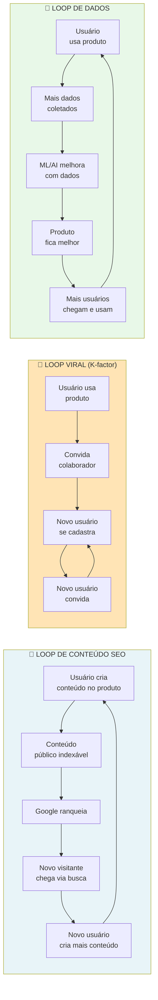

> [!important] A diferença entre funil e loop
> Funil precisa de input constante (CAC por visitante). Loop *se alimenta*. Exemplos reais. Glassdoor (loop de conteúdo). Dropbox (loop viral de referência). Spotify (loop de dados). Os melhores SaaS modernos têm dois a três loops simultâneos. Sem loop, o crescimento é linear com investimento. Com loop, é composto.

> [!question] Pergunta de FMF nessa fase
> Em escala, a tentação é delegar tudo, e virar administrador. A pergunta de FMF aqui é. *Há decisões estratégicas que só você pode tomar, porque só você tem o contexto de mercado construído?* Se sim, delegar essas é destruir valor. Se não, se qualquer executivo profissional tomaria as mesmas decisões, o seu valor marginal como fundador está em declínio. Ambas as respostas têm implicações. A primeira pede preservação de Founder Mode seletivo ([[#CAPÍTULO 8 — FOUNDER MODE, DELEGAÇÃO, GESTÃO DE TEMPO E CADÊNCIA OPERACIONAL DO CEO|Capítulo 8 (Founder Mode, Delegação, Gestão de Tempo e Cadência Operacional do CEO)]]). A segunda pede consideração de sucessão, ou exit.

> [!note] Entregáveis e gates da subfase Crescimento, Capital e Expansão
> Growth Plan de 18 meses + Capital Plan + Expansion Plan (novos segmentos, geografias ou produtos). Vendas fundador-led não escala acima de R$ 5-10M ARR; marketing ad-hoc não gera previsibilidade; internacionalização intuitiva queima caixa. Comece depois da Fase 14 (Time + Operações) em operação estável. Termine quando a máquina de aquisição estiver previsível, o plano de capital executado, e a expansão (se aplicável) em curso com pelo menos uma vertical ou geografia validada. Revisite anualmente, e a cada saturação de canal (12-18 meses). Executor: CEO + Head of Sales/Marketing + CFO. Participantes: board, advisors, investidores potenciais.

### Os 6 passos da escala: documentar o playbook, dominar um canal até a exaustão, medir unit economics e expandir em profundidade antes da amplitude

Sete passos.

> [!tip] Canvases Visuais — Pirate Canvas / AARRR em escala (Fase 11) e Network Effects Map (Fase 6)
> A máquina de crescimento opera no AARRR — cada etapa do funil (Acquisition, Activation, Retention, Referral, Revenue) tem dono e métrica em escala. O [[IGNICAO-Vol-4-Tracao-e-PMF#Canvas: Pirate Canvas / AARRR (Dave McClure, 2007)|Canvas: Pirate Canvas / AARRR (Dave McClure, 2007) (Vol. 4)]] é o mapa para identificar onde investir capital marginal de growth (CAC alto sinaliza Acquisition; ativação fraca trava Retention). Em modelos de plataforma ou marketplace, o [[IGNICAO-Vol-2-Descoberta-e-Mercado#Canvas: Network Effects Map|Canvas: Network Effects Map (Vol. 2)]] classifica o tipo de efeito de rede (direto, indireto, dados, social) e identifica onde investir para fortalecer defensibilidade conforme cresce — efeito de rede é o moat mais durável em mercados winner-takes-most.

#### Passo 0, entenda o Motor de Crescimento como sistema integrado

Antes de otimizar qualquer peça específica (vendas, marketing, retenção), entenda. Um motor de crescimento é *sistema*, não componente. A formulação canônica (derivada do framework Antler) define quatro componentes interdependentes.

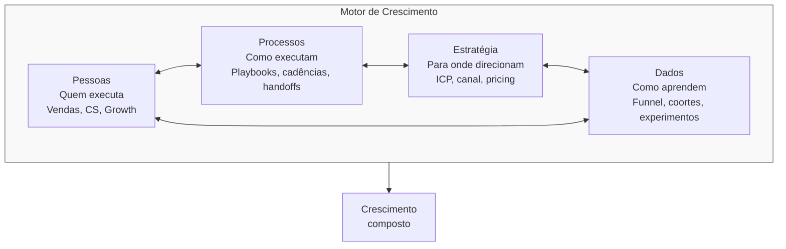

> [!warning] A regra do motor quebrado
> Se qualquer um dos quatro componentes falha, o motor inteiro gira no vazio. Pessoas certas + processos + estratégia, mas sem dados: "não sabem se estão ganhando, otimizam por intuição." Pessoas + processos + dados, mas sem estratégia: "executam bem a coisa errada, aceleram na direção do penhasco."

Diagnóstico mensal do motor. A cada trinta dias, avalie honestamente cada um dos quatro em escala de um a cinco.

| Componente | 1-2 (quebrado) | 3 (ok) | 4-5 (forte) |
|---|---|---|---|
| Pessoas | Vagas críticas abertas >6m, rotatividade >25%/ano | Vagas chave preenchidas, rotatividade aceitável | Bench forte, retenção >85%, perfil sênior atrai pares |
| Processos | Documentação ausente, handoffs informais | Top 5 processos documentados, cadência funcional | Playbooks revisados trimestralmente, onboarding sistemático |
| Estratégia | ICP difuso, canais não priorizados | ICP definido, 1-2 canais focados | Estratégia escrita, testada, revista por board |
| Dados | Decisões por opinião, sem dashboard | Dashboards principais, análise quinzenal | Data warehouse, experimentação contínua, cultura data-first |

> [!important] Quando qualquer componente fica vermelho
> Se qualquer componente marcar um a dois por dois trimestres consecutivos, *pare de escalar investimento*, e conserte antes de acelerar. Multiplicar investimento sobre motor quebrado multiplica queima. Não crescimento.

#### Passo 1, transforme venda fundador-led em motor repetível (se B2B)

Três perguntas diagnósticas. Que percentual das vendas fechadas nos últimos seis meses teve envolvimento direto do fundador? O primeiro vendedor não-fundador fecha com CAC comparável? Você tem três ou mais vendedores batendo quota consistentemente?

Se "não" para qualquer uma, você ainda está em venda fundador-led. A transição exige cinco itens.

Playbook de vendas escrito. Scripts de outbound, roteiros de discovery, tratamento de objeções, critérios de qualificação (MEDDPICC) e propostas padronizadas.

Pipeline hygiene (higiene de pipeline — manter o CRM limpo e atualizado). CRM com estágios claros, taxas de conversão conhecidas por estágio e previsão de vendas semanal.

Ramp time (tempo de rampa — período até o vendedor atingir produtividade plena) definido. O novo AE deve atingir quota em três a seis meses. Acima disso, a contratação ou o onboarding falhou.

Compensação variável. Vendedores recebem OTE (on-target earnings — remuneração total se bater quota), com cinquenta a setenta por cento de base e trinta a cinquenta por cento variável. Pague comissão por deal fechado, não só por pipeline.

Sales operations. Contrate uma pessoa dedicada a CRM, previsão de vendas e plano de comissões a partir de cerca de cinco vendedores.

Framework de maturidade da equipe de vendas:

| Estágio | Composição | O que medir |
|---|---|---|
| Fundador-led | 1 fundador vendendo | Taxa de fechamento, ACV |
| Primeira contratação | 1 AE + fundador | Se AE atinge 80% da produtividade do fundador em 6 meses |
| Time de 3 | 3 AEs + 1 SDR | Consistência: os 3 estão batendo quota? |
| Time estruturado | 5+ AEs, 2+ SDRs, 1 sales ops, 1 manager | Velocity, magic number, pipeline coverage |
| Sales machine | Times por segmento (SMB/Mid/Enterprise), regiões, verticais | NRR, win rate por segmento |

#### Passo 2, escale marketing baseado no canal validado

Lembre-se do [[IGNICAO-Vol-4-Tracao-e-PMF#CAPÍTULO 1 — GTM PLAYBOOK E ARQUITETURA DE CANAIS: DA PRIMEIRA VENDA AO PRIMEIRO MILHÃO DE ARR|Capítulo 1 (GTM Playbook e Arquitetura de Canais: Da Primeira Venda ao Primeiro Milhão de ARR) (Vol. 4)]]. Você deve ter escolhido um a dois canais validados na [[IGNICAO-Vol-4-Tracao-e-PMF#FASE 12 — VALIDAÇÃO DO MODELO DE NEGÓCIO|Fase 12 (Vol. 4)]]. Agora, escalar.

A estratégia por canal escalado, em seis frentes.

SEO mais content marketing. Contratar um a dois estrategistas de conteúdo, mais produtor. Produção consistente de quatro a doze pieces por mês. Keyword research estruturado. Link-building deliberado. Resultados em seis a doze meses.

Paid (Google, Meta, LinkedIn). Contratar paid specialist. Build de playbook de criativos. A/B testing contínuo. Attribution modeling (não só last-click).

Outbound. SDRs em time. Cadências estruturadas. Ferramentas (Outreach, Apollo.io, LinkedIn Sales Navigator).

Partnerships. Partnership manager, mais programa formal com tiers, comissão, MDF (Market Development Funds — verba para o parceiro investir em marketing conjunto) e co-marketing.

Comunidade. Community manager, mais rituais (eventos, Slack ou Discord, conteúdo UGC).

Events. Events manager, mais calendário anual, mais ROI por evento.

> [!warning] Regra de escala de canal
> Não escale um segundo canal até o primeiro estar saturado (atingindo setenta por cento ou mais de alocação ótima).

#### Passo 5, planeje expansão em dois eixos, começando pela profundidade antes da amplitude

Quando o PMF está consolidado em um segmento, a próxima fronteira é a expansão. Mas aqui mora um erro comum: empreendedores tratam "expansão" como sinônimo de "conquistar clientes novos". Expansão tem dois eixos independentes, com economias muito diferentes. A sequência certa entre eles é o que separa crescimento sustentável de crescimento que queima caixa.

Eixo 1, intra-conta (profundidade). Vender mais para quem você já atende. O CAC é baixo (cliente já comprou antes). O ciclo é curto (relação existente). O risco é menor (produto e processo já validados).

Eixo 2, extra-conta (amplitude). Conquistar clientes novos em segmentos, geografias, ou com produtos adicionais. O CAC é alto. O ciclo é longo. O risco é maior. Todo ganho novo custa mais que o anterior.

> [!important] Esgote a profundidade antes da amplitude
> Se o seu NRR está abaixo de cento e dez por cento, você está vazando valor dos clientes que já tem. Expandir para novos clientes sem estancar esse vazamento é repor água em balde furado. Profundidade vem primeiro.

**Eixo 1, expansão intra-conta, os três caminhos.**

Caminho 1, workflow adjacente no mesmo papel. Estenda o produto para o próximo passo lógico no mesmo processo da mesma pessoa. Reuse os mesmos dados, integrações, e comprador. Por exemplo, se você automatiza revisão de KYC para *compliance managers*, o próximo caminho é monitoramento de transações, depois relatório regulatório. O mesmo papel. O mesmo comprador. A mesma infra. Só outra fatia do mesmo workflow. A vantagem: CAC marginal próximo de zero. A venda é reunião de "expansão" com cliente atual. O risco: o "próximo workflow" pode ter concorrentes diferentes, e exigir especialização técnica nova.

Caminho 2, papel adjacente na mesma organização. Uma vez estabelecido com um papel, expanda para papéis vizinhos que dependem do workflow inicial. Por exemplo, do *compliance manager* para o time de risco, depois para o *head of operations*. Use a prova interna (clientes felizes na primeira área) para encurtar o ciclo de adoção na segunda área. Cresça dentro da mesma conta antes de buscar contas novas. A vantagem: já há campeão interno. Ciclo de venda trinta a cinquenta por cento mais curto que para conta nova. O risco: cada papel novo é um novo comprador econômico, com critérios próprios. Repita o Teste de Precisão do Comprador ([[IGNICAO-Vol-2-Descoberta-e-Mercado#FASE 6 — MAPEAMENTO DE MERCADO E CONCORRÊNCIA|Fase 6 (Vol. 2)]]) antes de cada papel adicional.

Caminho 3, ownership de sistema (de ferramenta a infraestrutura). Mova-se de ferramenta pontual para infraestrutura mais ampla. Integre sistemas upstream e downstream. Introduza visibilidade de sistema. Torne-se a camada de orquestração. Por exemplo, ferramenta de workflow de compliance vira dashboard unificado de risco, depois orquestração de compliance cross-border. Esse caminho é o mais ambicioso. E a antessala de se tornar plataforma (lembre. Plataforma é *resultado* de cunha dominada, ver [[IGNICAO-Vol-2-Descoberta-e-Mercado#FASE 6 — MAPEAMENTO DE MERCADO E CONCORRÊNCIA|Fase 6 (Vol. 2)]]). A vantagem: cada integração adiciona switching cost. O cliente tem cada vez mais caro trocar. O risco: cada integração puxa complexidade técnica, e de manutenção. Só siga esse caminho depois de ter os Caminhos 1 e 2 rodando com NRR previsível.

A métrica-guia do Eixo 1 é o NRR. Com NRR entre cem e cento e dez por cento, o Caminho 1 já está rodando minimamente. Para chegar a cento e vinte ou cento e trinta por cento ou mais (nível excepcional), os três caminhos intra-conta precisam estar ativos em sequência.

**Eixo 2, expansão extra-conta, os três caminhos.**

Caminho 4, expansão de segmento (ICP adjacente). Por exemplo, validou em startups de dez a cinquenta funcionários. Expandir para cinquenta a duzentos. As mudanças esperadas. Sales motion diferente. ACV maior. CAC maior. Ciclo mais longo. O risco. Diluir foco. A defesa. Manter time core no original. Time novo no adjacente.

Caminho 5, expansão geográfica. Por exemplo, do Brasil para o México. Ou de LatAm para os EUA. As mudanças. Localização (idioma, moeda, tax, regulatório). Canais diferentes. Competição diferente. O risco é alto. Setenta por cento das expansões internacionais em seed e Série A falham. Validação cuidadosa. Não deploy em larga escala. O playbook de entrada em novo mercado, em seis meses típicos, em cinco passos. Research inicial (três a quatro semanas): tamanho, competição, regulação, e cultura comercial. Primeiras vinte entrevistas (quatro a seis semanas), com ICP local. Piloto com três a dez clientes (dois a três meses). Contratação de primeiro country lead (forte em sales local). Scale gradual.

Caminho 6, expansão de produto (novo produto, ou feature-line). Por exemplo, SaaS de gestão adiciona módulo de BI. As mudanças. P&D novo. Time adicional. Posicionamento mais complexo. O risco. Diluir marca. A defesa. Novo produto deve claramente *reforçar* a proposição central. Não divergir.

> [!tip] A regra dos 70/20/10
> Alocação de recursos por tipo de investimento. Setenta por cento em core: otimização e crescimento do negócio existente (incluindo Caminhos 1 e 2 do Eixo 1). Vinte por cento em adjacent: Caminhos 3 e 4, expansão adjacente de risco médio. Dez por cento em moonshot: Caminhos 5 e 6, apostas transformacionais de alto risco, alto retorno, e horizonte longo.

**Regra transversal. Mude uma variável por vez.**

Independente do caminho escolhido (intra ou extra-conta), respeite o princípio da variável isolada. Uma operação de expansão não deve mudar múltiplas dimensões ao mesmo tempo. As cinco dimensões relevantes são. Papel do usuário. Produto. Workflow. Segmento. E geografia.

Fazer. Mesmo papel mais mesmo produto mais workflow adjacente (muda só o workflow). Mesmo segmento mais nova geografia (muda só a geografia).

Não fazer. Novo segmento mais nova geografia mais novo produto simultaneamente. Isso é lançar uma segunda empresa. Não expandir a primeira.

Por que isso importa na prática. Quando você muda duas ou mais variáveis ao mesmo tempo, e o resultado é ruim, você não consegue atribuir a causa. Foi o novo segmento que rejeitou o produto? Foi a geografia nova que rejeitou a proposta de valor? Foi o produto novo que não encaixou com o ICP atual? Sem poder atribuir, você perde o aprendizado do experimento, e gasta as duas coisas (tempo e dinheiro) sem acumular inteligência.

Na prática, isso significa escolher *um caminho por vez* (dos seis), e executar por pelo menos um a dois trimestres antes de abrir um segundo movimento. Empresas que tentam três expansões simultaneamente geralmente terminam com três ciclos de venda estagnados, em vez de um ciclo validado.

### Os sinais objetivos de que sua máquina de vendas já funciona sem o fundador na sala

Seis critérios. Dois ou mais canais de aquisição validados, com unit economics saudáveis. Payback de CAC abaixo de dezoito meses no canal principal. NRR de cento e dez por cento ou mais, medido nos últimos doze meses. Governança mínima ativa (board ou advisory, mais reporting trimestral). Plano de Financiamento de dezoito meses documentado (Template: Plano de Financiamento Não-Diluitivo (Fase 14)). Sistema de parcerias estratégicas operacional, com três ou mais parcerias ativas, ou em negociação.

### A catraca operacional para liberar orçamento pesado de escala

- [ ] Tenho motor de aquisição replicável e escalável (dois ou mais canais validados, sem dependência única)?
- [ ] Tenho payback de CAC abaixo de dezoito meses no canal principal?
- [ ] NRR está em cento e dez por cento ou mais?
- [ ] Tenho governança mínima (conselho, ainda que consultivo, e reporting trimestral)?
- [ ] Avaliei quais tipos de capital usar nos próximos vinte e quatro meses (equity, debt, não-diluitivo, [[IGNICAO-Vol-5-Financas-e-Captacao#CAPÍTULO 12 — FINANCIAMENTO NÃO-DILUITIVO|Capítulo 12 (Financiamento Não-Diluitivo) (Vol. 5)]])?
- [ ] Tenho plano de expansão geográfica, ou vertical, documentado, com milestones?
- [ ] Estou avaliando parcerias estratégicas sistematicamente ([[#CAPÍTULO 5 — CANAIS INDIRETOS E PARCERIAS: PARCERIAS, FRANQUIAS, CHANNEL|Capítulo 5 (Canais Indiretos e Parcerias: Parcerias, Franquias, Channel)]])?
- [ ] Considerei (pelo menos pensei estrategicamente) em M&A como adquirente?

### Próximos passos

1. Mapear canais de aquisição em planilha. Percentual do pipeline, CAC, LTV, payback por canal.
2. Calcular NRR dos últimos doze meses (receita na base atual, versus base há doze meses).
3. Abrir Template Plano de Financiamento (Fase 14), e definir os próximos dezoito meses de caixa.
4. Listar três a cinco parceiros potenciais que podem acelerar distribuição ([[#CAPÍTULO 5 — CANAIS INDIRETOS E PARCERIAS: PARCERIAS, FRANQUIAS, CHANNEL|Capítulo 5 (Canais Indiretos e Parcerias: Parcerias, Franquias, Channel)]]).

### Caso brasileiro real, máquina de crescimento da Stone (2014-2018, escala pós-PMF até IPO)

A Stone (já tratada na Fase 5 como cunha e na Fase 10 como MVP v0) ilustra na escala três propriedades diferentes das anteriores: composição de canais validados, plano de financiamento concentrado em poucos investidores grandes, e aquisição como comprador como alavanca de cross-sell.

**Composição de canais no pico de eficiência (2016-2017):**

| Canal | % novos lojistas | CAC | Payback | Escalabilidade |
|---|---|---|---|---|
| Green Angels (venda direta) | ~55% | R$ 1.500-2.500 | 6-9 meses | Alta (replicável em nova capital adicionando hub) |
| Indicação de lojista satisfeito | ~25% | ~R$ 200 (incentivo) | 3-4 meses | Média (limitada por densidade local) |
| Parcerias com bancos regionais e contadores | ~10% | R$ 800-1.200 | 6-8 meses | Média |
| Marketing digital e brand | ~10% | Variável | 9-12 meses | Crescente (papel maior pós-IPO) |

NRR estimado da base ativa acima de 110%, via aumento de TPV e adoção de produtos adicionais (antecipação, conta digital, crédito). LTV/CAC acima de 5x, melhorando ao longo do tempo conforme indicação cresce.

**Plano de financiamento concentrado**: capital próprio + iniciais (~US$ 5-10M, 2012-13), Madrone Capital como âncora (~US$ 150M, 2014-15), PE/VCs adicionais — T. Rowe Price, Tiger Global (~US$ 330M, 2016-18), IPO na NASDAQ em out/2018 (~US$ 1,15 bi, ação de US$24 a US$32 no day-one, valuation ~US$ 9,9 bi). Captação concentrada em poucos cheques grandes — viabilizada porque o CEO tinha formação em finanças e tese clara para PE.

**M&A como comprador**: Linx adquirida por ~R$ 6,7 bi (2020-21) com tese de combinar adquirência + software de gestão para PME. A integração foi mais complexa que projetado, e a Stone enfrentou turbulência operacional em 2021-22 (Stone Mais/crédito, integração Linx, macro). Demonstra que mesmo M&A com tese sólida exige execução exemplar.

> [!important] A lição transferível da Stone em escala
> Quatro propriedades difíceis de replicar simultaneamente: wedge claro, canal próprio defensável (Green Angels), financiamento concentrado em poucos grandes, e tese de cross-sell explícita (antecipação → crédito → gestão via Linx). Empresas que copiam só uma dessas propriedades raramente escalam na mesma velocidade.

> [!quote] Heurística de operadores brasileiros experientes
> "Se não estamos dispostos a passar dois anos operando a empresa adquirida mesmo que o deal não tivesse acontecido, não deveríamos comprá-la." É rigoroso. E corrige a maioria dos erros — elimina aquisições por moda, por oportunidade, por ansiedade competitiva. Armadilhas específicas de M&A (subestimar custos de integração, integração cultural ignorada, earnouts mal desenhados, fundador adquirido sai em 12-18 meses, M&A como distração) e critérios de sucesso (tese validada em 18m, retenção de time ≥70%, retenção de clientes ≥80%) estão tratados em [[IGNICAO-Vol-9-Maturidade-e-Exit#CAPÍTULO 12 — M&A ATIVO E ROLL-UPS: FUNDADOR COMO COMPRADOR|Capítulo 12 (M&A Ativo e Roll-Ups: Fundador como Comprador) (Vol. 9)]].

---

### Dois vendedores não-fundadores batendo 100% da meta por 3 meses seguidos com CAC Payback dentro do alvo

A [[#FASE 16 — TIME, LIDERANÇA EXECUTIVA E CULTURA EM ESCALA|Fase 16]] (Crescimento e Capital) está concluída quando os cinco critérios abaixo estão cumpridos.

1. Motor de vendas, e aquisição, opera sem envolvimento direto do fundador em mais de setenta por cento dos deals. Ramp time de novo vendedor ≤6 meses; eficiência do canal primário com CAC estável ou caindo.
2. Métricas financeiras estão em faixas saudáveis: NRR ≥110%, burn multiple ≤1,5x, Rule of 40 ≥40, CAC payback <12 meses.
3. Plano de capital para dezoito a vinte e quatro meses está executado (rodada fechada), ou em execução com clareza sobre timing. Runway pós-rodada de 18-24 meses.
4. Se aplicável: expansão (segmento, geografia, ou produto) foi iniciada com primeiro piloto concluído. Receita de novo segmento, geografia ou produto ≥10% do total em 12 meses de expansão.
5. Termos de captação foram negociados com advogado especializado, e estão dentro de padrão saudável.

### Onde empresas pós-PMF estagnam: abrir 5 canais meia-boca ao mesmo tempo, contratar VP de Vendas de multinacional cedo demais e expandir cidade antes de dominar o bairro

"Crescimento resolve tudo". Falso. Crescimento ineficiente acelera morte em downturn.

Escalar vendas sem playbook. Contratar dez vendedores com CAC desconhecido é queimar caixa.

Captar de fundo errado. VC de growth investindo em seed, ou vice-versa, gera expectativas desalinhadas.

Ignorar termos não-financeiros. Liquidation preference de duas vezes participating em rodada pequena pode custar o exit inteiro dos fundadores em cenário ruim.

Expansão "oportunista". "Esse cliente grande nos pediu, vamos atender", sem análise estratégica, vira distração crônica.

Over-hiring depois da rodada. A pressão para "gastar o dinheiro" destrói cultura e caixa.

Foco em vanity metrics. GMV, pageviews, e usuários totais, se não conectam a receita, são teatro.

---

> [!note] Captação progressiva como instrumento, não troféu
> O Nubank (já tratado como caso na Fase 12) ilustra captação por milestones entre 2013 e o IPO de 2021: cada rodada com Sequoia, Tiger e Berkshire foi vinculada a marco específico (PMF, expansão de produto, internacionalização, preparação de IPO), feita em momento de força (valuation alto, narrativa clara), preservando percentual de founders e early team mesmo após múltiplas rodadas. Lição transferível: rodadas são combustível para milestones específicos, não objetivo em si. Founder que se orgulha do cheque sem articular o que vai bater com ele está pedindo a vela que precede o naufrágio.


---

### O Espelho da Fase 15: Você Construiu uma Máquina de Vendas ou É o Único Vendedor de Elite da Empresa?

> [!tip] O Espelho do Gestor (Autodiagnóstico Rápido)
> 1. **O Teste das Férias de 30 Dias:** Se você e seu cofundador forem proibidos de entrar em qualquer call comercial ou aprovar descontos pelos próximos 30 dias, a receita nova do mês se mantém em pelo menos 85% da meta ou despenca pela metade?
> 2. **A Prova dos Dois Vendedores:** Você já tem pelo menos **dois vendedores contratados do mercado (não-fundadores)** que aprenderam o processo pelo seu Playbook escrito e bateram 100% da meta por três meses consecutivos?
> 3. **Foco vs. Dispersão (*Lei da Cabeça-de-Praia*):** Você já domina mais de 30% do seu nicho inicial com referência cruzada automática entre clientes, ou está tentando lançar três produtos novos em quatro estados diferentes porque achou o primeiro nicho "difícil"?
>
> **Regra de Bolso (*estilo Geoffrey Moore*):** Nunca contrate dez vendedores para descobrir como se vende; contrate dois vendedores para provar que o processo que o fundador documentou funciona nas mãos de terceiros, e só então contrate os outros oito.
>
> **O Ritual de Segunda-Feira às 9h:** Grave as suas próximas 5 reuniões de vendas como fundador, transcreva as 10 objeções mais comuns e entregue na sexta-feira a **Versão 1.0 do Playbook Comercial de Trincheira** com critérios binários de passagem de etapa.

---

### MANUAL PASSO A PASSO DOS FRAMEWORKS DESTA FASE

> [!tip] Uso autocontido neste volume
> Todos os frameworks abaixo estão detalhados integralmente com origem, estrutura, passo a passo de aplicação, exemplo brasileiro e armadilhas para execução imediata nesta **Fase 15**.

#### Framework: Growth Loops (Balfour, Winters, Kwok, A. Chen / Reforge, 2019)

##### De onde vem a ferramenta (e por que sobreviveu ao filtro do tempo)

O conceito foi co-desenvolvido por Brian Balfour (ex-VP Growth HubSpot, fundador da Reforge), Casey Winters, Kevin Kwok e Andrew Chen em 2019, formalizando como evolução do funnel tradicional (AARRR). Argumento: funnels têm **entrada única** (aquisição paga), loops têm **output que vira input** (usuários criam crescimento). Empresas duráveis são loops, não funnels.

##### A mecânica central (sem jargão)

Conceito de **mecanismos auto-reforçados** onde a própria atividade do usuário gera mais aquisição de novos usuários (ou retenção, ou receita). O output do loop alimenta o input.

##### As regras do jogo

Estrutura de um loop:

1. Input (novo usuário ou ação).
2. Ações que o usuário faz.
3. Output (conteúdo, convite, dado, etc.).
4. Output vira input novo (aquisição de outro usuário, engajamento, etc.).

Tipos de loops:

- Viral loops: usuário convida outros (WhatsApp, Dropbox).
- Content loops: usuário cria conteúdo que atrai outros (Quora, Pinterest, YouTube).
- Paid loops: LTV de um usuário financia aquisição de próximo (Netflix).
- Sales-led loops: clientes satisfeitos recomendam via word-of-mouth para seu network (Slack, Notion).
- Data loops: mais usuários geram mais dados que melhoram o produto que atrai mais usuários (Google, Amazon, Waze).

##### Como rodar na segunda-feira às 9h com seu time

Passo 1, Identifique o loop dominante do seu negócio.

Passo 2, Mapeie cada passo explicitamente.

Passo 3, Otimize o loop, não etapas isoladas. Melhorar uma etapa sem considerar efeito no resto quebra o loop.

Passo 4, Meça o fator de amplificação: cada usuário gera X usuários via loop? Se X ≥ 1, crescimento autosustentável.

Passo 5, Identifique o gargalo do loop.

##### Na trincheira real: como isso funciona na prática

Content loop de Quora:

- Input: pessoa busca no Google "como fazer X".
- Google mostra resposta do Quora.
- Pessoa lê resposta, percebe valor.
- Se se cadastra, recebe mais perguntas similares.
- Algumas pessoas **respondem** perguntas (action).
- Nova resposta é indexada pelo Google → aparece em busca → atrai nova pessoa.

Loop = content em Quora atrai mais users que criam mais content.

Viral loop de Dropbox (clássico):

- Usuário instala Dropbox.
- Dropbox oferece espaço grátis se convidar amigo.
- Amigo aceita, instala.
- Ambos usuários têm mais espaço.
- Amigo convida próximo.

K-factor atingiu > 1 em certo período, crescimento explosivo sem gastar em paid.

##### Onde o papel aceita tudo (armadilhas de execução)

Achar que tem loop quando tem funnel: "temos acquisition, activation, retention", é funnel. Loop requer OUTPUT que vira INPUT. Múltiplos loops dispersos: melhor um loop forte que cinco fracos. Otimizar sem entender o loop inteiro: mudar uma etapa quebra outra. Forçar viralidade em produto que não é viral: não é todo produto que tem loop viral, alguns são content, alguns são paid.

---

#### Framework: T2D3 (Neeraj Agrawal, 2015)

##### De onde vem a ferramenta (e por que sobreviveu ao filtro do tempo)

Neeraj Agrawal, partner da Battery Ventures, publicou "The SaaS Adventure" em 2015 descrevendo o padrão de crescimento de empresas SaaS que viraram unicórnios. T2D3 é a **trajetória de receita** esperada dessas empresas: Triple, Triple, Double, Double, Double. Virou benchmark informal em SaaS B2B.

##### A mecânica central (sem jargão)

Padrão de crescimento de ARR (Annual Recurring Revenue) de SaaS de sucesso:

- Ano 1 (após $1-2M ARR): **Triplica** para $3-6M.
- Ano 2: **Triplica** para $9-18M.
- Ano 3: **Dobra** para $18-36M.
- Ano 4: **Dobra** para $36-72M.
- Ano 5: **Dobra** para $72-144M (próximo de IPO).

##### As regras do jogo

Agrawal observou empresas como Marketo, NetSuite, Omniture, Salesforce, ServiceNow, Workday e Zendesk seguindo esse padrão aproximado. Empresas que desviavam significativamente tendiam a não atingir IPO em prazo similar.

Implicações:

- Crescimento que decai em ritmo T2D3 é natural: empresas mais maduras crescem mais devagar em %.
- Se está crescendo menos: sinal de alerta (produto, canal, mercado).
- Se está crescendo mais: ótimo, mas sustentabilidade?
- Ritmo deve ser mantido via investimento em sales, produto, marketing.

##### Como rodar na segunda-feira às 9h com seu time

Passo 1, Use como benchmark, não como meta rígida.

Passo 2, Após atingir $1M ARR (marco crítico), esperar crescimento 3x nos próximos 12 meses.

Passo 3, Acompanhe quarterly: crescimento de 3x em 12 meses = ~31% QoQ compounded. Meta trimestral clara.

Passo 4, Identifique desvios cedo. Se Q1 ficou abaixo, ajustar Q2 para compensar ou revisar expectativa.

Passo 5, Investimentos devem acompanhar: T2D3 exige hiring agressivo em sales, investimento em marketing, iteração rápida em produto.

##### Na trincheira real: como isso funciona na prática

Benchmark simulado de SaaS B2B brasileiro:

- ARR atingiu $1M em janeiro 2024.
- Meta T2D3 para 2024: $3M ARR.
- Meta 2025: $9M.
- Meta 2026: $18M.
- Meta 2027: $36M.
- Meta 2028: $72M, sinal para IPO ou grande Series D.

Se em jun/2024 ARR está em $1.6M (50% do path para $3M em dezembro), está dentro da curva. Se está em $1.2M, sinal de alerta.

##### Onde o papel aceita tudo (armadilhas de execução)

Aplicar a SaaS vertical/nicho: T2D3 assume mercado grande horizontal. Nichos crescem mais devagar. Não significa fracasso. Pressão para T2D3 em empresas que não são SaaS: marketplaces, e-commerce, consumer apps têm dinâmicas diferentes. Perseguir crescimento a qualquer custo: CAC explode, unit economics quebra. Não é T2D3 sustentável, é queimar capital. Não adaptar a contexto macro: 2022-2023 teve freada global. T2D3 puxado ficou menos comum.

---

#### Framework: Blitzscaling (Reid Hoffman & Chris Yeh, 2018)

##### De onde vem a ferramenta (e por que sobreviveu ao filtro do tempo)

Reid Hoffman (co-fundador LinkedIn, sócio Greylock) e Chris Yeh publicaram *Blitzscaling* em 2018, baseado em curso de Stanford ministrado por Hoffman. Conceito formaliza estratégia de **priorizar velocidade sobre eficiência** para capturar mercados "winner-takes-most", comum em tech (LinkedIn, Airbnb, Uber, Facebook).

##### A mecânica central (sem jargão)

Estratégia de crescimento que aceita **ineficiências temporárias massivas** (perder dinheiro, ter caos organizacional, contratar rápido demais) para **escalar muito mais rápido que concorrentes** em mercados onde primeiro a grande escala domina.

##### As regras do jogo

5 estágios de Blitzscaling (por número de funcionários):

1. Family (1-9): founder-led, tudo manual.
2. Tribe (10-99): contratação crítica, cultura emerge.
3. Village (100-999): processos necessários, primeira camada de gestão.
4. City (1.000-9.999): divisões autônomas, sistemas de escala.
5. Nation (10.000+): maturidade corporativa, inovação interna.

3 técnicas-chave:

- Aceitar caos: priorizar velocidade vs. perfeição.
- Contraintuitive moves: tocar "fogo no processo" para liberar velocidade (abolir permissões, desligar features).
- Gerir rapidamente "demissão de rules": processos que funcionaram em tribo quebram em village, destruir e reinventar.

Condição para usar: mercado com **network effects**, **escala como vantagem**, ou **winner-takes-most dynamics**. Blitzscaling em mercado fragmentado é suicídio.

##### Como rodar na segunda-feira às 9h com seu time

Passo 1, Validar que mercado suporta blitzscaling (network effects, escala ou switching costs fortes).

Passo 2, Levantar capital suficiente para 24+ meses de queima agressiva.

Passo 3, Contratação velocidade > qualidade individual: em blitzscaling, 70% de hires ok são melhores que 95% de hires perfeitos (velocidade).

Passo 4, Priorizar adoção sobre unit economics: LTV:CAC ruim no curto prazo é aceitável SE loops de network/escala se manifestam.

Passo 5, Gestão de "fires": aceitar débito em compliance, tech, cultura, a pagar depois.

Passo 6, Quando atingir liderança, mudar modo: blitzscaling não é permanente. Fase de consolidação vem depois.

##### Na trincheira real: como isso funciona na prática

LinkedIn (exemplo icônico de Hoffman):

- 2003-2006: crescimento moderado, validando modelo.
- 2007-2011: blitzscaling. Contratação agressiva (time cresce 10x), expansão internacional, produtos múltiplos simultâneos, compliance atrasado.
- 2011: IPO a $9B.
- 2016: adquirido Microsoft por $26B.

Empresa aceitou caos temporário para capturar posição dominante em social profissional, mercado winner-takes-most.

Caso negativo: startup de e-commerce fragmentado que tentou blitzscale. Queimou $100M, não atingiu escala onde economia muda, faliu. Mercado não suportava.

##### Onde o papel aceita tudo (armadilhas de execução)

Blitzscaling em mercado errado: sem network effects ou escala-moat, queima de capital sem retorno. Ignorar unit economics para sempre: blitzscaling compra tempo, eventualmente unit economics têm que fechar. Caos virando cultura permanente: após escala atingida, caos mata. Transição para rigor é crítica. Hires erradas em velocidade extrema: contratar 100/mês sem filtro, vem demissão em massa depois. Sub-capitalização: iniciou blitzscaling sem runway. Demite em 12 meses, arruína credibilidade.

---

#### Framework: BANT (IBM, anos 1960)

##### De onde vem a ferramenta (e por que sobreviveu ao filtro do tempo)

BANT (Budget, Authority, Need, Timeline) foi desenvolvido pela IBM nos anos 1960 para qualificação sistemática de oportunidades de venda de mainframes. Tornou-se o framework de qualificação mais conhecido, ensinado em escolas de vendas por décadas. Hoje considerado **antiquado** para vendas modernas em muitos contextos, mas ainda útil como base.

##### A mecânica central (sem jargão)

4 critérios para qualificar um lead como oportunidade real:

1. Budget: tem orçamento?
2. Authority: é decisor?
3. Need: tem necessidade?
4. Timeline: quando vai decidir?

Se todos sim, lead qualificado. Se algum não, desqualificar ou trabalhar.

##### Como rodar na segunda-feira às 9h com seu time

Passo 1, Integre perguntas BANT em discovery calls de forma natural, não inquisitiva.

Passo 2, Budget: "Qual o range de orçamento?", ou indireto: "quando vocês fizeram última compra similar, o que foi o ponto?".

Passo 3, Authority: "Quem mais participa da decisão?", identifica stakeholders.

Passo 4, Need: "O que aconteceria se esse problema continuasse?", quantifica dor.

Passo 5, Timeline: "Quando precisam ter isso implementado?", urgência real.

Passo 6, Desqualificar sem dó: leads sem BANT raramente fecham em prazo útil.

##### Críticas modernas

BANT tem limitações para B2B moderno:

- Budget pode emergir: em compras maiores ou transformacionais, budget vem depois do valor percebido.
- Authority é diluída: comitês de compra em SaaS enterprise têm 5-10 stakeholders, "decisor único" é minoria.
- Need é inadequado: clientes que "não têm need" podem ter antes de reconhecer.
- Timeline pode ser construída: vendedor pode criar urgência (desconto de fim de trimestre, case time-sensitive).

Substituídos por MEDDIC, MEDDPICC em muitos contextos enterprise.

##### O gatilho exato para sacar este framework

- Inbound simples com alto volume e baixo ticket.
- PMEs com ciclos rápidos.
- Vendas transacionais (vs. consultivas).

---

#### Framework: SPIN Selling (Neil Rackham, 1988)

##### De onde vem a ferramenta (e por que sobreviveu ao filtro do tempo)

Neil Rackham liderou pesquisa de 12 anos sobre vendas complexas, analisando 35.000+ sales calls em 23 países, o estudo mais rigoroso já feito em sales. *SPIN Selling* (1988) apresentou achados. Conclusão central: **técnicas que funcionam em vendas simples (ex.: "closing aggressive") destroem vendas complexas**. SPIN é metodologia para vendas de alto valor/ciclo longo.

##### A mecânica central (sem jargão)

Framework de perguntas em 4 categorias sequenciais em discovery call:

- S, Situation: entender contexto atual do cliente.
- P, Problem: identificar problemas específicos.
- I, Implication: explorar consequências dos problemas.
- N, Need-Payoff: ajudar cliente a articular valor da solução.

##### As regras do jogo

Pesquisa de Rackham mostrou que:

- Vendedores excepcionais fazem **muito mais perguntas** (especialmente Implication e Need-Payoff).
- Técnicas de "closing aggressive" pioram resultados em vendas complexas.
- Objeções não devem ser "superadas": devem ser **prevenidas** via boas perguntas anteriores.

##### Como rodar na segunda-feira às 9h com seu time

Passo 1, Situation questions (contexto): "Como vocês fazem X hoje?". Cuidado: muitas situation questions = cliente fica entediado. Fazer pesquisa prévia para minimizar.

Passo 2, Problem questions: "Onde isso dá problema?". Faz cliente verbalizar dor.

Passo 3, Implication questions (foco principal): "Se esse problema continuar, qual o impacto?". Amplifica dor, cliente realiza gravidade.

Passo 4, Need-Payoff questions**: "Se conseguíssemos resolver X, que valor isso traria?". Cliente ele mesmo articula valor. Muito mais poderoso do que vendedor articular.

Passo 5, Apresentar solução alinhada com necessidades verbalizadas.

##### Na trincheira real: como isso funciona na prática

Discovery call para SaaS financeiro (90 min):

- Situation (20 min): entender operação atual. "Quantas PMEs vocês atendem? Que ferramentas usam? Quantas horas por mês em conciliação?"

- Problem (25 min): "Onde o processo atual quebra? O que mais dá retrabalho? Quando teve erro mais recente?"

- Implication (30 min): "Se um erro desse passasse, qual seria o impacto? Já aconteceu? O que custou? Se retrabalho continuar crescendo, como afeta sua capacidade de crescimento?"

- Need-Payoff (15 min): "Se tivéssemos automação que eliminasse 80% desse retrabalho, quanto tempo livraria? Em que você investiria esse tempo? Vale quanto para sua empresa?"

Cliente sai da call articulando valor em centenas de milhares. Fechamento natural.

##### Onde o papel aceita tudo (armadilhas de execução)

Pular para apresentação sem SPIN: "apresenta produto" cedo, cliente não verbalizou dor, objeções explodem. Situation questions demais: entediam, gaste-os em pesquisa prévia. Problem questions sem Implication: cliente reconhece problema mas minimiza, precisa amplificação. Need-Payoff artificial: tentar forçar em lead sem problema, soa manipulador.

---

#### Framework: Solution Selling (Mike Bosworth, 1983; livro 1994)

##### De onde vem a ferramenta (e por que sobreviveu ao filtro do tempo)

Mike Bosworth fundou Solution Selling em 1983, depois de carreira em Xerox Computer Services e influência do trabalho de Neil Rackham (SPIN). Iniciou licenciamento da metodologia em 1988 (mais de 50 afiliados ao vender em 1999). Publicou *Solution Selling: Creating Buyers in Difficult Selling Markets* pela McGraw-Hill em 1994. Popularizou a ideia de **vendedor como consultor de problemas**, não demonstrador de features. Base para metodologias subsequentes (MEDDIC, Challenger).

##### A mecânica central (sem jargão)

Metodologia em que vendedor **diagnóstica necessidades** e **co-constrói solução** com cliente, em vez de empurrar produto pré-definido. Vendedor é mais próximo de consultor de negócio do que de salesperson tradicional.

##### As regras do jogo

9 blocos:

1. Preparation.
2. Opening.
3. Diagnosing pain.
4. Creating vision.
5. Negotiating access to power.
6. Handling objections.
7. Closing.
8. Implementation.
9. Follow-up.

Princípio-chave: se cliente não tem **dor reconhecida e quantificada**, não há venda. Primeiro trabalho é **ativar a dor** (fazer cliente perceber problema).

##### Como rodar na segunda-feira às 9h com seu time

Similar a SPIN (Framework: SPIN Selling (Neil Rackham, 1988) (Fase 15)) em muitos aspectos. Solution Selling enfatiza mais a **co-construção de vision**: cliente não só reconhece dor, mas imagina o "estado desejado" com a solução.

##### Na trincheira real: como isso funciona na prática

Vendedor B2B para CFO de varejista:

Em vez de "apresento nosso produto", pergunta: "Se pudéssemos eliminar 10 horas por semana de reconciliação manual, como isso afetaria decisões que você toma todos os dias?"

CFO elabora: menos retrabalho → decisões mais rápidas → mais reactive à mudança → maior margin via otimização contínua.

Solução co-construída: CFO possui a vision, vendedor é o enabler.

##### Onde o papel aceita tudo (armadilhas de execução)

"Vendedor consultivo" que é apenas "vendedor amigável": sem rigor diagnóstico, Diagnóstico superficial: 5 minutos de perguntas, pular para produto, Forçar vision: vendedor empurra sua visão, cliente desengaja.

---

#### Framework: Challenger Sale (Matthew Dixon & Brent Adamson, 2011)

##### De onde vem a ferramenta (e por que sobreviveu ao filtro do tempo)

Matthew Dixon e Brent Adamson, do CEB (Corporate Executive Board), publicaram *The Challenger Sale* em 2011 após pesquisa com 6.000 sales reps em 90 empresas. Descoberta contra-intuitiva: em vendas complexas, o perfil "relationship builder" (construir amizade com cliente) **não é o mais eficaz**. Perfil "Challenger" (que desafia cliente) supera todos em complexas.

##### A mecânica central (sem jargão)

Teoria que categoriza sales reps em **5 perfis** e identifica o **Challenger** como o que performa melhor em vendas complexas B2B.

##### Princípios / estrutura — 5 perfis de sales rep

1. The Relationship Builder: foca em relacionamento, evita conflito. **Performa mal em vendas complexas**.
2. The Hard Worker: dedicação, persistência, segue playbook.
3. The Lone Wolf: independente, improvisa, difícil de gerenciar.
4. The Reactive Problem Solver: resolve issues do cliente.
5. The Challenger: **melhor em vendas complexas**.

Challenger tem 3 capabilities:

- Teach: ensina cliente algo novo sobre seu próprio negócio.
- Tailor: adapta a conversa a stakeholder específico.
- Take control: direciona conversa, não bajula.

Commercial teaching: aprendizados educacionais que levam cliente a reconsiderar premissas sobre seu negócio, e posicionam vendedor/empresa como autoridade.

##### Como rodar na segunda-feira às 9h com seu time

Passo 1, Desenvolva aprendizados proprietários sobre o setor do cliente. Pesquisa profunda + dados agregados.

Passo 2, Reframe o problema**: faça cliente perceber que o problema é maior ou diferente do que pensava.

Passo 3, Construa "commercial teaching": 3-5 aprendizados que desafiam premissas comuns.

Passo 4, Tailor para stakeholder: CFO quer dados financeiros. CTO quer arquitetura. CEO quer estratégia.

Passo 5, Take control da conversa: não espera cliente guiar, conduz.

Passo 6, Assert constructive tension: incômodo produtivo que leva à mudança.

##### Na trincheira real: como isso funciona na prática

Vendedor Challenger em call com CFO de rede de varejo:

Relationship builder diria: "O que podemos fazer por vocês?"

Challenger diz: "Analisamos dados de 200 varejistas do seu tamanho. 83% estão **perdendo 15-20% de margem** em ineficiências de conciliação que não aparecem em seus relatórios atuais, porque estão medindo a coisa errada. Posso mostrar como?"

CFO: interessado, sente-se desafiado, aprende algo novo. Conversa vira sobre **reframing** do problema (não "quanto custa?"), vendedor controla agenda.

Fechamento mais rápido, valor percebido mais alto.

##### Onde o papel aceita tudo (armadilhas de execução)

"Challenger" vira grosseiro: confronta sem valor agregado. Challenger é **insightful**, não rude, Insights genéricos: "vocês precisam de transformação digital", aprendizados triviais não desafiam, Não tailoring: mesmo pitch para CFO e CTO, Confrontação sem construção: diz "você está errado" sem apresentar melhor caminho.

---

#### Framework: MEDDIC / MEDDPICC (Jack Napoli / Dick Dunkel, PTC, 1996)

##### De onde vem a ferramenta (e por que sobreviveu ao filtro do tempo)

MEDDIC foi criado por Dick Dunkel (com Jack Napoli como co-difusor) na Parametric Technology Corporation em 1996, sob liderança de John McMahon. Durante 4 anos, PTC cresceu de $300M para $1B com MEDDIC como metodologia central. Versão MEDDPICC (adiciona Paper Process e Competition) foi desenvolvida posteriormente. Hoje é **padrão-ouro em sales enterprise de alta complexidade** (tech, software, equipamentos industriais).

##### A mecânica central (sem jargão)

Framework de qualificação para **vendas complexas B2B enterprise** com múltiplos stakeholders, alto ticket, ciclos longos. Cada letra é critério que PRECISA ser verificado.

##### As regras do jogo

MEDDIC (6 critérios):

- M, Metrics: qual KPI quantificável a solução impacta?
- E, Economic Buyer: quem assina o contrato (final decisor de orçamento)?
- D, Decision Criteria: como cliente avalia soluções?
- D, Decision Process: etapas do processo decisório?
- I, Identify Pain: dor quantificada + implicação de não resolver?
- C, Champion: quem dentro do cliente defende você nos bastidores?

**MEDDPICC** adiciona:

- P, Paper Process: como contrato é revisado/assinado (jurídico, procurement)?
- C, Competition: com quem competimos?

##### Como rodar na segunda-feira às 9h com seu time

Passo 1, Metrics: pergunte cedo. "Qual número específico esperam impactar?" Se cliente não sabe, é red flag.

Passo 2, Economic Buyer: identifique e eventualmente acesse. Vender para não-decisor é desperdício.

Passo 3, Decision Criteria: explicite. "Como vão avaliar opções?" Lista de critérios = guia seu pitch.

Passo 4, Decision Process: mapear todas as etapas (demos, POCs, pricing, legal, procurement, aprovações). Timelines realistas.

Passo 5, Identify Pain: use SPIN/Solution Selling para extrair dor quantificada.

Passo 6, Champion**: identifique aliado interno. Sem champion, deal não fecha em enterprise.

Passo 7, MEDDIC scoring: pontue deal em cada letra. Deals com MEDDIC completo fecham 80%+, incompleto, menos de 30%.

Passo 8, Sales management: review semanal de pipeline via MEDDIC. Deals sem Economic Buyer conhecido são de risco.

##### Na trincheira real: como isso funciona na prática

Deal B2B enterprise de R$ 2M ARR:

| MEDDIC | Status | Próximo passo |
|--------|--------|---------------|
| M | R$ 30M/ano em ineficiência identificada | Validar com CFO |
| E | CFO Roberto Silva | Agendar call direto |
| D (criteria) | ROI > 3x, integração SAP, 6 semanas implement | Produzir business case |
| D (process) | POC → business case → procurement → legal → CEO signoff | Acelerar POC |
| I | Pain confirmed, quantificado em business case | Amplificar para CEO |
| C | Maria (diretora ops), defensora | Capacitá-la com materiais para vender internamente |

Deal com MEDDIC completo → alta probabilidade de fechar.

##### Onde o papel aceita tudo (armadilhas de execução)

Vender sem Economic Buyer identificado: perde-se meses falando com não-decisor, Sem champion: deal morre em alguma etapa interna sem defensor, Ignorar decision process: surpresas tardias (procurement, legal) matam deals, Metrics genéricas: "melhorar eficiência" não é metric, "reduzir 15% de CAC" é, Usar MEDDIC em deals pequenos: overhead excessivo.

---

#### Framework: Sandler Selling System (David Sandler, 1967)

##### De onde vem a ferramenta (e por que sobreviveu ao filtro do tempo)

David Sandler fundou a Sandler Training em 1967 após décadas em vendas. Sistema foi desenvolvido como alternativa ao "traditional sales" dos anos 1960 que Sandler considerava manipulativo e de baixa eficácia. Sandler Training virou uma das maiores franquias globais de treinamento de vendas.

##### A mecânica central (sem jargão)

Metodologia de vendas estruturada em 7 passos, com ênfase em **equal business stature** (vendedor e cliente como pares, não subordinado), **questioning relentlessly**, e **upfront contracts** (acordos explícitos sobre processo).

##### Princípios / estrutura — Submarine (7 compartimentos)

1. Bonding & Rapport: construir relacionamento.
2. Up-front Contract: acordo explícito sobre objetivos/próximos passos da call.
3. Pain: descobrir dor real (equivalente a SPIN Problem/Implication).
4. Budget: capacidade financeira.
5. Decision: processo decisório.
6. Fulfillment: apresentar solução.
7. Post-sell: garantir no deal fechado (evitar remorso do comprador).

##### Como rodar na segunda-feira às 9h com seu time

**Upfront contract** é signature: logo no início, acordar explicitamente o que a call vai cobrir e próximos passos. "Hoje vou te entender melhor, vou apresentar se fizer sentido, ao fim, ou agendamos próxima call ou decidimos parar. Combinado?"

Pain profundo: Sandler insiste em "pain funnel", 3 níveis abaixo da superfície ("... e o que isso gera em relação ao seu negócio?").

Técnica "pain reverser": quando cliente traz objeção, "reversa" a pergunta. Cliente: "é caro". Vendedor: "você considera caro, comparado a quê?"

##### Na trincheira real: como isso funciona na prática

Sales call com Sandler método:

- Abertura: "Obrigado pelo tempo. Tempo está apertado pra nós dois. Hoje proponho: 30 min de conversa, se eu identificar que faz sentido, apresentamos proposta, se não, combinamos fim do processo. Topa?"
- Pain funnel:
- "O que mais incomoda no seu processo atual?"
- "Como isso te afeta pessoalmente?"
- "E se continuar assim pelos próximos 6 meses?"
- "... e qual o custo real disso?"
- Se resistência: reversa. "Entendo que soa caro. Em comparação a quê?"

##### Onde o papel aceita tudo (armadilhas de execução)

Upfront contract robotizado: soa forçado se não-natural, Pain funnel invasivo: cliente se sente psico-analisado, Sandler em contextos culturais errados: estilo direto americano pode soar agressivo em BR/Japão/cultura relacional.

---

#### Framework: Command of the Message / Force Management

##### De onde vem a ferramenta (e por que sobreviveu ao filtro do tempo)

Metodologia proprietária da Force Management, consultoria de sales enablement founded by John Kaplan. Aplicada em empresas enterprise (Salesforce, IBM, cognizant). Foca em **alinhamento de narrativa** entre sales, marketing e produto.

##### A mecânica central (sem jargão)

Framework para construir mensagem de venda que captura **value propositions, differentiators, proof points, and business outcomes** de forma alinhada e repetível em toda a organização.

##### As regras do jogo

Componentes:

- Required capabilities: capabilities que cliente precisa ter (categoria).
- Unique capabilities: o que você faz que concorrentes não fazem.
- Positive business outcomes: resultados mensuráveis que cliente alcança.
- Metrics: como medir outcomes.
- Proof points: cases que provam.

##### Como rodar na segunda-feira às 9h com seu time

Deep alinhamento org-wide em:

- Mensagem consistente de product → marketing → sales.
- Treinamento de sales com "message house" (hierarquia clara).
- Sales pode articular o que é importante sem decorar pitch.

---

### TEMPLATES OPERACIONAIS E CASOS PREENCHIDOS DESTA FASE

#### Template: Matriz de Parcerias

Documento único para gestão de pipeline de parcerias. Atualizar mensalmente. Teoria, critérios de qualificação e tipologia de parcerias em [[#CAPÍTULO 5 — CANAIS INDIRETOS E PARCERIAS: PARCERIAS, FRANQUIAS, CHANNEL|Capítulo 5 (Canais Indiretos e Parcerias: Parcerias, Franquias, Channel)]].

| # | Parceiro | Tipo (1-5) | Estágio | Métrica sucesso 90d | Sponsor do lado deles | Sponsor nosso | Próximo passo | Data próximo passo | Status |
|---|---|---|---|---|---|---|---|---|---|
| 1 | | | Prospecção / Discovery / POC / Contrato / Ativo / Encerrada | | | | | | Verde / Amarelo / Vermelho |

Preencher com 5-15 parcerias ativamente em movimento. Parcerias em "standby há 2+ trimestres" devem ser encerradas formalmente ou reativadas, não deixar zumbis.

---

#### Template: Plano de Marca e PR

Documento vivo de 4-6 páginas, revisão trimestral. Princípios de posicionamento de longo prazo, narrativa, calendário editorial e gestão de imprensa em [[#CAPÍTULO 7 — MARCA CORPORATIVA, PR, COMUNICAÇÃO PÚBLICA E MARCA PESSOAL DO FUNDADOR|Capítulo 7 (Marca Corporativa, PR, Comunicação Pública e Marca Pessoal do Fundador)]].

**Narrativa Oficial (uma página):**

- Para quem somos a primeira escolha, e por quê?
- Qual mudança no mundo justifica existirmos agora?
- Qual é a "inimiga declarada"?

**Cadência do fundador:**

- LinkedIn: [X posts/semana]
- Newsletter: [quinzenal/mensal, tamanho]
- Podcasts: [X por trimestre]

**Relações com imprensa:**

- Lista viva de 10-20 jornalistas-chave (nome, veículo, última interação, status relação)
- Press releases: calendário + critério de release

**Conteúdo institucional:**

- Blog: [X posts/mês]
- Recursos baixáveis: [X por ano]
- Estudos setoriais próprios: [cronograma]

**Eventos:**

- Que patrocinamos: [lista]
- Em quais falamos: [lista]
- Próprios: [cronograma]

**Métricas mensais:**

- Share of Voice: _____
- Branded Search: _____
- Direct Traffic: _____
- Cobertura editorial: _____
- Pipeline atribuído a marca/referência: _____
- NPS: _____

---

### Fechamento da Fase 15: o que muda na sua cabeça e na sua empresa a partir de agora

Na **[[#FASE 15 — MÁQUINA DE CRESCIMENTO E EXPANSÃO EM ESCALA|Fase 15]]**, você transformou o esforço comercial concentrado no fundador em um sistema previsível de aquisição, retenção e expansão em dois eixos (profundidade no core antes da amplitude em novos mercados). Na sequência imediata deste volume (**[[#FASE 16 — TIME, LIDERANÇA EXECUTIVA E CULTURA EM ESCALA|Fase 16]]**), você construirá a liderança executiva e a cultura organizacional capazes de sustentar essa máquina.

---

## FASE 16 — TIME, LIDERANÇA EXECUTIVA E CULTURA EM ESCALA

### O Muro Invisível das 35 Pessoas: Quando Gerenciar Tudo Pessoalmente Colapsa a Sua Empresa

Quando a rede de clínicas e serviços de saúde da **Dra. Camila** em Belo Horizonte chegou a 38 colaboradores — entre dentistas, recepcionistas, faturamento, marketing e estoque —, a rotina dela virou um inferno silencioso. O celular de Camila recebia 190 mensagens de WhatsApp por dia: a recepcionista da unidade Savassi perguntando se podia dar 5% de desconto no PIX; o estoquista perguntando qual marca de luva cirúrgica comprar; dois profissionais brigando pela escala de sábado; o contador pedindo aprovação de um reembolso de R$ 80. Camila chegava em casa às onze da noite com enxaqueca, sentindo que estava carregando trinta e oito adultos nas costas e que, curiosamente, a empresa produzia **menos resultado líquido com 38 pessoas do que quando tinha 12**.

Por que toda empresa que cresce atravessa uma zona de turbulência brutal quando passa de 25 para 80 pessoas? Gino Wickman, em *Traction*, chama esse fenômeno de **Bater no Teto (*Hitting the Ceiling*)**, e a matemática das redes explica o motivo: com 7 pessoas na sala, existem 21 linhas de comunicação possíveis; com 50 pessoas, existem **1.225 linhas de comunicação simultâneas**. Se todas as decisões continuarem convergindo para o cérebro do fundador como um hub central, o fundador vira o gargalo absoluto que trava a velocidade da organização inteira.

Chamamos esse colapso de **A Falência do Comando Radial**: a tentativa de governar uma empresa de 40 ou 100 pessoas usando a mesma gestão informal de corredor que funcionava numa garagem com 6. Na Fase 16, sua alavancagem deixa de ser o que você faz com as próprias mãos e passa a ser **a arquitetura de liderança intermediária, a clareza do organograma de responsabilidades e a cultura operacional** que toma decisões certas quando você não está olhando.

---

> [!abstract] As quatro frentes paralelas da Escala (Fases 14 a 17)
> A etapa de escala opera em quatro frentes interdependentes distribuídas nos Volumes 5 a 7:
> - **[[IGNICAO-Vol-5-Financas-e-Captacao#FASE 14 — CAPITAL PARA ESCALA, RODADAS E EFICIÊNCIA FINANCEIRA|Fase 14 — Capital para Escala (Vol. 5)]]**: eficiência financeira, *unit economics* em escala e rodadas Série A em diante.
> - **[[#FASE 15 — MÁQUINA DE CRESCIMENTO E EXPANSÃO EM ESCALA|Fase 15 — Máquina de Crescimento]]**: transformar a tração pós-PMF em aquisição, retenção e expansão previsíveis e compostas.
> - **[[#FASE 16 — TIME, LIDERANÇA EXECUTIVA E CULTURA EM ESCALA|Fase 16 — Time e Liderança Executiva]]**: transição do primeiro funcionário à primeira camada de gestão, C-level, avaliação de performance e cultura.
> - **[[IGNICAO-Vol-7-Produto-Engenharia-e-Operacoes#FASE 17 — OPERAÇÕES, PROCESSOS E GESTÃO EM ESCALA|Fase 17 — Operações e Processos (Vol. 7)]]**: passar de uma empresa que depende do fundador no dia a dia para um sistema operacional autônomo.
>
> As frentes não são sequenciais — são paralelas. Em geral, fundadores fortes em uma das quatro precisam buscar liderança complementar nas outras três.

### A matemática combinatória da comunicação: por que a gestão informal colapsa inevitavelmente entre 25 e 50 pessoas

Sem escala, o PMF vira curiosidade histórica. Empresa que atinge PMF mas não escala é empresa que fica pequena para sempre. Possivelmente lucrativa. Possivelmente satisfatória para o fundador. Mas não é o que o ecossistema de venture capital busca financiar. Se o seu caminho é construir uma empresa de software de bilhões, a [[#FASE 16 — TIME, LIDERANÇA EXECUTIVA E CULTURA EM ESCALA|Fase 16]] é onde se prova, ou não se prova.

A escala também muda quem você é como líder. Na [[IGNICAO-Vol-4-Tracao-e-PMF#FASE 13 — PRODUCT-MARKET FIT|Fase 13 (Vol. 4)]] você é artesão. Na [[#FASE 16 — TIME, LIDERANÇA EXECUTIVA E CULTURA EM ESCALA|Fase 16]] você é industrial. O conjunto de habilidades é diferente. Às vezes oposto. Muitos fundadores tropeçam aqui. Não por falta de mérito. Mas porque insistem em operar como artesão quando a empresa precisa de industrial. Trocar de modo é parte da [[#FASE 16 — TIME, LIDERANÇA EXECUTIVA E CULTURA EM ESCALA|Fase 16]].

### O primeiro funcionário, a transição de fundador solo para mais um

A [[#FASE 16 — TIME, LIDERANÇA EXECUTIVA E CULTURA EM ESCALA|Fase 16]] (Time e Liderança) trata time em escala com processos formais. Mas a transição do fundador solo, ou dupla, para fundador mais um funcionário é um momento específico que raramente é bem-tratado em manuais. Essa seção cobre.

> [!important] Por que é momento crítico
> Até aqui, o fundador fazia tudo, e delegava nada. A dificuldade é mais emocional que técnica. Aprender a *confiar* em alguém com coisas que antes você controlava. O primeiro funcionário define a cultura da empresa com peso desproporcional. Os valores dessa pessoa moldam os próximos cinco a quinze funcionários. Erros de contratação cedo são caros. Em tempo perdido. Em moral quebrada. Em aprendizado de gestão ainda embrionário no fundador. O primeiro funcionário frequentemente tem perfil diferente dos seguintes. Requer empreendedorismo no DNA, mesmo sendo funcionário.

> [!tip] Canvases Visuais — Org Chart Evolution (Fase 16)
> Estrutura organizacional em escala não é estática. O [[#Canvas: Org Chart Evolution|Canvas: Org Chart Evolution]] é o mapa visual de como o org chart deve evoluir conforme a empresa cresce (10 → 50 → 200 → 500 pessoas), sinalizando quando criar gerência intermediária, quando descentralizar decisões e quais funções aparecem em cada estágio (CFO, CPO, VP Engineering, CHRO). Use para antecipar contratações C-level antes de elas virarem urgência reativa — contratar com seis meses de antecedência custa metade de contratar em pânico.

#### Quando contratar o primeiro funcionário

Sinais de que é hora. O fundador (ou dupla) está no gargalo há dois a três meses seguidos, sem conseguir avançar em frentes específicas. Há capital disponível para doze a dezoito meses de salário dessa pessoa. Há PMF inicial, ou claro caminho para ele (receita recorrente começando, ou grande confiança). Você sabe *exatamente* o que essa pessoa vai fazer nos próximos seis meses.

Sinais de que *não* é hora. "Seria bom ter alguém, mas não sei bem para quê" — contratar por vaidade ou ansiedade. Caixa para menos de seis meses do novo salário, sem plano de caixa claro. Ainda não tem PMF, e está iterando muito. Contratação cria pressão a manter curso, e reduz flexibilidade. A sua própria agenda está quarenta por cento livre. O fundador não está no gargalo ainda.

#### Quem contratar, perfis mais eficazes

Perfil A, ex-colega sênior que já confia em você (ideal). Você já trabalhou com essa pessoa. Sabe como ela trabalha sob pressão. Ela está trocando emprego estável por aposta. Precisa acreditar em você, e na ideia. Compensação frequentemente abaixo de mercado, mais equity significativo (um a cinco por cento dependendo de perfil).

Perfil B, generalista de alto potencial. Pessoa de três a sete anos de experiência. Adaptável. Quer aprender ampliando skills em empresa pequena. Topa fazer "tudo que aparecer" nos primeiros meses. Salário próximo de mercado, mais equity modesto (zero vírgula vinte e cinco a um por cento).

Perfil C, especialista em gargalo específico. Se o fundador é técnico, e o gargalo é vendas, contratar AE sênior. Se o fundador é comercial, e o gargalo é tech, contratar full-stack sênior. Especialista com cinco a dez anos. Salário próximo a mercado.

> [!warning] Evitar no primeiro funcionário
> Júnior que precisa de muito suporte (o fundador não tem tempo). Superstar de empresa grande sem experiência em startup (cultura choque). Parente, ou amigo próximo (conflitos são mais difíceis de resolver).

#### Onde encontrar

Rede pessoal ([[IGNICAO-Vol-1-Ideacao#CAPÍTULO 12 — REDE, MENTORES E ADVISORS — COMO CONSTRUIR O CAPITAL HUMANO DO EMPREENDEDOR|Capítulo 12 (Rede, Mentores e Advisors — Como Construir o Capital Humano do Empreendedor) (Vol. 1)]]). Origem de setenta por cento das primeiras contratações bem-sucedidas. LinkedIn ativo. "Estou contratando o meu primeiro funcionário, [descrição]. Quem você conhece?" Plataformas. Gupy, Revelo no Brasil. AngelList ou Wellfound internacional. Comunidades setoriais. Grupos Slack ou Discord da sua categoria.

#### Processo de contratação para primeiro funcionário

Sete passos. Descrição da vaga (trinta minutos). Título, cinco a sete responsabilidades, e três a cinco critérios de sucesso em seis meses. Sourcing (uma a duas semanas). Rede pessoal, LinkedIn, plataformas. Vinte a quarenta candidatos conversados. Tela inicial (trinta minutos cada). Cultura fit, motivação, e match básico de skills. Oito a quinze candidatos. Entrevista técnica, ou case (noventa minutos cada). Avaliação de trabalho real. Quatro a seis candidatos. Culture fit aprofundado (sessenta minutos). Conversa sobre valores, estilo de trabalho, e tolerância a ambiguidade. Dois a três candidatos. Reference check (mínimo de duas referências trabalhadas). Conversa direta. Não e-mail. Pedir exemplos concretos. Oferta, e negociação.

Prazo total: três a seis semanas, do início ao primeiro dia.

#### Oferta para primeiro funcionário, estrutura típica

Salário de oitenta a noventa e cinco por cento do mercado, para cargo equivalente. Abaixo sinaliza startup. Perto do mercado reconhece o risco que está aceitando.

> [!tip] Capítulo 11 — Compensação e Benefícios
> Estrutura de salário, equity, bônus e benefícios por estágio e senioridade, benchmarks salariais para startups brasileiras, e como montar pacotes competitivos em escala.

Equity de zero vírgula cinco a cinco por cento, dependendo de perfil, senioridade, equity total disponível, e quanto a pessoa está assumindo de risco. Como conciliar com as faixas dos três perfis acima? Perfil A (ex-colega sênior trocando emprego estável) fica tipicamente em **um a cinco por cento**, com o topo da faixa reservado para o "primeiro funcionário VP-level" do tipo que vira C-level naturalmente. Perfil B (generalista de alto potencial) fica em **zero vírgula vinte e cinco a um por cento**. Perfil C (especialista para gargalo) fica em **zero vírgula cinco a dois por cento**, dependendo de quão crítico é o gargalo e quão fácil seria substituir a pessoa. A faixa ampla "zero vírgula cinco a cinco por cento" desta linha é a envoltória que cobre os três perfis — não significa que toda contratação fica entre 0,5% e 5%, mas sim que esse é o intervalo onde alguma das três combinações cabe.

Vesting de quatro anos, com um ano de cliff. Padrão inegociável.

Benefícios mínimos mas claros. Plano de saúde se possível. VR ou VA se CLT.

Modelo contratual. CLT padrão, ou PJ se realmente é estrutura de PJ (risco de pejotização, [[IGNICAO-Vol-8-Juridico-LGPD-e-Seguranca#CAPÍTULO 5 — ARQUITETURA CONTRATUAL PARA STARTUPS: OPERAÇÃO E CONTRATOS EM PROFUNDIDADE POR TIPO|Capítulo 5 (Arquitetura Contratual para Startups: Operação e Contratos em Profundidade por Tipo) (Vol. 8)]]).

#### Primeiros noventa dias, onboarding que dá certo

Dias 1-7. Apresentação a tudo. Produto, mercado, clientes atuais, métricas, e rede. Leitura de documentos-chave (pitch deck, declaração da ideia, mapa de problemas). Expectativas dos primeiros trinta, sessenta, e noventa dias escritas, e acordadas.

Dias 8-30. Observação estruturada de cliente-zero, chamadas de vendas, e produto real. Pequenos entregáveis com autonomia crescente. 1:1 semanal de sessenta minutos com fundador. Calibração constante.

Dias 31-60. Primeiro projeto substantivo com ownership. Feedback bidirecional formal. Introduções a rede (mentores, advisors, e clientes).

Dias 61-90. Revisão formal. Como está indo? O critério acordado no dia um está sendo atingido? Se sim, ampliar escopo. Se não, conversa honesta. Plano de recuperação, ou saída amigável.

#### A primeira demissão, quando acontecer

> [!tip] Capítulo 10 (Vol. 9) — Layoffs e Desligamentos
> Quando e como conduzir desligamentos individuais ou coletivos: protocolo legal, comunicação ao time, impacto de moral, e como preservar a cultura durante reduções de headcount (número de funcionários).

Estatisticamente, trinta a quarenta por cento das primeiras contratações não se encaixam. Problema de fit, de timing, de expectativa, ou de momento da empresa. Esse número parece alto. Mas é normal.

Quando precisa acontecer. Fazer rápido, mas não precipitado. Demora duas semanas de reflexão, mais uma semana de preparação jurídica. Conversa direta, com respeito. Nunca por e-mail, Slack, ou WhatsApp. Pacote justo (mínimo CLT mais algo, ou PJ com aviso razoável). Transparência com o resto do time pequeno. Sem detalhes. Mas sem disfarce.

> [!note] Lições do processo de primeira demissão
> A primeira demissão ensina dez vezes mais que a primeira contratação sobre gestão. O fundador aprende a diferenciar entre três coisas. Pessoa errada. Timing errado. Ou gestão inadequada da própria pessoa. As próximas contratações beneficiam desse aprendizado.

A evolução de estrutura organizacional, de founders para dez, cinquenta, e duzentas pessoas:

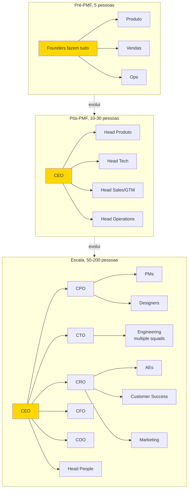

> [!warning] Transições não são suaves
> Cada salto (cinco para dez, dez para trinta, trinta para cem) exige mudança estrutural do fundador. Deixar de executar, depois liderar, depois liderar líderes. A maioria das crises organizacionais acontece nos saltos, não nos plateaus.

> [!note] Entregáveis e gates da subfase Time e Liderança
> Plano de Time de dezoito meses + Carta de Valores e Cultura + Processo de Contratação documentado. Comece com PMF confirmado (Sean Ellis ≥40%, retenção estável, crescimento orgânico). Termine quando as 5-7 contratações críticas dos próximos 12 meses estão definidas, cultura documentada, processos de hiring em operação. Revisite a cada 6 meses e a cada mudança significativa de estágio (10→30, 30→60, 60→100+ pessoas). Executor: CEO + COO se houver. Decisor: CEO, com responsabilidade compartilhada em C-level.

### Desenhando o Accountability Chart (Traction), contratando líderes melhores que você e instalando rituais de gestão

Sete passos.

#### Passo 1, faça o diagnóstico de "onde o fundador virou gargalo"

Nos doze primeiros meses pós-PMF, quase todo fundador é gargalo em pelo menos três áreas. Identifique as suas por escrito, respondendo cinco perguntas. Em quais decisões a empresa trava esperando a minha aprovação? Em quais áreas sou competente, mas outra pessoa faria melhor? Em quais áreas sou incompetente, mas continuo fazendo? Quais reuniões eu poderia sair sem prejuízo, e saio mesmo assim? Que tipo de trabalho consome mais de trinta por cento do meu tempo, mas poderia ser delegado?

As respostas revelam as primeiras contratações críticas.

> [!warning] Sinal-alerta de gargalo
> Se você se sente indispensável em tudo, você é o maior risco estrutural da empresa.

#### Passo 2, mapeie as contratações críticas dos próximos 12 meses

Use o framework dos "três pilares" (mesmo da [[IGNICAO-Vol-1-Ideacao#FASE 0 — PREPARAÇÃO DO EMPREENDEDOR|Fase 0 (Vol. 1)]], agora em escala). Pilar Técnico: head de engenharia, VP de engenharia, ou CTO (se ainda não existe). Pilar Comercial: head of sales, head of marketing, e head of customer success. Pilar Operacional: head of finance (ou CFO), head of people, e head of operations.

A ordem típica de contratação C-level para startups SaaS B2B pós-PMF:

| Estágio | Receita aproximada | Contratações-chave |
|---|---|---|
| Pós-PMF inicial (10-20 pessoas) | R$ 1-5M ARR | Primeiros sêniores em engenharia, primeiro vendedor não-fundador, controller financeiro |
| Crescimento inicial (20-50 pessoas) | R$ 5-15M ARR | VP de Engenharia, Head of Sales, Head of Customer Success |
| Scale-up (50-100 pessoas) | R$ 15-50M ARR | CFO, Head of People, VP Marketing |
| Pré-Série B+ (100-200 pessoas) | R$ 50M+ ARR | COO, CRO (Chief Revenue Officer), General Counsel |

> [!important] Regra operacional sobre C-level
> Contrate cada C-level só quando *existir função clara e métrica associada*. Contratar um CTO sem time técnico para liderar é pagar cargo pelo ego. Contratar CFO antes de haver complexidade financeira real é peso morto no payroll.

#### Passo 3, defina critérios de contratação de C-level (diferentes dos de IC)

> [!tip] Capítulo 9 — Executive Hiring
> Processo completo de busca, avaliação e onboarding de executivos C-level e VPs: scorecard, entrevistas estruturadas, reference check profundo e os primeiros noventa dias.

> [!tip] Capítulo 3 (Vol. 7) — Recrutamento Técnico
> Contratação de engenheiros seniores, tech leads e CTOs: avaliação de competência técnica, desafios de coding, e como calibrar senioridade em startups sem bancada de engenharia prévia.

Contratar um primeiro vendedor é diferente de contratar um Head of Sales. Os erros mais comuns:

Contratar pela empresa anterior prestigiosa. "Veio da Google" é diferente de "vai performar aqui". Pergunte o que a pessoa fez concretamente, em que estágio e com que recursos.

Contratar só por fit cultural. É necessário, mas não suficiente. Resultado passado em contexto similar é o melhor preditor.

Manter sócio-fundador no papel apenas porque "ele é o sócio", quando ele já não é a pessoa ideal para o estágio. É uma conversa difícil, mas necessária.

Contratar rápido demais. Nunca. Senioridade exige três a oito entrevistas, pelo menos um teste prático ou case e três ou mais referências reais.

O processo padrão de contratação sênior leva quatro a seis semanas. Nove etapas. JD escrita com outcomes em três, seis, e doze meses (não só atividades). Triagem por recrutador, ou por você direto. Entrevista cultural com CEO (trinta a quarenta e cinco minutos). Entrevista técnica com profissional sênior da área, ou advisor. Case ou teste prático (quatro a oito horas de trabalho remunerado é razoável). Bar-raiser (um avaliador externo à área que tem poder de veto — garante que o padrão de contratação não caia com o tempo). Reference check rigoroso. Mínimo de três referências, idealmente cinco. Pergunte "em uma escala de um a dez, quão forte foi o desempenho dessa pessoa?". Qualquer coisa abaixo de nove merece investigação. Oferta, e negociação. Onboarding estruturado de noventa dias, com marcos claros.

#### Passo 4, evolua o papel do fundador (anti-gargalo)

Tipicamente, o CEO-fundador passa por três transições de papel.

De "faz tudo" para "faz algumas coisas bem" (em torno de vinte a cinquenta pessoas). Você delega sales ops, marketing operacional, e engenharia do dia a dia. Mantém visão, decisões estratégicas, contratações C-level, captação, e relacionamento com top 10 clientes.

De "gerencia diretos" para "gerencia gerentes" (em torno de cinquenta a cento e cinquenta pessoas). Você passa a ter seis a dez reportes diretos, que são VPs. O seu impacto é em cascata. Skip-level meetings (reuniões do gestor com o subordinado do subordinado) viram ritual.

De "operador" para "institucionalizador" (mais de cento e cinquenta pessoas). A sua função primária é construir a organização que construirá o produto. Decisões de design organizacional, sucessão, e cultura em escala.

> [!warning] Sinais de que você virou gargalo
> Decisões esperam você por mais de quarenta e oito horas. Reuniões sem você travam. Pessoas perguntam "o que o fundador quer?" em vez de decidir. Você tem mais de doze reportes diretos. Você aprovou mais de trinta decisões na última semana, que poderiam ter sido decididas sem você.

Quando três ou mais desses sinais aparecerem, pare e desenhe intervenção. A transição mais frequente é contratar um COO, ou segundo CEO operacional. Revisite mensalmente.

> [!tip] Capítulo 8 — Gestão de Tempo do Fundador
> Como o CEO aloca tempo por função (estratégia, contratação, cliente, produto) em cada estágio, técnicas de time-blocking, e como auditar o próprio calendário para identificar onde o tempo está sendo mal gasto.

#### Passo 5, documente valores e cultura antes dos primeiros 15 contratados

> [!tip] Capítulo 13 — Cultura Organizacional
> Como documentar, reforçar e medir cultura em empresas de dez a quinhentas pessoas: rituais, artefatos, processo de contratação cultural e diagnóstico quando a cultura começa a derivar.

Valores escritos depois que a empresa passou de quinze pessoas já estão tarde. A cultura de fato está formada. Os "valores" viram poster de parede. Antes disso, a cultura ainda é plástica. E o documento molda comportamento real.

Valores efetivos têm três características. São específicos o suficiente para gerar disputa. "Respeitamos as pessoas" é inútil — todo mundo concorda. "Priorizamos clareza sobre cordialidade em feedbacks" é acionável. Pode haver discordância legítima. E isso orienta escolha. Têm uma versão negativa explícita. "Valorizamos X, *mesmo quando* isso significa não fazer Y". Sem trade-off, é apenas aspiração. São enforçáveis. Você está disposto a demitir alguém de alta performance por violá-los. Se não está, não é valor. É preferência.

Exemplos de valores com trade-offs explícitos. "High agency. Esperamos que você tome decisões sem pedir permissão, *mesmo que isso signifique errar mais vezes*." "Radical candor. Damos feedback duro rapidamente, *mesmo quando é desconfortável*." "Customer obsession. Escutamos cliente antes de escutar intuição interna, *mesmo quando o cliente pede o que a gente sabe que é errado*. Porque o 'errado' revela a necessidade real."

Rituais que reforçam valores na prática. All-hands semanais ou quinzenais, com CEO falando. Reconhecimento público de comportamentos exemplares (weekly shoutouts). Post-mortems sem culpa (blameless), depois de incidentes grandes. Revisões 360º anuais com feedback cruzado.

> [!tip] Capítulo 10 — Performance Reviews
> Estrutura de ciclos de avaliação (360º, calibração, PIP), como separar conversa de desenvolvimento da conversa de compensação, e cadência recomendada por tamanho de time.

#### Passo 6, construa o processo de onboarding de novos contratados

A regra. Cada pessoa que entra deve atingir "produtividade mínima" em trinta dias, e "produtividade plena" em noventa dias. Sem processo, isso leva seis a nove meses — e vira fonte de churn voluntário (saídas espontâneas).

Playbook (manual de operação padronizado) de onboarding de noventa dias. Semana 1: imersão em produto, cultura, e valores. Reuniões com lideranças de cada área. Leitura obrigatória (valores, top dez estudos de caso de clientes, e histórico de pivôs). Semanas 2-4: projeto inicial pequeno e bem definido, para gerar primeira "vitória". Mês 2: projeto médio com mais autonomia. Mês 3: check-in formal. Performing, needs support, ou mismatch. Decisão explícita.

#### Passo 7, instrumente eNPS e pesquisa de clima mensal

Cultura degrada sem medição. eNPS (Employee Net Promoter Score — índice de satisfação e recomendação dos funcionários) trimestral é o mínimo. A pergunta: "Em escala de zero a dez, quão provável é você recomendar trabalhar aqui para um amigo?".

Acompanhe também três coisas. Taxa de retenção de doze meses. Tempo médio de permanência por nível de seniority. E razão de saídas (categorize, e aprenda).

### Cada função vital com um único dono claro, rituais semanais rodando no relógio e alta densidade de talentos (A-Players)

A [[#FASE 16 — TIME, LIDERANÇA EXECUTIVA E CULTURA EM ESCALA|Fase 16]] (Time e Liderança) está concluída quando os sete itens abaixo estão cumpridos.

1. Diagnóstico de gargalo do fundador está escrito, e ações de delegação definidas. Decisões por semana que só você pode tomar abaixo de 5 (até 50 pessoas) ou 3 (acima de 100), com trajetória trimestral decrescente.
2. Plano de contratação de doze meses documentado, priorizado, e em execução. Tempo médio para preencher vaga crítica ≤60 dias para especialistas, ≤90 dias para C-level. Taxa de aceitação de oferta ≥70%.
3. Processo de contratação sênior está formalizado. Da JD às entrevistas, ao case, ao reference, à offer.
4. Valores e cultura estão escritos, com trade-offs explícitos. Aprovados pelo time fundador.
5. Playbook de onboarding de noventa dias está em uso. Tempo até produtividade plena ≤90 dias.
6. eNPS está sendo medido trimestralmente (≥30 saudável, ≥50 excelente, <10 preocupante).
7. Você tem menos de dez reportes diretos. Retenção em 12 meses pós-contratação ≥85% para sêniores, ≥75% para todos.

**Critérios observáveis.**

1. Organograma (org chart) documentado, com reportes claros.
2. Pelo menos uma contratação sênior realizada nos últimos noventa dias.
3. Rituais básicos (all-hands, 1:1, skip) acontecendo consistentemente por dois ou mais meses.
4. Valores escritos em uma página, e compartilhados no onboarding de novos.
5. Pipeline de contratação mapeado para os próximos seis meses.
6. Retenção voluntária de key-people nos últimos doze meses, noventa por cento ou mais.

**Checklist de avanço.**

- [ ] Mapeei as posições críticas para os próximos doze meses (aquelas cuja ausência cria gargalo)?
- [ ] Tenho plano de contratação com perfis definidos, não só cargos?
- [ ] Defini estrutura organizacional provisória (quem se reporta a quem)?
- [ ] Contratei pelo menos uma pessoa sênior em área-chave (engenharia lead, ou head de vendas)?
- [ ] Implementei rituais básicos (weekly all-hands, 1:1s, skip-level mensal)?
- [ ] Documentei cultura inicial (valores, comportamentos, e o que NÃO toleramos)?
- [ ] Defini framework de feedback (estrutura, frequência, formato)?
- [ ] Tenho retenção esperada mapeada (quem seria perda crítica, plano de risco)?

**Próximos passos.**

1. Listar as três próximas contratações em ordem de prioridade. Perfil, não só cargo.
2. Escrever "valores iniciais" em uma página. O que faz a sua empresa única? O que não aceitamos?
3. Definir cadência de rituais. Weekly all-hands de trinta minutos. 1:1s semanais com liderança. Skip-level mensal.
4. Identificar uma contratação-âncora nos próximos sessenta dias. Pessoa sênior, que eleva o padrão.

### EXEMPLO PRÁTICO (Time e Liderança)

**Plano de Time, PadariaPro pós-PMF, crescendo para 15 pessoas.**

O time atual: cinco pessoas (dois founders mais três contratados).

**Próximas três contratações prioritárias.**

| # | Papel | Perfil | Justificativa |
|---|---|---|---|
| 1 | Head of Sales (sênior, 8-12 anos) | B2B SaaS, vendeu ticket R$ 5-20k, preferência experiência em food/retail | Founder está em 80% do tempo em vendas, gargalo claro |
| 2 | Staff Engineer | 8+ anos, tem conhecimento de integrações e sistemas distribuídos | Integrações com fornecedores são moat, precisamos de dono técnico |
| 3 | Customer Success Lead | 4+ anos em SaaS, empatia alta, bom em processo | Churn (cancelamento) vai subir se NÃO tivermos CS dedicado |

**Valores iniciais (uma página).**

Obsessão pelo dono-operador. As decisões se justificam pela pergunta: "isso devolve tempo, ou reduz estresse do dono?". Se a resposta é vaga, revisitar.

Simplicidade é virtude. O nosso diferencial é resolver problema complexo com experiência simples. Engenheiro, ou designer, que justifica complexidade por "completude" está desalinhado.

Honestidade radical. Falamos o que pensamos nos rituais apropriados. Não aceitamos política de corredor. Problema na reunião, ou em 1:1. Não em conversas privadas.

Urgência com qualidade. Velocidade sem qualidade vira churn. Qualidade sem velocidade vira irrelevância. A tensão é abraçada, não resolvida.

Dono do resultado, não da tarefa. Cada área tem resultado claro. Se para entregar resultado você precisa atravessar áreas, atravessa. Se culpa outra área, errado, resolve.

**Rituais.** Weekly all-hands: trinta minutos, segundas, 9h. Agenda fixa: métricas-chave, cliente da semana, aprendizado da semana. 1:1s liderança-time: trinta minutos, semanal, cada colaborador. Skip-level CEO com cada pessoa: uma hora, mensal (ou bimestral depois de vinte e cinco pessoas). Retrospectiva quinzenal de cada time (produto, engenharia, vendas).

**Framework de feedback.** SBI (Situação-Comportamento-Impacto) como padrão. Feedback semanal em 1:1. Obrigatório pelo menos um item construtivo. Performance review formal a cada seis meses, com calibração cruzada.

> [!note]
> Fundadores com perfil técnico que estão transitando para gestão encontram no [[IGNICAO-Vol-7-Produto-Engenharia-e-Operacoes#CAPÍTULO 2 — MANAGEMENT PARA O FUNDADOR TÉCNICO|Capítulo 2 — Management para o Fundador Técnico (Vol. 7)]] o detalhamento de 1:1 eficaz, feedback SBI, delegação e career ladder.

**Risco de perda.** Bruno (CTO), crítico para arquitetura e moat. Mitigação: documentação técnica viva, mais Staff Engineer como back-up. Pedro (primeiro customer success contratado), tem relações profundas com quarenta por cento da base. Mitigação: handoff formal em contas-chave para mais pessoas.

### Promover o melhor técnico a gestor sem preparo, criar cargos por amizade com antigos funcionários e abdicar em vez de delegar

Delegar antes de documentar. Passar responsabilidade sem processo definido gera confusão e frustração.

Contratar C-level sem operação que justifique. Cargo inflado custa caro, e atrapalha.

"Já tive cultura antes". É necessário re-formalizar a cada fase de crescimento. A cultura de dez pessoas não é a cultura de cinquenta.

Over-hiring em rodadas (contratar em massa logo após captar). Contratar antes de ter estrutura para integrar destrói cultura e queima caixa.

Tolerar C-level ruim por amizade, ou acordo antigo. O custo acumulado é altíssimo. Demita cedo, com generosidade.

Valores "motherhood and apple pie". Valores genéricos, que todo mundo aceita, são decorativos. Valores que geram discordância legítima em contratação são úteis.

---

### CASO BRASILEIRO, Hotmart, cultura organizacional intencional

A Hotmart foi fundada em 2011 em Belo Horizonte, por João Pedro Resende e Mateus Bicalho, como plataforma de venda de infoprodutos (cursos online, ebooks, e conteúdos digitais). Foco em creators individuais, e pequenos. A empresa fez bootstrap nos primeiros anos. Sem capital de risco. O crescimento veio pela viabilidade do modelo de comissão sobre vendas dos creators usando a plataforma.

Entre 2014 e 2020, a empresa cresceu de dezenas para mais de mil funcionários. E de operação nacional para presença em múltiplos países. Com sedes em Amsterdam, além de Belo Horizonte. A pressão sobre cultura, que até então era informal — "clube de amigos" — tornou-se problema crítico.

A decisão de documentar e ritualizar cultura. Os fundadores identificaram que cultura não se mantém sozinha em empresa crescendo rapidamente, com contratações mensais. Documentaram valores explícitos. "Obsessão por creator". Comunicação direta. Autonomia com responsabilidade. Entre outros. O processo de onboarding passou a incluir imersão formal nesses valores. As contratações incorporaram avaliação cultural, além de skill técnico. A comunicação interna estruturou-se em reuniões gerais periódicas, e cartas regulares dos fundadores ao time.

O que funcionou. A cultura documentada não substituiu a cultura vivida. Mas serviu como referência durante o crescimento acelerado. Os novos contratados chegavam sabendo o que esperar. As decisões de promoção e desligamento podiam referenciar valores concretos. A narrativa de empresa tinha consistência em canais externos (recrutamento, PR, marketing).

O que exigiu ajuste. Nem toda versão inicial dos valores sobreviveu ao escalar. Alguns valores originais mostraram-se abstratos demais em escala. Outros precisaram ser reescritos para clareza de aplicação. A cultura documentada foi revisitada e ajustada ao longo dos anos. Não foi escrita uma vez, e arquivada.

A comunicação externa da cultura. Os fundadores optaram por comunicar a construção cultural publicamente. Entrevistas em podcasts. Postagens em LinkedIn. Eventos do ecossistema. Isso gerou tanto benefícios (atração de talento, marca empregadora), quanto riscos (escrutínio público quando a cultura é testada por incidentes).

**Cinco lições transferíveis.**

Cultura informal não escala. Entre trinta e cem pessoas, cultura "sabida mas não dita" começa a derivar. Documentar e ritualizar não é burocracia. É infraestrutura para preservar o que funcionou.

Valores sem aplicação concreta são decorativos. Cada valor precisa ter comportamento observável associado. "Obsessão por creator" sem critério de quando uma decisão é, ou não, obsessiva é slogan.

Cultura é processo de contratação. É mais fácil contratar pessoas que ressoam com a cultura, do que tentar converter. Entrevistas culturais formais (não só "chemistry check") fazem diferença em dezoito meses.

Cultura evolui ou estagna. Empresa em crescimento precisa revisitar valores a cada dois a três anos, para garantir que ainda servem. Valores fossilizados viram folclore.

A comunicação externa da cultura é arma de dois gumes. Atrai talento alinhado, mas expõe a empresa quando incidentes testam os valores declarados. Valores declarados precisam resistir a testes reais.


---

### O Espelho da Fase 16: Você É o Arquiteto do Sistema ou o Gargalo de Todas as Decisões?

> [!tip] O Espelho do Gestor (Autodiagnóstico Rápido)
> 1. **O Teste do Organograma Funcional (*Accountability Chart*):** Se você desenhar hoje as 5 a 7 grandes caixas da sua empresa (Vendas, Marketing, Produto/Operações, Sucesso do Cliente, Finanças/Pessoas), existe **um único nome próprio** responsável pelos números de cada caixa, ou o seu nome ainda está escrito dentro de quatro delas?
> 2. **O Teste do Re-Contratação (*Keeper Test*):** Olhando para as pessoas que reportam diretamente a você hoje, se alguma delas pedisse demissão às 10h da manhã, por quais você lutaria ferozmente para manter e para quais você sentiria um alívio secreto?
> 3. **Delegação vs. Microgestão:** Quantas decisões operacionais abaixo de R$ 2.000 ainda precisam do seu "de acordo" no WhatsApp porque você nunca escreveu uma regra clara de alçada?
>
> **Regra de Bolso (*estilo Andy Grove*):** O resultado de um gestor não é o que ele produz com as próprias mãos; é **a soma do resultado produzido pelo seu time mais o resultado das áreas vizinhas que ele influencia**.
>
> **O Ritual de Segunda-Feira às 9h:** Desenhe na folha em branco o **Mapa de Responsabilidades (*Accountability Chart*)** pensando primeiro nas funções que a empresa precisa para os próximos 12 meses (sem colocar nomes), e só depois preencha os nomes e identifique as cadeiras onde você ainda é o gargalo.

---

### MÉTRICAS E BENCHMARKS DESTA FASE (FASE 16)

| Métrica | O que medir | Referência saudável |
|---|---|---|
| ARR | Receita anual recorrente | Crescendo ≥ 3x ano a ano |
| NRR | Net Revenue Retention | ≥ 110% (expansão supera churn) |
| CAC Payback | Meses para recuperar aquisição | ≤ 18 meses |
| Magic Number | Net new ARR / S&M spend | ≥ 0.75 |
| Rule of 40 | Crescimento % + Margem EBITDA % | ≥ 40 |
| Headcount growth | Pessoas contratadas / quarter | Proporcional à receita |
| eNPS | Employee NPS | ≥ 30 |
| Attrition voluntária | % de saídas voluntárias / ano | ≤ 15% |
| Burn Multiple | Net burn / Net new ARR | ≤ 1.5x (eficiente), ≤ 2.5x (aceitável) |

> [!warning] Sinal de alerta
> Rule of 40 abaixo de 20 combinado com NRR abaixo de 100% indica empresa em deterioração. CAC Payback acima de 24 meses sem melhora trimestral indica modelo não escalável no ritmo atual.

---

### MANUAL PASSO A PASSO DOS FRAMEWORKS DESTA FASE

> [!tip] Uso autocontido neste volume
> Todos os frameworks abaixo estão detalhados integralmente com origem, estrutura, passo a passo de aplicação, exemplo brasileiro e armadilhas para execução imediata nesta **Fase 16**.

#### Framework: DACI / RACI / RAPID (RAPID é da Bain; demais têm origens distintas)

##### De onde vem a ferramenta (e por que sobreviveu ao filtro do tempo)

- RACI: origem anos 1950s em consultoria de gestão genérica (também chamado "Decision Rights Matrix" ou "Responsibility Charting"); uso massivo em gestão de projetos a partir dos anos 1970-80.
- DACI: popularizado por Atlassian a partir dos anos 2000s, usado em tech companies.
- RAPID: framework proprietário (marca registrada) da Bain & Company desde os anos 2000s para decisões executivas complexas.

Todos são variações do mesmo problema: **quem é responsável por o quê em uma decisão ou projeto?**

##### O que é — Comparação

RACI (melhor para execução de tarefas):

- Responsible: quem faz o trabalho.
- Accountable: quem é dono final (uma pessoa só).
- Consulted: quem dá input antes da decisão.
- Informed: quem é notificado após.

DACI (melhor para decisões de projeto):

- Driver: quem conduz o processo decisório.
- Approver: quem aprova decisão final (uma pessoa).
- Contributors: quem traz expertise.
- Informed: quem é notificado.

RAPID (melhor para decisões complexas, especialmente estratégicas/corporativas):

- Recommend: quem desenvolve proposta.
- Agree: quem precisa concordar (pode vetar).
- Perform: quem executa.
- Input: quem é consultado.
- Decide: quem decide final (uma pessoa).

##### As regras do jogo

Todos compartilham: clareza sobre uma pessoa com autoridade final + papéis de suporte não confundidos.

Diferenças:

- RACI: tarefas operacionais, simples.
- DACI: projetos/decisões de médio porte, comum em tech.
- RAPID: decisões grandes/estratégicas, rigor adicional de "Agree" (permite veto, não só input).

##### Como rodar na segunda-feira às 9h com seu time

Passo 1, Identificar a decisão/projeto específico.

Passo 2, Listar stakeholders.

Passo 3, Atribuir papel a cada. Regra: uma pessoa no Decide/Approver/Accountable. Decisão com "2 aprovadores" = sem aprovador.

Passo 4, Validar com envolvidos. Surpreendentemente comum: atribuir papel sem confirmar que pessoa aceita.

Passo 5, Documentar em 1 página.

Passo 6, Aplicar. Se decisão fica travada, voltar: papel claro? Conflito entre papéis?

##### Exemplo aplicado — RAPID para decisão de rebranding

- R (Recommend): CMO + agência contratada. Desenvolvem proposta.
- A (Agree): CEO, CPO, Head of Sales. Qualquer um pode vetar, força alinhamento.
- P (Perform): time de marketing + agência. Executam após decisão.
- I (Input): Board members, alguns advisors, funcionários-chave. Consulta sem poder de veto.
- D (Decide): CEO. Decisão final.

##### Onde o papel aceita tudo (armadilhas de execução)

Múltiplos accountable/decide: "decisão conjunta" = sem decisão, Confundir consulted com approver: "consultamos você" ≠ "precisamos de seu sim", RACI para decisões. DACI para tarefas operacionais: usar framework errado para contexto, Não comunicar papéis: atribuição em documento, mas pessoas não sabem seu papel, Esquecer de revisar com crescimento: papéis mudam com escala.

---

#### Framework: Radical Candor (Kim Scott, 2017)

##### De onde vem a ferramenta (e por que sobreviveu ao filtro do tempo)

**Kim Scott**, ex-executiva da Google, Apple, Twitter e YouTube (como coach de CEO), publicou *Radical Candor* em 2017 baseado em coaching de centenas de executivos. O livro é resposta à falsa dicotomia entre "ser legal" e "ser direto", Scott argumenta que o melhor feedback é **diretamente honesto e profundamente afetuoso ao mesmo tempo**.

##### A mecânica central (sem jargão)

Framework de feedback em 2 eixos:

- Care Personally (importar-se genuinamente com a pessoa).
- Challenge Directly (desafiar diretamente o trabalho).

4 quadrantes:

- Radical Candor (alto em ambos): desejado.
- Ruinous Empathy (care alto, challenge baixo): "nice" mas sem feedback útil. **Mais comum**.
- Obnoxious Aggression (care baixo, challenge alto): "brutally honest" sem empatia.
- Manipulative Insincerity (ambos baixos): politicking, fofocas.

##### As regras do jogo

Princípios-chave:

- Feedback deve ser **específico** e **imediato** (não acumulado para review anual).
- Solicitar feedback antes de dar, reduz defensividade.
- Public praise, private criticism.
- Ruinous Empathy é o inimigo principal: bem-intencionado, mas trunca crescimento.

##### Como rodar na segunda-feira às 9h com seu time

Passo 1, Construa confiança primeiro. Care Personally não é ato, é relacionamento.

Passo 2, Dê feedback imediato, específico, em privado** (crítica) ou público (elogio).

Passo 3, Peça feedback primeiro: "tem algo que eu poderia fazer melhor?" Abre ciclo.

Passo 4, Evite ruinous empathy: não amenize feedback genuíno para "proteger sentimentos". A longo prazo, é mais cruel.

Passo 5, Desafie respeitosamente, não humilhe.

##### Na trincheira real: como isso funciona na prática

Funcionário com código de má qualidade:

Ruinous Empathy (erro comum): "É... tá bom, talvez a gente possa ajustar pequenos detalhes..."
Resultado: pessoa não melhora, tempo/time desperdiçado, eventualmente demissão surpresa.

Radical Candor: "Maria, esse PR tem 3 problemas significativos: [X, Y, Z]. Preciso que você reescreva. Estou te falando isso porque te vejo com potencial de senior engineer em 12-18 meses, e essa qualidade precisa subir pra chegar lá. Como posso ajudar?"

Resultado: Maria sabe exatamente o que melhorar, sabe que CEO se importa, tem caminho claro.

##### Onde o papel aceita tudo (armadilhas de execução)

Radical Candor sem care genuíno: vira obnoxious aggression, Feedback acumulado para 1:1 mensal: urgência perdida, Criticar publicamente: mesmo bem-intencionado, humilha, Não pedir feedback próprio: cultura só flui de cima para baixo.

---

#### Framework: Situational Leadership (Paul Hersey & Ken Blanchard, 1969)

##### De onde vem a ferramenta (e por que sobreviveu ao filtro do tempo)

Paul Hersey (Ohio University) e **Ken Blanchard** (University of Massachusetts) desenvolveram Situational Leadership em 1969, publicado em *Management of Organizational Behavior* (1972). Blanchard evoluiu em *Leadership and the One Minute Manager* (1985). Tese: não existe "melhor estilo de liderança", estilo deve variar com a **maturidade do liderado na tarefa**.

##### A mecânica central (sem jargão)

Framework que classifica liderados em **4 níveis de desenvolvimento** (combinação de competência + comprometimento) e propõe **4 estilos de liderança** correspondentes.

##### As regras do jogo

4 níveis de desenvolvimento do liderado:

- D1: baixa competência + alto comprometimento (entusiasta iniciante).
- D2: alguma competência + baixo comprometimento (desiludido aprendiz).
- D3: alta competência + comprometimento variável (cauteloso performer).
- D4: alta competência + alto comprometimento (alto performer autodirigido).

4 estilos de liderança:

- S1, Directing (alta direção, baixo apoio): aplica a D1.
- S2, Coaching (alta direção, alto apoio): aplica a D2.
- S3, Supporting (baixa direção, alto apoio): aplica a D3.
- S4, Delegating (baixa direção, baixo apoio): aplica a D4.

##### Como rodar na segunda-feira às 9h com seu time

Passo 1, Avalie cada subordinado em cada tarefa (mesma pessoa é D4 numa tarefa e D1 em outra).

Passo 2, Adapte estilo: novo em task = directing, confortável = delegating.

Passo 3, Mova pessoa pelos estágios: novo funcionário em D1 pode evoluir a D4 em meses.

Passo 4, Evite estilo fixo: "sempre delego" falha com D1, "sempre dirijo" sufoca D4.

##### Na trincheira real: como isso funciona na prática

Líder com 3 subordinados na mesma tarefa "criar feature X":

- Ana (junior, primeira feature): D1. Estilo: Directing, instruções específicas, checkins diários.
- Bruno (mid-level, já fez 3 features mas essa é diferente): D2. Estilo: Coaching, explicar o "porquê", 1:1s frequentes.
- Carlos (senior, já fez 30 features): D4. Estilo: Delegating, "vai fazer, me avisa se precisar".

Mesmo líder, estilos diferentes, respeita onde cada um está.

##### Onde o papel aceita tudo (armadilhas de execução)

Estilo uniforme: "eu delego para todos", D1 e D2 quebram, Micromanage D4: top performer deixa em meses, Não reavaliar: pessoa evolui, tratamento não acompanha.

---

#### Framework: 5 Dysfunctions of a Team (Patrick Lencioni, 2002)

##### De onde vem a ferramenta (e por que sobreviveu ao filtro do tempo)

**Patrick Lencioni**, fundador do The Table Group, publicou *The Five Dysfunctions of a Team* em 2002 como fábula de negócios. Baseado em 15+ anos de consultoria executiva. Mais de 3M cópias vendidas. Framework padrão para diagnóstico de disfunção em leadership teams.

##### A mecânica central (sem jargão)

Pirâmide de 5 disfunções que emergem sequencialmente em times. Cada camada causa a seguinte. Resolver exige trabalhar de baixo pra cima.

##### Princípios / estrutura — A Pirâmide

De baixo para cima:

1. Absence of Trust: time não confia o suficiente para mostrar vulnerabilidades. Causa raiz.
2. Fear of Conflict: sem trust, evita conflito produtivo. "Harmonia artificial".
3. Lack of Commitment: sem debate, não há commitment real às decisões.
4. Avoidance of Accountability: sem commitment, ninguém cobra ninguém.
5. Inattention to Results: cada um cuida do seu, resultados coletivos ignorados.

##### Como rodar na segunda-feira às 9h com seu time

Passo 1, Diagnose: assessment de 38 perguntas (Lencioni disponibiliza).

Passo 2, Trust: construído por vulnerabilidade do líder primeiro. "História pessoal" exercise é comum.

Passo 3, Conflict: incentive debate construtivo. "Mining for conflict", líder provoca discordância.

Passo 4, Commitment: após debate, decisão clara. "Disagree and commit" (Bezos).

Passo 5, Accountability: peer accountability é superior a líder-accountability.

Passo 6, Results: team scoreboard visível, resultados coletivos acima de individuais.

##### Na trincheira real: como isso funciona na prática

Leadership team de startup de 40 pessoas, sinais de disfunção:

Sintomas observáveis:

- Reuniões sem debate (todos concordam).
- Decisões revisitadas mil vezes sem execução.
- Sócios se queixam entre si sobre outros (back-channel).
- Times isolados em silos.

Intervenção Lencioni:

- Offsite de 2 dias com facilitador externo.
- Exercício "personal histories" (sócios abrem vulnerabilidades).
- Debate estruturado sobre 3 decisões pendentes.
- "Team charter" com compromissos claros.

Após 6 meses: reuniões ganham energia, decisões mais rápidas, conflito produtivo aumentou, times mais alinhados.

##### Onde o papel aceita tudo (armadilhas de execução)

Pular trust-building: "vamos direto à estratégia". Sem trust, debate não acontece, Conflito pessoal confundido com conflito produtivo: pessoal ataca pessoa, produtivo ataca ideia, Accountability só de cima: peer-to-peer é o real game changer.

---

#### Framework: Topgrading (Brad Smart, 1999)

##### De onde vem a ferramenta (e por que sobreviveu ao filtro do tempo)

**Brad Smart**, psicólogo organizacional PhD, desenvolveu Topgrading ao longo de 40 anos de consultoria executiva. Publicou *Topgrading* em 1999 (3ª edição 2012). Pesquisa com 4000+ contratações executivas. Empresas adotantes incluem GE (era de Jack Welch), Honeywell, American Heart Association.

##### A mecânica central (sem jargão)

Metodologia rigorosa de contratação que busca encher empresa com "A-players" (top 10%). Diferenciador: **entrevista de Topgrading de 3-4 horas** que cobre toda carreira profissional do candidato cronologicamente.

##### As regras do jogo

Topgrading Interview:

- 3-4 horas (não 45 min).
- Cronológico: começa primeiro emprego, avança ano a ano.
- Cada emprego: metas, resultados, highlights, lowlights, avaliação do supervisor, razão para sair.
- Threat of Reference Check (TORC): "vou entrar em contato com todos seus ex-chefes", elimina mentiras sobre passado.

Pilares:

- Scorecard de role (antes de entrevistar): o que A-player faria?
- Interview sourcing de 10:1 (entrevistar 10 para contratar 1).
- Topgrading interview (rigoroso).
- Reference checks genuínos (falando com ex-chefes, não 2 referências pessoais).

##### Como rodar na segunda-feira às 9h com seu time

Passo 1, Scorecard: mission da role, 5-7 outcomes esperados, 8-10 competências.

Passo 2, Sourcing amplo: networking referrals, LinkedIn, headhunter.

Passo 3, Screen: 30 min para eliminar óbvios.

Passo 4, Topgrading interview de 3-4 horas com 2 entrevistadores.

Passo 5, Reference checks genuínos.

Passo 6, Decisão.

##### Na trincheira real: como isso funciona na prática

Contratação de VP de Engineering:

Scorecard:

- Mission: escalar engineering de 15 para 45 pessoas em 18 meses com delivery consistente.
- Outcomes: reduzir time-to-ship em 40%, contratar 30 engineers, implementar SRE.
- Competências: scaling experience, hiring, prior CTO/VP, SRE, hands-on capability.

Fontes: 120 candidatos identificados. Screen: 25 qualificados. Topgrading interviews: 8. Finalistas: 2. Escolhido: 1.

Taxa histórica de erro em hires: 25% (muitos don't fit). Com Topgrading: 7% em estudos de Smart.

##### Onde o papel aceita tudo (armadilhas de execução)

Entrevista superficial: 45 min não capta profundidade, Ignorar reference checks: "confio no que o candidato disse", Sem scorecard: entrevista sem clareza do que buscar, Contratar para "gaps": pessoa 80%, cultura de mediocridade instaurada.

---

#### Framework: Who / A Method for Hiring (Geoff Smart & Randy Street, 2008)

##### De onde vem a ferramenta (e por que sobreviveu ao filtro do tempo)

Geoff Smart (filho de Brad Smart) e **Randy Street**, ambos da ghSMART (consultoria CEO), publicaram *Who* em 2008. Simplificação operacional do Topgrading para empresas menores. Baseado em 1300+ horas de entrevistas com CEOs. Livro virou padrão em hiring de startups.

##### A mecânica central (sem jargão)

Metodologia de 4 passos, **Scorecard, Source, Select, Sell**: com ferramentas específicas para cada.

##### Princípios / estrutura — A-Method

Scorecard (antes de entrevistar):

- Mission da role.
- 5-8 outcomes mensuráveis.
- 8-12 competências.

Source (sourcing ativo):

- Peça 3 referências por rede.
- Construa pipeline contínuo (não só quando preciso).

Select (4 entrevistas sequenciais):

1. Screening interview (30 min): fit básico.
2. Topgrading interview (estilo Brad Smart).
3. Focused interview: deep-dive em competências-chave.
4. Reference interview: 5+ referências com perguntas estruturadas.

Sell (onboarding começa no offer):

- 5 Fs: fit, family, freedom, fortune, fun.
- Onboarding com clareza total.

##### Como rodar na segunda-feira às 9h com seu time

Operacionalização do Topgrading:

- Scorecard de 1 página por role.
- Processo de entrevista documentado (não improvisado).
- Reference checks reais com perguntas específicas.

##### Na trincheira real: como isso funciona na prática

Startup contrata Head of Sales:

Scorecard:

- Mission: construir motor de vendas que atinge $5M ARR em 12 meses.
- Outcomes: contratar 5 AEs. CAC < R$ 25k, conversion lead→close 18%.
- Competências: sales hiring, process building, enterprise SaaS sales experience, coaching.

Sourcing: rede + referrals + LinkedIn = 80 candidatos. Screening: 20. Topgrading + focused: 6. Reference checks: 3 finalistas. Sell: offer + 5 Fs.

##### Onde o papel aceita tudo (armadilhas de execução)

Scorecard genérica: "bom comunicador" em vez de outcome específico, Pular reference checks: 50% dos candidatos inflamam passado, Sell depois da decisão: ganha candidato ruim que sai em 6 meses.

---

#### Framework: Crucial Conversations (Patterson, Grenny, McMillan, Switzler, 2002)

##### De onde vem a ferramenta (e por que sobreviveu ao filtro do tempo)

**Kerry Patterson, Joseph Grenny, Ron McMillan, Al Switzler**, fundadores do VitalSmarts, publicaram *Crucial Conversations* em 2002 baseado em 20+ anos de pesquisa com milhares de "opinion leaders" em organizações. Livro vendeu 5M+ cópias. Foco: conversas onde stakes altos, opiniões divergentes, emoções fortes, situações onde maioria falha.

##### A mecânica central (sem jargão)

Framework para **conversar produtivamente em situações críticas**: feedback difícil, conflito, negociação sob pressão, conversas que podem quebrar relacionamentos.

##### As regras do jogo

7 princípios:

1. Start with heart: qual seu motivo real? "Quero que o outro melhore" vs. "quero ganhar discussão".

2. Learn to look: note quando conversa vira crucial (tom muda, emoções sobem, silêncios).

3. Make it safe: garantir que outro se sinta seguro para falar. Mutual purpose + mutual respect.

4. Master my stories: entre fato e emoção há "story" (narrativa que construímos). Desafie suas próprias stories.

5. STATE my path: Share facts, Tell story, Ask for others' paths, Talk tentatively, Encourage testing.

6. Explore others' paths: Ask, Mirror, Paraphrase, Prime, técnicas AMPP para extrair perspectiva do outro.

7. Move to action: decisão clara + owner + deadline + follow-up.

##### Como rodar na segunda-feira às 9h com seu time

Preparação:

- Clarify intention (start with heart).
- Gather facts (não story + emoção).

Durante:

- Watch for safety signals.
- Use STATE para falar sem blame.
- Use AMPP para ouvir.
- Fechar com ação.

##### Na trincheira real: como isso funciona na prática

Cofundador precisa dar feedback a outro sobre performance:

Sem Crucial Conversations:
"Você não tá entregando. Parece que você não tá commit com a empresa."
Outro reage defensivo, relacionamento quebra.

Com Crucial Conversations:

1. Heart: meu motivo é salvar empresa e relacionamento.
2. Safe: "preciso conversar sobre algo difícil. Quero que você saiba que nosso relacionamento importa muito pra mim."
3. STATE facts: "Nos últimos 60 dias, vi: milestones X e Y não atingidos, 3 oportunidades onde esperava ver você liderar que não aconteceram."
4. Story: "Minha story que construí é: você pode estar desengajado. Mas preciso checar, essa story pode estar errada."
5. Ask: "Como você vê isso?"
6. Explore: escuta de verdade, 30 min.
7. Move to action: decisão clara. Talvez ele precisava de X. Talvez não é fit.

Resultado: ou problema é endereçado produtivamente, ou separação respeitosa (não guerra).

##### Onde o papel aceita tudo (armadilhas de execução)

Pular safety: foca em conteúdo, outro fecha, Confundir story com fact: "você não liga" é story, fatos são comportamentos, Sem action concreta: conversa terapêutica, nada muda.

---

#### Framework: Extreme Ownership (Jocko Willink & Leif Babin, 2015)

##### De onde vem a ferramenta (e por que sobreviveu ao filtro do tempo)

**Jocko Willink** e **Leif Babin**, ex-Navy SEALs da Task Unit Bruiser (Battle of Ramadi, Iraq 2006), publicaram *Extreme Ownership* em 2015. Aplicam princípios de liderança de combate ao mundo corporativo. Willink tem podcast enorme e coaches executivos globalmente.

##### A mecânica central (sem jargão)

Filosofia de liderança em que **líder assume responsabilidade total** por tudo, incluindo falhas de subordinados, equipamento, circunstâncias. Sem exceções, sem desculpas.

##### As regras do jogo

Princípios centrais:

1. Extreme Ownership: líder é responsável por tudo. Se subordinado falha, líder falhou em ensinar/supervisionar.

2. No bad teams, only bad leaders: mude líder, time mesmo performa diferente.

3. Believe: líder deve genuinamente acreditar na missão, sem crença, time sente.

4. Check the ego: ego trava decisões boas. "Eu estava errado" é muscle para desenvolver.

5. Cover and move: times apoiam uns aos outros, não silos competitivos.

6. Simple: instruções complexas falham sob pressão.

7. Prioritize and execute: em caos, foque no item mais crítico primeiro.

8. Decentralized command: líder não gerencia tudo, empoderar subordinados a decidir.

9. Discipline equals freedom: disciplina em processos gera liberdade para criar.

##### Como rodar na segunda-feira às 9h com seu time

Passo 1, Auto-exame: quando algo falha, primeira pergunta é "o que eu poderia ter feito diferente?"

Passo 2, Comunicar missão clara com por quê.

Passo 3, Empoderar decisões: subordinados decidem no nível que conseguem.

Passo 4, Priorize e execute: em crise, um item de cada vez.

Passo 5, Ego check constante: não defenda posições só porque são suas.

##### Na trincheira real: como isso funciona na prática

Deploy quebra em produção no fim de semana:

Sem Extreme Ownership: "Foi o engineer júnior que pushou código ruim. Vou falar com o manager dele."

Com Extreme Ownership: "Eu sou o VP. Eu falhei em:

- Garantir que júnior tivesse buddy system para PR review.
- Implementar pipeline de testes que pegasse isso antes.
- Treinar time em incident response.
- Definir processo de deploy em horários críticos.
Eu preciso fix o sistema."

Sistema melhora permanentemente, júnior aprende em vez de ser queimado.

##### Onde o papel aceita tudo (armadilhas de execução)

"Extreme Ownership" como hyper-controle: ownership não significa fazer tudo, significa ser responsável. Culpa eterna: virar "eu sou culpado por tudo" paralisa. Ownership é sobre ação próxima, não sentimento. Aplicar só em crises: extreme ownership é mindset contínuo.

---

#### Framework: The Hard Things About Hard Things (Ben Horowitz, 2014)

##### De onde vem a ferramenta (e por que sobreviveu ao filtro do tempo)

**Ben Horowitz**, co-fundador da Andreessen Horowitz (a16z) e ex-CEO da Opsware (vendida por $1.6B para HP), publicou *The Hard Things About Hard Things* em 2014. Livro não é framework formal, é coletânea de aprendizados sobre **situações em que não há respostas bonitas**: demitir amigos, enfrentar crises existenciais, lidar com psicose do CEO.

##### A mecânica central (sem jargão)

Filosofia de liderança que enfrenta o **lado brutal** de construir empresas: decisões impossíveis, pressão psicológica extrema, conflitos sem solução limpa. Anti-framework em estilo, não promete método.

##### As regras do jogo

Temas recorrentes:

1. There are no silver bullets: maioria das situações difíceis não tem resposta clean.

2. The struggle: momentos em que CEO questiona tudo. Normalize.

3. Peacetime vs. wartime CEO: peacetime CEO cresce via otimização, wartime CEO sobrevive via decisões brutais. Diferentes skills.

4. Demitir bons amigos: quando role cresce além de capacidade.

5. Hiring executives: buscar "pico" em 1-2 capabilities, não "sem fraqueza".

6. Promotions: "Peter Principle" em startups, senior promovido para role que não pode.

7. Managing your mind: psicologia de CEO em crise.

##### Como rodar na segunda-feira às 9h com seu time

Mais como **filosofia** que aplicar:

- Normalize struggle.
- Enfrente decisões impossíveis sem procrastinar.
- Cuide da saúde mental.
- Seja honesto no diagnóstico, mesmo que doloroso.

##### Na trincheira real: como isso funciona na prática

Fundador tem de demitir cofundador que é amigo de infância:

Horowitz: amizade e empresa são coisas diferentes. Manter cofundador incompetente em role executivo prejudica empresa (e, eventualmente, amizade). Conversa honesta cedo é mais gentil que demora.

Estrutura: transição de role (para algo que serve competência), ou saída respeitosa com equity preservada, ou renegociação de papéis.

Não existe saída "limpa", só menos destrutivas.

##### Onde o papel aceita tudo (armadilhas de execução)

Procrastinar decisão difícil: espera melhorar, piora, Vestir peacetime quando é wartime (ou vice-versa): inadequado ao momento, Ignorar saúde mental: burn-out do CEO quebra empresa.

---

#### Framework: The Culture Code (Daniel Coyle, 2018)

##### De onde vem a ferramenta (e por que sobreviveu ao filtro do tempo)

**Daniel Coyle**, jornalista e autor (*The Talent Code*), publicou *The Culture Code* em 2018 após estudar 8 das culturas mais bem-sucedidas do mundo, Navy SEALs, Pixar, IDEO, San Antonio Spurs. Objetivo: destilar padrões comuns em "supercultures".

##### A mecânica central (sem jargão)

Análise dos mecanismos que constroem culturas de **alta performance + alta segurança psicológica**: combinação rara mas identificável em pesquisa.

##### Princípios / estrutura — 3 Skills

1. Build Safety (segurança psicológica como base):

- Sinais pequenos de "pertencimento" frequentes.
- Overcommunicate que todos pertencem.
- Tolerar falha produtiva.

1. Share Vulnerability:

- Líder mostra vulnerabilidade primeiro.
- "Não sei" é sinal de força, não fraqueza.
- Feedback mútuo constante.

1. Establish Purpose:

- Missão clara, repetida ao exausto.
- Rituais que lembram purpose.
- Histórias que reforçam cultura.

##### Como rodar na segunda-feira às 9h com seu time

Safety:

- Líder chega cedo, cumprimenta todos.
- "Thank you" específicos e genuínos.
- Safe para errar publicamente (pequenas coisas).

Vulnerability:

- Líder admite "não sei" em meetings.
- Pós-mortems honestos.
- Peer-to-peer feedback.

Purpose:

- Missão repetida semanalmente (não anualmente).
- Rituais de celebração de valores.
- Conectar trabalho diário a purpose maior.

##### Na trincheira real: como isso funciona na prática

Pixar (exemplo do livro):

- "Braintrust" reunião: 5-10 diretores dão feedback brutal sobre filme em progresso. Seguro porque é entre pares.
- "Post-mortem" de cada filme: inclusive dos sucessos.
- Missão clara: "contar grandes histórias".

##### Onde o papel aceita tudo (armadilhas de execução)

Cultura como poster na parede: valores escritos sem prática, Psychological safety sem high standards: vira complacência, Culture como HR issue: é responsabilidade do líder.

---

#### Framework: No Rules Rules / Freedom and Responsibility (Reed Hastings e Erin Meyer, 2020)

##### De onde vem a ferramenta (e por que sobreviveu ao filtro do tempo)

**Reed Hastings**, co-fundador da Netflix, publicou *No Rules Rules* em 2020 com **Erin Meyer** (INSEAD). Explica cultura Netflix, "freedom and responsibility", que se distingue radicalmente de cultura corporativa tradicional.

##### A mecânica central (sem jargão)

Filosofia em que empresa remove regras/processos **progressivamente** à medida que talent density (densidade de A-players) aumenta. Autonomia ampla para talento top, remoção de políticas que tratam todos como potenciais fraudadores.

##### As regras do jogo

Princípios centrais:

1. Talent density first: só funciona com A-players em massa.

2. Candor frequent: feedback direto e constante, "360 candor".

3. Remove controls:

- Sem política de férias (tire quando quiser).
- Sem aprovação de despesas (use bom julgamento).
- Sem sign-off para decisões.

1. Keeper test: "eu faria tudo para manter essa pessoa?" Se não, separação generosa.

2. Context, not control: líder dá contexto, não micromanage decisões.

3. Top of market pay: pagar melhor que mercado para atrair talento top.

##### Como rodar na segunda-feira às 9h com seu time

Não é para todo mundo. Requer:

- Capacidade de pagar acima do mercado.
- Tolerância a demissão por baixo fit.
- Maturidade organizacional.

Passo 1, Densidade de talento: elimine underperformers agressivamente.

Passo 2, Remova controls gradualmente: expense policy primeiro.

Passo 3, Candor estruturado: 360 reviews frequentes.

Passo 4, Context gerencial: documente "why" claramente.

##### Na trincheira real: como isso funciona na prática

Expense policy Netflix: "Act in Netflix's best interest."

Sem limites específicos, sem pré-aprovações. Funcionários gastam mais ou menos?

Netflix reporta: **menos**. Responsabilidade pessoal pesa mais que política. Além disso, elimina overhead de approval bureaucracy.

##### Onde o papel aceita tudo (armadilhas de execução)

Implementar cultura sem talent density: caos, underperformers abusam, Keeper test como eufemismo para "demitir qualquer um": baratel cultura, gera medo, Feedback sem candor real: vira feedback polido inútil.

---

#### Framework: Servant Leadership (Robert Greenleaf, 1970)

##### De onde vem a ferramenta (e por que sobreviveu ao filtro do tempo)

**Robert Greenleaf**, ex-executivo AT&T, publicou o ensaio *The Servant as Leader* em 1970. Fundou Greenleaf Center for Servant Leadership. Inspiração: passagem de *Viagem ao Oriente* de Hermann Hesse sobre servant Leo. Adotado por empresas como Starbucks (Howard Schultz), Southwest Airlines (Herb Kelleher), Marriott, Zappos.

##### A mecânica central (sem jargão)

Filosofia em que **líder serve liderados primeiro**: invertendo hierarquia tradicional. Sucesso do líder é medido por sucesso dos liderados.

##### As regras do jogo

10 características (compiladas por Larry Spears, ex-CEO do Greenleaf Center):

1. Listening.
2. Empathy.
3. Healing.
4. Awareness.
5. Persuasion (não coerção).
6. Conceptualization.
7. Foresight.
8. Stewardship.
9. Commitment to growth of people.
10. Building community.

##### Como rodar na segunda-feira às 9h com seu time

Passo 1, Mindset: "como ajudo meu time a ter sucesso?" antes de "como atinjo minhas metas?"

Passo 2, Decision-making: quando possível, envolva.

Passo 3, Remove obstáculos do caminho do time.

Passo 4, Invista no crescimento de subordinados: mesmo que saiam.

Passo 5, Humildade sobre autoridade formal.

##### Na trincheira real: como isso funciona na prática

Líder servant em momento de crise:

Em vez de dirigir "aqui está o plano", pergunta: "o que vocês precisam para navegar isso? Como posso ajudar?"

Time sente ownership, soluções vêm dos que estão mais perto do problema, buy-in automático.

##### Onde o papel aceita tudo (armadilhas de execução)

Servant leadership como fraqueza: servir ≠ não ter padrões. Pode demitir, pode pushar, Abdicar de decisões difíceis: servant líder ainda decide quando precisa.

---

#### Framework: Intent-Based Leadership / Turn the Ship Around (L. David Marquet, 2012)

##### De onde vem a ferramenta (e por que sobreviveu ao filtro do tempo)

**L. David Marquet**, capitão de submarino da US Navy no USS Santa Fe (submarino nuclear), publicou *Turn the Ship Around!* em 2012. Transformou submarino de "pior" para "melhor" da frota mudando do modelo "command-and-control" para "leader-leader". Framework aplicável a qualquer organização hierárquica.

##### A mecânica central (sem jargão)

Filosofia em que líder **não dá ordens**: subordinados **declaram intenções** ("intento X porque Y") e líder aprova/questiona.

##### As regras do jogo

Shift fundamental:

- Old: "Do X" (comando descendente).
- New: "I intend to do X because Y" (intenção ascendente).

Resultado:

- Subordinados pensam antes de agir (articulação de porquê).
- Líder é consultor, não dono de cada decisão.
- Empowerment sem caos (checagem de intenção).

Princípios complementares:

- Technical competence first: pessoas precisam saber o quê fazer antes de ter autoridade.
- Clarity sobre purpose: sem purpose claro, intent não tem critério.
- Think out loud: cultura de verbalizar raciocínio.

##### Como rodar na segunda-feira às 9h com seu time

Passo 1, Treine pessoas: competência técnica primeiro.

Passo 2, Clarity sobre purpose: missão e princípios explícitos.

Passo 3, Linguagem muda: "I intend to..." vira norma.

Passo 4, Líder questiona intent, não dá ordens.

Passo 5, Celebrar decisões boas do time sem precisar intervenção.

##### Na trincheira real: como isso funciona na prática

Startup de 50 pessoas adota intent-based:

Antes:

- Engineer: "Boss, what should I do about bug X?"
- CEO: "Do Y."

Depois:

- Engineer: "I intend to fix bug X by doing Y because that addresses root cause observed in logs."
- CEO: "Sounds good. Proceed."

Em meses: CEO recebe menos perguntas, times decidem mais rapidamente, quality das decisões sobe (porque há articulação de reasoning).

##### Onde o papel aceita tudo (armadilhas de execução)

Intent sem competência: time decide mal por falta de skill, resultado ruim, Intent como decoração: líder ainda veta tudo, intent não é real, Clareza de purpose ausente: intent sem critério vira aleatório.

---

#### Framework: SPADE Decision Framework (Gokul Rajaram, 2014)

##### De onde vem a ferramenta (e por que sobreviveu ao filtro do tempo)

Gokul Rajaram, então VP de produtos do Square, desenvolveu o SPADE em 2014 para resolver um problema recorrente em empresas de crescimento acelerado: decisões importantes tomadas em reuniões ad hoc, sem processo claro, resultando em falta de alinhamento, retrabalho e resentimento. O framework foi popularizado pelo próprio Rajaram em posts e palestras, adotado por DoorDash, Stripe, Pinterest e diversas scaleups que buscam estrutura para decisões de alta complexidade sem transformá-las em burocracia. É um dos poucos frameworks de tomada de decisão pensado especificamente para o ambiente de startup em escala.

##### A mecânica central (sem jargão)

Protocolo estruturado para decisões importantes e irreversíveis (ou de difícil reversão) que envolvem múltiplos stakeholders. A sigla: **S**etting (contexto e prazo), **P**eople (quem tem papel de qual tipo), **A**lternatives (opções reais, não strawman), **D**ecide (critérios e método de decisão), **E**xplain (comunicação do resultado e raciocínio).

##### As regras do jogo

O SPADE parte do princípio de que a maioria das decisões difíceis em organizações falha não por falta de inteligência dos decisores, mas por falta de processo: quem decide não estava claro, alternativas não foram geradas com cuidado, critérios não foram definidos antes de avaliar opções, e o raciocínio não foi comunicado. Cada etapa do SPADE corrige uma dessas falhas. A decisão é assíncrona por design — cada papel contribui no seu tempo, o que remove o viés de quem fala mais alto em sala.

##### Como rodar na segunda-feira às 9h com seu time

**Setting**: escrever em 1-3 frases o que está sendo decidido e por que importa agora, incluindo prazo final. Evitar enquadramento que já implica uma resposta. **People**: definir explicitamente quem é responsável pela decisão final (1 pessoa, nunca comitê), quem é aprovador (pode vetar — deve ser usado com parcimônia), quem são consultados (têm input mas não voto), quem é informado (recebe o resultado). **Alternatives**: gerar ao mínimo 3 alternativas reais e distintas. Inclui sempre a opção "não fazer nada" e a opção "fazer completamente diferente". Cada alternativa documentada com prós, contras e premissas. **Decide**: definir critérios de avaliação antes de pontuar alternativas. Pontuar alternativas por critério. O tomador de decisão decide com base nos critérios, não no consenso da sala. **Explain**: comunicar a decisão com o raciocínio completo, incluindo alternativas consideradas e rejeitadas e por quê. Isso constrói confiança e permite que futuros tomadores de decisão aprendam.

Exemplo aplicado, startup de fintech decidindo arquitetura de dados. Setting: "Decidir se construímos data warehouse próprio (Snowflake/BigQuery) ou usamos o banco operacional como fonte única de verdade para analytics. Deadline: antes do início do próximo trimestre, para informar roadmap de dados." People: CTO decide, CPO aprova, Head de Dados e Head de Eng consultados, board informado. Alternatives: (1) Snowflake com pipeline ETL, (2) BigQuery com Fivetran, (3) Manter Postgres + dbt sem warehouse separado. Decide: critérios — custo nos próximos 18 meses, tempo até produção, capacidade de contratação de engenheiros familiarizados. Explain: CTO documenta em Notion com pontuação por critério e justificativa da escolha, compartilha com todos os envolvidos, arquiva para referência futura.

##### Onde o papel aceita tudo (armadilhas de execução)

(1) Usar SPADE para decisões pequenas e reversíveis — overhead não compensa, use para decisões que custam > 1 mês de retrabalho se erradas. (2) Múltiplos decisores finais — comitê de decisão é teatro, define um. (3) Aprovador como veto frequente — aprovador deve ser reservado para questões de compliance ou risco reputacional real, uso frequente paralisa organização. (4) Alternativas fracas — colocar duas opções ruins ao lado da favorita não é processo, é confirmação de viés. (5) Explain sem raciocínio — "decidimos A" sem contexto das alternativas descartadas não constrói cultura de decisão.

---

#### Framework: 7S McKinsey (Peters, Waterman, Pascale e Athos, 1980)

##### De onde vem a ferramenta (e por que sobreviveu ao filtro do tempo)

Framework desenvolvido por Tom Peters e Robert Waterman na McKinsey & Company nos anos 1970, formalizado em *In Search of Excellence* (1982). Originalmente uma resposta a percepcao de que estrutura organizacional sozinha nao explicava performance. Inspirado em parte pelo trabalho de Richard Pascale e Anthony Athos em *The Art of Japanese Management* (1981).

##### A mecânica central (sem jargão)

Modelo de diagnostico organizacional que articula sete dimensoes interdependentes que precisam estar alinhadas para uma empresa funcionar bem. Tres "hard" elementos (Strategy, Structure, Systems) e quatro "soft" (Style, Staff, Skills, Shared Values). O insight central, mudancas em uma dimensao precisam ser refletidas nas outras seis, ou a transformacao falha.

##### As regras do jogo

As sete dimensoes (em ingles para preservar mnemonico),

1. **Strategy** (Estrategia), o plano para construir e sustentar vantagem competitiva.
2. **Structure** (Estrutura), como a organizacao e formalmente desenhada (hierarquia, divisoes, linhas de reporte).
3. **Systems** (Sistemas), processos formais e informais que governam o trabalho diario (decisao, informacao, recompensas).
4. **Style** (Estilo), padroes de comportamento da lideranca e cultura percebida.
5. **Staff** (Pessoas), quem esta na empresa, em quais papeis, com quais perfis.
6. **Skills** (Capacidades), competencias distintivas da organizacao como entidade.
7. **Shared Values** (Valores compartilhados), no centro do modelo, o que a empresa de fato valoriza, vs o que diz valorizar.

Os quatro soft (Style, Staff, Skills, Shared Values) sao tipicamente mais dificeis de mudar e mais determinantes de sucesso de transformacao do que os tres hard.

##### Como rodar na segunda-feira às 9h com seu time

Em momentos de transformacao significativa (M&A, mudanca de modelo de negocio, reestruturacao pos-PMF). Mapear cada uma das 7 dimensoes no estado atual e no estado desejado. Identificar dimensoes desalinhadas e priorizar intervencoes que mantenham coerencia entre todas. Nao tratar como checklist, tratar como sistema interconectado.

##### Onde o papel aceita tudo (armadilhas de execução)

Tratar como ferramenta de auditoria pontual e nao de design contínuo. Mexer apenas em hard sem reconhecer que soft determina execucao. Confundir Style (como lideres se comportam de fato) com Shared Values declarados (poster na parede). Aplicar de cima para baixo sem coletar dados qualitativos do time sobre como percebe cada dimensao.

---

### CANVASES VISUAIS DESTA FASE (COM EXEMPLOS BRASILEIROS PREENCHIDOS)

#### Canvas: Org Chart Evolution

##### Por que este quadro visual foi criado

O Org Chart Evolution não é canvas de um autor único — é síntese de observações empíricas de como as estruturas organizacionais de startups evoluem com o crescimento. O trabalho de Greiner (*Evolution and Revolution as Organizations Grow*, Harvard Business Review, 1972), de Brian Chesky (Airbnb) sobre recentralização em crise, e de Camille Fournier (*The Manager's Path*, 2017) sobre progressão técnica formam a base. O canvas foi desenvolvido como ferramenta diagnóstica para fundadores que precisam responder à pergunta "que estrutura organizacional corresponde ao meu estágio?"

##### A anatomia visual de uma página

Série de quatro diagramas que mostram como a estrutura da empresa deve evoluir em quatro estágios de crescimento, com os princípios de design organizacional subjacentes a cada transição.

**Os quatro estágios:**

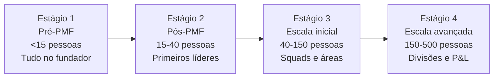

##### Estágio 1 — Pré-PMF (< 15 pessoas)

**Princípio:** Todos fazem tudo. O fundador é o CEO, o CPO, o head de vendas e às vezes ainda escreve código. Não há hierarquia — há comprometimento.

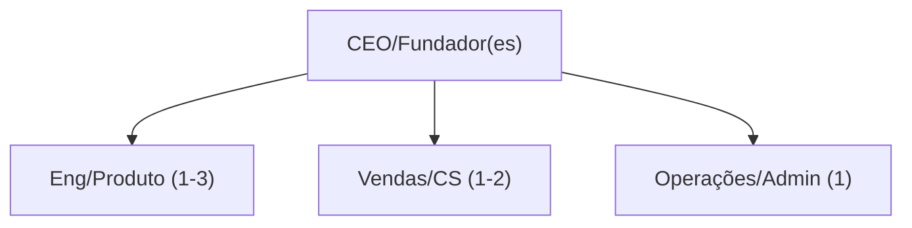

**O que não montar aqui:**

- VPs ou Heads antes de ter ~10 pessoas diretas para eles gerenciarem
- Comitês de decisão — o fundador decide, rápido
- Departamentos de RH, Jurídico, Financeiro próprios — terceirize

**Sinal de que é hora de passar para Estágio 2:** Fundador não consegue mais falar com cada pessoa da empresa toda semana.

##### Estágio 2 — Pós-PMF (15–40 pessoas)

**Princípio:** Contratar os primeiros líderes funcionais. Eles ainda executam — não são gestores puros. O fundador ainda decide tudo estratégico, mas libera espaço operacional.

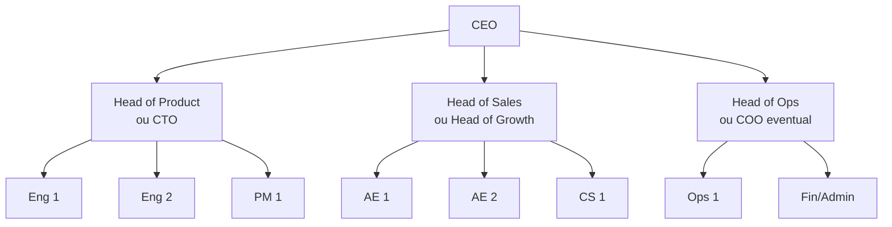

**O que não montar aqui:**

- Mais de 3-4 reports diretos do CEO — limite cognitivo real
- Processo de performance review formal antes de 25 pessoas — overhead injustificado
- Departamentos separados de Marketing, Brand, PR — concentre em Growth/Revenue

**Sinal de que é hora de passar para Estágio 3:** Produto ou vendas têm mais de 8-10 pessoas e o head não consegue gerenciar diretamente + há conflito de prioridades entre áreas sem fórum de resolução.

##### Estágio 3 — Escala inicial (40–150 pessoas)

**Princípio:** Squads autônomos orientados a resultado. O fundador/CEO gerencia líderes, não output direto. Rituais formais de alinhamento (OKRs, weekly leadership, quarterly planning).

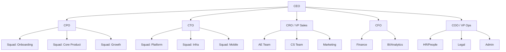

**O que não montar aqui:**

- Mais de 5-6 reports diretos do CEO — atenção fica diluída
- Estrutura matricial complexa (funcional + por produto) — cria conflito de autoridade sem benefício
- P&L separado por produto — ainda cedo para accountability de margem por divisão

**Sinal de que é hora de passar para Estágio 4:** Mais de uma linha de produto / mercado com lógicas de go-to-market distintas, ou headcount acima de 150 com decisões cruzando mais de 3 camadas hierárquicas.

##### Estágio 4 — Escala avançada (150–500 pessoas)

**Princípio:** Divisões com P&L próprio. O CEO gerencia um "portfólio" de negócios, não um único produto. Cada divisão tem sua liderança completa. Governança corporativa formal (board, comitês, auditoria).

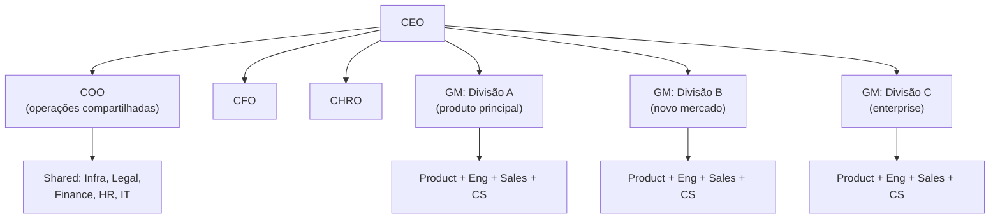

##### Armadilhas transversais

1. **Contratar sênior antes do time.** VP de Marketing sem time de marketing produz overhead e frustração. Contrate o líder quando já tem 3-5 pessoas para liderar.
2. **Reorganizar em crise.** Reorg consome 3-6 meses de energia. Se a empresa está em crise, reorg piora antes de melhorar. Resolva o problema, depois reorganize.
3. **Copiar estrutura de empresa maior.** Spotify Model, Amazon Two-Pizza Teams — são para outra escala. Em 30 pessoas, tribe e squad são burocracia vazia.
4. **Manter estrutura de Estágio 1 na Fase de Escala.** Fundador que ainda gerencia 15 ICs diretamente a 50 pessoas é gargalo — não liderança.

---

### TEMPLATES OPERACIONAIS E CASOS PREENCHIDOS DESTA FASE

#### Template: Mapa de Modos — Founder Mode vs Manager Mode

Documento de 2 páginas, revisão semestral, compartilhado com C-level. Conceito de Founder Mode (Paul Graham, 2024), critérios de quando delegar e quando manter envolvimento direto em [[#CAPÍTULO 8 — FOUNDER MODE, DELEGAÇÃO, GESTÃO DE TEMPO E CADÊNCIA OPERACIONAL DO CEO|Capítulo 8 (Founder Mode, Delegação, Gestão de Tempo e Cadência Operacional do CEO)]].

| Domínio | Modo atual (Founder / Manager / Híbrido) | Gatilho para mudar | Delegado atual | Revisitar em |
|---|---|---|---|---|
| Produto e roadmap | | | | |
| Engenharia | | | | |
| Design e UX | | | | |
| Vendas, top 10 contas | | | | |
| Vendas, base | | | | |
| Marketing de marca | | | | |
| Marketing performance | | | | |
| Finanças/captação | | | | |
| Jurídico | | | | |
| Operações | | | | |
| Pessoas/RH | | | | |
| Atendimento a cliente | | | | |
| Parcerias estratégicas | | | | |

**Teste de honestidade** (responder por escrito, para si mesmo):

- Em quais domínios estou em Founder Mode porque agrega valor diferencial, e em quais por vício de controle?
- Em quais estou em Manager Mode porque delega bem, e em quais por não querer dizer "não"?

**Mecanismos ativos de preservação de Founder Mode:**

- [ ] Skip-level 1:1s mensais?
- [ ] Office hours semanais?
- [ ] Cliente-tour mensal?
- [ ] Desafios rotativos trimestrais?

---

#### Template: Job Descriptions — Contratações-chave

> [!note] Quando usar
> Ao abrir posições sênior de produto, engenharia ou vendas. JDs vagas atraem candidatos errados e atrasam o processo. Use como base e adapte ao contexto real da empresa.

##### Template: Job Descriptions — Contratações-chave (Fase 16).1 Head of Product

**Sobre a empresa**
`[Descrever em 3 frases: o que faz, para quem, estágio atual e cultura]`

**O papel**
Você será o primeiro líder de produto estruturado da empresa. Trabalhará diretamente com os co-fundadores para transformar aprendizados de clientes em roadmap executável, e conduzirá os squads de produto do discovery à entrega.

**O que você vai fazer**

- Construir e evoluir o processo de discovery: entrevistas, testes, análise quantitativa
- Definir e manter o roadmap de produto alinhado à estratégia de negócio
- Trabalhar na interface entre clientes, vendas, engenharia e dados
- Contratar e desenvolver PMs à medida que o time cresce
- Definir as métricas de produto e garantir que o time monitora o que importa

**O que esperamos**

- `[X]+` anos de experiência como PM ou líder de produto em produto digital
- Experiência comprovada em discovery: entrevistas, protótipos, testes de usabilidade
- Capacidade de trabalhar com dados: SQL ou equivalente funcional, análise de cohort
- Experiência em produto B2B `[SaaS / marketplace / plataforma]` — descreva o contexto relevante
- Capacidade de contratar, treinar e avaliar PMs
- Fluência em inglês `[se necessário]`

**O que é diferencial**

- Experiência em empresa no estágio `[pré-PMF / pós-PMF / escala]`
- Histórico em `[vertical específica da empresa]`
- Ter construído roadmap em empresa com restrição de recursos

**O que oferecemos**

- Salário: `[faixa ou "competitivo com mercado — discutir na triagem"]`
- Stock options: `[percentual ou faixa do pool]` · vesting 4 anos / 1 ano cliff
- Benefícios: `[lista]`
- Modelo de trabalho: `[remoto / híbrido / presencial]` — `[cidade, se aplicável]`

---

##### Template: Job Descriptions — Contratações-chave (Fase 16).2 Head of Engineering

**Sobre a empresa**
`[Descrever em 3 frases]`

**O papel**
Você vai liderar o time técnico da empresa, equilibrando entrega de produto, qualidade de código e crescimento das pessoas. Em estágios iniciais, ainda escreve código regularmente. Em estágios posteriores, o foco é contratação, arquitetura e processo.

**O que você vai fazer**

- Liderar o time de engenharia: squads, ritmo de entrega, cerimônias
- Tomar decisões de arquitetura e dívida técnica com visão de longo prazo
- Contratar e desenvolver engenheiros de todos os níveis
- Garantir padrões de qualidade: code review, testes, CI/CD, segurança
- Trabalhar com produto para transformar requisitos em especificações técnicas executáveis
- Gerenciar infra e custos de cloud

**O que esperamos**

- `[X]+` anos de experiência em engenharia, `[Y]+` em papel de liderança
- Histórico de construção e crescimento de times técnicos (de `[N]` para `[M]` engenheiros)
- Proficiência técnica no stack ou equivalente: `[linguagem principal, cloud, etc.]`
- Experiência com práticas de engenharia modernas: CI/CD, observabilidade, arquitetura de microsserviços `[ou monolito, conforme contexto]`
- Capacidade de dar feedback técnico e de carreira

**O que é diferencial**

- Experiência em empresa de `[vertical]` ou que lida com `[escala / conformidade regulatória / hardware]`
- Histórico de escalar produto de `[N]` para `[M]` usuários
- Experiência com segurança da informação e compliance (LGPD, PCI — conforme contexto)

**O que oferecemos**

- Salário: `[faixa]`
- Stock options: `[faixa do pool]` · vesting 4 anos / 1 ano cliff
- Benefícios: `[lista]`
- Modelo de trabalho: `[remoto / híbrido / presencial]`

---

##### Template: Job Descriptions — Contratações-chave (Fase 16).3 Head of Sales (AE / Account Executive Lead)

**Sobre a empresa**
`[Descrever em 3 frases]`

**O papel**
Você vai construir e operar a máquina de vendas da empresa. No início, isso significa vender pessoalmente e documentar o processo. Depois, contratar e escalar um time de AEs. Você é o primeiro líder de vendas — vem de IC forte ou de líder que ainda fecha negócios.

**O que você vai fazer**

- Gerenciar e evoluir o pipeline de vendas (CRM, forecasting, estágios)
- Fechar os contratos mais estratégicos pessoalmente
- Construir o playbook de vendas: ICP, discovery, objeções, fechamento
- Contratar e treinar os primeiros AEs
- Trabalhar com produto e CS para garantir que o cliente adquirido seja o cliente certo
- Definir metas, comissões e cadência de operação

**O que esperamos**

- `[X]+` anos em vendas B2B `[SaaS / serviços / enterprise]`
- Histórico documentado de quota attainment (trazer dados concretos)
- Experiência em ciclos de venda `[transacional / enterprise / consultivo — conforme o modelo]`
- Capacidade de construir processo do zero: você não vem para gerenciar time pronto
- Habilidade de coachear e desenvolver vendedores iniciantes

**O que é diferencial**

- Experiência em `[vertical]` — conhece o cliente que a empresa atende
- Ter feito o movimento de IC para líder antes
- Experiência com CRM: Salesforce, HubSpot ou equivalente

**O que oferecemos**

- Salário fixo + variável: `[faixa base]` + `[% ou fórmula de comissão]`
- Stock options: `[faixa do pool]` · vesting 4 anos / 1 ano cliff
- Benefícios: `[lista]`
- Modelo de trabalho: `[remoto / híbrido / presencial]`

---

#### Template: 1:1 — Template de Reunião Individual

> [!note] Quando usar
> Reunião semanal ou quinzenal entre líder e liderado direto. A 1:1 é do liderado, não do líder. O liderado preenche a maior parte da pauta. O líder escuta, remove obstáculos e dá contexto.

> [!tip] Duração e frequência
> 30–45 min semanais para times em crescimento. 60 min quinzenais para times estabelecidos. Não cancele — cancelar 1:1 repetidamente sinaliza que o liderado não é prioridade.

---

**Liderado:** `[Nome]`
**Líder:** `[Nome]`
**Data:** `[DD/MM/AAAA]`
**Formato:** `[ ] Presencial  [ ] Vídeo`

---

##### Parte 1 — Check-in do liderado (10 min)

*Preencher pelo liderado antes da reunião.*

**Como estou essa semana?** `[Uma frase — pode ser pessoal ou profissional]`

**O que foi bem desde a última 1:1?**

- `[___]`

**O que travou ou não andou como esperado?**

- `[___]`

**O que preciso do meu líder hoje?**
`[ ] Decisão  [ ] Feedback  [ ] Contexto / informação  [ ] Só escuta  [ ] Outro: [___]`

---

##### Parte 2 — Tópicos da semana (15–20 min)

*Lista do liderado — trazer os itens mais importantes, não os mais urgentes.*

1. `[Tópico 1]` → `[O que você precisa: decisão / feedback / contexto]`
2. `[Tópico 2]` → `[O que você precisa]`
3. `[Tópico 3 — opcional]`

*Tópicos do líder (se houver):*

- `[___]`

---

##### Parte 3 — Carreira e desenvolvimento (5–10 min — não toda semana)

> Reserve este bloco para cada 3–4 reuniões. Não precisa ser toda semana, mas precisa acontecer regularmente.

**Onde você está em relação às suas metas de carreira?** `[___]`

**O que você aprendeu nas últimas semanas que mudou como você trabalha?** `[___]`

**Tem algo sobre o seu trabalho que está te desgastando ou que não faz sentido?** `[___]`

**O que posso fazer mais (ou menos) para te ajudar a crescer?** `[___]`

---

##### Parte 4 — Acordos da reunião (5 min)

| Ação | Responsável | Prazo |
|---|---|---|
| `[Ação comprometida pelo líder]` | Líder | `[DD/MM]` |
| `[Ação comprometida pelo liderado]` | Liderado | `[DD/MM]` |

**Nota do líder para o próximo 1:1:** `[Acompanhar: ___]`

---

##### Perguntas de apoio para o líder

> Use quando a conversa travar ou quando quiser ir mais fundo.

- "O que você faria se eu não existisse para te dar essa resposta?"
- "Qual é o problema real por trás disso?"
- "Se isso não fosse resolvido em 30 dias, o que aconteceria?"
- "O que você mais gosta do trabalho agora? O que menos gosta?"
- "Tem algo que o time todo está vendo mas ninguém está falando?"
- "Se você pudesse mudar uma coisa no seu trabalho esta semana, o que seria?"

---

##### Dicas de condução para o líder

- Comece com o item que o liderado disse que precisava — não com a sua pauta
- Tome notas durante a reunião — mostra que você leva a sério
- Não resolva tudo na hora. Às vezes o liderado precisa de espaço para resolver por conta própria
- Cumpra os acordos que você fechou — liderados lembram quando o líder não cumpre
- Após o 1:1, registre em algum lugar (Notion, doc compartilhado) para ter histórico

> [!info] Fases relacionadas
> Referenciado em: Fase 2, Fase 3, Fase 3, Fase 4, Fase 5, Fase 6, Fase 8, Fase 9, Fase 10.

---

#### Template: Cronograma Minuto a Minuto da Semana do Fundador

**Para que serve.** Template de referência para o fundador desenhar a própria semana com granularidade horária, partindo de uma estrutura arquetípica testada. Complementa o esqueleto em blocos amplos da seção principal de BQ.

**Quando usar.** Quando o esqueleto em blocos de BQ não basta e você precisa de um modelo cru para customizar. Tipicamente fundadores que estão tentando se reorganizar pós-PMF, ou após contratação do primeiro management e perceberam que o calendário virou caos.

**Exemplo de preenchimento.** Fundador de SaaS B2B Série A com cinco gerentes diretos.

**Segunda-feira**
- 8h00 às 9h00, weekly review pessoal e priorização da semana
- 9h00 às 10h00, weekly com management
- 10h00 ao meio-dia, bloco maker (estratégia de produto, escrita de memo, deep work)
- Almoço, em geral com investidor, parceiro estratégico ou candidato
- 14h00 às 16h00, 1:1s com diretos
- 16h00 às 17h00, bloco buffer (correção de curso, follow-ups)
- 17h00 às 18h00, leitura ou revisão de board update

**Terça e quarta-feira**
- 9h00 ao meio-dia, blocos maker contínuos
- Almoço livre
- 14h00 às 17h00, blocos de execução (vendas estratégicas, design review, problem-solving)
- 17h00 em diante, networking ou estudo

**Quinta-feira**
- 9h00 às 11h00, bloco maker
- 11h00 às 13h00, encontros externos (advisor, investor relations, community)
- 14h00 às 17h00, 1:1s adicionais ou pesquisa de cliente
- 17h00 às 18h00, encerramento de pendências

**Sexta-feira**
- 9h00 às 11h00, retrospectiva semanal pessoal
- 11h00 às 12h00, conversa de fechamento com chief of staff ou braço direito
- 14h00 em diante, planejamento da semana seguinte e respiro

**Fim de semana**
- Reservado para descanso, família e leitura. Sem reuniões, sem call. Excecoes raras (crise real, decisão de runway).

Adapte cada bloco para sua realidade. Founders em estágio pré-PMF têm distribuição diferente, com mais tempo em pesquisa de cliente e menos em management. Founders em pós-Série B têm mais tempo em board e investor relations e menos em maker direto.

---

### Fechamento da Fase 16: o que muda na sua cabeça e na sua empresa a partir de agora

A [[#FASE 16 — TIME, LIDERANÇA EXECUTIVA E CULTURA EM ESCALA|Fase 16]] é marcada por simultaneidade. Você escalou time (contratações C-level, cultura documentada, rituais de gestão), operações (OKRs, cadência, processos críticos, stack) e máquina de crescimento (motores de aquisição previsíveis, Série A, expansão). Time sem operação tropeça. Operação sem crescimento estagna. Crescimento sem time colapsa em alguns trimestres. A arte do fundador em escala é manter as três balanceadas.

A duração típica é dois a cinco anos. Nesse período, a empresa passa de "startup" para "empresa" no olhar do mercado — e o fundador, de artesão para institucional. É nessa transição que o modelo atual começa, em algum momento, a mostrar os primeiros sinais de saturação. É aí que começa a [[IGNICAO-Vol-9-Maturidade-e-Exit#FASE 19 — REINVENÇÃO E SEGUNDA CURVA|Fase 19 (Vol. 9)]].

---

### Exercício aplicado — Diagnóstico organizacional (Fase 16)

A [[#FASE 16 — TIME, LIDERANÇA EXECUTIVA E CULTURA EM ESCALA|Fase 16]] é a mais longa e mais difícil. Esse exercício ajuda a identificar onde você está no espectro de escala e o que precisa acontecer nos próximos noventa dias.

Passo 1 (30 minutos). Conte pessoas na empresa e use as faixas: abaixo de 20 é empresa-fundador, você conhece todos pelo nome e a cultura é transmitida por osmose diária. De 20 a 50, a primeira estrutura emerge com primeiros líderes de área e processos começando a existir. De 50 a 100 é a transição dolorosa, onde o fundador não consegue mais gerir diretamente todos. De 100 a 250 é scaleup estruturada com gerentes de gerente, processos formais e RH estabelecido. Acima de 250, empresa-organização com hierarquia real e especialização funcional clara.

Passo 2 (60 minutos). Responda honestamente quatro perguntas: você conhece o nome da última pessoa contratada, qual função ela tem e qual problema está resolvendo esta semana? Se uma decisão importante de produto acontecer esta semana, ela chega em você para aprovar ou é tomada sem seu input? Você sabe, sem perguntar ao RH, quem deixou a empresa nos últimos sessenta dias e por quê? Os seus top cinco líderes têm conversas de desenvolvimento de carreira com você pelo menos a cada três meses?

Passo 3 (30 minutos, análise). Respondeu "sim" a todas com empresa abaixo de 50 pessoas: operando bem. Respondeu "sim" a todas com empresa acima de 100: bandeira amarela, você está delegando pouco ou a empresa está pequena demais para o estágio. Respondeu "não" a várias com empresa abaixo de 50: bandeira vermelha, cultura e alinhamento estão em risco, investir em one-on-ones e comunicação. Respondeu "não" a várias com empresa acima de 100: é o esperado, garantir que as pessoas certas estão fazendo essas perguntas a quem reporta direto a elas.

Passo 4 (90 minutos, planejamento). Identifique as três mudanças organizacionais mais urgentes para os próximos noventa dias: contratar VP de Engineering, estruturar o primeiro RH, documentar processo de revisão de performance, criar primeiro framework de valores escritos, demitir alguém cujo encaixe não está funcionando há meses, criar calendário de reuniões recorrentes com lideranças-chave.

Passo 5 (comunicação). Compartilhe o plano com cofundadores e top líderes. Escala sem alinhamento gera caos, alinhamento sem execução gera letargia.

> [!warning] Armadilha específica da fase
> Fundador que resiste a deixar de ser "fundador-operador" vira gargalo. Sintoma: decisões se acumulam, reuniões multiplicam, time demora para executar. Solução: identificar conscientemente quais decisões você deve manter (estratégia, contratações sênior, cap table) e quais deve delegar (operação diária, contratações de nível médio, processos). Escrever a lista é o primeiro passo. Disciplina de seguir é o exercício real.

### A travessia do deserto das 20 às 100 pessoas: instalando camada de gestão sem criar burocracia corporativa lenta

Essa é uma das seções mais importantes da [[#FASE 16 — TIME, LIDERANÇA EXECUTIVA E CULTURA EM ESCALA|Fase 16]], e merece tratamento dedicado porque representa o ponto onde muitas scaleups brasileiras quebram — não por falta de PMF, não por falta de capital, mas por não conseguir fazer a transição organizacional específica desse tamanho.

Abaixo de 20 pessoas, a empresa opera como time estendido. O fundador conhece cada pessoa, participa de cada decisão importante e a cultura é transmitida por osmose diária. Acima de 100, a empresa necessariamente tem estrutura formal, gerentes de gerentes, processos escritos e RH estabelecido. Entre 20 e 100, o fundador vive a transição mais dolorosa da trajetória: tem que deixar de ser "o fundador que sabe tudo" para ser "o CEO que confia em quem sabe". Esse ajuste organizacional é o que separa scaleup bem-sucedida de empresa que quebra em crescimento.

Os quatro pontos de fragilidade específicos desse momento são os seguintes.

O primeiro é a primeira contratação de "gerente de gerente" (em torno de 30 a 50 pessoas). Até aqui o fundador foi o gerente direto de todos os líderes de área. A primeira vez que você contrata alguém que vai gerenciar outros gerentes — tipicamente VP de Engenharia, COO ou Head de Produto sênior — é ponto de inflexão. Essa pessoa vai tomar decisões que você não vai saber sobre elas até semanas depois. Delegação real começa aqui. A contratação errada (VP que não se adapta ou que concentra poder sem performar) é o dano mais frequente desse estágio.

O segundo é a primeira crise de cultura escrita versus praticada (40 a 70 pessoas). Até 30 pessoas, cultura é o que você faz. Depois de 40 a 50, cultura é o que você tolera, e tolerar uma pessoa difícil vira modelo para todas as outras. Fundador que não age rápido em problema cultural aprende com custo alto. A primeira tentativa formal de documentar valores, comportamentos e anti-comportamentos normalmente acontece aqui, e raramente dá certo na primeira tentativa. Luiza Trajano, ao conduzir o Magazine Luiza durante a transformação de varejista tradicional em plataforma digital, construiu cultura que escalou sem perder identidade — comunicação direta com todos os níveis, cafés presenciais com funcionários de loja e presença ativa em redes sociais como canal de liderança. Para fundadores que querem aprender sobre cultura forte em escala, o caso Magazine Luiza é referência obrigatória.

O terceiro é o primeiro RH estruturado (50 a 80 pessoas). Até aqui, contratação foi feita por fundador mais manager de área. Demissões foram eventos raros, geridos diretamente. Avaliações de performance foram conversas informais. Em 50 a 80 pessoas, a ausência de estrutura começa a custar: contratações que não dão certo porque o processo é ad-hoc, demissões que viram processos trabalhistas, avaliações que geram ressentimento sem produzir desenvolvimento real. Contratar RH sênior (não assistente — profissional que vai estruturar políticas) é decisão crítica. Contratar junior cedo demais consome recursos sem resolver. Esperar demais cria dívida de processos cara de reverter.

O quarto é a primeira quebra de "transparência total" (60 a 100 pessoas). Até 50 pessoas, all-hands semanal com dados financeiros abertos era viável. Em 80 ou mais, certas informações precisam ser gerenciadas — nem tudo pode ser compartilhado com todos. A primeira decisão de reduzir transparência é politicamente carregada: funcionários veteranos sentem a perda, novos não notam. Comunicação sobre essa mudança é crítica. Executar em silêncio gera ressentimento silencioso que explode meses depois.

Os sinais de que você está errando nessa fase: taxa de turnover de veteranos subindo (pessoas que estavam há dois ou mais anos começando a sair), recrutamento cada vez mais dependente de você pessoalmente em vez de processos que rodam sem você, decisões voltando para você porque ninguém se sente confortável em decidir, reuniões multiplicando como substituto para clareza de responsabilidades, reclamações em canais informais (DMs, grupos de WhatsApp paralelos) em vez de discussão direta e contratações sênior que não ficam (VPs saindo em seis a doze meses).

- Você sentindo que está gastando mais tempo em gestão de pessoas do que em estratégia ou produto

**Movimentos que funcionam nesse estágio:**

Contrate executive coach para você mesmo, não terapeuta, coach especializado em transição CEO. Pagar R$15-30k/mês por 6-12 meses é investimento que se paga em evitar contratação ruim ou estratégia desalinhada. Ben Horowitz e muitos outros founders de referência usaram coach nesse estágio.

Documente três coisas antes que você esqueça: (a) como você decide (framework explícito de decisão, não apenas intuição), (b) quais são os 5-7 princípios culturais não-negociáveis, (c) quem decide o quê (RACI real, em escrito, atualizado).

Mapeamento explícito de "quem pode ser demitido sem dano existencial à empresa" vs "quem é ponto de falha único". Em startup 20-100 pessoas, tipicamente 5-10 pessoas são críticas a ponto de que a saída delas pararia operação. Mapear isso e mitigar (sucessor em treinamento, documentação crítica, pagamento retentivo) protege a empresa.

Implementar primeira matriz formal de performance avaliation, não complexa, mas existente. Rituais trimestrais onde líderes avaliam time, fundador avalia líderes, e feedback é dado explicitamente. Sem isso, decisões de promoção, compensação e saída viram políticas em vez de mérito.

Revisar valores e comportamentos publicamente a cada ano, não como exercício de marketing, mas como teste de realidade. Luiza Trajano no Magazine Luiza faz revisões abertas com base de funcionários grande, exemplo brasileiro de cultura viva mantida por décadas. Valores que não refletem comportamento atual precisam ser ajustados ou enforcados, fingir que cultura é a escrita quando operação é outra corrói confiança mais do que falta de valores escritos.

**Casos brasileiros instrutivos:** **Magazine Luiza** (Luiza Trajano) fez essa transição há décadas preservando cultura familiar em escala de milhares de funcionários, referência brasileira de liderança em cultura. **Creditas** entre 2018-2020 atravessou essa transição e teve período duro, turnover alto de lideranças, adaptação do fundador. **Resultados Digitais** (pré-fusão) conseguiu transição relativamente suave por investir em cultura escrita cedo. **Wildlife Studios** viveu essa fase em 2020-2022 com desafios documentados publicamente (demissões em escala, recalibração estratégica). Padrão comum: nenhuma das três fez a transição sem turbulência. Turbulência é característica da fase, não sinal de fracasso, mas turbulência sem movimento (contratar coach, documentar cultura, estruturar RH, etc) vira fracasso progressivo.

**Leitura obrigatória para este momento:** *The Hard Things About Hard Things* (Ben Horowitz), *High Output Management* (Andy Grove), *Scaling People* (Claire Hughes Johnson, 2023). Os três foram escritos para fundador transicionando de operador a gestor de gestores.

### O contrato de alforria do CEO: o que você deve parar de fazer imediatamente para a empresa crescer

A pergunta "quando o fundador deve parar de fazer X" raramente tem resposta intuitiva — a tendência natural é esperar até que a dor force a mudança. O resultado é transição tardia, com dano acumulado: produto que perdeu velocidade porque o founder ainda aprova cada spec, time de vendas sem autonomia porque o founder fecha todos os deals, produto que não escalou porque o founder nunca contratou VP de Engenharia com poder real.

A tabela abaixo traduz a transição em critérios acionáveis para cada papel operacional central:

| Papel operacional | Continue enquanto... | Inicie transição quando... | Sinal de que passou da hora |
|---|---|---|---|
| **Tech Lead / Arquiteto** | Há menos de 8 engenheiros e suas decisões são mais rápidas que qualquer contratação | Há 2+ squads com complexidades técnicas distintas ou você está atrasando decisões de arquitetura | Engenheiros sênior saindo por falta de autonomia técnica |
| **Head of Sales** | Você está fechando deals e aprendendo o que vende; ciclo de venda < 30 dias | ARR > R$ 3-5M ou ciclo > 60 dias ou você não consegue replicar o processo em paper | Pipeline estagna porque só você fecha ou tempo seu em deals < 20% do total de trabalho |
| **Head of Product** | Há menos de 1 PM e você consegue fazer entrevistas de usuário semanalmente | Time de produto > 2 PMs ou roadmap disputado por mais de 3 stakeholders | Decisões de produto esperando sua aprovação acumulam por semanas |
| **Head of Marketing / Growth** | CAC ainda em experimentação e você é a principal fonte de conteúdo/narrativa | Canal de aquisição principal validado e time > 2 pessoas em marketing | Experimentos de growth parando porque precisam da sua aprovação |
| **RH e People** | < 15 pessoas e você conhece cada pessoa pessoalmente | 20+ pessoas e contratações de mid-level acontecendo sem você | Cultura se fragmentando em times que não se conhecem |
| **CFO / Finanças** | < Série A e modelo financeiro é simples | Série A captada, múltiplas linhas de receita, ou obrigação de reporting para investidor | Decisões financeiras operacionais (budget de squad, approval de contrato) chegando a você |

**O que "iniciar transição" significa na prática.** Não é demissão do papel próprio — é contratação com mandato claro, onboarding deliberado (3-6 meses trabalhando junto), e transferência progressiva de decisões com prazo definido. Erro clássico: contratar VP de Vendas e continuar fechando todos os deals por 12 meses. A pessoa não aprende, não tem confiança, e sai. A transição real exige que o fundador deliberadamente passe para o banco e deixe a contratação errar e aprender.

**O papel que o fundador nunca delega completamente.** Cultura (comportamentos não-negociáveis), contratações C-level, cap table e decisões estruturais de equity, estratégia de longo prazo e pivôs, e o "why" da empresa. Esses permanecem com o fundador porque são ao mesmo tempo o que ninguém mais tem o contexto para decidir e o que define a identidade da empresa.

> [!important] Teste da delegação real
> Se você está de férias por duas semanas e uma decisão importante em sua área "transitada" precisa voltar para você, a transição não aconteceu — você criou um teatro de delegação. Delegação real é quando a pessoa contratada toma decisões que você discordaria em alguns casos, e você aceita isso como parte do processo de construir liderança.

---

### Transição: das Fases 15 e 16 para os Capítulos de Receita e Pessoas (Vol. 6) e os Volumes 7 a 9

Ao longo das **Fases 15 e 16** deste **Volume 6**, você estruturou a máquina de crescimento comercial e a arquitetura de liderança executiva e cultura para a travessia de 20 para 200+ pessoas. Os **19 capítulos** a seguir deste volume aprofundam *Growth*, vendas *Enterprise*, *RevOps*, parcerias corporativas, marca/PR, *Founder Mode*, contratação de executivos, performance, remuneração, *Stock Options (ESOP)* e cultura em escala.

Para completar a arquitetura de escala e maturidade da sua companhia, siga para o **Volume 7 (Produto, Engenharia, Dados, IA e Operações — Fase 17)**, o **Volume 8 (Blindagem Jurídica, Societária, LGPD e Segurança — Fase 18)** e o **Volume 9 (Maturidade, Governança, Crise e Exit — Fases 19 e 20)**.

---

# CRESCIMENTO EM ESCALA, VENDAS ENTERPRISE, REVOPS, PARCERIAS, FRANQUIAS E MARCA (CAPÍTULOS 1 A 7)

Para crescer de R$ 2 milhões para R$ 100 milhões de receita anual no Brasil, o improviso comercial para de funcionar. Estes sete capítulos detalham a engenharia de times de Growth, vendas complexas *Enterprise*, *Revenue Operations (RevOps)*, parcerias corporativas e *Business Development*, canais indiretos, expansão em rede via **Franchising (Lei 13.966/2019 e COF)** e a construção de marca corporativa, PR e autoridade pública do fundador.

---

## CAPÍTULO 1 — GROWTH COMO FUNÇÃO ORGANIZACIONAL: TIME DE GROWTH, BUILD VS HIRE, RELAÇÃO COM PRODUTO

### A Mentira do "Hacker de Crescimento": Por Que Truques de Mídia Morrem em 90 Dias e Só Loops Compostos Constroem Impérios

Em Recife, **Rafael** contratou um consultor que se autointitulava "Especialista em Growth Hacking" prometendo triplicar as vendas do e-commerce e do marketplace que ele operava com **Bia**. Nas primeiras três semanas, o consultor subiu dezenas de anúncios apelativos no Instagram com sorteios e cupons de 40% de desconto na primeira compra. O gráfico de novos cadastros explodiu — e Rafael abriu um sorriso. Bia, porém, foi olhar o painel de retenção e margem sessenta dias depois: **94% daqueles usuários nunca fizeram a segunda compra**, o custo por cliente retido havia sido o triplo do normal e o suporte estava entupido de reclamações de caçadores de brinde. Quando desligaram os anúncios, as vendas voltaram exatamente para a estaca zero no dia seguinte.

Por que o mercado brasileiro confundiu a disciplina científica de **Growth** com "fazer tráfego pago e truques de curto prazo"? Porque funis lineares de mídia paga são fáceis de entender, mas sofrem da **Lei da Degradação Inevitável do Canal**: toda plataforma de anúncio fica mais cara e saturada a cada trimestre.

Brian Balfour e a escola da Reforge demonstraram que empresas que crescem de forma duradoura não dependem apenas de funis lineares onde você joga dinheiro em cima e sai cliente embaixo; elas constroem **Growth Loops (Laços de Crescimento Composto)** — sistemas fechados onde a ação natural de um novo usuário (convidar um colega de trabalho, enviar um link de pagamento, publicar uma loja, gerar um relatório com a marca do produto) planta a semente que traz o próximo usuário a custo marginal próximo de zero. Chamamos a armadilha de Rafael de **O Dopamina de Aquisição Sem Retenção**: comemorar o topo do funil enquanto o produto não retém nem se retroalimenta.

---

### Growth como engenharia científica e organizacional: unindo Produto, Aquisição, Retenção e Monetização

Growth (crescimento), em startups modernas, não é "marketing com nome cool". É uma disciplina organizacional que combina aquisição, ativação, retenção, referral (indicação) e monetização (o funil AARRR de Dave McClure, descrito mais adiante). Usa experimentação quantitativa como metodologia. O growth team bem estruturado opera na interseção entre marketing, produto, e dados. Faz experimentos em features do produto para aumentar ativação. Roda campanhas para testar canais. Modela cohorts (grupos de usuários agrupados por período de entrada) para entender retenção. Constrói viral loops (loops virais, mecânicas em que cada usuário traz outros). Otimiza pricing (precificação).

A origem do conceito. Facebook (por volta de 2007), Airbnb, Uber, e Dropbox popularizaram "growth hacking" nos anos 2010. Sean Ellis, Andrew Chen, e Reforge formalizaram a disciplina. Hoje, empresas maduras como Canva, Notion, Figma, e ClickUp têm growth teams de trinta a cem pessoas.

No Brasil, poucas empresas têm growth function madura. Nubank, Wellhub, Hotmart (bootstrap em parte da trajetoria, com escala internacional sem dependencia de VC), iFood e RD Station têm. Muitas startups confundem growth com performance marketing, ou com product marketing. E perdem o valor combinado das duas disciplinas.

Este capítulo trata de quatro perguntas. Quando montar growth team. Como estruturar. Como contratar. Como operar.

### Funis Lineares vs. Growth Loops: por que juros compostos vencem força bruta de mídia paga

Growth team bem montado destrava crescimento de forma eficiente em capital. Sem ele, o crescimento depende de escalar S&M (sales and marketing, vendas e marketing) linearmente. Mais orçamento igual a mais crescimento. Com ele, o crescimento vem de mecânicas não-lineares (viral loops, product-led growth, e abertura de canais novos). O CAC (*customer acquisition cost*, custo de aquisição de cliente) cai, ou se mantém, enquanto o volume escala.

Produto e marketing ficam desconectados sem growth. O marketing roda campanha. A landing page (página de captura) converte mal. O produto recebe usuários que não ativam. Cada função culpa a outra. O growth team é a "cola" que conecta o funil ponta a ponta, e assume responsabilidade.

A experimentação estruturada destrava aprendizado. Empresas sem growth rodam mudanças sem medir rigorosamente. "Achamos que funcionou." Growth traz disciplina de teste A/B, grupos de controle, e significância estatística. O aprendizado acumulado vira diferencial competitivo.

Entrar cedo demais, ou tarde demais, tem custo. Montar growth team em empresa de vinte pessoas é exagero. Não ter em empresa de duzentas, gerando queda de eficiência, é tarde. Timing importa.

### O pecado fatal de montar um time de Growth antes de ter retenção comprovada (PMF)

Estágio 1, founder-led growth (pré-seed a Seed, até R$ 3 a 5 mi de ARR). O fundador faz growth. Roda experimentos. Escolhe canais. Vende. Otimiza ativação. Não há função separada. Se o fundador não entende growth, contrata consultor, ou advisor, nessa fase. Contratar "Head of Growth" com R$ 5 mi de ARR é prematuro. Vira gargalo, sem dados suficientes para trabalhar.

Estágio 2, growth owner (Série A, R$ 5 a 15 mi de ARR). Uma pessoa (tipicamente Head of Marketing, ou VP Growth) acumula a função. Times de uma a três pessoas. Performance marketer mais data analyst mais product manager de growth (cross-functional).

Estágio 3, growth team (Série A tardia a B, R$ 15 a 50 mi de ARR). Time dedicado de cinco a dez pessoas. Head of Growth, dois a três growth PMs, um a dois growth engineers, um a dois data analysts, e performance marketers. Pode reportar ao CEO, ao CPO, ou ao CMO, dependendo da estrutura.

Estágio 4, growth organization (Série B a C, R$ 50 a 200 mi de ARR). Time de vinte a quarenta pessoas. Subdivisões. Acquisition. Activation. Retention. Monetization. Possivelmente international growth. Integra com produto, e marketing, pesado.

Estágio 5, growth org em escala (Série C em diante, R$ 200 mi de ARR ou mais). Quarenta ou mais pessoas. Especialistas em cada vertical. SEO team. Paid team. Lifecycle team. Referral, ou viral team. Pricing team. Empresas maduras (Canva, Notion) têm estruturas dessa escala.

### A anatomia de um Squad de Growth real: Growth PM, Engenheiro, Designer, Analista de Dados e Marketing

Head of Growth, ou VP Growth. Perfil raro. Soma de marketing (entende canais, CAC, LTV), produto (pensa em features, e experiência), dados (sabe ler cohort, e rodar análise), e engineering (dialoga com tech). Tipicamente vem de background em empresas de tecnologia globais com growth team. Salário. R$ 40 a 80 mil por mês em 2025, dependendo da escala.

Growth PM (Product Manager for Growth). PM especializado em growth features. Diferente de PM tradicional (que trabalha em core product features). Roda experimentos em onboarding, referral, e cross-sell. Tipicamente, três a cinco PMs em time de growth.

Growth Engineer. Desenvolvedor que trabalha especificamente em features de growth. Precisa ser rápido (builds por experimentação, MVPs, não código altamente robusto). Tipicamente, dois a quatro engineers em time de dez pessoas.

Growth Designer. Designer que otimiza landing pages, UI de onboarding, e flows de conversão. Foco em conversão, não em estética pura.

Data Analyst de Growth. Roda análises de experimentos, cohort, e funil. Ferramentas. Amplitude, Mixpanel, SQL, Python. Critical role.

Performance Marketer. Especialista em canais pagos. Google, Meta, LinkedIn, TikTok. Embora também exista no time de marketing tradicional, performance em growth team trabalha mais integrado com produto.

Lifecycle Marketer. Email, push notification, in-app messaging. Foca em engajamento contínuo, e retention.

SEO Specialist. Otimização para busca orgânica. Canal de aquisição crítico para muitos produtos.

Referral, ou Viral PM. Especialista em mecânicas de referral, e viral loops.

### Modelo Independente vs. Modelo Funcional: como evitar a guerra civil entre Growth, Produto e Marketing

Três modelos comuns.

**Modelo 1, growth como função separada.** Head of Growth reporta ao CEO, ou ao CPO. Time cross-funcional, com as próprias PMs, engineers, e designers. Pro. Foco. Velocidade. Accountability clara. Contra. Pode criar silos com o time de produto core. "Eles constroem feature, nós construímos growth feature." Duplicação, e conflito.

**Modelo 2, growth embutido no produto.** Growth PMs estão no time de produto, mas com foco específico. Eng, e design, são compartilhados. Pro. Integração forte com produto, sem silos. Contra. Growth pode ser priorizado abaixo de features core. Perde foco em experimentação.

**Modelo 3, growth como função de serviços internos.** Growth team tem capacidade analítica, e metodológica. Empresta experts a outros times. Como "consultoria interna". Pro. Escalabilidade. Propagação de cultura de growth para toda a empresa. Contra. Sem ownership direto de output, pode virar "dá conselho, mas não constrói".

A escolha depende de maturidade da empresa. Startup em Série A a B, frequentemente, começa com modelo 1, para foco. Escala para modelo 2, ou 3, em estágios maduros.

### Os números reais do funil pirata (AARRR) calibrados para a realidade do mercado brasileiro

O funil AARRR (Acquisition, Activation, Retention, Referral, Revenue) é o mapa de trabalho do growth team. Cada etapa tem benchmarks diferentes por vertical e por estágio de maturidade do mercado brasileiro.

**Acquisition (Aquisição).** O custo e a qualidade do tráfego que entra. No Brasil, o CAC médio varia muito por segmento.

```text
Benchmarks de CAC por segmento (2024-2025, Brasil)
------------------------------------------------------
SaaS SMB (ticket R$ 200-800/mês)     R$ 250 – R$ 600
SaaS Mid-market (ticket R$ 2-8k/mês) R$ 1.500 – R$ 5.000
Fintech consumer (conta digital)     R$ 20 – R$ 80
Edtech (curso avulso)                R$ 60 – R$ 200
Marketplace (comprador)              R$ 15 – R$ 50
Marketplace (vendedor)               R$ 80 – R$ 300
Saúde digital (plano ou assinatura)  R$ 120 – R$ 400
------------------------------------------------------
Estimativas indicativas baseadas em benchmarks setoriais agregados (relatórios públicos da Distrito, ABStartups, e dados consolidados de fundos brasileiros). Faixas de referência, não médias estatísticas. Validar com dados próprios antes de tomar decisão de alocação.
```

O growth team no Brasil lida com especificidades locais na aquisição. O WhatsApp é canal de aquisição e nurturing, não apenas comunicação. O CPM em Meta Brasil é trinta a cinquenta por cento mais barato que nos EUA, mas a conversão pós-clique é mais baixa (menor confiança em checkout, maior abandono). O PIX reduziu atrito em conversão e elevou taxas de finalização de compra em dez a vinte por cento em e-commerce e edtech a partir de 2021.

**Activation (Ativação).** O momento em que o usuário experimenta o "aha moment". A métrica é o percentual de usuários que ativam dentro de uma janela de tempo (D1, D3, D7). Benchmarks de ativação em SaaS brasileiro.

```text
Benchmarks de Activation Rate (D7) por categoria
---------------------------------------------------
SaaS produtividade (PLG)     55% – 75%
SaaS vertical (ERP, CRM)     30% – 50%
Marketplace (buyer)          40% – 65%
Consumer app (fintech)       60% – 80%
Consumer app (saúde/bem-estar) 25% – 45%
---------------------------------------------------
Activation = usuário completou ação-chave definida como "aha moment"
```

O desafio no Brasil é que o onboarding precisa compensar menor alfabetização digital em certos segmentos. PMEs brasileiras acostumadas ao Excel resistem a SaaS com curvas de aprendizado acentuadas. Times de growth bem-sucedidos no Brasil (RD Station, Conta Azul) investiram pesado em onboarding guiado por humanos, não apenas self-service.

**Retention (Retenção).** A saúde do produto no longo prazo. D30 retention acima de quarenta por cento é referência para apps de consumo. Em SaaS, a métrica equivalente é Annual Retention Rate (ARR Renewal).

```text
Benchmarks de Retention por modelo
-------------------------------------
Consumer app (D30)              20% – 45%
SaaS SMB (Annual Renewal)       70% – 85%
SaaS Mid-market (Annual Renewal) 80% – 92%
Marketplace (compradores ativos 
em 90 dias)                     30% – 55%
Fintech (transações mensais)    55% – 75%
-------------------------------------
Benchmarks de referência: Andreessen Horowitz,
Bessemer Venture Partners, adaptados ao BR
```

**Referral (Referência).** O K-factor mede quantos novos usuários cada usuário existente traz. K-factor acima de um significa crescimento viral (cada usuário traz mais de um novo). K-factor entre zero vírgula um e zero vírgula cinco é típico para programas de referral bem desenhados em SaaS. Consumer apps com forte componente social (WhatsApp, iFood) podem chegar a K-factor acima de zero vírgula oito.

O Brasil tem vantagem natural em referral: cultura de indicação pessoal é muito forte. O boca a boca via grupos de WhatsApp é canal informal mas de altíssima conversão. Growth teams brasileiros que formalizaram o que já acontecia informalmente (Nubank, C6 Bank) multiplicaram aquisição.

**Revenue (Monetização).** Conversion rate de free para paid em modelos freemium. Em SaaS PLG brasileiro, dois a cinco por cento de conversão free-para-paid é referência. Em SaaS com trial, dez a vinte e cinco por cento de conversão no período de trial é meta razoável.

> [!tip] Não otimize etapas isoladas
> O funil AARRR é sistêmico. Dobrar a aquisição com retenção ruim é ineficiente. O maior ROI de growth quase sempre está em ativação e retenção, não em aquisição. Para cada real gasto em adquirir um usuário novo, vale investir proporcional em garantir que esse usuário ative e fique.

### Escolhendo a North Star Metric que mede valor entregue ao cliente (e não vaidade)

**A North Star Metric (NSM).** O crescimento em escala exige foco em uma única métrica que capture o valor real entregue ao usuário. Não revenue (que é lagging indicator). Não signups (que são vaidade). A North Star Metric deve responder: qual número, se crescer, indica que estamos entregando mais valor?

```text
Exemplos de North Star Metric por modelo
------------------------------------------
Spotify         Minutos de música consumidos/mês
Airbnb          Noites reservadas
Slack           Mensagens enviadas por DAU
RD Station      Leads gerados pelos clientes/mês
iFood           Pedidos completados/semana
Nubank          Transações ativas/cliente/mês
SaaS vertical   Projetos ou processos ativos/conta
------------------------------------------
```

A NSM deve ser decomposta em drivers (input metrics). Se a NSM do RD Station é "leads gerados pelos clientes por mês", os drivers são: número de clientes ativos, features de lead gen em uso por cliente, e qualidade das integrações. O growth team trabalha nos drivers, não diretamente na NSM.

**Significância estatística em experimentos.** O erro mais comum em times de growth iniciantes é declarar um experimento vencedor cedo demais, com sample size insuficiente. Isso gera falsos positivos sistemáticos.

Regras práticas para rigor estatístico.

- Defina o efeito mínimo detectável (MDE) antes de rodar. Se o experimento precisa mover a conversão de quarenta para quarenta e seis por cento (lift de quinze por cento), calcule o sample size necessário para detectar esse efeito com oitenta por cento de poder estatístico e significância de noventa e cinco por cento.
- Use calculadoras de sample size (Evan Miller's A/B Test Calculator, Statsig, Eppo) antes de ligar o experimento.
- Duração mínima de duas semanas completas para capturar variação de dia da semana. Não encerre antes mesmo que o resultado pareça claro.
- Não faça peeking contínuo. Olhar o resultado diariamente e encerrar quando "parece bom" infla a taxa de falsos positivos.

> [!warning] O problema dos efeitos de interação
> Rodar muitos experimentos simultâneos cria efeitos de interação. Se o Experimento A testa um novo onboarding e o Experimento B testa um novo pricing, um usuário pode estar em A+B, A apenas, B apenas, ou nenhum. Se A e B interagem (o novo onboarding aumenta disposição a pagar, logo B parece melhor para quem passou por A), os resultados são contaminados. A regra geral é não rodar mais de três a cinco experimentos simultâneos em partes sobrepostas do funil. Use mutex groups (grupos mutuamente exclusivos) quando o overlap for inevitável. Ferramentas como Eppo, Statsig e GrowthBook suportam isso nativamente.

O volume de experimentos correto para times de diferentes tamanhos.

```text
Capacidade de experimentação por tamanho de time
--------------------------------------------------
Time de 3-5 pessoas   2 – 5 experimentos/mês
Time de 5-10 pessoas  5 – 12 experimentos/mês
Time de 10-20 pessoas 10 – 20 experimentos/mês
Time de 20+ pessoas   20 – 40 experimentos/mês
--------------------------------------------------
Acima do limite superior, rigor cai e interações aumentam.
```

### A cadência semanal de experimentação: Hipótese -> ICE Score -> Teste -> Autópsia estatística

Growth team opera em ciclos de experimentação, em seis passos.

**Passo 1, hipótese.** "Acreditamos que se [mudança], então [métrica] [aumentará, ou diminuirá] em X por cento, porque [razão]." Exemplo. "Acreditamos que se adicionarmos um tour guiado no primeiro login, a ativação em sete dias aumentará em quinze por cento, porque o usuário entenderá valor antes de abandonar."

**Passo 2, experimento.** Desenhar A/B test. Variante versus controle. Sample size baseado em significância estatística. Duração mínima (tipicamente, duas semanas).

**Passo 3, implementação.** Engenheiro, ou designer, constrói. PM valida. O experimento liga.

**Passo 4, análise.** Após a duração mínima, análise. Impacto em métrica primária. Impacto em métricas secundárias (não deteriorou outra?). Significância estatística.

**Passo 5, decisão.** Winner. Ship para cem por cento. Loser. Kill. Aprendizado documentado. Incerto. Estender, ou rodar variante.

**Passo 6, documentação.** Wiki de experimentos. Hipótese. Resultado. Aprendizado. Funciona como memória organizacional. Evita rodar o mesmo experimento duas vezes.

> [!important] Ritmo de ciclos
> Time bom roda cinco a quinze experimentos por mês. Menos é sub-capacidade. Mais é experimentação sem rigor. Success rate típico, dez a vinte por cento dos experimentos ganham. A maioria perde, ou é neutra, e tudo bem. Isso é aprendizado.

Ferramentas. A/B testing. Optimizely, VWO, LaunchDarkly, Statsig, Eppo, GrowthBook. Analytics. Amplitude, Mixpanel, Heap, Pendo. Customer data. Segment, mParticle, RudderStack. Landing pages. Unbounce, Instapage, Webflow. Email. Customer.io, Iterable, Braze.

### Painel de comando de Growth: Velocidade de Experimentos, Taxa de Ativação (Aha Moment) e Coeficiente K / Loop Efficiency

Growth team tem métricas claras, em quatro categorias.

**Métricas de topo de funil.** CAC por canal. CAC blended. Qualidade do tráfego (conversion rate por canal).

**Métricas de ativação.** Activation rate (usuários que atingem "aha moment" em tempo X). Time to first value. Funnel drop-off.

**Métricas de retenção.** D1, D7, D30 retention. Engagement (DAU, ou MAU). Cohort curves (NRR, ou GRR, em SaaS, ou retention em consumer).

**Métricas de monetização.** Conversion rate (free para paid). ARPU (Average Revenue per User). LTV por segmento.

**Métricas de referral, ou viral.** K-factor (quantos novos users cada user traz). Viral cycle time.

OKRs trimestrais típicos. "Aumentar activation rate (D7) de quarenta por cento para cinquenta e cinco por cento." "Reduzir CAC blended de R$ 350 para R$ 280." "Aumentar retention D30 de vinte e cinco por cento para trinta e cinco por cento." "Lançar programa de referral com K-factor maior que zero vírgula três."

### Paz armada entre Produto Core (construir valor novo) e Growth (conectar mais usuários ao valor já existente)

**Growth como time de produto.** O growth team mais eficaz não é uma extensão do marketing. É um segundo time de produto, focado em métricas de crescimento em vez de métricas de core value. Os melhores growth teams têm seus próprios PMs, engineers e designers. Operam com roadmap próprio. Fazem code deploy sem depender do time de produto principal.

Essa autonomia tem custo. Cria duplicação de capacidade. Gera debates sobre quem "possui" partes do produto (a tela de onboarding é do produto ou do growth?). Requer governança clara de areas of ownership.

**O debate do "growth tax".** O conceito de "growth tax" captura a tensão real entre experimentação rápida e qualidade de produto. Growth teams que operam com autonomia total tendem a acumular technical debt e UX debt ao longo do tempo.

```text
Manifestações comuns de growth tax
-------------------------------------
- Onboarding com quatro fluxos A/B rodando simultâneos,
  nenhum deles o fluxo "oficial" do produto
- Popups e modais de upsell que degradam a experiência
  do usuário que já é cliente
- Features de referral com incentivos agressivos que
  atraem usuários de baixa qualidade
- SEO programático com páginas de baixa qualidade que
  prejudicam brand e domínio no longo prazo
- Emails de lifecycle em excesso que aumentam unsubscribe
  e reduzem deliverability
-------------------------------------
```

O growth tax se manifesta quando a métrica de growth "ganha" no curto prazo mas corrói a experiência no longo prazo. Exemplos reais. LinkedIn, por muito tempo, enviava notificações agressivas que aumentavam o DAU mas degradavam a percepção de qualidade do produto. Facebook testou feeds com mais conteúdo viral (mais engajamento de curto prazo) que eventualmente aumentaram polarização e reduziram bem-estar dos usuários.

> [!important] A regra das métricas guardiãs (guardrail metrics)
> Todo experimento de growth deve ter métricas guardiãs. Métricas que não podem piorar, mesmo que a métrica primária melhore. Se o experimento aumenta a conversão em dez por cento mas o NPS cai cinco pontos, o experimento perdeu. O growth team precisa definir, com o time de produto, quais são as guardrail metrics inegociáveis. Tipicamente: NPS, churn rate, support ticket volume, e unsubscribe rate.

**Resolução da tensão.** Empresas que resolvem bem a tensão growth-produto estabelecem três mecanismos.

Primeiro, joint roadmap reviews mensais entre growth PM e product PM, onde cada time declara o que vai construir e os dois lados ajustam para evitar conflito.

Segundo, regra de "sunset automático" para experimentos. Qualquer feature testada em A/B que não se tornar a versão padrão em noventa dias precisa ser removida ou promovida. Sem essa regra, o produto acumula variantes ativas indefinidamente.

Terceiro, ownership declarada por área do produto. O time de produto próprio o core product (feature set principal). O growth team próprio o funil (onboarding, upgrade flows, referral, notifications). A sobreposição é governada por acordo de interface, não por política.

### Quando o próprio produto é o canal de aquisição: freemium, trial autoguiado e viralidade operacional

**O modelo PLG em detalhe.** Product-Led Growth em SaaS B2B funciona em três loops sequenciais.

Loop 1, aquisição orgânica. O produto é descoberto via busca orgânica, comparadores (G2, Capterra, Software Advice), ou indicação. O usuário faz self-signup sem falar com ninguém. A fricção do signup é zero ou mínima.

Loop 2, ativação e expansão viral intra-empresa. Um usuário usa o produto. Convida colegas. O produto se espalha dentro da conta. Slack, Figma e Notion são o caso canônico. Um designer usa Figma. Convida o time. O time convida stakeholders. A conta passa de um para trinta usuários sem interação de vendas.

Loop 3, conversão para paid. O uso do free tier atinge um limite (usuários, projetos, armazenamento, features avançadas). A conta converte para paid por necessidade, não por persuasão de vendas.

```text
Funil PLG típico em SaaS B2B
------------------------------
100  visitantes únicos
 12  signups (12% de conversão)
  7  usuários ativos em D7 (58% de activation)
  3  contas que expandiram para 3+ usuários
  1  conta convertida para paid (33% das expandidas)
------------------------------
O loop de expansão é onde PLG cria vantagem sobre SLG:
um único signup pode virar uma conta de 30 usuários.
```

**Freemium versus Trial.** Dois modelos de PLG têm dinâmicas distintas.

Freemium. O produto é gratuito indefinidamente, com limitações. Funciona quando: o produto tem valor real mesmo com limitações, a expansão viral acontece facilmente, e o custo de servir usuários gratuitos é baixo (margem de infra). Figma, Canva, Notion, Trello usaram esse modelo. No Brasil, a resistência a pagar por SaaS é mais alta que nos EUA, o que torna o freemium atraente como isca, mas exige gate muito bem calibrado para converter.

Trial. O produto é gratuito por tempo limitado (quatorze ou trinta dias), depois requer pagamento. Funciona quando: o produto tem curva de aprendizado e o usuário precisa de tempo para ver valor, ou quando o custo de infra para servir gratuitos é alto. O desafio do trial é que ele cria urgência artificial — o usuário que não ativou no trial não converte, independentemente do prazo.

> [!note] O "aha moment" precisa acontecer antes do muro de pagamento
> Em PLG, o erro mais comum é colocar o paywall antes de o usuário experimentar o valor central do produto. Se o "aha moment" do produto é o terceiro relatório gerado, e o trial tem limite de dois relatórios, o usuário nunca experimenta o valor. O growth team em PLG deve mapear rigorosamente onde o "aha moment" acontece e garantir que o free tier ou trial chegue até lá.

**Expansion loops em PLG.** Além da conversão inicial, PLG gera expansão dentro da conta por três mecanismos.

Seat expansion. Mais usuários dentro da mesma conta conforme adoção cresce. Preço por seat cria alinhamento entre uso e receita.

Usage-based expansion. Preço por volume de uso (API calls, mensagens processadas, armazenamento). O cliente cresce e paga mais naturalmente. Twilio, Stripe, AWS são os casos globais. No Brasil, Zenvia e Sinch usam esse modelo em CPaaS.

Feature-based expansion. O cliente começa no plano básico e migra para planos com features avançadas conforme o uso amadurece. O growth team trabalha em "expansion triggers", momentos dentro do produto onde o usuário se depara com a limitação do plano atual de forma natural.

### O modelo híbrido brasileiro (Product-Led Sales): por que o comprador B2B no Brasil adora testar sozinho, mas fecha tickets altos no WhatsApp/reunião

**PLG (Product-Led Growth).** O produto vende. O usuário faz self-signup. Usa free tier. Converte para paid dentro do produto. Slack, Notion, Figma, Canva, ClickUp. O growth team foca em freemium design, activation, in-product viral loops, e self-service upsell.

**SLG (Sales-Led Growth).** Sales vende. Lead qualificado, depois SDR, depois AE, depois deal. Salesforce, Oracle, SAP, Pipefy enterprise. O growth team foca em demand generation, MQL qualification, pipeline acceleration, e enablement de sales.

**Hybrid.** Parte do funnel é PLG (descoberta, trial). Parte é SLG (enterprise deals). HubSpot, Zendesk, Atlassian modernas. O growth team precisa dominar os dois.

No Brasil, SaaS vertical historicamente é SLG-heavy (Totvs, ContaAzul, RD Station). A tendência em novos entrantes inclui mais PLG. Em produto para consumer, PLG domina.

A decisão PLG versus SLG depende de ticket médio, complexidade do produto, tempo para "aha moment", e necessidade de customização.

```text
Guia de decisão PLG versus SLG no contexto brasileiro
-------------------------------------------------------
Ticket < R$ 500/mês           PLG ou hybrid (PLG dominante)
Ticket R$ 500 – R$ 3k/mês     Hybrid (PLG para descoberta,
                               SLG para fechar e expandir)
Ticket > R$ 3k/mês            SLG (PLG pode existir
                               como motion de land)
"Aha moment" em < 30 min      PLG viável
"Aha moment" requer onboarding
  > 2h ou customização         SLG necessário
Comprador = usuário final      PLG favorecido
Comprador = TI/Procurement     SLG necessário
> [!info] Fases relacionadas
> Referenciado em: Fase 10, Fase 12, Fase 14.

-------------------------------------------------------
```

O modelo hybrid, chamado de "product-led sales" ou PLS, é o movimento mais relevante para SaaS brasileiro em 2025. O produto atrai e ativa (PLG). Quando uma conta atinge sinais de expansão (Product Qualified Account, PQA), o sales entra para fechar um deal enterprise. O growth team é responsável por definir os PQA signals e passar o lead qualificado para o sales.

> [!note] PLG no Brasil exige ajuste cultural
> A confiança em self-service é menor no Brasil que nos EUA. PMEs brasileiras preferem "falar com alguém" antes de inserir cartão de crédito. Times de growth que implementaram PLG puro no Brasil (sem nenhum toque humano) reportam conversion rates menores que os benchmarks globais. A solução é PLG com camada de assistência humana leve: chat no produto, onboarding por vídeo gravado, ou trial call opcional. O toque humano não precisa ser custoso para ser eficaz.

### Por que terceirizar seu motor central de crescimento para uma agência externa quase nunca constrói ativo proprietário

**Build.** Treinar growth team internamente. Lento. Mas cria cultura. Útil quando a empresa tem produto viral natural, e precisa maximizar (Figma, Notion).

**Hire.** Contratar Head of Growth externo, mais time. Mais rápido. Traz know-how. Risco. Não aderir à cultura. Não entender o produto.

**Buy (agência, ou consultor).** Terceirizar growth operations para agência. Funciona em canais específicos (performance marketing via agência), mas não para estratégia core. Agências não têm accountability profunda em produto.

A combinação mais comum. Hire Head of Growth sênior de fora. Montar time interno. Usar consultores, ou agências, para canais pontuais (SEO, especialista em TikTok Ads), onde expertise vertical é rara.

### Onde os fundadores inteligentes morrem na praia: as ciladas clássicas desta etapa

Crescer CAC sem olhar LTV. O growth team otimiza "CAC de 300 para 250", bom? Depende. Se o LTV caiu junto (porque o cliente errado entrou), pior. Sempre olhar LTV sobre CAC. Não só CAC.

A/B tests sem significância estatística. "Variante A ganhou com cinco por cento de lift", em sample de duzentos usuários. Ruído. Rigor estatístico é essencial. Ferramentas como Eppo, GrowthBook, e Statsig forçam isso.

Growth team operando em silo. O time constrói features fora do produto core. Produto core reclama que as growth features não estão integradas. Solução. Weekly sync. Shared roadmap. Cultura de "um time".

Experimentação sem hypothesis. "Vamos mudar o CTA do botão para ver o que acontece." Sem hypothesis clara, o resultado é ruído. Cada experimento precisa de resposta a "por que vai funcionar?".

Focar só em aquisição. Times de growth em startup inicial focam em aquisição (topo do funil). Negligenciam ativação, e retenção. Que têm ROI muito maior em estágio mid. Aquisição com vinte por cento de retention é buraco.

Growth como função "mágica". O CEO contrata Head of Growth esperando "unlock 10x growth". Growth team é disciplina rigorosa. Não magia. Incrementos de dez a trinta por cento ao trimestre é bom resultado. Cem por cento acontece raramente.

Não documentar experimentos. O time roda experimento. Ninguém registra. Meses depois, o time novo roda o mesmo experimento. Desperdício. Wiki de experimentos é obrigatória.

> [!warning] Ignorar long-term consequences de growth hacks
> Dark patterns (botão "cancelar" escondido). Referral com incentivo agressivo, que atrai usuário ruim. SEO spam. Ganham curto prazo. Destroem longo prazo (reputação, churn, ban de plataforma).

Over-engineering em growth. O time constrói infraestrutura para experimentos, em vez de experimentos. "Vamos gastar seis meses montando plataforma de A/B test", enquanto Optimizely, ou GrowthBook, resolvem off-the-shelf.

Copy-paste de playbook. "Funcionou em Airbnb, vamos fazer aqui." Contexto diferente. Incentivo de referral que funciona em consumer não funciona em B2B. Playbook precisa adaptação.

Head of Growth sem poder. O CEO contrata Head of Growth, mas dá apenas a responsabilidade de marketing. Produto, e eng, não reportam. O Head vira marqueteiro, sem capacidade de alterar produto. Foge.

Métricas vaidosas. "Total de signups subiu cinquenta por cento". Se os signups não ativam, e não convertem, o total é irrelevante. As métricas que importam. Ativação, retenção, e revenue expandido.

Não alinhar com modelo de negócio. Growth team em empresa enterprise SLG foca em experimentos de onboarding self-service, que noventa por cento dos clientes não usam. Growth em PLG foca em otimizar pipeline enterprise, que é cinco por cento do volume. Alinhamento com modelo é essencial.

### Checklist de instalação da máquina e do ritual semanal de Growth

- [ ] Decisão. Temos o estágio certo para montar growth team? (ARR, maturidade)
- [ ] Modelo definido. Função separada, embutida em produto, ou de serviços internos
- [ ] PLG versus SLG versus hybrid. Qual motion é dominante?
- [ ] Head of Growth contratado (ou founder assume temporariamente)
- [ ] Core team mínimo. Um PM, um analista, um engineer, um designer, um performance marketer
- [ ] Ferramentas. Analytics (Amplitude, Mixpanel), A/B testing, CDP (Segment), CRM
- [ ] Ciclo de experimentação definido. Hipótese, depois experimento, depois análise, depois decisão
- [ ] Cinco a quinze experimentos por mês rodando
- [ ] Wiki de experimentos com histórico, e aprendizados
- [ ] North Star Metric definida e decomposta em input metrics
- [ ] Métricas de aquisição, ativação, retenção, e monetização, mensuradas separadamente
- [ ] Guardrail metrics definidas (métricas que não podem piorar)
- [ ] OKRs trimestrais com métricas específicas
- [ ] Sample size calculado antes de rodar cada experimento
- [ ] Máximo de três a cinco experimentos simultâneos por área do funil
- [ ] Mutex groups configurados quando experimentos se sobrepõem
- [ ] Integração com time de produto (shared roadmap, syncs)
- [ ] Integração com marketing (brand versus performance alinhados)
- [ ] Areas of ownership declaradas entre growth e produto
- [ ] Regra de sunset para experimentos (noventa dias para promover ou remover)
- [ ] Cohort analysis sendo executada continuamente
- [ ] Experimentos rodando ao longo do funil completo (não só topo)
- [ ] Growth team com autoridade para mudar produto (não só marketing)
- [ ] Cultura de "fail fast" aceita. A maioria dos experimentos perdem. É normal
- [ ] Playbook adaptado ao contexto próprio. Não copy-paste de casos famosos
- [ ] PLG calibrado para comportamento do comprador brasileiro (toque humano leve disponível)

Referências úteis. Reforge (curso, e community, de growth). Andrew Chen (*The Cold Start Problem*). Sean Ellis (*Hacking Growth*). Brian Balfour (blog). Lenny Rachitsky (newsletter Lenny's Newsletter). Wes Bush (*Product-Led Growth*). First Round Review. No Brasil, Growth.Digital Brasil, Resultados Digitais, e palestras da Nubank, trazem perspectiva local.

**Ver também:**

[[IGNICAO-Vol-4-Tracao-e-PMF#CAPÍTULO 5 — SALES: MOTION COMPLETA, DO OUTBOUND AO RENEWAL|Capítulo 5 (Sales: Motion Completa, do Outbound ao Renewal) (Vol. 4)]], Sales B2B, SMB e PLG. [[IGNICAO-Vol-4-Tracao-e-PMF#CAPÍTULO 9 — DADOS, ANALYTICS E EXPERIMENTAÇÃO|Capítulo 9 (Dados, Analytics e Experimentação) (Vol. 4)]], Dados e experimentação. [[IGNICAO-Vol-4-Tracao-e-PMF#CAPÍTULO 3 — MARKETING DE PERFORMANCE EM PROFUNDIDADE|Capítulo 3 (Marketing de Performance em Profundidade) (Vol. 4)]], Marketing de performance.

---

### O Espelho de Growth: Você Está Construindo Loops Compostos ou Só Alugando Atenção no Meta e no Google?

> [!tip] O Espelho do Gestor (Autodiagnóstico Rápido)
> 1. **O Teste do Desligamento de Mídia:** Se você zerar hoje o orçamento de anúncios pagos do Google e da Meta por 30 dias, qual porcentagem das suas novas vendas continua entrando por **Growth Loops orgânicos, indicação estruturada no produto, SEO programático ou efeito de rede**?
> 2. **A Fricção até o Aha Moment:** Quantos cliques, formulários e minutos (ou dias) um novo usuário leva desde o primeiro contato com a sua empresa até experimentar pela primeira vez o **valor real central (*Aha Moment*)** do seu produto?
> 3. **A Cadência de Experimentos:** Quantos experimentos com hipótese escrita, métrica de sucesso e registro de aprendizado o seu time rodou e documentou nas últimas quatro semanas? Se a resposta for zero, você tem opiniões, não Growth.
>
> **Regra de Bolso (*estilo Andy Grove*):** Nunca escale o topo do funil (Aquisição) enquanto o meio do funil (Ativação nos primeiros 7 dias e Retenção no dia 30) estiver vazando mais de 60% dos usuários.
>
> **O Ritual de Segunda-Feira às 9h:** Instale a **Reunião Semanal de Growth de 45 minutos**: 15 minutos analisando os resultados dos testes da semana anterior, 15 minutos auditando o gargalo número um do funil AARRR e 15 minutos priorizando pela matriz **ICE** os 3 experimentos que vão ao ar até terça-feira.


---

## CAPÍTULO 2 — VENDAS COMPLEXAS ENTERPRISE: CICLO LONGO, ALTO VALOR, MÚLTIPLOS DECISORES

### O Cemitério dos Campeões Técnicos: Por Que Vender para Grandes Empresas Exige Mapear 7 Cadeiras (e Não Encantar o Usuário)

Em Curitiba, **Henrique** passou sete meses negociando o fornecimento do seu sistema de monitoramento preditivo para uma das maiores indústrias de papel e celulose do Brasil — um contrato de R$ 1,4 milhão por ano. O gerente de manutenção da fábrica (o usuário técnico) estava apaixonado pela solução: elogiava os gráficos em todas as reuniões, levou Henrique para almoçar no refeitório da planta e garantiu três vezes: *"Henrique, tecnicamente vocês ganharam! O orçamento já está separado, só falta o carimbo formal da diretoria."* Na décima primeira hora, Henrique recebeu um e-mail frio de três linhas do Departamento de Suprimentos (*Procurement*) comunicando que o projeto fora **cancelado sem previsão de retomada**.

Quando Henrique conseguiu descobrir o que acontecera nos bastidores, veio o choque: o gerente de manutenção que ele havia paparicado por sete meses **não tinha alçada para aprovar compras acima de R$ 50 mil**. O Diretor Financeiro (o verdadeiro *Economic Buyer*) nunca havia participado de uma única reunião, não vira nenhuma planilha de ROI financeiro em reais economizados e, quando o Comitê de TI e Segurança da Informação apontou que o sistema de Henrique exigia uma integração não prevista no orçamento do ERP, o CFO vetou o projeto em trinta segundos para cortar gastos do trimestre.

Geoffrey Moore e os criadores do método **MEDDPICC** explicam que vendas complexas B2B nunca são decididas por uma única pessoa; são vencidas ou perdidas dentro de um **Comitê de Compra com interesses conflitantes**. Chamamos o erro de Henrique de **A Ilusão do Amigo Sem Caneta**: gastar seis meses encantando um interlocutor simpático (*Coach*) que adora tecnologia, mas não tem poder político para defender o orçamento diante do CFO, nem autoridade para destravar o pântano de Compras, Jurídico e Segurança da Informação.

---

Este capítulo aprofunda a Parte 2 do [[IGNICAO-Vol-4-Tracao-e-PMF#CAPÍTULO 5 — SALES: MOTION COMPLETA, DO OUTBOUND AO RENEWAL|Capítulo 5 (Sales: Motion Completa, do Outbound ao Renewal) (Vol. 4)]]. CP cobre vendas enterprise como uma das quatro motions principais. Aqui o tratamento é outro: enterprise como disciplina autônoma, com profundidade operacional em ciclo longo, múltiplos decisores, MEDDPICC item a item, mapa de poder, gestão de pipeline e contratação de time especializado.

> [!note] Posição no livro
> Este capítulo complementa o [[IGNICAO-Vol-4-Tracao-e-PMF#CAPÍTULO 4 — BRANDING, POSICIONAMENTO DE MARCA E PRODUCT MARKETING (PMM)|Capítulo 4 — Product Marketing (Vol. 4)]] e o [[IGNICAO-Vol-4-Tracao-e-PMF#CAPÍTULO 1 — GTM PLAYBOOK E ARQUITETURA DE CANAIS: DA PRIMEIRA VENDA AO PRIMEIRO MILHÃO DE ARR|Capítulo 1 — GTM Playbook (Vol. 4)]]. É referência para fundadores que constroem negócios B2B com ticket acima de R$ 100 mil anuais e ciclos de venda superiores a três meses. Leia junto com a [[#FASE 15 — MÁQUINA DE CRESCIMENTO E EXPANSÃO EM ESCALA|Fase 15 — Máquina de Crescimento e Expansão em Escala]] e a [[#FASE 15 — MÁQUINA DE CRESCIMENTO E EXPANSÃO EM ESCALA|Fase 15 — Máquina de Crescimento e Expansão em Escala]].

---

### Por que no mercado corporativo brasileiro o executivo não compra para ganhar bônus — ele compra primeiro para não ser demitido

Sales enterprise (vendas a grandes corporações) é um termo usado livremente em B2B, mas tem definição operacional precisa. No contexto brasileiro de 2026, uma venda enterprise reúne quatro características simultâneas: ticket anual superior a R$ 120 mil, ciclo de fechamento de seis a dezoito meses, participação de três ou mais pessoas no processo de decisão, e processo formal de compra com área de procurement (compras) envolvida.

Abaixo desse limiar, o processo ainda pode ser B2B complexo — mas as mecânicas são diferentes. Em deals (negócios) de R$ 20 a R$ 80 mil anuais, uma pessoa com autoridade suficiente pode assinar sozinha, o ciclo raramente passa de noventa dias, e as dinâmicas de múltiplos stakeholders (interessados) são menos acentuadas. Este capítulo trata especificamente do universo de grandes corporações brasileiras: estatais, empresas listadas na B3, multinacionais com operação no Brasil, e grandes grupos familiares com estrutura de governança formalizada.

A realidade brasileira adiciona camadas de complexidade que os frameworks americanos não contemplam. Troca de gestão após eleições presidenciais e estaduais pode eliminar um champion (defensor interno) de dentro de uma semana. A concentração regional em São Paulo, Rio e Belo Horizonte significa que times de enterprise menores conseguem cobertura geográfica adequada. A cultura relacional brasileira pesa mais na decisão final do que critérios técnicos objetivos em percentagem relevante dos processos — não como corrupção, mas como preferência genuína por fornecedores conhecidos e confiáveis.

> [!important] Venda enterprise não é venda SMB acelerada
> O maior erro de startups ao entrar em enterprise é tentar comprimir o ciclo aplicando pressão. Ciclos longos existem por razões estruturais: múltiplas aprovações, verificações de segurança, procurement, jurídico. Tentar forçar uma decisão em seis semanas num processo que tem doze etapas internas não funciona — e deteriora a relação com o champion.

---

### As 6 cadeiras do Comitê de Compra: Campeão (Champion), Comprador Econômico (CFO/VP), Bloqueador Técnico (TI/Segurança), Usuário, Compras e Jurídico

Em toda venda enterprise existem pelo menos cinco perfis distintos de stakeholder. Confundir qual é qual é o erro mais custoso do processo — especialmente quando o fundador ou AE passa seis meses construindo relacionamento com a pessoa errada.

#### Economic Buyer

O Economic Buyer é quem libera o orçamento. Não necessariamente quem usa o produto, nem quem lidera o processo de avaliação. É o executivo — geralmente C-level ou VP — cuja aprovação é necessária para que o contrato seja assinado. Em empresas com até R$ 2 bilhões de receita anual, o Economic Buyer frequentemente é o CFO ou o CEO. Em empresas maiores, pode ser um VP ou diretor com orçamento delegado para aquela categoria de gasto.

O Economic Buyer pensa em termos de resultado financeiro e risco organizacional, não de funcionalidades. Apresentar uma demo para o Economic Buyer é um erro clássico. A conversa correta é: qual problema de negócio esse investimento resolve, qual o retorno esperado em reais ou percentual, e qual o risco de não resolver.

O Economic Buyer raramente está acessível nas fases iniciais. Quando está, é sinal de deal de alta prioridade — ou de que o champion não tem poder suficiente para conduzir o processo sozinho.

#### Champion

O Champion é o aliado interno que acredita no seu produto e tem motivação pessoal para que a compra aconteça. Frequentemente é quem iniciou a busca, quem convidou você para a conversa, quem defende sua solução em reuniões às quais você não tem acesso.

Um champion sem poder é um aliado inútil. O champion ideal tem influência real sobre o Economic Buyer, acesso às reuniões de decisão, e motivação clara para o sucesso do projeto — frequentemente porque o sucesso do projeto beneficia diretamente sua carreira ou resolve um problema que está prejudicando seu trabalho.

A pergunta que qualifica o champion é direta: "Quando você apresentar essa solução internamente, quem vai questionar a decisão e o que você vai dizer para eles?" Uma resposta vaga ou hesitante indica que o champion não tem poder ou não está comprometido.

#### Blocker

O Blocker é quem tem incentivos para que a compra não aconteça. Pode ser o gerente de TI que vai perder controle sobre um sistema, o líder de uma área que vai ter seu trabalho substituído, o fornecedor atual que vai perder o contrato, ou o CFO que está cortando orçamento naquele trimestre.

Identificar Blockers antes que se manifestem é trabalho de inteligência. Perguntas úteis ao Champion: "Quem na empresa tem interesse em manter o status quo? Quem já questionou a necessidade de resolver esse problema?" Blockers identificados podem ser neutralizados com informação, com envolvimento no processo, ou com uma narrativa que reconhece suas preocupações.

Blockers que aparecem tarde no processo — na fase de aprovação de contrato ou durante o procurement — são os mais perigosos. A prevenção é o mapeamento sistemático no início do ciclo.

#### User

O User é quem vai operar o produto. Em vendas enterprise, os Users raramente têm poder de compra mas têm poder de veto informal — se odiarem o produto durante a PoC, o deal morre. Engajar os Users cedo, entender suas objeções específicas, e incorporá-las no design da solução proposta é parte do processo de venda, não pós-venda.

#### Technical Evaluator

O Technical Evaluator é quem avalia a adequação técnica: segurança da informação, arquitetura de integração, compliance com regulações setoriais, SLA de disponibilidade. Em empresas com área de TI estruturada, essa avaliação pode ser o gargalo mais lento do processo — especialmente quando envolve questões de LGPD, homologação com sistemas legados ou certificações de segurança como ISO 27001 ou SOC 2.

> [!tip] Construir o mapa de poder antes da terceira reunião
> Após as primeiras conversas de discovery, o AE deve ter um documento interno que mapeie cada stakeholder identificado, seu papel (Economic Buyer, Champion, Blocker, User, Technical Evaluator), seu nível de engajamento com a iniciativa, e o que move cada um. Esse mapa deve ser atualizado a cada interação. Deal sem mapa de poder é deal sem controle.

---

### Dominando as 8 letras do MEDDPICC na trincheira brasileira: do cálculo da dor financeira (Metrics) ao Paper Process (Compras e Jurídico)

MEDDPICC é o framework de qualificação de oportunidade mais rigoroso disponível para vendas enterprise. Desenvolvido originalmente na PTC nos anos 1990 e popularizado por empresas como Salesforce e Gong, o framework responde a uma pergunta simples mas brutal: o quanto você realmente sabe sobre essa oportunidade?

As letras representam: Metrics, Economic Buyer, Decision Criteria, Decision Process, Identify Pain, Champion, Competition. Algumas variações adicionam um segundo "C" de "Coach" — que aqui chamamos de Champion.

#### Metrics (Métricas de sucesso)

Qual o impacto quantificável que o cliente espera? No Brasil, a conversa de métricas é frequentemente evitada por compradores que não querem se comprometer com um número — e por vendedores que não querem criar expectativas. O resultado é um processo de vendas que avança sobre premissas vagas e colapsa na hora da renovação quando o cliente "não sentiu valor".

Exemplo prático em empresa industrial brasileira: fabricante de autopeças com R$ 800 milhões de receita avaliando uma plataforma de gestão de manutenção preditiva. A métrica não é "manutenção melhor" — é "redução do tempo de parada não planejada de 4,2% para abaixo de 2% da capacidade instalada, equivalendo a R$ 12 milhões de produção recuperada no primeiro ano". Com esse número, a negociação de preço tem contexto. Sem esse número, qualquer preço parece caro.

#### Economic Buyer (Comprador econômico)

Você já conversou com quem libera o orçamento? Ou só com quem recomenda? Muitos deals morrem aqui: o AE passa doze meses com o champion e descobre que o Economic Buyer nunca ficou convencido, nunca alocou orçamento, e agora o projeto foi cancelado no planejamento anual.

#### Decision Criteria (Critérios de decisão)

Quais são os critérios que o comitê de compra vai usar para escolher entre as opções? Essa lista raramente é voluntariamente compartilhada pelo comprador — precisa ser extraída ativamente. Perguntas úteis: "Se você tivesse que apresentar uma justificativa formal para a diretoria sobre por que escolheu essa solução, quais seriam os três principais argumentos?" ou "O que o fornecedor atual teria que mudar para que você não mudasse?"

#### Decision Process (Processo de decisão)

Como a decisão será tomada, por quem, em que etapas, com que aprovações? No Brasil corporativo, o processo frequentemente inclui: aprovação do gestor direto, validação técnica de TI, aprovação de procurement com cotação de pelo menos três fornecedores, revisão jurídica do contrato, aprovação do CFO, e em alguns casos aprovação do conselho para contratos acima de um determinado valor.

Mapear cada etapa e o prazo estimado para cada uma é condição para fazer forecast preciso. Deal que "fecha esse trimestre" sem mapa do processo é wishful thinking.

#### Identify Pain (Identificar a dor)

Qual é a dor específica, mensurável, que está motivando essa compra? Pain não é "gostaríamos de melhorar a eficiência". Pain é "perdemos R$ 3,4 milhões no último ano em recall por falha no processo de rastreabilidade, e o diretor industrial recebeu meta de zerar esse número até dezembro".

Pain com urgência gera movimento. Pain sem urgência gera interesse sem compra.

#### Champion (Campeão interno)

Como descrito na seção anterior, o champion precisa ter poder, motivação, e acesso. A pergunta de qualificação adicional em MEDDPICC é: "O champion já vendeu internamente por você em uma reunião à qual você não esteve presente?"

#### Competition (Competição)

Contra quem você está competindo? No Brasil enterprise, a competição raramente é só entre fornecedores de software. É contra: manter o status quo (fazer nada), construir internamente, contratar consultoria para resolver, ou postergar a decisão para o próximo ano fiscal.

Mapear a competição real — incluindo o "fazer nada" — define qual narrativa construir no processo de vendas.

> [!warning] MEDDPICC não é checklist burocrático
> O framework existe para revelar ignorância sobre o deal. Se você não sabe responder com precisão a algum dos componentes, essa é a próxima ação de vendas. Não é motivo para encerrar o deal — é sinal de onde o risco está.

---

### Plano de Ação Mútuo (MAP): como amarrar datas reversas com o cliente para o negócio não morrer em banho-maria

O maior inimigo de um deal enterprise não é a competição — é o silêncio. Deals que param de se mover morrem, não porque o cliente decidiu contra, mas porque a iniciativa perdeu prioridade interna, o champion foi promovido para outra área, ou o orçamento foi realocado para uma crise que surgiu.

#### Criando momentum sem irritar

Cadência de follow-up enterprise não é o mesmo que follow-up de SDR. Ligar três vezes por semana para um VP de Operações é o caminho mais rápido para ser bloqueado. A cadência certa é baseada em marcos, não em tempo.

Cada interação precisa ter pretexto de valor real: novo case relevante do setor, insight de mercado que impacta o projeto, resposta a uma pergunta que ficou pendente, convite para evento do setor onde o champion pode expandir sua rede. O critério é: o cliente deveria agradecer por você ter entrado em contato, não tolerar.

Em ciclos de dezoito meses, estabelecer "próximos passos com data" ao final de cada reunião é obrigatório. "Vamos alinhar novamente em breve" é o início do silêncio. "Na próxima sexta-feira eu envio o mapeamento técnico que discutimos, e marcamos a sessão com o time de segurança para o dia 15" é momentum.

#### Criação de urgência legítima

Urgência artificial ("essa proposta é válida até sexta") é percebida como pressão e destrói confiança em vendas enterprise. Urgência legítima é construída a partir de consequências reais:

- **Custo da inação**: quantificar o que o cliente perde a cada mês sem resolver o problema. Se a dor é R$ 800 mil por mês em produtividade perdida, cada mês de atraso na decisão é R$ 800 mil de custo de oportunidade — não seu argumento, é matemática do cliente.
- **Evento externo**: prazo regulatório, mudança de sistema de parceiro de negócios, renovação de licença operacional.
- **Janela de orçamento**: orçamento fiscal precisa ser aprovado até determinada data para entrada no próximo ciclo; perder a janela significa um ano de espera.

> [!tip] O champion precisa sentir urgência antes de você
> Se o champion não está demonstrando urgência interna, criar urgência externamente não funciona. A pergunta é: o que tornaria essa iniciativa mais urgente para o champion pessoalmente? A resposta geralmente revela o que está faltando em termos de alinhamento de incentivos.

---

### A verdade nua e crua sobre RFPs: se você não ajudou a escrever os requisitos técnicos antes do edital sair, você entrou só para compor preço

#### O que é e por que existe

RFP (Request for Proposal) e RFI (Request for Information) são instrumentos formais de compra usados por grandes empresas para criar processo competitivo documentado. Em empresas públicas e semipúblicas, são frequentemente obrigatórios por lei. Em empresas privadas de grande porte, são policy de governance para compras acima de determinado valor.

Um RFP bem-construído especifica com precisão o que a empresa precisa, os critérios de avaliação, e o processo de escolha. Um RFP mal-construído especifica o produto de um fornecedor específico com terminologia disfarçada — e o vendedor que não influenciou o processo dificilmente ganhará.

#### Quando participar

Participar de um RFP ao qual você não foi consultado antes da publicação é, na maioria dos casos, perda de tempo. O ganhador foi escolhido antes do início do processo formal — o RFP existe para documentar a decisão, não para tomá-la.

Os sinais de que vale a pena participar de um RFP frio:

- O processo é genuinamente aberto (empresa nova no mercado, comprador insatisfeito com fornecedor atual, mandato regulatório de renovação de contrato).
- Você consegue identificar um champion dentro da empresa disposto a orientá-lo sobre o que o comitê realmente valoriza.
- O tamanho do deal justifica o custo de preparação de uma resposta de qualidade (tipicamente quarenta a oitenta horas de trabalho para um RFP enterprise bem-feito).

#### Como influenciar o RFP antes de ser publicado

A única forma legítima de ganhar um RFP enterprise com alta frequência é ter influenciado os critérios antes de o documento ser publicado. Isso não é manipulação — é a consequência natural de um relacionamento consultivo estabelecido antes que o processo formal começasse.

Prática: quando você identifica que uma empresa está próxima de abrir um processo formal de compra, o objetivo das reuniões não é mais "convencer" — é ajudar o champion a construir o business case e os critérios de avaliação. Você está na prática ajudando a escrever o RFP. Isso é legítimo, útil para o comprador, e cria vantagem competitiva sustentável.

> [!warning] Single-threading mata deals
> Single-threading é depender de um único contato dentro da empresa compradora. Quando esse contato sai, vai de férias, ou perde interesse no projeto, o deal some. Em vendas enterprise, o objetivo é ter pelo menos três relacionamentos ativos em diferentes níveis da organização compradora. Isso não é politicagem — é resiliência de deal.

---

### Como cobrar por PoCs com critérios binários de sucesso assinados antes do dia 1 (e fugir do purgatório dos pilotos gratuitos)

Uma PoC bem-estruturada é o melhor fechador de deal enterprise disponível. Uma PoC mal-estruturada é o maior destruidor de tempo em vendas complexas.

#### O erro fundamental da PoC

A maioria das PoCs fracassa não porque o produto falhou — mas porque os critérios de sucesso não foram definidos antes de começar. O cliente avalia informalmente, sem critérios claros, e ao final diz "foi interessante, mas precisamos pensar mais". O vendedor interpretou "vamos fazer uma PoC" como compromisso de compra. O cliente interpretou como "exploração sem custo".

#### Como estruturar uma PoC que vende

Antes de iniciar qualquer PoC, exija que os seguintes elementos sejam documentados e aprovados por ambas as partes:

**Critérios de sucesso**: o que precisa acontecer durante a PoC para que o cliente considere a compra justificada. Esses critérios devem ser específicos, mensuráveis, e ligados às métricas de negócio identificadas no MEDDPICC. "O sistema precisa processar mil transações por segundo com latência abaixo de 50 milissegundos" é critério de sucesso. "Precisamos ver se funciona bem" não é.

**Escopo e duração**: o que entra e o que não entra na PoC, e qual o prazo máximo. PoCs abertas são ciclos de venda infinitos. PoC com prazo de trinta dias e escopo definido tem data de decisão.

**Recursos alocados**: quem da empresa compradora vai participar, quanto tempo por semana, quem aprova o resultado. PoC onde o cliente não aloca recurso não é PoC — é instalação de demo sem compromisso.

**Decisão pós-PoC**: o que acontece se os critérios forem atingidos? Formalizar isso antes de começar transforma a PoC em mecanismo de fechamento. Se o cliente não aceitar dar esse compromisso, a PoC provavelmente não está sendo usada como instrumento de decisão.

> [!important] PoC gratuita tem custo
> Para o fornecedor, uma PoC enterprise pode custar de cinquenta a duzentas horas de trabalho técnico e comercial. Essa não é uma doação — é investimento que precisa de retorno. Exigir comprometimento do comprador (alocação de tempo, critérios definidos, prazo de decisão) não é arrogância, é profissionalismo que sinaliza maturidade como fornecedor.

---

### Sobrevivendo à guilhotina de Suprimentos (Procurement), InfoSec e Jurídico sem entregar toda a sua margem

Em empresas de médio e grande porte no Brasil, o contrato passa por pelo menos três etapas após a decisão de compra ser tomada: aprovação de procurement (comparação de fornecedores, verificação de compliance fiscal), revisão jurídica (contrato sendo marcado pelo advogado interno), e aprovação final do signatário autorizado. Em empresas maiores, pode haver auditoria de segurança da informação e aprovação do comitê de contratos.

Esse processo frequentemente leva de sessenta a cento e oitenta dias após o "sim" verbal. Startups que não antecipam isso constroem forecast errado e comprometem caixa que ainda não entrou.

#### O que o advogado do cliente realmente quer

O advogado interno do comprador tem um objetivo simples: reduzir o risco legal da empresa dele. Ele não está tentando destruir o negócio — está protegendo seu empregador. Entender isso muda a forma de negociar.

As cláusulas mais disputadas em contratos enterprise brasileiros:

**SLA com penalidades de 100% do contrato**: cláusula que prevê devolução integral do valor contratado em caso de descumprimento de SLA. Para uma startup, isso significa que um incidente de indisponibilidade pode eliminar toda a receita do contrato. O contra-argumento técnico: SLA de indisponibilidade é baseado em percentual do período (99,9% uptime equivale a 8,7 horas de downtime por ano). Proposta razoável: crédito proporcional ao tempo de indisponibilidade que exceder o SLA, com cap de 10% a 20% do valor do contrato por período.

**Indenização irrestrita**: cláusula que faz o fornecedor responsável por todos os danos causados, sem limitação de valor. Para startups com receita anual de R$ 5 milhões, assinar indenização irrestrita em contrato de R$ 500 mil é risco existencial. Contra-proposta padrão: limitação de responsabilidade ao valor total pago no contrato nos últimos doze meses.

**Foro exclusivo em cidade remota**: foro de Goiânia, Manaus, ou Belém em contrato com empresa de São Paulo. Impacto prático: qualquer disputa judicial será conduzida a centenas ou milhares de quilômetros do escritório do fornecedor, inviabilizando contestação na prática. Contra-proposta: foro da cidade onde a empresa contratante tem sede, ou foro neutro (Brasília para questões federais).

**Propriedade intelectual ampla**: cláusula que transfere para o comprador todos os direitos sobre customizações desenvolvidas durante o contrato, potencialmente incluindo o código-base do produto. Limite: ceder direitos sobre customizações específicas feitas para aquele cliente; nunca ceder direitos sobre o produto core.

> [!warning] Não ceda nas cláusulas que criam risco existencial
> Perder um deal por não ceder em indenização irrestrita é melhor do que ganhar o deal e estar exposto a uma única ação judicial que liquida a empresa. Toda startup enterprise precisa de advogado especializado em contratos B2B que possa rever e negociar esses documentos. Não é gasto — é seguro obrigatório.

---

### A dança da negociação: como nunca dar desconto sem exigir uma contrapartida imediata (Give-Get)

#### Defender preço em enterprise

A pressão por desconto em enterprise é estrutural — procurement tem meta de redução de custo, o champion precisa mostrar para o chefe que negociou bem. Ceder imediatamente sinaliza que o preço original era inflado, o que cria desconfiança sobre o valor real da solução.

A defesa de preço começa na construção do business case. Quando o ROI documentado é de R$ 4 milhões no primeiro ano e o preço do contrato é R$ 400 mil, a discussão sobre desconto de 10% (R$ 40 mil) fica em perspectiva. O comprador está discutindo 1% do valor gerado. Esse é o contexto correto para a negociação.

#### Quando e como dar desconto

Desconto pode ser dado — mas em troca de algo. Os mecanismos mais comuns:

- **Multi-year em troca de desconto**: desconto de 15% a 20% em exchange por compromisso de dois ou três anos. Cria previsibilidade de receita para o fornecedor e protege o contrato de renegociação anual.
- **Pagamento antecipado**: desconto para pagamento no início do contrato (versus mensalidades). Melhora o caixa do fornecedor.
- **Expansão de escopo**: ao invés de desconto no produto A, incluir o produto B no contrato a custo reduzido — aumentando o valor total do contrato ao invés de reduzir o preço unitário.
- **Referência formal**: desconto em troca de compromisso de referência (case study publicado, participação em evento, ligação de referência para prospects).

O que nunca fazer: dar desconto sem contrapartida, ou ceder no preço de lista (muda a base para todas as negociações futuras com o mesmo cliente).

---

### O perfil do Account Executive Enterprise vs. o vendedor transacional de SMB

A arquitetura do time de enterprise é uma das decisões mais caras e menos reversíveis da startup. Contratar na ordem errada cria estrutura que não funciona.

#### Os papéis e suas funções

**AE (Account Executive)**: fecha deals. Responsável pelo processo comercial desde a qualificação até a assinatura. Não implementa, não renova, não gerencia. Fechou — passa para o próximo.

**SE (Sales Engineer / Solutions Engineer)**: suporte técnico ao AE durante o ciclo de venda. Conduz demos técnicas, lidera PoCs, responde questões de arquitetura e segurança. Não é implementador — é vendedor técnico. A distinção importa: SE bom fecha deals; implementador bom entrega projetos.

**CSM (Customer Success Manager)**: responsável pelo sucesso pós-venda. Garante que o cliente está atingindo as métricas de sucesso definidas, identifica oportunidade de expansão, e atua como primeira linha de retenção. O CSM não é suporte técnico — é gestor de relacionamento focado em resultado de negócio.

**AM (Account Manager)**: em algumas estruturas, gerencia a renovação e expansão de contas existentes. Em estruturas menores, o CSM acumula essa função.

#### Quem contratar primeiro

A ordem certa depende do estágio:

Até o primeiro deal enterprise fechado pelo fundador: não contrate AE. O fundador precisa entender o processo de venda enterprise em primeira mão antes de contratar alguém para fazer isso.

Depois dos primeiros dois ou três deals: contrate um AE sênior que já vendeu para o mesmo perfil de cliente no Brasil. Sênior porque o aprendizado em enterprise é lento e o custo de um AE júnior que demora dezoito meses para fechar seu primeiro deal é proibitivo.

Com a primeira carteira de clientes enterprise: contrate CSM antes do segundo AE. Churn em enterprise é catastrófico — perder um cliente que levou um ano para fechar destrói math de crescimento. CSM protege a base antes de expandir aquisição.

> [!tip] SE pode ser contratado mais tarde do que parece
> Nas fases iniciais, o fundador técnico (ou CTO) pode fazer o papel de SE. O SE dedicado faz sentido quando os deals chegam em volume suficiente para que o fundador não consiga cobrir todos os processos técnicos simultaneamente.

---

### As 7 ciladas que matam negócios de seis dígitos na reta final

**Single-threading**: construir relacionamento com um único contato. Quando esse contato sai, vai de férias, ou perde o interesse, o deal para. Em deals enterprise, ter três ou mais relacionamentos ativos na organização compradora é padrão mínimo.

**PoC sem critérios de sucesso**: como descrito acima. PoC que começa sem definição do que "funcionar" significa nunca termina formalmente — ou termina com "foi interessante" e sem compra.

**Desconto como primeiro recurso**: ceder preço imediatamente ao primeiro sinal de pressão. Sinaliza que o preço original era arbitrário e abre espaço para o comprador pedir mais. Desconto dado sem contrapartida é rendição, não negociação.

**Proposta enviada por email sem apresentação verbal**: a proposta enterprise deve ser apresentada ao champion (e idealmente ao Economic Buyer) verbalmente, com espaço para perguntas e objeções, antes de ser enviada formalmente. Proposta enviada por email sem apresentação é descartada — ou pior, avaliada sem o contexto que você construiu durante o processo.

**Ciclo avançado sem Economic Buyer engajado**: fechar Fase 4 de um processo de cinco fases sem que o Economic Buyer tenha sido engajado em nenhum momento é risco máximo. A surpresa final — "o orçamento foi cortado" ou "o CFO não aprovou" — é prevenível quando o Economic Buyer é engajado cedo.

**Forecast baseado em feeling**: dar alta probabilidade de fechamento a deals sem MEDDPICC preenchido. O resultado é forecast que está errado todo mês e board que perde confiança no CEO.

---

### ACV Médio, Ciclo de Venda (dias), Win Rate após PoC (meta ≥ 70%), Pipeline Coverage e Concentração de Receita

As métricas de enterprise são diferentes das métricas de SMB ou mid-market. O volume é menor, o impacto por deal é maior, e a granularidade necessária é diferente.

**ASP (Average Selling Price)**: ticket médio por deal fechado. Em enterprise, monitorar a evolução do ASP ao longo do tempo é indicador de saúde do processo: ASP crescente indica que você está fechando deals maiores e melhorando qualidade do pipeline. ASP decrescente indica concessões de desconto ou migração para deals menores.

**Cycle time por fase**: quanto tempo o deal permanece em cada fase do pipeline. Fase que retém deals por muito mais tempo do que a média indica gargalo — seja na qualificação, na PoC, no jurídico, ou na aprovação final.

**Win rate por segmento**: percentual de deals fechados sobre deals qualificados, segmentado por indústria, tamanho de empresa, e tipo de deal (competitivo vs. não-competitivo). Win rate de 30% em deals competitivos e 70% em deals não-competitivos é informação estratégica sobre onde investir no pipeline.

**Expansion revenue**: receita gerada por upsell e cross-sell em clientes existentes. Em enterprise maduro, expansion revenue deve superar new logo revenue — sinal de que o CSM está trabalhando e que o produto entrega valor que justifica crescimento dentro da conta.

**Pipeline coverage**: razão entre pipeline total qualificado e meta de receita do período. A cobertura necessária depende do win rate: com win rate de 25%, precisa de 4x de cobertura. Com win rate de 40%, 2,5x é suficiente.

---

### Quando nenhum negócio entra no forecast do trimestre sem Economic Buyer acessado, Champion testado e Paper Process mapeado

Use a lista abaixo para auditoria do estado da motion enterprise. Itens não cumpridos viram input para revisão de pipeline e plano de capacitação do time.

- [ ] MEDDPICC adotado como framework de qualificação obrigatório, com campos preenchidos no CRM antes de avanço de stage
- [ ] Mapa de poder por deal documentado, com Economic Buyer, Champion, User Buyer, Technical Buyer e influenciadores identificados
- [ ] Multi-threading aplicado em todo deal acima do ASP de referência (mínimo de três contatos ativos na conta)
- [ ] Critérios de sucesso de PoC definidos por escrito antes do início, com responsável, prazo e critério binário de sucesso
- [ ] Ciclo de venda controlado (cycle time por fase medido, deals fora da banda esperada inspecionados em pipeline review)
- [ ] Time enterprise estruturado com AE, SE, CSM e clareza de handoff entre os três
- [ ] Forecast enterprise apoiado em MEDDPICC, não em feeling, com hit rate medido mensalmente
- [ ] Política de desconto com contrapartida obrigatória (multi-year, prepago, expansão, referência), aplicada com rigor
- [ ] Win rate segmentado por indústria, tamanho e tipo de deal (competitivo versus não competitivo) acompanhado trimestralmente
- [ ] Pipeline coverage calculada com base no win rate real, não em meta otimista
- [ ] Comp plan enterprise diferenciado do comp plan SMB, com aceleradores de cota, cliffs e adjustments por strategic deal documentados
- [ ] Pipeline review semanal com inspeção qualitativa dos deals top, e deal review formal antes de proposta enviada

---

**Ver também:**

- [[IGNICAO-Vol-4-Tracao-e-PMF#CAPÍTULO 5 — SALES: MOTION COMPLETA, DO OUTBOUND AO RENEWAL|Capítulo 5 (Sales: Motion Completa, do Outbound ao Renewal) (Vol. 4)]] — Sales motion completa, com enterprise como uma das quatro partes
- [[IGNICAO-Vol-4-Tracao-e-PMF#CAPÍTULO 4 — BRANDING, POSICIONAMENTO DE MARCA E PRODUCT MARKETING (PMM)|Capítulo 4 — Product Marketing: Posicionamento, Mensagem e Lançamento (Vol. 4)]]
- [[IGNICAO-Vol-4-Tracao-e-PMF#CAPÍTULO 1 — GTM PLAYBOOK E ARQUITETURA DE CANAIS: DA PRIMEIRA VENDA AO PRIMEIRO MILHÃO DE ARR|Capítulo 1 — GTM Playbook (Vol. 4)]]
- [[#CAPÍTULO 3 — REVENUE OPERATIONS: INFRAESTRUTURA, DADOS E PROCESSO PARA CRESCER COM PREVISIBILIDADE|Capítulo 3 — Revenue Operations: Infraestrutura, Dados e Processo para Crescer com Previsibilidade]]
- [[IGNICAO-Vol-5-Financas-e-Captacao#CAPÍTULO 4 — PLANEJAMENTO FINANCEIRO (FP&A), ORÇAMENTO E REVENUE FORECASTING|Capítulo 4 — Planejamento Financeiro e Orçamento (Vol. 5)]]
- [[#FASE 15 — MÁQUINA DE CRESCIMENTO E EXPANSÃO EM ESCALA|Fase 15 — Máquina de Crescimento e Expansão em Escala]]
- [[#FASE 15 — MÁQUINA DE CRESCIMENTO E EXPANSÃO EM ESCALA|Fase 15 — Máquina de Crescimento e Expansão em Escala]]

---

### O Espelho Enterprise: Você Está Falando com Quem Assina o Cheque ou com Quem Só Gosta de Café?

> [!tip] O Espelho do Gestor (Autodiagnóstico Rápido)
> 1. **O Teste da Caneta (*Economic Buyer*):** Nos seus cinco maiores negócios abertos hoje no CRM, você já conversou diretamente com a pessoa que tem poder de **tirar verba de outro projeto para aprovar o seu**, ou você só conhece o gerente técnico que diz "deixa comigo que eu levo para a diretoria"?
> 2. **A Dor Quantificada (*Metrics*):** A sua proposta comercial começa com um **Business Case matemático construindo junto com o cliente** (*"A falha atual custa R$ 180 mil/mês em paradas de linha; nosso sistema custa R$ 25 mil/mês — payback em 42 dias"*), ou é apenas uma lista de funcionalidades técnicas?
> 3. **O Mapa da Papelada (*Paper Process*):** Você sabe exatamente quantos dias levam o cadastro de fornecedor no SAP/TOTVS do cliente, a avaliação de Segurança da Informação (LGPD/ISO) e a fila de assinaturas jurídicas, ou você acha que "fechar na sexta-feira" significa assinar na sexta-feira?
>
> **Regra de Bolso (*estilo Geoffrey Moore*):** Nunca inicie uma Prova de Conceito (*PoC*) sem antes ter assinado um documento de uma página onde o Comprador Econômico concorda que, **se as 3 métricas técnicas combinadas forem atingidas em 30 dias, o contrato comercial pré-anexado entra em vigor**.
>
> **O Ritual de Segunda-Feira às 9h:** Pegue as 5 maiores contas do seu pipeline e dê uma nota de **0 a 2 para cada uma das 8 letras do MEDDPICC**. Qualquer conta com nota zero no **E** (*Economic Buyer*) ou no **C** (*Champion*) deve ter um plano de acesso executivo imediato nesta semana.


---

## CAPÍTULO 3 — REVENUE OPERATIONS: INFRAESTRUTURA, DADOS E PROCESSO PARA CRESCER COM PREVISIBILIDADE

### A Guerra Civil dos Três Funis: Como RevOps Estanca o Vazamento Oculto Entre Marketing, Vendas e CS

Na reunião mensal de liderança do SaaS de **Lucas** e **Marina**, o clima parecia um tribunal de acusações mútuas. O líder de Marketing abriu o próprio dashboard no HubSpot e comemorou: *"Batemos 140% da meta de MQLs neste mês!"* Marina, olhando o Pipedrive do time comercial, retrucou na hora: *"Batemos meta de papel! 80% desses leads eram estudantes ou microempresas sem orçamento, e ficamos 25% abaixo da meta de vendas novas!"* Na ponta final da mesa, a líder de Customer Success puxou a planilha de Excel dela e completou o caos: *"E dos contratos que os vendedores fecharam no último dia do mês para ganhar comissão, um terço já pediu cancelamento nos primeiros 45 dias porque o vendedor prometeu uma integração que o produto não faz!"*

Três áreas trabalhando duro, três ferramentas que não conversavam entre si, três definições diferentes do que era um "cliente válido" e três planos de bônus que premiavam uma área por jogar lixo no quintal da área seguinte.

Andy Grove mostrava que toda fábrica quebra nas **fronteiras de passagem (*handoffs*)** entre um departamento e outro quando cada gerente otimiza seu indicador local às custas do produto final entregue. Chamamos essa patologia de **A Esquizofrenia dos Silos de Receita**: o estado em que Marketing é pago por volume de cliques, Vendas é pago por assinatura de qualquer jeito e CS fica sozinho tentando segurar o balde furado. **Revenue Operations (RevOps)** não é "o menino de TI que arruma campos no CRM"; é a engenharia unificada de dados, processos, regras de passagem de bastão e comissionamento alinhado que transforma Marketing, Vendas e CS em uma única linha de montagem de Receita Líquida Retida.

---

> [!note] Posição no livro
> Este capítulo complementa o [[#CAPÍTULO 2 — VENDAS COMPLEXAS ENTERPRISE: CICLO LONGO, ALTO VALOR, MÚLTIPLOS DECISORES|Capítulo 2 — Vendas Complexas Enterprise]] e o [[IGNICAO-Vol-9-Maturidade-e-Exit#CAPÍTULO 1 — BOARD E GOVERNANCE|Capítulo 1 — Métricas de Crescimento (Vol. 9)]]. É referência para fundadores que percebem que o crescimento começa a depender mais de processo e infraestrutura do que de esforço individual. Leia junto com a [[#FASE 15 — MÁQUINA DE CRESCIMENTO E EXPANSÃO EM ESCALA|Fase 15 — Máquina de Crescimento e Expansão em Escala]] e a [[IGNICAO-Vol-9-Maturidade-e-Exit#FASE 19 — REINVENÇÃO E SEGUNDA CURVA|Fase 19 — Reinvenção e Segunda Curva (Vol. 9)]].

> [!note] Relação com o Capítulo 5 (Vol. 4) (Sales: Motion Completa, do Outbound ao Renewal)
> Para a visão de RevOps como uma das quatro partes da motion comercial completa, ver Parte 4 do [[IGNICAO-Vol-4-Tracao-e-PMF#CAPÍTULO 5 — SALES: MOTION COMPLETA, DO OUTBOUND AO RENEWAL|Capítulo 5 (Sales: Motion Completa, do Outbound ao Renewal) (Vol. 4)]]. Este capítulo aprofunda RevOps como disciplina autônoma.

---

### De "consertador de CRM" a arquiteto da fábrica inteira: a diferença entre olhar só Vendas e olhar a jornada completa até a expansão

Revenue Operations (RevOps, operações de receita) é a função que alinha marketing, vendas e customer success (sucesso do cliente) em torno de um único funil de receita. Tem infraestrutura de dados compartilhada, processos integrados e métricas que refletem a jornada completa do cliente — desde o primeiro ponto de contato até a expansão e renovação.

Sales Operations (operações de vendas) é o predecessor direto do RevOps. Surgiu nos anos 2000 como suporte operacional ao time de vendas: administração do CRM (sistema de gestão de relacionamento com cliente), relatórios de pipeline (funil de oportunidades), compensação de vendas, territory planning (planejamento de territórios). O Sales Ops vive dentro de vendas e fala com vendas.

O RevOps expande o escopo em três direções. Verticalmente, conecta o funil de ponta a ponta: um lead que entra via marketing orgânico, é qualificado pelo SDR (Sales Development Representative, representante de pré-vendas), fechado pelo AE (Account Executive, executivo de contas) e depois retido e expandido pelo CSM (Customer Success Manager, gerente de sucesso do cliente) percorre cinco ou seis sistemas diferentes, com dados fragmentados em cada um. O RevOps garante que esse dado seja coerente e que os handoffs (passagens de bastão) entre equipes funcionem. Horizontalmente, o RevOps serve marketing, vendas e CS com igual peso — não só vendas. Temporalmente, o RevOps une dados históricos (o que aconteceu), preditivos (o que vai acontecer com base no pipeline atual) e diagnósticos (por que os resultados divergiram do plano).

A diferença prática importa para o fundador porque ela define o problema a ser resolvido. Se o problema é "o time de vendas não sabe usar o CRM", é Sales Ops. Se o problema é "marketing gera leads que vendas considera ruins, vendas fecha contas que CS não consegue reter, e ninguém sabe onde está o vazamento no funil", é RevOps.

> [!important] RevOps não é sobre tecnologia — é sobre processo com suporte de tecnologia
> A armadilha mais comum ao construir RevOps é começar pela compra de ferramentas. O CRM novo, o enriquecimento de dados, a plataforma de conversação — tudo isso é inútil sem processo definido antes. Processo define quais dados coletar. Dados alimentam ferramentas. Ferramentas automatizam processo. Inverter essa ordem é desperdiçar dinheiro e tempo.

---

### O ponto de inflexão: por que contratar seu primeiro RevOps antes do 8º vendedor rende mais do que contratar o 9º e o 10º vendedores no caos

A pergunta correta não é "quantos funcionários tenho para justificar RevOps?", mas "quais problemas estou experimentando que RevOps resolve?". Os sinais específicos que indicam que você precisa de RevOps:

**CRM inconsistente com dados que ninguém confia**: quando o AE fecha um deal e não atualiza o CRM, ou quando cada AE usa nomenclatura diferente para o mesmo estágio de pipeline, o dado acumulado no CRM é inútil para forecast e análise. Esse é o sinal mais precoce.

**Forecast errado todo mês**: se o CEO apresenta ao board um forecast de R$ 800 mil para o trimestre e fecha R$ 480 mil, sem surpresa, o problema geralmente não é que os AEs são ruins — é que não há metodologia de forecast rigorosa nem dados de pipeline que permitam prever com precisão.

**Handoff marketing-vendas quebrado**: marketing gera leads que vendas ignora, ou leads passados para vendas ficam sem follow-up por dias. O resultado é que marketing não sabe se o que está fazendo gera oportunidade real, e vendas não sabe o que esperar do pipeline inbound.

**CS sem dados de produto**: o Customer Success Manager visita o cliente sem saber se ele está usando o produto, qual parte está usando, e onde está travado. As conversas de QBR (Quarterly Business Review) são baseadas em anedota, não em dado.

**Métricas que mudam de definição toda semana**: quando o "MQL" significa coisas diferentes para o CMO e para o VP de Vendas, e quando o "ARR" da empresa não é calculado da mesma forma pelo financeiro e por vendas, não existe alinhamento possível sobre o que está funcionando.

A decisão de quando contratar é uma análise de custo-benefício. Em empresas com até vinte pessoas em go-to-market, o fundador ou um líder de vendas sênior geralmente consegue absorver as responsabilidades de RevOps. Entre vinte e quarenta pessoas em go-to-market, a complexidade cresce o suficiente para que um profissional dedicado gere retorno claro. Acima de quarenta pessoas, a ausência de RevOps estruturado começa a se manifestar diretamente em crescimento abaixo do potencial.

---

### Arquitetura de ferramentas sem frankenstein: CRM como fonte única da verdade (Single Source of Truth) integrado ao faturamento e ao CS

A stack tecnológica de RevOps tem quatro camadas: gestão de relacionamento (CRM), inteligência de contatos (enriquecimento e prospecção), análise de conversação (call recording e análise), e atribuição e analytics. Cada camada tem opções viáveis em diferentes estágios.

#### CRM: a espinha dorsal

A escolha do CRM é a decisão mais impactante da stack — não porque o CRM em si seja transformacional, mas porque é o sistema de record que todos os outros se conectam, e migrar CRM depois de dois anos de dados acumulados é um projeto doloroso.

**Pipedrive**: a escolha correta para a maioria das startups brasileiras até a Série A. É focado em pipeline de vendas, tem interface intuitiva que o AE usa sem treinamento prolongado, é barato (R$ 80 a R$ 200 por usuário por mês), e tem integrações suficientes para estágios iniciais. O limite do Pipedrive é a profundidade de automação e reporting — a partir de certo ponto, as análises que o RevOps precisa fazer requerem exportação de dados para BI externo.

**HubSpot**: a escolha certa quando marketing e vendas precisam estar no mesmo sistema. O HubSpot tem CRM, marketing automation, e ferramentas de CS numa plataforma integrada — o que elimina o problema de fragmentação de dados entre ferramentas. O custo sobe rapidamente com o número de contatos e usuários, mas a redução de fricção entre marketing e vendas justifica o investimento para empresas com volume de inbound significativo.

**Salesforce**: a escolha de enterprise, geralmente justificada após a Série B quando a complexidade de processo — múltiplos produtos, territórios, hierarquia de aprovações, integrações com sistemas legados — supera o que HubSpot e Pipedrive conseguem gerenciar. O erro clássico é adotar Salesforce cedo demais: o custo de licença e de administração (um Salesforce Admin sênior custa R$ 10 a 15 mil mensais) não se justifica antes de ter o processo maduro que o Salesforce foi desenhado para suportar.

> [!tip] Não migre de CRM antes de ter processo definido
> Migrar CRM para resolver um problema de processo é comprar uma mesa nova para resolver desorganização. O CRM é o espelho do processo. Corrija o processo primeiro.

#### Enriquecimento e prospecção

Para equipes de outbound, a qualidade dos dados de contato determina diretamente a eficiência da prospecção. As opções mais usadas no Brasil:

**Apollo.io**: banco de dados de contatos com funcionalidade de sequências de email outbound integrada. Forte em tecnologia e startups globais. Dado de contato brasileiro ainda incompleto em setores mais tradicionais (industrial, agro, saúde). Custo acessível para equipes pequenas.

**LinkedIn Sales Navigator**: o padrão para prospecção em B2B brasileiro. A cobertura de profissionais no LinkedIn no Brasil melhorou significativamente nos últimos anos, especialmente em cargos de diretoria e C-level. Limitação: não fornece email diretamente — requer integração com ferramenta de enriquecimento para obter contato fora do LinkedIn.

**Lusha**: enriquecimento de contatos com foco em emails e telefones diretos. Cobertura razoável para Brasil, melhor que Apollo para mercados não-tech. Útil como complemento ao LinkedIn Sales Navigator.

**Hunter.io**: ferramenta simples e barata para encontrar emails corporativos por domínio de empresa. Não tem banco de dados de contatos, mas é eficaz para equipes pequenas que precisam de emails corporativos de empresas-alvo específicas.

#### Análise de conversação

Gravar e analisar calls de vendas é uma das alavancas de melhoria de performance mais subutilizadas em startups brasileiras. As plataformas internacionais de referência são Gong e Chorus (adquirido pela ZoomInfo). Ambas gravam calls, transcrevem automaticamente, identificam padrões de linguagem associados a deals ganhos e perdidos, e geram coaching insights para líderes de vendas.

O desafio para o mercado brasileiro é que ambas as plataformas foram otimizadas para inglês. A transcrição em português melhorou mas ainda não é perfeita, especialmente com sotaques regionais fortes.

Alternativas para o mercado brasileiro: o Google Meet e o Zoom já têm gravação e transcrição em português integradas, suficientes para equipes pequenas que precisam de registro básico. Ferramentas como Fireflies.ai e Otter.ai têm suporte a português e são acessíveis para equipes em estágio inicial.

O investimento em plataforma de conversação faz sentido quando a empresa tem pelo menos quatro ou cinco AEs e o líder de vendas não consegue mais ouvir calls suficientes manualmente para identificar padrões de coaching.

---

### Regras binárias de passagem de etapa: proibindo que cards avancem no funil sem evidência auditável do cliente

O erro mais comum na definição de stages de pipeline é criar stages que refletem o que o vendedor fez, não o que o comprador demonstrou. "Proposta enviada" é uma ação do vendedor. "Comprador revisou proposta com stakeholders internos" é uma ação do comprador — e é radicalmente diferente em termos de comprometimento real.

#### Princípio da evidência objetiva

Cada stage deve ter um critério de entrada baseado em evidência objetiva — algo que o comprador fez ou disse, verificável, não algo que o vendedor assumiu ou inferiu.

Exemplos de critérios ruins:

- "Oportunidade identificada" (quando? por quem? com que evidência de interesse real?)
- "Em negociação" (o que isso significa exatamente? que o vendedor mandou email?)
- "Fechamento próximo" (baseado em quê?)

Exemplos de critérios corretos:

- **Stage 1 — Qualificado**: o comprador confirmou verbalmente que o problema existe, que há orçamento ou intenção de alocar orçamento, e que está avaliando soluções nos próximos noventa dias.
- **Stage 2 — Discovery completo**: o comprador participou de pelo menos uma reunião de discovery estruturada, as métricas de sucesso foram discutidas, e pelo menos dois stakeholders foram identificados.
- **Stage 3 — Solução apresentada**: a proposta de valor foi apresentada verbalmente ao champion e ao Economic Buyer. Objeções foram capturadas e respondidas.
- **Stage 4 — PoC ou validação técnica**: critérios de sucesso da PoC foram documentados e aprovados por ambas as partes.
- **Stage 5 — Proposta formal enviada**: proposta foi apresentada verbalmente, negociação de termos iniciada, prazo de decisão confirmado.
- **Stage 6 — Contrato em revisão**: proposta aceita verbalmente, contrato em revisão jurídica e procurement.
- **Stage 7 — Fechado/Ganho**: contrato assinado, primeiro pagamento recebido ou data confirmada.

A diferença entre stages baseados em ação do vendedor e stages baseados em comportamento do comprador é o forecast. Quando os stages refletem comprometimento real do comprador, a probabilidade atribuída a cada stage tem base empírica. Quando refletem ação do vendedor, a probabilidade é ficção.

---

### Filtrando o joio do trigo na porta de entrada com regras simples de Fit (porte/setor) e Intenção

O argumento mais comum para não implementar lead scoring é que "precisamos de mais dados" ou "precisamos de um cientista de dados". Ambos são adiamentos desnecessários. Um modelo de scoring funcional para a maioria das startups B2B pode ser construído em uma planilha em dois dias.

#### ICP scoring: quem são seus melhores clientes

O ponto de partida é analisar os clientes existentes e identificar os atributos que os melhores clientes (maior LTV, menor churn, maior expansion revenue) têm em comum. Os atributos mais relevantes geralmente são: tamanho da empresa (faturamento ou número de funcionários), setor de atuação, maturidade tecnológica (usa ferramentas SaaS ou ainda opera com planilhas), localização geográfica, e perfil do comprador (cargo, senioridade).

Com base nessa análise, crie uma matriz de pontuação simples: cada atributo positivo de ICP adiciona pontos, cada atributo de não-ICP subtrai. Leads com pontuação acima de determinado threshold são enviados direto para AE. Leads com pontuação intermediária vão para SDR. Leads abaixo do threshold são nutridos ou descartados.

#### Lead scoring: comportamento que sinaliza intenção

Além dos atributos de ICP (fit), o scoring de comportamento mede intenção. Ações que sinalizam intenção crescente:

- Visitou página de pricing (alta intenção)
- Abriu três emails seguidos (intenção crescente)
- Assistiu a webinar completo (intenção moderada)
- Solicitou demo (intenção alta — provavelmente já é SQL)
- Visitou o site uma vez (baixa intenção)

A pontuação de comportamento decai com o tempo — um lead que abriu um email há seis meses e não fez mais nada não tem a mesma intenção de um lead que abriu um email ontem.

A combinação de ICP score e behavior score gera uma matriz 2x2 simples:

```text
                  ICP SCORE
                  Alto        Baixo
               +----------+----------+
Behavior  Alto |  PRIORIDADE  | NUTRIR |
Score          |  (AE/SDR)    | MANUAL |
               +----------+----------+
          Baixo |  EDUCAR  | DESCARTAR|
               | (marketing)| (ou DQ) |
               +----------+----------+
```

O quadrante de alta prioridade (alto ICP + alto comportamento) é onde o time de vendas deve concentrar 80% do esforço de follow-up.

---

### Higiene de dados para que o forecast deixe de ser opinião e vire matemática

Forecast é a função de RevOps que mais diretamente afeta a confiança do board no CEO. Forecast errado todo mês não é problema de vendas — é problema de processo.

#### Forecast activity-based

Baseado no número de atividades de vendas: calls feitas, emails enviados, reuniões agendadas. A premissa é que volume de atividade prediz resultado. É o modelo mais simples e mais inadequado para ciclos enterprise, onde volume de atividade tem baixa correlação com resultado quando a qualidade dos deals varia significativamente.

Quando usar: em equipes muito jovens, sem histórico suficiente para calibrar probabilidades por stage. Quando o ciclo é curto (menos de trinta dias) e o volume é alto.

#### Forecast stage-weighted

Cada stage tem uma probabilidade associada (Stage 1 = 10%, Stage 2 = 25%, Stage 3 = 40%, Stage 4 = 60%, Stage 5 = 80%, Stage 6 = 90%). O forecast é a soma do valor de cada deal multiplicado pela probabilidade do stage.

Este é o modelo mais usado e mais mal calibrado. O problema é que a probabilidade do stage é uma média histórica, mas deals individuais têm contexto diferente: um deal no Stage 3 com champion fraco e Economic Buyer não engajado não tem 40% de probabilidade de fechamento. Um deal no Stage 3 com champion forte, Economic Buyer engajado, e critérios de MEDDPICC preenchidos pode ter 70%.

Quando usar: como linha de base para forecast, combinado com julgamento qualitativo do líder de vendas sobre deals individuais.

#### Commit methodology

Cada AE classifica suas oportunidades em três categorias: Commit (vou fechar esse deal nesse período com alta confiança), Best Case (posso fechar se tudo der certo), e Pipeline (está no funil mas provavelmente não fecha nesse período).

O forecast do commit é o mais conservador e o mais confiável quando os AEs calibram bem. O trabalho do gerente de vendas é calibrar os commits: AE que sempre commita e às vezes não fecha está sendo otimista. AE que nunca commita e sempre fecha está sendo conservador demais.

Quando usar: a partir do momento em que a empresa tem AEs experientes o suficiente para calibrar seus próprios commits. Requer cultura de honestidade sobre pipeline.

> [!important] Qual metodologia usar em qual estágio
> Até a Série A com menos de cinco AEs: stage-weighted com revisão qualitativa semanal do líder. A partir da Série A com cinco ou mais AEs: commit methodology como modelo principal, stage-weighted como sanity check. A partir da Série B com múltiplos segmentos: modelos diferentes por segmento (enterprise usa commit, SMB usa stage-weighted por volume).

---

### Cirurgia nos dois abismos mais caros: a passagem SDR -> Executivo de Contas (SLA de 5 minutos) e a passagem Vendas -> CS (Kickoff estruturado)

A maior perda de receita em organizações go-to-market não acontece na aquisição nem na retenção — acontece nos handoffs entre equipes. Lead que entra por marketing e não é seguido pelo SDR em tempo adequado perde temperatura. Oportunidade fechada pelo AE e passada para o CSM sem contexto sobre o que foi prometido gera expectativas erradas na implementação. Cliente que chega ao fim do contrato sem ter recebido uma conversa de renovação churn sem aviso.

#### SLA de cada handoff

**Marketing → SDR**: o SLA padrão é follow-up em menos de cinco minutos para leads de alta intenção (formulário de demo, trial ativado). A probabilidade de contato e conversão cai exponencialmente com o tempo: lead que é contactado em cinco minutos tem probabilidade de conversão vinte e uma vezes maior do que lead contactado em trinta minutos, segundo dados clássicos do MIT.

**SDR → AE**: o SDR passa a oportunidade para o AE com mínimo de informação documentada: empresa, cargo, dor identificada, próximos passos acordados com o prospect, e o que foi prometido. A passagem sem contexto é garantia de re-discovery desnecessário e de experiência ruim para o comprador.

**AE → CSM**: este é o handoff mais crítico e mais negligenciado. O AE fechou o deal com base em uma proposta de valor. O CSM vai entregar essa proposta de valor. Se o AE prometeu algo que o produto não faz, ou se o CSM não sabe o que foi prometido, a implementação começa com expectativa errada. O handoff de qualidade inclui: notas de discovery (o que o cliente quer resolver), métricas de sucesso acordadas, stakeholders mapeados (quem é o champion, quem é o Blocker), e qualquer compromisso específico feito durante a venda.

#### MQL vs. SQL vs. SAL

Estas definições precisam ser acordadas entre marketing, vendas e RevOps, documentadas, e revisadas trimestralmente. Quando a definição é ambígua, a discussão sobre qualidade de leads se torna política interna.

**MQL (Marketing Qualified Lead)**: lead que atingiu determinado score de ICP + comportamento e que marketing considera pronto para contato comercial. Critério: objetivo, baseado em dados do CRM e do sistema de marketing automation.

**SAL (Sales Accepted Lead)**: lead que o SDR ou AE revisou e aceitou como tendo potencial real. O SAL existe para criar feedback loop entre marketing e vendas: se marketing gera muitos MQLs que vendas rejeita consistentemente, o critério de MQL está errado.

**SQL (Sales Qualified Lead)**: lead onde BANT foi confirmado (Budget, Authority, Need, Timeline) ou onde os critérios de MEDDPICC iniciais foram preenchidos. O SQL é o ponto de entrada formal no pipeline de vendas.

A medição do percentual de MQL que vira SAL (MQL-to-SAL rate) e SAL que vira SQL (SAL-to-SQL rate) é o diagnóstico de qualidade do topo do funil. MQL-to-SAL abaixo de 70% indica que marketing está qualificando mal ou que a definição de MQL está fora de calibração.

---

### Calculando a cobertura real por vendedor (3x a 4x) com base na taxa histórica de conversão de cada um

A regra de "3x de cobertura de pipeline" é recitada em toda startup como se fosse lei da física. Não é. É um atalho que pode ser útil ou enganoso dependendo do contexto.

#### Como a cobertura certa é calculada

A cobertura necessária é função direta do win rate. Se o win rate histórico é 30%, você precisa de 3,3x de pipeline para ter alta confiança de atingir a meta. Se o win rate é 50%, 2x é suficiente. Se o win rate é 20%, você precisa de 5x.

A fórmula:

```text
Cobertura necessária = 1 / Win Rate

Win Rate 25% → cobertura necessária = 4x
Win Rate 33% → cobertura necessária = 3x
Win Rate 50% → cobertura necessária = 2x
```

A complicação adicional é que o win rate varia por segmento, por estágio de entrada, e por fonte de lead. Win rate de inbound é tipicamente o dobro do win rate de outbound. Win rate de deals referenciados por clientes existentes é tipicamente o triplo do outbound frio. Usar um único win rate para toda a organização é uma simplificação que pode levar a cobertura insuficiente em segmentos onde o win rate é baixo.

> [!warning] Pipeline inflado é pior que pipeline pequeno
> Pipeline inflado — deals que o AE mantém "vivos" por otimismo ou falta de disciplina de qualificação — cria falsa sensação de segurança e leva a forecast errado. É preferível ter um pipeline menor com deals bem-qualificados e cobertura real de 3x do que pipeline grande com deals de baixa probabilidade que nunca fecham.

---

### Os 10 números que devem estar na TV da operação comercial toda segunda-feira

O CEO e o board precisam de visibilidade sobre saúde da máquina de receita com frequência semanal (operacional) e mensal (estratégica). O dashboard de RevOps deve responder às perguntas fundamentais em no máximo dez métricas.

**1. Novas oportunidades criadas (volume e valor)**: quantos deals entraram no pipeline no período, e qual o valor total. Indica saúde da geração de demanda.

**2. Pipeline gerado por fonte**: qual percentual do pipeline vem de inbound orgânico, outbound, eventos, indicações, e outros canais. Indica dependência de canal e eficiência por fonte.

**3. Stage velocity (tempo médio por stage)**: quanto tempo os deals ficam em cada stage. Stage com tempo crescente indica gargalo ou deterioração de qualidade no processo.

**4. Win rate por segmento**: percentual de deals fechados sobre deals qualificados, por segmento. Indica onde a proposta de valor é mais e menos convincente.

**5. ASP (Average Selling Price)**: ticket médio de deals fechados no período. Evolução do ASP indica se a empresa está subindo no mercado ou fazendo concessões de preço.

**6. Quota attainment**: percentual dos AEs que atingiram ou superaram a cota no período. Menos de 60% dos AEs batendo cota indica problema estrutural — de quota, de processo, ou de produto.

**7. NRR (Net Revenue Retention)**: receita retida de clientes existentes após churn e expansão. NRR acima de 120% indica que a base de clientes cresce sozinha. Abaixo de 100%, a empresa perde receita para churn mesmo sem aquisição nova.

**8. Churn rate**: percentual de receita ou clientes perdidos no período. Monitorado por cohort de início de contrato para identificar se o problema é com certos segmentos ou com todas as aquisições.

**9. CAC payback period**: quantos meses de receita do cliente são necessários para recuperar o custo de aquisição. Benchmark saudável para SaaS B2B é abaixo de dezoito meses. Acima de vinte e quatro meses, o modelo econômico está sob pressão.

**10. CAC:LTV ratio**: razão entre lifetime value do cliente e custo de aquisição. Ratio acima de 3:1 indica modelo econômico saudável. Abaixo de 2:1, aquisição de clientes está custando mais do que vale.

> [!note] Dashboard não substitui análise
> O dashboard de dez métricas é o monitoramento semanal de sinais vitais. Quando um sinal vital está fora do range saudável, a análise começa — não termina. Stage velocity crescendo exige investigação de quais deals estão travados e por quê. Win rate caindo exige análise de win/loss. Dashboard é diagnóstico, não tratamento.

---

### Os 4 pilares de RevOps: Operações/Processos, Sistemas/Automação, Inteligência de Dados e Enablement

#### O primeiro hire: generalista de operações

O primeiro profissional de RevOps em uma startup não é especialista — é um generalista de alta capacidade analítica que consegue operar o CRM, construir relatórios, definir processos, e comunicar-se com marketing, vendas e CS com igual credibilidade.

O perfil ideal para o primeiro hire: dois a quatro anos de experiência em Sales Operations, Customer Success Operations, ou Business Intelligence em empresa B2B. Proficiência em Excel ou Google Sheets para análises rápidas, e familiaridade com pelo menos um CRM (HubSpot ou Salesforce preferencialmente). Capacidade de entrevistar stakeholders e documentar processos. A parte mais difícil de encontrar no Brasil: pensamento crítico sobre dados combinado com habilidade de comunicação executiva.

O primeiro RevOps não precisa (e provavelmente não deve) ter background de engenharia de dados. A infra de dados de uma startup em crescimento é complexa o suficiente para demandar tempo integral de um engenheiro dedicado, mas simples o suficiente para que análises operacionais sejam feitas em SQL básico e ferramentas de BI como Looker, Metabase, ou até Google Data Studio.

#### Quando especializar o time

À medida que a organização cresce, o RevOps genérico começa a fragmentar em especialidades. Os sinais de que é hora de especializar:

**Marketing Ops** se torna necessário quando o volume de leads e a complexidade das automações de marketing (sequências de email, nurture tracks, scoring automático) supera o que um RevOps genérico consegue gerenciar sem comprometer a qualidade das outras funções.

**Sales Ops** dedicado faz sentido quando o time de vendas tem mais de quinze pessoas com territórios, quotas, e planos de compensação diferentes que precisam de administração contínua.

**CS Ops** é o último a se especializar, geralmente quando o time de CS passa de dez pessoas e a complexidade de tracking de health score, onboarding automatizado e alertas de churn justifica atenção dedicada.

A sequência típica é: primeiro RevOps genérico, depois Marketing Ops + Sales Ops (pode ser uma pessoa cada), depois CS Ops, e finalmente um líder de RevOps sênior que coordena os três.

```text
ESTÁGIO          | TIME REVOPS TÍPICO
-----------------+------------------------------------------
Seed/early Série A | Nenhum ou fundador/ops generalist
Série A (10-20 GTM)| 1 RevOps generalist
Série B (20-50 GTM)| RevOps lead + Marketing Ops
Série C+ (50+ GTM) | VP RevOps + Marketing Ops + Sales Ops
                 |  + CS Ops + Data Analyst
```

#### O VP de RevOps

Em empresas com Série C e acima, o VP de RevOps (ou Chief Revenue Officer de operações, em algumas estruturas) é um executivo que reporta ao CEO ou ao CRO e tem responsabilidade sobre a totalidade da infraestrutura de receita. Esse profissional precisa ser capaz de desenhar a estratégia de go-to-market junto com o CRO, liderar a implementação tecnológica, e apresentar ao board a análise de saúde da máquina de receita com clareza e profundidade.

No Brasil de 2026, esse perfil é escasso. Os caminhos de carreira que produzem VP de RevOps são: Sales Operations em empresas americanas de SaaS que operam no Brasil (Salesforce, HubSpot, Zendesk), CROs de startups que querem se especializar no lado de operações, ou consultores de Sales Excellence de consultorias estratégicas que fizeram a transição para linha.

---

### Automatizar processo quebrado, criar 40 campos obrigatórios que o vendedor preenche com lixo e desalinhar comissões

**Implementar Salesforce antes de ter processo**: Salesforce é uma plataforma extremamente flexível — o que significa que adapta qualquer processo, incluindo processos ruins. Migrar para Salesforce sem antes definir o processo que o CRM deve suportar resulta em uma instância de Salesforce que é tão bagunçada quanto o Pipedrive que foi abandonado.

**Criar métricas que ninguém usa**: dashboards elaborados com trinta métricas que o CEO olha uma vez por mês e ignora. RevOps eficaz tem menos métricas, mais frequência de uso, e mais ação derivada de cada número.

**RevOps sem autoridade para fazer mudanças de processo**: colocar um RevOps como "analista" que produz relatórios mas não tem autoridade para mudar definições de stage ou SLA de handoff é um emprego de suporte, não de operações. RevOps eficaz precisa de mandato para definir e enforçar processo — o que requer respaldo explícito do CEO.

**Ignorar a qualidade dos dados na origem**: garbage in, garbage out. RevOps constrói análises sobre os dados que o AE insere no CRM. Se o AE não atualiza os dados, as análises são inúteis. A solução não é ter mais ferramentas de analytics — é ter processo de CRM hygiene que o AE e o gerente de vendas sigam. Revisão semanal de pipeline com dados obrigatórios antes de reunião de forecast é o mecanismo mais eficaz.

**Definir SLAs sem enforcement**: criar SLA de "follow-up em cinco minutos" que nunca é medido e nunca tem consequência quando descumprido é performance sem substância. O RevOps precisa medir o SLA e reportar o cumprimento — e o líder de vendas precisa actuar sobre desvios.

---

### Reduzindo o Ramp-Up de novos vendedores pela metade com certificação prática e gravação de calls

Sales enablement não é training pontual. É disciplina contínua que mantém o time de vendas produtivo ao longo do tempo, e que reduz o ramp time de cada nova contratação. Em organizações pequenas, o líder de vendas acumula a função. A partir de quinze a vinte vendedores, a função precisa de dono dedicado, em geral dentro de RevOps.

Quatro componentes definem a disciplina.

**Treinamento de produto, objeções e competidores.** Treino estruturado, recorrente, com avaliação. O vendedor precisa articular o produto sem decorar pitch, responder objeções de forma natural e posicionar a oferta contra o competidor sem cair em comparação direta de feature. Esse conteúdo é refeito a cada release relevante de produto, a cada movimento competitivo material e a cada mudança de pricing.

**Certificação formal.** O vendedor passa por avaliação prática (role play gravado, pitch apresentado a banca, simulação de objeção) antes de carregar quota plena. Certificação evita que o time aprenda no cliente real, e protege a marca em deals iniciais.

**Ramp time mensurável.** O ramp é o tempo entre a contratação e o primeiro mês em que o vendedor bate quota. Em B2B SaaS brasileiro, ramp típico é três a seis meses para SMB, seis a doze meses para enterprise. Medir ramp por coorte revela problemas de hiring, de onboarding ou de produto. Ramp acima da banda é sinal de gargalo, não de vendedor ruim.

**Biblioteca de casos e templates.** Repositório versionado de cases de cliente por indústria e segmento, templates de email por estágio do funil, scripts de discovery, decks por persona. Acessível dentro do CRM ou em ferramenta dedicada (Highspot, Showpad, Seismic). Sem isso, cada vendedor reinventa material, e a qualidade oscila por pessoa.

Sinais de que está na hora de contratar enablement dedicado. Time de vendas acima de quinze pessoas. Ramp time em alta sem causa óbvia. Conteúdo de produto desatualizado em campo. Onboarding feito em planilha compartilhada. Vendedores top performando, e o restante a meio caminho, sem mecanismo de transferência.

Erros comuns. Tratar enablement como evento (kickoff anual) em vez de prática contínua. Treinar só no onboarding e não manter cadência. Confundir enablement com administração de CRM. Contratar para enablement sem mandato para mudar processo de vendas.

---

### Quando Marketing, Vendas, CS e Finanças entram na reunião de segunda-feira olhando exatamente para o mesmo número sem discutir quem está com a planilha certa

A lista abaixo é o teste prático de maturidade de RevOps. O que falta vira backlog do head of RevOps ou do founder que ainda acumula a função.

- [ ] Stack básico funcionando (CRM populado e confiável, marketing automation integrado, ferramenta de sales engagement, plataforma de CS conectada ao CRM)
- [ ] Lead scoring rodando, com critérios documentados e revisão trimestral de pesos
- [ ] SLAs entre marketing, vendas e CS definidos por escrito e medidos (MQL para SDR em até X minutos, SQL para AE em até Y horas, handoff para CS em até Z dias da assinatura)
- [ ] Funil de ponta a ponta desenhado, com critérios objetivos de avanço de stage e responsável por cada handoff
- [ ] Dashboards de funil em uso semanal pelo CEO, head of sales e head of marketing (não dashboards bonitos que ninguém abre)
- [ ] Pipeline review semanal com inspeção qualitativa dos deals top e dados obrigatórios atualizados antes da reunião
- [ ] Gestão de pipeline saudável (cobertura adequada ao win rate, deals stagnados sinalizados, deals fora da banda de ciclo investigados)
- [ ] Forecast com metodologia documentada e hit rate medido mensalmente
- [ ] Comp plan auditado anualmente, com clawback de churn ativo e alinhamento ao comportamento desejado
- [ ] Sales enablement com cadência contínua (não só onboarding), certificação formal e biblioteca de casos atualizada
- [ ] Métricas de receita unificadas entre marketing, vendas e CS (uma única fonte da verdade para ARR, MRR, NRR, GRR, pipeline e bookings)
- [ ] CRM hygiene aplicada com consequência (campos obrigatórios, cadência de atualização, revisão pelo gerente antes de forecast)

---

**Ver também:**

- [[#CAPÍTULO 2 — VENDAS COMPLEXAS ENTERPRISE: CICLO LONGO, ALTO VALOR, MÚLTIPLOS DECISORES|Capítulo 2 — Vendas Complexas Enterprise: Ciclo Longo, Alto Valor, Múltiplos Decisores]]
- [[IGNICAO-Vol-9-Maturidade-e-Exit#CAPÍTULO 1 — BOARD E GOVERNANCE|Capítulo 1 — Métricas de Crescimento (Vol. 9)]]
- [[IGNICAO-Vol-4-Tracao-e-PMF#CAPÍTULO 4 — BRANDING, POSICIONAMENTO DE MARCA E PRODUCT MARKETING (PMM)|Capítulo 4 — Product Marketing: Posicionamento, Mensagem e Lançamento (Vol. 4)]]
- [[IGNICAO-Vol-5-Financas-e-Captacao#CAPÍTULO 4 — PLANEJAMENTO FINANCEIRO (FP&A), ORÇAMENTO E REVENUE FORECASTING|Capítulo 4 — Planejamento Financeiro e Orçamento (Vol. 5)]]
- [[#FASE 15 — MÁQUINA DE CRESCIMENTO E EXPANSÃO EM ESCALA|Fase 15 — Máquina de Crescimento e Expansão em Escala]]
- [[IGNICAO-Vol-9-Maturidade-e-Exit#FASE 19 — REINVENÇÃO E SEGUNDA CURVA|Fase 19 — Reinvenção e Segunda Curva (Vol. 9)]]

---

### O Espelho de RevOps: Sua Receita É uma Linha de Montagem Única ou Três Feudos em Guerra?

> [!tip] O Espelho do Gestor (Autodiagnóstico Rápido)
> 1. **O Teste da Fonte Única da Verdade:** Se você pedir agora para o líder de Marketing, o líder de Vendas e o CFO responderem em um papel qual foi a **Receita Nova Líquida e o CAC do mês passado**, os três escrevem exatamente o mesmo número até os centavos ou você passa meia hora ouvindo por que a planilha de um não bate com o CRM do outro?
> 2. **A Trava contra Venda Tóxica (*Clawback*):** Se um vendedor empurrar um contrato para um cliente fora de perfil e esse cliente cancelar ou ficar inadimplente nos primeiros 90 dias, o seu plano de comissionamento estorna automaticamente a comissão (*Clawback*) ou o vendedor embolsa o bônus e o prejuízo fica para a empresa?
> 3. **A Passagem de Bastão Vendas -> CS:** Quando um contrato é assinado, o time de implantação/CS recebe um dossiê obrigatório preenchido no CRM com a dor exata, o critério de sucesso prometido em 30 dias e os riscos mapeados, ou o cliente precisa repetir a história inteira do zero na primeira reunião pós-venda?
>
> **Regra de Bolso (*estilo Charlie Munger / Andy Grove*):** Mostre-me o incentivo de comissão e eu te mostrarei o resultado operacional. Se você paga Marketing por clique e Vendas por assinatura sem retenção, você contratou a própria falência.
>
> **O Ritual de Segunda-Feira às 9h:** Audite os últimos 10 clientes que cancelaram antes do 4º mês de vida, rastreie qual vendedor fechou e qual campanha trouxe cada um, e insira imediatamente a **Cláusula de Clawback de 90 dias** e a **Ficha Obrigatória de Handoff Vendas -> CS** no CRM.


---

## CAPÍTULO 4 — BUSINESS DEVELOPMENT E PARCERIAS COM GRANDES CORPORAÇÕES BRASILEIRAS

### O Teatro do MOU: Por Que 90% das "Parcerias Estratégicas" Rendem Apenas Foto no LinkedIn (e Como Fechar as 10% que Destravam Escala)

No segundo ano da sua startup em São Paulo, **Lucas** gastou quatro meses inteiros negociando o que ele chamava de "a parceria que vai mudar a nossa história": um acordo de cooperação com uma gigante de consultoria e tecnologia que atendia 4.000 médias empresas no Brasil. Houve seis almoços executivos, quatro revisões jurídicas de um Memorando de Entendimentos (*MOU*) não-vinculante e um post comemorativo no LinkedIn com fotos de aperto de mão que recebeu 800 curtidas. Seis meses depois do anúncio, **Marina** abriu o relatório de origem de receitas: número de clientes trazidos pela "parceria estratégica" = **zero**.

Quando Marina foi investigar na ponta por que nenhum consultor da empresa parceira havia indicado o software deles, descobriu a física nua e crua da distribuição corporativa: os gerentes comerciais da gigante parceira tinham uma meta trimestral agressiva para vender os próprios projetos de consultoria deles; vender o software de Lucas não contava um único centavo para a meta de bônus deles e ainda exigia que eles aprendessem um produto novo que se desse problema sujaria a reputação deles com o cliente.

Chamamos esse desperdício clássico de energia executiva de **A Ilusão do Aperto de Mão Institucional**: acreditar que assinar um contrato guarda-chuva com o diretor de inovação ou de parcerias de uma grande empresa fará a força de vendas dela trabalhar de graça para você. *Business Development (BD)* de verdade não é relações públicas; é **engenharia de incentivos egoístas**: uma aliança estratégica só gera milhões quando o vendedor da ponta do seu parceiro ganha mais dinheiro, bate a própria meta mais rápido ou retém o próprio cliente melhor ao empurrar o seu produto junto com o dele.

---

**Business Development — Parcerias Estratégicas como Motor de Crescimento**

---

### A fronteira clara: Vendas fecha um cliente por vez; BD constrói o trilho por onde passam mil clientes de uma vez

A confusão entre Business Development (BD — desenvolvimento de negócios), Vendas e Alianças Estratégicas custa tempo, dinheiro e energia para startups em estágio inicial. Clarificar o papel de cada função antes de contratar ou estruturar times é uma das decisões mais importantes que um fundador pode tomar.

**Vendas** é transacional e direta. O objetivo é fechar contratos com clientes finais. O ciclo começa com prospecção, passa por demonstração e proposta, e termina com assinatura e repasse ao Customer Success (sucesso do cliente). O vendedor opera dentro de um playbook (manual operacional) já validado. O produto vendido está definido. O ICP (Ideal Customer Profile — perfil de cliente ideal) está mapeado.

**Business Development** é estrutural e indireto. BD cria canais, alavancas e mecanismos que multiplicam as vendas sem que a startup precise estar presente em cada transação. Uma parceria bem desenhada com um distribuidor, uma plataforma ou um integrador pode entregar 10x o volume que a força de vendas própria entregaria no mesmo período. BD não é um vendedor que vai atrás de parceiros. É uma função que desenha modelos de colaboração que se sustentam por conta própria.

**Alianças Estratégicas** são um subconjunto de BD focado em acordos de longo prazo entre empresas com posicionamento complementar no mercado. Diferente de uma parceria de canal (onde o parceiro revende ou distribui), uma aliança estratégica normalmente envolve co-investimento, integração profunda de produtos ou posicionamento conjunto de marca.

```text
COMPARATIVO: VENDAS vs. BD vs. ALIANÇAS

Dimensão           Vendas            Business Dev       Alianças
-----------------------------------------------------------------
Foco               Cliente final     Canal/parceiro     Empresa parceira
Ciclo              Semanas           Meses              Trimestres
Resultado          Contrato          Modelo replicável  Posição de mercado
Quem opera         AE / SDR          BD Manager         C-Level / VP
Métrica central    ARR fechado       Revenue por canal  Valor estratégico
Risco              Churn             Parceiro inativo   Dependência
```

> [!important]
> BD que vira vendas indiretas sem estrutura de suporte ao parceiro é apenas uma camada de custo. Antes de iniciar qualquer movimento de BD, defina quem no seu time vai habilitar, treinar e dar suporte ao parceiro no dia a dia.

---

### As 4 arquiteturas de aliança: Integração Tecnológica/API, Co-Marketing, Distribuição/Canal e OEM/Embedded

Nem toda parceria serve para o mesmo momento. Escolher o tipo errado de parceria para o estágio da startup é uma das causas mais comuns de desperdício de energia em BD.

**Parceria Tecnológica (Integração e API)**

Acontece quando dois produtos se conectam para entregar uma experiência melhor ao cliente final. Exemplos: CRM que se integra com ferramenta de automação de marketing, plataforma de pagamentos que integra com ERP, app de logística que consome API de rastreamento de transportadora.

Faz sentido quando: o cliente já usa ambos os produtos e pede a integração, ou quando a ausência da integração é motivo de churn. O custo técnico precisa ser justificado pelo impacto em retenção e expansão.

**Parceria de Canal (Revenda e Distribuição)**

O parceiro vende o produto da startup para a base de clientes dele. Pode ser uma revenda com margem, um modelo de afiliados com comissão recorrente ou um VAR (Value Added Reseller — revendedor de valor agregado) que customiza a solução antes de entregar.

Faz sentido quando: o parceiro tem acesso a um segmento que você não consegue alcançar com eficiência por vendas diretas, ou quando o custo de aquisição via canal é menor do que via força própria.

**Parceria Estratégica (Go-to-Market Conjunto)**

Duas empresas vão ao mercado juntas, co-posicionando produtos ou serviços. Pode envolver eventos co-branded, materiais conjuntos, referências cruzadas estruturadas ou bundling de ofertas.

Faz sentido quando: os ICPs se sobrepõem fortemente e nenhuma das duas empresas compete diretamente. O pipeline gerado por referência cruzada pode ter taxa de conversão muito superior ao pipeline outbound.

**Parceria de Conteúdo e Dados**

Uma empresa fornece dados, pesquisas ou conteúdo que enriquece o produto ou o posicionamento da outra. Comum em fintechs (dados de bureau), healthtechs (dados clínicos anonimizados) e plataformas de marketplace (dados de demanda).

Faz sentido quando: o dado do parceiro resolve uma lacuna de produto que você levaria meses para construir, ou quando a parceria de dados gera um diferencial competitivo defensável.

**Parceria Institucional**

Acordos com associações setoriais, órgãos governamentais, universidades ou entidades reguladoras. O objetivo não é gerar receita direta, mas credibilidade, acesso regulatório ou validação para mercados específicos.

Faz sentido quando: a startup opera em mercado regulado, precisa de legitimidade para acessar clientes corporativos ou quer escalar em segmentos onde a confiança institucional é pré-requisito de compra.

> [!note]
> Uma startup em estágio de Product-Market Fit (encaixe entre produto e mercado) deve priorizar parcerias de canal e go-to-market (chegada ao mercado) conjunto antes de investir em integrações técnicas profundas. Integração técnica sem tração comercial é custo de produto, não alavanca de crescimento.

---

### O filtro de assimetria: procurando quem já tem a confiança e o acesso diário ao seu ICP, mas não compete com o seu produto

O parceiro ideal tem três características que precisam coexistir. A ausência de qualquer uma delas torna a parceria estruturalmente fraca.

**Característica 1: Tem os clientes que você quer**

O parceiro já se relaciona com o segmento de mercado que é o seu ICP. Não basta ter volume de clientes — precisa ser o segmento certo. Um banco com 5 milhões de pessoas físicas não é necessariamente um bom parceiro para uma startup B2B de gestão de frotas.

**Característica 2: Complementa sem concorrer diretamente**

A sobreposição de produto precisa ser avaliada com cuidado. "Não concorremos hoje" não é suficiente. A pergunta correta é: "em um horizonte de 18 a 36 meses, existe probabilidade real de que este parceiro entre no nosso mercado ou que nós entremos no mercado dele?" Se a resposta for sim, estruture a parceria com cláusulas de proteção desde o início.

**Característica 3: Tem incentivo real para vender a sua solução**

O parceiro precisa ganhar algo concreto e recorrente ao levar a sua solução para a base dele. Incentivo financeiro (comissão, margem, participação em receita) é o mais óbvio, mas não é o único. O parceiro pode ter incentivo de produto (sua solução completa a oferta dele), de retenção (sua solução reduz o churn da base dele) ou estratégico (a parceria fortalece o posicionamento dele no mercado).

```text
MATRIZ DE QUALIFICAÇÃO DE PARCEIROS

Critério                          Peso    Avaliação (0-3)
----------------------------------------------------------
ICP alinhado (% da base)          Alto    0 = <10%  3 = >60%
Competição direta (ausência)      Alto    0 = direta  3 = nenhuma
Incentivo financeiro claro        Médio   0 = inexistente  3 = estruturado
Capacidade técnica de integrar    Médio   0 = sem time  3 = time dedicado
Interesse declarado da liderança  Alto    0 = operacional  3 = C-Level
Tamanho da base acessível         Médio   0 = <100  3 = >10.000
----------------------------------------------------------
Score mínimo para avançar: 12/18
```

> [!tip]
> Antes de investir tempo em negociar um acordo formal, faça uma prova de conceito comercial: peça ao parceiro que mencione a sua solução para três clientes em reuniões já agendadas. Se ele não fizer isso de forma proativa, o incentivo real ainda não existe.

---

### A regra do "O Que o Vendedor da Ponta Ganha com Isso?": desenhando incentivos financeiros e de retenção irresistíveis

Uma proposta de parceria eficaz responde a uma pergunta que o parceiro tem mas raramente vocaliza: "por que eu deveria priorizar isso agora?"

**O que o parceiro ganha**

Antes de falar sobre a sua startup, mapeie o que o parceiro está tentando alcançar no ciclo atual. Startups cometem o erro de apresentar a parceria como uma oportunidade para o parceiro vender mais. Mas o parceiro pode não estar com problema de vendas. Pode estar com problema de retenção, de diferenciação de produto, de expansão para novos segmentos ou de cumprimento de meta regulatória.

Estruture o ganho do parceiro em três dimensões:

- **Receita nova ou protegida:** comissão sobre o que vender, aumento de ticket médio por bundle, redução de churn por produto mais completo
- **Produto mais forte:** integração que entrega funcionalidade que o parceiro não tem e levaria tempo para construir
- **Posicionamento:** associação com startup inovadora que reforça a narrativa de transformação digital que o parceiro já usa com clientes

**O que você ganha**

Seja direto internamente sobre o que a startup precisa extrair da parceria. Acesso à base de clientes? Credibilidade de marca? Distribuição em segmento específico? Capital de relacionamento para futuras rodadas? A clareza interna sobre o ganho esperado determina quais concessões fazem sentido na negociação.

**Modelos de Revenue Share no Brasil**

```text
MODELOS DE REMUNERAÇÃO DE PARCEIROS — CONTEXTO BRASILEIRO

Modelo              Estrutura                         Quando usar
---------------------------------------------------------------------
Comissão sobre      Percentual fixo (5-20%) sobre     Canal de revenda,
venda               MRR ou ARR gerado pelo parceiro   afiliados, VAR

Joint Venture       Empresa separada com CNPJ,        Parcerias de alto
                    participação societária            valor estratégico
                    proporcional                       e longo prazo

White Label         Parceiro revende com a marca       Quando o parceiro
                    dele, startup recebe fee           tem marca forte e
                    mensal ou % de receita             o ICP não conhece
                                                       a startup

Royalty por uso     Fee por transação, assento         SaaS com modelo
                    ou consumo de API                  de uso ou APIs
---------------------------------------------------------------------
```

> [!warning]
> Contrato de comissão no Brasil precisa de atenção ao enquadramento tributário. Comissão paga a pessoa jurídica (CNPJ do parceiro) tem tratamento diferente de comissão paga a pessoa física. Consulte o contador antes de estruturar o modelo. Pagamentos de comissão sem contrato formal podem ser requalificados pela Receita Federal como relação de trabalho.

O percentual de comissão no mercado brasileiro para SaaS B2B varia entre 10% e 20% do ARR gerado pelo canal, com diferenciação por volume. Parceiros que geram acima de determinado volume de ARR anual normalmente recebem rebates retroativos ou tiers diferenciados.

---

### Como negociar sem cair na armadilha da exclusividade precoce que trava a sua empresa

Parcerias com empresas de médio e grande porte no Brasil têm um ciclo típico de seis a dezoito meses do primeiro contato até o primeiro revenue. Quem não está preparado para isso ou desperdiça o tempo achando que pode encurtar o ciclo, ou desiste antes de chegar lá.

**Quem aprova e em que ordem**

O ciclo de aprovação numa grande empresa brasileira normalmente passa pelas seguintes instâncias, nem sempre nesta ordem:

- **Champion interno:** a pessoa que quer a parceria e vai vender internamente. Sem um champion ativo, a parceria não anda.
- **Área de negócios:** o dono do orçamento e da meta que a parceria suporta. Precisa ver o case de negócio com números.
- **Jurídico:** análise de contrato, proteção de dados (LGPD), cláusulas de responsabilidade e propriedade intelectual. Em empresas reguladas (bancos, saúde, seguros), jurídico pode levar meses sozinho.
- **Compliance e Segurança da Informação:** due diligence técnica da startup, questionários de segurança, certificações exigidas (SOC 2, ISO 27001). Empresas financeiras exigem avaliação de risco de terceiros.
- **Procurement:** processo formal de homologação de fornecedor, cotações comparativas, aprovação de budget.

**Como manter momentum**

A parceria morre quando para de ser prioridade para o champion interno. Algumas práticas que funcionam no contexto brasileiro:

Estabeleça cadência de contato quinzenal com o champion. Não espere que ele te acione. Cada contato deve ter um micro-progresso: uma informação nova, um caso de uso adicional, um cliente em comum identificado.

Materialize o progresso em documentos. Ata de reunião enviada em 24 horas, sumário executivo do case atualizado, roadmap de integração com datas. Documentos viram âncoras que o champion usa para defender a parceria internamente.

Identifique e engaje um segundo interlocutor na empresa parceira. Dependência de um único champion é risco de parada total se ele sair ou mudar de área.

Crie urgência legítima. Não urgência fabricada ("só temos vagas para mais dois parceiros"). Urgência real: janela de mercado, evento do setor, resultado de piloto com prazo definido.

**O papel do Champion interno**

O champion não é um vendedor da sua startup dentro da empresa parceira. É alguém que tem um problema que a parceria resolve e que tem credibilidade e acesso às áreas de decisão. Qualificar o champion antes de investir no relacionamento é tão importante quanto qualificar o parceiro.

Perguntas para qualificar o champion:

- Ele tem o problema que a parceria resolve, ou está só explorando?
- Ele já conseguiu aprovar projetos similares antes nesta empresa?
- Ele tem acesso direto ao budget ou precisa de três níveis de aprovação?
- O que acontece com a meta dele se a parceria não sair?

> [!important]
> Em negociações com grandes empresas, o fundador da startup é um ativo. Reuniões de C-Level com o fundador desbloqueiam situações que ficaram travadas por meses no nível operacional. Use este ativo com critério — não em toda reunião, mas nos momentos críticos de desbloqueio.

---

### Por que um MOU sem meta trimestral mínima, sem dono dedicado e sem incentivo para a ponta é papel inútil

Antes de começar qualquer integração técnica, desenvolvimento conjunto ou alocação de recurso relevante, formalize o acordo em papel. O Memorando de Entendimentos (MOU) ou Acordo de Intenções (MOA — Memorandum of Agreement) não substitui o contrato definitivo, mas cumpre funções práticas importantes.

**Quando usar**

Use o MOU quando:

- A integração técnica tem custo relevante e você precisa de comprometimento mínimo do parceiro antes de alocar engenharia
- Precisa apresentar a parceria para investidores ou clientes como algo formalizado, mas o contrato definitivo ainda vai levar meses
- Quer estabelecer os termos principais (exclusividade, revenue share, responsabilidades) antes de o jurídico do parceiro entrar no processo

Não use o MOU como substituto de contrato em situações onde há transferência de dinheiro ou propriedade intelectual. Nestes casos, vá direto ao contrato definitivo.

**O que deve estar escrito antes de começar a integração técnica**

```text
CHECKLIST DE MOU ANTES DA INTEGRAÇÃO

Item                                              Obrigatório?
--------------------------------------------------------------
Objeto da parceria (o que cada parte faz)         Sim
Prazo de vigência e condições de renovação         Sim
Modelo de receita e percentuais acordados          Sim
Definição de "lead gerado pelo parceiro"           Sim
Propriedade dos dados gerados na integração        Sim
Responsabilidade por incidentes de segurança       Sim
Cláusula de exclusividade (ou ausência dela)       Sim se aplicável
SLA mínimo de disponibilidade de API               Recomendado
Processo de resolução de disputas                  Recomendado
Cláusula de não-concorrência (período e escopo)    Situacional
--------------------------------------------------------------
```

> [!note]
> A LGPD torna obrigatório definir, antes do início da integração técnica, quem é controlador e quem é operador dos dados pessoais que transitam entre os sistemas. Esta definição impacta quem responde em caso de vazamento e qual empresa precisa notificar a ANPD. Não deixe este ponto para o contrato definitivo.

O MOU não precisa ser extenso. Um documento de duas a quatro páginas com os pontos acima, assinado pelos responsáveis de ambas as empresas, já cumpre a função de alinhamento e comprometimento. O que importa é que ambas as partes leiam e assinem antes de um único hora de engenharia ser alocada.

---

### As 5 ciladas fatais: exclusividade sem volume mínimo garantido (Take-or-Pay), customização de produto para um parceiro que não vendeu nada e dependência de canal único

As armadilhas de BD raramente aparecem como armadilhas. Aparecem como oportunidades empolgantes que só revelam o problema meses depois.

**O parceiro falso**

É o parceiro que participa de todas as reuniões, assina o MOU, vai ao kickoff e nunca converte um cliente. O parceiro falso existe em volume no mercado brasileiro porque assinar uma parceria tem custo político zero para ele e abre uma porta de opção para o futuro sem comprometimento real.

Sinais de alerta: o champion não tem meta atrelada à parceria, o primeiro piloto atrasa indefinidamente, as reuniões de acompanhamento sempre terminam sem próximo passo com data definida.

Diagnóstico: se em 90 dias após o kickoff não houve nenhuma oportunidade concreta gerada pelo parceiro, o custo de oportunidade já foi pago. Decida conscientemente se vale continuar.

**Exclusividade que prende**

Exclusividade pode fazer sentido em troca de comprometimento real de volume, acesso exclusivo a determinado canal ou investimento conjunto. Mas exclusividade sem gatilho de performance é uma armadilha. Se o parceiro exclusivo não performar, você ficou fora de outros canais sem nenhum benefício real.

Estruture exclusividade com: prazo máximo definido (6 a 12 meses), gatilho mínimo de performance (X clientes ou Y ARR dentro do prazo) e cláusula de saída automática se o gatilho não for atingido.

**Parceria que cria dependência fatal**

Quando um parceiro representa mais de 40% da receita da startup, a relação de poder inverteu. O parceiro sabe que pode renegociar termos, atrasar pagamentos ou ameaçar saída com impacto devastador. Esta concentração de receita também é um risco de due diligence em processos de captação e M&A.

Monitore ativamente a concentração de receita por parceiro. Defina um teto interno de 25 a 30% de concentração por fonte e planeje a diversificação antes de atingir esse limite.

**O custo de oportunidade de parcerias que não escalam**

Cada parceria que o time de BD trabalha consome tempo de produto, jurídico, suporte e liderança. Uma parceria que gera R$5.000/mês de receita adicional mas consome 20% do tempo de um BD Manager e 10% do time de engenharia para suportar a integração pode estar destruindo valor líquido.

Calcule o custo total de servir cada parceria: horas de BD, horas de suporte técnico, horas de produto para manutenção de integração, horas de jurídico para renovação de contrato. Compare com a receita gerada. Parcerias com payback acima de 18 meses raramente valem o custo de oportunidade para uma startup em crescimento acelerado.

> [!warning]
> Parcerias institucionais — com associações, governos e entidades — têm custo oculto muito alto. O retorno é indireto e de longo prazo. Antes de assinar qualquer parceria institucional, defina qual hipótese você está testando, em quanto tempo espera ver resultado e qual é o critério de descontinuação.

---

### Medindo o que importa: Receita Originada por Parceiro, Receita Influenciada, CAC via Parceria vs. Direto e Retenção de Contas Co-Vendidas

BD sem métrica é networking com um nome mais sofisticado. As métricas abaixo permitem avaliar o desempenho do canal de parceiros de forma objetiva e tomar decisões de alocação de recurso com base em dados.

**Pipeline de Parcerias**

Estruture o funil de parcerias com estágios claros e critérios de avanço definidos. Um funil típico:

```text
FUNIL DE PARCERIAS

Estágio                   Critério de entrada          Conversão esperada
--------------------------------------------------------------------------
Prospecção                Parceiro identificado e       —
                          qualificado pela matriz
Primeiro contato          Reunião realizada com         30-50% para próximo
                          interlocutor relevante        estágio
Exploração                Champion identificado,        40-60% para próximo
                          problema validado             estágio
MOU assinado              Termos principais acordados   60-80% para contrato
Contrato assinado         Acordo jurídico formalizado   70-90% para ativo
Parceiro ativo            Primeiro cliente gerado       —
                          pelo parceiro
--------------------------------------------------------------------------
```

**Time-to-First-Revenue por Tipo de Parceiro**

Mede quantos dias se passam entre o primeiro contato formal e a primeira receita atribuída ao parceiro. Baseline por tipo:

- Parceiro de canal (revenda): 60 a 120 dias
- Parceiro de integração tecnológica: 90 a 180 dias
- Parceiro estratégico (large enterprise): 180 a 540 dias
- Parceiro institucional: sem expectativa de revenue direto

Se o time-to-first-revenue estiver sistematicamente acima do baseline, investigar: o onboarding do parceiro está estruturado, os materiais de venda estão prontos, o suporte técnico à integração é adequado?

**Revenue Atribuído ao Canal Parceiro**

Percentual do ARR total gerado via canal de parceiros. Meta saudável varia por modelo de negócio, mas startups que trabalham BD de forma estruturada costumam atingir 20 a 40% de ARR via canal no terceiro ano de operação.

Atenção à atribuição: defina com clareza o que conta como "revenue do parceiro". Lead gerado pelo parceiro e fechado pela força própria de vendas? Conta como parceiro. Lead da força própria que passou pelo parceiro para chegar ao cliente? Define internamente antes de o debate surgir.

**NPS do Parceiro**

Parceiro satisfeito gera mais referências, prioriza a sua solução sobre concorrentes e contribui ativamente com feedback de produto. NPS de parceiro abaixo de 30 é sinal de que algo no modelo de suporte ou na proposta de valor está falhando.

Aplique o NPS de parceiros trimestralmente, com pergunta aberta sobre o principal obstáculo para vender mais. As respostas são insumo direto para o backlog de produto e para o programa de enablement de parceiros.

```text
DASHBOARD DE BD — INDICADORES ESSENCIAIS

Indicador                         Frequência    Meta referência
---------------------------------------------------------------
Parceiros no pipeline (total)      Semanal       —
Parceiros ativos (gerando receita) Mensal        >40% dos assinados
Time-to-first-revenue (mediana)    Trimestral    Por tipo de parceiro
ARR via canal (% do total)         Mensal        20-40% no ano 3
Revenue por parceiro ativo         Mensal        >5x custo de servir
NPS de parceiro                    Trimestral    >30
Churn de parceiros (% ao ano)      Trimestral    <20%
---------------------------------------------------------------
```

> [!tip]
> Revise trimestralmente a lista de parceiros assinados e classifique cada um como: ativo (gerou receita no trimestre), dormindo (assinou mas não gerou receita nos últimos 90 dias) ou inativo (sem movimento há mais de 180 dias). Parceiros dormindo e inativos precisam de decisão consciente: reativar com plano específico ou encerrar formalmente para liberar energia do time.

---

### Conexões com o Manual

Business Development não é uma função isolada. Ela se conecta diretamente com as decisões de distribuição, posicionamento e crescimento que permeiam todo o processo de construção da startup.

A definição do ICP, feita na [[IGNICAO-Vol-1-Ideacao#FASE 2 — ARTICULAÇÃO E CAPTURA DA IDEIA|Fase 2 — Descoberta do Problema (Vol. 1)]], é o insumo mais importante para qualificar parceiros. Sem ICP claro, o critério de "o parceiro tem os clientes que eu quero" não pode ser aplicado com rigor.

O modelo de receita e as métricas de unit economics, trabalhados na [[IGNICAO-Vol-4-Tracao-e-PMF#FASE 12 — VALIDAÇÃO DO MODELO DE NEGÓCIO|Fase 12 — Validação do Modelo de Negócio (Vol. 4)]], determinam qual percentual de revenue share é viável sem destruir a margem. Parceria com comissão de 25% só faz sentido se o CAC via canal for suficientemente menor que o CAC via força própria para compensar a margem cedida.

O processo de go-to-market estruturado, discutido na [[#FASE 15 — MÁQUINA DE CRESCIMENTO E EXPANSÃO EM ESCALA|Fase 15 — Máquina de Crescimento e Expansão em Escala]], define quando a startup está pronta para escalar via canal. Ativar parceiros antes de ter playbook de vendas, materiais de enablement e suporte técnico estruturado é um dos erros mais comuns e mais custosos em BD.

---

### Disciplinas operacionais de BD

Três temas que muitos times de Business Development tratam de forma reativa, e que precisam de tratamento explícito quando o canal vira parte material da receita.

**Territory planning.** Dividir territórios entre time direto e canais é decisão estrutural, não operacional. As três dimensões mais usadas são geográfica (Sudeste para o time direto, Norte e Nordeste para parceiros regionais), vertical (saúde e financeiro direto, varejo via canais) e segmento (enterprise direto, mid-market e SMB via canal). A regra que evita canibalização é simples. Cada conta tem um dono primário documentado, e o cruzamento entre direto e canal é exceção controlada, não regra. Re-territorializar quando o time direto cresce a ponto de cobrir o que o parceiro cobria, ou quando o parceiro deixa de ter capacidade no segmento atribuído. A revisão anual de territórios é higiene mínima. Em ciclos de crescimento rápido, semestral.

**Partner enablement.** É o espelho de sales enablement, voltado para canal. Treinamento de produto e de objeções, certificação formal por nível (silver, gold, platinum), acesso a materiais de venda e a ambientes de demo. MDF (Market Development Funds, recursos do fornecedor para o parceiro investir em geração de demanda) viabiliza co-marketing, eventos conjuntos e campanhas regionais. Joint go-to-market é o passo seguinte. Plano de conta a quatro mãos, com metas conjuntas e cadência de revisão. Parceiro sem enablement vira parceiro silencioso, com logo no site e zero pipeline.

**Channel conflict.** Acontece quando canal e time direto chegam no mesmo prospect, ou quando dois parceiros disputam a mesma conta. A política mais comum é deal registration. O parceiro registra a oportunidade, e ganha proteção por noventa ou cento e vinte dias se cumprir requisitos mínimos (engajamento documentado, oportunidade qualificada). Se o time direto identifica a mesma conta nesse período, há regra de split de comissão, ou de coordenação ativa. Para casos que escapam ao registro, a política de escalation precisa estar escrita, com responsável final pela decisão, normalmente o head of partnerships ou o CRO. Conflito não resolvido em até quinze dias destrói a confiança do canal mais rápido do que qualquer outra coisa.

---

### Quando mais de 20% da sua nova receita recorrente vem de parceiros que têm incentivo financeiro direto para manter o canal vivo

Use a lista abaixo para auditoria. Marque o que já está em pé. O que falta vira backlog do head of partnerships ou do founder responsável pela motion de canal.

- [ ] Critérios escritos de qualificação de parceiros (ICP do parceiro, capacidade técnica mínima, fit de mercado, capacidade comercial)
- [ ] Tipologia de parceria definida (revenda, referral, OEM, integração tecnológica, co-selling) com modelo econômico distinto para cada
- [ ] Contrato-padrão de parceria com cláusulas de exclusividade, território, revenue share, SLAs e rescisão revisado por advogado
- [ ] MOU e acordo de confidencialidade prontos para usar antes do contrato definitivo
- [ ] Governance de canal estruturada (QBR trimestral por parceiro estratégico, plano de conta conjunto, metas mútuas documentadas)
- [ ] Métricas de canal medidas mensalmente (parceiros ativos versus dormindo versus inativos, pipeline gerado por parceiro, time-to-first-revenue, ARR via canal)
- [ ] Política de deal registration escrita, com prazo de proteção, requisitos de qualificação e regras de split
- [ ] Política de escalation para channel conflict com responsável final nomeado
- [ ] Plano de partner enablement com treinamento, certificação e biblioteca de materiais acessível ao parceiro
- [ ] MDF ou orçamento de co-marketing alocado quando o canal é estratégico
- [ ] Revisão anual de territórios e classificação ativo, dormindo, inativo aplicada com decisão consciente sobre cada parceiro

---

**Ver também:**

- [[#CANVASES VISUAIS DESTA FASE (COM EXEMPLOS BRASILEIROS PREENCHIDOS)|Canvases e Mapas Visuais]] — Canvas de Parceria para mapeamento visual do modelo de colaboração
- [[IGNICAO-Vol-4-Tracao-e-PMF#CAPÍTULO 4 — BRANDING, POSICIONAMENTO DE MARCA E PRODUCT MARKETING (PMM)|Capítulo 4 — Contratos para Startups (Vol. 4)]] — Estrutura jurídica de contratos de parceria, MOU e revenue share
- [[IGNICAO-Vol-7-Produto-Engenharia-e-Operacoes#CAPÍTULO 9 — COMUNICAÇÃO INTERNA|Capítulo 9 — Vendas B2B (Vol. 7)]] — Playbook de vendas que o canal de parceiros vai usar
- [[IGNICAO-Vol-4-Tracao-e-PMF#CAPÍTULO 5 — SALES: MOTION COMPLETA, DO OUTBOUND AO RENEWAL|Capítulo 5 (Sales: Motion Completa, do Outbound ao Renewal) (Vol. 4)]] — motion direta de vendas, contraste com BD
- [[#CAPÍTULO 2 — VENDAS COMPLEXAS ENTERPRISE: CICLO LONGO, ALTO VALOR, MÚLTIPLOS DECISORES|Capítulo 2 (Vendas Complexas Enterprise: Ciclo Longo, Alto Valor, Múltiplos Decisores)]] — quando o canal vende para enterprise, quem coordena
- [[IGNICAO-Vol-4-Tracao-e-PMF#FASE 12 — VALIDAÇÃO DO MODELO DE NEGÓCIO|Fase 12 — Validação do Modelo de Negócio (Vol. 4)]] — Unit economics e viabilidade do revenue share
- [[#FASE 15 — MÁQUINA DE CRESCIMENTO E EXPANSÃO EM ESCALA|Fase 15 — Máquina de Crescimento e Expansão em Escala]] — Quando e como ativar canais de parceiros no plano de crescimento

---

### 2. Os programas de inovação corporativa no Brasil

O ecossistema brasileiro consolidou alguns formatos recorrentes. Conhecer como cada um funciona de verdade — não como é descrito nos sites institucionais — é o primeiro filtro.

**Aceleradoras corporativas**

```text
PROGRAMA          MANTENEDOR      FORMATO                  CONVERSÃO ESTIMADA
-----------------------------------------------------------------------
Cubo Itaú         Itaú Unibanco   Hub de coworking +       Acesso a executivos;
                                  conexão com unidades      contrato depende de
                                  de negócio                unidade específica

Oxigênio          Porto Seguro    Aceleradora + mentorias  Foco em insurtech;
                                  + possibilidade de        algumas aquisições
                                  investimento              documentadas

InovaBra Habitat  Bradesco        Coworking + programa     Conecta com áreas;
                                  de mentoria               baixa conversão direta

Kick              BTG Pactual     Aceleradora focada        Voltado a fintechs
                                  em fintech                e serviços financeiros

Baxter Labs       Raízen          Programa de energia       Conversão em projetos-
                                  e mobilidade              piloto na operação
-----------------------------------------------------------------------
```

O que esses programas entregam de verdade: acesso a executivos de nível médio e sênior que dificilmente você conseguiria fora do programa, credibilidade para abrir outras portas, e — eventualmente — um piloto interno. O que eles não entregam: contrato automático, orçamento dedicado ou prioridade na fila de procurement.

**Hubs de inovação setoriais**

Além dos programas corporativos individuais, existem hubs setoriais como o Distrito (com conexões em vários setores), o ABFintechs (financeiro), o Insurtech Brasil (seguros) e iniciativas de federações como a CNI e a Fiesp. Esses hubs têm utilidade diferente: servem mais para mapeamento de mercado e acesso inicial a uma rede de contatos do que para fechar contratos diretamente.

**Editais de MVP e chamadas abertas**

Muitas grandes empresas lançam editais formais de busca de solução — no modelo "temos esse problema, queremos propostas de solução em noventa dias". Esses editais têm uma característica importante: geralmente há budget comprometido antes de o edital sair. A empresa já sabe que vai pagar por uma prova de conceito. A taxa de conversão de edital para contrato de piloto pago é significativamente maior do que a de aceleradora livre — algo entre 25% e 40% dependendo do setor.

> [!tip]
> Se você tem a opção de escolher entre entrar numa aceleradora corporativa de doze meses com outcome incerto ou responder a um edital com budget definido de três meses, escolha o edital. A clareza de objetivo e a existência de orçamento mudam tudo.

---

### 3. Quem decide numa grande empresa brasileira

O erro mais comum de fundadores de startup ao negociar com uma grande empresa é passar tempo demais com as pessoas erradas. Entender o mapa de poder interno é tão importante quanto entender o produto que você está vendendo.

**As figuras-chave**

O **champion de inovação** é quem te trouxe para dentro. Ele acredita no produto, tem interesse genuíno em fazer a parceria funcionar, e normalmente não tem orçamento próprio. Ele é necessário mas não suficiente. Tratar o champion como o decisor é o erro mais caro que um fundador pode cometer.

A **unidade de negócio** é quem sente o problema que você resolve. O head da unidade tem orçamento operacional e autoridade para contratar, mas só vai se mover quando o problema for urgente o suficiente para competir com as outras dezessete prioridades que ele já tem. Você precisa criar urgência — ou encontrar onde a dor já é aguda.

A **TI corporativa** é quem vai dizer se a sua solução pode ser integrada à infraestrutura existente. Em empresas brasileiras grandes, TI tem poder de veto informal enorme. Uma solução que exige mudança de arquitetura ou que não passa nos critérios de segurança da TI pode morrer na fase técnica mesmo depois de aprovação comercial. Envolva TI cedo, não no final.

O **procurement e jurídico** entram quando o contrato está próximo. Eles não bloqueam por malícia — bloqueiam porque têm critérios formais (homologação de fornecedor, análise contratual, compliance LGPD, SLA mínimo) que levam tempo. A maioria das startups subestima essa etapa em seis meses.

O **board e C-suite** raramente aparecem no processo de compra de uma startup, a menos que o ticket seja muito alto (acima de R$ 1 milhão por ano) ou que a solução seja estratégica o suficiente para entrar na agenda do CEO. Se você conseguir um executivo de C-suite como sponsor, o processo acelera dramaticamente — mas isso é exceção, não regra.

```text
MAPA DE INFLUÊNCIA E AUTORIDADE
---------------------------------
                    ALTA AUTORIDADE
                          |
    Board/C-suite --------+-------- (raramente envolvido)
                          |
    Head de Unidade ------+-------- (decisor de orçamento)
                          |
    TI Corporativa -------+-------- (poder de veto técnico)
                          |
    Procurement/Jurídico -+-------- (poder de veto formal)
                          |
    Champion Inovação ----+-------- (influenciador, sem budget)
                          |
                    BAIXA AUTORIDADE
```

> [!important]
> O problema do champion sem orçamento é endêmico no Brasil. Programas de inovação são frequentemente criados sem linha orçamentária própria para compras — o budget está nas unidades de negócio. Isso significa que seu champion, por mais entusiasmado que seja, precisa convencer outra área a ceder orçamento para uma aposta que não é prioridade daquela área. Entenda isso cedo e ajude o champion a construir o caso de negócio interno.

---

### 4. O ciclo de compra corporativo

O ciclo de compra de uma grande empresa brasileira tem etapas com nomes diferentes em cada empresa, mas a estrutura subjacente é consistente. Conhecer cada etapa — e saber quanto tempo leva — é o que separa o fundador que protege seu caixa do fundador que quebra esperando o contrato chegar.

**RFI — Request for Information**

A empresa quer entender o mercado antes de fazer uma RFP formal. Para a startup, isso significa preencher formulários extensos, participar de apresentações para múltiplas equipes internas, e demonstrar produto sem nenhuma garantia de continuação. Duração típica: um a três meses.

**RFP — Request for Proposal**

A empresa formalizou o que quer e está pedindo proposta a dois ou mais fornecedores. Aqui há competição explícita. O fundador que chegou antes, que já tem relacionamento com a unidade de negócio e que moldou parcialmente o que a RFP pede, tem vantagem estrutural. Duração típica: um a dois meses.

**PoC — Prova de Conceito**

Instalação técnica para validar que a solução funciona no ambiente da empresa. Em startups de software, isso geralmente significa uma integração com sistemas legados que vai durar o dobro do tempo estimado. A PoC pode ser paga ou gratuita — veja a seção 5 sobre por que você deve cobrar. Duração típica: dois a quatro meses.

**Piloto**

A PoC passou. Agora a solução vai a campo com um grupo restrito de usuários ou em uma região geográfica específica. Aqui surgem os primeiros dados de uso real e as primeiras métricas de sucesso formais. É também onde nascem os primeiros pedidos de customização que não estavam no escopo. Duração típica: três a seis meses.

**Contrato**

Piloto bem-sucedido. Agora procurement e jurídico assumem. Homologação de fornecedor (que pode exigir certidões, balanços, seguro, código de conduta assinado), negociação de cláusulas, SLA, LGPD, responsabilidade civil. Duração típica: dois a quatro meses.

```text
LINHA DO TEMPO REALISTA DO CICLO DE COMPRA CORPORATIVO BRASIL

Mês 1-3:   RFI — diagnóstico e relacionamento inicial
Mês 3-5:   RFP — proposta formal e competição
Mês 5-9:   PoC — validação técnica
Mês 9-15:  Piloto — validação de negócio
Mês 15-19: Contrato — compliance e jurídico
Mês 19+:   Primeiro pagamento recorrente

Total típico: 18 a 24 meses do primeiro contato ao primeiro cheque recorrente
```

**O que o fundador pode fazer para acelerar**

Primeiro, entre pelo problema urgente, não pelo programa de inovação. A urgência comprime o ciclo porque cria pressão interna para avançar.

Segundo, identifique quem pode liberar orçamento emergencial fora do ciclo de planejamento anual. Muitas unidades de negócio têm verbas de "projeto especial" que não passam pelo procurement padrão.

Terceiro, proponha um piloto com critérios de sucesso binários e mensuráveis definidos antes de começar. Quando o piloto termina e os critérios foram atingidos, a decisão de continuar fica mais fácil — a empresa não precisa re-decidir, precisa só executar o que foi combinado.

Quarto, aloque um sócio ou executivo sênior como responsável exclusivo pela relação corporativa. Você não pode gerenciar esse processo no tempo livre.

> [!note]
> Empresas brasileiras de grande porte têm ciclos de planejamento orçamentário anuais, geralmente entre agosto e novembro para o orçamento do ano seguinte. Se você estiver em fase de piloto em setembro, aproveite para pedir que a unidade de negócio inclua o contrato no orçamento do próximo ano. Perder essa janela significa esperar doze meses.

---

### 5. Pricing para grandes empresas

O erro de pricing mais destrutivo que uma startup pode cometer com uma grande empresa é cobrar pouco para "entrar". A lógica parece razoável — preço baixo reduz a barreira de adoção, e depois você sobe. Na prática, o que acontece é diferente.

**O problema do preço âncora**

O primeiro preço que você cobra se torna a âncora de toda negociação futura. Quando você tentar reajustar, a grande empresa vai comparar com o que pagava antes e vai perceber qualquer aumento como punição, não como ajuste. Pior: o preço baixo inicial sinaliza que seu produto não é crítico — e produtos não críticos são os primeiros a ser cortados num ciclo de redução de custos.

**Como estruturar o contrato de piloto pago**

O piloto deve ser pago. Sempre. A razão não é apenas financeira — um piloto pago muda a psicologia da relação. A empresa que pagou para testar tem interesse em que o teste funcione. A empresa que recebeu um piloto gratuito tem muito menos comprometimento.

O preço do piloto deve ser um desconto explícito sobre o preço regular, com a tabela de preços do contrato comercial presente no mesmo documento. A linguagem correta é: "O piloto de noventa dias custa R$ X, equivalente a 40% do valor do primeiro trimestre do contrato comercial. O contrato comercial subsequente terá o valor de R$ Y por mês."

> [!tip]
> Nunca negocie o preço do piloto sem apresentar o preço do contrato completo no mesmo momento. Se você apresentar só o preço do piloto, a negociação do contrato vai começar do zero — e você vai descobrir que a empresa esperava que o preço do piloto fosse o preço definitivo.

**Modelos de precificação que funcionam com grandes empresas**

O modelo por usuário ativo é o mais fácil de defender internamente porque a empresa vê o custo escalar com o valor entregue. O modelo por resultado (percentual de redução de custo, percentual de aumento de conversão) é o mais poderoso quando você tem dados históricos — e o mais difícil de implementar sem métricas de baseline bem definidas. O modelo por volume de transações é comum em fintechs e logística e facilita a aprovação em procurement porque o custo é variável e previsível.

O que evitar: preço por projeto com escopo aberto (você vai passar os próximos dois anos re-negociando escopo), e preço anual pago à vista sem cláusula de reajuste (inflação brasileira corrói a margem num contrato de três anos sem IPCA ou IGPM).

---

### 6. Compliance e jurídico corporativo

O jurídico de uma grande empresa brasileira não é seu inimigo. Ele está fazendo o trabalho dele, que é proteger a empresa de riscos que ele tem obrigação profissional de identificar. Entender o que ele realmente quer — e o que é negociável — acelera enormemente o processo.

**O que o jurídico realmente quer**

Indenização e limitação de responsabilidade são as cláusulas mais disputadas. A grande empresa vai querer que você responda por qualquer dano causado pela sua solução sem limite. Você precisa limitar sua responsabilidade ao valor pago no contrato nos últimos doze meses — essa é a posição padrão de mercado e é defensável.

SLA com multa é comum em contratos de infraestrutura e dados. Se você não tem 99,9% de uptime documentado, não assine um SLA que prometa isso com multa por indisponibilidade. É melhor negociar um SLA mais conservador que você consiga cumprir do que um SLA aspiracional que vai gerar débito contratual.

LGPD é obrigatória e não é negociável. A empresa vai exigir que você assine um Acordo de Tratamento de Dados que descreve quais dados você acessa, como armazena, por quanto tempo, e qual é o seu regime de segurança da informação. Se você não tem uma política de privacidade e um DPA (Data Processing Agreement) redigido por advogado, contrate um antes de iniciar negociação com grandes empresas.

Código de conduta de fornecedores é uma exigência crescente no Brasil, especialmente em empresas listadas na B3 ou com investidores internacionais. Você precisa assinar um documento comprometendo a empresa com práticas anticorrupção (Lei 12.846), trabalhistas e ambientais. Isso é pro forma para a maioria das startups honestas — assine sem drama.

**O que ceder**

Prazo de pagamento: grandes empresas pagam em trinta, sessenta ou noventa dias. Negociar cinquenta por cento na assinatura e cinquenta na entrega é possível em contratos de implantação, mas raro em SaaS recorrente. Aceitar trinta dias é razoável; aceitar noventa dias em contrato de alto valor é problema de fluxo de caixa que você precisa planejar.

Cláusula de exclusividade por período curto (seis a doze meses) em troca de comprometimento de volume pode fazer sentido se o volume garantido justificar o custo da exclusividade.

**O que não ceder**

Propriedade intelectual do produto base. A empresa pode ser co-titular de customizações desenvolvidas especificamente para ela, mas o núcleo do seu produto pertence a você. Qualquer cláusula que transfira propriedade do produto ou que impeça você de vender para concorrentes da empresa deve ser rejeitada ou negociada com extremo cuidado.

Cláusula de non-compete abrangente que impeça você de atender outros clientes do mesmo setor é potencialmente fatal para o crescimento. Se a empresa insistir, limite o escopo geográfico (só Brasil) e temporal (máximo doze meses após término do contrato).

> [!warning]
> Cláusulas de step-in rights são raras mas existem: permitem que a empresa assuma operação do seu produto em caso de falência ou descontinuidade. Se você aceitar isso, certifique-se de que o escrow de código está bem definido e que a empresa não pode executar o step-in enquanto você está operando normalmente.

---

### O Espelho de Business Development: Seus Parceiros Vendem de Verdade ou Só Tiram Foto no Evento?

> [!tip] O Espelho do Gestor (Autodiagnóstico Rápido)
> 1. **O Teste da Comissão na Ponta:** Na parceria que você está negociando ou operando hoje, o **vendedor individual ou consultor do seu parceiro** ganha comissão em dinheiro ou pontos na meta trimestral dele quando inclui o seu produto no pacote, ou você espera que ele faça isso "por amor à parceria institucional"?
> 2. **A Trava Contra Exclusividade Cega:** Algum parceiro pediu **exclusividade no setor ou na região**? Se sim, você condicionou essa exclusividade a uma cláusula rígida de **Volume Mínimo Garantido (*Take-or-Pay* ou perda imediata da exclusividade se não bater X contratos por trimestre)**?
> 3. **Validação Antes do Código:** Antes de alocar seus engenheiros por dois meses para construir uma integração técnica profunda com um parceiro, vocês já fecharam juntos **5 clientes na unha (via planilha/concierge)** para provar que a base dele realmente compra?
>
> **Regra de Bolso (*estilo Geoffrey Moore*):** Nunca assine um Memorando de Entendimentos (*MOU*) genérico; assine um **Acordo de Piloto Comercial de 60 dias** com meta de visitar 15 clientes conjuntos nomeados em uma lista anexa.
>
> **O Ritual de Segunda-Feira às 9h:** Audite todas as parcerias atuais da empresa, encerre formalmente aquelas que geraram zero negócios nos últimos 6 meses e desenhe para os seus 3 melhores parceiros um **Programa de Incentivo Direto para a Força de Vendas da Ponta**.


---

## CAPÍTULO 5 — CANAIS INDIRETOS E PARCERIAS: PARCERIAS, FRANQUIAS, CHANNEL

### O Exército Alugado: Como Escalar Vendas por Revendas, Integradores e Contadores Sem Construir uma Folha Gigante

Quando **Lucas** e **Marina** tentaram vender seu software de gestão financeira e automação diretamente para pequenas e médias empresas espalhadas pelo interior de São Paulo, Minas Gerais e Paraná, a conta da venda direta (*Inside Sales*) começou a travar: para fechar um ticket de R$ 690 por mês, o vendedor interno gastava seis horas de reuniões, o custo de aquisição passava de R$ 6.000 e a pequena empresa tinha medo de trocar de sistema sozinha. Até que Marina olhou para como a **TOTVS** e a **Omie** conquistaram o Brasil profundo e teve um estalo: *"Lucas, toda pequena empresa brasileira tem uma pessoa em quem o dono confia de olhos fechados quando o assunto é dinheiro e sistema: o contador e o consultor de implantação local. Por que estamos tentando convencer um cliente por vez pelo telefone se podemos transformar 300 escritórios de contabilidade e integradores regionais no nosso canal de vendas e implantação?"*

Em seis meses, eles criaram o **Programa de Canais e Integradores Certificados**: o parceiro local recebia 100% da taxa de implantação/setup (que antes dava prejuízo operacional para a startup fazer internamente) mais uma comissão recorrente vitalícia de 20% enquanto mantivesse a carteira ativa e sem *churn*. Em um ano, a receita vinda de canais saltou de zero para 45% das novas vendas, com retenção duas vezes maior do que a venda direta.

Geoffrey Moore destaca que mercados pulverizados ou tecnicamente complexos nunca são conquistados apenas por vendedores próprios na matriz; eles exigem **ecossistemas de canais indiretos (VARs, Integradores de Sistemas, Revendas e Parceiros de Indicação)**. Chamamos a teimosia de querer fazer tudo no próprio balanço de **A Miopia da Força Própria**: ignorar que já existe na rua um exército de empresas que visita o seu cliente toda semana e que adoraria vender o seu produto se a equação econômica do canal for desenhada com inteligência.

---

Chega um momento, em quase toda empresa B2B (de venda entre empresas) brasileira em crescimento, em que o time comercial sozinho deixa de ser suficiente. Ou porque a capilaridade geográfica do país exige alguém em Teresina quando o time está em São Paulo. Ou porque o comprador enterprise (de grande empresa) só confia em fornecedor local que ele já conhece. Ou porque o produto começa a ser vendido junto com serviço que a sua empresa não quer entregar. Ou porque a escala desejada não cabe em venda direta. Em qualquer desses casos, a resposta é a mesma. Você precisa vender **através de terceiros**.

Vender através de terceiros tem três formatos principais no Brasil. **Parcerias estratégicas** são relações com empresas que complementam ou amplificam o seu produto, sem uma estrutura contratual de canal formal. **Franquias e licenciamento** são estruturas formais em que um parceiro opera um negócio sob a sua marca, com padrões definidos. **Channel partnerships** (parcerias de canal) é o universo técnico de revendas, integradores de sistemas, OEM (Original Equipment Manufacturer, fabricante que embute produto de terceiro no próprio) e marketplaces. É o vocabulário importado do mundo de software enterprise americano.

Este capítulo trata os três em profundidade. A Parte 1 cobre parcerias estratégicas de forma ampla. A Parte 2 entra em franquias e licenciamento, com o marco legal brasileiro específico. A Parte 3 cobre channel partnerships clássico, com suas economics (mecânica econômica), conflitos e sistemas de gestão.

---

### A arquitetura do ecossistema indireto: quando faz sentido dividir margem bruta para multiplicar velocidade e capilaridade

#### O que é e quando faz sentido

Parceria estratégica, em sentido amplo, é qualquer acordo entre empresas onde ambas se beneficiam mutuamente sem que uma compre a outra. Pode ir de uma simples carta de referência até uma joint venture (sociedade conjunta) formal com capital compartilhado. Em startup brasileira, parcerias bem construídas costumam se encaixar em cinco arquétipos.

A primeira é a parceria de distribuição. Você paga comissão ou divide receita com empresa que tem acesso a cliente que você não tem. Típico em fintech vendendo para associações de classe, em edtech vendendo através de escolas, em healthtech vendendo através de operadoras.

A segunda é parceria de co-marketing. Ambas se beneficiam da audiência uma da outra. Webinar conjunto, relatório co-assinado, evento compartilhado. Custo baixo, retorno variável.

A terceira é parceria de integração tecnológica. Sua API conecta-se à plataforma deles. Útil quando o cliente comum quer os dois produtos falando entre si. Stone integrada com Conta Azul. RD Station integrada com Pipedrive.

A quarta é parceria de produto conjunto. Vocês desenvolvem algo juntos que nenhuma das duas faria sozinha. Raro, trabalhoso, poderoso quando dá certo.

A quinta é parceria de canal indireto. A empresa parceira revende, implementa ou recomenda seu produto. Quando formalizada, vira channel partnership da Parte 3 deste capítulo.

#### Armadilhas antes do parceiro existir

> [!warning] Cinco perguntas antes de assinar
> Antes de assinar qualquer parceria, passe pelas cinco perguntas. Se três ou mais respostas forem "não" ou "não sei", pause.
>
> Existe métrica clara para declarar essa parceria como bem-sucedida em seis meses? As equipes dos dois lados sabem quem é a contraparte e se falam diretamente? Existe um POC de noventa dias definido antes de compromisso formal longo? O contrato tem escopo, SLA, saída, tratamento de dados e revisão trimestral? Existe plano B caso a parceria não funcione ou o parceiro saia do jogo?
>
> Parceria assinada sem essas cinco variáveis bem pensadas vira peso morto, consome tempo de relacionamento, gera expectativas de cliente, e quando desfaz, queima confiança.

#### Como estruturar uma parceria

A estrutura recomendada tem cinco passos. Definição de tese, ou seja, por que essa empresa, qual problema compartilhado, qual acúmulo mútuo. Piloto curto de sessenta a noventa dias, com objetivo único e métrica única (evite parceria que começa "ampla" e nunca afina). Review honesto no fim do piloto, com as duas equipes decidindo entre expandir, redesenhar ou encerrar (encerrar com elegância é parte do jogo). Formalização via contrato, SLA, revisão trimestral e ponto focal em cada lado. E cadência de manutenção: relacionamento de parceria esfria quando não é regado, então reuniões mensais operacionais, trimestrais estratégicas e anuais de revisão.

---

### Diferenciando Canal de Revenda/Integração, Licenciamento de Marca/Tecnologia e Franquia Empresarial

#### Quando a franquia faz sentido

Franquia é modelo de canal formalizado por lei brasileira (Lei 13.966/2019, que revogou a antiga 8.955/1994). O franqueador é o dono da marca e do know-how. O franqueado compra o direito de operar um negócio sob aquela marca, seguindo padrões pré-definidos, em troca de taxas iniciais e royalties contínuos.

Franquia no Brasil é mercado vasto. Mais de três mil redes operando, mais de cento e oitenta mil unidades, faturamento setorial acima de R$ 220 bilhões em 2024 (dados ABF). Casos conhecidos: O Boticário (maior rede franqueadora do Brasil por décadas), Cacau Show, Espaçolaser, McDonald's, Subway, Wizard, Yázigi, Kumon.

Franquia faz sentido quando o modelo operacional é replicável (receita, processos, treinamento claro), quando existe marca forte o suficiente para que o cliente busque, quando cada unidade atende mercado local (a geografia importa), quando há valor em padronização da experiência do cliente, e quando capital de expansão é restrição (o franqueado paga para crescer).

Franquia não faz sentido se o produto exige inovação contínua que o franqueado não consegue acompanhar, se a qualidade depende de características não replicáveis (talento único, tecnologia proprietária que você não quer licenciar), ou se o mercado é nacional e digital sem aderência a território local.

#### Tipos de franquia

O formato clássico é business format franchising. Franqueado opera unidade sob sua marca, seguindo manual operacional detalhado, paga taxa inicial e royalties. McDonald's, Subway, O Boticário.

A microfranquia é franquia de baixo investimento inicial, tipicamente até R$ 100 a 150 mil. Popular no Brasil por permitir que o pequeno empreendedor entre em marca estabelecida com menos capital. Mr. Sheha, muitas redes de limpeza.

A master franquia é arranjo em que um franqueado master adquire direito regional (estado ou país) e sub-franqueia dali. Usada por redes internacionais para entrar em mercado novo. O master vira pequeno franqueador local.

A franquia de conversão é a estrutura em que empresa existente se converte em franqueada. Usa a marca estabelecida sem começar do zero. Comum em redes imobiliárias e de seguros.

#### Lei 13.966/2019: o que você precisa saber

A lei define franquia e obriga o franqueador a entregar ao candidato a franqueado, por escrito, dez dias antes de qualquer pagamento ou assinatura, a Circular de Oferta de Franquia (COF). É documento denso e importante. Se você pensa em montar franquia, deve ser redigido por advogado especializado.

> [!important] Conteúdo obrigatório da COF
> A COF deve trazer, conforme o artigo segundo da lei, histórico resumido do franqueador e da empresa, balanços e demonstrações financeiras dos últimos dois anos, pendências judiciais relevantes do franqueador e sócios, descrição detalhada da franquia e do negócio, perfil do franqueado ideal, total estimado do investimento inicial, valor da taxa inicial de adesão e das taxas periódicas (royalties, fundo de publicidade), valor aproximado do capital de giro necessário, informações sobre imóvel e território exclusivo, obrigações do franqueado com produtos, serviços e insumos, relação completa de franqueados ativos e que saíram nos últimos vinte e quatro meses, descrição das sanções previstas em caso de descumprimento, e indicação do que acontece ao fim do contrato.
>
> Omissão ou inveracidade em COF dá ao franqueado direito de anular contrato e receber de volta os valores pagos, corrigidos, mais perdas e danos. É cláusula séria.

#### Estruturação financeira de uma franquia

A taxa inicial de adesão é o valor único pago pelo franqueado para entrar na rede. Cobre direito de uso da marca, treinamento inicial, manual operacional e apoio pré-abertura. Varia enormemente: microfranquia pode ser R$ 20 mil, franquia de rede grande pode ser R$ 200 mil, franquia internacional pode passar de R$ 1 milhão.

Os royalties são pagamento recorrente sobre faturamento do franqueado, tipicamente quatro a dez por cento ao mês. O fundo de propaganda é contribuição para ações nacionais de marketing, tipicamente um a quatro por cento ao mês. A taxa de renovação é paga ao fim do contrato (normalmente cinco anos), e é menor que a adesão inicial.

#### Armadilhas em franquia

> [!warning] Quatro padrões clássicos de falha
> Franqueado como investidor, não como operador. Franqueado que não opera o negócio pessoalmente tem qualidade inferior. Rede com muitos franqueados-investidores degrada qualidade média.
>
> Expansão rápida demais. Abrir cem unidades em dezoito meses sem infraestrutura de suporte vira colapso. Franqueado mal atendido vira processo judicial e reputação destruída.
>
> Padronização insuficiente. Cada franqueado fazendo "à sua maneira" destrói a promessa da franquia. Experiência do cliente flutua, marca erode.
>
> Royalty mal dimensionado. Royalty alto demais sufoca franqueado, baixo demais não sustenta operação do franqueador.

---

### A matemática econômica do Canal: por que deixar 100% do serviço de implantação na mão do integrador protege a margem de software da sua empresa

#### O vocabulário de canal em software

Se a sua empresa vende software ou SaaS (software como serviço) e cresce a ponto de não atender todo o mercado direto, vai encontrar o vocabulário de canal técnico importado do mercado americano. Vale aprender antes de precisar.

Revendas (resellers) compram de você com desconto, revendem ao cliente pelo preço cheio e ficam com a margem. É o modelo tradicional de software on-premise (instalado no servidor do cliente) e hardware. VARs (Value-Added Resellers, revendas com valor agregado) revendem mais implementam mais customizam. E cobram pelo serviço além da venda. Comum em software B2B complexo. Integradores de sistemas (SIs) implementam soluções complexas para grandes empresas. No Brasil, Accenture, Deloitte, IBM Services, Stefanini, TIVIT, Sonda, CI&T, DB1.

OEM (Original Equipment Manufacturer, fabricante que embute produto de outro no próprio) é o caso em que o seu produto entra embutido no produto de outro, white-label (sem a sua marca) ou co-branded (com as duas marcas). Marketplaces são listagens em plataformas de terceiro: AWS Marketplace, Azure Marketplace, Salesforce AppExchange, HubSpot Marketplace. Afiliados ou indicadores empurram leads (potenciais clientes) em troca de comissão, sem tocar em venda ou entrega. Consultorias-parceiras recomendam você dentro de projetos próprios.

#### Estruturação de programa de canal

A primeira decisão é tiering. A nomenclatura varia por empresa, mas a estrutura típica fica clara em quatro níveis.

| Tier | Critério | Benefício |
|---|---|---|
| Registered | Inscrito, ainda não faturou | Material, treinamento básico |
| Silver | Faturou X, uma certificação | Margem padrão, co-marketing básico |
| Gold | Faturou YY, três ou mais certificações, case | Margem maior, MDF, beta |
| Platinum | Top cinco a dez por cento, especialização | Margem máxima, account planning, exclusividades regionais |

A economia do programa se desenha por margem e comissão. Margem direta significa que o parceiro compra com desconto, revende pelo preço cheio e fica com a diferença. Comissão de indicação é o caso em que o parceiro traz lead, você fecha e paga dez a vinte por cento do primeiro ano. Revenue share recorrente é o parceiro recebendo percentual enquanto o cliente está ativo. A regra prática é simples: canal precisa ganhar duas a três vezes o custo de venda para compensar esforço.

Deal registration é o processo formal em que o parceiro registra oportunidade antes de trabalhá-la, protegendo contra conflito com venda direta ou outro parceiro. Sem deal registration, canal morre. Parceiros não investem em prospecção se podem ser atropelados.

Enablement é o pacote de treinamento, certificação, sandbox de teste e material de vendas. Investimento pesado, mas sem ele os parceiros vendem errado e destroem reputação. MDF (Market Development Funds) é a verba para parceiros investirem em marketing do seu produto, tipicamente um a três por cento da receita gerada no ano anterior. PRM (Partner Relationship Management) é o sistema onde os parceiros acessam catálogo, deal registration, material, treinamentos e comissionamento. Impartner, Crossbeam, PartnerStack e Allbound são opções consolidadas.

#### Channel conflict, o problema central

> [!warning] Quatro tipos de conflito recorrente
> Direto contra canal. Time direto prospecta cliente que parceiro já trabalhava.
>
> Canal contra canal. Dois parceiros disputam o mesmo cliente.
>
> Canal contra self-serve. Cliente compra direto no site, parceiro reclama.
>
> Regional contra global. Parceiro brasileiro vende para subsidiária de cliente que parceiro global já atende.
>
> Mitigação: rules of engagement escritas, deal registration rigoroso, segmentação clara (SMB vai para canal, Enterprise fica direto, ou vertical X com parceiro Y exclusivo), mesa de conflito trimestral, e em alguns casos comissão dupla (direto e parceiro recebem simultaneamente).

#### Recrutamento e gestão de parceiros

O perfil ideal de parceiro é quem já vende produto adjacente para o mesmo ICP, tem time comercial e técnico, e tem presença geográfica ou vertical onde você é fraco.

Ativação nos primeiros noventa dias passa por treinamento inicial, certificação, primeiro lead compartilhado em co-venda e primeira venda fechada. Depois disso, o parceiro é real.

A regra do setenta-vinte aplica-se com fidelidade. Setenta a oitenta por cento da receita vem de vinte por cento dos parceiros. Não distribuir esforço igualmente. Channel Account Managers cobrem top parceiros com cadência semanal, tier intermediário mensalmente, long tail via portal self-serve.

Para gerenciar o pipeline de parcerias mês a mês, use a [[#Template: Matriz de Parcerias|Template: Matriz de Parcerias]]: documento único com cinco a quinze parcerias em movimento, status por estágio (prospecção / discovery / POC / contrato / ativa / encerrada), métricas de sucesso 90 dias, sponsors dos dois lados e próximo passo com data. Parcerias em standby há dois ou mais trimestres devem ser encerradas formalmente ou reativadas — não deixar zumbis no pipeline.

Reciclagem é parte do programa saudável. Parceiros que não faturam em doze meses entram em conversa difícil, plano ou descontinuação. Programas saudáveis têm taxa de parceiros ativos acima de sessenta por cento. Quinhentos registrados e cinquenta ativos é vaidade.

#### Contexto brasileiro

TOTVS, SAP Brasil e Oracle Brasil operam mais de setenta por cento via parceiros. Revendas regionais são instituições em cada estado. SIs grandes (Accenture, Deloitte, IBM Services, Stefanini, TIVIT, Sonda) têm fortes verticais.

Cloud marketplaces (AWS, Azure, GCP) cresceram como canal indireto. Listar seu SaaS lá pode trazer deals enterprise que nunca chegariam direto.

Contratos públicos e grandes empresas frequentemente exigem canal local com CNPJ brasileiro e histórico. Startup estrangeira sem parceiro brasileiro não vende para Petrobras, Banco do Brasil ou governo.

A cultura também pesa. Relacionamento importa mais que contrato. Jantar, evento, presença física nas regiões onde o parceiro opera faz diferença mensurável.

---

### Checklist de estruturação do Programa de Canais e Regras de Conflito (Deal Registration)

> [!tip] Para qualquer modalidade
> Tese clara sobre por que esse canal para esse produto. Métrica única para declarar sucesso em seis meses. POC ou piloto curto antes de formalização. Contrato com escopo, SLA, saída e tratamento de dados. Cadência de relacionamento definida.

> [!tip] Para franquia
> COF elaborada por advogado especializado. Manual operacional completo. Programa de suporte a franqueado. Modelagem financeira para você e para franqueado. Plano de expansão dimensionado à capacidade de suporte.

> [!tip] Para channel partnerships
> Estratégia de canal definida (mix direto-indireto, segmentação, verticais). Economia calculada (margem, LTV/CAC de canal). Tiers e critérios definidos. Deal registration implementado. PRM ou sistema de tracking. Enablement com treinamento, certificação e sandbox. Rules of engagement entre direto e canal. CAMs contratados para top parceiros. Dashboard de saúde do programa.

---

### O Espelho de Canais: Você Criou um Negócio Lucrativo para o Seu Parceiro ou Só Quer que Ele Trabalhe de Graça?

> [!tip] O Espelho do Gestor (Autodiagnóstico Rápido)
> 1. **A Economia do Integrador:** Para que uma revenda ou consultoria parceira dedique seus melhores vendedores ao seu produto, ela precisa ganhar dinheiro de verdade. Além dos 15% a 30% de comissão sobre a licença, você permite que o parceiro **venda e retenha 100% da receita de setup, treinamento e serviços agregados**?
> 2. **Proteção Contra Roubo de Conta (*Deal Registration*):** Se um parceiro passa um mês trabalhando um cliente e registra a oportunidade no seu sistema, existe uma regra férrea que **proíbe o seu time interno de vendas diretas de atravessar o negócio oferecendo preço menor**? (Uma única traição de canal destrói a confiança de toda a rede em uma semana).
> 3. **Ativação vs. Cadastro de Vaidade:** Dos parceiros que assinaram contrato com você no último ano, quantos por cento realizaram **pelo menos uma venda nos últimos 90 dias**? (Ter 200 parceiros cadastrados no papel onde apenas 4 vendem é desperdício operacional).
>
> **Regra de Bolso (*estilo Geoffrey Moore*):** Prefira ter **15 parceiros obcecados** para quem o seu produto representa mais de 20% do faturamento deles do que 300 parceiros distraídos para quem você é apenas o item 48 do catálogo.
>
> **O Ritual de Segunda-Feira às 9h:** Desenhe em uma página a **Proposta de Valor Econômica do Parceiro** (quanto uma revenda ganha em R$ no Ano 1 e no Ano 2 se fechar 5 clientes/mês) e crie a regra oficial de **Registro e Proteção de Oportunidade (*Deal Registration*) por 90 dias**.


---

## CAPÍTULO 6 — FRANCHISING, LICENCIAMENTO E EXPANSÃO DE REDES MULTI-UNIDADES (LEI 13.966/2019)

### O Erro dos 10 Dias que Anula Tudo: Como Escalar uma Rede de Franquias no Brasil Sem Construir uma Bomba Jurídica

Quando a **Dra. Camila** provou que suas três clínicas próprias em Belo Horizonte operavam como relógios suíços — com margem líquida de 24%, manuais operacionais padronizados para cada procedimento e fila de espera de pacientes —, doze dentistas e investidores do interior de Minas procuraram-na querendo abrir unidades com a marca dela. Um consultor apressado sugeriu um "atalho esperto": *"Doutora, não gaste dinheiro nem tempo fazendo Circular de Oferta de Franquia (COF). Faça apenas um contratinho simples de 'Licenciamento de Uso de Marca e Consultoria' e já receba a taxa de R$ 80 mil deles amanhã no PIX!"*

Felizmente, antes de assinar, Camila consultou um advogado especialista na **Lei de Franquias Brasileira (Lei nº 13.966/2019)** e descobriu a mina terrestre que quase pisou: na Justiça brasileira, vigora o princípio da primazia da realidade. Se você licencia marca, transfere *know-how* operacional, cobra royalties e padroniza o modelo de negócio, **o juiz recalifica seu "licenciamento disfarçado" como franquia de fato**. E mais: o Artigo 2º, § 1º da Lei 13.966 estabelece uma regra implacável e absoluta — se a **Circular de Oferta de Franquia (COF)** não for entregue ao candidato com **no mínimo 10 dias corridos de antecedência** antes de qualquer assinatura de pré-contrato ou do pagamento de **um único centavo**, o franqueado pode pedir na Justiça a **nulidade absoluta do contrato e a devolução integral de todas as taxas e royalties pagos, corrigidos monetariamente**, mesmo dois anos depois!

Chamamos o improviso que Camila evitou de **A Franquia Pirata de Guardanapo**: tentar escalar com o capital de terceiros sem respeitar o rito sagrado da COF, sem separar a contabilidade do Fundo de Propaganda e sem garantir que a unidade franqueada deixe no mínimo 15% a 20% de lucro líquido para o franqueado depois de pagar os royalties. Quando bem engenheirado, o *Franchising* é a máquina mais extraordinária de expansão física sem queimar o caixa próprio; quando feito no improviso, é uma fábrica de processos judiciais em série.

---

**Como Escalar Distribuição Física e Híbrida com o Capital de Terceiros, Estruturar a Circular de Oferta de Franquia (COF) e Garantir *Unit Economics* Saudáveis na Ponta**

> [!abstract] Posição no livro
> O Brasil possui um dos três maiores e mais sofisticados mercados de *Franchising* do planeta (movimentando mais de R$ 240 bilhões anuais segundo a ABF). Mais do que redes tradicionais de alimentação ou varejo, **startups e *scaleups* modernas** — de *Marcas Nativas Digitais (D2C)*, *Fintechs/Adquirentes*, *Healthtechs*, *Edtechs*, *Energytechs (integradores solares)*, *Insurtechs* a *Serviços B2B* — utilizam franquias, microfranquias e licenciamentos para construir distribuição física capilar em centenas de municípios sem imobilizar CAPEX próprio. Este capítulo disseca a engenharia econômica, operacional e jurídica (Lei nº 13.966/2019) da expansão em rede.

---

### A matriz de decisão: quando abrir lojas próprias, quando licenciar marca/tecnologia e quando franquear a operação completa

Todo fundador que precisa de presença física local — uma clínica estética ou odontológica, um quiosque de marca D2C em shopping, uma escola de idiomas/programação, um polo de assistência técnica, uma loja de conveniência autônoma ou um escritório regional de serviços financeiros/contábeis — esbarra no mesmo limite físico: **abrir 200 unidades próprias exige dezenas ou centenas de milhões de reais em CAPEX imobilizado, além de criar um passivo trabalhista e gerencial gigantesco na matriz**.

O modelo de *Franchising* resolve duas dores simultâneas:
1. **Arbitragem de Capital (*Asset-Light Expansion*):** O franqueado financia 100% do CAPEX de montagem da loja/unidade e do capital de giro local, permitindo que a franqueadora invista seu caixa em marca, tecnologia, P&D e cadeia de suprimentos.
2. **Arbitragem de Agência (*Skin in the Game* Local):** Um gerente CLT contratado pela matriz em uma cidade a 1.500 km de distância raramente tem o mesmo senso de urgência de um **franqueado-operador** que investiu as economias da família naquela unidade, conhece os clientes pelo nome e vigia cada centavo de custo e desperdício.

#### Matriz de Decisão: Os 4 Modelos de Expansão Capilar no Brasil

| Critério | 1. Unidades 100% Próprias (Filiais) | 2. Franquia Empresarial (Lei 13.966/2019) | 3. Licenciamento de Marca / Software (*Partner*) | 4. Representante Comercial (Lei 4.886/1965) |
| :--- | :--- | :--- | :--- | :--- |
| **Quem investe o CAPEX da unidade?** | 100% a Matriz | 100% o Franqueado | 100% o Licenciado | Não há loja padronizada (atuação em carteira) |
| **Controle sobre Padrão, Preço, Layout e Operação** | Total (hierárquico) | **Alto** (via Contrato de Franquia, Manuais e Auditoria de Padrão) | **Baixo** (não pode impor método completo de gestão sob pena de virar franquia!) | Médio (foco exclusivo em metas de vendas) |
| **Captura da Margem Operacional da Ponta** | 100% do EBITDA da loja fica na Matriz | Matriz recebe **Royalties (4%–10%)** + **Margem de Supply** + **Taxa Inicial** | Matriz recebe mensalidade de software / licença de uso | Matriz fatura 100% ao cliente e paga comissão (5%–15%) |
| **Risco Trabalhista e Operacional Local** | 100% na Matriz | **Isolado no CNPJ do Franqueado** (Art. 1º da Lei 13.966/2019) | Isolado no CNPJ do Licenciado | Risco de indenização de 1/12 sobre todas as comissões históricas na rescisão! |
| **Melhor Caso de Uso** | Lojas *Flagship* de alta rentabilidade em praças *Tier 1* (Shopping A+) | Expansão nacional padronizada de varejo, clínicas, alimentação e serviços | Parceiros multimarcas ou escritórios independentes que usam sua plataforma | Venda externa de insumos industriais, agro e atacado |

> [!danger] A Armadilha Mortal da "Franquia Disfarçada de Licenciamento"
> Muitos fundadores tentam fugir da Lei de Franquias batizando seu contrato de *"Contrato de Licenciamento de Marca e Parceria Comercial"*, mas cobram taxa de entrada, exigem layout padronizado, impõem treinamento obrigatório, delimitam território e fiscalizam a operação. No direito brasileiro, **vale a primazia da realidade sobre o rótulo do contrato**: se você transfere *know-how* de operação + uso de marca + cobrança de taxas, o Poder Judiciário **requalifica o contrato como Franquia**. E como você não entregou a **COF (Circular de Oferta de Franquia)** 10 dias antes da assinatura, o contrato é declarado **nulo/anulável**, obrigando sua empresa a **devolver 100% de todas as taxas e royalties pagos pelo parceiro desde o dia zero, corrigidos monetariamente, mais perdas e danos**!

---

### A Regra de Ouro dos 10 Dias da COF (Art. 2º da Lei 13.966/2019): por que receber R$ 1,00 ou assinar qualquer papel antes do 11º dia anula o contrato inteiro

O sistema de franquias no Brasil é regido pela **Lei nº 13.966/2019**, uma legislação moderna e pró-mercado que garante segurança jurídica — inclusive cravando expressamente no Art. 1º que **a franquia não caracteriza relação de consumo (não se aplica o CDC entre franqueado e franqueadora) nem vínculo empregatício** (nem entre a franqueadora e o franqueado, nem entre a franqueadora e os funcionários contratados pelo franqueado).

Em contrapartida, a lei exige **transparência pré-contratual absoluta** por meio de um documento único: a **COF — Circular de Oferta de Franquia**.

#### 2.1. A Regra dos 10 Dias (Art. 2º, § 1º e § 2º da Lei 13.966/2019)
A COF deve ser entregue ao candidato a franqueado **no mínimo 10 (dez) dias corridos antes**:
1. Da assinatura do contrato ou pré-contrato de franquia; **E**
2. Do pagamento de **qualquer tipo de taxa ou valor** pela parte do candidato à franqueadora ou a empresa ligada a ela.

Se a sua equipe comercial de expansão enviar a COF na segunda-feira e receber o PIX da taxa de franquia na sexta-feira da mesma semana (apenas 4 dias depois), **toda a relação jurídica nasce contaminada de nulidade**, dando ao franqueado uma "opção de venda gratuita" (*put option* jurídica): se a unidade der lucro, ele fica calado; se a unidade der prejuízo 18 meses depois, ele entra na Justiça alegando descumprimento do prazo de 10 dias da COF e exige 100% do dinheiro de volta!

#### 2.2. Checklist dos Itens Obrigatórios da COF (Art. 2º da Lei 13.966/2019)
Sua COF não pode omitir nenhum dos requisitos legais:
- [ ] **Histórico resumido, forma societária e quadro societário completo** da franqueadora e de todas as empresas coligadas;
- [ ] **Balanços e demonstrações financeiras auditadas/assinadas** da empresa franqueadora relativos aos **2 (dois) últimos exercícios**;
- [ ] **Indicação precisa de todas as pendências judiciais** em que estejam envolvidas a franqueadora, as empresas controladoras e os titulares da marca que questionem o sistema de franquia ou possam comprometer sua operação;
- [ ] **Perfil do "franqueado ideal"** (experiência exigida, escolaridade e **grau de dedicação obrigatória à operação** — se exige presença integral ou aceita investidor);
- [ ] **Especificação exata do investimento inicial total estimado** (taxa de filiação/franquia, valor de instalações, equipamentos, estoque inicial e capital de giro), além das taxas periódicas (*royalties*, fundo de publicidade, aluguel de equipamentos/software e seguro);
- [ ] **Relação completa de TODOS os franqueados da rede e de TODOS os ex-franqueados que se desligaram nos últimos 24 (vinte e quatro) meses**, com **nomes, endereços e telefones reais** (para que o candidato possa ligar para quem saiu da rede e perguntar o motivo!);
- [ ] **Política de território:** se há exclusividade ou apenas preferência territorial, e se o franqueado pode ou não vender fora do território ou por canais digitais/e-commerce;
- [ ] **Obrigação de compra exclusiva:** lista clara de quais insumos, produtos ou serviços o franqueado é obrigado a adquirir exclusivamente da franqueadora ou de fornecedores homologados;
- [ ] **Situação da marca perante o INPI** (número do registro ou do pedido depositado);
- [ ] **Regras de transferência, sucessão, prazo contratual, renovação, cotas mínimas de compra e cláusula de não-concorrência (*non-compete*) pós-extinção do contrato**;
- [ ] **Minuta completa do Pré-Contrato e do Contrato Padrão de Franquia** anexada à COF.

---

### O teste de franquibilidade financeira: como a unidade precisa gerar margem para pagar Royalties + Fundo de Marketing e ainda dar Payback em 18 a 36 meses ao franqueado

Uma rede de franquias só escala de forma sustentável se **as duas DREs (a do franqueado e a da franqueadora)** forem simultaneamente saudáveis.

#### 3.1. A DRE da Unidade Franqueada (O que o Franqueado Precisa Ganhar)
Antes de vender a primeira franquia, você é obrigado a operar pelo menos **1 a 3 unidades próprias piloto por 12 a 18 meses** para comprovar os *unit economics* reais na rua:

| Indicador da Unidade Franqueada | Benchmark Saudável no Brasil | Zona de Perigo (Quebra da Rede) |
| :--- | :--- | :--- |
| **Investimento Total Inicial (CAPEX + Taxa + Giro)** | R$ 80k (Microfranquia/Home-Based) a R$ 650k (Loja de Rua/Shopping) | Orçamento subestimado na COF (estouro de obra > 30%) |
| **Ponto de Equilíbrio Operacional (*Breakeven*)** | Atingido entre o **3º e o 6º mês** de operação | Mais de 9–12 meses queimando caixa do franqueado |
| **Custo de Ocupação (Aluguel + Condomínio + IPTU)** | **≤ 8% a 12%** do Faturamento Bruto da unidade | > 15%–20% do faturamento bruto (trabalhar para pagar o shopping) |
| **Margem Líquida Final do Franqueado (após Royalties, Fundo e Impostos)** | **12% a 25%** sobre o Faturamento Bruto | < 8% (rende menos na ponta do que deixar o dinheiro no CDI/Tesouro Selic!) |
| **Payback Total do Investimento (Retorno do CAPEX)** | **14 a 24 meses** (incluindo o ramp-up inicial) | > 36 meses |

#### 3.2. As 4 Fontes de Receita da Franqueadora (Onde está o Lucro da Matriz)
Um erro amador é tentar lucrar com a **Taxa Inicial de Franquia (*Franchise Fee*)**. Vender franquias sem que as unidades deem lucro para viver da taxa de entrada é um esquema de pirâmide operacional que implode em 24 meses com dezenas de processos judiciais.

Na franqueadora profissional:
1. **Taxa Inicial de Franquia (R$ 30k a R$ 100k):** Deve apenas **empatar (breakeven)** os custos de aquisição do franqueado (CAC de expansão, feira ABF, corretores), avaliação de ponto comercial, projeto arquitetônico, treinamento inicial e acompanhamento de inauguração.
2. **Royalties Mensais Recorrentes (4% a 10% do Faturamento Bruto ou % sobre Compras):** É a receita tipo SaaS da franqueadora, com margem bruta altíssima (> 80%), que remunera o uso da marca, a tecnologia e o suporte contínuo de campo.
3. **Supply Chain, Indústria Própria ou *Rebate* Homologado:** Em redes de varejo, cosméticos, alimentação ou energia (como O Boticário, Cacau Show ou redes solares), a franqueadora vende o produto/insumo para o franqueado ou negocia *rebate* de volume com a indústria, gerando a maior fatia do EBITDA da companhia.
4. **Camada de Software e *Embedded Finance*:** A franqueadora fornece o ERP/PDV obrigatório da rede, a maquininha/subadquirência (capturando *spread* de MDR e antecipação de recebíveis) e o motor de vendas no WhatsApp/App.

> [!warning] Cuidado Contábil e Jurídico com o Fundo de Marketing (2% a 4%)
> A contribuição mensal ao **Fundo Cooperado de Propaganda** **NÃO é receita da franqueadora**! Contabilmente, são recursos carimbados de terceiros administrados pela franqueadora exclusivamente para marketing da marca e geração de demanda para a rede. Misturar o Fundo de Propaganda no caixa geral da empresa ou usá-lo para pagar salários administrativos da matriz gera ação de prestação de contas e condenação por apropriação indevida.

---

### Transformando a Franqueadora em uma empresa de Educação, Auditoria de Padrão, Compras Centralizadas e Tecnologia

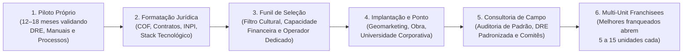

Para escalar de 10 para 300 unidades sem perder a alma da marca:
1. **Nunca venda franquia para "investidor passivo sem sócio-operador":** A taxa de mortalidade de unidades cujo dono tem outro emprego em tempo integral e "passa na loja sábado de manhã" é 4x maior. Exija em contrato um **Sócio-Operador dedicado 100% do tempo** (com participação societária real na unidade).
2. **Controle o Ponto Comercial e o ERP desde o Dia 1:** O franqueado nunca pode escolher o imóvel sozinho sem validação de geomarketing da matriz, e **100% das vendas e notas fiscais devem passar pelo ERP/PDV homologado pela franqueadora** (evitando subfaturamento de vendas na ponta para sonegar *royalties*).
3. **Integre o E-Commerce com o Franqueado (*Omnichannel Split*):** Nas marcas modernas (D2C + Franquias), o site da marca não compete com o franqueado: quando um cliente compra no e-commerce, o pedido é despachado pelo estoque da franquia mais próxima (*Ship-from-Store* ou *Pick-up in Store*) ou o franqueado daquele CEP recebe uma comissão pela entrega e pós-venda, alinhando incentivos entre o mundo digital e o físico.
4. **Cresça via *Multi-Unit Franchisees*:** Depois da 30ª unidade, a maneira mais segura e barata de abrir as próximas 100 unidades não é recrutar 100 novatos do zero, mas permitir que os seus **top 20% melhores franqueados atuais** abram sua 2ª, 3ª, 5ª e 10ª unidades em cidades vizinhas.

---

### Onde redes quebram: vender franquia para quem tem dinheiro mas não tem perfil operador, prometer lucro garantido na venda e misturar o Fundo de Propaganda com o caixa da franqueadora

1. **Franqueamento Prematuro (vender franquia de um negócio não-validado):** Formatar franquia com 4 meses de vida porque "acabou o dinheiro para abrir loja própria" é exportar um modelo quebrado para terceiros — você transforma um problema operacional em dezenas de processos judiciais.
2. **Desrespeitar os 10 dias da COF ou omitir ex-franqueados:** Basta um único ex-franqueado omitido da lista dos últimos 24 meses ou um pagamento recebido no 8º dia após o envio da COF para anular o contrato inteiro na Justiça.
3. **Prometer rentabilidade garantida no material comercial de expansão:** Apresentações de vendas de franquia que prometem *"Lucro garantido de R$ 25 mil por mês"* viram prova documental em ações de rescisão contratual por propaganda enganosa. Apresente sempre **faixas históricas de desempenho das unidades piloto** com *disclaimers* claros de que o resultado depende da gestão local.
4. **Ingerência direta nos funcionários do franqueado:** O consultor de campo da franqueadora deve dar *feedback*, treinar e cobrar **o sócio-franqueado** (ou o gerente designado por ele). Se o consultor da matriz começar a demitir, punir ou dar ordens diretas aos atendentes do franqueado, a Justiça do Trabalho reconhece a subordinação direta e condena a franqueadora solidariamente.
5. **Canibalização territorial e guerra de preços com o canal online:** Abrir uma segunda franquia a 400 metros da primeira sem estudo de saturação ou fazer promoções de *Black Friday* no site próprio da marca abaixo do preço de custo do franqueado destrói a confiança da rede da noite para o dia.

---

### O Espelho do Franchising: Seu Modelo Agüenta Pagar Royalties ou Você Só Quer Vender Taxa de Franquia?

> [!tip] O Espelho do Gestor (Autodiagnóstico Rápido)
> 1. **A Prova da Margem Pós-Royalties:** Se você pegar a DRE real da sua unidade própria hoje e descontar **5% a 8% de Royalties + 2% de Fundo de Marketing + o salário de um gerente local**, ainda sobra uma margem líquida limpa de **15% a 20%** que devolve o investimento da loja em menos de 30 meses? Se não sobrar, seu negócio ainda não é franqueável.
> 2. **A Trava dos 10 Dias da COF:** Seu processo de expansão exige protocolo assinado (com carimbo de tempo digital válido) da entrega da **Circular de Oferta de Franquia (COF)** completa — incluindo a lista nominal de todos os ex-franqueados que saíram da rede nos últimos 24 meses — **pelo menos 10 dias inteiros antes** de qualquer assinatura ou boleto?
> 3. **Perfil Operador vs. Investidor Passivo:** Você tem coragem de dizer **"Não"** para um candidato que tem R$ 500 mil à vista no banco, mas avisa que "não vai pisar na loja porque já tem outro emprego"?
>
> **Regra de Bolso (*estilo Michael Gerber / Gino Wickman*):** Franqueadora séria não vive de vender **Taxa Inicial de Franquia**; vive de **Royalties recorrentes e cadeia de suprimentos** gerados por franqueados que lucram todos os meses.
>
> **O Ritual de Segunda-Feira às 9h:** Audite a DRE da sua unidade modelo simulando a cobrança de royalties, separe uma conta bancária exclusiva e auditável para o **Fundo de Propaganda** e revise cada um dos 23 incisos obrigatórios do Art. 2º da Lei 13.966/2019 na sua COF.


---

## CAPÍTULO 7 — MARCA CORPORATIVA, PR, COMUNICAÇÃO PÚBLICA E MARCA PESSOAL DO FUNDADOR

### O Imposto da Desconfiança: Por Que Empresas Desconhecidas Pagam o Dobro de CAC e Perdem Deals na Hora H

Em Goiânia e Recife, **Rafael** e **Bia** perceberam um fenômeno irritante no funil da marca deles: os anúncios perfomavam bem no clique, o preço era 15% mais competitivo que o do líder nacional e o produto tinha qualidade superior nos testes cegos. Mesmo assim, 72% dos clientes abandonavam o carrinho na tela de pagamento — e, nas vendas B2B para grandes redes varejistas, o comprador sempre escolhia o concorrente mais caro dizendo: *"Não posso arriscar colocar na gôndola uma marca de que a minha diretoria nunca ouviu falar."*

Durante dois anos, Rafael havia tratado **Marca e Relações Públicas (PR)** como "despesa fútil de agência para ganhar prêmio", investindo 100% do orçamento em mídia de clique imediato. Só que eles acabavam de bater no muro invisível da escala: quando você sai do círculo dos primeiros entusiastas (*Early Adopters*) e tenta vender para a **Maioria Pragmática** descrita por Geoffrey Moore em *Atravessando o Abismo*, o cliente pragmático não compra o produto tecnicamente melhor; **ele compra a marca que parece mais segura, estabelecida e inevitável**.

Chamamos o custo extra que uma empresa sem reputação paga em cada clique e em cada negociação de **O Imposto do Anonimato**: quando ninguém conhece o seu nome, seu anúncio converte metade, seu vendedor leva o dobro do tempo para provar que a empresa não vai sumir amanhã e os melhores talentos pedem 30% a mais de salário para aceitar trabalhar com você. Construir Marca e Assessoria de Imprensa estratégica não é fazer propaganda institucional vazia; é fabricar **prova social institucional em escala** para reduzir o atrito de todas as suas vendas futuras.

---

Marca é um daqueles temas que founders B2B tendem a subestimar por anos. Até o dia em que precisam vender para uma empresa grande cujo comprador nunca ouviu falar de você, ou contratar um executivo sênior que nunca considerou trabalhar num lugar desconhecido, ou captar Série C com um fundo que fez due diligence (auditoria de viabilidade) em toda a trilha digital da empresa. Nesse dia, você descobre que marca não era luxo de empresa madura. Era infraestrutura de credibilidade, que deveria ter começado a ser construída três anos antes.

Este capítulo trata marca em duas camadas. A primeira é marketing de marca, PR (relações públicas) e awareness (reconhecimento de marca). Cobre como construir presença pública consistente, repetível, ao longo do tempo. É o trabalho que precede e acompanha toda venda. A segunda é brand como ativo de longo prazo, patrimônio com valor econômico mensurável, que se constrói por anos e se destrói em semanas, como qualquer ativo frágil.

---

### Como a imprensa e a autoridade de categoria funcionam na prática: o que vira notícia no Brasil (e o que vai direto para a lixeira do jornalista)

#### Por que marca importa, mesmo em B2B

O argumento contra investir em marca em B2B é quase sempre o mesmo. "Meu cliente é racional. Decide por ROI (retorno sobre investimento). Não por emoção." O argumento tem mérito parcial, e defeito estrutural. Mérito. Sim, o comprador B2B justifica decisões por números. Defeito. Ele escolhe quem convidar para a conversa com critérios que são, no fundo, emocionais. Confiança. Reputação. Familiaridade. Conforto. Marca é a diferença entre "vou chamar a Stone, e a PagSeguro", e "vou chamar a Stone, a PagSeguro, e uma terceira, que alguém me falou hoje". Se você é a terceira, e o comprador nunca ouviu falar, a conversa nem começa.

No Brasil, marca em B2B tem peso adicional. As nossas decisões de compra em empresa grande são mais relacionais. Mais baseadas em rede, e confiança. Menos em editais frios. Ter presença, em mídia especializada, em eventos, e em palestra, acelera venda de forma que ROI direto de marketing não captura bem.

#### Os três objetivos de marca

Qualquer ação de marca, se bem desenhada, atinge um, ou mais, de três objetivos.

**Awareness (reconhecimento).** O cliente-alvo sabe que a sua empresa existe. Métrica típica. Unaided brand recall ("liste três empresas que fazem X"), e aided brand recall ("você conhece a empresa Y?").

**Consideração (relevância).** O cliente-alvo inclui você no shortlist quando tem problema. Métrica. Menções espontâneas em RFPs. Participação em concorrências. Crescimento de pipeline inbound.

**Preferência (desejabilidade).** O cliente-alvo prefere você entre alternativas. Métrica. Win rate contra concorrentes específicos. NPS. Sentiment em social listening.

Não misture os três em uma mesma campanha. Conteúdo para awareness (quem sou, o que faço) é diferente de conteúdo para consideração (por que eu sou melhor), é diferente de conteúdo para preferência (por que o concorrente é pior, embora raramente frontal).

#### Canais de marca por tipo de empresa

Conteúdo proprietário. Blog, newsletter, podcast, e canal YouTube. Controle total. Construção lenta. Valor cumulativo. Exemplos brasileiros. Blog da RD Station. Podcast Like a Boss. Canal Warren.

Earned media (relações com imprensa). Menções em veículos que não são seus. EXAME, Valor, Folha, InfoMoney, Estadão, The Rider, Brazil Journal. Mais difícil. Maior credibilidade implícita. Envolve ter assessoria de imprensa (interna, ou agência), e estar disposto a falar com jornalistas.

Paid media. Anúncios pagos em veículos segmentados. LinkedIn Ads para B2B. Google Ads para intenção. Meta para volume. Pago garante entrega. Não garante que alguém lembre de você.

Eventos. Proprietários (o seu evento). Participação (patrocínio, ou palestra, em eventos de terceiros). Web Summit Rio, RD Summit, The Developers Conference, Campus Party, HSM Expo.

Palestras, e participação em painéis. O fundador sendo convidado para eventos da indústria. Ativa percepção de autoridade.

Aulas em universidades, e MBA. FGV, Insper, Ibmec, Fundação Dom Cabral. Formato. Aula ao vivo, ou participação em painéis de curso. Custo. Tempo. Retorno. Rede, e reputação.

Mídia social do fundador. LinkedIn como canal principal no Brasil B2B. Twitter para casos específicos (tech brasileira, fintech, crypto). Consistência importa muito mais que viralidade ocasional. Ver [[#CAPÍTULO 7 — MARCA CORPORATIVA, PR, COMUNICAÇÃO PÚBLICA E MARCA PESSOAL DO FUNDADOR|Capítulo 7 (Marca Corporativa, PR, Comunicação Pública e Marca Pessoal do Fundador)]], Comunicação Pública do Fundador, para profundidade.

Awards, e rankings. Startup Awards, Great Place to Work, 100 Startups to Watch. Validações externas.

#### Construindo uma prática de PR

PR (Public Relations, relações com a imprensa) é disciplina própria. Não derivada de marketing. Quem nunca fez PR, frequentemente, acha que "PR é vendedor chato atrás de jornalista". Na verdade, é construção de relacionamento longo prazo, com pessoas que têm poder de amplificar a sua história.

Um programa mínimo de PR envolve seis peças.

**Definir narrativa da empresa.** Qual é a sua história central? Por que vocês existem? Por que agora? Por que aqui? Essa narrativa precisa caber em trinta segundos (elevator pitch), em três minutos (pitch de podcast), e em trinta minutos (entrevista profunda). Coerência entre os três importa.

**Mapear jornalistas-alvo.** Quem cobre o seu mercado? Em quais veículos? Com que linha editorial? Ler os últimos vinte artigos deles antes de tentar pitch.

**Construir relacionamento antes de precisar.** Comentar artigos no LinkedIn. Responder tweets. Ir em evento, e apresentar-se sem pedir nada. Só pedir cobertura depois de já existir familiaridade.

**Ter materiais prontos.** Kit de imprensa (sobre a empresa, bio do fundador, fotos em alta resolução, números chave). Estudos de caso autorizados por cliente. Bordões de tendência de mercado, que você pode comentar com expertise.

**Responder rápido a pedidos.** Jornalista com deadline apertado, que pediu comentário, e você respondeu em trinta minutos, vira fã. A mesma pessoa, que ignorou, ou respondeu em dois dias, vira ex-contato.

**Agência, ou in-house.** Agências brasileiras fortes em tech. Ideal H+K, Global, Ketchum, Edelman. Custo. R$ 15 a 80 mil por mês. In-house. Profissional sênior, R$ 20 a 40 mil por mês, mais liberdade total sobre estratégia.

#### Armadilhas de marca em B2B

Pressa por resultado. Marca se constrói em anos. Qualquer métrica de ROI em noventa dias frustra. Investir em marca por três meses, e desistir porque "não trouxe cliente", é desperdiçar investimento feito.

Conteúdo sem tese. Blog genérico, com "cinco dicas para melhorar produtividade", é conteúdo de preenchimento. Conteúdo com tese forte ("por que a maioria das empresas brasileiras precifica errado", "por que o modelo freemium está morrendo em B2B") atrai, engaja, e diferencia.

Confundir volume com presença. Postar cinco vezes por dia em LinkedIn, com conteúdo fraco, destrói percepção. Melhor duas vezes por semana, com coisa boa.

Fundador ausente. Marca B2B brasileira é muito personalista. Se o fundador não aparece, a empresa parece sem alma. Mas o oposto, founder onipresente sem conteúdo, só promovendo a empresa, também queima.

Não diferenciar linguagem por persona. Técnico, comprador, e CEO consomem conteúdo diferente. Mesmo material pra todos atinge ninguém.

---

### Construindo posicionamento proprietário: como deixar de ser "mais uma opção barata" e virar a referência mental da categoria

#### Brand é ativo, não despesa

Empresa que vê brand (marca) como despesa corta em momento de aperto. Com efeito de curto prazo positivo. E de médio prazo devastador. O valor da marca pode ser destruído em semanas, com decisões erradas. E sustenta prêmio de preço, velocidade de vendas, retenção, aquisição de talento e até valuation (avaliação da empresa) em captação ou exit (venda da empresa).

> [!important] Brand equity como linha do balanço
> Em empresas públicas, brand equity (valor patrimonial da marca) é linha mensurável do balanço (goodwill, ágio). Em startup, o conceito não entra na contabilidade formal. Mas está lá. E fundos de VC ajustam valuation por brand strength (força da marca), mesmo sem dizer.

#### Os elementos de brand que se acumulam no tempo

Identidade visual, e verbal. Logo consistente. Paleta de cores estável. Tipografia própria. Tom de voz consistente (você é formal, ou coloquial? Técnico, ou acessível? Irreverente, ou sério?). Tom muda em dezoito meses, igual a empresa sem identidade. Nomenclatura de produtos coerente (Apple. iPhone, iPad, iMac, iCloud. Padrão claro).

Signatures, e assinaturas. Uma frase que a empresa repete, e que o cliente internalizou. "Just Do It" da Nike. "Think Different" da Apple. No Brasil, "Acha que é só andar" da Uber, veio disso. "O Itaú é feito para você", durou décadas. Esses bordões só funcionam por repetição ao longo de anos. Trocar toda campanha queima acúmulo.

Narrativa corporativa. Por que a empresa existe. Qual é a sua missão. Quais são os seus valores. Quando isso é claro, crível, e consistente, vira magnetismo. Para cliente, para funcionário, e para investidor. Nubank construiu parte relevante do valuation em narrativa (simplicidade contra complexidade bancária). Mercado Livre em outra (empoderar vendedor brasileiro).

Prova social de longo prazo. Histórico de casos de clientes importantes. Awards, e reconhecimentos. Fundadores convidados a opinar sobre o setor. Publicações regulares de pesquisa, ou estudo próprio.

Consistência de experiência. O cliente, que interage com você pelo site, pelo app, pelo suporte, e pelo vendedor, tem todas as interações coerentes na sensação.

#### Como proteger o ativo brand

Brand book vivo. Documento interno, com identidade visual, tom de voz, exemplos de aplicação, e exemplos do que não fazer. Todo novo funcionário de marketing, produto, ou comunicação recebe.

Governança de uso. Quem pode aprovar uso do logo, e da marca, em qual contexto? Descentralizar cedo. Governar sempre.

Monitoramento de sentiment. Social listening. Análise de mídia. Pesquisa de brand health. Trimestral é ritmo saudável em empresas em crescimento.

Relacionamento com jornalistas, mesmo em momentos calmos. Relação construída ao longo de anos é o que você aciona em crise.

Crisis communications pronto. Playbook de como responder em duas, quatro, doze, e vinte e quatro horas, a diferentes tipos de crise. Testado em simulação, antes de precisar.

#### Brand, e exit

Em um M&A, o comprador paga pelo fluxo de caixa futuro. Mas avalia qualidade, e risco, desse fluxo por brand. Uma empresa com brand forte tem múltiplo mais alto, porque o comprador acredita na durabilidade da receita. Uma empresa com brand fraca tem múltiplo mais baixo, porque o comprador precifica risco de erosão competitiva.

Em IPO, brand move mais ainda. O investidor de mercado público aloca parcialmente por fundamentos, e parcialmente por narrativa. Empresa sem narrativa estruturada precifica mal. Stone, Nubank, MercadoLibre captaram com múltiplos elevados, em boa parte, por brand premium.

#### Armadilhas de brand em escala

Rebranding por impulso. Novo CMO muda logo, tom de voz, e site. Destrói acúmulo, por preferência pessoal. Rebranding precisa ser decisão de board. Não de executivo novo.

Diluição por extensões. Marca mãe forte em um produto, lançando linha de produto diferente, com o mesmo nome. Arriscado. Separar sub-marcas, se necessário.

Perder consistência em escala. Dez funcionários mantêm tom naturalmente. Quinhentos, não. Brand guidelines, e treinamento, viram obrigatórios.

Esquecer legacy audience. Crescer segmentos novos, sem atender o cliente antigo, degrada NPS cedo, ou tarde.

---

### Comunicação Pública do Fundador: Narrativa, Canais Próprios e Porta-Voz

#### 1. Construir narrativa pessoal fundante

O framework de narrativa do fundador tem cinco elementos. Origem: de onde você vem, em que contexto se formou como pessoa. Não é "currículo" — é "por que você virou quem é". Vale mencionar contexto familiar (empresa da família? primeiro universitário? imigração? perda?) apenas se for genuinamente formador. Evitar dramatização sem substância.

Fricção: qual dor, injustiça, ineficiência ou oportunidade você viveu pessoalmente que conecta ao problema da empresa. "Minha mãe teve dificuldade X, por isso estou resolvendo Y." "Trabalhei em empresa A e vi Z, sabia que tinha que existir forma melhor." O teste de autenticidade: se qualquer fundador no seu setor pode contar a mesma história com adaptações mínimas, a narrativa é genérica demais.

Escolha: o momento em que você decidiu fazer isso, e o que estava em jogo. Deixar emprego estável? Virar empreendedor depois de carreira em empresa? Fundar após evento pessoal marcante?

Missão: o que você está construindo e por quê. Formato curto (uma frase) e longo (trinta segundos).

Contradição útil: alguma dualidade em você que é genuína e humaniza. "Engenheiro que queria ser músico." "Descobri o problema trabalhando no setor que hoje critico." Contradições humanizam. Narrativas puras soam falsas.

Os cuidados: evitar clichês ("sempre soube que queria empreender"), superlativos ("paixão desde criança") e mitologização exagerada (garage stories inventadas).

Os exemplos brasileiros mais bem-trabalhados ilustram perfis distintos. David Vélez (Nubank): colombiano, rejeição de bancos brasileiros como cliente, Stanford, Sequoia Capital, "construir banco que não odiasse o cliente" — narrativa pessoal mais problema mais missão em três linhas. Luiza Trajano (Magazine Luiza): herdeira de empresa pequena, feminino em varejo majoritariamente masculino, transformação de loja regional em rede nacional — narrativa de continuidade mais ambição mais representatividade. Guilherme Benchimol (XP): trabalhador de corretora grande, insatisfação com modelo, criar para "democratizar" investimento — insider virado outsider ambicioso. Flavio Augusto (Wise Up): vendedor de enciclopédia, franquia de inglês, sucesso, venda, novos negócios — trabalho duro mais resultado mais reinvenção. Jorge Paulo Lemann (3G Capital/Ambev/Garantia): tênis profissional, Harvard, banco, cerveja, fast-food global — disciplina mais meritocracia mais ambição silenciosa, intencionalmente discreto por décadas.

O espectro de exposição não tem resposta universal. Muito exposto (Flavio Augusto, Thiago Nigro, Bruno Perini): brand pessoal massivo com retornos reais (reach, empresa financiada por audiência) mas risco reputacional alto. Muito discreto (Lemann, David Vélez relativamente, Guilherme Leal da Natura): comunicação calibrada onde escassez aumenta o valor de cada aparição. A escolha depende da estratégia da empresa, do setor e da personalidade. Empresa que precisa de mercado amplo (varejo, consumer tech) tende a se beneficiar mais de exposição. Fundador em setor institucional (banco, seguro, indústria) frequentemente se beneficia de moderação.

#### 2. Canais próprios — LinkedIn, X, newsletter

Canais proprios (LinkedIn, X, newsletter) sao alavanca de distribuicao mas exigem cadencia e voz que evoluem ao longo do tempo. O tratamento de marca pessoal, com niveis de presenca, frequencia, formato de post e custos reais, vive em [[#CAPÍTULO 7 — MARCA CORPORATIVA, PR, COMUNICAÇÃO PÚBLICA E MARCA PESSOAL DO FUNDADOR|Capítulo 7 (Marca Corporativa, PR, Comunicação Pública e Marca Pessoal do Fundador)]]. Aqui basta saber que canais proprios sao componente de comunicacao publica e devem coordenar com imprensa e crisis comm.

#### 3. Imprensa e earned media

Os tipos de cobertura têm perfis distintos. Veículos especializados tier 1 (TechCrunch, Bloomberg, Reuters, Valor Econômico, Exame, NeoFeed, Brazil Journal) alcançam investidores, executivos e outras startups. Valem para anúncio de rodada Série A ou mais, lançamento significativo, parceria estratégica ou liderança setorial. O acesso é via assessoria de imprensa ou contato direto com o jornalista do setor.

Veículos de negócio de alcance amplo tier 2 (Folha, Estadão, O Globo, Veja, Forbes Brasil, Istoé Dinheiro) alcançam público geral, potenciais clientes B2C e reguladores. Valem para produto com apelo ao consumidor, marcos relevantes ou momento de categoria. Cuidado: jornalistas de negócios generalistas fazem perguntas difíceis e preparo é crítico.

Imprensa de nicho e setorial tier 3 (Portal do Agro, Valor Investe, PME Admin, podcasts setoriais) tem alcance menor mas segmentado, baixo risco e agenda mais fácil. Vale quase sempre.

Mídia local e regional tier 4 é útil para empresa com base geográfica clara. Constrói reputação local antes de nacional.

Para construir relacionamento com a imprensa, identificar cinco a quinze jornalistas do seu setor que escrevem relevantemente e ler tudo deles. Introduzir-se sem pauta primeiro: "queria me apresentar, coloco-me à disposição para background sobre o setor quando precisar". Jornalista guarda contato útil. Oferecer background sem querer cobertura imediata vira fonte confiável. Quando tiver pauta real, ligar ou escrever com substância: dados, acesso, exclusividade se couber. Respeitar o deadline do jornalista. Nunca pedir para "mudar" matéria publicada: jornalismo independente não funciona assim e pedidos desse tipo queimam a relação.

**Entrevistas, preparo:**

- Saber 3-5 mensagens-chave que quer transmitir. Voltar a elas nas respostas.
- Preparar com assessoria para perguntas difíceis ("sua empresa demitiu 20%, por que?"). Resposta honesta curta > resposta defensiva longa.
- **Não responder ao que não sabe.** "Não tenho esse dado agora, mando por email" é melhor que chutar.
- Gravar cópia própria da entrevista (ético fazer isso, informar o jornalista).
- Para TV: treinamento visual (olhar para câmera, postura, vestuário, luz).

**Quando recusar cobertura:**

- Pauta ruim ou negativa onde você não tem o que dizer de útil, declinar com educação.
- Veículo ruim ou sensacionalista, participação queima credibilidade.
- Momento errado da empresa (crise não resolvida), tempo não para isso.

**Crises e direito de resposta:**

- Se matéria tem erro factual: pedir correção formal (jornalista ou editor) com evidência.
- Direito de resposta: último recurso, legal, específico (Lei 13.188/2015).
- Processar jornalista: geralmente péssimo. Amplia problema e cria Streisand Effect.

#### 4. Palestras, painéis e eventos

Os formatos têm perfis de retorno bem distintos. Painel setorial em congresso tem baixo esforço e alcance segmentado. O problema é que um painel com cinco pessoas em quarenta minutos oferece três a quatro minutos de fala por pessoa — rendimento marginal. Keynote curta (quinze a trinta minutos) oferece controle narrativo e posicionamento como especialista. Requer trabalho real de roteiro, ensaio e slides, mas o ROI é alto se o conteúdo for bom. Aula em universidade (business school, MBA) tem alcance menor mas qualificado (futuros executivos e empreendedores), com retorno de longo prazo via rede de ex-alunos. O custo típico é duas a quatro horas de preparação mais uma a duas horas de aula. Fireside chat ou entrevista em evento tem formato conversacional que posiciona como líder, mas depende muito da qualidade do entrevistador.

Os eventos que valem atenção no Brasil incluem CASE (ABStartups) como o maior de startup no país, Web Summit Rio (global grande, relativamente caro e concorrido), Rio Innovation Week (crescente, bem posicionado), South Summit Brasil (desde 2023, atrai VCs internacionais) e eventos setoriais específicos como Febraban Tech (fintech), Hospitalar (healthtech), AgroBrasília e Agrishow (agro). Nas universidades, Insper, FGV, USP, PUC-Rio, PUC-RS, ITA, Inteli e vários MBAs são boas plataformas.

A regra de ouro para eventos: preparar conteúdo real (não "impressionar") e calibrar frequência. Keynote exige no mínimo oito a doze horas de preparação para estar pronto de verdade.

**Recusar convites:**

- Eventos ruins ou desalinhados queimam tempo e contexto.
- Aprender a dizer não. Critérios: audiência relevante? formato permite fala substantiva? pago? vale tempo?

#### 5. Crisis communication — quando empresa tem problema

Os tipos de crise que exigem o fundador como porta-voz têm dinâmicas próprias.

Vazamento de dados (LGPD) exige comunicação imediata obrigatória para ANPD e clientes afetados. Fundador como voz no comunicado oficial, assessoria de imprensa proativa com jornalistas principais. A qualidade da resposta de empresas brasileiras em incidentes de 2021 a 2024 variou enormemente.

Demissão em massa afeta imagem interna e externa. Fundador comunica internamente primeiro (allhands honesto) e externamente depois (com transparência calibrada). Algumas empresas comunicaram bem demissões em 2022 e 2023 (Loft, Quinto Andar em algumas rodadas), outras mal, com vazamentos internos que escalaram.

Crise financeira, rodada não-fechada ou insolvência iminente exige comunicação sequenciada para time, investidores atuais, credores e clientes, cada um em ordem e momento apropriado. Advogado de insolvência (se for o caso) e assessoria jurídica obrigatórios antes de comunicar externamente. O caso 123 Milhas em 2023 é exemplo de comunicação inicial fraca que amplificou a crise (ver [[IGNICAO-Vol-9-Maturidade-e-Exit#CAPÍTULO 19 — POST-MORTEMS BRASILEIROS: CATÁLOGO DE CASOS EM PROFUNDIDADE|Capítulo 19 (Post-Mortems Brasileiros: Catálogo de Casos em Profundidade) (Vol. 9)]]).

Escândalo (fraude, assédio, má conduta) exige investigação antes de qualquer posicionamento público. Falar sem saber vira passivo legal e reputacional maior. Advogado, RH e assessoria juntos definem narrativa. Fundador fala apenas com roteiro validado. Transparência calibrada: não mentir, mas também não especular publicamente.

Conflito com investidor, saída de sócio ou briga de board: regra geral é silêncio público. Discussão de board é privada. Se for inevitável comunicar (saída pública de cofundador), comunicado conjunto é ideal. Se impossível, comunicado factual sem ataque ao outro lado.

**Protocolo de crisis (estrutura):**

1. **Primeiras 2 horas**: convocar advogado + assessoria + co-fundadores críticos. Estabelecer fatos confirmados vs rumores.
2. **2-6 horas**: definir mensagem-chave (1-3 frases). Definir quem comunica a quem e quando.
3. **6-24 horas**: comunicação interna (time) + comunicação com stakeholders principais (investidores, clientes-chave, reguladores se aplicável).
4. **24-72 horas**: comunicação pública (release, entrevista controlada se necessário).
5. **Primeiras 2 semanas**: gerenciar follow-ups, ajustar narrativa conforme informação nova, transparência calibrada.
6. **Mês 1-3**: continuidade (mostrar correção de rota, não apenas contrição).

**Erros comuns em crisis comm:**

- **Silêncio estendido**: transfere narrativa para vácuo.
- **Negação sem base**: quando fatos aparecem depois, destrói credibilidade de forma irreversível.
- **Culpar subalternos**: sinaliza liderança fraca.
- **Comunicação defensiva-agressiva** ("jornalista está sendo injusto"), amplifica.
- **Múltiplos porta-vozes descoordenados**: mensagens contraditórias saem piores que silêncio.
- **Sumir depois do primeiro comunicado**: história continua, fundador precisa continuar também.

**Exemplo positivo comparativo**: vazamentos de dados em Nubank ao longo dos anos, comunicação transparente, rápida, com medidas de mitigação claras. Preservou confiança.

**Exemplo negativo comparativo**: Americanas 2023, comunicação inicial minimizando problema ("inconsistências contábeis" para R$ 20-40 bi de fraude) destruiu credibilidade restante. Fundadores (trio 3G) silenciaram publicamente por meses, vácuo foi preenchido por especulação e vazamentos. Ver [[IGNICAO-Vol-9-Maturidade-e-Exit#CAPÍTULO 19 — POST-MORTEMS BRASILEIROS: CATÁLOGO DE CASOS EM PROFUNDIDADE|Capítulo 19 (Post-Mortems Brasileiros: Catálogo de Casos em Profundidade) (Vol. 9)]] para análise completa.

#### 6. Brand pessoal vs corporativo

Há três razões para separar deliberadamente brand pessoal de brand corporativo. No exit, o fundador sai da empresa mas mantém vida pública — se o brand pessoal depende totalmente da empresa, exit vira crise de identidade. Em crise, o brand pessoal pode sustentar parte da reputação enquanto o corporativo é pressionado. E para próximas empresas, second-time founder com brand pessoal construído tem vantagem enorme (ver [[IGNICAO-Vol-9-Maturidade-e-Exit#CAPÍTULO 20 — SECOND-TIME FOUNDER|Capítulo 20 (Second-Time Founder) (Vol. 9)]]).

Para construir brand pessoal separadamente: desenvolver presença em temas adjacentes que não são só da empresa (liderança, setor amplo, tecnologia em geral), participar de conselhos externos, fazer investimentos angel e mentoring, e escrever ou falar sobre temas de interesse próprio que transcendam a empresa atual.

Os cuidados necessários são três. Over-personal branding que ofusca a empresa: investidor começa a achar que o fundador "se diverte mais com a fama que com a empresa", e isso é red flag. Brand pessoal que contradiz empresa: fundador promovendo estilo de vida que contradiz valores da marca corporativa. E misturar negócios pessoais com empresa: fundador vira influencer e monetiza seguidores com produtos próprios sem clareza, criando confusão de mandato.

Luiza Trajano é exemplo de brand pessoal bem-construído no Brasil: ligado ao Magazine Luiza mas com autoridade própria em política, diversidade e questões sociais, que transcende a empresa. Carlos Wizard Martins construiu brand pessoal antes e depois da Wizard, com identidade que continua mesmo após a saída.

---

### Os quatro níveis da marca pessoal

Marca pessoal não é binário. É espectro. Quatro níveis. Cada um com retornos, e custos diferentes.

**Nível 1, Profissional competente (baseline).** Perfil de LinkedIn atualizado, foto profissional, headline clara, e descrição da empresa. Sem conteúdo regular. Esse nível é *obrigatório*. Não fazer é sinalização negativa. Custo. Três a quatro horas, uma vez. Retorno. Evitar sinalização ruim.

**Nível 2, Contribuidor de conteúdo.** Um a dois posts por semana sobre o que a empresa faz, o que o fundador aprende, e comentários sobre notícia do setor. Sem estratégia específica. Mas consistência. Rede gradual de dois a cinco mil seguidores em doze a dezoito meses. Custo. Três a cinco horas por semana. Retorno. Algumas oportunidades inbound. Melhoria de sinalização em contratação.

**Nível 3, Voz reconhecida no setor.** Três a cinco posts por semana. Pelo menos um original, e profundo. Presença consistente em eventos (painéis, keynotes, e podcasts como convidado). Newsletter própria, ou publicação em plataforma editorial (Substack, Medium, ou newsletters setoriais). Rede de vinte a cinquenta mil seguidores em dois a três anos. Custo. Sete a dez horas por semana. Retorno. Pipeline significativo. Vantagem em captação. Convites a eventos que abrem portas.

**Nível 4, Thought leader setorial.** Voz que define direção do setor. Posts de profundidade. Talks em eventos-âncora (Web Summit Rio, ou TED-like). Livro, ou conteúdo autoral de peso. Entrevistas em mídia de massa. Rede de cem mil em diante seguidores. Custo. Quinze ou mais horas por semana. E equipe de apoio (ghostwriter, editor, e produtor de podcast). Retorno. Distribuição própria para lançar produtos. Autoridade para pivotar o setor. Oportunidades de investimento, e advisory.

A maioria dos fundadores brasileiros que operam em nível 3, ou 4, em 2024 a 2026. Cesar Carvalho (Wellhub). Rafael Perez (Loggi no começo). Pedro Arnt (Mercado Livre CFO antes de virar founder). Eric Santos (RD Station original). Pedro Englert (StartSe). Lucas Aisenberg (Kin advisory). Rebeca Vergueiro (Olist anteriormente). Fabio Povoa (CEO da NeoGrid, ou Movile, e investidor). Bruno Nardon (Kanui, ou ex-Amazon, ou consultor).

> [!tip] Estudar quem já está em nível 3 ou 4
> Observar como eles produzem conteúdo (cadência, formato, profundidade, e engajamento com comentários) ensina mais do que qualquer curso de LinkedIn.

---

### Os formatos que funcionam em 2026

**Post curto com insight específico (LinkedIn, 150 a 300 palavras).** Formato dominante em B2B Brasil. Estrutura. Abertura específica (não "vou falar sobre..."). Dado, ou experiência concreta. Insight derivado. Chamada para engajamento (pergunta aberta, ou convite a discordar). Evitar. Linguagem corporativa. Listas de sete motivos. Emojis em excesso.

**Post longo em formato narrativo (LinkedIn, 500 a 1.000 palavras).** Para temas complexos. Formato "story-driven". Começa com momento específico (você fez X em 2024, descobriu Y). Expande para padrão mais amplo. Conclui com lição. Funciona melhor que posts analíticos genéricos.

**Newsletter própria (Substack, Beehiiv, ou Ghost).** Para fundadores já com base de cinco mil ou mais, e disposição de escrever artigo longo semanal, ou quinzenal. Cadência consistente importa mais que qualidade perfeita. Semanal mediano supera quinzenal excelente.

**Podcast como convidado.** Maior ROI por hora em termos de construção de voz. Sessenta minutos de conversa em podcast setorial distribui para rede nova, e gera cinco a dez clips para redes sociais. Começar aceitando convites pequenos (podcasts de nicho com quinhentos a dois mil ouvintes) antes dos grandes.

**Podcast próprio.** Custo alto (editor, produtor, identidade visual, convidados, e cadência). E retorno lento. Só faz sentido se o fundador tem motivação genuína, e capacidade de manter cadência por doze ou mais meses. Podcasts abandonados no episódio oito são pior do que não ter.

**Talks em eventos.** Maior conversão por evento individual. Audiência presente está engajada por trinta a sessenta minutos. Começar por painéis menores. Evoluir para keynotes. Evitar o circuito exaustivo de eventos, que consome mais do que devolve.

---

### O lado sombrio, quando marca pessoal vira passivo

> [!warning] Distração do fundador
> Fundador que gasta quinze horas por semana em conteúdo e tem produto parado é marca-pessoal-sem-empresa. Conteúdo sustenta narrativa por algum tempo. As métricas da empresa acabam contradizendo a narrativa. Quando a contradição aparece, o colapso da narrativa é rápido e custoso.

Exposição de opiniões pessoais irrelevantes ao negócio. Fundador que entra em debate político, religioso, ou cultural polêmico, fora do escopo do negócio, aliena parte dos clientes, talento, ou investidores. Julgamento sobre o que expor. Tem a ver com a empresa? Contribui com valor para público? Se não, silêncio vale mais.

Crises amplificadas. Fundador com presença pública grande em crise tem cobertura massiva. Problema de produto vira thread viral. Comentário infeliz vira manchete. Exposição aumenta riscos específicos, que fundador sem marca não enfrenta.

Custo em relações internas. Time que acompanha fundador criando conteúdo sobre o que deveria ser trabalho coletivo, desenvolve ressentimento legítimo. "O fundador conta história heroica sobre decisão que eu implementei" é queixa comum. Atribuição explícita de crédito em conteúdo reduz esse problema significativamente.

Dependência do canal. O LinkedIn muda algoritmo. O Twitter é adquirido, e tem regras novas. O TikTok é banido em alguns mercados. Fundador com marca pessoal cem por cento dependente de uma plataforma, é fundador exposto a mudança fora do controle dele.

---

### Checklist de posicionamento de marca, PR orientado a dados e uso comercial de imprensa

- [ ] Narrativa corporativa escrita, crível, e repetível
- [ ] Brand book com identidade visual, e verbal, documentados
- [ ] Conteúdo proprietário regular (blog, newsletter, podcast, ou vídeo)
- [ ] Presença em pelo menos dois veículos earned media relevantes, por ano
- [ ] LinkedIn do fundador ativo (ver [[#CAPÍTULO 7 — MARCA CORPORATIVA, PR, COMUNICAÇÃO PÚBLICA E MARCA PESSOAL DO FUNDADOR|Capítulo 7 (Marca Corporativa, PR, Comunicação Pública e Marca Pessoal do Fundador)]] — narrativa do fundador, imprensa e porta-voz)
- [ ] Relações com imprensa. Assessoria interna, ou agência. Mapa de jornalistas
- [ ] Kit de imprensa atualizado (about, bios, fotos, estudos de caso)
- [ ] Brand tracking trimestral (social listening, mais pesquisa em cliente)
- [ ] Crisis communications playbook testado
- [ ] Governance de uso de marca (quem aprova o quê)
- [ ] Revisão anual de consistência cross-canais


---

### O Espelho da Marca: Sua Empresa Parece Líder Inevitável da Categoria ou um Segredo Bem Guardado?

> [!tip] O Espelho do Gestor (Autodiagnóstico Rápido)
> 1. **O Teste da Busca Direta (*Branded Search*):** Nos últimos seis meses, o volume de pessoas que digitam **o nome exato da sua empresa** diretamente no Google cresceu mês a mês, ou 100% do seu tráfego morre no segundo em que você pausa o leilão de palavras genéricas?
> 2. **Pauta de Dados vs. Autoelogio:** Quando você tenta emplacar uma matéria na imprensa ou publicar um estudo de mercado, você oferece **dados inéditos agregados da sua base** (*"Nosso levantamento com 800 clínicas mostra que a inadimplência subiu 18% no trimestre"*) ou manda um *release* chato dizendo *"Nossa empresa lançou uma nova funcionalidade incrível"* (que nenhum jornalista sério publica)?
> 3. **Municiamento Comercial:** Quando sai uma matéria relevante sobre a sua empresa ou um estudo de caso de sucesso, os seus vendedores usam esse link dentro da cadência de vendas e da proposta comercial para destravar a confiança do CFO do cliente?
>
> **Regra de Bolso (*estilo Geoffrey Moore*):** Imprensa não serve para massagear o ego do fundador no grupo da família; imprensa serve para **fabricar munição de credibilidade que o seu vendedor anexa no e-mail para o decisor corporativo**.
>
> **O Ritual de Segunda-Feira às 9h:** Extraia da base de dados da sua operação **3 estatísticas reais e contraintuitivas sobre o seu setor** e transforme-as num **Relatório Trimestral de Inteligência de Mercado** para enviar à imprensa especializada e a todos os clientes do seu funil.

### LEITURAS E REFERÊNCIAS COMPLEMENTARES

*Crossing the Chasm*, de Geoffrey Moore (movimento de mainstream, segmentação de adopters). *Play Bigger*, de Al Ramadan, Dave Peterson, Christopher Lochhead e Kevin Maney (category design formalizado). *Building a StoryBrand*, de Donald Miller (narrativa voltada ao cliente). *Obviously Awesome*, de April Dunford (posicionamento como disciplina).

---

# LIDERANÇA EXECUTIVA, CONTRATAÇÃO SÊNIOR, REMUNERAÇÃO, ESOP E CULTURA (CAPÍTULOS 8 A 15)

A segunda metade do volume é o manual de liderança executiva e cultura do CEO: como calibrar o *Founder Mode* com delegação e cadência operacional semanal, contratar e demitir executivos C-level, rodar ciclos justos de avaliação de performance, desenhar remuneração estratégica e *Stock Options (ESOP)* no Brasil e sustentar uma cultura de alta exigência em regimes presenciais, híbridos ou remotos.

---

## CAPÍTULO 8 — FOUNDER MODE, DELEGAÇÃO, GESTÃO DE TEMPO E CADÊNCIA OPERACIONAL DO CEO

### A Falsa Dicotomia do "Founder Mode": Como Delegar a Operação Sem Abdicar do Volante nem Virar Microgerente Tóxico

Quando a startup de **Lucas** e **Marina** passou de 65 funcionários após a Série A, um conselheiro bem-intencionado disse a Lucas: *"Agora que vocês contrataram diretores experientes de mercado, o papel do bom CEO é sair do caminho, parar de se meter nos detalhes de produto e deixar os executivos trabalharem em paz!"* Lucas obedeceu ao pé da letra. Parou de olhar os *pull requests* críticos, parou de ouvir gravações de chamadas de clientes perdidos e limitou-se a olhar os slides resumidos que os novos diretores levavam para a reunião mensal.

Oito meses depois, durante um jantar com um dos seus clientes mais antigos, Lucas levou um choque: o cliente contou que a nova versão da plataforma estava lenta, cheia de telas confusas e que dois dos melhores engenheiros juniores da empresa haviam pedido demissão porque o novo Diretor de Produto aprovara um redesenho burocrático que ninguém na ponta entendia. Quando Lucas abriu o capô da operação no dia seguinte, descobriu que havia confundido **delegar com abdicar**: os relatórios gerenciais de alto nível estavam verdes por fora, mas o produto estava apodrecendo por dentro.

Quando Brian Chesky (Airbnb) e Paul Graham acenderam o debate global sobre **Founder Mode vs. Manager Mode**, tocaram exatamente nessa ferida que Andy Grove já havia dissecado quarenta anos antes em *High Output Management*: o grande líder não é o microgerente inseguro que aprova cada vírgula e paralisa o time, mas também jamais é o burocrata ausente que governa apenas por relatórios filtrados. Chamamos o erro de Lucas de **A Cegueira da Delegação Cega (Abdicação)**. O verdadeiro domínio executivo é a **Inspeção por Amostragem Profunda**: dar autonomia total de execução para seus líderes, mas mergulhar regularmente na trincheira sem filtro (ouvindo o cliente, usando o produto e falando com a ponta) para garantir que a excelência não se perca nas camadas do organograma.

---

Este capítulo trata de decisoes estrategicas de modo (qual dominio operar em founder mode, qual em manager mode). Para os instrumentos operacionais de tempo (calendar, ritual, cadence), ver [[#CAPÍTULO 8 — FOUNDER MODE, DELEGAÇÃO, GESTÃO DE TEMPO E CADÊNCIA OPERACIONAL DO CEO|Capítulo 8 (Founder Mode, Delegação, Gestão de Tempo e Cadência Operacional do CEO)]].

Uma das discussões mais intensas entre operadores nos últimos anos é a tensão entre Founder Mode e Manager Mode. Articulada por Paul Graham (YC) em 2024 após observar que CEOs fundadores que delegavam "como ensinado em MBA" costumavam destruir valor, enquanto os que mantinham envolvimento direto em decisões-chave escalaram melhor.

A discussão não é "fundador deve fazer tudo" versus "fundador deve delegar tudo". É sobre quando mudar de modo, em quais domínios e com quais mecanismos. Fundadores iniciantes perdem valor em dois extremos. Delegam cedo demais (contratam VP e saem do caminho antes da pessoa conhecer o negócio). Ou tarde demais (viram gargalo quando a empresa tem oitenta pessoas e ainda aprovam compra de cadeira).

Este capítulo mapeia os dois modos. Articula quando operar em cada um. E dá mecanismos concretos de transição, sem romantizar nenhum lado.

### O que Brian Chesky e Paul Graham realmente quiseram dizer com Founder Mode (e por que isso não é licença para humilhar diretores nem centralizar tudo)

Vale conhecer a origem factual do debate. Porque o termo virou meme, e perdeu um pouco do significado original.

Em setembro de 2024, num evento do Y Combinator fechado para fundadores, Brian Chesky (CEO da Airbnb) fez uma fala improvisada que deveria durar trinta minutos, e se estendeu por duas horas. Ele contou que, na fase de crescimento pós-IPO, seguiu o conselho convencional repetido em todo livro de gestão. *"Contrate gente boa, e dê espaço para ela fazer o trabalho"*. E o resultado foi desastroso. O produto começou a perder consistência. As decisões viraram comitê. A empresa perdeu velocidade. A pandemia em 2020 obrigou uma reavaliação brutal. A Airbnb teve que demitir vinte e cinco por cento do time.

Foi nesse momento que Chesky teve uma conversa com Jony Ive (ex-chefe de design da Apple, e amigo próximo), que lhe disse a frase que ele cita desde então. *"Você não gerencia pessoas. Você gerencia pessoas através do trabalho"*. Chesky passou a estudar como Steve Jobs administrava a Apple, e adotou uma versão do modelo. Envolvimento direto em decisões de produto, estética, e contratações-chave. E relação direta com o time estendido.

Paul Graham estava na plateia do evento do YC. Dias depois, escreveu o ensaio *Founder Mode* (paulgraham.com/foundermode.html), nomeando o fenômeno. A plateia do evento, segundo Graham, era composta dos fundadores mais bem-sucedidos já financiados pelo YC. E a reação foi unânime. Muitos disseram ter ouvido a mesma coisa de conselheiros experientes, e ignorado. Porque contrariava todo o catecismo de "escalar com profissionalização".

> [!quote] Como Chesky descreve a prática hoje
> Fala textual em podcast do Social Radars, 2025.
>
> *"Eu trato todos eles como meus diretos. Faço skip-level, co-contrato com eles, e tomo decisões sobre se estão funcionando ou não, como hire, fire, promote e gerenciar. Pode parecer muito trabalho, mas é necessário. O conselho convencional diz para você montar um time executivo top-tier e sair do caminho. Isso, para mim, é absolutamente o que você NÃO deveria fazer. O que você precisa é ter relações com o máximo de pessoas possível na empresa."*

A Airbnb tem cerca de 7.300 funcionários. Chesky trata como "diretos" aproximadamente cinquenta pessoas. Distribuídas em vários níveis do organograma. Em empresas de produto como Airbnb, Apple, e Tesla, esse envolvimento direto do fundador é o que preserva a alma do produto, contra a derivação típica de empresas grandes.

**Crítica honesta ao conceito.** Porque nem tudo é absoluto.

O termo virou meme após o ensaio. E atraiu crítica relevante. Três pontos que vale considerar.

*Phocuswire* (setembro de 2024) publicou texto argumentando que "Founder Mode" é formulação vaga, que pode virar desculpa para CEOs abusarem de controle, sob rótulo de "visão". O crítico observa que Chesky teve um período de execução ruim, e pode estar correlacionando duas coisas separadas. Envolvimento direto, e boa execução.

O próprio Chesky, depois, tentou descolar a prática do termo viral. *"Eu nunca chamei isso de founder mode. Paul cunhou a expressão. Eu falo de estar nos detalhes sem micromanagement"*. A ironia é que a palavra colou, e virou bandeira de CEOs controladores. Que é exatamente o que Chesky não advoga.

Founder Mode é claramente mais aplicável a CEO-fundador, que a CEO profissional contratado. E é mais aplicável a empresas de produto com alta especificidade (Airbnb, Apple, Tesla), do que a negócios de operação complexa (logística, fintech pesada em regulação), onde a delegação profunda para especialistas é genuinamente necessária.

> [!important] O insight que sobrevive à crítica
> Em estágios pré-Série B, o fundador que tenta "delegar tudo" cedo demais costuma estar fugindo do trabalho que só ele pode fazer, ser a cola entre produto, cultura e time-chave. O ensaio do Graham é, nesse sentido, permissão explícita para você não adotar o conselho convencional sem pensar.

### Por que relatórios gerenciais filtrados por três camadas hierárquicas sempre escondem a deterioração do produto e da cultura

Quatro razões pelas quais essa discussão não é acadêmica.

Delegação cedo demais destrói vantagem fundadora. O fundador tem um ativo que nenhum contratado tem. Memória de todas as decisões. Intuição de cliente, construída em milhares de conversas. Rede fora do organograma. Quando delega antes de transferir isso, delega poder sem transferir sabedoria. Resultado. O VP novo toma decisões razoáveis em média, que destroem diferencial específico.

Gargalo fundador quebra empresa depois. O oposto. Fundador que faz tudo em empresa com cinco pessoas é produtivo. Em empresa com cinquenta, vira gargalo crítico. As decisões param. Gente qualificada vai embora, por falta de autonomia. A qualidade cai.

Contratações C-level falham mais do que se admite publicamente. A taxa de rotatividade de C-level no primeiro ano em startups é significativamente alta. Ordens de grandeza maior, que em corporate maduro. Fundador que "delega e some" não cria as condições para o VP succeder.

A transição Founder para Manager Mode não é permanente, ou unidirecional. o fundador pode, e deve, voltar ao fundador Mode em áreas específicas, ou momentos específicos (crise, reinvenção, lançamento, ou entrada em segmento novo). Tratar a transição como "evolução permanente de fundador em CEO profissional" ignora a natureza oscilante da liderança em startup.

> [!warning] Custo de pular essa seção
> Fundadores que copiam o modelo de "CEO maduro distanciado" cedo demais produzem empresas medianas. Fundadores que nunca delegam produzem empresas que param em trinta pessoas. Este capítulo existe para que você decida conscientemente em qual modo operar em cada área. Não por default. Não por FOMO.

### A regra de ouro de Andy Grove: calibrando o nível de supervisão pela maturidade específica do líder naquela tarefa exata

#### 1. Mapa de Modos, o exercício base

Esse é o entregável fundamental. Pegue os dez a quinze domínios operacionais da empresa, e declare explicitamente em qual modo você opera em cada.

**Domínios típicos em startup.** Produto, e roadmap. Design, e UX. Engenharia. Vendas (top clientes, e base). Marketing, e marca. Finanças, e captação. Jurídico. Operações, e processos. Pessoas, ou RH. Atendimento ao cliente. Parcerias estratégicas. Internacionalização. Inovação, ou laboratório.

Para cada, declare.

| Domínio | Modo atual | Gatilho para mudar | Quem é o delegado |
|---|---|---|---|
| Ex: Produto | Founder Mode | Quando ARR > R$ 50M e 2+ linhas de produto | Ainda não tem |
| Ex: Jurídico | Manager Mode | (permanente) | Advogada contratada externa |
| Ex: Top 10 contas | Founder Mode | Quando ARR > R$ 100M | Head de Sales |
| Ex: Contas médias | Manager Mode | | Sales rep |

> [!question] Teste honesto cada linha
> "Estou em Founder Mode aqui, porque agrega valor diferencial, ou porque não sei soltar?". E o inverso. "Estou em Manager Mode aqui, porque delega bem, ou porque quero evitar o desconforto de dizer 'não' para alguém?". Respostas honestas doem, e são úteis.

#### 2. Os três sinais de que está em Founder Mode tarde demais

**Sinal 1, decisões param quando você viaja.** Você tira duas semanas de férias. Quarenta por cento dos deals ficam em limbo. Orçamentos não são aprovados. Contratações pausam. Isso é gargalo. Não engajamento.

**Sinal 2, C-level contratados saem em menos de doze meses.** Se vários C-level pedem demissão, citando "sem autonomia", ou "não consegui ter voz", o problema não é a contratação. É você não abrindo espaço. Um caso é ruído. Três são padrão.

**Sinal 3, reuniões operacionais que não deveriam ser sua, consomem trinta por cento ou mais do seu tempo.** Revisar cada decisão de R$ 20 mil. Aprovar redação de emails externos. Revisar PRs de engenharia pontuais. Faça auditoria semanal do calendário. Quanto disso um CEO de empresa do seu estágio faria?

#### 3. Os três sinais de que delegou cedo demais

**Sinal 1, reclamações recorrentes de clientes que você nunca ouviu antes.** Antes, você conhecia cada cliente, e a dor dele. Agora descobre em QBR que quinze por cento da base reclama da mesma coisa há quatro meses, e ninguém te contou. Isso é desconexão. Não profissionalização.

**Sinal 2, decisões de produto que você não teria tomado.** O VP de Produto lança feature que não faz sentido para o cliente que você conhece. Não é que o VP está errado necessariamente. É que você perdeu o canal de informação que te permitia sentir, quando a direção estava errada, antes de virar feature lançada.

**Sinal 3, cultura mudando sem você perceber.** As contratações recentes falam de uma empresa diferente da que você construiu. Os valores têm interpretações que você não reconhece. Isso é sinal de que a camada fundadora virou folclore, e a camada operacional virou real.

#### 4. Mecanismos para operar em ambos os modos ao mesmo tempo

O verdadeiro domínio não é escolher um modo. É saber ter mecanismos que preservam o melhor dos dois simultaneamente.

**Skip-level 1:1s.** O CEO conversa diretamente, mensalmente, com pessoas duas camadas abaixo. Não para passar por cima do gerente. Mas para manter canal de informação direto. Combinação explícita com o gerente. "Vou falar direto, te faço resumo, decisões não passam no skip-level".

**Office hours semanais do CEO.** Uma a duas horas por semana, abertas para qualquer pessoa da empresa agendar quinze minutos com o CEO. Funciona como canal de calor. Problemas que não iriam subir pelo canal formal chegam.

**Cliente-tour mensal.** O CEO dedica um dia por mês para conversas com três a cinco clientes da base (top, médio, e saindo). Mesmo em empresa com quinhentas pessoas, esse ritual preserva intuição de cliente.

**Desafios rotativos.** O CEO assume pessoalmente, por trinta a noventa dias, um problema operacional que normalmente estaria delegado. Rotaciona área a cada trimestre. Isso gera aprendizado. Sinaliza aos delegados onde precisa melhorar. E evita distanciamento crônico.

> [!warning] Anti-padrão dos "all hands teatrais"
> Reuniões mensais de toda a empresa viram comunicação one-way, quando são a única interação do CEO com base. Se for o caso, é Manager Mode disfarçado de Founder Mode. Solução. Combinar all hands (necessário) com canais diretos (obrigatório).

#### 5. Como contratar C-level, sem cair no padrão "delegou e quebrou"

A taxa de fracasso de contratações C-level em startup é alta. E grande parte do problema é como a contratação é feita. Não quem é contratado.

**Período de onboarding com Founder Mode explícito.** Primeiros noventa dias. Fundador, e C-level, operam juntos em decisões do domínio. O fundador não "delega e sai". O fundador explica, deixa o C-level decidir, e discute resultado. Só depois de noventa dias há delegação real, com autonomia.

**Feedback loop formal de 30-60-90.** Em trinta, sessenta, e noventa dias, conversa formal entre fundador, e C-level. O que está funcionando. Onde o fundador ainda precisa estar envolvido. Onde o C-level precisa mais autonomia. Sem essa estrutura, as tensões se acumulam, e exploram em oito a dez meses.

**Critério de "mão-na-massa" no perfil.** Em startup pré-Série B, C-level que "não opera" não serve. O perfil deve incluir capacidade (e disposição) de operar diretamente trinta a cinquenta por cento do tempo, nos primeiros dezoito meses. Candidatos que só fazem "estratégia, e gestão de time", não encaixam no estágio.

**Transferência documentada.** Antes de delegar, o fundador escreve documento curto com. Decisões-chave tomadas historicamente. Lógica de cada uma. Clientes, e situações atípicos. Relações-chave. Transferência de sabedoria. Não só de função.

#### 6. Retornos táticos ao fundador Mode

Situações em que o fundador retoma Founder Mode em áreas delegadas. Mesmo que temporariamente.

Crise existencial. Runway crítico. Churn anômalo. Processo regulatório grave.

Reinvenção ([[IGNICAO-Vol-9-Maturidade-e-Exit#FASE 19 — REINVENÇÃO E SEGUNDA CURVA|Fase 19 (Vol. 9)]]). A segunda curva exige o fundador no detalhe. Porque é equivalente a iniciar outra empresa dentro da empresa.

Entrada em novo mercado. Geográfico. Segmento. Produto adjacente. Fase de descoberta exige fundador. Como foi no primeiro PMF.

Captação grande (Série B em diante). O fundador é o que o investidor compra. Delegar prospecção de investidores é romantismo. Precisa ser fundador.

Lançamento de produto estratégico. Similar a entrada em mercado.

Pós-crise de executivo-chave. Se o VP sai em momento ruim, o fundador retoma área diretamente, por três a seis meses. Até contratar substituto, ou promover interno.

> [!important] Retornos táticos não são regressão
> São design. Comunicar explicitamente ao time. "Por N meses vou voltar a estar em X. Isso não é sinal de que vocês não confiam. É sinal de que essa fase exige fundador".

### Velocidade de Decisão na Ponta, % do Tempo do CEO em Decisões Irreversíveis (Tipo 1) vs. Reversíveis (Tipo 2) e Fidelidade do Produto

Tempo do CEO em decisões menores que R$ X. Onde X é valor abaixo do qual a decisão deveria estar delegada (varia por estágio. R$ 5 mil pré-Série A. R$ 50 mil pós-Série B). CEO passando vinte por cento ou mais do tempo em decisões abaixo de X, é gargalo.

Taxa de retenção de C-level no primeiro ano. Alvo igual ou maior que oitenta e cinco por cento. Abaixo disso, indica problema sistêmico no processo de transição.

Pulse survey "tenho autonomia para tomar decisões do meu escopo". Medido em head-level, e diretor-level. Alvo igual ou maior que sete sobre dez. Abaixo de seis, gargalo declarado pela organização.

Decisões que pararam por ausência do CEO. Medir em semanas com viagem, ou férias, do CEO. Alvo igual ou menor que duas decisões travadas por semana de ausência.

Frequência de contato direto do CEO com cliente. Três a cinco conversas profundas por mês, para CEOs pós-Série A. Abaixo disso, risco de desconexão.

---

### Gestão de Tempo do Fundador e Cadência Operacional (Operating Cadence)

#### 1. Gestão de tempo pessoal do fundador

**Princípios fundamentais.**

**Princípio 1, proteja o que não se recupera.** Sono, exercício, relacionamentos próximos, e tempo de reflexão profunda, não são "negociáveis" quando há pressão. Fundador que sacrifica consistentemente esses itens, não está "mais comprometido". Está em caminho para decisão ruim, burnout, ou ambos.

**Princípio 2, categorize tarefas por tipo de atenção requerida.** Não todas as tarefas exigem o mesmo tipo de atenção. Trabalho de execução rasa (email, Slack, e aprovações). Cinco a quinze minutos cada. Fragmentável. Trabalho de decisão (reuniões 1:1, e decisões estratégicas específicas). Trinta a sessenta minutos cada. Focado, mas interrupcionável. Trabalho profundo (escrever estratégia, pensar em problema, ou criar algo novo). Duas a quatro horas contínuas, sem interrupção.

> [!warning] Não misturar tipos de atenção
> Bloco de trabalho profundo, fragmentado por Slack, igual a não é trabalho profundo.

**Princípio 3, agenda reflete prioridade. Não negociação.** Onde você gasta seu tempo é o que você acha prioritário. Ponto. Se você diz "prioridade é produto", mas gasta oitenta por cento em vendas, produto não é prioridade.

Olhar calendar do mês passado, e responder honestamente. Onde foi o tempo? Se não bate com estratégia declarada, a agenda está errada (ou a estratégia está).

**Princípio 4, deep work precisa de proteção ativa.** Tempo de deep work (pensar, escrever, decidir importante) não sobrevive como default. Precisa ser agendado como compromisso não-cancelável consigo mesmo. Blocos de duas a quatro horas, duas a quatro vezes por semana, em horário de maior energia cognitiva (tipicamente manhã, para a maioria).

**Princípio 5, Maker's Schedule versus Manager's Schedule (Paul Graham, 2009).**

Há uma distinção que Graham articulou num ensaio curto de 2009, e que eu só entendi de verdade depois de sofrer com ela. Existem dois modos radicalmente diferentes de usar o tempo de trabalho. E o fundador-CEO opera em ambos, muitas vezes no mesmo dia.

Manager's schedule. Dia dividido em slots de uma hora. Cada hora tem algo agendado. Trocar de contexto a cada hora é custo aceitável. O trabalho é, precisamente, tomar decisões rápidas em sequência, absorver contexto de várias fontes, e orquestrar. Reuniões são a moeda do trabalho. Bom para COO, Head of Sales, e Chief of Staff.

Maker's schedule. Dia organizado em blocos de meia-jornada (quatro ou mais horas). Escrever estratégia, pensar em produto, desenhar arquitetura, criar narrativa nova, ou resolver problema conceitual difícil. Tudo isso exige blocos longos. Porque o "custo de entrada" na tarefa (carregar contexto, e reaquecer o raciocínio) é alto. Uma reunião no meio da tarde destrói a tarde inteira. Porque quebra dois blocos produtivos de duas horas, em dois blocos improdutivos de uma hora cada.

**O que isso significa para o fundador-CEO.**

Você é as duas coisas ao mesmo tempo. Oficialmente é manager (reuniões, decisões, e alinhamentos). Mas o seu trabalho de maior alavancagem (estratégia, produto, e pensamento profundo) é trabalho de maker.

> [!warning] Calendário de oito reuniões de trinta minutos
> Quando o seu calendário vira oito reuniões de trinta minutos por dia, você não está gerenciando. Está apagando incêndios enquanto a sua capacidade de pensar se atrofia. A empresa começa a andar mais rápido e pensar pior. Fenômeno que você só percebe seis meses depois, quando olha para trás e constata que a estratégia do último semestre foi reativa, não construída.

**Regras operacionais derivadas.**

Reserve blocos de meia-jornada (idealmente manhãs inteiras, três a quatro vezes por semana) como "tempo de pensar". Intocável no calendário. Defenda com a mesma seriedade que você defenderia uma reunião com o maior cliente da empresa. Porque em termos de impacto estratégico, o valor é maior.

Agrupe reuniões em janelas específicas ("só aceito reuniões nas tardes de terça, e quinta", é razoável a partir de certa escala. Pode parecer arrogante no começo, mas salva o seu pensamento).

Use o mecanismo de office hours (proposto pelo próprio Graham no ensaio, e praticado por ele no YC). Reserve blocos fixos para "qualquer um da empresa pode agendar comigo". E fora desses blocos, esteja genuinamente indisponível. Isso canaliza o acesso informal para janelas previsíveis.

No final do dia, agrupe as tarefas de manager's schedule (email, Slack, e aprovações) em um bloco contínuo de sessenta a noventa minutos. Não "pulverize" ao longo do dia.

> [!warning] O erro clássico do fundador sênior
> Tenta responder Slack em tempo real. Aceita reuniões "rápidas de quinze minutos" entre compromissos. Topa qualquer convite para café. Resultado, calendar visualmente cheio e produtividade estratégica próxima de zero. Pior, a capacidade de dar feedback profundo em qualquer área se atrofia, porque dar feedback profundo também é trabalho de maker.

**Agenda-modelo do fundador (por estágio).**

**Pré-PMF (zero a vinte pessoas).** Cinquenta por cento de tempo, produto (visão, especificação, e validação com usuários). Trinta por cento, vendas (desde o primeiro cliente até cerca de R$ 5 milhões de ARR. Founder vende). Dez por cento, time (hiring, e 1:1 com core team). Dez por cento, administrativo, e investidores (board updates, fundraising, e operacional).

**PMF atingido, ou scale-up (vinte a cem pessoas).** Trinta por cento, produto (direção estratégica. Não dia-a-dia). Vinte e cinco por cento, time (hiring sênior, 1:1 com C-level, e cultura). Vinte por cento, clientes (key accounts, customer advisory board, e feedback direto). Quinze por cento, investidores, board, ou fundraising. Dez por cento, operações, e administrativo.

**Escala (cem a quinhentas em diante pessoas).** Trinta por cento, time, e cultura (hiring executivo, e development de liderança). Vinte e cinco por cento, estratégia (market, produto direction, e categoria). Vinte por cento, stakeholders externos (investidores, board, parceiros estratégicos, e PR). Quinze por cento, operação interna (operating reviews, e decisões grandes). Dez por cento, direto com clientes, e produto (manter pulse).

**A semana do fundador, estrutura típica.**

**Esqueleto da semana arquetípica do fundador pós-PMF**, em blocos amplos para adaptar.

**Segunda manhã.** Prioridades estratégicas, weekly review pessoal, e management team weekly (decisões da semana, blockers, e foco).

**Segunda tarde a quinta tarde.** Blocos de execução de função primária (founder em modo Maker, conforme [[#CAPÍTULO 8 — FOUNDER MODE, DELEGAÇÃO, GESTÃO DE TEMPO E CADÊNCIA OPERACIONAL DO CEO|Capítulo 8 (Founder Mode, Delegação, Gestão de Tempo e Cadência Operacional do CEO)]]), com duas a quatro reuniões 1:1 e governance distribuídas. Quinta concentra externos (investidores, board, e parceiros) quando possível, para liberar terça e quarta como dias de deep work mais limpos.

**Sexta tarde.** Retrospectiva semanal pessoal, all-hands (se a cadência for semanal), e preparação da semana seguinte.

**Fim de semana.** Off operacional na maior parte dos finais de semana. Leitura estratégica leve é ok. Emails só em emergência real (definir explicitamente o que é emergência). Pelo menos um dia totalmente off.

Cada fundador desenha o próprio cronograma a partir desses blocos. A regra geral, não mais que trinta por cento do tempo total em reuniões recorrentes, no mínimo cinquenta por cento em trabalho profundo de função primária, no máximo vinte por cento em escutas externas e governance.

O cronograma detalhado minuto a minuto, para fundadores que querem modelo cru para customizar, esta no [[#Template: Cronograma Minuto a Minuto da Semana do Fundador|Template: Cronograma Minuto a Minuto da Semana do Fundador]].

> [!tip] Ajustes realistas
> Esse é modelo. Cada fundador ajusta a ritmo pessoal, cultura da empresa, e fase.

#### 2. Operating cadence, rituais recorrentes

**Daily (diário).**

Daily standup, ou scrum (para times de desenvolvimento, ou operação). Dez a quinze minutos, mesmo horário todo dia. Três perguntas. O que fiz ontem. O que vou fazer hoje. O que está bloqueando. Não é status report ao chefe. É sincronização de time. Fundador em time pequeno participa. Em time grande, só do time de C-levels.

Check-in executivo (CEO). Cinco a dez minutos no início do dia. Quais os três top priorities de hoje. Para si mesmo. Não para reportar.

**Weekly (semanal).**

Weekly 1:1s. CEO com cada direct report. Trinta a sessenta minutos por semana. Formato. Agenda construída pelo report (não pelo CEO). Força autonomia. Updates de operação (cinco a dez minutos). Discussões de decisão (trinta a quarenta minutos). Feedback em ambas as direções (cinco a dez minutos). Career development tópicos (mensalmente).

> [!important] Cancelar 1:1 é exceção
> Cancelar 1:1 é exceção, não norma. Consistência é mais importante que perfeição.

Management team weekly. CEO, mais todos direct reports (quatro a dez pessoas). Sessenta a noventa minutos. Agenda. Metrics review (dez a quinze minutos). Priorities update (cada pessoa, dois a três minutos). Topics for discussion, ou decision (trinta a sessenta minutos). Announcements, e asks (dez minutos).

Weekly all-hands (se empresa menor que cinquenta pessoas. Ajustar para menos frequente em maior). Trinta a sessenta minutos. CEO apresenta. Métricas, highlights, e próximas prioridades. Por vezes guest presenter (time específico apresenta seu trabalho). Q&A ao final (obrigatório. Sem perguntas é sinal ruim).

Weekly one-pager (CEO). Short email ao time. Highlights da semana, aprendizados, e próximos passos. Mantém alinhamento, e visibilidade.

**Monthly (mensal).**

Monthly business review (MBR). Leadership extended (C-levels, mais diretores). Duas a três horas. Métricas por função. Progresso em OKRs. Red, yellow, ou green em iniciativas. Decisões que requerem grupo maior.

Monthly all-hands (se empresa cinquenta a duzentas). Sessenta a noventa minutos. Métricas da empresa. Celebrações. Hire announcements. Guest speakers.

Monthly investor update. Email formal de uma a duas páginas. KPIs, wins, challenges, e asks. Mesmo formato mês a mês (comparável).

**Quarterly (trimestral).**

Quarterly business review (QBR). Liderança extendida, mais selected team members. Half-day, ou full-day. Review de OKRs do trimestre anterior (o que atingiu, o que não, e por quê). Aprovação de OKRs do próximo trimestre. Strategic discussions.

Board meeting. Duas a quatro horas. Agenda. Financials, progress versus plan, strategic discussions, e votes. Pre-read enviado três a cinco dias antes.

Quarterly team offsite (escala permitindo). Half-day, ou full-day. Planejamento do trimestre. Team building. Por time, ou cross-funcional.

Engagement, ou culture pulse survey. Quantitativa (eNPS, satisfação, e clareza), mais qualitativa. Resultados compartilhados abertamente. Ações visíveis.

**Annual (anual).**

Annual planning. Duas a quatro semanas de trabalho intenso (setembro a novembro tipicamente, para ano seguinte). Processo. Strategic review (onde estamos. Onde o mercado está). Goals de negócio (receita, margem, e milestones). OKRs por função. Budget, e headcount. Mapping de risco. Documentação. Annual plan de vinte a cinquenta páginas, ou equivalente.

Annual offsite. Dois a três dias com leadership team. Strategic reflection. Alinhamento profundo sobre direção.

Annual all-hands. Company-wide event. Year in review, mais year ahead. Reconhecimentos, e milestones.

Performance reviews. Formal annual review de cada pessoa. Feedback 360º (onde aplicável). Comp review em ciclo definido.

Board annual review. Review da performance do CEO pelo board. Strategic direction para o ano.

#### 3. OKRs como operating system

**OKR básico.** Objective. O que queremos atingir (qualitativo, e inspirador). Key Results. Como vamos medir (quantitativo, três a cinco por objetivo).

**Boas práticas em implementação.**

Começar com OKRs da empresa (três a cinco objectives). Cascatear para times (cada time tem três a cinco objectives, que conectam aos da empresa). Individual OKRs. Opcional em muitas empresas. Às vezes mais atrapalha que ajuda. Weekly check-in de progresso por time. Mid-quarter review para ajustes. End-of-quarter scoring (zero a um). 0,7 é "atingido" (stretch, mas possível). 1,0 é "excedeu".

> [!warning] Common pitfalls com OKRs
> OKRs como task list. "Implementar feature X" não é KR (é task). KR é "reduzir churn de cinco por cento para três por cento". OKRs cascateados top-down sem diálogo. O time recebe objetivos e key results sem input e não se sente dono. Too many OKRs. Quinze objectives equivale a zero prioridade. Três a cinco é o limite. OKRs revisados o tempo todo perdem credibilidade. Devem ser sagrados até o próximo review. Comp atrelado a OKRs incentiva sandbagging (KRs conservadores para garantir bônus).

#### 4. Meeting hygiene, regras de reuniões

**Antes da reunião.** Agenda enviada antes (mínimo vinte e quatro horas). Sem agenda, igual a sem reunião. Pre-read quando aplicável (documentos, e métricas). Participants mínimos necessários (cada pessoa extra, igual a custo multiplicado). Objetivo claro. Informar, debater, ou decidir? Se "informar", considere se pode ser email.

**Durante a reunião.** Alguém facilita. Outra pessoa anota decisões, e action items. Phones, ou laptops, só quando necessário para a reunião. Começar, e terminar, no horário (ambos são disciplina). Parking lot para tópicos que desviam.

**Depois da reunião.** Notes enviadas em vinte e quatro horas (decisions, action items com owner, e prazo). Follow-up no próximo encontro.

**Types of meetings que funcionam.** Decision meeting. Problema concreto. Stakeholders relevantes. Decide ali. Brainstorm. Gerar opções sem decidir. Só se explicitamente brainstorm. Status update. Idealmente curto. Ou substituído por documento assíncrono. 1:1. Regular, estruturado, e confidencial. All-hands. Informação, mais cultura, mais energia.

**Meetings que não deveriam acontecer.** Reunião onde o resultado esperado é "vou atualizar você" (email resolve). Reunião com quinze pessoas onde três falam (demais são audiência cara). Reunião sem agenda nem objetivo ("queria conversar sobre X"). Reunião recorrente que não tem output consistente (review periódico, cancele).

"No meeting day". Alguns times implementam quarta, ou quinta, sem reuniões. Foco profundo. Requer cultura de comunicação assíncrona forte.

#### 5. Communication cadence assíncrona

**Documentação que substitui reunião.** Product spec (para features). Problema, proposta, impacto esperado, e trade-offs. Design docs (para engenharia). Arquitetura, decisões, e alternativas consideradas. RFC (Request for Comments). Propostas com prazo para feedback. Weekly team updates. Documento semanal por time, com progress, blockers, e asks. Monthly business review (documento). Métricas, mais narrative. Strategy memos. Documentos longos sobre estratégia (style Amazon 6-pager).

**Ferramentas.** Notion, Coda, e Confluence. Knowledge management, e documentos longos. Slack, e Microsoft Teams. Comunicação em tempo real. Loom. Async video (melhor que live meeting para muitos casos). Asana, Linear, Jira, e Monday. Project, ou task management. Google Docs, e Microsoft 365. Collaborative documents.

**Princípio cultural.** Async default. Se pode resolver por texto, ou vídeo async, resolva async. Sync exception. Reuniões síncronas para. Decisões difíceis. Conversas emocionais. Brainstorming ativo. 1:1s. Eventos de cultura. Documentation culture. Nada crítico fica só em conversa.

#### 6. Brasileiros, adaptações culturais

**Especificidades do contexto brasileiro em operating cadence.**

Pontualidade. A cultura brasileira tende a ser mais flexível com horário. Reunião começar cinco a dez minutos tarde é comum. E destrói eficiência. o fundador pode elevar padrão de pontualidade, sem virar "o gringo chato", com comunicação clara.

"Sim" que significa "vou considerar". A cultura brasileira evita "não" direto. o fundador precisa ensinar o time a dar feedback direto, e a registrar decisões em documento (para evitar ambiguidade).

Sazonalidade forte. Carnaval, festas de fim de ano, julho (férias escolares), e dezembro (festas de empresa). Planejar cadence contornando esses períodos.

Horário brasileiro típico. Nove às dezoito, com uma hora de almoço. Empresas mais tradicionais têm padrão mais rígido. Startups tendem a ser mais flexíveis. Mas atenção para não virar "sempre disponível".

Cultura de presença física. Ainda há bias a favor de "estar no escritório". Em empresa híbrida, ou remote, o fundador precisa demonstrar confiança em async work, explicitamente.

### Usar "Founder Mode" como desculpa para desautorizar seus diretores na frente da equipe ou sumir da trincheira achando que "contratou gente sênior"

Copiar modelo de CEO de empresa grande. CEO de empresa pública que "só faz estratégia" está num contexto diferente. Tentar imitar em startup de quarenta pessoas, vira abandono operacional, disfarçado de profissionalização.

Delegar para resolver desconforto pessoal. Fundador que odeia finanças contrata CFO rápido, para não ter que pensar no assunto. Problema. Quem não entende finanças não consegue avaliar CFO. Resultado típico. CFO mediano gestionando mal por dezoito meses, sem ninguém perceber.

> [!warning] Founder Mode é diferente de micromanagement
> Não é a mesma coisa. Founder Mode é envolvimento nos temas certos, em profundidade. Micromanagement é envolvimento em tudo, sem profundidade. O teste. Quando você está envolvido, está ensinando, ou decidindo? Ou está controlando?

Operar em Founder Mode permanentemente, em todas as áreas. Gargalo garantido. Founder Mode é seletivo por design. Duas a quatro áreas. Não doze.

Transitar para Manager Mode sob pressão de board. Conselheiros, e VCs, frequentemente empurram para "profissionalização", porque é o padrão que eles conhecem. Às vezes é correto. Frequentemente é prematuro. Discutir, não obedecer automaticamente.

Não comunicar retornos táticos ao fundador Mode. O fundador volta a operar área delegada, sem explicar ao time. Os C-level interpretam como perda de confiança, e pedem demissão. Retorno tático deve ser sempre comunicado, temporalizado, e explicado.

Founder Mode como narrativa, Manager Mode como prática. O fundador fala em entrevistas sobre ser "mão na massa", enquanto o calendário mostra oito reuniões por dia de status. O tempo real não mente.

### O ritual de bolso: checklist operacional para rodar sem esquecer o básico

Para audit semestral de modo de operação.

- [ ] Mapa de Modos está atualizado, nos últimos seis meses?
- [ ] Cada C-level sabe em quais áreas o CEO opera em Founder Mode, e aceita isso?
- [ ] Calendário semanal do CEO reflete o mapa? (fazer audit de quatro semanas)
- [ ] Há mecanismos ativos de informação direta (skip-level, office hours, ou cliente-tour)?
- [ ] Retenção de C-level no primeiro ano está acima de oitenta e cinco por cento?
- [ ] Pulse de autonomia (head-level em diante) está acima de sete sobre dez?
- [ ] Houve retorno consciente ao fundador Mode, em área delegada, nos últimos doze meses, comunicado ao time?
- [ ] Fundador consegue articular, em três frases, por que está em Founder Mode em área X, e em Manager Mode em área Y?

> [!important] Recalibrar
> Se há três ou mais "não", há desalinhamento entre declarado, e praticado. Recalibrar.


---

### O Espelho do Founder Mode: Você Está Inspecionando a Verdade ou Sufocando Seus Líderes?

> [!tip] O Espelho do Gestor (Autodiagnóstico Rápido)
> 1. **Amostragem Direta da Realidade:** Nos últimos 15 dias, você ouviu pessoalmente **3 chamadas reais de clientes**, abriu **5 tickets de suporte** e testou o fluxo completo do seu próprio produto como se fosse um cliente novo, ou você só viu os gráficos de NPS que alguém preparou em um slide?
> 2. **O Erro de Atropelar o Líder (*Skip-Level Chaos*):** Quando você conversa com especialistas técnicos da ponta (*Skip-Level*) para entender os detalhes, você usa o que aprendeu para calibrar a direção junto com o Diretor da área, ou você dá ordens diretas contraditórias na cabeça do analista e destrói a autoridade do gestor que você mesmo contratou?
> 3. **Maturidade Relevante à Tarefa (Andy Grove):** Você está dando liberdade total para um diretor recém-contratado nos primeiros 30 dias (quando ele ainda não conhece a sua cultura e precisa de acompanhamento próximo) e microgerenciando um veterano que já bate meta há dois anos?
>
> **Regra de Bolso (*estilo Andy Grove / Jeff Bezos*):** Delegue completamente as decisões **Tipo 2** (portas de mão dupla, reversíveis); mantenha a mão firme nas decisões **Tipo 1** (irreversíveis) e na barra de qualidade do produto.
>
> **O Ritual de Segunda-Feira às 9h:** Liste as 10 decisões que tomaram o seu tempo na última semana, classifique cada uma pelo nível de **Maturidade Relevante à Tarefa (TRM)** do líder responsável e transfira formalmente as decisões reversíveis com critério claro de sucesso.

### LEITURAS E REFERÊNCIAS COMPLEMENTARES

*Founder Mode*, ensaio de Paul Graham (2024), originalmente publicado em paulgraham.com/foundermode.html. *The Hard Thing About Hard Things*, de Ben Horowitz (relato honesto sobre crises de CEO). *High Output Management*, de Andrew Grove (clássico de gestão aplicável em escala). *The Great CEO Within*, de Matt Mochary (operacional para fundadores em escala).

---

## CAPÍTULO 9 — EXECUTIVE HIRING: CONTRATAR LÍDERES SÊNIOR E C-LEVEL

### A Síndrome do VP de Vendas Mágico: Por Que Contratar um Executivo de Multinacional pelo Currículo Quase Sempre Dá Errado

Logo após captar a Série A, **Lucas** e **Marina** decidiram que era hora de "profissionalizar a empresa" contratando um VP de Vendas de grife. Encantados pelo currículo de um executivo que havia sido Diretor Regional de uma gigante americana de software por dez anos — com MBA no exterior, terno impecável e apresentação em inglês fluente —, eles ofereceram o maior salário da história da startup, um bônus agressivo e 1,5% de *Stock Options*. Lucas respirou aliviado: *"Agora o comercial está resolvido; esse cara já gerenciou US$ 50 milhões na antiga empresa!"*

Cinco meses depois, a realidade bateu à porta como um caminhão. Acostumado a ter três secretárias, uma agência global de marketing que entregava leads prontos na bandeja, uma marca que abria qualquer porta sozinha e dez gerentes abaixo dele para fazer o trabalho pesado, o novo VP **não sabia usar o CRM com as próprias mãos**, recusava-se a entrar em ligações frias com clientes médios, pediu a contratação de mais quatro analistas de suporte antes de fechar a primeira venda e queimou R$ 1,1 milhão sem adicionar um único real de eficiência ao funil. Na sexta-feira do sexto mês, Marina e Lucas tiveram que demiti-lo — amargando seis meses perdidos, rescisão cara e um time comercial desmoralizado.

Ben Horowitz dedica páginas memoráveis de *O Lado Difícil das Situações Difíceis* a esse erro exato, que chamamos de **A Síndrome do Executivo de Transplante Incompatível**: contratar um executivo de uma corporação de 10.000 funcionários para uma empresa de 50 pessoas achando que o brilho do logotipo da empresa anterior pertence ao CPF do candidato. Em uma empresa em escala inicial, você não precisa de um "passageiro de primeira classe que administra impérios prontos"; você precisa de um **construtor de trincheira** que já escalou uma operação do seu tamanho atual para o próximo degrau.

---

> [!note] Nota de validade
> Compensação executiva, e práticas de executive search, evoluem. Os valores refletem realidade brasileira em abril de 2026. Revisar anualmente.

Para a metodologia geral de bandas salariais, ver [[#CAPÍTULO 11 — COMPENSAÇÃO E BENEFÍCIOS NO BRASIL|Capítulo 11 (Compensação e Benefícios no Brasil)]]. As faixas C-level deste capítulo especializam ED para o nivel executivo.

O [[#CAPÍTULO 8 — FOUNDER MODE, DELEGAÇÃO, GESTÃO DE TEMPO E CADÊNCIA OPERACIONAL DO CEO|Capítulo 8 (Founder Mode, Delegação, Gestão de Tempo e Cadência Operacional do CEO)]] cobre founder mode (modo fundador) e delegação. O [[IGNICAO-Vol-8-Juridico-LGPD-e-Seguranca#CAPÍTULO 5 — ARQUITETURA CONTRATUAL PARA STARTUPS: OPERAÇÃO E CONTRATOS EM PROFUNDIDADE POR TIPO|Capítulo 5 (Arquitetura Contratual para Startups: Operação e Contratos em Profundidade por Tipo) (Vol. 8)]] cobre contratos. Este capítulo cobre o que fica no meio e costuma ser mal executado: como encontrar, avaliar, contratar e integrar líderes sênior e C-levels (executivos com cargos de "Chief", como CTO, CFO). Contratações executivas ruins desaceleram a empresa da Série A em diante. Contratações executivas boas funcionam como catalisador. Os dois resultados acontecem. A diferença entre eles não é sorte. É processo.

### Por que uma contratação executiva errada não custa apenas o salário pago — custa 9 meses de janela competitiva perdida

> [!warning] Wrong hire (contratação errada) executivo custa seis a dezoito meses de empresa
> Não são só os meses em que a pessoa ocupa a posição. São os meses para reconhecer o problema, os meses até a saída e os meses até substituir. Numa janela de vinte e quatro meses entre Série A e B, perder doze em wrong hire é quase metade do ciclo.

O custo financeiro direto é alto. Package (pacote) executivo C-level no Brasil. R$ 40 a R$ 120 mil por mês de salário, mais bônus de trinta a cem por cento, mais equity de zero vírgula cinco a três por cento fully diluted (totalmente diluído), mais benefits. Wrong hire equivale a R$ 1 a R$ 5 milhões desperdiçados em doze meses.

O dano cultural é maior que o financeiro. Executivo errado desmobiliza o time, queima a confiança do board, e desvia a estratégia. O efeito dura mais que a passagem dele pela empresa.

Contratar o executivo certo multiplica. Líder sênior, capaz de contratar dez a cinquenta pessoas abaixo, montar função do zero, e operar sem supervisão diária, libera o fundador para decisões de nível mais um.

O processo brasileiro é diferente do americano. O mercado executivo brasileiro é menor, mais interconectado, e com compensation practices diferentes. Copiar processo de Silicon Valley sem adaptação falha.

### O método Who / Topgrading: Scorecard de Resultados de 12 meses, Entrevista Cronológica Profunda, Caso Prático Real e 6 Referências Off-List

#### 1. Antes de começar, definir o role com rigor

Os seis documentos que precedem o início de qualquer executive search.

**a) Scorecard** (conceito de Geoff Smart, livro *Who*). Mission, frase única sobre por que essa posição existe. Outcomes, três a sete resultados mensuráveis esperados em doze a dezoito meses. Concretos. "Dobrar ARR de R$ 30 milhões para R$ 60 milhões". "Reduzir CAC em trinta por cento em dezoito meses". "Construir time de vinte e cinco engenheiros, com turnover menor que quinze por cento ao ano". Competencies, cinco a dez competências necessárias para atingir os outcomes. Habilidades técnicas, mais de liderança, mais culturais.

**b) Org chart atual, e futuro.** Como está hoje, como fica com a pessoa entrada, e como deve estar em doze meses. Quantas pessoas no direct report do novo executivo. Budget que ele vai gerir. Reporting line clara (a quem reporta, e quem reporta a ele).

**c) Compensation framework.** Range de base salary aprovado internamente (com CFO, e board). Estrutura de bônus. Faixa de equity, com vesting schedule (quatro anos, e um year cliff, é padrão). Benefits diferenciais (signing bonus, relocation, acceleration clauses).

**d) Ideal candidate profile.** Backgrounds preferidos (por exemplo, "cinco ou mais anos como VP Eng em SaaS B2B, escalando de R$ 20 milhões para R$ 100 milhões ou mais de ARR"). Backgrounds aceitáveis, com trade-offs. Backgrounds que NÃO servem (por exemplo, "corporate career sem experiência em startup" é frequentemente deal-breaker).

**e) Success and failure scenarios.** Como seria os primeiros seis meses, se der muito certo? E se der muito errado? Quais sinais (indicadores precoces) distinguiriam um do outro?

**f) Stakeholders a envolver no processo.** Quem entrevista, lista nomeada, e cada um com foco específico. Quem decide, tipicamente CEO mais board approval, para C-level. Quem dá reference check, interno ao processo (comitê), ou delegado ao CEO.

> [!important] Teste crítico de prontidão
> Se você não consegue escrever esses seis documentos, não está pronto para contratar. Feche o processo, e gaste mais duas a quatro semanas pensando.

#### 2. Sourcing, onde encontrar candidatos

**Fonte 1, network do CEO, e do board (primária).** Sessenta a oitenta por cento dos best C-level hires vêm de referral de network pessoal. Lista de trinta a cinquenta contatos de segundo grau (pessoas que o seu network conhece). Abordagem. "Estou procurando VP Engineering. Você conhece alguém que fez X, Y, Z, e poderia estar aberto a conversar?". Os investidores são fonte rica. As portfolio companies têm gente boa saindo com frequência.

**Fonte 2, executive search firm (secundária).** Usada quando o network não produziu, ou quando quer cobertura ampla. Fee típico, vinte e cinco a trinta e três por cento do first-year cash. Prazo típico, três a seis meses, do kickoff ao candidato aceito. Importante. Firm boa traz short-list de seis a dez candidatos mapeados profundamente. Não cinquenta CVs soltos.

**Fonte 3, sourcing direto (LinkedIn, cold outreach).** Efetivo para roles menos concorridos. LinkedIn Recruiter mais cold outreach calibrado (mensagem pessoal, não template). Taxa de resposta realista. Dez a vinte e cinco por cento, para C-levels, se a mensagem é boa.

**Fonte 4, referral interno.** O time atual conhece gente. Bônus de referência formalizado motiva.

**Fonte 5, talent communities, e eventos.** Comunidades como Lab Gerando Falcões, Endeavor, e aceleradoras (Cubo, Ventiur). Eventos executivos (CASE, HSM, Web Summit Rio). Academic networks (alumni de Insper, FGV, GV, MBA exterior).

A regra prática. Rodar fonte 1 primeiro, por quatro a oito semanas. Se não produziu, acionar search firm, ou sourcing direto.

#### 3. Processo de entrevista estruturado

Os estágios típicos (sete a nove semanas para C-level).

**Estágio 1, screening inicial (uma a duas semanas).** Call de trinta a quarenta e cinco minutos, com CEO, ou head of talent. Objetivo, confirmar interesse mútuo, validar fit básico com outcomes, e verificar deal-breakers (compensação, localização, timing). Saída, go, ou no-go.

**Estágio 2, deep dive com CEO (uma a duas semanas).** Conversa de noventa minutos com CEO, sem apresentação formal. Objetivo, avaliar chemistry, visão estratégica, comunicação, e capacidade de debate. Perguntas-âncora (exemplos). "Me conte sobre a coisa mais difícil que você construiu profissionalmente. O que foi hard, e como você superou?". "Me dê exemplo específico, onde você teve que tomar decisão com informação incompleta. Qual o processo, e o resultado?". "Por que essa oportunidade, especificamente, e não outras?". "O que você precisaria, para fazer essa posição uma vitória pessoal?".

**Estágio 3, entrevistas com panel (uma a duas semanas).** Quatro a sete entrevistas, com stakeholders-chave (cofundadores, outros C-levels, futuros subordinados sênior, e board member representativo). Cada entrevista, com foco pré-definido. Cofundador técnico foca em hard skills, mais cultura. Peer C-level foca em como a pessoa opera em reunião, e colabora. Futuro subordinado sênior (skip-level interview) foca em liderança, "você gostaria de trabalhar para essa pessoa?". Board member foca em visão estratégica, e maturidade executiva. Panel calibration. Os entrevistadores se encontram antes (calibração), e depois (debrief), para alinhar critérios.

**Estágio 4, case study, ou apresentação (uma semana).** O candidato prepara apresentação, ou exercício, com problema real da empresa. Exemplos. CFO, "modele cenários de rodada nos próximos dezoito meses, com base nesses dados". CTO, "revise nossa arquitetura atual, e apresente plano para escalar dez vezes". CPO, "revise nosso roadmap, e proponha mudanças, com argumentação". Apresentação de sessenta a noventa minutos, para CEO, mais panel. Objetivo, ver como a pessoa pensa sob contexto real. Não só teoriza.

**Estágio 5, reference checks (uma a duas semanas).** Mínimo de quatro a seis references. Ideal de oito a dez, para C-level. Mix. Dois a três peers (colegas do mesmo nível). Dois a três ex-chefes. Dois a três ex-subordinados. Back-channel references (pessoas que o candidato NÃO listou, mas você encontrou via network) são frequentemente mais valiosas.

> [!tip] Perguntas que funcionam melhor que "como foi trabalhar com X?"
> "Em quais três áreas X era excepcional e em quais três áreas X tinha dificuldade?". "Se você fosse contratar X de novo, faria? Em que tipo de role X brilharia e qual X deveria evitar?". "Como era X em momento de crise? E em momento de conflito?". "Me conte sobre uma decisão de X que você questionou. O que aconteceu?". "Se X tivesse que melhorar em uma coisa para chegar no próximo nível, o que seria?".

**Estágio 6, board approval, e offer (uma semana).** Para C-level, o board tipicamente aprova package. Offer letter detalhado, com todos os termos. Negociação. Assinatura.

**Estágio 7, closing (uma a duas semanas).** Mesmo após o offer aceito, o candidato pode receber counter-offer do empregador atual. "Sell side" contínuo. Reforçar motivos pela mudança, envolvimento do board, e conversas com peer executives, que já estão na empresa. Relacionamento pré-início. Convidar para dinners, reuniões estratégicas como observador, e integração leve, antes do day 1.

#### 4. Compensação executiva em startup brasileira

Estrutura típica em 2026.

Base salary (cash anual). CEO (founder), R$ 300 a R$ 800 mil (muitos founders tomam salário baixo em early stage). CEO (contratado externamente), R$ 800 mil a R$ 2,5 milhões em startups Série B em diante. CFO, R$ 500 mil a R$ 1,8 milhão, conforme estágio. CTO, ou VP Engineering, R$ 500 mil a R$ 1,5 milhão. CPO, ou VP Product, R$ 400 mil a R$ 1,2 milhão. CRO, ou VP Sales, R$ 400 mil a R$ 1,2 milhão, mais comissões. CMO, ou VP Marketing, R$ 350 mil a R$ 1 milhão. VP People, ou CHRO, R$ 300 mil a R$ 900 mil.

Bônus anual (percentual da base). Early-stage (pré-Série B), quinze a trinta por cento típico. Scale-up (Série B em diante), vinte e cinco a cinquenta por cento. Vinculado a metas específicas (company-level OKRs, role-specific KPIs).

Equity (percentual fully diluted na entrada). C-level em Série A, zero vírgula cinco a três por cento. C-level em Série B, zero vírgula dois a um por cento. C-level em Série C em diante, zero vírgula um a zero vírgula cinco por cento. Vesting padrão, quatro anos com um year cliff. Accelerations. Single-trigger (acceleration em change of control), cautela, e o board pode resistir. Double-trigger (change of control mais termination involuntary), padrão.

Benefícios, e perks típicos. Plano de saúde executivo premium (family plan), R$ 3 a R$ 8 mil por mês. Previdência privada (PGBL, ou VGBL) com match, três a dez por cento da base. Vale-refeição premium, R$ 1.500 a R$ 3.000 por mês. Vehicle allowance, ou company car (mais comum em CEOs), R$ 5 a R$ 15 mil por mês. Celular, notebook, e home office setup. Executive health check anual. Educação continuada (MBAs, executive programs), até R$ 50 a R$ 150 mil.

Signing bonus, ou joining bonus. Comum para C-level vindo de Big Tech, ou consulting, R$ 100 a R$ 500 mil one-time. Justificativa, compensa bônus, ou equity, "perdidos" ao sair do empregador anterior.

Relocation (se aplicável). Package completo, R$ 50 a R$ 200 mil mais apartamento por três a seis meses, mais flights. Para executivo vindo do exterior (Delaware Flip), mais complexo. Ver [[IGNICAO-Vol-9-Maturidade-e-Exit#CAPÍTULO 6 — VISTO E IMIGRAÇÃO PARA FUNDADOR BRASILEIRO|Capítulo 6 (Visto e Imigração para Fundador Brasileiro) (Vol. 9)]] (vistos de trabalho, custos e prazos para executivo internacional).

> [!tip] Negociação que fundador iniciante deveria saber
> Os candidatos C-level bons têm múltiplas ofertas. Não é a sua única chance. Equity é mais negociável que salário (você tem mais flexibilidade com equity, do que com cash). Acceleration clauses são frequentemente negociáveis. Severance package (por exemplo, seis meses de severance, se demitido sem cause) é padrão em C-level. Retention bonus (bônus pago após dois a três anos) é ferramenta de longo prazo.

#### 5. Onboarding executivo, trinta-sessenta-noventa dias

Antes do day 1. Intro meetings agendados, com todos os peers, e key stakeholders. Documentos essenciais (metas anuais, OKRs, últimas board decks, e strategic plans) enviados para leitura prévia. Laptop, acessos, e email configurados. Welcome post para o time publicado.

Days 1 a 30, aprendizado. Listen tour, conversas um a um com vinte a quarenta pessoas-chave. Shadowing de operações. Review de métricas, e dashboards. Nenhuma decisão estrutural ainda. Só observar, e entender. Weekly check-in com CEO.

Days 31 a 60, diagnóstico. Formulação de thesis sobre função (o que está funcionando, e o que não está). Apresentação preliminar de thesis para CEO. Identificação de quick wins (coisas que podem ser melhoradas em noventa dias) versus long-term bets (transformações de seis a dezoito meses). Começo de pequenas mudanças, de baixo risco.

Days 61 a 90, ação. Plano formal de doze meses apresentado ao board. Execução dos quick wins. Início de planejamento de contratações de time abaixo. Integração com peer C-levels em cadence formal.

Checkpoint noventa dias. Review formal do CEO mais board, sobre fit. Feedback explícito do executivo, sobre o que precisa para ser bem-sucedido. Ajustes (se necessários) em scope, compensation, e equipe.

#### 6. Casos brasileiros ilustrativos

Padrões de contratações executivas bem-sucedidas em startups brasileiras.

Nubank. Histórico forte de atrair executivos sêniors de Big Tech global (Google, Goldman, McKinsey) para posições de liderança. Padrão. Mission-driven storytelling, mais compensation competitiva em USD via Delaware C-corp, mais equity meaningful.

Stone. Trouxe executivos do mercado financeiro tradicional (bancos, adquirentes) para acelerar enterprise sales, e regulação.

iFood. Executivos sêniors de varejo, tech, e consumer, para diferentes fases.

Creditas. Mix de ex-McKinsey, ou Bain, mais ex-bancos, mais ex-big tech, para diferentes funções.

Padrões de contratações executivas problemáticas.

Senior hire de Big Co sem experiência em startup. A pessoa traz processos de empresa com cinquenta mil funcionários, e tenta aplicar em empresa de cinquenta. Fricção imediata. Fit cultural falha.

Executive em fase de empresa errada. VP Engineering com experiência só em Série C em diante, em empresa Seed, ou Série A. Não sabe construir do zero. Precisa de infra que ainda não existe.

C-level contratado "para dar nome" (ex-VP de empresa famosa), sem avaliação rigorosa de fit específico. A pessoa vende-se bem em entrevista. Mas não entrega, porque o role é diferente do que parecia.

Rushed hiring (pressão de investidor, ou de tempo, forçando contratação rápida). Skip em reference checks, panel interviews corridas, e decisão em cima da hora. Fracasso frequente.

### Taxa de Sucesso de Executivos após 12 Meses (meta ≥ 80%), Tempo de Ramp-Up (90 dias) e Qualidade dos Talentos Trazidos pelo Novo Líder

Tempo de busca. Alvo de oito a dezesseis semanas para C-level. Mais que vinte semanas é sinal de spec errado, ou sourcing fraco.

Short-list quality. Três a cinco candidatos finalistas qualificados. Menos que três é sinal de restrição de fit, ou mercado. Mais que sete é dispersão.

Offer acceptance rate. Alvo de setenta a noventa por cento. Baixo igual a proposta não-competitiva, ou processo ruim.

Retention de C-levels (manter por dois ou mais anos). Alvo de oitenta por cento ou mais. Abaixo de sessenta por cento é sinal de hiring, ou ambiente, ruim.

Performance at 12 months. Review formal sinaliza "excedendo", "atingindo", ou "abaixo" das expectativas. Alvo de setenta por cento ou mais "atingindo, ou excedendo".

Custo total de busca. Search fee, mais tempo interno, mais signing bonus, mais onboarding. Budget C-level típico, R$ 300 a R$ 800 mil all-in.

### Apaixonar-se pelo logotipo do currículo, terceirizar o filtro cultural para headhunters, não ligar para ex-subordinados em off e abandonar o executivo nos primeiros 90 dias

Hiring sem scorecard. "Preciso de um CTO", sem definição de outcomes. Os candidatos se vendem para gap genérico. Wrong fit é regra. Não exceção.

Contratar para o estágio errado. VP de enterprise quando empresa é SMB. Executivo de big tech quando empresa é startup de vinte.

Rushed process. Pressão de board, ou de tempo, cortando etapas críticas (references, panel debrief, case).

Ignorar reference checks. "A pessoa parece ótima, não preciso checar" é o erro mais caro em executive hiring.

Ignorar fit cultural. A pessoa capaz tecnicamente, mas desalinhada com cultura, destrói times em seis meses.

Over-rely em search firm. A firm cobra trinta por cento, e apresenta candidatos. O fundador delega decisão, em vez de conduzir.

Comp mal-estruturada. Base alta sem equity significativo, ou equity alto sem base suficiente para a pessoa viver. Desalinhamento de incentivos.

Sem plano trinta-sessenta-noventa. O executivo chega, não sabe o que fazer, e o time não sabe o que esperar. Os primeiros três meses desperdiçados.

Contratar para resolver o seu próprio desconforto. Fundador cansado contrata "para tirar peso dele". O executivo chega, e o fundador ainda não largou operação. Fricção permanente.

Não envolver board em C-level hire. Decisão unilateral do CEO. Board surpreendido é board desconfortável.

Negociação ruim. O fundador cede em tudo, para fechar. Ou, oposto, é inflexível em detalhes. Ambos são sinais.

Wrong hire não-demitido. Reconhecer wrong hire em seis meses, e demorar outros seis meses para agir. O custo se multiplica.

### Checklist de Contratação Executiva (Scorecard + Case Prático + Backchannel References + Plano de 30-60-90 Dias)

O processo de executive hiring está maduro quando todos os itens abaixo estão cumpridos.

**Preparação:**
- [ ] Scorecard rigoroso (mission, outcomes específicos, competencies) e org chart atual + futuro mapeados.
- [ ] Compensation framework aprovado internamente, ideal candidate profile definido, stakeholders de entrevista mapeados.
- [ ] Board informado e alinhado (obrigatório em C-level).

**Sourcing:**
- [ ] Network do CEO ativado primeiro, board contatado para referrals.
- [ ] Search firm contratada se network não produzir em 4-8 semanas, múltiplos source streams em paralelo.

**Processo:**
- [ ] Entrevistas com critérios pré-definidos, panel treinado e calibrado, case study relevante preparado.
- [ ] Reference checks profundos (mínimo 4-6, ideal 8-10) com back-channel; debrief formal do panel.

**Decisão e closing:**
- [ ] Board approval para package, offer letter completo, espaço de negociação definido.
- [ ] Relacionamento mantido entre offer e start date, onboarding planejado antes do day 1.

**Onboarding e retenção:**
- [ ] Plano 30-60-90 acordado nos primeiros dias, intro meetings agendados, weekly 1:1 com CEO nos primeiros 90 dias, checkpoint 90 dias formal.
- [ ] Reviews trimestrais pelo CEO e anuais pelo board, feedback bidirecional, compensation review anual, equity acceleration discussions se apropriado.
- [ ] Retention ≥ 80% em dois anos dos C-levels contratados (alvo); abaixo de 60% indica problema sistêmico de hiring ou ambiente.

---

### O Espelho do Executive Hiring: Você Está Contratando um Construtor de Trincheira ou um Turista de Logotipo?

> [!tip] O Espelho do Gestor (Autodiagnóstico Rápido)
> 1. **A Pergunta do Estágio Equivalente:** O candidato sênior que está na sua frente hoje já pegou uma área do **mesmo tamanho e estágio de caos que a sua tem hoje** (ex: 3 vendedores e R$ 5M de ARR) e construiu com as próprias mãos até o próximo degrau (ex: 15 vendedores e R$ 25M), ou ele só gerenciou estruturas gigantes que alguém construiu dez anos antes dele chegar?
> 2. **A Prova de Mão na Massa (*Working Session*):** Antes de fazer a carta-oferta, você colocou esse executivo numa sala por 3 horas com os dados reais anonimizados da sua empresa para ver como ele constrói um plano, analisa uma planilha e resolve um problema ao vivo sem assessores?
> 3. **A Checagem Fora da Lista (*Backchannel*):** Você ligou para pelo menos **três ex-chefes, pares e ex-subordinados que o candidato NÃO colocou na lista de referências** e fez a pergunta de ouro: *"Em uma escala de 1 a 10, quão rápido você recontrataria essa pessoa hoje para construir uma operação do zero?"*
>
> **Regra de Bolso (*estilo Ben Horowitz*):** Nunca contrate um executivo pelo que ele **não tem de defeito**; contrate pela **força descomunal** que ele tem exatamente no problema nº 1 dos seus próximos 18 meses — e nunca pule as referências *off-list*.
>
> **O Ritual de Segunda-Feira às 9h:** Antes de abrir qualquer vaga de liderança, escreva o **Scorecard de 1 Página da Posição** contendo a Missão da Cadeira e os **3 Resultados Mensuráveis** que essa pessoa precisa ter entregado no dia em que completar 90 e 365 dias de casa.


---

## CAPÍTULO 10 — PERFORMANCE REVIEWS ESTRUTURADOS: CICLO, CALIBRAÇÃO E CONEXÃO COM COMPENSAÇÃO

### A Traição daGentileza Falsa: Por Que Não Dar Feedback Direto Destrói os Melhores Talentos da Sua Empresa

Em Curitiba, **Henrique** tinha um engenheiro de implantação pleno chamado Rodrigo que era uma pessoa adorável: chegava no horário, sorria para todo mundo no café e nunca criava conflito. Só que, tecnicamente, o trabalho de Rodrigo era medíocre — suas entregas nas usinas sempre tinham pequenos erros de configuração que obrigavam os dois melhores engenheiros seniores da equipe a virarem a madrugada consertando o serviço dele. Durante dez meses, por medo de criar um "clima chato" ou parecer duro demais, Henrique nunca teve uma conversa franca com Rodrigo; nas conversas de corredor, dizia apenas *"bom trabalho, só atenção aos detalhes da próxima vez"*.

Até que, numa segunda-feira de manhã, o melhor engenheiro sênior da empresa — o talento número um que sustentava a arquitetura inteira — entrou na sala de Henrique e pediu demissão para ir trabalhar num concorrente. Chocado, Henrique perguntou o motivo. A resposta foi um tapa na cara: *"Henrique, aqui dentro quem entrega dez vezes mais e vira a noite consertando erro alheio é tratado exatamente igual a quem faz o mínimo malfeito. Eu cansei de carregar o Rodrigo nas costas enquanto você passa a mão na cabeça dele."*

Andy Grove e Kim Scott (*Radical Candor*) mostram que **fugir do feedback duro não é empatia pelo funcionário fraco; é covardia gerencial que pune os seus melhores profissionais**. Chamamos a omissão de Henrique de **A Crueldade da Empatia Ruinosa**: deixar um colaborador performar mal por dez meses no escuro (para depois demiti-lo "de surpresa" quando o caixa aperta) enquanto os *A-Players* vão embora revoltados com a tolerância à mediocridade. Avaliações de desempenho estruturadas, calibradas por fatos e sem surpresas são o sistema imunológico da meritocracia.

---

### A anatomia real do problema: separando o sinal do ruído

Performance review (avaliação de desempenho) é o processo formal pelo qual uma empresa avalia o desempenho de seus colaboradores em um período. Documenta essa avaliação. Dá feedback explícito. E toma decisões derivadas. Promoção, aumento salarial, bônus, PIP (Performance Improvement Plan, ou plano de melhoria de desempenho), ou desligamento. Performance review estruturado significa quatro coisas. Ciclo previsível (tipicamente semestral, ou anual). Processo padronizado (mesmo formulário, mesmos critérios). Calibração entre gestores (para evitar que o gestor A seja sistematicamente mais rigoroso que o gestor B). E conexão formal entre avaliação, e decisões, de carreira, e remuneração.

Há performance review "por conversa de corredor". O gestor elogia, ou critica, quando dá. O aumento sai quando alguém ameaça pedir demissão. A promoção é decidida em almoço. E há performance review estruturado. Ciclo com data, critérios escritos, calibração formal, e decisões registradas. A diferença é material. Empresas sem estrutura perdem talento para empresas estruturadas. Talento bom quer saber onde está, e onde pode chegar.

Este capítulo trata de performance review formal, como função organizacional. Quando montar. Como montar. Armadilhas. É diferente de um a um (conversa contínua entre gestor, e colaborador), e de feedback (comunicação imediata sobre um evento). Performance review é o agregado estruturado desses sinais.

### O custo invisível da negligência: por que empresas boas quebram exatamente aqui

Sem performance review estruturado, três problemas aparecem.

Problema 1, decisões de compensação viram política. Quem fala mais alto ganha aumento. Quem tem gestor agressivo na hora da rodada de aumentos ganha. Quem tem gestor tímido é esquecido. Resultado. Alocação de compensação descorrelacionada com desempenho, gerando turnover (rotatividade) de bons, e retenção de mediocridade.

Problema 2, pessoas de alta performance não sabem que são. Sem review formal, o bom colaborador recebe feedback ambíguo. Começa a duvidar. Sai quando chega oferta externa. A empresa perde pessoa pedindo "só R$ 3 mil a mais", porque não sinalizou a tempo que estava no top (topo) dez por cento.

Problema 3, pessoas de baixa performance ficam. O gestor evita conversa difícil. Performance review estruturado força documentação. Sem documentação, demissão vira risco trabalhista elevado. Com documentação (avaliações sucessivas fracas, e PIP formal), a demissão é defensível, e justa.

Para startups, performance review estruturado vira obrigatório entre trinta, e oitenta funcionários. Menos que isso, conversa informal funciona (o CEO conhece todos). Mais que isso, sem estrutura, desigualdades viram cultura ruim, e turnover indesejado.

Adicionalmente, investidores e compradores olham em due diligence (diligência prévia). "Existe processo de performance review?". "Quando foi o último ciclo?". "Quem são os seus top performers (alto desempenho), e os low performers (baixo desempenho)?". A ausência de dados estruturados em uma empresa de duzentas pessoas é sinal de imaturidade organizacional, e deprime valuation (avaliação de empresa).

### O gatilho das 15 a 20 pessoas: quando o feedback informal de corredor deixa de garantir justiça entre áreas

Até trinta funcionários. Um a um semanais, mais conversa informal de carreira trimestral, mais aumento anual discutido entre founders. Não precisa de processo formal.

Trinta a oitenta funcionários. Primeiro ciclo formal, anual, e leve (auto-avaliação, mais avaliação do gestor, mais conversa de uma hora). Sem 360. Sem calibração formal. É o MVP.

Oitenta a duzentos funcionários. Semestral, com calibração entre gestores (sessão formal, onde grupos de gestores discutem ratings, para evitar inflação, ou deflação). Conexão explícita com mérito anual. Possivelmente 360 para líderes.

Duzentos a quinhentos funcionários. Semestral completo. Auto-avaliação, avaliação do gestor, 360 para cargos de liderança, calibração cross-gestor, e cross-função, e conexão formal com merit increase, e bônus. Processo documentado. People Ops (ou RH com competência) orquestra.

Quinhentos em diante. Processo maduro com Learning Management System, ou HRIS (BambooHR, Rippling, Wellhub People, Lattice, Culture Amp, 15Five). Rolling reviews em alguns casos (review em aniversário do colaborador, em vez de ciclo fixo). Processo diferenciado por tracks (engenharia, vendas, corporate).

### Por que cada líder direto é o responsável indelegável pela avaliação do seu time (e o RH é o guardião do método)

People Ops, ou RH. Define processo, orquestra ciclo, treina gestores, consolida resultados, e cuida de sistema. Não decide avaliação. O gestor decide.

Gestor direto. Avalia. Responsabilidade indelegável. A conversa final é sempre presencial (ou videochamada para remoto). Nunca escrita só.

Skip-level (gestor do gestor). Valida avaliação. Participa de calibração. Em casos de divergência significativa entre auto-avaliação, e avaliação do gestor, pode conversar diretamente.

Comitê de calibração. Grupo de gestores (tipicamente cinco a dez) que se reúnem para revisar ratings, antes de finalizar. Objetivo. Evitar variação arbitrária entre gestores. CHRO, ou Head of People, facilita.

CEO. Aprova distribuição final. Nos primeiros ciclos, participa ativamente. Em empresas maiores que duzentos, aprova políticas (curva forçada ou não, distribuição alvo), e acompanha alto-nível.

Board. Não participa. Pode receber report sobre distribuição, retention de top talent, e cobertura do ciclo.

### Desenhando o ciclo semestral sem burocracia: O Que Entregou (Resultados) x Como Entregou (Cultura e Valores)

#### Fase 2, design do ciclo

Decisões estruturais, antes de rolar ciclo, em cinco eixos.

**a) Frequência.** Anual, ou semestral? Semestral é o padrão emergente em startups de tecnologia. Dá ritmo. Feedback mais fresco. Ajustes mais rápidos. Anual é mais leve, mas menos responsivo. Recomendação. Semestral, a partir de oitenta pessoas.

**b) Escala de rating.** Quatro opções principais.

Escala numérica (um a cinco). Clara, e fácil de calibrar. Mas pressiona para 3 (média). Usar quatro pontos ("abaixo", "atinge", "excede", "muito excede") elimina média, e força decisão.

Labels descritivos. "Not meeting, Meeting, Exceeding, Far exceeding". Mesmo efeito da quatro pontos.

Duas dimensões. "Performance" (o que entregou), mais "Potential" (o que consegue entregar). Matriz 9-box clássica. Útil para sucessão.

Sem rating. Algumas empresas (Adobe, Deloitte) abandonaram rating, mantendo só feedback qualitativo. Funciona só em culturas muito maduras. Em startup brasileira, rating explícito funciona melhor, porque força clareza.

**c) Conexão com compensação.** Três modelos.

Direto. Rating X igual a merit increase Y. "Atinge" igual a três por cento. "Excede" igual a sete por cento. "Muito excede" igual a doze por cento. Simples, transparente, e previsível.

Indireto. O rating informa. Mas a decisão de merit é separada. CFO, ou CEO, tem discricionariedade. Menos mecânico. Mais política.

Duplo. Merit increase via rating. Bônus via atingimento de metas específicas (OKRs). Engenharia, com mais objetivos quantitativos, pode ter modelo diferente de corporate.

Para startup, modelo direto é mais limpo em fase inicial. Híbrido vem depois.

**d) Curva de distribuição.** Debate antigo. Forçar curva (por exemplo, "top vinte por cento, mid setenta por cento, bottom dez por cento"), ou deixar livre?

Curva forçada força calibração. Evita inflação de ratings. Mas gera política. Reduz moral. E em time pequeno, alinhado, pode ser injusto (todos são top performers).

Sem curva, mas com calibração real, funciona se os gestores são honestos. Em startups brasileiras, sem curva tende a inflacionar. Oitenta por cento dos colaboradores "atingem, ou excedem". O que torna o rating inútil.

> [!tip] Recomendação pragmática
> Curva-alvo não-vinculante. Política que diz "esperamos cerca de quinze a vinte por cento 'excede', sessenta a setenta por cento 'atinge' e dez a quinze por cento 'abaixo'". Com calibração que pressiona para essa distribuição sem ser lei. Força calibração sem virar cota cega.

**e) Calibração.** Pré-requisito. Sessões de calibração entre gestores, antes de os resultados irem para os colaboradores. Como funciona. Cada gestor traz propostas de rating para o seu time. O skip-level (gestor do gestor) participa. O grupo discute casos extremos. "Todos do seu time excedem? Conte-me sobre cada um". Os ajustes são feitos. O rating final sai da sala.

Sem calibração, os ratings viram reflexo do gestor. Não do colaborador. Gestor rigoroso deprime time. Gestor leniente infla. Calibração nivela.

#### Fase 3, comunicação do ciclo

Duas a três semanas antes do início. Email, ou anúncio geral, descrevendo o processo (ou lembrando, em ciclos subsequentes). Timeline clara. "Auto-avaliação aberta de X a Y. Avaliação do gestor de Z a W. Calibração em [data]. Conversas de feedback de A a B. Decisões comunicadas em C". Treinamento curto para gestores (uma hora). Como escrever avaliação. Como conduzir conversa. Como lidar com disagreement.

#### Fase 4, execução

Auto-avaliação primeiro (opcional, mas recomendado). O colaborador responde a quatro a seis perguntas. O que você acha que entregou de mais relevante? Onde ficou aquém? Onde quer crescer? Como pode melhorar?

A auto-avaliação não define rating. Mas informa. O gestor vê o que o colaborador acha de si, antes de escrever a própria avaliação. Reduz surpresas em conversa final.

Avaliação do gestor. Seis a dez perguntas, que cobrem. Desempenho em objetivos do período (específicos, se houver OKRs, ou genéricos, se não). Desempenho em competências, ou valores (três a cinco comportamentos-chave). Pontos fortes. Áreas de desenvolvimento. Rating geral. Recomendação de carreira (manter cargo, preparar para promoção em X meses, considerar mudança lateral, ou abaixo da expectativa sustentada, iniciar PIP).

#### Fase 5, calibração

Sessões por grupo de gestores, moderadas por People Ops, com skip-level presente. Ritmo típico. Meia semana de trabalho perdida em calibração, em empresas de duzentas a quinhentas pessoas. Não é perdido. É onde a qualidade da avaliação se define.

#### Fase 6, conversas de feedback

O gestor agenda uma hora com cada colaborador direto. Estrutura sugerida da conversa, em cinco blocos.

Cinco minutos. Abertura, emocional, "como você está".

Quinze minutos. Recapitulação do período, e contribuições.

Quinze minutos. Rating, justificativa, e áreas de desenvolvimento.

Quinze minutos. Próximos passos de carreira.

Dez minutos. Compensação (se for anunciada nesse momento. Em algumas empresas, separa-se em conversa posterior).

#### Fase 7, decisões de compensação

Normalmente comunicadas duas a quatro semanas após a conversa de rating. Separar evita que a pessoa deixe de processar feedback, porque está fixada em salário.

#### Fase 8, PIP quando aplicável

Colaborador classificado como "abaixo da expectativa" entra em Performance Improvement Plan. Plano formal de trinta a noventa dias, com metas específicas, reuniões semanais de acompanhamento, e documentação explícita.

> [!warning] PIP em má-fé quebra confiança do time
> PIP é instrumento sério. Se o gestor não acredita que o colaborador tenha chance real de melhorar, a conversa é outra (separação direta). PIP usado para "esfriar" ou "documentar demissão" é má-fé e quebra confiança do time. Quem está na sala vê. Quem não está vai saber.

### As 4 perguntas que cabem em uma página e eliminam a subjetividade política

Formulário de avaliação não deve ter mais que dez a doze campos. Modelos inchados (vinte ou mais perguntas) pioram qualidade. O gestor copia, ou cola. O colaborador não lê.

Estrutura que funciona, em três seções.

**Seção 1, contexto (colaborador preenche).** Principais objetivos do período. Três conquistas mais relevantes. Um aprendizado material.

**Seção 2, avaliação (gestor preenche).** Avaliação em relação a objetivos (texto livre, um a dois parágrafos). Avaliação em relação a valores, ou competências (texto livre, um a dois parágrafos). Pontos fortes (três itens). Áreas de desenvolvimento (dois itens, com plano concreto). Rating geral (escala). Recomendação de carreira (dropdown).

**Seção 3, discussão (preenchido após conversa).** Resumo da conversa. Próximos compromissos (ambos lados). Assinatura digital (colaborador, e gestor).

### A Regra de Ouro de Andy Grove: nenhuma avaliação semestral pode conter uma surpresa que não tenha sido dita nas 1:1s

Performance review é agregado. Feedback contínuo é o que faz funcionar. Sem um a um semanais, ou quinzenais, e feedback pontual no momento, review semestral vira surpresa. E surpresa em review é falha de gestão.

> [!important] Regra inegociável
> Nada no review pode ser novidade. Se o colaborador descobre em review que está abaixo da expectativa, o gestor falhou. Deveria ter comunicado meses antes. Review é formalização. Não revelação.

### Curva de distribuição de performance, retenção de Top Performers (95%+) e resolução de baixa performance em 60 dias (PIP)

Taxa de cobertura. Percentual de colaboradores com review completo no ciclo. Meta, maior que noventa e cinco por cento.

Taxa de calibração efetiva. Percentual de ratings revisados em calibração. Sem isso, o gestor tem cem por cento de discricionariedade.

Distribuição de ratings. Comparar com alvo. Se oitenta e cinco por cento "excede", a calibração falhou.

Tempo médio de conversa. Menos que quarenta e cinco minutos é superficial. Mais que noventa minutos pode indicar falta de feedback contínuo, ao longo do período.

NPS do processo (feedback dos colaboradores). Pesquisa pós-ciclo, sobre utilidade, clareza, e justiça percebida.

Retention correlacionada com rating. Top performers (alto rating) ficando na empresa é sinal saudável. Top performers saindo em desproporção é sinal de problema estrutural (compensação, oportunidade, liderança).

Promoção via processo. Percentual de promoções que vieram de review formal, versus ad-hoc. Alto percentual igual a processo é decisório. Baixo igual a processo é teatro.

### Quando todo mundo recebe nota 4 de 5 para evitar conversa difícil e ninguém sabe quem são os 10% extraordinários

Performance review está falhando quando o rating médio é 4,2 em escala de 5 (inflação). Os colaboradores descrevem o processo como "teatro". Os top performers saem logo após o ciclo (provavelmente aumento abaixo de mercado). Os gestores copiam avaliações do ciclo anterior. O CEO toma decisões de promoção fora do processo. Os PIPs são usados como mecanismo de demissão. Não melhoria. Diferença de ratings entre gestores, sem justificativa (viés).

### Efeito recência (avaliar o semestre inteiro só pela última semana), inflação de notas por gestor bonzinho e separar avaliação de consequência salarial/promoção

Inflação de ratings. Gestor bem-intencionado dá rating alto, para "motivar". Resultado. Os ratings perdem sinal. O top performer recebe a mesma classificação que o colega médio. Calibração bem feita é antídoto único.

Halo effect, e recency bias. O gestor avalia baseado no último mês (recency), ou em impressão geral (halo). Defesa. Ao longo do período, o gestor mantém notas sobre eventos específicos, contribuições, e incidentes. Sem isso, a avaliação vira memória seletiva.

PIP como mecanismo de demissão. Colocar pessoa em PIP, sabendo que será demitida. Legalmente útil (documentação). Eticamente duvidoso. Culturalmente destrutivo (o time vê, e perde confiança). Se a decisão de demissão já está tomada, demitir é mais honesto.

Review como surpresa. O colaborador recebe feedback crítico pela primeira vez, em conversa formal. Falha do gestor, que deveria ter dito antes. Correção. Investir em um a um, e feedback pontual.

Processos inchados. Formulário de trinta perguntas. Processo de seis semanas. Consulta a doze stakeholders, via 360. Resulta em qualidade pior. Não melhor. As pessoas se cansam, e preenchem no automático. Simplicidade com disciplina vale mais que complexidade sem rigor.

360 usado cedo demais. 360 para todos os colaboradores em empresa de oitenta pessoas é overhead enorme. 360 faz sentido para cargos de liderança, em empresas maiores que cento e cinquenta. E ainda assim deve ser focado (quatro a seis avaliadores, não quinze).

Não conectar rating com compensação. O rating existe. Mas o aumento sai "por conversa". O rating vira ornamento. Correção. Política escrita, conectando ratings a bandas de merit.

Conectar rating rigidamente demais. Fórmula rígida ignora contexto (mercado aquecido para engenharia de software exige aumento maior do que marketing. Recency de rodada afeta capacidade de aumentar). Balanço. Política com bandas amplas, e ajustes em casos específicos.

Colaboradores não veem critérios. O gestor "sabe" o que é performance de "excede". Mas o colaborador não. Força o gestor a escrever. Critérios por nível, exemplos concretos, e rubric claro. Career framework (plano de carreira formal) ajuda enormemente.

Pular ciclo. "Estamos ocupados, pulamos esse semestre". Primeiro sinal de que o processo não tem dono. Se pular uma vez, perde credibilidade. Se pular duas, vira "a gente faz quando dá". Solução. Assumir que performance review é prioridade inegociável. Com dono (VP People, ou equivalente) responsável.

Conversa de feedback escrita só. Enviar avaliação por email, e considerar "feito". A conversa presencial é onde o feedback é digerido. Onde o colaborador faz perguntas. Onde o emocional é processado. Pular isso reduz review a burocracia.

Colaborador discorda, e fica sem canal. Sem processo de appeal (recurso), o colaborador que discorda guarda ressentimento. Processo saudável permite. "Discordei da avaliação. Posso pedir reuniões com skip-level". Resolver aumenta confiança. Não resolver erode.

Não documentar decisões. O review acontece. A conversa acontece. Mas nada fica em sistema. Meses depois, ninguém lembra ratings anteriores. Mínimo. Sistema (mesmo planilha estruturada) que armazena rating, e comentários.

### Checklist do Ciclo Semestral de Avaliação, Reunião de Calibração e Plano de Recuperação (PIP)

Performance review está saudável quando todos os itens abaixo estão cumpridos.

- [ ] Frequência (semestral ou anual), escala de rating (4 pontos, 5 pontos ou 9-box) e curva-alvo definidas. Ciclo acontece nas datas planejadas consistentemente.
- [ ] Formulários de auto-avaliação (4-6 perguntas) e avaliação do gestor (6-10 perguntas) desenhados; career framework com critérios por nível disponível.
- [ ] Política de conexão rating-compensação escrita; treinamento de gestores antes de cada ciclo.
- [ ] Sessões de calibração agendadas com antecedência, com skip-level presente; calibração ajusta ratings em ao menos 10-20% dos casos.
- [ ] Gestores escrevem avaliações substantivas (não parágrafo genérico); ausência de surpresas nas conversas de feedback (sinal de 1:1 saudável durante o período).
- [ ] Conversas de feedback agendadas para 100% dos colaboradores (não só email).
- [ ] Processo de PIP definido (critérios, duração, follow-up) — usado para melhoria, não como mecanismo de demissão.
- [ ] Processo de appeal documentado; colaborador que discorda tem canal formal.
- [ ] Sistema (HRIS, Lattice, Culture Amp ou planilha) armazena ratings e comentários para histórico.
- [ ] NPS do processo medido pós-ciclo; distribuição de ratings revisada por People Ops e CEO.
- [ ] Retention de top performers monitorada trimestralmente; correlação rating-promoção-retention revisada anualmente.
- [ ] Decisões de compensação e promoção derivam do processo, não de conversas paralelas.
- [ ] Board e líderes conseguem responder "quem são os nossos top 20%, e como os retemos?".
- [ ] Revisão do processo a cada dois ciclos (o que ajustar, simplificar, melhorar).

> [!note] Nota sobre amadurecimento
> Performance review maduro amadurece ao longo de ciclos. Primeiro ciclo em startup de oitenta pessoas, tipicamente, é desajeitado. A forma está lá. A qualidade do conteúdo, ainda não. Não se frustrar. É iteração. A alternativa (não fazer) é muito pior do que fazer com imperfeições.

---

### O Espelho da Performance: Seus Melhores Talentos Sentem Orgulho ou Revolta com a Sua Barra de Exigência?

> [!tip] O Espelho do Gestor (Autodiagnóstico Rápido)
> 1. **O Teste da Surpresa Zero:** Se você tivesse que desligar hoje por baixa performance os dois profissionais mais fracos da sua empresa, eles já saberiam exatamente por quê — com base em **pelo menos dois feedbacks diretos e escritos dados nos últimos 60 dias** — ou eles olhariam para você chocados dizendo *"mas ninguém nunca me falou que eu estava indo mal"*?
> 2. **A Matriz Resultados x Cultura:** Você tem hoje algum **"babaca brilhante"** na equipe que bate metas individuais altas, mas destrói o clima, humilha colegas e sonega informação? Quanto essa tolerância está custando para a credibilidade dos seus valores?
> 3. **Diferenciação Real:** Na sua última revisão de bônus ou mérito, os 15% melhores profissionais da empresa receberam uma recompensa **significativamente maior** do que a média, ou você distribuiu migalhas iguais para todo mundo para ninguém reclamar?
>
> **Regra de Bolso (*estilo Andy Grove / Kim Scott*):** Ser claro é ser gentil. Se um liderado está falhando e você não diz isso a ele com fatos e exemplos na semana em que aconteceu, quem está falhando na cadeira de gestão é você.
>
> **O Ritual de Segunda-Feira às 9h:** Mapeie todos os membros da sua equipe na matriz simples **2x2 (Entrega de Resultados vs. Aderência à Cultura)**, agende nesta semana a conversa franca de **Plano de Desenvolvimento (PIP de 30 dias)** com quem está abaixo da barra e reconheça explicitamente os seus 3 maiores *A-Players*.


---

## CAPÍTULO 11 — COMPENSAÇÃO E BENEFÍCIOS NO BRASIL

### O Leilão Silencioso da Folha: Como Acabar com a "Justiça de Quem Grita Mais Alto" na Remuneração da Sua Empresa

Quando o e-commerce e marketplace de **Rafael** e **Bia** chegou a 45 funcionários entre Recife e Goiânia, Bia descobriu uma bomba-relógio ao auditar a folha de pagamento linha por linha: dois desenvolvedores plenos que faziam exatamente a mesma função e entregavam o mesmo resultado ganhavam R$ 7.200 e R$ 11.800 respectivamente. Por quê? Porque o segundo havia ameaçado sair seis meses antes num momento de pico de projeto e Rafael, em pânico, concedera um aumento de 45% no improviso. Pior: numa conversa de bar na sexta-feira, o primeiro desenvolvedor descobriu a diferença salarial de R$ 4.600, sentiu-se traído pela empresa e pediu demissão na segunda-feira levando junto o analista de dados da equipe.

Na mesma auditoria, Bia percebeu que toda vez que contratavam alguém por R$ 10.000 nominais na CLT, Rafael fazia a conta mental achando que o custo era R$ 10.000 — esquecendo que, somando FGTS, provisão de 13º salário, férias + 1/3 constitucional, INSS Patronal, vale-alimentação e plano de saúde, aquele colaborador custava **R$ 17.800 reais por mês** no fluxo de caixa anualizado.

Chamamos a gestão salarial baseada no improviso de **A Remuneração por Chantagem**: um ambiente tóxico onde quem trabalha quieto e entrega resultado fica defasado, enquanto quem ameaça sair a cada quatro meses ganha aumento fora de faixa. Estruturar **Arquitetura de Cargos, Trilhas em Y (Especialista vs. Gestor), Faixas Salariais de Mercado e Pacote de Remuneração Total (*Total Compensation*)** ajustado à legislação brasileira não é burocracia de RH; é a única forma de manter a folha previsível, justa e competitiva.

---

> [!note] Fonte canonica
> Este capítulo e a fonte canonica de bandas salariais e metodologia de comp no Brasil. Especializacoes, [[#CAPÍTULO 9 — EXECUTIVE HIRING: CONTRATAR LÍDERES SÊNIOR E C-LEVEL|Capítulo 9 (Executive Hiring: Contratar Líderes Sênior e C-Level)]] (C-level), [[IGNICAO-Vol-7-Produto-Engenharia-e-Operacoes#CAPÍTULO 3 — RECRUTAMENTO TÉCNICO EM PROFUNDIDADE|Capítulo 3 (Recrutamento Técnico em Profundidade) (Vol. 7)]] (recrutamento tecnico), [[IGNICAO-Vol-7-Produto-Engenharia-e-Operacoes#CAPÍTULO 4 — ENGINEERING MANAGEMENT, DEVELOPER EXPERIENCE E GESTÃO DE DÍVIDA TÉCNICA|Capítulo 4 (Engineering Management, Developer Experience e Gestão de Dívida Técnica) (Vol. 7)]] (engineering), [[#CAPÍTULO 12 — STOCK OPTIONS E ESOP NO BRASIL|Capítulo 12 (Stock Options e ESOP no Brasil)]] (equity).

> [!note] Aviso legal
> Este capítulo é material educacional. Regras sobre PLR, tributação de benefícios e encargos trabalhistas têm especificidades que variam conforme o regime tributário, o setor e a convenção coletiva aplicável. As referências legislativas e valores mencionados refletem a situação em maio de 2026. Consulte contador e advogado trabalhista antes de estruturar ou alterar planos de compensação.

> [!note] Posição no livro
> Relevante para [[IGNICAO-Vol-8-Juridico-LGPD-e-Seguranca#CAPÍTULO 6 — DIREITO DO TRABALHO PARA STARTUPS|Capítulo 6 — Direito do Trabalho (Vol. 8)]], [[#CAPÍTULO 12 — STOCK OPTIONS E ESOP NO BRASIL|Capítulo 12 — Stock Options e ESOP]], [[#CAPÍTULO 10 — PERFORMANCE REVIEWS ESTRUTURADOS: CICLO, CALIBRAÇÃO E CONEXÃO COM COMPENSAÇÃO|Capítulo 10 — Performance Reviews]], [[IGNICAO-Vol-7-Produto-Engenharia-e-Operacoes#CAPÍTULO 3 — RECRUTAMENTO TÉCNICO EM PROFUNDIDADE|Capítulo 3 — Recrutamento Técnico (Vol. 7)]] e [[IGNICAO-Vol-5-Financas-e-Captacao#CAPÍTULO 2 — CONTABILIDADE, REGIMES FISCAIS E TRIBUTÁRIO ESTRATÉGICO (REFORMA IBS/CBS E INCENTIVOS)|Capítulo 2 — Tributário Estratégico (Vol. 5)]].

---

### Definindo sua filosofia de remuneração: pagar no percentil P50, P75 ou P90 do mercado (e como compensar com variável e equity)

A guerra por talento em tecnologia no Brasil não se vence só com salário. O fundador que pensa em compensação apenas como "quanto pagar por mês" vai perder para concorrentes (outras startups ou empresas grandes) que entendem o pacote completo como fator decisivo de atração e retenção.

Compensação total é a soma de tudo que um colaborador recebe em troca do seu trabalho:

- Salário base.
- Bônus variável (PLR, comissão, bônus por meta).
- Equity (participação societária — opções, phantom shares, RSU).
- Benefícios tangíveis (saúde, alimentação, transporte, bem-estar).
- Benefícios intangíveis (flexibilidade de jornada, trabalho remoto, cultura, missão, crescimento).

Cada componente resolve um problema diferente. Salário base paga as contas. Bônus variável alinha comportamento com resultados. Equity cria compromisso de longo prazo. Benefícios de saúde reduzem ansiedade e aumentam a sensação de segurança. Flexibilidade muda a qualidade de vida.

Startups em estágio inicial têm menos dinheiro, mais equity e mais flexibilidade. Empresas grandes têm mais dinheiro, menos upside e menos autonomia. A proposta de valor precisa ser honesta sobre isso. Não fingir que o salário abaixo do mercado não existe, e sim explicar por que o pacote completo faz sentido.

> [!important] A conversa de compensação é a conversa sobre o que você está comprando
> Quando a empresa define um pacote de compensação, ela diz ao mercado de talentos o que valoriza e o que pode pagar. Pacote incoerente, salário alto sem equity, equity sem explicação do que vale, benefícios aleatórios sem política, cria confusão. Coerência e transparência no pacote são vantagem competitiva.

---

### As 4 camadas do pacote: Fixo (Segurança) + Benefícios (Cuidado) + Variável de Curto Prazo (Meta) + Incentivo de Longo Prazo (Patrimônio)

Os cinco componentes e como se relacionam:

| Componente | Função principal | Custo para a empresa | Risco |
|---|---|---|---|
| Salário base | Segurança, custo de vida | Alto, fixo, com encargos | Inflação, mercado |
| Bônus variável | Alinhamento com resultados | Variável, condicional | Virar passivo se não documentado |
| Equity | Retenção, alinhamento de longo prazo | Diluição, não-caixa | Tributação, expectativas irreais |
| Benefícios obrigatórios | Compliance, base | Fixo, previsível | Multas por não-cumprimento |
| Benefícios opcionais | Diferenciação, qualidade de vida | Variável, discricionário | Virar direito adquirido se não documentado |

A combinação ideal varia por estágio da empresa, posição, e perfil do colaborador. Não existe um pacote universal.

---

### Criando faixas salariais por nível (Júnior, Pleno, Sênior, Staff/Lead) para acabar com a negociação individual no grito

#### Bandas salariais

Banda salarial é o range de remuneração para uma posição ou nível, com um piso, um ponto médio, e um teto.

Estrutura típica de uma banda:

```text
Posição: Engenheiro de Software Pleno

Piso (P25):   R$ 12.000  — entrada na banda, profissional novo no nível
Meio (P50):   R$ 16.000  — mercado (mediana)
Teto (P75):   R$ 20.000  — senior dentro do nível, próximo da promoção
```

Bandas servem para:

- Tornar decisões salariais consistentes (não ad hoc por demanda de cada colaborador).
- Comunicar progressão dentro do nível sem promoção de cargo.
- Reduzir disparidade salarial entre pessoas que fazem o mesmo trabalho.
- Preparar a empresa para due diligence (investidor quer ver estrutura salarial, não decisões arbitrárias).

Empresas pequenas (menos de 20 pessoas) tendem a funcionar sem bandas formais. A partir de 20–30 pessoas, a ausência de bandas começa a criar inconsistências e reclamações.

Auditoria de paridade salarial por raca e genero e instrumento canonico de DEI operacional, ver [[#CAPÍTULO 14 — DIVERSIDADE, EQUIDADE E INCLUSÃO (DEI) EM STARTUP BRASILEIRA|Capítulo 14 (Diversidade, Equidade e Inclusão (Dei) em Startup Brasileira)]].

#### Benchmarks de mercado — onde buscar dados no Brasil

- **Pesquisas de RH de VCs:** Atlantico, Canary, Kaszek publicam pesquisas anuais de compensação no ecossistema de startups brasileiro. São os dados mais contextualizados para o mercado tech.
- **Glassdoor e LinkedIn Salary Insights:** úteis como referência geral, mas com viés de auto-seleção e defasagem de atualização.
- **ABTD (Associação Brasileira de Treinamento e Desenvolvimento):** pesquisa de remuneração anual com corte por setor e porte.
- **Consultoras de RH (Mercer, Korn Ferry, Hay Group):** pesquisas pagas, mais precisas para cargos C-level e gerência.
- **Conversas diretas com recrutadores:** a fonte mais atualizada e específica para o momento do mercado.

> [!tip] Dados de compensação defasam rápido em tech
> O mercado de tecnologia no Brasil tem volatilidade salarial alta. Salários para engenheiros seniores subiram 40 a 60% entre 2020 e 2022 e ajustaram em parte em 2023 e 2024. Pesquisa de 2 anos atrás pode estar desatualizada. Calibre com ao menos uma fonte ao vivo (recrutador ativo no mercado) a cada ciclo de revisão salarial.

#### Job levels e progressão

Um sistema de níveis (leveling) permite que colaboradores entendam onde estão e como avançar, sem que toda progressão exija promoção formal.

Estrutura simples para startups:

```text
Engenharia:
  L1 — Júnior
  L2 — Pleno
  L3 — Sênior
  L4 — Staff/Tech Lead
  L5 — Principal/Arquiteto

Produto:
  P1 — Product Manager Júnior
  P2 — Product Manager
  P3 — Product Manager Sênior
  P4 — Group PM / Director of Product

Liderança:
  M1 — Manager (gerencia 4–8 pessoas)
  M2 — Senior Manager / Director (gerencia managers)
  M3 — VP / Head
  M4 — C-Level
```

Cada nível tem uma banda salarial associada. A progressão de L2 para L3 exige demonstração de critérios definidos — não apenas tempo na posição.

#### Revisão anual — tipos e política

- **Reajuste por IPCA (inflação):** repor o poder de compra, não é promoção. Obrigação implícita — não dar reajuste de inflação é redução real de salário.
- **Reajuste por mérito:** acima da inflação, para colaboradores com desempenho acima do esperado.
- **Promoção de nível:** mudança de banda, com aumento de 10–25% tipicamente.

A política deve ser clara sobre o que determina cada tipo de ajuste, em que período ocorre, e quem aprova. Sem política documentada, cada ciclo vira negociação individual — e desigualdades se acumulam.

#### Equity no lugar de salário

Em early-stage, oferecer equity como compensação pela diferença entre o que a startup pode pagar e o salário de mercado é prática legítima. Mas exige honestidade:

- O colaborador precisa entender que equity pode valer zero.
- O tradeoff deve ser explícito: "oferecemos R$ 12K vs. R$ 18K de mercado, a diferença é equity que vale X em um cenário de exit Y".
- Não prometer liquidez que não existe. Opção em startup early-stage não é dinheiro.

Ver [[#CAPÍTULO 12 — STOCK OPTIONS E ESOP NO BRASIL|Capítulo 12 — Stock Options e ESOP]] para estruturação completa.

---

### Regras de ouro de comissões e PLR (Participação nos Lucros e Resultados — Lei 10.101/2000): isenção de encargos trabalhistas quando feita do jeito certo

#### PLR — Participação nos Lucros e Resultados

A PLR é o instrumento de bônus mais relevante no Brasil porque, quando estruturada corretamente, tem tratamento tributário favorável: **isenta de INSS** (tanto patronal quanto do empregado) e tributada de forma separada no IR (tabela exclusiva de PLR, mais favorável que a tabela progressiva normal).

**Base legal:** Lei 10.101/2000.

**Regras para manter a isenção de INSS:**

- Deve haver acordo formal com os colaboradores — assinado com **comissão de empregados** (formada pelos próprios empregados) ou via **acordo coletivo com o sindicato**. Acordo apenas entre fundadores e empregados sem comissão ou sindicato não é válido para fins da lei.
- Periodicidade máxima: **2 pagamentos por ano**, com intervalo mínimo de 1 trimestre entre eles.
- Metas devem ser **objetivas e mensuráveis** — não "a critério da diretoria".
- O valor da PLR não pode substituir o salário (não pode ter relação de substituição salarial).

> [!warning] PLR paga sem acordo formal perde a isenção de INSS
> Se a empresa paga "bônus" chamado de PLR sem o acordo formalizado na lei, a Receita Federal pode autuá-la e cobrar INSS retroativo sobre todos os pagamentos. A isenção não é automática. Depende do cumprimento do rito da Lei 10.101/2000. Formalize o acordo antes do primeiro pagamento.

**Como estruturar a PLR:**

A PLR precisa ter gatilhos objetivos. Modelos comuns:

- PLR atrelada a resultado financeiro: "se a empresa atingir faturamento bruto de R$ X no ano, todos os colaboradores recebem 1 salário".
- PLR por metas individuais e coletivas: 50% do valor atrelado à meta da empresa, 50% à meta individual. Cada parte com critério mensurável.
- PLR em estágio pré-lucratividade: como a empresa não tem lucro, estrutura baseada em KPIs operacionais (ARR, churn, NPS) com aprovação formal dos colaboradores.

**Tributação da PLR:**

Tabela exclusiva (não se soma a outros rendimentos):

| Base de cálculo (R$) | Alíquota | Dedução (R$) |
|---|---|---|
| Até 8.214,40 | Isento | — |
| De 8.214,41 a 9.922,28 | 7,5% | 616,08 |
| De 9.922,29 a 13.167,00 | 15% | 1.360,35 |
| De 13.167,01 a 16.380,38 | 22,5% | 2.347,85 |
| Acima de 16.380,38 | 27,5% | 3.166,58 |

(Tabela IRRF/PLR de 2026 conforme Lei 14.906/2024, vigente desde set/2025.)

#### Bônus por meta individual (MBO)

MBO (Management by Objectives) é o bônus pago ao colaborador por atingimento de metas individuais definidas no início do período.

**Como estruturar metas claras:**

- SMART: Específica, Mensurável, Atingível, Relevante, Temporal.
- Definidas no início do período (não retroativamente).
- Documentadas por escrito e assinadas pelo colaborador.
- Revisadas formalmente no meio do ciclo se o contexto mudar significativamente.

**O que acontece com o MBO na demissão:**

Se o colaborador é demitido sem justa causa antes de receber o bônus:

- Se as metas foram atingidas até a data da demissão: há discussão jurídica sobre direito ao valor proporcional. Sem documentação, o colaborador pode cobrar na Justiça.
- Se as metas não foram atingidas: em geral, sem direito ao bônus — mas depende do contrato.

Para evitar litígio: o contrato ou política de bônus deve prever explicitamente o que acontece com o bônus na rescisão antes do pagamento previsto.

#### Comissão de vendas

A comissão é parcela variável da remuneração vinculada ao desempenho em vendas. A CLT protege o comissionista: a comissão é direito adquirido após a venda realizada — não pode ser retirada retroativamente por mudança de política.

**Estrutura típica:**

```text
Comissão de vendedor de SaaS B2B:

Salário fixo:             R$ 5.000/mês (base para encargos trabalhistas)
Comissão variável:        2% sobre ACV (Annual Contract Value) de novos clientes
OTE (On-Target Earnings): R$ 15.000/mês se atingir 100% da cota

Mecanismos adicionais:
- Acelerador: 3% acima de 120% da cota
- Claw-back: 50% da comissão devolvida se o cliente cancelar em menos de 90 dias
```

**O que a CLT exige sobre comissão:**

- A comissão integra o salário para todos os fins (férias, 13º, FGTS, horas extras se aplicável).
- O salário fixo deve ser ao menos o salário mínimo da categoria.
- Mudança nas condições de comissionamento exige concordância do colaborador — não pode ser imposta unilateralmente.
- Claw-back (devolução de comissão) deve estar contratualmente previsto. Não documentado, é ilegal exigir.

#### Bônus de retenção (retention bonus)

Instrumento usado para reter colaboradores-chave em momentos críticos: antes de uma rodada de investimento, processo de M&A, ou projeto de alto risco.

**Estrutura típica:**

```text
Valor: 1–3 salários mensais
Condição: permanecer na empresa até data X (tipicamente 12 meses)
Pagamento: na data de cliff, ou parcelado (metade em 6 meses, metade em 12)
Claw-back: se o colaborador pedir demissão antes do cliff, devolve integralmente
```

**Implicações tributárias:**

Retention bonus é remuneração. Incide INSS e IR como salário. Não tem o tratamento favorável da PLR. Para grandes valores, o impacto tributário é relevante — o colaborador pode receber menos do que espera após os descontos.

---

### Quando introduzir participação de longo prazo no pacote das cadeiras críticas

Equity é o componente de compensação com maior poder de retenção e alinhamento — e o mais mal explicado. Candidatos frequentemente aceitam ou recusam equity sem entender o que estão aceitando ou recusando.

#### Planos de opção (stock option plan)

O mecanismo e a estrutura são cobertos em detalhe em [[#CAPÍTULO 12 — STOCK OPTIONS E ESOP NO BRASIL|Capítulo 12 — Stock Options e ESOP]]. Neste capítulo, o foco é na integração com a estratégia de compensação total.

Quando equity faz sentido na compensação:

- Early-stage (pré-Series A): equity compensa gap entre salário de mercado e o que a startup pode pagar.
- Contratação de executivos seniores que poderiam ganhar mais em empresa grande: equity justifica o tradeoff.
- Retenção de colaboradores fundacionais quando a empresa começa a ter capacidade de aumentar salários.

Quando equity não substitui salário de forma honesta:

- A empresa já tem receita e runway para pagar a mercado, mas prefere pagar menos "com equity como compensação".
- O equity concedido é em percentual tão pequeno que mesmo em exit otimista não representa valor material para o colaborador.

#### Phantom shares para empresas que não querem diluir

Para empresas que ainda não estruturaram plano de opções formal, ou que não querem emitir quotas reais, phantom shares são alternativa operacional. O colaborador recebe promessa de pagamento equivalente ao valor econômico de determinada participação em evento de liquidez.

Desvantagem: tributado como remuneração no pagamento (IRRF + INSS) — sem o tratamento potencialmente mais favorável das opções reais. Ver [[#CAPÍTULO 12 — STOCK OPTIONS E ESOP NO BRASIL|Capítulo 12 (Stock Options e ESOP no Brasil)]] para detalhes.

#### Como comunicar equity para candidatos que não entendem opções

A maioria dos candidatos no Brasil — mesmo em tecnologia — não entende a mecânica de opções. O fundador que explica bem transforma equity em vantagem competitiva na atração; o que não explica cria expectativas erradas que viram conflito na saída.

O que explicar no ato da oferta:

- Número de opções concedidas e percentual do total fully diluted.
- Preço de exercício e como foi determinado.
- Cronograma de vesting (4 anos, cliff de 1 ano é o padrão).
- O que acontece com as opções em caso de demissão (prazo de exercício pós-saída).
- Cenários ilustrativos de valor — "se a empresa for vendida por R$ 100M com X% seu, você teria Y" (com disclaimers claros de que é hipótese).
- A tributação esperada no exercício e na venda (ver [[#CAPÍTULO 12 — STOCK OPTIONS E ESOP NO BRASIL|Capítulo 12 (Stock Options e ESOP no Brasil)]]).

O que não prometer:

- Liquidez específica em prazo específico.
- Valuation projetado como se fosse certeza.
- Tratamento tributário sem consulta específica ao caso do colaborador.

#### Equity para contratados PJ

PJ não tem relação de emprego — recebe opções ou phantom shares da mesma forma que um advisor: via contrato de prestação de serviços com cláusula de opção, não via plano de empregados CLT. A estrutura e o tratamento tributário são diferentes. Ver [[#CAPÍTULO 12 — STOCK OPTIONS E ESOP NO BRASIL|Capítulo 12 (Stock Options e ESOP no Brasil)]] e [[IGNICAO-Vol-8-Juridico-LGPD-e-Seguranca#CAPÍTULO 4 — NÃO-CONCORRÊNCIA E NÃO-SOLICITAÇÃO NO BRASIL|Capítulo 4 (Não-Concorrência e Não-Solicitação no Brasil) (Vol. 8)]] para detalhes.

---

### O que a lei e a convenção coletiva exigem sem margem de erro

| Benefício | Base legal | Obrigatoriedade | Desconto permitido do colaborador |
|---|---|---|---|
| Vale-Transporte | Lei 7.418/1985 | Obrigatório para todos CLT | Até 6% do salário bruto |
| FGTS | CF/88 + Lei 8.036/1990 | Obrigatório | Não (custo 100% da empresa) |
| 13º Salário | CF/88 + Lei 4.090/1962 | Obrigatório | Não |
| Férias + 1/3 | CF/88 + CLT art. 129+ | Obrigatório | Não |
| INSS do empregado | Lei 8.212/1991 | Desconto em folha | Sim (desconto do salário, repassado pelo empregador) |

**Vale-Refeição e Vale-Alimentação:** não são obrigatórios por lei geral, mas frequentemente obrigatórios por convenção coletiva da categoria. Mesmo quando não obrigatórios, a ausência é desvantagem competitiva material no mercado tech.

---

### Cartões de benefícios flexíveis (Caju, Flash, Swile) e plano de saúde: máxima percepção de valor sem incorporar encargos na folha

#### Plano de saúde

O benefício opcional com maior impacto em atração e retenção no Brasil. Profissionais de tecnologia com renda acima de R$ 8.000/mês frequentemente citam o plano de saúde como segundo critério mais importante após o salário.

**Individual vs. familiar:** plano individual cobre apenas o colaborador. Plano familiar inclui dependentes (cônjuge, filhos). O custo para a empresa sobe significativamente com dependentes — mas o impacto na retenção também. Plano familiar é o padrão em startups Series A+.

**Coparticipação:** o colaborador paga parte de cada consulta/exame. Reduz o custo para a empresa, mas reduz a percepção de valor para o colaborador. A coparticipação razoável (R$ 20–40/consulta) é aceita; coparticipação alta (R$ 100+/consulta) mina o benefício.

**Custo médio:** varia muito por cidade, faixa etária, operadora e tipo de plano. Referência para São Paulo, adulto 25–35 anos, plano enfermaria:

```text
Individual: R$ 350–600/mês por colaborador
Familiar (adulto + cônjuge + 1 filho): R$ 800–1.500/mês
```

Custo anual de plano de saúde para time de 10 pessoas (individual): R$ 42.000–72.000. É despesa relevante no orçamento da startup — deve ser modelada antes de oferecer como benefício.

#### Plano odontológico

Custo baixo (R$ 30–80/colaborador/mês), percepção de valor alta. Colaboradores valorizam o odonto desproporcionalmente ao seu custo. É um benefício com excelente relação custo-benefício.

#### Seguro de vida

Obrigatório em algumas convenções coletivas. Mesmo quando não obrigatório, o custo é baixo (R$ 15–40/colaborador/mês para cobertura de 24–36 salários) e a percepção de segurança é positiva. O seguro de vida raramente influencia a decisão de aceitar ou recusar oferta — mas a ausência em empresa que deveria ter (por convenção coletiva) cria passivo.

#### Gympass / Wellhub

Subscrição corporativa que dá acesso a academias e plataformas de bem-estar. Custo: R$ 100–300/colaborador/mês dependendo do plano.

A taxa de uso real é o problema: em geral, 20–40% dos colaboradores usam efetivamente. Para os que usam, é benefício valioso. Para os que não usam, é custo sem retorno.

Recomendação: oferecer mas não tornar obrigatório. Comunicar ativamente o benefício no onboarding aumenta a taxa de adoção.

#### Auxílio home office

Com o aumento do trabalho remoto e híbrido, auxílio para cobertura de custos de home office (internet, cadeira, mesa, energia elétrica) tornou-se padrão no mercado tech.

**Tratamento tributário:**

Auxílio pago como **ressarcimento de despesas** (com comprovação ou sem, dependendo da estrutura) não incide INSS nem IR até os limites definidos pela Receita. Para isso, deve ser estruturado como "reembolso de despesas operacionais necessárias ao trabalho", não como aumento de salário.

**Valores praticados:**

- Auxílio mensal recorrente: R$ 150–400/mês.
- Auxílio único para estruturação do home office (notebook, cadeira): R$ 1.000–3.000.
- Fornecimento direto de equipamentos (notebook, monitor): o mais comum e direto.

Fornecimento de notebook pela empresa (patrimônio da empresa, devolvido na saída) é a opção mais comum e mais limpa tributariamente.

#### Auxílio educação

Investimento em desenvolvimento do colaborador com potencial de benefício fiscal para a empresa.

**Modalidades:**

- Graduação ou pós-graduação: valor anual de cursos aprovados, com política de permanência mínima após o término.
- Idiomas: inglês e espanhol são os mais comuns; custo baixo (R$ 200–400/mês).
- Cursos técnicos e certificações: especialmente relevante para times de engenharia.
- Acesso a plataformas de aprendizado (Coursera, Alura, Pluralsight): R$ 50–150/mês.

**Benefício fiscal:** despesas com educação de colaboradores podem ser deduzidas como despesa operacional no Lucro Real. Não há isenção de IR/INSS sobre os valores pagos ao colaborador como auxílio educação — incide contribuição se pago em dinheiro. Alternativa: pagar diretamente à instituição de ensino (sem transitar pelo colaborador), o que elimina a incidência.

#### Benefícios de lifestyle — o que o mercado brasileiro está oferecendo

**Day off de aniversário:** custo zero, percepção de valor positiva. Amplamente adotado em startups.

**Licença parental estendida:** a CLT prevê 120 dias de licença-maternidade e 5 dias de licença-paternidade. O Programa Empresa Cidadã (Lei 11.770/2008) permite estender para 180 dias de maternidade e 20 dias de paternidade com dedução do IRPJ para empresas no Lucro Real. Muitas startups adotam licença parental estendida e sem distinção de gênero (180 dias para qualquer cuidador primário) como diferencial.

**Semana de 4 dias:** em expansão no mercado global e com adoções crescentes no Brasil. Modelos variam: redução real de 20% da jornada (mais radical) ou 5 dias comprimidos em 4 (sem redução real). Impacto em atração é real, especialmente para candidatos com filhos ou rotina intensa. Exige maturidade operacional para implementar sem impacto em entregas.

#### Previdência privada com match

Um dos mecanismos de retenção mais poderosos e subutilizados em startups brasileiras.

**Como funciona:**

- A empresa faz contribuição adicional ao plano de previdência privada do colaborador como match da contribuição do próprio colaborador.
- Exemplo: "para cada R$ 1 que você contribui ao seu PGBL/VGBL, a empresa contribui R$ 0,50, limitado a 3% do salário".
- O match vesta gradualmente — ex: 25% ao ano por 4 anos — criando incentivo de permanência.

**Benefício fiscal para empresas no Lucro Real:** contribuições para previdência privada de colaboradores são dedutíveis como despesa operacional (com limitações). Consultar contador.

**Por que é poderoso:** o colaborador sente que a empresa está investindo no seu futuro além do período de emprego. O mecanismo de vesting do match cria retenção sem o risco de litígio trabalhista que uma cláusula de não-concorrência criaria.

---

### Como a mistura entre caixa fixo e risco muda da fase Seed para a Série B e empresa madura

A estratégia de compensação deve ser calibrada para o estágio e para o que é possível e necessário em cada momento.

| Aspecto | Pré-seed / Seed | Series A | Series B+ |
|---|---|---|---|
| Salário base | 60–80% do mercado | 80–100% do mercado | 100% ou acima do mercado |
| Equity | Alto (0,1–2% para engenheiros seniores) | Médio (0,05–0,5%) | Baixo mas com valor maior (0,01–0,1%) |
| Benefícios | Mínimos (VT, VR, saúde básica) | Estruturados, saúde individual | Completos, saúde familiar |
| PLR/Bônus | Informal ou ausente | Estruturando formalmente | Formal, com política documentada |
| Bandas salariais | Ausentes ou informais | Criando a estrutura | Formalizadas e auditadas |
| Argumento de atração | Missão, autonomia, equity, crescimento | Equilíbrio salário + equity + cultura | Salário competitivo + estrutura + marca |

> [!note] Ser honesto sobre o estágio é vantagem
> Candidatos que entendem de startups valorizam honestidade. Dizer "pagamos 75% do mercado, compensamos com equity e com a oportunidade de construir do zero" é mais eficaz do que fingir que o pacote é competitivo quando não é. A desilusão pós-contratação é o principal motor de churn precoce.

---

### A matemática real do Multiplicador CLT (1,65x a 1,90x no Lucro Presumido/Real vs. Simples Nacional)

O salário bruto é o menor número no custo de um colaborador CLT. O custo total inclui encargos obrigatórios, benefícios e infraestrutura:

**Encargos sobre a folha (empresa no Lucro Presumido ou Real, fora do Simples):**

| Encargo | Alíquota |
|---|---|
| FGTS | 8,0% |
| INSS patronal | 20,0% |
| RAT (Risco de Acidente do Trabalho) | 1,0–3,0% (média: 2%) |
| Salário Educação | 2,5% |
| SESI/SESC | 1,5% |
| SENAI/SENAC | 1,0% |
| INCRA | 0,2% |
| SEBRAE | 0,6% |
| **Total encargos** | **~36,8%** |

**Provisões obrigatórias (sobre o salário bruto):**

| Provisão | Percentual |
|---|---|
| 13º salário (1/12 por mês) | 8,33% |
| Férias + 1/3 (1/12 de 1,33 salários) | 11,11% |
| **Total provisões** | **~19,4%** |

**Custo total por salário bruto:**

```text
Salário bruto:             R$ 15.000   (100%)
Encargos (~36,8%):         R$  5.520
Provisões (~19,4%):        R$  2.910
Subtotal antes benefícios: R$ 23.430   (~156% do salário)

Benefícios estimados/mês:
- Plano de saúde:          R$    550
- VR (R$ 30/dia útil):     R$    660
- VT:                      R$    200
Total benefícios:          R$  1.410

Custo total:               R$ 24.840   (~1,66x o salário bruto)
```

Para empresa no Simples Nacional, o INSS patronal é substituído pela alíquota do Simples (que inclui outras contribuições) — o custo pode ser menor ou maior dependendo da faixa e do anexo. Calcular com contador.

> [!important] Usar 1,7x como referência rápida de orçamento
> Na fase de planejamento, orçar cada contratação CLT como 1,7x o salário bruto é uma heurística conservadora e segura. Para cargos com benefícios acima da média (plano familiar, previdência), usar 1,8x–2,0x.

---

### Promover o melhor programador a gerente só porque era o único jeito de aumentar o salário dele (Princípio de Peter) e contratar PJ com subordinação clássica de CLT

**1. Prometer bônus sem documentar critérios.**

"Você vai ter um bônus bom no final do ano se a empresa ir bem." Sem critério objetivo e documentado, isso é obrigação não estruturada. Se a empresa for bem mas não pagar, o colaborador pode acionar judicialmente. Se a empresa for mal mas o colaborador atingiu suas metas individuais, a situação é ambígua. Documentar sempre os critérios, valores e condições de pagamento.

**2. PLR pago sem acordo formal ou em periodicidade errada.**

PLR paga três vezes por ano perde o benefício fiscal na terceira parcela. PLR paga sem acordo com comissão de empregados ou sindicato perde a isenção de INSS em todas as parcelas. O custo da multa retroativa pode superar o custo de estruturar corretamente desde o início.

**3. Benefícios informais que viram direito adquirido.**

A empresa paga auxílio "flexível" de R$ 1.000/mês para todos. Depois de 2 anos, corta. Os colaboradores protestam — alguns ajuízam, argumentando que é parcela habitual incorporada ao salário. Para benefícios discricionários (que a empresa pode cancelar), documentar explicitamente a natureza discricionária e não-incorporável ao salário. Isso não elimina o risco completamente, mas fortalece a posição da empresa.

**4. Desigualdade salarial entre gêneros e raças.**

A Lei 14.611/2023 obrigou empresas com 100+ colaboradores a divulgar relatório de igualdade salarial. Empresas menores ainda estão expostas ao risco reputacional e jurídico — o art. 461 da CLT proíbe diferença salarial por motivo de gênero para trabalho de igual valor. Fazer auditoria interna de equidade salarial antes de crescer o time é boa prática — encontrar o problema internamente é muito menos custoso do que via ação trabalhista.

**5. Aumentar salário sem formalizar na CTPS digital.**

Aumento de salário que não é atualizado no eSocial e na CTPS digital não tem registro formal. Em rescisão, o colaborador calcula verbas com base no salário registrado — se houver diferença, o colaborador pode cobrar a diferença retroativa com os encargos correspondentes. Atualizar o eSocial toda vez que houver alteração salarial.

**6. Não comunicar a tributação do equity.**

Colaborador recebe opções, faz exercício, recebe as ações, e descobre que deve IR no exercício (se tributado como remuneração) ou na venda (se mercantil). O impacto pode ser de 15–27,5% sobre o ganho. A surpresa destrói a percepção de valor do benefício e cria ressentimento. Informar a tributação esperada no ato da concessão, com disclaimer de que é baseada no entendimento atual sujeito a mudanças.

> [!info] Fases relacionadas
> Referenciado em: Fase 14.

---

**Ver também:** [[IGNICAO-Vol-8-Juridico-LGPD-e-Seguranca#CAPÍTULO 6 — DIREITO DO TRABALHO PARA STARTUPS|Capítulo 6 — Direito do Trabalho (Vol. 8)]], [[#CAPÍTULO 12 — STOCK OPTIONS E ESOP NO BRASIL|Capítulo 12 — Stock Options e ESOP]], [[#CAPÍTULO 10 — PERFORMANCE REVIEWS ESTRUTURADOS: CICLO, CALIBRAÇÃO E CONEXÃO COM COMPENSAÇÃO|Capítulo 10 — Performance Reviews]], [[IGNICAO-Vol-7-Produto-Engenharia-e-Operacoes#CAPÍTULO 3 — RECRUTAMENTO TÉCNICO EM PROFUNDIDADE|Capítulo 3 — Recrutamento Técnico (Vol. 7)]], [[IGNICAO-Vol-5-Financas-e-Captacao#CAPÍTULO 2 — CONTABILIDADE, REGIMES FISCAIS E TRIBUTÁRIO ESTRATÉGICO (REFORMA IBS/CBS E INCENTIVOS)|Capítulo 2 — Tributário Estratégico (Vol. 5)]]

---

### O Espelho da Remuneração: Na Sua Empresa Ganha Mais Quem Entrega Mais ou Quem Ameaça Sair?

> [!tip] O Espelho do Gestor (Autodiagnóstico Rápido)
> 1. **A Carreira em Y (Sem Forçar Gestão):** Se o seu melhor engenheiro, vendedor ou especialista clínico quiser crescer financeiramente na sua empresa nos próximos dois anos, ele consegue chegar a uma remuneração sênior permanecendo na **trilha técnica individual (*Staff/Principal*)**, ou você obriga todo bom técnico a virar chefe de pessoas para ganhar mais?
> 2. **O Fim dos Aumentos Avulsos:** Você tem uma janela fixa (semestral ou anual) de avaliação e mérito salarial atrelada ao orçamento, ou qualquer funcionário que bata na sua porta numa terça-feira chuvosa consegue negociar um aumento individual fora de época?
> 3. **Eficiência Tributária Legal (PLR e Flexíveis):** Você já utiliza um programa estruturado de **PLR (Lei 10.101/2000)** e **Benefícios Flexíveis (PAT)** para premiar o atingimento de metas sem pagar 28%+ de encargos previdenciários sobre o bônus?
>
> **Regra de Bolso (*estilo Andy Grove*):** Nunca entre em leilão de contraproposta quando alguém pede demissão já com carta assinada de outro lugar; corrija os salários dos seus *A-Players* **antes** que o mercado faça uma proposta a eles.
>
> **O Ritual de Segunda-Feira às 9h:** Monte uma planilha confidencial listando todos os colaboradores agrupados por função e nível (Júnior, Pleno, Sênior), identifique qualquer distorção injusta acima de 15% entre pares que entregam o mesmo resultado e desenhe os degraus claros da sua **Trilha de Carreira em Y**.


---

## CAPÍTULO 12 — STOCK OPTIONS E ESOP NO BRASIL

### A Bomba Fiscal das Stock Options no Brasil: Como Transformar Talentos em Sócios Sem Criar um Passivo Trabalhista Milionário

Quando **Lucas** e **Marina** contrataram seu primeiro CTO e seus três engenheiros principais em São Paulo, baixaram da internet um modelo americano traduzido de *Stock Options*, trocaram o nome da empresa no cabeçalho e concederam opções com preço de exercício simbólico de R$ 0,01 por quota (praticamente de graça), sem nenhuma cobrança financeira real e atreladas a metas trimestrais de entrega de software. Eles achavam que estavam replicando o Vale do Silício.

Três anos depois, durante a auditoria jurídica (*due diligence*) da Série A, o escritório de advocacia do fundo investidor soltou o alerta vermelho na mesa: da forma como aquele documento fora redigido — entregando participação praticamente gratuita, sem risco mercantil para o colaborador (*onerosidade e risco*) e vinculada diretamente como contraprestação do trabalho —, a Receita Federal e a Justiça do Trabalho poderiam reclassificar todo o ganho daquelas opções como **Salário Indireto (Remuneração Trabalhista)**. O custo do erro? Cobrança retroativa de 27,5% de Imposto de Renda na fonte no momento do exercício, mais ~28% de INSS Patronal da empresa, mais reflexos em férias, 13º e FGTS, além de multa de até 150%.

Felizmente, em setembro de 2024, o **Superior Tribunal de Justiça (STJ — Tema Repetitivo 1.226)** e o avanço regulatório trouxeram segurança histórica para o ecossistema brasileiro: o STJ cravou que o **Contrato de Opção de Compra de Ações (Stock Options) tem natureza estritamente mercantil (e não salarial/trabalhista)**, desde que respeite dois pilares sagrados: **onerosidade real** (o beneficiário paga um preço de exercício justo para comprar as ações) e **risco de mercado** (volatilidade real de ganho ou perda). Chamamos o erro de copiar contratos americanos no improviso de **O ESOP de Papelão**: prometer participação em e-mail ou em minuta traduzida sem estruturar um **Contrato de Opção Mercantil blindado ou um Plano de Phantom Shares** adequado ao tipo societário da sua empresa.

---

> [!note] Nota de validade
> A tributação de stock options no Brasil é objeto de disputa administrativa e judicial ativa. O CARF tem proferido decisões em ambas as direções — natureza remuneratória vs. mercantil — e o tema pode ser pacificado por lei ou por decisão do STJ a qualquer momento. Este capítulo reflete o entendimento predominante em abril de 2026. Revisar com advogado tributarista especializado antes de estruturar qualquer plano.

Para faixas de salario base e benchmarks de remuneracao no Brasil, ver [[#CAPÍTULO 11 — COMPENSAÇÃO E BENEFÍCIOS NO BRASIL|Capítulo 11 (Compensação e Benefícios no Brasil)]]. Este capítulo cobre equity como instrumento complementar.

A [[IGNICAO-Vol-8-Juridico-LGPD-e-Seguranca#FASE 18 — ESTRUTURAÇÃO JURÍDICA, SOCIETÁRIA E BLINDAGEM OPERACIONAL|Fase 18 (Vol. 8)]] cobre cap table (quadro societário), vesting (aquisição progressiva da participação) de fundadores e estrutura societária. O [[IGNICAO-Vol-8-Juridico-LGPD-e-Seguranca#CAPÍTULO 1 — MARCO LEGAL DAS STARTUPS: LC 182/2021|Capítulo 1 (Marco Legal das Startups: Lc 182/2021) (Vol. 8)]] cobre o COCP e o investidor-anjo. O [[IGNICAO-Vol-5-Financas-e-Captacao#CAPÍTULO 2 — CONTABILIDADE, REGIMES FISCAIS E TRIBUTÁRIO ESTRATÉGICO (REFORMA IBS/CBS E INCENTIVOS)|Capítulo 2 (Contabilidade, Regimes Fiscais e Tributário Estratégico (Reforma Ibs/cbs e Incentivos)) (Vol. 5)]] cobre tributação operacional. Este capítulo cobre os instrumentos de equity (participação societária) para colaboradores — stock options (opções de compra), phantom shares (ações fantasmas), RSUs (Restricted Stock Units, ações restritas) — com foco na estruturação jurídica e no principal problema prático, a tributação.

### Por que alinhar seus executivos-chave com a valorização de longo prazo da empresa é o único jeito de vencer a guerra por talentos contra bancos e big techs

Equity é a única moeda que uma startup em estágio inicial usa para atrair e reter talento de qualidade sem destruir o caixa. Engenheiro sênior que custaria R$ 30 mil por mês em salário pode aceitar R$ 18 mil com opções bem estruturadas. Não porque aceita pagar a diferença — mas porque acredita no upside (potencial de valorização).

O problema: sem estrutura correta, o que deveria ser instrumento de alinhamento vira passivo tributário descoberto em due diligence (auditoria prévia à transação). Ou pior, a empresa chega a um exit (evento de liquidez para os sócios) e o colaborador descobre que o ganho que esperava vai para a Receita Federal de formas que ninguém explicou.

Entender os instrumentos e a tributação não é burocracia. É respeito por quem está construindo junto.

### As 3 ferramentas reais no Brasil: Opção de Compra Mercantil (Stock Options), Ações Restritas (RSU) e Ações Fantasmas (Phantom Shares / Bônus de Liquidez)

#### 1. Stock option (opção de compra)

O colaborador recebe o **direito de comprar** participação da empresa no futuro, a um preço pré-determinado (preço de exercício), após cumprir condições de vesting.

**Mecânica**: concessão → vesting → exercício → venda (ou hold).

- No exercício, o colaborador paga o preço de exercício e recebe as ações/quotas.
- O ganho real ocorre na venda posterior (diferença entre preço de venda e preço de exercício).
- Se a empresa não crescer, a opção pode valer zero (risco real de perda — relevante para tributação, ver abaixo).

**Formas jurídicas**. Em S/A: regulado pelo art. 168, §3º da Lei 6.404/76, aprovado em assembleia. Em LTDA: sem regulação específica, estruturado via contrato de opção anexo ao contrato social, mais flexível mas com menos precedentes jurídicos.

#### 2. Phantom share (ação fantasma)

O colaborador não recebe ações reais. Recebe uma **promessa de pagamento em dinheiro** equivalente ao valor econômico de determinada participação em um evento de liquidez (M&A, IPO, ou pagamento de dividendos extraordinários).

**Quando faz sentido**. Startup em LTDA early-stage que não quer emitir quotas reais antes de ter estrutura societária definida. Empresa que quer simular equity sem diluir founders ou complicar o cap table.

**Desvantagem principal**. Tributado como remuneração (bônus) no momento do pagamento — sem discussão sobre natureza mercantil. IRRF na fonte + contribuição previdenciária.

#### 3. RSU — Restricted Stock Unit

O colaborador recebe uma **promessa de ações futuras**, sem preço de exercício. No vesting, as ações são entregues automaticamente. Não há escolha de exercer ou não.

**Diferença da stock option**. Na opção, o colaborador pode decidir não exercer se o preço de mercado caiu abaixo do preço de exercício. Na RSU, o vesting entrega ações independente do valor atual — todo o valor da RSU é ganho tributável no vesting.

**Quando faz sentido**. Empresas em estágio avançado (pós-PMF, pré-IPO) onde há liquidez clara no horizonte. Menos comum em early-stage no Brasil.

#### 4. Warrant

Instrumento híbrido: opção emitida para investidores, advisors, ou parceiros estratégicos — não para colaboradores típicos. Funciona como opção com preço de exercício, mas sem vínculo empregatício. Mais comum em negociações de dívida conversível ou parcerias estratégicas.

#### Comparativo dos instrumentos

| Instrumento | Diluição imediata | Risco de perda (para o colaborador) | Tributação | Complexidade jurídica |
|---|---|---|---|---|
| Stock option | Não (só no exercício) | Sim (pode valer zero) | Disputada (mercantil ou remuneração) | Média-alta |
| Phantom share | Não (nunca emite ações) | Não (recebe cash) | Remuneração (IRRF + INSS) | Baixa |
| RSU | Não (só no vesting) | Não (ações entregues automaticamente) | Remuneração no vesting | Média |
| Warrant | Não (só no exercício) | Sim | Ganho de capital | Baixa |

---

### A mecânica do Vesting de 4 anos com Cliff de 1 ano: protegendo a empresa contra quem sai aos 8 meses

Esse e o ponto que mais surpreende fundadores que estudaram modelo americano. A lei brasileira nao reconhece naturalmente o conceito de vesting de quotas em Ltda, nem em S.A. fechada na forma usada nos EUA. A solucao no Brasil e contratual, nao societaria, e isso traz consequencias praticas.

**Em Ltda.** Duas opcoes praticas. Opcao 1, emitir as quotas integralmente e adicionar clausula contratual de aquisicao gradual (clausula de vesting embutida no contrato social, ou em acordo de quotistas anexo) com obrigacao de retransferir quotas nao vested em caso de saida. Opcao 2, contrato de vesting com promessa de cessao futura, em que as quotas sao emitidas apenas a medida do vesting. A primeira tem risco de tributacao na concessao (Receita pode entender que ja houve transferencia). A segunda tem risco de inadimplemento (a empresa pode se recusar a emitir, e a execucao judicial e demorada).

**Em S.A. fechada.** Usa-se acordo de acionistas com tres camadas combinadas. Clausula de vesting (cronograma de aquisicao). Restricao de transferencia de acoes nao vested. Clausula de recompra (call option) da empresa sobre acoes nao vested em caso de saida. As acoes sao emitidas, mas a empresa tem direito de recomprar a preco simbolico aquilo que ainda nao vested.

**Risco em ambos os casos.** A Receita Federal e o CARF tem decisoes em que vesting de fundadores ou colaboradores foi reclassificado como remuneracao disfarcada, sujeitando a empresa a INSS patronal retroativo, IRRF, FGTS, e multas. Os criterios sao similares aos discutidos em stock options. Risco real de perda, voluntariedade, separacao em relacao a salario, valor justo na entrada.

**Atualizacao jurisprudencial 2024.** Em setembro de 2024 a Primeira Secao do STJ firmou no Tema 1.226 que stock options tem natureza mercantil para fins de IR (RE 2.069.644 e 2.074.564). A tributacao se da apenas na revenda das acoes, nao no exercicio. Para INSS o tema esta em aberto via Tema 1.379 do STJ. Esta decisao reduz o risco de reclassificacao tributaria mas nao elimina o risco previdenciario, que permanece em discussao.

**Phantom shares como saida operacional.** Para colaboradores, phantom shares evitam por completo o risco de reclassificacao societaria, ja que nao envolvem emissao de quotas ou acoes. O lado pratico e que tributariamente sao remuneracao no pagamento (IRRF, mais INSS, mais FGTS). Funcionam bem para retencao com horizonte ate o exit, mas perdem o efeito psicologico de "ser dono" que fundadores buscam transmitir ao time.

**Stock options formais em S.A.** Mais protegidos juridicamente, com base no art. 168 da Lei 6.404/1976, mas exigem assembleia de aprovacao, plano formal, eventual deliberacao de conselho, e custo administrativo recorrente. So fazem sentido apos a conversao para S.A.

**Recomendacao pratica.** Pre-Serie A, em Ltda, usar phantom shares para colaboradores e clausulas de vesting de fundadores via acordo de quotistas, com aceitacao consciente do risco residual. Na conversao para S.A. (ver [[IGNICAO-Vol-5-Financas-e-Captacao#CAPÍTULO 2 — CONTABILIDADE, REGIMES FISCAIS E TRIBUTÁRIO ESTRATÉGICO (REFORMA IBS/CBS E INCENTIVOS)|Capítulo 2 (Contabilidade, Regimes Fiscais e Tributário Estratégico (Reforma Ibs/cbs e Incentivos)) (Vol. 5)]] sobre conversao Ltda em S.A.), migrar phantom em uso para stock options formais, com plano aprovado em assembleia.

Cross-ref. Para regime tributario que sustenta a deducao do plano, ver [[IGNICAO-Vol-5-Financas-e-Captacao#CAPÍTULO 2 — CONTABILIDADE, REGIMES FISCAIS E TRIBUTÁRIO ESTRATÉGICO (REFORMA IBS/CBS E INCENTIVOS)|Capítulo 2 (Contabilidade, Regimes Fiscais e Tributário Estratégico (Reforma Ibs/cbs e Incentivos)) (Vol. 5)]]. Para tratamento no exit, ver [[IGNICAO-Vol-9-Maturidade-e-Exit#CAPÍTULO 17 — TRIBUTAÇÃO DO EXIT PARA FUNDADORES BRASILEIROS|Capítulo 17 (Tributação do Exit para Fundadores Brasileiros) (Vol. 9)]].

---

### A virada histórica do STJ (Tema 1.226) e do CARF: como garantir a natureza 100% Mercantil (tributada apenas como Ganho de Capital na venda final de 15% a 22,5%) e afastar o risco salarial

Este é o ponto mais crítico e mais mal compreendido do ecossistema brasileiro.

#### As duas posições

**Posição 1 — Natureza remuneratória (Receita Federal).**
O ganho na concessão ou exercício de stock options é remuneração disfarçada. Incide IRRF na fonte, como se fosse salário. Também incide contribuição previdenciária (INSS patronal e do empregado). Base: o plano é condicional ao emprego, cria retenção, e o preço de exercício frequentemente está abaixo do valor de mercado.

**Posição 2 — Natureza mercantil (doutrina tributária majoritária).**
A stock option é um contrato bilateral com risco real de perda. O colaborador paga pelo direito de compra (ou assume o risco de que a opção vire pó). O ganho econômico só materializa na venda das ações, e deve ser tributado como ganho de capital (15% a 22,5% de IRPF, apurado pelo próprio contribuinte na GCAP).

#### O que o CARF tem decidido

O Conselho Administrativo de Recursos Fiscais tem decisões nas duas direções. Os critérios que definem para qual lado a decisão pende:

| Critério | Indica natureza mercantil | Indica natureza remuneratória |
|---|---|---|
| Preço de exercício | Próximo ao valor justo (FMV) | Muito abaixo do mercado (subsidiado) |
| Risco de perda | Real — pode valer zero | Nulo — garantia de retorno |
| Vinculação ao emprego | Separada — advisor ou investidor também recebe | Exclusiva — só colaboradores CLT ativos |
| Quem arca com o custo | Colaborador paga para exercer | Empresa subsidia o exercício |
| Transferibilidade | Pode ceder a terceiros | Intransferível, só para o titular |

> [!warning] Não existe estrutura 100% segura em 2026
> Mesmo com plano bem estruturado, a Receita pode autuar. Risco zero não existe. O que existe é um plano com argumentos defensáveis de natureza mercantil, que reduz a probabilidade de autuação e aumenta a chance de vitória em eventual recurso no CARF ou no judiciário. Consulte advogado tributarista antes de emitir opções.

#### Estruturação para minimizar risco tributário

Quatro medidas que fortalecem a tese de natureza mercantil.

**1. Preço de exercício baseado em valor justo.** Definir o preço de exercício com base em laudo de avaliação (FMV — Fair Market Value) da empresa. No Brasil não há obrigação legal equivalente ao 409A americano, mas ter um laudo externo produzido por advisory de M&A ou big four é o principal argumento defensivo.

**2. Risco real de perda.** O colaborador deve pagar pelo exercício (não receber de graça). Mesmo que o preço seja simbólico, deve existir. E o plano não deve garantir retorno mínimo.

**3. Plano não exclusivo a CLT ativos.** Se advisors externos, investidores-anjo, e parceiros estratégicos também recebem opções no mesmo plano, o caráter remuneratório fica enfraquecido — o instrumento claramente não é só salário disfarçado.

**4. Holding para emissão das opções.** Estrutura comum em startups pré-Série A com ambição de crescimento: criar uma holding (S/A) que detém a operacional (LTDA). As opções são emitidas pela holding. Quando exercidas, o colaborador vira sócio da holding, não da operacional. Vantagem adicional: facilita o Delaware Flip no caso de internacionalização.

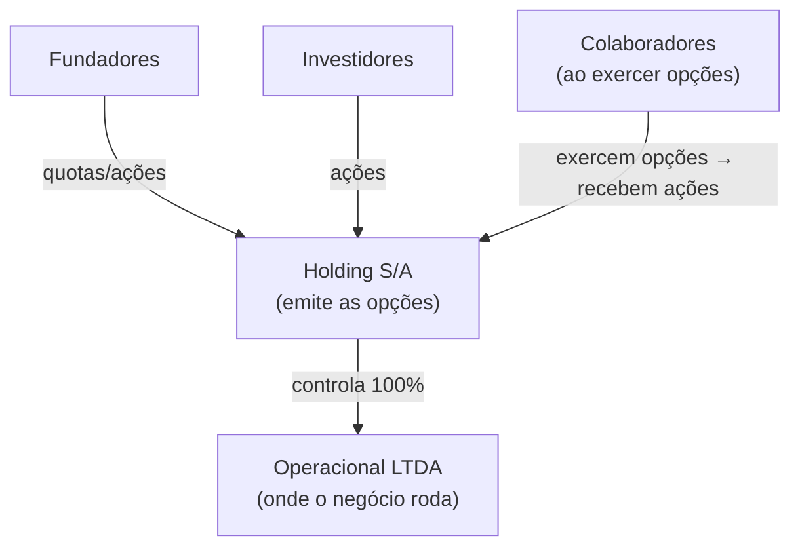

---

### Dimensionando o Pool de Opções (5% a 15% do Cap Table) e decidindo quanto conceder para cada cadeira executiva

#### Documentos necessários

1. **Plano de Opções** (documento-mãe): define regras gerais — pool total, tipos de beneficiários, condições de vesting, eventos de aceleração, definição de good/bad leaver, e procedimento de exercício.
2. **Contrato de Opção Individual** (por colaborador): especifica o número de opções concedidas, o preço de exercício, o cronograma de vesting, e referencia o Plano geral.
3. **Aprovação societária**: em S/A, assembleia. Em LTDA, alteração do contrato social ou deliberação de sócios.

#### Vesting: cliff e cronograma

**Estrutura padrão (4 anos com cliff de 1 ano).**

```
Mês 0    → Concessão. Nenhuma opção vested.
Mês 12   → Cliff. 25% das opções vestem de uma vez.
Mês 13–48 → Vesting mensal. 1/36 das opções restantes por mês.
Mês 48   → 100% vested.
```

**Por que cliff de 1 ano?** Protege a empresa de conceder equity para colaboradores que saem rápido. Também alinha incentivos: o colaborador sabe que precisa passar pelo cliff para ter algum valor.

**Variações comuns no Brasil.**
- 3 anos com cliff de 6 meses: para contratações sênior em early-stage que têm poder de barganha.
- 2 anos com cliff de 1 ano: para advisors e colaboradores de curto prazo.
- Sem cliff para cofundadores (já têm equity direto, não opção).

#### Aceleração

**Single-trigger**: aceleração automática em mudança de controle (M&A, fusão). Todas as opções vestem imediatamente quando o deal fecha.

**Problema do single-trigger para a empresa**: o acquirer sabe que no dia do closing todo o equity vesta imediatamente. Isso reduz o retention incentive pós-aquisição. Muitos acquirers descontam no preço ou exigem novo plano de retenção — o que dilui mais os founders.

**Double-trigger**: aceleração apenas se houver (1) mudança de controle E (2) demissão sem justa causa (ou rebaixamento de função) dentro de 12 a 24 meses após o evento.

> [!tip] Double-trigger é o padrão em startups bem assessoradas
> Single-trigger parece mais generoso para o colaborador, mas na prática aumenta o custo da aquisição para o acquirer — e isso reduz o preço total do deal. Double-trigger é melhor para todos se o colaborador realmente quer ficar após o exit.

#### Good leaver / bad leaver

Define o que acontece com as opções quando o colaborador sai.

| Situação | Good leaver | Bad leaver |
|---|---|---|
| Exemplos | Demissão sem justa causa, doença, morte | Demissão por justa causa, violação de NDA, concorrência |
| Opções vested | Pode exercer dentro do prazo (90–180 dias) | Empresa recompra pelo preço de exercício (ou perde) |
| Opções não-vested | Canceladas | Canceladas |

**Prazo de exercício pós-saída**. Padrão americano é 90 dias. No Brasil, recomenda-se 180 dias para dar ao colaborador tempo de resolver a situação tributária e financeira do exercício.

#### Tamanho do option pool

| Estágio | Pool recomendado (fully diluted) | Observação |
|---|---|---|
| Pré-seed / seed | 10–15% | Suficiente para primeiras 5–10 contratações técnicas |
| Série A | 15–20% | Investidores geralmente exigem expansão do pool pré-closing |
| Série B+ | 5–10% de refresh | Pool consome com o crescimento do time |

> [!warning] Pool "fully diluted" vs. "pós-investimento"
> Investidores calculam participação fully diluted — incluindo o option pool. Um pool de 15% antes da rodada significa que founders e investidores existentes já estão diluídos por esse pool antes de o novo investidor entrar. Sempre modelar o cap table com o pool incluído antes de negociar valuation.

---

### Cláusulas vitais que salvam o fundador: Good Leaver vs. Bad Leaver, Direito de Recompra (Call Option) e Aceleração em Duplo Gatilho no M&A

#### O que manter atualizado

- Número total de quotas/ações emitidas.
- Opções concedidas (por colaborador, com data, preço de exercício, cronograma de vesting).
- Opções exercidas (convertidas em ações reais).
- Opções canceladas (colaboradores que saíram antes do vesting).
- COCPs e outros instrumentos conversíveis.
- Participação fully diluted de cada sócio e grupo (founders, investidores, option pool).

#### Ferramentas disponíveis no Brasil

| Ferramenta | Origem | Adequação BR | Custo |
|---|---|---|---|
| Captable.io | Brasil | Alta | Pago |
| Pulso | Brasil | Alta | Pago |
| CartaHQ (Carta) | EUA | Média (adaptação manual) | Pago |
| Planilha própria | — | Funciona até ~20 titulares | Grátis |

Para startups até Série A, planilha bem estruturada com controle de datas e cenários de diluição é suficiente. A partir de Série A, ferramenta dedicada evita erros em cálculos de liquidation preference e waterfall em exits.

#### Refresh grants

Colaboradores que se aproximam do fim do vesting (anos 3–4) perdem o incentivo de permanecer. Refresh grant é uma nova concessão de opções — com novo cronograma de vesting — para reengajar.

**Timing**: conceder quando o colaborador ainda tem 12–18 meses de vesting original restante. Não esperar até o fim.

**Tamanho**: tipicamente 25–50% do grant original, dependendo do desempenho e do estágio da empresa.

---

### Quando usar Phantom Shares: a solução limpa para empresas Ltda. ou negócios de dividendos que não querem colocar 30 minoritários no contrato social

Para startups que ainda não querem estruturar S/A ou emitir quotas, phantom shares são a saída operacional mais simples.

**Como funciona o pagamento.** Define-se um percentual econômico virtual (ex: 0,5% da empresa). Em um evento de liquidez — M&A, distribuição extraordinária — o colaborador recebe em dinheiro o equivalente a 0,5% do valor total recebido pelos sócios.

**Contrato necessário.** Acordo de phantom shares com: definição do percentual, eventos de liquidez que ativam o pagamento, vesting análogo ao de opções, e good/bad leaver.

**Tributação**. No pagamento: IRRF na fonte como remuneração variável (tabela progressiva, até 27,5%) + INSS (se colaborador CLT). Não há debate tributário — é remuneração clara.

**Quando migrar para opções reais.** Ao fechar Série A e ter S/A estruturada, converter phantom shares para stock options reais permite que o colaborador tenha instrumento com melhor tratamento tributário potencial.

---

### Outorgar opções a R$ 0,01 sem risco mercantil, esquecer a cláusula de recompra para Bad Leaver e prometer "% da empresa" em vez de número fixo de opções

**Emitir opções sem plano formal.** Promessa verbal ou e-mail informal não é vinculante da forma esperada. Em litígio trabalhista, o colaborador pode questionar se a opção era parte da remuneração — e a empresa não tem documento que defina os termos. Sempre formalizar.

**Não comunicar a tributação esperada.** Colaborador que recebe opções acredita que o upside é X. Na hora do exit, descobre que vai pagar IRPF sobre X e ficar com Y. A percepção de traição destrói o efeito motivacional retroativamente — e pode virar litígio. Comunicar tributação esperada no ato da concessão.

**Pool insuficiente para contratações futuras.** Founders que não criam pool grande o suficiente descobrem que precisam diluir mais na Série A do que planejado para expandir o pool. Criar pool com horizonte de 18–24 meses de contratações planejadas.

**Preço de exercício desatualizado.** Definir preço de exercício em seed e nunca atualizar. Quando a empresa cresce 10x, o preço de exercício é ínfimo — o que fortalece o argumento da Receita de que é remuneração disfarçada. Fazer laudo de FMV a cada rodada e para novas concessões.

**Vesting sem cliff para primeiras contratações.** Colaborador número 3 sai no mês 8. Sem cliff, já tem 8/48 de equity vested. Com cliff de 1 ano, saída no mês 8 resulta em equity zero. O cliff protege a concentração de equity em quem fica e constrói.

**Esquecer o exercício pós-saída.** Colaborador com 3 anos de vesting sai da empresa. Tem 90 dias para exercer. Não avisa ninguém, não é avisado, prazo vence, perde as opções. A empresa não tem obrigação de avisar ativamente — mas perda de equity por prazo expirado cria má reputação. Implementar processo de notificação formal ao desligar colaboradores com opções vested.

**Não modelar o cap table fully diluted antes de cada rodada.** Founders chegam à Série A achando que têm 40% da empresa. Com o option pool existente, os COCPs, e o novo pool exigido pelo VC, calculado fully diluted, têm 28%. A surpresa na hora do term sheet destrói negociação. Modelar sempre.

> [!info] Fases relacionadas
> Referenciado em: Fase 13.

---

### Leitura adicional

- **Lei 6.404/1976 (Lei das S/A), art. 168** — base legal para planos de opção em sociedades anônimas.
- **Acórdãos do CARF** — buscar por "plano de opção de compra de ações natureza" no portal do CARF para acompanhar a jurisprudência atual.
- **"Stock Options no Brasil" — Gustavo Brigagão (ABDF)** — análise tributária referenciada na doutrina.
- **Carta / Captable.io** — documentação de como modelar cap table com opções e cenários de diluição.
- **YC SAFE and Option Pool Primer** — referência conceitual (não aplicável diretamente ao direito brasileiro, mas útil para o modelo mental).

---

### O Espelho do Equity: Seu Plano de Opções Cria Donos de Verdade ou um Passivo Fiscal Oculto?

> [!tip] O Espelho do Gestor (Autodiagnóstico Rápido)
> 1. **O Teste da Promessa Solta:** Você já prometeu verbalmente ou por WhatsApp/e-mail *"1% ou 2% da empresa"* para alguém sem assinar o contrato formal? (Perigo mortal: prometer "porcentagem fixa" em vez de uma quantidade determinada de opções gera litígio milionário sobre diluição futura).
> 2. **Os Dois Pilares do STJ (Tema 1.226):** O seu plano de *Stock Options* possui **Onerosidade Real** (preço de exercício baseado em valuation/valor patrimonial justo, pago com recursos do beneficiário) e **Adesão Voluntária com Risco Mercantil**, blindando sua empresa contra cobrança de INSS e IR na fonte?
> 3. **A Proteção de Saída Litigiosa (*Bad Leaver*):** Se um diretor com opções já adquiridas (*vested*) sair da empresa para ir trabalhar no seu maior concorrente ou for demitido por falta grave, o seu contrato dá à empresa o direito de **recomprar essas opções/quotas pelo valor de custo original**?
>
> **Regra de Bolso (*estilo Ben Horowitz*):** Nunca dê *equity* sem **Cliff de 12 meses** e **Vesting de 48 meses** — nem mesmo para o seu melhor amigo de infância ou cofundador.
>
> **O Ritual de Segunda-Feira às 9h:** Audite todas as promessas de participação da empresa com um advogado societário especializado, formalize qualquer pendência em **Contratos de Opção de Compra Mercantil (ou Phantom Shares se for Ltda. pura)** e garanta as cláusulas de *Cliff* de 1 ano e *Good/Bad Leaver*.


---

## CAPÍTULO 13 — CULTURA COMO DISCIPLINA E EM SITUAÇÕES CRÍTICAS (HIPERCRESCIMENTO, M&A E REMOTO)

### Cultura Não É o Que Está Escrito na Caneca: É Quem Você Promove, Quem Você Premia e Quem Você Demite

Quando **Henrique** visitou a sede de uma empresa de tecnologia concorrente em São Paulo, ficou impressionado com a decoração: havia parede de escalada, chopeira artesanal liberada na sexta-feira e cinco palavras bonitas pintadas em letras garrafais de neon na recepção — *"Transparência, Obsessão pelo Cliente, Excelência, Humildade e Dono"*. Dois meses depois, Henrique contratou uma coordenadora de operações que havia pedido demissão justamente daquela empresa e perguntou como era trabalhar lá dentro. Ela riu com ironia: *"Henrique, o cartaz na parede dizia 'Transparência e Humildade', mas o diretor comercial que mais batia meta gritava com as analistas, escondia defeitos técnicos dos clientes para ganhar comissão no fim do trimestre e foi promovido com bônus máximo na festa de fim de ano. Todo mundo lá dentro aprendeu no primeiro mês que os valores da parede eram piada."*

Em *O Lado Difícil das Situações Difíceis*, Ben Horowitz cita o provérbio samurai e a lição de Bushido: **valores não são palavras que soam bem num retiro de fim de semana; cultura é o conjunto de comportamentos automáticos que a sua equipe executa quando o fundador não está na sala — e ela é esculpida exclusivamente pelo que você tolera e pelo que você pune.**

Na fábrica de Henrique em Curitiba, não havia letras de neon na parede. Mas todo funcionário sabia de cor uma regra inegociável da cultura deles: *"Nenhum equipamento sai da doca de expedição se não passar nos 14 testes de bancada, mesmo que isso atrase o faturamento do último dia do mês."* Quando um gerente tentou embarcar um lote sem o 14º teste para bater a meta de março, Henrique travou o caminhão no pátio na frente da fábrica inteira. Naquele segundo, sem precisar de nenhum discurso de RH, cem funcionários entenderam qual era a verdadeira cultura da empresa. Chamamos a distância entre o discurso do slide e a prática do corredor de **A Hipocrisia do Poster de Parede**.

---

> [!note] Nota de validade
> Princípios de construção de cultura são estáveis ao longo de décadas. Ferramentas (engagement surveys, OKRs, ferramentas de feedback) evoluem em três a cinco anos. Revisar bienalmente.

A [[#FASE 16 — TIME, LIDERANÇA EXECUTIVA E CULTURA EM ESCALA|Fase 16]] (Time e Liderança) menciona "valores documentados" como entregável. O [[#CAPÍTULO 8 — FOUNDER MODE, DELEGAÇÃO, GESTÃO DE TEMPO E CADÊNCIA OPERACIONAL DO CEO|Capítulo 8 (Founder Mode, Delegação, Gestão de Tempo e Cadência Operacional do CEO)]] (Founder Mode, modo fundador) toca em liderança. Cultura como disciplina gerenciada, como escrever valores que não sejam clichês, como mantê-los em escala, como medir, rituais de reforço, sinais de toxicidade, não tem apêndice dedicado. É lacuna consequente. Cultura ruim não mata empresa no curto prazo, mas erode talento, produtividade e marca empregadora ao longo de anos.

Este capítulo cobre cultura, não como "valores no cartaz", mas como comportamento agregado que pode ser gerenciado deliberadamente.

### Por que a cultura é a única coisa que governa o comportamento de 100 pessoas nas 99% das horas em que você não está olhando

Cultura se consolida cedo e muda devagar. Os primeiros dez a cinquenta funcionários moldam padrão que vai influenciar quinhentos ou cinco mil. Erro de dez vira dívida cultural enorme em quinhentos.

"Valores" no cartaz sem prática diária é pior que nenhum valor. Os funcionários leem a hipocrisia e ficam cínicos.

Cultura é principal fator de retenção em escala. Salário compete. Cultura distingue. O Vale do Silício mostra isso há décadas.

Empresa com cultura ruim recruta errado. O talento top não entra. Quando entra, sai em dezoito meses. Custo oculto gigante.

### Transformando valores vagos ("Integridade") em princípios comportamentais binários que ajudam a escolher entre duas opções difíceis

#### 1. Articulação de valores, não clichê

> [!important] Teste de valor real
> Se você pode inverter, e outra empresa também poderia adotar, não é valor real. É platitude.

Exemplo de clichê. "Integridade". Qual empresa diria "temos baixa integridade"? Nenhuma. Logo, não distingue.

Exemplo de valor real. "Intensidade antes de perfeição". Distingue. Outra empresa pode genuinamente valorizar "perfeição antes de intensidade". Implica escolhas diferentes de contratação, processo, e comunicação.

Outros valores com tensão real. "Transparência radical" (versus "discreto, e profissional"). "Debate acalorado, depois commit" (versus "consenso sempre"). "Ownership individual" (versus "decisão coletiva"). "Data wins arguments" (versus "experience wins arguments"). "Ship fast, fix forward" (versus "ship right, don't break").

Processo de articulação, em cinco passos.

1. Observar comportamentos que você admira na empresa hoje. Quais pessoas exemplificam o que você quer que cresça?
2. Articular o que essas pessoas fazem, que é distinto. Não generalidades. Ações específicas.
3. Testar tensão. A formulação reversa faz sentido para outra empresa? Se sim, bom.
4. Limitar a quatro a sete valores. Mais vira lista ignorada.
5. Cada valor com explicação de dois a três parágrafos. O que significa, o que NÃO significa, e exemplos concretos.

Exemplos de articulação boa (publicamente disponíveis). Netflix Culture Deck (original 2009, e revisões). Amazon Leadership Principles. Stripe's "The Stripe Way". GitLab's public handbook. Estudar, não para copiar. Mas para ver como articulam, sem clichê.

#### 2. Comportamentos reforçados, onde cultura vive

Princípio. Cultura não é o que está no documento de valores. É o que acontece quando.

Alguém entrega resultado excepcional, sendo "culturalmente estranho". Promoção, ou não? Alguém entrega ok, sendo "culturalmente ideal". Retido, ou não? Decisão difícil, prazo versus qualidade. Qual vence? Conflito entre áreas. Resolvido por hierarquia, ou por debate? Funcionário erra. Sancionado, ignorado, ou usado como aprendizado?

> [!warning] No asshole rule (Robert Sutton)
> Empresa declara "não toleramos tóxicos", mas mantém vendedor que bate meta enquanto destrói o time. Sinal claro de que os valores são performáticos. Os funcionários leem isso e adaptam comportamento ao que a empresa de fato recompensa, não ao que ela diz valorizar.

Decisões de contratar, e demitir, são os sinais mais claros de cultura real. Os funcionários leem quem fica, e quem sai, com muito mais atenção do que discursos.

#### 3. Rituais de reforço

Cultura precisa de renovação constante. Rituais específicos.

**All-hands (semanal, ou quinzenal).** Número, e métricas (transparência). Reconhecimento público (Nome X demonstrou valor Y, nessa situação específica). Perguntas, e respostas, abertas, incluindo temas difíceis. Frequência vale mais que tamanho. All-hands curto semanal vale mais que all-hands longo trimestral.

**Onboarding como "cultura bootcamp".** Primeiro dia de novo funcionário, dia de cultura. Não de produto. Sessão com fundador, sobre história, valores, e decisões difíceis passadas. Shadowing com colegas de culturas diversas na empresa. "Manual pessoal", cada funcionário escreve uma página, sobre como trabalha melhor.

**Rituais de reconhecimento.** Kudos públicos em all-hands, ou canal dedicado ("Alguém demonstrou valor X esse mês? Marque aqui"). Peer bonuses (programas onde colaboradores podem premiar uns aos outros). Histórias narradas, o CEO conta histórias específicas, de decisões culturais difíceis tomadas.

**Rituais de feedback.** Retrospectivas trimestrais abertas, sobre cultura. O que está indo bem? Onde estamos falhando contra os nossos valores? Skip-level meetings, os funcionários conversam com líder do seu líder, regularmente.

**Rituais de pertencimento.** Offsites anuais (se remote), ou retiros estratégicos. Celebração de marcos (primeira rodada, primeiro cliente âncora, aniversários de empresa). Projetos inter-áreas (hackathons, workshops), que juntam pessoas que não trabalhariam juntas.

Cuidado. Os rituais podem virar teatro. Kudos performáticos, onboarding superficial, retrospectivas onde ninguém fala a verdade. Renovar formato, quando autenticidade cair.

#### 4. Medição, como saber se cultura está saudável

Indicadores quantitativos. eNPS (Employee Net Promoter Score), "você recomendaria trabalhar aqui para amigo?". Escala menos cem a mais cem. Saudável, mais trinta a mais sessenta. Excepcional, mais sessenta em diante. Engagement score, ferramentas como CultureAmp, Lattice, Officevibe, Gallup Q12. Trimestral, ou bianual. Retention rate, um ano, dois anos, três anos. Sector-specific (tech tende a quinze a vinte por cento anual. Acima é ruim). Regrettable attrition rate, percentual de saídas que a empresa gostaria de ter retido. Alvo menor que cinquenta por cento do attrition total. Internal mobility, percentual das contratações seniores preenchidas internamente. Alvo crescente. Employee referrals, percentual de contratações vindas de referência interna. Alvo maior que trinta por cento. Alta sinaliza que os funcionários recomendam a empresa. Glassdoor, ou LinkedIn. Reviews externas. Monitorar. Não obsessar.

Indicadores qualitativos. Exit interviews, quando a pessoa sai, honestamente, o que motivou? Processo estruturado, trinta a sessenta minutos, com alguém que não é gerente direto. Stay interviews, regularmente, com pessoas-chave retidas, "por que você fica?". Skip-level observation, o líder do líder ouve pontos que o direct report não ouve. Anonymous pulse, tools dedicadas (Peakon, CultureAmp pulse), respostas anônimas semanais, ou quinzenais, sobre temas específicos.

Triangulação. Nenhum indicador sozinho é suficiente. eNPS alto, mais retenção em queda, igual a ainda tem problema escondido.

#### 5. Sinais de cultura tóxica

Red flags que exigem intervenção. Alto turnover de mulheres, ou minorias específicas. Sinaliza problemas específicos. Gossip, em vez de feedback direto. As coisas difíceis são ditas nos bastidores, não em reuniões. Fundador, ou liderança, imune a feedback. Crítica constante punida. Elogio constante recompensado. "Alto performer tóxico" tolerado. Vendedor com top number, que abusa do time, fica por "resultados". Decisões personalíssimas. Quem tem acesso ao fundador manda. O resto é excluído. Cultura of silence em conflito. Os problemas não são endereçados. Acumulam-se. Over-work celebrado como valor. Oitenta horas de semana, como sinal de "compromisso". Burnout sistêmico. Medo de falhar. Erro é punido. Então ninguém toma risco. Inovação morre. Saídas no mesmo time em seis meses. Não é coincidência. Há causa sistêmica.

Intervenção, quando detectado. Ver [[IGNICAO-Vol-9-Maturidade-e-Exit#CAPÍTULO 9 — GESTÃO DE CRISE, CONTINUIDADE OPERACIONAL E COMUNICAÇÃO CRÍTICA|Capítulo 9 (Gestão de Crise, Continuidade Operacional e Comunicação Crítica) (Vol. 9)]] (Crise). Cultura tóxica pode ser crise silenciosa, que erode a empresa por anos, antes de explodir.

#### 6. Cultura em escala, mantendo identidade

Desafios de escala (cem para quinhentos para mil ou mais pessoas).

Sem conhecer todo mundo, os valores precisam ser mais explícitos. Não implícitos.

Liderança intermediária (gerentes de gerentes) torna-se multiplicadora crítica. Seleção, e treinamento, de managers vale muito mais que onboarding de contribuidores individuais.

Distância do fundador aumenta. Rituais onde o fundador aparece regularmente (all-hands, skip-levels) preservam conexão.

Comunicação assimétrica. O que o fundador diz é amplificado. Precisa de cuidado adicional.

Sub-culturas emergem (vendas versus engenharia, squads diferentes). Saudável, se compartilham base. Problemático, se entram em conflito.

Mecanismos de preservação. Written company handbook (GitLab é referência pública). Culture stories, histórias específicas repetidas. Leadership development programs, focados em cultura, não só em skills gerenciais. Culture interview em hiring, ainda entrevista explícita sobre fit com valores (cuidado com viés, não "achei legal", "tem as disposições que buscamos").

#### 7. Quando cultura precisa de intervenção ativa

Momentos-gatilho. Após crescimento acelerado (dobrou time em doze meses). Após integração de aquisição. Após saída significativa de funcionários. Após mudança de CEO, ou C-level chave. Após crise pública ([[IGNICAO-Vol-9-Maturidade-e-Exit#CAPÍTULO 9 — GESTÃO DE CRISE, CONTINUIDADE OPERACIONAL E COMUNICAÇÃO CRÍTICA|Capítulo 9 (Gestão de Crise, Continuidade Operacional e Comunicação Crítica) (Vol. 9)]]). Após virada estratégica (expansão internacional, ou pivô).

Processo de recalibração, em cinco passos.

1. Diagnóstico. Engagement surveys, um a um estruturados, e exit interviews dos últimos seis meses.
2. Articulação. O que está desviando? Por quê?
3. Plano de ação. Mudanças estruturais (processo, rituais), e mudanças de liderança, se necessário.
4. Comunicação honesta. O fundador admite publicamente que há problema. Compromete-se com correção.
5. Follow-up. Mesmo processo, em três a seis meses. Mudanças visíveis, ou escalação.

---

#### 8. Padrões de cultura tóxica: diagnóstico e intervenção

Cultura tóxica raramente é declarada. Emerge de padrões tolerados ao longo do tempo — comportamentos que, individualmente, podem parecer menores, mas que somados definem "como as coisas são feitas aqui" de forma destrutiva.

**O problema do "brilhante difícil" (brilliant jerk).**

O brilhante difícil é o profissional de alta performance que produz resultados excepcionais enquanto deixa um rastro de dano relacional: humilha colegas em reuniões, não aceita feedback, recusa colaboração, toma crédito do trabalho alheio, ou cria ambiente de medo ao redor de si.

O dilema é real: a empresa tem resultado com essa pessoa. A pressão para tolerá-la é forte, especialmente se o resultado é visível (fechamentos de vendas, entregas técnicas, crescimento de produto).

O custo invisível é sistêmico. Pesquisa de Robert Sutton ("The No Asshole Rule") documenta que um único "asshole" em posição de influência pode reduzir a produtividade de um time inteiro em 30-40%, aumentar o turnover das pessoas ao redor e destruir a disposição de tomar riscos — porque o ambiente de humilhação torna o erro ameaçador.

Diagnóstico: perguntar "quem no time produz resultados mas em cujas reuniões as pessoas ficam em silêncio ou deixam de participar?". Fazer skip-levels com os reportes diretos da pessoa. Medir se o turnover é maior nas pessoas que trabalham diretamente com ela.

Intervenção: o CEO ou líder direto precisa nomear o comportamento explicitamente, separado do reconhecimento pelos resultados. "Você entrega muito. E seu comportamento X está destruindo o time. Precisamos mudar isso." Prazo definido para mudança comportamental mensurável. Se não houver mudança, desligamento — mesmo com resultado alto. A sinalização para o resto da empresa do que esse desligamento representa é mais valiosa do que qualquer entrega individual.

**Hero culture.**

Hero culture é o padrão onde a empresa funciona porque certas pessoas-chave resolvem tudo — estão em todo lugar, trabalham 80 horas, salvam projetos em colapso, nunca delegam. São celebradas como heróis. E de fato são indispensáveis.

O problema: heróis não escalam. A empresa se torna dependente de indivíduos não-substituíveis. Quando o herói sai — por burnout, por oferta melhor, por qualquer razão — o sistema colapsa. E enquanto está, o herói frequentemente bloqueia, mesmo que sem intenção, o desenvolvimento das pessoas ao redor, porque sempre resolve mais rápido sozinho.

Diagnóstico: identificar quem, se saísse amanhã, causaria crise operacional imediata. Se a resposta for mais de uma ou duas pessoas em uma empresa de 50, há hero culture sistêmica.

Intervenção: deliberadamente dar ao herói um projeto novo onde ele não pode resolver tudo — onde precisa construir capacidade em outros. Reconhecer explicitamente quando alguém delega bem e outro cresce em consequência. Remover a recompensa de ser insubstituível: o herói que documenta seus processos e treina substituto deve ser mais reconhecido do que o herói que acumula dependência.

**Blame culture.**

Em blame culture, quando algo dá errado, o reflexo organizacional é encontrar o responsável e puni-lo — explicitamente ou por ostracismo. O resultado é que ninguém assume risco, ninguém reporta problemas cedo, e os erros ficam escondidos até que sejam grandes demais para ignorar.

O diagnóstico mais confiável é observar o que acontece imediatamente após uma falha visível. Se a conversa dominante é "quem deixou isso acontecer?" em vez de "o que podemos aprender e como evitar?", há blame culture.

Intervenção: o CEO precisa modelar o comportamento alternativo de forma pública e consistente. Quando algo falha, narrar o processo de aprendizado — não o processo de punição. Implementar post-mortems sem culpa (blameless post-mortems), metodologia de engenharia que identifica causas sistêmicas em vez de culpados individuais. Reconhecer quem reporta problemas cedo, em vez de quem os esconde.

**Exclusão por padrão.**

Exclusão por padrão não é preconceito declarado. É o padrão onde certas pessoas — por gênero, por origem, por estilo de comunicação, por não estar na rede informal de poder — sistematicamente não são incluídas nas conversas importantes, não são consideradas para projetos visíveis, e não recebem o mesmo acesso ao desenvolvimento que os "do grupo".

Manifesta-se em: reuniões onde certas pessoas nunca são convidadas mas depois precisam executar decisões tomadas sem elas. Projetos de destaque que sempre vão para o mesmo perfil de pessoa. Feedbacks que são mais prescritivos para alguns grupos do que para outros. Promoções onde o critério informal é "parece um líder" — critério que tende a reproduzir o perfil de quem já está no topo.

Diagnóstico: analisar dados de promoção, de acesso a projetos visíveis, de participação em comitês por demografia. Se há padrão, há problema. Skip-levels com pessoas de grupos sub-representados, com pergunta direta: "Você sente que tem as mesmas oportunidades que seus pares?".

Intervenção: ver [[#CAPÍTULO 14 — DIVERSIDADE, EQUIDADE E INCLUSÃO (DEI) EM STARTUP BRASILEIRA|Capítulo 14 (Diversidade, Equidade e Inclusão (Dei) em Startup Brasileira)]] para programa estruturado de DEI. No nível de cultura imediata: tornar critérios de promoção e acesso a projetos explícitos e públicos. Criar processos estruturados (não informais) para decisões de alocação de pessoas. Medir os outputs por demografia.

---

> [!tip] Casos especiais de cultura
> Para cultura em situacoes especificas (M&A, hipercrescimento, remoto e hibrido), ver [[#CAPÍTULO 13 — CULTURA COMO DISCIPLINA E EM SITUAÇÕES CRÍTICAS (HIPERCRESCIMENTO, M&A E REMOTO)|Capítulo 13 (Cultura como Disciplina e em Situações Críticas (Hipercrescimento, M&A e Remoto))]]. Este capítulo cobre o framework raiz de cultura como disciplina.

### Taxa de Retenção dos Talentos Culturais (A-Players), Velocidade de Demissão por Desvio Cultural e Consistência das Decisões na Ponta

eNPS. Alvo igual ou maior que mais trinta. Excepcional igual ou maior que mais sessenta.

Retention rate, um ano. Alvo igual ou maior que oitenta e cinco por cento.

Retention rate, dois anos. Alvo igual ou maior que setenta por cento.

Regrettable attrition. Alvo menor que cinquenta por cento do attrition total.

Referral hire rate. Alvo igual ou maior que trinta por cento.

Engagement survey participation. Alvo igual ou maior que oitenta e cinco por cento.

Tempo médio no cargo, antes de promoção interna. Contextual. Mas rastreado.

Glassdoor rating. Alvo igual ou maior que quatro vírgula zero em cinco.

CEO approval rating (Glassdoor). Alvo igual ou maior que oitenta por cento.

Retenção nos primeiros 90 dias (novos contratados). Alvo igual ou maior que noventa e cinco por cento. Abaixo disso sinaliza falha de onboarding ou promessa de emprego não cumprida.

---

### Cultura em Situações Críticas: Remoto, Hipercrescimento e Fusões & Aquisições

#### 1. Cultura em times remotos e híbridos

O trabalho distribuído não destrói cultura automaticamente. Mas expõe, com precisão cirúrgica, tudo que era mantido por proximidade física. O que dependia de corredor, calibração informal de valores, resolução de tensões face a face, transmissão de cultura por osmose, deixa de acontecer.

**O que quebra primeiro em times distribuídos.**

Alinhamento informal. Em escritório, conversas de corredor resolvem ambiguidades antes que virem conflito. No remoto, a ausência de alinhamento acumula silenciosamente por semanas, até explodir.

Senso de pertencimento. Pessoas que se juntam após o time ir remoto raramente desenvolvem o mesmo vínculo que quem se conheceu pessoalmente. A cultura "original" fica presa nas pessoas mais antigas. Os novos sentem que há um grupo interno invisível ao qual nunca pertencem de fato.

Visibilidade de contribuição. Em escritório, quem trabalha muito é visto. No remoto, quem não se promove ativamente pode ser invisível, enquanto quem aparece muito em reuniões parece mais produtivo do que é. Gera distorção nos critérios informais de reconhecimento.

Feedback espontâneo. No escritório, um "cara, isso que você fez foi ótimo" acontece naturalmente. No remoto, esse feedback precisa ser intencional, e raramente é, porque exige esforço.

> [!warning] A armadilha do "nossa cultura é boa, a gente se fala no Slack"
> Frequência de mensagens não é indicador de saúde cultural. Times podem ter canais ativos e clima fragmentado. A questão não é volume de comunicação. É qualidade do vínculo, clareza de valores e se as pessoas tomam decisões difíceis de forma consistente com o que a empresa declara que importa.

**Táticas específicas para manter cultura à distância.**

Onboarding estruturado com componente de cultura explícito. Em remoto, o novo funcionário não absorve cultura por osmose. Precisa de ritual deliberado, sessão de 1:1 com o CEO ou fundador na primeira semana (mesmo que breve), apresentação de casos históricos da empresa onde valores foram testados, buddy cultural, um colega designado para contextualizar a "forma de fazer as coisas aqui" nos primeiros 90 dias.

Rituais síncronos não-opcionais. Uma ou duas reuniões por semana onde o time aparece junto ao vivo (câmera ligada) para algo que não é revisão de status. Pode ser all-hands quinzenal com perguntas abertas, retrospectiva semanal do time, ou check-in de 15 minutos no início do dia. O objetivo é criar presença regular, não produtividade extra.

Canais assíncronos com propósito cultural. Canal de reconhecimento público (no Slack ou equivalente) onde qualquer pessoa pode nomear um colega por demonstrar um valor específico, com o nome do valor explícito, não só "parabéns". Canal de "o que aprendi" onde erros e aprendizados são compartilhados sem punição. Canal informal com regras leves (off-topic, vida fora do trabalho) que recriem parte da socialização perdida.

Offsite anual como investimento, não luxo. Para times 100% remotos, o offsite anual (2-3 dias presenciais juntos) é o momento de maior densidade cultural do ano. Deve ser prioridade orçamentária, não linha cortável quando o budget aperta. Times que nunca se encontram pessoalmente constroem vínculos mais frágeis e precisam de mais esforço para resolver conflitos.

Calibração explícita de valores em decisões distribuídas. Em escritório, quando o gestor toma uma decisão difícil, os colegas observam o processo e absorvem o critério. No remoto, esse momento de calibração precisa ser narrado. O líder documenta por escrito (em canal aberto ou handbook) a decisão tomada e o raciocínio cultural por trás dela. Isso substitui, parcialmente, a observação direta.

**Cultura híbrida, o modelo mais difícil.**

Times híbridos, parte presencial, parte remoto, tendem a criar dois grupos com experiências radicalmente diferentes. Quem está no escritório tem acesso a conversas informais, visibilidade espontânea e vínculos mais fortes com a liderança. Quem está remoto sente, com frequência, que as decisões reais acontecem "no corredor", sem eles.

A armadilha não é o modelo em si, é executar híbrido como se fosse presencial com algumas pessoas ausentes. A correção exige regras explícitas, se alguém está remoto em uma reunião, todos entram por vídeo individualmente (não "alguns na sala, um na tela"). Documentação de decisões é obrigatória para todos, não só para quem não estava presente. A paridade de experiência entre presencial e remoto é política de cultura, não preferência pessoal.

#### 2. Cultura em hipercrescimento, o que quebra quando o time dobra

Dobrar o headcount em seis meses é o estressor mais subestimado de cultura. Empresas que passam por esse ciclo, e muitas startups de Série B passam, frequentemente emergem do outro lado com uma empresa que parece diferente de dentro, mesmo que o produto e o mercado sejam os mesmos.

**Por que o hipercrescimento é destrutivo para cultura.**

A diluição é matemática. Se a empresa tinha 50 pessoas com cultura consolidada e contratou mais 60 em seis meses, os "novos" são maioria. Os valores vividos pelos veteranos não se transmitem automaticamente. Cada novo contratado traz suas próprias referências, de empresas anteriores, de culturas diferentes, de estilos de trabalho distintos. Sem mecanismos deliberados de transmissão, a cultura é redefinida por padrão, não por escolha.

O onboarding colapsa sob volume. O processo de onboarding que funcionava para 2-3 contratações por mês não escala para 10-15. A sessão com o fundador vira impossível. O buddy program é improvisado. O "cultura bootcamp" vira três horas de apresentação em PowerPoint. O resultado é que as novas pessoas entendem o produto, mas não entendem a forma de trabalhar.

Os gerentes são promovidos antes de estar prontos. Em hipercrescimento, a empresa frequentemente promove seus melhores ICs a gerentes porque precisa de liderança rápida. Esses novos managers nunca gerenciaram ninguém, não receberam treinamento, e estão gerenciando times em expansão acelerada. A cultura de cada time passa a refletir o estilo pessoal do manager, não os valores da empresa.

A liderança perde visibilidade. O CEO que conhecia todos os 50 funcionários pelo nome não consegue mais fazer isso em 110. A distância entre fundador e time operacional cresce. Decisões começam a ser tomadas sem contexto cultural. O que era implícito precisa se tornar explícito, mas raramente se torna.

> [!important] O onboarding como infraestrutura cultural
> Em hipercrescimento, onboarding não é processo de RH. É infraestrutura crítica de transmissão cultural. Precisa ser tratado com o mesmo rigor que sistema de dados ou processo de vendas. Falhar no onboarding em escala equivale a contratar 60 pessoas e apresentá-las a uma empresa diferente da que você quer construir.

**Táticas para preservar cultura em hipercrescimento.**

Escalar o onboarding antes de escalar o headcount. Antes de acelerar contratações, documentar o onboarding atual, identificar o que é insubstituível (sessão com fundador, buddy, imersão em valores) e criar versões escaláveis, vídeo do fundador gravado com qualidade, grupo de onboarding mensal em vez de individual, buddy program com treinamento.

Definir "culture carriers" explicitamente. Em cada time e em cada novo nível hierárquico, identificar quem são os portadores de cultura, pessoas que vivem os valores com consistência e têm credibilidade com os pares. Envolvê-los ativamente no onboarding de novos colegas e na calibração de comportamentos.

Treinamento de managers como prioridade máxima. Cada novo manager deve passar por programa intensivo de cultura antes de gerenciar alguém. Não curso genérico de liderança. Treinamento específico sobre os valores da empresa, sobre como tomar decisões difíceis consistentemente com esses valores, e sobre como construir rituais de cultura dentro do time.

Comunicação aumentada do fundador. Em hipercrescimento, o CEO precisa se comunicar com o time com frequência maior do que parece necessária. All-hands quinzenal se torna semanal. Memos escritos sobre decisões importantes circulam amplamente. O objetivo não é controle, é manutenção de contexto compartilhado entre pessoas que nunca se encontraram.

Métricas de cultura com maior frequência. Em vez de engagement survey semestral, pulsos mensais curtos (5 perguntas) capturam problemas antes que se consolidem. Retenção nos primeiros 90 dias é indicador crítico, se novos funcionários estão saindo nos primeiros três meses, o onboarding ou a cultura está falhando.

#### 3. Cultura em fusões e aquisições

M&A é o teste mais extremo de cultura. Duas empresas com histórias, valores, rituais e comportamentos diferentes são colocadas juntas, e a fricção cultural é frequentemente subestimada como risco. Estudos consistentes indicam que 50-70% das aquisições destroem valor, e a maioria das análises post-mortem aponta integração cultural como fator central.

**O que acontece quando duas culturas se encontram.**

Raramente há fusão de fato. Há dominância e resistência. A empresa adquirente tende a impor sua cultura, explicitamente, ou pela simples força dos seus sistemas, processos e liderança. A empresa adquirida resiste, de forma passiva ou ativa, porque sua identidade está vinculada a "como fazíamos as coisas antes".

As pessoas da empresa adquirida que mais prezavam sua cultura anterior são frequentemente as primeiras a sair, levando consigo o talento que o adquirente queria reter. O que sobra é uma mistura de conformistas e resistentes, não uma nova cultura integrada.

**Os erros mais comuns no M&A de cultura.**

Assumir que cultura vai "se resolver sozinha" com o tempo. Não resolve. Endurece. As divisões culturais que não são abordadas nos primeiros seis meses se tornam identidades entrincheiradas nos próximos anos.

Mover rápido demais em integração de sistemas sem trabalhar cultura primeiro. Quando a empresa adquirida é forçada a adotar os processos do adquirente antes de haver confiança ou entendimento cultural compartilhado, a resistência explode.

Comunicar só para o topo. Executivos das duas empresas fazem sessões de integração e chegam a acordo. O time médio e operacional, que é a maioria das pessoas, não sabe o que foi decidido, por que, e o que muda para eles.

Tratar a empresa adquirida como inferior. Mesmo que a aquisição seja amigável, a linguagem de "nós compramos vocês", implícita em processos, decisões, comunicação, cria ressentimento. As pessoas da empresa adquirida sentem que foram compradas, não que se uniram.

**O playbook de integração cultural.**

```text
FASES DA INTEGRAÇÃO CULTURAL EM M&A

FASE 1 — DIAGNÓSTICO (primeiros 30 dias)
  - Mapear valores declarados e comportamentos reais das duas empresas
  - Identificar onde há sobreposição (facilita integração)
  - Identificar onde há tensão real (requer decisão consciente)
  - Entrevistar lideranças e ICs-chave das duas empresas sobre o que
    NÃO podem perder da cultura anterior

FASE 2 — DECISÃO (dias 30-60)
  - Definir qual cultura "vence" em cada tensão identificada
    (não há fusão perfeita, há escolhas)
  - Ser honesto sobre o que vai mudar e o que não vai
  - Identificar elementos da empresa adquirida que o adquirente
    quer preservar ativamente (não fingir que tudo se integra igual)

FASE 3 — COMUNICAÇÃO (dias 60-90)
  - Comunicar decisões de cultura para todos os níveis, não só executivos
  - Dar espaço para luto real, a empresa adquirida perdeu algo
  - Narrar o que é preservado, não só o que muda

FASE 4 — RITUAIS DE INTEGRAÇÃO (meses 3-12)
  - Criar rituais que incluam pessoas das duas origens
  - Onboarding cruzado, pessoas da empresa adquirida passam por
    onboarding do adquirente, e vice-versa
  - Projetos inter-equipes deliberados que forcem colaboração
  - Liderança mista em times, evitar guetos de "antigos" e "novos"

FASE 5 — MEDIÇÃO (meses 6-18)
  - Engagement survey específico para integração
  - Medir retenção separada por origem (antigos vs. adquiridos)
  - Identificar onde as divisões persistem e intervir
```

> [!tip] A pergunta certa na due diligence cultural
> Antes de fechar uma aquisição, o adquirente deve perguntar, "Se descrevêssemos os comportamentos que essa empresa recompensa, não os valores declarados, mas o que de fato acontece, com quais dos nossos valores isso entra em conflito direto?" Conflito identificado antes é problema gerenciável. Conflito descoberto depois do fechamento é crise.

**Preservar o que é valioso na empresa adquirida.**

Toda empresa que foi construída com sucesso suficiente para ser adquirida tem algo que funcionou. Frequentemente, é exatamente esse algo que o adquirente quer capturar, velocidade de execução, cultura de inovação, forma de pensar sobre o produto. O paradoxo é que o próprio processo de integração pode destruir o que tornava a empresa valiosa.

A proteção começa na decisão consciente, identificar os dois ou três elementos da empresa adquirida que são mais críticos para o valor da transação e protegê-los explicitamente, mesmo que entrem em conflito com os processos do adquirente. Um time de produto que se movia rápido porque tinha autonomia radical não pode ser integrado em um processo de aprovação de três camadas sem perder o que o tornava valioso.

### Confundir cultura com mesa de pingue-pongue e happy hour, escolher valores genéricos que não exigem nenhum trade-off real e manter "babacas brilhantes" por medo de perder receita

Valores no cartaz, prática diferente. A hipocrisia visível é destrutiva.

Valores copiados de Netflix, ou Amazon. Não são seus. Não viveram pela sua trajetória. Os funcionários percebem.

Cultura como perk. "Temos mesa de pebolim, e cerveja grátis", não é cultura. Isso é benefício. Cultura é comportamento agregado.

Fundador imune a feedback. Se o valor é "transparência radical", e o fundador não aceita crítica direta, a cultura é performativa.

Demitir tarde demais por "cultura". Os funcionários leem lentidão, como sinal de que os valores não importam.

Contratar rápido, e comprometer fit. Em escala, diluição é fatal.

Cultura só top-down. Os funcionários experientes, de todos os níveis, precisam ser co-criadores.

Ignorar sub-culturas tóxicas. Time pequeno problemático se propaga, se não endereçado.

Medir cultura, e não agir sobre resultados. Engagement survey com score baixo, seguido de inação. Destrói credibilidade do próprio processo.

Sobre-articular em pouco. Doze valores, ninguém decora.

Onboarding superficial. Primeiro dia com paperwork de RH, em vez de cultura, é oportunidade perdida.

Tolerar brilliant jerk por resultado de curto prazo. O custo sistêmico supera o benefício individual em quase todos os casos documentados.

### Checklist de auditoria da Cultura Real vs. Cultura Declarada

Cultura está saudável quando todos os itens abaixo estão cumpridos.

- [ ] Valores articulados com substância (não clichês), testados com reversibilidade. Quatro a sete valores, cada um com 2-3 parágrafos de explicação.
- [ ] CEO e liderança executiva modelam valores pessoalmente nas decisões difíceis (não só no cartaz).
- [ ] Rituais de reforço formais (all-hands, onboarding, kudos, retrospectivas) acontecendo consistentemente.
- [ ] Engagement survey semestral com 85% ou mais de participação; síntese e plano de ação publicados.
- [ ] Exit interviews estruturados em 100% das saídas, com síntese regular à liderança.
- [ ] Red flags culturais monitorados (regrettable attrition, silêncio em feedback, retention < 95% em 90 dias). Plano de intervenção ativa quando sinais aparecem.
- [ ] Em empresa de 50+: written handbook (mesmo rudimentar) existe.
- [ ] Em empresa de 100+: leadership development program rodando.
- [ ] Em empresa de 200+: culture committee ou equivalente ativo.
- [ ] Brilliant jerks endereçados com prazo definido, não tolerados indefinidamente; hero culture diagnosticada e mitigada.
- [ ] CEO approval rating (Glassdoor) ≥ 80%; retenção em primeiros 90 dias ≥ 95%; cultura mantida em escala via handbook, leadership development e rituais.
- [ ] Para situações específicas (M&A, hipercrescimento, times remotos e híbridos), ver [[#CAPÍTULO 13 — CULTURA COMO DISCIPLINA E EM SITUAÇÕES CRÍTICAS (HIPERCRESCIMENTO, M&A E REMOTO)|Capítulo 13 (Cultura como Disciplina e em Situações Críticas (Hipercrescimento, M&A e Remoto))]] e aplicar o checklist correspondente.

---

### O Espelho da Cultura: Seus Valores Têm Custo Real ou São Só Palavras Bonitas na Recepção?

> [!tip] O Espelho do Gestor (Autodiagnóstico Rápido)
> 1. **O Teste do Custo Financeiro (Ben Horowitz):** Nos últimos doze meses, em qual momento a sua empresa **abriu mão de dinheiro fácil no curto prazo, recusou um cliente desalinhado ou demitiu alguém que batia meta** exclusivamente para defender um valor da cultura? Se um valor nunca custou dinheiro para ser defendido, ele não é um valor — é apenas marketing.
> 2. **O Teste do Oposto Plausível:** Olhe para os valores escritos no seu site. Se o oposto de um valor seu for algo idiota (ex: o oposto de *"Honestidade"* é *"Ser Ladrão"*), essa palavra não ajuda ninguém a decidir nada no dia a dia. Seus princípios resolvem dilemas reais (ex: *"Velocidade com 80% de certeza vence perfeição lenta"*)?
> 3. **A Pergunta de Recrutamento:** Você tem perguntas específicas no roteiro de entrevista desenhadas exclusivamente para reprovar candidatos tecnicamente brilhantes que violam seus princípios culturais?
>
> **Regra de Bolso (*estilo Andy Grove / Ben Horowitz*):** A cultura de uma empresa é a média móvel de **quem você promoveu** e de **quem você demitiu** nos últimos seis meses.
>
> **O Ritual de Segunda-Feira às 9h:** Reescreva os valores da sua empresa na forma de **3 a 5 Regras de Decisão sob Tensão** (*"Quando tivermos que escolher entre X e Y, nós sempre escolhemos X, mesmo que custe Z"*) e conte na próxima reunião geral uma história real recente de alguém do time que viveu essa regra na prática.


---

## CAPÍTULO 14 — DIVERSIDADE, EQUIDADE E INCLUSÃO (DEI) EM STARTUP BRASILEIRA

### O Ponto Cego dos Clones: Como Construir Times Diversos de Alta Performance Sem Cair no Teatro Corporativo

Em Goiânia, quando **Bia** e **Rafael** foram lançar uma nova linha de produtos voltada para mulheres empreendedoras do interior do Nordeste e do Centro-Oeste, passaram dois meses batendo cabeça porque a taxa de conversão do aplicativo e das campanhas era pífia. Em uma reunião de produto, Bia olhou ao redor da mesa de criação: os cinco responsáveis por desenhar a jornada, o texto e a experiência de compra eram cinco homens de 24 a 29 anos, formados nas mesmas duas faculdades privadas de classe média alta do Recife, que moravam no mesmo bairro e frequentavam a mesma academia. Nenhum deles jamais havia pisado num salão de beleza ou numa confecção familiar de Caruaru ou Aparecida de Goiânia.

Bia mudou a regra de recrutamento na semana seguinte: manteve a barra técnica e de entrega exatamente no mesmo nível implacável, mas proibiu que os processos seletivos ficassem restritos às indicações da "bolha de amigos dos atuais funcionários". Trouxeram para o time de produto e vendas profissionais com repertórios de vida reais daquelas regiões, origens socioeconômicas distintas e experiências práticas naquele comércio. Em sessenta dias, a nova equipe apontou quatro erros graves de linguagem, meios de pagamento (como o uso de PIX parcelado e boleto dividido) e confiança que o time antigo era incapaz de enxergar. As vendas da linha triplicaram no trimestre seguinte.

Chamamos o erro inicial da equipe de Rafael de **A Cegueira da Homogeneidade Confortável**: contratar seis pessoas que pensam, estudam e vivem exatamente igual a você e achar que tem seis cérebros na sala, quando na verdade tem apenas **um único cérebro repetido seis vezes com seis salários diferentes**. Em um país continental e desigual como o Brasil, diversidade cognitiva, regional, de gênero e de trajetória combinada com **alta exigência de performance** não é pauta ideológica nem teatro de relações públicas; é inteligência competitiva contra pontos cegos de mercado.

---

> [!note] Nota de contexto
> A política DEI tornou-se tema polarizado em ecossistema global em 2024 a 2026. Este capítulo aborda DEI como prática operacional em startup brasileira. Com racional de negócio, e com honestidade sobre trade-offs.

O [[IGNICAO-Vol-9-Maturidade-e-Exit#CAPÍTULO 4 — ESG, IMPACT E GOVERNANÇA PARA STARTUP|Capítulo 4 (Esg, Impact e Governança para Startup) (Vol. 9)]] cobre ESG (Environmental, Social, Governance, ou ambiental, social e governança), incluindo Social como pilar. Este capítulo entra na profundidade operacional específica de diversidade, equidade e inclusão (DEI) em startup brasileira. Muitas startups tratam o tema como retórica de PR (relações públicas). Quando feito a sério, vira ferramenta real de recrutamento, retenção e tomada de decisão.

### Por que times formados por clones da mesma bolha social tomam decisões piores e não entendem 85% do mercado consumidor brasileiro

A diversidade de perspectiva melhora decisão. Times homogêneos atingem consenso mais rápido. Mas erram na mesma direção. Times diversos discutem mais, e decidem melhor, em problemas complexos. A evidência em dados de performance corporativo é robusta.

O Brasil tem talento subaproveitado em segmentos específicos. Mulheres em tech. Pretos, e pardos, em liderança. Pessoas do Norte, e Nordeste, em SP, ou RJ. Pools (poços) profundos, mas subrepresentados em startups. A empresa que sabe recrutar desses pools tem vantagem competitiva estrutural.

Os clientes são diversos. Time homogêneo tem blind spots (pontos cegos) sobre clientes. Produto financeiro com time noventa por cento classe A não entende fricções reais de classe C, ou D.

Os investidores institucionais exigem. IFC, BID, fundos ESG, e famílias de investidores sofisticados, cada vez mais perguntam sobre diversidade em due diligence (diligência prévia).

A retenção de talento underrepresented (sub-representado) depende de inclusão real. Contratar mulher preta, e deixá-la isolada em time cem por cento homem branco, gera turnover (rotatividade). E reputação negativa.

> [!warning] Risco reputacional assimétrico
> O risco de DEI mal-feita é assimétrico. Fazer bem traz upside (ganho potencial) moderado. Fazer mal, ou fingir fazer, traz downside (perda potencial) significativo (crítica pública, reputation damage, ou dano reputacional, e dificuldade de hiring, ou contratação).

É importante evitar a polarização retórica. DEI "performativa" (só branding) é atacada por ambos os lados do debate. Fazer DEI real (operacional, com métricas, com humildade) é defensável.

### Furando a bolha do recrutamento por indicação de amigos: testes técnicos cegos de trabalho real, busca ativa fora do eixo óbvio e critérios objetivos de avaliação

#### 1. Diagnóstico honesto, dados primeiro

Dados de composição a coletar (voluntário, e anônimo, em compliance com LGPD). Gênero (incluindo não-binário). Raça, ou cor (autodeclaração conforme IBGE, branco, preto, pardo, amarelo, indígena). Orientação sexual (opcional, mais sensível). Pessoa com deficiência. Origem regional, ou estado. Primeira pessoa da família com ensino superior (proxy de classe social). Idade.

Por nível hierárquico. Liderança executiva (C-level). Liderança média (managers, heads). Time individual contribuidor (IC).

Por função. Engineering, Product, Design, Sales, Marketing, Operations, etc.

Benchmarks brasileiros (aproximados, variam). População brasileira, cerca de cinquenta e um por cento mulheres, e cerca de cinquenta e seis por cento negros (pretos mais pardos). Brasil tech 2025, mulheres ocupam aproximadamente 22 a 28 por cento dos cargos tecnicos (Brasscom 2024), com proporcao ainda menor em engenharia (16 a 20 por cento), cerca de vinte e cinco a trinta por cento negros, cerca de dez a quinze por cento mulheres em C-level tech, e cerca de cinco a dez por cento negros em C-level tech. O gap é estrutural. Não acidental.

#### 2. Recrutamento, onde DEI mais importa

Sourcing ampliado. Parcerias com programas específicos. Laboratória (mulheres em tech), Minas Programam, Tera (diversidade), Black Dev Exchange, Afroecobrasil, Tecnologia Preta, Programa Inclua-se, Vai na Web, {reprograma}, Mastertech, Digital House. Universidades fora do eixo. UFs de outros estados, IFs (Institutos Federais), e universidades comunitárias. Bootcamps sociais. Perfil de formação não-tradicional pode produzir talento excelente.

Job specs revisados. Remover jargão que filtra (por exemplo, "ninja", "rockstar", "guerreiro" atraem perfil específico). Remover "nice to have" que não é realmente necessário (degrees específicos, experiência em empresas específicas). Explicitar compromisso, "encorajamos aplicações de grupos sub-representados".

Panel diverso em entrevistas. Pelo menos uma pessoa de perfil diverso em cada panel. Treinamento em bias inconsciente. Structured interviews (perguntas pré-definidas, e scoring rubric) reduz bias.

Métricas de funil de recrutamento. Aplicantes por grupo, depois shortlist, depois entrevistas, depois offers, depois aceitos. Taxa de conversão em cada etapa por grupo demográfico. Queda em etapa específica igual a bias, ou fricção localizada, para investigar.

> [!important] Não quotas rígidas, mas metas aspiracionais com accountability
> Quota rígida ("trinta por cento mulheres obrigatoriamente") costuma ser contraproducente. Força compromisso em qualidade ou alimenta ressentimento. Meta aspiracional com accountability ("queremos quarenta por cento mulheres em eng em três anos, aqui estão as ações específicas") funciona melhor.

#### 3. Equidade, processos auditados

Compensação equitativa. Pay equity analysis, comparar salários por role, e nível, controlando por tempo de empresa, e performance. Gap inexplicado por grupo igual a bias sistêmico. Pay bands transparentes, faixas públicas internamente reduzem negotiation-based pay gap (pessoas de grupos minoritários frequentemente negociam menos agressivamente). Revisão anual explícita, comp review com lente de equidade. Não só mérito. Para bandas operacionais como ferramenta de equidade salarial mensuravel, ver [[#CAPÍTULO 11 — COMPENSAÇÃO E BENEFÍCIOS NO BRASIL|Capítulo 11 (Compensação e Benefícios no Brasil)]].

Promoção equitativa. Critérios de promoção documentados (não informal "ele está pronto"). Calibration sessions, promoções revistas em comitê, para identificar bias. Análise retrospectiva, quem foi promovido no último ano? Perfil demográfico, versus pool elegível?

Distribuição de oportunidades. Projetos visíveis, clientes estratégicos, speaking engagements, conferências. Quem recebe? Frequentemente, o bias aparece aqui. Oportunidades alocadas via network informal desfavorecem pessoas fora do network dominante.

#### 4. Inclusão, ambiente operacional

Normas de reunião inclusivas. Facilitação que garante voz a todos. Não interrupção sistêmica (comum, homens interrompem mulheres proporcionalmente mais). Credit atribuído corretamente (comum, ideias de mulheres atribuídas a homens que repetem).

Comunicação. Linguagem não-excludente (neutra onde possível, direcionamento claro em português, sem forçar neologismos polêmicos. Cada empresa adapta). Imagens em website, decks, e material interno. Representação visual importa.

Benefits inclusivos. Licença parental genuinamente igualitária (paternidade além do mínimo legal). Plano de saúde que cobre dependentes em arranjos familiares diversos (casais mesmo sexo, dependentes não-biológicos). Flexibilidade para responsabilidades de cuidado (filhos, pais idosos). Suporte para mulheres em pós-parto (fase de retorno, amamentação, e flexibilidade). Suporte para pessoas com deficiência (acessibilidade física, e digital).

Canal para reportar problemas. Canal formal confidencial (Ouvidoria, ethics hotline). Processo claro de investigação, e resposta. Proteção contra retaliação.

Cultural events, e espaço de celebração. Reconhecer Dia Internacional da Mulher, Consciência Negra, Pride, e Dia da Pessoa com Deficiência, com conteúdo substantivo (não só post).

#### 5. Medição, e accountability

Métricas-chave. Representação por nível (IC, manager, liderança, C-level), e função. Hiring pipeline conversion por grupo. Pay equity (gap ajustado). Promotion rate por grupo. Retention, ou turnover, por grupo. Engagement, ou inclusion scores (survey com recorte demográfico). Reports de incidentes, e resolução.

Cadência. Dashboard mensal para management. Report trimestral para board (em empresas avançadas). Annual DEI report (público, ou interno).

Accountability. Metas DEI em OKRs de liderança. Comp de liderança parcialmente atrelada a metas (controverso, funciona em alguns contextos). Review anual do CEO pelo board inclui dimensão DEI.

#### 6. Trade-offs honestos

Realidade. DEI tem custos, e trade-offs.

Tempo. Recrutamento diverso pode levar mais tempo (pool menor em certas categorias).

Custo. Programas, treinamentos, e function dedicada custam.

Atrito temporário. Mudanças culturais geram fricção durante transição.

Risk de backlash. Em ambiente polarizado, DEI pode atrair crítica interna, ou externa.

> [!tip] O que funciona para mitigar
> Comunicar racional de negócio, não só ético. "Diversidade nos torna melhores em servir clientes diversos e em tomar decisões robustas" conecta com objetivo da empresa. Treinamento real, não teatro. Workshop de duas horas com vídeo genérico não move nada. Treinamento substantivo, com follow-up, faz diferença. Liderança visível, não só RH. CEO falando honestamente sobre o próprio bias tem impacto maior que política no papel. Humildade. Admita onde você ainda está aprendendo. Over-claim gera cinismo. Under-claim com ação consistente gera trust.

### Diversidade do Topo de Funil de Candidatos, Equidade Salarial na Mesma Função/Nível (100%), Segurança Psicológica para Discordar e Retenção por Grupo

Representação por nível (percentual mulheres, percentual negros, percentual de outros grupos específicos ao contexto).

Hiring pipeline conversion por grupo (application para offer).

Pay equity gap ajustado. Target menor que três por cento.

Promotion rate equitativo. Ratio entre grupos.

Retention diferencial. Turnover não deveria ser significativamente maior em grupos minoritários.

Inclusion score em engagement survey (pergunta específica de pertencimento), com recorte demográfico.

Tempo de resposta a incidentes reportados. Target menor que quatorze dias para investigação inicial.

### Confundir "Fit Cultural" (compartilhar valores de trabalho) com "Semelhança Social" (torcer para o mesmo time e ter estudado no mesmo colégio), ou fazer campanha de marketing sem mudar o ambiente interno

Performative DEI. Post no LinkedIn, linha em website, e zero mudança operacional.

Quota rígida. Força hires que não passam da barra. Alimenta backlash.

Apenas no recrutamento. Contratar diverso, sem retenção, ou promoção, igual a revolving door.

Sem métricas. "Fazemos DEI" sem dados é retórica.

Treinamento teatral. Vídeo de compliance uma vez por ano não move nada.

Responsabilidade em RH apenas. Os line managers isentos não internalizam.

Token diverse hires. Uma mulher em board de dez homens não é diversidade. É decoração.

Ignorar inter-seccionalidade. Mulher branca classe média não é igual a mulher preta nordestina, em mesma função.

Exagerar compromisso. Over-promise leva a breach of trust.

Ignorar backlash interno. Dismiss preocupações é erro. Engagement honesto é melhor.

Reagir a crise só depois do escândalo. Instituições que fizeram DEI-washing pós-incidente são detectadas.

Sem budget real. Declaração pública sem alocação de recursos.

Esperar perfeição antes de começar. DEI é jornada. Não destino.

### Checklist de Recrutamento Sem Viés de Bolha e Auditoria de Equidade Interna

DEI é funcional quando todos os itens abaixo estão cumpridos.

**Diagnóstico:**

- [ ] Dados demográficos voluntários coletados (gênero, raça/cor, orientação, deficiência, origem regional, classe), com cuidado LGPD.
- [ ] Breakdown por nível e função; benchmarks de mercado consultados; gaps identificados e priorizados.

**Recrutamento:**

- [ ] Parcerias com programas de diversidade (Laboratória, Minas Programam, Tera, Black Dev Exchange, etc.).
- [ ] Job specs revisados (sem jargão excludente, sem requisitos não-essenciais), panel de entrevistas diverso.
- [ ] Structured interviews com rubric; pipeline tracking por grupo (taxa de conversão por etapa).

**Equidade:**

- [ ] Pay equity analysis anual com pay bands transparentes; gap pequeno e decrescente.
- [ ] Critérios de promoção documentados; calibration sessions revisitam ratings com lente de equidade.
- [ ] Distribuição de oportunidades visíveis (projetos críticos, speaking) auditada.

**Inclusão:**

- [ ] Normas de reunião inclusivas (facilitação que garante voz, não interrupção, credit correto).
- [ ] Benefits equitativos (licença parental, dependentes diversos), events e celebrations substantivos.
- [ ] Canal confidencial de reporte funcional, com responses documentadas; tempo de investigação inicial < 14 dias.

**Accountability:**

- [ ] Métricas DEI em OKRs de liderança; dashboard mensal; board review trimestral.
- [ ] Liderança diversa em crescimento (não só IC); retention equivalente entre grupos.
- [ ] Commitment público coerente com dados privados; budget real alocado, não declaração sem recursos.

---

### O Espelho do Repertório: Você Contrata "Fit Cultural" ou Só Contrata Pessoas Iguais a Você?

> [!tip] O Espelho do Gestor (Autodiagnóstico Rápido)
> 1. **Fit Cultural vs. Clube do Bolinha:** Quando alguém do seu time reprova um candidato dizendo *"não senti química / não tem fit cultural"*, essa reprovação foi baseada na violação de um **princípio operacional objetivo da empresa** (ex: ética, rigor técnico, senso de dono) ou foi apenas porque o candidato não tinha o mesmo vocabulário, sotaque ou origem social do entrevistador?
> 2. **A Armadilha dos 100% por Indicação:** Se todas as suas vagas são preenchidas apenas por "amigos dos atuais funcionários", você percebe que está pescando sempre no mesmo aquário minúsculo e perdendo talentos extraordinários de outras regiões e trajetórias do Brasil?
> 3. **O Teste Prático Cego:** No seu processo seletivo técnico ou comercial, você avalia primeiro um **desafio prático real do trabalho** (código, planilha, texto, simulação de venda) ou elimina candidatos na triagem só porque o nome da faculdade não está entre as cinco mais caras de São Paulo?
>
> **Regra de Bolso (*estilo Andy Grove*):** Nunca confunda **diversidade de pontos de vista e origem** com **baixar a régua de entrega**. A excelência não tem CEP nem sobrenome: amplie a boca do funil para o Brasil inteiro e selecione pelo teste prático implacável.
>
> **O Ritual de Segunda-Feira às 9h:** Substitua a triagem subjetiva de currículos nas suas vagas abertas por um **Caso Prático Padronizado de 60 minutos** como primeira etapa eliminatória e inclua pelo menos duas fontes de divulgação fora da rede pessoal dos sócios.


---

## CAPÍTULO 15 — REMOTE, HYBRID E DISTRIBUÍDO COMO DISCIPLINA

### O Teatro do Mouse Mexendo: Como Operar Trabalho Remoto ou Híbrido em Alta Performance Sem Virar Polícia de Tela

Com **Lucas** liderando a engenharia em São Paulo, **Marina** comandando a área comercial em Florianópolis e desenvolvedores espalhados por Campina Grande, Santa Rita do Sapucaí e Porto Alegre, a startup deles nasceu distribuída. Mas, quando o time passou de 50 pessoas, um diretor recém-contratado reclamou que "não sabia se o pessoal de casa estava trabalhando de verdade às 15h" e sugeriu instalar um software espião que tirava foto da tela dos programadores a cada dez minutos e obrigava todo mundo a ficar com a câmera ligada numa sala virtual oito horas por dia.

Lucas vetou a ideia em cinco segundos: *"Se nós precisamos vigiar se o mouse do engenheiro mexeu às 15h14 para saber se ele está trabalhando, significa que nós falhamos completamente como gestores e não sabemos medir o resultado do que ele entrega na sexta-feira!"* Em vez de instalar vigilância policial (que faz os profissionais nota 10 pedirem demissão na primeira semana e ensina os medíocres a prenderem o mouse num ventilador), Lucas e Marina instalaram a **Disciplina de Escrita Assíncrona e Gestão por Output**: nenhuma decisão existia se não estivesse documentada num RFC/documento compartilhado; cada *squad* tinha metas semanais binárias visíveis a todos; e a empresa inteira se reunia presencialmente por três dias intensos a cada trimestre para alinhar estratégia e fortalecer laços humanos.

Andy Grove já ensinava que você sempre deve medir uma estação de trabalho pelo seu **Output (saída final entregue e testada)**, nunca pela **Atividade (horas sentado na cadeira ou reuniões atendidas)**. Chamamos a patologia do remoto mal gerido de **O Presencialismo Digital de Teatro**: levar os piores vícios do escritório físico (interrupção a cada 3 minutos no Slack/WhatsApp e reuniões infinitas de câmera aberta) para dentro da casa das pessoas, destruindo o foco profundo sem ganhar a energia do presencial.

---

> [!note] Nota de validade
> Ferramentas de colaboração evoluem rapidamente. Princípios — comunicação escrita, rituais assíncronos, gestão baseada em confiança — são estáveis. Revisar a cada vinte e quatro meses.

Depois de 2020 e 2021, empresas brasileiras operam num mix de remote (remoto), hybrid (híbrido) e presencial. Decidir como operar e, mais importante, executar bem a escolha virou diferencial competitivo. Quem faz bem atrai talento nacional e internacional. Quem faz mal perde produtividade, cultura e gente.

Este capítulo cobre remote ou hybrid como disciplina operacional, não como "deixar pessoas trabalharem de casa". Os três modelos são: remote-first (sem escritório central), hybrid (escritório mais remoto com políticas claras) e office-first com flex (presencial padrão, remoto como exceção). Cada um exige disciplinas distintas. Erro clássico, operar em hybrid ou remote com práticas de office-first (meetings síncronas demais, decisões em corredores, cultura pessoal como proxy de trabalho).

O modelo importa por três razões. O pool (conjunto disponível) de talento remote é várias vezes maior que o local. Os custos de operação caem (em parte compensados por tooling, ou seja, ferramentas dedicadas). A retenção sobe quando o modelo é bem feito. Risco, quando mal executado a cultura se dilui, a produtividade cai e as decisões ficam confusas.

### Instalando a cultura "Se não está escrito, não aconteceu", SLAs de comunicação assíncrona, encontros presenciais trimestrais (Offsites) e aditivo de Teletrabalho CLT (Lei 14.442/2022)

#### 1. Comunicação escrita como padrão

Em remote, ou hybrid, maduro.

Default assíncrono. Tudo importante em escrito.

Meetings são minoria. Se precisa de cinco pessoas em reunião diária, provavelmente pode ser Slack, ou Notion.

Documentação viva. Notion, Confluence, Coda. Decisões, projetos, e contexto.

Readme pessoal. Cada pessoa tem doc explicando como trabalha (preferências de comunicação, horários, superpoderes, e pontos cegos).

#### 2. Rituais que mantêm cultura

All-hands quinzenal (trinta a quarenta e cinco minutos), com gravação. Um a um semanais (líder-liderado). Team sync semanal, ou quinzenal, de cada squad. Retrospectivas mensais. Virtual coffee, pareamentos aleatórios quinzenais (ferramentas, Donut bot no Slack). Encontros presenciais trimestrais, ou semestrais (offsite, workations, summit). Investimento essencial em remote puro.

#### 3. Hiring distribuído

Interview process cem por cento remote (vídeo padrão). Onboarding remote estruturado (buddy, checklist primeiros noventa dias, e reuniões pré-marcadas). Work sample (take-home) com maior peso que "feeling" do entrevistador. Time zones, decidir se aceita overlap parcial, ou exige overlap total (quatro horas mínimo, com core hours).

#### 4. Ferramentas

Comunicação. Slack, ou Teams. Docs. Notion, Confluence, Coda. Video. Google Meet, Zoom. Projetos. Linear, Jira, ClickUp, Asana. Async video. Loom, Vimeo Record. Pulse de moral. Officevibe, CultureAmp, ou questionário interno.

#### 5. Compensação distribuída

Modelos. Mesma compensação global, paga igual independente de localização (Stripe, GitLab). Ajustada por localização, paga sessenta a oitenta e cinco por cento do benchmark local. Cost of living based, ajuste contínuo por cidade.

Brasileiros em empresas globais. Tipicamente sessenta a oitenta por cento do salário equivalente nos EUA. Empresas brasileiras remote. Salário São Paulo padrão. Ou ajuste de menos dez a vinte por cento, para cidades menores.

#### 6. Jurídico remote

CLT. Trabalho remoto regulamentado (Lei 14.442/2022, MP da reforma trabalhista).

PJ. Comum em tech. Atenção a não ser pejotização (relação de emprego disfarçada).

Contratação internacional. Brazilian entity pagando pessoa em outro país igual a tributação, e compliance, complexo. Soluções. EOR (Employer of Record), Deel, Remote, Oyster.

### Cumprimento de Entregáveis Semanais no Prazo (%), Horas de Foco Profundo Sem Reunião por Semana e Segurança Jurídica Trabalhista (100% com Aditivo de Teletrabalho por Produção)

Engagement score (pulse surveys). Retention rate. Meetings por semana por pessoa (alvo, menor que dez horas). NPS interno. Time-to-productivity em novos hires.

### O "Híbrido Desigual" (onde quem toma café com o chefe no escritório é promovido e quem está remoto vira cidadão de segunda classe), excesso de chamadas de vídeo e falta de contrato formal de teletrabalho por tarefa

"Remote é o mesmo, mas em casa". Tentativa de replicar office virtualmente destrói ambos os modelos.

Meetings demais. "Tudo precisa de reunião" vira síncrono exaustivo.

Decisões em corredores virtuais. Três pessoas decidem em DM. O resto descobre depois.

Documentação inexistente. Conhecimento nas cabeças. A pessoa sai. Vira vácuo.

Sem encontros presenciais. A cultura se dissolve em doze a vinte e quatro meses.

Hiring só em uma cidade. Mesmo remote, viés para "a nossa turma" limita diversidade.

> [!warning] Pejotização em remote
> PJ com horário fixo, subordinação e exclusividade equivale a passivo trabalhista. Mesmo em remote, a Justiça do Trabalho brasileira reclassifica relações com sinais clássicos de vínculo empregatício. Se você precisa de cinco PJs trabalhando das nove às seis, com tarefas dadas pelo seu time e sem outros clientes, está montando passivo, não estrutura.

### Checklist de Operação Remota/Híbrida de Alta Performance e Blindagem Trabalhista (Lei 14.442/2022)

Operação remote/hybrid está madura quando todos os itens abaixo estão cumpridos.

- [ ] Modelo (remote-first, hybrid, ou office-first) declarado e comunicado explicitamente.
- [ ] Default assíncrono estabelecido: meetings são minoria, decisões importantes em escrito.
- [ ] Documentação viva (Notion, Confluence, Coda) mantida e centralizada; readme pessoal por colaborador.
- [ ] Rituais regulares (all-hands quinzenal, 1:1 semanal, sync de squad, retros mensais) acontecendo.
- [ ] Encontros presenciais periódicos (offsite, summit) no orçamento como prioridade se remote-first.
- [ ] Onboarding remote estruturado (buddy, checklist 90 dias, reuniões pré-marcadas).
- [ ] Hiring 100% remote no processo, com work sample com peso maior que "feeling".
- [ ] Política de compensação clara (global vs localizada vs cost-of-living).
- [ ] Legal (CLT, PJ ou EOR) estruturado conforme modelo, sem riscos de pejotização.
- [ ] Pulse de engagement medido regularmente com score estável ou crescente; meetings/semana monitorados (alvo < 10 horas).

---

### Por que empresas distribuídas vencem pela qualidade da escrita (Writing Culture) e morrem quando dependem de tradição oral

O conteúdo acima cobre modelos, rituais, e ferramentas, em alto nível. Esse aprofundamento adiciona operação em escala.

#### 1. Compensação em time globalmente distribuído

Três modelos de policy.

Global flat. Paga o mesmo, independente de localização. Defendido por GitLab, e parte do Stripe. Justo em princípio. Caro em países de alto custo (SF, NYC). Over-paid em países de baixo custo relativo.

Cost-of-living indexed. Paga percentual do benchmark local. A empresa usa benchmark (Mercer, Radford) por cidade. Mais equitativo em termos de poder de compra. Complexo de operar.

Anchor-based. Define um mercado como anchor (por exemplo, SF), e aplica percentuais por localização (por exemplo, Brasil igual a cinquenta a sessenta e cinco por cento do anchor). Simples. Potencialmente injusto em percentual exato.

Brasileiro em empresa global. Tipicamente cinquenta e cinco a setenta e cinco por cento do equivalente US. Varia por função.

#### 2. Time zones, e coordenação

Categorização. Overlapping, mesma timezone mais ou menos três horas. Comunicação síncrona viável. Semi-overlap, três a seis horas de diferença. Alguma sobreposição. Maioria assíncrona. Non-overlapping, mais de oito horas de diferença. Quase cem por cento assíncrono.

Regras operacionais. Core hours, janela fixa (por exemplo, dez às quatorze locais), onde todos estão disponíveis. Fora disso, assíncrono. Rotating meeting times, meetings globais alternam horário, para não penalizar sempre a mesma região. Async by default, decisão padrão é documento, mais comentários assíncronos. Reunião só se não resolve em async.

#### 3. Hiring internacional brasileiro, estruturas legais

Empresa brasileira contratando no exterior.

EOR (Employer of Record). Deel, Remote, Oyster, Remofirst. Contrata a pessoa como se fosse funcionário do EOR, que terceiriza para a sua empresa. Custo, dez a vinte por cento sobre salário.

Entity local. Abrir filial, ou subsidiária. Complexo (R$ 50 a R$ 200 mil setup). Justifica-se com dez ou mais contratações.

Contractor direto (PJ equivalente internacional). Mais simples. Mas risco legal (misclassification pode gerar multas).

Empresa estrangeira contratando no Brasil.

EOR. Mesmas plataformas acima, operando reversamente.

Entity BR. Abrir subsidiária brasileira. Comum para empresas grandes.

Contractor (PJ). Usado, mas com risco de pejotização (ver [[IGNICAO-Vol-8-Juridico-LGPD-e-Seguranca#CAPÍTULO 5 — ARQUITETURA CONTRATUAL PARA STARTUPS: OPERAÇÃO E CONTRATOS EM PROFUNDIDADE POR TIPO|Capítulo 5 (Arquitetura Contratual para Startups: Operação e Contratos em Profundidade por Tipo) (Vol. 8)]]).

#### 4. Performance management em remote

Mais difícil do que presencial. Não há "ver pessoa em ação". Substituir por.

Outcome-based. Medir resultado. Não horas, ou atividade.

Documented goals. OKRs claros, e revisados.

Regular um a um. Quinzenais, no mínimo.

Written performance reviews. Estruturados, com input de pares (360).

Performance Improvement Plans (PIP). Escritos, claros, e time-bounded.

> [!warning] Gestão por presença não escala em remote
> Gerente que só gerencia "por presença" (Slack status, tempo online) falha em remote. Requer recalibração. Slack verde por dez horas não é entrega. Entrega de seis horas com Slack apagado pode ser excelente. Recalibrar não é opcional. É a diferença entre liderança madura e micromanagement disfarçado.

#### 5. Ritos de cultura em escala remota

Empresas de cinquenta a duzentas pessoas. All-hands quinzenal (trinta a quarenta e cinco minutos), com Q&A. Retrospectiva trimestral da empresa. Virtual coffee chats (Donut bot), emparelhamentos quinzenais aleatórios.

Empresas de duzentas a mil pessoas. All-hands mensal (tamanho limita frequência). Weeklies por time, ou departamento. Offsite anual global, três a cinco dias, todos presenciais. Investimento significativo (R$ 3 a R$ 10 mil por pessoa). Mas crítico. Mini-offsites regionais.

Empresas de mil pessoas em diante. All-hands trimestral. Structured onboarding global (remote). Hubs regionais, mini-offices em cidades com concentração de funcionários, para encontros opcionais.

#### 6. Wellbeing em remote

Problemas específicos. Isolamento, quarenta a cinquenta por cento dos trabalhadores remote reportam. Sério. Blur de trabalho, e casa, overwork. Sedentarismo, sem commute natural. Saúde mental, aumento observado em pesquisas pós-2020.

Mitigações da empresa. Mental health benefits, subsídio para terapia (R$ 300 a 800 por mes (Vittude, Zenklub corporativo, Conexa Saude)). PTO generoso, e encorajado, culturas remote saudáveis têm igual ou mais que vinte dias, mais feriados. Sabbatical, quatro a seis semanas, a cada três a cinco anos. Subsídio para home office, R$ 2 a R$ 5 mil upfront, mais R$ 200 a R$ 500 por mês, para co-working se quiser. Stipend para wellness, gym, e mindfulness apps.

#### 7. Knowledge management

Documentação escrita vira infraestrutura crítica.

Handbook central (Notion, Confluence, GitBook). Decision logs, por que decidimos X. Preserva raciocínio para futuros. Meeting notes obrigatórias, toda reunião tem notes acessíveis. Quem não esteve pode acompanhar. Search funciona, ferramentas com boa busca interna.

Exemplos públicos referência. GitLab Handbook (cerca de duas mil páginas público). Basecamp Handbook.

---

### O Espelho do Trabalho Distribuído: Você Mede Entregas Reais ou Conta Horas de Bolinha Verde no Slack?

> [!tip] O Espelho do Gestor (Autodiagnóstico Rápido)
> 1. **O Teste da Escrita Assíncrona:** Se um desenvolvedor ou analista excelente entrar na sua empresa hoje morando a 2.000 km da sede, ele consegue descobrir **como o produto funciona, quais foram as decisões estratégicas do último mês e quais são as regras de código/processo** lendo a base de conhecimento escrita (Notion/Confluence), ou 90% do conhecimento da sua empresa só existe na cabeça de quem almoça junto?
> 2. **A Blindagem da Lei 14.442/2022 (Teletrabalho CLT):** Todos os seus colaboradores remotos ou híbridos assinaram o **Contrato/Aditivo formal de Teletrabalho na modalidade "Por Produção ou Tarefa"** (que afasta o controle de ponto e o passivo de horas extras, desde que você não exija horário fixo de login/logout nem vigie tela)?
> 3. **A Cidadania no Híbrido:** Nas suas reuniões com parte do time na sala física e parte no vídeo, todo mundo abre a câmera individual para manter igualdade de voz, ou cinco pessoas falam ao mesmo tempo num microfone de mesa ruim excluindo quem está longe?
>
> **Regra de Bolso (*estilo Jason Fried / Andy Grove*):** Nunca tente replicar o escritório físico dentro da internet; **troque reuniões síncronas por documentos escritos** e julgue 100% das pessoas pelo que fica pronto na sexta-feira às 17h.
>
> **O Ritual de Segunda-Feira às 9h:** Audite com o jurídico todos os contratos de trabalho remoto para enquadrá-los formalmente em **Teletrabalho por Produção/Tarefa (Art. 62, III da CLT / Lei 14.442/22)** e institua a regra **"Sem Documento Pré-Lido de 1 Página, Sem Reunião"**.

