# IGNIÇÃO — Volume 6: Referência

*Ferramentário, Canvases, Templates, Verticais Setoriais e Glossário*

> [!tip] Dica para leitura no Obsidian e GitHub
> Este volume faz parte da coleção **IGNIÇÃO** (6 volumes). Os links para seções deste mesmo volume usam âncoras diretas (`[[#Seção]]`) e os links para outros volumes apontam para o arquivo correspondente (`[[IGNICAO-Vol-X-Nome#Seção]]`).

---

## Sobre este Volume

Este é o **Volume 6 (Referência)** da coleção **IGNIÇÃO — O manual operacional do empreendedor brasileiro**.

Volume de consulta transversal para todas as fases da jornada: reúne o Ferramentário Completo do Empreendedor (Apêndice BG, com 163 frameworks em 19 categorias), os 20 Canvases e Mapas Visuais preenchidos com casos brasileiros (Apêndice CZ), os Templates Operacionais Prontos para Uso (Apêndice A), o Catálogo de Métricas por Fase (Apêndice C), os Playbooks de 10 Verticais Setoriais brasileiras, além de Glossários, Bibliografias e Índices Remissivos.

> [!note] Consulta transversal e navegação entre volumes
> Cada volume da coleção IGNIÇÃO reúne as **Fases** e os **Apêndices temáticos** do seu respectivo estágio de maturidade. Ferramentas gerenciais detalhadas (Apêndice BG), canvases visuais (Apêndice CZ), templates operacionais (Apêndice A), catálogos de métricas (Apêndice C) e playbooks de verticais setoriais estão centralizados no **[[#APÊNDICE BG — FERRAMENTÁRIO COMPLETO DO EMPREENDEDOR|Volume 6 — Referência]]**. A Nota do Autor e a apresentação geral da obra encontram-se na abertura do **[[IGNICAO-Vol-1-Ideacao#Nota do autor|Volume 1 — Ideação]]**.

---

## Mapa da Coleção IGNIÇÃO

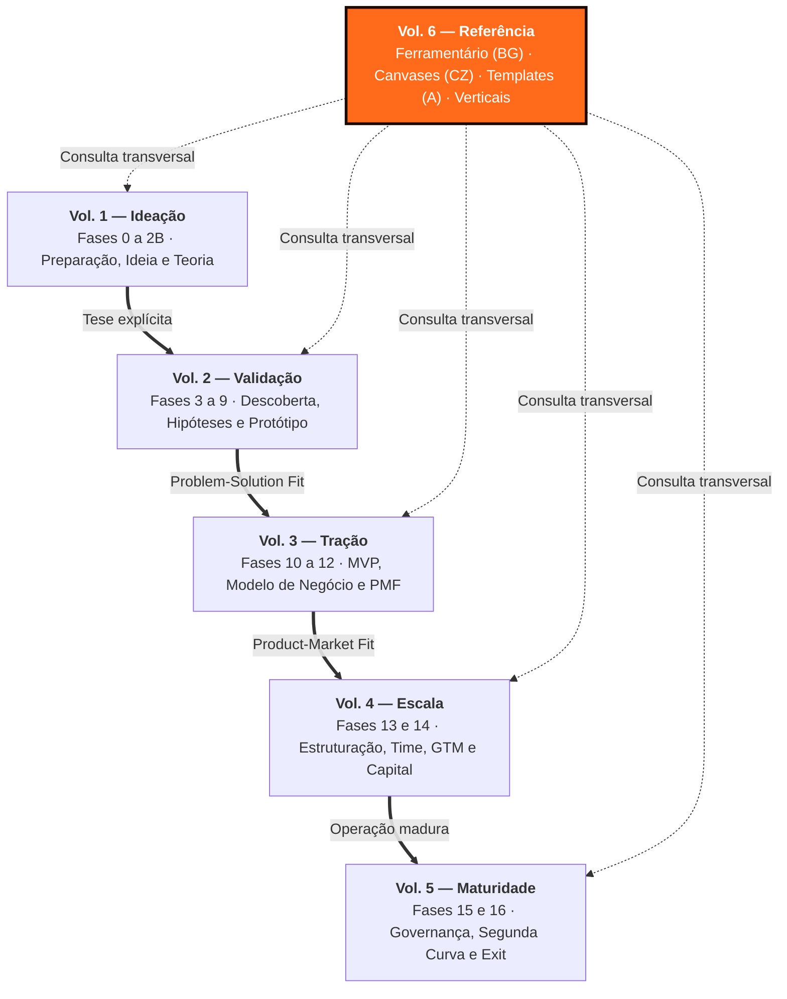

---

## Sumário deste Volume

### Estrutura do Volume de Referência

#### Guias de Passagem de Fase, Métricas e Leituras

- [[#APÊNDICE B — COMO FECHAR UMA FASE: COMMITTED NEXT MOVE E SINAIS OBSERVÁVEIS]]
- [[#APÊNDICE C — CATÁLOGO DE MÉTRICAS POR FASE]]
- [[#APÊNDICE E — RECURSOS E LEITURAS RECOMENDADAS]]
- [[#APÊNDICE — DATA DE COMPILAÇÃO E NOTA SOBRE ENVELHECIMENTO]]

#### Ferramentário, Canvases e Templates Operacionais

- [[#APÊNDICE: ÍNDICE DE FRAMEWORKS]]
- [[#APÊNDICE BG — FERRAMENTÁRIO COMPLETO DO EMPREENDEDOR]]
- [[#APÊNDICE CZ — CANVASES E MAPAS VISUAIS DE MODELO]]
- [[#APÊNDICE A — TEMPLATES PRONTOS PARA USO]]

#### Playbooks de Verticais e Setores Regulados no Brasil

- [[#APÊNDICE AW — REGULATÓRIO SETORIAL BRASILEIRO]]
- [[#APÊNDICE CM — BIOTECH E HEALTHTECH: PLAYBOOK DE REGULAÇÃO, ENSAIOS E CAPITAL]]
- [[#APÊNDICE CA — HARDWARE E DEEP TECH: CONSTRUIR NEGÓCIO COM FABRICAÇÃO, IP E HORIZONTES LONGOS]]
- [[#APÊNDICE DK — GOVTECH: STARTUP VENDENDO PARA GOVERNO]]
- [[#APÊNDICE DL — AGRITECH: PLAYBOOK PARA O CAMPO BRASILEIRO]]
- [[#APÊNDICE DM — EDTECH: PLAYBOOK PARA TECNOLOGIA DE EDUCAÇÃO NO BRASIL]]
- [[#APÊNDICE DN — CLEANTECH E ESG: STARTUPS DE IMPACTO AMBIENTAL NO BRASIL]]
- [[#APÊNDICE DO — PROPTECH: TECNOLOGIA NO MERCADO IMOBILIÁRIO BRASILEIRO]]
- [[#APÊNDICE DP — LEGALTECH: TECNOLOGIA JURÍDICA NO BRASIL]]
- [[#APÊNDICE DQ — LOGTECH: TECNOLOGIA EM LOGÍSTICA E SUPPLY CHAIN NO BRASIL]]

#### Glossários, Bibliografias e Índices Remissivos

- [[#APÊNDICE — GLOSSÁRIO DE TERMOS TÉCNICOS]]
- [[#GLOSSÁRIO]]
- [[#APÊNDICE — LISTA DE ABREVIAÇÕES]]
- [[#APÊNDICE: BIBLIOGRAFIA]]
- [[#APÊNDICE — BIBLIOGRAFIA UNIFICADA]]
- [[#APÊNDICE: ÍNDICE ANALÍTICO]]
- [[#APÊNDICE — ÍNDICE REMISSIVO]]
- [[#ÍNDICE REMISSIVO DE TERMOS-CHAVE]]

---

# GUIAS DE PASSAGEM DE FASE, MÉTRICAS E LEITURAS

---

## APÊNDICE B — COMO FECHAR UMA FASE: COMMITTED NEXT MOVE E SINAIS OBSERVÁVEIS

Esse apêndice trata de algo que o checklist de SAÍDA DESTA FASE de cada fase não cobre, a estrutura do próximo passo a que você se compromete antes de virar a página. Os checklists de saída dizem "o que você precisa ter feito". Esse apêndice diz "como você sabe que o próximo passo é experimento comprometido e não procrastinação disfarçada de rigor". Vale ao fim de qualquer fase.

### COMMITTED NEXT MOVE (próximo passo comprometido), a estrutura ao fim de cada fase

Antes de encerrar qualquer fase, e abrir a próxima, valide que você tem as quatro peças abaixo definidas com precisão. Elas traduzem a disciplina "committed experiments, not prolonged exploration" (experimentos comprometidos, e não exploração prolongada) do programa da Antler para o trabalho fase a fase desse manual.

> [!warning] A ausência de qualquer uma das quatro
> A ausência de qualquer uma das quatro é sinal de que você está ainda em exploração. Não em compromisso.

- [ ] **Uma cunha definida.** O comprador, o workflow, e o resultado exatos, que você está mirando *primeiro*. Se essa descrição muda dependendo do interlocutor, a cunha ainda não fechou (veja o Wedge Stress Test da [[IGNICAO-Vol-2-Validacao#FASE 5 — MAPEAMENTO DE MERCADO E CONCORRÊNCIA|Fase 5 (Vol. 2)]]).
- [ ] **Uma hipótese testável.** Uma afirmação única, falsificável, sobre o que precisa ser verdade para a fase avançar. Escrita antes do teste, com threshold ex-ante (veja [[IGNICAO-Vol-2-Validacao#APÊNDICE F — ABORDAGEM CIENTÍFICA vs LEAN STARTUP: QUANDO USAR CADA UMA|Apêndice F (Vol. 2)]] sobre abordagem científica). Para os thresholds quantitativos de saude por fase que sustentam a decisao de COMMITTED NEXT MOVE, ver [[#APÊNDICE C — CATÁLOGO DE MÉTRICAS POR FASE|Apêndice C]].
- [ ] **Um caminho de validação concreto.** A técnica específica que você vai usar para gerar o sinal. Não "várias técnicas possíveis" (veja a tabela A.9 para escolher entre entrevista, questionário, pré-venda, MVP, etc.).
- [ ] **Uma janela curta de execução.** Data de início, e data de fim. Duas a três semanas é o padrão para experimentos em early stage (estágio inicial). Mais que isso geralmente é procrastinação disfarçada de rigor. Janelas curtas forçam decisão. Janelas longas adiam o momento da verdade.

> [!important] Se as quatro peças não estão claras por escrito
> Se as quatro peças não estão claras por escrito, você ainda não tem um próximo passo comprometido. Tem uma lista de ideias. Resolva antes de considerar a fase fechada.

### SINAIS OBSERVÁVEIS, quatro formatos de evidência que provam que o próximo passo está andando

Um próximo passo bom produz evidência. Não apenas atividade. Pergunte, antes de começar. *Se o experimento funcionar, o que eu vou observar?*. Os quatro formatos de sinal abaixo, qualquer um deles, contam como evidência real. Se nenhum se materializa na janela de execução, o experimento não gerou aprendizado útil. Independentemente de quantas horas você gastou nele.

**Sinal de produto.** O mesmo usuário volta, e repete o workflow, sem você ter que convidar, lembrar, ou empurrar. Uso espontâneo repetido é o sinal mais forte em early stage. Curiosidade one-off não conta.

**Adoção no fluxo de trabalho.** O produto deixa de ser "uma demo que eu testei", e vira parte do processo real do cliente. Aparece no passo-a-passo natural dele. É mencionado em reuniões internas. Substitui algo que ele usava antes.

**Sinal econômico.** O cliente abre a conversa sobre orçamento. Pede proposta. Pergunta preço sem você puxar. Ou aloca tempo interno para avaliar compra. Interesse que se traduz em movimentação de recursos é diferente de interesse educado.

**Compromisso comportamental do comprador.** O comprador formal (não apenas usuário, ou champion) aceita fazer um piloto com critérios. Assinar carta de intenção. Disponibilizar um canal interno para o projeto. Ou permitir acesso à equipe. Qualquer um desses é ponte para contrato real.

> [!important] Regra combinada
> Para o Committed Next Move ser considerado bem-desenhado, ele precisa nominalmente especificar qual dos quatro sinais você espera ver. E qual volume desse sinal você considera suficiente para declarar sucesso. Sem essa especificação ex-ante, você vai terminar a janela olhando os dados em busca de confirmação. E isso é viés. Não aprendizado.

---

## APÊNDICE C — CATÁLOGO DE MÉTRICAS POR FASE

> [!note] Como usar
> Esse apêndice consolida as métricas-chave de cada fase em formato de referência rápida. Para cada fase, apresenta as métricas centrais de acompanhamento, os benchmarks, referências comparativas quando existem, e os sinais de alerta. Não substitui a leitura de cada fase. Serve como painel de controle para diagnóstico rápido de onde a empresa está e do que medir no momento atual.

O diagnóstico correto começa pela fase. Se você não sabe em qual fase está, leia as aberturas de [[IGNICAO-Vol-3-Tracao#FASE 10 — MVP E EXPERIMENTOS DE MERCADO|Fase 10 (Vol. 3)]] a [[IGNICAO-Vol-4-Escala#FASE 14 — ESCALA: TIME, OPERAÇÕES, CRESCIMENTO E CAPITAL|Fase 14 (Vol. 4)]] e verifique qual descreve sua situação. Cada fase tem métricas próprias que fazem sentido no contexto dela. Aplicar métricas de [[IGNICAO-Vol-4-Escala#FASE 14 — ESCALA: TIME, OPERAÇÕES, CRESCIMENTO E CAPITAL|Fase 14 (Vol. 4)]], escala, em empresa de [[IGNICAO-Vol-3-Tracao#FASE 10 — MVP E EXPERIMENTOS DE MERCADO|Fase 10 (Vol. 3)]], MVP ou produto mínimo viável, gera decisões erradas.

---

### Fase 0 — Preparação do empreendedor

As métricas de preparação são qualitativas. Runway pessoal em meses de subsistência sem renda (mínimo doze, ideal vinte e quatro). Clareza de motivação validada externamente (três ou mais pessoas próximas conseguem descrever sua motivação com precisão). Candidatos a cofundador entrevistados (cinco a dez pessoas). Horas dedicadas a exploração de problema (mínimo quarenta horas antes de qualquer decisão de build). Exercícios de autoconhecimento concluídos (FMF Check, teste de personalidade, análise de forças).

> [!warning] Sinal de alerta
> Runway menor que doze meses sem fonte de renda alternativa é pré-condição de falha, não de sucesso. Capital pessoal insuficiente produz decisões de negócio ruins.

---

### Fase 1 — Encontrar a ideia

| Métrica | O que medir | Referência saudável |
|---|---|---|
| Candidatas geradas | Total de ideias avaliadas | 20 ou mais antes de decidir |
| Filtros aplicados | FMF, timing, mercado, execução | 4 filtros em todas as candidatas |
| Schlep blindness testada | Você consegue articular por que outros evitam o problema? | Sim |
| Janelas de timing mapeadas | Por que agora? | Resposta articulada em 2 frases |

---

### Fase 2 — Articulação da ideia

| Métrica | O que medir | Referência saudável |
|---|---|---|
| Declaração Inicial preenchida | 6 campos da DII completos | Sim |
| Incertezas mapeadas | Número de incertezas críticas listadas | 10 a 20 |
| Suposições classificadas | % das suposições com peso e testabilidade | 100% |
| Inversão de Munger aplicada | Cenário de falha articulado | Sim |

---

### Fase 2B — Teoria do negócio

| Métrica | O que medir | Referência saudável |
|---|---|---|
| Story Tree construída | Nós de causa-efeito com lógica causal explícita | Pelo menos 3 níveis |
| Apostas bet-the-company | Número de apostas centrais identificadas | 2 a 5 |
| Falsificabilidade | Cada aposta tem condição de refutação clara | Sim |
| DAG sem ciclos | Grafo causal sem loops | Sim |

---

### Fase 3 — Descoberta do problema

| Métrica | O que medir | Referência saudável |
|---|---|---|
| Entrevistas realizadas | Total de entrevistas de problema | ≥ 20 antes de qualquer conclusão |
| Dores nível 8+ | % das entrevistas com dor acima de 8 em 10 | ≥ 60% |
| Citações documentadas | Citações verbatim sobre o problema | ≥ 30 |
| Padrões emergentes | Temas recorrentes identificados | 3 a 5 temas claros |
| Alternativas atuais mapeadas | Soluções que o cliente usa hoje | Mapeadas em 100% das entrevistas |
| Mom Test score | Entrevistas sem leading questions | ≥ 80% das perguntas abertas |

> [!important] Marco de saída da Fase 3
> Mínimo 20 entrevistas com pelo menos 12 confirmando dor nível 8 ou mais, descrevendo comportamento atual, e dispostos a ser early adopters.

---

### Fase 4 — Pesquisa com usuários

| Métrica | O que medir | Referência saudável |
|---|---|---|
| Jobs-to-be-done mapeados | Jobs funcionais, emocionais e sociais identificados | ≥ 3 jobs por segmento |
| Jornada documentada | Pontos de dor na jornada atual mapeados | ≥ 5 pontos de fricção |
| Personas validadas | Personas com dados reais (não fictícios) | 2 a 3 personas primárias |
| Beachhead segment definido | Segmento inicial de 100 a 1.000 clientes | Identificado e justificado |
| Customer discovery score | Novos aprendizados por entrevista | Decrescente (sinal de saturação) |

---

### Fase 5 — Mapeamento de mercado

| Métrica | O que medir | Referência saudável |
|---|---|---|
| TAM calculado | Mercado total endereçável | Metodologia bottom-up |
| SAM calculado | Mercado serviceable com seu GTM | 1 a 10% do TAM |
| SOM ano 3 | Participação realista em 3 anos | 1 a 5% do SAM |
| Concorrentes mapeados | Diretos, indiretos e substitutos | ≥ 10 alternativas mapeadas |
| Wedge identificado | Ponto de entrada diferenciado | Sim, defensável |
| 5 Forças de Porter aplicadas | Análise estrutural da indústria | Completada |
| Posicionamento no Mapa de Valor | Localização diferenciada | Diferente de qualquer player |

---

### Fase 6 — Formulação de hipóteses

| Métrica | O que medir | Referência saudável |
|---|---|---|
| Banco de hipóteses preenchido | Hipóteses críticas priorizadas | ≥ 10 hipóteses classificadas |
| Hipóteses bet-the-company | Apostas de alto impacto e alta incerteza | 2 a 5 identificadas |
| Sistema H-E (Hipótese/Experimento) | Cada hipótese tem experimento mapeado | 100% das bet-the-company |
| Critério de falsificação | Cada hipótese tem threshold de refutação | Sim |
| CSD (Certezas, Suposições, Dúvidas) | Distribuição documentada | Atualizado semanalmente |

---

### Fase 7 — Experimentos de validação

| Métrica | O que medir | Referência saudável |
|---|---|---|
| Taxa de acerto de hipóteses | % confirmadas vs refutadas | 30 a 50% (muito alto = pouca aprendizagem) |
| Velocidade de aprendizado | Hipóteses testadas por semana | ≥ 2 por semana em sprint |
| Regra 9 em 10 | Threshold mínimo antes de pivotar | Definido antes do experimento |
| Pre-registro | % dos experimentos com hipótese registrada antes | 100% |
| Evidência qualitativa | Entrevistas de validação complementares | ≥ 5 por experimento crítico |
| Pré-vendas ou LOIs | Cartas de intenção ou pagamentos antes do produto | ≥ 3 antes de construir |

---

### Fase 8 — Ideação e prototipagem

| Métrica | O que medir | Referência saudável |
|---|---|---|
| Variantes de solução testadas | Quantas ideias de solução avaliadas antes de escolher | ≥ 5 (Crazy 8s) |
| Fidelidade do protótipo | Nível de acabamento necessário para validar hipótese | Mínimo que responde à pergunta |
| Custo do protótipo | Tempo e recursos investidos antes de teste | Semanas, não meses |
| Feedback coletado | Usuários que testaram o protótipo | ≥ 5 por iteração |

---

### Fase 9 — Testes de solução

| Métrica | O que medir | Referência saudável |
|---|---|---|
| Task completion rate | % dos usuários que completam tarefa-chave no protótipo | ≥ 70% |
| Erros de usabilidade críticos | Erros que bloqueiam uso | 0 antes de seguir |
| SUS (System Usability Scale) | Score de usabilidade padronizado | ≥ 68 (acima da média) |
| Desejabilidade | % que diz "compraria" ou "usaria" | ≥ 60% do segmento-alvo |
| Net Promoter Score de protótipo | Intenção de recomendar | ≥ 40 |

---

### Fase 10 — MVP e experimentos de mercado

| Métrica | O que medir | Referência saudável |
|---|---|---|
| Tempo para primeiro usuário | Dias desde o lançamento | ≤ 30 dias |
| Tempo para primeiro pagante | Dias desde o lançamento | ≤ 60 dias (B2C), ≤ 90 dias (B2B) |
| Ativação | % dos usuários que atingem "momento aha" | ≥ 40% em D7 |
| Retenção D30 | % que retorna em 30 dias | ≥ 20% B2C, ≥ 40% B2B |
| Aprendizados por sprint | Hipóteses resolvidas por semana | ≥ 2 |
| Feature usage | Funcionalidades usadas por usuário ativo | Core features: ≥ 70% de adoção |

> [!warning] Sinal de alerta
> Retenção D30 abaixo de 15% em B2C ou 30% em B2B indica ausência de valor real. Adicionar funcionalidades não resolve retenção baixa.

---

### Fase 11 — Validação do modelo de negócio

| Métrica | O que medir | Referência saudável |
|---|---|---|
| CAC (Custo de Aquisição de Cliente) | Custo total de marketing e vendas / novos clientes | Calculado por canal, não blended |
| LTV (Lifetime Value) | Receita líquida por cliente ao longo da vida | LTV/CAC ≥ 3x |
| CAC Payback | Meses para recuperar custo de aquisição | ≤ 12 meses B2C, ≤ 18 meses B2B |
| Margem bruta | (Receita - COGS) / Receita | ≥ 60% SaaS, ≥ 40% marketplace |
| Churn mensal | % da receita perdida por mês | ≤ 2% B2C, ≤ 1% B2B |
| MRR | Receita recorrente mensal | Crescendo ≥ 10% mês a mês |
| Magic Number | Net new ARR / Sales & Marketing spend | ≥ 0.75 para escalar |

---

### Fase 12 — Product-Market Fit

| Métrica | O que medir | Referência saudável |
|---|---|---|
| Retenção por coorte | Curva que estabiliza (não cai para zero) | Estabilização em ≥ 20% |
| NPS | Net Promoter Score | ≥ 40 consumer, ≥ 30 enterprise |
| Sean Ellis Test | % que ficaria "muito desapontado" sem o produto | ≥ 40% |
| Crescimento orgânico | % de novos usuários sem gasto em paid | ≥ 30% |
| Engagement (DAU/MAU) | Usuários diários / mensais | ≥ 20% produtos de frequência alta |
| NRR (Net Revenue Retention) | Expansão de receita na base atual | ≥ 100% (≥ 110% é excelente) |
| Qualitative PMF signals | Usuários reclamando quando feature some, compartilhando espontaneamente | Presente e documentado |

> [!important] Definição operacional de PMF
> PMF não é número. É curva de retenção que estabiliza, mais NPS acima de 40, mais crescimento orgânico ≥ 30%, mais evidência qualitativa de que a vida do cliente é pior sem o produto. Os três juntos.

---

### Fase 13 — Estruturação

| Métrica | O que medir | Referência saudável |
|---|---|---|
| MRR | Receita recorrente mensal | R$ 100 mil a R$ 500 mil (Série A típica) |
| Crescimento MoM | Crescimento mês a mês | ≥ 10-15% ao mês |
| Runway | Meses de caixa disponível | ≥ 18 meses pós-rodada |
| Cap table limpa | Sem problemas de governança ou direitos conflitantes | Sim |
| Compliance básico | LGPD, trabalhista, tributário em dia | Sim |
| Acordo de sócios | Vesting, drag-along, tag-along definidos | Sim |
| Data room Série A | Documentos para due diligence organizados | ≥ 80% completo |

---

### Fase 14 — Escala

| Métrica | O que medir | Referência saudável |
|---|---|---|
| ARR | Receita anual recorrente | Crescendo ≥ 3x ano a ano |
| NRR | Net Revenue Retention | ≥ 110% (expansão supera churn) |
| CAC Payback | Meses para recuperar aquisição | ≤ 18 meses |
| Magic Number | Net new ARR / S&M spend | ≥ 0.75 |
| Rule of 40 | Crescimento % + Margem EBITDA % | ≥ 40 |
| Headcount growth | Pessoas contratadas / quarter | Proporcional à receita |
| eNPS | Employee NPS | ≥ 30 |
| Attrition voluntária | % de saídas voluntárias / ano | ≤ 15% |
| Burn Multiple | Net burn / Net new ARR | ≤ 1.5x (eficiente), ≤ 2.5x (aceitável) |

> [!warning] Sinal de alerta
> Rule of 40 abaixo de 20 combinado com NRR abaixo de 100% indica empresa em deterioração. CAC Payback acima de 24 meses sem melhora trimestral indica modelo não escalável no ritmo atual.

---

### Fase 15 — Reinvenção e segunda curva

| Métrica | O que medir | Referência saudável |
|---|---|---|
| Crescimento do core | Deceleração do modelo atual | Alerta se declina 2 trimestres |
| Revenue de produtos novos | % da receita de lançamentos <24 meses | ≥ 15-25% em scaleup |
| NPS por coorte temporal | Coortes novas vs antigas | Coorte nova ≥ coorte antiga |
| Concentração de receita | Top 20% dos clientes como % da receita | Crescente é sinal de saturação |
| Learning velocity (2ª curva) | Hipóteses resolvidas por mês na aposta nova | ≥ igual à [[IGNICAO-Vol-2-Validacao#FASE 7 — EXPERIMENTOS DE VALIDAÇÃO DO PROBLEMA|Fase 7 (Vol. 2)]] original |
| Alocação de tempo do CEO | % em new ventures vs core | ≥ 15-25% em new ventures |
| Pipeline segunda curva | Clientes-piloto ativos | ≥ 3 em primeiros 6 meses |

---

### Fase 16 — Exit

| Métrica | O que medir | Referência saudável |
|---|---|---|
| Múltiplos de comparáveis | EV/ARR de transações similares no setor | Mapear 3+ por trimestre |
| Data room completude | % da documentação de DD organizada | ≥ 90% antes do processo |
| Pipeline de compradores | Potenciais compradores mapeados | 10 a 25 contatos |
| Diferença DCF vs market comp | Divergência entre métodos | ≤ 20% |
| Tax structuring implementado | Estrutura tributária preparada | Sim, ≥ 2 anos antes |
| Acordo de sócios robusto | Drag-along, tag-along, protections | Sim |
| Tempo de preparação | Meses antes do processo formal | ≥ 18 meses |

---

### Índice de benchmarks de referência rápida

| Métrica | Early-stage | Growth | Maduro |
|---|---|---|---|
| NRR | — | ≥ 100% | ≥ 110% |
| CAC Payback | ≤ 18 meses | ≤ 12 meses | ≤ 9 meses |
| Margem bruta SaaS | ≥ 50% | ≥ 65% | ≥ 75% |
| Churn mensal | ≤ 3% | ≤ 2% | ≤ 1% |
| Magic Number | — | ≥ 0.75 | ≥ 1.0 |
| Rule of 40 | — | ≥ 20 | ≥ 40 |
| Burn Multiple | — | ≤ 2.5x | ≤ 1.5x |
| DAU/MAU | ≥ 10% | ≥ 20% | ≥ 30% |
| NPS (consumer) | ≥ 30 | ≥ 40 | ≥ 50 |
| NPS (enterprise) | ≥ 20 | ≥ 30 | ≥ 40 |
| eNPS | — | ≥ 20 | ≥ 30 |

> [!note] Nota sobre benchmarks
> Benchmarks são médias de mercado e variam por setor, modelo de negócio e contexto macroeconômico. Usar como referência de diagnóstico, não como meta absoluta. O que importa é a tendência ao longo do tempo para a sua empresa, não a distância de um número de mercado.

### Ver também

[[#APÊNDICE BG — FERRAMENTÁRIO COMPLETO DO EMPREENDEDOR|Apêndice BG]] contém as ferramentas analíticas para cada métrica. As seções BG.18 (Finanças e Unit Economics) e BG.11 (Produto: Priorização e Métricas) aprofundam os cálculos.

> [!info] Fases relacionadas
> Referenciado em: Fase 12.

---

## APÊNDICE E — RECURSOS E LEITURAS RECOMENDADAS

> [!note] Como usar
> Esse apêndice é catálogo, não roteiro linear. Use como mapa de leitura para aprofundar pontos específicos do livro. As listas estão organizadas por estágio e por tema para consulta dirigida. As únicas seções em prosa são os ensaios de Paul Graham e o one-pager final, que sintetiza o que reli mais vezes ao longo dos anos.

### Leituras fundamentais (livros)

*The Mom Test*, de Rob Fitzpatrick: como conduzir entrevistas que produzem evidência real, não validação enganosa. *The Lean Startup*, de Eric Ries: ciclo build-measure-learn e pensamento de experimento aplicado a negócios. *Running Lean*, de Ash Maurya: metodologia operacional para validação de startups. *Talking to Humans*, de Giff Constable: guia prático de customer discovery. *Jobs to Be Done*, de Anthony Ulwick e Clayton Christensen: framework para entender motivação real do cliente. *The Four Steps to the Epiphany*, de Steve Blank: clássico sobre customer development. *Zero to One*, de Peter Thiel: pensamento contrarian sobre monopólios e diferenciação. *Inspired*, de Marty Cagan: gestão de produto moderna. *Predictable Revenue*, de Aaron Ross: escalabilidade de vendas B2B. *tração*, de Gabriel Weinberg: como escolher canais de aquisição. *The Logic of Scientific Discovery*, de Karl Popper: fundação da lógica de falsificação. Leitura densa, mas essencial para quem quer entender por que hipóteses falsificáveis importam. *Experimentation Works*, de Stefan Thomke: cultura de experimentação em empresas estabelecidas, complementar ao Lean Startup em estágios mais avançados.

### Artigos e papers acadêmicos sobre a abordagem científica

Camuffo, A., Cordova, A., Gambardella, A., e Spina, C. (2020). *A scientific approach to entrepreneurial decision making: Evidence from a randomized control trial*. Management Science. O estudo fundador que mostrou efeito positivo sobre performance. Camuffo, A., Gambardella, A., Messinese, D., Novelli, E., Paolucci, E., e Spina, C. (2024). *A scientific approach to entrepreneurial decision-making: Large-scale replication and extension*. Strategic Management Journal. Replicação em larga escala (mais de setecentos e cinquenta empreendedores) confirmando os achados. Coali, A., Novelli, E., Sirigiri, A., e Spina, C. (2024). *A scientific approach to decision-making: Key tools and design principles*. Journal of Business Venturing Design. O paper-fonte dos conceitos de atributos, teoria do negócio, thresholds e due diligence de amostra usados nesse manual. Felin, T., Gambardella, A., Novelli, E., e Zenger, T. (2024). *A scientific method for startups*. Journal of Management. Diferenças conceituais entre abordagem científica e Lean Startup. Novelli, E., e Spina, C. (2024). *Making business model decisions like scientists: Strategic commitment, uncertainty and economic performance*. Strategic Management Journal. Como o estágio de desenvolvimento do negócio modera o efeito da abordagem científica. Agarwal, R. et al. (2024). *Does a theory-of-value add value? Evidence from a Randomized Control Trial with Tanzanian Entrepreneurs*. Evidência do valor específico do componente de construção de teoria em contexto emergente. Ehrig, T., e Schmidt, J. (2022). *Theory-based learning and experimentation*. Strategic Management Journal. Fundamentação sobre como estratégias são geradas a partir de teorias. Zellweger, T. M., e Zenger, T. R. (2021). *Entrepreneurs as scientists: A pragmatist approach to producing value out of uncertainty*. Academy of Management Review. Perspectiva filosófica sobre empreendedor-cientista.

### Artigos práticos abertos ao público

Spina, C., Camuffo, A., e Gambardella, A. (2020). *Founders, apply the scientific method to your startup*. Harvard Business Review. Blank, S. (2013). *Why the Lean Start-Up Changes Everything*. Harvard Business Review. Kozyrkov, C. (2019). *The first thing great decision makers do*. Harvard Business Review. Sobre a importância crítica de definir thresholds ex-ante.

### Frameworks e ferramentas úteis

Business Model Canvas e Lean Canvas. Value Proposition Canvas (Strategyzer). Double Diamond (Design Council). Jobs-to-be-Done Framework. RICE para priorização. OKRs para gestão por metas. Kanban para gestão de experimentos.

### Tipos de comunidades e recursos online para empreendedores

Comunidades de founders locais via associações, eventos e encontros. Programas de aceleração — estude com rigor antes de entrar. Muitos são mais ruins do que bons. Mentoria estruturada com gente que já construiu, não só investiu ou escreveu. Cursos de Y Combinator Startup School, gratuitos.

### Profissionais que você vai precisar

Contador com experiência em startups e PMEs. Advogado com prática em societário, contratos e LGPD. Designer (de produto ou de serviço) freelancer. Tech lead ou desenvolvedor (se o produto exige tecnologia). Eventualmente: especialista em marketing digital, especialista em vendas B2B.

### Leituras complementares ao [[IGNICAO-Vol-3-Tracao#APÊNDICE CP — SALES: MOTION COMPLETA, DO OUTBOUND AO RENEWAL|Apêndice CP (Vol. 3)]] — Sales enterprise

*Mastering Technical Sales*, de John Care e Aron Bohlig (referência original do MEDDIC em vendas técnicas complexas). *The Challenger Sale*, de Matthew Dixon e Brent Adamson (vendas consultivas em complexidade alta). Materiais e treinamentos formais de MEDDIC Academy e Force Management / Command of the Message (cursos comerciais, mas referência do framework). *Gap Selling*, de Keenan (discovery como disciplina).

### Leituras complementares ao [[IGNICAO-Vol-4-Escala#APÊNDICE CQ — MARCA, PR E POSICIONAMENTO DE LONGO PRAZO|Apêndice CQ (Vol. 4)]] — Marca, PR e narrativa

*Crossing the Chasm*, de Geoffrey Moore (movimento de mainstream, segmentação de adopters). *Play Bigger*, de Al Ramadan, Dave Peterson, Christopher Lochhead e Kevin Maney (category design formalizado). *Building a StoryBrand*, de Donald Miller (narrativa voltada ao cliente). *Obviously Awesome*, de April Dunford (posicionamento como disciplina).

### Leituras complementares ao [[IGNICAO-Vol-4-Escala#APÊNDICE R — FOUNDER MODE, DELEGAÇÃO E QUANDO PARAR DE FAZER|Apêndice R (Vol. 4)]] — Founder Mode, gestão e liderança

*Founder Mode*, ensaio de Paul Graham (2024), originalmente publicado em paulgraham.com/foundermode.html. *The Hard Thing About Hard Things*, de Ben Horowitz (relato honesto sobre crises de CEO). *High Output Management*, de Andrew Grove (clássico de gestão aplicável em escala). *The Great CEO Within*, de Matt Mochary (operacional para fundadores em escala).

### Leituras complementares ao [[IGNICAO-Vol-4-Escala#APÊNDICE P — FINANCIAMENTO NÃO-DILUITIVO|Apêndice P (Vol. 4)]] — Financiamento

*Venture Deals*, de Brad Feld e Jason Mendelson (referência de termos de investimento, aplicável também a não-diluitivo). Material técnico da Finep, BNDES e FAPESP disponível nos próprios sites. *The Messy Marketplace*, de Brent Beshore (relevante para exit, mas tem ângulos de financiamento estruturado).

### Leituras complementares ao [[IGNICAO-Vol-3-Tracao#APÊNDICE J — FRAMEWORK DE CANAIS DE AQUISIÇÃO|Apêndice J (Vol. 3)]] — Product-Led Growth

*Product-Led Growth*, de Wes Bush (referência operacional). *Product-Led Onboarding*, de Ramli John (disciplina de ativação). Blog e relatórios da OpenView Partners (acervo público sobre PLG).

### Leituras complementares ao [[IGNICAO-Vol-2-Validacao#APÊNDICE S — CATEGORY DESIGN|Apêndice S (Vol. 2)]] — Category Design

*Play Bigger* (também listado em Marca). *Obviously Awesome*, de April Dunford. Podcasts: *Category Thinkers*, com Lochhead.

### Leituras complementares ao [[IGNICAO-Vol-4-Escala#APÊNDICE T — LGPD, COMPLIANCE E GOVERNANÇA DE DADOS|Apêndice T (Vol. 4)]] — LGPD e privacidade

Manual de LGPD da ANPD (Autoridade Nacional de Proteção de Dados). *Privacy Law Fundamentals*, de Daniel Solove e Paul Schwartz (referência acadêmica internacional). Material operacional de plataformas como IAPP (International Association of Privacy Professionals).

### Leituras complementares ao [[IGNICAO-Vol-5-Maturidade#APÊNDICE CW — CRISE E CONTINUIDADE: PREVENÇÃO, RESPOSTA, RECUPERAÇÃO|Apêndice CW (Vol. 5)]] — Crise e recuperação

*The Hard Thing About Hard Things*, de Horowitz (crises em CEOs). *Shoe Dog*, de Phil Knight (relato autobiográfico de crises de caixa). *Bad Blood*, de John Carreyrou (como as coisas viram catastróficas quando encobertas). *Thinking in Bets*, de Annie Duke (decisão sob incerteza, aplicável a crise).

### Leituras complementares ao [[IGNICAO-Vol-1-Ideacao#APÊNDICE D — ARMADILHAS MENTAIS E VIESES|Apêndice D (Vol. 1)]] — Decisão, pensamento crítico e armadilhas mentais

*Thinking, Fast and Slow*, de Daniel Kahneman (heurísticas, vieses, sistemas um e dois). *Poor Charlie's Almanack*, de Charlie Munger (inversão, mental models). *Superforecasting*, de Philip Tetlock e Dan Gardner (previsão com rigor). Pre-Mortem, conceito original de Gary Klein (artigos acadêmicos disponíveis). *Playing to Win*, de A.G. Lafley e Roger Martin (origem de "what would have to be true?").

### Leituras complementares ao [[IGNICAO-Vol-4-Escala#APÊNDICE V — CAPTAÇÃO DE EQUITY, PITCH E RELACIONAMENTO COM INVESTIDORES|Apêndice V (Vol. 4)]] — Captação de equity, pitch e relacionamento

*Pyramid Principle*, de Barbara Minto (origem do SCQA e pensamento estruturado). *Venture Deals*, de Brad Feld e Jason Mendelson (term sheets em profundidade, referência obrigatória). *Secrets of Sand Hill Road*, de Scott Kupor (a16z), sobre como VCs pensam internamente. *Raising Venture Capital for the Serious Entrepreneur*, de Dermot Berkery. *The Hard Thing About Hard Things*, de Ben Horowitz (relacionamento board-CEO em crise). Blog de Paul Graham, especialmente os ensaios sobre investidores em paulgraham.com/invtrend.html e paulgraham.com/fundraising.html. *Fundraising Playbook* da First Round Capital (disponível online). *Startup Funding Masterclass*, série de posts de Brad Feld (Foundry Group). Para contexto brasileiro: materiais da ACE Startups, Distrito e ABVCAP (associação de venture capital).

### Ensaios canônicos de Paul Graham — referência consolidada

Paul Graham escreveu aproximadamente duzentos ensaios entre 1993 e 2024, publicados gratuitamente em paulgraham.com. Muitos viraram vocabulário básico do ecossistema de startups: "do things that don't scale", "default alive", "ramen profitable", "schlep blindness", "founder mode". Boa parte do que eu articulo nesse livro tem raiz naqueles textos. Cito-os ao longo do material, mas reúno aqui a referência consolidada para que você tenha um mapa de leitura.

A organização abaixo é por utilidade operacional para fundador em construção, não cronológica. A leitura recomendada é em sessão única de duas a três horas dos primeiros oito, depois releitura seletiva anual de acordo com a fase que você estiver vivendo.

**Para a fase de encontrar ideia (Fases 1 a 3).** *How to Get Startup Ideas* (2012), em paulgraham.com/startupideas.html. "Live in the future, then build what's missing." Sobre ideias orgânicas, sitcom ideas, estar na borda. *Schlep Blindness* (2012), em paulgraham.com/schlep.html. Por que problemas chatos são frequentemente as maiores oportunidades. Caso canônico Stripe. *Frighteningly Ambitious Startup Ideas* (2012), em paulgraham.com/ambitious.html. Por que as ideias mais ambiciosas intimidam e por isso são oportunidade. *Organic Startup Ideas* (2010), em paulgraham.com/organic.html. Desenvolvimento específico do conceito de ideias que nascem de necessidade própria.

**Para construir e crescer (Fases 9 a 14).** *Do Things That Don't Scale* (2013), em paulgraham.com/ds.html. Por que trabalho manual intenso é o que produz PMF. *Startup = Growth* (2012), em paulgraham.com/growth.html. Benchmarks YC: cinco a sete por cento por semana é saudável, dez por cento é excepcional. *Default Alive or Default Dead* (2015), em paulgraham.com/aord.html. A pergunta diagnóstica mais importante que você precisa responder a partir dos oito ou nove meses de operação. *The Fatal Pinch* (2014), em paulgraham.com/pinch.html. O cenário letal que mata mais startups que qualquer fraude. *Ramen Profitable* (2009), em paulgraham.com/ramenprofitable.html. Por que cobrir custos de vida dos fundadores é milestone subestimado. *Superlinear Returns* (2023), em paulgraham.com/superlinear.html. Por que pequenas diferenças de performance produzem retornos gigantescamente desproporcionais. *Startups in 13 Sentences* (2009), em paulgraham.com/13sentences.html. Treze princípios condensados, um dos ensaios que mais reli ao longo dos anos. Detalhado abaixo como one-pager.

**Sobre o fundador (transversal a todas as fases).** *What We Look for in Founders* (2010), em paulgraham.com/founders.html. Os cinco atributos YC: determinação, flexibilidade, imaginação, naughtiness, amizade. Note que inteligência não aparece na lista. *Relentlessly Resourceful* (2009), em paulgraham.com/relres.html. A essência de bom fundador em duas palavras, e o antônimo, "hapless", como alerta. *The Anatomy of Determination* (2009), em paulgraham.com/determination.html. Determinação é vontade mais flexibilidade, não teimosia. A analogia do running back. *Before the Startup* (2014), em paulgraham.com/before.html. "Seja expert em usuários, não em startups." Gaming the system para de funcionar. *Earnestness* (2020), em paulgraham.com/earnest.html. Sinceridade como fator competitivo subestimado. *Mean People Fail* (2014), em paulgraham.com/mean.html. Por que caráter importa economicamente, não só moralmente. *Keep Your Identity Small* (2009), em paulgraham.com/identity.html. Como ideologias roubam capacidade de pensar com clareza. *You Weren't Meant to Have a Boss* (2008), em paulgraham.com/boss.html. Reflexão sobre autonomia, útil para calibrar expectativa pessoal. *The Top Idea in Your Mind* (2010), em paulgraham.com/top.html. O que ocupa sua mente no banho define sua produtividade.

**Sobre escala e delegação.** *Founder Mode* (2024), em paulgraham.com/foundermode.html. Por que o conselho convencional de "contratar pessoas boas e sair do caminho" pode ser desastre. *Maker's Schedule, Manager's Schedule* (2009), em paulgraham.com/makersschedule.html. Dois modos de usar o tempo e a razão pela qual fundadores perdem capacidade de pensar em escala.

**Sobre captação e VC.** *How to Raise Money* (2013), em paulgraham.com/fr.html. Guia tático denso, complementa o [[IGNICAO-Vol-4-Escala#APÊNDICE V — CAPTAÇÃO DE EQUITY, PITCH E RELACIONAMENTO COM INVESTIDORES|Apêndice V (Vol. 4)]] desse livro. *Black Swan Farming* (2012), em paulgraham.com/swan.html. Entender como VCs pensam através da distribuição power-law dos retornos. *Investor Herd Dynamics* (2013), em paulgraham.com/herd.html. Por que captação oscila entre "impossível" e "fácil demais" sem meio-termo.

**Sobre erros que matam.** *The 18 Mistakes That Kill Startups* (2006), em paulgraham.com/startupmistakes.html. Lista canônica dos erros mais frequentes. O insight central é que todos se reduzem a "não fazer algo que usuários querem".

**Sobre como pensar.** *Keep Your Identity Small* (2009), já citado, aplicável também a pensamento estratégico. *How to Disagree* (2008), em paulgraham.com/disagree.html. Hierarquia de formas de discordar, útil para cultura interna e debates com sócios.

> [!tip] Por onde começar
> Se está começando agora, leia antes de tudo *How to Get Startup Ideas*, *Do Things That Don't Scale* e *Startups in 13 Sentences*. Nessa ordem. São os três que mais mudam a forma de trabalhar.

### Startups em 13 frases — one-pager canônico (Paul Graham, 2009)

Em fevereiro de 2009, Graham escreveu o ensaio *Startups in 13 Sentences*, uma tentativa de condensar tudo que ele diria a um fundador se só pudesse falar treze coisas. Derivou da frase de Paul Buchheit que virou mantra do YC: "é melhor fazer poucas pessoas extremamente felizes do que muitas pessoas semi-felizes."

Reproduzo as treze em formato consolidado aqui, com comentário operacional. Serve como one-pager final para releitura periódica. Eu imprimo e guardo próximo. Não porque as esqueço. Porque esquecer uma e só lembrar dela seis meses depois, num momento ruim, é o tipo de erro que dá para prevenir simplesmente relendo a lista mensalmente.

Graham mesmo indica: se tivesse que escolher uma das treze, seria a quarta (entender seus usuários). Concordo.

**Escolha bons cofundadores.** "Cofundadores são para uma startup o que localização é para imóveis: você pode mudar qualquer coisa numa casa, exceto onde ela está." Você pode mudar ideia, produto, mercado, modelo. Mas trocar cofundador é caro emocional e operacionalmente. O sucesso da startup é, quase sempre, função dos fundadores. Aplicação: [[IGNICAO-Vol-1-Ideacao#FASE 0 — PREPARAÇÃO DO EMPREENDEDOR|Fase 0 (Vol. 1)]], [[IGNICAO-Vol-1-Ideacao#APÊNDICE Y — SAÚDE MENTAL, DINÂMICA DE CO-FOUNDERS E HUMANIDADE DO FUNDADOR|Apêndice Y (Vol. 1)]].

**Lance rápido.** Não porque "time to market" seja tudo, mas porque você ainda não começou a trabalhar no produto de verdade enquanto não lançou. Lançar te ensina o que você deveria estar construindo. Até lá, você está no escuro, mesmo que não perceba. Aplicação: [[IGNICAO-Vol-3-Tracao#FASE 10 — MVP E EXPERIMENTOS DE MERCADO|Fase 10 (Vol. 3)]].

**Deixe a ideia evoluir.** "É um erro tratar startup como se fosse só a implementação de uma ideia inicial brilhante." A ideia inicial é semente. A empresa que você acaba construindo é o resultado da interação entre semente e mercado real. Aplicação: [[IGNICAO-Vol-3-Tracao#FASE 12 — PRODUCT-MARKET FIT|Fase 12 (Vol. 3)]].

**Entenda seus usuários.** A única que Graham escolheria se só pudesse manter uma. "A tarefa essencial de uma startup é criar riqueza, a dimensão da riqueza sobre a qual você tem mais controle é quanto melhora a vida dos seus usuários, e a parte mais difícil disso é saber o que construir para eles." Aplicação: Fases 3 e 4.

**Melhor fazer poucos usuários amarem do que muitos ficarem indiferentes.** Inicialmente, você tem que escolher entre satisfazer todas as necessidades de um subconjunto de potenciais usuários, ou satisfazer um subconjunto das necessidades de todos os potenciais usuários. Escolha a primeira. Aplicação: Estratégia da Cunha ([[IGNICAO-Vol-2-Validacao#APÊNDICE L — IDEA → WEDGE → SCALE: O FRAMEWORK ANTLER COMO LENTE TRANSVERSAL|Apêndice L (Vol. 2)]]).

**Ofereça um atendimento surpreendentemente bom.** Clientes estão acostumados a serem maltratados. Tente fazer seu atendimento não apenas bom, mas surpreendentemente bom. Em estágio inicial, o fundador deve estar pessoalmente na linha de frente. Aplicação: [[IGNICAO-Vol-3-Tracao#FASE 10 — MVP E EXPERIMENTOS DE MERCADO|Fase 10 (Vol. 3)]].

**Você produz o que mede.** Se você quer que algo cresça, meça diariamente. Se quer usuários ativos, meça usuários ativos todo dia. Se quer receita, meça receita semanal. O simples ato de medir já muda o comportamento do time. Aplicação: [[#APÊNDICE BG — FERRAMENTÁRIO COMPLETO DO EMPREENDEDOR|Apêndice BG]].

**Gaste pouco.** A forma mais comum de morte de startup é ficar sem dinheiro. Ser barato é quase sinônimo de iterar rápido. Mais do que isso: cultura de frugalidade mantém a empresa jovem, assim como exercício mantém pessoas jovens. Aplicação: [[IGNICAO-Vol-3-Tracao#FASE 11 — VALIDAÇÃO DO MODELO DE NEGÓCIO|Fase 11 (Vol. 3)]], [[IGNICAO-Vol-1-Ideacao#APÊNDICE AJ — DINHEIRO PESSOAL DO FUNDADOR|Apêndice AJ (Vol. 1)]].

**Chegue a ramen-profitable.** Ramen-profitable significa gerar receita suficiente para cobrir custos básicos de vida dos fundadores. Não é riqueza. É sobrevivência infinita. Uma vez que você cruza essa linha, muda radicalmente sua relação com investidores. Você passa a negociar de força, não de urgência. Aplicação: [[IGNICAO-Vol-3-Tracao#FASE 11 — VALIDAÇÃO DO MODELO DE NEGÓCIO|Fase 11 (Vol. 3)]].

**Evite distrações.** "A startup pode ter mais potencial de longo prazo, mas você sempre vai interromper o trabalho nela para trabalhar em outra coisa." Graham identifica fundraising como a distração campeã. Captação tende a se tornar a "ideia principal na sua cabeça" e roubar cem por cento do seu foco. Minimize tempo em distrações. Quando precisar captar, faça-o rápido e decisivo. E volte a construir. Aplicação: [[IGNICAO-Vol-1-Ideacao#FASE 0 — PREPARAÇÃO DO EMPREENDEDOR|Fase 0 (Vol. 1)]], [[IGNICAO-Vol-4-Escala#APÊNDICE R — FOUNDER MODE, DELEGAÇÃO E QUANDO PARAR DE FAZER|Apêndice R (Vol. 4)]] e [[IGNICAO-Vol-4-Escala#APÊNDICE BQ — GESTÃO DE TEMPO DO FUNDADOR E OPERATING CADENCE|Apêndice BQ (Vol. 4)]].

**Não se desmoralize.** Embora a causa imediata de morte de uma startup seja "ficar sem dinheiro", a causa subjacente é geralmente falta de foco causada por desmoralização. Começar uma startup carrega peso emocional enorme. Entenda isso e faça esforço consciente para não se deixar esmagar, como você cuida de flexionar os joelhos ao levantar uma caixa pesada. Aplicação: [[IGNICAO-Vol-1-Ideacao#APÊNDICE Y — SAÚDE MENTAL, DINÂMICA DE CO-FOUNDERS E HUMANIDADE DO FUNDADOR|Apêndice Y (Vol. 1)]].

**Não desista.** "Você consegue ir surpreendentemente longe apenas por não desistir." Em matemática, persistência sem talento não produz resultado. Em startups, esforço puro frequentemente é suficiente, desde que você continue ajustando a ideia. Aplicação: apêndice sobre Pivot.

**Deals caem.** "Uma das habilidades mais úteis que aprendemos no Viaweb foi não criar expectativas." Graham e o time tiveram cerca de vinte deals caírem. Aprenderam a tratar deals como processos de fundo que você ignora até terminarem. É perigoso para o moral depender de um deal antes dele fechar. E pior: essa dependência torna o deal menos provável de fechar (a urgência que o outro lado sente gera desconfiança). Aplicação: [[IGNICAO-Vol-4-Escala#APÊNDICE V — CAPTAÇÃO DE EQUITY, PITCH E RELACIONAMENTO COM INVESTIDORES|Apêndice V (Vol. 4)]].

> [!important] Se tiver que escolher uma para aplicar hoje, releia a quarta
> Todo o resto flui daí.

> [!info] Fases relacionadas
> Referenciado em: Fase 0.

---

## APÊNDICE — DATA DE COMPILAÇÃO E NOTA SOBRE ENVELHECIMENTO

**Versão Ignição, compilada em abril de 2026.**

Esta edição foi montada em abril de 2026 e reflete o estado do ecossistema empreendedor brasileiro e o entendimento do autor naquele momento. Partes do livro envelhecem em velocidades diferentes.

**Envelhece devagar (meia-vida de décadas):** frameworks clássicos (Porter, Osterwalder, Christensen), padrões psicológicos do fundador, dinâmicas societárias, estruturas genéricas de captação, princípios de descoberta de cliente, lógica de unit economics.

**Envelhece em anos (revisão bianual recomendada):** quadro regulatório brasileiro (reforma tributária em fase de implementação inicial 2026-2032 após promulgação da EC 132/2023), ferramentas específicas de IA para fundador, plataformas de distribuição (LinkedIn, TikTok, etc), valuations típicos de rodadas, instrumentos de captação (SAFE no BR ainda em consolidação), casos brasileiros específicos (startups em trajetórias ainda em curso).

**Envelhece em meses (verificar antes de usar):** dados específicos de mercado, múltiplos de valuation, features de produtos de IA de terceiros, nomes de fundos/investidores ativos, rankings e prêmios, números concretos de arrecadação ou market cap, notícias sobre empresas mencionadas.

Ao consultar este livro depois de 2027, tenha esse mapa em mente. O que parece verdade universal pode ser apenas estado do mundo de abril de 2026. Verifique antes de agir sobre dado específico.

---

*Consulta vitalícia*

---

Esta seção do livro foi desenhada para ser consultada por você durante toda a sua trajetória, não apenas enquanto você lê pela primeira vez, mas durante os anos em que você estiver construindo, operando, escalando e eventualmente vendendo sua empresa.

Três blocos compõem a Referência:

**O Ferramentário Completo do Empreendedor.** Cento e quarenta e uma ferramentas gerenciais consagradas, organizadas em dezenove categorias, estratégia clássica e moderna, planejamento, pensamento estruturado, resolução de problemas, pesquisa qualitativa e quantitativa, UX research, metodologias e priorização de produto, growth e aquisição, marketing e posicionamento, sales, negociação, operações e execução, liderança e gestão de pessoas, finanças e valuation, inovação e segunda curva. Cada ferramenta apresentada com origem histórica, princípios, como aplicar do jeito certo, exemplo aplicado ao contexto brasileiro, erros comuns, quando não usar, e leitura adicional. É, em volume, um livro dentro deste livro, e pode ser lido como tal, ou consultado ponto a ponto.

**Glossário.** Termos técnicos usados recorrentemente ao longo do manual, agrupados por tema (produto, métricas, captação, operação, etc.). Quando um termo aparece pela primeira vez no corpo principal, ele é definido no contexto, aqui está a referência canônica.

**Templates Prontos para Uso.** Declaração inicial, guia de entrevista de descoberta, banco de hipóteses, cartão de experimento, perfil de persona, spec de MVP, story tree, DAG de métricas, theory map, hypothesis canvas, canvas da cunha, teste de precisão do comprador, matriz de parcerias, plano de financiamento, plano de marca, mapa de modos do fundador, pitch deck SCQA, investor update. Cada template acompanhado de instruções de preenchimento e exemplo.

### Como usar a Referência

Se você está começando, não se intimide com o tamanho do Ferramentário. Ele não foi feito para ser lido de uma vez. As próprias fases e apêndices do livro vão te remeter a ferramentas específicas quando forem aplicáveis, use a seção como manual de apoio, não como leitura obrigatória.

Se você já opera, provavelmente vai chegar à Referência buscando uma ferramenta específica que alguém mencionou em uma reunião ou um artigo, "o que é mesmo MEDDPICC?", "qual é o modelo de 7 Powers?", "como calcula Rule of 40?". Consulte o índice do Ferramentário por categoria e vá direto ao ponto.

O Glossário e os Templates são de acesso permanente. Use o Glossário como dicionário do manual, use os Templates como ponto de partida para seus próprios documentos, não os reinvente do zero, adapte.

---

# FERRAMENTÁRIO, CANVASES E TEMPLATES OPERACIONAIS

---

## APÊNDICE: ÍNDICE DE FRAMEWORKS

> Lista consolidada dos frameworks usados no livro. Para cada um, autor, ano de origem e uma linha sobre quando aplicar. Use como referencia rapida antes de ir ao Ferramentário (BG) ou aos Canvases (CZ) para tratamento aprofundado.

> [!note] Como ler essa tabela
> A coluna "Aparece em" indica o lugar canônico de tratamento da ferramenta no livro, fase, apêndice BG, apêndice CZ ou outro apêndice temático. Nem todo framework tem entrada dedicada em BG ou CZ, alguns aparecem só na prosa de uma fase ou apêndice.

### Empreendedorismo científico

| Framework | Autor (Origem) | Ano | Quando usar | Aparece em |
|---|---|---|---|---|
| Lean Startup | Eric Ries | 2011 | Validar produto via build-measure-learn em ciclos curtos quando há incerteza alta | [[IGNICAO-Vol-1-Ideacao#FASE 2 — ARTICULAÇÃO E CAPTURA DA IDEIA\|Fase 2 (Vol. 1)]] a [[IGNICAO-Vol-3-Tracao#FASE 12 — PRODUCT-MARKET FIT\|Fase 12 (Vol. 3)]], [[IGNICAO-Vol-2-Validacao#APÊNDICE F — ABORDAGEM CIENTÍFICA vs LEAN STARTUP: QUANDO USAR CADA UMA\|F (Vol. 2)]] |
| Customer Development | Steve Blank | 2003 | Sair do prédio, entrevistar clientes, validar problema antes de construir | [[IGNICAO-Vol-2-Validacao#FASE 3 — DESCOBERTA DO PROBLEMA\|Fase 3 (Vol. 2)]], [[IGNICAO-Vol-2-Validacao#APÊNDICE F — ABORDAGEM CIENTÍFICA vs LEAN STARTUP: QUANDO USAR CADA UMA\|F (Vol. 2)]] |
| Abordagem Científica | Camuffo et al. (RCT) | 2020 e 2024 | Tratar a startup como gerador de teorias testáveis, com hipóteses e refutação explícitas | [[IGNICAO-Vol-1-Ideacao#FASE 2B — CONSTRUÇÃO DA TEORIA DO NEGÓCIO\|Fase 2B (Vol. 1)]], [[IGNICAO-Vol-2-Validacao#APÊNDICE F — ABORDAGEM CIENTÍFICA vs LEAN STARTUP: QUANDO USAR CADA UMA\|F (Vol. 2)]] |
| The Mom Test | Rob Fitzpatrick | 2013 | Conduzir entrevistas de descoberta sem viés de confirmação | [[IGNICAO-Vol-2-Validacao#FASE 3 — DESCOBERTA DO PROBLEMA\|Fase 3 (Vol. 2)]], BG |
| Jobs to be Done (JTBD) | Ulwick, Christensen, Moesta | 1990 a 2016 | Entender o "trabalho" que o cliente contrata seu produto para fazer | [[IGNICAO-Vol-2-Validacao#FASE 3 — DESCOBERTA DO PROBLEMA\|Fase 3 (Vol. 2)]], BG |
| Idea-Wedge-Scale | Antler | 2017 | Decidir por onde começar, qual cunha entrar e como expandir | [[IGNICAO-Vol-2-Validacao#APÊNDICE L — IDEA → WEDGE → SCALE: O FRAMEWORK ANTLER COMO LENTE TRANSVERSAL\|L (Vol. 2)]] |
| Default Alive vs Default Dead | Paul Graham | 2015 | Saber se a empresa sobrevive sem nova rodada com a trajetória atual | [[IGNICAO-Vol-4-Escala#FASE 13 — ESTRUTURAÇÃO JURÍDICA, FINANCEIRA E OPERACIONAL\|Fase 13 (Vol. 4)]], BG |
| Committed Next Move | Antler | 2017 | Fechar uma fase com decisão observável, não com "sentimento" | [[#APÊNDICE B — COMO FECHAR UMA FASE: COMMITTED NEXT MOVE E SINAIS OBSERVÁVEIS\|B]] |

### Estratégia

| Framework | Autor (Origem) | Ano | Quando usar | Aparece em |
|---|---|---|---|---|
| Porter Five Forces | Michael Porter | 1979 | Mapear forças competitivas estruturais de uma indústria | [[IGNICAO-Vol-2-Validacao#FASE 5 — MAPEAMENTO DE MERCADO E CONCORRÊNCIA\|Fase 5 (Vol. 2)]], BG |
| Blue Ocean Strategy | Kim e Mauborgne | 2005 | Criar espaço de mercado novo em vez de competir em oceano vermelho | [[#APÊNDICE CZ — CANVASES E MAPAS VISUAIS DE MODELO\|CZ.4]], BG |
| Strategy Canvas e ERRC Grid | Kim e Mauborgne | 2005 | Visualizar fatores de competição e definir o que eliminar, reduzir, aumentar, criar | [[#APÊNDICE CZ — CANVASES E MAPAS VISUAIS DE MODELO\|CZ.4]] |
| 7 Powers | Hamilton Helmer | 2016 | Diagnosticar fontes duráveis de vantagem competitiva (moat) | [[IGNICAO-Vol-3-Tracao#FASE 12 — PRODUCT-MARKET FIT\|Fase 12 (Vol. 3)]], BG |
| Wardley Map | Simon Wardley | 2005 | Posicionar componentes da cadeia em estágios de evolução para decidir onde investir | [[IGNICAO-Vol-1-Ideacao#FASE 1 — ENCONTRAR A IDEIA\|Fase 1 (Vol. 1)]], BG |
| Crossing the Chasm | Geoffrey Moore | 1991 | Entender a transição de early adopters para mercado mainstream | [[IGNICAO-Vol-3-Tracao#FASE 12 — PRODUCT-MARKET FIT\|Fase 12 (Vol. 3)]], BG |
| Innovator's Dilemma | Clayton Christensen | 1997 | Decidir quando o incumbente vai ser disrompido e quando a startup é a disruptora | [[IGNICAO-Vol-3-Tracao#FASE 12 — PRODUCT-MARKET FIT\|Fase 12 (Vol. 3)]], BG |
| Ambidestria 70/20/10 | Google e prática corporativa | 2005 | Alocar esforço entre core, adjacente e exploratório em escala | [[IGNICAO-Vol-4-Escala#FASE 14 — ESCALA: TIME, OPERAÇÕES, CRESCIMENTO E CAPITAL\|Fase 14 (Vol. 4)]], BG |
| Category Design | Play Bigger | 2016 | Construir e dominar uma nova categoria, não competir em uma existente | [[IGNICAO-Vol-2-Validacao#APÊNDICE S — CATEGORY DESIGN\|S (Vol. 2)]] |

### Modelagem do negócio (canvases)

| Framework | Autor (Origem) | Ano | Quando usar | Aparece em |
|---|---|---|---|---|
| Business Model Canvas (BMC) | Osterwalder e Pigneur | 2010 | Articular modelo de negócio em nove blocos numa página | [[#APÊNDICE CZ — CANVASES E MAPAS VISUAIS DE MODELO\|CZ.1]] |
| Lean Canvas | Ash Maurya | 2012 | Adaptar o BMC para startup early-stage, com problema, solução e vantagem injusta | [[#APÊNDICE CZ — CANVASES E MAPAS VISUAIS DE MODELO\|CZ.2]] |
| Value Proposition Canvas (VPC) | Osterwalder | 2014 | Aprofundar o encaixe entre proposta de valor e perfil de cliente | [[#APÊNDICE CZ — CANVASES E MAPAS VISUAIS DE MODELO\|CZ.3]] |
| Opportunity Solution Tree (OST) | Teresa Torres | 2016 | Conectar resultado, oportunidades, soluções e experimentos em descoberta contínua | [[#APÊNDICE CZ — CANVASES E MAPAS VISUAIS DE MODELO\|CZ.5]], [[IGNICAO-Vol-5-Maturidade#APÊNDICE AB — PRODUTO EM ESCALA E DESCOBERTA CONTÍNUA\|AB (Vol. 5)]] |

### Decisão e cognição

| Framework | Autor (Origem) | Ano | Quando usar | Aparece em |
|---|---|---|---|---|
| Pre-mortem | Gary Klein, popularizado por Kahneman | 1998 e 2007 | Imaginar a falha antes de executar, explicitar o que daria errado | [[IGNICAO-Vol-1-Ideacao#APÊNDICE EJ — TOMADA DE DECISÃO COMO DISCIPLINA\|EJ (Vol. 1)]], BG |
| Inversion | Charlie Munger via Carl Jacobi | século XIX | Inverter o problema, perguntar o que não fazer | [[IGNICAO-Vol-1-Ideacao#APÊNDICE EJ — TOMADA DE DECISÃO COMO DISCIPLINA\|EJ (Vol. 1)]], BG |
| First Principles | Aristóteles, popularizado por Musk | século IV a.C. | Decompor um problema até axiomas e reconstruir do zero | [[IGNICAO-Vol-1-Ideacao#APÊNDICE EJ — TOMADA DE DECISÃO COMO DISCIPLINA\|EJ (Vol. 1)]], BG |
| SPADE | Gokul Rajaram | 2019 | Estruturar decisões importantes com Setting, People, Alternatives, Decide, Explain | [[IGNICAO-Vol-1-Ideacao#APÊNDICE EJ — TOMADA DE DECISÃO COMO DISCIPLINA\|EJ (Vol. 1)]] |
| Type 1 vs Type 2 Decisions | Jeff Bezos | 2015 | Diferenciar decisões irreversíveis de reversíveis e calibrar velocidade | [[IGNICAO-Vol-1-Ideacao#APÊNDICE EJ — TOMADA DE DECISÃO COMO DISCIPLINA\|EJ (Vol. 1)]] |
| Thinking in Bets | Annie Duke | 2018 | Avaliar decisões pela qualidade do processo, não pelo resultado | [[IGNICAO-Vol-1-Ideacao#APÊNDICE EJ — TOMADA DE DECISÃO COMO DISCIPLINA\|EJ (Vol. 1)]] |
| Six Thinking Hats | Edward de Bono | 1985 | Estruturar discussão em grupo separando lentes (fato, emoção, risco, criatividade) | [[IGNICAO-Vol-1-Ideacao#APÊNDICE EJ — TOMADA DE DECISÃO COMO DISCIPLINA\|EJ (Vol. 1)]] |
| Cialdini 6+1 | Robert Cialdini | 1984 e 2016 | Identificar e usar princípios de influência, com Unity adicionado em 2016 | [[IGNICAO-Vol-1-Ideacao#APÊNDICE EK — INFLUÊNCIA E PERSUASÃO SEM AUTORIDADE FORMAL\|EK (Vol. 1)]] |
| Working Backwards | Bryar e Carr | 2021 | Escrever o press release antes do produto, partir do cliente final | BG |

### Validação e pesquisa

| Framework | Autor (Origem) | Ano | Quando usar | Aparece em |
|---|---|---|---|---|
| Matriz CSD | Prática brasileira de design e produto | 2010s | Listar Certezas, Suposições e Dúvidas antes de validar | [[IGNICAO-Vol-1-Ideacao#FASE 2 — ARTICULAÇÃO E CAPTURA DA IDEIA\|Fase 2 (Vol. 1)]] |
| Story Tree e Mapa Causal | Tradição em pesquisa formativa | 2000s | Diagramar a teoria do produto como rede causal com hipóteses ponderadas | [[IGNICAO-Vol-1-Ideacao#FASE 2B — CONSTRUÇÃO DA TEORIA DO NEGÓCIO\|Fase 2B (Vol. 1)]] |
| Desejabilidade, Viabilidade, Sustentabilidade (DVS) | IDEO, adaptação | 2009 | Filtrar ideias por desejável, viável e sustentável (substitui o tripé clássico) | [[IGNICAO-Vol-1-Ideacao#FASE 1 — ENCONTRAR A IDEIA\|Fase 1 (Vol. 1)]] |
| Van Westendorp PSM | Peter van Westendorp | 1976 | Encontrar faixa de preço aceitável via quatro perguntas de sensibilidade | [[IGNICAO-Vol-3-Tracao#APÊNDICE X — PRICING STRATEGY COMO DISCIPLINA\|X (Vol. 3)]] |
| Sean Ellis 40% Test | Sean Ellis | 2009 | Medir PMF perguntando como o cliente se sentiria sem o produto | [[IGNICAO-Vol-3-Tracao#FASE 12 — PRODUCT-MARKET FIT\|Fase 12 (Vol. 3)]] |

### Ideação e prototipagem

| Framework | Autor (Origem) | Ano | Quando usar | Aparece em |
|---|---|---|---|---|
| Double Diamond | Design Council UK | 2005 | Estruturar processo de design em divergir e convergir duas vezes | BG |
| Crazy 8s | Google Ventures Design Sprint | 2016 | Gerar oito ideias em oito minutos para destravar ideação | BG |
| How Might We | IDEO e P&G | 1970s | Reformular um problema como pergunta geradora de soluções | BG |

### Vieses e armadilhas mentais

| Framework | Autor (Origem) | Ano | Quando usar | Aparece em |
|---|---|---|---|---|
| IKEA Effect | Norton, Mochon, Ariely | 2012 | Reconhecer que valorizamos demais o que construímos com nossas mãos | [[IGNICAO-Vol-1-Ideacao#APÊNDICE D — ARMADILHAS MENTAIS E VIESES\|D (Vol. 1)]] |
| ZIRP Mindset | Crítica de mercado pós-2022 | 2022 | Lembrar que práticas de juro zero não funcionam em juro alto | [[IGNICAO-Vol-1-Ideacao#APÊNDICE D — ARMADILHAS MENTAIS E VIESES\|D (Vol. 1)]] |
| Planning Fallacy | Kahneman e Tversky | 1979 | Saber que sempre subestimamos prazo, custo e risco do plano | [[IGNICAO-Vol-1-Ideacao#APÊNDICE D — ARMADILHAS MENTAIS E VIESES\|D (Vol. 1)]] |

### Priorização

| Framework | Autor (Origem) | Ano | Quando usar | Aparece em |
|---|---|---|---|---|
| MoSCoW | Dai Clegg na Oracle | 1994 | Classificar requisitos em Must, Should, Could, Won't | BG |
| Kano Model | Noriaki Kano | 1984 | Diferenciar atributos básicos, de performance e de delight | BG |
| RICE | Intercom | 2017 | Priorizar com Reach, Impact, Confidence, Effort | BG |
| WSJF | SAFe (Don Reinertsen) | 2009 | Priorizar pelo Weighted Shortest Job First, peso sobre tempo | BG |
| Eisenhower Matrix | Eisenhower (popularizada por Covey) | 1954 e 1989 | Separar urgente de importante para alocar tempo | BG |

### PMF e crescimento

| Framework | Autor (Origem) | Ano | Quando usar | Aparece em |
|---|---|---|---|---|
| AARRR Pirate Funnel | Dave McClure | 2007 | Mapear o funil em Acquisition, Activation, Retention, Referral, Revenue | [[IGNICAO-Vol-3-Tracao#APÊNDICE J — FRAMEWORK DE CANAIS DE AQUISIÇÃO\|J (Vol. 3)]], BG |
| North Star Metric | Sean Ellis e Amplitude | 2010s | Definir uma métrica que captura valor entregue ao cliente | BG |
| One Metric That Matters (OMTM) | Croll e Yoskovitz | 2013 | Focar a empresa numa métrica por estágio para evitar dispersão | BG |
| Hook Model | Nir Eyal | 2014 | Desenhar produtos que formam hábito via gatilho, ação, recompensa, investimento | BG |
| Bullseye Framework | Weinberg e Mares (Traction) | 2014 | Testar canais de aquisição em camadas concêntricas | [[IGNICAO-Vol-3-Tracao#APÊNDICE J — FRAMEWORK DE CANAIS DE AQUISIÇÃO\|J (Vol. 3)]] |

### Vendas

| Framework | Autor (Origem) | Ano | Quando usar | Aparece em |
|---|---|---|---|---|
| BANT | IBM | anos 1960 | Qualificar lead por Budget, Authority, Need, Timeline | [[IGNICAO-Vol-3-Tracao#APÊNDICE CP — SALES: MOTION COMPLETA, DO OUTBOUND AO RENEWAL\|CP (Vol. 3)]] |
| MEDDPICC | Dunkel, Napoli, McMahon (PTC) | 1996 | Qualificar deal complexo enterprise com sete a oito dimensões | [[IGNICAO-Vol-3-Tracao#APÊNDICE CP — SALES: MOTION COMPLETA, DO OUTBOUND AO RENEWAL\|CP (Vol. 3)]], [[IGNICAO-Vol-4-Escala#APÊNDICE EB — VENDAS COMPLEXAS ENTERPRISE: CICLO LONGO, ALTO VALOR, MÚLTIPLOS DECISORES\|EB (Vol. 4)]] |
| SPIN Selling | Neil Rackham | 1988 | Vender consultivamente com Situation, Problem, Implication, Need-payoff | [[IGNICAO-Vol-3-Tracao#APÊNDICE CP — SALES: MOTION COMPLETA, DO OUTBOUND AO RENEWAL\|CP (Vol. 3)]] |
| Solution Selling | Mike Bosworth | 1994 | Vender pela dor identificada e solução customizada | [[IGNICAO-Vol-3-Tracao#APÊNDICE CP — SALES: MOTION COMPLETA, DO OUTBOUND AO RENEWAL\|CP (Vol. 3)]] |
| Challenger Sale | Dixon e Adamson | 2011 | Ensinar, customizar e tomar controle do diálogo de venda | [[IGNICAO-Vol-3-Tracao#APÊNDICE CP — SALES: MOTION COMPLETA, DO OUTBOUND AO RENEWAL\|CP (Vol. 3)]] |
| Sandler Sales | David Sandler | 1967 | Qualificar com dor, orçamento e processo de decisão antes de apresentar | [[IGNICAO-Vol-3-Tracao#APÊNDICE CP — SALES: MOTION COMPLETA, DO OUTBOUND AO RENEWAL\|CP (Vol. 3)]] |

### Liderança e organização

| Framework | Autor (Origem) | Ano | Quando usar | Aparece em |
|---|---|---|---|---|
| OKR | Andy Grove (Intel), John Doerr (Google) | 1970s e 1999 | Alinhar objetivos com resultados-chave mensuráveis em cadência trimestral | BG |
| Founder Mode | Paul Graham e Brian Chesky | 2024 | Operar com profundidade do fundador em vez de gestão delegada padrão | [[IGNICAO-Vol-4-Escala#APÊNDICE R — FOUNDER MODE, DELEGAÇÃO E QUANDO PARAR DE FAZER\|R (Vol. 4)]] |
| Radical Candor | Kim Scott | 2017 | Dar feedback que combina cuidado pessoal e desafio direto | BG |
| Five Dysfunctions of a Team | Patrick Lencioni | 2002 | Diagnosticar disfunções de time, da ausência de confiança a inatenção a resultados | BG |
| Multipliers | Liz Wiseman | 2010 | Distinguir líderes que multiplicam capacidade do time de líderes que diminuem | BG |
| Topgrading | Bradford Smart | 1999 | Elevar a barra de contratação com entrevista cronológica e A-players | [[IGNICAO-Vol-4-Escala#APÊNDICE BN — EXECUTIVE HIRING: CONTRATAR LÍDERES SÊNIOR E C-LEVEL\|BN (Vol. 4)]] |
| High Output Management | Andy Grove | 1983 | Pensar gestão como output da organização, não tarefas individuais | BG |

### Captação e finanças

| Framework | Autor (Origem) | Ano | Quando usar | Aparece em |
|---|---|---|---|---|
| Pre-money e Post-money | Prática de VC | anos 1980 | Calcular valuation antes e depois do aporte para definir diluição | [[IGNICAO-Vol-4-Escala#APÊNDICE CE — VALUATION METHODS: COMO INVESTIDORES CALCULAM E COMO VOCÊ CALCULA PARA NEGOCIAR\|CE (Vol. 4)]] |
| Anti-dilution (full ratchet, broad-based, narrow-based) | Prática de VC | anos 1990 | Proteger investidor em down round, com impacto desigual em fundadores | [[IGNICAO-Vol-4-Escala#APÊNDICE V — CAPTAÇÃO DE EQUITY, PITCH E RELACIONAMENTO COM INVESTIDORES\|V (Vol. 4)]] |
| Cap Table Mecânico | Prática de VC | anos 1990 | Modelar diluição rodada a rodada, opções, conversões e cenários de exit | [[IGNICAO-Vol-4-Escala#APÊNDICE V — CAPTAÇÃO DE EQUITY, PITCH E RELACIONAMENTO COM INVESTIDORES\|V (Vol. 4)]] |
| 13-week Cash Forecast | Turnaround e treasury tradition | anos 1980 | Projetar caixa em granularidade semanal quando a margem de erro é fina | [[IGNICAO-Vol-3-Tracao#APÊNDICE AT — GESTÃO DE CAIXA EM PROFUNDIDADE\|AT (Vol. 3)]] |

### Maturidade tecnológica e de mercado

| Framework | Autor (Origem) | Ano | Quando usar | Aparece em |
|---|---|---|---|---|
| TRL (Technology Readiness Level) | NASA | 1974, ISO 16290 em 2013 | Avaliar maturidade tecnológica em nove níveis, da pesquisa ao produto operacional | [[IGNICAO-Vol-2-Validacao#APÊNDICE H — TRL E CRL: MATURIDADE TECNOLÓGICA E DE MERCADO\|H (Vol. 2)]] |
| CRL (Customer Readiness Level) | Adaptação europeia (Innovation Norway) | 2010s | Avaliar maturidade de adoção de mercado, em paralelo ao TRL | [[IGNICAO-Vol-2-Validacao#APÊNDICE H — TRL E CRL: MATURIDADE TECNOLÓGICA E DE MERCADO\|H (Vol. 2)]] |

### Operacional e controles

| Framework | Autor (Origem) | Ano | Quando usar | Aparece em |
|---|---|---|---|---|
| COSO Internal Control | Committee of Sponsoring Organizations | 1992 e 2013 | Estruturar controles internos em cinco componentes integrados | [[IGNICAO-Vol-4-Escala#APÊNDICE BW — FRAUDE INTERNA E CONTROLES INTERNOS\|BW (Vol. 4)]] |
| Framework de Decisão por Gates | Síntese do livro | 2026 | Decidir avanço entre Problem Core, Scale Levers e Exploratory por gates | [[IGNICAO-Vol-2-Validacao#APÊNDICE G — FRAMEWORK DE DECISÃO POR GATES (PROBLEM CORE + SCALE LEVERS + EXPLORATORY)\|G (Vol. 2)]] |

---

## APÊNDICE BG — FERRAMENTÁRIO COMPLETO DO EMPREENDEDOR

> [!note] Como usar esse apêndice
> Esse apêndice consolida ferramentas, frameworks, metodologias e protocolos de grandes consultorias (McKinsey, BCG, Bain), autores consagrados (Porter, Drucker, Christensen, Collins), empreendedores-metodologistas (Peter Thiel, Reid Hoffman, Eric Ries) e escolas acadêmicas (Harvard, Stanford, IDEO). Cada ferramenta apresentada com: origem, o que é, princípios ou estrutura, como aplicar do jeito certo, erros comuns a evitar, quando não usar, e leitura adicional.

> [!tip] Navegação
> Não é leitura linear. Use o mapa "Ferramentas por Fases" ao final do apêndice para encontrar as aplicáveis à sua situação atual. Cada fase (0-15) também referencia as ferramentas prioritárias. São dezenove categorias e cerca de cento e quarenta ferramentas no total.

> [!info] Fases relacionadas
> Referenciado em: Fase 0, Fase 2, Fase 2B, Fase 4, Fase 5, Fase 6, Fase 7, Fase 8, Fase 9, Fase 10, Fase 11, Fase 12, Fase 13, Fase 14, Fase 15, Fase 16.

---

## BG.1 — ESTRATÉGIA CLÁSSICA

As ferramentas desta seção são o repertório padrão de consultorias estratégicas desde os anos 1960-1980. Foram refinadas em centenas de milhares de análises estratégicas reais. Algumas envelheceram em partes, princípios centrais permanecem aplicáveis.

---

## BG.1.1 — Porter's Five Forces (Michael Porter, 1979)

### Origem

Michael Porter, professor de Harvard Business School, publicou "How Competitive Forces Shape Strategy" na Harvard Business Review em 1979. O framework foi consolidado em seu livro *Competitive Strategy* (1980), obra considerada fundacional da estratégia corporativa moderna. A motivação era responder à pergunta: **por que algumas indústrias são estruturalmente mais lucrativas que outras?**

### O que é

Framework que analisa a **atratividade estrutural** de uma indústria (ou setor) através de cinco forças que determinam o poder competitivo e, consequentemente, a lucratividade média das empresas naquele setor. A análise é estática em um momento, mas deve ser revisitada periodicamente, indústrias mudam de estrutura (ex.: varejo pré e pós e-commerce).

### Princípios / estrutura

As cinco forças que compõem a análise:

1. Ameaça de novos entrantes: quão fácil é para novas empresas entrarem e capturarem mercado? Barreiras de entrada altas (capital, regulação, marca, economias de escala, tecnologia proprietária) protegem incumbentes.

2. Poder de barganha dos fornecedores: quando fornecedores são poucos ou têm produto único, podem ditar preço e condições, comprimindo margem.

3. Poder de barganha dos compradores: quando compradores são grandes, poucos ou bem-informados, podem exigir preços baixos e condições favoráveis.

4. Ameaça de produtos substitutos: produtos de outras categorias que resolvem o mesmo JTBD. Ex.: Zoom substitui voos de negócios. Netflix substitui cinema.

5. Rivalidade entre competidores existentes: intensidade da competição atual. Muitos competidores semelhantes, crescimento lento, custos fixos altos e barreiras de saída amplificam rivalidade.

### Como aplicar do jeito certo

Passo 1, Definir a indústria com precisão. "Software" é amplo demais, "software de gestão de caixa para PMEs brasileiras" é útil. Indústria definida ampla demais dilui análise, estreita demais ignora substitutos relevantes.

Passo 2, Para cada força, listar evidências concretas. Não basta "o poder do comprador é alto", especificar quem é o comprador, quantos são, qual o share médio de cada, qual a elasticidade de preço.

Passo 3, Classificar cada força como ALTA, MÉDIA ou BAIXA. Justificar com dados de mercado, não impressão.

Passo 4, Identificar onde há oportunidade estratégica. Forças altas contra sua empresa = pressão na margem, forças altas contra concorrentes = oportunidade.

Passo 5, Desenhar ações defensivas e ofensivas. Para cada força alta negativa: como mitigar? Exclusividade com fornecedor, diversificação de clientes, aumento de switching costs.

Passo 6, Revisitar a cada 12-24 meses. Indústrias mudam.

### Exemplo aplicado

Indústria: SaaS B2B de gestão financeira para PMEs brasileiras (estilo Conta Azul, Omie).

- *Novos entrantes*: MÉDIO. Capital inicial moderado (R$ 2-5M para MVP competitivo), mas marca e integrações com bancos/Receita Federal criam barreiras.
- *Fornecedores*: BAIXO. Cloud commoditizado (AWS/GCP), frameworks open-source.
- *Compradores*: MÉDIO. PMEs são muitas (baixa concentração), mas sensíveis a preço, churn em período de crise é alto.
- *Substitutos*: ALTO. Planilha Excel, contador terceirizado, ferramentas globais (QuickBooks), ERPs baratos (Bling, Tiny).
- *Rivalidade*: ALTO. Conta Azul, Omie, Nibo, Xero, QuickBooks, ContaAzul, ContaSimples, muitos com funding significativo.

Leitura: setor atrativo para incumbentes estabelecidos, difícil para novos entrantes competirem em preço. Estratégia defensável precisa de diferenciação (verticalização por setor, integração profunda com bancos, ou serviço em camada).

### Erros comuns

Análise superficial: "rivalidade é alta" sem mapear quantos competidores, market share, diferenciação. Indústria mal definida: "restaurantes" é inútil, "restaurantes de alta gastronomia em São Paulo" é analisável. Estático demais: análise de 2015 aplicada em 2026 sem considerar mudanças estruturais. Ignorar complementadores: Porter não inclui essa sexta força, mas Brandenburger e Nalebuff (*Co-opetition*, 1996) argumentam que complementadores (ex.: app stores para iOS/Android) são força relevante. Vale considerar. Confundir atratividade setorial com performance da sua empresa: indústria atrativa não garante sucesso, indústria feia não condena. Sua posição importa. Usar como análise isolada: 5 Forças responde "setor é atrativo?", não responde "como devo jogar neste setor?". Combine com Playing to Win (BG.2.1) e 7 Powers (BG.2.4).

### Quando NÃO usar

Em estágios muito iniciais de ideação, quando o "setor" ainda não está definido, prematuro. Como framework principal para estratégia interna de empresa (diferente de análise competitiva). Use OKRs ou Playing to Win. Em contextos de inovação disruptiva onde a indústria está sendo redefinida, as forças mudam em tempo real.

### Leitura adicional

- Porter, M. E. (1980). *Competitive Strategy: Techniques for Analyzing Industries and Competitors*. Free Press.
- Porter, M. E. (2008). "The Five Competitive Forces That Shape Strategy". *Harvard Business Review*, January 2008 (revisão 30 anos depois).
- Brandenburger, A. & Nalebuff, B. (1996). *Co-opetition*. Currency.

---

## BG.1.2 — SWOT / TOWS Matrix (Albert Humphrey, 1960s)

### Origem

SWOT (Strengths, Weaknesses, Opportunities, Threats) emergiu de pesquisa conduzida no Stanford Research Institute entre 1960 e 1970, em estudo de planejamento estratégico de empresas da Fortune 500 ligado ao programa Team Action Management. Albert Humphrey é a atribuição mais comum, embora a paternidade seja parcialmente disputada (alguns acadêmicos creditam Smith Jr., Christensen e Andrews em Harvard nos anos 1950). O framework original chamava-se SOFT (Satisfactory, Opportunity, Fault, Threat), apresentado em seminário em Zurique em 1964; Urick e Orr renomearam para SWOT em publicação posterior. A variação TOWS foi proposta por Heinz Weihrich em 1982, invertendo a ordem para enfatizar o cruzamento entre fatores internos e externos. Virou uma das ferramentas mais usadas (e mais mal-usadas) de gestão no mundo.

### O que é

Framework de diagnóstico estratégico que mapeia:

- Fatores internos (controláveis pela empresa): Strengths (forças) e Weaknesses (fraquezas).
- Fatores externos (do mercado/contexto): Opportunities (oportunidades) e Threats (ameaças).

O valor real não está na listagem dos 4 quadrantes, está nos **cruzamentos** da matriz TOWS, que geram estratégias específicas.

### Princípios / estrutura

Matriz 2x2 com cruzamento:

| | Oportunidades | Ameaças |
|---|---|---|
| **Forças** | **SO** (Maxi-Maxi): usar forças para capturar oportunidades | **ST** (Maxi-Mini): usar forças para mitigar ameaças |
| **Fraquezas** | **WO** (Mini-Maxi): superar fraquezas para aproveitar oportunidades | **WT** (Mini-Mini): minimizar fraquezas e ameaças |

Cada quadrante gera **uma categoria de estratégia**:

- SO: aposta ofensiva. Onde você deve investir mais.
- ST: defesa. Use pontos fortes para bloquear riscos.
- WO: desenvolvimento. Investir em capability para capturar janela de mercado.
- WT: sobrevivência. Estratégias conservadoras, às vezes saída do segmento.

### Como aplicar do jeito certo

Passo 1, Contextualize antes de listar. SWOT sem contexto vira lista genérica. Defina: SWOT para quê? Para entrar em novo mercado? Defender posição? Captar investimento? O contexto muda o que é força vs. fraqueza.

Passo 2, Forças e fraquezas: interno, relativo aos concorrentes. "Temos time técnico bom", comparado a quem? Força só é força se diferencia. Escreva sempre em forma comparativa: "time técnico mais denso em ML do que principais concorrentes locais".

Passo 3, Oportunidades e ameaças: tendências estruturais, não táticas. "Concorrente X fez promoção" não é ameaça estrutural. "Entrada de big tech americana no vertical" é.

Passo 4, Limite a 5-7 itens por quadrante. Mais vira lista que ninguém usa. Escolha os de maior impacto.

Passo 5, Construa os 4 cruzamentos TOWS. Isso é onde a ferramenta ganha utilidade. Cada célula deve gerar 2-4 estratégias específicas.

Passo 6, Priorize. Dos ~8-16 movimentos possíveis, quais 3-4 você vai executar este ano? SWOT sem priorização é relatório.

### Exemplo aplicado

Startup: fintech de gestão de gastos corporativos para médias empresas brasileiras (estilo Conta Azul B2B ou Clara/Ramp).

Forças (S):

- Time com 2 engenheiros seniores ex-bancos tier-1.
- Fluent em regulação BACEN/Receita Federal.
- 18 clientes-piloto em SP já pagando.

Fraquezas (W):

- Marca desconhecida fora de SP.
- Sem time de vendas (fundadores vendendo).
- Runway de 14 meses.

Oportunidades (O):

- Reforma tributária em fase de regulamentação.
- Consolidação da categoria global (Ramp/Brex ~US$ 10B valuations).
- PMEs migrando de planilha para SaaS financeiro.

Ameaças (T):

- Entrada anunciada de Brex/Ramp no Brasil em 2026-2027.
- Banco Central restringindo novas licenças de IP.
- Competição intensa de Conta Azul, Omie, Clara.

TOWS, estratégias cruzadas:

- SO: aproveitar expertise em regulação + tração inicial para capturar clientes médios SP antes da entrada dos americanos (2026 é a janela).
- ST: construir defensibilidade em serviço (implementação consultiva) que SaaS americano terá dificuldade em replicar no BR.
- WO: contratar Head of Sales e acelerar geograficamente em 12 meses.
- WT: evitar competir por preço agressivo com Conta Azul, manter foco em nicho de médio porte onde operadoras maiores não atendem bem.

### Erros comuns

Vira lista de adjetivos: "time bom, produto bom, mercado bom". Sem especificidade. Forças e fraquezas não-comparativas: "temos boa cultura" (comparado a quem?). Oportunidades e ameaças táticas, não estruturais. Sem cruzamentos TOWS: usar só os 4 quadrantes separadamente. Valor está no cruzamento. Quadrantes desequilibrados: 20 forças, 2 ameaças. Sinal de auto-engano (fundador super-otimista). Mesmo item em múltiplos quadrantes: "tamanho pequeno é força e fraqueza", escolher. Força por ágil? Fraqueza por vulnerável? Decida. Usado como ponto final, não de partida: SWOT é diagnóstico, estratégia exige decisões a partir dele. Sem as decisões, é exercício acadêmico.

### Quando NÃO usar

Quando a pergunta é sobre execução tática de curto prazo (OKRs trimestrais são melhores). Como única ferramenta estratégica, SWOT é genérico demais para ser plano. Combine com Playing to Win e/ou Good Strategy/Bad Strategy. Em contextos onde força vs. fraqueza depende totalmente de contexto ("agilidade" pode ser força em mercado disruptivo, fraqueza em mercado regulado).

### Leitura adicional

- Weihrich, H. (1982). "The TOWS Matrix: A Tool for Situational Analysis". *Long Range Planning*.
- Harvard Business Review crítica comum: muitos autores argumentam que SWOT pura é fraca, deve ser usada como diagnóstico inicial, não framework principal. Ver: Roger Martin, *Playing to Win*.

---

## BG.1.3 — BCG Growth-Share Matrix (Bruce Henderson, 1970)

### Origem

Bruce Henderson, fundador do Boston Consulting Group (BCG), publicou a matriz em 1970 no artigo "The Product Portfolio". Tornou-se talvez o framework de portfólio mais icônico do século XX, usado intensamente por conglomerados nas décadas de 70-80. Base conceitual: curva de experiência (custo cai com volume acumulado) + ciclo de vida do produto.

### O que é

Matriz 2x2 que classifica unidades de negócio (ou produtos) em um portfólio corporativo segundo dois eixos:

- Eixo X: Participação relativa de mercado (vs. maior concorrente).
- Eixo Y: Taxa de crescimento do mercado.

Quatro quadrantes:

| | Alta participação | Baixa participação |
|---|---|---|
| **Alto crescimento** | **STAR** (Estrela): investir para manter liderança | **QUESTION MARK** (Interrogação): investir ou sair? |
| **Baixo crescimento** | **CASH COW** (Vaca leiteira): maximizar caixa | **DOG** (Abacaxi): reestruturar ou desinvestir |

### Princípios / estrutura

Stars: líderes em mercados em crescimento. Consomem caixa (para defender liderança) mas geram retorno futuro. Estratégia: investir. Cash Cows: líderes em mercados maduros. Geram muito caixa, exigem pouco investimento. Estratégia: extrair caixa para financiar Stars e Question Marks. Question Marks: baixo market share em mercado crescendo. Precisam de investimento grande para virar Stars, ou devem ser abandonados. Decisão difícil. Dogs: baixa participação em mercado estagnado. Típica recomendação BCG: divest (vender, fechar, ou turnaround com custo mínimo).

### Como aplicar do jeito certo

Passo 1, Defina o escopo: portfólio da empresa. Funciona bem para conglomerados com múltiplas BUs, menos útil para startup single-product.

Passo 2, Quantifique os eixos.

- *Market share relativo*: seu share dividido pelo share do maior concorrente. > 1 = você é líder, < 1 = segue.
- *Taxa de crescimento*: % ao ano de crescimento do mercado, não da sua empresa.

Passo 3, Alinhe thresholds.

- Alta vs. baixa participação: historicamente BCG usa 1x como threshold (líder vs. não-líder), ajuste conforme indústria.
- Alto vs. baixo crescimento: tipicamente 10% a.a. Ajuste por contexto (tech pode usar 20%+, indústria madura, 5%).

Passo 4, Plote cada unidade/produto. Use área do círculo para representar receita (visualização clássica BCG).

Passo 5, Defina estratégia por quadrante. Investir, ordenhar, desinvestir, decidir.

Passo 6, Balanceie o portfólio. Conglomerado saudável tem mix: Cash Cows financiando Stars e Question Marks selecionados.

### Exemplo aplicado

Grupo brasileiro com 4 unidades de negócio (exemplo hipotético):

- Unidade A, Streaming de conteúdo religioso: 40% market share no segmento, mercado cresce 20% a.a. → **STAR**. Investir.
- Unidade B, Portal de notícias gospel: 55% market share, mercado cresce 2% a.a. → **CASH COW**. Ordenhar caixa para financiar Unidade A.
- Unidade C, Loja virtual de livros: 5% market share, mercado cresce 15% a.a. → **QUESTION MARK**. Decidir: investir pesado para virar Star, ou sair.
- Unidade D, Revista impressa: 8% market share, mercado encolhe 10% a.a. → **DOG**. Turnaround ou desinvestir.

### Erros comuns

Aplicar a startup single-product: BCG foi pensado para portfólio. Startup com 1 produto não se beneficia. Confundir Dog com produto ruim: Dog pode ser lucrativo (mesmo nicho baixo, pode ter margem alta). BCG original assume curva de experiência que pode não valer. Esquecer sinergias entre unidades: Dog pode ser complementar a Cash Cow (upsell, cross-sell). Não olhar isolado. Threshold rígido demais: 1x market share ou 10% growth são benchmarks, ajustar por indústria. Abandonar Question Marks cedo demais: muitos se tornam Stars com tempo e investimento focado. Ignorar dinâmica temporal: Stars viram Cash Cows. Cash Cows decaem em Dogs. Portfólio é dinâmico. Framework usado como desculpa para corte: "é Dog, vamos fechar" sem análise profunda. Turnaround é opção.

### Quando NÃO usar

Single-product ou early-stage startup, sem portfólio, não há o que matricilar. Quando a curva de experiência (BCG assume) não se aplica, indústrias onde economia de escala é pequena. Em setores muito fragmentados onde "líder" tem 5% de share (não há Cash Cow possível). Para decisão de produtos individuais dentro de uma BU, use Kano ou RICE (BG.4).

### Leitura adicional

- Henderson, B. (1970). "The Product Portfolio". BCG Perspectives.
- Henderson, B. (1979). *Henderson on Corporate Strategy*.
- Crítica: Martin, R. (2014). *Playing to Win*, argumenta que BCG incentiva pensamento portfolio-management em vez de criação estratégica real.

---

## BG.1.4 — GE/McKinsey 9-Box Matrix (1970s)

### Origem

Desenvolvida em parceria entre General Electric e McKinsey nos anos 1970, como **evolução da BCG Matrix**. GE, sob liderança de Fred Borch e posteriormente Jack Welch, usou-a para gerir portfólio complexo de ~150 unidades de negócio. A McKinsey Matrix (ou GE-McKinsey Matrix) supera o BCG ao ser **multivariada** em ambos eixos.

### O que é

Matriz 3x3 (9 células) que posiciona unidades de negócio segundo:

- Eixo X, Competitividade / Posição competitiva da empresa na unidade: composto de market share, crescimento, qualidade do produto, marca, rede de distribuição, tecnologia. Pontuado como Alto, Médio, Baixo.
- Eixo Y, Atratividade da indústria: composto de tamanho, crescimento, margens, intensidade competitiva, regulação, sazonalidade, requisitos de capital. Pontuado como Alto, Médio, Baixo.

### Princípios / estrutura

Resultado em 9 células agrupadas em 3 zonas:

- Zona de investimento (verde, 3 células superiores/esquerda): investir para crescer.
- Zona de seletividade (amarela, 3 células diagonais): investir seletivamente, proteger.
- Zona de cosecha (vermelha, 3 células inferiores/direita): extrair caixa, desinvestir ou reestruturar.

### Como aplicar do jeito certo

Passo 1, Defina os fatores de atratividade da indústria. Peso cada fator (tamanho=20%, crescimento=20%, margens=15%, etc.). Some 100%.

Passo 2, Defina os fatores de posição competitiva. Market share, participação em segmentos-chave, qualidade, marca, custo, rede. Também com pesos.

Passo 3, Pontue cada unidade. Escala 1-5 (ou 1-10) em cada fator. Multiplique por peso. Some. Resultado vai para cada eixo.

Passo 4, Plote na matriz. Alto (acima de 3.67 em escala 1-5), Médio (2.34-3.66), Baixo (até 2.33).

Passo 5, Estratégia por zona.

### Exemplo aplicado

Conglomerado diversificado com 5 unidades:

- U1, SaaS de gestão hospitalar: atratividade alta (setor cresce 18%/ano, margem 75%), posição alta (40% share em nicho) → **Zona Verde. Investir agressivamente**.
- U2, Distribuidora de medicamentos: atratividade média, posição alta → **Zona Amarela. Proteger posição.**
- U3, Loja virtual de suplementos: atratividade média, posição baixa → **Zona Amarela. Seletividade ou sair.**
- U4, Editora impressa: atratividade baixa, posição média → **Zona Vermelha. Ordenhar caixa.**
- U5, Rádio local: atratividade baixa, posição baixa → **Zona Vermelha. Desinvestir.**

### Erros comuns

Pesos arbitrários: sem fundamentação, pontuação vira intuição formalizada. Pontuação enviesada por executivo da unidade: cada um diz que sua unidade é "competitividade alta". Exigir evidência. Ignorar interdependências: unidades podem ter sinergias que matriz não captura. Análise estática: indústrias mudam rápido, revisitar anualmente. Aplicar a startup single-product: mesmo problema do BCG, esta é para portfólio. Confundir com análise de produto individual: 9-box é para BU/linha de negócio, não features.

### Quando NÃO usar

Single-product ou startup early-stage, Quando definição de fatores ou pesos é muito subjetiva/difícil, Em casos de disrupção ativa (Innovator's Dilemma), onde medir "atratividade" de indústria emergente é inerentemente incerto.

### Leitura adicional

- McKinsey Quarterly (2008). "Enduring Ideas: The GE–McKinsey nine-box matrix".
- Welch, J. (2001). *Jack: Straight from the Gut*. Autobiografia que descreve aplicação da matriz em GE.

---

## BG.1.5 — Ansoff Matrix (Igor Ansoff, 1957)

### Origem

Igor Ansoff, professor russo-americano conhecido como "pai da gestão estratégica", publicou o framework em "Strategies for Diversification" na Harvard Business Review em 1957. Consolidou em *Corporate Strategy* (1965). Ansoff argumentava que decisões de crescimento eram a essência da estratégia corporativa, e a matriz organiza o espaço de opções.

### O que é

Matriz 2x2 que estrutura **quatro estratégias de crescimento** segundo dois eixos:

- Eixo X, Mercado: existente ou novo.
- Eixo Y, Produto: existente ou novo.

### Princípios / estrutura

| | Produto existente | Produto novo |
|---|---|---|
| **Mercado existente** | **Penetração de mercado** (baixo risco) | **Desenvolvimento de produto** (risco médio) |
| **Mercado novo** | **Desenvolvimento de mercado** (risco médio) | **Diversificação** (alto risco) |

- Penetração de mercado: vender mais do produto atual a clientes atuais (e capturar clientes similares). Risco baixo, retorno limitado. Táticas: mais marketing, melhor pricing, expansion dentro da base.
- Desenvolvimento de produto: novos produtos para a mesma base de clientes. Vantagem: conhece o cliente. Risco médio.
- Desenvolvimento de mercado: levar produto atual para novos mercados (geografia, segmento, vertical). Risco médio. Vantagem: produto conhecido.
- Diversificação: produto novo, mercado novo. Risco máximo. Pode ser relacionada (sinergia com core) ou não relacionada (puro portfolio play).

### Como aplicar do jeito certo

Passo 1, Inventariar produtos e mercados atuais. Liste com clareza.

Passo 2, Para cada quadrante, gere opções. Penetração: que clientes similares posso ganhar? Desenvolvimento de produto: que novo produto minha base quer? Desenvolvimento de mercado: que mercado adjacente posso servir com produto atual? Diversificação: há apostas ortogonais interessantes?

Passo 3, Quantifique potencial e risco. Market size, tempo até retorno, investimento necessário, probabilidade de sucesso.

Passo 4, Distribua esforço. Regra prática: 70% penetração, 20% desenvolvimento (de produto ou mercado), 10% diversificação. Ajuste por estágio.

Passo 5, Sequenciar. Ansoff não diz "faça tudo junto", diz "escolha conscientemente". Fazer 3-4 movimentos simultâneos dilui foco.

### Exemplo aplicado

SaaS de gestão financeira para PMEs (retomando exemplo anterior):

- Penetração: aumentar adoção entre PMEs de SP já prospectadas. Mais marketing digital, programa de indicação, upsell features.
- Desenvolvimento de produto: lançar módulo de emissão fiscal para base existente. Cross-sell.
- Desenvolvimento de mercado: levar produto atual para pequenas empresas de Minas Gerais e Paraná. Novo time de vendas regional.
- Diversificação: crédito para PMEs baseado em dados transacionais do software (fintech vertical). Alto risco, alto retorno potencial.

Sequenciamento recomendado: focar em Penetração + Desenvolvimento de Produto nos próximos 18 meses. Desenvolvimento de Mercado em 18-36 meses. Diversificação (crédito) só após ter PMF expandido + runway robusto.

### Erros comuns

Diversificação prematura: startup com 1 produto tenta lançar linha ortogonal antes de consolidar core. Dilui foco e capital. Confundir expansão geográfica com mercado novo: vender para outra cidade com mesmo ICP frequentemente é penetração, não desenvolvimento de mercado. Desenvolvimento de produto que não serve base existente: novos produtos precisam de JTBD compartilhado com base atual para aproveitar conhecimento do cliente. Ignorar capability gaps: mover para novo quadrante exige capabilities novas (ex.: penetração usa sales, diversificação pode exigir P&D, regulatório, operação completamente diferente). Esquecer que risco cresce conforme quadrante: diversificação é maior risco, esperar taxa de sucesso inferior e planejar capital reserva.

### Quando NÃO usar

Antes de PMF: Ansoff é ferramenta de crescimento, assume produto que funciona. Quando a decisão é "pivotar ou perseverar", Lean Startup (BG.5) é melhor. Para decisões táticas de pricing, posicionamento, canal, frameworks específicos de marketing (BG.5) são melhores.

### Leitura adicional

- Ansoff, H. I. (1957). "Strategies for Diversification". *Harvard Business Review*.
- Ansoff, H. I. (1965). *Corporate Strategy*. McGraw-Hill.
- Martin, R. (2022). *A New Way to Think*. Contém crítica e atualização do framework.

---

## BG.1.6 — PESTEL Analysis (Francis Aguilar, 1967, originalmente ETPS)

### Origem

A primeira formulação foi de Francis Aguilar em *Scanning the Business Environment* (1967), com o acrônimo **ETPS** (Economic, Technical, Political, Social). Arnold Brown, no Institute of Life Insurance, reorganizou para STEP (Strategic Trend Evaluation Process). Ao longo dos anos 1970-1980 evoluiu para STEPE, STEEP, PEST, e finalmente PESTEL/PESTLE (acrescentando Environmental e Legal), PESTELID (acrescentando International e Demographic) e outras variações. É framework de análise de **macroambiente**.

### O que é

Framework para mapear forças externas ao negócio que podem impactar operação e estratégia. Diferente das 5 Forças (que analisam indústria), PESTEL analisa o **ambiente macro**.

### Princípios / estrutura

P, Political: estabilidade de governo, políticas de governo, guerras, comércio internacional, impostos, regulação.

E, Economic: taxa de juros, inflação, câmbio, crescimento do PIB, desemprego, ciclo econômico.

S, Social: demografia, mudanças culturais, estilo de vida, valores sociais, saúde pública, educação.

T, Technological: inovações, obsolescência, adoção de tecnologias (IA, blockchain), automação, P&D.

E, Environmental: mudanças climáticas, regulações ambientais, sustentabilidade, recursos naturais.

L, Legal: leis trabalhistas, leis antitrust, proteção ao consumidor, propriedade intelectual, compliance regulatório.

### Como aplicar do jeito certo

Passo 1, Horizonte temporal claro. PESTEL para 12 meses é diferente de PESTEL para 5 anos.

Passo 2, Para cada dimensão, identificar 3-5 forças materialmente relevantes. Não listar tudo, só o que impacta seu negócio.

Passo 3, Classificar cada força: impacto (alto/médio/baixo) × probabilidade (alto/médio/baixo).

Passo 4, Forças de alto impacto + alta probabilidade viram drivers de planejamento. Forças altas com baixa probabilidade são riscos a monitorar.

Passo 5, Converter em ação. Cada driver crítico gera: oportunidade estratégica, risco mitigado, ou mudança operacional.

Passo 6, Revisitar semestralmente. Macroambiente é volátil.

### Exemplo aplicado

Fintech brasileira de empréstimo para PMEs:

- P: eleições 2026, mudança de presidência BACEN, possível ajuste na Lei do Marco Legal das Garantias → MONITORAR.
- E: Selic atual em 12%, inflação em 4.5%, PMEs em dificuldade com crédito → DRIVER CRÍTICO (tese da empresa).
- S: digitalização acelerada pós-pandemia, PMEs adotando tech → OPORTUNIDADE.
- T: IA generativa mudando underwriting, open banking já implementado → OPORTUNIDADE + RISCO (concorrentes usam mesmo arsenal).
- E (env): menor impacto direto, mas ESG começando a pesar em captações → MONITORAR.
- L: Lei 14.478 sobre cripto em evolução, LGPD com fiscalização crescente, regulação BACEN sobre BNPL → COMPLIANCE CRÍTICO.

Drivers consolidados: oportunidade de conquistar PMEs sub-servidas por bancos (ambiente econômico apertado + digitalização), mas risco regulatório exige compliance forte.

### Erros comuns

Lista exaustiva não-priorizada: 40 itens sem classificação de impacto. Nada acionável. Genérico: "inflação pode impactar negócio" sem quantificar. Específico: "cada 1pp de Selic eleva custo de capital em R$ 350k/mês para nossa operação de empréstimos". Viés de disponibilidade: foca em manchetes recentes, ignora tendências estruturais. Estático: análise de dezembro não atualizada em junho. Desconexão com estratégia: PESTEL que não vira ação é relatório morto. Ignorar dimensões menos familiares: fundador técnico subdimensiona Político, fundador MBA subdimensiona Technological.

### Quando NÃO usar

Para decisões táticas curto-prazo, PESTEL é macro/estrutural. Em setores muito estáveis, dimensões macro são pouco voláteis, revisão anual é suficiente, não semestral. Como única análise, combine com 5 Forças (indústria) e análise interna (capabilities).

### Leitura adicional

- Aguilar, F. (1967). *Scanning the Business Environment*.
- Johnson, G., Scholes, K., Whittington, R. (2005). *Exploring Corporate Strategy*. Capítulo sobre macroambiente.

---

## BG.1.7 — Value Chain Analysis (Michael Porter, 1985)

### Origem

Michael Porter introduziu a Value Chain em *Competitive Advantage* (1985), sequência de *Competitive Strategy*. Ferramenta para decompor empresa em atividades primárias e de suporte, entendendo onde valor é criado e onde há oportunidades de vantagem competitiva ou corte de custos.

### O que é

Framework que mapeia as **atividades que uma empresa realiza** para entregar valor ao cliente. Cada atividade é oportunidade de: (a) criar valor diferenciado, (b) reduzir custo, ou (c) ambos. A margem é resultado da diferença entre valor percebido e custo total da cadeia.

### Princípios / estrutura

Atividades primárias (tocam o produto/serviço direto):

1. Inbound logistics: recebimento, armazenagem, distribuição interna.
2. Operations: transformação de insumos em produto.
3. Outbound logistics: entrega ao cliente.
4. Marketing & Sales: geração e captura de demanda.
5. Service: suporte pós-venda.

Atividades de suporte (perpassam todas):

- Infrastructure: gestão, finanças, legal.
- HR management: recrutar, treinar, reter, remunerar.
- Technology development: P&D, IT.
- Procurement: aquisição de insumos.

Cada atividade tem custo e cada uma pode ser fonte de diferenciação.

### Como aplicar do jeito certo

Passo 1, Adapte a cadeia ao seu negócio. Porter pensou em indústria, software tem cadeia diferente (desenvolvimento → hosting → customer success). Use o framework como estrutura, não dogma.

Passo 2, Para cada atividade, mapeie custo. Percent do total, tendência (crescendo/caindo), drivers.

Passo 3, Para cada atividade, mapeie criação de valor. Quanto essa atividade contribui para diferenciação percebida?

Passo 4, Identifique os elos (linkages). Atividades se conectam, melhorar uma afeta outra. Exemplo: investir em onboarding melhor (operations) reduz tickets de suporte (service).

Passo 5, Compare com concorrentes. Onde você tem vantagem estrutural? Onde desvantagem? Vantagem em value chain é frequentemente mais defensável que vantagem em produto pontual.

Passo 6, Decida: onde investir, onde cortar, onde terceirizar.

### Exemplo aplicado

SaaS B2B de gestão financeira:

- *Development* (tech): 40% dos custos, fonte de diferenciação (produto core).
- *Customer success*: 15% dos custos, fonte crítica de retenção (NRR alto).
- *Marketing & Sales*: 25% dos custos, fonte de aquisição.
- *Infrastructure (hosting/SaaS tools)*: 8% dos custos.
- *G&A*: 12% dos custos.

Análise: development e CS são os diferenciadores. Marketing é gasto alto mas não é vantagem competitiva (todos concorrentes gastam igual proporcionalmente). Decisão: manter investimento alto em dev+CS, testar redução em marketing via loops orgânicos (BG.5).

### Erros comuns

Cadeia genérica: aplicar template industrial sem adaptar a negócio digital. Medir custo sem medir valor: só vê redução de custo, perde oportunidade de diferenciar. Ignorar linkages: decisão em atividade isolada quebra outra. Análise sem benchmark: saber que marketing é 25% do custo não diz nada sem comparação setorial. Terceirizar atividade central por equivocada leitura de custo: terceirizar customer success em SaaS para reduzir custo frequentemente destrói valor muito maior do que poupou.

### Quando NÃO usar

Early-stage quando operação ainda está sendo desenhada, cadeia ainda não existe para analisar. Para decisões de produto individual (Kano, RICE são melhores). Em negócios onde estrutura Porter clássica não se aplica (marketplaces, plataformas, use Platform Thinking ou framework específico).

### Leitura adicional

- Porter, M. E. (1985). *Competitive Advantage*. Free Press.
- Hagel, J. & Singer, M. (1999). "Unbundling the Corporation". HBR, argumenta que value chain tradicional está sendo desmontada em especialistas.

---

## BG.1.8 — Blue Ocean Strategy (W. Chan Kim & Renée Mauborgne, 2005)

### Origem

W. Chan Kim e Renée Mauborgne, professores de INSEAD, publicaram *Blue Ocean Strategy* em 2005 após 15 anos de pesquisa analisando 150 movimentos estratégicos em 30 indústrias ao longo de 100+ anos. O livro virou bestseller global (> 4 milhões de cópias). Argumento central: **competir em mercado saturado (red ocean) é destrutivo, criar novo espaço de mercado (blue ocean) é a estratégia vencedora**.

### O que é

Framework para **criar espaços de mercado não-contestados** em vez de competir em indústrias existentes. Foco em inovação de valor, simultaneamente diferenciar e reduzir custos (rejeita o tradeoff Porter entre diferenciação e custo).

### Princípios / estrutura

Red Ocean (mercados existentes):

- Regras competitivas definidas.
- Fronteiras da indústria claras.
- Competir por participação.
- Exploit demand existente.
- Escolher entre valor e custo (tradeoff Porter).

Blue Ocean (mercados novos):

- Regras ainda não definidas.
- Fronteiras redesenhadas.
- Crescer criando demanda nova.
- Reach non-customers.
- Romper tradeoff valor-custo.

Framework analítico central, ERRC Grid (Eliminate, Reduce, Raise, Create):

- Eliminate: quais fatores que a indústria assume como necessários podem ser eliminados?
- Reduce: quais fatores podem ser reduzidos muito abaixo do padrão da indústria?
- Raise: quais fatores podem ser elevados muito acima do padrão?
- Create: quais fatores novos podem ser criados, que indústria nunca ofereceu?

O resultado é o **Strategy Canvas**: gráfico que compara seu perfil de valor com concorrentes.

> [!note] Tratamento completo do Strategy Canvas em CZ.4
> Origem, estrutura detalhada, como aplicar passo a passo, caso Stone vs adquirentes tradicionais e erros comuns em [[#APÊNDICE CZ — CANVASES E MAPAS VISUAIS DE MODELO|CZ.4]].

### Como aplicar do jeito certo

Passo 1, Mapear o setor atual (Strategy Canvas). Listar 8-15 fatores de competição do setor, desenhar curvas de valor dos principais concorrentes.

Passo 2, Identificar non-customers. Três camadas: (a) near-customers (consomem mínimo, pouca satisfação), (b) refusing customers (rejeitam ativamente), (c) unexplored customers (nunca consideraram). Onde está o maior pool de non-customers? Por quê?

Passo 3, Aplicar o ERRC Grid. Para cada fator de competição, decidir: eliminar, reduzir, elevar ou criar. Esse é o coração da ferramenta.

Passo 4, Testar as três condições de uma boa blue ocean:

- Foco: a nova curva de valor é clara, não tenta ser tudo para todos.
- Divergência: visualmente distinta dos concorrentes.
- Tagline: comunicável em frase curta.

Passo 5, Validar com non-customers. A nova proposta atrai quem não era cliente?

Passo 6, Executar. Blue ocean requer execução precisa, teoria sem execução vira ideia de powerpoint.

### Exemplo aplicado (original do livro)

Cirque du Soleil:

- Mercado existente (circo tradicional): atacado por TV e Disney, em declínio.
- Movimento Blue Ocean: criar categoria entre circo e teatro.
- ERRC:
- *Eliminate*: animais, desconforto dos assentos, múltiplas apresentações simultâneas.
- *Reduce*: diversão para crianças (infantilização).
- *Raise*: tema, ambiente refinado, música original.
- *Create*: narrativa sofisticada, produção artística teatral.
- Resultado: preço de ingresso 4-5x maior que circo tradicional, público adulto pagante, crescimento massivo.

Exemplo brasileiro (análise posterior): Nubank.

- Mercado existente (bancos tradicionais): alta tarifa, atendimento ruim, processos burocráticos.
- ERRC:
- *Eliminate*: agências físicas, maioria das tarifas.
- *Reduce*: papelada, burocracia de abertura.
- *Raise*: experiência digital, transparência, atendimento humano (no início).
- *Create*: cartão roxo com status, cultura brand-first.
- Resultado: categoria nova de fintech "digital-only humano", crescimento para 80M+ clientes.

### Erros comuns

Confundir blue ocean com "ideia inovadora qualquer": blue ocean tem lógica estrutural (rompe tradeoff valor-custo, alcança non-customers). Nem toda ideia nova é blue ocean. Pular a análise do red ocean atual: blue ocean só faz sentido depois de entender o mapa competitivo atual. Ferramenta depende do contraste. Fazer ERRC pela metade: só Raise e Create, sem Eliminate e Reduce. Sem eliminar/reduzir, custo explode, não há inovação de valor real. Ignorar execução: livro é forte em conceito, fraco em execução. Blue ocean só funciona se empresa consegue construir capabilities novas. Assumir que blue ocean é protegido para sempre: com sucesso, concorrentes copiam. Blue ocean vira red ocean em 5-10 anos. Necessário re-inventar. Aplicar em contexto mal-estudado: non-customers existem? Qual o tamanho? ERRC sem pesquisa é especulação. Hubris do fundador: "minha ideia é blue ocean". Validar empiricamente.

### Quando NÃO usar

Em indústrias muito estabelecidas com altas barreiras estruturais, blue ocean pode ser difícil ou impossível. Quando startup não tem capital/time para redefinir categoria, blue ocean exige investimento substancial. Para decisões táticas de curto prazo, é ferramenta de inovação estratégica, não operacional.

### Leitura adicional

- Kim, W. C. & Mauborgne, R. (2005). *Blue Ocean Strategy*. Harvard Business Press.
- Kim, W. C. & Mauborgne, R. (2017). *Blue Ocean Shift*. Versão com playbook mais executivo.
- Crítica: McGahan, A. (2004). "How Industries Evolve". Argumenta que indústrias têm dinâmicas evolutivas próprias, nem sempre blue ocean é possível.

---

## BG.1.9 — VRIO Framework (Jay Barney, 1995; antecessor VRIN, 1991)

### Origem

Jay Barney, professor da Ohio State University, publicou "Firm Resources and Sustained Competitive Advantage" no *Journal of Management* em 1991, formalizando o que ficou conhecido como a Visão Baseada em Recursos (Resource-Based View, RBV) da estratégia. Esse artigo introduziu o framework **VRIN** (Valuable, Rare, Inimitable, Non-substitutable). Em 1995, Barney publicou "Looking Inside for Competitive Advantage" no *Academy of Management Executive*, refinando VRIN para **VRIO** ao substituir Non-substitutability por Organization — deslocando o foco dos atributos do recurso para a capacidade organizacional de explorá-lo. O livro *Gaining and Sustaining Competitive Advantage* (1996) consolidou a sigla. A RBV contrastava com Porter (que focava em estrutura da indústria) ao argumentar que vantagens duráveis vêm de dentro da empresa — de recursos que concorrentes não conseguem replicar.

### O que é

Framework que avalia se um recurso ou capacidade gera vantagem competitiva sustentável através de quatro perguntas em sequência:

- **V — Valioso (Valuable):** o recurso permite à empresa explorar uma oportunidade ou neutralizar uma ameaça?
- **R — Raro (Rare):** quantos concorrentes possuem esse recurso? Se todos têm, não é vantagem.
- **I — Inimitável (Inimitable):** é custoso para concorrentes imitar, substituir ou replicar o recurso?
- **O — Organizado (Organized):** a empresa tem processos, estrutura e cultura para capturar o valor gerado pelo recurso?

### Princípios / estrutura

Cada combinação de respostas leva a um diagnóstico diferente:

| V | R | I | O | Implicação competitiva |
|---|---|---|---|---|
| Não | — | — | — | Desvantagem competitiva: eliminar ou terceirizar |
| Sim | Não | — | — | Paridade competitiva: necessário mas não diferenciador |
| Sim | Sim | Não | — | Vantagem temporária: concorrente pode replicar |
| Sim | Sim | Sim | Não | Vantagem não capturada: recurso desperdiçado por falta de organização |
| Sim | Sim | Sim | Sim | **Vantagem competitiva sustentável** |

A inimitabilidade (I) é o critério mais difícil de avaliar. Barney identifica três fontes de inimitabilidade: *path dependency* (a empresa acumulou o recurso ao longo de uma trajetória única que não pode ser replicada em curto prazo), *causal ambiguity* (nem a própria empresa sabe exatamente por que o recurso funciona, dificultando cópia), e *social complexity* (recurso baseado em relações interpessoais, cultura, reputação — impossível de copiar mesmo quando o concorrente entende o mecanismo).

### Como aplicar do jeito certo

Passo 1, Inventariar recursos e capacidades. Recursos tangíveis: capital, infraestrutura, IP, dados. Recursos intangíveis: marca, reputação, cultura, relacionamentos com clientes. Capacidades: processos organizacionais que combinam recursos.

Passo 2, Para cada recurso/capacidade, aplicar o filtro VRIO sequencialmente. Parar assim que uma resposta for "não" — o recurso ficará naquela categoria.

Passo 3, Para recursos que passam em V e R mas falham em I: diagnosticar o risco competitivo. Em quanto tempo concorrente bem capitalizado consegue replicar?

Passo 4, Para recursos que passam em V, R e I mas falham em O: esse é o diagnóstico organizacional mais acionável. A empresa tem um ativo que não está capturando. O que precisa mudar em processo, estrutura ou incentivos?

Passo 5, Usar VRIO para informar investimentos estratégicos: qual capacidade, se desenvolvida, passaria de vantagem temporária para sustentável?

### Exemplo aplicado

Nubank em 2015-2018.

- *Tecnologia de processamento de crédito* (V: sim, R: parcialmente — banco tradicional tem tech mas com legado, I: sim — took years to build, O: sim) → Vantagem competitiva sustentável temporária (outros fintechs podem construir).
- *Marca e NPS altíssimo entre jovens urbanos* (V: sim — reduz CAC, R: sim — nenhum banco brasileiro tinha esse brand equity nesse segmento, I: sim — causal ambiguity + social complexity em brand building, O: sim — marketing de conteúdo e referência integrados) → Vantagem competitiva sustentável mais duradoura.
- *Dados de comportamento financeiro de base crescente* (V: sim, R: crescente — mais dados = mais vantagem, I: path dependency — dados de 2014 não podem ser recriados, O: sim — modelos de crédito alimentados pelos dados) → Vantagem de longo prazo que cresce com o tempo.

### Erros comuns

Listar como recurso o que é insumo genérico: "capital", "time talentoso", "tecnologia cloud" raramente passam no teste R. Não separar recurso de capacidade: o banco de dados de clientes é recurso; a capacidade de usar esses dados para precificar crédito melhor que concorrentes é a capacidade que deve ser analisada. Aplicar VRIO estaticamente: recursos que eram raros tornam-se comuns quando tecnologia democratiza. Exemplo: ter API RESTful era raro em 2008, não é hoje. Confundir inimitabilidade com segredo: recurso secreto que concorrente pode replicar quando descobrir não é inimitável. Ignorar o O: muitas empresas têm recursos valiosos, raros e inimitáveis mas não têm os processos para capturar valor — esse é o diagnóstico mais acionável que o VRIO oferece.

### Quando NÃO usar

Para análise de oportunidades externas — VRIO é de dentro para fora. Para isso, use Porter. Para decisões táticas de sprint ou produto — VRIO é ferramenta de estratégia de longo prazo. Como análise única: deve ser combinado com análise de mercado (Porter) e análise de posição competitiva (Playing to Win, 7 Powers).

### Leitura adicional

- Barney, J. (1991). "Firm Resources and Sustained Competitive Advantage." *Journal of Management*, 17(1).
- Barney, J. (1995). *Gaining and Sustaining Competitive Advantage*. Pearson.
- Wernerfelt, B. (1984). "A Resource-Based View of the Firm." *Strategic Management Journal* — artigo precursor.

---

## BG.2 — ESTRATÉGIA MODERNA

As ferramentas desta seção foram desenvolvidas ou popularizadas a partir dos anos 1990-2020. Refletem a realidade de indústrias mais dinâmicas, tecnológicas e plataformizadas. Algumas superam limitações dos frameworks clássicos, outras complementam.

---

## BG.2.1 — Playing to Win (Roger Martin & A.G. Lafley, 2013)

### Origem

A.G. Lafley (então CEO da P&G) e Roger Martin (dean da Rotman School) desenvolveram o framework durante a transformação da P&G entre 2000-2013 (receita passou de US$ 39B para US$ 84B, market cap dobrou). Publicaram *Playing to Win: How Strategy Really Works* em 2013. O livro é hoje uma das referências mais sólidas sobre estratégia corporativa, especialmente em contextos de escala.

### O que é

Framework de **estratégia como cascata de cinco escolhas integradas**. Martin argumenta que estratégia é fazer escolhas, não listar objetivos. E que essas escolhas devem ser **interdependentes e reforçadoras**.

### Princípios / estrutura — A cascata

Escolha 1, Qual é a nossa aspiração vencedora?
Definição de sucesso em termos qualitativos e quantitativos. "Vencer" significa algo específico, não "ser bom" ou "crescer". Para P&G: "melhorar a vida de clientes em todo o mundo".

Escolha 2, Onde vamos jogar?
Escopo. Em quais mercados/segmentos/canais/geografias/categorias? Explicitamente onde **NÃO** vamos jogar. A maioria dos fracassos estratégicos vem de "jogar em todo lugar".

Escolha 3, Como vamos vencer?
Proposta de valor e vantagem competitiva específica. Duas opções clássicas (Porter): diferenciação de produto ou liderança em custo. Martin expande: qualidade única de experiência, relacionamento, canal, etc.

Escolha 4, Quais capabilities devemos ter?
As 4-6 habilidades organizacionais que precisamos dominar para vencer. Não tudo, as que são distintivas e críticas.

Escolha 5, Quais sistemas de gestão são necessários?
Estruturas, processos, métricas e cultura que sustentam e renovam a estratégia. Sem sistemas, as 4 outras escolhas se erodem com tempo.

### Como aplicar do jeito certo

Passo 1, Faça em cascata, mas itere. As escolhas influenciam-se mutuamente. Começar pela aspiração, descer até sistemas, voltar e ajustar. Leva semanas ou meses, não é workshop de um dia.

Passo 2, Escolha explícita = rejeição explícita. Cada escolha precisa incluir o que rejeitamos. "Jogamos em PMEs brasileiras" deve incluir "NÃO jogamos em enterprise nem em LatAm neste horizonte".

Passo 3, Teste coerência interna. Aspiração → onde jogar → como vencer → capabilities → sistemas. Se capability definida não serve ao "como vencer", há incoerência. Reajuste.

Passo 4, Envolva o time executivo. Estratégia é dos tomadores de decisão, não do consultor. Playing to Win funciona bem em workshops estruturados com liderança.

Passo 5, Documente em uma página. Strategy on a page. Se não cabe, está excessivamente complexo ou não há escolha clara.

Passo 6, Cadência de revisão. Revisar em profundidade a cada 18-24 meses (mais frequente em early-stage), ajustes táticos trimestralmente.

### Exemplo aplicado

SaaS brasileiro de onboarding digital para PMEs (ficcional, estilo Hondana):

- Aspiração: ser a primeira ferramenta de onboarding digital adotada por PMEs brasileiras, categoria definida pela marca.
- Onde jogar: PMEs brasileiras de 20-200 funcionários nos setores de varejo e saúde. Canal: digital self-serve + parceiros (contadores). NÃO jogamos em grandes empresas, nem em LatAm hispânica neste horizonte.
- Como vencer: experiência de onboarding nativa brasileira (CLT, LGPD, contratos tipicamente nacionais) + preço acessível (R$ 5-15/funcionário/mês vs. R$ 30+ de concorrentes internacionais).
- Capabilities: (1) Product velocity em território regulatório brasileiro, (2) Canal de parceiros com 500+ contadores, (3) Content marketing em SEO brasileiro, (4) Customer success proativo em PT-BR.
- Sistemas: OKRs trimestrais, weekly business review, program de enablement de contadores, métrica NPS brasileira.

### Erros comuns

"Estratégia" vira aspiração + objetivos sem escolhas: "seremos líderes" é aspiração, não estratégia. Onde jogar amplo demais: "todas as PMEs do Brasil" é jogar em todo lugar = jogar em lugar nenhum. Focar. Como vencer genérico: "melhor produto" não é vantagem, é clichê. Vantagem precisa ser específica e testável. Capabilities não-diferenciadas: "temos que ter boa tecnologia". Todos precisam. O que é seu distintivo? Sistemas ignorados: times executam escolhas 1-3 mas esquecem que sistemas de gestão (4 e 5) sustentam. Erode em 18 meses. Não rejeitar explicitamente: não dizer "NÃO faremos X" deixa organização tentando fazer tudo. Estratégia escrita em 100 páginas: Martin insiste em strategy on a page. Se não cabe, está incoerente.

### Quando NÃO usar

Pré-PMF em startup muito early-stage: escolhas 4-5 (capabilities e sistemas) são prematuras, foque em descoberta de problema/solução. Quando urgência operacional não permite iteração multi-semanal. Como ferramenta isolada sem comprometimento da liderança, estratégia sem owner executivo não se executa.

### Leitura adicional

- Martin, R. & Lafley, A. G. (2013). *Playing to Win: How Strategy Really Works*. Harvard Business Press.
- Martin, R. (2022). *A New Way to Think*. Harvard Business Press.
- Martin, R. (continuous). Blog pessoal *Playing to Win* no Medium, aplicações atualizadas.

---

## BG.2.2 — Good Strategy / Bad Strategy (Richard Rumelt, 2011)

### Origem

Richard Rumelt, professor de UCLA Anderson, publicou *Good Strategy / Bad Strategy: The Difference and Why It Matters* em 2011. Rumelt é um dos estrategistas acadêmicos mais respeitados (Economist o chamou de "guru dos gurus de estratégia"). Argumento central do livro: **a maior parte do que é chamado de "estratégia" nas empresas é, na verdade, "estratégia ruim", uma mistura de aspirações, visões e metas sem substância analítica**.

### O que é

Framework que define o que é estratégia real versus o que é "bad strategy" (aspirações travestidas de estratégia). Apresenta **o kernel da boa estratégia**: três componentes indispensáveis.

### Princípios / estrutura

O Kernel da Boa Estratégia (3 partes):

1. Diagnóstico: identificação honesta do desafio crítico. Uma análise do problema real, não lista de sintomas. Rumelt enfatiza: **boa estratégia diagnostica antes de prescrever**. Se o diagnóstico é raso ou errado, o resto é teatro.

2. Política orientadora: abordagem geral para enfrentar o desafio. Não é ação específica, é a escolha central que restringe e orienta todas as ações. Ex.: "focaremos em mercado enterprise" é política, "contratar 5 AEs" é tática.

3. Ações coerentes: conjunto coordenado de passos que implementam a política. Cada ação deve reforçar as outras, não podem ser movimentos desconexos.

Sinais de Bad Strategy (Rumelt identifica 4):

1. Fluff (conversa fiada): uso de palavras pretensiosas e abstratas para sugerir pensamento sofisticado. "Alavancar sinergias para maximizar valor stakeholder" não significa nada concreto.

2. Falha em enfrentar o desafio: bad strategy não reconhece ou define o problema real. Ou o define como "atingir metas", o que é circular.

3. Confundir metas com estratégia: "crescer 30% este ano" é meta, não estratégia. Estratégia é **como** chegar lá.

4. Objetivos estratégicos ruins: listas longas de "imperativos estratégicos" sem priorização, sem ligação entre si, sem reconhecimento de trade-offs.

### Como aplicar do jeito certo

Passo 1, Comece pelo diagnóstico, não pela solução. Gaste tempo real entendendo o problema. Rumelt cita exemplos onde diagnóstico correto levou 70% do trabalho, solução veio naturalmente.

Passo 2, Escreva o diagnóstico em 1-2 parágrafos. Se precisa de 10 páginas para diagnosticar, algo está confuso. Essência do problema cabe em poucas frases.

Passo 3, Política orientadora em 1 frase. "Vamos [X] como resposta ao desafio [Y]." Se não cabe em uma frase, está vago.

Passo 4, Liste 3-7 ações coerentes. Cada ação reforça as outras. Se uma contradiz outra, revisite política.

Passo 5, Teste com "pergunta do porquê". Para cada ação, perguntar: por que fazemos isso? A resposta deve ser "porque implementa nossa política de [Y]". Se é "porque é importante", a coerência falhou.

Passo 6, Alinhe métricas. Meta vem depois de estratégia, não antes. Métricas medem execução da estratégia.

### Exemplo aplicado

Fintech early-stage em crise de CAC (exemplo hipotético):

Bad strategy (o que frequentemente se vê): "Nossa estratégia é crescer 200% este ano, ser referência em experiência do cliente, capturar o mercado PME e atingir break-even."
Isso é lista de aspirações, não há diagnóstico, política, nem coerência entre ações.

Good strategy aplicando Rumelt:

- Diagnóstico: CAC cresceu 3x em 12 meses porque: (a) saturamos os 20% mais qualificados do nosso ICP, (b) iniciamos campanhas paid quando organic ainda estava funcionando, (c) métrica de growth distorceu decisões. Problema real: não temos máquina de aquisição sustentável, só temos aquisição paga sobre ICP saturado.

- Política orientadora: nos próximos 12 meses, reconstruir aquisição via canais orgânicos e bottom-up (product-led), pausando ou reduzindo paid drasticamente.

- Ações coerentes:

 1. Pausar 80% do paid (mantém apenas 1 canal comprovadamente rentável).
 2. Investir em content marketing + SEO ([[IGNICAO-Vol-3-Tracao#APÊNDICE AR — CONTENT MARKETING E SEO COMO DISCIPLINA|Apêndice AR (Vol. 3)]]), 2-3 artigos/semana, pillar strategy.
 3. Construir produto freemium para trial bottom-up (ver [[IGNICAO-Vol-3-Tracao#APÊNDICE J — FRAMEWORK DE CANAIS DE AQUISIÇÃO|Apêndice J (Vol. 3)]], PLG).
 4. Criar programa de referral com recompensa.
 5. Hire content lead em vez de Head of Paid.
 6. Métricas: organic % do CAC total (meta: ≥ 60% em 12m), CAC blended (meta: ↓ 40%).

Cada ação reforça as outras. Política é coerente com diagnóstico. Estratégia real.

### Erros comuns

Pular diagnóstico: "sabemos o problema, vamos para solução". Frequente e caro. Aspirações disfarçadas de estratégia: "seremos líderes" não é estratégia. Lista de objetivos sem política orientadora central: 10 "imperativos estratégicos" sem escolha real. Ações desconexas: cada uma pode fazer sentido, mas não reforçam política única. Medo do diagnóstico honesto: problema real é desconfortável. Empresas preferem diagnóstico "confortável mas errado". Exige coragem. Fluff executivo: linguagem vaga que mascara ausência de pensamento. Rumelt cita exemplos reais de relatórios anuais de gigantes americanas. Estratégia que não exige trade-off: se estratégia não obriga a "não fazer X para fazer Y", provavelmente não é estratégia real.

### Quando NÃO usar

Rumelt funciona em qualquer estágio, mas pré-ideia é prematuro. Como framework único, combine com Playing to Win (política orientadora + onde jogar + como vencer) e 7 Powers (análise de vantagem).

### Leitura adicional

- Rumelt, R. (2011). *Good Strategy / Bad Strategy*. Crown Business.
- Rumelt, R. (2022). *The Crux: How Leaders Become Strategists*. Sequência prática.

---

## BG.2.3 — 7 Powers (Hamilton Helmer, 2016)

### Origem

Hamilton Helmer é estrategista com formação em PhD em economia em Yale, fundador da Strategy Capital e professor da Stanford. Trabalhou com Spotify, Netflix, Wikipedia em definições estratégicas. Publicou *7 Powers: The Foundations of Business Strategy* em 2016, com uma tese ambiciosa: existem **apenas 7 formas fundamentais de poder** (vantagem competitiva sustentável), e empresas duradouras têm uma ou mais.

### O que é

Framework para analisar **defensibilidade estrutural**: o que faz empresa gerar retornos acima do custo de capital **de forma persistente**. Complementa 5 Forças (que olha indústria) e Playing to Win (que olha escolhas estratégicas).

### Princípios / estrutura — Os 7 Poderes

1. Scale Economies: custo unitário cai com volume. Clássico. Ex.: Netflix com conteúdo (produção de custo fixo diluída em milhões de assinantes).

2. Network Economies: valor do produto aumenta com número de usuários. Ex.: WhatsApp, LinkedIn, marketplaces.

3. Counter-Positioning: incumbente não pode copiar seu modelo sem canibalizar próprio negócio. Ex.: Vanguard (fundos passivos) vs. gestoras ativas tradicionais.

4. Switching Costs: custo para cliente migrar para concorrente (financeiro, operacional, de relacionamento). Ex.: Salesforce, Slack.

5. Branding: marca que cria valor percebido acima do funcional. Ex.: Apple, Tiffany, Hermès.

6. Cornered Resource: acesso exclusivo a recurso crítico (patente, contrato, talento único). Ex.: de Beers com diamantes por décadas, certas patentes farmacêuticas.

7. Process Power: conjunto de processos complexos que concorrentes não conseguem replicar rapidamente. Ex.: Toyota Production System, Amazon supply chain.

Cada poder tem **benefício** (efeito de vantagem) e **barreira** (o que impede concorrentes de copiar). Ambos necessários.

### Como aplicar do jeito certo

Passo 1, Questione: qual poder sustenta nossa vantagem? Se resposta é "excelência operacional", isso NÃO é poder, é execução. Empresas durables têm poder estrutural.

Passo 2, Para cada poder potencial, teste benefício e barreira.

- Benefício: melhora margem, preço ou volume?
- Barreira: por que concorrente não pode simplesmente copiar?

Passo 3, Identifique momento de criação do poder. Helmer argumenta que poderes são criados em momentos específicos da trajetória, "origination", e essas janelas se fecham. Network effects de redes sociais foram criados em 2003-2015, hoje é difícil construir nova rede social geral.

Passo 4, Estratégia deve ser consistente com poder pretendido. Buscar scale economies exige volume, buscar counter-positioning exige modelo disruptivo ao incumbente. Não dá para buscar todos simultaneamente cedo.

Passo 5, Mapeie poderes de concorrentes. Onde eles têm poder que você não tem? O que você pode construir que eles não podem replicar?

### Exemplo aplicado

Nubank (análise posterior à trajetória):

- Scale Economies (SIM): custo de servir cliente cai com volume digital.
- Network Economies (PARCIAL): efeito comunidade de usuários, mas não tão forte quanto marketplace.
- Counter-Positioning (SIM, no início): bancos tradicionais não podiam lançar app sem agência sem canibalizar receita de tarifas/agências.
- Switching Costs (SIM, crescente): histórico bancário, débitos automáticos, integrações tornam migração custosa.
- Branding (SIM): marca roxa, cultura, identificação geracional.
- Cornered Resource (NÃO): não tem recurso exclusivo, capital e talento são disponíveis.
- Process Power (EMERGENTE): underwriting proprietário com dados, ops digitais.

Nubank reúne 4-5 poderes (raro). Isso explica trajetória de fundação até IPO em ~8 anos.

### Erros comuns

Confundir poder com execução: "somos melhores operadores" não é poder. Poder é estrutura. Listar poderes sem testar barreira: "temos network effects", mas concorrente lança rede similar em 6 meses? Então não é poder de fato. Assumir que poder dura para sempre: poderes se erodem (especialmente cornered resource e branding). Renovação necessária. Buscar os 7 simultaneamente cedo: early-stage raramente tem mais de 1. Buscar 1 forte primeiro. Ignorar janelas de origination: tentar construir poder que só podia ser criado em contexto histórico específico. Process power confundido com "nossos processos são bons": processo comum não é poder. Processo que é complexo E que cria vantagem E que é difícil de replicar é poder.

### Quando NÃO usar

Pré-PMF: muito cedo para mapear poder estrutural, ainda definindo produto. Como único framework: 7 Powers analisa estrutura, combine com Playing to Win (escolhas) e 5 Forças (indústria).

### Leitura adicional

- Helmer, H. (2016). *7 Powers: The Foundations of Business Strategy*. Deep Strategy.
- Helmer, H. (vários podcasts com Tim Ferriss, Patrick O'Shaughnessy, Invest Like the Best).

---

## BG.2.4 — Three Horizons Framework (McKinsey, 1999)

### Origem

Desenvolvido por McKinsey no fim dos anos 1990, publicado em *The Alchemy of Growth* (Mehrdad Baghai, Stephen Coley, David White, 1999). Respondia à pergunta: **como empresa madura continua crescendo sem cair na armadilha "dividend trap" (core gera caixa, mas empresa estagna)?** O framework virou padrão em estratégia de inovação corporativa.

### O que é

Framework que organiza iniciativas de crescimento em **três horizontes temporais**, exigindo que empresa gerencie os três simultaneamente:

### Princípios / estrutura

Horizon 1, Extend & defend core: melhorias e expansões do core business atual. Retorno em 6-18 meses. 70% do esforço tipicamente.

Horizon 2, Build emerging businesses: novas linhas de negócio em crescimento, adjacentes ao core. Retorno em 2-4 anos. 20% do esforço.

Horizon 3, Create viable options for future: exploração de ideias disruptivas ou novos mercados. Retorno em 5+ anos (se houver). 10% do esforço.

Metáfora da alquimia: H1 gera caixa que financia H2. H2 cresce e alguns viram novos cores. H3 explora futuro.

### Como aplicar do jeito certo

Passo 1, Defina o core atual com precisão. H1 só é claro quando sabemos o que é "core" vs. adjacência.

Passo 2, Mapeie iniciativas atuais em horizontes. Cada projeto, produto ou investimento vai para H1, H2 ou H3.

Passo 3, Teste balanceamento. Muito H1 = futuro comprometido. Muito H3 = caixa hoje comprometido. Empresa saudável tem distribuição adequada ao estágio.

Passo 4, Separe métricas por horizonte. H1 mede performance (receita, margem). H2 mede crescimento e tração (adoção, engagement). H3 mede aprendizado (hipóteses testadas, opções viáveis).

Passo 5, Governance distinta por horizonte. H1 em comitê operacional. H3 frequentemente em entidade separada (skunkworks, corporate venture) para proteger de lógica de core.

Passo 6, Revise anualmente. Horizontes evoluem: H3 pode virar H2. H2 pode virar novo H1.

### Exemplo aplicado

Empresa SaaS brasileira com R$ 80M ARR (hipotético):

- H1 (core, gestão financeira PME): acelerar adoção em SP/RJ, lançar mobile app, otimizar pricing. 70% do time e budget. Meta: manter crescimento de 30% ao ano.

- H2 (adjacências): crédito para PMEs baseado em dados da plataforma, folha de pagamento integrada. 20% do esforço. Meta: atingir R$ 15M ARR em 36 meses.

- H3 (apostas): AI-driven forecasting como produto autônomo, marketplace de serviços contábeis. 10% do esforço. Meta: validar 1-2 hipóteses por ano, matar as que não validam.

### Erros comuns

Ignorar H2 e H3: empresa foca 100% em H1. Parece rentável por 3-5 anos, depois core estagna e não há sucessão. Financiar H3 como se fosse H1: esperar retornos rápidos de apostas de longo prazo. Desestimula experimentação. Misturar métricas e governance: tratar H3 com KPIs de H1 mata a inovação. Time H2/H3 sem proteção: sem autonomia e cobertura do CEO, time H3 é sufocado pelo urgente de H1. Proporções rígidas (70/20/10): são benchmarks, não regras. Ajuste por estágio e contexto. H3 vira "inovação theater": hackathons sem follow-through. Precisa de capital, tempo, foco.

### Quando NÃO usar

Pré-PMF: empresa ainda está construindo H1, prematuro H2-H3, Startup early Series A focada em PMF: foco total em core é correto, Quando capital ou time é estritamente insuficiente para três horizontes, fingir é pior que focar.

### Leitura adicional

- Baghai, M., Coley, S. & White, D. (1999). *The Alchemy of Growth*. Perseus.
- McKinsey Quarterly (atualizações periódicas do framework).

---

## BG.2.5 — Wardley Mapping (Simon Wardley, 2005)

### Origem

Simon Wardley, ex-CEO de empresa inglesa que fazia comércio eletrônico (Fotango), desenvolveu o mapeamento em 2005 após frustração com frameworks estratégicos existentes (SWOT, 5 Forças), que não davam clareza sobre "o que fazer". Wardley Mapping combina **posição** (eixo X: estágio de evolução do componente, de genesis a commodity) com **dependência** (eixo Y: quão próximo do usuário final). Usado hoje em Amazon, governo britânico (cabinet office), muitas big techs. Curiosamente, Wardley publica tudo em Creative Commons, material é open source.

### O que é

Ferramenta visual para mapear **cadeia de valor** de negócio contra **evolução tecnológica**. Permite ver: onde investir custom vs. onde usar commodity, onde há oportunidade disruptiva, onde temos vantagem vs. onde é ilusão.

### Princípios / estrutura

Eixo X, Estágios de evolução (da esquerda para direita):

1. Genesis: exploração, custom-built, raro.
2. Custom-built: único, desenvolvido sob medida.
3. Product (+ rental): produto maduro com versões, compete por features.
4. Commodity (+ utility): indiferenciado, competição por preço, fornecido como utility.

Eixo Y, Visibilidade ao usuário: no topo, componentes que o usuário vê direto (UX), embaixo, componentes de infraestrutura invisíveis.

**Componentes são colocados no mapa** e **linhas de dependência** entre eles são desenhadas. Resultado: imagem clara de onde empresa investe valor custom vs. commodity.

### Doutrinas (princípios derivados do mapping)

- Foque em necessidades do usuário.
- Use mapas apropriados para contextar.
- Remova duplicação e bias.
- Use componentes commoditizados quando disponíveis.
- Use Genesis/Custom quando quer diferenciar.
- Pense sobre movimentos de concorrentes e ambiente.

### Como aplicar do jeito certo

Passo 1, Identifique o usuário e a necessidade. Topo do mapa sempre começa com usuário e JTBD.

Passo 2, Desça a cadeia de valor. Que componentes são necessários para entregar valor ao usuário? Produtos, dados, infraestrutura, habilidades.

Passo 3, Classifique cada componente no eixo de evolução. É genesis (ainda novo), custom-built (único para nós), product (comprável), ou commodity (utility)?

Passo 4, Analise movimentos. Componentes evoluem da esquerda para direita ao longo do tempo. O que é custom-built hoje será commodity em 5 anos. Planejar essa evolução.

Passo 5, Identifique onde investir custom vs. commodity. Regra: investir pesado em componentes custom quando criam diferenciação, comoditizar tudo mais. Amazon faz isso no extremo (AWS é monetização da comoditização de componentes internos).

Passo 6, Jogue cenários. E se concorrente comoditizar nosso componente custom? E se nova tecnologia acelerar evolução? Wardley usa "climatic patterns", forças inevitáveis de evolução.

### Exemplo aplicado

Startup de e-commerce para artistas (produtor físico + loja online):

Topo (usuário): artista que quer vender produtos customizados.

Descendo a cadeia:

- Loja online customizada (custom-built → product): Shopify resolve isso bem. Commoditizar via Shopify.
- Integração com produção sob demanda (custom-built): nossa diferenciação. Investir.
- Marketplace de produção (fornecedores) (genesis-to-custom): único aspecto novo, próprio.
- Pagamento (commodity): usar Stripe/Pagar.me, não construir.
- Infraestrutura cloud (commodity): usar AWS/GCP.
- Logística (product): terceirizar com Loggi/Correios.

Conclusão estratégica: investir pesado em marketplace de produção, usar componentes comoditizados em tudo mais. Competir em nosso diferencial, não em logística ou pagamento.

### Erros comuns

Mapear componente errado: classificar como custom-built algo que é commodity no mercado. Investir em reinventar roda. Ignorar evolução temporal: hoje custom, amanhã commodity. Empresa fica presa em custom por anos. Mapa estático: não revisitar. Mapas devem ser refeitos em ciclos de 6-12 meses. Desconexão com estratégia: mapa lindo mas não vira decisão de investimento. Ferramenta exige compromisso em agir sobre ela. Aplicar sem entendimento prévio: Wardley mapping tem curva de aprendizado. Primeiros mapas geralmente são imprecisos. Prática. Só mapear uma vez: sem iteração, ferramenta tem valor limitado.

### Quando NÃO usar

Early-stage antes de saber qual é o core produto/valor, difícil mapear sem concreção, Quando organização não está disposta a agir sobre resultados, Em indústrias muito estáveis onde evolução é lenta e irrelevante.

### Leitura adicional

- Wardley, S. (livre na web): *Wardley Maps* (livro open-source em Medium/GitBook).
- Vídeos da OSCON 2014, 2015 (Wardley apresentando), disponíveis em YouTube.
- Comunidade wardleymaps.com.

---

## BG.2.6 — Scenario Planning (Pierre Wack na Royal Dutch Shell, anos 1970)

### Origem

Scenario planning corporativo foi desenvolvido por Pierre Wack na Royal Dutch Shell nos anos 1970, sobre a base intelectual do método de cenários criado por Herman Kahn no RAND e depois no Hudson Institute (1961). Wack permitiu à Shell antecipar e responder melhor que concorrentes aos choques do petróleo em 1973 e 1979, convertendo a empresa de uma das menores das "Sete Irmãs" para uma das maiores. O método foi refinado por Peter Schwartz em *The Art of the Long View* (1991), e continua como padrão em planejamento estratégico de longo prazo (especialmente em setores de capital intensivo, energia, defesa, saúde).

### O que é

Método estruturado para **planejar em ambientes de alta incerteza**. Em vez de prever "o que vai acontecer", desenvolve **múltiplos cenários plausíveis** e identifica estratégias que funcionam em cada, ou estratégias robustas que funcionam em todos.

### Princípios / estrutura

1. Cenários ≠ previsões.** Não se está tentando prever, está-se preparando para múltiplos futuros possíveis.

2. Tipicamente 3-4 cenários.** Dois são insuficientes (viés bimodal), muitos dilui foco.

3. Cenários são narrativas, não listas de variáveis.** Contados como história: o que aconteceu, por quê, quais consequências.

4. Driven por drivers e incertezas.** Drivers são forças que impactam todos os cenários (ex.: envelhecimento demográfico), incertezas criam divergência entre cenários (ex.: Trump reeleito vs. Democrata vence).

### Como aplicar do jeito certo

Passo 1, Pergunta foco. "O que acontece com nosso setor nos próximos 5 anos?" ou "Como nosso negócio deveria se preparar para próxima década?"

Passo 2, Identifique drivers e incertezas. Drivers: forças certas (demografia, tendências tecnológicas). Incertezas: forças com resultado ambíguo (geopolítica, regulação).

Passo 3, Selecione 2 dimensões críticas de incerteza. Forma uma matriz 2x2. Cada célula é um cenário.

Passo 4, Desenvolva as narrativas. Para cada cenário, o que está acontecendo? Como chegamos lá? Quem ganha, quem perde? Indicadores precoces.

Passo 5, Teste estratégia atual em cada cenário. Funciona em todos? Só em alguns? Identifique robustez.

Passo 6, Desenvolva estratégias por cenário. Movimentos contingentes.

Passo 7, Identifique estratégias robustas. O que você faria em todos os 4 cenários? Essas são prioridade, são "no-regret moves".

Passo 8, Monitore indicadores de cenário. Quais sinais antecipam qual cenário está se materializando? Atualize planejamento conforme.

### Exemplo aplicado

Empresa brasileira de SaaS B2B planejando 5 anos (2026-2031):

Pergunta foco: como nossa posição deveria ser em 2031, considerando incertezas?

Drivers (certos): digitalização continua. AI se torna infra, competição global intensifica.

2 incertezas críticas:

- X (economia brasileira): recuperação forte vs. estagnação prolongada.
- Y (regulação de IA): ligeira/permissiva vs. pesada/restritiva.

4 cenários:

1. Boom tecnológico brasileiro (X+ Y+): Brasil cresce, IA flui, PMEs investem em SaaS. Cenário ótimo.
2. Brasil rico, mas restrito (X+ Y-): crescimento, mas regulação pesada força adaptações de produto e custo de compliance.
3. Brasil pobre, mas liberado (X- Y+): PMEs em dificuldade, mas tech livre. Competição por preço intensa.
4. Brasil pobre e restrito (X- Y-): mercado fraco + compliance caro. Cenário pior.

Estratégias contingentes:

- Em cenário 1: escalar agressivo, levantar capital, capturar market share.
- Em cenário 2: investir em compliance layer como diferenciação.
- Em cenário 3: produto low-end, self-serve, bootstrapped.
- Em cenário 4: reduzir, buscar nicho rentável, sobreviver.

Estratégias robustas (no-regret):

- Investir em marca, funciona em todos.
- Eficiência operacional, importante em todos.
- Diversificação de receita (não depender só de PMEs novas), importante nos 4.

### Erros comuns

Criar cenários plausíveis mas não extremos: cenários muito parecidos não preparam para surpresa. Tratar como previsão: apostar num cenário e ignorar outros. Perde todo valor. Narrativas genéricas: cenários que podem ser aplicados a qualquer empresa. Sem especificidade, sem valor. Não traduzir em estratégia acionável: scenario planning vira exercício intelectual sem integração com decisões. Fazer uma vez e esquecer: cenários precisam ser revisados quando eventos novos emergem. Incertezas erradas: escolher variáveis que são na verdade certas (drivers) ou irrelevantes. Reconhecer um cenário tarde demais: monitoramento de indicadores é parte essencial.

### Quando NÃO usar

Para planejamento operacional de curto prazo (OKRs, orçamento anual), Em ambientes muito estáveis onde variabilidade de cenários é baixa, Como substituto de estratégia, cenários informam estratégia, não a substituem.

### Leitura adicional

- Schwartz, P. (1991). *The Art of the Long View*. Currency.
- Van der Heijden, K. (1996). *Scenarios: The Art of Strategic Conversation*. Wiley.
- Shell (publicações regulares): *Shell Scenarios* (disponíveis online).

---

## BG.2.7 — Core Competencies (C.K. Prahalad & Gary Hamel, 1990)

### Origem

C.K. Prahalad e Gary Hamel publicaram "The Core Competence of the Corporation" na Harvard Business Review em 1990, um dos artigos mais citados em estratégia. Surgiu como resposta à diversificação excessiva dos anos 1980: conglomerados massivos com portfolio amplo mas sem coerência competitiva. Prahalad e Hamel argumentavam que empresas duráveis não são portfólios de negócios, são portfólios de **competências**.

### O que é

Framework que identifica as **habilidades organizacionais coletivas** que fornecem vantagem competitiva estrutural. Competências centrais são raízes que sustentam múltiplos produtos ("árvores"). Hamel usa metáfora árvore-raízes.

### Princípios / estrutura

Três testes de Core Competency:

1. Acesso a múltiplos mercados: competência que sustenta 1 só produto é capability de produto, não core competency.

2. Contribuição significativa ao valor percebido pelo cliente: cliente precisa valorizar o que essa competência produz.

3. Difícil de replicar pelos concorrentes: se concorrentes replicam rapidamente, não é core, é commodity.

Exemplos clássicos (do paper original):

- Honda: motores. Sustenta carros, motos, geradores, aparadores de grama, barcos.
- Sony: miniaturização. Sustenta walkman, handycam, laptops, etc.
- Canon: óptica, imaging, controles microeletrônicos.

### Como aplicar do jeito certo

Passo 1, Inventaire capabilities organizacionais. O que sabemos fazer bem? Não produtos, habilidades subjacentes.

Passo 2, Aplique os três testes. Qual dessas capabilities realmente passa?

Passo 3, Identifique lacunas. Quais competências que concorrentes têm e nós não? Quais devemos construir?

Passo 4, Alinhe investimentos. Decisões de produto, M&A, hiring devem reforçar core competencies. Se M&A não agrega a competência, é provável que gere diversificação ruim.

Passo 5, Proteja e renove. Core competencies erodem, concorrentes eventualmente alcançam. Renovação contínua é necessária.

Passo 6, Pense em "core products" e depois "end products". Core competencies produzem core products (plataformas/componentes) que viabilizam múltiplos end products.

### Exemplo aplicado

Empresa de tecnologia hipotética com múltiplas linhas (SaaS financeiro para PMEs + empréstimos + folha):

Capabilities candidatas:

- Engineering velocity em regulação brasileira → **SIM** (sustenta SaaS + crédito + folha, valorizada, difícil replicar).
- Design de UX brasileira → **SIM** (todos produtos), mas **replicável** com tempo. Marginal.
- Relacionamento com contadores como canal → **SIM** (competência de distribuição, única).
- Rede bancária → **SIM** se for única, se commodity, não.

Core competencies reais: engineering em regulação + rede de contadores. Tudo deve reforçar essas duas.

### Erros comuns

Confundir produto com competência: "nosso produto é core competency", produto é expressão, competência está embaixo. Listar capabilities sem testar: tudo vira core competency. Teste rigoroso necessário. Descontinuar core competency em nome de foco curto prazo: corte de orçamento de P&D mata competência em 3-5 anos, reconstruir custa 10x mais. Ignorar erosão: assumir que competência atual se mantém para sempre. M&A inconsistente: adquirir empresas não relacionadas a core competency. Sinergia ilusória. Construir competência "da moda": empresas que gastaram milhões em "big data competency" ou "AI competency" sem lógica estratégica.

### Quando NÃO usar

Early-stage startup: competência organizacional emerge com tempo, não há core ainda, Quando análise é para produto individual, use frameworks de produto.

### Leitura adicional

- Prahalad, C.K. & Hamel, G. (1990). "The Core Competence of the Corporation". *HBR*, May-June.
- Hamel, G. (2000). *Leading the Revolution*. Plume.

---

## BG.2.8 — Value Disciplines (Michael Treacy & Fred Wiersema, 1993)

### Origem

Michael Treacy e Fred Wiersema, ex-consultores de CSC Index, publicaram *The Discipline of Market Leaders* em 1993, após estudo de 80 empresas líderes. Argumento: empresas duradouras escolhem **uma de três disciplinas de valor** e a dominam, não tentam ser excelentes em tudo.

### O que é

Framework que identifica **três disciplinas de valor** como escolhas estratégicas fundamentais. Empresa deve escolher qual dominar e organizar tudo em torno dela:

### Princípios / estrutura

1. Operational Excellence: entrega preço baixo + conveniência, com processos ultra-eficientes.

- Exemplos: Walmart, McDonald's, Ryanair, Dell (em sua era pré-compra).
- Organização: ênfase em eficiência, padronização, supply chain.

1. Product Leadership: produtos tecnicamente superiores, inovação contínua, valor premium.

- Exemplos: Apple, Tesla, Intel (em sua era dominante), 3M.
- Organização: ênfase em P&D, tolerância a experimentação, time cycles curtos.

1. Customer Intimacy: soluções personalizadas, relacionamento profundo, serviço premium.

- Exemplos: Nordstrom, IBM Global Services, consultorias McKinsey/BCG, Salesforce em enterprise.
- Organização: ênfase em relacionamento, flexibilidade, customização.

Regra central (e controversa): empresa deve **liderar em uma** e **manter padrão mínimo aceitável nas outras duas**. Tentar ser #1 nas três é receita para mediocridade em todas.

### Como aplicar do jeito certo

Passo 1, Escolha conscientemente uma disciplina. Não "acontece", é decisão estratégica que molda tudo.

Passo 2, Desenhe organização em torno da disciplina.

- Operational excellence: processos, sistemas, supply chain, automação.
- Product leadership: P&D, experimentação, velocity de lançamento.
- Customer intimacy: relacionamento, customização, CS profundo.

Passo 3, Comunique claramente. Time precisa saber "somos companhia de Produto" ou "somos companhia de Operação". Dúvida gera execução morna.

Passo 4, Invista assimetricamente. 60-70% dos recursos em disciplina escolhida, 30-40% para manter padrão nas outras.

Passo 5, Evite "middle". Empresas que tentam ser 2º ou 3º em cada disciplina são derrotadas por focadas.

### Exemplo aplicado

Startup SaaS brasileira em fase de escolher posicionamento competitivo:

Análise das opções:

- Operational Excellence: preço baixo via automação. Mas mercado brasileiro tem Conta Azul e Omie já baratos. Difícil competir em preço.
- Product Leadership: produto mais avançado (AI-first, integrations mais profundas). Requer investimento alto em P&D, tempo até ROI.
- Customer Intimacy: relacionamento profundo com PMEs, implementação consultiva. Exige time de CS forte, mas diferencia de concorrentes self-serve.

Decisão: escolher **Customer Intimacy** em nicho específico (ex.: PMEs do varejo). Preço médio-alto, implementação concierge, onboarding consultivo. Manter padrão aceitável em Operational (preço não exorbitante) e Product (features competitivas, mas não mais avançadas).

### Erros comuns

Tentar "ser excelente em tudo": falácia comum. Resultado: mediocridade em todas. Escolher disciplina sem capability para suportar: "queremos ser product leader" mas time sem capacity de P&D. Frustração. Mudar disciplina frequentemente: disciplinas demandam tempo (3-5 anos para consolidar). Oscilação destrói. Ignorar que disciplina escolhida tem custos: operational excellence sacrifica customização, product leadership sacrifica preço baixo. Não alinhar cultura/contratação com disciplina: contratar engenheiros criativos para operational excellence, choque cultural.

### Quando NÃO usar

Pré-PMF: ainda está encontrando encaixe, disciplina emerge depois. Empresa já enorme e diversificada: pode ter múltiplas BUs em disciplinas diferentes (aceitável, mas cada BU precisa escolher a sua). Em nichos muito pequenos: pode não ter espaço para múltiplas disciplinas, a escolha vira menos estratégica.

### Leitura adicional

- Treacy, M. & Wiersema, F. (1993). "Customer Intimacy and Other Value Disciplines". *HBR*, Jan-Feb.
- Treacy, M. & Wiersema, F. (1995). *The Discipline of Market Leaders*. Perseus Books.

---

## BG.2.11 — Effectuation (Saras Sarasvathy, 2001)

### Origem

Saras Sarasvathy (Darden School, Universidade de Virgínia) conduziu pesquisa empírica com 27 empreendedores seriais experientes (fundadores de empresas entre US$200M e US$6B) entre 1997-2001. Descobriu que empreendedores experientes pensam sobre decisão de forma sistematicamente diferente de gerentes corporativos, não aplicam lógica causal (definir objetivo, planejar caminho, executar) mas lógica *efectual* (começar com recursos disponíveis, descobrir objetivo ao longo do caminho). Publicou tese em 2001, virou referência acadêmica central e ganhou diversos prêmios.

### O que é

Modelo descritivo-prescritivo de como pensar empreendedoramente. **Cinco princípios centrais**: *(1) Bird-in-Hand*, começar com o que você tem (quem você é, o que sabe, quem conhece), não com o que idealmente precisaria. *(2) Affordable Loss*, não maximize retorno esperado, minimize perda aceitável (quanto estou disposto a perder para aprender?). *(3) Crazy Quilt*, parcerias construídas organicamente com quem topa trabalhar com você, sem pré-seleção rigorosa de "parceiro ideal". *(4) Lemonade*, quando surpresa aparece (limão), transforme em oportunidade (limonada), não lute contra o que não planejou. *(5) Pilot-in-the-Plane*, o empreendedor tem agência, o futuro é construído, não previsto.

### Princípios

Empreendedorismo experiente não é planejamento estratégico aplicado, é navegação adaptativa. Executivos gerenciam causando efeitos previsíveis, empreendedores gerenciam criando efeitos imprevisíveis. Esta diferença explica por que empreendedores seriais de sucesso não seguem planos de negócio rígidos e por que tentar aplicar metodologia corporativa clássica em contexto empreendedor frequentemente falha.

### Como aplicar

Em decisão de empreender: (a) Inventário de recursos disponíveis (o que eu tenho, skills, rede, capital). (b) Definir affordable loss (quanto estou disposto a perder nesta aposta? 6 meses? R$100k? um ano?). (c) Começar com pequenos experimentos que cabem dentro desse budget de perda. (d) Deixar que objetivos emergentes, não pré-definidos, guiem próximos passos. (e) Aceitar e incorporar surpresas, não defendê-las como desvios. Framework especialmente útil para [[IGNICAO-Vol-1-Ideacao#FASE 1 — ENCONTRAR A IDEIA|Fase 1 (Vol. 1)]] (Encontrar a Ideia) e início da [[IGNICAO-Vol-2-Validacao#FASE 3 — DESCOBERTA DO PROBLEMA|Fase 3 (Vol. 2)]] (Descoberta do Problema).

### Exemplo aplicado

Fundadores seriais brasileiros. Quando David Vélez criou o Nubank, não começou com "vou criar neobanco brasileiro bilionário", começou com "sou ex-venture capital, conheço LatAm, tenho acesso a capital internacional, estou insatisfeito com banco brasileiro, o que dá para construir com isso?". O projeto específico emergiu da intersecção entre recursos (bird-in-hand) e experimentos baratos (affordable loss). Marcelo Kalim no C6 Bank seguiu caminho similar, começou com expertise específica do setor bancário, não com "visão de neobank", e usou rede de ex-BTG (crazy quilt) como vantagem inicial.

### Erros comuns

(1) Confundir effectuation com "fazer qualquer coisa sem método", effectuation é metodológica, apenas não causal. (2) Aplicar a contextos maduros onde causal funciona bem (empresa estabelecida executando estratégia conhecida). (3) Usar como desculpa para não ter tese, effectuation exige tese emergente articulada, não ausência de tese. (4) Ignorar o princípio de affordable loss por empolgação, "cabe no meu budget" precisa ser calculado, não intuído.

### Quando NÃO usar

Em contextos de alta previsibilidade (mercado maduro, produto estabelecido, execução em escala), causal é melhor. Quando você tem muito capital e pouco tempo (effectuation otimiza para aprendizado barato, não para velocidade). Quando stakeholders externos (investidores, parceiros) exigem plano causal formal, aí você precisa traduzir effectuation em linguagem causal para comunicação externa.

### Leitura adicional

*Effectuation: Elements of Entrepreneurial Expertise* (Saras Sarasvathy, 2008), *Effectual Entrepreneurship* (Read, Sarasvathy, Dew, Wiltbank, Ohlsson, 2011, 2ª ed. 2017), effectuation.org.

## BG.3 — PLANEJAMENTO ESTRATÉGICO E EXECUÇÃO DE LONGO PRAZO

Ferramentas que traduzem estratégia em execução organizacional. Diferem das ferramentas táticas (OKRs, scrum, que estão em BG.9) por operarem em horizonte de 3-10 anos.

---

## BG.3.1 — Hoshin Kanri (Japão, anos 1950-1970)

### Origem

Hoshin Kanri ("gestão de direção") foi desenvolvido no Japão nos anos 1950-60, sintetizando contribuições americanas (Deming, Juran, Drucker, Sarasohn, Protzman) com a engenharia local liderada por Kaoru Ishikawa. O termo *hoshin kanri* foi cunhado em 1964 por Bridgestone Tire, que publicou o primeiro manual da metodologia em 1965 a partir de estudo das empresas vencedoras do Deming Prize. Toyota e Komatsu refinaram o método ao longo dos anos 1960-1970. Chegou ao ocidente nos anos 1980 via adoção de HP, Xerox, Florida Power & Light e outras. Hoje é o método preferido em empresas industriais japonesas e em algumas ocidentais como Danaher, Intel.

### O que é

Sistema de **planejamento estratégico em cascata** que alinha toda a organização a 3-5 objetivos estratégicos de longo prazo (3-5 anos), desdobrados em metas anuais e atividades mensais. O **valor distintivo** é a **catchball**: negociação iterativa entre níveis (cima-baixo e baixo-cima) até alinhamento.

### Princípios / estrutura

Componentes:

1. True North (Norte Verdadeiro): aspiração de longo prazo (10+ anos), frequentemente inatingível. Orienta direção, não meta.
2. Breakthrough Objectives: 3-5 objetivos estratégicos de 3-5 anos. São "quebra-paradigmas", não incrementais.
3. Annual Objectives: desdobramento do breakthrough para o ano.
4. Táticas (iniciativas) e Indicadores: como atingir anual + como medir.
5. Reviews: mensais em todos os níveis.

Catchball process: objetivos não são impostos. Liderança propõe, times revisam e propõem ajustes, ciclo de 2-4 rodadas até alinhamento. Isso gera comprometimento (accountability), diferentemente de objetivos "top-down puros" que geram compliance sem buy-in.

### Como aplicar do jeito certo

Passo 1, Defina o True North (3-6 meses de trabalho executivo sênior).

Passo 2, Identifique 3-5 Breakthrough Objectives (BOs): não mais. Cada BO deve exigir transformação real, não melhoria incremental.

Passo 3, Cascateie via catchball. Equipe executiva propõe anual. VPs propõem como atingem, diretores propõem iniciativas, etc. Cada nível negocia com o acima.

Passo 4, X-Matrix: ferramenta visual clássica que alinha, em uma única página, BOs, objetivos anuais, iniciativas, indicadores, e responsáveis. Tudo conecta.

Passo 5, Revisão mensal em todos os níveis. Não é cadência de performance (exige compliance), é cadência de aprendizado.

Passo 6, Anual review do Hoshin. O que funcionou? O que não? Ajustar BOs.

### Exemplo aplicado

Empresa SaaS brasileira madura (R$ 120M ARR):

- True North: ser a plataforma de gestão financeira mais adotada por PMEs brasileiras (10+ anos).
- Breakthrough Objectives (3 anos):

 1. Dobrar ARR mantendo margem bruta ≥ 75%.
 2. Expandir LatAm (México + Colômbia).
 3. Lançar vertical de crédito + folha integrada.

- Annual Objectives (Ano 1):
- Atingir R$ 180M ARR.
- Validar entry em México com 100 clientes.
- Lançar Crédito Beta com 500 clientes.
- Iniciativas: hire Head of LatAm, parceiria com banco para Crédito, consolidar onboarding digital.
- Indicadores: MRR, NPS, NRR, cobertura de pipeline LatAm.

### Erros comuns

BOs ambíguos: "melhorar qualidade" é slogan, não é Hoshin. Precisa ser testável, Mais de 5 BOs: destrói foco, Catchball ignorado: objetivos impostos sem negociação = Hoshin em nome, comando-e-controle na prática, X-Matrix decorativa: se não conecta, não é X-Matrix, Revisões pulam níveis: cascata exige revisão em todos os níveis, Adotado sem cultura de aprendizagem: Hoshin pressupõe que "falha é aprendizado", não "punição". Sem essa cultura, catchball vira farsa.

### Quando NÃO usar

Startup pré-PMF: Hoshin é de escala (empresas de 100+ pessoas, usualmente 500+), Culturas muito hierárquicas/punitivas: catchball não funciona.

### Leitura adicional

- Jackson, T. (2006). *Hoshin Kanri for the Lean Enterprise*. Productivity Press.
- Akao, Y. (1991). *Hoshin Kanri: Policy Deployment for Successful TQM*. Productivity Press.

---

## BG.3.2 — OGSM (Japão anos 1950, modernizado por P&G nos anos 1990)

### Origem

OGSM (Objective, Goals, Strategies, Measures) tem origem na indústria japonesa pós-Segunda Guerra (montadoras como Honda nos anos 1950), construída sobre a ideia de Management by Objectives de Peter Drucker. P&G adotou e modernizou o framework nos anos 1990 sob A.G. Lafley, e foi a partir daí que se tornou referência global, exportado para outras grandes empresas (Coca-Cola, Mars). É o "irmão ocidental" do Hoshin Kanri, mais simples de explicar e implementar.

### O que é

Framework de planejamento estratégico em 4 níveis que cabe em uma página:

- O, Objective (Objetivo): visão qualitativa do sucesso em 3-5 anos.
- G, Goals (Metas): tradução quantitativa, 3-5 números.
- S, Strategies (Estratégias): como atingiremos, 3-5 escolhas.
- M, Measures (Medidas): KPIs operacionais, 5-10.

### Como aplicar do jeito certo

Passo 1, Objective narrativo, não genérico. "Ser empresa de R$ 500M em 2030 servindo 200k PMEs com experiência ímpar."

Passo 2, Goals SMART. 3-5 números. "Atingir R$ 150M em 2027."

Passo 3, Strategies como decisões. "Focaremos em varejo e saúde" (excluindo outros setores).

Passo 4, Measures operacionais. ARR, NRR, NPS, CAC:LTV, etc.

Passo 5, Uma página. Princípio inegociável do OGSM.

Passo 6, Review trimestral.

### Exemplo aplicado

Mesma empresa SaaS:

- O: ser a plataforma #1 de gestão financeira para PMEs BR até 2030.
- G (2028): R$ 300M ARR, 100k clientes pagantes. NRR ≥ 115%. EBITDA positivo.
- S: foco em PMEs de varejo e saúde, canal de contadores, pricing diferenciado por setor, expansão LatAm gradual.
- M: novos logos/mês, churn logo, NPS, CAC, LTV, margem, % crescimento receita.

### Erros comuns

Objective como slogan: vazio, não narrativo, Goals sem quantificação: "crescer substancialmente" não é goal, Strategies como lista de ações: estratégia é escolha, não to-do list, Measures ausentes: sem medida, execução é invisível, Mais de uma página: sinal de falta de escolha.

### Quando NÃO usar

Startup muito early: objetivos de 5 anos são prematuros, Organizações com cadência de mudança extrema (mensal/semanal), OGSM é anual/trianual.

### Leitura adicional

- Van Eikenhorst, M. & Koenders, L. (2018). *OGSM: The One Page Strategy*. Scriptum Publishing.

---

## BG.3.3 — Balanced Scorecard (Robert Kaplan & David Norton, 1992)

### Origem

Kaplan (Harvard) e Norton (Renaissance Solutions) publicaram "The Balanced Scorecard: Measures That Drive Performance" na HBR em 1992. O framework respondeu à crise das métricas financeiras dos anos 80: empresas focavam só em trimestrais, negligenciando investimentos de longo prazo (P&D, treinamento). Balanced Scorecard adicionou 3 dimensões não-financeiras para balancear.

### O que é

Sistema de medição e gestão estratégica que mede performance em **4 perspectivas**:

1. Financeira: "como nos vemos para acionistas?" (receita, lucro, ROI).
2. Cliente: "como nos vemos para clientes?" (satisfação, retenção, share).
3. Processos Internos: "no que devemos ser excelentes?" (qualidade, velocity, custo).
4. Aprendizagem e Crescimento: "como continuar melhorando?" (capabilities, cultura, inovação).

Tese: **medir só financeiro é como dirigir olhando só pelo retrovisor**. Financeiro é resultado, os outros 3 são drivers.

### Princípios / estrutura

Cada perspectiva tem: objetivos, medidas, targets, iniciativas.

Strategy Map: evolução do framework (Kaplan & Norton, 2001) que visualiza relações causais entre perspectivas. Exemplo: aprendizagem → processos → cliente → financeiro.

### Como aplicar do jeito certo

Passo 1, Identifique 3-5 objetivos por perspectiva. Não mais. Sobrepõe = diluição.

Passo 2, Para cada objetivo, 1-2 medidas. Financeiras (lagging), outras (leading).

Passo 3, Relações causais. Melhoria em "aprendizagem" causa melhoria em "processos" que causa "cliente" que causa "financeiro". Ou não. Teste causalidade.

Passo 4, Strategy Map. Uma página com todas as conexões.

Passo 5, Cascateie para unidades. Cada unidade tem seu BSC alinhado.

Passo 6, Review trimestral. Métricas não-financeiras puxam, financeiras confirmam.

### Erros comuns

Virar relatório de KPIs: 47 métricas, sem priorização. Confusão. Medidas financeiras ainda dominam: rituais antigos. Precisa disciplina para honrar não-financeiras. Relações causais assumidas, não testadas: "treinamento melhora satisfação do cliente". Será? Testar. Cascade mecânica: cada unidade tem mesmas medidas, sem adaptação. Sem linking com remuneração: se bonus só depende de financeiro, outras 3 são decorativas.

### Quando NÃO usar

Startup early: 4 perspectivas é overkill, foque em 1-2 North Star metrics, Organizações que precisam de simplicidade radical.

### Leitura adicional

- Kaplan, R. & Norton, D. (1996). *The Balanced Scorecard*. HBS Press.
- Kaplan, R. & Norton, D. (2001). *The Strategy-Focused Organization*. HBS Press.

---

## BG.3.4 — Hedgehog Concept (Jim Collins, 2001)

### Origem

Jim Collins, em *Good to Great* (2001), após estudar 11 empresas que transicionaram de boa para grande (superando S&P 500 em 3x por 15+ anos), identificou um padrão: **todas tinham clareza radical sobre 3 círculos**. A metáfora vem do ensaio de Isaiah Berlin "O ouriço e a raposa", a raposa sabe muitas coisas, o ouriço sabe uma grande coisa. Collins argumenta que grandeza empresarial vem do foco (ouriço), não diversificação (raposa).

### O que é

Framework para **encontrar o ponto de foco estratégico**: a interseção de três círculos:

1. No que podemos ser os melhores do mundo? (não "queremos ser", podemos efetivamente).
2. O que impulsiona nossa máquina econômica? (qual é o driver de lucro por unidade econômica, por cliente, por funcionário, por ativo?).
3. O que nos apaixona profundamente? (o que a organização genuinamente cuida).

O Hedgehog Concept é a interseção, fazer só o que está nos três simultaneamente.

### Como aplicar do jeito certo

Passo 1, Círculo 1 é honestidade brutal. Não basta "ser bom", precisa ser o melhor do mundo (ou ao menos em nicho). Pode não existir ainda, então a pergunta é "no que poderíamos ser?"

Passo 2, Círculo 2 é mensurável. Lucro por X (cliente, funcionário, produto). Identificar o driver específico que melhor prediz sucesso.

Passo 3, Círculo 3 é autêntico. Não "dizemos que amamos isso", amamos de fato. Revela-se em decisões difíceis (o que cortamos? o que protegemos?).

Passo 4, Interseção demora. Collins descreve companies que levaram 4+ anos para descobrir seu hedgehog. É processo iterativo.

Passo 5, Uma vez encontrado, disciplina. Tudo que não está na interseção é distração.

### Exemplo aplicado

Walgreens (exemplo de Collins):

- Círculo 1: operação de farmácias de conveniência.
- Círculo 2: lucro por visita do cliente (driver específico).
- Círculo 3: apaixonada por farmácia de conveniência de excelência.
- Hedgehog: abrir farmácias de conveniência maximizando visitas. Focou nisso por 15 anos, resultado: 15x S&P 500.

Startup brasileira (aplicando):

- Círculo 1: "podemos ser os melhores do Brasil em SaaS de onboarding para PMEs de varejo" (verificar com pesquisa).
- Círculo 2: lucro por cliente PME médio-porte. Driver: LTV:CAC no segmento.
- Círculo 3: "acreditamos genuinamente em formalização trabalhista e eficiência de PMEs BR".
- Hedgehog: ser #1 em onboarding digital para PMEs BR. Sem distração com enterprise, sem LatAm prematuro, sem verticais fora de varejo.

### Erros comuns

Círculo 1 wishful thinking: "queremos ser melhores em X" sem evidência. Círculo 2 superficial: "receita" é medida, não é driver. Identifica o específico. Círculo 3 fabricado: se paixão é fingida, cultura não sustenta. Interseção ampla demais: "ser melhores em tecnologia para empresas", muito amplo. Estreitar até doer. Abandonar hedgehog na primeira dificuldade: Collins enfatiza que grandes empresas mantêm por décadas.

### Quando NÃO usar

Muito early: hedgehog emerge com tempo e iteração, Em organizações sem estabilidade para perseguir por 5+ anos.

### Leitura adicional

- Collins, J. (2001). *Good to Great*. HarperBusiness.
- Collins, J. (2009). *How the Mighty Fall*. HarperBusiness (complemento).

---

## BG.4 — PENSAMENTO ESTRUTURADO E MODELOS MENTAIS

Ferramentas de **como pensar**, não "o que fazer". São universais, aplicam em qualquer fase de empresa, qualquer tipo de problema.

---

## BG.4.1 — First Principles Thinking (Aristóteles, ~350 a.C.; popularizado por Elon Musk, anos 2010)

### Origem

O conceito remonta a Aristóteles (*Organon*, *Metafísica*), que definia "primeiros princípios" como "o primeiro basis from which a thing is known". Foi resgatado e popularizado no século XXI por Elon Musk, que atribui sucessos de SpaceX e Tesla à aplicação sistemática do método. Musk: "Em vez de raciocinar por analogia, raciocino a partir dos primeiros princípios."

### O que é

Método de análise que **decompõe um problema até seus elementos fundamentais** (primeiros princípios = verdades básicas que não podem ser deduzidas de outras), e depois reconstrói a solução a partir desses elementos, **em vez de raciocinar por analogia** ("sempre foi feito assim").

### Princípios / estrutura

Dois modos de raciocínio:

1. Analogia (default humano): "esta empresa é como aquela outra, vamos fazer parecido". Rápido, baixo esforço, frequentemente bom. Falha em contextos de disrupção, onde analogias anteriores não se aplicam.

2. First Principles: "quais são as verdades fundamentais neste problema?". Lento, alto esforço, frequentemente revelador.

Exemplo icônico de Musk (SpaceX): foguetes custavam US$ 65M. Analogia: "foguetes são caros". First principles: "qual o custo de matéria-prima (alumínio, cobre, titânio) em um foguete?" Resposta: ~2% do preço. Conclusão: 98% é margem + ineficiência de processo. Se pudermos construir nós mesmos, pode ser 10-100x mais barato.

### Como aplicar do jeito certo

Passo 1, Identifique a suposição a ser desafiada. "Sales precisa de SDRs" é suposição. Por quê?

Passo 2, Pergunte "por quê?" até chegar em verdade fundamental. (Similar ao 5 Whys mas aplicado a crenças, não problemas.) "Precisamos de SDRs porque precisamos qualificar leads." Por quê? "Porque AEs caros não podem perder tempo com leads ruins." Por quê? "Porque tempo de AE é escasso." Verdade fundamental: precisa-se de filtro antes de AE engajar.

Passo 3, Pergunte: qual a forma mais fundamental de resolver? Filtro pode ser SDR (humano), chatbot (bot), self-serve form, scoring automatizado. SDRs é uma instância, não é a verdade.

Passo 4, Reconstrua a partir da verdade. Desenhe solução nova, liberta da analogia.

Passo 5, Teste empiricamente. First principles sem teste pode ser arrogância intelectual.

### Exemplo aplicado

"Startups precisam de escritório físico":

- Suposição questionada.
- Por quê? "Porque colaboração presencial é melhor."
- Por quê melhor? "Mais criatividade, ritmo, cultura."
- Verdade fundamental: **precisa-se de colaboração, ritmo e cultura** (não necessariamente escritório).
- Reconstrução: qual a forma mais fundamental de gerar cada? Colaboração via Slack/Zoom + offsites trimestrais pode ser suficiente? Ritmo via rituals digitais? Cultura via handbook + onboarding estruturado?
- GitLab e Automattic construíram empresas de bilhões em modelo 100% remoto, aplicando esse raciocínio.

### Erros comuns

Confundir first principles com "opinião contrária": não é sempre que analogia está errada. Maioria das vezes, analogia é boa e suficiente. Para em suposição superficial: "por quê?" precisa ir fundo. 2 níveis é raso. Arrogância sem teste: "reinventei X porque first principles". Sem validação empírica, vira hubris. Aplicar a tudo: first principles custa tempo/energia. Aplicar em decisões importantes, não triviais. Ignorar restrições reais: às vezes analogia persiste porque restrição real (regulação, física, etc.) a justifica. Over-engineering: reinventar roda que já está bem construída.

### Quando NÃO usar

Decisões cotidianas triviais, Em áreas onde você tem conhecimento profundo, analogia provavelmente é suficiente, Sob pressão de tempo extrema.

### Leitura adicional

- Aristóteles, *Metafísica*, Livro IV (raízes filosóficas).
- Shane Parrish, Farnam Street blog (ensaios extensos sobre first principles).
- Ashlee Vance (2015). *Elon Musk: Tesla, SpaceX, and the Quest for a Fantastic Future*. Ecco.

---

## BG.4.2 — Second-Order Thinking (Howard Marks, 2011)

### Origem

Howard Marks, co-fundador da Oaktree Capital (US$ 180B AUM), cunhou o termo no livro *The Most Important Thing* (2011) e desenvolveu em memos aos investidores. Argumento: investidores medíocres pensam em primeira ordem ("isso é bom, vou comprar"), investidores excepcionais pensam em segunda ordem ("isso é bom, então muitos compraram, então preço já incorpora a expectativa, então minha oportunidade está onde?").

### O que é

Framework de tomada de decisão que considera **consequências de segunda ordem, terceira ordem e subsequentes** de uma ação, não só o efeito imediato.

### Princípios / estrutura

Primeira ordem: "se fizermos X, Y acontece."
Segunda ordem: "se Y acontece, Z acontece, outros vão reagir assim, incentivos se alteram."
Terceira ordem: "se Z e reação, W acontece, equilíbrio muda."

Exemplo clássico: aumentar preço em 20%.

- 1ª ordem: receita sobe 20% (se tudo mais igual).
- 2ª ordem: clientes reagem, alguns cancelam, sensibilidade importa.
- 3ª ordem: concorrentes reagem, podem subir ou manter, dinâmica competitiva muda.
- 4ª ordem: comunicação afeta percepção de marca de longo prazo.

### Como aplicar do jeito certo

Passo 1, Para cada decisão importante, liste efeitos de 1ª ordem.

Passo 2, Para cada efeito, pergunte: "e depois?"

Passo 3, Continue até 3-4 ordens, ou até retorno diminuir. Além de 4 ordens, incerteza é alta demais, preditividade cai.

Passo 4, Considere reações de múltiplos agentes. Clientes, concorrentes, reguladores, mídia, time interno.

Passo 5, Questione premissas implícitas. "Assumir tudo igual" raramente é verdade.

Passo 6, Tome decisão com entendimento de ordens.

### Exemplo aplicado

Startup considerando demitir 15% do time para preservar caixa:

- 1ª ordem: custo cai R$ 500k/mês, runway +6 meses.
- 2ª ordem: moral do time restante cai, produtividade cai, risco de top performers saírem voluntariamente. Mitigação: comunicação cuidadosa, pacote, transparência.
- 3ª ordem: mercado percebe como sinal de dificuldade, afeta captação futura, afeta recrutamento quando quiser voltar a contratar. Mitigação: narrativa correta, preparação para rodada.
- 4ª ordem: se crise acabar em 6 meses e precisarmos re-contratar, custo de recontratação alto, perdemos know-how. Trade-off entre caixa hoje e capability amanhã.

Decisão melhor-informada.

### Erros comuns

Parar em primeira ordem: "vai economizar caixa, faça". Perde consequências críticas. Over-thinking: simular 10 ordens de consequências, paralisia analítica. Ignorar reações de agentes: assume que outros não reagem. Confundir complexidade com precisão: análise elaborada sobre base frágil de premissas. Complexidade não é qualidade.

### Quando NÃO usar

Decisões reversíveis/pequenas (Jeff Bezos "one-way vs. two-way doors"), gaste pensamento em decisões irreversíveis.

### Leitura adicional

- Marks, H. (2011). *The Most Important Thing*. Columbia Business.
- Marks, H. (memos regulares, disponíveis em oaktreecapital.com).
- Shane Parrish, Farnam Street (popularizou em startup world).

---

## BG.4.3 — Inversion (Carl Jacobi; Charlie Munger, popularizado)

### Origem

Inversion tem origem na matemática, Carl Gustav Jacobi (séc. XIX) era famoso pelo princípio "man muss immer umkehren" ("sempre inverter"). Charlie Munger, sócio de Warren Buffett e vice-chairman da Berkshire Hathaway, popularizou para tomada de decisão empresarial. Munger: "Invert, always invert. Turn a situation or problem upside down."

### O que é

Método de **pensar em reverso**: em vez de perguntar "como atingir sucesso?", perguntar **"como evitar falha?"**. Frequentemente mais frutífero, evitar armadilhas conhecidas é mais tratável do que prever rota vitoriosa.

### Princípios / estrutura

Dois modos:

1. Forward thinking: "como construir empresa de sucesso?" Resposta: vaga, muitos caminhos.
2. Inversion: "como falhar como empresa?" Resposta: concreta, sem PMF, sem unit economics, sem runway, cofundadores em conflito. Lista de evitações é concreta.

### Como aplicar do jeito certo

Passo 1, Formule a pergunta original.

Passo 2, Inverta: "como garantir que falhamos em X?"

Passo 3, Liste armadilhas, sejam generosos (10-20 itens).

Passo 4, Para cada armadilha, desenhe prevenção.

Passo 5, Compare inversion com forward thinking original. Frequentemente revela riscos esquecidos.

### Exemplo aplicado

"Como construir cultura saudável em empresa em escala?"

Inversion: "Como garantir cultura tóxica em empresa em escala?"

- Tolerar alto performer abusivo.
- Não documentar valores.
- Liderança incoerente entre discurso e ação.
- Demitir por razões políticas.
- Bonificar comportamento puramente individual em times.
- Ignorar feedback de saídas.
- Ignorar turnover de certas minorias.
- Contratar rápido, demitir lento.
- Rituais sem substância.
- etc.

Prevenção: lista concreta de 15 comportamentos a evitar + sistemas para prevenir.

### Erros comuns

Inversion como pessimismo puro: "tudo vai dar errado". Não é o ponto, é identificar armadilhas. Só inversion, sem forward thinking: focar só em evitar erros não cria valor. Complementar. Lista abstrata: "evitar má gestão" não é útil, "não tolerar alto performer abusivo" é.

### Quando NÃO usar

Em decisões onde armadilhas já são conhecidas, forward é suficiente.

### Leitura adicional

- Munger, C. (2005). *Poor Charlie's Almanack*. Collection of his speeches.
- Clark, K. & Vesterlund, L. (2013). "Decision by default". Research sobre como inversion reduz viés.

---

## BG.4.4 — Pyramid Principle (Barbara Minto, 1985)

### Origem

Barbara Minto, primeira mulher MBA contratada pela McKinsey (1963), desenvolveu o método durante os anos 1960 e 1970 para estruturar comunicação escrita de consultores enquanto editava relatórios da firma. Publicou *The Pyramid Principle: Logic in Writing and Thinking* em 1985 (Pearson em 1987), virou padrão em McKinsey e se espalhou por consultorias e empresas globalmente. Até hoje é referência em comunicação executiva estruturada.

### O que é

Método para **estruturar comunicação** (escrita e oral) em forma de pirâmide: começa com a **conclusão principal** (topo da pirâmide) e desce para argumentos de suporte e dados.

### Princípios / estrutura

Regra central: SCQA framework para introdução + estrutura de pirâmide para conteúdo.

SCQA (introdução):

- Situation: contexto estabelecido (o que o leitor já sabe).
- Complication: mudança/problema que aparece.
- Question: pergunta-chave que precisa ser respondida.
- Answer: a resposta, que vira o topo da pirâmide.

Pirâmide (corpo):

- Topo: ideia principal (resposta à pergunta).
- Nível 2: 3-5 argumentos de suporte (MECE, mutually exclusive, collectively exhaustive).
- Nível 3 e abaixo: dados, exemplos, detalhes sustentando cada argumento.

Regras:

- Cada nível suporta o nível acima logicamente.
- Ideias do mesmo nível são MECE.
- Ordenar por lógica (dedutiva ou indutiva), não ordem cronológica.

### Como aplicar do jeito certo

Passo 1, Identifique o destinatário e a pergunta. Pyramid é design centrado no leitor/ouvinte.

Passo 2, Formule a resposta em 1 sentença (o topo). Se não cabe em uma sentença, você não sabe a resposta ainda.

Passo 3, Estruture 3-5 argumentos de suporte. MECE: não se sobrepõem e cobrem o essencial.

Passo 4, Para cada argumento, dados e exemplos.

Passo 5, Teste SCQA na introdução. Leitor entende contexto → problema → pergunta → resposta?

Passo 6, Escreva top-down. Conclusão primeiro, depois suporte. Contrário da tendência natural (contar história cronológica).

### Exemplo aplicado

Deck de apresentação ao board: "Devemos captar Série B?"

SCQA:

- S: crescemos R$ 40M → R$ 85M ARR em 18 meses.
- C: para sustentar crescimento, runway atual termina em 8 meses.
- Q: devemos captar agora ou esperar?
- A (topo da pirâmide): **devemos captar em Q2/2026, alvo US$ 40M, priorizando fundos tier-1 que já expressaram interesse.**

Pirâmide:

1. Timing é agora. Sub-argumentos: runway, sinal de mercado, tese do produto madura.
2. US$ 40M é o montante certo. Sub: cobre plano de 24 meses com buffer.
3. Tier-1 maximiza valor além do cheque. Sub: sinal, network, expertise.

Cada sub-argumento com dados.

### Erros comuns

Conclusão no final: escreve "descobertas, análise, conclusão". Leitor lê até conclusão para entender resposta. Pyramid inverte: conclusão primeiro. Argumentos que se sobrepõem: não-MECE. Confusão. Detalhes onde deveriam estar argumentos: detalhes de baixo nível subindo na pirâmide. Ordem cronológica em vez de lógica: "fizemos A, depois B, depois C". Leitor não quer história, quer conclusão + suporte.

### Quando NÃO usar

Em narrativas genuinamente cronológicas (história de fundação, lição de vida), Em comunicação muito informal.

### Leitura adicional

- Minto, B. (1978, 2009 ed.). *The Pyramid Principle*. Prentice Hall.
- Reinhart, C. & Rogoff, K. (2009). *This Time is Different*. Exemplo aplicado em livro de economia.

---

## BG.4.5 — MECE (Mutually Exclusive, Collectively Exhaustive) — McKinsey

### Origem

MECE é princípio metodológico central da McKinsey, ensinado sistematicamente em onboarding de consultores. Origem incerta, atribuído a Barbara Minto (anos 1960-70) e refinado ao longo de décadas. Hoje é padrão em todas as top-tier strategy consulting firms.

### O que é

Princípio de estruturação: categorias ou ideias são **Mutually Exclusive** (não se sobrepõem) e **Collectively Exhaustive** (cobrem tudo que é relevante).

### Princípios / estrutura

Mutually Exclusive: cada item pertence a apenas uma categoria. Nada "em ambas".

Collectively Exhaustive: juntas, as categorias cobrem 100% do espaço em questão. Nada "de fora".

Exemplo MECE de segmentação:

- Por geografia: Brasil, LatAm ex-Brasil, EUA, Europa, Ásia, Outros. Cada cliente fica em 1 categoria. Todos os clientes estão cobertos.

Exemplo NÃO-MECE:

- Por segmento: PMEs, Grandes Empresas, Empresas de Tecnologia, Empresas B2B.
- Problema: empresa de tech B2B de grande porte está em 3 categorias (sobreposição), e PMEs B2C ficam em "PMEs" mas categoria não reflete isso (exhaustividade ambígua).

### Como aplicar do jeito certo

Passo 1, Defina o espaço a ser estruturado.

Passo 2, Escolha dimensão de categorização. Frequentemente tem múltiplas dimensões úteis, escolher a que revela mais.

Passo 3, Liste categorias iniciais.

Passo 4, Teste exclusividade. Para 10 exemplos aleatórios, cada fica em exatamente 1 categoria?

Passo 5, Teste exhaustividade. Há exemplo que não cabe em nenhuma? Adicionar categoria "Outros" é aceitável se minoritário.

Passo 6, Revise. Primeira tentativa raramente é MECE perfeita.

### Exemplo aplicado

Analisando por que CAC dobrou no último trimestre:

Dimensão 1: canal de aquisição (MECE)

- Google Ads, Meta Ads, LinkedIn Ads, Email, Orgânico, Referral. Cada lead via 1 canal primário.

Dimensão 2: estágio do funil onde caímos (MECE)

- Top (visitor → signup), Middle (signup → qualificação), Bottom (qualificação → fechamento).

Análise MECE revela: CAC dobrou devido a Bottom funnel (conversão caiu 50%) em Google Ads especificamente. Não é problema geral, é problema específico de 1 célula da matriz.

### Erros comuns

Categorias que se sobrepõem sutilmente: "clientes grandes" e "clientes enterprise", onde está a linha? Categorias arbitrariamente quebradas: dividir por preço em 5 faixas quando 3 capturam 99%. Análise com MECE de dimensão errada: MECE por região quando o problema é setor. Análise rigorosa mas não revela insight. Perfeccionismo MECE paralisante: às vezes "85% MECE" é suficiente para decisão.

### Quando NÃO usar

Em contextos genuinamente fuzzy (emoções humanas, preferências complexas), MECE artificial distorce.

### Leitura adicional

- Minto, B. (2009). *The Pyramid Principle*. Capítulos sobre MECE.
- Ethan Rasiel (1999). *The McKinsey Way*.

---

## BG.4.6 — OODA Loop (John Boyd, anos 1970)

### Origem

Coronel John Boyd (piloto de caça da USAF) formalizou o loop OODA (Observe, Orient, Decide, Act) no início dos anos 1970, sintetizando observações acumuladas desde a Guerra da Coreia (anos 1950) e do Vietnã. O *Aerial Attack Study* de Boyd virou doutrina oficial da USAF em 1960; o conceito do OODA Loop como modelo de decisão emergiu uma década depois. Expandiu para estratégia militar e, posteriormente (anos 1980-90), foi adotado em negócios como framework de decisão em ambientes voláteis. Hoje é referência em cybersecurity, military, esportes competitivos, e estratégia empresarial.

### O que é

Loop de tomada de decisão em 4 fases que **repete rapidamente**. A tese de Boyd: **quem completa o loop mais rápido ganha**. Não é necessariamente quem tem decisão "melhor", é quem decide e age enquanto outros ainda orientam.

### Princípios / estrutura

1. Observe: coletar dados do ambiente, o que está acontecendo?
2. Orient: interpretar dados, qual o contexto, padrões, modelos? **Fase mais crítica**. Dados só importam depois de interpretados.
3. Decide: escolher curso de ação.
4. Act: executar.

Resultado da ação → novo Observe → loop continua.

### Como aplicar do jeito certo

Passo 1, Reduza latência do loop completo. Em negócio, o equivalente militar de "agilidade" é: quanto tempo entre receber dado e agir sobre ele?

Passo 2, Invista em Orient. Coletar dados (Observe) é commodity, saber o que significam (Orient) é vantagem.

Passo 3, Decida imperfeitamente. Perfeccionismo trava o loop. Decisões 70% boas agora > 95% boas daqui 3 meses.

Passo 4, Tight feedback. Act produz dados novos, incorporar rápido.

### Exemplo aplicado

Startup early-stage em fase de PMF, cenário clássico OODA:

- Observe: métricas semanais (MRR, churn, NPS), entrevistas contínuas com clientes.
- Orient: o que elas significam? Retenção caindo é churn estrutural ou usuário errado?
- Decide: mudar pricing, product, target, ou perseverar?
- Act: implementar mudança.

Loop de 2-4 semanas = saudável para PMF.

### Erros comuns

Ignorar Orient: colhe dados, age, colhe dados, age. Sem interpretação, é reativo, Analisar demais (stuck em Orient): dados acumulam sem ação, loop trava, Ignorar sinais do ambiente: decide baseado em modelo interno desatualizado.

### Quando NÃO usar

Decisões que exigem deliberação longa (M&A, rodadas), OODA rápido pode levar a erros.

### Leitura adicional

- Coram, R. (2002). *Boyd: The Fighter Pilot Who Changed the Art of War*.
- Osinga, F. (2006). *Science, Strategy and War: The Strategic Theory of John Boyd*.

---

## BG.4.7 — Cynefin Framework (Dave Snowden, 1999)

### Origem

Dave Snowden, pesquisador galês de complexidade, desenvolveu Cynefin (palavra galesa para "habitat") no IBM Knowledge Management Institute entre 1999-2002. Framework reconhece que diferentes tipos de problemas exigem diferentes modos de decisão, e erro comum é aplicar "best practice" em contexto onde não cabe.

### O que é

Framework que classifica problemas em **5 domínios** baseado em relação entre causa e efeito:

### Princípios / estrutura

1. Clear (Simples): causa-efeito óbvia. Best practice aplica. Ação: sense → categorize → respond.
2. Complicated: causa-efeito existe mas exige análise. Good practice aplica (há múltiplas respostas certas). Ação: sense → analyze → respond. Peritos são essenciais.
3. Complex: causa-efeito só é visível em retrospecto, sistema adaptativo. Probe → sense → respond. Experimentar e aprender.
4. Chaotic: sem causa-efeito identificável, crise. Act → sense → respond. Agir para estabilizar primeiro, entender depois.
5. Confusion (Disorder): não sabe em qual domínio está. Sair desse estado é prioridade.

### Como aplicar do jeito certo

Passo 1, Classificar o problema no domínio correto.

Passo 2, Aplicar modo apropriado. Simples: manual. Complicated: consultoria especialista. Complex: experimentação. Chaotic: ação imediata.

Passo 3, Reconhecer transições. Problemas migram entre domínios com o tempo.

Passo 4, Evitar aplicar processo de um domínio em outro. Best practice (Clear) em contexto Complex paralisa inovação. Complex thinking (experimentação) em Chaotic perde tempo precioso.

### Exemplo aplicado

Startup enfrentando 4 situações no mesmo trimestre:

- Onboarding de novo funcionário: **Clear**. Manual, checklist.
- Decisão de M&A: **Complicated**. Contratar M&A advisor.
- Achar PMF em produto novo: **Complex**. Experimentação iterativa.
- Crise de segurança (breach): **Chaotic**. Agir (contenção) primeiro, depois entender.

Cada modo exige liderança, time, e processo diferentes.

### Erros comuns

Tratar tudo como Complicated: "vamos contratar consultoria" para problema Complex. Experimentação, não análise, é a resposta. Tratar Complex como Clear: implementar "best practice" de outra empresa em contexto novo. Frequente em empresas que escalam via playbooks rígidos. Paralisia em Chaotic: analisando enquanto empresa queima. Ação primeiro.

### Quando NÃO usar

Em problemas bem-definidos e pequenos, classificação exaustiva é overkill.

### Leitura adicional

- Snowden, D. & Boone, M. (2007). "A Leader's Framework for Decision Making". *HBR*, November.
- Cognitive Edge (firma de Snowden), papers e materiais.

---

## BG.4.8 — Vieses Cognitivos Críticos para Fundadores (Kahneman, Thaler e outros)

### Origem

A pesquisa em economia comportamental e psicologia cognitiva acumulou desde os anos 1970 um catálogo de erros sistemáticos de julgamento que afetam especialmente decisões em contexto de incerteza. Daniel Kahneman e Amos Tversky formalizaram os primeiros vieses críticos (1974, 1979). Richard Thaler ganhou Nobel em 2017 por aplicações econômicas. David Dunning e Justin Kruger publicaram seu experimento fundamental em 1999. Robin Hogarth e Chip Heath catalogaram o Curse of Knowledge. Esses vieses são especialmente destrutivos para fundadores porque a pressão de investidores, a necessidade de narrativa otimista, e a falta de feedback rápido do mercado amplificam cada um.

### O que é

Quatro vieses cognitivos de alta frequência em contexto de startup, com diagnóstico e contramedida para cada um.

**Hyperbolic Discounting (desconto hiperbólico).** O cérebro humano desconta o futuro de forma não-linear: uma recompensa de R$ 100 hoje é preferida a R$ 110 amanhã, mas R$ 110 em 31 dias é preferível a R$ 100 em 30 dias. Em startup, manifesta-se como: aceitar investimento desfavorável para fechar hoje em vez de negociar por duas semanas, lançar feature com qualidade baixa para "mostrar progresso" antes do board meeting, ou cortar custos de longo prazo (infraestrutura, documentação) para melhorar burn agora. *Contramedida*: forçar comparações explícitas de custo futuro antes de decisões que parecem "baratas agora". Pré-mortem financeiro com horizonte de 18 meses.

**Curse of Knowledge (maldição do conhecimento).** Uma vez que alguém sabe algo, é quase impossível simular o que é não saber. Fundador com domínio profundo do problema acha óbvio o que é completamente opaco para o cliente. Manifesta-se em: pitch que começa com jargão técnico, onboarding que pula etapas "evidentes", documentação escrita por quem já sabe, e pesquisa de usuário que faz perguntas que revelam a resposta. Experimento original de Elizabeth Newton (1990): quem bate ritmo de uma música famosa acha que 50% dos ouvintes acertarão; na realidade, menos de 3% acertam. *Contramedida*: teste com 5 pessoas fora do setor antes de qualquer comunicação importante. Gravar e rever primeiras 3 ligações de vendas.

**Dunning-Kruger Effect.** Pessoas com conhecimento limitado sobre um domínio tendem a superestimar sua competência; pessoas com expertise profunda tendem a subestimar (porque percebem o quanto ainda não sabem). Em startup, a fase mais perigosa é a curva ascendente inicial: founder aprende rápido sobre novo setor, e "pico de confiança incompetente" coincide com decisões críticas de produto e capital. *Contramedida*: mapear explicitamente o que você não sabe antes de cada decisão importante. Contratar advisor com 10+ anos no setor antes de tomar decisões arquitetônicas. Calibrar previsões com histórico real de acerto.

**Base Rate Neglect (negligência da taxa base).** Ao avaliar probabilidade de sucesso, as pessoas ignoram a taxa base histórica e se focam nas características específicas do próprio caso. "Nosso produto é diferente" é o sinal de base rate neglect. 90% das startups falham — mas todo fundador tem razões para acreditar que a sua é a exceção. Aplica-se a: estimativas de prazo (planning fallacy), probabilidade de fechar deal, estimativa de TAM, e previsão de crescimento. *Contramedida*: buscar ativamente as taxas base de referência antes de estimativas. "Qual a porcentagem de empresas semelhantes que conseguiram X em Y prazo?" Método de previsão Outside View de Daniel Kahneman: começar pela taxa base, depois ajustar por características específicas.

### Como aplicar

Não é possível eliminar vieses cognitivos — são fiados em arquitetura neural. O que é possível é criar processos que os mitiguem. Pré-mortems (BG.5.3) atacam otimismo excessivo. Red Teams (BG.5.4) atacam Curse of Knowledge. Expected Value Thinking (BG.5.7) força consciência de base rates. Decisões importantes tomadas em grupo heterogêneo reduzem viés individual. Documentar predições com data e revisitar reduz overconfidence ao longo do tempo.

### Erros comuns

Tratar viés como "fraqueza pessoal" em vez de característica universal — isso impede o fundador de admitir e mitigar. Achar que conhecer o nome do viés equivale a estar imune a ele (Bias Blind Spot — Pronin et al., 2002 — mostra que pessoas que conhecem vieses os reconhecem mais facilmente nos outros do que em si). Tentar combater todos os vieses simultaneamente em vez de focar nos mais relevantes para a decisão da semana. Usar a linguagem dos vieses para racionalizar decisões já tomadas ("estou só evitando hyperbolic discounting") em vez de para questioná-las. Confiar que "decisões em grupo" elimina viés — em equipe homogênea, vieses são amplificados, não diluídos.

### Quando NÃO usar

Em decisões operacionais rotineiras de baixo impacto, onde aplicar análise de vieses é overhead. Quando velocidade tem mais valor que precisão (resposta a incidente, oportunidade que expira em horas) — nesses casos, viés é melhor que paralisia. Em discussões em que a moldura de "vieses" pode virar ferramenta de invalidação retórica das opiniões alheias ("você está com viés de confirmação") em vez de ferramenta de calibração própria.

### Leitura adicional

- Kahneman, D. (2011). *Thinking, Fast and Slow*. Farrar, Straus and Giroux.
- Thaler, R. & Sunstein, C. (2008). *Nudge*. Yale University Press.
- Cialdini, R. (2006). *Influence: The Psychology of Persuasion*. Collins.
- Heath, C. & Heath, D. (2007). *Made to Stick* — capítulo sobre Curse of Knowledge.

---

## BG.5 — RESOLUÇÃO DE PROBLEMAS E TOMADA DE DECISÃO

Ferramentas para atacar problemas complexos, tomar decisões sob incerteza, e evitar armadilhas cognitivas comuns. Aplicam-se em todas as fases, especialmente em crises, pivôs, e decisões estratégicas.

---

## BG.5.1 — McKinsey 7-Step Problem Solving

### Origem

Framework desenvolvido e refinado dentro da McKinsey ao longo de décadas (anos 1950-presente), ensinado sistematicamente em onboarding de novos consultores. Consolidado publicamente em *Bulletproof Problem Solving* (Charles Conn & Robert McLean, 2019), ambos ex-diretores seniores da McKinsey. É o método padrão de consultoria de estratégia de alto nível.

### O que é

Processo estruturado de 7 passos para atacar problemas complexos de negócio. Aplica rigor analítico + experiência prática acumulada em milhares de engagements.

### Princípios / estrutura — Os 7 Passos

1. Define the problem (Definir o problema): articulação clara, específica, mensurável do problema. Não "nosso CAC está alto", "nosso CAC cresceu 80% em 6 meses, está em R$ 3.200 vs. meta R$ 1.800, afetando LTV:CAC em 30%".

2. Structure the problem (Estruturar): decompor em sub-problemas via issue tree (árvore MECE). Exemplo: "CAC alto" → canais caros, conversão caindo, ICP mudando, ou combinação.

3. Prioritize the issues (Priorizar): nem todo sub-problema merece mesma atenção. Aplicar 80/20, focar em branches que explicam maior parte do problema.

4. Plan the analysis (Planejar análise): para cada branch priorizada, que análises resolverão? Quais dados, de onde, em quanto tempo?

5. Conduct analysis (Executar): fazer as análises planejadas. Sem pular para respostas.

6. Synthesize findings (Sintetizar): conectar findings em narrativa coerente, não lista de fatos.

7. Communicate the recommendation (Comunicar): formatar em forma decisória (Pyramid Principle, BG.4.4).

### Como aplicar do jeito certo

Passo 1, Resistir à tentação de pular para solução. Fundadores/executivos sob pressão querem "solução já". McKinsey 7-step demora dias/semanas, mas chega em resposta melhor.

Passo 2, Definição do problema é 30% do trabalho. "A problem well-defined is half-solved", Einstein atribuído. Em consultoria: definir problema errado = projeto inteiro perdido.

Passo 3, Issue tree rigorosa MECE. Se branches sobrepõem ou faltam, análise vai ser fraca.

Passo 4, Priorizar antes de analisar. Evitar "análise de tudo", tempo/recurso finito.

Passo 5, Síntese ≠ sumário. Sumário é lista, síntese é insight derivado da combinação dos dados.

Passo 6, Comunicação top-down. Recomendação primeiro, suporte depois (Pyramid).

### Exemplo aplicado

Problema: "Churn de logo aumentou de 1.2% para 2.8% mensais nos últimos 3 meses."

- Define: churn dobrou em 90 dias, impactando NRR em -6pp e ARR em R$ 2.3M.
- Structure: por que churn cresceu? 4 branches MECE:
- Produto piorou (bugs, downtime).
- Cliente mudou (ICP mudando, dificuldades financeiras).
- Concorrência intensificada (novos entrantes, preços mais baixos).
- Nosso CS falhou (onboarding, health scores).
- Prioritize: análise preliminar mostra 60% dos churns vêm de clientes do vertical X. Focar aí.
- Plan analysis: entrevistar 20 clientes churned do vertical X, comparar NPS deles com não-churned, analisar logs de uso.
- Conduct: fazer.
- Synthesize: descoberta, concorrente Y lançou produto vertical X mais barato, clientes estão migrando. Mas 30% dos churns seriam recuperáveis com intervenção precoce.
- Communicate: recomendação ao CEO: (a) desenvolver feature específica para vertical X em 90 dias, (b) implementar health score com intervenção nos 30% recuperáveis, (c) revisar pricing no vertical X.

### Erros comuns

Pular para solução sem definir problema: "churn aumentou, vamos descontar". Resposta errada se causa é produto, Issue tree não-MECE: branches se sobrepõem, análise fragmentada, Analisar tudo: sem priorização, recurso se dilui, Síntese fraca: apresenta 50 datapoints sem insight, Comunicação bottom-up: começa com metodologia, termina com conclusão. Leitor perde paciência.

### Quando NÃO usar

Problemas simples com solução conhecida (manual > 7-step), Crises em tempo real (OODA Loop é mais rápido), Quando dados necessários não existem e não são obteníveis.

### Leitura adicional

- Conn, C. & McLean, R. (2019). *Bulletproof Problem Solving*. Wiley.
- Rasiel, E. & Friga, P. (2001). *The McKinsey Way*. McGraw-Hill.

---

## BG.5.2 — 5 Whys (Sakichi Toyoda / Toyota, anos 1930)

### Origem

Sakichi Toyoda, fundador da Toyota Industries, desenvolveu a técnica nos anos 1930. Taiichi Ohno formalizou no Toyota Production System nos anos 1950. Técnica tornou-se central em Lean Manufacturing e depois em Lean Startup (Eric Ries). Princípio: ir além de sintomas até chegar em causa-raiz perguntando "por quê?" cinco vezes.

### O que é

Técnica simples de análise de causa-raiz. Diante de problema, perguntar "por quê?" sequencialmente até chegar em causa fundamental acionável. Cinco é número médio, pode ser menos (3) ou mais (7) dependendo do problema.

### Princípios / estrutura

Exemplo clássico da Toyota:

- Problema: máquina parou.
- Por quê? Fusível queimado.
- Por quê? Sobrecarga.
- Por quê? Mancal sem lubrificação.
- Por quê? Bomba de lubrificação falhou.
- Por quê? Eixo da bomba desgastado por causa de sujeira.

Causa-raiz: **sujeira no ar do chão de fábrica**. Solução: filtro. Sem 5 Whys, solução seria "trocar fusível" (trata sintoma, repete problema).

### Como aplicar do jeito certo

Passo 1, Formule problema específico e mensurável.

Passo 2, Pergunte "por quê?" focando em processos/sistemas, não em pessoas. "Por que João fez errado" leva a culpa, "Por que o sistema permitiu isso" leva a melhoria.

Passo 3, Cada "por quê" deve ser respondido com evidência. Não especulação.

Passo 4, Pare quando: (a) causa é acionável e (b) mais "por quês" geram respostas externas à sua capacidade de controle.

Passo 5, Teste solução na causa-raiz. Monitor para confirmar resolução.

### Exemplo aplicado

Problema: "Nosso deploy de produção falhou na sexta-feira causando 3h de downtime."

- Por quê? Migração de banco falhou.
- Por quê? Script de migração tinha bug em caso de edge.
- Por quê? Bug não foi detectado em staging.
- Por quê? Staging não tinha dados que triggeram o edge case.
- Por quê? Nosso processo de staging não espelha prod em volume.

Causa-raiz: **processo de staging inadequado**. Solução: sync staging com subset representativo de prod + smoke tests obrigatórios.

### Erros comuns

Focar em pessoas: "por que o engenheiro não testou?" vira culpa. "Por que nosso processo não exige teste?" vira melhoria. Parar cedo demais: "bug no script" não é causa-raiz, é sintoma. Especular em vez de investigar: 5 Whys sem dados vira ficção criativa. Buscar "a" causa-raiz quando há múltiplas: problemas complexos podem ter múltiplas causas, fazer 5 Whys para cada.

### Quando NÃO usar

Problemas com causas múltiplas e sistêmicas (exige análise mais sofisticada como Ishikawa/Fishbone), Em ambientes com cultura de blame, vira witch hunt.

### Leitura adicional

- Ohno, T. (1988). *Toyota Production System*. Productivity Press.
- Ries, E. (2011). *The Lean Startup*. Capítulos sobre 5 Whys.

---

## BG.5.3 — Pre-mortem (Gary Klein, 2007)

### Origem

Gary Klein, psicólogo pesquisador de decisão em ambientes complexos (recipient da APA Award for Outstanding Lifetime Contributions to Applied Psychology), publicou "Performing a Project Pre-mortem" na HBR em 2007. Baseado em décadas de pesquisa em decisão militar e de emergência. Inverte post-mortem (aprender após fracasso) para **aprender antes**.

### O que é

Exercício estruturado onde time **imagina que projeto/decisão fracassou** e analisa retrospectivamente por que falhou, **antes** do projeto começar. Revela riscos e premissas frágeis que excesso de otimismo do planejamento esconde.

### Princípios / estrutura

Base psicológica: "prospective hindsight" (pesquisa de Mitchell et al., 1989), imaginar fracasso aumenta em 30% a identificação de riscos comparado a "listar riscos".

Processo simples:

1. Após plano estar fechado (mas antes de execução), reunir time.
2. Exercício: "imagine que estamos 1 ano no futuro. O projeto fracassou totalmente. Por que aconteceu?"
3. Cada membro escreve individualmente (5-10 min) razões plausíveis.
4. Compartilhar e discutir.
5. Identificar riscos mitigáveis, ajustar plano.

### Como aplicar do jeito certo

Passo 1, Após plano existir. Fazer pre-mortem antes de existir plano gera lista teórica sem tração.

Passo 2, Escrita individual primeiro. Se começa em discussão, primeiros a falar ancoram os outros. Escrita individual gera diversidade.

Passo 3, Gerar riscos especificamente, não genericamente. "Faltou capital" é genérico, "não captamos a Série A em Q3/2026 porque mercado de venture esfriou + nossos números de retenção caíram no Q2" é específico.

Passo 4, Categorizar riscos. Externos vs. internos, controláveis vs. incontroláveis, altos vs. baixos impacto.

Passo 5, Mitigar controláveis. Para cada risco alto + controlável, o que fazemos para reduzir probabilidade?

Passo 6, Monitorar incontroláveis. Os que não controla, mas pode antecipar, entram em radar com triggers.

### Exemplo aplicado

Pre-mortem antes de iniciar expansão para México:

Cada membro escreve por que expansão fracassou em 12 meses:

- Não conseguimos contratar Country Manager adequado.
- Produto não se adaptou a CFDI (regulação fiscal mexicana).
- Competição local (Clip, Kueski) é mais forte que imaginamos.
- Dedicamos muito tempo de engineering, atrasando roadmap do BR.
- Real desvalorizou, custo operacional ficou insustentável.
- Cultura organizacional não suportou diferença geográfica.
- Canal de aquisição (que funcionou no BR) não funcionou no México.
- Parceria estratégica não se materializou como esperado.

Análise: 4 riscos são controláveis (contratação, produto, dedicação de eng, canal), 4 são externos mas mitigáveis (competição, câmbio, cultura, parceria).

Ajustes no plano: contratar Country Manager antes de anunciar expansão, alocar time dedicado, não emprestado do BR, pilot de 3 meses com canal local antes de investimento pesado.

### Erros comuns

Feito depois que projeto começou: perde valor preventivo, vira check-the-box. Discussão aberta sem escrita individual: primeiros a falar influenciam. Diversidade perdida. Otimismo "performativo": time escreve "talvez algo desse errado", sem comprometimento com riscos reais. Cultura tem que aceitar crítica. Mitigar tudo: nem todo risco é mitigável com custo aceitável. Alguns são "aceitáveis". Esquecer do pre-mortem: documentar, mas não voltar a consultar. Sem revisão, exercício é wasted.

### Quando NÃO usar

Projetos triviais, overkill, Em urgência extrema, decisão precisa ser rápida, Em cultura de punição, riscos identificados viram "você falhou em prever".

### Leitura adicional

- Klein, G. (2007). "Performing a Project Pre-mortem". *HBR*, September.
- Klein, G. (1998). *Sources of Power: How People Make Decisions*. MIT Press.
- Kahneman, D. (2011). *Thinking, Fast and Slow*, discute prospective hindsight.

---

## BG.5.4 — Red Team / Blue Team

### Origem

Prática militar americana dos anos 1960 (desenvolvida durante Guerra Fria para simular raciocínio soviético). Expandiu para cybersecurity nos anos 1990 (red team = atacantes simulados, blue team = defensores). Adotada em corporações grandes (Microsoft, Google, governments) para stress-testar decisões estratégicas.

### O que é

Técnica de **desafio estruturado a uma decisão ou plano**: um time (red) ativamente busca fraquezas, outro (blue) defende ou refina. Força rigor. Previne groupthink.

### Princípios / estrutura

Red Team: time designado para **atacar** a proposta/plano. Encontrar fraquezas. Agir como concorrente/adversário.

Blue Team: time que **defende** ou propõe, o time que fez o plano original.

Exercício: red team apresenta críticas, blue team responde. Se blue team não consegue defender, plano tem fraqueza real.

### Como aplicar do jeito certo

Passo 1, Decisões importantes o suficiente para o esforço. Go/no-go em rodada, M&A, grande produto. Não para trivialidades.

Passo 2, Red team deve ter independência. Membros com autoridade para dissidência real. Não "red team que concorda no final por medo".

Passo 3, Red team prepara em separado. Com tempo adequado para análise crítica genuína.

Passo 4, Sessão formal. Apresentação do plano (blue), ataques (red), defesa (blue), discussão.

Passo 5, Documentar críticas e respostas. Mesmo se plano seguir, registro do que foi questionado.

Passo 6, Se red team conseguiu minar, revisar plano.

### Exemplo aplicado

Decisão de aquisição de concorrente:

- Blue team (CEO + CFO + time de deal): apresenta tese, sinergia de clientes, ARR combinado, expansion.
- Red team (2 board members + 1 advisor externo): por uma semana, analisa crítica. Trazem: "integração cultural falha em 70% dos M&A, vocês nunca integraram, concorrente tem debt oculto, preço está no topo do razoável, oportunidade de custo alto (time executivo desviado por 18 meses)."
- Discussão: CEO convence em alguns pontos, mas concede em outros. Preço é renegociado para baixo, acordo estrutura earn-out para mitigar risco, integration team é pré-contratado.

Resultado: deal melhor (ou deal evitado, que também pode ser bom).

### Erros comuns

Red team "de fachada": pessoas que vão dizer "tá tudo ok". Sem valor. Blue team defensivo em vez de analítico: reage emocionalmente a críticas em vez de refinar plano. Sem tempo adequado para red team: "analise este deal em 4 horas", vira checkbox. Não documentar decisão final: se 3 meses depois problema surge, sem rastro de que foi antecipado.

### Quando NÃO usar

Decisões menores (custo do exercício > benefício), Em ambientes onde dissenso é punido, red team honesto impossível.

### Leitura adicional

- Zenko, M. (2015). *Red Team: How to Succeed by Thinking Like the Enemy*. Basic Books.

---

## BG.5.5 — DACI / RACI / RAPID (RAPID é da Bain; demais têm origens distintas)

### Origem

- RACI: origem anos 1950s em consultoria de gestão genérica (também chamado "Decision Rights Matrix" ou "Responsibility Charting"); uso massivo em gestão de projetos a partir dos anos 1970-80.
- DACI: popularizado por Atlassian a partir dos anos 2000s, usado em tech companies.
- RAPID: framework proprietário (marca registrada) da Bain & Company desde os anos 2000s para decisões executivas complexas.

Todos são variações do mesmo problema: **quem é responsável por o quê em uma decisão ou projeto?**

### O que é — Comparação

RACI (melhor para execução de tarefas):

- Responsible: quem faz o trabalho.
- Accountable: quem é dono final (uma pessoa só).
- Consulted: quem dá input antes da decisão.
- Informed: quem é notificado após.

DACI (melhor para decisões de projeto):

- Driver: quem conduz o processo decisório.
- Approver: quem aprova decisão final (uma pessoa).
- Contributors: quem traz expertise.
- Informed: quem é notificado.

RAPID (melhor para decisões complexas, especialmente estratégicas/corporativas):

- Recommend: quem desenvolve proposta.
- Agree: quem precisa concordar (pode vetar).
- Perform: quem executa.
- Input: quem é consultado.
- Decide: quem decide final (uma pessoa).

### Princípios / estrutura

Todos compartilham: clareza sobre uma pessoa com autoridade final + papéis de suporte não confundidos.

Diferenças:

- RACI: tarefas operacionais, simples.
- DACI: projetos/decisões de médio porte, comum em tech.
- RAPID: decisões grandes/estratégicas, rigor adicional de "Agree" (permite veto, não só input).

### Como aplicar do jeito certo

Passo 1, Identificar a decisão/projeto específico.

Passo 2, Listar stakeholders.

Passo 3, Atribuir papel a cada. Regra: uma pessoa no Decide/Approver/Accountable. Decisão com "2 aprovadores" = sem aprovador.

Passo 4, Validar com envolvidos. Surpreendentemente comum: atribuir papel sem confirmar que pessoa aceita.

Passo 5, Documentar em 1 página.

Passo 6, Aplicar. Se decisão fica travada, voltar: papel claro? Conflito entre papéis?

### Exemplo aplicado — RAPID para decisão de rebranding

- R (Recommend): CMO + agência contratada. Desenvolvem proposta.
- A (Agree): CEO, CPO, Head of Sales. Qualquer um pode vetar, força alinhamento.
- P (Perform): time de marketing + agência. Executam após decisão.
- I (Input): Board members, alguns advisors, funcionários-chave. Consulta sem poder de veto.
- D (Decide): CEO. Decisão final.

### Erros comuns

Múltiplos accountable/decide: "decisão conjunta" = sem decisão, Confundir consulted com approver: "consultamos você" ≠ "precisamos de seu sim", RACI para decisões. DACI para tarefas operacionais: usar framework errado para contexto, Não comunicar papéis: atribuição em documento, mas pessoas não sabem seu papel, Esquecer de revisar com crescimento: papéis mudam com escala.

### Quando NÃO usar

Times muito pequenos (5 pessoas), overhead excessivo, Decisões triviais.

### Leitura adicional

- Rogers, P. & Blenko, M. (2006). "Who Has the D? How Clear Decision Roles Enhance Organizational Performance". *HBR*. Artigo seminal da Bain sobre RAPID.
- Atlassian blog, DACI template e best practices.

---

## BG.5.6 — Cost-Benefit Analysis (Jules Dupuit, 1844; refinado no séc. XX)

### Origem

Engenheiro civil e economista francês Jules Dupuit publicou *On the Measurement of the Utility of Public Works* em 1844, estabelecendo os fundamentos do CBA ao introduzir a função de demanda derivada de utilidade marginal e o conceito de excedente do consumidor (depois reformulado por Marshall). Pigou e outros economistas refinaram no início do séc. XX. Hoje é padrão em decisões governamentais (análise de impacto de políticas), infraestrutura (projetos de engenharia) e decisões empresariais com múltiplos fatores.

### O que é

Método sistemático de **comparar custos e benefícios quantificáveis** de uma decisão, frequentemente convertidos em valor monetário, permitindo decisão baseada em NPV (Net Present Value) ou ratio benefício/custo.

### Princípios / estrutura

Componentes:

1. Identificar todos os custos (diretos, indiretos, de oportunidade).
2. Identificar todos os benefícios (monetários e não-monetários).
3. Quantificar em unidade comum (geralmente moeda).
4. Ajustar no tempo (net present value).
5. Calcular NPV ou razão B/C.
6. Considerar riscos (análise de sensibilidade).

### Como aplicar do jeito certo

Passo 1, Horizonte temporal claro. CBA de 2 anos é muito diferente de 10.

Passo 2, Taxa de desconto apropriada. Custo de capital da empresa (WACC) ou taxa livre de risco ajustada.

Passo 3, Incluir custos de oportunidade. Se eng team trabalha em X, não trabalha em Y. Y é custo de oportunidade.

Passo 4, Quantificar benefícios intangíveis. Brand, cultura, learning, são reais mas difíceis. Usar proxies ou ranges.

Passo 5, Análise de sensibilidade. E se premissa X for 20% diferente? Decisão muda?

Passo 6, Documentar premissas. Facilita revisão e aprendizado.

### Exemplo aplicado

Decisão: construir feature X (custo R$ 500k em engineering, 4 meses).

Custos:

- Engineering: R$ 500k.
- Oportunidade: 4 meses sem trabalhar em feature Y (valor estimado: R$ 800k em receita adicional).
- Maintenance ongoing: R$ 50k/ano.

Benefícios (horizonte 3 anos):

- Receita nova projetada: R$ 2.5M (Ano 1), R$ 4M (Ano 2), R$ 5M (Ano 3).
- Redução de churn em segmento que adota: R$ 600k/ano.
- Brand/differentiation: difícil quantificar, estimativa R$ 200k/ano.

NPV (desconto 12% a.a.):

- Custos descontados: R$ 1.350k.
- Benefícios descontados: R$ 7.8M.
- NPV: R$ 6.45M. Razão B/C: 5.8x.

Sensibilidade: se receita for 50% do projetado, NPV ainda positivo (R$ 2.7M). Robusto.

Decisão: feature X tem retorno forte mesmo em cenários pessimistas.

### Erros comuns

Esquecer custos de oportunidade: muito comum. Faz todas as opções parecerem boas. Over-quantificar intangíveis: inventar número para "motivação do time" pode ser pior que admitir qualitativo. Ignorar sensibilidade: NPV positivo apenas em cenário ótimo. Decisão frágil. Horizonte curto demais: CBA de 6 meses ignora benefícios de longo prazo. Análise sem considerar risco/probabilidade: NPV esperado ≠ NPV garantido.

### Quando NÃO usar

Decisões estratégicas que envolvem principalmente fatores qualitativos (cultura, posicionamento), quantificar distorce, Ambientes de alta incerteza onde premissas são chutes, Decisões reversíveis pequenas, overhead não vale.

### Leitura adicional

- Boardman, A. et al. (2018). *Cost-Benefit Analysis: Concepts and Practice*. Cambridge UP.

---

## BG.5.7 — Expected Value / Bayesian Thinking

### Origem

Expected Value: conceito estatístico formalizado por Pierre Fermat e Blaise Pascal no séc. XVII. Aplicação a decisão de negócio popularizada por von Neumann e Morgenstern em *Theory of Games and Economic Behavior* (1944).

Bayesian Thinking: Thomas Bayes (séc. XVIII), popularizado em decisão contemporânea por Annie Duke (*Thinking in Bets*, 2018, ex-poker profissional). Aplicado em VCs (Chamath Palihapitiya, Elad Gil), trading, medicina.

### O que é

Expected Value (EV): em decisão sob incerteza, calcular valor esperado ponderando resultados possíveis por suas probabilidades.

Bayesian Thinking: atualizar crenças (probabilidades) conforme nova evidência chega, em vez de tratar decisões como "certezas".

### Princípios / estrutura

Expected Value fórmula:
EV = Σ (probabilidade_i × resultado_i)

Exemplo: investimento de R$ 1M com:

- 40% de chance de retornar R$ 5M.
- 40% de chance de retornar R$ 1M.
- 20% de chance de retornar R$ 0.

EV = (0.4 × 5M) + (0.4 × 1M) + (0.2 × 0) = R$ 2.4M.

Investimento positivo EV. Mas: **variância alta** (pode perder tudo). EV não mostra risco de ruína.

Bayesian:

- Começa com prior (crença inicial).
- Evidência nova chega.
- Atualiza para posterior (crença revisada).
- Decisões baseadas em posteriors atualizados, não em priors estáticos.

### Como aplicar do jeito certo

EV:

1. Liste resultados possíveis.
2. Estime probabilidade de cada (difícil, mas tentar).
3. Estime valor/payoff de cada.
4. Multiplique e some.
5. Compare alternativas por EV.
6. Considere risco: EV sozinho ignora ruína.

Bayesian:

1. Comece com prior explícito (% de chance de hipótese ser verdade).
2. Ao receber evidência, pergunte: quão provável é essa evidência se hipótese for verdade vs. falsa?
3. Atualize usando Teorema de Bayes (ou aproximação informal).
4. Decisões baseadas em posteriors.

### Exemplo aplicado

Decisão: perseverar em vertical X ou pivotar?

Opção A (perseverar):

- 30% chance: vertical ganha tração em 12 meses → R$ 20M ARR em 3 anos. Valor R$ 40M.
- 40% chance: tração moderada → R$ 5M ARR. Valor R$ 10M.
- 30% chance: falha → receita cai, encerramento. Valor R$ -5M (custo reestruturação).
- EV = (0.3 × 40) + (0.4 × 10) + (0.3 × -5) = 12 + 4 - 1.5 = **R$ 14.5M**.

Opção B (pivotar para vertical Y):

- 20% chance: vertical Y muito forte → Valor R$ 50M.
- 50% chance: tração ok → Valor R$ 8M.
- 30% chance: falha → Valor R$ -3M.
- EV = (0.2 × 50) + (0.5 × 8) + (0.3 × -3) = 10 + 4 - 0.9 = **R$ 13.1M**.

EV favorece opção A marginalmente. Mas considerar: variância, timing, opcionalidades futuras, etc.

### Erros comuns

Probabilidades estimadas com precisão falsa: "30.2% de chance" quando realmente é "mais ou menos 25-35%". Ignorar risco de ruína: EV positivo com 5% de chance de falência = decisão ruim. Priors preguiçosos: começar análise Bayesiana com "não sei, 50%". Melhor pesquisar e estimar prior decente. Não atualizar Bayesian com evidência: trata priors como certezas. Quantificar o inquantificável: forçar números onde não há base vira teatro.

### Quando NÃO usar

Decisões onde probabilidades são genuinamente impossíveis de estimar. Decisões onde resultado de single event importa mais que valor esperado (jogar russos roleta com EV positivo mas 17% de morte não é decisão racional).

### Leitura adicional

- Duke, A. (2018). *Thinking in Bets*. Portfolio.
- Kahneman, D. (2011). *Thinking, Fast and Slow*.
- Silver, N. (2012). *The Signal and the Noise*. Penguin.

---

## BG.5.8 — Ishikawa / Fishbone Diagram (Kaoru Ishikawa, 1968)

### Origem

Kaoru Ishikawa, professor da Universidade de Tóquio e pioneiro do controle de qualidade japonês, desenvolveu o diagrama nos anos 1960 para a Kawasaki Steel Works. Publicou formalmente em *Guide to Quality Control* (1968). Ferramenta central do Toyota Production System e do Total Quality Management, expandiu globalmente a partir dos anos 1980 via movimento Six Sigma.

### O que é

Diagrama visual que estrutura investigação de causa-raiz de um problema. **Eixo principal (espinha)** representa o problema a ser analisado, ramos saindo da espinha principal são **categorias de causas possíveis**. As categorias tradicionais (método 6M) são: *Material, Máquina, Método, Medida, Mão-de-obra, Meio-ambiente*. Em contextos de software/serviços, adaptações comuns usam: *Processo, Pessoas, Tecnologia, Dados, Contexto externo*.

### Como aplicar

Passo 1: definir o problema a analisar com precisão (não "vendas caíram", "conversão de free para paid caiu de 8% para 5% no último trimestre"). Passo 2: para cada categoria, em sessão colaborativa, listar hipóteses de causa (5-10 por categoria). Passo 3: priorizar as hipóteses mais plausíveis. Passo 4: investigar cada hipótese prioritária com dados. Passo 5: identificar causas-raiz reais e eliminar hipóteses não confirmadas.

### Exemplo aplicado

Conversão caindo em SaaS. Problema: conversão trial → paid caiu 30% no trimestre. Método: onboarding mudou sem testes A/B? Pessoas: time comercial rotatividade alta? Tecnologia: bug em fluxo de pagamento? Processo: novo target cliente com fit pior? Dados: mudança no tracking que mascarou conversões reais? Contexto: concorrente lançou produto com oferta agressiva? Após investigação, causa-raiz: novo onboarding adicionou fricção em passo crítico, rollback resolveu.

### Erros comuns

Parar no primeiro diagnóstico plausível sem investigar dados, usar diagrama sem seguir com investigação real, categorias genéricas demais que viram balaio.

### Quando NÃO usar

Para problemas com causa óbvia (não precisa de Ishikawa), para decisões sobre o futuro (Ishikawa é retrospectivo).

### Leitura adicional

*Guide to Quality Control* (Kaoru Ishikawa, 1968, reedições), *The Toyota Way* (Jeffrey Liker, 2004).

---

## BG.5.9 — Pareto Analysis (Joseph Juran, 1940s; Vilfredo Pareto, 1896)

### Origem

Baseada em observação de Vilfredo Pareto em 1896 de que 80% das terras italianas eram de 20% dos proprietários. Joseph Juran, pioneiro do controle de qualidade (contemporâneo de Ishikawa), formalizou a aplicação empresarial nos anos 1940 como "Princípio de Pareto" ou "Regra 80/20". Adoção massiva em qualidade, vendas, gestão de problemas, e eventualmente em todas áreas de gestão.

### O que é

Observação empírica de que, em uma população de itens, uma minoria contribui com a maioria do efeito. Regra heurística: tipicamente 80% dos problemas vêm de 20% das causas, 80% das vendas de 20% dos clientes, 80% dos bugs de 20% dos módulos de código. A proporção exata varia (pode ser 70/30, 90/10), mas o princípio de desbalanceamento é robusto. O diagrama visual (Pareto Chart) é barras ordenadas decrescentemente com linha cumulativa acima, mostrando onde "corta" os 80%.

### Como aplicar

Passo 1: listar itens com contribuição mensurável (causas de defeito com frequência, clientes com receita, bugs com ocorrência). Passo 2: ordenar decrescentemente. Passo 3: calcular percentual acumulado. Passo 4: identificar o ponto onde 80% do efeito está acumulado. Passo 5: focar esforço nos itens que compõem esses 80%, deprioritzar os demais.

### Exemplo aplicado

Customer Success em SaaS descobre que 80% dos tickets de suporte vêm de 20% dos clientes. Ação: investigar esses clientes específicos, são PME que não deveriam estar usando o produto? Fit errado no funil de vendas? Onboarding ineficaz para eles? Corrigir upstream (não atender mais esse segmento, ou melhorar onboarding) resolve 80% do problema com esforço pequeno.

### Erros comuns

Aplicar Pareto como regra literal "tem que ser 80/20", é heurística, a proporção real varia. Focar apenas nos 20% sem analisar os 80%, às vezes os 80% são onde está o crescimento potencial. Não reaplicar periodicamente, distribuições mudam.

### Quando NÃO usar

Em populações muito pequenas (< 20 itens) onde concentração não é informativa, em situações onde todos itens são estrategicamente importantes (sem 80/20).

### Leitura adicional

*Quality Control Handbook* (Juran, 1951), *The 80/20 Principle* (Richard Koch, 1997).

---

## BG.5.10 — FMEA — Failure Mode and Effects Analysis (US Military, 1949)

### Origem

Desenvolvida pelo exército dos EUA em 1949 (procedimento MIL-P-1629) para sistemas de defesa. Adotada pela NASA nos projetos Apollo. Expandiu para indústria automotiva (Ford nos anos 1970), aeronáutica, farmacêutica, e eventualmente tecnologia. Ferramenta central do Six Sigma e de gestão de risco em sistemas complexos.

### O que é

Método sistemático para identificar, priorizar e mitigar modos de falha antes que ocorram. Para cada componente/processo: (1) identificar **modos de falha possíveis**, (2) avaliar **severidade** da consequência (1-10), (3) avaliar **ocorrência** estimada (1-10), (4) avaliar **detecção** (1-10, sendo 10 = muito difícil detectar antes do impacto). Multiplicar os três números gera o **RPN** (Risk Priority Number). Priorizar mitigação por RPN decrescente.

### Como aplicar

Sessão com equipe multifuncional de 4-8 pessoas. Passo 1: listar componentes/processos a analisar (não tudo, o mais crítico). Passo 2: para cada um, brainstorm dos modos de falha (o que pode dar errado?). Passo 3: avaliar Severidade/Ocorrência/Detecção em escala 1-10 (usar guidelines para calibrar). Passo 4: calcular RPN. Passo 5: para RPN > 100 (ou threshold escolhido), definir ações de mitigação. Passo 6: revisar periodicamente conforme sistema evolui.

### Exemplo aplicado

Fintech brasileira processando PIX. Componente: autorização de transação. Modos de falha: (a) sistema autoriza transação fraudulenta (S=10, O=5, D=6, RPN=300), (b) sistema nega transação legítima (S=7, O=4, D=3, RPN=84), (c) sistema fica fora por banco lento (S=8, O=2, D=2, RPN=32). Priorização: (a) requer ação imediata (adicionar modelo anti-fraude, monitoramento), (b) aceitável com monitoramento, (c) aceitável. Sem FMEA, intuição tende a focar em (c) porque é o mais visível. FMEA mostra (a) como risco muito maior.

### Erros comuns

Pontuação inconsistente entre sessões (S/O/D calibrado diferente). FMEA como documento morto que ninguém revisa, foco apenas em RPN sem considerar impactos não-quantificáveis (reputação, regulatório).

### Quando NÃO usar

Em sistemas simples onde análise é overkill, em estágio inicial de produto (iteração rápida é mais valiosa que análise de risco detalhada), em decisões estratégicas (ferramenta é para risco operacional).

### Leitura adicional

*Effective FMEAs* (Carlson, 2012), materiais AIAG (Automotive Industry Action Group). ISO 31000 (gestão de risco).

---

## BG.6 — PESQUISA QUALITATIVA: MÉTODOS DE INVESTIGAÇÃO

Esta categoria cobre os métodos consagrados de pesquisa qualitativa que empreendedores usam para entender profundamente clientes, problemas e comportamentos. São ferramentas com **décadas de validação acadêmica e prática**: não improvisações. Cada método tem contexto de aplicação específico, escolher o errado gera aprendizados falsos.

Aplicabilidade geral: Fases 2, 3, 6, 7, 8, 11.

---

## BG.6.1 — The Mom Test (Rob Fitzpatrick, 2013)

### Origem

Rob Fitzpatrick, fundador serial britânico (Founder Centric, The Cranium), publicou *The Mom Test* em 2013, livro curto (~130 páginas) e direto. O título vem da regra central: **mesmo sua mãe diria que sua ideia é boa se perguntada diretamente**, o desafio é fazer perguntas que extraiam verdade mesmo dela. O livro virou referência em Customer Discovery, citado em programas como YC, Techstars, 500 Startups.

### O que é

Protocolo de entrevista para validar ideias de negócio **evitando respostas falsamente positivas** ("educadamente inúteis") dos entrevistados. Não é framework acadêmico, é guia prático baseado em milhares de entrevistas conduzidas pelo autor e por mentorados.

### Princípios / estrutura

Três regras fundamentais:

1. Fale da vida deles, não da sua ideia. Perguntas sobre problema do entrevistado em contexto real, sem apresentar sua solução.

2. Pergunte sobre o passado específico, não sobre hipotéticos futuros. "Quando foi a última vez que [problema] aconteceu?" em vez de "Você usaria uma ferramenta que [solução]?".

3. Fale menos, ouça mais. Proporção ideal: entrevistado fala 80% do tempo, você fala 20% (para introduzir perguntas e clarificar).

O que evitar (as "3 coisas ruins"):

- Elogios: "gostei da sua ideia", não significa nada.
- Conversa fiada hipotética: "eu definitivamente usaria isso", opinião sobre futuro não é dado.
- Ideias que o entrevistado sugere: "deveriam adicionar feature X", não é seu dever incorporar, pode ser ruído.

O que buscar (sinais de verdade):

- Comportamentos específicos no passado ("fiz X em Y situação").
- Pagamentos já feitos (ou tentativas): "gastei R$ Z tentando resolver isso".
- Intensidade emocional genuína (frustração visível, não educada).
- Quantidade concreta de tempo/dinheiro já investido tentando resolver.

### Como aplicar do jeito certo

Passo 1, Prepare agenda sem mencionar sua solução. Lista de 5-7 perguntas sobre a vida deles relacionada ao problema.

Passo 2, Abra com contexto. "Estou estudando como [tipo de pessoa] lida com [domínio], posso fazer umas perguntas?" Não "estou validando minha startup".

Passo 3, Faça perguntas abertas sobre passado. "Como foi a última vez que X?" em vez de "Se houvesse Y, você usaria?".

Passo 4, Aprofunde em momentos específicos. "Me conte mais sobre aquela terça-feira quando aconteceu." Detalhamento é onde verdade mora.

Passo 5, Procure evidência de ação já tomada. Se entrevistado nunca tentou resolver o problema, pode não ser dor real.

Passo 6, Pergunte sobre prioridade relativa. "Onde isso se encaixa entre suas preocupações de mês?" Se não é top 3-5, provavelmente não vale produto dedicado.

Passo 7, Transição natural para commitment (se relevante). No fim de conversas com candidatos reais a ICP: "Tenho ideias do que poderia ajudar, posso te mostrar em 2 semanas?" Tentativa de agendar segunda conversa testa interesse real.

Passo 8, Documente. Notas durante (ou logo após) com: quotes literais, comportamentos reportados, sinais emocionais, próximos passos.

### Exemplo aplicado

Mal feito (pergunta típica fundador):
"Tenho uma ideia de app que ajuda contadores a processar nota fiscal mais rápido. Você pagaria R$ 200/mês por isso?"
Resposta típica: "Sim, parece útil!" (sem valor).

Bem feito (Mom Test):

- "Como foi sua última semana processando notas fiscais?"
- "O que foi mais demorado?"
- "Quanto tempo você gasta por mês nisso?"
- "O que você já tentou para agilizar?"
- "Você usa alguma ferramenta? Qual? Por quê?"
- "Quanto custa pra você (tempo, dinheiro) essa parte do trabalho?"
- "Se tivesse uma varinha mágica, o que mudaria?"

Respostas revelam: se problema é real (via especificidade), intenso (via frustração), de alta prioridade (via dinheiro/tempo investido tentando), e se há gap que solução pode preencher.

### Erros comuns

Pitch disfarçado de entrevista: "quero te entrevistar" mas fala sobre a ideia. Vira validação teatral. Perguntas guiadas: "concorda que X é frustrante?", já sugere a resposta. Desvio para futuros hipotéticos: entrevistado começa a fantasiar, vire para passado. Ignorar sinais negativos: entrevistado diz "não é um problema grande pra mim", fundador insiste ou reinterpreta. Erro grave. Viés de confirmação na análise: só lembra de quotes que apoiam hipótese, ignora os que contradizem. Documentar *tudo* protege. Amostra enviesada: entrevistar só pessoas próximas (cordiais). Buscar ICPs reais, mesmo frios. Parar cedo (3 entrevistas não bastam): padrão começa a emergir em 8-12, confidence em 15-25.

### Quando NÃO usar

Quando você precisa de dados estatísticos (usar survey), Para validar preferência entre 2 features específicas (A/B testing é melhor), Em [[IGNICAO-Vol-2-Validacao#FASE 7 — EXPERIMENTOS DE VALIDAÇÃO DO PROBLEMA|Fase 7 (Vol. 2)]]+ quando produto já existe (usability testing, não Mom Test).

### Leitura adicional

- Fitzpatrick, R. (2013). *The Mom Test*. Self-published.
- Cooper, B. & Vlaskovits, P. (2010). *The Entrepreneur's Guide to Customer Development*.
- Ries, E. (2011). *The Lean Startup*. Capítulos sobre customer interviews.

---

## BG.6.2 — Jobs to Be Done Switch Interviews (Bob Moesta & Chris Spiek, via Clayton Christensen)

### Origem

Metodologia desenvolvida por Bob Moesta e Chris Spiek no Re-Wired Group nos anos 2000, refinando a teoria **Jobs to Be Done** de Clayton Christensen (Harvard Business School). Moesta colaborou com Christensen em pesquisas sobre motivação de compra. *Competing Against Luck* (Christensen, Dillon, Hall, Duncan, 2016) consolidou publicamente a teoria. Moesta publicou *Demand-Side Sales 101* (2020) com o método operacional.

### O que é

Protocolo de entrevista focado no **momento de "troca"** (switch), quando cliente largou solução anterior e adotou uma nova. Revela as **forças causais** por trás da decisão de compra, em vez de preferências declaradas ou features desejadas.

### Princípios / estrutura — As 4 Forças

Em toda decisão de compra, 4 forças atuam:

1. Push (empurrar) da situação atual: insatisfação com solução atual ou status quo.
2. Pull (puxar) da nova solução: atração pela alternativa.
3. Anxiety (ansiedade) da nova solução: medo do que vai dar errado com nova.
4. Habit (hábito) da situação atual: inércia, familiaridade.

Compra acontece quando: Push + Pull > Anxiety + Habit.

Timeline da compra (estrutura do entrevista):

1. First thought: primeira vez que a pessoa pensou em mudar.
2. Passive looking: períodos de consideração sem ação.
3. Active looking: busca ativa, comparação.
4. Deciding: momento da decisão.
5. Consuming: uso da nova solução.
6. Satisfaction: avaliação ex-post.

### Como aplicar do jeito certo

Passo 1, Selecione entrevistados que fizeram a troca recentemente. Idealmente últimos 60-90 dias, memória ainda fresca. Clientes próprios ou de concorrentes, não prospects.

Passo 2, Comece pelo fim: "quando você comprou X?" Data específica.

Passo 3, Trabalhe a timeline para trás. Quando decidiu? Quando começou a considerar seriamente? Quando primeiro pensou em mudar? Objetivo: reconstruir arco emocional e racional completo.

Passo 4, Identifique as 4 forças em cada ponto. Push: o que pressionava? Pull: o que atraía? Anxiety: o que preocupava? Habit: o que prendia ao antigo?

Passo 5, Atenção a triggers específicos. Qual evento específico elevou o first thought para passive looking? De passive para active? Triggers são frequentemente inesperados ("conversei com colega que mencionou X", "li artigo", "tive problema inesperado").

Passo 6, Explore rejeição também. Soluções consideradas e rejeitadas, por quê? Revela pull fracos ou anxiety altas.

Passo 7, Sintetize em padrões. Após 10-15 switch interviews, quais forças dominam? Quais triggers recorrem?

### Exemplo aplicado

Entrevista com PME que migrou de planilha Excel para SaaS de gestão financeira:

- First thought (6 meses atrás): contador reclamou que fechamento do mês levou 5 dias úteis.
- Passive looking: olhou 2 ferramentas por curiosidade, achou "muito para mim ainda".
- Active looking (3 meses atrás): comparou 3 ferramentas em spreadsheet, pediu demos.
- Deciding (6 semanas atrás): escolheu Ferramenta Y em 2 dias.

Forças identificadas:

- Push: medo de erro crescente com crescimento da empresa, contador irritado, tempo pessoal excessivo.
- Pull: ferramenta Y tinha integração com Omie (seu ERP antigo), demo rápida, preço acessível.
- Anxiety: "vou perder dados?", "meu time vai adotar?", "vai caber no orçamento?".
- Habit: "Excel sempre funcionou, familiar, sem custo adicional".

Trigger específico de passive → active: amigo dono de empresa similar falou "migrei para SaaS há 1 ano, mudou minha vida". Boca-a-boca foi catalisador.

Implicação para startup: growth loop de referência é alavanca poderosa, invest em programa de indicação.

### Erros comuns

Entrevistar prospects, não clientes que já trocaram: prospects falam de hipóteses, quem trocou fala de realidade. Focar só em features desejadas: JTBD Switch busca forças emocionais/situacionais, não checklist de features. Ignorar anxiety: empresas frequentemente investem em pull (marketing de features) e ignoram anxiety (ansiedade do cliente). Reduzir anxiety via onboarding, trial, guarantees tem impacto enorme. Não identificar triggers específicos: "estava insatisfeito" é genérico, "meu contador gritou comigo" é específico e replicável em marketing. Sample pequeno: 3 switch interviews não revelam padrão, precisa 10-15.

### Quando NÃO usar

Produto totalmente novo sem "switch" anterior, não há histórico de troca para mapear, Cliente que comprou há anos, memória deteriorada demais.

### Leitura adicional

- Christensen, C., Dillon, K., Hall, T. & Duncan, D. (2016). *Competing Against Luck*. HarperBusiness.
- Moesta, B. & Spiek, C. (2020). *Demand-Side Sales 101*.
- Jobs to Be Done Radio (podcast com Moesta).

---

## BG.6.3 — Contextual Inquiry (Hugh Beyer & Karen Holtzblatt, 1997)

### Origem

Hugh Beyer e Karen Holtzblatt, da InContext Design, desenvolveram Contextual Inquiry nos anos 1990, consolidando em *Contextual Design: Defining Customer-Centered Systems* (1997). Método emergiu da observação de que usuários **não conseguem descrever com precisão** o que fazem, mas observá-los no contexto real revela. Virou fundacional em UX research e design de software.

### O que é

Método de pesquisa etnográfica aplicada a software/produtos: **observar o usuário realizando tarefas no seu contexto real** (trabalho, casa, escola) enquanto você pergunta sobre decisões em tempo real. Dados incluem o que pessoa **faz**, não só o que pessoa **diz**.

### Princípios / estrutura

4 princípios fundamentais:

1. Contexto: observe o trabalho real, não abstrações. Vá ao escritório, clínica, caminhão.
2. Parceria: pesquisador e usuário são parceiros entendendo juntos, não avaliador/avaliado.
3. Interpretação: pesquisador interpreta em tempo real e checa interpretação com usuário. "Pareceu que você estava frustrado aqui. É isso mesmo?"
4. Foco: pesquisador traz perspectiva explícita de aprendizado (não "assistir como usuário geral").

### Como aplicar do jeito certo

Passo 1, Selecione 4-8 participantes representativos. Diversidade de experiência, contexto, role.

Passo 2, Agende 2-4h no local de trabalho real deles. No escritório, chão de fábrica, casa, onde tarefa acontece.

Passo 3, Introdução curta (15 min). Explicar: "quero te observar trabalhando, vou perguntar por que você faz o que faz, vou te interromper às vezes. Não é avaliação, é aprendizado."

Passo 4, Observe tarefa natural. Participante faz trabalho real, você observa.

Passo 5, Pergunte em tempo real. "Por que você clicou aí?" "O que você estava procurando?" "Por que essa ordem?"

Passo 6, Interprete e confirme. "Pareceu que você achou difícil encontrar X. É isso?"

Passo 7, Anote tudo: ações, objetos físicos no ambiente, fluxos, comunicações, emoções.

Passo 8, Debrief com time. Em até 48h, compartilhar observações, gerar aprendizados.

### Exemplo aplicado

Startup de software para clínicas de fisioterapia:

Visita à clínica de 3 fisioterapeutas em Curitiba, 3 horas. Observações:

- Fisioterapeuta 1 usa caderno físico + agenda papel + WhatsApp para marcações.
- Entre pacientes, gasta 4-5 min só achando ficha.
- WhatsApp tem histórico de 200+ mensagens não-lidas, decide "resolvo depois".
- Recepcionista imprime planilha do dia, risca à mão.
- Comunicação entre recepção e fisio é via "gritar de um consultório a outro" quando paciente chega.

Insights gerados:

- Problema real não é "agenda digital", é **comunicação entre recepção e consultório**.
- Backlog de WhatsApp sinaliza "caos invisível", mostrar no dashboard pode ser diferencial.
- Entre pacientes (4-5 min) é janela crítica, produto precisa funcionar **ultra-rápido**.
- Ambiente tem muitos papéis físicos, integração com impressão importa (diferentemente de PME tech-savvy).

Nenhum desses aprendizados emergiria de entrevista fora do contexto.

### Erros comuns

"Lab usability test" disfarçado de contextual inquiry: chamar usuário para escritório do pesquisador. Contexto se perde. Falar demais: contextual inquiry é 70% observação, 30% diálogo. Interrompendo em momentos críticos: interromper durante tarefa complexa distorce. Esperar pausas naturais. Sem documentação visual: fotos de ambiente, diagramas de fluxo, ajudam análise posterior. Análise superficial: observar muito, interpretar pouco. Passar tempo pós-visita sintetizando. Generalização de n=1: 1 visita não representa, precisa 4-8 para padrões.

### Quando NÃO usar

Quando contexto físico não importa (produto puramente digital consumido em qualquer lugar), Quando usuário recusa observação (violação de privacidade, confidencialidade), Quando recurso (tempo, deslocamento) é severamente limitado.

### Leitura adicional

- Beyer, H. & Holtzblatt, K. (1997). *Contextual Design*. Morgan Kaufmann.
- Holtzblatt, K. & Beyer, H. (2016). *Contextual Design (2nd ed)*. Morgan Kaufmann, versão atualizada para produtos digitais modernos.

---

## BG.6.4 — Day in the Life / Ethnographic Research

### Origem

Método etnográfico tem raízes em antropologia cultural (Bronisław Malinowski, Margaret Mead, início do séc. XX). Aplicação a design de produtos emergiu nos anos 1970-80 com IDEO e Xerox PARC. Lucy Suchman (Xerox PARC) foi pioneira em "ethnography of work". Método virou padrão em design de produtos complexos e serviços.

### O que é

Pesquisa imersiva em que observador **acompanha usuário por período extenso** (meio dia a vários dias) em ambiente natural, observando sem intervir muito. Diferente do Contextual Inquiry (que é interventivo e focado em tarefa), etnografia é **holística** e captura contexto amplo de vida/trabalho.

### Princípios / estrutura

Características:

- Imersão longa (não sessão de 1h).
- Observação participante ou não-participante.
- Captura holística: relacionamentos, rotinas, ambiente físico, rituais, tensões sociais.
- Menos intervenção: não perguntar a cada passo, deixar vida acontecer.
- Multi-método: observação + conversa informal + shadowing + análise de artefatos.

### Como aplicar do jeito certo

Passo 1, Defina pergunta de pesquisa ampla. "Como é o dia de um dono de bar de bairro?" não "testar nosso app".

Passo 2, Negocie acesso. Ganhar confiança para presença extensa, ser claro sobre propósito.

Passo 3, Observação longa. Mínimo 4-6 horas, idealmente dia completo. Alguns projetos: semanas.

Passo 4, Observe o invisível. Como decisões são tomadas, quem tem voz, o que não é dito, rotinas tão naturais que participante não descreveria.

Passo 5, Conversas informais, não entrevistas estruturadas. Deixar diálogo emergir naturalmente.

Passo 6, Documente extensivamente. Caderno de campo detalhado, fotos (com permissão), vídeos quando possível.

Passo 7, Saída e análise. Pós-visita: escrever narrativas densas, buscar padrões através de múltiplas visitas.

### Exemplo aplicado

Startup de soluções para pequenos varejistas no Nordeste:

Fundador passa 3 dias em Caruaru (PE) acompanhando donos de mercadinhos de bairro. Observações-chave:

- Dia não começa em hora fixa, depende de fornecedor chegando.
- Relação com clientes é personalíssima, "fiado" é instrumento cultural crítico, não só financeiro.
- Computador existe mas é usado apenas 15 min/dia (nota fiscal), tudo mais em caderno ou cabeça.
- Maior "ferramenta" é memória pessoal do dono, substituí-la sem respeitar é ameaça.
- Família (esposa, filhos) está no fluxo, separar "trabalho" e "casa" é artificial.

Insights para produto:

- Produto fin digital tem que respeitar "fiado" como categoria (não como "crédito").
- Onboarding tem que valer a pena em < 30 minutos ou nunca será adotado.
- Linguagem não pode ser corporativa, tem que falar do jeito que dono fala.
- Aprovação da esposa/filhos frequentemente é gate de adoção, marketing pode falar com família, não só dono.

Nenhum desses aprendizados emergiria de entrevista telefônica.

### Erros comuns

Curto demais: 1 hora não é etnografia, é entrevista com deslocamento. Observação sem pergunta de pesquisa: dispersão, não sabe o que busca. Viés de observador: você muda o ambiente só estando lá. Mitigar: voltar múltiplas vezes até se tornar invisível. Hipótese confirmatória: procurar o que você já acha. Disciplina de registrar surpresas (o que contradiz expectativa). Generalização de uma visita: preciso múltiplos contextos para padrões. Extrair sem reciprocidade: participante dá tempo, acesso, confiança, reciprocar (valor, pagamento, share de aprendizados).

### Quando NÃO usar

Restrição de tempo severa, etnografia exige investimento, Quando problema é estritamente digital e contexto não agrega, Questões estatísticas (etnografia é qualitativa).

### Leitura adicional

- Suchman, L. (1987). *Plans and Situated Actions*. Cambridge UP.
- Norman, D. (1988). *The Design of Everyday Things*. Basic Books. (Não é etnografia, mas fundamenta importância de contexto).
- Madsbjerg, C. (2017). *Sensemaking: The Power of the Humanities in the Age of the Algorithm*. Hachette.

---

## BG.6.5 — Focus Groups (Robert Merton, anos 1940; refinado por Richard Krueger)

### Origem

Sociólogo Robert K. Merton desenvolveu "focused interviews" nos anos 1940 analisando reações de audiência a filmes de propaganda da Segunda Guerra. Comercialmente, virou "focus group" nos anos 1950 com aplicação a pesquisa de mercado (TV, produtos). Richard Krueger (U. Minnesota) refinou metodologicamente em *Focus Groups: A Practical Guide for Applied Research* (1988+). Uso excessivo em marketing dos anos 80-90 gerou críticas, método ainda é útil se bem aplicado.

### O que é

Discussão facilitada em grupo pequeno (6-10 pessoas) sobre tópico específico. O valor distintivo: **interação entre participantes** gera aprendizados que entrevistas individuais não produzem, pessoas reagem umas às outras, revelam disagreements, expandem ideias.

### Princípios / estrutura

Uso apropriado:

- Entender **diversidade** de perspectivas sobre um tópico.
- Explorar **linguagem** que pessoas usam (como falam sobre um domínio).
- Testar **conceitos em estágio inicial** (reactions preliminares).
- Observar **dinâmica social** em torno de decisão.

Uso inapropriado:

- Pesquisa individual profunda (one-on-one é melhor).
- Temas sensíveis (pessoas não falam livremente).
- Dados estatísticos (survey é melhor).
- Pesquisa comportamental (observação é melhor).

### Como aplicar do jeito certo

Passo 1, Defina objetivo específico. "Explorar como PMEs brasileiras falam sobre gestão financeira" é claro.

Passo 2, Recrute homogeneidade interna + diversidade entre grupos. Grupo 1: PMEs do varejo. Grupo 2: PMEs de serviços. Dentro do grupo, perfis similares reduzem timidez.

Passo 3, 4-8 grupos idealmente. Menos gera insight fraco, saturação acontece em 4-6.

Passo 4, 6-10 participantes por grupo. Menos: conversa minguam, mais: participantes ficam silenciosos.

Passo 5, Prepare roteiro semi-estruturado. 5-8 perguntas abertas, 90-120 min total.

Passo 6, Facilitador treinado. Habilidades: gerar conversa, gerenciar dominantes, extrair silenciosos, seguir threads emergentes sem perder objetivo.

Passo 7, Grave e transcreva. Análise qualitativa rigorosa exige transcrição.

Passo 8, Análise temática com triangulação entre grupos. Quais temas emergem em múltiplos grupos? Quais são específicos de um?

### Exemplo aplicado

Startup de delivery de comida saudável para B2C:

4 focus groups em São Paulo (40 participantes total):

- Grupo 1: Mulheres 25-35 anos, alta renda.
- Grupo 2: Homens 30-45 anos, média-alta renda.
- Grupo 3: Mulheres 35-50 anos, média renda.
- Grupo 4: Profissionais saúde (nutri, PT, médicos).

Pergunta central: "Como vocês decidem o que comer durante a semana?"

Insights emergentes:

- "Saudável" é linguagem super carregada emocionalmente, resistência vs. apelo ambíguo.
- Nos grupos 1 e 3, "saudável" é sinônimo de "controle", gera autorrecriminação.
- No grupo 2, "saudável" é sinônimo de "performance", associação com academia, energy.
- Grupo 4 (profissionais): maior ceticismo com marketing de saudável, buscam evidência real.
- Família (filhos pequenos) em grupos 1 e 3 complica tudo, "não compro saudável pra mim porque cozinho para filhos".

Implicação para produto: segmentação por público é crítica. Mensagem unificada "saudável" é frouxa. Cada grupo precisa linguagem própria (controle vs. performance vs. conveniência vs. evidência).

### Erros comuns

Pensar que focus groups substituem entrevistas individuais: complementam. Um não substitui o outro. Recrutamento desleixado: amigos do fundador ou públicos não-representativos. Facilitador vira palestrante: fala demais, lidera participantes a respostas desejadas. Dominante monopoliza: 1 pessoa fala 60% do tempo, outros ficam em silêncio. Grupos muito heterogêneos: CEO e estagiário no mesmo grupo, hierarquia sufoca falas. Análise só de destaques: lembrar apenas de quotes marcantes ignora padrões profundos. Uso para decisões quantitativas: "6 de 10 pessoas gostaram", n=10 em grupo não é estatística.

### Quando NÃO usar

Para obter dados estatísticos, Para temas que exigem privacidade (finanças pessoais, saúde íntima), Para avaliar comportamento real (observação é melhor), Quando não há budget para 4+ grupos bem conduzidos.

### Leitura adicional

- Krueger, R. & Casey, M. (2014). *Focus Groups: A Practical Guide for Applied Research* (5th ed.). Sage.
- Morgan, D. (1996). *Focus Groups as Qualitative Research*. Sage.

---

## BG.6.6 — In-Depth Interviews (IDIs) — padrão acadêmico/comercial

### Origem

Entrevista em profundidade tem raízes em sociologia qualitativa do séc. XX (Max Weber, Pierre Bourdieu). Consolidou como método de pesquisa de mercado através de empresas como Greenberg, Quirk's, e academia (Juliet Corbin, Anselm Strauss). É método-guarda-chuva que cobre vários protocolos específicos (inclusive Mom Test e JTBD Switch são variações), aqui cobrimos princípios gerais.

### O que é

Entrevista individual semi-estruturada de 45-90 minutos com participante representativo, explorando temas em profundidade. Mais flexível que survey, mais sistemática que conversa informal.

### Princípios / estrutura

Semi-estruturada: roteiro com temas e perguntas-guia, flexibilidade para seguir threads emergentes.

Elementos essenciais:

- Rapport: primeiros 10 min construindo conforto.
- Abertura ampla: "me conta sobre sua experiência com X".
- Aprofundamento em pontos: "pode me dar um exemplo?"
- Clarificação: "quando você diz Y, o que quer dizer especificamente?"
- Encerramento: "mais algo que você acha que eu deveria saber?"

### Como aplicar do jeito certo

Passo 1, Roteiro estruturado com flexibilidade. 5-7 temas grandes, 3-5 perguntas-guia por tema, espaço para seguir onde participante leva.

Passo 2, Rapport: primeiros 10 min. Small talk genuíno, explicar propósito e confidencialidade.

Passo 3, Open-ended perguntas. "Como foi X?" em vez de "X foi bom?". Perguntas fechadas limitam riqueza.

Passo 4, Silêncio como ferramenta. Após resposta, pause 3-5 segundos. Frequentemente participante adiciona espontaneamente.

Passo 5, "Por quê?" e "Me fale mais". Ferramentas simples, poderosas. Múltiplos níveis de profundidade.

Passo 6, Escuta ativa. Refletir, parafrasear, confirmar entendimento.

Passo 7, Gravar + notas. Gravação para análise posterior, notas para capturar nuances (linguagem corporal, entusiasmo).

Passo 8, 10-20 entrevistas para saturação. Mais entrevistas não adicionam, menos, não revelam padrão. Depende de homogeneidade do segmento.

### Exemplo aplicado

Startup validando SaaS para gestão de escolas pequenas:

15 IDIs de 60 min cada com diretores de escolas pequenas (100-400 alunos) em SP e MG.

Tópicos:

1. Rotina típica do diretor.
2. Uso atual de tecnologia (quais ferramentas).
3. Processos problemáticos.
4. Orçamento de tecnologia e quem decide.
5. Expectativas para os próximos 12 meses.

Insights emergentes:

- 85% reportam que "tempo em papelada" é maior frustração, mas papelada é tão diversa que solução pontual não resolve.
- Decisão de compra varia: em 40%, diretor decide sozinho (< R$ 500/mês), em 60%, mantenedor/família decide.
- WhatsApp é canal central (pais, professores, pagamento), não será substituído, produto tem que integrar.
- "Sistema" já existe em 100% das escolas, mas todos reportam insatisfação alta (NPS provável negativo).

### Erros comuns

Perguntas fechadas excessivas: vira survey verbal, perde nuance, Facilitador falando muito: regra de 70/30 (participante/você), Roteiro rígido: recusar seguir thread emergente rica. Flexibilidade importa, Analisar sem transcrever: confiar em memória, perde quotes específicos, Generalização prematura: 3 entrevistas concordam em X, 20 entrevistadas revelam muito mais diversidade, Viés de recência: lembrar da última entrevista, análise enviesada.

### Quando NÃO usar

Amostra muito grande necessária (survey), Tempo/orçamento limitados para > 10 IDIs, Pergunta é quantitativa.

### Leitura adicional

- Portigal, S. (2013). *Interviewing Users*. Rosenfeld Media.
- Kvale, S. & Brinkmann, S. (2009). *InterViews* (2nd ed). Sage.

---

## BG.6.7 — Laddering Technique / Means-End Chain (Gutman 1982; Reynolds & Gutman 1988)

### Origem

A teoria do means-end chain foi formalizada por Jonathan Gutman em "A Means-End Chain Model Based on Consumer Categorization Processes" (*Journal of Marketing*, 1982), com trabalho prévio com Reynolds em 1979. A **técnica de laddering** propriamente dita — a metodologia de entrevista em profundidade e o hierarchical value map como output analítico — foi formalizada por Reynolds & Gutman em "Laddering Theory, Method, Analysis, and Interpretation" em 1988. Hoje é padrão em pesquisa de marca, posicionamento, e UX research profunda.

### O que é

Técnica de entrevista que conecta **atributos** declarados de um produto aos **benefícios funcionais** que geram, até chegar em **valores pessoais fundamentais** que sustentam a preferência. Revela motivações profundas que cliente **não articula** de primeira.

### Princípios / estrutura — Means-End Chain

Cadeia em 3 níveis:

1. Atributos (concreto): features do produto. Ex.: "tem integração com WhatsApp".
2. Consequências/Benefícios (intermediário): o que atributo permite. Ex.: "resolvo mais rápido com clientes".
3. Valores pessoais (abstrato): por que benefício importa. Ex.: "eu quero me sentir em controle do meu negócio" ou "quero ter mais tempo com minha família".

Técnica do laddering: pergunta "por que isso importa pra você?" sucessivamente, subindo a escada (ladder) de concreto para abstrato.

### Como aplicar do jeito certo

Passo 1, Comece com escolha concreta do entrevistado. "Você disse que prefere Ferramenta A. Qual atributo específico?"

Passo 2, Por quê isso importa? Sobe do atributo para consequência.

Passo 3, Por quê isso importa? Sobe da consequência para valor.

Passo 4, Continue 4-6 níveis. Até chegar em valor pessoal profundo (autoestima, segurança, pertencimento, controle, etc.).

Passo 5, Quando entrevistado fica relutante ou superficial, use técnicas de desvio:

- "Negative laddering": "Por que não é importante X?"
- "Contextual probe": "Em que situação isso seria mais importante?"
- "Time probe": "Isso era importante pra você há 5 anos? Por quê mudou?"

Passo 6, Sintetize cadeias. Após 15-20 IDIs com laddering, mapear cadeias comuns.

Passo 7, Use valores identificados em marketing e posicionamento. Comunicação que conecta produto a valor ressoa profundamente.

### Exemplo aplicado

Empreendedor entrevistando usuária de app de produtividade:

- Atributo: "gosto que tem modo dark."
- Por quê? "Porque meus olhos cansam menos."
- Por quê isso importa? "Porque trabalho muito de noite."
- Por quê você trabalha muito de noite? "Porque dia é caótico com crianças."
- Por quê isso importa? "Porque noite é meu tempo de fazer algo só meu."
- Por quê "algo só seu" importa? "Porque sinto que preciso de espaço para mim, senão desapareço como pessoa."

Valor identificado: identidade pessoal, autonomia, senso de self. Modo dark → conforto físico → tempo noturno de trabalho → espaço de auto-expressão → preservação da identidade.

Implicação: marketing que fala só de "produtividade" perde esse público. Mensagem que fala de "seu espaço, seu tempo, sua identidade" ressoa em nível muito mais profundo.

### Erros comuns

Parar em benefício funcional: "pra economizar tempo" é intermediário, continuar até valor pessoal, Entrevistadora impaciente: laddering é mais lento, dar espaço para reflexão, Guiar para valor desejado: "isso é porque você valoriza liberdade?", enviesa resposta, Laddering de tudo: é ferramenta complementar a IDIs, não substituto, Análise rasa: mapear cadeias exige análise transversal, não quote isolados.

### Quando NÃO usar

Entrevistas muito curtas (< 30 min), Entrevistados que não estão em estado emocional para reflexão profunda, Temas superficiais (decisão trivial).

### Leitura adicional

- Gutman, J. (1982). "A Means-End Chain Model Based on Consumer Categorization Processes". *Journal of Marketing*, 46(2).
- Reynolds, T. & Olson, J. (2001). *Understanding Consumer Decision-Making: The Means-End Approach*. Psychology Press.

---

## BG.6.8 — Diary Studies (vários, anos 1970-presente)

### Origem

Diary studies surgem em sociologia e psicologia no séc. XX. Adoção sistemática em UX research emergiu nos anos 2000 com ferramentas digitais (dScout, Indeemo, Ethnio). Método-chave em comportamento de longo prazo.

### O que é

Participantes **registram suas experiências** ao longo de um período (dias a semanas) em formato estruturado (app, planilha, gravação de vídeo). Dados são coletados **no momento em que acontecem**, evitando viés de recall.

### Princípios / estrutura

Vantagens:

- Captura comportamento cotidiano em contexto real.
- Reduz viés de memória (recall).
- Revela padrões ao longo do tempo.
- Custo relativamente baixo por participante.

Desvantagens:

- Alta demanda cognitiva para participantes (dropouts).
- Dependência de adesão dos participantes.
- Dados menos ricos que observação direta.
- Viés de participação (quem aceita fazer pode não ser representativo).

### Como aplicar do jeito certo

Passo 1, Pergunta de pesquisa específica: "como PMEs usam seu sistema financeiro ao longo de uma semana típica?"

Passo 2, Design da prompt: perguntas curtas, respondíveis em 2-3 min, enviadas em cadência definida (diária, ao fim do dia, ou ao vivo por evento).

Passo 3, Escolha plataforma: dScout, Indeemo, Dovetail (diary features), ou Google Forms simples.

Passo 4, Recrute com disciplina: 8-15 participantes, remunerar (R$ 200-800 por estudo), explicar compromisso.

Passo 5, Onboarding: demo de uso da ferramenta, o que registrar, exemplos.

Passo 6, Moderação ativa: check-ins diários para garantir adesão, responder dúvidas, incentivar quando engajamento cai.

Passo 7, Análise ao final: análise temática (BG.9.2), identificação de padrões temporais, triangulação com outras fontes.

### Exemplo aplicado

Diary study de 7 dias com 10 freelancers brasileiros (estudando rotina financeira):

Prompt diário (fim do dia, 3 min):

1. Você teve alguma preocupação com dinheiro hoje? O quê?
2. Fez alguma ação relacionada (pagamento, cobrança, planejamento)? Qual?
3. Que ferramenta usou? (Excel, app, banco, papel).
4. 1 palavra para descrever como se sentiu em relação a dinheiro hoje.
5. Foto ou screenshot de algo relevante (opcional).

Insights ao fim de 7 dias:

- Preocupações com dinheiro aparecem em 60% dos dias, quase sempre à noite.
- Ações concentram-se em segunda e sexta (início e fim de semana).
- "Ansiedade" e "incerteza" são palavras dominantes, "controle" raro.
- Todos usam 3-5 ferramentas diferentes (banco + Excel + WhatsApp com contador + caderno).
- Fragmentação é tema central, ninguém tem visão única.

Implicação: produto que resolve fragmentação (visão única) atacaria dor documentada quase diária.

### Erros comuns

Prompt longo demais: dropouts aumentam rapidamente com fadiga, Sem moderação: participantes param de responder após dia 3-4, Análise sem triangulação: confiar só em diary, combinar com IDIs finalmente, Amostra pequena demais: 3-5 participantes com dropouts = dados quase inúteis, Prompt enviesado: "você teve problemas?" sugere resposta. Neutro: "como foi sua experiência?".

### Quando NÃO usar

Comportamento muito específico/raro (eventual, não cotidiano), Contextos onde gravação é invasiva (médico, íntimo sem consentimento forte), Participantes com baixa alfabetização digital.

### Leitura adicional

- Bolger, N., Davis, A. & Rafaeli, E. (2003). "Diary Methods: Capturing Life as It Is Lived". *Annual Review of Psychology*, 54.
- Lazar, J., Feng, J. & Hochheiser, H. (2017). *Research Methods in Human-Computer Interaction*. Morgan Kaufmann.

---

## BG.7 — UX RESEARCH E USABILIDADE

Ferramentas específicas para pesquisa de experiência de uso e identificação de problemas de usabilidade em interfaces. Complementam a pesquisa qualitativa (BG.6) mas têm foco em produto já existente (MVP, beta, ou v1+).

Aplicabilidade geral: Fases 7, 8, 9, 11, 13B.

---

## BG.7.1 — Usability Testing (Jakob Nielsen & Don Norman, anos 1990)

### Origem

Jakob Nielsen e Don Norman fundaram a Nielsen Norman Group em 1998, após Nielsen popularizar testes de usabilidade via "discount usability engineering" nos anos 1990. A prática remonta antes (Xerox PARC nos anos 1970, Apple no desenvolvimento do Macintosh), mas Nielsen formalizou como método estruturado replicável. Steve Krug (*Don't Make Me Think*, 2000) popularizou versões simplificadas para times sem pesquisador dedicado.

### O que é

Método de avaliação em que usuários representativos **tentam completar tarefas** em um produto enquanto pesquisadores **observam** as dificuldades encontradas. Foco em identificar problemas de usabilidade, não em validar ideia de negócio.

### Princípios / estrutura

**5 usuários bastam?** Nielsen (2000) argumenta que 5 usuários identificam ~85% dos problemas de usabilidade, depois, retorno diminui drasticamente. Debate acadêmico continua (alguns contestam), mas para contextos de startup early-stage, 5-8 usuários por rodada é pragmático.

Tipos:

- Moderated: pesquisador presente, conduz sessão (in-person ou remota). Rico, caro.
- Unmoderated: ferramentas como UserTesting.com, Maze. Escala, menos profundo.
- Formative (formativo): durante design, rápido, iterativo.
- Summative (somativo): ao fim de ciclo, avalia atingimento de metas.

### Como aplicar do jeito certo

Passo 1, Defina tarefas específicas, não avaliações gerais. "Crie sua primeira nota fiscal" > "veja se gosta do app".

Passo 2, Recrute representativos. Usuários que parecem ICP, não colegas.

Passo 3, Roteiro de 45-60 min com 4-6 tarefas.

Passo 4, Think-aloud protocol (BG.7.6): usuário verbaliza pensamento enquanto faz.

Passo 5, Observe + não ajude. Tentador dar dica, resiste. Ajudar destrói o teste.

Passo 6, Documente tudo: gravação, notas, screenshots.

Passo 7, Analise por severidade: problema que bloqueia vs. problema estético.

Passo 8, Priorize fix: alto-impacto + alto-frequência primeiro.

### Exemplo aplicado

Teste de usabilidade de app de gestão financeira para PMEs (5 sessões):

Tarefas:

1. Criar cadastro (0-5 min esperado).
2. Importar primeira transação do extrato bancário.
3. Categorizar 5 transações.
4. Gerar relatório mensal.
5. Exportar para contador.

Problemas identificados (5 sessões):

- 5/5 usuários hesitaram em "Categorizar", termo confuso, preferem "Classificar".
- 4/5 tentaram importar extrato antes de cadastrar empresa, fluxo força ordem não-natural.
- 3/5 perderam-se ao buscar onde gerar relatório (ícone inadequado).
- 2/5 desistiram de exportar para contador.

Prioridades: renomear "Categorizar", permitir importação antes de cadastro (salvando onboarding), melhorar ícone de relatório.

### Erros comuns

Testa com colegas ou amigos: feedback é superficial ou enviesado, Fundador guia o teste: "aqui você clicaria...". Destrói teste, Tarefa vaga: "teste o app" não gera dado, Análise só de "likes": "gostou?" é inútil, onde falhou?, Não iterar: testa, lista problemas, nunca corrige, Pula para quantitativo cedo: n=5 é qualitativo, não gera estatística.

### Quando NÃO usar

Quando produto não existe ainda (use Wizard of Oz, prototype testing), Para validar ideia de negócio (usability testing assume que há produto valendo a pena).

### Leitura adicional

- Nielsen, J. (1993). *Usability Engineering*. Morgan Kaufmann.
- Krug, S. (2000). *Don't Make Me Think*. New Riders.
- Krug, S. (2009). *Rocket Surgery Made Easy*. New Riders (usability testing simplificado).
- Norman, D. (1988). *The Design of Everyday Things*. Basic Books.

---

## BG.7.2 — Heuristic Evaluation (Jakob Nielsen e Rolf Molich, 1990; 10 heurísticas refinadas em 1994)

### Origem

O método de heuristic evaluation foi co-desenvolvido por Jakob Nielsen e Rolf Molich em 1990, formalizado no paper "Heuristic evaluation of user interfaces" (Proc. ACM CHI'90). Em 1994, Nielsen publicou "Enhancing the explanatory power of usability heuristics" (CHI'94) com a versão refinada das 10 heurísticas, derivadas de factor analysis de 249 problemas de usabilidade reais — versão que permanece em uso desde então. As heurísticas são princípios gerais, não regras rígidas. Base da avaliação heurística: especialistas comparam interface contra princípios consolidados e identificam violações.

### O que é

Método de avaliação em que 3-5 especialistas em UX avaliam interface **independentemente** contra lista de heurísticas consolidadas, identificando violações. Complementa (não substitui) testes com usuários reais, mas é rápido e barato para triagem inicial.

### Princípios / estrutura — As 10 Heurísticas de Nielsen

1. Visibilidade do status do sistema: usuário sempre sabe o que está acontecendo.
2. Correspondência entre sistema e mundo real: linguagem do usuário, não jargão técnico.
3. Controle e liberdade do usuário: "saídas de emergência" (desfazer, cancelar).
4. Consistência e padrões: mesma ação tem mesmo label em todo o produto.
5. Prevenção de erros: melhor que tratamento de erro é impedir erro.
6. Reconhecimento em vez de memorização: opções visíveis, não "lembrar onde fica".
7. Flexibilidade e eficiência de uso: atalhos para power users.
8. Design estético e minimalista: só o que é relevante.
9. Ajudar usuários a reconhecer, diagnosticar e se recuperar de erros: mensagens claras.
10. Ajuda e documentação: quando necessária, fácil de encontrar.

### Como aplicar do jeito certo

Passo 1, 3-5 avaliadores independentes. Cada um vê ~30% dos problemas, juntos, 75%+.

Passo 2, Cada avaliador percorre a interface duas vezes. Primeira: visão holística. Segunda: cada tela contra cada heurística.

Passo 3, Documente violações: qual heurística + descrição + screenshot.

Passo 4, Severidade: 0 (não é problema), 1 (cosmético), 2 (menor), 3 (maior), 4 (catastrófico).

Passo 5, Consolidar achados.

Passo 6, Priorizar fixes: severidade 4 e 3 primeiro.

### Exemplo aplicado

Heuristic evaluation de app fintech:

3 avaliadores identificam 47 violações agregadas:

- 12 violações de H1 (visibilidade do status): "operação em processamento" sem feedback.
- 9 violações de H2 (linguagem): jargão tech ("endpoint", "webhook") em tela de usuário final.
- 8 violações de H3 (controle): confirmações irreversíveis sem "cancelar".
- 7 violações de H5 (prevenção de erro): formulários que aceitam input inválido.
- 11 violações diversas.

Severidade: 4 violações catastróficas (severity 4), 15 maiores (severity 3).

Ação: fix dos 19 itens críticos antes de próxima release.

### Erros comuns

Um único avaliador: detecta só 30% dos problemas, Avaliadores sem experiência: identificam violações superficiais, não profundas, Confundir com usability testing: heurística é avaliação de especialista, teste é de usuário, Não priorizar: lista de 100 violações sem severidade vira paralisia.

### Quando NÃO usar

Substituto de usability testing com usuários reais (é complementar), Avaliador sem treinamento em UX.

### Leitura adicional

- Nielsen, J. (1994). "Enhancing the Explanatory Power of Usability Heuristics". *CHI '94*.
- Nielsen Norman Group (articles em nngroup.com, inúmeros exemplos aplicados).

---

## BG.7.3 — Cognitive Walkthrough (Polson, Lewis, Rieman, Wharton, 1992)

### Origem

Desenvolvido por Cathleen Wharton e Clayton Lewis em University of Colorado em 1990-92, cognitive walkthrough focou em pessoas novas ao sistema, imitando como novato raciocina. Inspirado em teoria de aprendizado por exploração ("exploratory learning"). É complementar a heuristic evaluation, foca em tarefa específica em vez de avaliação holística.

### O que é

Método em que avaliadores **simulam mentalmente** o que usuário novato pensaria e faria em cada passo de uma tarefa específica, identificando onde o fluxo quebra. Foco: **aprendizado ao usar pela primeira vez** (learnability).

### Princípios / estrutura

4 perguntas centrais em cada passo:

1. O usuário vai tentar fazer a ação correta?
2. O usuário vai perceber que a ação correta está disponível?
3. O usuário vai reconhecer que a ação leva ao efeito desejado?
4. Após ação, o usuário vai entender o feedback do sistema?

Se qualquer resposta é "não", há problema de usabilidade.

### Como aplicar do jeito certo

Passo 1, Defina tarefa específica (ex.: "primeiro usuário cria primeira nota fiscal").

Passo 2, Liste os passos corretos para completar a tarefa.

Passo 3, Avaliadores percorrem cada passo aplicando as 4 perguntas.

Passo 4, Documente onde falha.

Passo 5, Priorizar por impacto no onboarding.

### Exemplo aplicado

Cognitive walkthrough de onboarding de SaaS:

Tarefa: "Novo usuário completa configuração inicial e faz primeira ação."

Passos corretos:

1. Criar conta.
2. Confirmar email.
3. Preencher info da empresa.
4. Importar primeiro dado.
5. Executar primeira ação (criar orçamento).

Walkthrough revelou:

- Passo 2: usuário pode não perceber que email precisa ser confirmado (botão "continuar" ainda visível).
- Passo 4: opções de importação confusas, usuário pode tentar a errada.
- Passo 5: após importar, interface não dá pista clara sobre "próximo passo".

Fixes propostos: bloquear continuação até confirmar email, tutoriais contextuais em passo 4, call-to-action claro após importação.

### Erros comuns

Avaliadores assumem familiaridade: esquecem que são experts, novato não sabe nada, Walkthrough mecânico: aplicar as 4 perguntas rapidamente sem reflexão real, Só tarefa principal: ignoram paths alternativos que usuário pode tomar.

### Quando NÃO usar

Usuários experientes (é método focado em learnability), Substituição de teste real com novatos.

### Leitura adicional

- Wharton, C., Rieman, J., Lewis, C. & Polson, P. (1994). "The cognitive walkthrough method: A practitioner's guide". In Nielsen & Mack (eds.), *Usability Inspection Methods*. Wiley.

---

## BG.7.4 — Card Sorting (vários, anos 1980-presente)

### Origem

Método de psicologia cognitiva adaptado para design de informação nos anos 1980. Consolidou como técnica padrão em information architecture com Donna Spencer (*Card Sorting: Designing Usable Categories*, 2009) e Rosenfeld & Morville (*Information Architecture*).

### O que é

Método para entender **como usuários mentalmente categorizam** conteúdo ou funcionalidades. Participantes recebem conjunto de cards (cada com item ou conceito) e organizam em grupos que fazem sentido para eles. Revela modelo mental do usuário, base para information architecture e menus de navegação.

### Princípios / estrutura

Três variações:

1. Open card sort: usuário cria categorias próprias e nomeia. Melhor para entender modelo mental livre.
2. Closed card sort: categorias pré-definidas, usuário aloca cards em categorias dadas. Testa se categorias propostas fazem sentido.
3. Hybrid: categorias iniciais + permissão de criar novas.

### Como aplicar do jeito certo

Passo 1, Selecione 30-60 cards representativos da informação/funcionalidade.

Passo 2, Recrute 15-30 participantes (números baseados em pesquisa de Spencer).

Passo 3, Instruções claras: "agrupe estes cards em categorias que façam sentido pra você".

Passo 4, Remoto ou presencial: ferramentas como Optimal Workshop, UserZoom facilitam remoto.

Passo 5, Análise: matriz de co-ocorrência (qual par de cards foi mais frequentemente agrupado).

Passo 6, Cluster analysis: dendrograma ou algoritmo para identificar categorias emergentes.

Passo 7, Teste resultados com tree testing (BG.7.5).

### Exemplo aplicado

Card sort de 45 funcionalidades em SaaS financeiro (25 participantes):

Cards incluíam: "Criar nota fiscal", "Conciliar extrato bancário", "Gerar DRE", "Cadastrar cliente", "Relatório de fluxo de caixa", etc.

Resultado, categorias emergentes dos participantes:

- "Dia a dia": criação de notas, recebimentos, pagamentos.
- "Financeiro": DRE, fluxo de caixa, relatórios.
- "Cadastros": clientes, fornecedores, produtos.
- "Fiscal/Contábil": DARF, impostos, obrigações.
- "Bancário": conciliação, extrato, tesouraria.

Insight: 5 categorias, não 3 (como inicialmente previsto pelo time). Menu redesenhado em 5 módulos.

### Erros comuns

Amostra pequena (< 15): resultados não generalizam, Cards ambíguos: participantes confusos, dados ruins, Ignorar variabilidade: focar em "média" mas variações entre participantes revelam sub-segmentos.

### Quando NÃO usar

Produto com poucos itens (< 15-20 cards), Informação altamente hierárquica já definida por padrão da indústria.

### Leitura adicional

- Spencer, D. (2009). *Card Sorting: Designing Usable Categories*. Rosenfeld Media.
- Rosenfeld, L., Morville, P. & Arango, J. (2015). *Information Architecture* (4th ed.). O'Reilly.

---

## BG.7.5 — Tree Testing (Donna Spencer; Dave O'Brien e Optimal Workshop, 2011)

### Origem

A técnica original em formato paper-based foi criada por Donna Spencer no contexto de information architecture. Dave O'Brien (Optimal Workshop, Nova Zelândia) implementou a primeira versão online via Treejack em 2011 e publicou guia editorial completo, tornando aplicação rotineira em UX research. Complementa card sorting: enquanto card sorting explora modelo mental, tree testing valida estrutura existente.

### O que é

Teste que valida **se hierarquia de navegação funciona**. Participantes recebem tarefa ("Onde você iria para fazer X?") e navegam **apenas pela estrutura de menus** (sem interface visual, sem busca). Mede: taxa de sucesso, diretness do caminho, confiança.

### Princípios / estrutura

Task formulada como pergunta: "Você quer fazer X. Onde você clicaria primeiro?"

**Tree** = hierarquia de links, sem UI. Isola navegação de outros fatores.

Métricas:

- Success: % que chegou no destino correto.
- Directness: % que foi direto (sem voltar atrás).
- Confidence: o quanto estavam seguros da escolha.
- Path analysis: onde a maioria erra? Qual categoria é magnética?

### Como aplicar do jeito certo

Passo 1, Prepare estrutura a testar: árvore completa de menus.

Passo 2, Formule 5-10 tarefas representativas do que usuários querem fazer.

Passo 3, Recrute 30-50 participantes.

Passo 4, Ferramenta como Treejack conduz teste remotamente.

Passo 5, Analise por tarefa: quais tiveram baixa taxa de sucesso? Quais categorias confundem?

Passo 6, Iterar estrutura: mover item, renomear categoria, dividir categoria saturada.

### Exemplo aplicado

Tree test de menu de SaaS financeiro (40 participantes):

Tarefa: "Onde você iria para **conciliar extrato bancário**?"

Resultado:

- 45% clicaram primeiro em "Financeiro" (caminho correto).
- 30% clicaram em "Bancário" (caminho incorreto mas plausível).
- 15% clicaram em "Dia a dia" (inesperado).
- 10% outros.

Success rate: 40% (baixa).

Ação: mover "Conciliação bancária" de "Financeiro" para "Bancário" (onde maioria esperava), ou duplicar em ambos.

### Erros comuns

Tarefa enviesada: "ir para bancário e conciliar" sugere caminho, Amostra pequena: resultados instáveis, Testar só novos cenários: testar também fluxos atuais para validar que não piora.

### Quando NÃO usar

Produto simples com menu óbvio, Em estágio onde estrutura ainda está em definição (card sorting primeiro).

### Leitura adicional

- O'Brien, D. (2013). *Tree Testing*. Posts em optimalworkshop.com.
- Whitenton, K. (2016). "Tree Testing: Fast, Iterative Evaluation of Menu Labels and Categories". NNgroup.

---

## BG.7.6 — Think-Aloud Protocol (K. Anders Ericsson & Herbert Simon, 1984)

### Origem

Psicólogos K. Anders Ericsson e Herbert A. Simon (Nobel de Economia 1978) publicaram *Protocol Analysis: Verbal Reports as Data* em 1984, estabelecendo bases teóricas do método. Adaptado para HCI/UX em *Think Aloud* clássico de Jakob Nielsen nos anos 1990. Virou padrão de usability testing.

### O que é

Método em que participante **verbaliza pensamentos** enquanto realiza tarefa. Dados capturam raciocínio em tempo real, não recall post-hoc. Revela o "por que" por trás das ações.

### Princípios / estrutura

Dois tipos:

- Concurrent think-aloud: verbalização durante ação.
- Retrospective think-aloud: participante descreve após tarefa, vendo gravação.

**Concurrent é mais rico** mas pode interferir com cognição (especialmente tarefas complexas).

### Como aplicar do jeito certo

Passo 1, Treine participante: "quero que você fale em voz alta o que está pensando enquanto faz a tarefa. Não é para me explicar, é para eu ouvir seus pensamentos. Pode ser fragmentos, dúvidas, tudo."

Passo 2, Pratique com tarefa neutra (1-2 min) para participante se acostumar.

Passo 3, Durante tarefa real, pesquisador fica em silêncio. Só intervém se participante para de falar por > 15 seg: "o que está pensando?"

Passo 4, Grave (audio + tela).

Passo 5, Analise: onde houve confusão? Onde expressou frustração? Onde pensou em abandonar?

### Exemplo aplicado

Think-aloud de novo usuário em app de investimentos:

Usuário: "OK, entrei, vejo... meu saldo. Vou clicar em 'Investir'... hum, aparece 'Renda Fixa', 'Fundos', 'Ações'... não sei a diferença. Vou clicar em 'Renda Fixa' porque parece seguro... agora aparece 'CDB', 'LCI', 'Tesouro'... isso é confuso. Quem sou eu para decidir? Vou sair..."

Insight: novos usuários (sem literacy financeira) travam imediatamente com opções técnicas. Sem camada de educação ou wizard, conversão de onboarding é baixa.

### Erros comuns

Pesquisador interrompe: interrompe pensamento genuíno, Participante explica em vez de pensar em voz alta: diferença sutil mas importante. Treino ajuda, Analisar só conclusões: os momentos de confusão ou pausa dizem mais.

### Quando NÃO usar

Tarefas com cognição complexa demais (verbalizar atrapalha demais), Culturas onde "pensar em voz alta" é desconfortável.

### Leitura adicional

- Ericsson, K. A. & Simon, H. A. (1984). *Protocol Analysis: Verbal Reports as Data*. MIT Press.
- Nielsen, J. (2012). "Thinking Aloud: The #1 Usability Tool". NNgroup article.

---

## BG.7.7 — System Usability Scale (John Brooke, 1986; publicado 1996)

### Origem

John Brooke desenvolveu SUS em 1986 na Digital Equipment Corporation para medir usabilidade de sistemas de escritório. Publicado formalmente em 1996. É a escala de usabilidade **mais usada no mundo**: milhares de estudos a aplicaram, permitindo benchmarks robustos. É disponibilizado gratuitamente em domínio público.

### O que é

Questionário de **10 afirmações** com escala Likert 1-5, aplicado após usuário usar um sistema. Gera **score 0-100** de usabilidade, comparável com benchmarks.

### Princípios / estrutura — As 10 afirmações

Alternadas positivas e negativas:

1. Eu gostaria de usar este sistema frequentemente.
2. Achei o sistema desnecessariamente complexo.
3. Achei o sistema fácil de usar.
4. Achei que precisaria de apoio técnico para usar este sistema.
5. Achei que as funções eram bem integradas.
6. Achei muita inconsistência neste sistema.
7. Imagino que a maioria aprenderia a usar rápido.
8. Achei o sistema muito incômodo de usar.
9. Senti-me muito confiante usando o sistema.
10. Precisei aprender muitas coisas antes de começar.

### Como aplicar do jeito certo

Passo 1, Aplicar logo após uso real (não descrito, mas experiência).

Passo 2, Cálculo:

- Ímpares: subtrair 1 da resposta.
- Pares: 5 menos a resposta.
- Somar tudo.
- Multiplicar por 2.5.
- Resultado: 0-100.

Passo 3, Interpretação:

- < 50: baixa usabilidade.
- 50-68: média.
- 68-80: boa.
- \> 80: excelente.
- Média global histórica: ~68.

Passo 4, Benchmark com concorrentes (quando possível).

### Erros comuns

Amostra pequena (< 20): baixa confiança estatística, Aplicar sem uso real: "com base na descrição" invalida, Interpretar score absoluto sem contexto: comparar com benchmark é chave, Ignorar que SUS é unidimensional: não captura preferências específicas, só usabilidade geral.

### Quando NÃO usar

Produto muito específico sem precedente (benchmark falta), Substituir pesquisa qualitativa (SUS mede, não diagnostica).

### Leitura adicional

- Brooke, J. (1996). "SUS: A 'quick and dirty' usability scale". In P. W. Jordan et al. (eds.), *Usability Evaluation in Industry*. Taylor & Francis.
- Lewis, J. R. & Sauro, J. (2009). "The factor structure of the System Usability Scale".

---

## BG.8 — PESQUISA QUANTITATIVA E EXPERIMENTAÇÃO

Ferramentas que geram **dados estatísticos generalizáveis**, complementando pesquisa qualitativa. Essenciais em fase pós-PMF para otimização e em validação de hipóteses que exigem números.

Aplicabilidade geral: Fases 5, 6, 10, 11, 13B, 13C.

---

## BG.8.1 — Survey Design (Don Dillman & Jon Krosnick, padrão moderno)

### Origem

Don Dillman (Washington State University) é referência global em metodologia de survey, *Internet, Phone, Mail and Mixed-Mode Surveys: The Tailored Design Method* (1ª edição 1978, 5ª edição 2014) é texto canônico. Jon Krosnick (Stanford) complementa com pesquisa sobre **como formular perguntas** para minimizar viés de resposta. Juntos, são os dois nomes mais citados em literatura acadêmica de surveys.

### O que é

Coleção de técnicas cientificamente validadas para **formular, administrar e analisar surveys** de forma a minimizar viés e maximizar validade. Fundador que aplica "4 perguntas no Google Forms" sem rigor coleta dados enganadores, pior que não coletar.

### Princípios / estrutura

Erros comuns em surveys informais:

- Leading questions: "você concorda que X é importante?"
- Double-barreled: "o produto é fácil e bonito?" (2 perguntas em 1).
- Vagueness: "você usa com frequência?" (frequência o quê? Por dia/semana/mês?).
- Ordem enviesada: pergunta sobre satisfação após elogio enviesa, após reclamação, enviesa outro jeito.
- Escalas inconsistentes: ora 1-5, ora 0-10, confunde.
- Amostra auto-selecionada: só respondem quem já gosta.

Princípios de design rigoroso:

1. Objetivos claros: cada pergunta deve ter propósito de uso específico.
2. Perguntas específicas, concretas, unidimensionais.
3. Escalas consistentes (1-5 ou 0-10, usar uma).
4. Ordem aleatória de opções para evitar viés de posição.
5. Amostragem representativa (não só quem responde voluntário).
6. Tamanho de amostra suficiente para poder estatístico.
7. Piloto: testar survey com 10-20 pessoas antes de rodar em escala.

### Como aplicar do jeito certo

Passo 1, Defina pergunta de pesquisa: "qual fração do nosso ICP está insatisfeita com solução atual?"

Passo 2, Desenhe amostra. Probabilística (ideal) ou pragmática (definida). Evitar "quem abrir o link".

Passo 3, Formule perguntas:

- Comportamentais: "na última semana, quantas vezes você usou X?"
- Atitudinais: "em escala 1-5, quão frustrado ficou com Y?"
- Factuais: "em que faixa de receita sua empresa está?"

Passo 4, Calcule tamanho de amostra. Para populações grandes, margem de erro 5% em CI 95% ≈ 385 respostas. Calculadoras online fazem o cálculo.

Passo 5, Piloto: 10-20 respostas, ajustar ambiguidades.

Passo 6, Distribua: mix de canais para reduzir viés (email, social, CRM).

Passo 7, Analise: estatística descritiva + cruzamentos por segmento + teste de significância quando comparar grupos.

### Exemplo aplicado

Survey para validar dor em PMEs brasileiras:

- População: PMEs brasileiras com 5-100 funcionários.
- Amostra alvo: 400 respostas.
- Canais: email do próprio CRM + 2 parceiros (contabilidades) + anúncio LinkedIn.
- Perguntas:

 1. Em quais dos seguintes processos você gasta mais tempo por semana? (multi-select).
 2. Especificamente em [processo top], quantas horas/semana? (faixas).
 3. Em escala 1-5, quão frustrado você está com esse processo?
 4. Você já pagou por solução para este processo? Quanto?
 5. Dados demográficos (setor, porte, localização).

Insights (n=412):

- 68% respondem "gestão financeira" como top 3, 41% como #1.
- Entre os que citam financeiro como top: 73% gastam 5+ horas/semana, 22% gastam 15+.
- Frustração média 3.8/5 (alta).
- 34% já pagaram por solução, ticket médio R$ 180/mês.

Implicação: dor validada em escala. Willingness to pay existe.

### Erros comuns

Perguntas leading: "você concorda que nossa solução resolve X?", Amostra viesada: só respondem clientes satisfeitos, n pequeno: 30 respostas não generalizam, Ignorar non-response bias: 10% dos enviados responderam, quem são os 90%?, Over-survey: 25 perguntas, dropout enorme, dados ruim.

### Quando NÃO usar

Descoberta inicial (qualitativo é melhor), Comportamentos que as pessoas não relatam acuradamente (observar, não perguntar), Quando amostra suficiente é inviável.

### Leitura adicional

- Dillman, D., Smyth, J. & Christian, L. (2014). *Internet, Phone, Mail and Mixed-Mode Surveys* (5th ed.). Wiley.
- Krosnick, J. (1999). "Survey Research". *Annual Review of Psychology*.
- Sauro, J. & Lewis, J. (2012). *Quantifying the User Experience*.

---

## BG.8.2 — Conjoint Analysis (Paul Green, 1971)

### Origem

Paul Green, professor da Wharton, e V. Srinivasan (Stanford) desenvolveram conjoint nos anos 1970 para analisar preferências de consumidores. "Conjoint Measurement for Quantifying Judgmental Data" (Green & Rao, 1971) é paper seminal. Hoje é padrão em pricing research, product positioning e desenvolvimento de produto em empresas como McKinsey, Bain, e grandes CPGs.

### O que é

Técnica estatística que **decompõe preferências declaradas** em valor relativo de cada atributo que compõe a oferta. Usa o fato que consumidores fazem tradeoffs: não queremos tudo, negociamos features vs. preço vs. outras dimensões.

### Princípios / estrutura

Problema que resolve: pergunte diretamente "quanto você pagaria por feature X?", respostas são infladas. Conjoint apresenta **bundles** realistas (ex.: "feature A + B + preço R$ 80/mês" vs. "feature C + D + preço R$ 150/mês") e pede preferência. Decompor matematicamente revela valor de cada atributo.

Tipos:

- CBC (Choice-Based Conjoint): mais popular. Usuário escolhe entre 2-3 bundles.
- Adaptive Choice-Based: dinamicamente ajusta opções.
- MaxDiff (BG.8.3): variação para atributos individuais.

### Como aplicar do jeito certo

Passo 1, Defina 3-6 atributos com 2-4 níveis cada. Ex.: pricing (R$ 50/100/200/400), suporte (email/chat/telefone/dedicado), features (básico/avançado/premium), etc.

Passo 2, Use ferramenta especializada: Sawtooth (padrão), Conjoint.ly, Qualtrics. DIY em Excel é possível mas limitado.

Passo 3, Amostra: 200-500 respondentes do ICP.

Passo 4, Desenho experimental: ferramenta gera bundles a mostrar (fractional factorial design).

Passo 5, Respondente escolhe entre bundles. Típico: 10-20 cenários.

Passo 6, Análise estatística: ferramenta calcula utilidades (part-worths) de cada nível de cada atributo.

Passo 7, Interpreta: qual atributo tem maior importância? Qual nível maximiza preferência?

Passo 8, Simulação: testa cenários de bundle novo vs. concorrência.

### Exemplo aplicado

Conjoint para definir pricing e features de SaaS B2B:

Atributos:

- Preço: R$ 50, 100, 200, 400/mês.
- Suporte: email / chat / telefone / dedicado.
- Features: básico (só core), avançado (+relatórios), premium (+integrações).
- Contrato: mensal / anual com desconto.

Resultado (n=320 respondentes ICP):

- Preço é 45% da importância (sensibilidade alta).
- Features 25%.
- Suporte 20%.
- Contrato 10%.

Utilidades de preço: R$ 50 (+1.8), R$ 100 (+0.5), R$ 200 (-0.3), R$ 400 (-2.0). Preço acima de R$ 200 reduz drasticamente, abaixo de R$ 100 é quase equivalente.

Insight: empresa pode ir até R$ 200 sem perder muitos, acima disso, abandona. Features intermediárias (avançadas) são "sweet spot", premium agrega pouco incremental vs. avançado.

### Erros comuns

Muitos atributos: > 6 atributos → fadiga cognitiva → respostas ruidosas, Níveis irrealistas: preço muito absurdo atrapalha, Não validar com comportamento real: conjoint é declarado, sempre complementar com dados reais (A/B tests de pricing), Amostra não-ICP: respondentes aleatórios viesam.

### Quando NÃO usar

Early-stage sem claras dimensões de oferta, Produtos com muitos atributos não-comparáveis, Quando comportamento real já está disponível (use-o).

### Leitura adicional

- Orme, B. (2010). *Getting Started with Conjoint Analysis*. Research Publishers.
- Rao, V. (2014). *Applied Conjoint Analysis*. Springer.

---

## BG.8.3 — MaxDiff Analysis (Louviere & Woodworth, 1990; popularizado por Sawtooth)

### Origem

Jordan Louviere e George Woodworth desenvolveram o método em 1990. Consolidou como alternativa pragmática a ranking para casos com muitos itens. Popularizou via Sawtooth Software nos anos 2000.

### O que é

Técnica estatística para **priorizar um conjunto de atributos ou itens**. Respondente vê subsets de 4-5 itens e escolhe **o mais importante** e **o menos importante** (maximum difference). Repetido várias vezes, gera ranking completo com precisão estatística.

### Princípios / estrutura

Problema que resolve: quando você tem 20 features candidatas e quer saber quais priorizar, perguntar "em escala 1-10, quão importante é X?" 20 vezes gera ratings inflacionados (tudo parece 8-9). MaxDiff força tradeoffs.

### Como aplicar do jeito certo

Passo 1, Liste 15-30 itens a priorizar.

Passo 2, Ferramenta gera subsets: cada respondente vê ~12-15 sets de 4-5 itens.

Passo 3, Em cada set, respondente escolhe mais importante + menos importante.

Passo 4, Análise: algoritmo calcula score de importância de cada item (Hierarchical Bayes é padrão).

Passo 5, Ranking estatisticamente válido.

### Exemplo aplicado

MaxDiff para priorizar 20 features candidatas:

Amostra: 250 clientes + prospects do ICP.

Resultado (top 5 e bottom 5):

Top 5 (prioridade alta):

1. Integração automática com bancos (score 9.2/10).
2. Relatório fiscal simplificado (8.7).
3. Dashboard móvel (7.8).
4. Notificações inteligentes de vencimento (7.2).
5. Importação de extratos PDF (6.9).

Bottom 5 (baixa prioridade):
16. Integração com Zapier (2.1).
17. Tema dark mode (1.8).
18. Modo offline (1.3).
19. Widget de calendário (1.1).
20. Assinatura eletrônica (0.8).

Insight: roadmap focado em integrações bancárias e relatórios fiscais, features como dark mode, Zapier, offline ficam para depois. Validação quantitativa clara.

### Erros comuns

Items que se sobrepõem: "dashboard mobile" e "app iOS", qual é diferente?, n pequeno: < 100 respondentes gera estabilidade baixa, Items mal-descritos: respondente tem interpretação diferente do mesmo item.

### Quando NÃO usar

Items < 10 (ranking direto suficiente), Items com dimensões muito diferentes (não são comparáveis).

### Leitura adicional

- Orme, B. (2009). *MaxDiff Analysis: Simple Counting, Individual-Level Logit, and HB*. Sawtooth.

---

## BG.8.4 — A/B Testing Rigoroso (Ron Kohavi, décadas de pesquisa na Microsoft/Airbnb)

### Origem

Ron Kohavi é referência mundial em A/B testing, com carreira em Amazon, Microsoft (onde rodou + 200k experimentos), e Airbnb. *Trustworthy Online Controlled Experiments* (Kohavi, Tang & Xu, 2020) é texto canônico. A prática de A/B test bem feito é rara, maioria das empresas roda "A/B tests" que não são estatisticamente válidos.

### O que é

Experimento controlado em que usuários são aleatoriamente divididos em **grupo de controle** (vê versão atual) e **grupo de tratamento** (vê versão modificada), métricas-chave são comparadas. **Diferença significativa** revela efeito causal (não só correlação).

### Princípios / estrutura — Como fazer rigoroso

1. Hipótese explícita: "se mudarmos X, conversão move em Z% ou mais."

2. Métrica primária clara: uma. Métricas secundárias como guardrails.

3. Sample size calculation (antes do teste, não depois):

```text
n = 16 × p(1-p) / MDE²
```

Onde p = baseline conversion rate, MDE = minimum detectable effect em pontos absolutos.

1. Duração pré-definida: baseada em cálculo, não "rodar até dar certo".

2. Randomização correta: por user ID hash, não round-robin (que gera viés temporal).

3. Sem peeking: não olhar resultado parcial, destrói validade estatística. Revisar só no prazo.

4. Guardrails: métricas que NÃO podem cair. Se ganhar primária mas cair guardrail, é tradeoff.

5. Significância + efeito prático: p < 0.05 é convenção, 0.5% de melhoria pode ser estatisticamente significante mas sem valor de negócio.

6. Interpretação cuidadosa: correlation ≠ causation? Já é causal por design. Mas generalização (novos contextos, novos usuários) exige cautela.

### Como aplicar do jeito certo

Passo 1, Hipótese específica. Não "melhorar onboarding", "se adicionarmos progress bar na tela 2, conversão de signup completo sobe de 22% para 25%+".

Passo 2, Calcule sample size necessário.

Passo 3, Guardrails: quais métricas não podem cair? (churn, retenção, revenue).

Passo 4, Implemente com feature flag ou tool (Optimizely, Eppo, Statsig, LaunchDarkly, GrowthBook).

Passo 5, Randomize corretamente.

Passo 6, Rode até sample alvo (não pare antes nem depois).

Passo 7, Analise com rigor: significância, intervalo de confiança, guardrails.

Passo 8, Documente: hipótese, desenho, resultado, decisão.

### Exemplo aplicado

Teste de CTA em landing page:

- Hipótese: CTA "Começar grátis" gera mais conversão que "Saiba mais".
- Baseline: 3.2% conversion atual.
- MDE: detectar 10% relativa (de 3.2% para 3.52%).
- Sample size calculado: ~28k visitantes por variante.
- Duração estimada: 14 dias (2k visitantes/dia).
- Guardrails: bounce rate não pode subir > 5%, tempo em página não pode cair > 15%.

Resultado após 14 dias:

- Controle: 3.18% (n=27,400).
- Tratamento: 3.67% (n=28,100).
- Diferença: +15% relativa, p < 0.001.
- Guardrails: bounce +2% (ok), tempo +3% (ok).

Decisão: implementar "Começar grátis".

### Erros comuns

Peeking: olhando e parando quando "está ganhando". Invalida estatística. Sem sample size calculation: roda até "parecer diferente", falsos positivos. Múltiplas variantes simultâneas sem correção: Bonferroni ou similar necessário. Analisar subgroups post-hoc: "funcionou para mobile, não desktop", cherry-picking. Confundir significância com relevância: 0.1% melhoria com p<0.05, estatisticamente significante, praticamente irrelevante. Rodar em volume baixo: 500 visitantes não tem poder estatístico para detectar diferenças realistas.

### Quando NÃO usar

Volume muito baixo (< 1k eventos/semana), resultado demora demais, Mudanças totalmente qualitativas (marca, positioning), outros métodos, Decisões onde reversibilidade é alta e custo de errar é baixo (apenas faça).

### Leitura adicional

- Kohavi, R., Tang, D. & Xu, Y. (2020). *Trustworthy Online Controlled Experiments*. Cambridge UP.
- Kohavi, R. et al. (2009). "Controlled experiments on the web". *KDD*.

---

## BG.8.5 — Net Promoter Score (Fred Reichheld, 2003)

### Origem

Fred Reichheld, da Bain & Company, publicou "The One Number You Need to Grow" na HBR (2003), propondo NPS como métrica unificada de satisfação/lealdade. Baseado em pesquisa com milhares de empresas mostrando correlação entre NPS e crescimento. Virou padrão em SaaS e serviços globalmente.

### O que é

Métrica baseada em **única pergunta**: "Em escala 0-10, quão provável você recomendaria [empresa/produto] a um amigo/colega?"

Respondentes categorizados:

- Detratores (0-6): churn potencial, word-of-mouth negativo.
- Passivos (7-8): satisfeitos mas sem advocacy.
- Promotores (9-10): advocates, crescimento via boca-a-boca.

NPS = % Promotores - % Detratores. Range: -100 a +100.

### Como aplicar do jeito certo

Passo 1, Pergunta padronizada (não improvisar wording).

Passo 2, Follow-up qualitativo: "por que essa nota?", revela drivers.

Passo 3, Timing adequado: após experiência material (não imediatamente após onboarding). Transacional (após interação) vs. relacional (anual).

Passo 4, Cadência: mensal, trimestral ou anual. Saas típico: trimestral.

Passo 5, Benchmarks: NPS varia fortemente por indústria. B2B SaaS médio: 30-40. Exemplares (Apple, Netflix): 50-70+.

Passo 6, Close the loop: contatar detratores individualmente. Reduz churn, aprende dor.

### Exemplo aplicado

SaaS B2B brasileiro, survey trimestral, n=240:

- Promotores (9-10): 35% (84 pessoas).
- Passivos (7-8): 42% (101).
- Detratores (0-6): 23% (55).
- NPS = 35 - 23 = +12.

Benchmark setor: 30-40. **Empresa está abaixo**.

Follow-up com detratores: 70% citam "suporte lento" como #1. Implicação: investimento em CS.

### Erros comuns

NPS como métrica única: simplifica demais, complementar com CSAT, CES, retention real, Ignorar follow-up qualitativo: score sem diagnóstico não ajuda, NPS inflado via sampling: só perguntar a clientes engajados, Obsession com score em vez de ação: medir, medir, medir, sem agir, Comparar NPS absolutos entre indústrias: não são comparáveis.

### Quando NÃO usar

Como única métrica de saúde de cliente, Amostra muito pequena (< 30).

### Leitura adicional

- Reichheld, F. (2003). "The One Number You Need to Grow". *HBR*.
- Reichheld, F. (2011). *The Ultimate Question 2.0*. HBS Press.

---

## BG.8.6 — Customer Effort Score (Matthew Dixon, Karen Freeman & Nicholas Toman, 2010)

### Origem

Publicado em "Stop Trying to Delight Your Customers" (HBR 2010) por Matthew Dixon e colegas (CEB Research). Argumento contra-intuitivo: **reduzir esforço do cliente** prevê lealdade melhor do que "encantar". Developed from pesquisa com 75k+ clientes.

### O que é

Métrica que mede **facilidade** de uma interação. Pergunta principal: "A empresa facilitou a resolução do seu problema?" em escala 1-5 ou 1-7.

### Princípios / estrutura

Baseado em insight: clientes não ficam tão felizes quando "encantados" quanto raivosos quando têm que esforçar-se. Redução de esforço tem impacto maior que aumento de "delight".

### Como aplicar do jeito certo

Passo 1, Aplicar após interação específica (não ampla): fim de ticket de suporte, após onboarding, após compra.

Passo 2, Pergunta core + follow-up qualitativo.

Passo 3, Análise de momentos de alto esforço: ticket system, checkout, renewal, cancellation.

Passo 4, Ação focada em reduzir atrito, não em "superar expectativas".

### Exemplo aplicado

CES após ticket de suporte:

n=450 tickets, 3 meses.

- Média CES: 5.2/7 (moderado).
- Segmento que deu CES baixo (< 4): 22%. Razão top: "tive que explicar o problema 3 vezes a pessoas diferentes".

Ação: implementar context passing entre agentes. CES subiu para 6.1 em 2 meses.

### Erros comuns

Misturar CES com CSAT: medem coisas diferentes. Não substituem, Aplicar em todo momento sem propósito: vira fadiga.

### Quando NÃO usar

Produtos/serviços onde esforço é intrínseco ao valor (educação: aprender exige esforço).

### Leitura adicional

- Dixon, M., Freeman, K. & Toman, N. (2010). "Stop Trying to Delight Your Customers". *HBR*.
- Dixon, M. & McKenna, L. (2013). *The Effortless Experience*. Portfolio.

---

## BG.8.7 — Causal Inference: DiD, RDD, Propensity Score (Judea Pearl, Donald Rubin, décadas)

### Origem

Donald Rubin (Harvard) desenvolveu o framework de "potential outcomes" na estatística de causal inference (anos 1970-80). **Judea Pearl** (UCLA, Turing Award 2011) desenvolveu the framework de "causal graphs" e do-calculus. Aplicação em economia por Angrist, Imbens (Nobel Economia 2021), Card. Em startups modernas, popularizado por data scientists em Uber, Airbnb, Netflix.

### O que é

Conjunto de técnicas estatísticas para **inferir causalidade a partir de dados observacionais** (quando A/B test não é possível). Útil quando experimento randomizado é impraticável (ético, caro, ou simplesmente já aconteceu).

### Princípios / estrutura — Principais métodos

Difference-in-Differences (DiD): compara mudança em grupo tratado vs. grupo controle ao longo do tempo. Controla tendências subjacentes.

Regression Discontinuity Design (RDD): quando tratamento depende de threshold (ex.: crédito aprovado se score > X), compara quem está logo acima vs. logo abaixo. Diferença é atribuída ao tratamento.

Propensity Score Matching: emparelha indivíduos tratados e não-tratados com características similares (probabilidade similar de receber tratamento), aproximando condições de experimento.

Instrumental Variables: usa variável que afeta tratamento mas não outcome diretamente, para isolar efeito causal.

### Como aplicar do jeito certo

Passo 1, Formule pergunta causal explícita: "nosso feature X aumentou retenção?"

Passo 2, Escolha método adequado a dados disponíveis.

Passo 3, Use ferramentas estatísticas: R, Python (statsmodels, causalinference), ou help de data scientist.

Passo 4, Teste suposições (paralelismo em DiD, continuidade em RDD, etc).

Passo 5, Interprete com cautela: causal inference é sempre mais frágil que experimento random.

### Exemplo aplicado

Pergunta: nosso programa de referral aumenta retenção?

- Não podemos fazer A/B test (programa já existe).
- Observacional: usuários que trouxeram referrals têm 30% mais retenção. Causal? Ou usuários engajados fazem mais referrals E retêm mais?
- Propensity Score Matching: emparelha usuários com características similares que fizeram/não fizeram referral. Diferença atribuível ao referral: 12% de retenção extra (vs. 30% ingênuo).

Insight: programa tem efeito causal real, mas menor do que correlação sugere.

### Erros comuns

Confundir correlação com causalidade em dados observacionais, Assumir que controles são iguais: grupo tratado frequentemente difere de não-tratado, Método sem validação de suposições, Overclaiming: "provamos causalidade", dados observacionais sempre têm incerteza residual.

### Quando NÃO usar

Quando A/B test é possível (sempre melhor), Quando você não tem competência estatística adequada.

### Leitura adicional

- Pearl, J. (2009). *Causality: Models, Reasoning and Inference*. Cambridge UP.
- Angrist, J. & Pischke, J. (2014). *Mastering 'Metrics*. Princeton UP.
- Cunningham, S. (2021). *Causal Inference: The Mixtape*. Yale UP (gratuito online).

---

## BG.9 — SÍNTESE E ANÁLISE DE RESEARCH

Ferramentas para **transformar dados brutos de pesquisa em aprendizados acionáveis**. Research sem síntese estruturada vira gaveta de quotes, síntese sem research vira ficção. Ambos necessários.

Aplicabilidade geral: Fases 2, 3, 6, 7, 8, 11.

---

## BG.9.1 — Grounded Theory (Barney Glaser & Anselm Strauss, 1967)

### Origem

Barney Glaser (Columbia) e Anselm Strauss (UCSF) publicaram *The Discovery of Grounded Theory* em 1967, resposta à dominância de sociologia teórica-dedutiva. Tese: teoria deve **emergir dos dados** (ground up), não ser imposta. Método tornou-se padrão em pesquisa qualitativa acadêmica. Versões modernas (Kathy Charmaz, 2006, constructivist GT) atualizam para paradigma contemporâneo.

### O que é

Método sistemático de **construir teoria a partir de dados qualitativos** através de iteração entre coleta e análise. Diferente de análise "descritiva" (resumo do que foi dito), grounded theory busca **conceitualizar** fenômenos observados.

### Princípios / estrutura

Três fases de codificação:

1. Open coding: ler dados (entrevistas, notas) identificando conceitos e categorias emergentes. Código linha-a-linha em pesquisa rigorosa.

2. Axial coding: relacionar categorias, identificando sub-categorias, condições, consequências, estratégias de ação.

3. Selective coding: integrar ao redor de **categoria core** que explica fenômeno central. Teoria emerge.

Constant comparative method: comparar cada novo dado com análise prévia, refinar categorias iterativamente.

Theoretical sampling: amostra de dados não é fixa, é guiada por onde teoria emergente precisa refinamento.

Saturation: coletar dados até novos dados não adicionarem à teoria.

### Como aplicar do jeito certo

Passo 1, Entre com mente aberta (ou o mais aberta possível). Evite forçar dados em teoria pré-concebida.

Passo 2, Colete dados (entrevistas, observação). Começar com 5-8 casos iniciais.

Passo 3, Open coding logo após coleta. Código cada frase, parágrafo, ou episódio com conceito emergente.

Passo 4, Ferramentas: NVivo, Atlas.ti, Dedoose, ou simples spreadsheet para startups.

Passo 5, Compare códigos: quais convergem em categorias? Quais se relacionam?

Passo 6, Axial coding: identifique relações entre categorias.

Passo 7, Theoretical sampling: colete mais dados em áreas onde teoria é fraca.

Passo 8, Saturation: pare quando novos dados confirmam sem adicionar.

Passo 9, Selective coding + memo writing: identifique categoria core, escreva teoria.

### Exemplo aplicado

Pesquisa sobre por que PMEs brasileiras abandonam softwares de gestão após 3-6 meses:

Dados: 18 entrevistas, 120 min cada, com PMEs que abandonaram em 6 meses.

**Open coding** gera 200+ códigos como: "complexidade", "ausência de onboarding", "migração parcial", "equipe resistente", "custo-benefício incerto", "preferência por WhatsApp", "falta de tempo", etc.

**Axial coding** agrupa em categorias:

- Gap de onboarding (onboarding fraco + complexidade + resistência).
- Atrito operacional (migração parcial + falta de tempo + preferência por ferramentas habituais).
- Dúvida de valor (custo-benefício + "não via retorno" + "complicou mais que resolveu").

Selective coding: categoria core emerge, **"transição parcial e reversível"**. PMEs não abandonam por uma razão, abandonam porque **nunca fizeram transição completa**: mantiveram ferramentas paralelas, usavam software a meio-gás, a dor original não desapareceu porque solução antiga continuou ativa. No momento de crise ou sobrecarga, voltam para o antigo (mais familiar).

Teoria emergente: retenção de PME em software depende de **transição completa forçada**: onboarding que não permite "paralelismo", migração obrigatória, quebra das ferramentas antigas. Empresas que permitem "usa um pouco de cada" têm churn alto.

Implicação de produto: onboarding agressivo com migração forçada + bloqueio de ferramentas antigas.

### Erros comuns

Entrar com teoria pronta: confirma o que queria achar, Codificação superficial: "um código por entrevista", perde granularidade, Pular iteração: analisar tudo só no fim, em vez de em paralelo, Theoretical sampling ignorado: amostra fixa predefinida, Não escrever memos: grounded theory pede escrita frequente sobre aprendizados emergentes, Generalizar prematuramente: pequeno n não justifica teoria de grande alcance.

### Quando NÃO usar

Pesquisa aplicada super-rápida (grounded theory rigoroso leva semanas), Contextos com teoria forte existente (use teoria, não reinvente).

### Leitura adicional

- Glaser, B. & Strauss, A. (1967). *The Discovery of Grounded Theory*. Aldine.
- Charmaz, K. (2006). *Constructing Grounded Theory*. Sage.
- Corbin, J. & Strauss, A. (2014). *Basics of Qualitative Research* (4th ed.). Sage.

---

## BG.9.2 — Thematic Analysis (Virginia Braun & Victoria Clarke, 2006)

### Origem

Virginia Braun (Auckland) e Victoria Clarke (UWE Bristol) publicaram "Using Thematic Analysis in Psychology" em 2006, sistematizando método amplamente usado mas pouco documentado. Resposta à falta de rigor metodológico comum: "thematic analysis" virou termo genérico para qualquer análise qualitativa casual. Braun & Clarke deram estrutura. Hoje é um dos métodos mais usados em pesquisa qualitativa aplicada (incluindo UX research).

### O que é

Método sistemático para **identificar, analisar e reportar temas** (padrões) em dados qualitativos. Menos teórico que grounded theory (BG.9.1), mais flexível para pesquisa aplicada.

### Princípios / estrutura — 6 fases de Braun & Clarke

1. Familiarização com dados (ler, re-ler, anotar impressões iniciais).
2. Geração de códigos iniciais (linha-a-linha ou tópico-a-tópico).
3. Busca por temas (agrupar códigos em candidatos a temas).
4. Revisão de temas (testar contra dados, refinar).
5. Definição e nomeação de temas.
6. Produção do relatório (com análise + quotes representativos).

### Como aplicar do jeito certo

Passo 1, Transcreva tudo (ou note detalhadamente).

Passo 2, Leia sem analisar primeiro. Impressão holística.

Passo 3, Codifique sistematicamente. Cada quote/episódio ganha código descritivo.

Passo 4, Agrupe códigos em temas candidatos. Temas são padrões significativos.

Passo 5, Teste temas: voltam a cada entrevista, ainda fazem sentido? Precisam dividir ou unir?

Passo 6, Defina escopo de cada tema claramente.

Passo 7, Escreva análise com quotes mais fortes sustentando cada tema.

Passo 8, Síntese: como temas se relacionam? Narrativa integrativa?

### Exemplo aplicado

Análise temática de 12 entrevistas com freelancers brasileiros sobre gestão financeira:

Após codificação:

- ~180 códigos iniciais.
- 5 temas candidatos emergem.

Temas finais:

1. "Dinheiro é tabu emocional": freelancers evitam pensar em finanças, adiam até crise. Quotes: "Odeio fechar o mês", "Finge que vai dar certo", "Só olho quando não tem jeito".

2. "Ferramentas fragmentadas": todos usam 3-6 ferramentas (planilha + banco + WhatsApp com contador + caderno + app eventual). Nenhum centralizado. Quotes: "Sempre esqueço onde anotei", "Cada ferramenta faz uma coisa".

3. "Pressão do imediato": foco só em próxima semana, planejamento de mês+ raro. "Não tenho tempo nem cabeça para pensar 3 meses à frente".

4. "Desconfiança com automação": mesmo com apps, conferem manualmente. "Não confio 100%, tenho que checar".

5. "Contador como parceiro essencial": 100% têm contador, contato frequente (semanal-mensal). "Meu contador salva minha vida".

Narrativa integrativa: freelancer brasileiro vive finanças em modo "ansiedade intermitente", evita planejar, gerencia reativo, desconfia de automação, depende fortemente de contador humano. Produto tem que respeitar essa psicologia (não forçar planejamento, reduzir fragmentação, integrar com contador, validar sem substituir).

### Erros comuns

"Themes" que são apenas categorias descritivas: tema é padrão significativo, não apenas agrupamento. Cherry-picking quotes: escolher só os que sustentam narrativa preferida, ignorar contradições. Análise rasa: "temas" são literais do que foi dito, sem interpretação. Não revisar temas: primeira estrutura fica, pode não capturar nuances.

### Quando NÃO usar

Pesquisa quantitativa, Quando rigor teórico maior necessário (grounded theory).

### Leitura adicional

- Braun, V. & Clarke, V. (2006). "Using Thematic Analysis in Psychology". *Qualitative Research in Psychology*, 3(2).
- Braun, V. & Clarke, V. (2013). *Successful Qualitative Research*. Sage.

---

## BG.9.3 — Affinity Diagramming / KJ Method (Jiro Kawakita, 1960s)

### Origem

Jiro Kawakita, antropólogo japonês, desenvolveu o "KJ Method" nos anos 1960 para análise de dados de campo. Foi adaptado para Design Thinking (IDEO, Stanford d.school), UX research, e workshops de inovação. Virou uma das técnicas visuais mais usadas para síntese.

### O que é

Técnica visual para **organizar grandes volumes de dados qualitativos em grupos temáticos emergentes**. Cada insight, quote ou observação em post-it, grupo organiza fisicamente (ou digitalmente) por afinidade, temas emergem.

### Princípios / estrutura

Diferenças do thematic analysis:

- Affinity diagramming é visual, colaborativo, rápido (sessão de 2-4h).
- Thematic analysis é textual, frequentemente individual, rigoroso (dias-semanas).

Affinity é excelente para: síntese rápida após workshop, priorização de ideias, agrupamento de aprendizados de múltiplas fontes.

### Como aplicar do jeito certo

Passo 1, Cada dado/insight em um post-it (físico ou Miro/Mural). Regra: uma ideia por post-it.

Passo 2, Silêncio inicial: cada participante coloca post-its na parede sem categorizar.

Passo 3, Agrupamento silencioso: cada participante move post-its próximos quando sentir afinidade, sem discutir ainda.

Passo 4, Discussão sobre grupos: quando movimento diminui, time discute e refina agrupamentos.

Passo 5, Nomeia cada grupo: label que captura tema.

Passo 6, Hierarquia: se necessário, super-grupos agregam grupos relacionados.

Passo 7, Priorização: dots, votes, ou ranking.

### Exemplo aplicado

Workshop de síntese após 20 entrevistas com compradores de um SaaS:

- Cada insight/quote vai para post-it: ~150 post-its.
- Agrupamento silencioso de 6 participantes (30 min).
- Discussão e refinamento (60 min).

Grupos emergentes:

- "Confusão no onboarding" (22 post-its).
- "Preço é principal objeção" (18 post-its).
- "Feature X frequentemente pedida" (15 post-its).
- "Churn por concorrência" (12 post-its).
- "Expectativas mal-gerenciadas no sales" (10 post-its).
- E mais 6 grupos menores.

Resultado rápido: priorização clara em 3h de workshop, time alinhado, decisões de roadmap acionáveis.

### Erros comuns

Discutir durante agrupamento silencioso: destrói a dinâmica emergente, Grupos rígidos demais: não permitir reorganização quando novo insight aparece, Nomes vagos: "Problemas de produto", não ajuda, Achar que affinity substitui análise rigorosa: rapidez tem custo, não é thematic analysis.

### Quando NÃO usar

Pesquisa que exige rigor acadêmico, Quando dados são quantitativos.

### Leitura adicional

- Kawakita, J. (1975). "The KJ Method".
- Gray, D., Brown, S. & Macanufo, J. (2010). *Gamestorming*. O'Reilly.

---

## BG.9.4 — Personas (Alan Cooper, 1998)

### Origem

Alan Cooper, criador do Visual Basic, publicou *The Inmates Are Running the Asylum* em 1998, introduzindo personas como ferramenta de design. Argumento: projetar para "usuários genéricos" leva a produtos para ninguém, personas específicas forçam decisões concretas. Hoje é prática padrão em UX, produto e marketing.

### O que é

**Representações fictícias, mas baseadas em dados**, de usuários-alvo. Cada persona é uma síntese das características, comportamentos, motivações e dores comuns a um segmento de usuários.

### Princípios / estrutura

Componentes de uma persona bem feita:

- Nome + foto (humaniza).
- Demografia relevante.
- Contexto/cenário típico de uso.
- Objetivos (o que querem atingir).
- Frustrações (o que os impede).
- Comportamentos e preferências.
- Motivações profundas.
- Quote representativo.

Tipos:

- Primary persona: o principal usuário, otimizar para essa.
- Secondary: importante mas não prioritário.
- Anti-persona: quem **não é** seu usuário (útil para posicionamento).

### Como aplicar do jeito certo

Passo 1, Baseado em dados reais de pesquisa (entrevistas, analytics), não imaginação.

Passo 2, 2-5 personas. Mais dilui foco, 1 só é insuficiente para segmentos diferentes.

Passo 3, Nível de detalhe proporcional a uso. Se persona será referenciada diariamente, detalhar, se vai ficar na parede, não precisa ser livro.

Passo 4, Use em decisões: ao discutir feature, perguntar "isso ajuda [Persona X] atingir seu objetivo?" Se persona não ajuda a decidir, não está servindo.

Passo 5, Atualize anualmente. Usuários e mercado mudam.

### Exemplo aplicado

Persona primária para SaaS de gestão financeira:

Camila, 38 anos: dona de clínica de fisioterapia (Curitiba)

- Contexto: 2 sócios, 8 funcionários, atende 80 pacientes/semana.
- Objetivos: ter mais tempo para família, não depender de planilhas do marido (atual responsável fin).
- Frustrações: não entende relatórios do contador, descobre problemas tarde, medo de perder dinheiro.
- Comportamento: usa WhatsApp intensamente, desconfia de tecnologia complexa, pede opinião do contador para tudo.
- Motivações: autonomia, segurança, orgulho profissional.
- Quote: "Eu só queria saber se tá dando certo sem precisar pedir ajuda pro marido e pro contador toda hora."

Uso em decisões: feature de "relatório em linguagem simples" ganha prioridade (alinha com Camila), feature de "API para integração" desce prioridade (Camila não usa).

### Erros comuns

Personas inventadas: sem dados reais, é ficção. Não ajuda, Demografia sem comportamento: "Maria, 32 anos, SP" não diz nada. Comportamento e motivação são o que importa, Muitas personas: 12 personas ≈ sem foco, Persona como decoração: posters na parede que ninguém consulta. Usar ou descartar, Estático: não atualizado por anos, irrelevante.

### Quando NÃO usar

B2B muito complexo (múltiplos decisores, usar "buying committee" em vez de persona individual), Produtos muito horizontais (difícil definir persona específica).

### Leitura adicional

- Cooper, A. (1998). *The Inmates Are Running the Asylum*. SAMS.
- Goodwin, K. (2009). *Designing for the Digital Age*. Wiley.

---

## BG.9.5 — Empathy Map (Dave Gray / XPlane, 2010)

### Origem

Dave Gray, fundador da XPlane, popularizou empathy map em *Gamestorming* (2010). Método complementa personas, enquanto persona é descrição, empathy map é mapa visual de estados internos do usuário em momento específico.

### O que é

Template visual que organiza entendimento empático sobre usuário em 6 quadrantes:

- O que **vê**?
- O que **ouve**?
- O que **diz e faz**?
- O que **pensa e sente**?
- Dores.
- Ganhos (aspirações).

### Princípios / estrutura

Uso típico: workshop de 60-90 min onde time preenche empathy map baseado em dados de pesquisa. Foco em momento específico ("quando Camila abre o app às 22h após fechar clínica").

### Como aplicar do jeito certo

Passo 1, Escolha persona + momento específico.

Passo 2, Equipe preenche cada quadrante com dados de entrevistas, observações.

Passo 3, Discuta contradições**: o que usuário **diz** vs. o que **pensa**, o que **faz** vs. o que diz fazer. Gap é insight.

Passo 4, Identifique oportunidades: endereçar dor, potencializar ganho.

### Exemplo aplicado

Empathy map de Camila (persona acima) no momento "fim de dia":

- Vê: 40 mensagens não-lidas no WhatsApp, pilha de notas fiscais, boletos vencidos.
- Ouve: filho pedindo atenção, marido dizendo "você se preocupa demais".
- Diz e faz: "vou resolver amanhã", procrastina, abre o app, fecha sem fazer nada.
- Pensa e sente: "estou falhando", ansiedade, culpa por adiar, medo de descobrir algo ruim.
- Dores: sobrecarga, solidão na gestão, medo de erro, senso de ser insuficiente.
- Ganhos aspiracionais: controle, orgulho, tempo com família, sentir-se capaz.

Insights: produto que **reduz medo e culpa** vale mais que produto que "oferece mais dados". UX tem que respeitar carga emocional do momento.

### Erros comuns

Preencher por imaginação: sem dados reais, é estereótipo, Foco em demografia em vez de estados internos, Empathy map no vácuo: sem momento específico, fica genérico.

### Quando NÃO usar

Quando personas ainda não existem, criar persona primeiro, Produtos muito utilitários onde dimensão emocional é mínima.

### Leitura adicional

- Gray, D., Brown, S. & Macanufo, J. (2010). *Gamestorming*. O'Reilly.
- Osterwalder, A. (empathy map canvas variation em *Value Proposition Design*, 2014).

---

## BG.9.6 — Customer Journey Mapping (Ron Zemke e Chip Bell, anos 1990s; popularizado nos 2000s)

### Origem

Pioneirismo no método é creditado a Ron Zemke e Chip Bell em pesquisa de service quality nos anos 1990s. Carbone e Haeckel publicaram *Engineering Customer Experiences* em 1994, formalizando o conceito mais amplo de customer experience. Popularizado nos anos 2000s em design de serviços e em customer experience (Bruce Temkin na Forrester foi referência institucional). Integração com design thinking consolidou método como padrão.

### O que é

Visualização da **jornada completa do cliente** em momentos e touch points, capturando ações, emoções, pontos de contato, e oportunidades de melhoria em cada etapa.

### Princípios / estrutura

Fases típicas:

- Awareness (toma conhecimento).
- Consideration (avalia).
- Purchase (compra).
- Onboarding.
- Usage (uso contínuo).
- Advocacy ou churn.

Para cada fase:

- Ações do cliente.
- Pontos de contato com marca.
- Pensamentos e sentimentos.
- Oportunidades de melhoria.
- Métricas.

### Como aplicar do jeito certo

Passo 1, Base em dados reais (entrevistas, analytics, suporte).

Passo 2, Escolha persona e escopo (jornada de compra? jornada de adoção? anual?).

Passo 3, Mapeie com granularidade proporcional à importância.

Passo 4, Visualize emoção: linha curva marcando altos e baixos.

Passo 5**: Identifique**moments of truth: momentos de alta ansiedade ou alta importância.

Passo 6, Oportunidades específicas: por fase, o que pode melhorar?

### Exemplo aplicado

Customer journey de PME adotando SaaS financeiro:

- Awareness (mês -3): contador recomenda, emoção: cautela.
- Consideration (mês -2): compara 3 opções, lê reviews, pede demo, emoção: confusão + esperança.
- Purchase (mês -1): trial 14 dias, hesitação em preço, emoção: ansiedade.
- Onboarding (mês 0-1): importação de dados difícil, suporte responde, emoção: frustração seguida de alívio.
- Usage (mês 2-6): uso gradual. WhatsApp com suporte, emoção: satisfação leve.
- Advocacy ou churn (mês 6+): se bem, recomenda, se mal, churn silencioso, emoção: ou confiança ou decepção.

Moments of truth identificados: consideração (escolha), onboarding (importação), mês 3 (decisão implícita de ficar).

Oportunidades:

- Consideração: comparativo claro vs. concorrentes.
- Onboarding: remover atrito na importação.
- Mês 3: health check proativo.

### Erros comuns

Idealizada: jornada "que queremos", não "real", Genérica: sem persona específica, Sem métricas: descreve mas não mede, Estática: não atualizada.

### Quando NÃO usar

Produtos de compra simples sem jornada complexa, Quando dados não existem (mapear imaginação = ficção).

### Leitura adicional

- Kalbach, J. (2016). *Mapping Experiences*. O'Reilly.
- Temkin, B. (blog e publicações em Qualtrics/XM Institute).

---

## BG.9.7 — Service Blueprinting (G. Lynn Shostack, 1984)

### Origem

G. Lynn Shostack, executiva do Citibank, publicou "Designing Services That Deliver" na HBR em 1984. Serviços (vs. produtos físicos) precisavam método de design específico. Blueprint virou ferramenta padrão em service design.

### O que é

Mapa visual detalhado de **um serviço completo**, mostrando: experiência do cliente, ações visíveis (frontstage), ações invisíveis (backstage), sistemas de suporte. Identifica pontos de falha, gargalos, e oportunidades.

### Princípios / estrutura

Camadas verticais:

1. Evidência física: o que cliente vê/toca (app, email, documento).
2. Ações do cliente: o que cliente faz.
3. Linha de interação: separa cliente de empresa.
4. Ações frontstage (empregado visível): o que funcionário faz na frente do cliente.
5. Linha de visibilidade.
6. Ações backstage (empregado invisível): o que acontece "nos bastidores".
7. Linha de interação interna.
8. Sistemas de suporte: tecnologia, processos, parcerias.

### Como aplicar do jeito certo

Passo 1, Mapeie jornada fase a fase.

Passo 2, Em cada fase, detalhe todas as 8 camadas.

Passo 3**: Identifique**pontos de falha (onde service pode quebrar).

Passo 4**: Identifique**waits (onde cliente espera).

Passo 5**: Identifique**decisões (momentos onde funcionário ou sistema decide).

Passo 6, Meça tempo e custo em cada fase.

### Exemplo aplicado

Blueprint de "primeira implementação" de SaaS B2B:

Fases: kickoff call → import de dados → configuração → treinamento → go-live.

Em cada fase mapeia:

- O que cliente vê (emails, docs, tela).
- O que cliente faz.
- O que CS faz visivelmente.
- O que CS faz invisivelmente (prepara, verifica, aciona eng).
- Sistemas (CRM, ferramentas internas, APIs).

Identifica:

- Gargalo: "import de dados" depende de eng (SLA 3 dias), pode virar 1 semana em pico.
- Wait: cliente espera 48h após configuração para treinamento (perde momentum).
- Falha potencial: se import falhar silenciosamente, cliente descobre só em treinamento.

Fixes:

- Self-service de import para dados simples.
- Agendamento de treinamento logo após import.
- Alertas automáticos de import failure.

### Erros comuns

Blueprint sem implementação: documento bonito, processo não muda, Granularidade errada: muito detalhado (paralisa) ou muito superficial (inútil), Sem métricas: blueprint qualitativo sem tempo/custo não prioriza.

### Quando NÃO usar

Produto sem componente de serviço (SaaS puramente self-serve, B2C app).

### Leitura adicional

- Shostack, G. L. (1984). "Designing Services That Deliver". *HBR*.
- Stickdorn, M. & Schneider, J. (2011). *This is Service Design Thinking*. BIS Publishers.

---

## BG.9.8 — Assumption Mapping (David J. Bland, 2019)

### Origem

David J. Bland, colaborador de Alex Osterwalder (Strategyzer), publicou *Testing Business Ideas* (2019) sistematizando assumption mapping como prática. Baseado em décadas de Lean Startup e Customer Development, formalizou processo de mapeamento de premissas pré-experimentação.

### O que é

Ferramenta para **mapear premissas** de uma ideia/produto em matriz 2x2 de **certeza × risco**, priorizando quais testar primeiro.

### Princípios / estrutura

Matriz 2x2:

- Eixo X, Certeza: temos evidência para suportar? (baixa a alta).
- Eixo Y, Risco: se premissa for falsa, quebra o negócio? (alta = quebra).

Quadrantes:

- Alta certeza + alto risco: confortável, monitorar.
- Alta certeza + baixo risco: ignorar.
- Baixa certeza + alto risco: **testar URGENTEMENTE**. Premissas críticas não-validadas.
- Baixa certeza + baixo risco: testar depois.

### Como aplicar do jeito certo

Passo 1, Liste premissas subjacentes à ideia. 3 categorias:

- Desejabilidade: clientes querem isso?
- Viabilidade: negócio fecha?
- Factibilidade: conseguimos construir?

Passo 2, Plote cada premissa na matriz.

Passo 3, Priorize quadrante "baixa certeza + alto risco".

Passo 4, Desenhe experimentos para cada premissa prioritária.

Passo 5, Teste, atualize mapa, itere.

### Exemplo aplicado

Startup pré-MVP mapeia premissas:

Premissas listadas:

1. "PMEs pagarão R$ 200/mês", baixa certeza, alto risco → **PRIORIDADE**.
2. "Conseguimos construir integração com bancos", alta certeza, médio risco → monitorar.
3. "Mercado total é grande (> R$ 100M)", alta certeza, médio risco → monitorar.
4. "Contadores vão recomendar", baixa certeza, alto risco → **PRIORIDADE**.
5. "Adoção self-serve funciona", baixa certeza, médio risco → testar em seguida.

Experimentos prioritários:

- Premissa 1: Wizard of Oz / landing page com preço, medir intenção.
- Premissa 4: entrevistar 20 contadores sobre produto/parceria.

### Erros comuns

Lista genérica de premissas: sem especificidade, teste é difícil, Autoavaliar certeza otimista: empreendedor confia na própria ideia, inflar certeza, Pular para experimentação sem mapear: testa algo aleatório, não o que mais importa.

### Quando NÃO usar

Produto já validado no mercado (assumption mapping é para pré-PMF).

### Leitura adicional

- Bland, D. & Osterwalder, A. (2019). *Testing Business Ideas*. Wiley/Strategyzer.

---

## BG.10 — PRODUTO: METODOLOGIAS DE DESCOBERTA E EXECUÇÃO

Frameworks e protocolos para **descoberta de oportunidades de produto e execução**. Cobrem desde descoberta contínua (ongoing) até sprints pontuais e sistemas de execução.

Aplicabilidade geral: Fases 7, 8, 9, 11, 13A, 13B.

---

## BG.10.1 — Continuous Discovery Habits (Teresa Torres, 2021)

### Origem

Teresa Torres, coach de produto com carreira em empresas como SurveyMonkey e HubSpot, publicou *Continuous Discovery Habits* em 2021 consolidando anos de consultoria com times de produto. Livro se tornou referência moderna em product discovery, ensinado em Reforge e escolas de produto globalmente.

### O que é

Framework de **descoberta contínua** de produto (em oposição a descoberta em projetos pontuais). Tese central: times de produto devem ter **contato semanal com clientes** e **estruturar aprendizado** em torno de uma ferramenta visual, a **Opportunity Solution Tree** (BG.10.2).

### Princípios / estrutura

Hábitos principais:

1. Interviewing semanal: time de produto entrevista pelo menos 1-2 clientes por semana. Não eventual, ritual.
2. Opportunity Solution Tree (OST): ferramenta visual conectando outcome desejado → oportunidades (problemas/necessidades do cliente) → soluções candidatas → experimentos.
3. Assumption testing: cada solução tem premissas, testar as mais arriscadas antes de construir.
4. Decision logs: documentar decisões e raciocínio, evitar revisitar mesma discussão.
5. Time outcome-oriented: time mede sucesso por outcome (métrica de impacto), não output (features entregues).

### Como aplicar do jeito certo

Passo 1, Defina outcome claro (ex.: "aumentar retenção no dia 30 de 40% para 55%"). Não é "lançar feature X".

Passo 2, Entrevistas semanais com 1-2 clientes do ICP target. Produto Manager + designer + engenheiro juntos quando possível.

Passo 3, Após entrevistas, atualize OST: novas oportunidades identificadas, quais são mais promissoras para o outcome?

Passo 4, Para cada oportunidade promissora, brainstorm soluções candidatas (múltiplas, não única).

Passo 5, Priorize 1-2 soluções para experimentar.

Passo 6, Assumption test rápido: o que precisa ser verdade para a solução funcionar? Teste a premissa mais arriscada.

Passo 7, Construa e libere quando evidência suficiente, volte a descobrir.

### Exemplo aplicado

Time de SaaS B2B implementa continuous discovery:

Outcome: aumentar conversão trial → paid de 8% para 15%.

Entrevistas semanais com usuários em trial:

Semana 1-4: identifica 4 oportunidades principais via OST:

- "Usuários não entendem valor na 1ª hora."
- "Configuração inicial trava 40% dos usuários."
- "Preço parece alto sem contexto."
- "Falta de urgência para converter."

Prioriza "configuração inicial trava 40%":

- Soluções candidatas: (a) onboarding guiado, (b) setup pré-populado, (c) concierge setup (CS faz).
- Assumption test: qual das 3 abordagens os usuários preferem?
- Experimento: oferece (b) e (c) para próximos 20 trials, mede conclusão de setup.

Resultado: setup pré-populado resolve 70% dos casos, concierge para os 30% restantes. Conversão sobe para 13% em 6 semanas.

### Erros comuns

Entrevistas eventuais: ritual de 1x por trimestre não gera continuous discovery. OST no papel, decisões no ad-hoc: árvore decorativa, time decide por outros critérios. Uma solução por oportunidade: elimina comparação, primeiro pensamento nem sempre é melhor. Pular assumption test: constrói feature grande, descobre que premissa base era falsa. Time output-oriented: mede "features entregues", não impacto em métrica.

### Quando NÃO usar

Pré-PMF em fase de descoberta ampla, Teresa recomenda framework mais exploratório primeiro, Times muito pequenos sem PM dedicado, difícil manter cadência.

### Leitura adicional

- Torres, T. (2021). *Continuous Discovery Habits*. Product Talk.
- Blog producttalk.org (Teresa Torres, artigos e vídeos regulares).

---

## BG.10.2 — Opportunity Solution Tree (Teresa Torres)

### Origem

Teresa Torres desenvolveu OST ao longo dos anos 2010s, consolidando em *Continuous Discovery Habits*. Inspirada em work breakdown structures e em árvores de decisão, adaptada para discovery de produto.

### O que é

Ferramenta visual em formato de árvore que conecta:

- Outcome desejado (topo).
- Opportunities (necessidades/dores do cliente que, se endereçadas, movem o outcome).
- Solutions (ideias de como endereçar cada oportunidade).
- Experiments (como testar cada solução).

### Princípios / estrutura

```text
 OUTCOME
 |
 ----------------------------------------
 | | | |
OPPORTUNITY 1 OPPORTUNITY 2 OPPORTUNITY 3...
 | | |
 --- --- ---
 | | |
SOLUTION A SOLUTION B SOLUTION C
 | | |
EXPERIMENT EXPERIMENT EXPERIMENT
```

Princípios-chave:

- Oportunidades vêm de pesquisa com clientes, não de brainstorm interno.
- Múltiplas soluções por oportunidade: força comparação.
- Priorização por impacto no outcome, não por "ideia mais legal".
- Experimentos vêm antes de execução completa.

### Como aplicar do jeito certo

Passo 1, Formule outcome mensurável.

Passo 2, Colete oportunidades via entrevistas com clientes (não speculation).

Passo 3, Para cada oportunidade, gere 3-5 soluções.

Passo 4, Priorize oportunidades por impacto potencial no outcome.

Passo 5, Para oportunidade top, priorize solução com melhor risk/reward.

Passo 6, Desenhe experimento mais rápido/barato para testar premissas.

Passo 7, Atualize árvore com aprendizados.

### Exemplo aplicado

OST para outcome "aumentar NRR de 95% para 110%":

- Oportunidade 1: clientes não descobrem features avançadas (NRR impactado por baixo engagement).
- Solução 1.1: tutorial contextual.
- Solução 1.2: emails de ativação segmentados.
- Solução 1.3: AI-recommended features.
- Experimento prioritário: A/B test de 1.2 (mais simples, menor risco).

- Oportunidade 2: preços dos upgrades desconhecidos.
- Solução 2.1: página de pricing na app.
- Solução 2.2: in-app prompts para upgrade.
- Experimento: 2.1 primeiro.

- Oportunidade 3: contato com CS só na crise (não expansion).
- Solução 3.1: QBRs proativos.
- Solução 3.2: health score + outreach.
- Experimento: 3.2.

### Erros comuns

Oportunidades = features: oportunidade é problema/necessidade do cliente, feature é solução, Árvore estática: não atualiza com pesquisa contínua, Soluções pré-decididas: árvore é retroajustada para justificar decisão.

### Quando NÃO usar

Pré-PMF onde outcome ainda é ambíguo, Times que ainda não têm disciplina de discovery contínuo.

### Leitura adicional

- Torres, T. (2021). *Continuous Discovery Habits*. Product Talk.

---

## BG.10.3 — Google Design Sprint (Jake Knapp, 2016)

### Origem

Jake Knapp desenvolveu o Design Sprint no Google Ventures (GV) entre 2012-2016, aplicando em dezenas de startups do portfolio. *Sprint: How to Solve Big Problems and Test New Ideas in Just Five Days* (Knapp, Zeratsky & Kowitz, 2016) consolidou o método publicamente. Virou padrão em product discovery global.

### O que é

**Processo de 5 dias** para ir de problema a solução testada. Cada dia tem atividades específicas:

- Segunda: entender o problema (mapear, expert interviews).
- Terça: gerar ideias (sketch individual).
- Quarta: decidir (votação estruturada, storyboard).
- Quinta: prototipar.
- Sexta: testar com 5 usuários reais.

Resultado: aprendizado rápido sobre direção promissora ou má.

### Princípios / estrutura

Participantes: time de 5-7 pessoas (decisor, facilitador, designer, engineer, PM, outros especialistas).

Time boxed: 5 dias, não mais. Evita over-engineering.

Foco: 1 problema grande, não roadmap geral.

Método estruturado: atividades pré-definidas, minimiza discussão improdutiva.

### Como aplicar do jeito certo

Segunda-feira: map do problema, long-term goal, sprint questions, 3-5 expert interviews, "How might we" notes, target definido.

Terça-feira: lightning demos (inspiração), sketch individual (4 etapas: notes, ideas, crazy 8s, solution sketch).

Quarta-feira: heatmap de sketches, speed critique, voto, supervote do decisor, storyboard.

Quinta-feira: prototype (facade, 10 horas). Pode ser Figma clicável, Keynote, ou realmente HTML/CSS.

Sexta-feira: testes com 5 usuários (entrevistas de 60 min, think-aloud).

### Exemplo aplicado

Sprint em fintech early-stage para feature de "análise de gastos":

Segunda: define problema (usuários abandonam app após ver extrato sem aprendizados). Sprint question: "faremos o insight tão útil que users voltam diariamente?"

Terça: sketches individuais com ideias variadas (categorização automática, comparação com média, alertas, gráficos, AI suggestions).

Quarta: storyboard escolhido: categorização + comparação com pares + alerta de anomalia.

Quinta: prototype clicável em Figma, 8 telas.

Sexta: 5 entrevistas. Resultado: categorização adorada, comparação com pares gera desconforto, alerta útil mas intrusivo.

Decisão: lançar MVP com categorização, testar comparação com UI opcional, iterar em alerta.

### Erros comuns

Extender o sprint para 2-3 semanas: perde rigor, decisões se arrastam, Decisor não participa: sem supervote, sprint trava, Não testar com usuários reais na sexta: 5 entrevistas são o coração do sprint, Decisor muda decisão na semana seguinte: trabalho jogado fora.

### Quando NÃO usar

Problemas sem espaço para sprint (crise ativa, bug urgente), Decisões triviais (overkill), Quando não é possível liberar 5-7 pessoas por uma semana inteira.

### Leitura adicional

- Knapp, J., Zeratsky, J. & Kowitz, B. (2016). *Sprint*. Simon & Schuster.
- gv.com/sprint, recursos online do Google Ventures.

---

## BG.10.4 — Shape Up (Ryan Singer / Basecamp, 2019)

### Origem

Ryan Singer, ex-VP Produto da Basecamp, publicou *Shape Up* (gratuitamente online em basecamp.com/shapeup) em 2019, consolidando método interno da Basecamp desde ~2009. Alternativa ao Scrum, propondo **ciclos mais longos (6 semanas)**, **trabalho shaped (não user stories)**, e **autonomia de time**.

### O que é

Método de desenvolvimento de produto que se opõe a Scrum tradicional, com três princípios centrais:

- Shaped work: problemas são "shaped" em documento detalhado antes de chegar ao time, elimina ambiguidade.
- Ciclos de 6 semanas: tempo suficiente para trabalho significativo, pressão para foco.
- Betting table: liderança "aposta" em projetos a cada ciclo (não backlog interminável).

### Princípios / estrutura

Fases:

1. Shaping: senior people (PM, designer senior) tomam tempo "shape" o problema, definem appetite (tempo), boundaries (o que não fará), e risco. 1-2 semanas.

2. Betting: a cada 6 semanas, leadership "aposta" em 4-5 shaped projects. Descartados não viram "debt", somem.

3. Building: times pequenos (1-3 pessoas) executam, têm autonomia total sobre como.

4. Cooldown: 2 semanas após ciclo de 6 semanas para manutenção, tech debt, exploração.

Hill chart: ferramenta visual de progresso. Times acompanham projeto "subindo a colina" (desconhecidos) e "descendo" (conhecidos, em execução).

### Como aplicar do jeito certo

Passo 1, Cultura de shaping: invista em gente sênior para fazer shaping decente. Shape ruim = projeto ruim.

Passo 2, Ciclos de 6 semanas: resiste a "adicionar no meio", no meio do ciclo, foco total.

Passo 3, Appetite (não estimate): "este problema vale 6 semanas?", se não cabe, reduza escopo ou descarte.

Passo 4, Time pequeno autônomo: não micromanage, entregam ou não entregam.

Passo 5, Cooldown: não cortar. Cooldown é onde surge criatividade e saúde técnica.

### Exemplo aplicado

SaaS adota Shape Up:

Ciclo de 6 semanas:

- Apostas: (a) redesign de dashboard, (b) feature de automação recorrente, (c) integração com ferramenta X.
- Time de 2 pessoas em cada.
- Liderança não interfere por 6 semanas.
- Hill chart atualizado semanalmente: Shape Up visível sobre o que está incerto vs. decidido.

Final do ciclo:

- Dashboard: shipped.
- Automação: 85% pronto, leva 1 semana extra do cooldown.
- Integração X: abandonado (mais complexo que apetite de 6 semanas comportava). Re-shape futuro.

Cooldown de 2 semanas: tech debt, bugs, exploração.

### Erros comuns

Ciclo de 6 semanas com adições no meio: destrói o método, Shaping superficial: projeto começa com problema vago, termina em confusão, Time sem autonomia real: micromanagement quebra o princípio, Aplicar a time muito grande: Shape Up funciona melhor em times de 3-15 pessoas, em escala grande, adaptações são necessárias.

### Quando NÃO usar

Startup pré-PMF com pivot frequente, Contextos regulatórios com sprint obrigatório (ex.: governo), Times sem maturidade para autonomia.

### Leitura adicional

- Singer, R. (2019). *Shape Up*. basecamp.com/shapeup (gratuito).

---

## BG.10.5 — Design Thinking Double Diamond (British Design Council, 2005)

### Origem

Design Thinking tem raízes em Stanford d.school (David Kelley) e IDEO (fundada por Kelley em 1991). O **Double Diamond** propriamente é a visualização formal desenvolvida pelo British Design Council em 2005, após estudo dos processos de design de empresas como IDEO, Fjord e Seymourpowell — adaptando o modelo divergência-convergência de Béla Bánáthy (1996). A forma "diamante" já existia em IDEO no final dos anos 1990s (David Duncanson) sem esse nome. IDEO popularizou design thinking de forma mais ampla em produtos e serviços. Aplicado em empresas (P&G, Airbnb, Bank of America) e governos.

### O que é

Processo de design em 4 fases, visualizado como dois diamantes:

Diamante 1, Discover → Define (o problema certo)

- Discover (abrir): pesquisa ampla, empatia, observação.
- Define (fechar): sintetizar, definir problema específico a resolver.

Diamante 2, Develop → Deliver (a solução certa)

- Develop (abrir): gerar muitas soluções possíveis.
- Deliver (fechar): selecionar, prototipar, testar.

Princípio-chave: **divergir antes de convergir** em cada diamante.

### Princípios / estrutura

3 lentes de IDEO:

- Desirability: pessoas querem?
- Viability: negócio fecha?
- Feasibility: conseguimos construir?

Solução boa está na interseção.

5 fases operacionais (versão Stanford):

1. Empathize (empatizar).
2. Define (definir problema).
3. Ideate (ideias).
4. Prototype.
5. Test.

### Como aplicar do jeito certo

Passo 1, Empathize: pesquisa profunda com usuários (pode ser 2-6 semanas).

Passo 2, Define: sintetize em "point of view" statement, "[Usuário] precisa [necessidade] porque [insight]".

Passo 3, Ideate: brainstorm extenso, "crazy 8s", "worst possible idea", outras técnicas.

Passo 4, Prototype: baixa fidelidade, rápido e descartável.

Passo 5, Test: com usuários reais, iterate.

### Exemplo aplicado

Aplicação em serviço de atendimento ao cliente (case real IDEO):

- Empathize: shadowing de clientes e representantes por semanas.
- Define: "Clientes com problema urgente precisam de solução rápida porque estresse amplifica frustração."
- Ideate: 50+ ideias, app priorizando urgentes, chat humano proativo, "salas" para casos complexos, etc.
- Prototype: 5 protótipos de baixa fidelidade.
- Test: 15 usuários, refina para 2 conceitos, itera.

### Erros comuns

Pular empatia: vai para ideação direto, soluciona problema errado, Ideate sem divergência real: grupo converge cedo na ideia do chefe, Prototype alto fidelidade muito cedo: desperdício quando iteração ainda necessária, Test com não-usuários: feedback enganoso.

### Quando NÃO usar

Decisões quantitativas (design thinking é qualitativo), Problemas técnicos puros (engenharia, não design), Contextos com urgência extrema.

### Leitura adicional

- Brown, T. (2009). *Change by Design*. HarperBusiness.
- IDEO (2015). *The Field Guide to Human-Centered Design* (gratuito online).

---

## BG.10.6 — Working Backwards / PR-FAQ (Amazon, internal method)

### Origem

Amazon desenvolveu "Working Backwards" internamente desde início dos anos 2000, formalizado por Ian McAllister e outros VPs. Publicado externamente em *Working Backwards* (Colin Bryar e Bill Carr, 2021) após ambos saírem da Amazon. Método central em cultura de produto da Amazon.

### O que é

Processo de desenvolvimento de produto que começa **escrevendo a press release final** e FAQ do produto **antes de construir**. Força clareza sobre: quem é o cliente, qual problema, qual solução, como explicar em linguagem clara, quais objeções existem.

### Princípios / estrutura

Dois documentos:

Press Release (1-1.5 página): como seria a release quando produto launching.

- Headline.
- Summary.
- Customer problem.
- Solution.
- Quote executivo.
- Quote de cliente fictício.
- Call-to-action.

FAQ (3-5 páginas):

- Customer FAQ (perguntas que usuário faria).
- Internal FAQ (perguntas difíceis que executivos fariam).

### Como aplicar do jeito certo

Passo 1, Escreva PR primeiro, antes de design, antes de código.

Passo 2, Linguagem clara, não jargão técnico. Se cliente não entende PR, produto não tem clareza.

Passo 3, FAQ cobre objeções internas reais: custo, prazo, risco, cannibalization, competição.

Passo 4, Itere: revise PR/FAQ antes de commit. Mudanças são baratas aqui.

Passo 5, Aprovação do PR/FAQ antes de ir para execução.

Passo 6, Executivos leem em silêncio no início de reuniões (~30 min), depois discutem. Sem decks, só documento.

### Exemplo aplicado

PR-FAQ para nova feature de SaaS:

PR (simplificado):
"Empresa X anuncia Conciliação Inteligente, nova feature que automatiza conciliação bancária para PMEs... reduz tempo de 5 horas por mês para 15 minutos... 'Antes eu passava madrugada fechando o mês, agora faço antes do almoço', disse Maria, dona de loja em Curitiba..."

FAQ:

- "Quanto custa implementar esta feature?"
- "Por que não fizemos isso antes?"
- "Como competimos com ferramenta X que já oferece?"
- "Quais integrações bancárias são obrigatórias?"
- "E se banco não tiver API?"
- "Qual o impacto esperado em retenção?"
- "Quantos engenheiros/trimestres?"

Processo: liderança lê PR-FAQ, pergunta questões difíceis antes de aprovar, ajusta com clareza, depois vai para execução.

### Erros comuns

Deck em vez de documento: slides simplificam demais, escrita força raciocínio, PR vaga: "revolucionaria", "incrível", sem especificidade, FAQ só com perguntas fáceis: evita dificuldades, fraqueza em raciocínio, Pular PR-FAQ para "ir mais rápido": ironia, pula rigor, constrói errado, refaz.

### Quando NÃO usar

Decisões pequenas/táticas (overhead desnecessário), Produtos já validados em iteração pequena.

### Leitura adicional

- Bryar, C. & Carr, B. (2021). *Working Backwards*. St. Martin's Press.

---

## BG.10.7 — Stage-Gate Process (Robert Cooper, 1986)

### Origem

Robert Cooper (professor McMaster University) desenvolveu Stage-Gate em estudos com empresas industriais nos anos 1980. *Winning at New Products* (1986) é texto canônico. Adotado por milhares de empresas (Procter & Gamble, 3M, Lego) em desenvolvimento de novos produtos. Versão moderna "Stage-Gate Express" adapta para ciclos rápidos.

### O que é

Processo de desenvolvimento de novos produtos dividido em **estágios** separados por **gates** (pontos de decisão go/no-go). Reduz risco ao investir gradualmente e filtrar projetos fracos cedo.

### Princípios / estrutura

Estágios clássicos (5 + discovery):

0. Discovery: geração de ideias.
1. Scoping: análise preliminar.
2. Business case: análise detalhada + plano.
3. Development: desenvolvimento.
4. Testing & validation: testes com usuários.
5. Launch: lançamento e comercialização.

Entre cada estágio, um Gate: grupo decide go/kill/recycle/hold. Critérios específicos: mercado viável? Técnica factível? Negócio atrativo? Alinhado à estratégia?

### Como aplicar do jeito certo

Passo 1, Defina estágios e gates claros.

Passo 2, Gates com critérios objetivos, não políticos.

Passo 3, Investimento escalonado: mais recurso em estágios avançados, pouco em iniciais.

Passo 4, Willingness to kill: gates são para filtrar. Se nunca kill, gates são teatro.

Passo 5, Ciclos curtos em versões modernas: Stage-Gate Express reduz duração de cada estágio.

### Exemplo aplicado

Empresa de CPG testando novo produto:

- Discovery: 40 ideias.
- Gate 1: 10 sobrevivem.
- Scoping (2 semanas, R$ 50k): análise de mercado rápida.
- Gate 2: 5 sobrevivem.
- Business case (3 meses, R$ 500k): pesquisa, protótipo, business plan.
- Gate 3: 2 sobrevivem.
- Development (9 meses, R$ 3M): produto funcional.
- Gate 4: 1 sobrevive.
- Testing (3 meses).
- Gate 5: launch aprovado.
- Launch.

Resultado: 1 em 40 chega ao mercado, mas com alta probabilidade de sucesso. Investimento médio por projeto baixo.

### Erros comuns

Gates como formalidade: todos passam, sem filtro real, Critérios subjetivos: "executivo gostou" não é critério, Rígido demais em contextos digitais: lean/agile são mais adequados para software em muitos casos.

### Quando NÃO usar

Software SaaS early-stage (iteração rápida é melhor), Contextos muito incertos onde "critérios" são artificiais.

### Leitura adicional

- Cooper, R. G. (1986, multiple editions). *Winning at New Products*. Basic Books.
- Cooper, R. (2017). "Stage-Gate for the Digital Age", versão atualizada.

---

## BG.10.8 — Lean Product Playbook (Dan Olsen, 2015)

### Origem

Dan Olsen, consultor de produto com experiência em Intuit, publicou *The Lean Product Playbook* em 2015. Integra Lean Startup com práticas específicas de produto, proposta como método prático para PMs.

### O que é

Framework iterativo em 6 passos para encontrar PMF:

1. Determinar o target customer.
2. Identificar unmet customer needs.
3. Definir a value proposition.
4. Especificar feature set do MVP.
5. Criar o MVP prototype.
6. Testar MVP com clientes.

### Princípios / estrutura

Pirâmide de PMF (conceitual): mercado (base) → unmet needs → value proposition → feature set → UX → topo (PMF).

Cada passo é iterativo, voltam-se a passos anteriores conforme evidência.

### Como aplicar do jeito certo

Passos 1-6 como acima. Em cada, disciplina de **evidência**: target real, needs reais, não especulação.

### Erros comuns

Pular target customer: construir genérico, Feature set ambicioso: MVP grande, não é "mínimo" nem "viable", Teste teatral: não com clientes reais.

### Quando NÃO usar

Pós-PMF (framework é pré-PMF).

### Leitura adicional

- Olsen, D. (2015). *The Lean Product Playbook*. Wiley.

---

## BG.10.9 — Dual-Track Agile (Desiree Sy 2007; Cagan & Patton 2012)

### Origem

A formalização emergiu em três passos. Lynn Miller cunhou o conceito de "dual track" em 2005. Desiree Sy (Autodesk) publicou *Adapting Usability Investigations for Agile User-Centered Design* em 2007, descrevendo o padrão que vários times já praticavam. Em 2012, Marty Cagan (ex-CPO eBay, fundador da Silicon Valley Product Group) e Jeff Patton (autor de *User Story Mapping*) formalizaram o termo "Dual-Track Scrum/Agile" e o popularizaram via SVPG e *Inspired* (Cagan, 2008/2017). Responde à crítica: Agile/Scrum clássico foca em **delivery**, não **discovery**. Dual-Track separa as duas tracks, paralelas.

### O que é

Método que opera **dois tracks paralelos**:

1. Discovery Track: PM, designer, engineer-lead exploram problemas e validam soluções com usuários. Output: solutions validadas.

2. Delivery Track: engineering constrói e entrega o que discovery validou. Output: produto em produção.

Ambos acontecem ao mesmo tempo, discovery da próxima feature enquanto engineering entrega a atual.

### Princípios / estrutura

Discovery track é contínuo, não pontual:

- Entrevistas semanais.
- Prototipação rápida.
- Assumption testing.
- Validação antes de entrega.

Delivery track tem Scrum/Kanban/Shape Up conforme preferência do time.

### Como aplicar do jeito certo

Passo 1, PM + designer + tech lead dedicam tempo a discovery (20-50% da semana).

Passo 2, Discovery é estruturado: entrevistas, testes, prototypes. Não "reunião ad-hoc".

Passo 3, Só entrega o que discovery validou: features sem evidência não entram em delivery.

Passo 4, Sprints de delivery operam paralelos: engineering builds o que já foi validado.

Passo 5, Métricas separadas: discovery mede aprendizado (hipóteses testadas), delivery mede entrega.

### Exemplo aplicado

Time de 7 pessoas (1 PM, 1 designer, 4 engs, 1 tech lead):

Semana típica:

- PM + designer + tech lead: 40% do tempo em discovery.
- 2 entrevistas com usuários.
- 1 teste de usabilidade com protótipo.
- 1 assumption test.
- Engineering: 100% em delivery.
- Sprint de 2 semanas executando features validadas 2-4 semanas antes.

Flow: feature idea → validada em discovery → entra em backlog de delivery → implementada → medida em produção → aprendizados alimentam discovery.

### Erros comuns

Discovery cosmético: PM "valida" via opinião de colegas em vez de usuários, Delivery constrói sem validação: engineering em sprint enquanto descoberta é ignorada, Um track só: empresa diz "fazemos dual track" mas discovery some.

### Quando NÃO usar

Times muito pequenos (< 5) sem recursos para dois tracks, Contextos muito regulamentados onde escopo é imposto externamente.

### Leitura adicional

- Cagan, M. (2017). *Inspired* (2nd ed.). Wiley.
- Cagan, M. & Jones, C. (2020). *Empowered*. Wiley.

---

## BG.10.11 — Pretotyping (Alberto Savoia, 2011)

### Origem

Alberto Savoia, ex-engineering director do Google que liderou iniciativas de Inovação (Adwords, Google Shopping), cunhou o termo "pretotype" em 2011 (anterior ao "prototype"). Formalizou no livro *The Right It* (2019). Distingue **prototipo** (construir a coisa certa) de **pretotipo** (validar se a coisa é certa antes de construir). Savoia argumenta que 90% dos produtos lançados falham, mas não porque são mal construídos, e sim porque construíram a coisa errada.

### O que é

Conjunto de técnicas rápidas e baratas para validar demanda por uma solução antes de gastar tempo construindo-a. **Oito técnicas principais**: (1) *The Pinocchio*, construir maquete não-funcional e testar se uso surge, (2) *The Mechanical Turk*, simular automação com humano por trás, (3) *Fake Door*, colocar botão/feature que não existe e medir clicks, (4) *One-Night Stand*, pretotipo funcional por um único uso, (5) *The Impersonator*, usar produto existente sob sua marca para testar demanda, (6) *The Relabel*, mudar apenas etiqueta/nome, (7) *The YouTube*, fazer vídeo demo do produto que ainda não existe, (8) *Provincial*, testar em um mercado pequeno antes de lançar global.

### Princípios

Ideia + dado do mundo real > ideia + opinião de amigos. Dados do tipo YODA (*Your Own Data, acquired through Active experiments*) valem muito mais que opiniões, sondagens ou intuição. Custo de pretotype é medido em horas ou dias, não semanas, custo de protótipo é semanas ou meses. Errar rápido e barato em pretotype é aceitar que a maioria das ideias iniciais são erradas, mas aprender isso antes de investir.

### Como aplicar

Para cada hipótese de produto: identificar qual é a decisão binária "vamos construir ou não". Escolher uma das oito técnicas que melhor responde essa decisão. Definir threshold de sucesso **antes** do experimento (quantos clicks no fake door? quantas compras no One-Night Stand?). Rodar por 1-7 dias. Decidir na base dos dados, não do desejo.

### Exemplo aplicado

Airbnb 2007. Antes do produto existir, fundadores alugaram ar-mattress no próprio apartamento durante conferência de design em San Francisco. Três pessoas pagaram US$80 cada para dormir no chão em colchão de ar. Pretotype: comprovou que alguém paga por estadia alternativa no contexto específico (conferência sem hotel disponível). Decidiu a construção do produto.

Exemplo brasileiro, Wellhub pré-launch. Cesar Carvalho fundou Gympass (renomeado Wellhub em 2024) em 2012 em São Paulo. No início rodou teste em uma empresa grande com planilha em Excel e lista manual de academias parceiras, sem app, sem plataforma. Pretotype: validou que RH queria benefício unificado e que funcionários usariam. Só então investiu em construir tecnologia.

### Erros comuns

(1) Pretotype sem threshold pré-definido, vira teatro. (2) Confundir pretotype com MVP, MVP é produto mínimo que funciona, pretotype é simulação de produto que não existe. (3) Fazer pretotype e ignorar resultado negativo ("mas eu acho que..."), dado é dado. (4) Um único pretotype, comportamento binário (funcionou/não funcionou) sem contexto pode induzir erro, múltiplos pretotypes em diferentes variações fornecem sinal melhor.

### Quando NÃO usar

Em produtos que requerem integração complexa para gerar valor (não dá para pretotipar SaaS enterprise que exige acesso a dados do cliente). Em produtos puramente técnicos onde a pergunta é "funciona?" e não "alguém quer?", aí protótipo técnico, não pretotype.

### Leitura adicional

*The Right It* (Alberto Savoia, 2019), *Pretotype It* (Savoia, e-book, 2011, grátis).

---

## BG.10.12 — Customer Development (Steve Blank, 2005)

### Origem

Steve Blank, fundador de oito startups e professor de Stanford/Berkeley, sistematizou Customer Development a partir de suas próprias experiências como fundador nos anos 1980-1990. Primeiro artigo em 2005, livro de referência *The Four Steps to the Epiphany* (2005) e *The Startup Owner's Manual* (2012, com Bob Dorf). É o framework que inspirou diretamente o Lean Startup de Eric Ries (seu aluno). Distinção central entre Customer Development (externo, descoberta e validação com clientes) e Product Development (interno, construção do produto), operando em paralelo.

### O que é

Processo de quatro etapas sequenciais: (1) **Customer Discovery**: formular e testar hipóteses sobre quem é o cliente e qual problema eles têm, (2) **Customer Validation**: confirmar que os clientes pagarão pela solução proposta, construindo processo de venda repetível e escalável, (3) **Customer Creation**: crescer demanda no mercado primário e secundário, (4) **Company Building**: transição de modo "startup de busca" para modo "empresa de execução". As duas primeiras etapas são **iterativas**, o processo pode voltar a Discovery quando Validation revela que problema estava mal formulado.

### Princípios / estrutura

"Get out of the building", o mais citado axioma de Blank. Hipóteses sobre clientes não podem ser validadas dentro do escritório, precisam confrontar realidade externa. Startup não é versão pequena de empresa grande, é organização temporária buscando modelo de negócio repetível e escalável, até achar esse modelo, executar como empresa é erro.

### Como aplicar do jeito certo

Em Customer Discovery: 50-100 conversas com prospects potenciais nos primeiros meses ([[IGNICAO-Vol-2-Validacao#FASE 3 — DESCOBERTA DO PROBLEMA|Fase 3 (Vol. 2)]] do manual). Documentar hipóteses antes das conversas (quem, problema, solução). Ajustar hipóteses depois de cada conjunto de 5-10 conversas. Em Customer Validation: vender o produto (mesmo que ainda não existe plenamente) para primeiros early adopters, documentar processo de venda que funciona. Customer Creation e Company Building vêm após validação comprovada, correspondem às Fases 11-14 do manual.

Exemplo aplicado. Steve Blank usou Customer Development na E.piphany (sua startup de marketing software nos anos 1990). Processo: 6 meses em Customer Discovery conversando com VPs de Marketing de 60 empresas Fortune 500. Descobriu que problema inicial formulado (software de análise de campanhas) não era dor principal, dor real era integração de dados de múltiplos sistemas. Pivot orientado por Customer Discovery salvou a empresa, levou a IPO em 1999 com valuation de US$2.5B.

### Erros comuns a evitar

(1) Pular Customer Discovery por "urgência" de construir produto, erro mais comum e mais caro do empreendedorismo tech. (2) Confundir Customer Development com pesquisa de mercado tradicional (focus groups, surveys), é descoberta por conversa 1-a-1, não quantitativa. (3) Parar conversa com cliente depois do pitch, a maior parte do aprendizado vem das perguntas *depois* que o cliente reage, não do seu pitch. (4) Descartar Customer Development como obsoleto depois de Lean Startup, os dois são complementares, não substitutos. Lean Startup adicionou Build-Measure-Learn mas Customer Development segue sendo método válido de descoberta.

### Quando não usar

Em empresa já estabelecida com produto e clientes existentes, Customer Development é framework de busca, execução usa ferramentas diferentes. Em produtos B2C massivos com milhões de usuários potenciais, conversa 1-a-1 é insuficiente, complementar com métodos quantitativos (BG.8).

### Leitura adicional

*The Four Steps to the Epiphany* (Steve Blank, 2005), *The Startup Owner's Manual* (Blank & Dorf, 2012), blog steveblank.com (ativo desde 2009).

---

## BG.10.13 — Build-Measure-Learn Loop (Eric Ries, 2011)

### Origem

Eric Ries, aluno de Steve Blank em Berkeley e ex-fundador/CTO da IMVU, popularizou o ciclo Build-Measure-Learn no livro *The Lean Startup* (2011). Adaptou princípios do *Lean Manufacturing* de Toyota (minimizar desperdício, feedback rápido) para o contexto de desenvolvimento de produtos digitais em startups. Tornou-se o framework mais influente de empreendedorismo pós-2011, adotado por Google, GE, aceleradoras globais e disciplinas de empreendedorismo em universidades.

### O que é

Ciclo iterativo de três etapas: **Build** (construir o menor experimento possível, MVP, para testar uma hipótese), **Measure** (coletar dados de uso, comportamento, feedback), **Learn** (decidir *continuar*, *pivotar*, ou *matar* com base no aprendizado). O objetivo não é entregar produto rápido, é acelerar o *aprendizado validado* sobre o que funciona e o que não funciona. Cada ciclo é curto (dias a semanas), múltiplos ciclos formam a jornada de validação.

### Princípios / estrutura

*Aprendizado validado* é o tipo de progresso que importa, progressão em features construídas sem validação de mercado é desperdício. *Innovation accounting*, medir progresso em métricas que indicam aprendizado (retenção por cohort, conversão em cada etapa do funil), não em métricas de vaidade (downloads, pageviews). *Pivot ou persevere*, decisão explícita e documentada ao final de cada ciclo, não deriva implícita.

### Como aplicar do jeito certo

Para cada hipótese de produto: (1) Definir métrica que validará ou refutará a hipótese. (2) Construir o menor MVP que permita medir essa métrica (pode ser pretotype, landing page, concierge MVP, ou versão funcional). (3) Rodar experimento por tempo suficiente para acumular dados estatisticamente significativos. (4) Medir resultado contra threshold pré-definido. (5) Decidir explicitamente o próximo ciclo: dobrar aposta, ajustar, ou pivotar. Documentar cada ciclo em 1 página, construir biblioteca de aprendizados.

Exemplo aplicado, Dropbox 2008. Hipótese: pessoas querem sincronização automática de arquivos entre dispositivos. Desafio: construir funcionalidade técnica é trabalho de meses. **Build**: Drew Houston fez vídeo demo de 3 minutos mostrando como o Dropbox funcionaria, postou no Hacker News. **Measure**: em um dia, waitlist cresceu de 5.000 para 75.000 pessoas. **Learn**: validou demanda antes de construir produto. Construiu depois com confiança de que mercado existia.

### Erros comuns a evitar

(1) Build longo demais, se o ciclo dura meses, não é Build-Measure-Learn, é desenvolvimento tradicional. (2) Métrica vaga, "uso do produto" não é métrica, retenção na segunda semana é. (3) Learn sem decisão, ciclo termina com "vamos continuar refinando" sem pivot/persevere explícito, isso é deriva, não aprendizado validado. (4) Confundir com método Agile, Agile é sobre *entregar produto*. BML é sobre *validar modelo de negócio*. Agile pode ser bom e ainda assim BML ruim.

### Quando não usar

Em produtos físicos de hardware onde ciclo de build é inerentemente longo (meses a anos), BML precisa adaptação significativa. Em produtos regulados (saúde, fintech, aviação) onde "MVP" tem custo regulatório alto. Em segmentos enterprise complexos onde venda consultiva precede experimentação, BML ainda se aplica, mas ciclos são mais longos.

### Leitura adicional

*The Lean Startup* (Eric Ries, 2011), *The Startup Way* (Eric Ries, 2017), blog startuplessonslearned.com.

---

## BG.10.14 — Impact Mapping (Gojko Adzic, 2012)

### Origem

Gojko Adzic, consultor de software e autor de *Specification by Example*, publicou *Impact Mapping* em 2012 como resposta a um problema recorrente em desenvolvimento de produto: times que entregam features corretas em projetos errados. O framework surgiu da observação de que equipes de tecnologia frequentemente perdem a conexão entre o trabalho diário (stories, tasks) e os objetivos de negócio reais. Impact Mapping foi adotado amplamente em contextos ágeis, especialmente em ambientes onde stakeholders múltiplos têm visões diferentes sobre prioridade. Combina planejamento estratégico com design de produto numa ferramenta visual simples.

### O que é

Mapa mental hierárquico de quatro níveis que responde a quatro perguntas encadeadas: **Por quê** (o objetivo de negócio que justifica o trabalho), **Quem** (os atores — usuários, clientes, parceiros — que influenciam ou são impactados pelo objetivo), **Como** (os comportamentos ou impactos que cada ator precisa ter ou mudar para contribuir com o objetivo), **O quê** (as entregas — features, conteúdos, integrações — que produzem cada impacto). A estrutura força a equipe a rastrear cada entrega até um comportamento de ator real e um objetivo de negócio real.

### Princípios / estrutura

Impact Mapping é construído colaborativamente em sessão com product manager, stakeholders de negócio e representantes técnicos. O mapa é deliberadamente incompleto — lista as apostas de impacto mais relevantes, não todas as possibilidades. O impacto (nível "Como") é o coração do framework: é onde a maioria dos roadmaps falha, pulando direto de objetivo para feature sem mapear qual comportamento do usuário a feature deve mudar. Revisão do mapa a cada ciclo de planejamento revela hipóteses validadas vs. falsificadas.

### Como aplicar do jeito certo

Passo 1, Definir o objetivo em formato SMART com prazo e métrica (ex.: "aumentar conversão de trial para pago de 8% para 15% em 90 dias"). Passo 2, Listar todos os atores relevantes — quem pode contribuir para ou contra esse objetivo? (usuário trial, equipe de CS, parceiro de integração, etc.) Passo 3, Para cada ator, mapear os impactos — que comportamento do ator contribuiria para o objetivo? (ex.: "usuário trial completa onboarding em menos de 10 min") Passo 4, Para cada impacto, listar as entregas que podem produzi-lo — features, conteúdo, automação. Passo 5, Priorizar: quais entregas têm maior probabilidade de produzir o impacto com menor esforço? Passo 6, Usar mapa como critério de aceite — uma feature que não aparece no mapa ou não está conectada a um impacto real não entra no sprint.

Exemplo aplicado, startup de RH tech (SaaS para PMEs). Objetivo: "aumentar DAU de 200 para 500 em 60 dias." Atores: gerente de RH (decisor de uso), funcionário (usuário do portal), time de CS (intermediário). Impactos para gerente: "acessa relatório de ponto sem ligar para CS" — gera entrega "relatório de ponto one-click". Impactos para funcionário: "marca ponto pelo celular sem login complexo" — gera entrega "login biométrico". CS: "resolve dúvida sem escalar para produto" — gera entrega "base de conhecimento interna". O mapa revelou que dois recursos de alta prioridade no backlog (painel de análise preditiva, integração com TOTVS) não estavam conectados a nenhum impacto no DAU — foram despriorizados.

### Erros comuns a evitar

(1) Confundir impacto com entrega — "construir dashboard" é entrega, não impacto. Impacto é "gerente toma decisão de contratação com base em dados do dashboard." (2) Objetivos vagos — "melhorar engajamento" não é objetivo, é direção. Objetivo requer métrica e prazo. (3) Mapa muito grande — um Impact Map útil tem 1 objetivo, 3-7 atores, 2-5 impactos por ator. Se tiver mais, está descrevendo todo o produto, não uma sessão de planejamento. (4) Não revisitar — mapa criado em planejamento trimestral e nunca mais olhado não orienta nada. (5) Atores apenas externos — time de vendas, CS, suporte são atores internos que frequentemente têm impactos críticos.

### Quando não usar

Para planejamento operacional de curto prazo (o que fazemos essa semana) — use sprint planning. Para decisões técnicas de arquitetura sem impacto direto em comportamento de usuário. Em projetos altamente regulados com escopo fixo por contrato onde o "por quê" já está determinado externamente.

### Leitura adicional

Adzic, G. (2012). *Impact Mapping: Making a Big Impact with Software Products and Projects*. Provoking Thoughts. Adzic, G. & Evans, D. (2014). *Fifty Quick Ideas to Improve Your User Stories*. Provoking Thoughts.

---

## BG.11 — PRODUTO: PRIORIZAÇÃO E MÉTRICAS

Frameworks para **decidir o que construir primeiro** e **medir se está funcionando**. Ausência de priorização sistemática leva a roadmap dirigido pelo mais barulhento, ausência de métricas boas leva a sucesso imaginado.

Aplicabilidade geral: Fases 7, 8, 9, 11, 13A, 13B, 14.

---

## BG.11.1 — Jobs to Be Done Framework (Clayton Christensen, Anthony Ulwick, Bob Moesta)

### Origem

**Theodore Levitt** articulou a semente em 1960 ("Marketing Myopia"): "pessoas não compram uma furadeira de 1/4 de polegada, compram um furo de 1/4 de polegada na parede". **Anthony Ulwick** (Strategyn) formalizou ODI (Outcome-Driven Innovation) nos anos 1990. **Clayton Christensen** (Harvard) popularizou com "milkshake case study" em *Competing Against Luck* (2016) com Moesta, Dillon, Duncan. **Bob Moesta** desenvolveu o protocolo operacional (Switch Interviews, BG.6.2). Hoje JTBD é uma das teorias mais influentes em produto.

### O que é

Framework analítico completo (não só entrevista como BG.6.2) para **entender o que cliente está "contratando" o produto para fazer**. Foco nos "jobs" (tarefas, progressos, resultados) que cliente quer realizar, não em demografia, persona, ou preferência declarada.

### Princípios / estrutura

Dimensões de um Job:

1. Functional job: o que cliente quer fazer concretamente (ex.: "pagar fornecedor rapidamente").
2. Emotional job: como quer se sentir (ex.: "em controle", "sem ansiedade").
3. Social job: como quer ser percebido (ex.: "empresário organizado").

Circumstâncias: contexto matters. Mesmo cliente tem jobs diferentes em diferentes situações.

Progress: clientes contratam produtos para fazer **progresso** de situação A (dor) para situação B (aspiração).

Competition redefinida: concorrentes são qualquer coisa que cliente considera para fazer o mesmo job, não apenas produtos da mesma categoria. Café pode competir com energético para job "acordar cedo".

### Como aplicar do jeito certo

Passo 1, Articule jobs em forma padrão: "Quando [situação], quero [motivação], para que [resultado]."

Exemplo: "Quando estou fechando o mês, quero conferir meu fluxo de caixa em segundos, para que eu saia do escritório a tempo de buscar meus filhos."

Passo 2, Identifique jobs via switch interviews (BG.6.2) + observação + análise de concorrência ampla.

Passo 3, Priorize jobs por importância × satisfação**: ODI de Ulwick mede cada outcome em 2 dimensões: importance (1-5) + satisfaction com soluções atuais (1-5). Jobs importantes + insatisfeitos = oportunidade.

Passo 4, Desenhe produto para fazer o job melhor, não apenas adicionar features.

Passo 5, Medir em "jobs made easier", não só "features usadas".

### Exemplo aplicado

SaaS de gestão financeira, análise JTBD:

Jobs identificados:

Job 1, "Fechar o mês rapidamente" (importância 5/5, satisfação 2/5): OPORTUNIDADE.

- Emotional: "aliviar ansiedade de não saber o resultado".
- Social: "parecer profissional para contador e sócios".

Job 2, "Entender onde o dinheiro foi" (importância 4/5, satisfação 3/5): oportunidade menor.

Job 3, "Descobrir problema financeiro antes que vire crise" (importância 5/5, satisfação 1/5): GRANDE OPORTUNIDADE.

- Emotional: "sentir que está no controle".
- Social: "não parecer incompetente perante sócios ou família".

Implicação: produto que **faz Job 3 (alerta proativo de anomalias)** tem mais valor do que Job 1 ou 2 individualmente. Roadmap prioriza anomaly detection, health score proativo, aprendizados preditivos.

Concorrência redefinida: para Job 3, competidor não é só outros SaaS financeiros, é também "contador que telefona em crise", "WhatsApp com sócio". Design do produto considera essas alternativas.

### Erros comuns

Confundir job com feature desejada: cliente diz "queria um botão X", job não é "botão X", é o que cliente quer realizar com ele. Jobs demográficos: "jobs de PMEs", jobs são universais dentro de situações, ignorar demografia em favor de circumstance. Esquecer dimensões emotional e social: focar só em functional perde motivação mais profunda. Análise por opinião, sem switch interviews: especulação. Job abstrato demais: "crescer o negócio" é job macro, não acionável. Específico: "decidir se devo contratar mais um funcionário este mês".

### Quando NÃO usar

Quando dados de comportamento real são limitados (JTBD precisa de pesquisa profunda), Produtos novos sem "jobs" claros no mercado, em exploração puramente.

### Leitura adicional

- Christensen, C., Dillon, K., Hall, T. & Duncan, D. (2016). *Competing Against Luck*. HarperBusiness.
- Ulwick, A. (2016). *Jobs to Be Done: Theory to Practice*. Idea Bite Press.
- Moesta, B. (2020). *Demand-Side Sales 101*.
- Levitt, T. (1960). "Marketing Myopia". *HBR*.

---

## BG.11.2 — Kano Model (Noriaki Kano, 1984)

### Origem

Noriaki Kano, professor da Tokyo University of Science, publicou o modelo em 1984 em estudos sobre qualidade no Japão pós-guerra. Responde à pergunta: **nem todas as features são iguais, algumas são obrigatórias, outras encantam, outras são indiferentes**. Hoje é padrão em product management.

### O que é

Framework que classifica features em **5 categorias** baseado em impacto na satisfação do cliente:

1. Basic (must-haves): cliente não nota quando presente, frustra quando ausente. Ex.: senha funcionando em login.

2. Performance (one-dimensional): mais é melhor, satisfação cresce linearmente com presença. Ex.: velocidade do app.

3. Excitement (delighters): cliente não espera, quando presente, cria entusiasmo. Pode virar basic com tempo (ex.: câmera de ré em carros era excitement em 2010, hoje é basic).

4. Indifferent: cliente não se importa, esforço desperdiçado.

5. Reverse: mais piora. Ex.: muitas notificações podem diminuir satisfação.

### Princípios / estrutura

Pesquisa Kano: questionário de dupla formulação para cada feature:

- "Como você se sentiria SE o produto TIVESSE feature X?"
- "Como você se sentiria SE o produto NÃO TIVESSE feature X?"

Respostas (Kano 5-point scale): "Eu gostaria", "É esperado", "Neutro", "Posso aceitar", "Eu não gostaria".

Cruzar respostas gera classificação.

### Como aplicar do jeito certo

Passo 1, Liste 10-20 features candidatas.

Passo 2, Pesquisa com 100+ respondentes do ICP.

Passo 3, Classifique cada feature.

Passo 4, Priorize:

- Basic: obrigatório. Resolver.
- Performance: investir proporcionalmente ao valor.
- Excitement: 1-2 delighters diferencia, mais dilui foco.
- Indifferent: não construir.
- Reverse: evitar ou ser opcional.

Passo 5, Re-classifique periodicamente: excitement de hoje é basic de amanhã (ratchet effect).

### Exemplo aplicado

Kano survey para SaaS financeiro, 15 features candidatas:

- Login seguro com 2FA: **Basic** (obrigatório).
- Dashboard rápido (< 2s): **Performance** (importante).
- Integração com bancos: **Basic** em SaaS financeiro brasileiro (espera-se).
- AI que sugere categorização automática: **Excitement**.
- Relatório de fluxo de caixa: **Performance**.
- Integração com Zapier: **Indifferent**.
- Notificações por email diárias: **Reverse** (muitos responderam "não gostaria").
- Previsão de receita com IA: **Excitement**.
- Dark mode: **Indifferent** (neste ICP, pode ser diferente em outros).

Ação roadmap: basics são gates (sem eles, sem cliente), performance é competição linear, 1-2 excitement para diferenciar (AI categorização), cortar indifferent (Zapier), redesenhar reverse (notificações com controle).

### Erros comuns

Pesquisa com ICP errado: respondentes não-target classificam features diferente, Todos features viram "Performance": sinal de amostra pequena ou questionário ruim, Construir "Excitement" sem os "Basics": produto encanta mas falha no básico, morre, Não re-classificar: excitement vira basic, produto estagna.

### Quando NÃO usar

Pré-PMF onde ICP ainda é ambíguo, Features técnicas backend (Kano é mais útil em features visíveis).

### Leitura adicional

- Kano, N. et al. (1984). "Attractive Quality and Must-Be Quality".
- Löfgren, M. & Witell, L. (2008). "Two Decades of Using Kano's Theory of Attractive Quality".

---

## BG.11.3 — RICE Scoring (Intercom, circa 2016)

### Origem

Intercom publicou RICE em seu blog em 2016 (Sean McBride). Framework pragmático para priorização de backlog em ambientes de software. Virou popular em product management por simplicidade.

### O que é

Fórmula simples para pontuar features:

RICE = (Reach × Impact × Confidence) / Effort

- Reach: quantos usuários/mês a feature impacta?
- Impact: impacto em cada usuário (escala: 3 = massivo, 2 = alto, 1 = médio, 0.5 = baixo, 0.25 = mínimo).
- Confidence: confiança na estimativa (100%, 80%, 50%).
- Effort: pessoa-mês necessárias.

### Como aplicar do jeito certo

Passo 1, Para cada feature candidata, estime as 4 dimensões.

Passo 2, Reach baseado em dados: se 10% dos usuários usa funcionalidade X, e temos 50k usuários/mês, Reach = 5000.

Passo 3, Impact com escala consistente aplicada pelo mesmo time.

Passo 4, Confidence: 100% se baseado em dados sólidos, 50% se baseado em intuição.

Passo 5, Effort em pessoa-mês estimado por tech lead.

Passo 6, Calcule RICE para cada feature e ordene.

### Exemplo aplicado

Priorização de 6 features:

| Feature | Reach | Impact | Conf | Effort | RICE |
|---------|-------|--------|------|--------|------|
| Automatização de conciliação | 40k | 3 | 80% | 3 | 32.000 |
| Dark mode | 30k | 0.5 | 100% | 1 | 15.000 |
| Relatórios customizados | 15k | 2 | 50% | 4 | 3.750 |
| Integração com Zapier | 5k | 1 | 80% | 2 | 2.000 |
| AI categorização | 50k | 2 | 30% | 6 | 5.000 |
| Mobile app refactor | 25k | 1 | 100% | 5 | 5.000 |

Prioridade: conciliação > dark mode > AI > mobile refactor > relatórios > Zapier.

### Erros comuns

Estimativas infladas: fundador infla Impact, todos viram alta prioridade. Effort otimista: engineering subestima, prazos estouram. Confidence como 100% sempre: vira (Reach × Impact) / Effort, perde proteção contra incerteza. Priorização por número, ignorando dependências: feature A tem maior RICE, requer B como pré-requisito. Rodar RICE sem conectar a outcome: feature com maior RICE pode ter impacto baixo em métrica que importa.

### Quando NÃO usar

Roadmap de longo prazo estratégico (RICE é tático), Features de longo prazo com muito incerteza (effort e reach são chutes).

### Leitura adicional

- McBride, S. (2016). "RICE: Simple prioritization for product managers". Intercom blog.

---

## BG.11.4 — ICE Scoring (Sean Ellis)

### Origem

Sean Ellis, growth hacker que inventou o termo "growth hacking" (2010) e foi head of growth em Dropbox, Eventbrite, LogMeIn, popularizou ICE em GrowthHackers.com. Método mais simples que RICE, usado em experimentação de growth.

### O que é

Fórmula para priorizar **ideias de experimentos** (não só features):

ICE = (Impact × Confidence × Ease) / 3 (ou produto simples)

Onde:

- Impact: se der certo, quão grande é o impacto? (1-10)
- Confidence: quão confiante você está que vai funcionar? (1-10)
- Ease: quão fácil de executar? (1-10)

### Como aplicar do jeito certo

Passo 1, Liste ideias de experimentos de growth, features, etc.

Passo 2, Score cada dimensão 1-10.

Passo 3, Calcule ICE.

Passo 4, Priorize top-score para próximo sprint.

Passo 5, Revise regularmente (semanal em contextos de growth).

### Exemplo aplicado

Growth team priorizando experimentos:

| Experimento | Impact | Conf | Ease | ICE |
|-------------|--------|------|------|-----|
| Mudar headline da landing | 6 | 7 | 9 | 378 |
| Adicionar programa de referral | 9 | 5 | 3 | 135 |
| A/B test CTA | 4 | 8 | 9 | 288 |
| Rebranding completo | 8 | 3 | 2 | 48 |
| Emails de ativação | 7 | 7 | 6 | 294 |

Prioridade: mudar headline > emails de ativação > A/B CTA > referral > rebranding.

### Erros comuns

Score sem base empírica: ICE vira votação subjetiva, Confidence inflado sempre: cada membro acha que a ideia dele vai funcionar, Desconexão com aprendizado: rodar experimentos com alto ICE mas sem aprendizado de longo prazo.

### Quando NÃO usar

Decisões grandes/estratégicas (ICE é tático), Quando diferenças entre ideias são pequenas, força decisões artificiais.

### Leitura adicional

- Ellis, S. & Brown, M. (2017). *Hacking Growth*. Crown Business.

---

## BG.11.5 — North Star Framework (Amplitude / Sean Ellis)

### Origem

Conceito de "North Star Metric" popularizado por Sean Ellis nos anos 2010s, framework mais estruturado desenvolvido pela Amplitude em *The North Star Playbook* (John Cutler, 2020, gratuito). Responde à pergunta: **qual é a métrica única que deve guiar toda a empresa?**

### O que é

Framework de métricas em 3 camadas:

1. North Star Metric: métrica que captura o valor entregue ao cliente. Se isto cresce, o negócio cresce.

2. Input metrics (3-5): drivers de curto prazo que impactam a North Star.

3. Key results: táticos, mensuráveis, diretamente executáveis pelos times.

Critérios de boa North Star:

- Captura valor para cliente (não apenas receita).
- Líder (leading indicator) de receita/retenção.
- Actionable pelo time.
- Mensurável e granulável.
- Compreensível pela empresa inteira.

### Como aplicar do jeito certo

Passo 1, Identifique qual métrica captura valor. Exemplos:

- Airbnb: nights booked.
- Spotify: tempo escutado.
- Slack: messages sent.
- E-commerce: GMV transacionado.
- SaaS B2B: sessões ativas semanais.

Passo 2, Valide: a North Star lidera ou lagga receita?

Passo 3, Identifique input metrics que drive a North Star.

Passo 4, Cada time escolhe 1-2 inputs para focar.

Passo 5, Mede e revisa em cadência definida.

### Exemplo aplicado

SaaS B2B de gestão financeira:

- North Star: "Weekly Active Companies" (empresas com ao menos 1 ação significativa por semana).

- Input metrics:
- New activations (empresas novas fazendo 1ª ação).
- Retention (empresas que continuam ativas semana a semana).
- Expansion (empresas adicionando usuários/features).
- Frequency (ações por empresa ativa).

- Squad mapping:
- Squad de Onboarding: activations.
- Squad de Growth: expansion.
- Squad de Product: frequency.
- Squad de CS: retention.

Toda empresa alinhada em "aumentar Weekly Active Companies", cada squad tem input específico, decisões sobre roadmap podem ser testadas contra impacto no input.

### Erros comuns

North Star = receita: receita é lagging, não lidera mudança comportamental, Vanity metric como North Star: pageviews, signups. Não captura valor entregue, Múltiplas North Stars simultâneas: dilui foco. Uma, Inputs desconectados: métricas que não comprovadamente impactam North Star, Troca frequente: North Star precisa estabilidade para times se orientarem.

### Quando NÃO usar

Pré-PMF (North Star pressupõe modelo de valor definido), Portfólios muito diversos (BUs diferentes podem precisar North Stars diferentes).

### Leitura adicional

- Cutler, J. (2020). *The North Star Playbook*. Amplitude (gratuito).
- Ellis, S. (multiple blog posts em GrowthHackers.com).

---

## BG.11.6 — HEART Framework (Google, Kerry Rodden et al., 2010)

### Origem

Kerry Rodden e colegas do Google publicaram "Measuring the User Experience on a Large Scale: User-Centered Metrics for Web Applications" no CHI 2010. Framework proprietário do Google popularizado em UX research global.

### O que é

Framework para medir UX em 5 dimensões:

- H, Happiness: satisfação subjetiva (NPS, CSAT, ratings).
- E, Engagement: profundidade de envolvimento (sessões/user, tempo).
- A, Adoption: novos usuários / quem adota nova feature.
- R, Retention: quem continua usando ao longo do tempo.
- T, Task Success: completa tarefas? (conversion, error rate, time to complete).

Para cada dimensão: **Goals → Signals → Metrics** (GSM).

### Princípios / estrutura

GSM process:

- Goals: o que queremos para usuários?
- Signals: o que user faria se goal acontecer (qualitativo)?
- Metrics: como quantificamos signal?

### Como aplicar do jeito certo

Passo 1, Para cada dimensão HEART relevante (nem todas aplicam a todo produto).

Passo 2, Define Goals claros. "Usuários sentem produto é confiável."

Passo 3, Signals: qual comportamento indicaria o goal? "Voltam a usar sem reclamar."

Passo 4, Metrics: "NPS acima de 40", "retention D30 > 55%", "erro rate < 2%".

Passo 5, Dashboards para tracking.

### Exemplo aplicado

SaaS financeiro:

- H (Happiness): NPS trimestral alvo 40+. CSAT pós-onboarding 4.5+.
- E (Engagement): Weekly Active Users, ações por sessão, tempo médio em app.
- A (Adoption): novos cadastros por mês, % que ativa (primeira ação) em 7 dias.
- R (Retention): D7, D30, D90, mês 3 retention, anual retention.
- T (Task Success): conversion de onboarding, erro em fechamento de mês, tempo para gerar relatório.

Dashboard unificado permite triangulação, feature nova aumenta Engagement mas derruba Task Success? Revisitar.

### Erros comuns

Medir tudo sem priorizar: muitas métricas, decisões paralisadas, Happiness substitui todas: NPS bom, produto ruim em task success, Vanity engagement: "tempo em app alto" pode ser ruim (usuários perdidos, não engajados).

### Quando NÃO usar

Produtos muito simples onde poucas métricas bastam, Early stage pré-dados.

### Leitura adicional

- Rodden, K. et al. (2010). "Measuring the User Experience on a Large Scale". CHI 2010.

---

## BG.11.7 — Story Mapping (Jeff Patton, 2014)

### Origem

Jeff Patton, consultor e escritor de agile, popularizou Story Mapping em artigo de 2005 e no livro *User Story Mapping* (2014). Criado como resposta a uma frustração com product backlogs planos (listas lineares de features): não mostram jornada do usuário, não priorizam por liberação de valor, não facilitam conversas entre product e engenharia. Story Mapping organiza trabalho por jornada, não por ordem.

### O que é

Representação visual bidimensional do produto: **eixo horizontal** é a jornada do usuário (atividades sequenciais que ele precisa fazer), **eixo vertical** é a profundidade de cada atividade (de essencial a avançado). As features do produto organizadas nessa grade. Na base, **releases horizontais**: primeira liberação corta uma faixa horizontal atravessando toda a jornada (MVP end-to-end), segunda liberação aprofunda funcionalidades, e assim por diante.

### Princípios / estrutura

Produto não se entrega por features, entrega-se por jornadas de usuário completas. MVP horizontal (thin slice através de toda a jornada) entrega valor real ao usuário, features isoladas verticalmente não entregam valor até a jornada completa estar funcional. Conversa em volta do mapa produz alinhamento entre stakeholders que backlog linear nunca produz.

### Como aplicar do jeito certo

Passo 1: mapear a jornada do usuário horizontalmente com post-its (ou equivalente digital em Miro/FigJam), cada post-it é uma "atividade de alto nível" que o usuário precisa fazer. Passo 2: para cada atividade, listar as "tarefas" concretas que a constituem. Passo 3: para cada tarefa, listar as "user stories" específicas em profundidade. Passo 4: desenhar linhas horizontais cortando o mapa, cada linha é um release. Primeiro release (MVP) corta o mínimo em cada coluna que ainda entrega jornada completa. Releases posteriores aprofundam.

Exemplo aplicado, E-commerce. Jornada horizontal: *Descobrir produto → Adicionar ao carrinho → Checkout → Pagar → Receber notificação → Recebimento*. Profundidade vertical em "Checkout": essencial (endereço único, frete grátis), intermediário (múltiplos endereços, escolha de frete), avançado (presentear, wishlist). MVP horizontal: apenas essencial em cada coluna, usuário consegue completar jornada inteira, mesmo que limitada. Release 2: adicionar intermediário nas colunas críticas (checkout, pagamento). Release 3: avançado.

### Erros comuns a evitar

(1) Confundir com fluxograma, Story Map não é sobre lógica de fluxo (if-then), é sobre jornada do usuário. (2) Release vertical em vez de horizontal, "primeiro vamos fazer todo o checkout, depois todo o pagamento", isso entrega features, não jornadas. (3) Mapear sem ter pesquisa com usuário, Story Map baseado em hipótese sobre jornada é frequentemente errado, conectar com Customer Discovery (BG.10.12) ou JTBD Interview (BG.6.2) antes. (4) Mapa grande demais, mais que 20-30 atividades horizontais vira ilegível, decomponha em mapas por persona ou por jornada principal vs auxiliar.

### Quando não usar

Em produtos sem jornada clara de usuário (plataformas de API, produtos de infraestrutura), Story Mapping foi projetado para produtos com UX e jornada visível. Em times pequenos (< 5 pessoas) com comunicação próxima, o valor do Story Map é alinhamento em grupos maiores, em times pequenos, backlog regular funciona.

### Leitura adicional

*User Story Mapping* (Jeff Patton, 2014), storymapping.com, blog jpattonassociates.com.

---

## BG.11.8 — Outcome-Driven Innovation (Anthony Ulwick, 1991; livro 2005)

### Origem

Anthony Ulwick desenvolveu ODI em 1991 ao fundar Total Quality Group, depois de breakthrough em 1990 num projeto IBM. Recebeu primeira patente do processo em 1999 (acumulou doze patentes). Apresentou para Clayton Christensen em 1999, levando à HBR article "Turn Customer Input into Innovation" em 2002. Formalizou no livro *What Customers Want* (2005) e *Jobs to Be Done: Theory to Practice* (2016). ODI é a versão mais rigorosa e quantitativa do JTBD (Jobs to Be Done), mesma filosofia, metodologia mais estruturada. Ulwick colaborou com Clayton Christensen em algumas aplicações. Usado por SAP, Microsoft, GE, Hershey's, entre outros.

### O que é

Metodologia de descoberta de oportunidade de produto baseada em mensuração quantitativa de *outcomes* (resultados desejados pelo cliente). Diferencia-se do JTBD clássico por ser **quantitativo**: para cada Job, identificar 50-150 outcomes desejados, medir em pesquisa estruturada (importância × satisfação), e identificar os **under-served outcomes** (alta importância, baixa satisfação), essas são as oportunidades de inovação. O produto que resolve under-served outcomes ganha mercado, produto que resolve over-served outcomes (alta importância, alta satisfação) está em território saturado.

### Como aplicar do jeito certo

Passo 1: definir o Job (missão do cliente ao usar o produto, ex.: "completar declaração de IR pessoal"). Passo 2: mapear outcomes em formato padronizado ("Minimizar o tempo necessário para...", "Maximizar a probabilidade de..."). Passo 3: survey quantitativo com 100-500 clientes rating importância e satisfação de cada outcome (escala 1-5). Passo 4: calcular Opportunity Score = Importância + max(Importância − Satisfação, 0). Passo 5: outcomes com Score > 10 são oportunidades, > 12 são grandes oportunidades. Passo 6: priorizar desenvolvimento baseado em outcomes priorizados, não em features intuídas.

Exemplo aplicado, intuição vs ODI. Empresa de CRM assume que "reduzir tempo para adicionar contato" é prioritária. ODI com 200 vendedores B2B revela: esse outcome tem importância média, satisfação alta → over-served. O outcome crítico realmente é "maximizar confiança de que o follow-up aconteceu no momento certo", alta importância, baixa satisfação → under-served, oportunidade real. Produto que investe nisso ganha market share, produto que continua otimizando adição de contatos desperdiça esforço.

### Erros comuns a evitar

Confundir outcomes com features, outcome é resultado para o cliente ("minimizar tempo X"), feature é implementação ("botão de adicionar rápido"). Amostra pequena demais (< 50 clientes) não produz priorização robusta. Não segmentar por tipo de cliente, outcomes de enterprise vs SMB podem ser diferentes, média agregada engana.

### Quando não usar

Em mercados muito novos sem clientes existentes para entrevistar, em produtos B2C massivos onde a complexidade de um Job específico não justifica custo, quando o produto é categoria nova sem Jobs pré-existentes comparáveis.

### Leitura adicional

*Jobs to Be Done: Theory to Practice* (Anthony Ulwick, 2016), *What Customers Want* (Ulwick, 2005), site strategyn.com.

## BG.12 — GROWTH E AQUISIÇÃO

Frameworks e metodologias para **crescer negócio de forma sistemática**: aquisição, ativação, retenção, referral, receita. Diferem de marketing tradicional por serem baseados em experimentação, dados e loops que se auto-reforçam.

Aplicabilidade geral: Fases 9, 10, 11, 13B, 13C, 14.

---

## BG.12.1 — AARRR Pirate Metrics (Dave McClure, 2007)

### Origem

Dave McClure, fundador do 500 Startups, publicou "Startup Metrics for Pirates: AARRR!" em 2007 como deck no SlideShare. Respondia à bagunça métrica comum em early-stage: startups mediam "vanity metrics" (pageviews, signups) sem entender o funil completo. AARRR virou o framework de growth mais citado da década de 2010, e base para praticamente toda startup moderna.

### O que é

Framework que organiza métricas de startup em **5 estágios do funil de valor**, formando o acrônimo pirata AARRR:

1. Acquisition: visitantes chegam ao produto/site.
2. Activation: visitantes têm primeira experiência positiva.
3. Retention: usuários voltam e continuam usando.
4. Referral: usuários trazem outros usuários.
5. Revenue: usuários monetizam.

### Princípios / estrutura

Cada estágio tem métricas-chave:

- Acquisition: visitantes/mês, CAC por canal, taxa de captura de email.
- Activation: % de visitantes que fazem "aha moment" (primeiro valor), tempo até activation.
- Retention: D1/D7/D30 retention. MAU/WAU. DAU/MAU ratio, cohort curves.
- Referral: viral coefficient (K-factor). NPS, shares/referrals por usuário.
- Revenue: ARPU, LTV, taxa de conversão para paid, upsell/expansion.

Filosofia de McClure:

- Focar em 1-2 estágios por vez. Não dá para otimizar tudo simultaneamente.
- Retention > Acquisition. Empresa que não retém é balde furado.
- Activation é gate. Sem ativação, todo acquisition vira churn imediato.

### Como aplicar do jeito certo

Passo 1, Mapeie o funil específico do seu produto. Definir o que é "aha moment" (activation) para você.

Passo 2, Instrumentação: Mixpanel, Amplitude, Heap, ou GA4 bem configurado.

Passo 3, Meça cada estágio com números reais.

Passo 4, Identifique o gargalo. Onde maior porcentagem se perde?

Passo 5, Experimente no gargalo. Se activation é 15%, subir para 25% tem mais impacto que dobrar acquisition.

Passo 6, Monitore cohort curves. Retention acontece em curvas ao longo do tempo, cohort por mês revela tendências.

### Exemplo aplicado

SaaS B2B com 10k visitantes/mês:

| Estágio | Métrica | Valor | % |
|---------|---------|-------|---|
| Acquisition | Visitantes → signups | 10k → 800 | 8% |
| Activation | Signup → 1ª ação relevante | 800 → 240 | 30% |
| Retention | D30 retention | 240 → 170 | 71% |
| Referral | K-factor | 0.15 |, |
| Revenue | Free → paid (60d) | 170 → 40 | 23% |

Conclusão: activation (30%) é o maior gargalo relativo vs. benchmarks setoriais (~50% em SaaS com onboarding bom). Dobrar activation de 30% → 50% geraria **R$ 340/mês extra em MRR** (assumindo ticket R$ 200) vs. investimento em acquisition.

### Erros comuns

Focar em acquisition antes de retention: dump de visitantes num produto que não retém. Activation mal definida: "cadastrou" não é activation. Activation é primeiro valor real entregue. Sem cohort analysis: retention medida em blended, escondendo tendências. Ignorar referral: é o único estágio com lógica de "quanto mais usuários, mais aquisição grátis". Vanity metrics: pageviews, signups sem conversão, likes sociais.

### Quando NÃO usar

Produtos muito simples com ciclos curtos (1-time purchase, por exemplo), Early-stage sem tráfego real, mede sobre n=10 e extrapola. Inútil.

### Leitura adicional

- McClure, D. (2007). "Startup Metrics for Pirates: AARRR!" SlideShare.
- Croll, A. & Yoskovitz, B. (2013). *Lean Analytics*. O'Reilly.

---

## BG.12.2 — Growth Loops (Balfour, Winters, Kwok, A. Chen / Reforge, 2019)

### Origem

O conceito foi co-desenvolvido por Brian Balfour (ex-VP Growth HubSpot, fundador da Reforge), Casey Winters, Kevin Kwok e Andrew Chen em 2019, formalizando como evolução do funnel tradicional (AARRR). Argumento: funnels têm **entrada única** (aquisição paga), loops têm **output que vira input** (usuários criam crescimento). Empresas duráveis são loops, não funnels.

### O que é

Conceito de **mecanismos auto-reforçados** onde a própria atividade do usuário gera mais aquisição de novos usuários (ou retenção, ou receita). O output do loop alimenta o input.

### Princípios / estrutura

Estrutura de um loop:

1. Input (novo usuário ou ação).
2. Ações que o usuário faz.
3. Output (conteúdo, convite, dado, etc.).
4. Output vira input novo (aquisição de outro usuário, engajamento, etc.).

Tipos de loops:

- Viral loops: usuário convida outros (WhatsApp, Dropbox).
- Content loops: usuário cria conteúdo que atrai outros (Quora, Pinterest, YouTube).
- Paid loops: LTV de um usuário financia aquisição de próximo (Netflix).
- Sales-led loops: clientes satisfeitos recomendam via word-of-mouth para seu network (Slack, Notion).
- Data loops: mais usuários geram mais dados que melhoram o produto que atrai mais usuários (Google, Amazon, Waze).

### Como aplicar do jeito certo

Passo 1, Identifique o loop dominante do seu negócio.

Passo 2, Mapeie cada passo explicitamente.

Passo 3, Otimize o loop, não etapas isoladas. Melhorar uma etapa sem considerar efeito no resto quebra o loop.

Passo 4, Meça o fator de amplificação: cada usuário gera X usuários via loop? Se X ≥ 1, crescimento autosustentável.

Passo 5, Identifique o gargalo do loop.

### Exemplo aplicado

Content loop de Quora:

- Input: pessoa busca no Google "como fazer X".
- Google mostra resposta do Quora.
- Pessoa lê resposta, percebe valor.
- Se se cadastra, recebe mais perguntas similares.
- Algumas pessoas **respondem** perguntas (action).
- Nova resposta é indexada pelo Google → aparece em busca → atrai nova pessoa.

Loop = content em Quora atrai mais users que criam mais content.

Viral loop de Dropbox (clássico):

- Usuário instala Dropbox.
- Dropbox oferece espaço grátis se convidar amigo.
- Amigo aceita, instala.
- Ambos usuários têm mais espaço.
- Amigo convida próximo.

K-factor atingiu > 1 em certo período, crescimento explosivo sem gastar em paid.

### Erros comuns

Achar que tem loop quando tem funnel: "temos acquisition, activation, retention", é funnel. Loop requer OUTPUT que vira INPUT. Múltiplos loops dispersos: melhor um loop forte que cinco fracos. Otimizar sem entender o loop inteiro: mudar uma etapa quebra outra. Forçar viralidade em produto que não é viral: não é todo produto que tem loop viral, alguns são content, alguns são paid.

### Quando NÃO usar

Produtos single-player sem mecanismo social ou de conteúdo, força loops artificiais, Early-stage onde product-market fit ainda é incerto.

### Leitura adicional

- Balfour, B. (múltiplos posts em reforge.com e brianbalfour.com).
- Reforge (cursos de growth executivo).

---

## BG.12.3 — T2D3 (Neeraj Agrawal, 2015)

### Origem

Neeraj Agrawal, partner da Battery Ventures, publicou "The SaaS Adventure" em 2015 descrevendo o padrão de crescimento de empresas SaaS que viraram unicórnios. T2D3 é a **trajetória de receita** esperada dessas empresas: Triple, Triple, Double, Double, Double. Virou benchmark informal em SaaS B2B.

### O que é

Padrão de crescimento de ARR (Annual Recurring Revenue) de SaaS de sucesso:

- Ano 1 (após $1-2M ARR): **Triplica** para $3-6M.
- Ano 2: **Triplica** para $9-18M.
- Ano 3: **Dobra** para $18-36M.
- Ano 4: **Dobra** para $36-72M.
- Ano 5: **Dobra** para $72-144M (próximo de IPO).

### Princípios / estrutura

Agrawal observou empresas como Marketo, NetSuite, Omniture, Salesforce, ServiceNow, Workday e Zendesk seguindo esse padrão aproximado. Empresas que desviavam significativamente tendiam a não atingir IPO em prazo similar.

Implicações:

- Crescimento que decai em ritmo T2D3 é natural: empresas mais maduras crescem mais devagar em %.
- Se está crescendo menos: sinal de alerta (produto, canal, mercado).
- Se está crescendo mais: ótimo, mas sustentabilidade?
- Ritmo deve ser mantido via investimento em sales, produto, marketing.

### Como aplicar do jeito certo

Passo 1, Use como benchmark, não como meta rígida.

Passo 2, Após atingir $1M ARR (marco crítico), esperar crescimento 3x nos próximos 12 meses.

Passo 3, Acompanhe quarterly: crescimento de 3x em 12 meses = ~31% QoQ compounded. Meta trimestral clara.

Passo 4, Identifique desvios cedo. Se Q1 ficou abaixo, ajustar Q2 para compensar ou revisar expectativa.

Passo 5, Investimentos devem acompanhar: T2D3 exige hiring agressivo em sales, investimento em marketing, iteração rápida em produto.

### Exemplo aplicado

Benchmark simulado de SaaS B2B brasileiro:

- ARR atingiu $1M em janeiro 2024.
- Meta T2D3 para 2024: $3M ARR.
- Meta 2025: $9M.
- Meta 2026: $18M.
- Meta 2027: $36M.
- Meta 2028: $72M, sinal para IPO ou grande Series D.

Se em jun/2024 ARR está em $1.6M (50% do path para $3M em dezembro), está dentro da curva. Se está em $1.2M, sinal de alerta.

### Erros comuns

Aplicar a SaaS vertical/nicho: T2D3 assume mercado grande horizontal. Nichos crescem mais devagar. Não significa fracasso. Pressão para T2D3 em empresas que não são SaaS: marketplaces, e-commerce, consumer apps têm dinâmicas diferentes. Perseguir crescimento a qualquer custo: CAC explode, unit economics quebra. Não é T2D3 sustentável, é queimar capital. Não adaptar a contexto macro: 2022-2023 teve freada global. T2D3 puxado ficou menos comum.

### Quando NÃO usar

Empresas não-SaaS, SaaS bootstrapped ou vertical de nicho, Em contextos de crise macro onde mercado todo desacelera.

### Leitura adicional

- Agrawal, N. (2015). "The SaaS Adventure". Medium.
- Skok, D. (For Entrepreneurs blog), análises complementares de SaaS metrics.

---

## BG.12.4 — Bullseye Framework (Gabriel Weinberg & Justin Mares, 2014)

### Origem

Gabriel Weinberg (fundador do DuckDuckGo) e Justin Mares publicaram *tração* em 2014, baseado em entrevistas com 40+ founders bem-sucedidos. Tese: **startups morrem por falta de tração, não por falta de produto**. Maioria dos founders escolhe canais errados por hábito, framework força escolha estruturada.

### O que é

Processo para **escolher sistematicamente canais de aquisição** entre 19 canais conhecidos, usando metáfora de alvo com 3 anéis (bullseye):

- Anel externo: todos os canais possíveis.
- Anel do meio: canais promissores (teste).
- Centro (bullseye): canal que está funcionando (invista pesado).

### Princípios / estrutura

Os 19 canais de tração:

1. Targeting blogs (guest posts, partnerships).
2. Publicity (PR, imprensa).
3. Unconventional PR (stunts).
4. SEM (Google Ads).
5. Social & display ads.
6. Offline ads (TV, rádio, outdoor).
7. SEO.
8. Content marketing.
9. Email marketing.
10. Viral marketing.
11. Engineering as marketing (tools grátis).
12. Business development (parcerias).
13. Sales (outbound).
14. Affiliate programs.
15. Existing platforms (integrações).
16. Trade shows.
17. Offline events.
18. Speaking engagements.
19. Community building.

Processo:

1. Brainstorm específico para cada canal (não "descartar de cara").
2. Ranking em 3 grupos: promissor / possível / improvável.
3. Teste leve de 3-5 canais promissores em paralelo.
4. Duplique aposta no que funcionou (bullseye).
5. Scale até canal saturar, reinicie processo.

### Como aplicar do jeito certo

Passo 1, Workshop com time (founders + marketing): gere ideias concretas para TODOS os 19 canais.

Passo 2, Não descarte cedo: "SEO demora demais" pode ser verdade, mas o exercício é para considerar antes de eliminar.

Passo 3, Priorize 3-5 para testar: canais com maior potencial × menor custo de teste.

Passo 4, Testes leves ($500-5k por canal): objetivo é aprender, não escalar.

Passo 5, Métricas de teste claras: CAC, qualidade de lead, scalability do canal.

Passo 6, Um canal ganha: foco total nele.

Passo 7, Repita quando saturar: a cada 6-12 meses.

### Exemplo aplicado

Startup B2B de gestão financeira para PMEs, bullseye exercício:

Anel externo (brainstorm todos os 19):

- Publicity: release com Conta Azul como caso de sucesso → possível.
- SEM: "sistema gestão financeira PME" → promissor.
- Content marketing: blog sobre contabilidade → promissor.
- Sales outbound: ligar para 100 PMEs → promissor mas caro.
- Partnerships: contadores → muito promissor.
- Community: grupo no Discord → improvável (PMEs não estão lá).
- Engineering as marketing: calculadora grátis de fluxo de caixa → promissor.
-... (rest).

Anel do meio (testes paralelos de 4 canais):

- SEM: R$ 5k em 6 semanas.
- Content: 8 artigos + otimização técnica.
- Partnerships: 20 conversas com contadores.
- Engineering as mkt: calculadora lançada + SEO.

Resultados após 6 semanas:

- SEM: CAC R$ 850 (alto).
- Content: tráfego crescendo lentamente. CAC R$ 120 (baixo mas small volume).
- Partnerships: 3 contadores indicaram 8 leads. CAC ~R$ 50 (muito baixo), boa qualidade.
- Engineering as mkt: 2.000 downloads de calculadora, 5% convertem em trial.

Bullseye: partnerships com contadores. Investir pesado, programa de indicação estruturado, materiais, eventos.

### Erros comuns

Ignorar brainstorm completo: "já sabemos que canais funcionam". Frequentemente não sabem. Testes muito grandes: R$ 50k em cada canal antes de aprender, desperdício. Paralelismo excessivo: testar 10 canais simultaneamente dilui aprendizado. Canal ganha, mas persiste em outros: sem foco, saturação demora, competidor que focou ganha vantagem. Não re-visitar: bullseye atual vai saturar, re-exercício em 12 meses.

### Quando NÃO usar

Pós-PMF com canal já claramente funcionando e escalável, Mercados verticais muito específicos onde só 2-3 canais fazem sentido.

### Leitura adicional

- Weinberg, G. & Mares, J. (2014). *tração*. S-Curves Publishing.

---

## BG.12.5 — Blitzscaling (Reid Hoffman & Chris Yeh, 2018)

### Origem

Reid Hoffman (co-fundador LinkedIn, sócio Greylock) e Chris Yeh publicaram *Blitzscaling* em 2018, baseado em curso de Stanford ministrado por Hoffman. Conceito formaliza estratégia de **priorizar velocidade sobre eficiência** para capturar mercados "winner-takes-most", comum em tech (LinkedIn, Airbnb, Uber, Facebook).

### O que é

Estratégia de crescimento que aceita **ineficiências temporárias massivas** (perder dinheiro, ter caos organizacional, contratar rápido demais) para **escalar muito mais rápido que concorrentes** em mercados onde primeiro a grande escala domina.

### Princípios / estrutura

5 estágios de Blitzscaling (por número de funcionários):

1. Family (1-9): founder-led, tudo manual.
2. Tribe (10-99): contratação crítica, cultura emerge.
3. Village (100-999): processos necessários, primeira camada de gestão.
4. City (1.000-9.999): divisões autônomas, sistemas de escala.
5. Nation (10.000+): maturidade corporativa, inovação interna.

3 técnicas-chave:

- Aceitar caos: priorizar velocidade vs. perfeição.
- Contraintuitive moves: tocar "fogo no processo" para liberar velocidade (abolir permissões, desligar features).
- Gerir rapidamente "demissão de rules": processos que funcionaram em tribo quebram em village, destruir e reinventar.

Condição para usar: mercado com **network effects**, **escala como vantagem**, ou **winner-takes-most dynamics**. Blitzscaling em mercado fragmentado é suicídio.

### Como aplicar do jeito certo

Passo 1, Validar que mercado suporta blitzscaling (network effects, escala ou switching costs fortes).

Passo 2, Levantar capital suficiente para 24+ meses de queima agressiva.

Passo 3, Contratação velocidade > qualidade individual: em blitzscaling, 70% de hires ok são melhores que 95% de hires perfeitos (velocidade).

Passo 4, Priorizar adoção sobre unit economics: LTV:CAC ruim no curto prazo é aceitável SE loops de network/escala se manifestam.

Passo 5, Gestão de "fires": aceitar débito em compliance, tech, cultura, a pagar depois.

Passo 6, Quando atingir liderança, mudar modo: blitzscaling não é permanente. Fase de consolidação vem depois.

### Exemplo aplicado

LinkedIn (exemplo icônico de Hoffman):

- 2003-2006: crescimento moderado, validando modelo.
- 2007-2011: blitzscaling. Contratação agressiva (time cresce 10x), expansão internacional, produtos múltiplos simultâneos, compliance atrasado.
- 2011: IPO a $9B.
- 2016: adquirido Microsoft por $26B.

Empresa aceitou caos temporário para capturar posição dominante em social profissional, mercado winner-takes-most.

Caso negativo: startup de e-commerce fragmentado que tentou blitzscale. Queimou $100M, não atingiu escala onde economia muda, faliu. Mercado não suportava.

### Erros comuns

Blitzscaling em mercado errado: sem network effects ou escala-moat, queima de capital sem retorno. Ignorar unit economics para sempre: blitzscaling compra tempo, eventualmente unit economics têm que fechar. Caos virando cultura permanente: após escala atingida, caos mata. Transição para rigor é crítica. Hires erradas em velocidade extrema: contratar 100/mês sem filtro, vem demissão em massa depois. Sub-capitalização: iniciou blitzscaling sem runway. Demite em 12 meses, arruína credibilidade.

### Quando NÃO usar

Mercados fragmentados sem winner-takes-most, Bootstrapped ou sem capital de blitzscaling, Empresas em fase de consolidação (pós-liderança de mercado), Cultura fundadora que valoriza rigor sobre velocidade.

### Leitura adicional

- Hoffman, R. & Yeh, C. (2018). *Blitzscaling*. Currency.
- Hoffman, R. (podcast "Masters of Scale").

---

## BG.12.6 — Crossing the Chasm (Geoffrey Moore, 1991)

### Origem

Geoffrey Moore, consultor de estratégia tecnológica, publicou *Crossing the Chasm* em 1991. O livro respondeu à observação empírica: empresas tech que conquistavam early adopters frequentemente falhavam em atingir majority market. Moore identificou o "chasm" (abismo) entre early adopters e early majority como zona de morte de startups. Virou texto canônico em go-to-market tech.

### O que é

Framework que mapeia adoção de tecnologia em 5 estágios (Technology Adoption Lifecycle de Everett Rogers) com foco em **atravessar o chasm** entre Early Adopters e Early Majority, onde maioria das startups morre.

### Princípios / estrutura

5 segmentos (Rogers. Moore adapta):

1. Innovators (2.5%): experimentadores, tolerantes a bugs.
2. Early Adopters (13.5%): visionários, querem vantagem competitiva.
3. Early Majority (34%): pragmáticos, querem referências sólidas.
4. Late Majority (34%): conservadores, compram quando tudo claro.
5. Laggards (16%): resistentes, último a adotar.

O Chasm: Early Adopters querem inovação. Early Majority quer **solução comprovada para problema específico**. São mercados quase distintos, o que vende para um não vende para outro.

Solução de Moore, Bowling Alley Strategy:

- Focar em **1 vertical** (beachhead) inicialmente.
- Construir solução completa para esse vertical.
- Capturar referências sólidas naquele vertical.
- Expandir para verticais adjacentes (pins do bowling).
- Eventualmente, atingir mainstream.

### Como aplicar do jeito certo

Passo 1, Identifique onde sua empresa está: se vende só para Early Adopters, chasm à vista.

Passo 2, Escolha 1 vertical/segmento como beachhead. Critérios: dor aguda, orçamento, referências em rede, viabilidade para construir solução completa.

Passo 3, Solução completa (whole product): produto + serviços + integração + treinamento + garantias. Early Majority quer solução, não "produto bruto".

Passo 4, Cases e referências: testemunhos de empresas do mesmo vertical são críticos.

Passo 5, Mensagem ajustada: não "tecnologia revolucionária" (Early Adopters), sim "resolvemos problema específico de [vertical] como [caso X]" (Early Majority).

Passo 6, Após dominância em vertical 1, expandir para adjacentes.

### Exemplo aplicado

Startup SaaS B2B com 50 Early Adopters distribuídos em 10 verticais:

Diagnóstico: está no chasm. 50 logos mas sem concentração. Early Majority vê: "não é usado em meu vertical".

Estratégia bowling alley:

- Beachhead: PMEs de contabilidade (10 clientes existentes, rede densa, dor clara).
- Solução completa: integração com ferramentas de contabilidade, templates de processos, suporte especializado, cases do vertical.
- Próximos 12 meses: dominar 30% de PMEs de contabilidade com 80+ clientes e cases.
- Ano 2: expandir para PMEs de advocacia (vertical adjacente, similar em gestão de casos).
- Ano 3-4: PMEs de saúde, engenharia, etc.
- Ano 5: horizontal cross-vertical.

### Erros comuns

Tentar "horizontal" cedo: "serve qualquer PME", ninguém se identifica, ninguém compra. Pular beachhead: expansão geográfica ou de produto antes de dominar vertical. Whole product incompleto: só produto bruto. Early Majority recusa. Mensagem de Early Adopters para Early Majority: "inovador", "revolucionário" afastam pragmáticos. Subestimar chasm: pensa que Early Adopter sucesso garante mainstream. Erro clássico.

### Quando NÃO usar

Produtos consumer mass-market onde adoção é difusa, Mercados muito pequenos onde vertical único esgota potencial, Early-stage pré-Early Adopters (Crossing the Chasm assume tração inicial).

### Leitura adicional

- Moore, G. (1991, revised 2014). *Crossing the Chasm*. HarperBusiness.
- Moore, G. (1995). *Inside the Tornado*.

---

## BG.12.7 — Category Design (Play Bigger, 2016)

### Origem

Al Ramadan, Christopher Lochhead, Dave Peterson e Kevin Maney publicaram *Play Bigger: How Pirates, Dreamers, and Innovators Create and Dominate Markets* em 2016. Tese: em vez de competir em categoria existente, **criar e dominar categoria nova**. Empresas "category kings" (Uber, Airbnb, Salesforce) capturam 70-80% do valor de sua categoria.

### O que é

Framework para **criar uma nova categoria de mercado** em vez de competir em categoria existente. Requires definir o problema de uma nova forma, nomear a categoria, educar o mercado, e virar líder incontestável.

### Princípios / estrutura

3 passos de Category Design:

1. Design the problem (redefine a conversa): o problema que seu produto resolve é diferente dos que concorrentes resolvem. Ex.: Salesforce não é "melhor CRM", é "fim do software tradicional" (categoria: cloud apps).

2. Design the category: nomeie, defina, promova ativamente a nova categoria.

3. Design the company: empresa alinhada como "category king", produto, marketing, vendas, cultura.

Mountain (metáfora): categoria nova é uma montanha vazia. Primeiro a alcançar topo define regras. Concorrentes subindo depois recebem "as sobras".

### Como aplicar do jeito certo

Passo 1, Observe categoria existente onde você jogar. Está saturada? É commodity? Clientes reclamam do status quo?

Passo 2, Redefina o problema de forma que concorrentes atuais não endereçam bem. Se redefinição não muda "o que clientes realmente querem", não é category design.

Passo 3, Nomeie a categoria nova. Nome memorável, Googleável.

Passo 4, Invista em educação de mercado: conteúdo, eventos, analistas, imprensa.

Passo 5, Seja coerente: produto, mensagem, sales, cultura alinhados à categoria.

Passo 6, Vença em 2-3 anos: category kings se estabelecem rápido. Procrastinar permite concorrente definir categoria.

### Exemplo aplicado

HubSpot como category king de "Inbound Marketing":

- 2006: marketing tradicional (outbound) era norma. Cold calls, interrupções, ads.
- HubSpot: em vez de "melhor ferramenta de marketing", criou categoria "Inbound Marketing".
- Livro *Inbound Marketing* (2009). Inbound Conference (crescendo de 200 para 30k+ pessoas), certificações, academy.
- Categoria consolidou-se. HubSpot virou o "king".
- Até hoje, HubSpot = Inbound. Concorrentes competem em "também fazemos inbound".

Caso brasileiro: Nubank criando categoria "banco digital brasileiro", não "banco melhor", mas categoria nova com regras diferentes.

### Erros comuns

Categoria sem problema real: nomear categoria que não responde a tensão no mercado, ninguém compra. Category design superficial: nome de categoria inventado sem investimento em educação. Não ser o king: definir categoria mas não liderar, concorrente entra e captura. Produto sem coerência com categoria: marketing diz "inbound", produto é só ferramenta de automação. Dissonância. Mainstream rejection: categoria muito nicho não atinge massa.

### Quando NÃO usar

Mercados muito maduros onde categoria nova é artificial, Empresas pequenas sem capital para educação de mercado, Produtos claramente commodity.

### Leitura adicional

- Ramadan, A., Lochhead, C., Peterson, D. & Maney, K. (2016). *Play Bigger*. HarperBusiness.
- Lochhead, C. (podcast *Lochhead on Marketing* e *Category Pirates*).

---

## BG.12.8 — Lean Analytics (Alistair Croll & Benjamin Yoskovitz, 2013)

### Origem

Alistair Croll e Benjamin Yoskovitz, empreendedores seriais e mentores de startup, publicaram *Lean Analytics* em 2013 (O'Reilly). Responde à lacuna entre Lean Startup (Ries, 2011) que fala em "build-measure-learn" e realidade de founders que não sabiam **o que medir**. Livro oferece playbook de métricas por estágio e modelo de negócio.

### O que é

Framework abrangente que:

- Define **6 modelos de negócio**: e-commerce, SaaS, marketplace, media, user-generated content, mobile app.
- Identifica **5 estágios de maturidade**: empathy, stickiness, virality, revenue, scale.
- Para cada combinação, sugere **métricas-chave** e **benchmarks**.
- Princípio central: **One Metric That Matters (OMTM)**: métrica única, por estágio, que foca toda a empresa.

### Princípios / estrutura

Stages:

1. Empathy: descobrir se dor real existe.
2. Stickiness: construir produto que retém.
3. Virality: crescer via usuários trazendo usuários.
4. Revenue: monetizar comprovadamente.
5. Scale: crescer ordens de magnitude.

Para cada stage, métricas e benchmarks específicos (ex.: SaaS B2B em Stickiness: retention D30 > 60%. Monthly churn < 5%. NPS > 30).

OMTM: em cada momento, **1 métrica** (não 20 num dashboard) guia decisão. Troca com estágios.

### Como aplicar do jeito certo

Passo 1, Identifique modelo de negócio e estágio atual.

Passo 2, Consulte benchmarks do livro (ou em referências online).

Passo 3, Escolha 1 OMTM: a métrica que se move, move o negócio.

Passo 4, Instrumente para medir OMTM em tempo real.

Passo 5, Experimentos focados em mover OMTM.

Passo 6, Quando OMTM atingido, avance estágio, troque métrica.

### Exemplo aplicado

SaaS B2B em estágio Stickiness:

- OMTM: Cohort retention D30.
- Baseline: 40%.
- Meta: 60% (benchmark saudável).
- Foco: melhorar onboarding, habits, value delivery.
- Experimentos: 5 em 3 meses, todos focados em D30.
- Resultado: 55%. Quase lá. Mais um ciclo.

Sem OMTM, time tenta melhorar "tudo" e melhora pouco em cada dimensão.

### Erros comuns

Dashboard de 50 métricas: paralisia analítica, OMTM estática por anos: troca com estágios, Benchmarks sem contexto: "meu CAC está alto", comparado com quê? Setor? Geografia?, Métrica sem acionabilidade: medir não é agir.

### Quando NÃO usar

Produtos muito simples onde métricas múltiplas são triviais.

### Leitura adicional

- Croll, A. & Yoskovitz, B. (2013). *Lean Analytics*. O'Reilly.
- leananalyticsbook.com (recursos complementares).

---

## BG.12.9 — Growth Hacking (Sean Ellis, 2010)

### Origem

Sean Ellis cunhou "growth hacker" em post de 2010 ("Find a Growth Hacker for Your Startup") após papéis como primeiro head of growth de Dropbox, LogMeIn, Eventbrite. Conceito formalizou prática de **marketing + engenharia + análise de dados** combinados.

### O que é

**Disciplina e mentalidade** para crescimento orientado por experimentação rápida e análise de dados. Growth hacker é quem combina:

- Criatividade de marketing.
- Habilidade técnica (ou proximidade com engineering).
- Rigor em análise de dados.
- Obsessão com métricas acionáveis.

Diferença para marketing tradicional: focado no funnel completo (não só top), experimentação em vez de "best practices", integração produto ↔ marketing.

### Princípios / estrutura

GROWS process (Growth Hackers):

1. Gather ideas.
2. Rank ideas (ICE).
3. Outline experiments.
4. Work on experiments.
5. Study data.

Iterar semanalmente.

North Star metric: ferramenta de foco.

Product-led growth: produto é principal motor de aquisição.

### Como aplicar do jeito certo

Passo 1, Monte growth team multidisciplinar (mkt + eng + analytics + design + produto). Reporta a CEO ou CPO.

Passo 2, Semanal: gather ideas, rank, experiment.

Passo 3, Experimentos rápidos (1-2 semanas por experimento, não meses).

Passo 4, Documente aprendizados: não só experimentos bem-sucedidos.

Passo 5, Foco em North Star.

### Exemplo aplicado

Hotmail (clássico growth hack):

- Cada email enviado tinha assinatura "P.S. Get your free email at Hotmail."
- 12 milhões de usuários em 18 meses, custo mínimo.

Growth hack = criatividade + tech (feature no produto) + rigor (meça e otimize).

### Erros comuns

Copiar hacks: "fazer referral como Dropbox". Contexto importa, cada empresa tem hacks próprios, Tricks sem substância: "hacks" vazios sem produto real por trás, Experimentação aleatória: experimentar sem hipótese forte desperdiça, Time isolado: growth team separado demais de produto/eng não alavanca efetivamente.

### Quando NÃO usar

Como substituto de produto-fit. Growth hacking amplifica produto bom, não salva produto ruim.

### Leitura adicional

- Ellis, S. (2010). "Find a Growth Hacker for Your Startup". startup-marketing.com.
- Ellis, S. & Brown, M. (2017). *Hacking Growth*. Crown Business.

---

## BG.12.10 — Cold Start Problem (Andrew Chen, 2021)

### Origem

Andrew Chen, ex-head of Rider Growth da Uber e atualmente general partner na Andreessen Horowitz (a16z), sistematizou o Cold Start Problem no livro de mesmo nome (2021). Baseado em sua experiência escalando Uber e em entrevistas com founders de produtos com efeitos de rede (Slack, Zoom, Dropbox, Airbnb, LinkedIn, Instagram, Tinder, TikTok). Resolve problema específico que Clayton Christensen, Andrew Grove e outros não endereçaram diretamente: como *começar* um produto com efeito de rede, quando por definição o produto não tem valor até ter muitos usuários.

### O que é

Framework para construir e escalar produtos com efeitos de rede, organizado em cinco estágios sequenciais: (1) *Cold Start Problem*, atingir "atomic network", a menor rede viável que gera valor (ex.: um Slack workspace ativo, um Uber city, um Airbnb cidade), (2) *Tipping Point*, pontos de inflexão onde o crescimento acelera, (3) *Escape Velocity*, crescimento autossustentável via três loops (engagement loop, acquisition loop, economic loop), (4) *The Ceiling*, saturação de mercado e estratégias para furar o teto, (5) *The Moat*, como o efeito de rede vira defensibilidade duradoura.

### Princípios / estrutura

Efeitos de rede não são uma coisa, são cinco coisas diferentes que operam de formas diferentes. "Hard Side" (lado mais difícil de recrutar, tipicamente fornecedores/criadores) precisa ser resolvido primeiro, "Easy Side" (consumidores) vem depois quando o Hard Side gera valor. Atomic Network é o menor grupo coerente onde o produto funciona, para Uber era uma cidade específica, para Slack era uma empresa específica, para Tinder era uma universidade específica. Uma vez que uma Atomic Network funciona, replicação para outras Atomic Networks é técnica, não existencial.

### Como aplicar do jeito certo

Passo 1: identificar se o produto tem efeitos de rede reais (nem todo marketplace/social tem efeito de rede verdadeiro, alguns apenas *parecem* ter). Passo 2: definir Atomic Network (o menor grupo onde produto funciona sem precisar de nada maior). Passo 3: identificar Hard Side e estratégia específica para adquirir primeiros 10, 100, 1000 do Hard Side (tipicamente manualmente, por founders, em processo "unscalable"). Passo 4: construir três growth loops (engagement para retenção, acquisition para aquisição, economic para unit economics). Passo 5: uma vez que uma Atomic Network funciona, replicar com playbook.

Exemplo aplicado, iFood. Atomic Network: restaurantes + consumidores em um bairro ou cidade pequena. Hard Side: restaurantes (difícil convencer a aderir antes de haver consumidores). Estratégia inicial: founders pessoalmente recrutaram dezenas de restaurantes nos primeiros meses, muitas vezes sem pagar taxa, em troca de exclusividade soft. Quando crítica massa foi atingida em Belo Horizonte (primeira Atomic Network), consumidores apareceram organicamente. Replicação: playbook para cada nova cidade foi expandindo gradualmente.

### Erros comuns a evitar

(1) Lançar em mercado grande demais de uma vez (São Paulo inteira) em vez de Atomic Network menor (bairro específico ou vertical específico). (2) Focar no Easy Side antes do Hard Side, consumidores sem fornecedores é site vazio. (3) Usar marketing pago para resolver Cold Start, paga traz usuário mas não resolve Hard Side, que é problema de valor, não de descoberta. (4) Confundir efeito de rede real com efeito de escala, Netflix tem escala (mais conteúdo), não rede. Uber tem rede (mais motoristas = menos espera).

### Quando não usar

Em produtos sem efeito de rede real (SaaS vertical B2B onde cada cliente é ilha, serviços profissionais, produtos sem componente social). O framework foi projetado para marketplaces, redes sociais, plataformas, outros negócios têm dinâmicas diferentes.

### Leitura adicional

*The Cold Start Problem* (Andrew Chen, 2021), blog andrewchen.com, a16z.com.

---

## BG.12.11 — Hook Model (Nir Eyal, 2014)

### Origem

Nir Eyal, designer e investidor no Vale do Silício, publicou *Hooked: How to Build Habit-Forming Products* em 2014 após pesquisa extensiva sobre como produtos como Facebook, Instagram, Snapchat e jogos mobile criavam hábitos de uso involuntários. O modelo foi desenvolvido durante um curso que Eyal ministrou em Stanford e tornou-se referência obrigatória em design de produto, growth e UX. Eyal publicou depois *Indistractable* (2019), explorando o lado ético do modelo. O Hook é citado em quase todo curso de product management e foi implementado (de forma mais ou menos consciente) por praticamente toda empresa de consumer tech.

### O que é

Ciclo de quatro etapas que, quando repetido várias vezes, cria hábito de uso de produto: **Trigger** (gatilho externo ou interno que inicia o comportamento) → **Action** (ação mais simples possível que o usuário realiza em antecipação de uma recompensa) → **Variable Reward** (recompensa variável e imprevisível, que cria antecipação) → **Investment** (o usuário investe algo no produto — tempo, dados, relacionamentos — que aumenta a probabilidade de retornar). O ciclo de quatro etapas, repetido, cria o hábito. O "hook" é o produto em si tornar-se o gatilho interno para uso futuro.

### Princípios / estrutura

Triggers externos (notificações, e-mails, anúncios) são necessários no início. O objetivo é substituí-los por triggers internos (emoções — tédio, solidão, ansiedade, curiosidade — que o usuário automaticamente associa ao produto). A Variable Reward é o mecanismo psicológico central: recompensas variáveis (como slot machines) ativam o circuito de dopamina mais intensamente do que recompensas fixas. O Investment aumenta o custo de abandono e personaliza o produto ao longo do tempo (dados, conteúdo criado, social graph), tornando-o mais valioso para o usuário específico.

### Como aplicar do jeito certo

Mapeamento do Hook atual: desenhar o ciclo para o produto como ele existe hoje — quais são os triggers, qual é a ação esperada, qual é a recompensa, qual é o investimento. Diagnóstico de fraquezas: onde o ciclo quebra? Onde usuários abandonam? A ação é simples o suficiente? A recompensa é variável ou previsível? O Investment aumenta o valor ao longo do tempo? Design de melhorias: para cada etapa fraca, testar uma variação. Métricas: retenção D7, D30, D90 são o proxy de sucesso do Hook — usuário com Hook estabelecido retorna sem trigger externo.

Exemplo aplicado, Duolingo. Trigger externo inicial: notificação push "sua sequência está em risco." Trigger interno desenvolvido: culpa/orgulho associado à sequência (streak). Action: lição de 5 minutos — ação mínima viável. Variable Reward: XP imprevisível por resposta correta, gemas, ligas, conquistas que variam o tipo e tamanho da recompensa. Investment: streak (custo crescente de perder), posição no ranking, perfil construído. Hook estabelecido: usuário abre o Duolingo antes de dormir sem nenhum trigger externo porque ansiedade de perder o streak virou trigger interno.

### Erros comuns a evitar

(1) Usar Hook Model para produtos onde frequência de uso não é a métrica certa (seguro de vida, imóvel — usuário compra uma vez, não todos os dias). (2) Variable Reward sem valor real — variar a embalagem de recompensa ruim não cria hábito, cria frustração. (3) Ignorar o ético — Hook poderoso em produto que não gera valor para o usuário é manipulação, não design. Eyal distingue "facilitator" (produto que cria hábito com valor para usuário) de "exploiter" (cria hábito sem valor). (4) Não mapear o trigger interno — muitos times projetam triggers externos sem se perguntar qual emoção o produto deve capturar.

### Quando não usar

Para produtos transacionais de baixa frequência (compra de imóvel, plano de saúde corporativo). Para produtos onde habituação pode causar dano — aplicar com responsabilidade ética explícita. Para features de uso único onde o objetivo é a resolução completa do problema, não o retorno.

### Leitura adicional

Eyal, N. (2014). *Hooked: How to Build Habit-Forming Products*. Portfolio/Penguin. Eyal, N. (2019). *Indistractable*. BenBella Books. Para o lado ético: Fogg, B.J. (2003). *Persuasive Technology*. Morgan Kaufmann.

---

## BG.12.12 — NFX Taxonomy (James Currier / NFX, 2018)

### Origem

James Currier, Pete Flint, Gigi Levy-Weiss e Omri Atzmon, fundadores da firma de venture capital NFX, publicaram a partir de 2018 uma série de artigos e um manifesto sobre os diferentes tipos de efeitos de rede — "The Network Effects Bible" — sistematizando décadas de experiência como fundadores e investidores em empresas de rede (Currier fundou Tickle, Jobster, Friendster; Flint fundou Trulia). A taxonomia mapeia 13 tipos distintos de efeitos de rede com diferentes graus de defensibilidade. Tornou-se referência para founders, investidores e analistas que precisam avaliar o "moat" de negócios baseados em rede.

### O que é

Classificação dos 13 tipos de efeitos de rede por mecanismo e por grau de defensibilidade, de mais fraco a mais forte:

| Posição | Tipo | Mecanismo | Exemplo |
|---|---|---|---|
| 1 (mais forte) | Physical | Infraestrutura física — mais nós = mais valor para todos | Rede telefônica, Internet |
| 2 | Protocol | Standard adotado universalmente cria lock-in de protocolo | TCP/IP, Bitcoin, PDF |
| 3 | Personal Utility | Utilidade pessoal crescente com a rede (custo de saída alto) | WhatsApp, iMessage |
| 4 | Personal | Identidade e reputação na rede criam custo de saída | LinkedIn, Facebook |
| 5 | Two-sided marketplace | Produtores e consumidores se beneficiam mutuamente | iFood, Mercado Livre |
| 6 | Platform | Desenvolvedores externos criam valor sobre plataforma | iOS App Store, Salesforce AppExchange |
| 7 | Asymptotic marketplace | Benefício cresce com usuários mas platô rápido | Uber (mais motoristas só ajuda até certo ponto) |
| 8 | Data | Mais dados = produto melhor = mais usuários = mais dados | Google Search, Netflix recomendação |
| 9 | Tech performance | Performance melhora com mais usuários (CDN, ML) | Cloudflare, Waze |
| 10 | Language | Produto define linguagem do setor | Xerox (xerox = copiar), Google (googlar) |
| 11 | Belief | Valor baseado em crença coletiva | Bitcoin (parcialmente), moedas |
| 12 | Bandwagon | Pressão social para adotar | Zoom em 2020, Slack em times |
| 13 (mais fraco) | — | Ausência de efeito de rede real | Maioria dos SaaS B2B |

### Princípios / estrutura

Efeitos de rede não são todos iguais — Physical e Protocol criam monopólios naturais quase impossíveis de atacar. Two-sided e Asymptotic marketplace são mais comuns e mais vulneráveis a multi-homing (usuário usando dois concorrentes). Data network effects são frequentemente superestimados: a maioria dos produtos de dados tem retornos decrescentes rapidamente, não é vantagem infinita. Bandwagon é o mais fraco — é efeito passageiro (viralidade), não moat.

### Como aplicar do jeito certo

Para diagnóstico de moat: qual dos 13 tipos seu produto tem? (pode ter mais de um.) Qual o grau de defensibilidade? Para founders construindo plataforma: mirar nos primeiros 6 tipos como objetivo de longo prazo, mesmo que comece com bandwagon ou two-sided. Para investidores: "efeito de rede" como argumento de investimento precisa ser especificado — qual dos 13? Com que força? Para roadmap de produto: quais features aumentam o efeito de rede real (ex.: dados compartilhados, integrações de plataforma) vs. features que apenas aumentam uso.

Exemplo aplicado, Conta Simples (fintech B2B brasileira). Efeito de rede primário: fraco (SaaS B2B, cada cliente é ilha). Efeito potencial: data network effect (análise de fluxo de caixa de milhares de PMEs gera benchmark de gestão financeira que o concorrente com menos dados não consegue replicar). Efeito secundário possível: two-sided se abrir para contadores parceiros (contador que usa a plataforma traz seus clientes). A análise NFX mostra que o caminho para moat passa por data + two-sided com contadores, não por features de produto isoladas.

### Erros comuns a evitar

(1) Chamar qualquer crescimento viral de "efeito de rede" — viralidade é aquisição, não network effect. (2) Superestimar data network effects — se os dados só melhoram ML sem mudar a proposta de valor percebida pelo usuário, o efeito é fraco na prática. (3) Assumir two-sided como forte sem verificar multi-homing — em mercados onde usuário usa múltiplas plataformas, o efeito é assimétrico. (4) Confundir economias de escala (custo menor por unidade) com efeito de rede (mais usuários = mais valor por usuário) — são mecanismos diferentes.

### Quando não usar

Para produtos onde o modelo de negócio é explicitamente sem rede (consultoria, produtos físicos únicos, SaaS de nicho isolado). Para análise de produto inicial — NFX Taxonomy é ferramenta de diagnóstico de defensibilidade, mais útil em Fases 11-14 do que em 0-9.

### Leitura adicional

Currier, J. et al. (2018). "The Network Effects Bible." nfx.com. *The Cold Start Problem* (Andrew Chen, 2021) — abordagem complementar focada em como construir a rede.

---

## BG.12.13 — API Strategy & Developer Relations (Jeff Lawson / Twilio, 2008–2016)

### Origem

A Twilio, fundada por Jeff Lawson em 2008, foi a primeira empresa a demonstrar que API-first não era apenas uma arquitetura técnica, mas uma estratégia de go-to-market completa. Ao tornar os desenvolvedores o canal de distribuição primário, a Twilio cresceu de zero para IPO em 2016 com net revenue retention acima de 150%. O modelo foi replicado por Stripe (payments), Plaid (open banking), Algolia (busca), SendGrid (email), Segment (dados), Cloudinary (mídia) e dezenas de outras empresas. Developer Relations (DevRel) emergiu como função organizacional específica — parte marketing, parte product, parte comunidade — para capturar esse canal. No Brasil, empresas como Pagar.me, Zoop e Belvo seguiram versões do modelo.

### O que é

Estratégia de go-to-market onde o **produto primário é uma API** (interface de programação) e o canal de aquisição primário são desenvolvedores que integram essa API em seus próprios produtos. Developer Relations é a função que cultiva esse canal: criação de documentação de qualidade, SDKs, tutoriais, comunidade de desenvolvedores, advocate program e eventos. A lógica: desenvolvedores fazem a compra técnica (avaliam e integram), depois vendem para seu próprio empregador/cliente (bottom-up ou land-and-expand).

### Princípios / estrutura

**Developer Experience (DX)** como produto: o "produto" que o desenvolvedor experimenta é o processo de integração — documentação, latência da API, qualidade dos erros, SDKs. DX ruim é produto ruim, independentemente da funcionalidade subjacente. **Time to first successful call (TTFSC)**: métrica central de onboarding de API — em quanto tempo um desenvolvedor faz a primeira chamada bem-sucedida? Twilio otimizou para < 5 minutos. **Land and expand**: desenvolvedor integra em projeto pessoal ou POC, demonstra valor, empresa compra acesso em escala. **Developer as champion**: desenvolvedor interno que integrou vira advogado da plataforma com a liderança técnica e de negócio.

### Como aplicar do jeito certo

Produto: garantir que a API tem documentação de referência completa, exemplos em múltiplas linguagens, sandbox de testes, erros com mensagens informativas. Medir TTFSC semanalmente. Aquisição: presença em plataformas de desenvolvedores (GitHub, Stack Overflow, Dev.to, Hacker News), eventos técnicos (meetups, hackathons), conteúdo técnico (tutoriais, artigos de blog de engineering). Comunidade: programa de advocates (desenvolvedores externos que usam e promovem), fórum ou Discord, feedback loop direto entre comunidade e produto. Monetização: freemium ou pay-as-you-go para remover barreira de entrada, expansão automática com uso.

Exemplo aplicado, Pagar.me (Brasil). API de pagamentos com documentação em português, SDKs para PHP, Ruby, Python e Node. Estratégia de aquisição inicial: presença em eventos de desenvolvimento como Python Brasil e RubyConf. Desenvolvedores integram em projetos de e-commerce de pequeno porte. Projeto cresce, volume de transações cresce, receita cresce sem ação de vendas. Resultado: grande parte da base de clientes chegou via integração técnica direta, não via venda enterprise tradicional. DevRel como função híbrida (parte suporte técnico, parte evangelismo) foi central nos primeiros anos.

### Erros comuns a evitar

(1) Documentação como afterthought — API com documentação incompleta ou desatualizada destrói DX. (2) Falta de sandbox — desenvolvedor não consegue testar sem conta de produção é churn antes de onboarding. (3) Preços complexos para experimento — desenvolvedor que precisa de aprovação de budget para testar nunca experimenta. (4) DevRel sem feedback loop com produto — relações públicas técnicas sem influência no roadmap é só marketing. (5) Ignorar comunidade existente — tentativa de criar comunidade nova quando existe Stack Overflow, Discord ou fórum ativo é desperdício.

### Quando não usar

Para produtos onde o comprador primário não é técnico e o desenvolvedor não tem poder de decisão (enterprise top-down, governo). Para produtos com complexidade de integração muito alta onde o custo de implementação supera o benefício do modelo self-service. Em mercados onde privacidade de dados impede sandbox (saúde, finanças em alguns regimes regulatórios sem sandbox regulatório formal).

### Leitura adicional

Lawson, J. (2023). *Ask Your Developer*. Harper Business. *The API Economy* — série de posts Apigee/Google. Kong, Twilio e Stripe Engineering blogs são referências de DX de alta qualidade.

---

## BG.13 — MARKETING E POSICIONAMENTO

Frameworks para definir **como sua empresa é percebida** (positioning), **como comunicar** (messaging), e **como gerar demanda** (marketing estratégico). Complementam growth (que é tático/experimental) com dimensão estratégica mais estável.

Aplicabilidade geral: Fases 4, 9, 11, 13C, 14.

---

## BG.13.1 — Positioning (Al Ries & Jack Trout, 1981)

### Origem

Al Ries e Jack Trout publicaram série de artigos "The Positioning Era" em Advertising Age nos anos 1970, consolidados em *Positioning: The Battle for Your Mind* em 1981. Livro foi o mais influente em marketing estratégico das últimas 4 décadas. Argumento central: **positioning não é o que você faz com o produto, é o que você faz com a mente do prospect**.

### O que é

Framework para definir **como seu produto/empresa ocupa um lugar único na mente do cliente** em comparação a concorrentes. Positioning é cognitivo, não do produto. Não é sobre "ser melhor", é sobre "ser diferente" de forma relevante.

### Princípios / estrutura

Leis de positioning (entre 22 do livro *The 22 Immutable Laws of Marketing* de Ries & Trout, 1993):

1. Lei da Liderança: é melhor ser primeiro que melhor.
2. Lei da Categoria: se não pode ser primeiro, crie categoria nova.
3. Lei da Mente: é melhor estar primeiro na mente que primeiro no mercado.
4. Lei do Foco: conceito mais poderoso em marketing = ser dono de palavra única na mente do cliente.
5. Lei da Exclusividade: 2 empresas não podem ocupar mesma palavra na mente do cliente.
6. Lei da Dualidade: no longo prazo, mercado vira corrida de 2 cavalos.
7. Lei da Franqueza: admitir uma fraqueza pode ser desarme poderoso ("somos a 2ª maior locadora").

### Como aplicar do jeito certo

Passo 1, Mapeie mente do mercado: qual palavra/conceito cada concorrente já ocupa?

Passo 2, Identifique posição vazia: que palavra/conceito relevante ainda não é ocupada?

Passo 3, Teste se é defensável: concorrente pode tomar facilmente? Posição é sustentável?

Passo 4, Escolha UMA palavra/posição e comprometa-se.

Passo 5, Alinhe tudo à posição: produto, marketing, vendas, pricing.

Passo 6, Repita mensagem por anos: positioning não muda em meses, exige consistência prolongada.

### Exemplo aplicado

Volvo, "segurança": nos anos 1970, Volvo apostou em "segurança" como posição. Concorrentes focavam em performance, luxo, design. Volvo se afastou. Décadas depois, Volvo = segurança na mente do consumidor. Posição defensável por 40+ anos.

Exemplo brasileiro, Havaianas: antes dos anos 1990, Havaianas = "produto barato, sandália pobre". Rebranding posicionou como "orgulho brasileiro, alegre, acessível", palavra-chave "brasilidade alegre". Mudança cognitiva ancorou premium pricing global.

Aplicação a SaaS:

- Salesforce: "no software" (cloud antes do cloud ser palavra comum).
- Slack: "fim do email corporativo".
- Notion: "all-in-one workspace".
- Monday: "work OS".

### Erros comuns

Querer múltiplas posições: "somos seguros E rápidos E baratos E inovadores". Nada é memorável, Posição sem defensibilidade: concorrente copia, você perde, Inconsistência: positioning mudado a cada 6 meses, cliente não cria associação, Posição não relevante: "único" mas não importa pro cliente.

### Quando NÃO usar

Produtos commodity genuínos onde diferenciação é impossível, Empresas com portfolio muito amplo sem identidade.

### Leitura adicional

- Ries, A. & Trout, J. (1981). *Positioning: The Battle for Your Mind*. McGraw-Hill.
- Ries, A. & Trout, J. (1993). *The 22 Immutable Laws of Marketing*. HarperBusiness.

---

## BG.13.2 — Obviously Awesome / April Dunford Positioning (April Dunford, 2019)

### Origem

April Dunford, ex-VP marketing de várias startups e consultora de positioning, publicou *Obviously Awesome* em 2019. Frustrada com positioning vago ou caricato, desenvolveu método operacional em 10 passos. Responde às limitações de Ries/Trout para era SaaS/tech moderna, mais tático, mais específico a B2B.

### O que é

Framework operacional em 10 componentes para definir positioning específico, testável e acionável.

### Princípios / estrutura

Os 10 componentes:

1. Understand buyers who love your product: começar de quem já ama.
2. Competitive alternatives: o que buyers realmente comparam (pode não ser outro software, pode ser Excel, contratar pessoa, ou nada).
3. Unique features / attributes: capabilities que você tem e concorrentes não.
4. Unique value: valor para cliente que vem das features únicas.
5. Who cares a lot: qual segmento valoriza extraordinariamente essa unique value?
6. Market category: em que categoria você se posiciona (a palavra que define sua prateleira).
7. Reframe competitive alternatives: mostrar por que alternativas são inadequadas.
8. Relevant trends: tendências de mercado que validam sua posição.
9. Positioning statement: síntese em forma clara.
10. Test and iterate: com vendas, marketing, clientes.

### Como aplicar do jeito certo

Passo 1, Workshop com time comercial: sales sabe o que cliente realmente compara.

Passo 2, Identifique clientes que AMAM seu produto (não só compraram, amam). Entreviste. Padrões emergem.

Passo 3, Competitive alternatives REAIS: não a competição oficial. O que cliente estava fazendo antes?

Passo 4, Destile 2-3 unique value: não features, valor que cliente colhe.

Passo 5, Escolha categoria estratégica: onde cliente já tem orçamento.

Passo 6, Positioning statement estruturado (template):
"Para [segmento] que [problema], [produto] é um [categoria] que [unique value], diferentemente de [alternativas], oferece [unique benefits]."

### Exemplo aplicado

Startup SaaS brasileiro, ajuste de positioning:

Antes:

- Categoria: "sistema de gestão".
- Valor: "eficiência".
- Competição: "outros SaaS similares".

Após workshop com April Dunford framework:

- Clientes que amam: PMEs de varejo que migraram de Excel.
- Alternativa real: Excel + contador humano.
- Unique features: integração direta com NFe + WhatsApp para cliente final.
- Unique value: fechamento mensal em 30 min vs. 5 dias.
- Who cares: donos de varejo de 3-30 funcionários que gerenciam sozinhos.
- Market category: "operações financeiras para pequeno varejo".
- Positioning statement: "Para donos de pequeno varejo que gerenciam finanças sozinhos, [Produto] é uma plataforma de operações financeiras que transforma fechamento de 5 dias em 30 minutos, diferentemente de Excel ou sistemas genéricos, automatizando NFe, extratos e comunicação com clientes via WhatsApp."

Resultado: conversion de landing page +40%, sales cycle reduziu 3 semanas.

### Erros comuns

Positioning statement genérico: "para todos os que querem mais eficiência". Sem especificidade, sem tração. Ignorar competitive alternatives reais: acha que compete com SaaS, cliente compara com Excel. Features vs. valor: listar features, valor é o que cliente extrai. Fazer positioning sem sales: quem vende sabe o que cliente realmente compra e compara.

### Quando NÃO usar

Consumer products onde positioning é emocional/brand-led, Pré-PMF onde ainda não há clientes que "amam".

### Leitura adicional

- Dunford, A. (2019). *Obviously Awesome*. Ambient Press.
- Dunford, A. (2023). *Sales Pitch*. Ambient Press (como traduzir positioning em pitch de venda).

---

## BG.13.3 — StoryBrand Framework (Donald Miller, 2017)

### Origem

Donald Miller, ex-autor de memórias, fundou StoryBrand após perceber que marketing de empresas era "sobre a empresa" em vez de "sobre o cliente". Publicou *Building a StoryBrand* em 2017, framework virou padrão em marketing de pequenas e médias empresas, especialmente EUA.

### O que é

Framework para estruturar **comunicação de marketing como narrativa** onde **cliente é o herói** e empresa é o **guia** (não o herói).

### Princípios / estrutura — SB7 Framework

7 elementos de qualquer história boa aplicados a marketing:

1. A character (cliente = herói).
2. Has a problem (problema do cliente: externo, interno, filosófico).
3. And meets a guide (empresa é guia, não herói).
4. Who gives them a plan (passos claros para resolver).
5. And calls them to action.
6. That helps them avoid failure.
7. And ends in success.

### Como aplicar do jeito certo

Passo 1, Cliente é o herói, empresa é guia (Yoda, não Luke Skywalker).

Passo 2, Problema em 3 dimensões:

- Externo: problema prático (ex.: "não tenho controle financeiro").
- Interno: como se sente (ex.: "me sinto incompetente").
- Filosófico: por que é injusto (ex.: "donos de PME deveriam ter as ferramentas que grandes empresas têm").

Passo 3, Empresa se apresenta como guia com authority + empathy.

Passo 4, Plano simples: 3 passos claros.

Passo 5, Call-to-action direto: botão, frase. Sem ambiguidade.

Passo 6, Visualize failure + success: o que acontece se não agir, o que acontece se agir.

### Exemplo aplicado

Landing page de SaaS financeiro, StoryBrand:

Problema (externo): "Você perde horas com planilhas e ainda tem medo de errar."
Problema (interno): "Não deveria ser tão complicado gerenciar suas próprias finanças."
Problema (filosófico): "Empresas brasileiras merecem as ferramentas que as de fora já têm."

Guia (authority + empathy): "Já ajudamos 2.000 PMEs brasileiras a eliminar essas dores, somos o time que entende o seu contexto."

Plano (3 passos):

1. Conecte seus bancos em 5 minutos.
2. Deixe a gente categorizar automaticamente.
3. Receba seus relatórios mensais no WhatsApp.

Call-to-action: "Comece grátis hoje."

Failure: "Continue perdendo 10h/mês em planilhas e acordando às 3h preocupado se fechou certo."
Success: "Fechamento mensal em 30 min. Durma bem."

### Erros comuns

Empresa como herói: "Somos a melhor empresa de...", cliente não se importa, Jargão: "solução escalável de gestão integrada", StoryBrand pede clareza radical, CTA fraco: "Saiba mais", não decisivo, Plano genérico ou complexo: 3 passos claros é o ponto.

### Quando NÃO usar

B2B enterprise muito técnico onde comprador exige sofisticação, Produtos commodity onde emoção importa pouco.

### Leitura adicional

- Miller, D. (2017). *Building a StoryBrand*. HarperCollins Leadership.

---

## BG.13.4 — Brand Archetypes (Margaret Mark e Carol Pearson, 2001; sobre Carl Jung)

### Origem

Carl Jung desenvolveu arquétipos como padrões psicológicos universais (*Archetypes and the Collective Unconscious*, 1959). Carol Pearson aplicou a narrativa heroica em *The Hero Within* (1986). Margaret Mark e Carol Pearson aplicaram a branding em *The Hero and the Outlaw* (2001), que virou texto fundador de brand archetypes.

### O que é

Framework para dar **personalidade coerente à marca** baseado em 12 arquétipos psicológicos universais. Cada arquétipo tem valores, motivações e "voz" distintos. Marca escolhe 1 primário (e talvez 1 secundário).

### Princípios / estrutura — 12 Arquétipos

1. The Innocent: otimismo, pureza, simplicidade (Coca-Cola, Dove).
2. The Everyman: pertencimento, realismo (IKEA, Target).
3. The Hero: coragem, superação (Nike, FedEx).
4. The Outlaw: rebeldia, transgressão (Harley-Davidson, Virgin).
5. The Explorer: liberdade, aventura (Jeep, The North Face).
6. The Creator: inovação, autenticidade (Apple, Lego).
7. The Ruler: controle, prestígio (Rolex, Mercedes).
8. The Magician: transformação, visão (Disney, Tesla).
9. The Lover: paixão, intimidade (Victoria's Secret, Chanel).
10. The Caregiver: cuidado, serviço (Volvo, Johnson & Johnson).
11. The Jester: humor, alegria (Old Spice, M&M's).
12. The Sage: sabedoria, verdade (Google, BBC, Harvard).

### Como aplicar do jeito certo

Passo 1, Identifique valores centrais da empresa.

Passo 2, Escolha 1 arquétipo que ressoa profundamente. Teste: "somos [arquétipo]" soa verdade?

Passo 3, Secundário complementa (opcional).

Passo 4, Voz, tom, visual alinhados: Outlaw não fala como Caregiver.

Passo 5, Consistência em cada touchpoint.

### Exemplo aplicado

Harley-Davidson (Outlaw):

- Valores: rebeldia, liberdade, não-conformismo.
- Comunicação: imagens de motoqueiros independentes, paisagens selvagens.
- Produto: motos altas, barulho emblemático.
- Cultura: eventos tribais (HOG), tatuagens do logo.
- Competidor que imita (Honda) fica forçado. Harley é autêntica.

Aplicação brasileira, Natura (Caregiver + Sage):

- Cuidado com pessoas e natureza.
- Sustentabilidade, responsabilidade social.
- Voz educativa (Sage): explica ingredientes, processos.
- Não é Outlaw nem Hero, é Caregiver consistente.

### Erros comuns

Múltiplos arquétipos ao mesmo tempo: diluição de identidade. Arquétipo aspiracional vs. real: "somos Hero" mas agimos como Everyman. Inconsistência destrói. Arquétipo fora do contexto cultural: Outlaw pode funcionar em tech americano mas chocar em tradicionais brasileiros. Decorar parede com arquétipo, não aplicar: uso sem disciplina é teatro.

### Quando NÃO usar

Marcas muito funcionais onde personalidade pouco importa, B2B muito técnico onde racionalidade domina sobre emoção.

### Leitura adicional

- Mark, M. & Pearson, C. (2001). *The Hero and the Outlaw*. McGraw-Hill.
- Pearson, C. (1986). *The Hero Within*. HarperSanFrancisco.

---

## BG.13.5 — Content Marketing Flywheel (HubSpot, Brian Halligan, 2018; inbound marketing 2004)

### Origem

Brian Halligan e Dharmesh Shah fundaram HubSpot em 2006, o conceito "inbound marketing" nasceu junto. Em 2018, HubSpot substituiu o tradicional "funnel" pelo "flywheel", metáfora de roda que gira com energia acumulada e se auto-reforça. Content marketing é o motor principal.

### O que é

Modelo de marketing em que **conteúdo relevante cria público → público confia → público compra → clientes geram referências**: ciclo que se auto-reforça vs. funnel linear.

### Princípios / estrutura

3 fases do flywheel:

1. Attract: conteúdo educacional atrai público qualificado.
2. Engage: conteúdo aprofundado + experiência de produto cria relacionamento.
3. Delight: clientes felizes viram promotores, alimentam Attract.

Conteúdo estruturado em Topic Clusters:

- Pillar page: página ampla sobre tópico principal.
- Cluster content: 10-30 artigos sobre subtópicos, linkando para pillar.
- Internal linking: eleva SEO.

### Como aplicar do jeito certo

Passo 1, Identifique 5-10 tópicos centrais que seu ICP busca.

Passo 2, Pillar page por tópico (2000-4000 palavras, guia definitivo).

Passo 3, Cluster content (posts de 1500 palavras cada sobre subtópicos).

Passo 4, Interlinking estratégico: clusters linkam pillar, pillar linka clusters.

Passo 5, CTA em cada conteúdo: capturar lead com material aprofundado (ebook, webinar, trial).

Passo 6, Email nurturing: leads recebem série de conteúdos relevantes ao longo de semanas/meses.

Passo 7, Sales handoff no momento certo: lead quente (múltiplas interações) vira oportunidade.

Passo 8, Pós-venda: clientes recebem conteúdo para se tornarem advocates.

### Exemplo aplicado

HubSpot próprio: blog com 6000+ artigos, tráfego orgânico de 18M+ visitantes/mês, 60%+ de aquisição via inbound. Mini-universidade de marketing (HubSpot Academy) com milhões de certificados.

Startup brasileira, exemplo: blog sobre "gestão financeira para PMEs" com 200+ artigos em 18 meses, 50k+ visitantes/mês. CAC via content = R$ 40 vs. R$ 600 via paid.

### Erros comuns

Conteúdo sem estratégia de topics: posts aleatórios. SEO fraco, não ranqueia, Qualidade baixa: "publicar 3x por semana" sem conteúdo genuíno, Google não rankeia, público não engaja, Sem CTA claro: gera tráfego, não conversão, Ignorar SEO técnico: blog sem estrutura técnica adequada, Esperar resultado rápido: content marketing demora 6-18 meses para ganhar tração.

### Quando NÃO usar

Pós-PMF mas antes de ter recursos (1-2 pessoas dedicadas mínimo), Produtos de ciclo de decisão ultra-curto.

### Leitura adicional

- Halligan, B. & Shah, D. (2014). *Inbound Marketing* (rev. ed.). Wiley.
- blog.hubspot.com (biblioteca própria exemplar).

---

## BG.14 — SALES (METODOLOGIAS DE VENDAS CONSAGRADAS)

Metodologias sistemáticas de vendas, desde qualificação de leads até fechamento de contratos enterprise. Cada metodologia tem contexto ideal, misturar inadequadamente prejudica taxa de fechamento.

Aplicabilidade geral: Fases 9, 11, 13A, 13C, 14.

---

## BG.14.1 — BANT (IBM, anos 1960)

### Origem

BANT (Budget, Authority, Need, Timeline) foi desenvolvido pela IBM nos anos 1960 para qualificação sistemática de oportunidades de venda de mainframes. Tornou-se o framework de qualificação mais conhecido, ensinado em escolas de vendas por décadas. Hoje considerado **antiquado** para vendas modernas em muitos contextos, mas ainda útil como base.

### O que é

4 critérios para qualificar um lead como oportunidade real:

1. Budget: tem orçamento?
2. Authority: é decisor?
3. Need: tem necessidade?
4. Timeline: quando vai decidir?

Se todos sim, lead qualificado. Se algum não, desqualificar ou trabalhar.

### Como aplicar do jeito certo

Passo 1, Integre perguntas BANT em discovery calls de forma natural, não inquisitiva.

Passo 2, Budget: "Qual o range de orçamento?", ou indireto: "quando vocês fizeram última compra similar, o que foi o ponto?".

Passo 3, Authority: "Quem mais participa da decisão?", identifica stakeholders.

Passo 4, Need: "O que aconteceria se esse problema continuasse?", quantifica dor.

Passo 5, Timeline: "Quando precisam ter isso implementado?", urgência real.

Passo 6, Desqualificar sem dó: leads sem BANT raramente fecham em prazo útil.

### Críticas modernas

BANT tem limitações para B2B moderno:

- Budget pode emergir: em compras maiores ou transformacionais, budget vem depois do valor percebido.
- Authority é diluída: comitês de compra em SaaS enterprise têm 5-10 stakeholders, "decisor único" é minoria.
- Need é inadequado: clientes que "não têm need" podem ter antes de reconhecer.
- Timeline pode ser construída: vendedor pode criar urgência (desconto de fim de trimestre, case time-sensitive).

Substituídos por MEDDIC, MEDDPICC em muitos contextos enterprise.

### Quando usar

- Inbound simples com alto volume e baixo ticket.
- PMEs com ciclos rápidos.
- Vendas transacionais (vs. consultivas).

### Quando NÃO usar

Vendas enterprise complexas (MEDDIC é superior), Categorias novas onde cliente não sabe que tem need, Ciclos longos onde perguntas BANT parecem pressão antes de valor.

### Leitura adicional

- IBM, vários materiais internos (históricos).
- Critique moderna em Rackham (SPIN, BG.14.2).

---

## BG.14.2 — SPIN Selling (Neil Rackham, 1988)

### Origem

Neil Rackham liderou pesquisa de 12 anos sobre vendas complexas, analisando 35.000+ sales calls em 23 países, o estudo mais rigoroso já feito em sales. *SPIN Selling* (1988) apresentou achados. Conclusão central: **técnicas que funcionam em vendas simples (ex.: "closing aggressive") destroem vendas complexas**. SPIN é metodologia para vendas de alto valor/ciclo longo.

### O que é

Framework de perguntas em 4 categorias sequenciais em discovery call:

- S, Situation: entender contexto atual do cliente.
- P, Problem: identificar problemas específicos.
- I, Implication: explorar consequências dos problemas.
- N, Need-Payoff: ajudar cliente a articular valor da solução.

### Princípios / estrutura

Pesquisa de Rackham mostrou que:

- Vendedores excepcionais fazem **muito mais perguntas** (especialmente Implication e Need-Payoff).
- Técnicas de "closing aggressive" pioram resultados em vendas complexas.
- Objeções não devem ser "superadas": devem ser **prevenidas** via boas perguntas anteriores.

### Como aplicar do jeito certo

Passo 1, Situation questions (contexto): "Como vocês fazem X hoje?". Cuidado: muitas situation questions = cliente fica entediado. Fazer pesquisa prévia para minimizar.

Passo 2, Problem questions: "Onde isso dá problema?". Faz cliente verbalizar dor.

Passo 3, Implication questions (foco principal): "Se esse problema continuar, qual o impacto?". Amplifica dor, cliente realiza gravidade.

Passo 4, Need-Payoff questions**: "Se conseguíssemos resolver X, que valor isso traria?". Cliente ele mesmo articula valor. Muito mais poderoso do que vendedor articular.

Passo 5, Apresentar solução alinhada com necessidades verbalizadas.

### Exemplo aplicado

Discovery call para SaaS financeiro (90 min):

- Situation (20 min): entender operação atual. "Quantas PMEs vocês atendem? Que ferramentas usam? Quantas horas por mês em conciliação?"

- Problem (25 min): "Onde o processo atual quebra? O que mais dá retrabalho? Quando teve erro mais recente?"

- Implication (30 min): "Se um erro desse passasse, qual seria o impacto? Já aconteceu? O que custou? Se retrabalho continuar crescendo, como afeta sua capacidade de crescimento?"

- Need-Payoff (15 min): "Se tivéssemos automação que eliminasse 80% desse retrabalho, quanto tempo livraria? Em que você investiria esse tempo? Vale quanto para sua empresa?"

Cliente sai da call articulando valor em centenas de milhares. Fechamento natural.

### Erros comuns

Pular para apresentação sem SPIN: "apresenta produto" cedo, cliente não verbalizou dor, objeções explodem. Situation questions demais: entediam, gaste-os em pesquisa prévia. Problem questions sem Implication: cliente reconhece problema mas minimiza, precisa amplificação. Need-Payoff artificial: tentar forçar em lead sem problema, soa manipulador.

### Quando NÃO usar

Vendas transacionais baratas, SPIN é overkill, Contextos onde cliente já decidiu e só quer fechar, pular para transação.

### Leitura adicional

- Rackham, N. (1988). *SPIN Selling*. McGraw-Hill.

---

## BG.14.3 — Solution Selling (Mike Bosworth, 1983; livro 1994)

### Origem

Mike Bosworth fundou Solution Selling em 1983, depois de carreira em Xerox Computer Services e influência do trabalho de Neil Rackham (SPIN). Iniciou licenciamento da metodologia em 1988 (mais de 50 afiliados ao vender em 1999). Publicou *Solution Selling: Creating Buyers in Difficult Selling Markets* pela McGraw-Hill em 1994. Popularizou a ideia de **vendedor como consultor de problemas**, não demonstrador de features. Base para metodologias subsequentes (MEDDIC, Challenger).

### O que é

Metodologia em que vendedor **diagnóstica necessidades** e **co-constrói solução** com cliente, em vez de empurrar produto pré-definido. Vendedor é mais próximo de consultor de negócio do que de salesperson tradicional.

### Princípios / estrutura

9 blocos:

1. Preparation.
2. Opening.
3. Diagnosing pain.
4. Creating vision.
5. Negotiating access to power.
6. Handling objections.
7. Closing.
8. Implementation.
9. Follow-up.

Princípio-chave: se cliente não tem **dor reconhecida e quantificada**, não há venda. Primeiro trabalho é **ativar a dor** (fazer cliente perceber problema).

### Como aplicar

Similar a SPIN (BG.14.2) em muitos aspectos. Solution Selling enfatiza mais a **co-construção de vision**: cliente não só reconhece dor, mas imagina o "estado desejado" com a solução.

### Exemplo aplicado

Vendedor B2B para CFO de varejista:

Em vez de "apresento nosso produto", pergunta: "Se pudéssemos eliminar 10 horas por semana de reconciliação manual, como isso afetaria decisões que você toma todos os dias?"

CFO elabora: menos retrabalho → decisões mais rápidas → mais reactive à mudança → maior margin via otimização contínua.

Solução co-construída: CFO possui a vision, vendedor é o enabler.

### Erros comuns

"Vendedor consultivo" que é apenas "vendedor amigável": sem rigor diagnóstico, Diagnóstico superficial: 5 minutos de perguntas, pular para produto, Forçar vision: vendedor empurra sua visão, cliente desengaja.

### Leitura adicional

- Bosworth, M. (1994). *Solution Selling*. McGraw-Hill.
- Eades, K. (2003). *The New Solution Selling* (atualização com Bosworth).

---

## BG.14.4 — Challenger Sale (Matthew Dixon & Brent Adamson, 2011)

### Origem

Matthew Dixon e Brent Adamson, do CEB (Corporate Executive Board), publicaram *The Challenger Sale* em 2011 após pesquisa com 6.000 sales reps em 90 empresas. Descoberta contra-intuitiva: em vendas complexas, o perfil "relationship builder" (construir amizade com cliente) **não é o mais eficaz**. Perfil "Challenger" (que desafia cliente) supera todos em complexas.

### O que é

Teoria que categoriza sales reps em **5 perfis** e identifica o **Challenger** como o que performa melhor em vendas complexas B2B.

### Princípios / estrutura — 5 perfis de sales rep

1. The Relationship Builder: foca em relacionamento, evita conflito. **Performa mal em vendas complexas**.
2. The Hard Worker: dedicação, persistência, segue playbook.
3. The Lone Wolf: independente, improvisa, difícil de gerenciar.
4. The Reactive Problem Solver: resolve issues do cliente.
5. The Challenger: **melhor em vendas complexas**.

Challenger tem 3 capabilities:

- Teach: ensina cliente algo novo sobre seu próprio negócio.
- Tailor: adapta a conversa a stakeholder específico.
- Take control: direciona conversa, não bajula.

Commercial teaching: aprendizados educacionais que levam cliente a reconsiderar premissas sobre seu negócio, e posicionam vendedor/empresa como autoridade.

### Como aplicar do jeito certo

Passo 1, Desenvolva aprendizados proprietários sobre o setor do cliente. Pesquisa profunda + dados agregados.

Passo 2, Reframe o problema**: faça cliente perceber que o problema é maior ou diferente do que pensava.

Passo 3, Construa "commercial teaching": 3-5 aprendizados que desafiam premissas comuns.

Passo 4, Tailor para stakeholder: CFO quer dados financeiros. CTO quer arquitetura. CEO quer estratégia.

Passo 5, Take control da conversa: não espera cliente guiar, conduz.

Passo 6, Assert constructive tension: incômodo produtivo que leva à mudança.

### Exemplo aplicado

Vendedor Challenger em call com CFO de rede de varejo:

Relationship builder diria: "O que podemos fazer por vocês?"

Challenger diz: "Analisamos dados de 200 varejistas do seu tamanho. 83% estão **perdendo 15-20% de margem** em ineficiências de conciliação que não aparecem em seus relatórios atuais, porque estão medindo a coisa errada. Posso mostrar como?"

CFO: interessado, sente-se desafiado, aprende algo novo. Conversa vira sobre **reframing** do problema (não "quanto custa?"), vendedor controla agenda.

Fechamento mais rápido, valor percebido mais alto.

### Erros comuns

"Challenger" vira grosseiro: confronta sem valor agregado. Challenger é **insightful**, não rude, Insights genéricos: "vocês precisam de transformação digital", aprendizados triviais não desafiam, Não tailoring: mesmo pitch para CFO e CTO, Confrontação sem construção: diz "você está errado" sem apresentar melhor caminho.

### Quando NÃO usar

Contextos transacionais onde decisão é racional/preço, Culturas de alta formalidade onde challenge é inadequado.

### Leitura adicional

- Dixon, M. & Adamson, B. (2011). *The Challenger Sale*. Portfolio.
- Dixon, M. & Adamson, B. (2015). *The Challenger Customer* (sequência sobre comitês de compra).

---

## BG.14.5 — MEDDIC / MEDDPICC (Jack Napoli / Dick Dunkel, PTC, 1996)

### Origem

MEDDIC foi criado por Dick Dunkel (com Jack Napoli como co-difusor) na Parametric Technology Corporation em 1996, sob liderança de John McMahon. Durante 4 anos, PTC cresceu de $300M para $1B com MEDDIC como metodologia central. Versão MEDDPICC (adiciona Paper Process e Competition) foi desenvolvida posteriormente. Hoje é **padrão-ouro em sales enterprise de alta complexidade** (tech, software, equipamentos industriais).

### O que é

Framework de qualificação para **vendas complexas B2B enterprise** com múltiplos stakeholders, alto ticket, ciclos longos. Cada letra é critério que PRECISA ser verificado.

### Princípios / estrutura

MEDDIC (6 critérios):

- M, Metrics: qual KPI quantificável a solução impacta?
- E, Economic Buyer: quem assina o contrato (final decisor de orçamento)?
- D, Decision Criteria: como cliente avalia soluções?
- D, Decision Process: etapas do processo decisório?
- I, Identify Pain: dor quantificada + implicação de não resolver?
- C, Champion: quem dentro do cliente defende você nos bastidores?

**MEDDPICC** adiciona:

- P, Paper Process: como contrato é revisado/assinado (jurídico, procurement)?
- C, Competition: com quem competimos?

### Como aplicar do jeito certo

Passo 1, Metrics: pergunte cedo. "Qual número específico esperam impactar?" Se cliente não sabe, é red flag.

Passo 2, Economic Buyer: identifique e eventualmente acesse. Vender para não-decisor é desperdício.

Passo 3, Decision Criteria: explicite. "Como vão avaliar opções?" Lista de critérios = guia seu pitch.

Passo 4, Decision Process: mapear todas as etapas (demos, POCs, pricing, legal, procurement, aprovações). Timelines realistas.

Passo 5, Identify Pain: use SPIN/Solution Selling para extrair dor quantificada.

Passo 6, Champion**: identifique aliado interno. Sem champion, deal não fecha em enterprise.

Passo 7, MEDDIC scoring: pontue deal em cada letra. Deals com MEDDIC completo fecham 80%+, incompleto, menos de 30%.

Passo 8, Sales management: review semanal de pipeline via MEDDIC. Deals sem Economic Buyer conhecido são de risco.

### Exemplo aplicado

Deal B2B enterprise de R$ 2M ARR:

| MEDDIC | Status | Próximo passo |
|--------|--------|---------------|
| M | R$ 30M/ano em ineficiência identificada | Validar com CFO |
| E | CFO Roberto Silva | Agendar call direto |
| D (criteria) | ROI > 3x, integração SAP, 6 semanas implement | Produzir business case |
| D (process) | POC → business case → procurement → legal → CEO signoff | Acelerar POC |
| I | Pain confirmed, quantificado em business case | Amplificar para CEO |
| C | Maria (diretora ops), defensora | Capacitá-la com materiais para vender internamente |

Deal com MEDDIC completo → alta probabilidade de fechar.

### Erros comuns

Vender sem Economic Buyer identificado: perde-se meses falando com não-decisor, Sem champion: deal morre em alguma etapa interna sem defensor, Ignorar decision process: surpresas tardias (procurement, legal) matam deals, Metrics genéricas: "melhorar eficiência" não é metric, "reduzir 15% de CAC" é, Usar MEDDIC em deals pequenos: overhead excessivo.

### Quando NÃO usar

Vendas transacionais/self-serve, PMEs com ticket abaixo de ~R$ 100k anual.

### Leitura adicional

- Napoli, J. & Dunkel, D. (internal PTC materials, popularizados via MEDDIC Academy).
- meddic.academy (recursos online).

---

## BG.14.6 — Sandler Selling System (David Sandler, 1967)

### Origem

David Sandler fundou a Sandler Training em 1967 após décadas em vendas. Sistema foi desenvolvido como alternativa ao "traditional sales" dos anos 1960 que Sandler considerava manipulativo e de baixa eficácia. Sandler Training virou uma das maiores franquias globais de treinamento de vendas.

### O que é

Metodologia de vendas estruturada em 7 passos, com ênfase em **equal business stature** (vendedor e cliente como pares, não subordinado), **questioning relentlessly**, e **upfront contracts** (acordos explícitos sobre processo).

### Princípios / estrutura — Submarine (7 compartimentos)

1. Bonding & Rapport: construir relacionamento.
2. Up-front Contract: acordo explícito sobre objetivos/próximos passos da call.
3. Pain: descobrir dor real (equivalente a SPIN Problem/Implication).
4. Budget: capacidade financeira.
5. Decision: processo decisório.
6. Fulfillment: apresentar solução.
7. Post-sell: garantir no deal fechado (evitar remorso do comprador).

### Como aplicar do jeito certo

**Upfront contract** é signature: logo no início, acordar explicitamente o que a call vai cobrir e próximos passos. "Hoje vou te entender melhor, vou apresentar se fizer sentido, ao fim, ou agendamos próxima call ou decidimos parar. Combinado?"

Pain profundo: Sandler insiste em "pain funnel", 3 níveis abaixo da superfície ("... e o que isso gera em relação ao seu negócio?").

Técnica "pain reverser": quando cliente traz objeção, "reversa" a pergunta. Cliente: "é caro". Vendedor: "você considera caro, comparado a quê?"

### Exemplo aplicado

Sales call com Sandler método:

- Abertura: "Obrigado pelo tempo. Tempo está apertado pra nós dois. Hoje proponho: 30 min de conversa, se eu identificar que faz sentido, apresentamos proposta, se não, combinamos fim do processo. Topa?"
- Pain funnel:
- "O que mais incomoda no seu processo atual?"
- "Como isso te afeta pessoalmente?"
- "E se continuar assim pelos próximos 6 meses?"
- "... e qual o custo real disso?"
- Se resistência: reversa. "Entendo que soa caro. Em comparação a quê?"

### Erros comuns

Upfront contract robotizado: soa forçado se não-natural, Pain funnel invasivo: cliente se sente psico-analisado, Sandler em contextos culturais errados: estilo direto americano pode soar agressivo em BR/Japão/cultura relacional.

### Leitura adicional

- Sandler, D. (1995). *You Can't Teach a Kid to Ride a Bike at a Seminar*. Sandler Training.

---

## BG.14.7 — Command of the Message / Force Management

### Origem

Metodologia proprietária da Force Management, consultoria de sales enablement founded by John Kaplan. Aplicada em empresas enterprise (Salesforce, IBM, cognizant). Foca em **alinhamento de narrativa** entre sales, marketing e produto.

### O que é

Framework para construir mensagem de venda que captura **value propositions, differentiators, proof points, and business outcomes** de forma alinhada e repetível em toda a organização.

### Princípios / estrutura

Componentes:

- Required capabilities: capabilities que cliente precisa ter (categoria).
- Unique capabilities: o que você faz que concorrentes não fazem.
- Positive business outcomes: resultados mensuráveis que cliente alcança.
- Metrics: como medir outcomes.
- Proof points: cases que provam.

### Como aplicar

Deep alinhamento org-wide em:

- Mensagem consistente de product → marketing → sales.
- Treinamento de sales com "message house" (hierarquia clara).
- Sales pode articular o que é importante sem decorar pitch.

### Leitura adicional

- Kaplan, J. (Force Management publications).

---

## BG.15 — NEGOCIAÇÃO

Frameworks e metodologias para **negociar efetivamente**: em deals com clientes, investidores, sócios, parceiros, funcionários. Negociação é disciplina aprendível, improvisação frequentemente perde valor.

Aplicabilidade geral: Fases 10, 11, 12, 13A, 13C, 14, 15.

---

## BG.15.1 — Harvard Negotiation / BATNA & ZOPA (Roger Fisher & William Ury, 1981)

### Origem

Roger Fisher e William Ury, fundadores do Harvard Negotiation Project, publicaram *Getting to Yes* em 1981, livro mais vendido da história em negociação (15M+ cópias). Pesquisa baseada em décadas de negociações internacionais reais, incluindo Camp David Accords (1978). Virou método-padrão ensinado em Harvard Law School e escolas de negócio globalmente.

### O que é

Framework de **principled negotiation** (negociação por princípios) que se opõe a "hard bargaining" (posicional) e "soft" (concessivo). Foca em **interesses**, não **posições**, busca **mutual gain** em vez de "win-lose".

### Princípios / estrutura — 4 princípios

1. Separe as pessoas do problema: emoções e relacionamento não devem distorcer análise.
2. Foque em interesses, não posições: posição é "quero X", interesse é "por que quero X". Interesses frequentemente são compatíveis mesmo quando posições parecem opostas.
3. Invente opções de ganho mútuo: antes de decidir, gerar alternativas.
4. Insista em critérios objetivos: legitimar decisões via padrões independentes (mercado, precedente, expertise).

Conceitos-chave:

- BATNA (Best Alternative to a Negotiated Agreement): o que você faz se a negociação fracassar? BATNA forte = alavanca forte.

- ZOPA (Zone of Possible Agreement): range entre o mínimo aceitável de A e o máximo aceitável de B. Se existe, deal é possível. Se não, não é.

- Reservation value: ponto em que "sair" é melhor que "fechar".

### Como aplicar do jeito certo

Passo 1, Prepare (70% do resultado depende de preparação):

- Seu BATNA.
- BATNA estimado do outro.
- Seus interesses (não só posições).
- Interesses esperados do outro.
- Critérios objetivos aplicáveis.

Passo 2, Na mesa, explore interesses antes de apresentar posições.

Passo 3, Brainstorming conjunto: "antes de decidir, que opções existem?"

Passo 4, Critérios objetivos: "mercado paga X para essa role, vamos usar isso como base".

Passo 5, Teste deal contra BATNA: se deal oferecido é pior que BATNA, recuse.

### Exemplo aplicado

Negociação de aquisição de startup:

- Fundador BATNA: continuar crescendo empresa (valor esperado R$ 80M em 3 anos, probabilidade 60%).
- Comprador BATNA: construir internamente (custo R$ 30M + 2 anos).
- Posição inicial fundador: R$ 100M agora.
- Posição inicial comprador: R$ 50M.

Parece impasse. Mas explorando **interesses**:

- Fundador quer: liquidez pessoal + continuar dirigindo por 3 anos + proteção para time.
- Comprador quer: tecnologia + time + velocidade (não quer construir).

Opções criativas: R$ 60M upfront + R$ 30M earn-out atrelado a métricas + equity retention em NewCo + retention bonuses para time.

ZOPA existe, apenas não era visível só via posições.

Critério objetivo: múltiplo de ARR em deals comparáveis = 5-8x, empresa tem R$ 12M ARR, range saudável = R$ 60-96M. Legitima conversa.

Deal fecha a R$ 75M total package.

### Erros comuns

Negociar sem BATNA claro: você não sabe quando sair, pode aceitar deal ruim, Fixar em posições: "eu quero $100M" sem flexibilidade, outro também fixa, impasse, Confundir interesses com posições: negociador experiente extrai interesses do outro, Pressão para fechar: decisão emocional "no momento". Pausar é sempre direito, Sem critérios objetivos: vira disputa de vontades, outro lado cede menos.

### Quando NÃO usar

Negociações ultra-adversariais onde outra parte não joga por princípios, Transações puramente commodity onde não há interesses complexos.

### Leitura adicional

- Fisher, R. & Ury, W. (1981, rev. 2011). *Getting to Yes*. Penguin.
- Ury, W. (2007). *Getting Past No*. Bantam (para negociações difíceis).
- Harvard Negotiation Project (pon.harvard.edu).

---

## BG.15.2 — Never Split the Difference (Chris Voss, 2016)

### Origem

Chris Voss, ex-negociador chefe do FBI em sequestros internacionais (24 anos de carreira), publicou *Never Split the Difference* em 2016 após se aposentar. Thesis: negociação não é racional como Fisher/Ury sugerem, é **emocional**. Voss aplica técnicas de negociação de crise (onde vida está em jogo) a negociação de negócios. Livro virou best-seller global.

### O que é

Metodologia que rejeita "win-win" como ingênuo e aplica **técnicas táticas emocionais** testadas em situações de crise real. Foca em **tactical empathy**, **mirror**, **labels**, **calibrated questions**, e **black swans** (informações desconhecidas que mudam tudo).

### Princípios / estrutura — Técnicas-chave

1. Tactical empathy: demonstrar que você entende o estado emocional do outro. Não concordar, só entender.

2. Mirror: repita 1-3 últimas palavras do que o outro disse. Faz outro elaborar. Técnica simples, surpreendentemente poderosa.

3. Labeling: nomeie emoção do outro. "Parece que isso te frustra." Ou "Sou levado a pensar que..." Descarrega emoção.

4. "No" é seguro: em vez de forçar "yes", faça perguntas que permitem "no". "É uma ideia ridícula?", "não" do outro gera engajamento.

5. Calibrated questions: "Como" e "O que" em vez de sim/não. "Como posso fazer isso?" coloca problema no outro.

6. "That's right" vs. "you're right": "you're right" é educado, "that's right" significa cliente sentiu-se compreendido profundamente. Sinal de breakthrough.

7. Ackerman method (BG.15.3): protocolo de counter-offers.

8. Black swans: 3 pedaços de informação que, se descobertos, mudam tudo, procurar ativamente.

### Como aplicar do jeito certo

Passo 1, Preparação emocional tanto quanto racional.

Passo 2, Mirror + label desde o início. Desarma.

Passo 3, Calibrated questions em vez de demandas. "Como podemos fazer isso funcionar pra você?" move para outro lado o peso da solução.

Passo 4, Dance com "no": busca-o em vez de evitar. "É impossível?", "É uma ideia ruim?"

Passo 5, Busca "that's right". Sinal de profundo entendimento, tipicamente precede acordo.

### Exemplo aplicado

Negociação de pricing com enterprise:

Cliente: "Seu preço está 40% acima dos concorrentes."

Resposta ruim (splitting): "OK, posso descontar 20%."

Resposta Voss:

- Mirror: "40% acima?"
- Cliente elabora: "Sim, Concorrente X cobra R$ 80k, vocês R$ 120k. É difícil justificar pro meu CFO."
- Label: "Parece que está sob pressão pra mostrar que fez deal inteligente."
- Cliente: "That's right!" (breakthrough)
- Calibrated question: "Como posso te ajudar a justificar isso pro seu CFO?"
- Cliente começa a co-construir racional de valor (tempo economizado, ROI, features exclusivas).
- Desconto cai para 10-15% com sentido justificável + case study como bônus.

### Erros comuns

Usar só mecanicamente: labels robóticos soam falsos. Empatia genuína. "Never split" como agressivo: técnicas são para extrair valor, não para ser duro. Ignorar contexto cultural: "no" construtivo é tático americano, pode chocar em culturas mais colaborativas.

### Quando NÃO usar

Situações onde relacionamento de longo prazo importa mais que deal pontual, Negociações muito simples/transacionais.

### Leitura adicional

- Voss, C. (2016). *Never Split the Difference*. HarperBusiness.
- Voss, C. MasterClass (curso online).

---

## BG.15.3 — Ackerman Method (FBI hostage negotiation)

### Origem

Desenvolvido pelo FBI para negociações de sequestro, nomeado após Mike Ackerman (CEO da Ackerman Group). Chris Voss (*Never Split the Difference*) popularizou aplicação a negócios.

### O que é

Protocolo específico para sequência de **counter-offers** em negociação de preço. Busca aproximar-se de valor desejado em passos calculados.

### Princípios / estrutura

5 passos:

1. Target price: defina seu preço-alvo (ex.: R$ 100k).
2. First offer: 65% do target (ou inverso, se você é vendedor e quer vender por R$ 100k, comece em R$ 150k, se é comprador e quer pagar R$ 100k, comece em R$ 65k).
3. Second offer: 85% of target.
4. Third offer: 95% of target.
5. Final offer: 100% + número "estranho" (precision). Ex.: R$ 100.123 (não R$ 100.000, precisão sugere seriedade), e **oferece algo não-monetário** (item, extensão, service grátis).

Entre cada oferta, **calibrated questions** e **pausas**: não só contra-oferta mecânica.

### Como aplicar do jeito certo

Aplicado em compras/vendas que permitem multiple rounds (imóveis, equipamentos, serviços, freelance). Não aplicável a pricing de produto em massa.

### Exemplo aplicado

Freelancer negociando projeto:

Target: R$ 50k.

- Cliente propõe R$ 20k.
- Freelancer: R$ 77k (65% acima do target, de forma invertida: target é 65% da oferta).
- Espera, faz calibrated questions.
- Cliente contra-oferta: R$ 30k.
- Freelancer: R$ 58k (85%+... espere, this is complex, simplificando:):

Actually, **aplicação mais correta para vendedor**:

Target: R$ 50k.

- First ask: R$ 65k (130% of target, buscar 30% acima para negociar).
- Or: if comprando em R$ 50k, last ask deve ser 65%: R$ 32.500.
- Reduce gradually to R$ 50k via 3 steps.

A regra original é do comprador (descontar). Aplicação a venda inverte lógica.

### Erros comuns

Aplicar mecanicamente: sem ler reação, ofertas viram formalidade, Esquecer pausas e calibrated questions: só números, Precisão falsa: R$ 50.437,19 sem justificação soa absurdo.

### Quando NÃO usar

Negociações onde posição inicial não-agressiva é cultural (evita percepção de ser "agressivo").

### Leitura adicional

- Voss, C. (2016). *Never Split the Difference*. Capítulo sobre Ackerman.

---

## BG.15.4 — Getting Past No (William Ury, 1991)

### Origem

William Ury, co-autor de *Getting to Yes* (BG.15.1), publicou *Getting Past No* em 1991 como sequência focada em **negociações difíceis**: onde outro lado é hostil, não-cooperativo, ou irracional. Baseado em experiência mediando conflitos internacionais (Oriente Médio, Balcãs).

### O que é

Framework de 5 passos para negociar com pessoas difíceis:

1. Don't react (go to the balcony): primeiro passo é controle emocional. Pausa mental, não reage impulsivamente.

2. Disarm them (step to their side): em vez de contra-argumentar, entenda e reconheça. "Entendo sua posição" não é concessão, é desarmamento.

3. Reframe (change the game): converta posição para interesse, ataque para problema.

4. Build golden bridge: facilite para outro lado dizer "sim". Remova obstáculos. "Como posso facilitar sua decisão?"

5. Use power to educate: se outro lado resiste completamente, demonstre custo de não-acordo. Não ameaçar, educar sobre realidade.

### Como aplicar

Cada etapa em seu momento. Se pulo para "use power" antes de "disarm", escalation é certa.

### Exemplo aplicado

Disputa com cofundador sobre equity:

Cofundador A: "Eu mereço 60%, sem mim, essa empresa não existiria."

Step 1 (balcony): A não reage. Pausa 5 segundos. "Entendo."

Step 2 (disarm): "Você tem razão que sem você muita coisa não aconteceria. Quero entender como chegou em 60%."

Step 3 (reframe): "Se o objetivo é refletir contribuição justa, e ambos queremos isso, que critérios poderiam ser aceitos por ambos? Time dedicado? Dinheiro investido? Risco?"

Step 4 (golden bridge): "Se usarmos [framework como Slicing Pie ou Foundrs.com], como ficariam os números?"

Step 5 (use power, se necessário): "Se não chegarmos a acordo, qual é o cenário? Vale a pena?"

Conflito que seria quebra-de-sócio vira negociação.

### Erros comuns

Pular para poder: "se você não aceitar, vou sair" cedo demais escala, Desarmar sem limites: vira rollover, Reframe artificial: outro percebe como manipulação.

### Quando NÃO usar

Quando relacionamento já está além de salvação, Contextos adversariais legais puros (advocacia).

### Leitura adicional

- Ury, W. (1991). *Getting Past No*. Bantam.
- Ury, W. (2007). *The Power of a Positive No*. Bantam.

---

## BG.16 — OPERAÇÕES E EXECUÇÃO

Frameworks e sistemas para **execução sistemática em escala**: definir objetivos, cascatar prioridades, rodar cadência de acompanhamento, gerir trabalho de times, medir o que importa. São os "encanamentos" organizacionais que separam empresas que executam de empresas que planejam.

Aplicabilidade geral: Fases 11, 12, 13A, 13B, 13C, 14.

---

## BG.16.1 — OKRs — Objectives and Key Results (Andy Grove, 1970s; John Doerr, popularizou)

### Origem

**Andy Grove**, CEO da Intel nos anos 1970-80, desenvolveu OKRs a partir do MBO de Drucker (BG.16.5). Grove ensinou **John Doerr** (que trabalhou na Intel antes da Kleiner Perkins). Em 1999, Doerr apresentou OKRs ao Larry Page e Sergey Brin na Google (empresa com ~40 pessoas). Google adotou e nunca abandonou. Doerr publicou *Measure What Matters* (2018) consolidando método. Hoje OKR é o framework de metas mais usado em tech globalmente.

### O que é

Framework de definição e medição de metas em **ciclos trimestrais** (padrão) com dois componentes por meta:

- Objective: qualitativo, aspiracional, inspirador. "O que queremos alcançar?"
- Key Results (3-5 por objective): **quantitativos**, mensuráveis, ambiciosos. "Como saberemos que alcançamos?"

### Princípios / estrutura

Características dos OKRs bem feitos:

- Ambiciosos: meta "segura" é mal definida. Alvo ideal = 70% de atingimento (10/10 é fácil demais).
- Transparentes: OKRs de todos (incluindo CEO) são visíveis a toda empresa.
- Cascateados: OKRs do time derivam dos da empresa, com alinhamento bi-direcional (alguns emergem de baixo).
- Desacoplados de compensação: OKR ligado a bônus gera gaming (metas que "batem 100%" mas pouco ambiciosas).
- Ciclos curtos: trimestral é padrão. Alguns usam mensal ou anual.

Diferença de KPIs: KPI é métrica contínua. OKR é meta com prazo. "MRR" é KPI, "atingir R$ 500k MRR até março" é KR.

### Como aplicar do jeito certo

Passo 1, OKRs da empresa (top-level): CEO/liderança define 3-5 Os corporativos por trimestre. Cada O tem 3-5 KRs.

Passo 2, Cascata para times: cada time define seus OKRs, alinhados (não idênticos) aos da empresa.

Passo 3, Review em cadência: check-ins semanais (5 min por OKR: on track/at risk/off track + ação). Review formal mensal.

Passo 4, Score ao fim do trimestre: cada KR pontuado 0.0-1.0. Média do O é sua pontuação.

Passo 5, Retrospectiva: o que funcionou? O que aprendemos? Definir OKRs do próximo trimestre.

Passo 6, NÃO conectar a bônus: se conectar, funcionários definem Os conservadores para garantir bônus.

### Exemplo aplicado

SaaS B2B brasileiro, OKR corporativo Q2 2026:

Objective: Construir motor de crescimento que escala sem depender de founder.

Key Results:

- KR1: CAC por canal < R$ 180 em 3 canais pagos (baseline: R$ 340).
- KR2: 40% de leads gerados por conteúdo orgânico (baseline: 15%).
- KR3: Contratar VP de Growth com experiência em SaaS $10M-50M ARR.
- KR4: Pipeline qualificado sustentar $1M em new ARR em junho (baseline: $400k).

Cascata, time de Marketing:
Objective: Construir motor de conteúdo orgânico sustentável.

- KR1: 50 artigos publicados em Q2.
- KR2: Sessões orgânicas mensais crescem de 8k → 25k.
- KR3: Top 3 no Google para 12 keywords-alvo.

Check-ins semanais. Ao fim de Q2: KR1 = 1.0 (hit). KR2 = 0.7 (22k). KR3 = 0.5 (6 keywords). Média = 0.73. Ambição apropriada.

### Erros comuns

OKRs safety ("sandbagging"): metas fáceis para "bater 100%". Sinal: atingimento médio é 95%+, ambição baixa, Todo mundo com 10+ OKRs: dilui foco. 3-5 por time é teto, KRs como tarefas: "entregar feature X" é task, não KR. KR é resultado mensurável, Conectar OKR a bônus: distorce comportamentos, Sem check-ins: OKRs ficam esquecidos, revisão só no fim do trimestre = reativo demais, Copiar da Google sem adaptar: métodos operacionais precisam tunning local.

### Quando NÃO usar

Startups pré-PMF com alta incerteza (trimestres inteiros podem mudar direção), Empresas muito pequenas (< 10 pessoas), overhead relativo alto, Ambientes com cultura rígida de cumprir-metas-ou-demissão (causará sandbagging).

### Leitura adicional

- Doerr, J. (2018). *Measure What Matters*. Portfolio.
- Grove, A. (1983). *High Output Management*. Vintage.
- Site whatmatters.com (recursos de Doerr).

---

## BG.16.2 — V2MOM (Marc Benioff / Salesforce, 1999)

### Origem

**Marc Benioff**, fundador da Salesforce, criou V2MOM no primeiro ano da empresa (1999), inspirado em Oracle (onde trabalhou) mas querendo algo mais simples. Usado em todo ciclo de planejamento da Salesforce desde então. Benioff publicou sobre V2MOM em *Trailblazer* (2019). É base para como Salesforce cresceu de 3 pessoas para 80k+.

### O que é

Framework de planejamento em **5 camadas** (acrônimo V2MOM):

- V, Vision: o que queremos alcançar? (aspirational, 3-5 anos).
- V, Values: quais valores guiam como chegamos lá?
- M, Methods: como executamos? (estratégias-chave).
- O, Obstacles: o que pode impedir?
- M, Measures: como saberemos que chegamos?

### Princípios / estrutura

Diferença para OKRs: OKR foca em metas de curto prazo (trimestral). V2MOM captura **visão de longo prazo + valores + obstáculos** além de métricas. Mais holístico, menos trimestral.

Princípios:

- Cascata: CEO escreve V2MOM. VPs escrevem alinhando, times escrevem alinhando.
- Atualização anual (não trimestral).
- Valores explícitos: Salesforce tem "Trust" como #1 desde 1999.

### Como aplicar do jeito certo

Passo 1, CEO/fundador escreve V2MOM para empresa toda.

Passo 2, Cada VP/líder escreve V2MOM do seu time, derivando da empresa.

Passo 3, Times executam contra V2MOM todo o ano.

Passo 4, Revisão anual: o que funcionou? O que não? Ajustar.

Passo 5, Valores são imutáveis (ou quase). Vision, Methods, Measures evoluem.

### Exemplo aplicado

Startup brasileira de educação, V2MOM 2026:

Vision: Ser a principal plataforma de educação profissional no Brasil, formando 100k profissionais/ano em 3 anos.

Values:

1. Estudante no centro (decisões focam no resultado do estudante, não no nosso).
2. Excelência pedagógica (conteúdo testado, não empacotado).
3. Transparência radical (dados de resultado publicados).
4. Time forte e resiliente.

Methods:

1. Parcerias com top-3 escolas de cada área.
2. Plataforma de aprendizado adaptativo.
3. Garantia de emprego (ou devolução) em 12 meses.
4. Conteúdo em video + ao vivo + comunidade.

Obstacles:

1. Competição com Alura, Coursera, Hotmart em mercado já saturado.
2. Garantir empregabilidade depende de parcerias corporativas sólidas.
3. Custo elevado de produção de conteúdo top.
4. Ciclo de caixa longo (assinatura vs. CAC).

Measures:

1. 25k estudantes matriculados em Q4 2026.
2. Taxa de empregabilidade 65%+ em coortes formadas.
3. NPS > 60.
4. ARR R$ 80M em 2026.

### Erros comuns

V sem verdade: vision é aspiracional mas precisa ser genuína. Copy-paste de outras empresas, Values que não pautam decisões reais: valores decoração, Methods desconectadas de obstacles: "vamos crescer 5x" sem addressing o obstáculo que impede, V2MOM sem cascata: documento do CEO, times operam sem referência.

### Quando NÃO usar

Empresas que preferem frameworks mais focados (OKR trimestral), Contextos de alta incerteza onde Vision de 3-5 anos é ficção.

### Leitura adicional

- Benioff, M. (2019). *Trailblazer*. Currency.
- Blog Salesforce (materiais internos tornados públicos sobre V2MOM).

---

## BG.16.3 — EOS / tração (Gino Wickman, 2007)

### Origem

**Gino Wickman** desenvolveu EOS (Entrepreneurial Operating System) em 2003 baseado em experiência de 25 anos como consultor de PMEs. Publicou *tração* em 2007, mais de 2M cópias vendidas. EOS é sistema operacional completo para empresas de 10-250 funcionários, principalmente PMEs tradicionais (não tech startups). Tem rede de Implementers certificados globalmente.

### O que é

Sistema operacional que define **6 componentes-chave** que toda empresa precisa dominar: Vision, People, Data, Issues, Process, tração. Para cada, ferramentas específicas.

### Princípios / estrutura

6 componentes:

1. Vision: todos conhecem e concordam com destino.
2. People: pessoas certas, nos lugares certos.
3. Data: scorecard com métricas centrais.
4. Issues: cadência para identificar e resolver problemas.
5. Process: processos documentados e executados consistentemente.
6. tração: sistema para cascatar metas e executar.

Ferramentas-chave do EOS:

- V/TO (Vision/tração Organizer): documento de visão em 2 páginas.
- Accountability Chart: organograma por função (não pessoa).
- Rocks: 3-7 prioridades trimestrais por pessoa.
- Scorecard: 5-15 números semanais que prevem saúde.
- Level 10 Meeting: reunião semanal de 90 min, estrutura rígida.
- IDS: framework de resolução de problemas (Identify, Discuss, Solve).

### Como aplicar do jeito certo

Passo 1, Liderança define V/TO (vision em 10 perguntas-chave).

Passo 2, Accountability Chart: cada função tem dono claro, elimina "quem faz o quê?".

Passo 3, Rocks trimestrais: 3-7 prioridades por pessoa (compatível com OKR em princípio).

Passo 4, Scorecard semanal: 5-15 números que time líder revisa toda semana.

Passo 5, Level 10 Meeting toda semana (90 min, horário fixo).

Passo 6, Processos documentados: 8-12 processos core "FBA" (Followed By All).

Passo 7, Revisões trimestrais e anuais: rocks, scorecard, V/TO.

### Exemplo aplicado

Empresa brasileira de 40 pessoas em serviços profissionais implementa EOS:

Ano 0: caos operacional. Sem clareza de quem faz o quê. Reuniões improdutivas. Sócios discordam em prioridades.

Implementação EOS (9 meses com Implementer certificado):

- V/TO: clareza sobre 10 anos de vision + 3 anos pictures + 1 ano plan.
- Accountability Chart: redesenhado, 2 roles redundantes eliminadas, 1 nova role (CFO fractional) criada.
- Rocks: cada pessoa do leadership tem 3-5 rocks trimestrais.
- Scorecard: 10 números-chave (MRR, churn, pipeline, caixa, NPS, etc.).
- Level 10 Meeting: toda segunda, 90 min, agenda rígida.
- IDS: issues identificados são resolvidos estruturadamente.

Resultado após 12 meses: receita +35%, margem +8 pp, retenção de funcionários melhora, sócios alinhados.

### Erros comuns

EOS parcial: implementar só L10 meeting sem V/TO, rocks, scorecard, fica sem força. Sem Implementer (DIY): maioria das PMEs não consegue implementar sozinhas, custa tempo que vale investir em coach. L10 meeting virando chat: estrutura rígida existe por razão. Rocks virando to-do list: rocks são prioridades grandes, não 50 micro-tarefas.

### Quando NÃO usar

Tech startups com alta incerteza (OKR é mais ágil), Empresas muito pequenas (< 10 pessoas), Empresas > 300 pessoas (Scaling Up é superior, BG.16.4).

### Leitura adicional

- Wickman, G. (2007). *tração*. BenBella Books.
- eosworldwide.com (recursos oficiais).

---

## BG.16.4 — Scaling Up / Rockefeller Habits (Verne Harnish, 2014)

### Origem

**Verne Harnish**, fundador da YPO/EO (Young Presidents Organization/Entrepreneurs Organization) e da Gazelles (consultoria), desenvolveu os "Rockefeller Habits" nos anos 1990, baseado em práticas de John D. Rockefeller aplicadas ao management moderno. Publicou *Mastering the Rockefeller Habits* em 2002, *Scaling Up* em 2014 com versão evoluída. Foco: empresas de 20-2000 funcionários em crescimento.

### O que é

Framework para scaling baseado em **4 decisões fundamentais**: People, Strategy, Execution, Cash. Cada uma tem ferramentas específicas.

### Princípios / estrutura

4 decisões:

1. People: pessoas certas em lugares certos (A-players).
2. Strategy: estratégia diferenciada e sustentável.
3. Execution: consistência em execução (os "habits").
4. Cash: fluxo de caixa saudável. Cash Conversion Cycle.

10 Rockefeller Habits (listagem resumida):

1. Equipe executiva saudável e alinhada.
2. Todos alinhados com # 1 prioridade trimestral.
3. Cadência de comunicação (daily huddle, weekly, monthly, quarterly).
4. Cada função tem um "accountable" primário.
5. Feedback de funcionários coletado continuamente.
6. Feedback de clientes coletado continuamente.
7. Valores vividos (contratar/desligar por valores).
8. Brand Promise (promessa diferenciada monitorada).
9. Funcionários podem descrever estratégia em 1 frase.
10. Funcionários engajados e produtivos.

Ferramentas-chave:

- One-Page Strategic Plan (OPSP): 1 página com vision + execution.
- Priorities (similar a rocks do EOS).
- Meeting rhythm: daily huddle, weekly, monthly, quarterly, annual.
- BHAG (Big Hairy Audacious Goal): meta de 10-25 anos.

### Como aplicar do jeito certo

Passo 1, OPSP: liderança preenche página estratégica.

Passo 2, Implementar meeting rhythm:

- Daily huddle (5-15 min): cada pessoa compartilha prioridade do dia + bloqueios.
- Weekly meeting (60-90 min): revisar prioridades semanais.
- Monthly meeting (4 horas): revisar métricas mensais, resolver issues grandes.
- Quarterly offsite (1-2 dias): rocks do trimestre.
- Annual offsite (2-3 dias): estratégia anual.

Passo 3, People: filtrar As (top performers) vs. Bs/Cs. A-player no lugar certo.

Passo 4, Cash: Cash Conversion Cycle monitorado semanalmente.

### Exemplo aplicado

**Empresa brasileira de tech services, 150 pessoas, receita R$ 60M**, usando Scaling Up por 3 anos:

- OPSP preenchida anualmente.
- BHAG: "Ser top 3 em consultoria SAP no Brasil até 2030".
- Daily huddles em cada squad.
- Weekly leadership review.
- Quarterly offsite com 15 líderes.
- Cash Conversion Cycle reduziu de 85 dias para 42 (foco disciplinado).
- Receita +38% ao ano, margem +6 pp em 3 anos.

### Erros comuns

Meeting rhythm sem rigor: cancela weekly, daily vira desmotivado, OPSP decorativa: preenche, ninguém olha, People sem accountability: "todo mundo ajuda" vira "ninguém responsável", Implementar sem coach: Harnish enfatiza coaching.

### Quando NÃO usar

Empresas < 20 pessoas (overhead), Startups early-stage com pivots frequentes.

### Leitura adicional

- Harnish, V. (2014). *Scaling Up*. Gazelles.
- scalingup.com (ferramentas).

---

## BG.16.5 — Management by Objectives (Peter Drucker, 1954)

### Origem

**Peter Drucker**, o "pai do management moderno", introduziu MBO em *The Practice of Management* (1954). Primeiro framework sistemático de gestão por metas. Inspirou OKRs (Grove), V2MOM (Benioff), e praticamente todos os sistemas modernos. Drucker enfatizava que **trabalhadores do conhecimento precisam entender por que fazem o que fazem**, metas conectam ação a propósito.

### O que é

Sistema de management em que:

1. Objetivos organizacionais são estabelecidos.
2. Objetivos individuais são derivados dos organizacionais.
3. Funcionários e gestores **acordam** (não impõem) objetivos específicos.
4. Desempenho é avaliado contra objetivos.

### Princípios / estrutura

5 passos:

1. Revisar objetivos organizacionais.
2. Definir objetivos individuais.
3. Monitorar progresso.
4. Avaliar desempenho.
5. Recompensar desempenho.

Características de objetivos bem definidos (via Drucker, precedendo SMART):

- Específicos.
- Mensuráveis.
- Acordados.
- Realistas.
- Time-bound.

### Como aplicar do jeito certo

MBO hoje frequentemente é praticado via OKRs ou variações. Drucker original é mais **individual** (gestor-funcionário) que organizacional.

Passo 1, Objetivos cascateados: empresa → divisão → time → indivíduo.

Passo 2, Acordo 1:1 entre gestor e subordinado.

Passo 3, Revisão periódica (trimestral padrão).

Passo 4, Feedback constante.

### Erros comuns

MBO antigo focado só em output quantitativo: pode distorcer (tipos específicos de trabalho não são 100% quantificáveis). Top-down sem participação: Drucker original enfatizava acordo mútuo.

### Quando NÃO usar

Substituído em contexto moderno por OKRs em maior parte dos casos.

### Leitura adicional

- Drucker, P. (1954). *The Practice of Management*. Harper & Brothers.
- Drucker, P. (1999). *Management Challenges for the 21st Century*.

---

## BG.16.6 — Scrum (Jeff Sutherland & Ken Schwaber, 1995)

### Origem

**Jeff Sutherland** e **Ken Schwaber** apresentaram Scrum na OOPSLA '95. Nome "Scrum" vem de estudo de Nonaka & Takeuchi ("The New New Product Development Game", HBR 1986) sobre times japoneses que agiam como rugby team. Scrum Guide primeiro publicado em 2010, revisões em 2017 e 2020. É a metodologia ágil mais usada globalmente (72% dos times ágeis segundo State of Agile 2023).

### O que é

Framework iterativo para desenvolvimento de produto baseado em **sprints** (iterações de 1-4 semanas) com papéis, cerimônias e artefatos definidos.

### Princípios / estrutura

3 papéis:

- Product Owner: o "quê" e "porquê". Prioriza backlog.
- Scrum Master: facilita processo, remove impedimentos.
- Developers: executam.

5 eventos (cerimônias):

- Sprint Planning (início do sprint).
- Daily Scrum (15 min diário).
- Sprint Review (demo de fim de sprint).
- Sprint Retrospective (melhorar processo).
- The Sprint (contêiner dos outros).

3 artefatos:

- Product Backlog: tudo que pode ser feito.
- Sprint Backlog: tudo selecionado para este sprint.
- Increment: o que foi entregue no sprint.

### Como aplicar do jeito certo

Passo 1, Definir sprint length (2 semanas é padrão).

Passo 2, Sprint planning: o que levar, com que capacidade?

Passo 3, Daily scrums: o que fiz, o que farei, bloqueios?

Passo 4, Ao fim do sprint: review + retrospective.

Passo 5, Próximo sprint começa imediatamente.

### Erros comuns

Scrum em nome só: "daily sync" sem disciplina vira status update teatral, Sprint virando micro-waterfall: tudo planejado cedo, sem adaptação, Scrum Master como tech lead: papéis confundidos, Ignorar retrospective: melhoria contínua morre, Estimativas em horas: Scrum usa story points para abstrair incerteza.

### Quando NÃO usar

Contextos não-iterativos (operações, atendimento ao cliente), Times pequenos muito maduros (menos overhead ajuda), Contextos com scope muito instável (Kanban pode ser melhor).

### Leitura adicional

- Sutherland, J. (2014). *Scrum: The Art of Doing Twice the Work in Half the Time*. Crown Business.
- Scrum Guide (scrumguides.org, gratuito, atualizado).

---

## BG.16.7 — Kanban (Taiichi Ohno, 1940s; David Anderson, 2010 para software)

### Origem

**Taiichi Ohno**, engenheiro da Toyota, desenvolveu Kanban nos anos 1940-50 como parte do Toyota Production System. Nome vem de "sinal visual" em japonês. **David J. Anderson** adaptou para software em *Kanban: Successful Evolutionary Change for Your Technology Business* (2010). Alternativa/complemento ao Scrum com filosofia pull system.

### O que é

Método de visualização e gestão de fluxo de trabalho com 6 práticas-chave. Menos prescriptivo que Scrum, foca em **fluxo contínuo** e **limite de WIP (Work In Progress)**.

### Princípios / estrutura

6 práticas:

1. Visualize workflow (board com colunas: to do, doing, done).
2. Limit WIP (ex.: max 3 tarefas em "doing" simultaneamente).
3. Manage flow (meça cycle time, throughput).
4. Make policies explicit ("definition of done" documentada).
5. Implement feedback loops (retrospectives).
6. Improve collaboratively (evolução contínua).

Métricas-chave:

- Cycle time: tempo de "doing" a "done".
- Lead time: tempo de "criação" a "done".
- Throughput: quantas tarefas concluídas por período.
- WIP: quantas tarefas em paralelo.

### Como aplicar do jeito certo

Passo 1, Board visual (físico ou Trello/Jira/Linear).

Passo 2, WIP limit: regra central. Ninguém pega nova tarefa se limite atingido.

Passo 3, Meça cycle time por tarefa.

Passo 4, Retrospectives regulares.

Passo 5, Evolua limites e processo baseado em dados.

### Exemplo aplicado

Time de suporte ao cliente (10 pessoas):

Antes: caixa de entrada caótica, tickets resolvidos em 5-15 dias. SLA violado frequentemente.

Kanban implementado:

- Board: Novo → Triagem → Em andamento → Aguardando cliente → Resolvido.
- WIP limit: cada atendente max 3 tickets "em andamento".
- Cycle time médio monitorado.

Após 3 meses: cycle time médio 5 dias → 1.8 dias. SLA cumprido 94% → 99%.

### Erros comuns

Kanban sem WIP limit: vira só board bonito, fluxo não melhora, WIP limit sem rigor: excedido rotineiramente "só hoje", Sem métricas: não monitora cycle time, throughput, não sabe se melhorou.

### Quando NÃO usar

Contextos que exigem comprometimento de prazo fixo (projetos complexos pode precisar Scrum).

### Leitura adicional

- Anderson, D. (2010). *Kanban*. Blue Hole Press.
- Ohno, T. (1988). *Toyota Production System*. Productivity Press.

---

## BG.16.8 — DORA Metrics (Forsgren, Humble, Kim, 2014); SPACE Framework (Forsgren, Storey et al., 2021)

### Origem

DORA (DevOps Research and Assessment) foi fundado em 2014 por **Nicole Forsgren, Jez Humble e Gene Kim**, consolidado no livro *Accelerate* (2018). Pesquisa identificou 4 métricas que separam times de software de alto desempenho dos demais. DORA foi adquirido por Google em 2018. **SPACE Framework** foi co-autorado por Forsgren e Margaret-Anne Storey com colegas da Microsoft Research em 2021, como extensão deliberada do escopo de DORA (foco em processo e dimensão humana, não só output).

### O que é

DORA: 4 métricas de engineering performance:

1. Deployment Frequency: com que frequência deployamos?
2. Lead Time for Changes: tempo de commit a produção.
3. Change Failure Rate: % de deploys que causam incidentes.
4. Time to Restore Service: tempo para recuperar após falha.

SPACE: 5 dimensões de desenvolvedor:

- Satisfaction.
- Performance.
- Activity.
- Communication/Collaboration.
- Efficiency.

### Benchmarks DORA (2023)

| Tier | Deploy freq | Lead time | CFR | Recovery |
|------|-------------|-----------|-----|----------|
| Elite | Múltiplos/dia | < 1 hora | < 5% | < 1 hora |
| High | 1x/semana | < 1 semana | < 10% | < 1 dia |
| Medium | 1x/mês | 1 semana-1 mês | 10-15% | < 1 semana |
| Low | < 1x/mês | > 1 mês | > 15% | > 1 semana |

### Como aplicar do jeito certo

Passo 1, Instrumentar pipeline: CI/CD gera dados automaticamente.

Passo 2, Dashboard com 4 métricas DORA.

Passo 3, Objetivo trimestral: subir tier (ex.: Medium → High).

Passo 4, Retrospectivas focadas em melhorar métricas.

Passo 5, SPACE complementa com dimensões mais suaves.

### Erros comuns

Medir só Activity: commits/dia é vanity, diz pouco sobre valor entregue, Otimizar uma métrica isoladamente: subir deploy freq sem cuidar de CFR = caos, Ignorar satisfação: equipes exaustas têm métricas boas hoje, colapso amanhã.

### Leitura adicional

- Forsgren, N., Humble, J. & Kim, G. (2018). *Accelerate*. IT Revolution.
- GitHub State of the Octoverse (dados anuais).

---

## BG.16.9 — Amazon 6-Pager (Jeff Bezos, Amazon)

### Origem

**Jeff Bezos** baniu PowerPoint em reuniões executivas da Amazon nos anos 2000. Substituiu por documento estruturado de 6 páginas que time executivo **lê em silêncio** nos primeiros 20-30 min da reunião, antes de discutir.

### O que é

Documento narrativo de ~6 páginas (máximo) que substitui slides em reuniões estratégicas. Estrutura força raciocínio coerente e completo, bullets simplificam demais, prosa exige lógica.

### Princípios / estrutura

Estrutura típica:

1. Contexto/problema.
2. Abordagem proposta.
3. Opções consideradas.
4. Recomendação.
5. Riscos/mitigações.
6. FAQs antecipados.

Regras:

- 6 páginas máximo (força priorização).
- Sem bullets extensos (prosa real).
- Dados completos (tabelas em apêndices ok).
- Anticipar perguntas (FAQ seção).

### Como aplicar

Reuniões estratégicas (decisões grandes, aprovação de projetos, planejamento anual). Primeiros 20 min = silêncio, leitura. Depois, perguntas/discussão.

### Exemplo aplicado

Proposta para investir R$ 2M em novo mercado:

1. Contexto: mercado Y tem $X bilhões com crescimento 15% a.a. Nossa presença atual: 0%.
2. Proposta: lançar piloto em 6 meses com R$ 2M (team, marketing, produto).
3. Opções:
    - (a) Greenfield (nossa proposta).
    - (b) Parceria com player local.
    - (c) M&A.
4. Recomendação: greenfield por razões 1, 2, 3.
5. Riscos: mercado ser menor que estimado, competição reagir, time não performar.
6. FAQ: 8-10 perguntas antecipadas.

### Erros comuns

Virar slide disfarçado: bullets longos fingindo ser prosa, Sem FAQ genuíno: "todas perguntas fáceis", reunião expõe fraqueza.

### Leitura adicional

- Bryar, C. & Carr, B. (2021). *Working Backwards*. St. Martin's.

---

## BG.16.10 — Weekly Business Review (Bezos/Amazon)

### Origem

Amazon usa ciclo semanal de review em que C-level revê métricas-chave de toda a empresa. Popularizado em *Working Backwards* (Bryar & Carr, 2021).

### O que é

**Reunião semanal de 1-3 horas** em que executivos revisam métricas-chave, questões de performance, e decisões. Foca em **inputs** (comportamentos que drivam outputs) mais que outputs (que laggam).

### Princípios / estrutura

Estrutura típica:

- Deep dive em 3-5 métricas "red" (underperforming).
- Status de iniciativas-chave.
- Issues a resolver.
- Decisões pendentes.

Mindset: "controlar o controlável", monitorar inputs que lead outputs.

### Como aplicar

Passo 1, Definir KPIs com owner clear.

Passo 2, Weekly update: cada owner traz status.

Passo 3, Foco em exceções (o que está fora da curva).

Passo 4, Decisões registradas.

### Erros comuns

WBR vira reporting ritual: 2h de sludge sem decisão, Todos KPIs revisados superficialmente: prefira 3-5 em profundidade a 30 superficiais.

### Leitura adicional

- Bryar & Carr (2021). *Working Backwards*.

---

## BG.16.11 — 4 Disciplines of Execution / 4DX (Chris McChesney, Sean Covey, Jim Huling, 2012)

### Origem

Franklin Covey (empresa do Stephen Covey) desenvolveu 4DX ao longo dos anos 2000. Chris McChesney, Sean Covey e Jim Huling publicaram *The 4 Disciplines of Execution* em 2012. Pesquisa baseada em 1500+ implementações. Foco: executar apesar do "whirlwind" (caos cotidiano).

### O que é

Framework de 4 disciplinas para executar **Wildly Important Goals (WIGs)** em meio ao dia-a-dia.

### Princípios / estrutura

4 disciplinas:

1. Foco no WIG (wildly important goal): 1-2 metas, não 15.
2. Agir em lead measures: inputs que driven outputs (ao contrário de lag measures, que só reportam).
3. Scoreboard compelling: visual, atualizado, todos conhecem o score.
4. Cadence of accountability: weekly huddle (20 min) para commit-ment pessoal.

Diferença do OKR: 4DX foca mais em execution-focus (1-2 metas por vez, lead measures). OKR é mais flexível mas menos focado.

### Como aplicar

Passo 1, Definir 1-2 WIGs por time.

Passo 2, Identificar lead measures: comportamentos controláveis que drivão o WIG.

Passo 3, Criar scoreboard visível.

Passo 4, Weekly huddle 20 min: "o que eu fiz semana passada contra o scoreboard? O que farei esta semana?"

### Exemplo aplicado

Time de vendas:

- WIG: aumentar MRR de R$ 1M para R$ 1.5M em 6 meses.
- Lag measure: MRR.
- Lead measures (controláveis): 50 discovery calls/semana, 20 demos/semana, 5 propostas/semana.
- Scoreboard visível: resultados lead measures atualizados diário.
- Weekly huddle: cada rep compromete-se com próxima semana.

Após 3 meses: lead measures consistentemente batidos. MRR em trajetória +50%.

### Erros comuns

Muitos WIGs: dilui foco, Lag measures como lead: "vamos olhar MRR" sem identificar inputs, Scoreboard escondido: funcionários não veem progresso.

### Leitura adicional

- McChesney, C., Covey, S. & Huling, J. (2012). *The 4 Disciplines of Execution*. Free Press.

---

## BG.16.12 — SIPOC (Motorola, anos 1980)

### Origem

Desenvolvida na Motorola nos anos 1980 como parte da implementação inicial do Six Sigma. Ferramenta de alto nível usada nas fases iniciais de análise de processo, antes de mapeamento detalhado (process flow, value stream mapping). Adotada globalmente com expansão do Six Sigma.

### O que é

Tabela de 5 colunas que mapeia um processo em alto nível: **S**uppliers (fornecedores), **I**nputs (entradas), **P**rocess (processo em 5-7 passos), **O**utputs (saídas), **C**ustomers (clientes). Uma única página captura o essencial de qualquer processo, tornando explícitas as dependências externas (Suppliers e Customers) que mapeamentos tradicionais de processo frequentemente ignoram.

### Como aplicar do jeito certo

Começar pelo fim: quem são os Customers? O que eles recebem (Outputs)? De volta, o Process em 5-7 passos principais (não detalhar mais). Depois: que Inputs o processo precisa? E quem fornece esses Inputs (Suppliers)? Preencher em sessão de 60-90 min com equipe operacional que conhece o processo.

Exemplo aplicado, Onboarding de novo cliente SaaS. Suppliers: Sales (info do cliente), Finance (contrato), Engineering (ambiente provisionado). Inputs: dados de cadastro, contrato assinado, ambiente setup. Process: (1) Recepção de dados, (2) Validação KYC, (3) Provisionamento de conta, (4) Call de kickoff, (5) Handoff para CS. Outputs: conta ativa, cliente treinado, documentação entregue. Customers: o cliente (primário), CS team (secundário que assume relacionamento).

### Erros comuns a evitar

Processo detalhado demais (mais que 7 passos), SIPOC perde função de visão de alto nível, esquecer Suppliers externos (fornecedores que travam processo se falham), não validar com quem executa (SIPOC criado por gestão sem confirmação operacional frequentemente está errado).

### Quando não usar

Quando análise detalhada de fluxo já foi feita (SIPOC é predecessor, não substituto), processos pequenos onde 1 página de documentação é overkill.

### Leitura adicional

*The Six Sigma Handbook* (Thomas Pyzdek, 2018), materiais iSixSigma.com.

---

## BG.16.13 — Value Stream Mapping (Taiichi Ohno / Mike Rother & John Shook, 1998)

### Origem

Value Stream Mapping (VSM) originou-se no Sistema Toyota de Produção desenvolvido por Taiichi Ohno e Shigeo Shingo nos anos 1950-1970 como ferramenta para visualizar e eliminar desperdício no fluxo de produção. Mike Rother e John Shook formalizaram o método e o tornaram acessível ao ocidente no livro *Learning to See* (1998), que se tornou referência da comunidade Lean global. O VSM foi adaptado para serviços, software e processos de negócio ao longo dos anos 2000-2010, sendo hoje utilizado amplamente em operações de startups para diagnosticar gargalos em onboarding, suporte, desenvolvimento e entrega.

### O que é

Diagrama que mapeia o **fluxo completo de valor** — desde a solicitação do cliente até a entrega — mostrando cada etapa do processo, o tempo de processamento, o tempo de espera entre etapas, os responsáveis e os pontos de inventário (filas de trabalho pendente). O objetivo central não é descrever o processo como ele *deveria* ser, mas como ele *é* — o "estado atual" — para então projetar o "estado futuro" com desperdícios eliminados.

### Princípios / estrutura

O VSM distingue entre **tempo de valor agregado** (tempo em que trabalho real acontece) e **tempo de não-valor agregado** (esperas, handoffs, retrabalho). Em processos reais, 80-95% do lead time total é não-valor agregado. Tornar isso visível é o primeiro passo para redução. Os sete desperdícios do Lean (superprodução, espera, transporte, processamento excessivo, inventário, movimento, defeitos) são identificados visualmente no mapa. VSM é ferramenta de equipe — deve ser construído com quem executa o processo, não apenas por gestão.

### Como aplicar do jeito certo

Passo 1: definir o fluxo de valor a mapear (ex.: "do lead qualificado ao cliente ativo", "do bug reportado ao deploy em produção"). Passo 2: mapear o estado atual em sessão colaborativa com post-its ou ferramenta digital — cada etapa do processo com responsável, tempo médio de processamento, taxa de defeito, tempo médio de espera. Passo 3: calcular lead time total e % de valor agregado. Passo 4: identificar os maiores desperdícios e restrições (teoria das restrições: o gargalo que limita o fluxo). Passo 5: projetar o estado futuro com kaizens (melhorias) específicos para cada desperdício. Passo 6: implementar e medir.

Exemplo aplicado, onboarding de SaaS B2B. Mapeamento revelou: lead tempo 23 dias entre assinatura e primeira feature ativa. Etapas: contrato assinado (D0) → provisioning de ambiente (D0+3, espera do time de eng) → envio de credenciais (D0+4) → kickoff agendado (D0+8, fila de CS) → kickoff realizado (D0+9) → configuração initial (D0+14, cliente faz sozinho, muitos abandonos) → go-live (D0+23). VSM revelou: 3 dias de espera em provisioning (automação elimina), 4 dias de fila de CS (escalável com CS assíncrono), 9 dias de configuração self-service (simplificação ou guided onboarding). Estado futuro: lead time alvo de 7 dias.

### Erros comuns a evitar

(1) Mapear o processo ideal em vez do processo real — o VSM revela desperdício, não confirma que tudo está bem. (2) Granularidade excessiva — mapear cada micro-tarefa dilui o foco nos gargalos reais. (3) Criar VSM sem envolver quem executa — gestão frequentemente não sabe o que realmente acontece. (4) VSM como documento estático — deve ser revisitado trimestralmente. (5) Ignorar filas (inventário de trabalho) — o tempo entre etapas é frequentemente mais importante que o tempo dentro da etapa.

### Quando não usar

Em processos altamente criativos e únicos onde padronização destrói valor (pesquisa, design exploratório). Em estágios muito iniciais onde o processo ainda está sendo descoberto — VSM pressupõe processo repetível. Para otimizações pontuais pequenas onde o overhead do mapeamento não compensa.

### Leitura adicional

Rother, M. & Shook, J. (1998). *Learning to See*. Lean Enterprise Institute. *This Is Lean* (Niklas Modig & Pär Åhlström, 2012) — versão mais acessível e aplicada a serviços.

---

## BG.16.14 — Toyota Kata (Mike Rother, 2010)

### Origem

Mike Rother, pesquisador de Lean Manufacturing, passou anos estudando o Sistema Toyota de Produção e percebeu que os frameworks visíveis (Kanban, VSM, kaizen) eram apenas a superfície. O que tornava a Toyota diferente era um padrão de comportamento invisível — rotinas de melhoria contínua e de coaching incorporadas no dia a dia de cada gestor. Rother publicou *Toyota Kata* em 2010 sistematizando esses padrões em dois "kata" (palavra japonesa para padrão de movimento praticado até virar reflexo): o Improvement Kata e o Coaching Kata. O livro influenciou profundamente comunidades de Lean, agilismo e engenharia.

### O que é

Dois padrões de comportamento complementares: **Improvement Kata** — o padrão que qualquer pessoa usa para mover de uma situação atual para uma condição alvo através de obstáculos desconhecidos. **Coaching Kata** — o padrão que um gestor usa para desenvolver o pensamento científico de seus liderados através de cinco perguntas de coaching.

### Princípios / estrutura

O Improvement Kata tem quatro etapas: (1) Entender a direção/desafio (North Star), (2) Compreender a condição atual com dados, (3) Estabelecer a condição alvo (o próximo passo concreto, não o objetivo final), (4) Experimentar em direção à condição alvo com ciclos PDCA rápidos (Plan-Do-Check-Act). A condição alvo é deliberadamente próxima (2-4 semanas) porque o futuro é incerto — o caminho se revela através de experimentos. O Coaching Kata usa cinco perguntas que o coach faz ao aprendiz antes de cada experimento: Qual é a condição alvo? Qual é a condição atual? Quais obstáculos estão impedindo? O que você vai tentar? Quando podemos ver o que aprendemos?

### Como aplicar do jeito certo

Para o Improvement Kata: na segunda-feira de sprint, definir em 1 frase a condição alvo da semana (não "melhorar onboarding", mas "reduzir tempo de kickoff de 60 para 30 minutos"). Mapear onde está hoje com dados (não estimativas). Listar obstáculos específicos entre condição atual e alvo. Escolher o obstáculo mais importante e planejar um experimento específico para esta semana. Revisar na sexta o que aprendeu. Para o Coaching Kata: cada gestor reserva 15 minutos por semana por liderado para fazer as cinco perguntas — não para dar respostas, mas para desenvolver o pensamento científico do liderado.

Exemplo aplicado, equipe de CS de scaleup de healthtech. Direção: "cada cliente deve receber valor mensurável nos primeiros 30 dias." Condição atual: 40% dos clientes chegam ao dia 30 sem nenhum resultado documentado. Condição alvo da semana: "entender por que 10 clientes específicos não tiveram resultado documentado." Experimento: CS liga para esses 10 clientes com 3 perguntas de diagnóstico. Aprendizado: 7 dos 10 nunca receberam acesso ao dashboard de resultados. Próxima condição alvo: automatizar envio de acesso no D3. Dois ciclos de kata depois: taxa cai para 15%.

### Erros comuns a evitar

(1) Confundir condição alvo com objetivo final — condição alvo é o próximo passo claro num caminho incerto, não a meta do trimestre. (2) Pular direto para solução sem entender condição atual — Toyota Kata começa com dados, não com ideias. (3) Coach que dá respostas — Coaching Kata desenvolve pensamento, coach que resolve problemas impede o desenvolvimento. (4) Ciclos PDCA longos demais — experimento deve ser testável em dias, não semanas. (5) Usar apenas Improvement Kata sem Coaching Kata — o primeiro sem o segundo não escala, o gestor vira gargalo.

### Quando não usar

Em situações de crise aguda onde o problema é conhecido e a solução imediata — Toyota Kata é para melhoria contínua, não para gestão de incêndio. Para decisões estratégicas de alto impacto — use SPADE ou Playing to Win. Em equipes que ainda não têm processo mínimo definido — kata pressupõe algo a melhorar, não algo a criar do zero.

### Leitura adicional

Rother, M. (2010). *Toyota Kata*. McGraw-Hill. Rother, M. (2017). *The Toyota Kata Practice Guide*. McGraw-Hill. Blog: toyota-kata.com.

---

## BG.17 — LIDERANÇA E GESTÃO DE PESSOAS

Frameworks e metodologias consagradas para **liderança eficaz em escala**: desde feedback pessoal até contratações críticas, dinâmica de times, conversas difíceis e cultura organizacional. São ferramentas que separam fundadores-gerentes de fundadores-CEOs.

Aplicabilidade geral: Fases 11, 13A, 13B, 13C, 14.

---

## BG.17.1 — Radical Candor (Kim Scott, 2017)

### Origem

**Kim Scott**, ex-executiva da Google, Apple, Twitter e YouTube (como coach de CEO), publicou *Radical Candor* em 2017 baseado em coaching de centenas de executivos. O livro é resposta à falsa dicotomia entre "ser legal" e "ser direto", Scott argumenta que o melhor feedback é **diretamente honesto e profundamente afetuoso ao mesmo tempo**.

### O que é

Framework de feedback em 2 eixos:

- Care Personally (importar-se genuinamente com a pessoa).
- Challenge Directly (desafiar diretamente o trabalho).

4 quadrantes:

- Radical Candor (alto em ambos): desejado.
- Ruinous Empathy (care alto, challenge baixo): "nice" mas sem feedback útil. **Mais comum**.
- Obnoxious Aggression (care baixo, challenge alto): "brutally honest" sem empatia.
- Manipulative Insincerity (ambos baixos): politicking, fofocas.

### Princípios / estrutura

Princípios-chave:

- Feedback deve ser **específico** e **imediato** (não acumulado para review anual).
- Solicitar feedback antes de dar, reduz defensividade.
- Public praise, private criticism.
- Ruinous Empathy é o inimigo principal: bem-intencionado, mas trunca crescimento.

### Como aplicar do jeito certo

Passo 1, Construa confiança primeiro. Care Personally não é ato, é relacionamento.

Passo 2, Dê feedback imediato, específico, em privado** (crítica) ou público (elogio).

Passo 3, Peça feedback primeiro: "tem algo que eu poderia fazer melhor?" Abre ciclo.

Passo 4, Evite ruinous empathy: não amenize feedback genuíno para "proteger sentimentos". A longo prazo, é mais cruel.

Passo 5, Desafie respeitosamente, não humilhe.

### Exemplo aplicado

Funcionário com código de má qualidade:

Ruinous Empathy (erro comum): "É... tá bom, talvez a gente possa ajustar pequenos detalhes..."
Resultado: pessoa não melhora, tempo/time desperdiçado, eventualmente demissão surpresa.

Radical Candor: "Maria, esse PR tem 3 problemas significativos: [X, Y, Z]. Preciso que você reescreva. Estou te falando isso porque te vejo com potencial de senior engineer em 12-18 meses, e essa qualidade precisa subir pra chegar lá. Como posso ajudar?"

Resultado: Maria sabe exatamente o que melhorar, sabe que CEO se importa, tem caminho claro.

### Erros comuns

Radical Candor sem care genuíno: vira obnoxious aggression, Feedback acumulado para 1:1 mensal: urgência perdida, Criticar publicamente: mesmo bem-intencionado, humilha, Não pedir feedback próprio: cultura só flui de cima para baixo.

### Quando NÃO usar

Contextos culturais onde criticismo direto é severamente tabu (adapter linguagem, não princípio).

### Leitura adicional

- Scott, K. (2017). *Radical Candor*. St. Martin's Press.
- radicalcandor.com (recursos).

---

## BG.17.2 — Situational Leadership (Paul Hersey & Ken Blanchard, 1969)

### Origem

Paul Hersey (Ohio University) e **Ken Blanchard** (University of Massachusetts) desenvolveram Situational Leadership em 1969, publicado em *Management of Organizational Behavior* (1972). Blanchard evoluiu em *Leadership and the One Minute Manager* (1985). Tese: não existe "melhor estilo de liderança", estilo deve variar com a **maturidade do liderado na tarefa**.

### O que é

Framework que classifica liderados em **4 níveis de desenvolvimento** (combinação de competência + comprometimento) e propõe **4 estilos de liderança** correspondentes.

### Princípios / estrutura

4 níveis de desenvolvimento do liderado:

- D1: baixa competência + alto comprometimento (entusiasta iniciante).
- D2: alguma competência + baixo comprometimento (desiludido aprendiz).
- D3: alta competência + comprometimento variável (cauteloso performer).
- D4: alta competência + alto comprometimento (alto performer autodirigido).

4 estilos de liderança:

- S1, Directing (alta direção, baixo apoio): aplica a D1.
- S2, Coaching (alta direção, alto apoio): aplica a D2.
- S3, Supporting (baixa direção, alto apoio): aplica a D3.
- S4, Delegating (baixa direção, baixo apoio): aplica a D4.

### Como aplicar do jeito certo

Passo 1, Avalie cada subordinado em cada tarefa (mesma pessoa é D4 numa tarefa e D1 em outra).

Passo 2, Adapte estilo: novo em task = directing, confortável = delegating.

Passo 3, Mova pessoa pelos estágios: novo funcionário em D1 pode evoluir a D4 em meses.

Passo 4, Evite estilo fixo: "sempre delego" falha com D1, "sempre dirijo" sufoca D4.

### Exemplo aplicado

Líder com 3 subordinados na mesma tarefa "criar feature X":

- Ana (junior, primeira feature): D1. Estilo: Directing, instruções específicas, checkins diários.
- Bruno (mid-level, já fez 3 features mas essa é diferente): D2. Estilo: Coaching, explicar o "porquê", 1:1s frequentes.
- Carlos (senior, já fez 30 features): D4. Estilo: Delegating, "vai fazer, me avisa se precisar".

Mesmo líder, estilos diferentes, respeita onde cada um está.

### Erros comuns

Estilo uniforme: "eu delego para todos", D1 e D2 quebram, Micromanage D4: top performer deixa em meses, Não reavaliar: pessoa evolui, tratamento não acompanha.

### Quando NÃO usar

Times de 2-3 pessoas onde overhead de análise é maior que benefício.

### Leitura adicional

- Hersey, P. & Blanchard, K. (1972, rev). *Management of Organizational Behavior*. Prentice Hall.
- Blanchard, K. (1985). *Leadership and the One Minute Manager*. William Morrow.

---

## BG.17.3 — 5 Dysfunctions of a Team (Patrick Lencioni, 2002)

### Origem

**Patrick Lencioni**, fundador do The Table Group, publicou *The Five Dysfunctions of a Team* em 2002 como fábula de negócios. Baseado em 15+ anos de consultoria executiva. Mais de 3M cópias vendidas. Framework padrão para diagnóstico de disfunção em leadership teams.

### O que é

Pirâmide de 5 disfunções que emergem sequencialmente em times. Cada camada causa a seguinte. Resolver exige trabalhar de baixo pra cima.

### Princípios / estrutura — A Pirâmide

De baixo para cima:

1. Absence of Trust: time não confia o suficiente para mostrar vulnerabilidades. Causa raiz.
2. Fear of Conflict: sem trust, evita conflito produtivo. "Harmonia artificial".
3. Lack of Commitment: sem debate, não há commitment real às decisões.
4. Avoidance of Accountability: sem commitment, ninguém cobra ninguém.
5. Inattention to Results: cada um cuida do seu, resultados coletivos ignorados.

### Como aplicar do jeito certo

Passo 1, Diagnose: assessment de 38 perguntas (Lencioni disponibiliza).

Passo 2, Trust: construído por vulnerabilidade do líder primeiro. "História pessoal" exercise é comum.

Passo 3, Conflict: incentive debate construtivo. "Mining for conflict", líder provoca discordância.

Passo 4, Commitment: após debate, decisão clara. "Disagree and commit" (Bezos).

Passo 5, Accountability: peer accountability é superior a líder-accountability.

Passo 6, Results: team scoreboard visível, resultados coletivos acima de individuais.

### Exemplo aplicado

Leadership team de startup de 40 pessoas, sinais de disfunção:

Sintomas observáveis:

- Reuniões sem debate (todos concordam).
- Decisões revisitadas mil vezes sem execução.
- Sócios se queixam entre si sobre outros (back-channel).
- Times isolados em silos.

Intervenção Lencioni:

- Offsite de 2 dias com facilitador externo.
- Exercício "personal histories" (sócios abrem vulnerabilidades).
- Debate estruturado sobre 3 decisões pendentes.
- "Team charter" com compromissos claros.

Após 6 meses: reuniões ganham energia, decisões mais rápidas, conflito produtivo aumentou, times mais alinhados.

### Erros comuns

Pular trust-building: "vamos direto à estratégia". Sem trust, debate não acontece, Conflito pessoal confundido com conflito produtivo: pessoal ataca pessoa, produtivo ataca ideia, Accountability só de cima: peer-to-peer é o real game changer.

### Quando NÃO usar

Times não-permanentes (task forces), Quando líder não está disposto a mostrar vulnerabilidade primeiro.

### Leitura adicional

- Lencioni, P. (2002). *The Five Dysfunctions of a Team*. Jossey-Bass.
- Lencioni, P. (2005). *Overcoming the Five Dysfunctions of a Team* (workbook).

---

## BG.17.4 — Topgrading (Brad Smart, 1999)

### Origem

**Brad Smart**, psicólogo organizacional PhD, desenvolveu Topgrading ao longo de 40 anos de consultoria executiva. Publicou *Topgrading* em 1999 (3ª edição 2012). Pesquisa com 4000+ contratações executivas. Empresas adotantes incluem GE (era de Jack Welch), Honeywell, American Heart Association.

### O que é

Metodologia rigorosa de contratação que busca encher empresa com "A-players" (top 10%). Diferenciador: **entrevista de Topgrading de 3-4 horas** que cobre toda carreira profissional do candidato cronologicamente.

### Princípios / estrutura

Topgrading Interview:

- 3-4 horas (não 45 min).
- Cronológico: começa primeiro emprego, avança ano a ano.
- Cada emprego: metas, resultados, highlights, lowlights, avaliação do supervisor, razão para sair.
- Threat of Reference Check (TORC): "vou entrar em contato com todos seus ex-chefes", elimina mentiras sobre passado.

Pilares:

- Scorecard de role (antes de entrevistar): o que A-player faria?
- Interview sourcing de 10:1 (entrevistar 10 para contratar 1).
- Topgrading interview (rigoroso).
- Reference checks genuínos (falando com ex-chefes, não 2 referências pessoais).

### Como aplicar

Passo 1, Scorecard: mission da role, 5-7 outcomes esperados, 8-10 competências.

Passo 2, Sourcing amplo: networking referrals, LinkedIn, headhunter.

Passo 3, Screen: 30 min para eliminar óbvios.

Passo 4, Topgrading interview de 3-4 horas com 2 entrevistadores.

Passo 5, Reference checks genuínos.

Passo 6, Decisão.

### Exemplo aplicado

Contratação de VP de Engineering:

Scorecard:

- Mission: escalar engineering de 15 para 45 pessoas em 18 meses com delivery consistente.
- Outcomes: reduzir time-to-ship em 40%, contratar 30 engineers, implementar SRE.
- Competências: scaling experience, hiring, prior CTO/VP, SRE, hands-on capability.

Fontes: 120 candidatos identificados. Screen: 25 qualificados. Topgrading interviews: 8. Finalistas: 2. Escolhido: 1.

Taxa histórica de erro em hires: 25% (muitos don't fit). Com Topgrading: 7% em estudos de Smart.

### Erros comuns

Entrevista superficial: 45 min não capta profundidade, Ignorar reference checks: "confio no que o candidato disse", Sem scorecard: entrevista sem clareza do que buscar, Contratar para "gaps": pessoa 80%, cultura de mediocridade instaurada.

### Quando NÃO usar

Roles altamente commoditizadas (overhead), Contratação de estagiários/junior muito junior (escala não compatível).

### Leitura adicional

- Smart, B. (2005, 3rd ed. 2012). *Topgrading*. Portfolio.

---

## BG.17.5 — Who / A Method for Hiring (Geoff Smart & Randy Street, 2008)

### Origem

Geoff Smart (filho de Brad Smart, BG.17.4) e **Randy Street**, ambos da ghSMART (consultoria CEO), publicaram *Who* em 2008. Simplificação operacional do Topgrading para empresas menores. Baseado em 1300+ horas de entrevistas com CEOs. Livro virou padrão em hiring de startups.

### O que é

Metodologia de 4 passos, **Scorecard, Source, Select, Sell**: com ferramentas específicas para cada.

### Princípios / estrutura — A-Method

Scorecard (antes de entrevistar):

- Mission da role.
- 5-8 outcomes mensuráveis.
- 8-12 competências.

Source (sourcing ativo):

- Peça 3 referências por rede.
- Construa pipeline contínuo (não só quando preciso).

Select (4 entrevistas sequenciais):

1. Screening interview (30 min): fit básico.
2. Topgrading interview (estilo Brad Smart).
3. Focused interview: deep-dive em competências-chave.
4. Reference interview: 5+ referências com perguntas estruturadas.

Sell (onboarding começa no offer):

- 5 Fs: fit, family, freedom, fortune, fun.
- Onboarding com clareza total.

### Como aplicar

Operacionalização do Topgrading:

- Scorecard de 1 página por role.
- Processo de entrevista documentado (não improvisado).
- Reference checks reais com perguntas específicas.

### Exemplo aplicado

Startup contrata Head of Sales:

Scorecard:

- Mission: construir motor de vendas que atinge $5M ARR em 12 meses.
- Outcomes: contratar 5 AEs. CAC < R$ 25k, conversion lead→close 18%.
- Competências: sales hiring, process building, enterprise SaaS sales experience, coaching.

Sourcing: rede + referrals + LinkedIn = 80 candidatos. Screening: 20. Topgrading + focused: 6. Reference checks: 3 finalistas. Sell: offer + 5 Fs.

### Erros comuns

Scorecard genérica: "bom comunicador" em vez de outcome específico, Pular reference checks: 50% dos candidatos inflamam passado, Sell depois da decisão: ganha candidato ruim que sai em 6 meses.

### Leitura adicional

- Smart, G. & Street, R. (2008). *Who: The A Method for Hiring*. Ballantine Books.
- ghsmart.com.

---

## BG.17.6 — Crucial Conversations (Patterson, Grenny, McMillan, Switzler, 2002)

### Origem

**Kerry Patterson, Joseph Grenny, Ron McMillan, Al Switzler**, fundadores do VitalSmarts, publicaram *Crucial Conversations* em 2002 baseado em 20+ anos de pesquisa com milhares de "opinion leaders" em organizações. Livro vendeu 5M+ cópias. Foco: conversas onde stakes altos, opiniões divergentes, emoções fortes, situações onde maioria falha.

### O que é

Framework para **conversar produtivamente em situações críticas**: feedback difícil, conflito, negociação sob pressão, conversas que podem quebrar relacionamentos.

### Princípios / estrutura

7 princípios:

1. Start with heart: qual seu motivo real? "Quero que o outro melhore" vs. "quero ganhar discussão".

2. Learn to look: note quando conversa vira crucial (tom muda, emoções sobem, silêncios).

3. Make it safe: garantir que outro se sinta seguro para falar. Mutual purpose + mutual respect.

4. Master my stories: entre fato e emoção há "story" (narrativa que construímos). Desafie suas próprias stories.

5. STATE my path: Share facts, Tell story, Ask for others' paths, Talk tentatively, Encourage testing.

6. Explore others' paths: Ask, Mirror, Paraphrase, Prime, técnicas AMPP para extrair perspectiva do outro.

7. Move to action: decisão clara + owner + deadline + follow-up.

### Como aplicar

Preparação:

- Clarify intention (start with heart).
- Gather facts (não story + emoção).

Durante:

- Watch for safety signals.
- Use STATE para falar sem blame.
- Use AMPP para ouvir.
- Fechar com ação.

### Exemplo aplicado

Cofundador precisa dar feedback a outro sobre performance:

Sem Crucial Conversations:
"Você não tá entregando. Parece que você não tá commit com a empresa."
Outro reage defensivo, relacionamento quebra.

Com Crucial Conversations:

1. Heart: meu motivo é salvar empresa e relacionamento.
2. Safe: "preciso conversar sobre algo difícil. Quero que você saiba que nosso relacionamento importa muito pra mim."
3. STATE facts: "Nos últimos 60 dias, vi: milestones X e Y não atingidos, 3 oportunidades onde esperava ver você liderar que não aconteceram."
4. Story: "Minha story que construí é: você pode estar desengajado. Mas preciso checar, essa story pode estar errada."
5. Ask: "Como você vê isso?"
6. Explore: escuta de verdade, 30 min.
7. Move to action: decisão clara. Talvez ele precisava de X. Talvez não é fit.

Resultado: ou problema é endereçado produtivamente, ou separação respeitosa (não guerra).

### Erros comuns

Pular safety: foca em conteúdo, outro fecha, Confundir story com fact: "você não liga" é story, fatos são comportamentos, Sem action concreta: conversa terapêutica, nada muda.

### Leitura adicional

- Patterson, K., Grenny, J., McMillan, R. & Switzler, A. (2002). *Crucial Conversations*. McGraw-Hill.

---

## BG.17.7 — Extreme Ownership (Jocko Willink & Leif Babin, 2015)

### Origem

**Jocko Willink** e **Leif Babin**, ex-Navy SEALs da Task Unit Bruiser (Battle of Ramadi, Iraq 2006), publicaram *Extreme Ownership* em 2015. Aplicam princípios de liderança de combate ao mundo corporativo. Willink tem podcast enorme e coaches executivos globalmente.

### O que é

Filosofia de liderança em que **líder assume responsabilidade total** por tudo, incluindo falhas de subordinados, equipamento, circunstâncias. Sem exceções, sem desculpas.

### Princípios / estrutura

Princípios centrais:

1. Extreme Ownership: líder é responsável por tudo. Se subordinado falha, líder falhou em ensinar/supervisionar.

2. No bad teams, only bad leaders: mude líder, time mesmo performa diferente.

3. Believe: líder deve genuinamente acreditar na missão, sem crença, time sente.

4. Check the ego: ego trava decisões boas. "Eu estava errado" é muscle para desenvolver.

5. Cover and move: times apoiam uns aos outros, não silos competitivos.

6. Simple: instruções complexas falham sob pressão.

7. Prioritize and execute: em caos, foque no item mais crítico primeiro.

8. Decentralized command: líder não gerencia tudo, empoderar subordinados a decidir.

9. Discipline equals freedom: disciplina em processos gera liberdade para criar.

### Como aplicar

Passo 1, Auto-exame: quando algo falha, primeira pergunta é "o que eu poderia ter feito diferente?"

Passo 2, Comunicar missão clara com por quê.

Passo 3, Empoderar decisões: subordinados decidem no nível que conseguem.

Passo 4, Priorize e execute: em crise, um item de cada vez.

Passo 5, Ego check constante: não defenda posições só porque são suas.

### Exemplo aplicado

Deploy quebra em produção no fim de semana:

Sem Extreme Ownership: "Foi o engineer júnior que pushou código ruim. Vou falar com o manager dele."

Com Extreme Ownership: "Eu sou o VP. Eu falhei em:

- Garantir que júnior tivesse buddy system para PR review.
- Implementar pipeline de testes que pegasse isso antes.
- Treinar time em incident response.
- Definir processo de deploy em horários críticos.
Eu preciso fix o sistema."

Sistema melhora permanentemente, júnior aprende em vez de ser queimado.

### Erros comuns

"Extreme Ownership" como hyper-controle: ownership não significa fazer tudo, significa ser responsável. Culpa eterna: virar "eu sou culpado por tudo" paralisa. Ownership é sobre ação próxima, não sentimento. Aplicar só em crises: extreme ownership é mindset contínuo.

### Leitura adicional

- Willink, J. & Babin, L. (2015). *Extreme Ownership*. St. Martin's.
- Willink, J. (2020). *Leadership Strategy and Tactics*. St. Martin's.

---

## BG.17.8 — The Hard Things About Hard Things (Ben Horowitz, 2014)

### Origem

**Ben Horowitz**, co-fundador da Andreessen Horowitz (a16z) e ex-CEO da Opsware (vendida por $1.6B para HP), publicou *The Hard Things About Hard Things* em 2014. Livro não é framework formal, é coletânea de aprendizados sobre **situações em que não há respostas bonitas**: demitir amigos, enfrentar crises existenciais, lidar com psicose do CEO.

### O que é

Filosofia de liderança que enfrenta o **lado brutal** de construir empresas: decisões impossíveis, pressão psicológica extrema, conflitos sem solução limpa. Anti-framework em estilo, não promete método.

### Princípios / estrutura

Temas recorrentes:

1. There are no silver bullets: maioria das situações difíceis não tem resposta clean.

2. The struggle: momentos em que CEO questiona tudo. Normalize.

3. Peacetime vs. wartime CEO: peacetime CEO cresce via otimização, wartime CEO sobrevive via decisões brutais. Diferentes skills.

4. Demitir bons amigos: quando role cresce além de capacidade.

5. Hiring executives: buscar "pico" em 1-2 capabilities, não "sem fraqueza".

6. Promotions: "Peter Principle" em startups, senior promovido para role que não pode.

7. Managing your mind: psicologia de CEO em crise.

### Como aplicar

Mais como **filosofia** que aplicar:

- Normalize struggle.
- Enfrente decisões impossíveis sem procrastinar.
- Cuide da saúde mental.
- Seja honesto no diagnóstico, mesmo que doloroso.

### Exemplo aplicado

Fundador tem de demitir cofundador que é amigo de infância:

Horowitz: amizade e empresa são coisas diferentes. Manter cofundador incompetente em role executivo prejudica empresa (e, eventualmente, amizade). Conversa honesta cedo é mais gentil que demora.

Estrutura: transição de role (para algo que serve competência), ou saída respeitosa com equity preservada, ou renegociação de papéis.

Não existe saída "limpa", só menos destrutivas.

### Erros comuns

Procrastinar decisão difícil: espera melhorar, piora, Vestir peacetime quando é wartime (ou vice-versa): inadequado ao momento, Ignorar saúde mental: burn-out do CEO quebra empresa.

### Leitura adicional

- Horowitz, B. (2014). *The Hard Things About Hard Things*. HarperBusiness.
- Horowitz, B. (2019). *What You Do Is Who You Are* (sobre cultura).

---

## BG.17.9 — The Culture Code (Daniel Coyle, 2018)

### Origem

**Daniel Coyle**, jornalista e autor (*The Talent Code*), publicou *The Culture Code* em 2018 após estudar 8 das culturas mais bem-sucedidas do mundo, Navy SEALs, Pixar, IDEO, San Antonio Spurs. Objetivo: destilar padrões comuns em "supercultures".

### O que é

Análise dos mecanismos que constroem culturas de **alta performance + alta segurança psicológica**: combinação rara mas identificável em pesquisa.

### Princípios / estrutura — 3 Skills

1. Build Safety (segurança psicológica como base):

- Sinais pequenos de "pertencimento" frequentes.
- Overcommunicate que todos pertencem.
- Tolerar falha produtiva.

1. Share Vulnerability:

- Líder mostra vulnerabilidade primeiro.
- "Não sei" é sinal de força, não fraqueza.
- Feedback mútuo constante.

1. Establish Purpose:

- Missão clara, repetida ao exausto.
- Rituais que lembram purpose.
- Histórias que reforçam cultura.

### Como aplicar

Safety:

- Líder chega cedo, cumprimenta todos.
- "Thank you" específicos e genuínos.
- Safe para errar publicamente (pequenas coisas).

Vulnerability:

- Líder admite "não sei" em meetings.
- Pós-mortems honestos.
- Peer-to-peer feedback.

Purpose:

- Missão repetida semanalmente (não anualmente).
- Rituais de celebração de valores.
- Conectar trabalho diário a purpose maior.

### Exemplo aplicado

Pixar (exemplo do livro):

- "Braintrust" reunião: 5-10 diretores dão feedback brutal sobre filme em progresso. Seguro porque é entre pares.
- "Post-mortem" de cada filme: inclusive dos sucessos.
- Missão clara: "contar grandes histórias".

### Erros comuns

Cultura como poster na parede: valores escritos sem prática, Psychological safety sem high standards: vira complacência, Culture como HR issue: é responsabilidade do líder.

### Leitura adicional

- Coyle, D. (2018). *The Culture Code*. Bantam.
- Edmondson, A. (2019). *The Fearless Organization* (complementar).

---

## BG.17.10 — No Rules Rules / Freedom and Responsibility (Reed Hastings e Erin Meyer, 2020)

### Origem

**Reed Hastings**, co-fundador da Netflix, publicou *No Rules Rules* em 2020 com **Erin Meyer** (INSEAD). Explica cultura Netflix, "freedom and responsibility", que se distingue radicalmente de cultura corporativa tradicional.

### O que é

Filosofia em que empresa remove regras/processos **progressivamente** à medida que talent density (densidade de A-players) aumenta. Autonomia ampla para talento top, remoção de políticas que tratam todos como potenciais fraudadores.

### Princípios / estrutura

Princípios centrais:

1. Talent density first: só funciona com A-players em massa.

2. Candor frequent: feedback direto e constante, "360 candor".

3. Remove controls:

- Sem política de férias (tire quando quiser).
- Sem aprovação de despesas (use bom julgamento).
- Sem sign-off para decisões.

1. Keeper test: "eu faria tudo para manter essa pessoa?" Se não, separação generosa.

2. Context, not control: líder dá contexto, não micromanage decisões.

3. Top of market pay: pagar melhor que mercado para atrair talento top.

### Como aplicar

Não é para todo mundo. Requer:

- Capacidade de pagar acima do mercado.
- Tolerância a demissão por baixo fit.
- Maturidade organizacional.

Passo 1, Densidade de talento: elimine underperformers agressivamente.

Passo 2, Remova controls gradualmente: expense policy primeiro.

Passo 3, Candor estruturado: 360 reviews frequentes.

Passo 4, Context gerencial: documente "why" claramente.

### Exemplo aplicado

Expense policy Netflix: "Act in Netflix's best interest."

Sem limites específicos, sem pré-aprovações. Funcionários gastam mais ou menos?

Netflix reporta: **menos**. Responsabilidade pessoal pesa mais que política. Além disso, elimina overhead de approval bureaucracy.

### Erros comuns

Implementar cultura sem talent density: caos, underperformers abusam, Keeper test como eufemismo para "demitir qualquer um": baratel cultura, gera medo, Feedback sem candor real: vira feedback polido inútil.

### Quando NÃO usar

Startups early-stage não tem recursos, Indústrias regulamentadas (finanças, saúde), Culturas nacionais muito hierárquicas (Japão, Coreia).

### Leitura adicional

- Hastings, R. & Meyer, E. (2020). *No Rules Rules*. Penguin.

---

## BG.17.11 — Servant Leadership (Robert Greenleaf, 1970)

### Origem

**Robert Greenleaf**, ex-executivo AT&T, publicou o ensaio *The Servant as Leader* em 1970. Fundou Greenleaf Center for Servant Leadership. Inspiração: passagem de *Viagem ao Oriente* de Hermann Hesse sobre servant Leo. Adotado por empresas como Starbucks (Howard Schultz), Southwest Airlines (Herb Kelleher), Marriott, Zappos.

### O que é

Filosofia em que **líder serve liderados primeiro**: invertendo hierarquia tradicional. Sucesso do líder é medido por sucesso dos liderados.

### Princípios / estrutura

10 características (compiladas por Larry Spears, ex-CEO do Greenleaf Center):

1. Listening.
2. Empathy.
3. Healing.
4. Awareness.
5. Persuasion (não coerção).
6. Conceptualization.
7. Foresight.
8. Stewardship.
9. Commitment to growth of people.
10. Building community.

### Como aplicar

Passo 1, Mindset: "como ajudo meu time a ter sucesso?" antes de "como atinjo minhas metas?"

Passo 2, Decision-making: quando possível, envolva.

Passo 3, Remove obstáculos do caminho do time.

Passo 4, Invista no crescimento de subordinados: mesmo que saiam.

Passo 5, Humildade sobre autoridade formal.

### Exemplo aplicado

Líder servant em momento de crise:

Em vez de dirigir "aqui está o plano", pergunta: "o que vocês precisam para navegar isso? Como posso ajudar?"

Time sente ownership, soluções vêm dos que estão mais perto do problema, buy-in automático.

### Erros comuns

Servant leadership como fraqueza: servir ≠ não ter padrões. Pode demitir, pode pushar, Abdicar de decisões difíceis: servant líder ainda decide quando precisa.

### Leitura adicional

- Greenleaf, R. (1977). *Servant Leadership*. Paulist Press.
- Sipe, J. & Frick, D. (2009). *Seven Pillars of Servant Leadership*.

---

## BG.17.12 — Intent-Based Leadership / Turn the Ship Around (L. David Marquet, 2012)

### Origem

**L. David Marquet**, capitão de submarino da US Navy no USS Santa Fe (submarino nuclear), publicou *Turn the Ship Around!* em 2012. Transformou submarino de "pior" para "melhor" da frota mudando do modelo "command-and-control" para "leader-leader". Framework aplicável a qualquer organização hierárquica.

### O que é

Filosofia em que líder **não dá ordens**: subordinados **declaram intenções** ("intento X porque Y") e líder aprova/questiona.

### Princípios / estrutura

Shift fundamental:

- Old: "Do X" (comando descendente).
- New: "I intend to do X because Y" (intenção ascendente).

Resultado:

- Subordinados pensam antes de agir (articulação de porquê).
- Líder é consultor, não dono de cada decisão.
- Empowerment sem caos (checagem de intenção).

Princípios complementares:

- Technical competence first: pessoas precisam saber o quê fazer antes de ter autoridade.
- Clarity sobre purpose: sem purpose claro, intent não tem critério.
- Think out loud: cultura de verbalizar raciocínio.

### Como aplicar

Passo 1, Treine pessoas: competência técnica primeiro.

Passo 2, Clarity sobre purpose: missão e princípios explícitos.

Passo 3, Linguagem muda: "I intend to..." vira norma.

Passo 4, Líder questiona intent, não dá ordens.

Passo 5, Celebrar decisões boas do time sem precisar intervenção.

### Exemplo aplicado

Startup de 50 pessoas adota intent-based:

Antes:

- Engineer: "Boss, what should I do about bug X?"
- CEO: "Do Y."

Depois:

- Engineer: "I intend to fix bug X by doing Y because that addresses root cause observed in logs."
- CEO: "Sounds good. Proceed."

Em meses: CEO recebe menos perguntas, times decidem mais rapidamente, quality das decisões sobe (porque há articulação de reasoning).

### Erros comuns

Intent sem competência: time decide mal por falta de skill, resultado ruim, Intent como decoração: líder ainda veta tudo, intent não é real, Clareza de purpose ausente: intent sem critério vira aleatório.

### Leitura adicional

- Marquet, L. D. (2012). *Turn the Ship Around!*. Portfolio.

---

## BG.17.13 — Spotify Model (Henrik Kniberg & Anders Ivarsson, 2012)

### Origem

Henrik Kniberg, coach ágil da Spotify, e Anders Ivarsson publicaram em 2012 white paper descrevendo o modelo organizacional da Spotify, *Squads, Tribes, Chapters, Guilds*. O modelo tornou-se o padrão *de facto* de organização ágil em escala em empresas de tecnologia entre 2013-2022. A própria Spotify evoluiu o modelo desde então (documentado em posts subsequentes), mas a versão original virou referência base. Adotado por ING, LEGO Digital, Starbucks, empresas brasileiras (Nubank em alguns estágios, Creditas, várias scaleups tech).

### O que é

Estrutura organizacional para times de produto/engineering em escala. **Squad**: time pequeno (6-12 pessoas), autônomo, com missão única, multifuncional (produto + engenharia + design + eventualmente data). **Tribe**: coleção de squads que trabalham em área relacionada (ex.: Tribe de Pagamentos agrupa squads de checkout, assinatura, anti-fraude). **Chapter**: agrupamento funcional horizontal dentro de uma tribe (ex.: todos engenheiros backend de uma tribe são um Chapter, reportam ao Chapter Lead mesmo estando em squads diferentes). **Guild**: comunidade de interesse voluntária que atravessa a organização (Guild de Testing, Guild de Mobile, Guild de Acessibilidade).

### Princípios / estrutura

Autonomia de squad como default, cada squad decide tech stack, processo, roadmap tático dentro da missão que recebeu. Alinhamento estratégico via missão clara e OKRs compartilhados, não via controle central. Chapters preservam excelência técnica (Chapter Lead é mentor técnico + carreira, não gestor operacional). Guilds disseminam conhecimento e práticas sem hierarquia.

### Como aplicar do jeito certo

Implementar quando organização passa de ~50-80 pessoas e squads únicas viram insuficiente. Definir missões claras e estáveis para cada squad (não projetos, missões de 12+ meses). Nomear Chapter Leads internamente (engenheiros seniores respeitados, não gestores trazidos externamente). Começar com Guilds naturais (voluntárias), não forçadas. Pilotar em uma tribe antes de expandir para toda organização. Revisar periodicamente, modelo não deve virar burocracia em si.

Exemplo aplicado, Nubank em escala. Implementou versão customizada do Spotify Model entre 2017-2021. Squads por área de produto (cartão, conta, lending, investimentos). Tribes agrupando squads adjacentes. Chapters por função técnica (iOS, Android, Backend, Data). Guilds por interesse (Security Guild, Scala Guild, Kotlin Guild). A empresa modificou com o tempo, menos rígida, mais focada em outcome compartilhado do que em estrutura formal.

### Erros comuns a evitar

(1) Copiar estrutura sem cultura, o Spotify Model funciona parcialmente porque a Spotify tinha cultura de autonomia e confiança, implementar a estrutura em cultura de comando-e-controle produz teatro. (2) Virar religião, Spotify Model é uma forma, não a forma, a própria Spotify evoluiu e modificou. (3) Chapter Lead como gestor disfarçado, Chapter Lead deve ser mentor técnico, se vira gestor de performance, hierarquia dupla confunde reports. (4) Guilds forçadas, Guild funciona porque é voluntária. Guild obrigatória é comitê ruim. (5) Squad com missão vaga, "squad de melhorias do produto" não é missão, "squad de checkout com objetivo de aumentar conversão de 15 para 25%" é missão.

### Quando não usar

Em organização pequena (< 30-50 pessoas), overhead da estrutura não compensa. Em indústria fortemente regulada onde aprovações centralizadas são obrigatórias (não dá para squad autônoma em farmacêutica aprovando próprios trials). Quando cultura subjacente é fortemente hierárquica e mudança cultural não faz parte da iniciativa.

### Leitura adicional

*Scaling Agile @ Spotify* (Kniberg & Ivarsson, 2012, white paper), *Team Topologies* (Matthew Skelton & Manuel Pais, 2019), evolução conceitual do Spotify Model, blog crisp.se (Kniberg).

---

## BG.17.14 — SPADE Decision Framework (Gokul Rajaram, 2014)

### Origem

Gokul Rajaram, então VP de produtos do Square, desenvolveu o SPADE em 2014 para resolver um problema recorrente em empresas de crescimento acelerado: decisões importantes tomadas em reuniões ad hoc, sem processo claro, resultando em falta de alinhamento, retrabalho e resentimento. O framework foi popularizado pelo próprio Rajaram em posts e palestras, adotado por DoorDash, Stripe, Pinterest e diversas scaleups que buscam estrutura para decisões de alta complexidade sem transformá-las em burocracia. É um dos poucos frameworks de tomada de decisão pensado especificamente para o ambiente de startup em escala.

### O que é

Protocolo estruturado para decisões importantes e irreversíveis (ou de difícil reversão) que envolvem múltiplos stakeholders. A sigla: **S**etting (contexto e prazo), **P**eople (quem tem papel de qual tipo), **A**lternatives (opções reais, não strawman), **D**ecide (critérios e método de decisão), **E**xplain (comunicação do resultado e raciocínio).

### Princípios / estrutura

O SPADE parte do princípio de que a maioria das decisões difíceis em organizações falha não por falta de inteligência dos decisores, mas por falta de processo: quem decide não estava claro, alternativas não foram geradas com cuidado, critérios não foram definidos antes de avaliar opções, e o raciocínio não foi comunicado. Cada etapa do SPADE corrige uma dessas falhas. A decisão é assíncrona por design — cada papel contribui no seu tempo, o que remove o viés de quem fala mais alto em sala.

### Como aplicar do jeito certo

**Setting**: escrever em 1-3 frases o que está sendo decidido e por que importa agora, incluindo prazo final. Evitar enquadramento que já implica uma resposta. **People**: definir explicitamente quem é responsável pela decisão final (1 pessoa, nunca comitê), quem é aprovador (pode vetar — deve ser usado com parcimônia), quem são consultados (têm input mas não voto), quem é informado (recebe o resultado). **Alternatives**: gerar ao mínimo 3 alternativas reais e distintas. Inclui sempre a opção "não fazer nada" e a opção "fazer completamente diferente". Cada alternativa documentada com prós, contras e premissas. **Decide**: definir critérios de avaliação antes de pontuar alternativas. Pontuar alternativas por critério. O tomador de decisão decide com base nos critérios, não no consenso da sala. **Explain**: comunicar a decisão com o raciocínio completo, incluindo alternativas consideradas e rejeitadas e por quê. Isso constrói confiança e permite que futuros tomadores de decisão aprendam.

Exemplo aplicado, startup de fintech decidindo arquitetura de dados. Setting: "Decidir se construímos data warehouse próprio (Snowflake/BigQuery) ou usamos o banco operacional como fonte única de verdade para analytics. Deadline: antes do início do próximo trimestre, para informar roadmap de dados." People: CTO decide, CPO aprova, Head de Dados e Head de Eng consultados, board informado. Alternatives: (1) Snowflake com pipeline ETL, (2) BigQuery com Fivetran, (3) Manter Postgres + dbt sem warehouse separado. Decide: critérios — custo nos próximos 18 meses, tempo até produção, capacidade de contratação de engenheiros familiarizados. Explain: CTO documenta em Notion com pontuação por critério e justificativa da escolha, compartilha com todos os envolvidos, arquiva para referência futura.

### Erros comuns a evitar

(1) Usar SPADE para decisões pequenas e reversíveis — overhead não compensa, use para decisões que custam > 1 mês de retrabalho se erradas. (2) Múltiplos decisores finais — comitê de decisão é teatro, define um. (3) Aprovador como veto frequente — aprovador deve ser reservado para questões de compliance ou risco reputacional real, uso frequente paralisa organização. (4) Alternativas fracas — colocar duas opções ruins ao lado da favorita não é processo, é confirmação de viés. (5) Explain sem raciocínio — "decidimos A" sem contexto das alternativas descartadas não constrói cultura de decisão.

### Quando não usar

Decisões reversíveis onde o custo de errar é baixo e a velocidade importa — use "disagree and commit" e decida rápido. Contextos de alta urgência onde não há tempo para processo assíncrono. Decisões individuais sem impacto cross-funcional.

### Leitura adicional

Rajaram, G. (2014). "SPADE: How to Make Decisions" (post original). *Thinking in Bets* (Annie Duke, 2018) — complementa com raciocínio probabilístico em decisões sob incerteza.

---

## BG.17.15 — 7S McKinsey (Peters, Waterman, Pascale e Athos, 1980)

### Origem

Framework desenvolvido por Tom Peters e Robert Waterman na McKinsey & Company nos anos 1970, formalizado em *In Search of Excellence* (1982). Originalmente uma resposta a percepcao de que estrutura organizacional sozinha nao explicava performance. Inspirado em parte pelo trabalho de Richard Pascale e Anthony Athos em *The Art of Japanese Management* (1981).

### O que e

Modelo de diagnostico organizacional que articula sete dimensoes interdependentes que precisam estar alinhadas para uma empresa funcionar bem. Tres "hard" elementos (Strategy, Structure, Systems) e quatro "soft" (Style, Staff, Skills, Shared Values). O insight central, mudancas em uma dimensao precisam ser refletidas nas outras seis, ou a transformacao falha.

### Princípios / estrutura

As sete dimensoes (em ingles para preservar mnemonico),

1. **Strategy** (Estrategia), o plano para construir e sustentar vantagem competitiva.
2. **Structure** (Estrutura), como a organizacao e formalmente desenhada (hierarquia, divisoes, linhas de reporte).
3. **Systems** (Sistemas), processos formais e informais que governam o trabalho diario (decisao, informacao, recompensas).
4. **Style** (Estilo), padroes de comportamento da lideranca e cultura percebida.
5. **Staff** (Pessoas), quem esta na empresa, em quais papeis, com quais perfis.
6. **Skills** (Capacidades), competencias distintivas da organizacao como entidade.
7. **Shared Values** (Valores compartilhados), no centro do modelo, o que a empresa de fato valoriza, vs o que diz valorizar.

Os quatro soft (Style, Staff, Skills, Shared Values) sao tipicamente mais dificeis de mudar e mais determinantes de sucesso de transformacao do que os tres hard.

### Como aplicar do jeito certo

Em momentos de transformacao significativa (M&A, mudanca de modelo de negocio, reestruturacao pos-PMF). Mapear cada uma das 7 dimensoes no estado atual e no estado desejado. Identificar dimensoes desalinhadas e priorizar intervencoes que mantenham coerencia entre todas. Nao tratar como checklist, tratar como sistema interconectado.

### Erros comuns a evitar

Tratar como ferramenta de auditoria pontual e nao de design contínuo. Mexer apenas em hard sem reconhecer que soft determina execucao. Confundir Style (como lideres se comportam de fato) com Shared Values declarados (poster na parede). Aplicar de cima para baixo sem coletar dados qualitativos do time sobre como percebe cada dimensao.

### Quando nao usar

Para problemas operacionais especificos (otimizar funil de vendas, reduzir time-to-market). E ferramenta macro de transformacao organizacional, nao de melhoria continua. Para early-stage startups (pre-PMF), simplificacao excessiva, dimensoes ainda estao se formando.

### Leitura adicional

- Peters, T. e Waterman, R. *In Search of Excellence* (Harper Business, 1982).
- Pascale, R. e Athos, A. *The Art of Japanese Management* (Simon and Schuster, 1981).
- Mendelow, A. *Organizational Politics and the Management of Strategic Change* (1991), critica e refinamento.

---

## BG.18 — FINANÇAS, UNIT ECONOMICS E VALUATION

Frameworks e métricas financeiras específicas de startups e empresas de alto crescimento. Focam em **saúde unitária** (cada cliente gera lucro?), **eficiência de capital** (quanto queima por $ novo de receita?), e **valuation** (quanto a empresa vale?).

Aplicabilidade geral: Fases 10, 11, 12, 13C, 14, 15.

---

## BG.18.1 — Unit Economics

### Origem

Conceito vindo de economia clássica (análise de custo marginal/receita marginal), popularizado em startups nos anos 2010 via SaaS analysts (David Skok, Tomasz Tunguz, Bill Gurley). Hoje é vocabulário universal em VC e startup finance.

### O que é

Análise da **rentabilidade de um único cliente** ao longo de sua vida com a empresa. Se unit economics negativas, empresa perde dinheiro a cada cliente, crescer acelera falência. Se positivas, empresa ganha com escala.

### Princípios / estrutura

Componentes essenciais:

- CAC (Customer Acquisition Cost): total de sales + marketing ÷ novos clientes. Fully-loaded (incluindo salários de sales).

- LTV (Lifetime Value): receita líquida total esperada de um cliente durante sua vida.

Fórmulas básicas LTV para SaaS:

- LTV simples = ARPU × Gross Margin × (1 / Monthly Churn).
- LTV sofisticado considera expansion e decline.

- Payback period: meses até recuperar CAC. Padrão saudável: < 12 meses, ideal < 6.

- Contribution margin: gross margin - CAC allocation.

### Benchmarks (SaaS B2B)

- LTV:CAC: saudável 3:1+, excelente 5:1+, problemático < 1.5:1.
- Payback < 12 meses: saudável para growth stage.
- Gross margin > 70%: padrão SaaS.
- Burn Multiple (ver BG.18.4) < 1: elite.

### Como aplicar

Passo 1, Instrumente métricas em seu sistema (CRM + billing + marketing).

Passo 2, Segmente por canal, vertical, tamanho. Unit economics blended escondem gigantes negativos.

Passo 3, Decisões baseadas em cohort: LTV requer dados de cohorts reais com tempo.

Passo 4, Ação em canais/segmentos com LTV:CAC < 2: fix ou pare.

### Exemplo aplicado

SaaS B2B com blended metrics aparentemente ok:

- LTV: R$ 18.000.
- CAC: R$ 4.200.
- LTV:CAC: 4.3, parece bom.

Segmentado:

- PMEs < 10 func: LTV R$ 8k. CAC R$ 2k, ratio 4:1 ✓.
- Mid-market 50-200 func: LTV R$ 35k. CAC R$ 6k, ratio 5.8:1 ✓.
- Enterprise 500+: LTV R$ 80k. CAC R$ 38k, ratio 2.1:1 ⚠.

Blended esconde enterprise sendo marginal. Ou não investir em enterprise, ou ajustar sales (pricing maior, close rate maior, etc.).

### Erros comuns

Confundir revenue com gross profit: LTV deve usar gross profit, não revenue bruto, CAC não fully-loaded: excluir salários subestima CAC, LTV com churn pré-PMF: muito cedo, dados instáveis, Blended analysis sem segmentação: esconde problemas.

### Leitura adicional

- Skok, D. (forentrepreneurs.com), ampla biblioteca SaaS metrics.
- Gurley, B. (above-the-crowd.com).

---

## BG.18.2 — Cohort Analysis

### Origem

Técnica de análise vinda da epidemiologia e marketing direct-response. Popularizada em startups SaaS como forma rigorosa de medir retention (vs. blended churn).

### O que é

Análise que agrupa clientes por período de aquisição (ex.: "todos que assinaram em janeiro 2025") e acompanha seu comportamento ao longo do tempo. Revela como comportamento evolui e se produto melhora.

### Princípios / estrutura

Cohort retention table:

| | M0 | M1 | M2 | M3 | M6 | M12 |
|----------|-----|-----|-----|-----|-----|-----|
| Jan 2025 | 100%| 85% | 78% | 73% | 68% | 62% |
| Feb 2025 | 100%| 88% | 82% | 78% | 72% |, |
| Mar 2025 | 100%| 90% | 84% | 80% |, |, |

O que observar:

- Retention melhora por cohort? (Feb > Jan = produto está melhorando.)
- Quando estabiliza? (M6 pode virar "piso".)
- Revenue retention (não só usuários): considera upsells/downgrades.

### Como aplicar

Passo 1, Defina cohort criteria: mês de signup é padrão.

Passo 2, Métricas por cohort: retention, revenue, expansion, churn.

Passo 3, Ferramentas: Amplitude, Mixpanel, Heap, ou SQL custom.

Passo 4, Compare cohorts: tendência melhorando?

Passo 5, Investigue rupturas: cohort específica com retenção anomalamente baixa, o que aconteceu?

### Exemplo aplicado

SaaS notou churn blended estável em 8%, cohort analysis revela:

- Cohorts de 2024 H1: M12 retention 70%.
- Cohorts 2024 H2: M12 retention 58%.
- Cohorts 2025 H1: M6 retention projeta 50%.

Alerta: produto ou aquisição quality deteriorou. Investigação:

- Canal de aquisição virou paid-heavy (menos qualificado).
- Novo competitor com preço agressivo entrou.

Ação: reforçar content channel, ajustar pricing.

### Erros comuns

Só blended: esconde tendências críticas, Cohort muito granular: weekly cohorts com 5 clientes/semana = ruído, Não separar revenue de user retention: usuário continua, revenue caiu via downgrade.

### Leitura adicional

- Fader, P. & Hardie, B. (research papers em customer analytics).
- ClickHouse blog sobre cohort analysis em SQL.

---

## BG.18.3 — LTV:CAC Ratio

### Origem

Métrica popularizada por **David Skok** (ex-VC da Matrix Partners, blog forentrepreneurs.com) ao longo dos anos 2010. Hoje é métrica padrão para avaliar saúde de SaaS.

### O que é

Razão entre LTV (Lifetime Value) e CAC (Customer Acquisition Cost). Responde: "para cada R$ 1 gasto adquirindo cliente, quantos R$ de valor trazemos ao longo da vida?"

### Benchmarks

- < 1: empresa perde dinheiro por cliente. Insustentável.
- 1-3: sobrevive mas cresce lentamente.
- 3-5: saudável para SaaS B2B growth stage.
- 5-10: excelente, pode investir mais agressivamente em growth.
- > 10: raramente sustentável, provavelmente sob-investindo em growth.

### Princípios / estrutura

LTV:CAC de 3+ combinado com payback < 12 meses = empresa pode escalar sem explodir em unit economics.

LTV:CAC alto mas payback longo = risco de capital (precisa financiar gap).

### Como aplicar

Passo 1, Calcular LTV e CAC bem (BG.18.1).

Passo 2, LTV:CAC por segmento.

Passo 3, Monitorar ao longo do tempo: LTV:CAC caindo = sinal de alerta.

Passo 4, Investir onde LTV:CAC > 3, reduzir onde < 2.

### Erros comuns

LTV inflacionado por assumir churn atual permanente: churn pode subir com scale, CAC subestimado: só marketing, sem salários de sales, Cross-segment averaging: 1 segmento excelente carrega 4 ruins.

### Leitura adicional

- Skok, D. "SaaS Metrics 2.0". forentrepreneurs.com.

---

## BG.18.4 — Burn Multiple (David Sacks, 2020)

### Origem

**David Sacks**, ex-COO do PayPal, CEO da Yammer (vendida Microsoft), fundador da Craft Ventures, publicou "Burn Multiple" em 2020. Métrica única que combina burn rate e growth rate em número simples. Virou métrica padrão em VC após 2022-2023 quando eficiência de capital voltou a importar.

### O que é

Burn Multiple = Net Burn / Net New ARR

- Net Burn: caixa gasto - receita (burn líquido).
- Net New ARR: novo ARR - churn - downgrades.

Responde: "para cada R$ 1 de novo ARR, quanto queimamos de caixa?"

### Benchmarks (Sacks)

| Burn Multiple | Classificação |
|---------------|---------------|
| < 1x | Amazing (elite) |
| 1x - 1.5x | Great |
| 1.5x - 2x | Good |
| 2x - 3x | Suspect |
| > 3x | Bad |

### Como aplicar

Passo 1, Calcule trimestralmente:

- Total burn em Q ÷ New ARR added em Q.

Passo 2, Track tendência: BM melhorando ou piorando?

Passo 3, Meta < 2 para growth-stage saudável.

Passo 4, BM > 3 por 2+ trimestres: red flag. Investigar e agir.

### Exemplo aplicado

SaaS em Series B:

- Q1 2026: burn R$ 3M, new ARR R$ 2M. BM = 1.5 (Great).
- Q2 2026: burn R$ 4M, new ARR R$ 2M. BM = 2.0 (Suspect).
- Q3 2026: burn R$ 5M, new ARR R$ 1.5M. BM = 3.3 (Bad).

Deterioração clara. Burn subiu sem acompanhamento em ARR. Ação: cortar custos, desacelerar hiring, ou aceitar que mercado está hostile.

### Erros comuns

Burn sem net: burn bruto sem considerar receita. Distorce, ARR sem net: novo ARR sem churn. Infla, BM trimestral sem tendência: 1 quarter ruim pode ser sazonalidade.

### Leitura adicional

- Sacks, D. (2020). "The Burn Multiple". craftventures.com.

---

## BG.18.5 — Rule of 40 (Brad Feld / SaaS community)

### Origem

Origem informal em early 2010s, atribuída a **Brad Feld** (Foundry Group) e popularizada em SaaS community. Hoje é benchmark universal para SaaS maduro (> $10M ARR).

### O que é

Rule of 40: Growth rate (%) + Profit margin (%) ≥ 40%.

Reconhece trade-off entre crescimento e rentabilidade. Empresa pode crescer 50% perdendo 10% (OK). Ou crescer 20% com margem 20% (também OK). 80% growth com -60% margem (não OK, queima demais).

### Como aplicar

Passo 1, Calcule YoY growth rate (receita ano atual vs. ano anterior).

Passo 2, Calcule EBITDA margin (EBITDA ÷ receita).

Passo 3, Soma. Se ≥ 40%, saudável.

Passo 4, Trade-offs explícitos: decisão "crescer 30% mais queimando 20% mais" passa teste?

### Benchmarks

- ≥ 40: saudável.
- 40-60: bom.
- > 60: excepcional (empresas como Zoom em 2020, Salesforce em picos).
- < 40: preocupante para SaaS maduro, pode ser ok em early-stage growth-focused.

### Exemplo aplicado

- Empresa A: cresce 60% a.a., margem -10%. 60 + (-10) = 50. Passa.
- Empresa B: cresce 15% a.a., margem 25%. 15 + 25 = 40. Passa no limite.
- Empresa C: cresce 80% a.a., margem -50%. 80 + (-50) = 30. Falha.

### Erros comuns

Aplicar a early-stage: Rule of 40 é para SaaS $10M+ ARR. Pré-PMF foca em crescimento, EBITDA cosmética: ajustes agressivos mascaram real burn.

### Leitura adicional

- SaaS Capital reports (anuais, Rule of 40 benchmarks).

---

## BG.18.6 — Magic Number (Scale Venture Partners; popularizado por Lars Leckie / Hummer Winblad, 2008)

### Origem

O conceito originou na Scale Venture Partners, quando Rory O'Driscoll analisava a tração de receita da Omniture vs. investimento em S&M (proporção mais que 2x em primeiro ano disparou a expressão "It's Magic!"). **Lars Leckie** da Hummer Winblad Venture Partners popularizou em 2008 com paper que estabeleceu os benchmarks padrão da métrica (>0,75 = pisar no acelerador; >1,5 = chamar imediatamente). Virou padrão em avaliação de escalabilidade SaaS.

### O que é

Magic Number = (ARR Q atual - ARR Q anterior) × 4 / S&M spend Q anterior

Ou seja: ARR anualizado gerado em um trimestre ÷ gasto em S&M do trimestre anterior.

### Benchmarks

- > 1.0: cada $ em S&M gera > $1 em ARR anualizado. Investir mais.
- 0.5 - 1.0: ok, investir com ajustes.
- < 0.5: S&M ineficiente. Revisar processo, não escalar.

### Como aplicar

Passo 1, Trimestralmente calcular.

Passo 2, Tendência: subindo ou caindo?

Passo 3, Segmentar por canal quando possível.

Passo 4, Magic Number > 1 por 2+ trimestres = pode acelerar investimento em S&M.

### Exemplo aplicado

- Q1: ARR $10M. S&M gasto Q1: $2M.
- Q2: ARR $12M. S&M gasto Q2: $2.5M.
- Magic Number Q2 = ($12M - $10M) × 4 / $2M = $8M / $2M = 4.0.

Muito alto. S&M é altamente eficiente. Oportunidade de escalar investimento.

### Erros comuns

Aplicar a companies pré-PMF: sem scale de revenue, número instável, S&M não comprehensive: inclusive salários, ferramentas, contratos.

### Leitura adicional

- Scale Venture Partners papers (scalevp.com blog).

---

## BG.18.7 — SaaS Quick Ratio (Mamoon Hamid, 2015)

### Origem

**Mamoon Hamid**, VC da Kleiner Perkins (ex-Social Capital), popularizou Quick Ratio para SaaS em mid-2010s. Métrica de crescimento bruto vs. churn.

### O que é

SaaS Quick Ratio = (New MRR + Expansion MRR) / (Churned MRR + Contraction MRR)

Razão entre crescimento bruto e perdas.

### Benchmarks

- < 1: empresa encolhendo.
- 1 - 2: crescimento lento.
- 2 - 4: crescimento saudável.
- > 4: hyper-growth.

### Como aplicar

Métrica mensal ou trimestral. Tendência revela saúde.

### Exemplo aplicado

- Mês: new MRR R$ 200k, expansion R$ 50k, churned R$ 60k, contraction R$ 20k.
- Quick Ratio = (200 + 50) / (60 + 20) = 250 / 80 = 3.1. Crescimento saudável.

### Erros comuns

Ignorar contraction: downgrades escondem churn real.

### Leitura adicional

- Hamid, M. blog posts (2015-2018).

---

## BG.18.8 — Cash Conversion Cycle (CCC)

### Origem

Métrica tradicional de gestão financeira, central em manual de CFOs e texto como Brealey & Myers *Principles of Corporate Finance*. Especialmente importante em empresas com inventário (e-commerce, distribuição) e B2B com prazos de pagamento.

### O que é

CCC = DIO + DSO - DPO

- DIO (Days Inventory Outstanding): dias com inventário antes de vender.
- DSO (Days Sales Outstanding): dias para receber pagamento após vender.
- DPO (Days Payable Outstanding): dias para pagar fornecedores.

Interpretação: quantos dias empresa "financia" o ciclo. CCC = 45 → empresa precisa cobrir 45 dias de operação com caixa próprio antes de receber retorno.

### Benchmarks

- Negativo: empresa é financiada pelos fornecedores e clientes. Amazon, Apple, Dell, modelo excelente.
- 0-30: muito saudável.
- 30-60: aceitável.
- 60-120: apertado, requer capital de giro significativo.
- > 120: estresse financeiro.

### Como aplicar

Passo 1, Calcular cada componente.

Passo 2, CCC alto? Fix o componente mais problemático:

- DIO alto: inventário excessivo, otimizar.
- DSO alto: clientes demoram a pagar, cobrança mais agressiva, factoring.
- DPO baixo: pagando rápido demais, negociar prazos.

Passo 3, Monitoramento mensal.

### Exemplo aplicado

E-commerce brasileiro:

- DIO: 60 dias (inventário).
- DSO: 2 dias (cobra no ato).
- DPO: 45 dias (acordo com fornecedores).
- CCC = 60 + 2 - 45 = 17 dias.

Saudável. Precisa financiar 17 dias de operação.

B2B que vende a grandes redes:

- DIO: 30 dias.
- DSO: 90 dias (redes pagam em 90).
- DPO: 30 dias (paga fornecedores em 30).
- CCC = 30 + 90 - 30 = 90 dias.

Apertado. Precisa de R$ 90 dias × R$ X/dia de caixa para operar. Factoring pode reduzir DSO.

### Leitura adicional

- Brealey, Myers & Allen. *Principles of Corporate Finance*.

---

## BG.18.9 — Discounted Cash Flow (DCF)

### Origem

DCF tem raízes em trabalhos de **John Burr Williams** (*The Theory of Investment Value*, 1938) e **Irving Fisher**. Consolidou-se como método de valuation em finanças corporativas ao longo do séc. XX. Texto clássico: McKinsey's *Valuation* (Koller, Goedhart, Wessels, atualizado periodicamente).

### O que é

Método de valuation que calcula **valor presente de fluxos de caixa futuros esperados**, descontando pelo custo de capital (WACC).

### Princípios / estrutura

Fórmula básica:
Valor = Σ (FCFt / (1+r)^t) + Terminal Value

Onde:

- FCFt = free cash flow no ano t.
- r = taxa de desconto (custo de capital).
- Terminal Value = valor dos fluxos após projeção explícita (geralmente 5-10 anos).

Terminal Value típico: Gordon Growth, FCF_(n+1) / (r - g), onde g = growth rate perpétuo.

### Como aplicar

Passo 1, Projete FCF para 5-10 anos: receita, COGS, OpEx, CapEx, taxes, working capital changes.

Passo 2, Calcule WACC: custo de dívida + custo de equity ponderados.

Passo 3, Desconte FCFs a valor presente.

Passo 4, Calcule Terminal Value.

Passo 5, Some. Ajuste por net debt.

### Limitações em startups

DCF é **ruim para early-stage startups** porque:

- FCF negativo por anos, projeções são ficção.
- Growth rates imprevisíveis.
- WACC difícil de estimar.

Pre-revenue startups usam **Comparable Company Analysis** (BG.18.10) ou **método de Berkus** (ajustes qualitativos).

### Erros comuns

Projeções otimistas: todas crescem 50% a.a, WACC subestimado: risco real é alto em startup, Terminal Value dominando valuation: Terminal > 60% do valor = perigoso, DCF em startup pre-revenue: método errado.

### Leitura adicional

- Koller, Goedhart & Wessels. *Valuation: Measuring and Managing the Value of Companies*. Wiley.
- Damodaran, A. (damodaran.com, recursos gratuitos).

---

## BG.18.10 — Comparable Company Analysis / Precedent Transactions

### Origem

Método de valuation consagrado em investment banking e M&A. Usado há décadas, texto referência: Rosenbaum & Pearl, *Investment Banking* (atualizado).

### O que é

Valuation baseado em **múltiplos** de empresas comparáveis:

- Comparable Company (public companies com atividade similar): EV/Revenue, EV/EBITDA, P/E.
- Precedent Transactions (M&A recentes): múltiplos pagos em transações similares.

### Múltiplos típicos SaaS

- EV/Revenue (ARR): 5-15x em SaaS crescendo. Em mercados otimistas (2020-2021): 25-50x. Em mercados deprimidos (2022-2023): 4-8x.
- EV/EBITDA: 15-30x para empresas lucrativas.
- Rule of 40 adjusted: empresas com Rule of 40 alto ganham prêmio.

### Como aplicar

Passo 1, Seleção de comparáveis: empresas similares em setor, tamanho, growth, geografia.

Passo 2, Cálculo de múltiplos de cada comparável.

Passo 3, Estatísticas: média, mediana, range.

Passo 4, Aplicar ao alvo: target's revenue × múltiplo mediano = valor implícito.

Passo 5, Ajustar por especificidades: discount/premium por size, growth, profitability.

### Exemplo aplicado

Valuation de SaaS B2B brasileiro com R$ 30M ARR, crescendo 60% a.a.:

Comparáveis públicos (ajustados para BR):

- Empresa A: 8x ARR.
- Empresa B: 12x ARR.
- Empresa C: 10x ARR.
- Empresa D: 6x ARR.

Mediana: 9x. Para empresa crescendo 60% (acima da média dos comparáveis), prêmio modesto.

Valuation implícito: R$ 30M × 10x = **R$ 300M** (range R$ 270-360M).

Precedent transactions: busca M&A de SaaS similares nos últimos 24 meses. Múltiplos pagos variam.

Valuation final: triangulação. Ex.: R$ 280-340M.

### Erros comuns

Comparáveis não comparáveis: comparar SaaS B2B enterprise com SaaS consumer distorce, Ignorar ciclo de mercado: múltiplos variam 3-5x com ciclo (2021 hot → 2023 cold), Cherry-picking: escolher só comparáveis altos.

### Leitura adicional

- Rosenbaum, J. & Pearl, J. *Investment Banking: Valuation, Leveraged Buyouts, and Mergers & Acquisitions*. Wiley.

---

## BG.18.11 — DuPont Analysis (Donaldson Brown / DuPont, 1914)

### Origem

Donaldson Brown, controller da DuPont Corporation, desenvolveu a fórmula de decomposição do ROE em 1914 enquanto tentava entender por que divisões com margens semelhantes tinham retornos sobre o patrimônio muito diferentes. O modelo foi adotado pela General Motors quando Alfred Sloan contratou Brown para reorganizar a empresa nos anos 1920. Tornou-se padrão de análise financeira corporativa. A versão moderna com três fatores (margem × giro × alavancagem) é ensinada em todos os cursos de finanças corporativas e usada por gestores de fundos para triagem de empresas.

### O que é

Decomposição do **ROE (Return on Equity)** em três drivers operacionais que podem ser gerenciados separadamente:

```text
ROE = Margem Líquida × Giro do Ativo × Multiplicador de Alavancagem
    = (Lucro Líquido / Receita) × (Receita / Ativo Total) × (Ativo Total / Patrimônio Líquido)
```

Cada fator representa uma alavanca diferente: margem (eficiência operacional), giro (eficiência de uso de ativos), alavancagem (estrutura de capital).

### Princípios / estrutura

Duas empresas podem ter o mesmo ROE por razões completamente diferentes: uma via margem alta com giro baixo (luxo, software), outra via giro alto com margem baixa (varejo, distribuição). A análise DuPont revela qual alavanca está gerando (ou destruindo) retorno. Permite benchmarking setorial preciso. A quinta geração do modelo adiciona separação entre resultado operacional e financeiro, distinguindo retorno de operações do retorno de alavancagem financeira.

### Como aplicar do jeito certo

Passo 1: calcular os três componentes com os demonstrativos financeiros (DRE + Balanço). Passo 2: comparar cada componente contra a média do setor (não apenas o ROE final). Passo 3: identificar qual componente está abaixo da média setorial — esse é o diagnóstico. Passo 4: rastrear evolução temporal dos três componentes separadamente para detectar tendências de deterioração. Passo 5: modelar alavancas — se aumentarmos margem em 2pp mantendo giro, qual o impacto no ROE?

Exemplo aplicado, Magazine Luiza vs. varejo tradicional. Em estágio de crescimento (2017-2019), Magalu tinha margem líquida ~2,5% (similar a varejos físicos), mas giro do ativo muito superior (digitalização acelerou rotatividade de estoque, redução de custos fixos). O ROE consistentemente acima de 20% vinha do giro, não da margem. Análise DuPont mostraria claramente que a alavanca competitiva era operacional (eficiência de capital), não de pricing.

### Erros comuns a evitar

(1) Usar apenas o ROE final sem decompor, dois ROE de 18% podem ter perfis de risco completamente diferentes. (2) Comparar empresas de setores diferentes sem ajuste (varejo tem giro alto por design, software tem margem alta por design — comparação direta é inútil). (3) Confundir alavancagem financeira com eficiência operacional: ROE alto via alavancagem aumenta retorno mas também risco. (4) Não separar receita recorrente de não-recorrente no cálculo da margem. (5) Usar dados de um único período sem análise de tendência — margem pode ser artificialmente alta por evento pontual.

### Quando não usar

Para empresas pré-receita (startups early stage), análise DuPont é irrelevante. Para análise de impacto de decisões específicas de produto — use análise incremental (NPV, payback). Para análise de competidores privados sem demonstrativos confiáveis.

### Leitura adicional

Higgins, R. (2015). *Analysis for Financial Management*. McGraw-Hill. Penman, S. (2013). *Financial Statement Analysis and Security Valuation*. McGraw-Hill.

---

## BG.19 — INOVAÇÃO E SEGUNDA CURVA

Frameworks para entender **por que empresas bem-sucedidas falham em inovar** e **como navegar transições disruptivas**. Central para empresas estabelecidas em fase de reinvenção, útil também para startups para entender o campo competitivo.

Aplicabilidade geral: Fases 13C, 14.

---

## BG.19.1 — Innovator's Dilemma / Disruptive Innovation (Clayton Christensen, 1997)

### Origem

**Clayton Christensen**, professor de Harvard Business School, publicou *The Innovator's Dilemma* em 1997 após anos de pesquisa em indústria de hard drives. Teoria responde a mistério: **por que empresas líderes de mercado, bem administradas, com recursos abundantes, falham em adotar tecnologias que no fim as destroem?** Christensen foi nomeado o pensador de management mais influente por décadas. Faleceu em 2020.

### O que é

Teoria que distingue **2 tipos de inovação**:

1. Sustaining Innovation: melhora produtos existentes para clientes atuais. Empresas incumbentes fazem bem, é seu core.

2. Disruptive Innovation: tecnologia inicialmente inferior em dimensões que clientes atuais valorizam, mas **superior em dimensões diferentes** (preço, simplicidade, conveniência) que atraem novos mercados ou segmentos underserved. Cresce e eventualmente **destrói** o incumbente.

### Princípios / estrutura

Por que incumbentes falham:

1. Clientes atuais rejeitam disruptiva: "não tem performance que precisamos". Empresa ouve clientes, ignora disrupção.

2. Unit economics ruins no início: disruptiva tem margem baixa, incumbente tem overhead que não cabe.

3. Distribuição diferente: disruptiva vende em canais que incumbente não serve.

4. Execução é racional mas miope: cada decisão incremental faz sentido, conjunto leva à morte.

Low-end disruption: começa vendendo o mais barato para clientes mais sensíveis a preço. Incumbente cede segmento "não-lucrativo", feliz de se livrar dele. Disruptiva melhora, sobe. Eventualmente, domina.

New-market disruption: atende non-consumers (pessoas que não consumiam pelo preço ou complexidade do incumbente). Expande mercado total, incumbente não percebe até tarde.

### Exemplos clássicos

- Hard drives: drives de 8" (1970s) substituíram 14", 5.25" substituiu 8", 3.5" substituiu 5.25, 2.5" substituiu 3.5". Cada transição, empresas líderes perderam liderança.
- Aço: mini-mills disrompeu integrated mills.
- Cameras digitais: destruíram Kodak e Polaroid.
- Netflix: streaming disrompeu Blockbuster (que rejeitou comprar Netflix por $50M em 2000).
- Smartphones: disromperam câmeras compactas, GPS dedicado, MP3 players, calculadoras, PDAs.

### Como aplicar do jeito certo

Para incumbente:

1. Monitore low-end do mercado: competidores atendendo segmentos que você abandonou?

2. Monitore non-consumers: quem não usa seu produto e por quê?

3. Autonomous disruption unit: times separados com freedom para experimentar, sem amarras de processo, margem, clientes atuais. (Este é o padrão em companies that survived disruption.)

4. "Jobs to Be Done" framework (também Christensen, BG.11.1): entende o job que cliente contrata produto para fazer, não features.

Para startup:

1. Disrupt alguém grande: atende non-consumers ou low-end.

2. Aceite margem baixa inicialmente: incumbente não vai competir em low-end.

3. Cresça para cima: sobre no mercado com produto melhorando.

### Erros comuns

Rotular tudo como "disruptive": Christensen tem teoria específica. Inovação é ampla, disruptive é subset. Incumbentes tentando disromper internamente: processo de core business mata disrupção nascente. Precisa unidade autônoma. Esperar "momento único de decisão": disruption é processo de anos, não evento.

### Quando NÃO usar

Como framework único (inovação tem múltiplas teorias), Para prever com precisão quem vai disromper quem (teoria é descritiva em retrospectiva).

### Leitura adicional

- Christensen, C. (1997). *The Innovator's Dilemma*. Harvard Business Review Press.
- Christensen, C., Raynor, M. & McDonald, R. (2015). "What Is Disruptive Innovation?". *HBR*.

---

## BG.19.2 — Ambidextrous Organization (Charles O'Reilly & Michael Tushman, 2004)

### Origem

Charles O'Reilly (Stanford) e **Michael Tushman** (Harvard) publicaram "The Ambidextrous Organization" na HBR em 2004 e livro *Lead and Disrupt* em 2016. Respondem à pergunta: **dado que disruption mata incumbentes (Christensen), como empresas podem evitar o destino?** Resposta: estrutura organizacional com **exploit + explore simultaneamente**.

### O que é

Teoria organizacional que argumenta que empresas sustentáveis operam **dois modos simultâneos**:

- Exploitation: otimizar core business atual. Eficiência, quality, previsibilidade.
- Exploration: experimentar inovações disruptivas. Autonomia, experimentação, tolerância a erro.

Problema: exploit e explore requerem **culturas e processos incompatíveis**. Rodar ambos na mesma estrutura falha.

Solução: **ambidexterity estrutural**: unidades separadas, culturas separadas, mas integradas no topo (CEO alinha ambas).

### Princípios / estrutura

Características:

- Separação estrutural: explore unit é separada fisicamente, culturalmente, em processos. Não é "20% do time".
- Integração no topo: CEO ou C-level entende ambos, aloca recursos, protege explore de interferência do exploit.
- Recursos compartilhados seletivos: brand, algumas capabilities. Nem tudo separado.
- Senior leadership com tolerância a ambiguidade: exploit exige rigor, explore exige experimentação. Líderes precisam entender ambos.

### Exemplos clássicos

- IBM: mainframes (exploit) + PC division separada em Boca Raton (explore) nos anos 1980. PC sucesso.
- Ciba-Geigy / Novartis: pharma (exploit) + genomics research (explore).
- Amazon AWS: e-commerce (exploit) + AWS como separate unit que virou gigante.
- Microsoft Azure: Windows/Office (exploit) + Azure (explore, virou driver principal).

Caso negativo: Kodak tinha tecnologia digital internamente mas não deu autonomia, core business (film) "protegeu" e matou oportunidade.

### Como aplicar

Passo 1, Identifique explore opportunities: onde está o futuro não-óbvio?

Passo 2, Crie unidade separada:

- Localização física distinta (quando possível).
- Métricas diferentes (não receita-per-head, aprendizado-per-quarter).
- Processos próprios (não aprovação corporativa lenta).
- Líder dedicado com autonomia.

Passo 3, CEO aloca recursos explicitamente: quanto para exploit, quanto para explore?

Passo 4, Proteja explore de interferência: executivos de core business frequentemente atacam explore ("não dá receita", "arrisca a marca").

Passo 5, Integre quando explore matura: em algum momento, unidade explore pode virar nova core.

### Erros comuns

Explore como "afterhour project": times fazem em 20% do tempo, sem foco real, Mesma cultura para ambos: explore com rigor de exploit = experimentação morre, Sem proteção executiva: explore é sabotado por incumbentes internos, Explore isolado demais: sem integração, nunca beneficia core, Explore que vira burocracia: "temos 5 innovation labs", cada um pequeno demais, todos médios em vez de 1 focado.

### Quando NÃO usar

Startups early-stage (ainda exploratórias por natureza), Empresas em crise de sobrevivência (exploit é prioridade total).

### Leitura adicional

- O'Reilly, C. & Tushman, M. (2016). *Lead and Disrupt*. Stanford University Press.
- Tushman, M. & O'Reilly, C. (1996). "Ambidextrous Organizations". *California Management Review*.

---

## BG.19.3 — Open Innovation (Henry Chesbrough, 2003)

### Origem

**Henry Chesbrough**, UC Berkeley, publicou *Open Innovation: The New Imperative for Creating and Profiting from Technology* em 2003. Argumenta que R&D puramente interno (closed innovation) está obsoleto, empresas devem **importar e exportar ideias** sistematicamente.

### O que é

Modelo em que empresa **não depende só de R&D interno** para inovação. Usa fluxos:

- Outside-in: ideias externas (startups, universidades, parceiros, crowdsourcing) fluem para empresa.
- Inside-out: ideias internas não aproveitadas pela empresa são licenciadas ou spin-out.
- Coupled: alianças, joint ventures, pools de IP.

### Princípios / estrutura

Mudança de mindset:

| Closed Innovation | Open Innovation |
|-------------------|-----------------|
| "Todas pessoas inteligentes trabalham pra nós" | "Pessoas inteligentes estão em toda parte, temos que colaborar" |
| "Só R&D interno cria valor" | "R&D externa também cria valor. R&D interna captura parte dele" |
| "Precisamos descobrir primeiro para ganhar" | "Construir melhor modelo de negócio > descobrir primeiro" |
| "Precisamos de IP para evitar que concorrentes copiem" | "Empresas devem lucrar com IP de outros e também licenciar o nosso quando conveniente" |

### Como aplicar

Ferramentas:

- Corporate Venture Capital (CVC): investir em startups relevantes.
- Innovation challenges: prêmios para soluções externas.
- University partnerships: research joint com academia.
- Acqui-hires: adquirir startup por talento + tecnologia.
- Licensing: in e out.
- Incubators/accelerators: programas patrocinados.

### Exemplos clássicos

- Procter & Gamble "Connect + Develop": busca 50% de inovação vindo de fora. Programa explícito.
- InnoCentive: plataforma que empresas usam para postar problemas, comunidade resolve.
- IBM patents: em vez de só proteger, monetiza via licensing.
- Google Ventures: corporate VC.

### Erros comuns

Open innovation como outsourcing de R&D: empresa não constrói absorptive capacity, não consegue usar ideias externas. IP não protegido: open innovation vira dar tudo de graça. "NIH syndrome" (Not Invented Here): engineers internos rejeitam ideias externas.

### Quando NÃO usar

Empresas com IP muito core e ciclos de produto muito longos (pharma pode ser híbrido).

### Leitura adicional

- Chesbrough, H. (2003). *Open Innovation*. HBS Press.
- Chesbrough, H. (2006). *Open Business Models*.

---

## BG.19.4 — S-Curves of Innovation (Richard Foster, 1986)

### Origem

**Richard Foster**, consultor da McKinsey, publicou *Innovation: The Attacker's Advantage* em 1986. Formalizou padrão em S: tecnologias começam com adoção lenta, aceleram, e depois platô à medida que atingem limites físicos/econômicos.

### O que é

Modelo gráfico em que **performance de uma tecnologia ao longo do tempo/investimento forma um S**:

- [[IGNICAO-Vol-1-Ideacao#FASE 2 — ARTICULAÇÃO E CAPTURA DA IDEIA|Fase 2 (Vol. 1)]], Emergência: performance lenta, ceticismo.
- [[IGNICAO-Vol-2-Validacao#FASE 3 — DESCOBERTA DO PROBLEMA|Fase 3 (Vol. 2)]], Aceleração: hockey stick, tecnologia domina.
- [[IGNICAO-Vol-2-Validacao#FASE 4 — PESQUISA COM USUÁRIOS (CUSTOMER DISCOVERY APROFUNDADO)|Fase 4 (Vol. 2)]], Maturidade: platô, limites aparecem, investimentos geram pouco retorno.

Nova tecnologia começa outra S (geralmente enquanto a atual está em aceleração). Quando nova ultrapassa antiga, **disruption** acontece.

### Princípios / estrutura

Discontinuities: pontos em que nova S curve ultrapassa anterior. Incumbentes frequentemente estão em maturity (platô) enquanto entrants estão em aceleração.

Limite físico: cada S tem teto (velocidade do som para aviões, miniaturização para transistors, Moore's Law eventual limite).

Estratégia: saber em que S você está e quando mudar para próxima é diferencial competitivo.

### Como aplicar

Passo 1, Identifique S do seu tecnologia core: jovem, madura, platô?

Passo 2, Monitore novas S emergentes: quais tecnologias estão em emergência que podem disromper?

Passo 3, Investimento cruzado: dedique recursos a próxima S antes que atual platô.

Passo 4, Transição timing: cedo demais = desperdício, tarde demais = disruption.

### Exemplos

- Internal combustion engine → **Electric vehicle**: engine em maturity (melhorias marginais). EV em aceleração acentuada em 2020s.
- Traditional advertising → **Digital advertising**: traditional em decline, digital em aceleração.
- Hard disk → **SSD**: HD em platô. SSD em aceleração.

### Erros comuns

Assumir que S atual nunca acaba: "nossa tecnologia ainda tem décadas". Maybe sim, maybe não, Investir em próxima S cedo demais: tecnologia não estava madura, desperdiça capital, Não investir: incumbente clássico, disruption acontece.

### Leitura adicional

- Foster, R. (1986). *Innovation: The Attacker's Advantage*. Summit Books.

---

## APÊNDICE CZ — CANVASES E MAPAS VISUAIS DE MODELO

> [!note] Como usar
> Este apêndice trata em profundidade vinte canvases (telas visuais de uma página para mapear ideias) que aparecem ao longo do livro como ferramentas convocadas em fases específicas. Cada canvas vem com origem histórica, estrutura visual, princípios, instruções de aplicação, exemplo brasileiro preenchido, variações, erros comuns, limites e leitura adicional. A ordem é didática (do mais geral ao mais específico), não a ordem de uso na trajetória. Para saber qual canvas usar em qual fase, veja a tabela de mapeamento ao final desta abertura.

> [!important] Por que canvases merecem apêndice próprio
> Canvas é categoria distinta de framework (modelo de raciocínio). Framework é raciocínio (Five Forces, JTBD, AARRR). Canvas é **representação visual de uma página** que força colaboração e expõe inconsistências. A maioria dos canvases neste apêndice nasceu da escola de design thinking (pensamento de design) aplicada a estratégia (Strategyzer, IDEO, XPLANE) entre 2005 e 2020. Compartilham três traços. (1) Cabem em uma folha A3 ou parede. (2) Preenchimento é colaborativo, não solo. (3) Revelam onde o pensamento ainda está vago. Tratá-los apenas como sub-itens do ferramentário (BG) não capturava nem a teoria nem a prática brasileira.

### Mapa de uso por fase

| Fase | Canvas indicado | Pergunta que responde |
|---|---|---|
| Fase 2 (articulação) | CZ.1 BMC ou CZ.2 Lean Canvas | Como o negócio cria, entrega e captura valor? |
| Fase 2B (teoria) | CZ.16 Theory Map / Story Tree | Quais relações causais sustentam a tese? |
| Fase 3 (descoberta) | CZ.6 Empathy Map | O que o cliente pensa, sente, vê e ouve? |
| Fase 4 (pesquisa) | CZ.6 Empathy Map + CZ.3 VPC + CZ.7 Customer Journey | Como a dor vive em contexto e jornada? |
| Fase 5 (mercado) | CZ.4 Strategy Canvas + CZ.15 Canvas da Cunha | Qual é a curva de valor distinta no mercado? |
| Fase 6 (hipóteses) | CZ.14 Hypothesis Canvas | Como tornar cada aposta falsificável? |
| Fase 7 (experimentos) | CZ.9 Test Card | Como rodar cada teste com critério antes do dado? |
| Fase 8 (ideação) | CZ.5 Opportunity Canvas + CZ.11 MVP Canvas | Quais oportunidades viram MVP? |
| Fase 10 (MVP) | CZ.10 Pirate Canvas (AARRR) | Como o funil real está se comportando? |
| Fase 11 (modelo) | CZ.13 Risk Canvas | Quais riscos podem matar o modelo em escala? |
| Fase 14 (escala) | CZ.8 Team Canvas | Como o time se alinha em propósito e operação? |
| Fase 14 (escala) | CZ.19 Org Chart Evolution | Qual estrutura organizacional corresponde ao estágio atual? |
| Fase 16 + Apêndice V | CZ.12 Storytelling Canvas | Como narrar o negócio para investidor, time, cliente? |
| Fase 16 + Apêndice V | CZ.17 Capital Stack / Waterfall | Quem recebe quanto, em qual ordem, em cada cenário de exit? |
| Qualquer fase | CZ.18 Network Effects Map | Quais tipos de efeitos de rede o modelo captura — e qual é o mais forte? |
| Qualquer fase | CZ.20 Wardley Map | O que estou construindo, onde está no ciclo evolutivo, e o que devo terceirizar? |

### Catálogo dos 20 canvases

| # | Canvas | Autor / Origem | Foco |
|---|---|---|---|
| CZ.1 | Business Model Canvas | Osterwalder, 2010 | Modelo de negócio completo |
| CZ.2 | Lean Canvas | Maurya, 2012 | Modelo para startup pré-PMF |
| CZ.3 | Value Proposition Canvas | Osterwalder, 2014 | Encaixe produto-cliente |
| CZ.4 | Strategy Canvas | Kim & Mauborgne, 2005 | Posicionamento competitivo (Blue Ocean) |
| CZ.5 | Opportunity Canvas | Jeff Patton, 2014 | Discovery contínuo de oportunidades |
| CZ.6 | Empathy Map | Dave Gray / XPLANE, 2009 | Compreensão profunda do usuário |
| CZ.7 | Customer Journey Canvas | múltiplas escolas | Jornada do cliente em fases e emoções |
| CZ.8 | Team Canvas | Alex Ivanov, 2015 | Alinhamento de propósito e operação de time |
| CZ.9 | Test Card | Bland & Osterwalder, 2019 | Estruturação de experimento |
| CZ.10 | Pirate Canvas (AARRR) | Dave McClure, 2007 | Funil de aquisição → receita |
| CZ.11 | MVP Canvas | Tristan Kromer | Escopo mínimo testável |
| CZ.12 | Storytelling Canvas + SCQA + Strategic Narrative | múltiplas | Narrativa estruturada para múltiplos contextos |
| CZ.13 | Risk Canvas | múltiplas | Mapeamento e priorização de riscos |
| CZ.14 | Hypothesis Canvas | autoral do livro | Hipótese falsificável com threshold |
| CZ.15 | Canvas da Cunha | autoral do livro | Definição de cunha de mercado |
| CZ.16 | Theory Map / Story Tree | autoral do livro | Teoria causal do negócio |
| CZ.17 | Capital Stack / Waterfall Canvas | prática de M&A/VC | Distribuição de valor por classe em exit |
| CZ.18 | Network Effects Map | NFX / autoral | Tipos e força dos efeitos de rede do modelo |
| CZ.19 | Org Chart Evolution | autoral do livro | Estrutura organizacional por estágio de crescimento |
| CZ.20 | Wardley Map | Simon Wardley, 2005 | Posicionamento de componentes no ciclo evolutivo |

> [!note] Todos os 20 canvases disponíveis
> Este apêndice contém o tratamento completo dos vinte canvases: Onda 1 — Fundamentos (CZ.1 BMC, CZ.2 Lean Canvas, CZ.3 VPC, CZ.4 Strategy Canvas); Onda 2 — Discovery e validação (CZ.5 Opportunity Canvas, CZ.6 Empathy Map, CZ.7 Customer Journey Canvas, CZ.9 Test Card); Onda 3 — Métricas, MVP e narrativa (CZ.10 Pirate Canvas, CZ.11 MVP Canvas, CZ.12 Storytelling Canvas, CZ.13 Risk Canvas); Onda 4 — Time e Autorais (CZ.8 Team Canvas, CZ.14 Hypothesis Canvas, CZ.15 Canvas da Cunha, CZ.16 Theory Map); Onda 5 — Estrutura, Escala e Estratégia (CZ.17 Capital Stack, CZ.18 Network Effects Map, CZ.19 Org Chart Evolution, CZ.20 Wardley Map). Os templates preencháveis dos canvases autorais (CZ.14, CZ.15, CZ.16) encontram-se no [[#APÊNDICE A — TEMPLATES PRONTOS PARA USO|Apêndice A]] (A.10, A.12, A.9 respectivamente).

---

### CZ.1 — Business Model Canvas (Alexander Osterwalder, 2010)

#### Origem

Alexander Osterwalder propôs o Business Model Canvas (BMC) na tese de doutorado em 2004, na Universidade de Lausanne, sob orientação de Yves Pigneur. A ferramenta foi sistematizada no livro *Business Model Generation* (2010), escrito colaborativamente com 470 co-autores espalhados por 45 países via plataforma online — o livro virou bestseller global e definiu a forma como milhões de empreendedores conversam sobre modelo de negócio. No Brasil, o BMC entrou no currículo de praticamente toda aceleradora, MBA, programa do Sebrae, Endeavor e Distrito a partir de 2012, virando vocabulário comum.

#### O que é

Tela visual de uma página com **nove blocos** que representam, juntos, como uma empresa cria, entrega e captura valor. Os nove blocos são organizados em duas metades: a metade direita (cliente, valor, canais, relacionamento, receita) descreve **a frente do negócio**; a metade esquerda (recursos, atividades, parcerias, custos) descreve **as engrenagens internas**. No centro, conectando as duas, fica a **Proposta de Valor**.

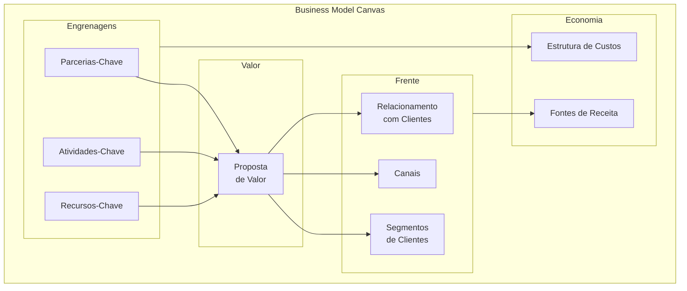

#### Quando usar

Use o BMC nas Fases 2 e 2B do IGNIÇÃO, quando a ideia já tem articulação inicial mas o modelo de negócio ainda precisa ser explicitado. Também use a cada três a seis meses como check-up: revisitar o BMC depois de um trimestre de operação real frequentemente revela inconsistências invisíveis no momento da articulação. Não use o BMC para decidir *se* a ideia é boa — para isso, [[IGNICAO-Vol-2-Validacao#FASE 3 — DESCOBERTA DO PROBLEMA|Fase 3 (Vol. 2)]] (descoberta com cliente) e [[IGNICAO-Vol-2-Validacao#FASE 7 — EXPERIMENTOS DE VALIDAÇÃO DO PROBLEMA|Fase 7 (Vol. 2)]] (experimentos) são as ferramentas certas.

#### Princípios

A tese central de Osterwalder é que **modelo de negócio é objeto de design, não de planejamento**. Designar requer iteração rápida, conversa colaborativa e tolerância à ambiguidade temporária. Os nove blocos são interdependentes: mudar um afeta vários, e o valor do BMC está em tornar essa interdependência visível. O canvas é **descritivo** (mapeia o que você entende do negócio), não **prescritivo** (não diz se o modelo é bom). Por isso, ter um BMC coerente não significa ter um negócio viável — apenas ter clareza sobre o que precisa ser testado.

#### Como aplicar

Reúna 2-4 pessoas (cofundadores idealmente, mais 1 mentor externo se possível). Imprima a tela em A1 ou desenhe na parede com fita crepe. Use post-its (cores diferentes para cada bloco). Bloco a bloco, **na ordem que importa**:

1. **Segmentos de Clientes** primeiro — sem cliente, nada mais importa.
2. **Proposta de Valor** — por que esses clientes pagariam.
3. **Canais** — como o cliente descobre, compra, recebe e pede suporte.
4. **Relacionamento** — self-service, comunidade, suporte humano, automação.
5. **Fontes de Receita** — modelo (assinatura, transação, licença, freemium).
6. **Recursos-Chave** — o que a empresa precisa ter (pessoas, tecnologia, IP, capital).
7. **Atividades-Chave** — o que a empresa precisa fazer todo dia.
8. **Parcerias-Chave** — quem a empresa precisa ao lado (fornecedores, integradores, distribuição).
9. **Estrutura de Custos** — onde o dinheiro sai.

Tempo total: 60-120 minutos para a primeira versão. Cada bloco com 3-5 post-its (não parágrafos longos). Revisitar mensalmente nas fases iniciais, trimestralmente depois de PMF.

#### Exemplo brasileiro preenchido — Nubank em 2014

| Bloco | Conteúdo |
|---|---|
| **Segmentos de Clientes** | Brasileiros 25-40 anos, urbanos, classes A/B/C+, insatisfeitos com banco tradicional, familiares com smartphone |
| **Proposta de Valor** | Cartão de crédito sem anuidade, gerenciado 100% por app, sem burocracia, atendimento humano via chat, transparência |
| **Canais** | App mobile (iOS + Android), landing page, marketing digital orgânico, convite por fila de espera viral |
| **Relacionamento** | Self-service via app, suporte humano on-demand via chat, comunicação pelo nome próprio |
| **Fontes de Receita** | Intercâmbio (% sobre cada transação no cartão), juros do rotativo, futuro: receitas adjacentes (lending, investimento) |
| **Recursos-Chave** | Equipe técnica (engenharia, produto, design), licenças regulatórias, capital, algoritmos de credit scoring |
| **Atividades-Chave** | Desenvolvimento de produto digital, aquisição de clientes, gestão de risco de crédito, atendimento |
| **Parcerias-Chave** | Bandeiras (Mastercard, Visa), processadoras de pagamento, BACEN (regulador), provedores cloud |
| **Estrutura de Custos** | Salários de tecnologia (majoritário), atendimento, marketing, provisões de risco de crédito, compliance |

**Insight do caso.** O BMC do Nubank em 2014 mostra um modelo intencionalmente enxuto: poucos blocos com complexidade real (cartão único, segmento único, canal único). A disciplina foi não adicionar produtos ou segmentos antes de dominar o primeiro. Expansão para conta corrente (2017), lending (2019), investimentos (2020) só aconteceu depois de o cartão dominar o segmento original. Empresas que tentam preencher os nove blocos com complexidade simultânea desde o início frequentemente falham por dispersão. BMC bem feito tem cara de simples.

#### Variações e extensões

- **Lean Canvas** (CZ.2): substitui Parcerias, Atividades, Recursos e Relacionamento por Problema, Solução, Métricas-Chave e Vantagem Injusta. Mais útil em estágio pré-PMF.
- **Social Business Model Canvas**: adiciona blocos de impacto social, beneficiários e métricas de impacto.
- **Platform Business Model Canvas**: adapta para marketplaces de dois lados.
- **Sustainable Business Model Canvas (Triple Layer)**: adiciona camadas ambiental e social.

#### Erros comuns

- Preencher sozinho na cabeça em vez de em conversa colaborativa — o valor do BMC está no debate entre múltiplos olhares, não no documento final.
- Tratar como artefato estático, não revisitar — BMC sem atualização perde sentido em três meses.
- Confundir clareza do BMC com validação do mercado — ter BMC bonito não prova que cliente existe.
- Excesso de detalhe em cada bloco — se você precisa de parágrafo para explicar um bloco, a ideia ainda não está clara.
- Forçar um único BMC para múltiplos segmentos muito distintos — cada segmento merece BMC próprio.

#### Quando NÃO usar

Em empresas maduras com modelo estabelecido e operando — frameworks de execução como OGSM, Hoshin Kanri ou Balanced Scorecard servem melhor. Em negócios muito simples (consultoria solo, freelance) — BMC introduz overhead sem valor. Em negócios complexos com várias linhas distintas, não force um único BMC: cada linha precisa do seu.

#### Conexão com outros canvases

O BMC **precede** o Lean Canvas (CZ.2) como ferramenta histórica, mas o Lean Canvas é mais adequado para startup pré-PMF. O **Value Proposition Canvas** (CZ.3) aprofunda o bloco "Proposta de Valor" do BMC, que é tipicamente preenchido de forma vaga. O **Strategy Canvas** (CZ.4) complementa olhando para fora (concorrência), enquanto o BMC olha para dentro (modelo). Em fases iniciais, comece pelo BMC para ter visão de conjunto; depois aprofunde com VPC para a proposta e Strategy Canvas para o posicionamento.

#### Leitura adicional

- *Business Model Generation* (Alexander Osterwalder & Yves Pigneur, 2010).
- *Testing Business Ideas* (David Bland & Alexander Osterwalder, 2019) — manual de validação para cada bloco.
- [strategyzer.com](https://strategyzer.com) — ferramenta online + cursos da equipe original.

---

### CZ.2 — Lean Canvas (Ash Maurya, 2012)

#### Origem

Ash Maurya criou o Lean Canvas em 2010-2012 como adaptação do Business Model Canvas especificamente para startups em estágio inicial, e documentou a ferramenta no livro *Running Lean* (2012, atualizado em 2022 para a 3ª edição). Maurya era fundador serial que aplicou Lean Startup nas próprias empresas e percebeu que o BMC original — desenhado para empresas estabelecidas — não priorizava adequadamente os elementos críticos para quem ainda não tem modelo validado: o problema, a solução, as métricas que provam tração, e a vantagem que sustenta a empresa quando o concorrente acordar. O Lean Canvas substituiu quatro dos nove blocos do BMC para capturar melhor a realidade pré-PMF.

#### O que é

Tela visual de uma página com nove blocos, **inspirada no BMC mas com quatro substituições críticas**: Parcerias-Chave vira **Problema**, Atividades-Chave vira **Solução**, Recursos-Chave vira **Métricas-Chave**, Relacionamento com Clientes vira **Vantagem Injusta**. Os outros cinco blocos permanecem (Segmentos, Proposta Única de Valor, Canais, Estrutura de Custos, Fontes de Receita).

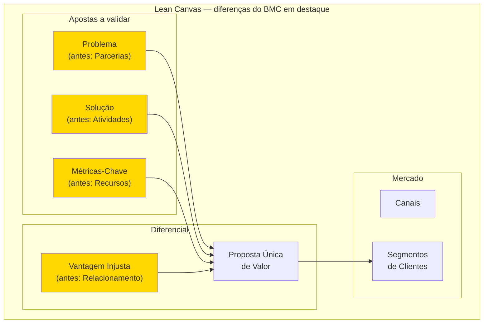

A filosofia subjacente é: startup pré-PMF não tem parcerias estabelecidas (vai construir), não tem atividades-chave definidas (vai descobrir), não tem recursos consolidados (tem capital limitado e tempo) e não tem relacionamento com clientes (não tem clientes ainda). O que tem é hipótese de problema, hipótese de solução, hipótese de métrica e hipótese de vantagem competitiva. O Lean Canvas mapeia exatamente essas hipóteses.

#### Quando usar

Use o Lean Canvas a partir da Fase 1 (encontrar a ideia) até a Fase 12 (PMF). É o canvas certo para todo o estágio de discovery e validação. Depois de PMF declarado, migre para o BMC, que mapeia melhor um modelo já operando. Use também como ferramenta de pivô: cada vez que você considerar pivotar, faça um Lean Canvas novo para a tese alternativa antes de comprometer recursos.

#### Princípios

A tese de Maurya é que **modelo de negócio em startup é hipótese, não plano**. Cada bloco do Lean Canvas corresponde a uma ou mais hipóteses falsificáveis, e a ordem de preenchimento dos blocos espelha a ordem de risco — o que pode matar a startup mais cedo é preenchido primeiro. Por isso, Problema vem antes de Solução: solução para problema inexistente é o erro mais frequente em startup. Vantagem Injusta vem por último: enquanto a startup é pequena, ainda não tem moat — a Vantagem Injusta é o que ela aposta construir.

#### Como aplicar

Reúna 1-3 pessoas (cofundadores). Use uma folha A1 ou ferramenta digital (Miro, FigJam). Preencha **na ordem de risco**, que difere do BMC:

1. **Segmentos de Clientes** primeiro (right side, top) — quem.
2. **Problema** (left side, top) — top 1-3 problemas que o segmento tem.
3. **Proposta Única de Valor** (centro, top) — uma frase única de promessa.
4. **Solução** (left side) — top 3 features que endereçam o problema.
5. **Canais** (right side) — caminhos de aquisição até o segmento.
6. **Fontes de Receita** (right side, bottom) — modelo de monetização.
7. **Estrutura de Custos** (left side, bottom) — onde o dinheiro sai.
8. **Métricas-Chave** (left side, middle) — números que provam tração.
9. **Vantagem Injusta** (right side, middle) — o que torna você inimitável.

Tempo total: 30-60 minutos para o primeiro preenchimento (mais rápido que o BMC porque os blocos são mais específicos). **Faça um Lean Canvas por segmento** — não force um canvas único para múltiplos segmentos com problemas distintos. Revisar a cada experimento concluído (a cada 2-4 semanas em fases iniciais).

#### Exemplo brasileiro preenchido — QuintoAndar em 2015

| Bloco | Conteúdo |
|---|---|
| **Problema** | Alugar apartamento em SP exige fiador, três meses de caução, vistoria agressiva, burocracia de cartório, semanas de sofrimento — para algo que o inquilino só usa 1-2 anos. Para o proprietário: longo período sem renda, risco de inadimplência, complexidade jurídica. |
| **Segmentos de Clientes** | Inquilinos: jovens profissionais classe A/B em SP, primeira ou segunda experiência de aluguel. Proprietários: pessoas físicas com 1-3 imóveis (não imobiliária). |
| **Proposta Única de Valor** | "Alugue em horas, sem fiador, sem caução exagerada, 100% online." |
| **Solução** | Plataforma online de aluguel + seguro substituindo fiador + vistoria digital + contrato digital com assinatura remota + pagamento de aluguel automatizado. |
| **Canais** | SEO orgânico (busca de imóveis), parcerias com portais imobiliários, marketing digital (Facebook, Google), indicação boca a boca. |
| **Fontes de Receita** | Taxa de administração sobre aluguel mensal + comissão de corretagem sobre assinatura inicial + (futuro) produtos financeiros adjacentes. |
| **Estrutura de Custos** | Tecnologia e produto + marketing e aquisição + operação de vistorias + sinistros de seguro + equipe de matching. |
| **Métricas-Chave** | Contratos assinados/mês, tempo médio busca → assinatura, NPS, churn de locatários, ticket médio (aluguel médio). |
| **Vantagem Injusta** | Dados proprietários de comportamento de pagamento de locatários — permitem underwriting de seguro próprio. Concorrentes novos precisariam anos para acumular esses dados. |

**Insight do caso.** O Lean Canvas do QuintoAndar em 2015 mostra como o canvas força a articular a Vantagem Injusta antes que ela exista: em 2015, a empresa ainda **não tinha** os dados proprietários — era a aposta. O canvas registra "se o modelo funcionar, será porque os dados acumulados criam underwriting próprio". Isso virou hipótese a testar (e se confirmou). Empresas que preenchem Vantagem Injusta com generalidades tipo "nosso time é incrível" ou "tecnologia avançada" não estão fazendo o exercício — são placeholders, não apostas. Vantagem Injusta deve ser específica, falsificável e de longo prazo.

#### Variações e extensões

- **Customer Forces Canvas** (também de Maurya): aprofunda a teoria de "forças" que empurram cliente entre soluções (push, pull, anxiety, habit), complementando o Lean Canvas com vista comportamental.
- **Lean Stack** (Maurya): conjunto de canvases conectados (Lean Canvas + Customer Factory Blueprint + Traction Roadmap).

#### Erros comuns

- Tratar Lean Canvas como BMC simplificado — a filosofia é distinta, focada em hipóteses testáveis.
- Preencher Vantagem Injusta com generalidades ("nosso time", "nossa tecnologia") — se qualquer concorrente teria, não é injusta.
- Não articular o Problema de forma específica — "pessoas querem X" não é problema testável; "pessoa tipo Y sofre com Z em contexto W" é.
- Forçar um único Lean Canvas para múltiplos segmentos com problemas diferentes — cada segmento merece canvas próprio.
- Confundir Solução com Proposta Única de Valor — Solução é *o que você constrói*, Proposta de Valor é *a promessa que ressoa para o cliente*.

#### Quando NÃO usar

Em empresas pós-PMF com modelo estabelecido — use BMC. Em projetos internos de empresa grande (intrapreneurship em corporação madura) — Lean Canvas força o framing de "ainda não temos cliente" que pode não bater com a realidade. Em consultoria solo ou freelance — overhead sem retorno.

#### Conexão com outros canvases

O Lean Canvas **se relaciona ao BMC (CZ.1)** como ferramenta complementar para estágios distintos. **Se relaciona ao Hypothesis Canvas (CZ.14)**: cada bloco do Lean Canvas vira uma ou mais entradas no banco de hipóteses. **Se relaciona ao Test Card (CZ.9)**: cada hipótese do Lean Canvas vira um ou mais Test Cards na Fase 7. **Precede o BMC**: depois de PMF, migre.

#### Leitura adicional

- *Running Lean* (Ash Maurya, 2012; 3ª edição em 2022).
- *Scaling Lean* (Ash Maurya, 2016) — aplicação pós-PMF.
- [leanstack.com](https://leanstack.com) — ferramenta online + cursos da equipe.

---

### CZ.3 — Value Proposition Canvas (Alexander Osterwalder, 2014)

#### Origem

O Value Proposition Canvas (VPC) é extensão direta do Business Model Canvas, criado pela mesma equipe (Alexander Osterwalder, Yves Pigneur, Greg Bernarda, Alan Smith) e publicado no livro *Value Proposition Design* (2014). A motivação foi observação de campo: o bloco "Proposta de Valor" do BMC era invariavelmente o mais mal preenchido — fundadores escreviam frases vagas tipo "produto melhor" ou "atendimento de qualidade". Osterwalder concluiu que esse bloco merecia uma ferramenta própria, mais profunda, que forçasse a verificar **explicitamente** o encaixe entre o que o cliente precisa e o que o produto oferece.

#### O que é

Tela visual de duas partes complementares que se encaixam como um quebra-cabeça:

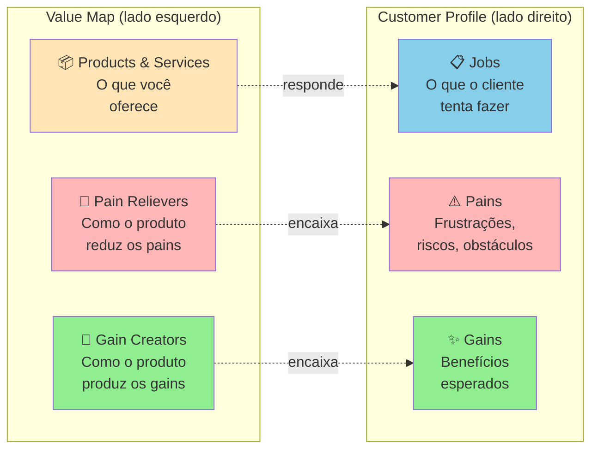

O **Customer Profile** mapeia o cliente em três dimensões: Jobs (tarefas funcionais, sociais, emocionais que tenta cumprir), Pains (o que o frustra, prejudica, ameaça) e Gains (o que ele deseja, espera, sonha). O **Value Map** mapeia o produto em três dimensões espelhadas: Products & Services (o que você oferece), Pain Relievers (como o produto alivia os pains do cliente) e Gain Creators (como o produto produz os gains).

O **fit** acontece quando os Pain Relievers correspondem a Pains reais e os Gain Creators correspondem a Gains que o cliente realmente valoriza. Pain Relievers sem Pain correspondente = features inúteis. Pains sem Pain Reliever = motivos de churn.

#### Quando usar

Use o VPC depois de fazer pesquisa qualitativa real (Fase 4 — entrevistas em profundidade, observação em campo, análise de jornada). É a ferramenta certa para tornar o Dossiê do Usuário (saída da Fase 4) acionável: cada persona vira um Customer Profile, e o produto que está sendo desenhado vira o Value Map. Use também como ferramenta de auditoria: revisitar o VPC a cada três meses pós-MVP revela features que viraram Pain Relievers órfãos (sem Pain real) ou Pains que ficaram sem Pain Reliever construído.

#### Princípios

A tese de Osterwalder é que **proposta de valor não é o que você diz que o produto faz, é a correspondência verificável entre as frustrações/desejos do cliente e o que o seu produto efetivamente alivia/entrega**. Fit não se presume — verifica-se com entrevistas, testes, observação. A falha mais comum em startup não é "produto ruim" — é produto bom atacando problema que o cliente não considera importante. O VPC força essa verificação tornando explícita cada conexão.

#### Como aplicar

**Etapa 1 — Customer Profile (sempre primeiro).** Reúna o que você aprendeu na Fase 4. Para a persona escolhida, liste:

- **Jobs** (5-10): o que ela tenta fazer? Funcionais ("conciliar pagamentos do dia"), sociais ("parecer profissional para a equipe"), emocionais ("ter paz antes de dormir").
- **Pains** (5-10): o que dói? Pode ser frustração ("isso demora 3 horas"), risco ("se eu errar, perco o cliente"), obstáculo ("não tenho como integrar").
- **Gains** (5-10): o que ela quer? Esperados ("uma forma de fazer mais rápido"), desejados ("relatório que impressione o chefe"), inesperados ("automação que eu não sabia ser possível").

**Importante**: NÃO INVENTE. Cada item deve poder ser citado de uma entrevista, observação ou diário de usuário documentado. Customer Profile com Jobs/Pains/Gains intuitivos = VPC teórico.

**Etapa 2 — Value Map.** Liste:

- **Products & Services**: o que você está construindo (ou planeja construir).
- **Pain Relievers**: para cada Pain do cliente, como o produto alivia? Seja específico.
- **Gain Creators**: para cada Gain, como o produto produz? Idem.

**Etapa 3 — Avaliação de fit.** Cada Pain tem Pain Reliever correspondente? Cada Gain tem Gain Creator? Se há Pains sem cobertura, são oportunidades não endereçadas. Se há Pain Relievers sem Pain real, são features potencialmente desperdiçadas.

Tempo: 2-4 horas para a primeira versão (após pesquisa pronta). Cada segmento merece VPC próprio.

#### Exemplo brasileiro preenchido — Wellhub (Gympass) em 2016, B2B

**Customer Profile** — Head de RH de empresa média (200-1000 funcionários):

| Jobs | Pains | Gains |
|---|---|---|
| Oferecer benefício que ajude retenção | Caro contratar academia única que não atende todos | Retenção mensurável melhor |
| Gerenciar programa de bem-estar sem overhead | Funcionários pedem academia mas subsídio direto é complicado (tributário, equidade) | Marca empregadora fortalecida |
| Prestar contas à diretoria sobre ROI | Difícil medir uso real e impacto em produtividade | Dados de engajamento para C-level |
| Atender perfis diversos (academia, yoga, crossfit) sem caos | Negociar com múltiplos fornecedores consome tempo | Benefício percebido sem esforço administrativo |

**Value Map** — Wellhub (Gympass) o que oferecia em 2016:

| Products & Services | Pain Relievers | Gain Creators |
|---|---|---|
| Plataforma empresarial com acesso a milhares de academias via assinatura | Uma assinatura única cobre todas academias (flexibilidade sem multiplicação de contratos) | Benefício percebido pelo funcionário gera retenção mensurável |
| Dashboard de uso para RH | Plataforma administra matrícula, pagamento, cancelamento (zero overhead) | Oferta diversa atende perfis diferentes |
| App para funcionário escolher academia | Estrutura tributária correta (benefício registrado) | Dados de uso para relatórios executivos sobre engagement e ROI |
| Suporte para RH e funcionário | Negociação consolidada com uma empresa só (em vez de 50 academias) | Fortalecimento da marca empregadora |

**Análise de fit.** Encaixe forte entre quase todos os Pains/Gains e os Pain Relievers/Gain Creators. Note que a oferta da Wellhub não inova radicalmente — apenas elimina as fricções específicas que o RH enfrentava no modelo tradicional (negociar com cada academia, gerenciar reembolsos, justificar tributariamente, medir uso). **A lição: value proposition forte não exige features impressionantes — exige fit preciso entre o que o cliente sofre e o que você alivia.**

#### Variações e extensões

- **Job-to-Be-Done Canvas** (Christensen / Moesta): foco mais profundo em Jobs (especialmente as 4 forças de Moesta — push, pull, anxiety, habit). Ver [[IGNICAO-Vol-2-Validacao#FASE 4 — PESQUISA COM USUÁRIOS (CUSTOMER DISCOVERY APROFUNDADO)|Fase 4 (Vol. 2)]].
- **Empathy Map** (CZ.6): complementar ao Customer Profile, foca em estados internos do cliente (pensa/sente/vê/ouve).
- **VPC for Multi-Sided Markets**: marketplaces fazem um VPC para cada lado (oferta e demanda).

#### Erros comuns

- Preencher Customer Profile com intuições em vez de dados reais — VPC teórico não representa mercado.
- Fazer VPC genérico para "todos os clientes" — segmentos diferentes têm Jobs/Pains/Gains diferentes; cada segmento merece VPC próprio.
- Inflar Gain Creators — listar benefícios que o produto teoricamente poderia entregar mas não entrega ainda.
- Ignorar Pains sem Pain Reliever correspondente — essas lacunas são frequentemente os motivos reais de churn.
- Confundir Products & Services (o que você constrói) com Pain Relievers (como alivia uma dor específica) — o primeiro é descritivo, o segundo é causal.

#### Quando NÃO usar

Em mercados commoditizados com propostas de valor muito padronizadas — VPC adiciona pouco valor onde o cliente já compara só preço e prazo. Em produtos B2B enterprise muito complexos — a "unidade cliente" tem múltiplos stakeholders (usuário final, comprador econômico, sponsor executivo, TI), cada um com seu VPC; a abordagem stakeholder mapping é mais útil.

#### Conexão com outros canvases

O VPC **aprofunda** o bloco "Proposta de Valor" do BMC (CZ.1) — preencher BMC sem antes ter VPC tipicamente produz blocos de Proposta de Valor vazios. **Pareia com o Empathy Map (CZ.6)** para construir o Customer Profile com profundidade emocional. **Alimenta o Lean Canvas (CZ.2)**: os Pains do cliente viram o bloco Problema; os Pain Relievers + Gain Creators viram a Proposta Única de Valor.

#### Leitura adicional

- *Value Proposition Design* (Osterwalder, Pigneur, Bernarda, Smith, 2014).
- *Testing Business Ideas* (David Bland & Alexander Osterwalder, 2019) — como validar cada elemento do VPC.
- [strategyzer.com/canvas/value-proposition-canvas](https://strategyzer.com/canvas/value-proposition-canvas).

---

### CZ.4 — Strategy Canvas (W. Chan Kim & Renée Mauborgne, 2005)

#### Origem

W. Chan Kim e Renée Mauborgne, professores do INSEAD, publicaram *Blue Ocean Strategy* em 2005 após quinze anos de pesquisa empírica analisando 150 movimentos estratégicos em 30 indústrias ao longo de cem anos. A tese central é que **competir em mercado saturado (red ocean) é destrutivo, e criar novo espaço de mercado (blue ocean) é a estratégia vencedora**. O Strategy Canvas é a ferramenta visual central do framework — gráfico que compara curvas de valor de concorrentes para revelar onde existe espaço de diferenciação real, em vez da disputa palmo-a-palmo nas mesmas dimensões. O livro vendeu mais de quatro milhões de cópias e o Strategy Canvas virou referência em planejamento estratégico, embora tenha sido subutilizado em startup brasileira (frequentemente substituído por Porter's Five Forces ou matriz BCG, que são ferramentas distintas).

#### O que é

Gráfico de duas dimensões. **Eixo X**: fatores de competição relevantes no setor (tipicamente 8-15 fatores listados horizontalmente). **Eixo Y**: nível de oferta de cada fator, em escala de baixo a alto. Para cada concorrente (incluindo você), traça-se uma **curva de valor** — uma linha que conecta os pontos representando quanto desse concorrente oferece em cada fator.

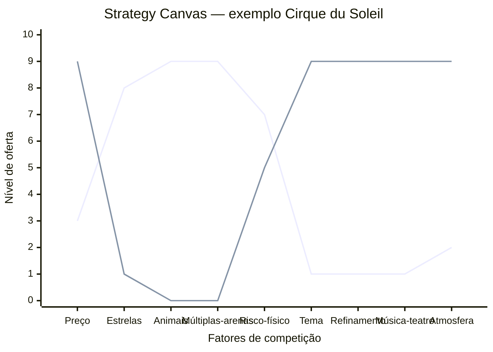

A linha superior representa o circo tradicional (Ringling, Barnum & Bailey): alto em estrelas, animais, múltiplas arenas, risco. A linha inferior representa o Cirque du Soleil: alto em tema, refinamento, música/teatro, atmosfera; baixo em estrelas e animais. Onde as curvas divergem dramaticamente, há diferenciação. Onde se sobrepõem, há comoditização.

A análise associada é o **ERRC Grid** — quatro decisões estratégicas para mover a curva:

- **Eliminate**: que fatores que o setor compete podem ser totalmente eliminados?
- **Reduce**: que fatores podem ser reduzidos abaixo do padrão do setor?
- **Raise**: que fatores devem ser elevados acima do padrão?
- **Create**: que fatores nunca oferecidos pelo setor podem ser criados?

#### Quando usar

Use o Strategy Canvas na Fase 5 (mapeamento de mercado e concorrência) quando o setor parece saturado e você precisa decidir como diferenciar. Também use a cada 18-24 meses como check-up estratégico — concorrência se aproxima da sua curva ao longo do tempo, e o Strategy Canvas revela quando a diferenciação está erodindo. Use também em Fase 15 (reinvenção) quando considerar segunda curva.

#### Princípios

A tese de Kim e Mauborgne é que **competição direta é desperdício de capital**. Se duas empresas oferecem o mesmo conjunto de fatores em níveis ligeiramente diferentes, elas brigam por margem cada vez menor. A saída é **mudar o jogo**, não jogar melhor o mesmo jogo. Para isso, é preciso mapear honestamente o que o setor compete (a maioria não articula explicitamente) e identificar onde você pode oferecer perfil radicalmente distinto. **Diferenciação + Custo Baixo simultâneos** é possível quando você elimina/reduz fatores caros e cria fatores baratos mas valiosos.

#### Como aplicar

**Etapa 1 — Mapear o setor atual.** Liste os 8-15 fatores em que os concorrentes competem. Pergunte: o que o cliente compara antes de comprar? O que aparece nas propagandas? O que aparece nas reviews? Tipicamente: preço, qualidade, marca, conveniência, suporte, customização, velocidade, escala. Seja específico ao seu setor.

**Etapa 2 — Traçar curvas dos concorrentes.** Para cada concorrente principal (3-5), atribua nota 1-10 em cada fator e desenhe a linha. Use dados reais (preço de tabela, NPS, share, reviews) quando disponível.

**Etapa 3 — Aplicar ERRC Grid.** Para cada fator, decida: eliminar, reduzir, elevar, criar. Articule por que (qual job-to-be-done deixa de ser servido vs qual passa a ser).

**Etapa 4 — Traçar a curva nova.** A sua curva deve ser **visualmente distinta** das curvas dos concorrentes. Se ela sobrepõe a média do setor com pequeno offset, não é Blue Ocean — é apenas otimização de Red Ocean.

**Etapa 5 — Validar com cliente.** Mostre as curvas para clientes-alvo. Pergunte: "Se essas duas opções existissem, qual escolheria? Por quê?". Se a resposta é "depende", a diferenciação não é forte o suficiente.

Tempo: 4-8 horas para a primeira versão (exige pesquisa de campo dos concorrentes). Revisar a cada 12-18 meses.

#### Exemplo brasileiro preenchido — Stone vs adquirentes tradicionais (2014)

Em 2014, o setor brasileiro de adquirência (Cielo, Rede, Stone nascente) competia em fatores tipicamente bancários: preço de MDR (taxa por transação), aluguel de máquina, prazo de antecipação, marca, capilaridade. Stone construiu sua curva de valor diferente:

| Fator | Cielo / Rede (média do setor) | Stone (entrante 2014) | Decisão ERRC |
|---|---|---|---|
| MDR (taxa) | 3-4% | 2-3% | Reduce |
| Aluguel da máquina | R$ 50-100/mês | R$ 0 (subsidiado) | Reduce |
| Prazo de antecipação | 30-60 dias | 1 dia (D+1) | Raise |
| Atendimento ao lojista | Call center distante, demora dias | "Ponto-de-Atenção" — humano dedicado, resposta em horas | Raise |
| Capilaridade física | Alta (rede bancária) | Baixa (foco digital) | Reduce |
| Hardware proprietário | Padrão setor (Verifone) | Stone Box (proprietário) | Create |
| Software de gestão integrada | Pouco | Stone Hub (PDV + gestão) | Create |
| Marca corporativa-bancária | Alta | Baixa (mas crescente) | Reduce |

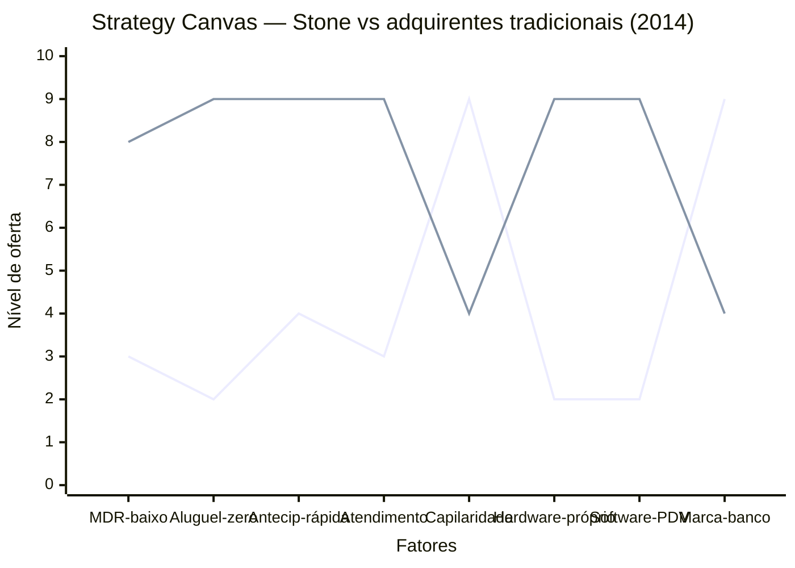

**Insight do caso.** Stone não venceu fazendo o que Cielo fazia mais barato. Venceu **mudando o que o setor competia**: criou Atendimento Diferenciado (Ponto-de-Atenção, não call center), criou hardware/software próprios para lojistas pequenos (não comprou da Verifone), reduziu o aluguel a zero, antecipou pagamento. O resultado foi uma curva visualmente distinta — comprador de Stone NÃO via Stone como "Cielo mais barata", via como **adquirente diferente**. Isso é Blue Ocean: a Stone não tirava clientes da Cielo apenas via preço, abria mercado novo (lojistas pequenos antes desatendidos pela burocracia bancária). O IPO em 2018 (NASDAQ, valuation US$ 7+ bilhões) validou a aposta.

#### Variações e extensões

- **Pioneer-Migrator-Settler Map**: classifica produtos do portfólio em pioneiros (alta diferenciação, alta margem), migradores (alguma diferenciação) e colonos (commodity). Útil para gestão de portfólio.
- **Six Paths Framework**: seis lentes para identificar Blue Ocean (indústria alternativa, grupos estratégicos, cadeia de compradores, oferta complementar, apelo emocional vs funcional, tendências de tempo).
- **Buyer Utility Map**: cruza ciclo de uso do cliente com seis utilidades (produtividade, simplicidade, conveniência, risco, diversão, sustentabilidade).

#### Erros comuns

- Listar fatores genéricos (preço, qualidade) em vez de fatores específicos do setor.
- Curva nova "ligeiramente acima" da média do setor — isso é otimização, não Blue Ocean.
- Eliminar/reduzir fatores que clientes ainda valorizam — pesquisar antes, não decidir no escritório.
- Confundir Strategy Canvas com posicionamento de marketing — é estratégia operacional (o que construir), não slogan.
- Não validar a curva nova com cliente antes de comprometer recursos — Blue Ocean teórico que ninguém prefere é apenas oceano vazio.

#### Quando NÃO usar

Em setores muito regulados onde os fatores de competição são fixados por norma (não há liberdade de Eliminar/Reduzir/Raise/Create). Em commoditização extrema onde o cliente realmente só compara preço. Em produtos B2B muito customizados onde cada deal tem fatores distintos — Strategy Canvas pressupõe oferta padronizada.

#### Conexão com outros canvases

O Strategy Canvas **complementa** o BMC (CZ.1): o BMC olha para dentro (modelo), o Strategy Canvas olha para fora (concorrência). **Pareia com o Canvas da Cunha (CZ.15)**: a Cunha define o nicho de entrada; o Strategy Canvas define a curva de valor distinta nesse nicho. **Sucede o VPC (CZ.3)**: depois de entender Pains e Gains do cliente, o Strategy Canvas decide quais Pain Relievers/Gain Creators construir vs eliminar.

#### Leitura adicional

- *Blue Ocean Strategy* (W. Chan Kim & Renée Mauborgne, 2005).
- *Blue Ocean Shift* (Kim & Mauborgne, 2017) — versão com playbook executivo mais detalhado.
- [blueoceanstrategy.com](https://www.blueoceanstrategy.com) — biblioteca de cases e ferramentas.

---

### CZ.5 — Opportunity Canvas (Jeff Patton, 2014)

#### Origem

Jeff Patton, autor de *User Story Mapping* (2014) e referência em product management ágil, criou o Opportunity Canvas como ferramenta para times de produto avaliarem se uma oportunidade vale a pena ser perseguida **antes** de comprometer roadmap. A motivação foi observação prática: PMs e times técnicos pulavam direto da ideia ("vamos construir feature X") para a especificação ("aqui está o PRD"), sem articular *por que* essa oportunidade deveria ser priorizada sobre todas as outras. O Opportunity Canvas força a explicitar a tese da oportunidade — quem ganha o quê, com que custo, contra qual alternativa — em uma página visual antes que se gaste tempo construindo.

#### O que é

Tela visual de uma página com **nove blocos** organizados em torno da pergunta central "vale a pena perseguir esta oportunidade?":

- **Problems / Solutions** (lado esquerdo): qual é o problema; qual é a solução proposta?
- **Users & Customers**: quem usa; quem paga (em B2B podem ser distintos)?
- **Solutions Today**: como o problema é resolvido hoje (concorrentes, workarounds, status quo)?
- **User Value**: que benefício tangível o usuário ganha?
- **Business Problems**: qual problema *do negócio* essa oportunidade resolve (retenção, aquisição, monetização)?
- **Adoption Strategy**: como vamos fazer o usuário descobrir e adotar?
- **Metrics**: quais números medem que está funcionando?
- **Budget**: quanto vamos investir antes de re-avaliar?

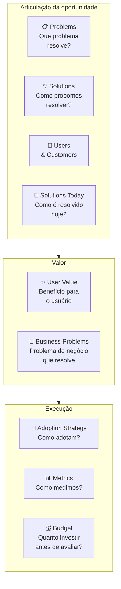

#### Quando usar

Use o Opportunity Canvas na Fase 8 (ideação) e durante todo o ciclo de descoberta contínua pós-PMF. É a ferramenta certa para responder "vale a pena construir essa feature/produto/oportunidade adjacente?" antes de comprometer um trimestre de roadmap. Também use em comitês de priorização: comparar três Opportunity Canvases lado a lado é mais informativo que comparar três PRDs longos.

#### Princípios

A tese de Patton é que **decisão de roadmap é decisão de capital** — cada feature construída custa o custo de oportunidade da feature não construída. O Opportunity Canvas força articular *o trade-off* explicitamente. Diferente do BMC (que descreve o negócio inteiro) e do Lean Canvas (que descreve um modelo a validar), o Opportunity Canvas descreve **uma aposta específica de produto** e pode coexistir com vários outros: uma empresa madura típica tem 10-30 Opportunity Canvases ativos em portfólio.

#### Como aplicar

Reúna PM + tech lead + designer + 1 stakeholder de negócio (RH, vendas, operações) — 4-5 pessoas. Tempo: 60-90 minutos. Comece pelos Problems & Users; só depois vá para Solutions. A ordem importa: começar por Solutions reforça viés de "já sabemos o que construir" e mascara perguntas críticas sobre adoção.

1. **Problems**: descreva o problema sem mencionar a solução. "Usuário tipo X sofre com Y em contexto Z."
2. **Users & Customers**: quem especificamente. Em B2B, distinguir usuário (quem mexe), comprador (quem paga), influenciador (quem decide).
3. **Solutions Today**: como o problema é resolvido hoje? Excel, processo manual, concorrente, "não fazer nada". Liste 3-5 alternativas com prós/contras.
4. **User Value**: o que o usuário ganha que hoje não tem? Específico e mensurável.
5. **Business Problems**: que problema do negócio (retenção, aquisição, monetização, expansion) essa oportunidade endereça?
6. **Solutions**: agora sim, descreva o que vai construir.
7. **Adoption Strategy**: como o usuário descobre, experimenta, adota? In-app, email, CSM, marketing pago?
8. **Metrics**: 2-3 métricas leading + 1 lagging. Se não consegue definir, oportunidade está mal articulada.
9. **Budget**: quanto vai investir (pessoas × tempo + custo de aquisição) antes de reavaliar? Sem budget, Opportunity Canvas vira fantasia.

Tempo total: 60-90 minutos por canvas. Faça antes de comprometer roadmap — não depois.

#### Exemplo brasileiro preenchido — Hotmart, oportunidade "Hotmart Sparkle" para microcreators (2022)

Em 2022, a Hotmart já dominava infoprodutos médios e grandes (creators que vendiam cursos de R$ 300+ a milhares de alunos). Identificou uma oportunidade adjacente: **microcreators** — pessoas com audiência pequena (1-5k seguidores) que queriam monetizar conteúdo curto e barato (R$ 9-49 por item). O Opportunity Canvas dessa aposta:

| Bloco | Conteúdo |
|---|---|
| **Problems** | Microcreators têm audiência pequena mas engajada e querem monetizar, mas o setup atual da Hotmart (criar curso completo com landing page, hospedar conteúdo, configurar afiliados) é overkill para conteúdo de 30-90 minutos a R$ 19. |
| **Users & Customers** | Usuário e cliente são a mesma pessoa: microcreator brasileiro com 1-5k seguidores no Instagram/TikTok, audiência engajada, já tem conteúdo gravado mas não no formato curso. |
| **Solutions Today** | (1) Vender via DM no Instagram com PIX — alta fricção, sem rastreamento. (2) Plataformas estrangeiras (Gumroad) — barreiras de PIX/pagamento BR. (3) Não monetizar — "perder" a audiência. |
| **User Value** | Setup de produto digital em 5 minutos (vs 1-2h da plataforma principal). Pagamento via PIX integrado. Link de venda direto pra bio do Instagram. Sem necessidade de criar landing, configurar funil, integrar afiliados. |
| **Business Problems** | (1) Aquisição: capturar a base de microcreators que ainda não usa Hotmart e que daqui a 3-5 anos pode virar creator médio. (2) Diversificação: reduzir dependência de "top 1000 creators". (3) Defesa de mercado: bloquear entrada de Gumroad/Stan/Ko-fi no Brasil. |
| **Solutions** | "Hotmart Sparkle": fluxo simplificado de criação (3 telas), template de venda mobile-first, pagamento PIX nativo, link de bio gerado automaticamente, sem afiliados/cupons (corte deliberado). |
| **Adoption Strategy** | Indicação de creators existentes (microcreators são frequentemente fans/alunos de creators médios), parcerias com agências de microinfluência, conteúdo orgânico no Instagram da Hotmart focado nesse perfil. |
| **Metrics** | Leading: número de microcreators ativando produto/mês, GMV médio por microcreator, conversão de visitante em comprador no link de bio. Lagging: % de microcreators que migram para a plataforma principal em 12 meses. |
| **Budget** | 1 squad (5 pessoas) por 6 meses para MVP + 4 meses de aquisição inicial = ~R$ 1.5M. Reavaliar em 10 meses: se GMV mensal não chegar a R$ 2M ou 5k microcreators ativos, descontinuar. |

**Insight do caso.** O bloco mais valioso aqui é o **Business Problems** explícito — articula que essa oportunidade não é "feature legal", é resposta a três problemas estratégicos da Hotmart (aquisição de creators emergentes, diversificação de dependência, defesa de mercado). Sem essa articulação, "Hotmart Sparkle" pareceria projeto secundário; com ela, fica claro por que merece squad dedicado. **A lição: Opportunity Canvas força distinguir oportunidade-de-produto de oportunidade-de-negócio. Feature sem business problem definido raramente sobrevive a corte de roadmap.**

#### Variações e extensões

- **Lean UX Canvas** (Jeff Gothelf): variação focada em times UX-driven, com bloco de hipóteses explícito.
- **Product Discovery Canvas** (Roman Pichler): variação para PMs em ambientes ágeis, com ênfase em assumptions e experimentos.
- **Now/Next/Later Roadmap**: complementa o Opportunity Canvas — uma vez que a oportunidade vale a pena, onde no roadmap ela entra?

#### Erros comuns

- Pular Problems & Users e ir direto para Solutions — viés de "já sei o que construir" mascara perguntas críticas.
- Articular User Value em features ("vamos ter um botão de X") em vez de benefícios ("o usuário consegue Y em Z minutos vs hoje em W horas").
- Esquecer Business Problems — oportunidade que ajuda só o usuário sem resolver problema do negócio é caridade, não estratégia.
- Definir Metrics só lagging (GMV, retenção D90) sem leading — leva 3-6 meses para saber se está funcionando.
- Não definir Budget de saída — oportunidade roda indefinidamente sem reavaliação, consumindo time.

#### Quando NÃO usar

Em decisões muito pequenas (mudar copy de um botão, ajustar layout) — overhead de canvas não compensa. Em decisões muito grandes e estruturais (entrar em novo país, lançar segunda linha de produto) — use BMC (CZ.1) ou Lean Canvas (CZ.2), que dão visão de modelo completo. Em ambientes onde o roadmap é ditado de fora (clientes enterprise B2B com contratos) — espaço de manobra limitado torna o canvas teatro.

#### Conexão com outros canvases

O Opportunity Canvas **sucede o BMC/Lean** (CZ.1/2): depois que o modelo de negócio está claro, cada oportunidade-feature tem seu Opportunity Canvas próprio. **Pareia com o Hypothesis Canvas (CZ.14)**: cada Opportunity Canvas pode gerar 3-5 hipóteses falsificáveis para validar antes de construir. **Antecede o MVP Canvas (CZ.11)**: depois de aprovada, a oportunidade vira escopo de MVP.

#### Leitura adicional

- *User Story Mapping* (Jeff Patton, 2014).
- *Inspired* (Marty Cagan, 2008/2017) — escola de product discovery contínuo onde o Opportunity Canvas se encaixa.
- [jpattonassociates.com](https://www.jpattonassociates.com) — biblioteca de templates e ensaios de Patton.

---

### CZ.6 — Empathy Map (Dave Gray / XPLANE, 2009)

#### Origem

O Empathy Map foi criado por Dave Gray e a equipe da consultoria XPLANE em torno de 2009 e popularizado no livro *Gamestorming* (Gray, Brown & Macanufo, 2010). Surgiu como ferramenta de design thinking para deslocar conversas sobre cliente do registro demográfico ("nossa persona é mulher, 30-40 anos, classe B") para o registro **comportamental e emocional** ("o que ela vê quando abre o aplicativo de banco no celular pela manhã, antes do café?"). A motivação foi a observação de que personas tradicionais produziam descrições caricatas que não geravam empatia real — Empathy Map força sair do "quem é" e entrar no "como vive".

#### O que é

Tela visual em forma de cruz com **seis quadrantes** organizados ao redor de uma pessoa (avatar central):

- **Pensa & Sente** (centro/cima): o que ocupa a cabeça dessa pessoa? O que a preocupa? O que a entusiasma?
- **Vê** (esquerda): o que ela observa no ambiente — clientes, concorrentes, mercado, mídia?
- **Ouve** (direita): o que ela escuta — chefe, família, amigos, especialistas, mídia?
- **Fala & Faz** (baixo): o que ela diz publicamente? Como age?
- **Pains** (canto inferior esquerdo): medos, frustrações, obstáculos.
- **Gains** (canto inferior direito): desejos, motivações, métricas de sucesso pessoais.

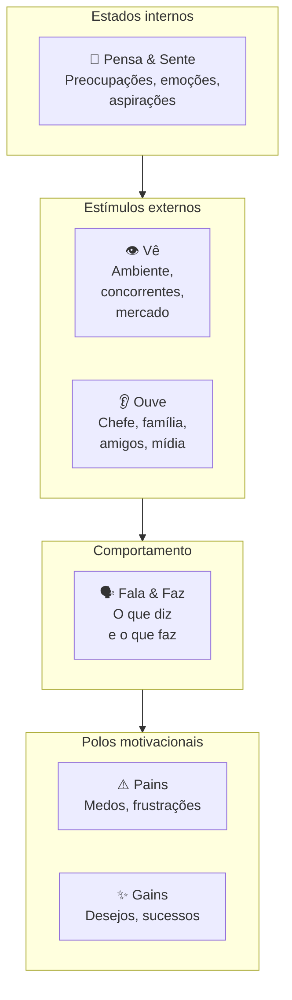

A tese é que comportamento humano é resultado da tensão entre **estímulos** (vê/ouve), **estados internos** (pensa/sente) e **polos motivacionais** (pains/gains). Mapear os seis revela contradições — pessoa que diz X publicamente mas faz Y; pessoa que ouve A do chefe mas é movida por B internamente — e essas contradições são exatamente onde produto novo encontra adoção.

#### Quando usar

Use o Empathy Map na Fase 3 (descoberta) como complemento ao Mom Test — entrevistas de problema capturam comportamento passado; o Empathy Map captura **o universo emocional e contextual** que cerca esse comportamento. Use também na Fase 4 (pesquisa) para construir o Customer Profile do VPC (CZ.3) com profundidade emocional. Em times de produto maduros, faça Empathy Map de cada persona principal a cada 12 meses — clientes mudam, e o mapa fica datado.

#### Princípios

A tese de Gray é que **empatia é capacidade construída, não dom**. Para construir, é preciso processo deliberado: ler verbatim de entrevistas, observar em campo, mapear com a equipe num exercício colaborativo. Empathy Map preenchido só com intuição é ficção. Preenchido com base em pesquisa real, vira ferramenta de tomada de decisão — quando alguém propõe uma feature que contradiz o que está mapeado em "Pains" e "Gains", a contradição fica visível.

#### Como aplicar

Reúna 3-5 pessoas (PM + designer + customer success + 1-2 fundadores). Tempo: 90-120 minutos. **Pré-requisito**: pesquisa real concluída — pelo menos 5-10 entrevistas qualitativas + observação em campo. Sem isso, Empathy Map vira intuição coletiva.

1. **Escolha uma persona específica** — não "nossos clientes em geral", mas "Mariana, dona de padaria de duas unidades em São Paulo". Empathy Map é por pessoa, não por segmento.
2. **Vê** — leia verbatim de entrevistas e observação. O que essa pessoa vê no celular pela manhã? No trabalho? Em casa? Que ambiente físico habita? Que mídia consome?
3. **Ouve** — quem fala com ela? O que esses falantes dizem? Chefe, sócio, família, amigos, podcasts, influenciadores.
4. **Pensa & Sente** — o que ocupa a mente? O que tira o sono? O que entusiasma? Aqui é zona de inferência cuidadosa — ancore em verbatim.
5. **Fala & Faz** — o que ela diz publicamente (LinkedIn, conversas profissionais)? Como age (rotina, decisões observadas)? Há contradição entre os dois?
6. **Pains** — medos específicos, não genéricos. "Tenho medo de quebrar" é vago; "tenho medo de não conseguir pagar a folha do mês 13" é Pain.
7. **Gains** — sucessos pessoais que ela buscaria. "Quero crescer" é vago; "quero abrir terceira unidade até 2027" é Gain.

Tempo: 90-120 min para a primeira versão. Refazer a cada 6-12 meses ou após mudança significativa de mercado.

#### Exemplo brasileiro preenchido — Loggi, persona "Carlos motoboy" (2018)

Quando a Loggi expandiu de courier corporativo para entregas last-mile B2C em 2018, fez Empathy Map dos entregadores parceiros — não dos clientes finais. A descoberta levou a redesenho do app do entregador.

| Quadrante | Conteúdo |
|---|---|
| **Vê** | App da Loggi competindo por atenção com WhatsApp, Uber, iFood, Rappi no celular. Outros motoboys em redes informais comentando preços e rotas. Trânsito de São Paulo em tempo real. Posto de gasolina como ponto de socialização. Estabelecimentos comerciais como "clientes da semana". |
| **Ouve** | Esposa pedindo para "voltar mais cedo". Outros entregadores em grupo de WhatsApp reclamando de plataforma X ou recomendando rota Y. Atendente da Loggi por mensagem (raramente por voz). Clientes finais quando entrega presencial — alguns simpáticos, outros agressivos sobre atraso. |
| **Pensa & Sente** | Ansiedade sobre quanto vai ganhar no fim do dia. Cálculo mental constante de R$/km. Frustração com cancelamentos e endereços errados. Orgulho discreto quando completa entregas difíceis. Cansaço acumulado mas necessidade de não parar. Comparação com outros entregadores — "fulano fez 30 entregas hoje, eu só 22". |
| **Fala & Faz** | Diz publicamente que "trabalha pela liberdade de horário". Faz: aceita corridas das 6h às 22h porque precisa do faturamento. Recusa entregas longas mesmo com bônus se for fim de semana. Compartilha dicas em grupo de WhatsApp mas guarda os melhores estabelecimentos para si. |
| **Pains** | Ganhar menos que o pico do mês passado. Acidente sem cobertura — "se eu cair, fico sem renda". Bateria do celular acabar no meio do dia. Endereço errado em região perigosa. Diarreia/doença sem direito a auxílio. Multas de trânsito que comem ganho do dia. Cliente que não responde interfone. |
| **Gains** | Faturar R$ 3-4k/mês líquido (após combustível e manutenção). Conseguir folga de domingo sem perder ranking. Ter celular novo (ferramenta de trabalho). Comprar moto melhor — sonho de 12-24 meses. Ter dia mais previsível. Ser tratado com respeito por atendentes e clientes. |

**Insight do caso.** O quadrante "Vê" revelou algo crítico: o app da Loggi competia com 4-6 outros apps por atenção do entregador na mesma tela. Times anteriores haviam tratado o app como "ferramenta de trabalho dedicada" — a realidade é que o entregador trocava entre apps ao longo do dia conforme o que pagava melhor naquela janela. Isso levou a três decisões: (1) reduzir tempo de aceite de corrida (de 30s para 15s — entregador estava em outro app); (2) notificações mais agressivas com bônus (não dependendo de ele abrir o app); (3) **comunicação por voz** com atendente em casos críticos (entregador não consegue ler chat enquanto pilota). **A lição: Empathy Map dos não-clientes (parceiros, fornecedores, intermediários) frequentemente revela mais que Empathy Map do cliente final — porque essas pessoas têm múltiplos chefes invisíveis e otimizam por critérios que você não enxerga sem mapear.**

#### Variações e extensões

- **Empathy Map Canvas (atualizado, Dave Gray, 2017)**: versão mais recente que adiciona "Goal" no centro (objetivo da pessoa) e desloca o foco para tarefa-a-realizar — versão JTBD-friendly.
- **Stakeholder Empathy Map**: para B2B enterprise, fazer um Empathy Map para cada stakeholder no processo de compra (usuário, comprador, sponsor, TI).
- **Day-in-the-Life Map**: variação que mapeia 24 horas concretas ao invés de estados gerais.

#### Erros comuns

- Preencher com intuição em vez de pesquisa — Empathy Map sem dado real é projeção coletiva, não empatia.
- Tratar como descrição estática — pessoas mudam; refaça periodicamente.
- Confundir "Vê" com demografia — "Vê" é o ambiente físico/digital específico, não "tem 30 anos".
- Ignorar contradições entre "Fala & Faz" — frequentemente é onde estão as oportunidades de produto.
- Fazer Empathy Map só do cliente ideal — clientes problemáticos ou não-clientes (quem não compra) revelam mais sobre adoção real.

#### Quando NÃO usar

Em decisões puramente técnicas (escolha de stack, refatoração interna). Em mercados B2B muito padronizados onde o "comprador" é processo formal de licitação — Empathy Map do comprador individual tem peso menor que o entendimento do processo de compra. Quando a pesquisa qualitativa é insuficiente — fazer Empathy Map sem 5+ entrevistas por persona produz ficção.

#### Conexão com outros canvases

O Empathy Map **alimenta o Customer Profile do VPC (CZ.3)** — Pains e Gains do Empathy Map se traduzem diretamente em Pains e Gains do VPC. **Pareia com o Customer Journey Canvas (CZ.7)**: Empathy Map é estado; Customer Journey é trajetória. Os dois juntos dão "estado interno em cada momento da jornada". **Antecede o BMC/Lean** (CZ.1/2): entender clientes profundamente vem antes de articular o modelo.

#### Leitura adicional

- *Gamestorming* (Dave Gray, Sunni Brown & James Macanufo, 2010).
- *Updated Empathy Map Canvas* (Gray, blog post, 2017) — a versão revisada com foco em Goal.
- [gamestorming.com](https://gamestorming.com) — biblioteca de templates de Gray.

---

### CZ.7 — Customer Journey Canvas

#### Origem

O Customer Journey Map / Canvas surgiu da convergência de três escolas em meados dos anos 2000: design thinking (IDEO, Stanford d.school), service design (Nordic School, livet Lavrans Løvlie / Ben Reason) e experiência do cliente (Forrester, escola de CX corporativo). Não tem autor único — virou padrão de prática colaborativa entre 2008 e 2015, com formalização no livro *This Is Service Design Doing* (Marc Stickdorn et al., 2018). A motivação foi observação recorrente: empresas otimizavam touchpoints isolados (home page, atendimento, cobrança) sem ver a jornada inteira do cliente, e o resultado eram experiências fragmentadas onde cada ponto funcionava isolado mas o conjunto deixava o cliente confuso ou frustrado.

#### O que é

Tela visual organizada em **eixo horizontal de tempo** (fases da jornada do cliente, da descoberta ao pós-uso) e **eixo vertical de dimensões** (mínimo cinco):

- **Etapa**: nome curto da fase (Descoberta, Consideração, Compra, Onboarding, Uso, Suporte, Renovação).
- **Ação**: o que o cliente faz nessa etapa (concretamente — clica, abre app, liga, fala com).
- **Objetivo**: o que ele tenta cumprir.
- **Pontos de Dor**: onde algo dá errado, demora, frustra.
- **Emoções**: o que ele sente (ansiedade, alívio, raiva, tédio, entusiasmo).
- **Oportunidades**: onde existe espaço para intervenção.

Versões mais avançadas adicionam: ferramentas/canais usados, métricas de sucesso por etapa, KPIs internos, owners do touchpoint, dados quantitativos (NPS por etapa, conversão).

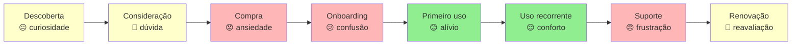

A linha emocional (verde alto / amarelo neutro / vermelho baixo) ao longo da jornada é o output mais valioso: pontos vermelhos consecutivos antecipam churn; pontos verdes isolados cercados de vermelho são "experiências boas no contexto errado".

#### Quando usar

Use o Customer Journey Canvas na Fase 4 (pesquisa) como entregável central — junto com personas e VPC. Use também a cada 12 meses como auditoria operacional pós-PMF: a jornada que funcionava em 2024 frequentemente não funciona em 2026 porque mudaram canais (TikTok, WhatsApp), expectativas (resposta em segundos), regulação (LGPD, PIX). Em momentos de pivô (Fase 15), refaça a jornada antes de qualquer investimento operacional.

#### Princípios

A tese é que **experiência do cliente é uma fita contínua, não pontos isolados**. Times divididos por função (marketing, vendas, sucesso, produto, suporte) tendem a otimizar suas próprias caixinhas e ignorar transições entre etapas. O Customer Journey Canvas força olhar a fita inteira e identificar **o ponto mais fraco** — porque a experiência do cliente é tão boa quanto o pior elo. Cliente que teve compra fácil mas onboarding caótico não fica; cliente que teve onboarding ótimo mas suporte distante churna na primeira dúvida real.

#### Como aplicar

Pré-requisito: 5-15 entrevistas qualitativas + dados quantitativos (analytics, NPS, CSAT). Reúna PM + designer + customer success + 1-2 representantes de marketing/vendas/operações. Tempo: 3-4 horas para a primeira versão.

1. **Defina escopo da jornada** — começo e fim. Comece **antes** do ponto óbvio: se você é SaaS, jornada começa quando cliente percebe o problema, não quando entra no site.
2. **Liste etapas** — 5-10 etapas nomeadas. Use vocabulário do cliente, não interno ("Considera comprar" não "Lead Qualificado").
3. **Para cada etapa**, preencha as 6 dimensões com base em verbatim e dados.
4. **Trace a linha emocional** — atribua emoção dominante a cada etapa.
5. **Identifique pontos críticos** — onde a emoção cai abruptamente, onde há atrito sistemático, onde o cliente abandona.
6. **Liste oportunidades** — para cada ponto crítico, 1-3 intervenções possíveis. Prioriza pelo impacto na linha emocional, não pelo custo de implementação.

Após primeira versão, **valide com 3-5 clientes reais** — peça que olhem o mapa e apontem onde discordam. Customer Journey desenhado sem validação é frequentemente "como queremos que seja", não "como é".

#### Exemplo brasileiro preenchido — iFood, jornada de primeira compra (2017)

Em 2017, o iFood mapeou a jornada de primeira compra para entender por que 40% dos novos cadastros não completavam pedido inicial. O canvas:

| Etapa | Ação | Objetivo | Dor | Emoção | Oportunidade |
|---|---|---|---|---|---|
| **Gatilho** | Sente fome às 19h, vê amigo pedindo via app | Resolver fome rápido | "Será que tem o que eu quero?" | Curiosidade | Hero card mostrando opções na cidade do usuário |
| **Descoberta** | Baixa app, abre primeira vez | Ver o que tem por perto | Tela inicial mostra muitos restaurantes — paralisia de escolha | Sobrecarga | Curadoria "mais pedidos hoje", reduzir opções iniciais |
| **Cadastro** | Preenche nome, email, telefone, endereço | Concluir cadastro rápido | Confirmação de SMS demora, formulário pede CPF (não obrigatório) | Frustração | Reduzir cadastro para email + senha + endereço; CPF só na compra |
| **Busca** | Filtra por categoria ou busca restaurante | Achar comida que quer | Restaurantes que não entregam no endereço aparecem | Decepção | Filtrar por entrega real antes de mostrar |
| **Cardápio** | Abre restaurante, navega cardápio | Escolher prato | Foto baixa qualidade, descrição inconsistente, preço sem ICMS visível | Dúvida | Padronização de cardápios + preço final na lista |
| **Carrinho** | Adiciona itens, vê total | Conferir antes de pagar | Taxa de entrega aparece tarde, "valor mínimo" surge surpresa | Irritação | Mostrar taxa e mínimo desde o cardápio |
| **Pagamento** | Escolhe forma, confirma | Pagar e fechar pedido | Cartão recusado sem explicação, 2FA do banco demora | Ansiedade alta | Adicionar débito em conta e boleto como alternativas ao cartão, mostrar erro específico por tipo ("cartão sem limite" vs "dados incorretos" vs "banco bloqueou"), salvar tentativas no carrinho |
| **Espera** | Acompanha entrega no mapa | Saber quando chega | Mapa não atualiza em tempo real nos primeiros 10min | Inquietação | Streaming de status mais granular, comunicação proativa de atrasos |
| **Recebimento** | Recebe entrega, avalia | Comer e avaliar | Pedido errado / faltando item — sem caminho claro de queixa | Raiva | Botão "tem problema?" no mesmo card do pedido |
| **Pós-uso** | Recebe email pedindo nota | Avaliar (se lembrar) | Email genérico chega 3 dias depois | Apatia | Pedir nota in-app logo após entrega, com 1-tap |

**Insight do caso.** A jornada revelou que **a maior queda de conversão acontecia entre Pagamento e Espera** — clientes davam tudo certo até o pagamento, e quando o cartão era recusado sem explicação, abandonavam. Isso levou a três decisões: (1) adicionar débito em conta e boleto bancário como alternativas ao cartão recusado — formas de pagamento mais acessíveis para o ICP em 2017; (2) mensagens de erro específicas ("cartão sem limite" vs "dados incorretos" vs "banco bloqueou"); (3) salvar carrinho mesmo após falha — cliente não precisava recomeçar do zero. **A lição: Customer Journey Canvas frequentemente revela que o problema não está onde a equipe achava (qualidade de cardápio? variedade?) mas em transição específica que ninguém estava monitorando (o segundo entre "click pagar" e "pedido confirmado").**

#### Variações e extensões

- **Service Blueprint**: extensão do Customer Journey adicionando "linha de visibilidade" — o que o cliente vê (frontstage) vs o que acontece nos bastidores (backstage). Útil para ops e suporte.
- **Multi-persona Journey Map**: mesma jornada vista por 2-3 personas distintas (decisor vs usuário em B2B; comprador vs presenteado em B2C).
- **Future-State Journey Map**: jornada como queremos que seja em 12-18 meses, ao lado da atual. Útil para roadmap.

#### Erros comuns

- Mapear a jornada que a empresa quer (frictionless, lógica) em vez da que existe (fragmentada, cheia de workarounds) — desconectado do cliente real.
- Começar muito tarde (no momento da compra) — perde o gatilho que define quem chega ao site.
- Tratar como artefato estático — mercados e canais mudam (rise do TikTok como descoberta, do PIX como pagamento, do WhatsApp como suporte); jornada precisa atualização.
- Otimizar pontos isolados sem ver consequências em pontos seguintes — onboarding mais rápido pode produzir mais churn em 30 dias.
- Não medir — Customer Journey sem dados é hipótese; precisa NPS por etapa, conversão entre etapas, tempo médio em cada etapa.

#### Quando NÃO usar

Em produtos transacionais simples sem relacionamento contínuo (vending machine, compra one-shot de baixo valor) — overhead não compensa. Em mercados B2B enterprise muito longos (ciclo de venda 12+ meses) — Customer Journey vira documento de 50 páginas que ninguém lê; melhor abordar com sequence diagram do processo de compra.

#### Conexão com outros canvases

O Customer Journey Canvas **pareia com o Empathy Map (CZ.6)**: Empathy Map é estado; Customer Journey é trajetória. **Alimenta o VPC (CZ.3)**: pontos de dor da jornada viram Pains do Customer Profile. **Alimenta o Pirate Canvas / AARRR (CZ.10)**: as etapas da jornada mapeiam diretamente para Acquisition → Activation → Retention → Referral → Revenue. **Sucede o BMC (CZ.1)**: BMC mapeia o modelo; Customer Journey mapeia a experiência operacional do cliente dentro desse modelo.

#### Leitura adicional

- *This Is Service Design Doing* (Marc Stickdorn, Markus Edgar Hormess, Adam Lawrence, Jakob Schneider, 2018).
- *Mapping Experiences* (James Kalbach, 2nd ed. 2020) — manual extensivo sobre todos os tipos de mapas de experiência.
- [servicedesigntools.org](https://servicedesigntools.org) — biblioteca de templates open-source.

---

### CZ.9 — Test Card (David Bland & Alexander Osterwalder, 2019)

#### Origem

O Test Card foi formalizado no livro *Testing Business Ideas* (David Bland & Alexander Osterwalder, 2019), parte da família Strategyzer (mesma escola do BMC e VPC). É a sistematização — em formato de cartão único — do que já era prática tácita no Lean Startup desde Eric Ries (2011): para cada hipótese, defina o experimento que vai testá-la **antes** de coletar dados, com critério de sucesso explícito. O Test Card tornou esse exercício replicável: cabe numa folha A5, tem campos fixos, e força o time a articular o critério de sucesso antes do experimento começar (não depois, quando já há viés de confirmação).

O que o livro IGNIÇÃO chama de "Cartão de Experimento" (Template A.4 do Apêndice A) é uma adaptação direta do Test Card, com algumas extensões para o contexto brasileiro (custo em R$, linguagem local). A origem da ferramenta é Strategyzer.

#### O que é

Cartão de uma página com **oito campos** estruturados:

- **ID do experimento** (numeração sequencial).
- **Hipótese testada** (uma frase falsificável copiada do banco de hipóteses).
- **Pergunta central** (o que especificamente queremos responder).
- **Desenho** (passo a passo do experimento).
- **Público** (quantas pessoas, qual perfil, como alcançadas).
- **Métrica principal e critério de sucesso** (definido **antes** de ver dados).
- **Critério de refutação** (o que invalida a hipótese — também antes).
- **Custo e duração** (orçamento e prazo).

Após o experimento, o cartão se completa com:

- **Resultado observado**.
- **Decisão** (Persevere / Pivote / Ajuste / Abandone).
- **Aprendizados** (o que isso nos ensina sobre o modelo).

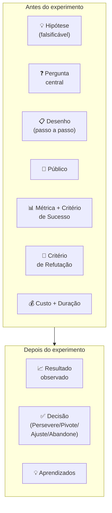

A disciplina central é definir **Critério de Sucesso e Critério de Refutação ANTES** de rodar o experimento. Times que definem critério depois invariavelmente racionalizam os dados a favor da hipótese ("converteu menos do que esperávamos, mas ainda é positivo porque..."). Critério pré-definido evita auto-engano.

#### Quando usar

Use o Test Card na Fase 7 (experimentos de validação do problema) como artefato central — um Test Card por experimento, vivo até o experimento concluir. Use também na Fase 6 (formulação de hipóteses) como follow-up imediato: cada hipótese bet-the-company gera 1-3 Test Cards. Em times pós-PMF com cultura de discovery contínuo, Test Card vira hábito semanal — qualquer feature ou mudança de fluxo gera Test Card antes da implementação.

#### Princípios

A tese de Bland & Osterwalder é que **experimento sem critério pré-definido não é experimento, é demonstração**. Demonstração começa com a conclusão pronta e busca evidência que confirme. Experimento começa com pergunta aberta e aceita qualquer resposta. A diferença é a definição prévia do critério de refutação. Test Card formaliza esse rigor — sem ele, a maioria dos "experimentos" em startup é teatro de método científico.

#### Como aplicar

Para cada hipótese a testar, abrir um Test Card. Tempo de preenchimento: 30-45 min. Participantes: 2-3 pessoas (PM + tech/design + 1 fundador).

1. **Hipótese** — copie da Fase 6, escreva como afirmação falsificável: "X% dos visitantes da landing page se cadastrarão em até 7 dias", não "as pessoas vão gostar".
2. **Pergunta central** — o que estamos testando especificamente? Frequentemente é o coração da hipótese reformulado.
3. **Desenho** — passo a passo do experimento. Concreto: que landing page? Quais ads? Que público?
4. **Público** — N planejado, perfil específico, canal. "100 visitantes ICP via Meta Ads" é diferente de "100 visitantes quaisquer".
5. **Métrica + Critério de Sucesso** — definir **antes**. "Sucesso = 8% de conversão visitante → cadastro em 14 dias."
6. **Critério de Refutação** — também antes. "Abaixo de 2% = hipótese refutada."
7. **Custo e Duração** — R$ X (Ads + ferramenta) + Y dias.
8. **Riscos e vieses** — o que pode distorcer? Tráfego ruim? Dia da semana? Novidade?

Rodar o experimento. Atualizar o cartão com resultado, decisão e aprendizados.

**Regra de ouro**: sucesso e refutação devem ser distintos com zona de incerteza no meio. Entre 2% e 8% no exemplo acima = inconclusivo, exige novo experimento. Sem zona de incerteza, qualquer resultado vira "sucesso" ou "fracasso" por viés.

#### Exemplo brasileiro preenchido — PadariaPro, smoke test de proposta de valor (2024)

Equipe da PadariaPro (caso recorrente do livro) considerava lançar produto de gestão de delivery próprio para padarias artesanais com 1-3 unidades em São Paulo. Antes de construir, rodaram este Test Card:

| Campo | Conteúdo |
|---|---|
| **ID** | EXP-2024-03 |
| **Hipótese testada** | Donos de padaria com 1-3 unidades em SP que fazem delivery próprio têm dor suficiente para pagar R$ 290/mês por software de gestão integrada de pedidos. |
| **Pergunta central** | Visitantes ICP convertem em formulário "quero conhecer" a ≥10%? Dos que preenchem, ≥30% confirmam disposição a pagar R$ 290 em ligação? |
| **Desenho** | (1) Landing page descrevendo o produto como se existisse, com R$ 290/mês destacado e formulário de "quero conhecer". (2) Meta Ads segmentando "donos de padaria em SP" via interesses + lookalike de base de email comprada. (3) Para cada formulário preenchido, ligar em 24h e fazer entrevista de 15 min. |
| **Público** | 100 visitantes ICP (donos/sócios de padaria 1-3 unidades em SP capital), via Meta Ads. Verba de R$ 1.500. |
| **Métrica principal** | Taxa de conversão visitante → formulário preenchido. Sucesso: ≥10%. Refutação: ≤2%. |
| **Métrica secundária** | Dos preenchimentos, % que confirma disposição a pagar R$ 290 em ligação. Sucesso: ≥30%. Refutação: ≤10%. |
| **Critério de Refutação** | Conversão <2% OU confirmação de pagamento <10% = hipótese refutada. Reconsiderar preço ou ICP. |
| **Custo e Duração** | R$ 1.500 em Ads + 14 dias (1 semana de tráfego + 1 semana de ligações) + ~10h do fundador em entrevistas. |
| **Riscos e vieses** | Público frio do Meta pode não bater com ICP real (donos de padaria não usam Meta Ads como ferramenta de descoberta de software B2B). Mitigação: reforçar segmentação por interesses + lookalike. |

**Resultado** (preenchido após 14 dias):

- 47 visitantes ICP confirmados via tag de evento (audience pequena demais, limitação de targeting).
- 12 preencheram formulário (25,5% — acima do critério de sucesso primário).
- 7 atendiam à ligação. Dos 7: 4 confirmaram disposição a R$ 290, 2 a R$ 400, 1 a R$ 590. Confirmação de pagamento: 4/7 = 57% (acima do critério).

**Decisão**: Persevere. Hipótese reforçada — disposição a pagar é maior que o teste assumia (alguns aceitariam R$ 400-590). Próximo experimento: pré-venda paga real (R$ 290 com reembolso garantido) para os 12 do formulário.

**Aprendizados**: (1) ICP via Meta Ads funcionou apesar de ceticismo inicial — segmentação por interesse "padaria artesanal" + lookalike captou perfil certo. (2) Disposição a pagar > preço testado sugere que estamos subprecificando — testar R$ 390 no próximo experimento. (3) Tempo de resposta importa: dos 12 que preencheram, os 5 que não atenderam ligação foram contatados em D+2 (vs D+1 nos 7 atendidos). Diferença de 24h em tempo de resposta queimou 40% da amostra.

**Insight do caso.** A disciplina do Test Card neste exemplo evitou três erros típicos: (1) **viés de confirmação** — sem critério pré-definido, "47 visitantes" pareceria sucesso ou fracasso conforme a vontade do time; com critério, é claramente "amostra menor que planejada, mas suficiente porque conversão alta compensa"; (2) **subestimação de preço** — sem perguntar preço de forma sistemática, a equipe assumiria R$ 290 e nunca testaria preços maiores; (3) **falsa sensação de progresso** — sem "Critério de Refutação" registrado, o time poderia ter levado meses para perceber que algo simples como "responder em 24h" estava destruindo a amostra. **A lição: Test Card não é burocracia — é o equipamento de proteção contra os auto-enganos sistemáticos do empreendedor entusiasmado.**

#### Variações e extensões

- **Learning Card** (Strategyzer): cartão complementar focado em "o que aprendemos" (não "o que testamos"). Útil para destilar insights de múltiplos Test Cards rodados.
- **Assumption Map** (Bland & Osterwalder): grid 2x2 que prioriza quais assumptions virar Test Cards primeiro (importância × evidência atual).
- **Riskiest Assumption Test (RAT)** (Lean Startup community / Lean UX): variação minimalista — só testa a única assumption que mais pode matar o produto.

#### Erros comuns

- Definir critério de sucesso depois de ver resultados — auto-engano garantido.
- Critério vago ("queremos boa adoção") em vez de quantitativo ("≥X% em Y dias") — resultado fica em zona cinza permanente.
- Não definir critério de refutação — só "sucesso" e "ainda não", nunca "refutado", impede aprendizado real.
- Rodar muitos Test Cards em paralelo sem capacidade de analisar — vira teatro de experimentação.
- Confundir Test Card com PRD (Product Requirements Document) — Test Card valida hipótese; PRD especifica construção. São documentos para fases distintas.

#### Quando NÃO usar

Em decisões reversíveis e baratas (pequena mudança de copy, ajuste de preço pontual) — overhead do cartão não compensa. Em decisões que não cabem em hipótese falsificável ("devemos ter cultura mais transparente?") — Test Card não serve para questões de identidade ou valores. Em ambientes onde o time não tem disciplina para parar e analisar antes de avançar — Test Card sem cultura de revisão vira papel.

#### Conexão com outros canvases

O Test Card **sucede o Hypothesis Canvas (CZ.14)**: cada hipótese vira 1-3 Test Cards. **Sucede o Lean Canvas (CZ.2)**: cada bloco do Lean Canvas gera hipóteses, que geram Test Cards. **Antecede o MVP Canvas (CZ.11)**: depois de Test Cards validarem que a oportunidade existe, MVP Canvas define o escopo do que construir. **No livro IGNIÇÃO**, o Test Card é a fonte canônica do "Cartão de Experimento" do Template A.4 — são a mesma ferramenta com nome localizado.

#### Leitura adicional

- *Testing Business Ideas* (David Bland & Alexander Osterwalder, 2019).
- *The Lean Startup* (Eric Ries, 2011) — origem filosófica da disciplina.
- [strategyzer.com/library](https://strategyzer.com/library) — biblioteca de Test Cards preenchidos por categoria.

---

### CZ.10 — Pirate Canvas / AARRR (Dave McClure, 2007)

#### Origem

Dave McClure, fundador do fundo 500 Startups, apresentou o framework AARRR em 2007 num slide deck chamado "Startup Metrics for Pirates" — o acrônimo soa como "ARRRR" de pirata, daí o apelido. O contexto era a explosão de startups web na fase pós-Web 2.0, quando times de produto rastreavam dezenas de métricas sem saber quais importavam. AARRR reorganizou o caos em cinco métricas de ciclo de vida do cliente. O "Pirate Canvas" — ou AARRR Canvas — é a versão visual posterior, que traduz as cinco letras em uma tela preenchível com métricas, canais, e hipóteses organizadas por funil. O framework virou o padrão de facto de métricas early-stage em aceleradoras e fundos de venture capital global, incluindo YC, Antler e os principais VCs brasileiros.

#### O que é

Tela visual em cinco colunas correspondendo às cinco letras do acrônimo:

- **Acquisition (Aquisição)**: como o usuário chega. Canais, CAC, volume por canal.
- **Activation (Ativação)**: primeiro momento de valor — o usuário experimenta o produto e reconhece que funciona. Taxa de ativação, tempo até ativação.
- **Retention (Retenção)**: o usuário volta. D7, D30, coortes, churn mensal.
- **Referral (Indicação)**: o usuário traz outros. NPS, taxa de indicação, viralidade (K-factor).
- **Revenue (Receita)**: o usuário paga. Conversão freemium → pago, ARPU, LTV.

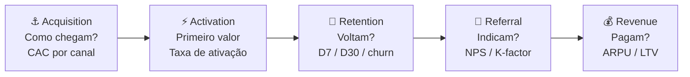

A distinção entre Acquisition e Activation é central: usuário que chegou mas não ativou é desperdício de CAC. A métrica de ativação (o "aha moment") é frequentemente o indicador mais importante do produto — encontrá-la é o trabalho de discovery dos primeiros meses.

#### Quando usar

Use o Pirate Canvas na Fase 10 (MVP e primeiros usuários) como estrutura padrão de instrumentação de métricas. Implante antes de lançar o MVP — não depois. Pós-PMF, use-o mensalmente como dashboard de saúde do funil: onde está a maior queda? Qual etapa tem pior conversão? A etapa com maior vazamento é o foco de crescimento do próximo ciclo. Em Fase 14 (escala), o Pirate Canvas orienta alocação de budget por etapa do funil.

#### Princípios

A tese de McClure é que **times sem modelo de funil explícito otimizam a métrica errada**. Times de produto tendem a focar em Acquisition (visível, fácil de medir, resulta em reuniões celebrando "crescimento") e ignorar Retention (invisível, difícil, mas única que gera crescimento sustentável). AARRR força o time a encarar que crescimento em Acquisition com retenção de 20% no D30 é uma banheira furada — você está enchendo o balde enquanto o buraco cresce. **Retenção precede escala de aquisição.**

#### Como aplicar

Monte o Pirate Canvas em três etapas, nesta ordem:

1. **Defina a métrica de cada etapa** — 1 métrica primária por etapa. Não 5. Uma. Acquisition: CAC médio ponderado por canal. Activation: taxa de usuários que atingem o "aha moment" em X dias. Retention: retenção D30 (ou D7 para apps). Referral: NPS ou taxa de indicação ativa (mês). Revenue: conversão freemium → pago ou ARPU mensal.
2. **Defina o benchmark mínimo** — o que é "saudável" nesta métrica para o seu modelo? SaaS B2B: retenção D30 > 70%. Consumer app: retenção D30 > 25%. Marketplace: depende do lado.
3. **Identifique o maior vazamento** — onde está a maior queda de conversão entre etapas? Esse é o único foco do próximo trimestre. Não mexa nas outras etapas até resolver essa.

Iteração mensal: atualize números, identifique onde o funil mudou, ajuste foco.

#### Exemplo brasileiro preenchido — Conta Simples, aceleração do funil B2B (2021)

A Conta Simples (conta empresarial digital para PMEs brasileiras) tinha problema claro em 2021: Acquisition funcionava bem (CAC baixo via Google Ads B2B + indicação), mas Activation era o gargalo — 60% dos cadastros não ativavam cartão em 14 dias.

| Etapa | Métrica principal | Número | Benchmark alvo | Status |
|---|---|---|---|---|
| **Acquisition** | CAC via canais digitais | R$ 180/cliente | < R$ 250 | ✅ Dentro |
| **Activation** | % completa onboarding + usa cartão em D14 | 40% | > 65% | 🔴 Crítico |
| **Retention** | Retenção D30 (conta ainda ativa e com transação) | 71% | > 70% | ✅ Dentro (marginal) |
| **Referral** | NPS (escala 0-100) | 52 | > 50 | ✅ Dentro |
| **Revenue** | ARPU mensal (receita por conta ativa) | R$ 68 | > R$ 60 | ✅ Dentro |

**O diagnóstico AARRR.** Com esse canvas, ficou claro: o problema não era "crescer" (Acquisition OK), não era "produto ruim" (Retention e NPS OK), e não era "precificação" (ARPU OK). Era **Activation** — usuários chegavam e não ativavam o cartão em 14 dias. Isso revelou dois culpados: (1) o processo KYC (validação regulatória) tinha fricção invisível — três documentos, dois dias de análise manual; (2) o email de onboarding não explicava por que o cartão era o "primeiro valor" da conta.

**As três ações decorrentes:** (1) automatizar 70% do KYC via integração com Receita Federal + Serasa, reduzindo de 2 dias para 4 horas; (2) reescrever o fluxo de onboarding in-app com checklist progressivo (cada step destravava o próximo); (3) enviar WhatsApp (não email) no D2 com link direto para "ativar seu cartão agora". Resultado em 90 dias: Activation subiu de 40% para 67%.

**Insight do caso.** A armadilha clássica sem Pirate Canvas seria investir mais em Acquisition ("vamos crescer mais cadastros"). O canvas mostrou que investir em Acquisition com 40% de Activation significava jogar 60 centavos de cada R$ 1 de CAC no lixo. **A lição: AARRR não é painel de monitoramento — é protocolo de priorização. O maior vazamento do funil vence o debate de roadmap.**

#### Variações e extensões

- **RARRA** (Thomas Petit & Gabor Papp, 2018): reordena para Retention → Activation → Referral → Revenue → Acquisition — enfatiza que Retention deve ser resolvida antes de escalar Acquisition.
- **North Star Metric**: uma única métrica que captura valor entregue ao cliente e prediz crescimento de longo prazo. Complementa o AARRR (que é funil; North Star é foco). Exemplos: Airbnb (noites reservadas), WhatsApp (mensagens enviadas por dia), Spotify (tempo de escuta/mês).
- **Growth Accounting**: decompõe variação de usuários ativos em Novos + Ressuscitados − Churned. Complemento quantitativo ao AARRR.

#### Erros comuns

- Definir múltiplas métricas primárias por etapa — diluição de foco.
- Focar em Acquisition enquanto Retention é crítica — encher banheira furada.
- Usar D7 e D30 intercambiavelmente — D7 mede habit formation, D30 mede stickiness; são perguntas distintas.
- Não segmentar o funil por persona/canal — um funil "médio" pode esconder que canal A tem Activation 80% e canal B tem 15%.
- Tratar AARRR como relatório (olhar uma vez por mês sem decidir nada) em vez de protocolo de priorização.

#### Quando NÃO usar

Em estágio pré-Activation (antes de ter produto em mãos de usuários reais) — métricas de funil não existem ainda. Em produtos com ciclo de venda B2B enterprise muito longo (6-18 meses) — AARRR pressupõe ciclo curto o suficiente para medir D7/D30; em ciclos longos, use pipeline de vendas (stage-by-stage). Em produtos de uso único (compra one-shot sem recorrência) — Retention não se aplica, e o framework perde uma das cinco etapas.

#### Conexão com outros canvases

O Pirate Canvas **alimenta o Lean Canvas (CZ.2)**: métricas do AARRR preenchem os blocos "Métricas-chave" e "Canais" do Lean Canvas com dados reais (não hipóteses). **Sucede o Customer Journey (CZ.7)**: as etapas da jornada do cliente mapeiam diretamente para as etapas do AARRR — Descoberta/Consideration = Acquisition, Onboarding = Activation, Uso recorrente = Retention, Recomendação = Referral, Upgrade = Revenue. **Orienta o MVP Canvas (CZ.11)**: o maior vazamento do AARRR é o foco do próximo MVP de crescimento.

#### Leitura adicional

- *Startup Metrics for Pirates* (Dave McClure, slide deck, 2007) — original disponível publicamente.
- *Hacking Growth* (Sean Ellis & Morgan Brown, 2017) — expansão prática do framework AARRR em equipes de growth.
- *Lean Analytics* (Alistair Croll & Benjamin Yoskovitz, 2013) — benchmarks por modelo de negócio (SaaS, marketplace, e-commerce, mobile app).

---

### CZ.11 — MVP Canvas (Tristan Kromer)

#### Origem

Tristan Kromer, coach de inovação e autor do blog Grasshopper Herder, desenvolveu o MVP Canvas como resposta a uma frustração recorrente: times que "lançavam MVPs" sem definir antecipadamente o que estavam tentando aprender. O MVP Canvas surgiu ao redor de 2013-2015 como artefato estruturado para forçar três definições antes de qualquer linha de código: qual é a hipótese que o MVP testa, quem são os usuários do MVP (não os usuários futuros do produto final), e qual é o critério de sucesso que dirá ao time o que construir a seguir. Kromer parte da premissa de Eric Ries (*The Lean Startup*, 2011) mas torna operacional a pergunta mais ignorada: "MVP de quê, exatamente?"

#### O que é

Tela visual de uma página com **sete blocos** distribuídos em torno da pergunta central "o que estamos aprendendo com este MVP?":

- **Hipótese central**: a crença que o MVP testa — escrita como falsificável.
- **Segmento de usuário do MVP**: não o cliente final do produto, mas o cliente específico que validará *essa hipótese* (pode ser subconjunto menor).
- **Proposta de valor do MVP**: o que o usuário ganha com o MVP — pode ser diferente do produto final.
- **Canais de recrutamento**: como vamos chegar nos usuários deste MVP.
- **Critério de sucesso**: o que precisamos ver para considerar a hipótese validada.
- **Critério de invalidação**: o que precisamos ver para considerar a hipótese refutada.
- **Tipo de MVP**: qual experimento — landing page, concierge, wizard of oz, protótipo clicável, pré-venda, fake door.

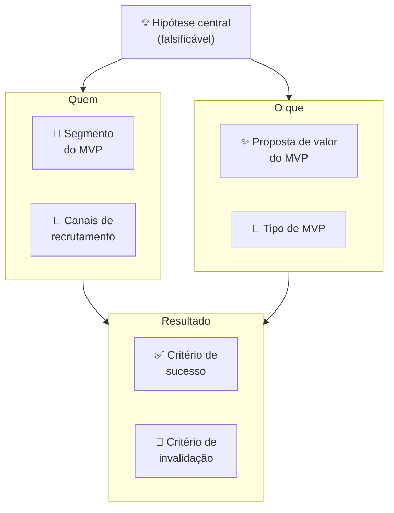

#### Quando usar

Use o MVP Canvas na Fase 8 (prototipagem e MVP) como artefato de entrada — antes de qualquer construção. Para cada MVP que o time planeja lançar, preencha o canvas em 30-45 minutos com as pessoas envolvidas. Em times pós-PMF com discovery contínuo, MVP Canvas precede qualquer sprint de desenvolvimento de feature nova: cada feature experimentada como "MVP de aprendizado" antes de virar permanente.

#### Princípios

A tese de Kromer é que **"MVP" sem hipótese explícita é só produto incompleto**. A maioria dos times chama de MVP qualquer versão inicial do produto, mas "versão inicial" sem hipótese não ensina nada — você lança, alguns usuários gostam, outros não, e o time não sabe o que isso significa. MVP Canvas faz a pergunta que a maioria evita: "Qual crença específica este MVP vai testar? E quando sabemos que foi refutada?" Sem essa resposta, o MVP nunca "falha" — ele simplesmente não tem critério de aprendizado.

#### Como aplicar

Reúna PM + tech lead + designer + fundador. Tempo: 30-45 minutos. **Sequência de preenchimento:**

1. **Hipótese central** — escreva primeiro, antes de falar sobre o MVP em si. "Acredito que [usuário Y] vai [fazer X] por causa de [razão Z]." Teste: a hipótese pode ser refutada? Se não, reescreva.
2. **Segmento do MVP** — quem especificamente vai testar esta hipótese? Pode ser 20 pessoas, não 20.000. Quanto mais estreito o segmento, mais limpa a evidência.
3. **Proposta de valor do MVP** — o que o usuário ganha hoje com esta versão? Não o que o produto promete no futuro — o que o MVP entrega agora.
4. **Canais de recrutamento** — como vai encontrar essas pessoas? "Nossos clientes" é vago; "lista de 50 churned users do último trimestre via email pessoal do founder" é um canal.
5. **Tipo de MVP** — qual é o formato do experimento? Não construa código se um protótipo clicável testa a mesma hipótese em 1/10 do tempo.
6. **Critério de sucesso** — define antes. Número específico.
7. **Critério de invalidação** — define antes. Zona de incerteza entre sucesso e invalidação = inconclusivo.

Após preencher, faça a pergunta de Kromer: "Se o MVP falhar pelo critério de invalidação, o que construímos a seguir?" Se a resposta for "pivotamos para X", o MVP está bem definido. Se a resposta for "não sabemos", a hipótese precisa ser mais específica.

#### Exemplo brasileiro preenchido — Wildlife Studios, MVP de novo mecanismo de monetização (2022)

A Wildlife Studios (São Paulo, one of the largest mobile game studios globally) testou em 2022 um novo mecanismo de monetização para seu jogo *Sniper 3D*: season passes (passe de temporada com recompensas progressivas), alternativa a loot boxes avulsas. O MVP Canvas:

| Bloco | Conteúdo |
|---|---|
| **Hipótese central** | Jogadores de Sniper 3D que compraram ao menos 1 item nos últimos 90 dias pagarão R$ 15 por season pass se perceberem progressão visual clara de recompensas ao longo de 30 dias. |
| **Segmento do MVP** | Cohort de 50.000 jogadores "moderate spenders" (1-3 compras/trimestre, ARPU R$ 18/mês) em mercado brasileiro. Excluídas as duas pontas — free-to-play puro e heavy spenders — para isolar o segmento mais sensível à proposta. |
| **Proposta de valor do MVP** | 30 recompensas progressivas (visuais, skins, boosters) por R$ 15 — previsibilidade de valor vs. loteria de loot box. |
| **Canais de recrutamento** | In-game banner para o cohort selecionado + push notification personalizada no D1 do teste. Sem anúncio externo — experimento contido na base existente. |
| **Tipo de MVP** | Feature real implementada no jogo para o cohort (não protótipo) — o investimento de desenvolvimento era pequeno o suficiente para ser justificado pela potencial monetização. |
| **Critério de sucesso** | ≥12% de conversão do cohort (compra do season pass) nos primeiros 7 dias. ARPU do cohort ≥ R$ 22 em 30 dias (vs. R$ 18 baseline). |
| **Critério de invalidação** | < 6% de conversão em 7 dias OU ARPU < R$ 16 em 30 dias = hipótese refutada. Considerar alternativas de monetização ou repricing. |

**Resultado:** 17% de conversão em D7 (acima do critério de sucesso). ARPU do cohort subiu para R$ 24 em 30 dias. Decisão: Persevere — expandir season pass para todos os usuários ativos + outros jogos do portfólio.

**Insight do caso.** O MVP Canvas forçou a Wildlife a definir o segmento com precisão — testar nos dois extremos (free-to-play puro e heavy spenders) contaminaria o resultado (FTP não compra nada; heavy spenders compram tudo, inclusive o que não funciona). A limpeza do cohort produziu evidência acionável: a proposta funciona para *moderate spenders*, que é exatamente o segmento de maior potencial de upgrade. **A lição: o trabalho mais importante do MVP Canvas é definir quem NÃO entra no experimento — não apenas quem entra.**

#### Variações e extensões

- **Concierge MVP Canvas**: variação específica para MVPs onde o serviço é entregue manualmente (você faz tudo na mão para 10-20 usuários). Canvas adiciona bloco "Script de operação manual".
- **Wizard of Oz Canvas**: variação onde o backend é falso (humano operando). Canvas adiciona bloco "O que o usuário vê" vs. "O que realmente acontece" para mapear a ilusão deliberada.
- **Sprint Goal Canvas** (adaptação ágil): integra MVP Canvas com sprint planning — cada sprint tem um canvas de hipótese + critério.

#### Erros comuns

- Chamar de "MVP" qualquer versão incompleta do produto — MVP sem hipótese é produto inacabado, não experimento.
- Segmento do MVP = segmento total do mercado — dilui o sinal; o experimento não produz evidência limpa.
- Tipo de MVP mais caro que o necessário — se landing page testa a hipótese, não construa produto; se protótipo clicável testa, não escreva código.
- Não definir critério de invalidação — MVP "sempre aprende algo", nunca "falha"; loop de aprendizado não fecha.
- Usar MVP Canvas para justificar construção que já foi decidida — canvas como teatro, não como ferramenta de decisão.

#### Quando NÃO usar

Em produtos altamente regulados onde qualquer versão pública precisa de certificação (healthtech com classe de risco II+, fintech com obrigação de compliance desde o primeiro usuário) — MVP Canvas pressupõe liberdade de lançar versão experimental; em ambientes regulados, o canvas é útil para MVPs internos e simulações. Em produtos onde o custo de construção do MVP mínimo é maior que o custo de validação por entrevistas — entrevista, não construa.

#### Conexão com outros canvases

O MVP Canvas **sucede o Opportunity Canvas (CZ.5)**: a oportunidade aprovada vira hipótese central do MVP Canvas. **Pareia com o Test Card (CZ.9)**: MVP Canvas define o experimento; Test Card registra e acompanha a execução. **Antecede o Pirate Canvas (CZ.10)**: o MVP bem sucedido gera os primeiros dados reais do funil AARRR. **Alimenta o Lean Canvas (CZ.2)**: Proposta de valor validada pelo MVP preenche o bloco "Solução" com dado real.

#### Leitura adicional

- Blog Grasshopper Herder (Tristan Kromer) — onde o MVP Canvas e variações são documentados.
- *The Lean Startup* (Eric Ries, 2011) — fundação filosófica.
- *Continuous Discovery Habits* (Teresa Torres, 2021) — escola de discovery contínuo onde MVP Canvas se integra ao ciclo semanal de produto.

---

### CZ.12 — Storytelling Canvas

#### Origem

Não tem autor único. O Storytelling Canvas emerge da convergência de três tradições ao longo dos anos 2010: (1) o trabalho de Nancy Duarte (*Resonate*, 2010) e Simon Sinek (*Start With Why*, 2009), que sistematizaram estruturas narrativas para comunicação de liderança e pitch; (2) a escola de narrativa estratégica de empresas como Narrative Science e FrameWorks Institute, que estudaram como enquadramento de mensagem afeta percepção de valor; (3) a prática de pitch coaching em aceleradoras (YC, Endeavor, Wayra) onde templates de narrativa viram ferramentas de workshop. O Storytelling Canvas é o artefato visual que condensa essas três tradições — uma tela para construir a narrativa de pitch ou comunicação institucional antes de abrir o PowerPoint.

#### O que é

Tela visual organizada em **oito blocos** que correspondem às oito decisões narrativas centrais:

- **Herói**: quem é o protagonista da história? (O cliente, não a empresa.)
- **Mundo antes**: como era o mundo antes do problema existir — ou o mundo atual do herói, antes da solução.
- **Problema / Tensão**: o que perturba o equilíbrio? Qual a dor do herói?
- **Tentativas falhas**: o que o herói já tentou? Por que não funcionou?
- **A virada**: como a solução entra? Qual é o insight que muda tudo?
- **Mundo depois**: como o mundo do herói muda com a solução?
- **Evidências**: o que prova que a virada é real? (Dados, casos, depoimentos.)
- **Chamada para ação**: o que você quer que o ouvinte faça após ouvir a história?

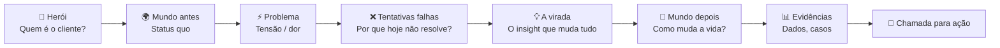

A estrutura segue o arco narrativo clássico de Joseph Campbell (A Jornada do Herói) aplicado ao contexto de produto e pitch — mas com um twist: **o herói não é o fundador nem a empresa, é o cliente**. A empresa é o "guia" (Gandalf, Yoda) que equipa o herói (Frodo, Luke) para vencer o problema.

#### Quando usar

Use o Storytelling Canvas em três contextos: (1) **pitch de investimento** — qualquer conversa com VC, anjo ou processo de aceleração; (2) **comunicação institucional** — lançamento de produto, entrada em novo mercado, apresentação para board; (3) **venda B2B complexa** — a proposta comercial também é uma narrativa, e o Storytelling Canvas ajuda a estruturá-la do ponto de vista do cliente, não do fornecedor. Preencha o canvas antes de criar o deck — a narrativa define a estrutura; o deck é execução.

#### Princípios

A tese unificada de Duarte, Sinek e da escola de pitch é que **dados sem narrativa não mudam comportamento**. O ser humano toma decisões emocionais e as justifica com lógica (Kahneman, *Thinking, Fast and Slow*). Uma história bem construída ativa a decisão emocional; os dados no bloco "Evidências" fornecem a justificativa racional. Inversamente, decks com dados sem narrativa produzem memorização zero — o investidor sai da reunião sem saber "o que essa empresa faz de diferente". O Storytelling Canvas força articular a narrativa primeiro, os dados depois.

#### Como aplicar

Preencha individualmente primeiro (20-30 min), depois valide em grupo (30 min). A sequência importa:

1. **Herói** — descreva o cliente em uma frase: quem é, em que contexto, qual seu papel. Concreto: "Mariana, diretora de RH de empresa com 200 funcionários em SP, responsável por recrutamento de vagas técnicas."
2. **Mundo antes** — como é a vida de Mariana hoje, no contexto do problema? Sem mencionar a solução. Quanto tempo perde? Que ferramentas usa? Com que frustrações convive?
3. **Problema / Tensão** — qual perturbação ela sofre? Qual é a pergunta que ela não consegue responder? Qual é o custo (tempo, dinheiro, emocional) do problema?
4. **Tentativas falhas** — o que ela já tentou? LinkedIn Recruiter (caro, barulhento), indicações (lentas), agências (caras, incertas). Por que cada um falha?
5. **A virada** — como a solução entra? Não "o que o produto faz" — qual insight muda tudo para Mariana? "E se ela tivesse acesso ao candidato passivo certo, antes de ele atualizar o LinkedIn?"
6. **Mundo depois** — como é a vida de Mariana com a solução? Concreto: "Mariana fecha vagas técnicas em 18 dias em vez de 45, sem agência, com candidatos que ela não encontraria no LinkedIn."
7. **Evidências** — dados, casos, resultados de pilotos. "3 clientes beta fecharam 87% das vagas abertas em <20 dias. NPS de 72 entre candidatos."
8. **Chamada para ação** — o que você quer que o ouvinte faça agora? "Assinar pilot de 60 dias com 3 vagas inclusas." Específico, com urgência.

#### Exemplo brasileiro preenchido — Omie (ERP para PMEs), pitch de Series B (2020)

A Omie levantou Series B em 2020 (R$ 52 milhões, Softbank + Redpoint Eventures) com uma narrativa clara. Reconstrução do Storytelling Canvas:

| Bloco | Conteúdo |
|---|---|
| **Herói** | Carlos, dono de empresa contábil com 80 clientes PME em São Paulo. Responsável por fechar a contabilidade de todos os clientes, muitos dos quais usam sistemas diferentes ou planilhas. |
| **Mundo antes** | Carlos passa 40% do seu tempo recoletando dados de cada cliente — nota fiscal em um sistema, fluxo de caixa em planilha, folha em outro fornecedor. Nenhum sistema conversa. Cada cliente usa software diferente. Fechar o balancete mensal exige 3-4 dias de trabalho manual. |
| **Problema / Tensão** | Carlos não consegue escalar — com os 80 clientes atuais já está no limite. Para crescer para 150, precisaria contratar 3 auxiliares. Mas o problema não é falta de mão de obra — é que o modelo de coleta manual é insustentável em qualquer escala. |
| **Tentativas falhas** | Outros ERPs (Totvs, SAP) são caros demais para PME e exigem implementação. Excel é insustentável. ERPs simples de PME não têm API para o escritório contábil acessar dados do cliente. |
| **A virada** | E se o ERP do cliente PME e o sistema do contador fossem o mesmo ambiente? Cliente lança nota, contador vê em tempo real. Fim do mês de coleta. |
| **Mundo depois** | Carlos atende 150 clientes com a mesma equipe de hoje. Balancete fecha em 4 horas. Carlos se torna consultor estratégico dos clientes, não operador de dados. |
| **Evidências** | 12.000 empresas ativas na plataforma. NPS de 76. Churn mensal < 1%. Tempo médio de onboarding: 3 dias (vs. 3 meses de ERPs tradicionais). |
| **Chamada para ação** | Investimento de R$ 52M para expandir de SP para todo o Brasil e dobrar a equipe de CS/produto nos próximos 18 meses. |

**Insight do caso.** O Storytelling Canvas da Omie colocou o **contador como herói** — não o dono de PME, não a Omie. Isso foi uma decisão estratégica deliberada: o contador é o gatekeeper de adoção (ele indica o ERP para o cliente PME, não o contrário). Ao fazer o contador o herói, a narrativa ativa o interesse do investidor *e* do canal de distribuição ao mesmo tempo. **A lição: quem você escolhe como herói define quem vai abraçar a sua narrativa. Em B2B com canais de distribuição, o herói frequentemente não é o usuário final — é o intermediário que decide a adoção.**

#### Variações e extensões

- **Pitch Deck Canvas**: versão que mapeia cada bloco do Storytelling Canvas para um slide do deck — Herói → slide de problema, Virada → slide de solução, Evidências → slide de tração.
- **Press Release Canvas** (Amazon): variação do "trabalhar de trás para frente" da Amazon — escrever o press release do produto *antes* de construí-lo, forçando articular o "Mundo depois" com precisão.
- **One-Pager Canvas**: comprime o Storytelling Canvas em uma única página A4 para comunicação escrita (email para investidor, proposta comercial).

#### Extensão A — SCQA: narrativa para contextos além do pitch

O **SCQA** (Situation → Complication → Question → Answer), criado por Barbara Minto no McKinsey e sistematizado no *The Minto Pyramid Principle* (1987), é a estrutura de comunicação estruturada mais útil para o fundador em contextos onde o Storytelling Canvas seria pesado demais.

**A lógica do SCQA:**

```text
Situation:    O que todos já sabem — o contexto compartilhado
              (estabelece base comum, não discute)

Complication: O que mudou, o problema, a tensão que apareceu
              (por que estamos tendo essa conversa agora?)

Question:     A pergunta implícita que a Complication gera
              (o que fazemos a respeito?)

Answer:       A resposta — sua recomendação, tese ou pedido
              (o que estou propondo)
```

**Por que SCQA, não Storytelling Canvas:**

| Contexto | Use Storytelling Canvas | Use SCQA |
|---|---|---|
| Pitch de investimento (primeira reunião) | ✅ Narrativa emocional cria conexão | — |
| Update de board (trimestral) | — | ✅ Contexto já existe; foco em problema e ação |
| Investor update mensal (escrito) | — | ✅ Curto, direto, explica por que a questão importa agora |
| Email para parceiro estratégico | — | ✅ Respeita o tempo; faz o ponto sem rodeio |
| PR/press release | — | ✅ Lead jornalístico já é SCQA (who/what/why now) |
| Comunicação interna de mudança | — | ✅ Time precisa entender o porquê antes de aceitar o o quê |
| All-hands em momento de crise | Risco — emoção sem substância | ✅ Explica a situação antes de propor a solução |

**SCQA em prática — exemplos do fundador brasileiro:**

*Investor update mensal — SCQA:*

```text
S: Estamos crescendo MRR 15% ao mês há 6 meses; agendamos 
   100+ demos no trimestre com conversão de 23%.

C: Nos últimos 30 dias, o ciclo de fechamento dobrou de 21 
   para 42 dias. A causa identificada: 80% dos deals agora 
   envolvem aprovação de TI, que não estava no processo original.

Q: Como ajustar o processo sem perder velocidade de vendas?

A: Estamos criando deck técnico específico para TI e adicionando 
   discovery de TI como etapa obrigatória na Fase 2 do pipeline.
   [Pedido: intro para CISOs de 3 empresas mid-market no seu portfólio]
```

*Comunicação interna de layoff — SCQA:*

```text
S: Levantamos R$ 8M em agosto e planejamos crescimento 
   de 40% de headcount ao longo de 2024.

C: O mercado desacelerou. Churn acelerou para 4,5% ao mês. 
   No ritmo atual, atingimos burn crítico em 7 meses.

Q: O que precisamos fazer para preservar a empresa?

A: Vamos reduzir o time em 20%, focando nas áreas de produto 
   e vendas que sustentam o núcleo. Aqui está o que muda para 
   quem fica, e como vamos apoiar quem vai sair.
```

**SCQA no board deck:**
No slide de "Roadblocks e Riscos" do board deck (Template A.31), cada problema deve ser apresentado em formato SCQA implícito: a célula "Risco / problema" é a Complication; "Mitigação atual" é a resposta parcial; "Ajuda necessária do board" é a Question. Quando o board member lê o slide, ele já vê Situation (conhece a empresa), Complication (o problema), e sabe que a questão é "o que fazemos". Sua resposta é a Answer colaborativa.

#### Extensão B — Strategic Narrative Framework (Andy Raskin)

O **Strategic Narrative** de Andy Raskin, consultor de pitch que trabalhou com Zuora, Salesforce, GitHub e outras empresas de alto crescimento, é distinto do Storytelling Canvas em um ponto fundamental: o foco não é a jornada do cliente — é a **mudança no mundo** que torna o status quo inaceitável e posiciona a empresa como única capaz de endereçar o novo estado.

**A estrutura de 5 elementos:**

```text
1. MUDANÇA PARADIGMÁTICA NO MUNDO
   "Algo mudou — e isso muda tudo."
   Uma tendência irrefutável que cria um novo estado no mercado.
   Não é o problema do cliente. É a força externa que criou o problema.

2. PERDEDORES E VENCEDORES
   "Quem perde com essa mudança, quem ganha."
   Posiciona o cliente como potencial vencedor se agir.
   Cria urgência sem pressão artificial.

3. A TERRA PROMETIDA
   "Como é o mundo para quem ganhar."
   O estado desejado — específico, vívido, apetecível.
   Não é o produto. É o que o produto permite.

4. OS OBSTÁCULOS (e por que a velha solução falha)
   "Por que o caminho para a Terra Prometida é difícil."
   O que impede os potenciais vencedores de chegar lá.
   Por que as soluções existentes não resolvem.

5. A PONTE
   "Como a empresa remove os obstáculos."
   O produto como instrumento para a Terra Prometida.
   Apresentado por último — quando o interlocutor já acredita no problema.
```

**Por que é diferente do Storytelling Canvas:**

| Aspecto | Storytelling Canvas | Strategic Narrative |
|---|---|---|
| Protagonista | Cliente como herói | A mudança no mundo é o protagonista |
| Tom | Empático, próximo | Estratégico, macro |
| Melhor para | Pitch 1:1 com investidor ou cliente | Comunicação de categoria: site, all-hands, press, keynote |
| Inimigo explícito | Ausente (solução falha, não villain) | Presente — status quo ou concorrente pode ser nomeado |
| Urgência | Via storytelling emocional | Via inevitabilidade da mudança |

**Exemplo brasileiro — Nubank Strategic Narrative (implícito):**

```text
1. MUDANÇA: A internet transformou como consumidores comparam, escolhem 
   e exigem serviços — em todos os setores, exceto bancos.

2. PERDEDORES / VENCEDORES: Brasileiros que continuam com os 5 grandes 
   bancos pagam tarifas e enfrentam burocracia desenhada para outra era. 
   Quem migra para modelo digital tem custo zero e controle real.

3. TERRA PROMETIDA: Serviço financeiro sem agência, sem tarifa, com 
   experiência de produto de tecnologia — não de banco. Controle do 
   dinheiro na palma da mão, sem horário de atendimento.

4. OBSTÁCULOS: Abertura de conta é burocrática. Cartões têm tarifas 
   ocultas. O banco ligo confuso para reter. Os incumbentes têm inércia 
   de décadas de monopólio regulatório.

5. A PONTE: Nubank — conta e cartão digital sem tarifas, com suporte 
   humano via app, abertura em 2 minutos, produto desenhado como software.
```

**Como combinar Strategic Narrative com Storytelling Canvas:**

O Strategic Narrative é o macro — define o posicionamento de categoria. O Storytelling Canvas é o micro — operacionaliza a narrativa para uma audiência e contexto específicos. Em prática:

1. Construa o Strategic Narrative primeiro — essa é a tese da empresa
2. Use o bloco "Mudança Paradigmática" como contexto para o Storytelling Canvas
3. O Storytelling Canvas herda "Mundo antes" e "Tentativas falhas" do Strategic Narrative
4. Para investidor: Strategic Narrative nos primeiros 3 slides do deck; Storytelling Canvas nos próximos 5
5. Para o site: Strategic Narrative no hero section; Storytelling Canvas na página de cases/testimonials

#### Erros comuns

- Fazer a empresa o herói — ouvinte não se importa com a jornada da empresa; se importa com o problema do cliente.
- Pular "Tentativas falhas" — sem esse bloco, a solução não tem contraste; parece mais uma entre muitas.
- "Chamada para ação" vaga ("entre em contato", "vamos conversar") — ouvinte não sabe o próximo passo; taxa de avanço cai.
- Evidências genéricas ("clientes adoram", "crescemos 2x") — não constroem credibilidade; dado específico com contexto é o que convence.
- Usar o mesmo Storytelling Canvas para audiências diferentes — investidor, cliente, parceiro e imprensa têm "Herói" e "Chamada para ação" distintos; o canvas precisa ser refeito para cada audiência.

#### Quando NÃO usar

Em comunicações operacionais internas (status report para time, reunião de sprint) — overhead narrativo não agrega. Em contextos onde a audiência já conhece a narrativa (board recorrente, reunião de acompanhamento) — o canvas é para articular o pitch inicial, não para recapitular.

#### Conexão com outros canvases

O Storytelling Canvas **usa como insumo o BMC (CZ.1)** — os blocos "Segmento de Clientes" e "Proposta de Valor" do BMC alimentam Herói e Virada. **Usa o VPC (CZ.3)** — os Pains do Customer Profile alimentam "Problema / Tensão"; os Gain Creators alimentam "Mundo depois". **Usa métricas do Pirate Canvas (CZ.10)** para o bloco "Evidências" — tração real preenche o que sem AARRR seria só afirmação.

#### Leitura adicional

- *Resonate* (Nancy Duarte, 2010) — estrutura narrativa para apresentações de impacto.
- *Start With Why* (Simon Sinek, 2009) — Golden Circle como framework de narrativa de propósito.
- *Building a StoryBrand* (Donald Miller, 2017) — o cliente como herói, empresa como guia.

---

### CZ.13 — Risk Canvas

#### Origem

O Risk Canvas não tem origem única — emerge da prática de gestão de risco em projetos de inovação e de frameworks como o Risk Register (PMI, PRINCE2) adaptados para o contexto de startup. As versões mais difundidas foram sistematizadas por praticantes de design thinking e lean startup entre 2015 e 2020, a partir da observação de que times de produto tendiam a discutir riscos informalmente, sem estrutura, e invariavelmente esqueciam categorias inteiras (risco regulatório, risco de equipe, risco de modelo) enquanto superestimavam risco técnico. O Risk Canvas operacionaliza a varredura sistemática de risco numa tela visual única, priorizando pelo impacto e pela probabilidade de materialização.

#### O que é

Tela visual organizada em **duas dimensões** — impacto (alto / baixo) × probabilidade (alta / baixa) — com **seis categorias de risco** mapeadas nesse espaço:

- **Risco de mercado**: o problema não existe, não é doloroso, ou o timing está errado.
- **Risco de cliente**: o segmento-alvo não adota, ou o ICP está errado.
- **Risco de solução**: a solução proposta não resolve o problema, ou não é preferida às alternativas.
- **Risco de modelo de negócio**: o CAC é maior que o LTV, ou a monetização não funciona.
- **Risco regulatório**: a regulação bloqueia a operação, ou muda o mercado de forma adversa.
- **Risco de equipe**: falta competência, comprometimento, ou cofundadores divergem.

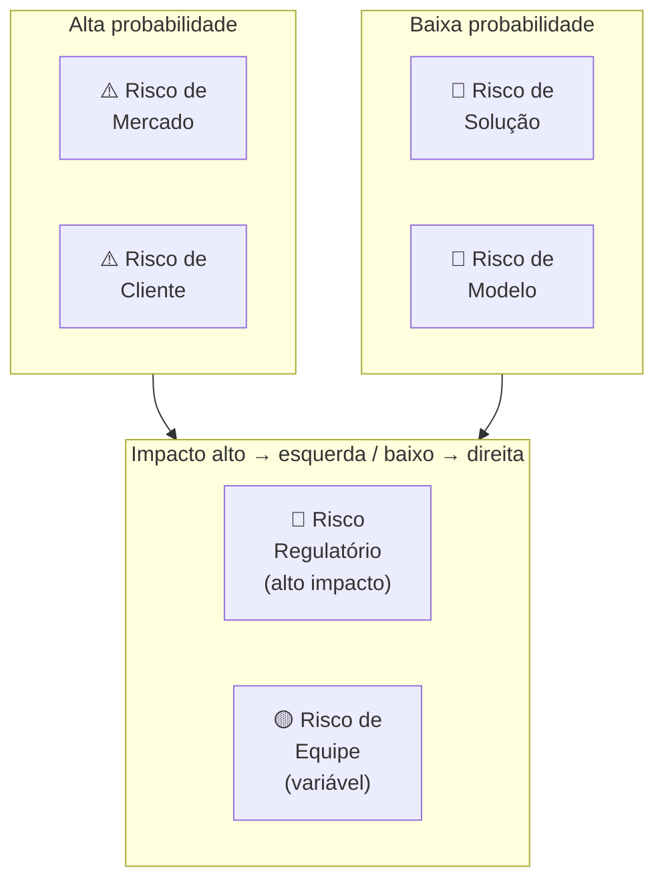

Para cada risco identificado, o canvas registra: **descrição específica**, **probabilidade** (1-5), **impacto** (1-5), **score** (prob × impacto), **mitigação planejada** e **owner** (quem cuida desse risco).

#### Quando usar

Use o Risk Canvas na Fase 11 (modelo de negócio) como check-up antes de comprometer recursos significativos — equipe maior, captação, expansão de canal. Use também antes de cada rodada de captação: investidores farão due diligence em risco; o Risk Canvas mostra que o time já fez o trabalho. Em Fase 15 (reinvenção), refaça o Risk Canvas para a segunda curva — os riscos de uma empresa em escala são diferentes dos de uma startup early-stage.

#### Princípios

A tese central é que **risco não gerenciado não desaparece — cresce silenciosamente**. Times de startup tendem a gerenciar risco de forma reativa (quando o risco se materializa, correm para mitigar) em vez de proativa (antes de se materializar, reduzirem a probabilidade ou o impacto). O Risk Canvas faz o risco visível e priorizado antes da crise. A segunda tese é que **riscos têm donos** — risco sem owner é risco sem mitigação. O canvas força nomear quem é responsável por acompanhar e mitigar cada risco crítico.

#### Como aplicar

Sessão de 2-3 horas com o time fundador completo. **Sequência:**

1. **Brainstorm livre de riscos** (30 min, todos contribuem, sem julgamento) — liste todos os "e se..." que tiram o sono. Foco em completude, não em priorização.
2. **Categorize** — atribua cada risco a uma das seis categorias.
3. **Pontue** — para cada risco, atribua Probabilidade (1-5) e Impacto (1-5). Score = Prob × Impacto. Riscos com score ≥ 15 são críticos.
4. **Priorize os top 5** — concentre energia de mitigação nos 5 com maior score.
5. **Defina mitigação** — para cada top 5: o que podemos fazer para reduzir a probabilidade? O que podemos fazer para reduzir o impacto se ocorrer? Qual experimento ou ação testa isso?
6. **Atribua owners** — cada risco crítico tem uma pessoa responsável por monitorar e executar a mitigação.
7. **Defina revisão** — quando este canvas é revisado? Mínimo trimestral.

#### Exemplo brasileiro preenchido — Méliuz, expansão para cartão de crédito (2020)

A Méliuz (cashback e cupons, listada na B3 em 2020) decidiu expandir para cartão de crédito próprio com Banco Inter. O Risk Canvas antes da decisão:

| Risco | Categoria | Prob | Impacto | Score | Mitigação | Owner |
|---|---|---|---|---|---|---|
| Regulação BACEN exige capital mínimo e demora aprovação | Regulatório | 4 | 5 | 20 | Parceria com banco já licenciado (Inter) ao invés de licença própria | CFO + Jurídico |
| ICP de cashback (comprador online) não usa cartão físico | Cliente | 3 | 4 | 12 | Teste A/B: oferecer cartão para cohort de usuários ativos antes do lançamento geral | CPO |
| CAC do cartão é 5-8x maior que CAC de cashback digital | Modelo | 3 | 5 | 15 | Distribuição cruzada: oferecer cartão apenas para base existente (CAC ≈ 0) nos primeiros 12 meses | CMO |
| Churn de usuários sem limite aprovado mancha a marca | Solução | 2 | 4 | 8 | Política de crédito conservadora nos primeiros 6 meses; comunicação proativa de critérios | COO |
| Time de produto dividido entre dois produtos simultâneos | Equipe | 3 | 3 | 9 | Squad dedicado ao cartão, separado do squad cashback; CPO de cartão contratado externamente | CEO |
| Banco Inter muda condições da parceria | Mercado | 2 | 5 | 10 | Cláusula de exclusividade de 24 meses + direito de first refusal em extensão | CEO + Jurídico |

**Diagnóstico.** Os dois riscos críticos (score ≥ 15): Regulatório (20) e Modelo (15). A mitigação do regulatório foi estrutural — ao invés de licença própria, parceria com banco já licenciado transferiu o risco regulatório para o parceiro especializado. A mitigação do modelo foi comportamental — distribuição exclusivamente para a base existente nos primeiros 12 meses eliminava o CAC de aquisição nova, tornando o unit economics do cartão viável antes de escalar.

**Insight do caso.** O Risk Canvas revelou que o risco mais intuitivo do time (risco de equipe — dividir atenção entre dois produtos) tinha score 9 — alto, mas não o mais crítico. O risco menos óbvio (modelo — CAC 5-8x maior) tinha score 15. Sem o canvas, o time provavelmente teria investido mais energia no risco que estava vendo (equipe) e menos no que não estava calculando explicitamente (CAC do cartão vs. da base digital). **A lição: a função mais importante do Risk Canvas é revelar os riscos que o time não está falando — não documentar os que já estão na cabeça de todos.**

#### Variações e extensões

- **Pre-Mortem** (Gary Klein): exercício complementar — imagem o produto falhou daqui a 12 meses. Por quê? Liste as razões. As razões mais citadas viram inputs do Risk Canvas.
- **Risk Register** (PMI): versão mais formal e detalhada, com campos adicionais (data de identificação, histórico de revisão, plano de contingência). Para projetos maiores ou empresas em expansão.
- **Scenario Planning Canvas**: variação que mapeia três cenários futuros (otimista, base, pessimista) e os riscos específicos de cada um.

#### Erros comuns

- Fazer Risk Canvas só uma vez (no início) e nunca revisar — riscos evoluem; canvas anual é ficcional.
- Risco sem owner — ninguém cuida, risco materializa, time é pego de surpresa.
- Listar riscos genéricos ("risco de mercado") sem especificidade ("nosso ICP não tem budget Q4 por conta do ciclo orçamentário de empresas de capital aberto") — genérico não gera mitigação.
- Focar só em riscos técnicos — times de engenharia subestimam sistematicamente riscos regulatórios, de equipe e de modelo.
- Confundir mitigação com "ter um plano B" — mitigação é ação que reduz probabilidade ou impacto antes da crise; plano B é resposta depois que a crise aconteceu.

#### Quando NÃO usar

Em decisões pequenas e reversíveis (ajuste de preço, mudança de canal) — overhead do canvas não compensa. Em times muito jovens (<3 meses de operação) sem dados suficientes para estimar probabilidade e impacto — nessa fase, a varredura qualitativa de risco (pre-mortem verbal) é mais ágil que o canvas formal.

#### Conexão com outros canvases

O Risk Canvas **complementa o Lean Canvas (CZ.2)**: cada bloco do Lean Canvas gera riscos específicos — "Problema" → risco de mercado, "Solução" → risco de solução, "Canais" → risco de cliente, "Fontes de Receita" → risco de modelo. **Pareia com o Test Card (CZ.9)**: cada risco crítico do canvas pode gerar um Test Card — o experimento que vai testar se o risco é real e qual a magnitude. **Antecede rodadas de captação** (Apêndice V): investidores farão perguntas exatamente sobre os riscos do canvas; chegar à reunião com o canvas preenchido demonstra maturidade de gestão.

#### Leitura adicional

- *PMBOK Guide* (Project Management Institute, 6ª ed. 2017) — padrão de gestão de projetos que formalizou o Risk Register como artefato de projeto.
- *Thinking in Bets* (Annie Duke, 2018) — framework de decisão sob incerteza que complementa o Risk Canvas.
- *Pre-Mortems: A Simple Technique to Save Any Project from Failure* (Gary Klein, HBR, 2007) — artigo seminal sobre pre-mortem como prática.

---

### CZ.8 — Team Canvas (Alex Ivanov, 2015)

#### Origem

Alex Ivanov, designer e facilitador russo, publicou o Team Canvas em 2015 como resposta a um problema recorrente em workshops de times: grupos saíam de reuniões de alinhamento com a sensação de que "conversamos muito, mas não sabemos exatamente o que foi decidido nem quem é responsável por quê". O Team Canvas é inspirado no Business Model Canvas de Osterwalder mas voltado para dentro — não para o modelo de negócio, mas para o modelo do time. Parte da premissa de que um time é uma organização em miniatura: tem propósito, papéis, recursos (as pessoas), canais de comunicação, e estrutura de valor (o que cada membro dá e recebe). Sem tornar esse modelo explícito, o time opera com pressupostos implícitos que geram conflito, retrabalho e desengajamento. O Team Canvas tornou o exercício de alinhamento de time replicável em 60-90 minutos.

#### O que é

Tela visual de uma página com **nove blocos** organizados em torno do time como unidade central:

- **People & Roles**: quem são as pessoas, qual papel cada uma exerce no time (não o cargo formal — o papel funcional real).
- **Common Goals**: quais são os objetivos compartilhados do time para o próximo período. Distingue de objetivos individuais.
- **Personal Goals**: o que cada membro quer pessoalmente ganhar com esse trabalho (desenvolvimento, visibilidade, dinheiro, aprendizado). Frequentemente não dito.
- **Purpose**: por que esse time existe? Qual é o propósito que vai além das metas operacionais?
- **Values**: quais são os valores que o time quer viver — não os valores corporativos genéricos, mas os que esse time específico prioriza no trabalho conjunto.
- **Strengths & Assets**: o que o time tem de melhor — habilidades, experiências, redes, recursos.
- **Weaknesses & Risks**: onde o time é fraco ou onde existe risco de conflito.
- **Needs & Expectations**: o que cada membro precisa dos outros para trabalhar bem. Acordos explícitos.
- **Rules & Activities**: como o time trabalha — rituais, cadências, normas de comunicação, processos de decisão.

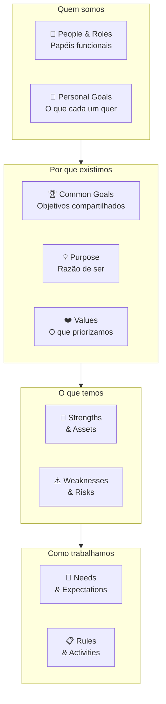

#### Quando usar

Use o Team Canvas na Fase 14 (escala e time) como artefato de onboarding de novos squads ou ao montar equipe de liderança expandida. Use também em momentos de ruptura: entrada de cofundador ou C-level novo, fusão de times após aquisição, reorganização de squads. Em times de 3-8 pessoas, o canvas pode ser preenchido em sessão única de 90 minutos. Em times maiores, faça por squad e depois alinhe os Common Goals e Values entre squads.

#### Princípios

A tese de Ivanov é que **conflito de time frequentemente não é conflito de personalidade — é conflito de pressupostos não declarados**. Dois co-fundadores que não conversaram sobre Personal Goals assumem que o outro quer a mesma coisa (crescimento acelerado vs. lifestyle company; vender em 5 anos vs. construir por 20). Dois engenheiros que não conversaram sobre Needs & Expectations têm expectativas diferentes sobre code review, autonomia, e prazo. O Team Canvas torna esses pressupostos visíveis antes de se tornarem conflito. **A sessão de preenchimento é mais valiosa que o artefato preenchido** — o que emerge na conversa é o trabalho, não o documento final.

#### Como aplicar

Sessão presencial ou remota (Miro, Mural, FigJam). Facilitador (pode ser o próprio fundador, mas facilita melhor quem não está no canvas). 60-90 minutos para times pequenos (3-6 pessoas); 120-150 minutos para times maiores (6-12).

1. **People & Roles** (10 min) — cada pessoa escreve seu nome e o papel funcional real (não o cargo): "sou quem toma decisão técnica final" / "sou quem mantém relação com os clientes âncora".
2. **Personal Goals** (15 min) — individualmente primeiro, depois compartilha. O que cada pessoa quer ganhar pessoalmente com esse trabalho nos próximos 12 meses? Dinheiro? Aprendizado? Visibilidade? Espaço para criar? Sem julgamento.
3. **Common Goals** (15 min) — o que o time quer alcançar *junto*? 3-5 objetivos específicos para o próximo semestre. Discutir até consenso real.
4. **Purpose** (10 min) — por que esse time existe além das metas? Qual seria a perda para o mundo se esse time parasse de existir?
5. **Values** (10 min) — quais 3-5 valores o time quer praticar no trabalho conjunto? Votar, depois discutir os que geraram divergência.
6. **Strengths & Assets / Weaknesses & Risks** (15 min) — o que o time tem de excelente e onde é vulnerável. Honestidade é o requisito — equipe que só lista forças não faz o exercício.
7. **Needs & Expectations** (10 min) — o que cada pessoa precisa dos outros para trabalhar bem. "Preciso de feedback direto, sem rodeios." "Preciso de autonomia sobre decisões de design." Acordos explícitos.
8. **Rules & Activities** (10 min) — rituais, cadências, normas. Stand-up diário ou não? Code review obrigatório ou não? Decisão por consenso ou por voto?

Após a sessão: registrar o canvas, colocar visível, revisitar em 3-6 meses.

#### Exemplo brasileiro preenchido — Loggi, formação do squad de expansão nacional (2019)

Quando a Loggi decidiu expandir de São Paulo para 15 cidades em 12 meses (2019), formou um squad de expansão composto por pessoas de produto, operações, dados e comercial que nunca tinham trabalhado juntas. O Team Canvas da sessão inicial:

| Bloco | Conteúdo |
|---|---|
| **People & Roles** | PM (decisão de produto e priorização), líder de operações (viabilidade logística e parcerias locais), data analyst (modelo de precificação e projeção de demanda), comercial B2B (clientes-âncora em cada cidade), engenheiro de backend (adaptações de sistema por região). |
| **Personal Goals** | PM: "quero aprender como se escala operação física, não só digital." Ops: "quero provar que consigo gestão multi-regional." Data: "quero usar modelos preditivos em decisão real, não só relatório." Comercial: "quero virar head de vendas regionais." Engenheiro: "quero ter mais influência na arquitetura." |
| **Common Goals** | (1) 15 cidades ativas em 12 meses. (2) NPS de entregadores ≥ 45 em todas as cidades ao fim do mês 3. (3) CAC de lojista ≤ R$ 800 nos novos mercados. (4) Tempo de onboarding de cidade ≤ 6 semanas. |
| **Purpose** | "Tornar entrega rápida acessível para qualquer lojista no Brasil, não só em SP." |
| **Values** | (1) Velocidade sobre perfeição. (2) Dados antes de opinião. (3) Transparência sobre problemas cedo — sem surpresas tardias. (4) Respeito pela operação local — cada cidade tem suas particularidades. |
| **Strengths & Assets** | Produto já validado em SP com >18 meses de dados. Marca forte entre entregadores paulistanos. Time com histórico de execução em ambiente caótico. |
| **Weaknesses & Risks** | Ninguém do squad conhece os mercados-alvo (Recife, BH, Porto Alegre). Risco de replicar o modelo SP sem adaptar. Tensão potencial entre velocidade de expansão (PM + comercial) e qualidade operacional (ops + engenheiro). |
| **Needs & Expectations** | PM precisa de dados do ops *antes* de priorizar features. Ops precisa de 2 semanas de lead time para qualquer mudança de processo. Data precisa de acesso a dados brutos, sem camadas de abstração. Comercial precisa de suporte de produto para reuniões com clientes grandes. Engenheiro precisa de critério claro de "done" antes de começar cada sprint. |
| **Rules & Activities** | Weekly de 45 min às segundas (sem slides — só dados + decisões). Slack para comunicação assíncrona (resposta em até 4h em horário comercial). Decisão técnica: engenheiro tem veto. Decisão de produto/prioridade: PM tem última palavra. Decisão de operação: ops tem última palavra. Conflicts escalados para o trio PM + ops + comercial em 24h. |

**Insight do caso.** O bloco que gerou mais conversa foi **Personal Goals** — especialmente o engenheiro que queria "mais influência na arquitetura" e o PM que assumia que o engenheiro estava "só para implementar". Sem o Team Canvas, essa tensão teria emergido na primeira divergência de sprint. Com o canvas, o time chegou a um acordo explícito: o engenheiro entra na reunião de priorização com voto consultivo sobre viabilidade técnica, e o PM explica as decisões de "não agora" com contexto de negócio. **A lição: o conflito mais destrutivo em times de startup é o conflito sobre quem decide o quê. Team Canvas não resolve o conflito — antecipa a conversa e torna o acordo explícito antes que o conflito aconteça.**

#### Variações e extensões

- **Team Canvas Basic**: versão simplificada com apenas 5 blocos (Goals, Roles, Values, Needs, Rules) — para times muito pequenos (2-3 pessoas) ou sessões rápidas de 45 minutos.
- **Squad Health Check** (Spotify): complemento do Team Canvas — avalia periodicamente a saúde do time em dimensões como Ownership, Speed, Fun, Learning. Útil para revisão trimestral.
- **Working Agreements Canvas**: foco exclusivo em normas de trabalho — versão mais operacional que o Team Canvas completo.

#### Erros comuns

- Fazer o Team Canvas sem o bloco Personal Goals — é exatamente onde estão os pressupostos não declarados mais perigosos.
- Facilitador que também está no canvas — difícil ser objetivo; terceiro facilita melhor.
- Canvas como check-box burocrático (preencher por obrigação, nunca revisitar) — valor está na sessão e na revisão periódica, não no documento.
- Confundir Values com slogan corporativo — "inovação", "integridade", "excelência" são valores genéricos que não guiam decisão real. "Velocidade sobre perfeição" ou "dados antes de opinião" são valores acionáveis.
- Tratar o canvas como imutável — times mudam; refaça a cada 6 meses ou quando a composição muda significativamente.

#### Quando NÃO usar

Em times de 1-2 pessoas (overhead não compensa). Em contextos onde há hierarquia rígida que impede honestidade nos blocos Personal Goals e Weaknesses (o canvas produz respostas performáticas, não reais). Em squads temporários de projeto com vida útil <3 meses — overhead de sessão pode não compensar.

#### Conexão com outros canvases

O Team Canvas **complementa o BMC (CZ.1)** e o **Lean Canvas (CZ.2)**: estes descrevem o modelo externo (o negócio); o Team Canvas descreve o modelo interno (o time que vai executar). **Orienta o Risk Canvas (CZ.13)** no bloco "Risco de equipe" — o Team Canvas é o diagnóstico; o Risk Canvas é a priorização e mitigação. **Precede o Storytelling Canvas (CZ.12)** em narrativas de expansão: time alinhado produz narrativa coerente; time desalinhado produz narrativa contraditória.

#### Leitura adicional

- [teamcanvas.com](https://www.teamcanvas.com) — Alex Ivanov mantém o site com templates e estudos de caso.
- *The Five Dysfunctions of a Team* (Patrick Lencioni, 2002) — modelo de saúde de time que se integra ao Team Canvas.
- *An Elegant Puzzle* (Will Larson, 2019) — engineering management com foco em time e alinhamento, relevante para squads técnicos.

---

### CZ.14 — Hypothesis Canvas (autoral IGNIÇÃO)

#### Origem

O Hypothesis Canvas documentado neste livro é uma ferramenta autoral desenvolvida especificamente para o contexto de founder brasileiro operando com recursos limitados e necessidade de ciclos curtos de aprendizado. Parte da tradição do Lean Startup (Eric Ries, 2011) e da metodologia de hipóteses científicas aplicada a negócio (Karl Popper via Steve Blank), mas incorpora duas inovações práticas ausentes nos templates estrangeiros: (1) a ligação explícita entre cada hipótese e a **árvore de teoria** do negócio (Fase 2B) — forçando o fundador a articular *qual premissa causal da teoria* está sendo testada; (2) o bloco de **due diligence da amostra** antes da comparação com o threshold — evitando o erro de aceitar resultado de amostra inadequada como evidência válida. O template completo preenchível está no [[#APÊNDICE A — TEMPLATES PRONTOS PARA USO|Apêndice A (A.10)]].

#### O que é

Artefato de uma página — estruturado como tabela de quatro quadrantes — que captura os oito elementos de uma hipótese rigorosamente testável:

- **Teoria**: qual parte da árvore de teoria (Fase 2B) esta hipótese testa? Qual é o atributo ou seta causal em jogo?
- **Hipótese**: afirmação falsificável em uma frase — quantitativa sempre que possível.
- **Evidência**: como a evidência será coletada? Método, público-alvo, tamanho de amostra, duração, custo.
- **Medidas**: o que especificamente será contado? Qual é a fórmula da métrica? Quais medidas alternativas foram descartadas?
- **Threshold (pré-definido)**: qual resultado mínimo considera a hipótese suportada? Qual resultado a considera refutada? Qual é a zona inconclusiva entre os dois?
- **Due diligence da amostra**: antes de comparar resultado com threshold, a amostra é adequada? Representa o ICP? Há vieses identificados?
- **Avaliação**: resultado observado vs. threshold ajustado — Suportada / Refutada / Inconclusiva?
- **Decisão**: Perseverar / Pivotar / Mais dados / Abandonar + próxima ação concreta + impacto na árvore de teoria.

A sequência de preenchimento é deliberada: blocos superiores e médios **antes** de coletar dados; blocos inferiores **após** — respeitando a barreira anti-viés de confirmação.

#### Quando usar

Use o Hypothesis Canvas na Fase 6 (formulação de hipóteses) como artefato central — um canvas por hipótese bet-the-company. Use também em discovery contínuo pós-PMF: qualquer feature ou mudança de modelo que envolva uma crença não testada merece um canvas. Em times que fazem Test Cards (CZ.9), o Hypothesis Canvas é o nível acima: o Test Card registra um experimento; o Hypothesis Canvas registra a hipótese que o experimento testa, com contexto teórico e decisão final.

#### Princípios

Três princípios fundamentam o design do canvas:

**Primeiro: hipótese sem conexão teórica é ruído.** O bloco "Teoria" força o fundador a articular qual pressuposto da teoria do negócio está em jogo. Hipótese validada que não conecta à teoria pode ser irrelevante; hipótese refutada que conecta a um nó crítico da teoria pode matar o modelo inteiro — a diferença importa.

**Segundo: threshold pré-definido evita auto-engano.** Definir critério de sucesso e refutação antes de ver dados é o único mecanismo eficaz contra viés de confirmação. Times que definem threshold após o resultado invariavelmente o ajustam para validar o que já queriam. O bloco de due diligence da amostra acrescenta um segundo filtro: mesmo que o resultado supere o threshold, se a amostra era inadequada, o resultado não é evidência.

**Terceiro: decisão conecta de volta à teoria.** O bloco "Decisão" exige que o fundador articule o impacto na árvore de teoria — não só "vamos continuar" mas "este resultado fortalece/invalida qual nó ou seta da nossa teoria causal do negócio". Sem isso, aprendizados se acumulam sem atualizar a teoria, e a teoria fica desatualizada em relação à evidência coletada.

#### Como aplicar

Para cada hipótese bet-the-company da Fase 6, abra um canvas. Tempo de preenchimento inicial: 30-45 minutos (a parte antes de coletar dados). Conclusão: após coleta e análise.

Use o template completo do [[#APÊNDICE A — TEMPLATES PRONTOS PARA USO|Apêndice A (A.10)]] para o preenchimento. A estrutura do canvas orienta a sequência — não pule blocos, não preencha de baixo para cima.

**Sequência obrigatória:**

1. **Teoria**: abra a árvore de teoria da Fase 2B. Qual atributo ou seta esta hipótese testa? Importância (1-5). É bet-the-company?
2. **Hipótese**: escreva como afirmação falsificável. "X% de [persona Y] fará [ação Z] em [contexto W]."
3. **Evidência**: escolha o método. Entrevista, questionário, landing page, pré-venda, concierge, A/B, fake door, etc. Tamanho de amostra, duração, custo.
4. **Medidas**: o que conta? Qual é a fórmula exata? Quais alternativas foram descartadas?
5. **Threshold**: defina sucesso, refutação e zona inconclusiva. Justifique os números. Assine e date.
6. **[Coleta de dados]**
7. **Due diligence da amostra**: tamanho efetivo coletado. Adequado? Representa o ICP? Vieses.
8. **Ajuste do threshold**: se necessário, documente a razão.
9. **Avaliação** e **Decisão**.

#### Exemplo brasileiro preenchido — startup de gestão de frota para transportadoras médias (2023)

Uma startup B2B de gestão de frota estava testando a hipótese de que transportadoras de 20-50 caminhões em SP pagariam R$ 180/veículo/mês por rastreamento + relatórios de eficiência integrados.

| Bloco | Conteúdo |
|---|---|
| **Teoria** | Atributo A3 da árvore: "cliente paga pelo relatório de eficiência, não só pelo rastreamento". Seta causal: relatório de eficiência → redução de custo de combustível → disposição a pagar premium. Importância: 5. Bet-the-company: sim (preço de R$ 180 vs. concorrente a R$ 90 depende desta hipótese). |
| **Hipótese** | Transportadoras de 20-50 caminhões em SP com gerente de frota dedicado pagarão R$ 180/veículo/mês por rastreamento + relatório de eficiência mensal, se o relatório mostrar redução ≥5% de consumo de combustível. |
| **Evidência** | 8 pré-vendas reais (contrato de 3 meses, reembolso se insatisfeito) via cold outreach para lista de 40 transportadoras identificadas em LinkedIn + associações de classe. |
| **Medidas** | Número de contratos assinados a R$ 180. Threshold: ≥4/8 (50%) = suportada. ≤1/8 (12,5%) = refutada. Entre 2-3 = inconclusivo. |
| **Threshold** | Sucesso: ≥4 contratos em 30 dias. Refutação: ≤1 contrato. Zona inconclusiva: 2-3 contratos (exige entrevistas adicionais para entender objeções). |
| **Due diligence** | 8 empresas abordadas, 6 tiveram reunião (2 declinaram). Das 6: 3 assinaram a R$ 180, 1 pediu R$ 120, 2 declinaram. Amostra de 8 é pequena mas representa o ICP (todas têm 20-50 caminhões, SP, gerente de frota). Viés possível: acesso via rede pessoal pode ter selecionado empresas mais abertas a inovação. |
| **Avaliação** | 3/6 reuniões = 50% de conversão das reuniões. Vs. threshold original (4/8 total): inconclusivo. Ajuste de threshold: com 6 reuniões em vez de 8, o critério proporcional seria ≥3 — resultado beira o limiar de sucesso. |
| **Decisão** | Mais dados. Ação: expandir para 20 novas abordagens antes de concluir. A 1 que pediu R$ 120 sinaliza que o relatório de eficiência não está bem justificado em termos de ROI — refinar a apresentação do relatório antes das próximas abordagens. Impacto na teoria: hipótese parcialmente suportada, mas seta causal "relatório → disposição a pagar premium" precisa ser reforçada com cálculo de ROI explícito na proposta. |

**Insight do caso.** O bloco de due diligence revelou que a amostra era pequena (6 reuniões, não 8 planejadas), e o resultado ficou na zona cinza. Sem o canvas, o time poderia ter concluído "50% de conversão — excelente, vamos escalar". Com o canvas, ficou claro que 3 contratos numa amostra de 6 é inconclusivo, e a ação certa era ampliar — não comemorar. **A lição: threshold sem due diligence da amostra é falsa precisão. O número de contratos importa, mas a qualidade da amostra que gerou esses contratos importa igualmente.**

#### Variações e extensões

- **Hypothesis Canvas Rápido**: versão de 4 blocos (Hipótese + Método + Threshold + Decisão) para hipóteses de menor risco onde o rigor completo é overhead excessivo.
- **Portfolio de Hipóteses**: planilha com todos os canvas abertos em paralelo, ranqueados por Importância e status (Pendente / Em teste / Suportada / Refutada). Útil para o "banco de hipóteses" da Fase 6.

#### Quando NÃO usar

Em decisões operacionais rotineiras que não testam premissa nova (ajuste de preço incremental, mudança de copy). Em hipóteses onde a coleta de evidência levaria mais de 90 dias — nesse horizonte, outros aspectos do negócio já terão mudado; redesenhe o experimento para ser mais rápido ou use o canvas como hipótese de longo prazo com checkpoint intermediário.

#### Conexão com outros canvases

O Hypothesis Canvas **sucede a Theory Map (CZ.16)**: cada nó ou seta da árvore teórica gera hipóteses a testar. **Pareia com o Test Card (CZ.9)**: o Hypothesis Canvas define a hipótese e o contexto teórico; o Test Card define o experimento específico. **Alimenta o Lean Canvas (CZ.2)**: hipóteses validadas atualizam os blocos do Lean Canvas com dado real. **Alimenta o Risk Canvas (CZ.13)**: hipóteses refutadas são, frequentemente, a materialização de riscos previamente identificados.

#### Leitura adicional

- Template completo preenchível: [[#APÊNDICE A — TEMPLATES PRONTOS PARA USO|Apêndice A, A.10]].
- *The Lean Startup* (Eric Ries, 2011) — fundação filosófica.
- *Thinking, Fast and Slow* (Daniel Kahneman, 2011) — viés de confirmação e por que threshold pré-definido importa.

---

### CZ.15 — Canvas da Cunha (autoral IGNIÇÃO)

#### Origem

O Canvas da Cunha é ferramenta autoral desenvolvida para o contexto específico de startups B2B brasileiras que precisam escolher um segmento de entrada estreito antes de escalar. O conceito de "cunha" (wedge) vem da escola de go-to-market de Peter Thiel (*Zero to One*, 2014) — a ideia de que toda startup dominante começou controlando um nicho pequeno e específico antes de expandir. O canvas operacionaliza essa estratégia: força o fundador a articular com precisão cirúrgica *quem* é o cliente do segmento de entrada, *qual* dor específica está sendo resolvida, e *como* o resultado é mensurável. O "Teste do Grupo de WhatsApp" — você consegue listar nominalmente 100-300 pessoas específicas como potenciais primeiros clientes? — é o teste de falsificabilidade da cunha: cunha bem definida passa no teste; cunha vaga não passa. O template completo preenchível está no [[#APÊNDICE A — TEMPLATES PRONTOS PARA USO|Apêndice A (A.12)]].

#### O que é

Tela visual de uma página com **seis blocos** que definem a anatomia completa da cunha de entrada:

- **ICP (Ideal Customer Profile) preciso**: descrição em 2-3 linhas do cliente específico — não "PMEs", mas "donos de padaria artesanal com 1-3 unidades em SP com delivery próprio".
- **Dor específica**: um fluxo de trabalho específico que está quebrado ou ineficiente para esse ICP. Não "dificuldade em gestão", mas "gasta 3 horas por semana consolidando pedidos de delivery de três canais diferentes manualmente".
- **Resultado mensurável**: como o cliente sabe que a solução funcionou? Escolha 1-2 categorias: receita gerada, custo reduzido, risco eliminado, tempo economizado. Com número: "reduz de 3h para 15min/semana".
- **Dono do orçamento**: cargo e nível hierárquico de quem assina o cheque — não quem usa o produto.
- **Teste do Grupo de WhatsApp**: você consegue listar nominalmente 100-300 potenciais primeiros clientes? Se sim, a cunha está bem definida. Se não, é muito larga — refine.
- **Alternativa atual e vantagem**: o que o cliente faz hoje para resolver esse problema? Por que você é melhor, em uma frase com número?

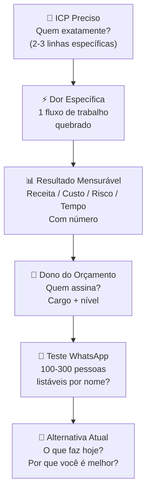

#### Quando usar

Use o Canvas da Cunha na Fase 5 (mapeamento de mercado) como entregável final antes de avançar para a Fase 6. É o artefato de saída da fase — sem ele preenchido e aprovado nos três testes complementares (Teste de Precisão do Comprador, ausência de escopo instável, independência de plataforma), a Fase 5 não está concluída. Use também em momentos de pivô (Fase 15): a segunda curva frequentemente exige redefinir a cunha, começando o ciclo de entrada de mercado novamente com o ativo da marca existente.

#### Princípios

Três princípios fundamentam o canvas:

**Primeiro: especificidade é vantagem competitiva, não limitação.** O instinto do fundador é ampliar o ICP ("não quero excluir potenciais clientes"). O canvas vai na direção oposta: quanto mais estreito o ICP, mais forte a proposta de valor, mais rápido o feedback de mercado, mais fácil a venda. Você não está excluindo clientes — está escolhendo *por onde entrar*. Escala vem depois.

**Segundo: a cunha é definida pela dor, não pelo produto.** O erro mais comum é definir a cunha pelo que o produto faz ("somos um ERP para PMEs"). A cunha correta é definida pelo problema específico que está sendo resolvido para um cliente específico ("somos a ferramenta que resolve o problema de recoletada manual de dados para escritórios contábeis com 50-100 clientes PME"). O produto pode evoluir; a dor específica é o núcleo.

**Terceiro: o Teste do WhatsApp é o critério de verdade.** Qualquer fundador pode escrever "donos de PME com dificuldade em gestão" como ICP. Muito poucos conseguem listar 200 nomes específicos de pessoas que atendem a esse critério. O teste força a realidade — se você não consegue nominar 100 pessoas, seu ICP não está definido o suficiente para ser uma cunha viável.

#### Como aplicar

Preencha individualmente primeiro (20-30 min) e depois valide com pelo menos um cofundador ou mentor externo (30 min). Use o template completo do [[#APÊNDICE A — TEMPLATES PRONTOS PARA USO|Apêndice A (A.12)]].

**Sequência:**

1. **ICP**: descreva quem é o cliente em 2-3 linhas. Inclua: setor, porte, localização, critério operacional (tem delivery próprio, tem gerente de frota, tem mais de X clientes, etc.). Não use adjetivos vagos ("médias empresas") — use critérios objetivos.
2. **Dor específica**: escolha um fluxo de trabalho. Descreva o que está quebrado com verbos concretos ("gasta", "consolida manualmente", "perde"). Se você precisar de 3 frases, o ICP ainda é largo demais.
3. **Resultado mensurável**: escolha 1-2 categorias. Coloque um número. Se não tem o número, pergunte a 5 potenciais clientes antes de preencher o bloco.
4. **Dono do orçamento**: não é necessariamente quem usa o produto. Em B2B, frequentemente é um nível acima. Nomeie o cargo e o contexto hierárquico.
5. **Teste do WhatsApp**: tente listar. Se conseguir 100-300 nomes específicos (LinkedIn, associações, contatos do setor, indicações), a cunha está certa. Se não conseguir 50, está larga demais.
6. **Alternativa atual e vantagem**: descreva o que o cliente faz *hoje* (Excel, processo manual, concorrente, "não faz nada"). Escreva a vantagem em uma frase com número. Sem número, não é comparação — é afirmação vaga.

Após preencher, aplique os três testes complementares do template A.12 antes de avançar.

#### Exemplo brasileiro preenchido — PadariaPro (caso recorrente do livro)

| Bloco | Conteúdo |
|---|---|
| **ICP** | Donos ou donas operacionais de padarias artesanais com 1-3 unidades físicas em São Paulo (capital + ABC), com delivery próprio via WhatsApp ou iFood, faturamento R$ 80-400k/mês, há pelo menos 2 anos no mercado. Excluir: padarias industriais, franquias, padarias sem delivery próprio. |
| **Dor específica** | Consolida pedidos de delivery de 2-3 canais (WhatsApp, iFood, site próprio) manualmente — copia pedido do WhatsApp para planilha, confere com iFood, passa para a produção. Processo leva 2-3 horas/dia, gera erros de pedido e atrasos que resultam em avaliações negativas. |
| **Resultado mensurável** | Reduz consolidação de pedidos de 2-3h/dia para 15 min/dia (tempo). Reduz erro de pedido de ~8% para <1% (qualidade → preservação de avaliação). |
| **Dono do orçamento** | O próprio dono ou sócia operacional — em padarias dessa faixa, não há gestor intermediário; quem sofre o problema é quem paga. |
| **Teste do WhatsApp** | Fundadores conseguiram listar 180 padarias específicas em SP via Instagram (buscando perfis de padaria artesanal com >500 seguidores) + associação de panificadores de SP + grupos de WhatsApp de donos de padaria. Cunha aprovada. |
| **Alternativa atual** | Planilha Excel + cópia manual de mensagens de WhatsApp. Por que melhor: "Reduz 2,5h/dia de trabalho manual e elimina 90% dos erros de pedido, por R$ 290/mês — equivale a menos de 20 minutos do custo de mão de obra do dono." |

**Insight do caso.** O bloco mais trabalhoso foi a **Dor específica** — a primeira versão dizia "dificuldade em gestão de delivery". Com esse enunciado, o Teste do WhatsApp seria impossível (como listar donos de padaria com "dificuldade em gestão"?). Ao refinar para "consolida pedidos de 2-3 canais manualmente 2-3h/dia", o teste ficou testável: o critério de inclusão na lista era "tem delivery via WhatsApp E pelo menos mais um canal". **A lição: o Teste do WhatsApp não é só um teste de tamanho do mercado — é um teste de especificidade da dor. Se você não consegue montar a lista, o critério de dor está vago demais para gerar uma proposta de valor precisa.**

#### Variações e extensões

- **Canvas da Cunha para B2C**: versão adaptada onde "Dono do orçamento" é substituído por "Contexto de decisão de compra" (impulso, pesquisa, influência social) — em B2C o comprador e o usuário são o mesmo.
- **Canvas da Segunda Cunha**: para empresas em escala que querem atacar um novo segmento com o produto existente — mesma estrutura mas com bloco adicional "Vantagem incumbente" (o que a empresa já tem que facilita a entrada neste segmento vs. novo entrante).

#### Quando NÃO usar

Em modelos de negócio B2C de massa com aquisição digital escalável desde o início (e-commerce com SAM > 1M pessoas) — a lógica de cunha estreita pode ser substituída por segmentação de produto/canal. Em startups de plataforma onde o valor é gerado pela rede desde o início — o Canvas da Cunha ajuda a definir o lado inicial da rede, mas o framework de marketplace dynamics (Apêndice AE) é mais adequado para a dinâmica de crescimento.

#### Conexão com outros canvases

O Canvas da Cunha **sucede o Empathy Map (CZ.6)** e o **Customer Journey (CZ.7)**: esses canvases revelam quem é o cliente e como vive o problema; o Canvas da Cunha define *qual segmento de cliente* é o ponto de entrada. **Antecede o Lean Canvas (CZ.2)**: a cunha bem definida preenche os blocos "Problema", "Segmento de Clientes" e "Canais" do Lean com precisão. **Conecta ao Strategy Canvas (CZ.4)**: a cunha é o ponto de entrada; o Strategy Canvas define a curva de valor distinta nesse nicho que impede imitação fácil.

#### Leitura adicional

- Template completo preenchível: [[#APÊNDICE A — TEMPLATES PRONTOS PARA USO|Apêndice A, A.12]].
- *Zero to One* (Peter Thiel & Blake Masters, 2014) — origem do conceito de "wedge".
- *Crossing the Chasm* (Geoffrey Moore, 1991) — estratégia de segmento de entrada para tecnologia B2B.

---

### CZ.16 — Theory Map / Story Tree (autoral IGNIÇÃO)

#### Origem

A Theory Map — também chamada de Story Tree no contexto de Fase 2B — é ferramenta autoral desenvolvida para este livro a partir da convergência de três tradições intelectuais: (1) o Directed Acyclic Graph (DAG) causal de Judea Pearl (*The Book of Why*, 2018), que formaliza relações causais em grafos direcionados; (2) o conceito de "theory of change" das ciências sociais e de impacto social (Teoria da Mudança), que mapeia a lógica causal entre intervenção e resultado; (3) a prática de Steve Blank e Bob Dorf de externalizar as "apostas" de um modelo de negócio antes de testar. A motivação foi observação prática: fundadores que chegam com Lean Canvas preenchido frequentemente não conseguem articular *por que* acreditam que cada bloco do canvas se sustenta. Theory Map força externalizar essa lógica causal implícita — tornando-a auditável, falsificável e revisável à medida que a evidência chega. O template completo preenchível está no [[#APÊNDICE A — TEMPLATES PRONTOS PARA USO|Apêndice A (A.9)]].

#### O que é

Grafo visual — árvore ou rede de nós conectados por setas causais — que representa a teoria do negócio: a cadeia de premissas que, se verdadeiras em conjunto, tornam o negócio viável. Cada **nó** é um atributo ou estado do mundo ("clientes pagam R$ 180/mês", "CAC < R$ 400", "retenção D30 > 60%"). Cada **seta** é uma afirmação causal ("porque X, então Y" — "porque a dor é aguda o suficiente, clientes pagarão mensalmente"). O grafo é **acíclico** — sem loops; se houver, é sinal de raciocínio circular.

Cada nó recebe três classificações:

- **Conhecimento (K1-K5)**: quão bem estabelecida é esta premissa? K1 = evidência robusta. K5 = pura suposição.
- **Importância (I1-I5)**: quanto o negócio depende desta premissa? I5 = bet-the-company.
- **Prioridade de teste (P = K × I)**: premissas com maior P devem ser testadas primeiro.

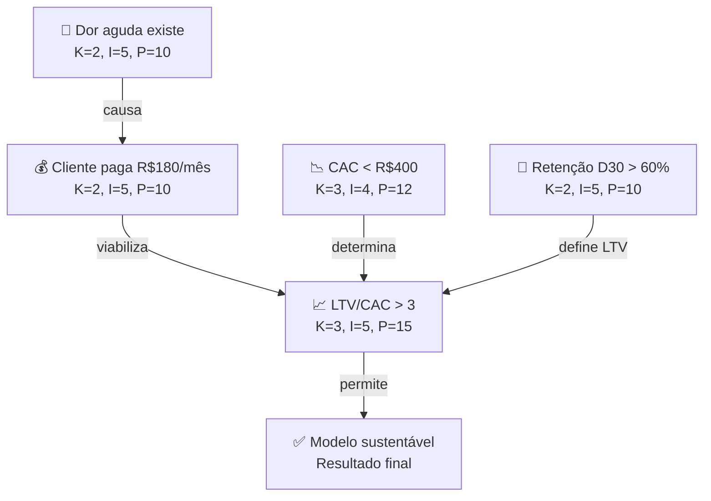

#### Quando usar

Use a Theory Map na Fase 2B (construção da teoria do negócio) como artefato central — antes de qualquer experimento ou desenvolvimento de produto. A árvore construída na Fase 2B é o mapa que orienta todas as fases seguintes: cada hipótese da Fase 6 testa um nó ou seta da árvore; cada experimento da Fase 7 coleta evidência sobre as premissas mais incertas e importantes. Revise a árvore após cada rodada de experimentos — evidência nova deve atualizar o grafo, não ser arquivada separadamente.

#### Princípios

Três princípios fundamentam o design:

**Primeiro: modelo de negócio é teoria causal, não conjunto de features.** Lean Canvas e BMC descrevem o modelo como conjunto de componentes (problema, solução, canais, receita). Theory Map descreve o modelo como rede de afirmações causais sobre o mundo. A diferença é crítica: um Canvas pode ser preenchido de forma internamente consistente sem que nenhuma das premissas seja verdadeira. Uma Theory Map que é internamente consistente mas tem nós K5 (pure assumption) é honesta sobre onde está o risco — e esses nós K5 com alta importância são exatamente o que os primeiros experimentos devem testar.

**Segundo: apostas implícitas são apostas não gerenciadas.** Todo fundador opera com uma teoria implícita do negócio — "acredito que X porque Y". A maioria nunca a externaliza. Theory Map força a externalização: cada bloco de Lean Canvas ou BMC vira um nó com premissas explícitas. O processo de construção frequentemente revela premissas que o fundador assumia serem fato mas são K4-K5 (pouca ou nenhuma evidência). Essas premissas descobertas durante a construção da árvore são as bet-the-company hypotheses a testar primeiro.

**Terceiro: árvore viva bate árvore estática.** Theory Map não é documento de planejamento — é modelo vivo que deve ser atualizado à medida que evidência chega. Cada experimento da Fase 7 muda o K (conhecimento) de algum nó. Cada atualização de K muda a P (prioridade de teste) de outros nós. Time que mantém a árvore atualizada tem uma vantagem: sabe em tempo real quais premissas críticas ainda não foram testadas e qual é o estado atual da teoria.

#### Como aplicar

Sessão de 2-3 horas com o time fundador (2-4 pessoas). Facilitador recomendado para a primeira versão. Use o template do [[#APÊNDICE A — TEMPLATES PRONTOS PARA USO|Apêndice A (A.9)]] para conectar a árvore ao BMC existente, ou construa a árvore diretamente se ainda não houver BMC.

**Sequência:**

1. **Resultado final**: escreva no topo da árvore o resultado que torna o negócio viável ("empresa sustentável com LTV/CAC > 3" ou "mercado de R$ 50M endereçável com participação de 5% em 5 anos"). Um só nó no topo.
2. **Premissas de primeiro nível**: o que precisa ser verdade para o resultado final acontecer? Geralmente 3-5 premissas de alto nível (clientes têm a dor, clientes pagam, CAC viável, retenção suficiente, canal escalável).
3. **Decomposição**: para cada premissa de primeiro nível, quais premissas de segundo nível são necessárias? Repita até chegar em premissas testáveis empiricamente.
4. **Classificação**: para cada nó, atribua K (1-5) e I (1-5). Calcule P = K × I. Nós com P > 12 são prioridade imediata de teste.
5. **Identificação de apostas bet-the-company**: nós com I = 5 e K ≥ 4 são as premissas mais importantes com menos evidência — essas são as hipóteses que os primeiros experimentos devem atacar.
6. **Conexão com o BMC/Lean Canvas**: use o template A.9 para verificar que cada bloco do Canvas tem ao menos um nó correspondente na árvore, e que cada nó da árvore tem ao menos um bloco correspondente no Canvas. Inconsistências revelam: (a) canvas com blocos sem justificativa teórica (remova ou construa a teoria); (b) teoria com premissas sem elemento no canvas (modelo incompleto).

#### Exemplo brasileiro preenchido — Creditas, árvore de teoria inicial (2012)

Quando Sergio Furio fundou a Creditas (então BankFacil) em 2012, a teoria central era: brasileiros com imóvel ou veículo pagam juros altíssimos em crédito pessoal porque os bancos tradicionais não usam o ativo como garantia. Um modelo de crédito com garantia poderia oferecer taxas menores e ter unidade economics superiores. A Theory Map inicial simplificada:

| Nó | Premissa | K | I | P | Status |
|---|---|---|---|---|---|
| A | Brasileiros com imóvel pagam >50% a.a. em crédito pessoal | 1 | 5 | 5 | Fato verificável — dados Banco Central |
| B | Regulação permite crédito com garantia de imóvel por fintech | 4 | 5 | 20 | Incerto — exige análise jurídica |
| C | Clientes aceitam usar imóvel como garantia para taxa menor | 4 | 5 | 20 | Hipótese comportamental — exige teste |
| D | CAC via digital < CAC de banco tradicional | 3 | 4 | 12 | Suposição — exige teste de canal |
| E | Inadimplência em crédito com garantia < 3% | 3 | 5 | 15 | Dados históricos internacionais como proxy |
| F | LTV/CAC > 4 com modelo de garantia | 4 | 5 | 20 | Depende de B, C, D, E — só verificável após validar os anteriores |
| G | Empresa sustentável | — | — | — | Resultado final |

**Apostas bet-the-company identificadas:** B (regulação — P=20, bloqueante se falso), C (comportamento do cliente — P=20), E (inadimplência — P=15, crítico para unit economics). Note: A tem P=5 pois é fato verificável — não precisa de experimento, só de pesquisa documental (dados Banco Central).

**Decisões decorrentes:** (1) contratar advogado especializado em regulação antes de qualquer produto — valida B; (2) 50 entrevistas com donos de imóvel em 30 dias — valida C; (3) análise de dados históricos de crédito com garantia no Brasil — reduz incerteza de E.

**Insight do caso.** O nó B (regulação) foi a descoberta mais valiosa do exercício: no ambiente regulatório de 2012, crédito com garantia de imóvel por instituição não-bancária tinha restrições que exigiram estrutura jurídica específica (parceria com banco). Sem a Theory Map, essa premissa teria emergido apenas meses depois, após produto construído. Com a árvore, foi identificada como aposta de alto risco antes de qualquer investimento técnico. **A lição: o valor da Theory Map está nas premissas que você não sabia que estava fazendo. A construção da árvore produz surpresas — cada surpresa é um risco que você não estava gerenciando.**

#### Variações e extensões

- **Story Tree narrativa**: versão mais linear da Theory Map usada para comunicação — conta a teoria como "se A então B, se B então C" em formato de história causal. Útil em pitch e comunicação interna.
- **Causal Loop Diagram**: versão avançada que permite loops (A causa B que causa A) — mais complexa, útil em análise de sistemas mas requer facilitação especializada.
- **Assumption Map** (Bland & Osterwalder): versão 2×2 (importância × evidência) que prioriza assumptions para teste — estruturalmente similar à classificação K × I da Theory Map.

#### Quando NÃO usar

Em decisões puramente operacionais sem premissa nova a testar. Em times sem disciplina para manter a árvore atualizada — árvore desatualizada é pior que não ter árvore (induz falsa segurança). Em contextos onde a regulação ou o mercado muda tão rápido que qualquer teoria fica obsoleta em semanas — nesse caso, ciclos muito curtos de experimentos práticos são mais eficientes que planejamento teórico.

#### Conexão com outros canvases

A Theory Map **precede todos os outros canvases** — é o mapa que justifica por que o BMC (CZ.1), o Lean Canvas (CZ.2) e o VPC (CZ.3) têm os blocos que têm. **Alimenta o Hypothesis Canvas (CZ.14)**: cada nó ou seta K≥3+I≥4 da árvore vira hipótese prioritária. **Conecta ao Canvas da Cunha (CZ.15)**: a cunha de entrada de mercado é a operacionalização dos primeiros nós da árvore — qual segmento específico valida as premissas mais críticas com maior velocidade?

#### Leitura adicional

- Template completo preenchível: [[#APÊNDICE A — TEMPLATES PRONTOS PARA USO|Apêndice A, A.9]].
- *The Book of Why* (Judea Pearl & Dana Mackenzie, 2018) — fundação matemática de grafos causais.
- *The Startup Owner's Manual* (Steve Blank & Bob Dorf, 2012) — externalização de apostas como prática de discovery.

---

### CZ.17 — Capital Stack / Waterfall Canvas

#### Origem

O Waterfall Canvas não tem um autor único — emerge da prática de M&A e de VC como ferramenta para visualizar a distribuição de valor entre diferentes classes de acionistas em um evento de liquidez. Advogados e banqueiros usam modelos de waterfall em planilhas desde os anos 1990; a versão em canvas surgiu da necessidade de tornar esse cálculo compreensível para fundadores em negociações de term sheet e de saída.

#### O que é

Tela visual que mapeia como o valor total de um evento de liquidez (venda da empresa, IPO, secondary) é distribuído entre os diferentes detentores de participação, respeitando a hierarquia de liquidation preferences. Permite simular múltiplos cenários de exit price e visualizar quem recebe quanto em cada um.

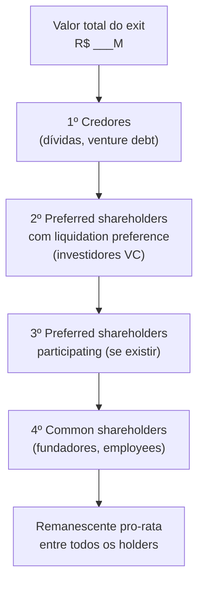

**Os seis campos do canvas:**

- **Cap table atual**: % de cada classe (common, preferred Série Seed, Série A, etc.) e número de ações
- **Liquidation preferences**: 1x, 2x ou participating — por classe e por investidor
- **Anti-dilution adjustments**: se houve down round, qual é o ajuste de preço de conversão
- **Option pool**: opções outorgadas, exercíveis, não-exercidas
- **Preço de exit simulado**: faixa de cenários (pessimista, base, otimista)
- **Distribuição resultante**: R$ por classe e por indivíduo em cada cenário

#### Quando usar

Use o Waterfall Canvas em três momentos: (1) **ao receber um term sheet** — para entender o impacto da liquidation preference proposta em diferentes cenários de exit; (2) **antes de iniciar processo de M&A** — para saber quanto cada sócio recebe em diferentes preços de oferta e identificar onde há conflito de interesse; (3) **ao converter SAFEs ou notas conversíveis** — para visualizar a diluição real e o impacto no cap table pós-conversão.

#### Princípios

**Primeiro: liquidation preference é o mecanismo mais importante que a maioria dos fundadores subestima.** Uma empresa vendida por R$ 50M com R$ 20M de preferred com 2x participating pode entregar menos de R$ 5M para o fundador que detém 30% do cap table. Sem o Waterfall Canvas, essa realidade só aparece no dia da assinatura.

**Segundo: simule sempre pelo menos três cenários.** Exit @ 1x capital investido (resultado fraco), @ 3x (resultado bom), @ 10x (resultado excepcional). O comportamento das liquidation preferences é radicalmente diferente nesses três pontos.

**Terceiro: o conflito de interesse entre fundadores e investidores é estrutural.** Investidores com preferred querem maximum protection; fundadores com common querem maximum upside. Modelar o waterfall revela onde os interesses divergem — antes da negociação, não durante.

#### Como aplicar

**Passo 1 — Montar o cap table completo:**

| Holder | Classe | # Ações | % Fully Diluted | Liq. Pref. | Valor Pref. |
|---|---|---|---|---|---|
| Fundador A | Common | 4.000.000 | 30% | — | — |
| Fundador B | Common | 3.000.000 | 22,5% | — | — |
| Fundo Seed | Preferred A | 2.000.000 | 15% | 1x non-participating | R$ 3M |
| Fundo Série A | Preferred B | 3.000.000 | 22,5% | 1x participating | R$ 12M |
| Option pool | Common | 1.500.000 | 11,25% | — | — |

**Passo 2 — Simular cenários de exit:**

Para cada preço de venda simulado, calcular na sequência:

1. Pagar liquidation preference de cada série preferred (ordem: mais recente primeiro, ou pari passu — checar o acordo de sócios)
2. Se preferred for participating: dividir o remanescente pro-rata entre todos
3. Se preferred for non-participating: comparar o resultado da preference com a conversão — o holder escolhe o maior
4. Distribuir o remanescente entre common shareholders pro-rata

**Exemplo simplificado — exit @ R$ 20M:**

```text
Exit: R$ 20M
Dívidas: zero
Preferred A (Seed): R$ 3M pref. 1x non-participating → recebe R$ 3M OU converte em 15%
Preferred B (Série A): R$ 12M pref. 1x participating → recebe R$ 12M + participa no restante
Remanescente após prefs: R$ 20M - R$ 3M - R$ 12M = R$ 5M
  Preferred A: decide converter → 15% de R$ 20M = R$ 3M → igual à preference → indiferente
  Preferred B (participating): 22,5% de R$ 5M = R$ 1,12M adicional
  Common (fundadores + pool): 62,5% de R$ 5M = R$ 3,12M

Distribuição total @ R$ 20M:
  Fundo Seed: R$ 3M (15%)
  Fundo Série A: R$ 12M + R$ 1,12M = R$ 13,12M (65,6%)
  Fundadores + pool: R$ 3,12M (15,6%)
  → Fundadores com 52,5% do cap table recebem 15,6% do exit
```

**Exit @ R$ 80M (mesmas condições):**

```text
Remanescente após prefs: R$ 80M - R$ 3M - R$ 12M = R$ 65M
  Preferred A: 15% de R$ 65M = R$ 9,75M → melhor converter (R$ 9,75M > R$ 3M preference)
  Preferred B: R$ 12M pref + 22,5% × R$ 65M = R$ 12M + R$ 14,6M = R$ 26,6M
  Common: 62,5% × R$ 65M = R$ 40,6M
  Fundadores (52,5% do common): ≈ R$ 33,8M
  → Exit mais alto = common shareholders recuperam participação real
```

#### Erros comuns

- Não modelar participating preferred separado de non-participating — a diferença é enorme em exits medianos.
- Calcular dilution apenas como % do cap table — a % não conta onde está o dinheiro.
- Ignorar o option pool não-exercido — em muitos acordos, opções não exercidas voltam para o common no momento do exit.
- Usar o cap table "de memória" em vez do documento legal atual — cap tables têm erros; use o documento oficial.

#### Quando NÃO usar

Em estágio pré-seed ou seed early sem investidores institucionais — sem preferred shares, o waterfall é trivial (pro-rata simples). Como decisão estratégica isolada — a ferramenta informa negociação, não substitui análise de mérito do investidor ou do deal. Como projeção de valor da empresa — o canvas mostra distribuição em cenário de exit, não estima o valor.

#### Conexão com outros canvases

O Waterfall Canvas **usa o cap table atual** (não é um canvas de modelo de negócio) e **alimenta diretamente a negociação de term sheet** (Apêndice V e Template A.33). É o único canvas deste apêndice de natureza financeira — os demais são estratégicos ou operacionais.

#### Leitura adicional

- Template A.33 (Term Sheet Anotado) — cláusulas de liquidation preference e anti-dilution.
- [[IGNICAO-Vol-4-Escala#APÊNDICE DA — MARCO LEGAL DAS STARTUPS: LC 182/2021|Apêndice DA (Vol. 4)]] — COCP como alternativa ao preferred.
- [[IGNICAO-Vol-4-Escala#APÊNDICE DB — STOCK OPTIONS E ESOP NO BRASIL|Apêndice DB (Vol. 4)]] — stock options e impacto no cap table.
- *Venture Deals* (Brad Feld & Jason Mendelson, 2019) — explicação definitiva de waterfall mechanics.

---

### CZ.18 — Network Effects Map

#### Origem

O mapeamento sistemático dos tipos de efeitos de rede foi popularizado pela NFX (firma de venture capital de San Francisco) a partir de 2018, quando publicaram a taxonomia dos 16 tipos de network effects como framework para investidores e founders avaliarem a defensibilidade de modelos de negócio. O trabalho de James Currier e Pete Flint na NFX codificou décadas de observação empírica — de Metcalfe (Ethernet, 1980) a Reed (grupos, 1999) — numa estrutura acionável para startups. O Network Effects Map adapta essa taxonomia para formato visual em canvas, com foco brasileiro.

#### O que é

Tela visual que mapeia quais tipos de efeitos de rede um modelo de negócio captura, com que força, e como eles interagem. O objetivo não é apenas identificar "tem efeito de rede" — é entender qual tipo, qual a força relativa, e onde está o loop de reforço que torna o modelo defensável.

**Os tipos principais de efeitos de rede (síntese da taxonomia NFX):**

| Tipo | Mecanismo | Exemplos | Força |
|---|---|---|---|
| **Direto** | Cada usuário adicional aumenta o valor para todos os outros | WhatsApp, telefone | ●●●●● |
| **Two-sided** | Dois grupos se beneficiam mutuamente (compradores/vendedores) | iFood, Mercado Livre | ●●●●○ |
| **Data** | Mais dados = produto melhor = mais usuários = mais dados | Google Search, Waze | ●●●●○ |
| **Tech Performance** | Mais uso = infraestrutura mais eficiente | CDNs, blockchain com proof-of-work | ●●●○○ |
| **Language** | Plataforma vira padrão de vocabulário/formato | Slack (canais), GitHub (pull request) | ●●●○○ |
| **Belief** | Valor existe porque todos acreditam (convenção social) | Bitcoin, moeda fiat | ●●●●● |
| **Bandwagon** | Pressão social para adotar o que "todo mundo usa" | TikTok, tendências virais | ●●●○○ |
| **Platform** | Desenvolvedores criam valor para usuários | iOS App Store, Salesforce AppExchange | ●●●●○ |

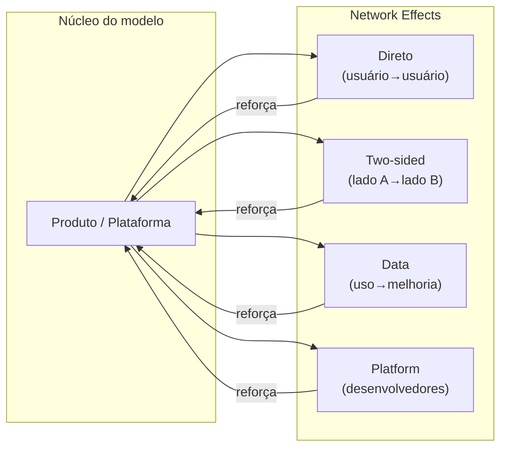

#### Quando usar

Use o Network Effects Map em dois momentos: (1) **ao desenhar o modelo de negócio** (Fase 2–5) — para identificar se e onde há loops de NE que podem ser construídos intencionalmente; (2) **ao preparar pitch de investimento** — investidores de VC avaliam defensibilidade, e NE são um dos principais mecanismos. Saber nomear e explicar o tipo de NE do seu modelo diferencia o fundador.

#### Princípios

**Primeiro: a maioria das startups não tem efeito de rede — tem economias de escala.** "Quanto mais clientes, mais barato o custo unitário" é escala, não NE. Efeito de rede requer que um usuário adicional torne o produto melhor para os outros. Confundir os dois é erro comum de pitch.

**Segundo: NE two-sided são os mais comuns e os mais frágeis no início.** Marketplace sem compradores não atrai vendedores, e vice-versa. O chicken-and-egg problem é o desafio central de modelos two-sided. A solução geralmente é subsidiar um lado temporariamente (iFood subsidiou entregadores; Mercado Livre não cobrou comissão dos primeiros vendedores).

**Terceiro: NE de dados são os mais subestimados.** Poucos fundadores percebem que o loop dados→modelo→produto→mais dados é um dos NE mais poderosos — e mais difíceis de copiar depois de certa escala.

#### Como aplicar

**Passo 1 — Listar todos os NE candidatos:** Para cada tipo na tabela acima, perguntar "nosso modelo tem isso?" e pontuar 0 (não tem), 1 (fraco / emergente) ou 2 (forte / comprovado).

**Passo 2 — Mapear os loops:** Para cada NE identificado com score ≥ 1, desenhar o loop de reforço: Produto → [mecanismo] → mais usuários/dados → produto melhor.

**Passo 3 — Identificar o NE dominante:** Qual é o loop mais forte? Qual é o que mais diferencia o modelo de um produto sem NE? Esse é o NE a comunicar para investidores e a proteger como moat.

**Passo 4 — Identificar onde o NE ainda não existe:** Quais tipos poderiam ser construídos com mudanças de produto? Um SaaS B2B sem NE pode criar NE de dados (analytics de benchmark) ou NE de plataforma (marketplace de integrações).

#### Exemplo brasileiro preenchido — iFood

| Tipo de NE | Score | Mecanismo |
|---|---|---|
| Two-sided (restaurante ↔ consumidor) | ●●●●● | Mais restaurantes = mais opções = mais pedidos = mais receita para restaurantes = mais restaurantes |
| Two-sided (consumidor ↔ entregador) | ●●●○○ | Mais pedidos = mais entregadores disponíveis = menor tempo de entrega = mais pedidos |
| Data | ●●●○○ | Histórico de pedidos alimenta personalização de feed e estimativa de tempo de entrega |
| Bandwagon | ●●○○○ | "Todo mundo pede pelo iFood" — pressão social para estar na plataforma |
| **NE dominante** | — | Two-sided restaurante↔consumidor: o loop mais forte e mais defensável |

**Insight do caso:** O NE mais forte do iFood não é o tecnológico (dados) — é o two-sided de distribuição (restaurante↔consumidor). Por isso, o moat principal é a cobertura geográfica de restaurantes — quem tem mais restaurantes em mais bairros vence a guerra de aquisição de consumidores. Isso explica por que iFood investiu agressivamente em onboarding de restaurantes mesmo com unit economics negativos no curto prazo.

#### Erros comuns

- Chamar escala de efeito de rede — confunde o time e o investidor.
- Ter NE two-sided fraco no início e não subsidiar o lado correto.
- Ignorar NE de dados enquanto constrói produto — os dados de hoje são o moat de amanhã.
- Subestimar o chicken-and-egg: lançar em muitas cidades ao mesmo tempo dilui o NE two-sided — melhor dominar uma cidade completamente antes de expandir.

#### Quando NÃO usar

Em modelos onde a defensibilidade não vem de rede (negócios verticais com regulação, IP forte, ou switching costs contratuais) — forçar análise de NE em modelo que não é de rede gera narrativa falsa em pitch. Em estágio muito inicial sem nenhum usuário — sem volume mínimo, o exercício é especulativo e os scores se tornam wishful thinking. Como substituto de unit economics — NE potencial não compensa unit economics ruins se o loop ainda não está em pé.

#### Conexão com outros canvases

O Network Effects Map **alimenta o Strategy Canvas (CZ.4)** — NE são uma das dimensões de competição onde a empresa pode criar distância; e **alimenta a Theory Map (CZ.16)** — o loop de NE é frequentemente uma das premissas centrais da teoria do negócio que precisa ser validada empiricamente (um NE que não se materializa é uma premissa falsa).

#### Leitura adicional

- NFX Bible (nfx.com/post/network-effects-bible) — taxonomia completa com 16 tipos e exemplos.
- *The Cold Start Problem* (Andrew Chen, 2021) — como iniciar redes quando o NE ainda não existe.
- *Platform Revolution* (Parker, Van Alstyne & Choudary, 2016) — NE em plataformas de dois lados.

---

### CZ.19 — Org Chart Evolution

#### Origem

O Org Chart Evolution não é canvas de um autor único — é síntese de observações empíricas de como as estruturas organizacionais de startups evoluem com o crescimento. O trabalho de Greiner (*Evolution and Revolution as Organizations Grow*, Harvard Business Review, 1972), de Brian Chesky (Airbnb) sobre recentralização em crise, e de Camille Fournier (*The Manager's Path*, 2017) sobre progressão técnica formam a base. O canvas foi desenvolvido como ferramenta diagnóstica para fundadores que precisam responder à pergunta "que estrutura organizacional corresponde ao meu estágio?"

#### O que é

Série de quatro diagramas que mostram como a estrutura da empresa deve evoluir em quatro estágios de crescimento, com os princípios de design organizacional subjacentes a cada transição.

**Os quatro estágios:**

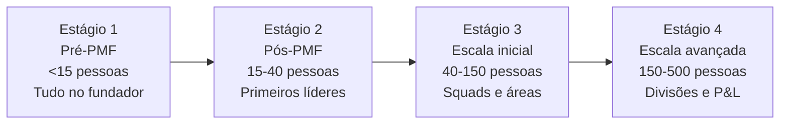

#### Estágio 1 — Pré-PMF (< 15 pessoas)

**Princípio:** Todos fazem tudo. O fundador é o CEO, o CPO, o head de vendas e às vezes ainda escreve código. Não há hierarquia — há comprometimento.

```mermaid
flowchart TD
    CEO["CEO/Fundador(es)"]
    CEO --> T1["Eng/Produto (1-3)"]
    CEO --> T2["Vendas/CS (1-2)"]
    CEO --> T3["Operações/Admin (1)"]
```

**O que não montar aqui:**

- VPs ou Heads antes de ter ~10 pessoas diretas para eles gerenciarem
- Comitês de decisão — o fundador decide, rápido
- Departamentos de RH, Jurídico, Financeiro próprios — terceirize

**Sinal de que é hora de passar para Estágio 2:** Fundador não consegue mais falar com cada pessoa da empresa toda semana.

#### Estágio 2 — Pós-PMF (15–40 pessoas)

**Princípio:** Contratar os primeiros líderes funcionais. Eles ainda executam — não são gestores puros. O fundador ainda decide tudo estratégico, mas libera espaço operacional.

```mermaid
flowchart TD
    CEO["CEO"]
    CEO --> VP1["Head of Product\nou CTO"]
    CEO --> VP2["Head of Sales\nou Head of Growth"]
    CEO --> VP3["Head of Ops\nou COO eventual"]
    VP1 --> E1["Eng 1"] & E2["Eng 2"] & E3["PM 1"]
    VP2 --> S1["AE 1"] & S2["AE 2"] & S3["CS 1"]
    VP3 --> O1["Ops 1"] & O2["Fin/Admin"]
```

**O que não montar aqui:**

- Mais de 3-4 reports diretos do CEO — limite cognitivo real
- Processo de performance review formal antes de 25 pessoas — overhead injustificado
- Departamentos separados de Marketing, Brand, PR — concentre em Growth/Revenue

**Sinal de que é hora de passar para Estágio 3:** Produto ou vendas têm mais de 8-10 pessoas e o head não consegue gerenciar diretamente + há conflito de prioridades entre áreas sem fórum de resolução.

#### Estágio 3 — Escala inicial (40–150 pessoas)

**Princípio:** Squads autônomos orientados a resultado. O fundador/CEO gerencia líderes, não output direto. Rituais formais de alinhamento (OKRs, weekly leadership, quarterly planning).

```mermaid
flowchart TD
    CEO["CEO"]
    CEO --> CPO["CPO"]
    CEO --> CTO["CTO"]
    CEO --> CRO["CRO / VP Sales"]
    CEO --> CFO["CFO"]
    CEO --> COO["COO / VP Ops"]
    CPO --> PM1["Squad: Onboarding"] & PM2["Squad: Core Product"] & PM3["Squad: Growth"]
    CTO --> EM1["Squad: Platform"] & EM2["Squad: Infra"] & EM3["Squad: Mobile"]
    CRO --> S1["AE Team"] & S2["CS Team"] & S3["Marketing"]
    CFO --> F1["Finance"] & F2["BI/Analytics"]
    COO --> O1["HR/People"] & O2["Legal"] & O3["Admin"]
```

**O que não montar aqui:**

- Mais de 5-6 reports diretos do CEO — atenção fica diluída
- Estrutura matricial complexa (funcional + por produto) — cria conflito de autoridade sem benefício
- P&L separado por produto — ainda cedo para accountability de margem por divisão

**Sinal de que é hora de passar para Estágio 4:** Mais de uma linha de produto / mercado com lógicas de go-to-market distintas, ou headcount acima de 150 com decisões cruzando mais de 3 camadas hierárquicas.

#### Estágio 4 — Escala avançada (150–500 pessoas)

**Princípio:** Divisões com P&L próprio. O CEO gerencia um "portfólio" de negócios, não um único produto. Cada divisão tem sua liderança completa. Governança corporativa formal (board, comitês, auditoria).

```mermaid
flowchart TD
    CEO["CEO"]
    CEO --> COO["COO\n(operações compartilhadas)"]
    CEO --> CFO["CFO"]
    CEO --> CHRO["CHRO"]
    CEO --> DIV1["GM: Divisão A\n(produto principal)"]
    CEO --> DIV2["GM: Divisão B\n(novo mercado)"]
    CEO --> DIV3["GM: Divisão C\n(enterprise)"]
    DIV1 --> D1["Product + Eng + Sales + CS"]
    DIV2 --> D2["Product + Eng + Sales + CS"]
    DIV3 --> D3["Product + Eng + Sales + CS"]
    COO --> SH["Shared: Infra, Legal,\nFinance, HR, IT"]
```

#### Armadilhas transversais

1. **Contratar sênior antes do time.** VP de Marketing sem time de marketing produz overhead e frustração. Contrate o líder quando já tem 3-5 pessoas para liderar.
2. **Reorganizar em crise.** Reorg consome 3-6 meses de energia. Se a empresa está em crise, reorg piora antes de melhorar. Resolva o problema, depois reorganize.
3. **Copiar estrutura de empresa maior.** Spotify Model, Amazon Two-Pizza Teams — são para outra escala. Em 30 pessoas, tribe e squad são burocracia vazia.
4. **Manter estrutura de Estágio 1 na Fase de Escala.** Fundador que ainda gerencia 15 ICs diretamente a 50 pessoas é gargalo — não liderança.

#### Conexão com outros canvases

O Org Chart Evolution **complementa o Team Canvas (CZ.8)** — o Team Canvas define propósito e valores do time atual; o Org Chart Evolution define a estrutura que o time assume conforme cresce. **Alimenta o Apêndice J** (organizações em escala) e as [[IGNICAO-Vol-4-Escala#FASE 13 — ESTRUTURAÇÃO JURÍDICA, FINANCEIRA E OPERACIONAL|Fase 13 (Vol. 4)]] e [[IGNICAO-Vol-4-Escala#FASE 14 — ESCALA: TIME, OPERAÇÕES, CRESCIMENTO E CAPITAL|Fase 14 (Vol. 4)]].

#### Leitura adicional

- *The Manager's Path* (Camille Fournier, 2017) — progressão de carreira técnica e estruturas de eng.
- *High Output Management* (Andy Grove, 1983) — gestão por output, não por atividade.
- [[IGNICAO-Vol-3-Tracao#APÊNDICE J — FRAMEWORK DE CANAIS DE AQUISIÇÃO|Apêndice J — Organizações em escala: de 20 a 500 pessoas (Vol. 3)]].

---

### CZ.20 — Wardley Map

#### Origem

Simon Wardley desenvolveu o Wardley Mapping entre 2005 e 2007 enquanto era CEO da Fotango (subsidiária da Canon). Frustrado com a incapacidade de ferramentas estratégicas existentes (SWOT, Porter, BCG Matrix) de capturar a dinâmica de evolução tecnológica, Wardley criou um sistema de mapeamento que combina posicionamento de componentes com seu estágio evolutivo. O primeiro paper foi publicado em 2008; o livro *Wardley Maps* foi disponibilizado gratuitamente em 2020. A ferramenta é amplamente usada em engenharia de plataforma, estratégia de produto e tomada de decisão de build/buy/partner.

#### O que é

Mapa bidimensional onde o eixo X representa o estágio evolutivo de um componente (da esquerda — genesis/custom, para a direita — commodity/utility) e o eixo Y representa a visibilidade para o usuário (de cima — mais visível, para baixo — infraestrutura invisível). Os componentes são conectados por linhas de dependência, criando uma cadeia de valor visível.

```mermaid
flowchart TB
    subgraph WM["Wardley Map — eixos"]
        direction LR
        subgraph Y["↑ Visível para o usuário"]
            U["Usuário / Cliente"]
        end
        subgraph Meio["Componentes de valor"]
            A["Componente A\n(Custom — Genesis)"]
            B["Componente B\n(Produto)"]
            C["Componente C\n(Commodity)"]
        end
        subgraph Base["↓ Infraestrutura"]
            I["Componente D\n(Utility)"]
        end
        U --> A
        A --> B
        B --> C
        C --> I
    end
```

**Os quatro estágios evolutivos:**

| Estágio | Característica | Exemplos |
|---|---|---|
| **Genesis** | Novo, incerto, experimental. Vantagem competitiva se funcionar. | LLMs em 2020, blockchain em 2015 |
| **Custom Built** | Feito sob medida para cada usuário. Caro, difícil de escalar. | Engenharia de dados customizada, algoritmos proprietários |
| **Product** | Produto definido, repetível, com variações. Mercado existe. | SaaS B2B, frameworks de ML |
| **Commodity/Utility** | Padrão de mercado, intercambiável, comprado por preço. | Cloud computing, email, pagamentos |

#### Quando usar

Use o Wardley Map em dois contextos: (1) **decisão de build vs. buy vs. partner** — para cada componente da stack, o estágio evolutivo indica a estratégia correta: construir no Genesis/Custom (diferenciação), comprar/licenciar no Product (time-to-market), usar commodity/utility (sem fricção); (2) **planejamento de plataforma** — para visualizar quais componentes vão se tornar commodity e onde a vantagem competitiva vai se deslocar nos próximos 3-5 anos.

#### Princípios

**Primeiro: tudo evolui da esquerda para a direita.** Um componente que é Genesis hoje (LLMs em 2023) se torna Commodity mais rápido do que parece (LLM-as-a-service via API em 2025). Estratégia baseada em componentes que estão evoluindo para commodity é estratégia baseada em areia movediça.

**Segundo: construa no Genesis, compre no Product, use utilities.** Investir em construir internamente algo que já é commodity é desperdício de capital e talento. O mapa torna essa decisão visual — e discutível.

**Terceiro: a vantagem competitiva está nos componentes à esquerda que seus concorrentes ainda não têm.** Mas atenção: componente Genesis é arriscado porque pode não evoluir para Product, pode demorar mais do que o planejado, ou pode ser ultrapassado por nova abordagem.

#### Como aplicar

**Passo 1 — Identificar o usuário e suas necessidades:** O que o usuário precisa? (ex: "pagamento de fornecedores aprovado em < 1 hora")

**Passo 2 — Mapear a cadeia de valor:** Quais componentes entregam essa necessidade? Decomponha recursivamente: necessidade → componentes de produto → componentes de tecnologia → infraestrutura.

**Passo 3 — Posicionar cada componente no eixo X:** Para cada componente, determinar se é Genesis, Custom, Product ou Commodity no mercado atual.

**Passo 4 — Identificar movimentos estratégicos:**

- Componentes Custom/Genesis onde há diferenciação: proteger e investir
- Componentes Product que concorrentes têm e você não: acelerar adoção
- Componentes que estão evoluindo para Commodity: parar de construir internamente, migrar para solução de mercado
- Gaps na cadeia de valor: onde há componentes ausentes que impedem a entrega?

**Passo 5 — Simular o mapa em 3 anos:** Como cada componente vai ter evoluído? Onde vai surgir nova diferenciação?

#### Exemplo brasileiro — Startup de crédito (simplificado)

| Componente | Estágio atual | Estratégia |
|---|---|---|
| Modelo de crédito proprietário | Custom → Product | Construir internamente — diferenciação |
| Análise de dados alternativos (redes sociais, telecom) | Genesis → Custom | Investir — moat potencial |
| Engine de decisão de crédito (regras) | Product → Commodity | Avaliar plataformas de mercado (Experian, Serasa APIs) |
| Infraestrutura de open banking | Commodity | Usar APIs do Banco Central — não construir |
| Antifraude | Product | Licenciar (Konduto, Sift) — não construir |
| App mobile | Product | Construir UX própria; usar componentes de produto para funcionalidades não-diferenciadoras |

**Insight:** A startup gasta engenharia em antifraude (Product → Commodity) quando deveria gastar em dados alternativos (Genesis → Custom). O Wardley Map torna essa má alocação visível — e debatível com o board.

#### Erros comuns

- Mapear tudo como "nós construímos" por orgulho técnico — não há vantagem em reinventar commodity.
- Confundir "é importante" com "deve ser Genesis" — um componente pode ser crítico e ser commodity.
- Fazer o mapa uma vez e nunca atualizar — o eixo X muda ao longo do tempo; o mapa envelhece.
- Usar o Wardley Map para decisões táticas — é ferramenta estratégica, de horizonte 1-3 anos, não de sprint.

#### Quando NÃO usar

Em decisões táticas de sprint ou trimestre — o eixo evolutivo opera em janela de 1-3 anos. Em produtos sem cadeia de valor técnica significativa (negócios de serviço puramente humano, marketplace de oferta tradicional). Em fase pré-PMF, quando os componentes da cadeia de valor ainda não estão estabilizados — o mapa fica especulativo e pode anchorar decisões em premissas que serão substituídas.

#### Conexão com outros canvases

O Wardley Map **complementa o Strategy Canvas (CZ.4)** — o Strategy Canvas mostra onde competir em dimensões do mercado; o Wardley Map mostra como a tecnologia e os componentes evoluem. **Alimenta decisões de make/buy/partner no Apêndice CC** (Plataforma vs. Produto) e no [[IGNICAO-Vol-4-Escala#APÊNDICE CR — ENGINEERING MANAGEMENT: GESTÃO DO TIME TÉCNICO E DEVELOPER EXPERIENCE|Apêndice CR — Engineering Management (Vol. 4)]].

#### Leitura adicional

- *Wardley Maps* (Simon Wardley, 2020) — disponível gratuitamente em medium.com/@swardley.
- *Team Topologies* (Skelton & Pais, 2019) — estrutura organizacional alinhada à topologia do sistema.
- [[IGNICAO-Vol-2-Validacao#APÊNDICE CC — PLATAFORMA VS PRODUTO: QUANDO CONSTRUIR PLATAFORMA E QUANDO NÃO|Apêndice CC — Plataforma vs. Produto (Vol. 2)]].
- Ferramenta online: onlinewardleymaps.com

---

## APÊNDICE A — TEMPLATES PRONTOS PARA USO

> [!note] Como usar
> Esse apêndice reúne todos os templates operacionais (modelos prontos para usar) referenciados ao longo do livro. Cada template tem indicação da fase ou apêndice de origem. Copie, adapte ao seu contexto e preencha. Templates são ponto de partida, não camisa-de-força. Se o formato não funcionar para o seu negócio, modifique-o. O que importa é o raciocínio que o template força, não a forma exata.


> [!important] Família discovery (descoberta) — A.2, A.27, A.28, A.29 e A.30
> Cinco dos templates deste apêndice formam um conjunto coerente de artefatos de discovery (descoberta de cliente), cada um para um tipo distinto de conversa. Confundi-los é o erro clássico que o IGNIÇÃO denuncia: tratar opinião de especialista como evidência de cliente, ou conselho de advisor (conselheiro) como dado de mercado. Use o template certo para o tipo certo. A tabela e a regra de ouro abaixo guiam a escolha.

| Template | Use quando… | NÃO use quando… |
|---|---|---|
| **A.2 — Entrevista de Problema** | Está validando se um problema existe, com que frequência, e quão doloroso é, na vida de um cliente potencial. [[IGNICAO-Vol-2-Validacao#FASE 3 — DESCOBERTA DO PROBLEMA|Fase 3 (Vol. 2)]]. | Já tem produto e quer validar solução. Está buscando opinião de quem não sofre o problema. |
| **A.27 — Entrevista com Especialista de Mercado** | Quer mapear setor, dinâmicas competitivas, pontos cegos, tendências regulatórias. A pessoa conhece o mercado — não necessariamente é cliente dele. | Quer saber se *o cliente* tem dor. Especialista opina; cliente prova com comportamento. |
| **A.28 — Entrevista com Advisor** | Tem decisão específica em cima da mesa e quer conselho tático/estratégico de alguém com experiência relevante. | Ainda está explorando. Advisor é para refinar decisão, não para descobrir o problema. |
| **A.29 — Entrevista com Switcher (JTBD)** | A pessoa **trocou** de solução (deixou um concorrente, largou um processo manual, migrou de ferramenta). Foco no momento da troca, com as 4 forças de Moesta. | A pessoa nunca trocou de nada — não há "switch" para investigar. Use A.2. |
| **A.30 — Síntese de Rodada de Entrevistas** | Rodou 15-30 entrevistas e precisa sintetizar o agregado para decidir avanço de fase: perseverar, pivotar problema, pivotar cliente ou abandonar. | Ainda está no meio da coleta. Consolidar cedo vicia a análise — espere a rodada fechar. |

**Regra de ouro.** Apenas A.2 e A.29 geram evidência de comportamento de cliente. A.27 e A.28 informam como construir, não se há mercado. A.30 é quem decide avanço de fase — nenhuma entrevista individual decide sozinha.

### A.1 Declaração Inicial da Ideia (Fase 2)

**Para que serve.** Captura a ideia inicial em formato auditável com problema, cliente, solução, modelo, hipóteses e incertezas categorizadas, antes de qualquer construção.

**Quando usar.** Ao concluir a Fase 2 e antes de entrar em descoberta de problema (Fase 3). Refaça também sempre que pivotar em qualquer um dos sete blocos, marcando nova versão.

**Exemplo de preenchimento.** Problema, "donos de restaurante de bairro perdem 3-6h por semana conciliando taxas de iFood, Iiood e cartão". Para quem, "operações independentes com 1 a 3 unidades, faturamento R$80k-R$300k/mês". Alternativa atual, "planilha manual com extratos baixados um a um". Solução, "concilia automático via integração com adquirentes e marketplaces". Modelo, "assinatura R$199/mês por unidade". Por que pode funcionar, "dono prefere pagar a contratar mais um auxiliar administrativo".

A DII tem sete blocos de conteúdo mais a lista de incertezas categorizada. Cabe em uma página (400 a 800 palavras). Em ideias B2B, o bloco "Para quem" tem sub-estrutura com Decisor Econômico e Champion separados.

```text
DECLARAÇÃO INICIAL DA IDEIA
Versão: ___ | Data: ___

1. PROBLEMA (3-5 frases, ancoradas em dados quando possível, sem mencionar sua solução)
___________________________________________
___________________________________________
Dados/referências (opcional, recomendado em B2B-enterprise):
- _______________________________________
- _______________________________________

2. PARA QUEM
2a. Quem é (filtros objetivos: setor, tamanho, frequência, momento)
___________________________________________
2b. Quem NÃO é (anti-perfil — descarta na primeira chamada e por quê)
___________________________________________
[Se B2B, preencha 2c e 2d]
2c. Decisor Econômico (papel que aprova orçamento + pergunta de qualificação em 1 frase)
___________________________________________
2d. Champion (papel que opera o produto e vende internamente + pergunta de qualificação em 1 frase)
___________________________________________

3. ALTERNATIVA ATUAL (como o cliente resolve hoje — planilha, processo manual, concorrente, ignorar)
___________________________________________

4. SOLUÇÃO PROPOSTA (capacidades, não features)
___________________________________________

5. MODELO DE NEGÓCIOS (quem paga, quanto, como, contra o que compete)
- Modelo: [assinatura | transacional | performance | work-as-a-service | ...]
- Preço-rascunho: ___________________________
- Gatilho de pagamento: ______________________
- Compete contra: [não compete com software, compete com custo de analista interno; não compete com X, compete com Y]

6. POR QUE PODE FUNCIONAR (3-5 hipóteses sobre o mundo, formato testável "[Persona] [verbo] [objeto]")
1) _______________________________________
2) _______________________________________
3) _______________________________________

7. POR QUE NÓS (Founder-Market Fit em 1-2 frases — vantagem injusta concreta, não adjetivos)
___________________________________________

8. O QUE EU NÃO SEI (10-25 incertezas em 6 categorias; nenhuma categoria vazia)
Demanda (cliente percebe o problema como prioridade?):
- _______________________________________
Mercado (orçamento existe? Onde está alocado? Como o mercado se comporta?):
- _______________________________________
Solução (a forma proposta resolve? É a forma certa?):
- _______________________________________
Adoção (o cliente vai mudar de comportamento para usar?):
- _______________________________________
Canal (como o cliente descobre? Onde está acessível?):
- _______________________________________
Modelo (pricing percebido como justo? ROI defensável internamente?):
- _______________________________________
```

### A.2 Entrevista de Problema (Fase 3)

> [!important] Disciplina central
> Nesta entrevista você **não fala da sua solução**. Você escuta. No momento em que apresenta a ideia, o entrevistado reage à ideia em vez de descrever a realidade dele — e você perde a evidência limpa.

Este template tem duas partes. A **Parte A** é o roteiro para consultar *durante* a conversa (deixe aberto na tela ou imprima). A **Parte B** é a síntese para preencher *depois* — idealmente nas 24h seguintes, enquanto a memória está fresca. As duas formam um único artefato: roteiro sem síntese vira entrevista perdida; síntese sem roteiro vira interpretação livre. Use as duas em todas as entrevistas da rodada.

#### Parte A — Roteiro da Entrevista (uso durante a conversa)

**Duração alvo:** 30-45 min · **Balanço de fala:** o entrevistado fala a maior parte do tempo. Se você se pegar falando mais que ele em qualquer trecho de 5 minutos, volte a fazer perguntas abertas.

**Abertura (2 min)**

> "Oi, obrigado pelo tempo. Antes de começar: não estou aqui pra te vender nada. Estou pesquisando como [público-alvo] lidam com [área ampla], porque quero entender se existe um problema real antes de construir qualquer coisa. Vou fazer perguntas abertas, sem respostas certas. Posso gravar pra transcrever depois? A gravação fica privada."

**Contexto (5 min)**

- Me conta um pouco sobre o que você faz no dia a dia.
- Quanto tempo você está nesse papel / nessa empresa?
- Quem mais na sua rotina está envolvido em [área ampla]?

**Exploração (10 min) — *ainda sem falar da sua solução***

- Me descreve como funciona a rotina quando [atividade relacionada ao problema].
- Quais são as partes mais chatas dessa rotina?
- Me conta a última vez que algo deu errado nisso.

**Aprofundamento por problema mencionado (10-15 min)**

Para cada problema que a pessoa citar espontaneamente:

- Me fala mais sobre isso.
- Quando foi a última vez que aconteceu?
- O que você fez?
- Quanto tempo / dinheiro isso custou?
- O que acontece se você simplesmente **não** resolver? *(mapeia escalação)*

**Tentativas de solução (5 min)**

- O que você já tentou pra resolver?
- Funcionou? Por que parou ou continua usando?
- **Já gastou dinheiro (ferramenta, consultor, pessoa extra) pra resolver isso?**
- Quanto? Por quanto tempo?

**Encerramento (3 min)**

- Tem mais alguém que passa por isso e que eu poderia conversar?
- Posso voltar se surgirem mais perguntas?
- Topa ver um protótipo em 30-60 dias e dar sua opinião?

**NÃO PERGUNTAR (lista de proibições)**

- "Você pagaria R$X por isso?"
- "Se existisse Y, você usaria?"
- "Você acha que isso seria útil?"
- "Eu tive uma ideia, o que você acha?"
- "Você não acharia melhor se…?"
- Qualquer pergunta que comece com hipótese sua a ser validada pelo entrevistado.

#### Parte B — Síntese Pós-Entrevista

##### Metadados

| Campo | Valor |
|---|---|
| **ID** | `ENTR-[AAAA-MM-DD]-[##]` |
| **Data e hora** | `[DD/MM/AAAA — HH:MM]` |
| **Duração real** | `[min]` |
| **Formato** | `[ ] Remoto  [ ] Presencial` |
| **Gravação (com consentimento)** | `[link ou "não gravada"]` |
| **Transcrição** | `[link]` |
| **Entrevistador** | `[Nome]` |
| **Anotador (se houver)** | `[Nome]` |
| **Relação com a hipótese** | `[ID da hipótese em teste, se formal]` |

##### Perfil do Entrevistado e Aderência ao ICP

| Campo | Valor |
|---|---|
| **Nome** | `[...]` |
| **Papel / cargo** | `[...]` |
| **Empresa / contexto** | `[...]` |
| **Porte do negócio** | `[nº funcionários / faturamento / estágio — seja específico]` |
| **Localização** | `[cidade / estado / país]` |
| **Fonte do contato** | `[rede pessoal / LinkedIn / indicação / cold outreach]` |
| **Vínculo pessoal com o entrevistador?** | `[ ] Não  [ ] Sim` — *se sim: atenção a viés de cortesia nas respostas.* |
| **Aderente ao ICP hipotético?** | `[ ] Sim  [ ] Parcial  [ ] Não` |

> *Se "Não", a entrevista vale como aprendizado mas **não conta** para o denominador de validação (regra da [[IGNICAO-Vol-2-Validacao#FASE 3 — DESCOBERTA DO PROBLEMA|Fase 3 (Vol. 2)]]).*

##### 1. Contexto e rotina

> *Não pergunte sobre o problema ainda. Deixe a pessoa descrever o mundo dela. Pergunte sobre rotina, responsabilidades, ferramentas, periodicidade. Aqui você calibra o universo onde o problema vive.*

**Descrição geral.** `[Descreva em prosa o que a pessoa faz. Use as palavras dela. 3-5 linhas.]`

**Processo atual mapeado em fases.** *Se o problema investigado tem a forma de um processo ou workflow (recrutamento, compra, onboarding, fechamento, reconciliação, etc.), documente em fases numeradas. Isso ancora onde cada dor acontece — a mesma pessoa pode ter dor forte na Fase 2 e nenhuma na Fase 5. Sem esse mapa, você registra "dor em recrutamento" quando na verdade é "dor em triagem inicial", que é outro problema.*

- **Fase 1 — `[nome curto]`:** `[o que acontece, quem faz, com que ferramenta, quanto tempo leva]`
- **Fase 2 — `[nome curto]`:** `[...]`
- **Fase 3 — `[nome curto]`:** `[...]`
- **Fase 4 — `[nome curto]`:** `[...]`

*(adicione ou remova fases conforme o caso)*

**Ferramentas e stack atual.**

- `[ferramenta — para que usa]`
- `[...]`

##### 2. Problemas mencionados (o que foi dito — não o que você interpretou)

> *Para cada problema que emergiu na conversa, preencha um bloco. **Crítico:** documente apenas o que o entrevistado disse espontaneamente ou em resposta a pergunta aberta. Problemas que você "provocou" com pergunta tendenciosa valem zero.*

**Problema A — `[título curto, nas palavras do entrevistado se possível]`**

- **Descrição literal:** `[...]`
- **Era esperado ou inesperado?** `[ ] Esperado (ligado à hipótese em teste)  [ ] Inesperado (surgiu e não estávamos procurando — pode ser o ouro do discovery)`
- **Em qual fase do processo ocorre?** `[Fase 1 / Fase 2 / transversal / fora do processo mapeado]`
- **Menção foi espontânea ou provocada?** `[ ] Espontânea  [ ] Provocada por pergunta aberta  [ ] Provocada por pergunta tendenciosa (descartar)`
- **Frequência observável:** `[diária / semanal / mensal / esporádica]`
- **Última ocorrência (comportamento passado):** `[quando? o que aconteceu?]`
- **Custo atual (tempo / dinheiro / energia):** `[número ou descrição concreta]`
- **Emoção observada:** `[exemplo: frustração, resignação, vergonha, medo — use a palavra que cabe]`
- **Tentativas anteriores de resolver:** `[o que já tentou? funcionou? por que parou ou continuou?]`
- **Já gastou dinheiro para resolver?** `[ ] Não  [ ] Sim — quanto? em que? por quanto tempo?]` — *sinal operacional mais limpo de dor. Dinheiro já gasto > promessa de pagar.*
- **Escalação — o que piora se NÃO resolver?** `[perde cliente / perde contrato / multa / perde emprego / nada concreto]` — *separa urgência real de incômodo crônico.*

**Problema B — `[...]`** `[bloco com mesma estrutura do Problema A]`

**Problema C — `[...]`** `[bloco com mesma estrutura do Problema A]`

##### 3. Verbatim (citações literais)

> *Transcreva exatamente o que a pessoa falou, entre aspas. Mínimo 3 citações marcantes. Verbatim é ouro — serve de evidência em deck interno, no pitch, no roadmap.*

1. > *"[citação literal]"* — sobre `[Problema A]`
2. > *"[citação literal]"* — sobre `[Problema B]`
3. > *"[citação literal]"* — sobre `[tema]`
4. > *"[citação literal]"* — sobre `[tema]`

##### 4. Vocabulário do cliente

> *Anote as palavras e expressões **exatas** que a pessoa usou para descrever o problema, a rotina e as soluções atuais. Não parafraseie. Esse vocabulário vai direto para o marketing, para a landing page e para o roteiro de vendas depois — se você usa a linguagem do cliente, ele se reconhece; se você usa a sua, ele ignora.*

| Como a pessoa chama | Contexto em que usou |
|---|---|
| `[palavra / expressão exata]` | `[o que ela estava descrevendo]` |
| `[...]` | `[...]` |
| `[...]` | `[...]` |

**Termos que ela *não* usou e que nós estávamos prontos a usar:** `[...]` — *se a pessoa não usa a nossa palavra, provavelmente estamos falando a linguagem errada.*

##### 5. Hierarquia de sinais coletados

> *Classifique a evidência desta entrevista pelo tipo de sinal. **Esta tabela é o filtro central do Mom Test:** só os três primeiros tipos movem decisão — os três últimos enganam.*

| Sinal | Peso | O que veio nesta entrevista? |
|---|---|---|
| **Comportamento passado** ("semana passada gastei 4h nisso") | Alto | `[...]` |
| **Tentativas anteriores de solução** ("usei X, Y e Z, nada resolveu") | Alto | `[...]` |
| **Métricas de custo** (tempo, dinheiro, energia já gastos) | Alto | `[...]` |
| **Ideias soltas** ("seria legal se tivesse X") | Baixo-médio | `[...]` |
| **Hipóteses futuras** ("eu pagaria por isso") | Baixo | `[...]` — *não usar para decisão* |
| **Elogios** ("que ideia legal!") | Zero | `[...]` — *descartar* |

##### 6. Classificação de Pain Level

> *Atribua **um único nível** ao entrevistado. Padrão de Pain Level 4+ em volume (tipicamente ≥5 entrevistas) é o que move a tese; uma entrevista isolada em nível 3 não descarta a investigação, só ainda não confirma.*

- [ ] **Nível 1** — Tem o problema, mas não sabe que tem.
- [ ] **Nível 2** — Sabe que tem, mas tolera. Não vai pagar sozinho.
- [ ] **Nível 3** — Está ativamente procurando solução. Lead quente.
- [ ] **Nível 4** — Já improvisou gambiarra (planilha Frankenstein, processo manual, ferramenta adaptada). Forte evidência de que pagaria.
- [ ] **Nível 5** — Tem orçamento comprometido ou facilmente acessível para comprar solução. Cliente ideal.

> *Nível 5 se verifica por **sinal indireto**, nunca por pergunta direta sobre disposição a pagar (que é armadilha e está na lista de proibições da Parte A). Pistas válidas: a pessoa mencionou espontaneamente valor já gasto, contratação de alguém para resolver, mensalidade paga em ferramenta análoga, verba carimbada no orçamento do ano.*

**Justificativa da classificação:** `[1-2 linhas com a evidência direta — não interpretação — que sustenta a nota.]`

##### 7. Observações do entrevistador

> *Separadas dos fatos. Use itálico. Aqui entram sua leitura da linguagem corporal, tom, nível de energia e suspeitas. Fatos acima; interpretação aqui.*

*`[...]`*

*`[...]`*

##### 8. Armadilhas — autoavaliação pós-entrevista

> *Esta seção verifica se as proibições da Parte A foram respeitadas. Marque honestamente o que aconteceu.*

- [ ] Cheguei a apresentar minha solução em algum momento? — *se sim, dados após esse ponto devem ser lidos com ceticismo.*
- [ ] Fiz pergunta tendenciosa tipo "você não acharia melhor se…"?
- [ ] Fiz pergunta hipotética sobre o futuro ("você usaria X?", "pagaria Y?")?
- [ ] Em algum trecho de 5 min, falei mais que o entrevistado?
- [ ] Filtrei o que ouvi para confirmar tese que eu já tinha?
- [ ] Tratei uma fala apaixonada como equivalente a um padrão de 10 entrevistas?

> *Cada marca acima contamina parte da evidência. Anote **quais achados ficam sob suspeita** em função dessas contaminações:* `[...]`

##### 9. Refinamento do ICP

> *ICP não muda a cada entrevista — muda quando padrão aparece em 5-10 conversas. Esta seção registra sinais individuais que, acumulados com os de outras entrevistas, podem mover o recorte. Exemplo: a hipótese original do iFood era "redes grandes"; entrevistas acumuladas refinaram para "restaurantes pequenos sem telemarketing".*

**Sub-segmento mais agudo observado nesta entrevista.** *Dentro do perfil entrevistado, o que parece correlacionado com sofrer mais? Porte? Setor? Senioridade? Estágio? Tempo no cargo? Stack? Volume? Anote o recorte que se destacou.*

`[Ex: "padarias com 3+ lojas sentem; com 1-2 não" — ou — "só operadores que fazem a reconciliação manualmente, não quem tem financeiro dedicado"]`

**Esta entrevista sugere algum refino de ICP?**

- [ ] **Estreitou** — ICP ficou mais específico. Novo recorte: `[...]`
- [ ] **Ampliou** — ICP precisa incluir um perfil que não tínhamos mapeado: `[...]`
- [ ] **Mudou de direção** — perfil entrevistado era hipótese, mas a dor real aparece em outro lugar: `[...]`
- [ ] **Confirmou** — ICP atual permanece. Esta entrevista não muda o recorte.

##### 10. Indicações (snowball)

- **Outras pessoas que passam por isso e que podemos conversar:** `[nome — contato — por que foi indicado]`
- **Posso voltar para nova conversa?** `[ ] Sim  [ ] Não`
- **Topa ver um protótipo em 30-60 dias?** `[ ] Sim  [ ] Não`

##### 11. Decisão pós-entrevista individual

> *Uma única entrevista não decide nada — mas cada entrevista move a agulha. Marque para onde ela moveu.*

- [ ] **Reforça** a hipótese de problema em teste
- [ ] **Enfraquece** a hipótese
- [ ] **Ambígua** — precisa de mais dados
- [ ] **Falso positivo identificado** (pessoa disse que tem o problema mas o comportamento refuta)

**Justificativa (2-3 linhas):** `[...]`

##### 12. Próximos passos de investigação

> *Distintos de "ações internas de produto". Aqui registramos **perguntas novas que esta entrevista gerou** e que informam a próxima entrevista, uma pesquisa desk, ou um dado a buscar externamente. É o espírito iterativo do discovery: cada conversa afina a próxima.*

**Perguntas a incluir em próximas entrevistas.**

- `[...]`
- `[...]`

**Dados a buscar externamente (pesquisa desk, benchmark, números de mercado).**

- `[...]`
- `[...]`

**Perfis diferentes a entrevistar para cruzar padrões.** *"Esta dor é padrão no setor ou é específica desta empresa? Preciso falar com alguém de porte X ou região Y para comparar."*

- `[...]`

##### Anexos

- Gravação: `[link]`
- Transcrição: `[link]`
- Artefatos compartilhados pelo entrevistado (prints, planilhas): `[link]`
- Entrevistas relacionadas: `[ENTR-..., ENTR-...]`

*Preenchido por `[Nome]` em `[DD/MM/AAAA]`.*

> [!tip] Consolidação da rodada
> Cada entrevista preenchida pela Parte B é uma linha do agregado. A decisão de avanço de fase não sai daqui — sai do **A.30 (Síntese de Rodada de Entrevistas)**, que cruza Pain Level, padrões, workarounds e vocabulário das 15-30 entrevistas para decidir perseverar, pivotar problema, pivotar cliente ou abandonar.

### A.3 Banco de Hipóteses — modelo de planilha (Fase 6)

**Para que serve.** Centraliza todas as hipóteses do negócio em uma única planilha com tipo, critério de validação, método, custo e status, evitando que aprendizados se percam em conversas e documentos espalhados.

**Quando usar.** Ao iniciar a Fase 6 (priorização). Mantenha viva ao longo de toda a jornada até PMF, atualizando status sempre que um experimento for executado e adicionando hipóteses novas conforme descobertas.

**Exemplo de preenchimento.** Linha H03, tipo "Adoção", hipótese "operadores de loja farão login no app pelo menos 3x por semana", porquê importa "se falso, o produto vira shelfware mesmo com compra do dono", critério "≥60% dos usuários ativos D7 nas primeiras 4 semanas", método "piloto com 5 lojas medindo eventos de login", custo "R$2.000 + 6 semanas", status "Em teste".

| ID | Tipo | Hipótese | Porquê importa | Critério validação | Método | Custo | Status | Resultado |
|----|------|----------|----------------|-------------------|--------|-------|--------|-----------|
| H01 | Problema | Donos de restaurante perdem ≥3h/semana com conciliação de frete | Se falso, o problema não é dolorido o suficiente | ≥60% dos 20 entrevistados menciona espontaneamente | Entrevistas de problema | R$0 + 3 semanas | Em teste |, |
| H02 | Monetização | ICP pagará ≥R$149/mês pela solução | Determina viabilidade do modelo | ≥15% conversão em landing page com oferta | Smoke test + pré-venda | R$1.500 + 3 semanas | Nova |, |

### A.4 Cartão de Experimento (Fase 7)

**Para que serve.** Documenta um experimento individual em uma página com hipótese, desenho, métrica, critério de sucesso pré-registrado e decisão, garantindo rigor de método e prevenindo racionalização posterior do resultado.

**Quando usar.** Antes de cada experimento da Fase 7. O preenchimento dos blocos "Critério de Sucesso", "Riscos e Vieses" e "Métrica Principal" deve ocorrer ANTES de ver qualquer dado, não depois. Preencha "Resultado", "Decisão" e "Aprendizados" no encerramento.

**Exemplo de preenchimento.** Hipótese testada, "ICP paga R$149/mês". Pergunta central, "quantos visitantes da landing finalizam compra no checkout antes do produto existir?". Desenho, "rodar Google Ads para 5 termos de cauda longa por 14 dias, medir conversão até cartão informado". Métrica principal, "taxa de conversão visita→cartão". Critério de sucesso, "validar se ≥10%, refutar se ≤3%, zona cinzenta entre 3% e 10%".

```text
EXPERIMENTO #___
Data planejada: ___ a ___

HIPÓTESE TESTADA
___________________________________________

PERGUNTA CENTRAL
___________________________________________

DESENHO (passo a passo)
1) _______________________________________
2) _______________________________________
3) _______________________________________

PÚBLICO
Quantidade: _____ Perfil: _____________
Como alcanço: ___________________________

MÉTRICA PRINCIPAL
___________________________________________

CRITÉRIO DE SUCESSO (antes de ver resultado)
Validar se: ________________________________
Refutar se: _______________________________

DURAÇÃO E CUSTO
Tempo: _____ dias Custo: R$ _____

RISCOS E VIESES
___________________________________________

RESULTADO (preencher depois)
___________________________________________

DECISÃO
 Persevere Ajuste Pivote Abandone

APRENDIZADOS
___________________________________________
```

### A.5 Persona com dados (Fase 4)

**Para que serve.** Sintetiza o ICP em um arquétipo único ancorado em evidência de entrevistas reais, com motivações, frustrações, JTBDs e citação verbatim, em vez de persona inventada de workshop.

**Quando usar.** Após executar 15 a 30 entrevistas de problema (A.2) e consolidar a rodada (A.30). Atualize sempre que descobrir um novo padrão de comportamento ou que o ICP for refinado por filtragem de anti-perfil.

**Exemplo de preenchimento.** Persona "Carla, gerente de operações". Contexto, "trabalha em rede de 12 farmácias regionais, responde direto ao dono". Motivações, "ser confiável, não deixar furo de estoque". Frustrações, "fechar inventário no fim do mês toma um sábado inteiro". Comportamento observado, "exporta planilha do ERP e refaz manual no Excel mesmo tendo módulo nativo". JTBD, "quando fecho o mês, quero conferir estoque sem refazer cálculo, para que eu não trabalhe no sábado". Citação, "eu não confio no sistema, então sempre faço de novo na mão".

```text
PERSONA: [nome fictício]

Contexto profissional/pessoal
___________________________________________

Perfil demográfico
___________________________________________

Motivações principais (do que se importa)
1) _______________________________________
2) _______________________________________

Frustrações principais
1) _______________________________________
2) _______________________________________

Comportamentos observados (não declarados)
1) _______________________________________
2) _______________________________________

Ferramentas/canais/fontes que usa
___________________________________________

JTBDs prioritários
1) Quando _____, eu quero _____, para que _____.
2) Quando _____, eu quero _____, para que _____.

Citação verbatim representativa
"___________________________________________"

Base de evidência: [quantas entrevistas, quais]
```

### A.6 Especificação de MVP (Fase 9)

**Para que serve.** Define o escopo mínimo viável com proposta de valor, persona foco, JTBDs, listas MoSCoW (must/should/could/won't), critérios de sucesso pós-90 dias e orçamento, prevenindo escopo inflado.

**Quando usar.** Ao concluir validação de problema e solução (Fases 3-7) e entrar em Fase 9 (construção). Refaça toda vez que o time quiser adicionar feature ao escopo. A regra é mover algo para "won't have" antes de adicionar novo "must".

**Exemplo de preenchimento.** Proposta de valor, "concilia repasses de marketplace em 5 minutos por mês". Persona foco, "Carla operações de farmácia, 5 a 15 unidades". Must haves, "import de extrato CSV, conciliação com regra de tolerância R$2, relatório por unidade". Won't haves, "integração API direta com adquirentes (fica para v2)". Critério pós-90 dias, "10 clientes pagantes, retenção D30 ≥80%, NPS ≥30".

```text
ESPECIFICAÇÃO DO MVP
Versão: ___ | Data: ___

PROPOSTA DE VALOR (uma frase)
___________________________________________

PERSONA FOCO (beachhead)
___________________________________________

JTBDs PRINCIPAIS A RESOLVER
1) _______________________________________
2) _______________________________________

MUST HAVES (máximo 15)
□ _______________________________________
□ _______________________________________
...

SHOULD HAVES (roadmap pós-MVP)
□ _______________________________________

COULD HAVES (se tempo permitir)
□ _______________________________________

WON'T HAVES (explicitamente fora)
× _______________________________________

CRITÉRIOS DE SUCESSO DO MVP (após 90 dias)
- Usuários ativos: _____
- Retenção D30: _____
- Conversão trial → pago: _____
- NPS mínimo: _____

FAIXA DE PREÇO PLANEJADA
R$ ____ a R$ ____

CANAIS DE AQUISIÇÃO INICIAIS
1) _______________________________________
2) _______________________________________

PRAZO DE DESENVOLVIMENTO
Início: ___ Lançamento: ___

ORÇAMENTO
R$ _____
```

### A.7 Árvore de Teoria — Story Tree (Fase 2B)

**Para que serve.** Estrutura a teoria do negócio como um conjunto de atributos com probabilidade subjetiva e relações causais entre eles, isolando explicitamente os 2 a 5 atributos bet-the-company que destruiriam a ideia se refutados.

**Quando usar.** Na Fase 2B, depois que a DII (A.1) está estável e antes de priorizar hipóteses (Fase 6). Refaça quando descobrir um atributo novo, ou quando a refutação de um atributo bet-the-company forçar redesenho da teoria.

**Exemplo de preenchimento.** Atributo A1 "operadores percebem conciliação como dor top 3", crença 70%. A2 "donos pagam para retirar dor de operadores", crença 40%. Relação A1→A2 confiança média, evidência "BG.16.x sobre transferência de dor entre persona-operador e persona-comprador". Bet-the-company, "A2 (se dono não paga, modelo morre)".

```text
ÁRVORE DE TEORIA, v___ Data: ___/___/___

PERGUNTAS-ÂNCORA:

(a) Qual problema ou fenômeno você está observando?
____________________________________________________________
____________________________________________________________

(b) Por que isso está acontecendo? (causas-raízes)
____________________________________________________________
____________________________________________________________

(c) O que você poderia fazer a respeito? (caminhos de solução)
____________________________________________________________
____________________________________________________________

ATRIBUTOS (elementos com realização incerta):

ID | Atributo | Crença sobre realização (0-100%)
----|-----------------------------------|-----------------------------------
A1 | |
A2 | |
A3 | |
A4 | |
A5 | |
A6 | |
A7 | |
A8 | |
...

RELAÇÕES CAUSAIS (A → B):

De | Para | Direção do efeito | Confiança (alta/média/baixa) | Evidência prévia
------|-------|-------------------|------------------------------|------------------
A1 | A2 | + ou - | |
A2 | A3 | + ou - | |
...

ATRIBUTOS BET-THE-COMPANY (2 a 5):

Marque os atributos cuja refutação destruiria a ideia inteira:
[ ] A___ Justificativa: __________________________________
[ ] A___ Justificativa: __________________________________
[ ] A___ Justificativa: __________________________________

TESTE DE PARCIMÔNIA:

Quais atributos eu posso remover sem perder poder explicativo?
Removidos nesta versão: _________________________________

TESTE DE ALTERNATIVA:

Teoria alternativa (explicação diferente para o mesmo fenômeno):
____________________________________________________________
Principais atributos diferentes: _________________________
Como saberei qual teoria é melhor: _______________________

VALIDAÇÃO EXTERNA:

Três pessoas que conseguiram repetir minha teoria com as próprias palavras:
1) _______________________ Data: ___
2) _______________________ Data: ___
3) _______________________ Data: ___
```

### A.8 Mapa Causal — DAG Simplificado (Fase 2B)

**Para que serve.** Representa a teoria como grafo acíclico dirigido, com probabilidades marginais nos nós e probabilidades condicionais nas arestas, permitindo calcular plausibilidade do caminho crítico até o outcome final (cliente paga, cliente adota).

**Quando usar.** Na Fase 2B, como passo seguinte ao Story Tree (A.7) quando a teoria já tem 6 a 10 atributos e o empreendedor precisa de visão mais formal das dependências. Útil também quando há disputa sobre qual atributo é o gargalo causal.

**Exemplo de preenchimento.** A "operador sente dor" P(A)=70%, A→B "operador reporta dor para dono" P(A→B)=50%, B "dono prioriza resolver" P(B|A)=35%, B→C "dono autoriza compra" P(B→C)=60%, C "cliente paga" P(C|B)=21%. Plausibilidade do caminho 70% × 50% × 60% = 21%, dentro do sweet spot 15-50% indicando teoria coerente mas frágil.

Use esta representação quando quiser uma visão mais precisa e probabilística da teoria. É o passo seguinte ao Story Tree, para empreendedores que já dominam o básico.

```text
MAPA CAUSAL, v___

Instruções:
1) Liste atributos em caixas.
2) Desenhe setas apenas em uma direção (sem ciclos).
3) Sobre cada seta, anote a probabilidade subjetiva de que a relação seja verdadeira.
4) Sobre cada nó, anote a probabilidade subjetiva de que aquele atributo se realize.

Representação textual (desenhe no papel ou ferramenta de diagrama):

 [Atributo A] P(A)=___%
 |
 | P(A→B)=___%
 v
 [Atributo B] P(B|A)=___%
 |
 | P(B→C)=___%
 v
 [Atributo C] P(C|B)=___% <-- bet-the-company

VERIFICAÇÃO:

[ ] Não há setas circulares (A→B→A).
[ ] Cada nó tem uma probabilidade marginal estimada.
[ ] Cada seta tem uma probabilidade condicional estimada.
[ ] Os nós bet-the-company estão destacados.
[ ] Existe ao menos uma folha terminal (nó sem saída) que representa o outcome final (ex.: "cliente paga", "cliente adota").

CÁLCULO DE PLAUSIBILIDADE GERAL (opcional):

Multiplicando as probabilidades ao longo do caminho crítico:
P(caminho) = P(A) × P(A→B) × P(B→C) ×... = ___%

Interpretação: se o resultado for <10%, sua ideia está assumindo
uma cadeia muito frágil. Se >70%, provavelmente você está otimista
demais. Sweet spot inicial: entre 15% e 50%.
```

### A.9 Theory Map — Conexão com Business Model Canvas (Fase 2B)

Use este template quando já preencheu um BMC ou Lean Canvas e precisa transformá-lo em teoria causal.

> [!note] Teoria completa em CZ.16
> Origem, estrutura, princípios, como aplicar e caso brasileiro do Theory Map / Story Tree encontram-se em [[#APÊNDICE CZ — CANVASES E MAPAS VISUAIS DE MODELO|CZ.16]]. Este template é o complemento prático (campos preencháveis) daquela seção.

```text
THEORY MAP, Conexão BMC ↔ Teoria v___

Para cada bloco do BMC, responda as três perguntas:

BLOCO: SEGMENTOS DE CLIENTES
(i) Quem exatamente? ____________________________________
(ii) Qual atributo da minha árvore este bloco representa? A___
(iii) Como se conecta causalmente com os outros blocos?
 Afeta: _____________________________________________
 É afetado por: _____________________________________

BLOCO: PROPOSTA DE VALOR
(i) Valor concreto oferecido? __________________________
(ii) Qual atributo? A___
(iii) Conexões causais:
 Afeta: _____________________________________________
 É afetado por: _____________________________________

BLOCO: CANAIS
(i) Quais canais? _______________________________________
(ii) Qual atributo? A___
(iii) Conexões causais:
 Afeta: _____________________________________________
 É afetado por: _____________________________________

BLOCO: RELACIONAMENTO COM CLIENTES
(i) Tipo de relação? ____________________________________
(ii) Qual atributo? A___
(iii) Conexões causais: ________________________________

BLOCO: FONTES DE RECEITA
(i) Como monetiza? ______________________________________
(ii) Qual atributo? A___
(iii) Conexões causais: ________________________________

BLOCO: RECURSOS-CHAVE
(i) O que é indispensável? ______________________________
(ii) Qual atributo? A___
(iii) Conexões causais: ________________________________

BLOCO: ATIVIDADES-CHAVE
(i) Quais ações? ________________________________________
(ii) Qual atributo? A___
(iii) Conexões causais: ________________________________

BLOCO: PARCEIROS-CHAVE
(i) Quem? _______________________________________________
(ii) Qual atributo? A___
(iii) Conexões causais: ________________________________

BLOCO: ESTRUTURA DE CUSTOS
(i) Principais custos? __________________________________
(ii) Qual atributo? A___
(iii) Conexões causais: ________________________________

DIAGNÓSTICO:

[ ] Existe algum bloco do BMC sem atributo correspondente na árvore?
 Se sim, o BMC tem um item sem justificativa teórica. Remova ou
 adicione à árvore.

[ ] Existe algum atributo da árvore sem bloco correspondente no BMC?
 Se sim, seu modelo de negócio está incompleto. Reabra o BMC.

[ ] Blocos do BMC que eu removi após este exercício:
 _______________________________________________________

[ ] Atributos da árvore que surgiram durante este exercício:
 _______________________________________________________
```

### A.10 Hypothesis Canvas (Fases 5 + 6)

Template central para conectar teoria, hipótese, evidência e avaliação. Use um canvas por hipótese prioritária. Preencha os blocos superior e médio **antes** de coletar dado, os blocos inferiores são preenchidos **após** a coleta, respeitando a ordem indicada.

> [!note] Teoria completa em CZ.14
> Origem, estrutura, princípios, como aplicar e caso brasileiro do Hypothesis Canvas encontram-se em [[#APÊNDICE CZ — CANVASES E MAPAS VISUAIS DE MODELO|CZ.14]]. Este template é o complemento prático (campos preencháveis) daquela seção.

```text
╔══════════════════════════════════════════════════════════╗
║ HYPOTHESIS CANVAS #___ ║
╠════════════════════════════╦═════════════════════════════╣
║ TEORIA ║ HIPÓTESE ║
║ Qual parte da sua árvore ║ Afirmação falsificável a ║
║ esta hipótese testa? ║ testar: ║
║ ║ ║
║ Atributo/seta: ___________ ║ ___________________________ ║
║ Importância (1-5): _______ ║ ___________________________ ║
║ É bet-the-company? S / N ║ ___________________________ ║
╠════════════════════════════╬═════════════════════════════╣
║ EVIDÊNCIA ║ MEDIDAS ║
║ Como vou coletar? ║ O que especificamente vou ║
║ [ ] Entrevista ║ contar? ║
║ [ ] Questionário ║ ║
║ [ ] Landing page ║ Pergunta/evento: __________ ║
║ [ ] Pré-venda ║ Respostas possíveis: ______ ║
║ [ ] Concierge ║ Fórmula da medida: ________ ║
║ [ ] Wizard of Oz ║ ___________________________ ║
║ [ ] A/B test ║ ║
║ [ ] Fake door ║ Medidas ALTERNATIVAS que eu ║
║ [ ] Outro: _______ ║ descartei e por quê: ______ ║
║ ║ ___________________________ ║
║ Público-alvo: ____________ ║ ║
║ Tamanho planejado: _______ ║ ║
║ Duração: _________________ ║ ║
║ Custo: R$ ________________ ║ ║
╠════════════════════════════╩═════════════════════════════╣
║ THRESHOLD (preencher ANTES de olhar os dados) ║
║ ║
║ Minha crença subjetiva Resultado mínimo para ║
║ sobre o valor real: considerar SUPORTADA: ║
║ ║
║ [ __________ ] [ __________ ] ║
║ ║
║ Resultado que considerarei REFUTADO: ║
║ [ __________ ] ║
║ ║
║ Zona INCONCLUSIVA (exige novo experimento): ║
║ entre [ ______ ] e [ ______ ] ║
║ ║
║ Justificativa do threshold: _____________________________ ║
║ __________________________________________________________ ║
╠════════════════════════════════════════════════════════════╣
║ DUE DILIGENCE DA AMOSTRA (antes de comparar com threshold)║
║ ║
║ Tamanho efetivo coletado: _____ ║
║ Adequado para o tipo de teste? [ ] Sim [ ] Não ║
║ ║
║ A amostra representa o ICP? [ ] Sim [ ] Parcial [ ] Não ║
║ Vieses identificados: ____________________________________║
║ ___________________________________________________________║
║ ║
║ AJUSTE DO THRESHOLD: ║
║ [ ] Mantido ║
║ [ ] Aumentado para ______ (amostra favorece a hipótese) ║
║ [ ] Diminuído para ______ (amostra desfavorece hipótese) ║
║ Justificativa do ajuste: ________________________________ ║
╠════════════════════════════╦═════════════════════════════╣
║ AVALIAÇÃO ║ DECISÃO ║
║ ║ ║
║ Resultado observado: ║ [ ] Perseverar ║
║ [ _____________ ] ║ [ ] Pivotar ║
║ ║ [ ] Mais dados ║
║ Vs. threshold ajustado: ║ [ ] Abandonar ║
║ [ ] SUPORTADA ║ ║
║ [ ] REFUTADA ║ Próxima ação concreta: ║
║ [ ] INCONCLUSIVA ║ __________________________ ║
║ ║ __________________________ ║
║ Explicação alternativa ║ ║
║ plausível? ______________ ║ Impacto na árvore de teoria:║
║ ________________________ ║ __________________________ ║
║ ║ __________________________ ║
╚════════════════════════════╩═════════════════════════════╝

Data de preenchimento inicial: ___/___/___
Data de conclusão: ___/___/___
Assinatura do empreendedor: _______________________________
```

**Observação sobre o Hypothesis Canvas**: o propósito dele é forçar o empreendedor a tornar visível cada passo do raciocínio. O canvas não é decorativo, se algum bloco estiver em branco quando o experimento começa, é porque esse passo não foi pensado. E um experimento iniciado com passos não pensados é um experimento que vai produzir conclusões erradas, mesmo se o resultado parecer claro.

### A.11 Teste de Precisão do Comprador (Fase 5)

Use este template para validar o elemento #4 da Anatomia da Cunha (Dono do Orçamento) antes de avançar para a [[IGNICAO-Vol-2-Validacao#FASE 6 — FORMULAÇÃO RIGOROSA DE HIPÓTESES|Fase 6 (Vol. 2)]]. É exercício de 10-15 minutos, se demora mais, o próprio atraso já é o diagnóstico.

```text
TESTE DE PRECISÃO DO COMPRADOR, v___ Data: ___/___/___

A FRASE QUE NÃO DEVE TRAVAR:

"Nós vendemos para [CARGO] em [TIPO DE EMPRESA] porque essa pessoa
é responsável por [RESULTADO ESPECÍFICO] e controla
[ORÇAMENTO ESPECÍFICO]."

MINHA VERSÃO:

CARGO (nominal, existente no organograma do cliente):
___________________________________________________________

TIPO DE EMPRESA (tamanho + setor + segmento):
___________________________________________________________

RESULTADO ESPECÍFICO (pelo qual esse cargo responde):
___________________________________________________________

ORÇAMENTO ESPECÍFICO (rubrica + faixa de valor):
___________________________________________________________

CRITÉRIOS DE APROVAÇÃO (3 checks obrigatórios):

[ ] (1) Frase escrita em menos de 30 segundos, sem rascunhar
 variações para audiências diferentes.

[ ] (2) Cargo é REAL e existente no organograma típico do ICP
 (não usar "decisor", "stakeholder", "gestor", "líder").

[ ] (3) Orçamento é RUBRICA EXISTENTE no cliente
 (não criar rubrica nova para comprar de você:
 rubricas novas triplicam o ciclo de decisão).

SE REPROVOU:

Qual item travou? __________________________________________

Hipótese sobre o motivo
(ex.: venda depende de múltiplos papéis, ICP ainda misturado,
comprador econômico não conhecido, produto exige nova rubrica):
___________________________________________________________
___________________________________________________________

Próxima ação
(voltar à Fase 4 com foco em qual pergunta específica?):
___________________________________________________________

CHECK DE SEPARAÇÃO DE PAPÉIS (B2B):

No meu contexto, Usuário, Campeão Interno e Comprador
Econômico são:

[ ] A mesma pessoa (contexto B2C ou SMB muito pequeno).
[ ] Duas pessoas distintas, especifique:
 Usuário/Campeão: ___________________________
 Comprador Econômico: ___________________________
[ ] Três pessoas distintas, especifique cada uma:
 Usuário: ___________________________
 Campeão Interno: ___________________________
 Comprador Econômico: ___________________________

VALIDAÇÃO EXTERNA:

Três pessoas independentes que conseguiram repetir a frase
sem ajuste e a consideraram plausível para o ICP:

1) _______________________ Data: ___/___/___
2) _______________________ Data: ___/___/___
3) _______________________ Data: ___/___/___
```

**Observação sobre o Teste de Precisão do Comprador**: reprovar neste teste raramente significa que sua ideia é ruim, significa que a pesquisa de usuário da [[IGNICAO-Vol-2-Validacao#FASE 4 — PESQUISA COM USUÁRIOS (CUSTOMER DISCOVERY APROFUNDADO)|Fase 4 (Vol. 2)]] ficou centrada em quem usa o produto e não em quem paga pelo produto. Em B2B, são quase sempre pessoas diferentes, e essa diferença é o motivo mais comum de ciclo de venda travado. Reprovação aqui é um presente: revela a lacuna antes dela custar meses de vendas fracassadas.

### A.12 Canvas da Cunha (Fase 5)

Use este template como entregável final da [[IGNICAO-Vol-2-Validacao#FASE 5 — MAPEAMENTO DE MERCADO E CONCORRÊNCIA|Fase 5 (Vol. 2)]].

> [!note] Teoria completa em CZ.15
> Origem, estrutura, princípios, como aplicar e caso brasileiro do Canvas da Cunha encontram-se em [[#APÊNDICE CZ — CANVASES E MAPAS VISUAIS DE MODELO|CZ.15]]. Este template é o complemento prático (campos preencháveis) daquela seção. Ele consolida os quatro elementos da Anatomia da Cunha, o Teste do Grupo de WhatsApp e a comparação com a alternativa atual. Preencha **antes** de avançar para a [[IGNICAO-Vol-2-Validacao#FASE 6 — FORMULAÇÃO RIGOROSA DE HIPÓTESES|Fase 6 (Vol. 2)]], sem ele, as hipóteses da fase seguinte não terão ancoragem no mercado específico que você escolheu atacar.

```text
CANVAS DA CUNHA, v___ Data: ___/___/___

ICP (preciso): _______________________________________
 _______________________________________

Dor específica: _______________________________________
(1 fluxo de trabalho) _______________________________________

Resultado mensurável: _____________________________________
(escolha 1-2 categorias: receita / custo / risco / tempo)
Métrica do resultado: _____________________________________
(ex.: "reduz de 4h para 15min por semana")

Dono do orçamento: _______________________________________
(cargo + nível hierárquico)

Teste do grupo de WhatsApp:
Quantas pessoas específicas eu consigo listar nominalmente
como potenciais primeiros clientes? _____
[ ] Cunha aprovada (100-300 pessoas listáveis).
[ ] Cunha muito larga (refinar).

Alternativa atual (o que o cliente faz hoje):
___________________________________________________________

Por que eu sou melhor do que a alternativa atual
(em 1 frase, com número se possível):
___________________________________________________________

VERIFICAÇÕES COMPLEMENTARES:

[ ] Teste de Precisão do Comprador (template A.11) aprovado.
[ ] Nenhum ou no máximo 1 dos 4 sinais de escopo instável presentes.
[ ] Distinção Cunha vs Plataforma compreendida, a ideia é vendável
 como cunha autônoma, sem depender de promessa de roadmap futuro.

VALIDAÇÃO EXTERNA:

Três pessoas independentes (mentor, cliente-alvo, investidor)
que confirmaram a Cunha como plausível e bem definida:

1) _______________________ Data: ___/___/___
2) _______________________ Data: ___/___/___
3) _______________________ Data: ___/___/___
```

**Observação sobre o Canvas da Cunha**: o canvas sozinho é um artefato morto se não passar pelos três testes acima (Precisão do Comprador, ausência de escopo instável, independência de plataforma). Cada um desses testes revela um tipo diferente de fragilidade oculta. Canvas preenchido + três testes aprovados = autorização para avançar à [[IGNICAO-Vol-2-Validacao#FASE 6 — FORMULAÇÃO RIGOROSA DE HIPÓTESES|Fase 6 (Vol. 2)]]. Canvas preenchido mas algum teste reprovado = refinar antes de avançar, não pular.

### A.20 Roteiro de Teste de Usabilidade (Fase 9)

**Para que serve.** Estruturar uma sessao de teste de usabilidade com usuario real, garantindo que voce observa comportamento e nao opiniao.

**Quando usar.** Quando voce tem prototipo navegavel ou MVP funcional e quer descobrir onde os usuarios travam. Tipicamente 5 a 8 sessoes individuais de 45 a 60 minutos.

**Exemplo de preenchimento.** Sessao para testar app de pagamentos B2B com PME do varejo.

```
ROTEIRO DE TESTE DE USABILIDADE
Versao: ___ | Data: ___ | Participante: ___

1. RAPPORT (5 minutos)
- Apresentacao do testador e do contexto da sessao
- Confirmacao de que a sessao sera gravada
- Esclarecimento, "estamos testando o produto, nao voce"

2. PERFIL E CONTEXTO (5 minutos)
- Que ferramentas a pessoa usa hoje para o problema X?
- Frequencia e contexto de uso

3. TAREFAS (30 minutos)
- Tarefa 1, [descrever cenario sem dar instrucao especifica]
- Tarefa 2, idem
- Tarefa 3, idem

Em cada tarefa, observar e nao explicar.

4. PROBES (5 minutos)
- "Voce mencionou que travou em X. Conte mais."
- "Se voce pudesse mudar uma coisa, qual seria?"

5. ENCERRAMENTO (5 minutos)
- Agradecimento
- Compensacao se houver
```

### A.21 Checklist de Pre-Launch (Fase 9-10)

**Para que serve.** Cobrir os 12 itens criticos de qualquer launch publico de produto MVP, evitando que voce descubra um buraco basico nos primeiros tres dias.

**Quando usar.** Uma a duas semanas antes do dia D do launch publico do MVP ou de feature significativa.

**Exemplo de preenchimento.** Lancamento publico do MVP de SaaS B2B contabil.

```
CHECKLIST DE PRE-LAUNCH
Data alvo: ___ | Responsavel: ___

PRODUTO
[ ] Cobertura de testes basicos (smoke tests passam)
[ ] Logs e monitoramento ativos (erro 500 dispara alerta)
[ ] Onboarding funcional ate primeiro valor entregue

CONTEUDO
[ ] Landing page no ar e testada em mobile
[ ] FAQ com top 10 duvidas antecipadas
[ ] Documentacao publica acessivel

ANALYTICS
[ ] Tracking de eventos-chave funcionando (signup, ativacao, retencao D1)
[ ] Funnel observavel em ferramenta (Mixpanel, Amplitude, GA)

SUPORTE
[ ] Canal de contato ativo (email, chat, ou ambos)
[ ] Pessoa de plantao para primeira semana

JURIDICO E COMPLIANCE
[ ] Termos de uso e politica de privacidade publicados
[ ] LGPD em conformidade

COMUNICACAO
[ ] Mensagem de launch escrita e revisada
[ ] Lista de pessoas-chave informadas em primeira mao
[ ] Plano de divulgacao para primeiro 7 dias
```

### A.22 Scorecard de PMF (Fase 11-12)

**Para que serve.** Sintetizar em uma pagina os indicadores que dizem se voce tem PMF, evitando autoengano comum de declarar PMF cedo demais.

**Quando usar.** Mensalmente apos lancamento publico, ate atingir todos os criterios. Reusar a cada quadrimestre apos PMF para confirmar que segue valido.

**Exemplo de preenchimento.** SaaS B2B com 80 clientes pagantes, 6 meses pos-launch.

```
SCORECARD DE PMF
Periodo: ___

1. SEAN ELLIS TEST
- Pergunta, "Como voce se sentiria se nao pudesse mais usar [produto]?"
- Total respondentes, ___
- "Muito decepcionado", ___ por cento
- Threshold, >= 40 por cento → forte sinal de PMF

2. RETENCAO
- Cohort retention week 4, ___ por cento (target setor: ___)
- Cohort retention month 3, ___ por cento
- Estavel ou melhorando ao longo de cohorts? sim/nao

3. CRESCIMENTO ORGANICO
- Crescimento semanal medio dos ultimos 8 weeks, ___ por cento
- Threshold YC, 5 a 7 por cento por semana sustentado

4. UNIT ECONOMICS BASICO
- LTV/CAC, ___ (target: > 3)
- Payback CAC, ___ meses (target: < 12 em SaaS, < 6 em B2C)

5. SINAIS QUALITATIVOS
- Numero de clientes que recomendaram organicamente, ___
- Receita de referrals como por cento do total, ___ por cento
- "Buchas" de clientes que ficariam zangados se cancelasse, ___

DIAGNOSTICO
[ ] Sinais matematicos batem (Sean Ellis + retencao + crescimento)
[ ] Unit economics em faixa saudavel
[ ] Sinais qualitativos confirmam ou contradizem?

DECISAO
[ ] PMF confirmado, escalar com cuidado
[ ] PMF ainda nao, qual lacuna especifica?
```

### A.19 Tabela de técnicas de validação por tipo de hipótese (Fases 2-9)

Esta tabela resume as técnicas de coleta de evidência mais usadas no manual, organizadas pelo tipo de hipótese que cada uma testa melhor. Inspirada na Tabela 1 de Coali et al. (2024), com ajustes para operadores brasileiros.

| Técnica | Descrição | Melhor para... | Amostra típica | Onde no manual |
|---|---|---|---|---|
| **Entrevistas 1-a-1** | Conversas estruturadas de 30-60 min com perguntas no estilo Mom Test | Desenvolvimento de teoria ([[IGNICAO-Vol-1-Ideacao#FASE 2B — CONSTRUÇÃO DA TEORIA DO NEGÓCIO|Fase 2B (Vol. 1)]]), validação de problema ([[IGNICAO-Vol-2-Validacao#FASE 3 — DESCOBERTA DO PROBLEMA|Fase 3 (Vol. 2)]]), mecanismos causais da dor ([[IGNICAO-Vol-2-Validacao#FASE 4 — PESQUISA COM USUÁRIOS (CUSTOMER DISCOVERY APROFUNDADO)|Fase 4 (Vol. 2)]]) | 15-30 entrevistados | [[IGNICAO-Vol-2-Validacao#FASE 3 — DESCOBERTA DO PROBLEMA|Fase 3 (Vol. 2)]]-3 |
| **Questionários (surveys)** | Série de perguntas fechadas em escala, distribuídas em grupos maiores | Validação de problema em escala, validação de atratividade de proposta | 100-500 respondentes | [[IGNICAO-Vol-2-Validacao#FASE 3 — DESCOBERTA DO PROBLEMA|Fase 3 (Vol. 2)]] late, 5-6 |
| **Landing page / smoke test** | Página descrevendo o produto antes dele existir, mede conversão de interesse | Validação de proposta de valor, teste de canal de aquisição, "fake door" | 500-5.000 visitantes | [[IGNICAO-Vol-2-Validacao#FASE 7 — EXPERIMENTOS DE VALIDAÇÃO DO PROBLEMA|Fase 7 (Vol. 2)]] |
| **Pré-venda** | Aceitar pagamento antecipado sem produto pronto | Teste máximo de Willingness to Pay, elimina viés de "eu pagaria" declarado | 10+ pagamentos reais | [[IGNICAO-Vol-2-Validacao#FASE 7 — EXPERIMENTOS DE VALIDAÇÃO DO PROBLEMA|Fase 7 (Vol. 2)]] |
| **Concierge / Wizard of Oz** | Entregar manualmente o valor que a solução automatizaria | Validar solução antes de build, aprender requisitos reais de uso | 3-10 clientes durante 4-8 semanas | [[IGNICAO-Vol-2-Validacao#FASE 8 — IDEAÇÃO E PROTOTIPAGEM DE SOLUÇÕES|Fase 8 (Vol. 2)]]-8 |
| **Protótipo interativo** | Versão clicável/funcional parcial submetida a uso real | Validação de fluxo de solução, identificação de pontos de atrito | 8-15 usuários qualitativo | [[IGNICAO-Vol-2-Validacao#FASE 8 — IDEAÇÃO E PROTOTIPAGEM DE SOLUÇÕES|Fase 8 (Vol. 2)]] |
| **MVP real** | Versão funcional mínima em produção com usuários pagantes | Validação de valor em uso prolongado, retenção, economics | 10+ usuários pagantes, 8-12 semanas | [[IGNICAO-Vol-3-Tracao#FASE 10 — MVP E EXPERIMENTOS DE MERCADO|Fase 10 (Vol. 3)]] |
| **Teste A/B** | Comparação experimental controlada entre 2+ versões | Comparação de features, proposta de valor ou pricing, identificação de causalidade | Centenas a milhares de exposições | [[IGNICAO-Vol-3-Tracao#FASE 10 — MVP E EXPERIMENTOS DE MERCADO|Fase 10 (Vol. 3)]], 13C |

**Regra de escolha rápida**: quanto menos evidência você tem sobre o problema, mais qualitativa deve ser a técnica (entrevistas > questionários > A/B test). Quanto mais avançada a validação, mais quantitativa (A/B test > questionário > entrevistas). Landing page, pré-venda e concierge ficam no meio, são qualitativas em amostra e quantitativas em conversão.

**Nota de tradução vocabular, Problem / Offer / Solution validation (Ries, 2011).** Quem vem da literatura do Lean Startup encontrará três tipos distintos de validação que este manual cobre mas não nomeia sempre de forma unificada. A correspondência é:

- **Problem validation** (o problema é real, agudo, no ICP certo?) = Fases 2, 3 e parte da 6.
- **Offer validation** (a proposta de valor é atrativa? o cliente quer comprar isso?) = [[IGNICAO-Vol-2-Validacao#FASE 7 — EXPERIMENTOS DE VALIDAÇÃO DO PROBLEMA|Fase 7 (Vol. 2)]] late, 7 e 8.
- **Solution validation** (a solução específica funciona, escala, tem economics?) = Fases 8, 9 e 10.

Essa distinção importa operacionalmente: falhar na **Problem validation** exige pivotar de ICP ou problema (volta à [[IGNICAO-Vol-2-Validacao#FASE 3 — DESCOBERTA DO PROBLEMA|Fase 3 (Vol. 2)]]). Falhar na **Offer validation** pode significar que o problema está certo mas a proposta de valor ou o preço estão errados (volta à [[IGNICAO-Vol-2-Validacao#FASE 6 — FORMULAÇÃO RIGOROSA DE HIPÓTESES|Fase 6 (Vol. 2)]] ou 7). Falhar na **Solution validation** sugere que o problema e a oferta estão ok, mas a execução da solução não, iterar dentro da [[IGNICAO-Vol-2-Validacao#FASE 9 — TESTES DE SOLUÇÃO E USABILIDADE|Fase 9 (Vol. 2)]]-9 costuma bastar. Saber qual das três está quebrando muda a decisão de pivot vs. iterate.

### A.13 Matriz de Parcerias

Documento único para gestão de pipeline de parcerias. Atualizar mensalmente. Teoria, critérios de qualificação e tipologia de parcerias em [[IGNICAO-Vol-4-Escala#APÊNDICE CX — CANAIS INDIRETOS E PARCERIAS: PARCERIAS, FRANQUIAS, CHANNEL|Apêndice CX (Vol. 4)]].

| # | Parceiro | Tipo (1-5) | Estágio | Métrica sucesso 90d | Sponsor do lado deles | Sponsor nosso | Próximo passo | Data próximo passo | Status |
|---|---|---|---|---|---|---|---|---|---|
| 1 | | | Prospecção / Discovery / POC / Contrato / Ativo / Encerrada | | | | | | Verde / Amarelo / Vermelho |

Preencher com 5-15 parcerias ativamente em movimento. Parcerias em "standby há 2+ trimestres" devem ser encerradas formalmente ou reativadas, não deixar zumbis.

### A.14 Plano de Financiamento Não-Diluitivo

Documento de 2-3 páginas, revisão semestral. Tipologia das fontes (Lei do Bem, Finep, BNDES, FAPESP, Venture Debt, RBF), critérios de elegibilidade e ordem de ataque em [[IGNICAO-Vol-4-Escala#APÊNDICE P — FINANCIAMENTO NÃO-DILUITIVO|Apêndice P (Vol. 4)]].

**Necessidade de caixa nos próximos 18 meses:**

- Cenário conservador: R$ _____
- Cenário realista: R$ _____
- Cenário pessimista: R$ _____

**Composição planejada:**

| Fonte | Valor (R$) | % do total | Janela | Status |
|---|---|---|---|---|
| Caixa atual | | |, | Ativo |
| Receita orgânica prevista | | | 18m |, |
| Incentivos fiscais (Lei do Bem etc.) | | | 12m | Planejado / Em análise |
| Grants/editais (Finep, BNDES, FAPESP) | | | 3-9m |, |
| Antecipação de recebíveis | | | Contínuo |, |
| Venture Debt | | |, |, |
| RBF | | |, |, |
| Equity (rodada) | | |, |, |
| **Total** | | 100% | | |

**Decisões-chave:**

- Qual o gap a cobrir, após receita orgânica?
- Qual a ordem de ataque (priorizar não-diluitivo antes de equity)?
- Quais covenants/condições são aceitáveis?
- Quais garantias corporativas ou pessoais estão na mesa?

**Próximos 90 dias:**

1. _____
2. _____
3. _____

### A.15 Plano de Marca e PR

Documento vivo de 4-6 páginas, revisão trimestral. Princípios de posicionamento de longo prazo, narrativa, calendário editorial e gestão de imprensa em [[IGNICAO-Vol-4-Escala#APÊNDICE CQ — MARCA, PR E POSICIONAMENTO DE LONGO PRAZO|Apêndice CQ (Vol. 4)]].

**Narrativa Oficial (uma página):**

- Para quem somos a primeira escolha, e por quê?
- Qual mudança no mundo justifica existirmos agora?
- Qual é a "inimiga declarada"?

**Cadência do fundador:**

- LinkedIn: [X posts/semana]
- Newsletter: [quinzenal/mensal, tamanho]
- Podcasts: [X por trimestre]

**Relações com imprensa:**

- Lista viva de 10-20 jornalistas-chave (nome, veículo, última interação, status relação)
- Press releases: calendário + critério de release

**Conteúdo institucional:**

- Blog: [X posts/mês]
- Recursos baixáveis: [X por ano]
- Estudos setoriais próprios: [cronograma]

**Eventos:**

- Que patrocinamos: [lista]
- Em quais falamos: [lista]
- Próprios: [cronograma]

**Métricas mensais:**

- Share of Voice: _____
- Branded Search: _____
- Direct Traffic: _____
- Cobertura editorial: _____
- Pipeline atribuído a marca/referência: _____
- NPS: _____

### A.16 Mapa de Modos — Founder Mode vs Manager Mode

Documento de 2 páginas, revisão semestral, compartilhado com C-level. Conceito de Founder Mode (Paul Graham, 2024), critérios de quando delegar e quando manter envolvimento direto em [[IGNICAO-Vol-4-Escala#APÊNDICE R — FOUNDER MODE, DELEGAÇÃO E QUANDO PARAR DE FAZER|Apêndice R (Vol. 4)]].

| Domínio | Modo atual (Founder / Manager / Híbrido) | Gatilho para mudar | Delegado atual | Revisitar em |
|---|---|---|---|---|
| Produto e roadmap | | | | |
| Engenharia | | | | |
| Design e UX | | | | |
| Vendas, top 10 contas | | | | |
| Vendas, base | | | | |
| Marketing de marca | | | | |
| Marketing performance | | | | |
| Finanças/captação | | | | |
| Jurídico | | | | |
| Operações | | | | |
| Pessoas/RH | | | | |
| Atendimento a cliente | | | | |
| Parcerias estratégicas | | | | |

**Teste de honestidade** (responder por escrito, para si mesmo):

- Em quais domínios estou em Founder Mode porque agrega valor diferencial, e em quais por vício de controle?
- Em quais estou em Manager Mode porque delega bem, e em quais por não querer dizer "não"?

**Mecanismos ativos de preservação de Founder Mode:**

- [ ] Skip-level 1:1s mensais?
- [ ] Office hours semanais?
- [ ] Cliente-tour mensal?
- [ ] Desafios rotativos trimestrais?

### A.17 Pitch Deck SCQA — Esqueleto

Documento Google Slides ou Keynote de 12-15 slides, estrutura sugerida. Princípios da estrutura SCQA (Situation, Complication, Question, Answer), critérios para cada slide e relacionamento com investidores em [[IGNICAO-Vol-4-Escala#APÊNDICE V — CAPTAÇÃO DE EQUITY, PITCH E RELACIONAMENTO COM INVESTIDORES|Apêndice V (Vol. 4)]].

**Slide 1, Capa**

- Nome da empresa + logo
- Tagline de 1 frase
- Data | Nome do fundador | Papel

**Slide 2, Tagline expandida (opcional)**

- Uma frase: "[Empresa] é [categoria] para [ICP] que faz [job] de forma [diferencial]."

**Slide 3, SITUAÇÃO (S do SCQA)**

- 3-5 dados do mercado atual
- TAM e crescimento
- Estrutura do mercado (fragmentação, concentração, comportamento)

**Slide 4, COMPLICAÇÃO (C do SCQA)**

- O problema específico que o mercado atual não resolve
- Quantificação (dor em R$, tempo, fricção)
- Uma quote de cliente real (opcional, mas forte)

**Slide 5, QUESTÃO (Q do SCQA)**

- Pergunta central que a situação + complicação levantam
- Janela de "por que agora"

**Slide 6, RESPOSTA / Produto (A do SCQA, início)**

- O que a empresa faz
- Screenshot real (não mockup)
- Mecanismo (como funciona), não lista de features

**Slide 7, Tração**

- ARR/MRR atual + crescimento MoM/YoY
- Número de clientes + churn mensal
- NPS ou outra métrica de satisfação
- Coortes de retenção (gráfico)

**Slide 8, Modelo de Negócio / Unit Economics**

- Ticket médio (ACV)
- Margem bruta
- LTV : CAC e payback
- Observação sobre como escalam

**Slide 9, Go-to-Market**

- Canais validados com % da aquisição
- CAC por canal
- Plano de expansão 12-18 meses

**Slide 10, Competição**

- Mapa competitivo (grid 2x2 ou tabela comparativa)
- Diferenciação em dimensão não-óbvia
- Moat estrutural

**Slide 11, Time**

- Fundadores (background relevante, 2-3 linhas cada)
- Contratações-chave recentes
- "Por que este time ganha" em 1 frase

**Slide 12, Projeção Financeira**

- 3-5 anos: receita, margem, burn, headcount
- Premissas por trás
- 3 cenários (pessimista, realista, otimista)

**Slide 13, Rodada**

- Valor captando e estágio (Seed / Série A / etc.)
- Uso de capital (% produto, time, marketing, etc.)
- Milestones que atingem com capital
- Cronograma para próxima rodada

**Slide 14, Contato / Ask**

- Próximos passos sugeridos
- Informações de contato
- O que estão buscando além de capital (conselheiros, intros, etc.)

**Slide 15, Apêndice (opcional)**

- Cap table detalhado
- Roadmap de produto
- Análise competitiva detalhada
- Casos de uso reais

---

### A.18 Investor Update Mensal — Template

E-mail mensal para todos os investidores. Enviar no mesmo dia de cada mês (ex.: sempre dia 5). Cadência completa de relacionamento com investidores, governança da rodada e regras de transparência em [[IGNICAO-Vol-4-Escala#APÊNDICE V — CAPTAÇÃO DE EQUITY, PITCH E RELACIONAMENTO COM INVESTIDORES|Apêndice V (Vol. 4)]].

```text
Assunto: [Empresa], Update [Mês/Ano]

Olá investidores,

**TL;DR:**
[2-3 frases sintetizando o mais importante do mês]

**MÉTRICAS-CHAVE**
- MRR/ARR: R$ X (crescimento Y% MoM)
- Clientes: N total (+X novos, -Y churn)
- Churn mensal: Z%
- Burn: R$ W / mês
- Runway: M meses
- North Star [métrica]: [número] (+X% MoM)

**DESTAQUES DO MÊS**
1. [Conquista operacional concreta]
2. [Movimento estratégico ou parceria]
3. [Contratação-chave ou perda relevante]
4. [Outro destaque, se houver]

**DESAFIOS**
1. [Problema honesto 1, o que está fazendo a respeito]
2. [Problema honesto 2, o que está fazendo a respeito]

**PEDIDOS DE AJUDA**
1. [Intro específica: "conhecem alguém em [empresa/função]?"]
2. [Candidato: "buscando [perfil] para [posição]"]
3. [Feedback: "queremos input sobre [decisão estratégica]"]

**PRÓXIMOS 30 DIAS**
1. [Objetivo mensurável 1]
2. [Objetivo mensurável 2]
3. [Objetivo mensurável 3]

Como sempre, estão à disposição para conversas.

Abraço,
[Nome]
CEO, [Empresa]
```

Regras:

- Enviar mesmo dia do mês, sempre.
- Mesmas métricas, todo update (não trocar sem contexto).
- Pedidos específicos, não "ajuda geral".
- Transparência em desafios, não maquiar.
- Manter formato consistente para leitura rápida.

---

## Templates preenchidos com casos brasileiros

Esta seção traz versões preenchidas de templates-chave do [[#APÊNDICE A — TEMPLATES PRONTOS PARA USO|Apêndice A]] com exemplos baseados em empresas brasileiras reais. Cada template em branco tem sua utilidade, mas aprendizado de verdade vem de ver a ferramenta aplicada a caso concreto, não abstratamente. Os casos abaixo são reconstruções aproximadas baseadas em informação pública, números e detalhes específicos foram simplificados para fins didáticos.

### A.23 Diagrama de Opportunity Solution Tree (Teresa Torres) — exemplo em SaaS brasileiro

```mermaid
graph TD
    A[Outcome: Aumentar retenção D30 de 45% para 60%] --> B1[Opportunity: Usuários não descobrem a feature core no primeiro dia]
    A --> B2[Opportunity: Onboarding focado em features, não em resultado]
    A --> B3[Opportunity: Falta de feedback positivo nas primeiras 72h de uso]

    B1 --> C1[Solução 1: Tour interativo no login]
    B1 --> C2[Solução 2: E-mail automático no D0 com link direto à feature]
    B1 --> C3[Solução 3: Pop-up contextual quando usuário está perdido]

    B2 --> C4[Solução 4: Redesenhar onboarding em torno de job-to-be-done]
    B2 --> C5[Solução 5: Case-study no onboarding com cliente similar]

    B3 --> C6[Solução 6: Notificação celebrando primeira ação completa]
    B3 --> C7[Solução 7: Follow-up humano da CS no D3]

    C1 --> D1{Experimento: A/B testing 2 semanas}
    C6 --> D2{Experimento: rollout 50/50 com medição}
```

**Uso:** o topo da árvore é o outcome desejado (métrica mensurável). Opportunities são hipóteses sobre o que, se resolvido, moveria o outcome. Solutions são experimentos específicos para cada opportunity. A disciplina é nunca pular direto de outcome para solution, sempre explicitar qual opportunity a solução tenta endereçar.

---

### A.24 Customer Journey Map em Mermaid — compra em e-commerce brasileiro

> [!note] Compatibilidade — tipo journey, renderiza com plugin Mermaid atualizado

```mermaid
journey
    title Jornada do Cliente, primeira compra em e-commerce B2C
    section Descoberta
      Vê anúncio no Instagram: 3: Cliente
      Clica no link, vê produto: 4: Cliente
      Pesquisa avaliações fora do site: 3: Cliente
    section Consideração
      Retorna ao site via retargeting: 4: Cliente
      Compara com concorrente: 2: Cliente
      Lê reviews de compradores: 5: Cliente
    section Decisão
      Adiciona ao carrinho: 5: Cliente
      Preenche cadastro: 2: Cliente
      Escolhe frete e pagamento: 3: Cliente
      Finaliza compra: 4: Cliente
    section Pós-compra
      Recebe e-mail de confirmação: 5: Cliente
      Aguarda entrega: 2: Cliente
      Produto chega: 5: Cliente
      Usa produto e avalia: 5: Cliente
```

**Uso:** mapas de jornada revelam pontos de fricção (notas baixas) que exigem investigação. Neste exemplo, "comparar com concorrente" e "preencher cadastro" são as friccções mais dolorosas, candidatas a otimização prioritária.

---

### A.25 Story Map exemplo — MVP de app de entrega regional

Horizontal (jornada): cliente *Descobre* → *Seleciona loja* → *Escolhe produtos* → *Paga* → *Acompanha* → *Recebe*

| Atividade | Essencial (Release 1) | Intermediário (Release 2) | Avançado (Release 3) |
|---|---|---|---|
| Descobre | Busca por CEP | Ordenação por distância | Recomendação personalizada |
| Seleciona loja | Lista com foto e nota média | Filtro por categoria | Favoritos e histórico |
| Escolhe produtos | Cardápio simples, uma foto por item | Variações (tamanho, sabor) | Personalização detalhada, combos |
| Paga | Cartão de crédito via gateway | PIX + carteira digital | Cashback, cupons, parcelamento |
| Acompanha | Status em texto (recebido, em preparo, saindo) | Mapa em tempo real | Chat com entregador |
| Recebe | Confirmação por SMS | Avaliação da entrega | Foto do produto na entrega |

**Insight:** Release 1 corta horizontalmente a jornada inteira, cliente consegue fazer todo o fluxo, mesmo que limitado. Release 1 é MVP de verdade. A tentação de começar por "release vertical" (construir todo o módulo de pagamento primeiro) é erro clássico: não entrega valor completo até o último release.

---

### A.26 Template de OKRs trimestral preenchido — scaleup brasileira em PMF

**Objetivo 1: Transformar retention em motor de crescimento sustentável**

- KR1: Aumentar retenção D30 de 45% para 58% (medido em cohort trimestral)
- KR2: Reduzir churn mensal de 8% para 5%
- KR3: Elevar NPS de 32 para 45

**Objetivo 2: Abrir canal de crescimento indirecto escalável**

- KR1: Fechar 3 parcerias estratégicas com volume mínimo de 500 usuários/mês cada
- KR2: Lançar programa de indicação com taxa de conversão >= 15%
- KR3: Atingir 30% de aquisição mensal via canais não-pagos (vs 12% atual)

**Objetivo 3: Profissionalizar operação de produto**

- KR1: Implementar descoberta contínua com 3 entrevistas de usuário por PM por semana
- KR2: Rodar 8 experimentos controlados (A/B) no trimestre com resultado decisivo
- KR3: Documentar roadmap priorizado usando RICE para todos os features de prioridade P0/P1

**Insight do exemplo:** OKRs boas são *mensuráveis* (números específicos), *desafiadoras* (se você atinge 100%, provavelmente foram fáceis demais, atingir 70% é sucesso), e *alinhadas* entre si (neste caso, retenção melhor viabiliza programa de indicação, ambos viabilizam canal sustentável). Três objetivos é o máximo recomendado por ciclo, mais que isso dilui foco.

---

### A.27 Entrevista com Especialista de Mercado (mapa de setor · Fases 3-5)

> [!important] Disciplina central
> Aqui você **quer opinião** — é legítimo. Mas opinião de especialista é hipótese a testar, não evidência de cliente. O erro é tratar "o especialista disse X" como validação. A especialista conhece o mercado; quem prova o mercado é o cliente com a carteira.

Use quando precisa mapear setor, dinâmicas competitivas, pontos cegos e tendências regulatórias — a pessoa conhece o mercado, não necessariamente é cliente dele. Não use para saber se *o cliente* tem dor; para isso o instrumento é A.2. Como o A.2, este template tem Parte A (roteiro durante) e Parte B (síntese pós-conversa, idealmente em 24h).

#### Parte A — Roteiro da Conversa (uso durante)

**Duração alvo:** 45-60 min · **Balanço de fala:** o especialista fala mais que você, mas aqui é legítimo intervir para confrontar e pedir exemplos específicos.

**Abertura (3 min)**

> "Obrigado pelo tempo. Estou pesquisando [setor/dinâmica] porque estou construindo uma tese sobre [resumo em uma frase]. Quero muito ouvir onde você acha que estou errado, quais sinais eu não estou vendo e que anti-cases você já viu. Posso gravar?"

**Calibração (5 min)**

- Há quanto tempo você está nesse setor?
- Em quais posições você viu a dinâmica de perto?
- O que mudou no setor nos últimos 3 anos?

**Mapa do setor (10 min)**

- Quem são os players relevantes hoje, e por que cada um ainda existe?
- Qual é a dinâmica competitiva dominante — preço, tecnologia, canal, rede, regulação?
- Que ciclos e sazonalidades afetam o setor?

**Confronto à nossa tese (15-20 min — seção mais valiosa).** *Esta é a seção mais importante. Se a pessoa só elogia, você perdeu a conversa.*

- Nossa hipótese é [X]. **Onde você acha que está mais fraca?**
- Que premissas dessa tese são não-triviais — o que teria que ser verdade pra ela funcionar?
- Você já viu alguém tentar algo parecido? O que aconteceu?
- Se isso fosse fácil, por que ninguém fez ainda?

**Especificidades de contexto (5 min)**

- Que particularidades regulatórias / tributárias / culturais do Brasil mudam essa tese?
- Como funciona o capital nesse setor no Brasil?

**Pontos cegos e redes (5 min)**

- O que eu ainda não perguntei e deveria?
- Outras pessoas com quem eu deveria conversar?
- Leituras / relatórios que você recomendaria?

**Encerramento (2 min)**

- Posso voltar com dúvidas?
- Topa receber o resumo do que aprendi em 48h?

**NÃO CONFUNDIR**

- Opinião informada ≠ dado de cliente. Anotar como opinião, não como validação.
- Elogio à tese é ruído — se não houve pushback, a conversa foi incompleta.
- "Eu sempre vi assim" ≠ "isso se aplica ao seu caso". Heurística do veterano precisa de fit específico.

#### Parte B — Síntese Pós-Conversa

##### Metadados

| Campo | Valor |
|---|---|
| **ID** | `ESP-[AAAA-MM-DD]-[##]` |
| **Data e hora** | `[DD/MM/AAAA]` |
| **Duração** | `[min]` |
| **Formato** | `[ ] Remoto  [ ] Presencial` |
| **Entrevistador(es)** | `[Nome]` |
| **Gravação / transcrição** | `[link]` |
| **Conflito de interesse?** | `[ ] Nenhum  [ ] Consultor pago  [ ] Investidor no setor  [ ] Trabalha em concorrente  [ ] Outro]` — *descrever* |

##### Perfil do Especialista

| Campo | Valor |
|---|---|
| **Nome** | `[...]` |
| **Posição atual / papel** | `[...]` |
| **Tempo na área** | `[...]` |
| **Credenciais relevantes** | `[empresas onde atuou, publicações, deals, etc.]` |
| **Recorte de expertise** | `[técnico / comercial / regulatório / financeiro / operacional]` |
| **Por que esta pessoa?** | `[1-2 linhas sobre a adequação dela à pergunta em aberto]` |

##### 1. Objetivo da conversa

**Qual hipótese de mercado estamos testando?** `[...]`

**O que precisamos sair sabendo?**

- `[...]`
- `[...]`
- `[...]`

**O que já presumíamos e queríamos ver se ela confirma ou refuta?**

- `[...]`
- `[...]`

##### 2. Mapa do setor (na visão dela)

**Players relevantes e como se posicionam.**

| Player | Posicionamento | Vantagens | Fraquezas |
|---|---|---|---|
| `[...]` | `[...]` | `[...]` | `[...]` |

**Dinâmica competitiva dominante hoje.** `[preço? tecnologia? canal? marca? rede? regulatório?]`

**Tendências relevantes (3-5 anos).**

- `[...]`
- `[...]`

**Ciclos e sazonalidades do setor.** `[...]`

##### 3. Onde o especialista acha que estamos errados

> *Esta é a seção mais valiosa. Pergunte explicitamente: "onde você acha que nossa tese está mais fraca?" Se a pessoa só elogia, você perdeu a conversa.*

- **Fragilidade apontada 1:** `[...]`
- **Fragilidade apontada 2:** `[...]`
- **Fragilidade apontada 3:** `[...]`

**Anti-cases mencionados (onde tese parecida já falhou).**

| Empresa / caso | O que tentou | Por que quebrou |
|---|---|---|
| `[...]` | `[...]` | `[...]` |

##### 4. "What would have to be true" para a nossa tese

> *Pergunta enquadradora útil em conversa com especialista: "para essa tese dar certo, o que teria que ser verdade sobre o mercado, cliente, regulação, tecnologia?"*

Premissas que a pessoa identificou como *críticas e não-triviais*:

1. `[premissa — e por que é não-trivial]`
2. `[...]`
3. `[...]`

##### 5. Especificidades contextuais (Brasil, setor, regulatório)

> *Especialistas brasileiros valem muito por capturar o que livro importado ignora: tributação real, ciclo de capital local, cultura de negócio, governo.*

- **Regulatório / tributário:** `[...]`
- **Canais dominantes no Brasil:** `[...]`
- **Dinâmica de capital / investidores relevantes:** `[...]`
- **Relação com governo / compras públicas (se aplicável):** `[...]`
- **Padrões culturais que afetam adoção:** `[...]`

##### 6. Hierarquia de sinais da conversa

> *Especialista mistura cinco tipos de afirmação em qualquer conversa — e elas **não têm o mesmo peso**. Classificar o que ouvimos força leitura crítica pós-conversa. Quanto mais alto na tabela, mais peso na decisão.*

| Tipo de sinal | Peso | O que veio nesta conversa? |
|---|---|---|
| **Dado verificável** (estatística, relatório, regulação, fonte pública nomeada) | Alto | `[...]` |
| **Caso pessoal vivido** (ela mesma operou, decidiu, observou de perto — com detalhe específico) | Alto | `[...]` |
| **Opinião informada** (tese construída com base em padrão repetido observado, mas sem dado formal) | Médio | `[...]` |
| **Intuição de veterano** ("tenho a sensação de que…", reconhecimento de padrão sem articulação clara) | Baixo-médio | `[...]` — *tratar como hipótese a testar* |
| **Heurística genérica** ("eu sempre acho que…", máxima aplicada sem fit específico ao nosso caso) | Baixo | `[...]` — *descartar para decisão* |

**Fatos verificáveis a checar depois.** *Listar aqui especificamente o que cai na primeira linha — porque tem que ir para a fila de verificação.*

| Afirmação | Fonte sugerida | Responsável | Prazo |
|---|---|---|---|
| `[...]` | `[link / órgão / relatório]` | `[Nome]` | `[DD/MM]` |

##### 7. Pontos cegos identificados

> *"Coisas que eu não sabia que não sabia." Catalogue aqui temas que só apareceram porque a pessoa levantou.*

- `[...]`
- `[...]`

##### 8. Vocabulário setorial

> *Especialistas dominam o jargão do setor. Capturar como a tribo realmente se expressa vale para marketing, pitch a investidor e conversa com próximo especialista.*

| Termo / expressão | O que significa na prática do setor |
|---|---|
| `[termo exato]` | `[...]` |
| `[...]` | `[...]` |

##### 9. Citações marcantes

> *Não com o mesmo peso da Entrevista de Problema, mas guardar frases bem articuladas do especialista ajuda a reutilizar em deck e memorando interno.*

1. > *"[citação]"*
2. > *"[citação]"*

##### 10. Armadilhas — autoavaliação pós-conversa

> *Marque honestamente o que aconteceu. Cada item contamina parte da evidência coletada.*

- [ ] Tratei elogio à tese como validação?
- [ ] Aceitei "eu sempre vi assim" sem pedir caso específico?
- [ ] Confundi opinião informada com dado verificável?
- [ ] Deixei passar contradição entre o que ela disse agora e o que disse antes?
- [ ] Não pedi pushback explícito — só ouvi concordância?
- [ ] Entrei na conversa sem tese clara a confrontar, e saí com "muitas perspectivas" em vez de direção?

**Achados sob suspeita em função dessas contaminações:** `[...]`

##### 11. Referências, leituras e redes

- **Livros / papers / relatórios indicados:** `[...]`
- **Outras pessoas que deveríamos conversar:** `[nome — por quê — se topa fazer intro]`
- **Eventos / comunidades relevantes:** `[...]`

##### 12. Ações internas pós-conversa

**Hipóteses que mudaram.**

- `[hipótese X — como mudou]`

**Hipóteses novas geradas.**

- `[...]`

**Outras ações.**

| Ação | Responsável | Prazo |
|---|---|---|
| `[...]` | `[Nome]` | `[DD/MM]` |

**Follow-up com a pessoa.**

- [ ] Agradecer e compartilhar resumo (dentro de 48h)
- [ ] Compartilhar material prometido: `[...]`
- [ ] Convidar para conversa futura em: `[gatilho / data]`
- [ ] Avaliar como advisor formal? `[ ] Sim  [ ] Não`

##### 13. Próximos passos de investigação

> *Perguntas novas que esta conversa gerou. Especialistas tipicamente abrem mais frentes do que fecham — registre as frentes abertas para não perder o fio.*

**Perguntas a explorar com outros especialistas.** `[...]`

**Dados a buscar externamente.** `[...]`

**Hipóteses de mercado a testar com cliente (entrevista de problema A.2).** `[...]`

*Preenchido por `[Nome]` em `[DD/MM/AAAA]`.*

---

### A.28 Entrevista com Advisor (decisão específica · tradeoffs)

> [!important] Disciplina central
> Advisor é para **refinar decisão que já está em cima da mesa**, não para descobrir o problema. Se você não consegue nomear a decisão em uma frase, você não está pronto para essa conversa — volte para A.2 (entrevista de problema) ou A.27 (especialista). Pareamento natural com o [[IGNICAO-Vol-1-Ideacao#APÊNDICE AL — REDE, MENTORES E ADVISORS — COMO CONSTRUIR O CAPITAL HUMANO DO EMPREENDEDOR|Apêndice AL (Vol. 1)]], que cobre como construir e formalizar a relação com advisors. Este template é o que se usa **dentro** da conversa, depois que o advisor já está no jogo.

#### Parte A — Roteiro da Conversa (uso durante)

**Duração alvo:** 60-90 min · **Balanço de fala:** advisor fala bastante, mas você conduz — prepare a pauta e volte a ela quando a conversa derivar.

**Abertura (3 min)**

> "Obrigado pelo tempo. A decisão que temos em cima da mesa é [frase única]. As opções são [A, B, C]. Meu objetivo nessa conversa é ouvir como você veria o problema, que contra-argumentos você enxerga, e que casos parecidos você já viu. Posso gravar para o time ouvir depois?"

**Contexto (5 min)**

- Apresentar em 3 minutos: onde estamos, a decisão, o que tentamos, o que já descartamos e por quê.
- Confirmar que a pessoa teve acesso ao material prévio, ou resumir o que ela não viu.

**Reenquadramento (10 min — antes de pedir recomendação).** *Frequentemente o valor do advisor está em reformular a pergunta, não em responder a que você trouxe.*

- Do jeito que eu descrevi, a decisão parece a decisão certa a tomar? Ou você formularia diferente?
- Que pergunta anterior a essa nós ainda não respondemos?

**Recomendação e raciocínio (15 min)**

- Qual é sua recomendação? (Forçar decisão binária: A, B ou C, não "depende".)
- Qual é a convicção — alta, média, baixa?
- Me leva pelo raciocínio — o que te fez chegar aí?

**Objeções e condições de reversão (10 min).** *Advisor bom lista o que pode dar errado com a própria recomendação. Se não ouviu objeção nenhuma, pergunte explicitamente.*

- Se você estivesse no nosso lugar, o que te faria mudar de ideia?
- Em que condições essa recomendação deixaria de valer?
- Já viu essa recomendação dar errado? Quando?

**Casos análogos (10 min)**

- Você já viu empresa parecida tomar decisão parecida? O que rolou?
- Onde o caso que você está citando **não** se aplica ao nosso?

**Riscos e pontos cegos (5 min)**

- Que riscos nós não estamos pesando?
- Que riscos você acha que estamos superdimensionando?

**Encerramento (3 min)**

- O que você faria nos próximos 30 dias se fosse nós?
- Topa reportar o resultado dessa decisão em [prazo]?

**NÃO FAZER**

- Pedir recomendação sem apresentar o problema com rigor — vira conversa de opinião genérica.
- Engolir a recomendação sem confronto — advisor não decide por você.
- Confundir "já vi isso" com "isso se aplica aqui".
- Tratar heurística pessoal ("eu sempre fiz X") como lei do setor.

#### Parte B — Síntese Pós-Conversa

##### Metadados

| Campo | Valor |
|---|---|
| **ID** | `ADV-[AAAA-MM-DD]-[##]` |
| **Data e hora** | `[DD/MM/AAAA]` |
| **Duração** | `[min]` |
| **Formato** | `[ ] Remoto  [ ] Presencial` |
| **Participantes internos** | `[Nome(s)]` |
| **Gravação / notas compartilhadas** | `[link]` |
| **Tipo de relação** | `[ ] Board member  [ ] Advisor formal com equity  [ ] Advisor informal  [ ] Consultor remunerado  [ ] Mentor pontual]` |
| **Remuneração / contrato** | `[equity %, fee, pro bono, etc.]` |
| **Conflitos de interesse conhecidos** | `[...]` |

##### Perfil do Advisor

| Campo | Valor |
|---|---|
| **Nome** | `[...]` |
| **Trajetória curta** | `[2-3 linhas sobre empresas, papéis, resultados relevantes]` |
| **Por que esta pessoa para esta decisão?** | `[fit específico — experiência prévia, rede, especialidade]` |
| **Já tomou decisão parecida?** | `[ ] Sim — detalhe  [ ] Análoga  [ ] Não, mas observou de perto]` |

##### 1. Decisão em pauta

**A decisão, em uma frase.** *Teste: se você não consegue enquadrar em uma frase com verbo claro, a conversa vai para todo lado. Volte e afie antes.*

`[Ex: "Devemos levantar Series A agora com US$ 8M em termos X, ou esperar 9 meses com mais tração?"]`

**Janela de decisão.**

- **Prazo que temos para decidir:** `[...]`
- **Custo de adiar:** `[...]`
- **Reversibilidade:** `[ ] Reversível  [ ] Parcialmente reversível  [ ] Irreversível]`

**Opções em cima da mesa.**

| Opção | Descrição curta | Quem defende internamente |
|---|---|---|
| A | `[...]` | `[...]` |
| B | `[...]` | `[...]` |
| C (status quo) | `[...]` | `[...]` |

##### 2. Contexto compartilhado antes da conversa

> *O advisor recebeu briefing? Leu material? Quanto viu dos números? Isso modula o peso da recomendação.*

- **Material enviado antes:** `[link ou descrição]`
- **Tempo de preparo da pessoa:** `[...]`
- **Lacunas que ficaram — o que ela não viu:** `[...]`

##### 3. Como o advisor reenquadrou o problema

> *Frequentemente o valor do advisor não está na resposta — está no reenquadramento. "Vocês estão fazendo a pergunta errada" vale mais do que "a resposta é B".*

**Ela viu a decisão diferente de como chegamos?** `[ ] Sim, de forma significativa  [ ] Sim, em aspecto pontual  [ ] Não, viu igual`

**Qual foi o reenquadramento? (se houve)** `[...]`

##### 4. Recomendação

**Recomendação principal (em uma frase).** `[...]`

**Convicção do advisor.** `[ ] Alta ("eu faria isso")  [ ] Média ("tendo a achar que…")  [ ] Baixa ("não tenho certeza, mas considere…")`

**Linha de raciocínio (principais porquês).**

1. `[...]`
2. `[...]`
3. `[...]`

##### 5. Objeções e contra-argumentos levantados

> *Advisor bom lista o que pode dar errado com a própria recomendação. Se você não ouviu objeção nenhuma, ou ela foi frouxa ou você não perguntou.*

- **Contra-argumento 1:** `[...]`
- **Contra-argumento 2:** `[...]`
- **Condições em que a recomendação mudaria:** `[...]`

##### 6. Tradeoffs destacados

| Tradeoff | O que ganhamos | O que perdemos |
|---|---|---|
| `[...]` | `[...]` | `[...]` |
| `[...]` | `[...]` | `[...]` |

##### 7. Casos e analogias citadas

> *"Já vi isso acontecer em [empresa X]" é o ativo central do advisor. Registre — inclusive para comparar entre advisors sobre a mesma decisão.*

| Caso / empresa | O que rolou | Como se aplica ao nosso caso | Como não se aplica |
|---|---|---|---|
| `[...]` | `[...]` | `[...]` | `[...]` |

##### 8. Riscos destacados

- **Riscos que não havíamos pesado:** `[...]`
- **Riscos que já víamos mas foram amplificados:** `[...]`
- **Riscos que ela acha que estamos superdimensionando:** `[...]`

##### 9. Separação fato vs. opinião vs. heurística pessoal

> *Advisor mistura três coisas em qualquer conversa: fato (verificável), opinião (tese informada) e heurística pessoal ("eu sempre fiz assim"). Separar ajuda a decidir o que pesar.*

**Fatos citados (checáveis).** `[...]`

**Opiniões (com base em experiência mas não necessariamente generalizáveis).** `[...]`

**Heurísticas pessoais (padrão pessoal da pessoa, tratar com cautela).** `[...]`

##### 10. Vocabulário e quadros mentais

> *Advisor bom traz quadros mentais (frameworks, analogias, axiomas) que organizam a decisão. Registre os que ressoaram — você vai reutilizar em pitch, board e nas próximas conversas internas.*

| Termo / framework / analogia | Como ela usou |
|---|---|
| `[...]` | `[...]` |

##### 11. Armadilhas — autoavaliação pós-conversa

> *Marque honestamente. Advisor tem autoridade natural — isso contamina a escuta se você não checar.*

- [ ] Engoli a recomendação sem confronto porque a pessoa tem muita credibilidade?
- [ ] Tratei caso pessoal dela como generalizável sem verificar o fit com nosso contexto?
- [ ] Aceitei heurística pessoal ("eu sempre fiz assim") como lei do setor?
- [ ] Pedi recomendação sem ter apresentado a decisão com rigor?
- [ ] Deixei de pedir objeção / contra-argumento explicitamente?
- [ ] Confundi convicção dela com qualidade do argumento?

**Achados sob suspeita:** `[...]`

##### 12. Nossa posição pós-conversa

> *Tão importante quanto ouvir é registrar o que fizemos com o que ouvimos. Advisor não decide por nós. Decidimos nós, informados por ela.*

**Frente à recomendação.**

- [ ] **Aceitamos integralmente** — justificativa: `[...]`
- [ ] **Aceitamos com modificação** — modificação e por quê: `[...]`
- [ ] **Rejeitamos** — justificativa: `[...]`
- [ ] **Adiamos decisão** — o que falta saber antes: `[...]`

**Convicção interna após a conversa.** `[ ] Aumentou  [ ] Diminuiu  [ ] Mesma, melhor argumentada  [ ] Gerou confusão — precisamos reprocessar]`

##### 13. Ações acordadas

| Ação | Responsável | Prazo |
|---|---|---|
| `[...]` | `[Nome]` | `[DD/MM]` |

**Follow-up com o advisor.**

- [ ] Enviar resumo desta conversa em até 48h (com o que decidimos, inclusive quando decidimos diferente da recomendação)
- [ ] Reportar resultado da decisão em: `[prazo]`
- [ ] Próxima conversa agendada? `[data / gatilho]`

##### 14. Reflexão interna (pós-conversa, sem o advisor)

> *Fazer 30 min depois da conversa, só com o time interno. Três perguntas.*

**O que foi sinal e o que foi ruído nesta conversa?** `[...]`

**Onde ela pode estar errada em função do viés dela (experiência datada, setor diferente, ego)?** `[...]`

**Se seguirmos a recomendação e der errado, conseguimos explicar por que parecia razoável na hora?** `[...]`

##### 15. Próximos passos de investigação

> *Perguntas que esta conversa gerou e que precisam ser respondidas antes da próxima rodada de decisão.*

**Outras fontes a consultar antes de decidir.**

- `[outro advisor com viés complementar / especialista no tema / dado externo]`
- `[...]`

**Dados internos a levantar.** `[...]`

**Se decidirmos, o que precisa estar pronto?** `[...]`

*Preenchido por `[Nome]` em `[DD/MM/AAAA]`.*

---

### A.29 Entrevista com Switcher (JTBD, entrevista de troca · Fase 4)

> [!important] Disciplina central
> Esta entrevista **só se aplica a quem trocou** — deixou um concorrente, largou um processo manual, migrou de ferramenta, mudou de fornecedor. O foco **não é** na rotina atual nem na dor genérica: é no **momento específico** em que a pessoa decidiu que o velho não servia mais. Sem um switch real para investigar, use o A.2.

A Switch Interview é o instrumento da escola JTBD de Bob Moesta para reconstruir o momento da decisão. Pareia diretamente com a [[IGNICAO-Vol-2-Validacao#FASE 4 — PESQUISA COM USUÁRIOS (CUSTOMER DISCOVERY APROFUNDADO)|Fase 4 (Vol. 2)]], onde JTBDs são formulados pela primeira vez. Use quando entrevistados na rodada da Fase 3 mencionam que trocaram de algo — esses entrevistados merecem uma segunda conversa, agora estruturada pelas 4 forças (push, pull, anxiety, habit). Como os outros templates da família, tem Parte A (roteiro durante) e Parte B (síntese pós).

#### Parte A — Roteiro da Entrevista (uso durante a conversa)

**Duração alvo:** 45-60 min · **Balanço de fala:** o entrevistado fala a maior parte do tempo. Se você se pegar falando mais que ele em qualquer trecho de 5 minutos, volte a fazer perguntas abertas.

**Abertura (2 min)**

> "Oi, obrigado pelo tempo. Estou pesquisando como pessoas como você decidiram trocar de [categoria antiga] para [categoria nova]. Não estou te vendendo nada — quero entender a história dessa decisão em detalhe, o que estava acontecendo antes, o que mudou, como foi. Posso gravar?"

**Linha do tempo da troca (15 min).** *O coração da Switch Interview: reconstruir a timeline específica, de trás pra frente. A pessoa comprou uma coisa nova num momento específico. Quando foi? O que estava acontecendo antes?*

- Quando você começou a usar [nova solução]?
- Antes dela, o que você usava? Por quanto tempo?
- Quando foi a **primeira vez** que você pensou "isso aqui não está funcionando"? Me conta essa cena.
- Entre esse momento e quando você realmente trocou, quanto tempo passou?
- O que aconteceu nesse meio-tempo?

**O momento do empurrão (push) — 10 min.** *O que estava acontecendo com a solução antiga que empurrou a pessoa pra fora dela?*

- Me conta a gota d'água. Qual foi o episódio específico?
- Antes dessa gota, o que te irritava no dia a dia da [solução antiga]?
- Tinha algo que você fazia pra contornar o problema? O que?
- Você reclamou com alguém? Com quem? O que eles disseram?

**O momento da atração (pull) — 10 min.** *O que puxou a pessoa pra nova solução? Como ela soube que existia?*

- Como você conheceu [nova solução]? Foi busca ativa ou veio até você?
- O que chamou sua atenção no primeiro contato?
- O que você **imaginava** que a nova solução ia fazer por você? (Essa imagem mental, lá atrás.)
- Chegou a considerar outras opções nessa hora? Quais? Por que essas?

**Ansiedades e hábitos (10 min).** *As duas forças de resistência: medo da mudança (ansiedade) e inércia do jeito antigo (hábito).*

- O que te preocupava sobre trocar?
- Teve algum momento em que você quase desistiu da troca? O que trouxe você de volta?
- Que parte da rotina antiga você sentiu falta depois?
- Alguém foi contra a troca? Como você lidou?

**Implementação e resultado (8 min)**

- Como foi a primeira semana com a nova solução?
- Faltou algo que você esperava e não veio?
- Hoje, retrospectivamente, a troca valeu? Em que medida?
- Em que condições você voltaria pra solução antiga?

**Encerramento (3 min)**

- Tem outras pessoas que passaram por troca parecida e que eu poderia conversar?
- Posso voltar se surgirem mais perguntas?

**NÃO PERGUNTAR**

- "Se a [nova solução] tivesse [feature X], seria melhor?" — *hipótese futura, contamina dado.*
- "O que você acharia de um produto que fizesse Y?" — *apresentação de ideia disfarçada.*
- "Por que você escolheu?" em genérico — *pergunta muito aberta gera racionalização pós-hoc.*

#### Parte B — Síntese Pós-Entrevista

##### Metadados

| Campo | Valor |
|---|---|
| **ID** | `JTBD-[AAAA-MM-DD]-[##]` |
| **Data e hora** | `[DD/MM/AAAA]` |
| **Duração real** | `[min]` |
| **Formato** | `[ ] Remoto  [ ] Presencial` |
| **Gravação (com consentimento)** | `[link]` |
| **Transcrição** | `[link]` |
| **Entrevistador** | `[Nome]` |

##### Perfil e contexto da troca

| Campo | Valor |
|---|---|
| **Nome / empresa do entrevistado** | `[...]` |
| **Papel / cargo** | `[...]` |
| **Porte do negócio** | `[nº funcionários / faturamento / estágio]` |
| **Localização** | `[cidade / estado / país]` |
| **Solução antiga** | `[o que usava antes — nome específico, não categoria]` |
| **Solução nova** | `[para onde migrou]` |
| **Data da troca** | `[mês/ano]` |
| **Tempo na solução antiga antes de trocar** | `[...]` |
| **Tempo na solução nova até hoje** | `[...]` |
| **Decisor da troca** | `[ela mesma / chefe / time / comitê]` |

##### 1. Timeline da troca

> *Reconstrua em 4 marcos. Seja específico com datas, episódios, gatilhos. A timeline é o núcleo da Switch Interview.*

| Marco | Quando | O que aconteceu |
|---|---|---|
| **Primeiro pensamento** ("isso não está funcionando") | `[...]` | `[...]` |
| **Evento de ativação** (gota d'água) | `[...]` | `[...]` |
| **Decisão de trocar** | `[...]` | `[...]` |
| **Primeira utilização da solução nova** | `[...]` | `[...]` |

**Intervalo entre "primeiro pensamento" e "decisão de trocar":** `[quanto tempo passou? o que aconteceu no meio?]`

##### 2. As quatro forças (Moesta)

> *Toda troca é resultado de quatro forças simultâneas. Duas empurram para fora do velho e atraem para o novo (push e pull); duas resistem à troca (anxiety e habit). Se as forças de mudança não superam as de resistência, não há troca. Esta é a variável central da análise.*

**PUSH — o que empurrou para fora da solução antiga.** `[Falhas, frustrações, episódios específicos. Cite verbatim onde possível.]`

- `[...]`
- `[...]`
- `[...]`

**PULL — o que atraiu para a solução nova.** `[O que a pessoa imaginava que ganharia. Promessa percebida, não funcionalidade listada.]`

- `[...]`
- `[...]`
- `[...]`

**ANXIETY — o que causou ansiedade sobre trocar.** `[Medos, riscos percebidos, objeções de stakeholders. O que quase fez desistir.]`

- `[...]`
- `[...]`

**HABIT — a inércia do jeito antigo.** `[Conforto com rotina conhecida, sunk cost, relacionamentos, dados históricos.]`

- `[...]`
- `[...]`

##### 3. Conjunto de comparação (comparison set)

> *O que a pessoa comparou antes de escolher? A "categoria concorrente" do ponto de vista dela frequentemente não é o que a gente presume. Às vezes nossa concorrência real é Excel + WhatsApp, não o competidor óbvio.*

| Opção considerada | Como soube dela | Por que descartou |
|---|---|---|
| `[nova solução escolhida]` | `[...]` | *(escolhida)* `[por quê?]` |
| `[alternativa A]` | `[...]` | `[...]` |
| `[alternativa B]` | `[...]` | `[...]` |
| `[status quo — ficar com a antiga]` | — | `[por que não ficou?]` |

##### 4. Job to be Done formulado

> *Com base nas 4 forças e no comparison set, formule o job que a pessoa estava contratando a solução nova para cumprir. Estrutura: "Quando [situação], eu quero [motivação], para que [resultado esperado]."*

**Formulação:** `Quando [...], eu quero [...], para que [...]`

**Evidência direta que sustenta essa formulação:** `[cite verbatim ou descreva episódio específico]`

##### 5. Verbatim (citações literais)

1. > *"[citação sobre o push]"*
2. > *"[citação sobre o pull]"*
3. > *"[citação sobre ansiedade]"*
4. > *"[citação sobre a gota d'água]"*

##### 6. Vocabulário do cliente

| Como a pessoa chamou | Contexto |
|---|---|
| `[palavra / expressão exata]` | `[o que descrevia]` |

##### 7. Observações do entrevistador

*`[leitura de linguagem corporal, tom, hesitações, momentos de energia alta/baixa]`*

*`[...]`*

##### 8. Racionalização vs. razão real

> *Pessoas reconstroem as próprias decisões depois que tomam. O que ela diz hoje que foi o motivo pode ser racionalização pós-hoc. Confronte: a razão declarada bate com a timeline reconstruída?*

- **Razão declarada pela pessoa:** `[...]`
- **O que a timeline sugere que foi o motivo real:** `[...]`
- **Divergem?** `[ ] Sim  [ ] Não` — *se sim, descreva a diferença e explique o que a pessoa pode estar racionalizando.*

##### 9. Calibração da nossa narrativa

> *O que esta entrevista faz com a nossa tese de por que as pessoas trocam? Toda Switch Interview deveria mexer em algum dos quatro vetores. Se não mexer, revise a análise.*

- **Push que subestimamos:** `[...]`
- **Pull que estávamos usando e não ressoou:** `[...]`
- **Anxiety que não tínhamos mapeado:** `[...]`
- **Habit mais forte do que imaginávamos:** `[...]`

**Implicação para o posicionamento / mensagem / onboarding:** `[...]`

##### 10. Armadilhas — autoavaliação pós-entrevista

- [ ] Perguntei sobre hipótese futura ("se tivesse X…")?
- [ ] Aceitei a primeira explicação ("troquei porque é melhor") sem pedir o episódio específico?
- [ ] A timeline tem buracos grandes que eu não investiguei?
- [ ] Falei mais de 20% do tempo?
- [ ] Confundi o que ela disse hoje com o que ela pensava na hora da decisão?

**Achados sob suspeita:** `[...]`

##### 11. Indicações (snowball)

- **Outras pessoas que fizeram troca parecida:** `[...]`
- **Posso voltar?** `[ ] Sim  [ ] Não`
- **Topa ver algo que estamos construindo em 30-60 dias?** `[ ] Sim  [ ] Não`

##### 12. Próximos passos de investigação

> *Perguntas novas geradas por esta Switch Interview que informam próximas conversas ou pesquisa externa. Switch Interviews tipicamente geram dois tipos de pergunta: padrões a verificar em outros switchers (a timeline desse cara bate com a do próximo?) e dados de mercado a buscar (qual é o volume real de quem troca, qual é o ciclo médio de decisão no segmento).*

**Perguntas a incluir em próximas Switch Interviews.**

- `[...]`
- `[...]`

**Dados a buscar externamente (mercado, comparação, benchmark).**

- `[...]`
- `[...]`

**Perfis diferentes a entrevistar para cruzar padrões de troca.** `[...]`

##### Anexos

- Gravação: `[link]`
- Transcrição: `[link]`
- Artefatos compartilhados: `[link]`
- Switch Interviews relacionadas: `[JTBD-..., JTBD-...]`

*Preenchido por `[Nome]` em `[DD/MM/AAAA]`.*

---

### A.30 Síntese de Rodada de Entrevistas (decisão de avanço · Fase 3 → Fase 4)

> [!important] Disciplina central
> Este não é registro de conversa — é o artefato em que o agregado de entrevistas vira decisão. É aqui que a frase "5 pessoas disseram isso" vira "o problema existe, neste recorte, com esta dor, e devemos perseverar" — ou o contrário. Nenhuma entrevista individual é suficiente para essa decisão; nenhuma consolidação feita **antes** da rodada fechar é confiável, porque viesa as entrevistas restantes. Consolide só quando a rodada terminou.

A.30 é o entregável da [[IGNICAO-Vol-2-Validacao#FASE 3 — DESCOBERTA DO PROBLEMA|Fase 3 (Vol. 2)]] que sustenta o Mapa de Problemas e a decisão de avanço. Feito em reunião de time (2-4 pessoas) após a rodada fechar, duração típica 2-4h. Deve ser rodado com todas as sínteses individuais (Partes B do A.2, A.29 e, opcionalmente, A.27) abertas e referenciadas. A decisão final registrada aqui tem mais autoridade do que qualquer conversa individual.

#### Metadados da rodada

| Campo | Valor |
|---|---|
| **ID da rodada** | `ROUND-[AAAA-MM]-[##]` |
| **Período coberto** | `[DD/MM a DD/MM]` |
| **Duração total da rodada** | `[semanas]` |
| **Participantes da consolidação** | `[Nomes]` |
| **Data da consolidação** | `[DD/MM/AAAA]` |
| **Status** | `[ ] Rascunho  [ ] Em revisão  [ ] Decisão tomada]` |

#### Hipótese em teste (ao iniciar a rodada)

> *Registre como a hipótese estava formulada **quando a rodada começou**, não como está hoje. O que muda entre o início e o fim é parte do aprendizado.*

**Hipótese de problema.** `[...]`

**ICP hipotético inicial.** `[...]`

**Critério de sucesso da rodada definido no início.** *Exemplo do livro: ≥5 entrevistados em Pain Level 4 ou 5; sub-segmento agudo identificado; padrão de workaround consistente.*

`[...]`

#### Entrevistas consolidadas

> *Rastreabilidade. Liste cada entrevista por ID. Sem esse mapa, a consolidação vira retórica — aqui cada afirmação deve voltar a uma conversa documentada.*

| ID | Tipo | Data | Aderente ao ICP? | Pain Level | Sob suspeita? |
|---|---|---|---|---|---|
| `ENTR-...-01` | Problema (A.2) | `[DD/MM]` | `[Sim / Parcial / Não]` | `[1-5]` | `[ ] Não  [ ] Sim — motivo]` |
| `ENTR-...-02` | Problema (A.2) | `[DD/MM]` | `[...]` | `[...]` | `[...]` |
| `JTBD-...-01` | Switcher (A.29) | `[DD/MM]` | `[...]` | — | `[...]` |
| `ESP-...-01` | Especialista (A.27) | `[DD/MM]` | — | — | `[...]` |
| … | | | | | |

**Totais.**

- Entrevistas de Problema (A.2): `[N]` (aderentes ao ICP: `[N]`)
- Entrevistas com Switcher (A.29): `[N]`
- Entrevistas com Especialistas (A.27): `[N]`
- Contaminadas / sob suspeita (a não computar no denominador): `[N]`

##### 1. Distribuição de Pain Level (só entrevistas aderentes ao ICP)

> *Esta é a tabela central da consolidação. Critério do livro para avanço: **≥5 entrevistas em Pain Level 4 ou 5**. Se não chegou nisso, a hipótese de problema ainda não está validada — independente do que "a gente sentiu" nas conversas.*

| Pain Level | Nº de entrevistas | % do total aderente |
|---|---|---|
| 1 — Tem mas não sabe | `[N]` | `[%]` |
| 2 — Sabe mas tolera | `[N]` | `[%]` |
| 3 — Buscando solução | `[N]` | `[%]` |
| 4 — Tem gambiarra rodando | `[N]` | `[%]` |
| 5 — Orçamento comprometido | `[N]` | `[%]` |
| **Total nível 4+** | **`[N]`** | **`[%]`** |

**Atingimos o benchmark de ≥5 em Pain Level 4+?** `[ ] Sim  [ ] Não`

##### 2. Padrões de problema (agregação por problema, não por pessoa)

> *Aqui você agrupa problemas que apareceram em múltiplas entrevistas. A unidade de análise deixa de ser a pessoa e passa a ser o problema recorrente. Um problema citado em 1 entrevista é anedota; em 10, é padrão.*

| Problema | Nº entrevistas que mencionaram | Espontâneo em quantas? | Frequência típica | Custo médio reportado | Pain Level médio dos que citaram |
|---|---|---|---|---|---|
| `[título do problema]` | `[N / total]` | `[N]` | `[diária / semanal / mensal]` | `[tempo / dinheiro]` | `[1-5]` |
| `[...]` | `[...]` | `[...]` | `[...]` | `[...]` | `[...]` |
| `[...]` | `[...]` | `[...]` | `[...]` | `[...]` | `[...]` |

**Problema dominante (mais recorrente + mais severo):** `[...]`

**Problemas "inesperados" que apareceram em mais de uma entrevista (ouro emergente):** `[...]`

##### 3. Workarounds e alternativas dominantes

> *Se múltiplas pessoas resolvem o problema da mesma forma improvisada, você descobriu o concorrente real — frequentemente é Excel, WhatsApp, ou planilha Frankenstein, não a categoria óbvia.*

| Solução atual (workaround) | Nº entrevistas que usam | O que falta / frustra |
|---|---|---|
| `[...]` | `[N / total]` | `[...]` |
| `[...]` | `[...]` | `[...]` |

**Concorrente real identificado no agregado:** `[...]`

**Pessoas que já gastaram dinheiro tentando resolver:** `[N]` *(sinal operacional mais forte do que intenção declarada)*

##### 4. Vocabulário agregado do cliente

> *Cruze os campos "Vocabulário do Cliente" de todas as entrevistas de problema. Termos que aparecem em 3+ conversas são os que o cliente usa de fato. Isto vai direto para a landing page, o pitch e o roteiro de vendas.*

**Termos recorrentes (mencionados por 3+ entrevistados).**

| Termo / expressão | Nº de entrevistas | Contexto típico |
|---|---|---|
| `[...]` | `[N]` | `[...]` |
| `[...]` | `[...]` | `[...]` |

**Termos que NÓS usávamos e que o cliente NÃO usou.** *Se uma palavra que estava no nosso pitch não aparece em nenhuma entrevista, provavelmente ela não ressoa. Candidata a corte.*

- `[...]`
- `[...]`

##### 5. Refinamento do ICP

**ICP inicial (hipótese que entrou na rodada).** `[...]`

**Sub-segmento mais agudo identificado na rodada.** *O recorte dentro do ICP inicial que sofreu mais — mais Pain Level 4+, mais frequência, mais workaround ativo. Exemplo: "padarias com 3+ lojas, não com 1-2".*

`[...]`

**Perfis dentro do ICP inicial que NÃO deram sinal.** *Descartes são tão informativos quanto confirmações. Se um perfil que parecia óbvio não sofreu, o ICP precisa cortar esse perfil.*

- `[perfil] — motivo: [...]`
- `[...]`

**ICP refinado ao final da rodada.** `[nova formulação, mais específica do que a inicial]`

##### 6. Hierarquia de sinais no agregado

> *Some a hierarquia de cada entrevista individual. O balanço entre evidência forte e ruído diz se a rodada foi rica ou rasa.*

| Tipo de sinal | Contagem agregada (quantas entrevistas trouxeram) |
|---|---|
| Comportamento passado concreto | `[N]` |
| Tentativas anteriores de solução | `[N]` |
| Métricas de custo (tempo / dinheiro reportado) | `[N]` |
| Ideias soltas / hipóteses futuras | `[N]` |
| Elogios sem substância | `[N]` |

**Balanço:** `[os sinais fortes dominam / empatam / são minoria em relação ao ruído?]`

##### 7. Análise de contaminação

> *Quantas entrevistas tiveram armadilhas marcadas na autoavaliação pós-entrevista? Achados contaminados precisam ser segregados antes de entrar na decisão.*

| Tipo de contaminação | Nº entrevistas afetadas | Achados específicos sob suspeita |
|---|---|---|
| Apresentei solução durante a conversa | `[N]` | `[...]` |
| Pergunta tendenciosa ou hipotética | `[N]` | `[...]` |
| Falei mais que o entrevistado em trechos | `[N]` | `[...]` |
| Filtrei para confirmar tese prévia | `[N]` | `[...]` |

**Achados descartados dessa consolidação por contaminação:** `[...]`

##### 8. Insights emergentes (só visíveis no agregado)

> *Coisas que nenhuma entrevista individual mostrou, mas que aparecem quando você empilha as 20. Padrões, correlações, contradições. Frequentemente este é o trecho mais valioso da consolidação.*

- **Padrão 1:** `[...]`
- **Padrão 2:** `[...]`
- **Correlação observada:** `[ex: "todos os que sentem mais dor têm mais de 3 anos no cargo"]`
- **Contradição a investigar:** `[...]`

##### 9. Decisão de avanço de fase

> *Use o vocabulário específico do livro. Evite "Hold" ou "Go/No-Go genérico" — cada decisão abaixo dispara uma ação diferente.*

**Decisão.**

- [ ] **Perseverar** — problema validado, ICP refinado, sub-segmento agudo identificado. Avançar para [[IGNICAO-Vol-2-Validacao#FASE 4 — PESQUISA COM USUÁRIOS (CUSTOMER DISCOVERY APROFUNDADO)|Fase 4 (Vol. 2)]] (Pesquisa Aprofundada) com a hipótese atual.
- [ ] **Pivotar problema** — o problema que estávamos investigando não se confirmou, mas outro emergiu do agregado. Reformular hipótese e rodar nova rodada focada no novo problema.
- [ ] **Pivotar cliente** — o problema existe, mas não no perfil que estávamos investigando. Mudar o ICP e rodar nova rodada com o novo perfil.
- [ ] **Abandonar** — nem problema claro, nem ICP promissor. Liberar recurso, documentar aprendizados, pensar em outra direção.

**Justificativa (5-10 linhas).** *Aponte explicitamente para as tabelas acima: Pain Level, padrões de problema, workarounds, sub-segmento agudo. A decisão tem que ser rastreável à evidência, não à sensação do time.*

`[...]`

**Nível de confiança na decisão.**

- [ ] Alto — evidência clara, benchmark atingido, time alinhado
- [ ] Médio — alguns sinais fortes mas lacunas em áreas específicas (descrever): `[...]`
- [ ] Baixo — decisão forçada por prazo; idealmente precisaríamos de mais: `[...]`

**Votos divergentes do time (se houver).** *Se alguém do time discordou, registre. É memória útil quando a decisão for revisitada em 6 meses.*

- `[Nome] discordou porque: [...]`

##### 10. Próximos passos (por ramo de decisão)

**Se PERSEVERAR.**

- [ ] Atualizar documento de ICP com a versão refinada desta rodada
- [ ] Produzir persona v1 com base no sub-segmento agudo (template [[#A.5 Persona com dados (Fase 4)|A.5]])
- [ ] Avançar para [[IGNICAO-Vol-2-Validacao#FASE 4 — PESQUISA COM USUÁRIOS (CUSTOMER DISCOVERY APROFUNDADO)|Fase 4 (Vol. 2)]] (Pesquisa Aprofundada)
- [ ] Seguir rodada com Entrevistas com Switcher (A.29) focadas no sub-segmento agudo? `[ ] Sim  [ ] Não`
- [ ] Definir experimentos de solução a montar na [[IGNICAO-Vol-2-Validacao#FASE 5 — MAPEAMENTO DE MERCADO E CONCORRÊNCIA|Fase 5 (Vol. 2)]]: `[...]`

**Se PIVOTAR (problema ou cliente).**

- [ ] Documentar por que a hipótese anterior falhou — aprendizado vale para futuras rodadas
- [ ] Formular nova hipótese: `[...]`
- [ ] Definir escopo da nova rodada: quantas entrevistas, em quanto tempo, com qual perfil
- [ ] Reusar quais contatos / indicações da rodada atual? `[...]`

**Se ABANDONAR.**

- [ ] Escrever post-mortem: o que aprendemos sobre o mercado / cliente que continua valendo
- [ ] Manter rede de contatos viva? `[ ] Sim — como  [ ] Não, encerrar`
- [ ] Próxima tese a explorar (se houver): `[...]`

##### 11. Artefatos a produzir a partir desta consolidação

> *A.30 gera output — documentos novos, não só decisão. Liste o que essa consolidação obriga a produzir.*

| Artefato | Responsável | Prazo | Status |
|---|---|---|---|
| ICP refinado v[N] | `[Nome]` | `[DD/MM]` | `[ ] Pendente  [ ] Em curso  [ ] Feito` |
| Persona v1 (sub-segmento agudo) | `[Nome]` | `[DD/MM]` | `[...]` |
| Landing page com vocabulário do cliente | `[Nome]` | `[DD/MM]` | `[...]` |
| Post-mortem da rodada (aprendizados) | `[Nome]` | `[DD/MM]` | `[...]` |
| Plano da próxima rodada (se pivotar) | `[Nome]` | `[DD/MM]` | `[...]` |

##### 12. Follow-up externo

- [ ] Agradecer todos os entrevistados da rodada com resumo não-confidencial do que aprendemos
- [ ] Convidar entrevistados Pain Level 4+ para lista de early adopters / beta
- [ ] Compartilhar aprendizados com advisors envolvidos (A.28) e pedir reação

##### Anexos

- Todas as sínteses individuais de entrevista: `[links ENTR-..., JTBD-..., ESP-...]`
- Transcrições: `[link de pasta]`
- Planilha de distribuição Pain Level: `[link]`
- Documento de ICP inicial (antes da rodada): `[link]`
- Rodadas anteriores (para comparação): `[ROUND-..., ROUND-...]`

*Consolidado por `[Nomes]` em `[DD/MM/AAAA]`. Versão `[1.0]`.*

---

### A.31 Board Deck (Apresentação para o Conselho)

> [!note] Quando usar
> Reunião trimestral ou mensal de board. Contexto: fundador apresentando para conselheiros e investidores com assento. Não é pitch — o board já acredita na empresa. É atualização operacional com decisões reais na mesa.

> [!tip] Regra de ouro
> Board deck não é documento de relações públicas. Problemas escondidos viram surpresas ruins seis meses depois. Mostre o que está indo mal com a mesma clareza do que está indo bem.

#### Estrutura-padrão (12–18 slides / ~60 min de reunião)

**Capa**

- Nome da empresa · Data · Período de referência (ex: Q2 2026)
- Confidencial — não circular

**1. Headline do trimestre (1 slide)**

- Uma frase: o que mais importou neste trimestre
- 3 bullets: maior vitória, maior aprendizado, decisão crítica a tomar hoje

**2. Métricas-chave (1–2 slides)**

| Métrica | Meta Q[N] | Real Q[N] | Δ% | Tendência |
|---|---|---|---|---|
| MRR / ARR | `[R$ ___]` | `[R$ ___]` | `[___]%` | `[↑ / → / ↓]` |
| Clientes ativos | `[___]` | `[___]` | `[___]%` | `[↑ / → / ↓]` |
| Churn (MoM) | `[___]%` | `[___]%` | `[___]pp` | `[↑ / → / ↓]` |
| CAC | `[R$ ___]` | `[R$ ___]` | `[___]%` | `[↑ / → / ↓]` |
| LTV / CAC | `[___x]` | `[___x]` | `[___]` | `[↑ / → / ↓]` |
| Burn rate (MoM) | `[R$ ___]` | `[R$ ___]` | `[___]%` | `[↑ / → / ↓]` |
| Runway | `[___ meses]` | `[___ meses]` | — | `[↑ / → / ↓]` |

> Inclua apenas as métricas relevantes para o estágio. Pre-PMF: ativação e retenção. Pós-PMF: crescimento e eficiência. Escala: eficiência e margem.

**3. Financeiro (1–2 slides)**

- P&L simplificado: receita, COGS, gross margin, opex, EBITDA (ou queima)
- Cashflow: saldo inicial, entradas, saídas, saldo final
- Projeção para os próximos 3 meses vs. orçamento
- Variações relevantes: o que saiu fora do plano e por quê

**4. Produto e tecnologia (1 slide)**

- O que foi entregue no trimestre (top 3 itens)
- O que está em construção agora (com ETA)
- Dívida técnica ou incidentes relevantes: `[descrição + status de resolução]`

**5. Time (1 slide)**

- Headcount: início do trimestre vs. final vs. plano
- Contratações críticas abertas: `[cargo] — prioridade [alta/média]`
- Saídas relevantes e impacto
- Nível de engajamento / resultado de pesquisa interna (se houver)

**6. GTM e clientes (1–2 slides)**

- Pipeline: `[R$ ___]` (top of funnel) → `[R$ ___]` (forecast 90d)
- Deals fechados no trimestre: destaque para logo / tamanho / vertical
- Churn e downgrade: causas, padrão, ação
- NPS ou CSAT: `[___]` (vs. último período: `[___]`)

**7. Roadblocks e riscos (1 slide)**

> [!warning] Este slide é o mais importante
> Liste os 3–5 problemas reais que impedem crescimento. Para cada um: causa-raiz, o que já foi tentado, o que você precisa do board.

| Risco / problema | Probabilidade | Impacto | Mitigação atual | Ajuda necessária do board |
|---|---|---|---|---|
| `[Descrever]` | `[Alta/Média/Baixa]` | `[Alto/Médio/Baixo]` | `[Ação em curso]` | `[Sim/Não — o quê]` |

**8. Decisões para o board (1 slide)**

> Itens que requerem aprovação formal ou input estratégico dos conselheiros. Não é espaço para validação — é espaço para decidir.

- [ ] `[Decisão 1]`: proposta do management → `[___]` · Opções: `[A / B / C]`
- [ ] `[Decisão 2]`: proposta do management → `[___]` · Opções: `[A / B]`

**9. Próximo trimestre (1 slide)**

- Top 3 prioridades com responsável e métrica de sucesso
- OKRs ou metas do período
- Eventos críticos: captação, lançamento, evento regulatório, renovação de contrato

**10. Apêndices (opcional)**

- Detalhes de cohort, unit economics, pipeline por vertical, forecast detalhado
- Não ler na reunião — existem para perguntas

#### Dicas de facilitação

- Envie o deck **72h antes** da reunião para os conselheiros lerem
- Reserve os primeiros 10 min para perguntas sobre o material, não para apresentar
- Para cada decisão do slide 8, proponha uma recomendação clara — board que "só escuta" não ajuda
- Documente as decisões tomadas no board memo (preencher após a reunião)

---

### A.32 Data Room — Checklist de Due Diligence

> [!note] Quando usar
> Ao preparar captação de rodada (Seed, Série A em diante) ou processo de M&A. O data room organiza os documentos que um investidor ou adquirente vai solicitar durante a due diligence. Monte antes de iniciar o processo — improvisação no meio da DD sinaliza desorganização.

> [!tip] Ferramentas
> Notion, Google Drive com permissões por pasta, Capshare, Datasite ou DocSend para controle de acesso e analytics de visualização.

#### Seção 1 — Empresa e societário

- [ ] Contrato social / estatuto social (versão vigente consolidada)
- [ ] Atas de assembleias e reuniões de sócios (últimos 3 anos)
- [ ] Cap table atual: percentuais, classes de ações, opções outorgadas e em aberto
- [ ] Acordos de sócios e shareholders agreements
- [ ] Certidões negativas: Receita Federal, PGFN, FGTS, Trabalhista (CNDT), Estadual, Municipal
- [ ] Histórico de alterações societárias (entradas, saídas, fusões)
- [ ] Estrutura holding / subsidiárias (se houver): organograma societário

#### Seção 2 — Financeiro

- [ ] DRE dos últimos 24–36 meses (auditada ou revisada se disponível)
- [ ] Balanço patrimonial dos últimos 24–36 meses
- [ ] Cashflow statement dos últimos 12 meses
- [ ] Projeções financeiras para 24–36 meses (com premissas explícitas)
- [ ] Modelo financeiro com unit economics: CAC, LTV, payback, gross margin, burn
- [ ] Extrato bancário dos últimos 6 meses
- [ ] Lista de dívidas ativas: banco, montante, vencimento, garantias
- [ ] Contratos de venture debt ou RBF ativos (se houver)
- [ ] Nota fiscal de emissão e conciliação de receita (últimos 12 meses)

#### Seção 3 — Clientes e receita

- [ ] Lista dos top 20 clientes: nome, MRR/ARR, data de início, status de renovação
- [ ] Contratos dos top 10 clientes (MSA, SOW ou equivalente)
- [ ] Histórico de churn: clientes perdidos nos últimos 12 meses e razão
- [ ] Análise de cohort de retenção (mínimo 12 meses)
- [ ] Pipeline de vendas atual: CRM export ou planilha com stage, valor, responsável
- [ ] NPS ou CSAT score e metodologia de coleta

#### Seção 4 — Produto e tecnologia

- [ ] Descrição da arquitetura técnica (diagrama de sistemas)
- [ ] Inventário de infra: cloud provider, custos mensais, SLAs
- [ ] Política de segurança da informação e relatório de pentest (se houver)
- [ ] Histórico de incidentes de segurança ou downtime relevante
- [ ] Stack tecnológico: linguagens, frameworks, dependências críticas
- [ ] Dívida técnica conhecida: lista priorizada

#### Seção 5 — Propriedade Intelectual

- [ ] Registro de marcas: número de processo, status, classes (INPI ou equivalente internacional)
- [ ] Patentes: número, status, jurisdição (se aplicável)
- [ ] Contratos de cessão de IP com fundadores e funcionários-chave
- [ ] Contratos de confidencialidade (NDAs) com ex-funcionários relevantes
- [ ] Licenças de software de terceiros usadas no produto
- [ ] Domínios registrados e DNS

#### Seção 6 — Time e RH

- [ ] Organograma atual
- [ ] Contratos de trabalho / prestação de serviço dos C-levels e tech leads
- [ ] Plano de ESOP/stock options: pool total, outorgado, vesting schedule, good/bad leaver
- [ ] Política de remuneração: faixas por nível
- [ ] Benefícios vigentes
- [ ] Processos trabalhistas ativos (descrição + status)
- [ ] Últimas duas folhas de pagamento

#### Seção 7 — Jurídico e regulatório

- [ ] Contratos de fornecedores críticos (cloud, pagamentos, infraestrutura)
- [ ] Contratos de parceiros comerciais relevantes
- [ ] Processos judiciais ativos: cível, tributário, trabalhista (descrição + estimativa de valor)
- [ ] Passivo tributário contingente (se houver parecer jurídico, incluir)
- [ ] Licenças e autorizações regulatórias (BACEN, ANVISA, ANATEL — conforme setor)
- [ ] Política de privacidade e termos de uso vigentes
- [ ] DPA (Data Processing Agreement) com clientes enterprise (se houver)
- [ ] Laudo LGPD / relatório de adequação (se disponível)

#### Seção 8 — Rodadas anteriores

- [ ] Documentos de captações anteriores: term sheet, contrato de investimento, side letters
- [ ] Notas conversíveis ou SAFEs em aberto: valor, cap, desconto, vencimento
- [ ] Relatórios de gestão enviados a investidores (últimos 4 quarters)
- [ ] Comunicações materiais com o board (atas de reunião)

#### Dicas operacionais

- Organize por pasta com numeração (1. Societário / 2. Financeiro etc.)
- Versionamento: sempre inclua a data no nome do arquivo (`DRE_2026-Q1.pdf`)
- Controle de acesso: investidores em estágio inicial recebem acesso parcial (Seções 1–3); DD completa libera tudo
- Watermark em documentos confidenciais com nome do investidor — rastreável

---

### A.33 Term Sheet Anotado — Guia de Leitura

> [!note] Quando usar
> Ao receber um term sheet de investidor (Seed, Série A, SAFE com cap, nota conversível). Não substitui advogado especializado em venture — mas permite que você entre na negociação entendendo o que cada cláusula faz antes de chamar o jurídico.

> [!warning] Aviso
> Cláusulas variam por fundo, jurisdição e estágio. Este guia cobre o padrão brasileiro mais comum. Leia sempre o documento original. Consulte advogado com experiência em venture antes de assinar qualquer instrumento.

#### Estrutura típica de um term sheet

**Parte I — Termos econômicos**

| Cláusula | O que significa | Ponto de negociação |
|---|---|---|
| **Valuation pre-money** | Valor da empresa antes do aporte. Determina a participação do investidor: `participação = aporte / (pre-money + aporte)` | Principal alavanca. Fundo âncora tem mais poder aqui. |
| **Montante do aporte** | Valor total da rodada, incluindo conversão de notas anteriores | Verifique se inclui conversão de SAFEs — impacta participação real |
| **Participação pós-rodada** | Percentual do investidor após o aporte, fully diluted (inclui option pool) | Pool criado *antes* da rodada dilui fundadores, não o investidor — negocie tamanho |
| **Option pool** | Reserva para ESOP (típico: 10–20% pós-money). Geralmente criado antes do closing | Se já existe pool, não crie novo sem necessidade. "Pre-money pool refresh" é diluitivo para fundadores |
| **Tipo de ação** | Preferred shares (ações preferenciais) vs. ordinária. Preferred tem direitos especiais | Quase universal em venture. O que varia são os direitos específicos — veja abaixo |
| **Liquidation preference** | Valor que o investidor recebe primeiro numa liquidação (venda ou encerramento) | 1x non-participating é padrão. 2x ou participating preference é agressivo — questione |
| **Participating preferred** | Investidor recebe a preference E participa pro-rata na distribuição restante | Evite se possível. Reduz significativamente o retorno dos fundadores em exits menores |
| **Anti-dilution** | Proteção do investidor se rodada futura tiver valuation menor (down round) | Broad-based weighted average é razoável. Full ratchet é extremo — evite |
| **Dividendos** | Geralmente cumulativos ou não. Startups raramente pagam dividendos antes do exit | Dividendo cumulativo acumula preferência na liquidação — impacto real em exit |

**Parte II — Termos de controle e governança**

| Cláusula | O que significa | Ponto de negociação |
|---|---|---|
| **Assento no board** | Quantos assentos o investidor recebe e em que composição (fundador / investidor / independente) | Estrutura 2-2-1 (2 fundadores, 2 investidores, 1 independente) é padrão em Série A |
| **Direito de voto** | Matérias que requerem aprovação do investidor (veto) | Vetos padrão aceitáveis: venda da empresa, emissão de novas ações, mudança de estatuto. Veto em contratação de C-level ou orçamento é excessivo |
| **Protective provisions** | Lista de ações que requerem aprovação dos preferred shareholders | Negocie para proteger decisões operacionais cotidianas da interferência do investidor |
| **Pro-rata rights** | Direito de manter participação em rodadas futuras | Razoável para investidores lead. Pode encarecer e complicar rodadas futuras se muito amplo |
| **Information rights** | Relatórios que você deve enviar (mensal, trimestral, anual) | Defina formato e prazo realistas. Investidores anjos aceitam relatório trimestral simples |
| **ROFR (Right of First Refusal)** | Investidor tem direito de comprar ações antes de terceiros | Padrão e razoável. Verifique se inclui co-sale (drag and tag) |
| **Co-sale (tag-along)** | Se fundador vende, investidor pode vender junto nas mesmas condições | Padrão. Protege investidor minoritário |
| **Drag-along** | Maioria pode obrigar todos a vender se houver oferta de aquisição | Necessário para viabilizar M&A. Verifique threshold — geralmente 70–75% |

**Parte III — Termos de proteção ao investidor**

| Cláusula | O que significa | Ponto de negociação |
|---|---|---|
| **Vesting dos fundadores** | Agenda de consolidação das ações dos fundadores, geralmente reset parcial na rodada | 4 anos / 1 ano cliff é padrão. Crédito por tempo já trabalhado é negociável |
| **Exclusividade** | Período em que você não pode negociar com outros investidores | 30–45 dias é razoável. 90+ dias é excessivo |
| **Condições precedentes** | O que precisa acontecer antes do closing (due diligence, aprovação regulatória) | Liste itens específicos — condição genérica ("a critério do investidor") é perigosa |
| **No-shop** | Proibição de solicitar outras ofertas enquanto o term sheet está ativo | Padrão. Garanta que tem saída se o investidor não fechar no prazo |
| **Break-up fee** | Penalidade se alguma das partes desistir sem causa justa | Pouco comum em Brasil. Se houver, deve ser simétrico |
| **Representations e warranties** | Declarações e garantias que você faz sobre o estado da empresa | Mantenha dentro do razoável. Indemnification ilimitada é arriscada |

#### Checklist antes de assinar

- [ ] Calculei minha participação pós-rodada fully diluted (incluindo option pool e conversão de notas)?
- [ ] Entendi o impacto da liquidation preference em cenários de exit: 2x, 5x, 10x?
- [ ] O vesting dos fundadores foi discutido? Quanto de crédito pelo passado?
- [ ] Quais matérias o investidor tem veto efetivo?
- [ ] A composição do board após o investimento foi definida?
- [ ] O período de exclusividade é razoável para a due diligence que o investidor vai conduzir?
- [ ] Advogado com experiência em venture revisou o documento?

---

### A.34 Job Descriptions — Contratações-chave

> [!note] Quando usar
> Ao abrir posições sênior de produto, engenharia ou vendas. JDs vagas atraem candidatos errados e atrasam o processo. Use como base e adapte ao contexto real da empresa.

#### A.34.1 Head of Product

**Sobre a empresa**
`[Descrever em 3 frases: o que faz, para quem, estágio atual e cultura]`

**O papel**
Você será o primeiro líder de produto estruturado da empresa. Trabalhará diretamente com os co-fundadores para transformar aprendizados de clientes em roadmap executável, e conduzirá os squads de produto do discovery à entrega.

**O que você vai fazer**

- Construir e evoluir o processo de discovery: entrevistas, testes, análise quantitativa
- Definir e manter o roadmap de produto alinhado à estratégia de negócio
- Trabalhar na interface entre clientes, vendas, engenharia e dados
- Contratar e desenvolver PMs à medida que o time cresce
- Definir as métricas de produto e garantir que o time monitora o que importa

**O que esperamos**

- `[X]+` anos de experiência como PM ou líder de produto em produto digital
- Experiência comprovada em discovery: entrevistas, protótipos, testes de usabilidade
- Capacidade de trabalhar com dados: SQL ou equivalente funcional, análise de cohort
- Experiência em produto B2B `[SaaS / marketplace / plataforma]` — descreva o contexto relevante
- Capacidade de contratar, treinar e avaliar PMs
- Fluência em inglês `[se necessário]`

**O que é diferencial**

- Experiência em empresa no estágio `[pré-PMF / pós-PMF / escala]`
- Histórico em `[vertical específica da empresa]`
- Ter construído roadmap em empresa com restrição de recursos

**O que oferecemos**

- Salário: `[faixa ou "competitivo com mercado — discutir na triagem"]`
- Stock options: `[percentual ou faixa do pool]` · vesting 4 anos / 1 ano cliff
- Benefícios: `[lista]`
- Modelo de trabalho: `[remoto / híbrido / presencial]` — `[cidade, se aplicável]`

---

#### A.34.2 Head of Engineering

**Sobre a empresa**
`[Descrever em 3 frases]`

**O papel**
Você vai liderar o time técnico da empresa, equilibrando entrega de produto, qualidade de código e crescimento das pessoas. Em estágios iniciais, ainda escreve código regularmente. Em estágios posteriores, o foco é contratação, arquitetura e processo.

**O que você vai fazer**

- Liderar o time de engenharia: squads, ritmo de entrega, cerimônias
- Tomar decisões de arquitetura e dívida técnica com visão de longo prazo
- Contratar e desenvolver engenheiros de todos os níveis
- Garantir padrões de qualidade: code review, testes, CI/CD, segurança
- Trabalhar com produto para transformar requisitos em especificações técnicas executáveis
- Gerenciar infra e custos de cloud

**O que esperamos**

- `[X]+` anos de experiência em engenharia, `[Y]+` em papel de liderança
- Histórico de construção e crescimento de times técnicos (de `[N]` para `[M]` engenheiros)
- Proficiência técnica no stack ou equivalente: `[linguagem principal, cloud, etc.]`
- Experiência com práticas de engenharia modernas: CI/CD, observabilidade, arquitetura de microsserviços `[ou monolito, conforme contexto]`
- Capacidade de dar feedback técnico e de carreira

**O que é diferencial**

- Experiência em empresa de `[vertical]` ou que lida com `[escala / conformidade regulatória / hardware]`
- Histórico de escalar produto de `[N]` para `[M]` usuários
- Experiência com segurança da informação e compliance (LGPD, PCI — conforme contexto)

**O que oferecemos**

- Salário: `[faixa]`
- Stock options: `[faixa do pool]` · vesting 4 anos / 1 ano cliff
- Benefícios: `[lista]`
- Modelo de trabalho: `[remoto / híbrido / presencial]`

---

#### A.34.3 Head of Sales (AE / Account Executive Lead)

**Sobre a empresa**
`[Descrever em 3 frases]`

**O papel**
Você vai construir e operar a máquina de vendas da empresa. No início, isso significa vender pessoalmente e documentar o processo. Depois, contratar e escalar um time de AEs. Você é o primeiro líder de vendas — vem de IC forte ou de líder que ainda fecha negócios.

**O que você vai fazer**

- Gerenciar e evoluir o pipeline de vendas (CRM, forecasting, estágios)
- Fechar os contratos mais estratégicos pessoalmente
- Construir o playbook de vendas: ICP, discovery, objeções, fechamento
- Contratar e treinar os primeiros AEs
- Trabalhar com produto e CS para garantir que o cliente adquirido seja o cliente certo
- Definir metas, comissões e cadência de operação

**O que esperamos**

- `[X]+` anos em vendas B2B `[SaaS / serviços / enterprise]`
- Histórico documentado de quota attainment (trazer dados concretos)
- Experiência em ciclos de venda `[transacional / enterprise / consultivo — conforme o modelo]`
- Capacidade de construir processo do zero: você não vem para gerenciar time pronto
- Habilidade de coachear e desenvolver vendedores iniciantes

**O que é diferencial**

- Experiência em `[vertical]` — conhece o cliente que a empresa atende
- Ter feito o movimento de IC para líder antes
- Experiência com CRM: Salesforce, HubSpot ou equivalente

**O que oferecemos**

- Salário fixo + variável: `[faixa base]` + `[% ou fórmula de comissão]`
- Stock options: `[faixa do pool]` · vesting 4 anos / 1 ano cliff
- Benefícios: `[lista]`
- Modelo de trabalho: `[remoto / híbrido / presencial]`

---

### A.35 Post-Mortem de Incidente Técnico

> [!note] Quando usar
> Após qualquer incidente que afetou usuários, dados ou operações por mais de 15 minutos, ou que causou perda de dados, falha de pagamento, ou exposição de informações. Preencher em até 48h após a resolução, com o time envolvido.

> [!tip] Cultura blameless
> Post-mortem é sobre o sistema, não sobre a pessoa. O objetivo é impedir a recorrência, não punir quem estava no plantão. Nomeie ações concretas no sistema, não comportamentos individuais.

---

**Incidente:** `[Nome curto, ex: "API de pagamento fora do ar — 2026-04-15"]`
**Severidade:** `[ ] P0 — crítico  [ ] P1 — alto  [ ] P2 — médio`
**Status:** `[ ] Resolvido  [ ] Mitigado  [ ] Em monitoramento`
**Data do incidente:** `[DD/MM/AAAA HH:MM]`
**Duração:** `[___ min / horas]`
**Impacto:** `[N usuários afetados / R$ perdidos / N transações falhadas]`
**Autores do post-mortem:** `[Nomes]`
**Data do post-mortem:** `[DD/MM/AAAA]`

---

#### 1. Resumo executivo (3 parágrafos)

`[O que aconteceu, em linguagem não-técnica]`

`[Qual foi o impacto para usuários / negócio]`

`[O que foi feito para resolver e o que vai ser feito para não repetir]`

#### 2. Timeline do incidente

| Horário | Evento | Quem |
|---|---|---|
| `[HH:MM]` | Primeiro sinal detectado | `[Sistema / pessoa]` |
| `[HH:MM]` | Alerta disparado para o time | `[Sistema / canal]` |
| `[HH:MM]` | Diagnóstico inicial | `[Nome]` |
| `[HH:MM]` | Mitigação aplicada | `[Nome]` |
| `[HH:MM]` | Resolução completa confirmada | `[Nome]` |
| `[HH:MM]` | Comunicação para usuários enviada | `[Nome]` |

#### 3. Causa-raiz (5 Porquês)

- **Por quê 1:** `[O serviço ficou fora do ar porque…]`
- **Por quê 2:** `[Isso aconteceu porque…]`
- **Por quê 3:** `[Isso foi possível porque…]`
- **Por quê 4:** `[O sistema permitiu isso porque…]`
- **Por quê 5 (causa-raiz):** `[A causa fundamental foi…]`

#### 4. Fatores contribuintes

- `[Fator 1: ex. falta de teste de carga antes do deploy]`
- `[Fator 2: ex. alertas configurados com threshold muito alto]`
- `[Fator 3: ex. runbook de rollback desatualizado]`

#### 5. O que funcionou bem

- `[Exemplo: alarme disparou em < 2 min após degradação]`
- `[Exemplo: time conseguiu comunicar status em 15 min]`

#### 6. O que não funcionou

- `[Exemplo: não havia circuit breaker configurado no serviço X]`
- `[Exemplo: canal de alertas não estava monitorado fora do horário comercial]`

#### 7. Ações corretivas

| Ação | Responsável | Prazo | Tipo |
|---|---|---|---|
| `[Ação concreta]` | `[Nome]` | `[DD/MM]` | `[Preventiva / Detectiva / Corretiva]` |
| `[Ação concreta]` | `[Nome]` | `[DD/MM]` | `[Preventiva / Detectiva / Corretiva]` |

> **Preventiva:** impede que o problema aconteça.
> **Detectiva:** detecta mais rápido quando acontecer.
> **Corretiva:** resolve mais rápido quando detectado.

#### 8. Comunicação com clientes

- [ ] Status page atualizada durante o incidente
- [ ] E-mail / in-app notification enviado para afetados
- [ ] SLA credit aplicado (se contratualmente obrigado)
- [ ] Resposta individual para clientes enterprise que reportaram

---

### A.36 OKR Cascade Anual

> [!note] Quando usar
> Ao iniciar o ciclo anual de OKRs, geralmente em dezembro / janeiro. Este template guia a definição top-down dos objetivos anuais da empresa e a cascata para time e individual.

> [!tip] Princípios
> OKRs são aspiracionais — atingir 70% de um KR ambicioso é sucesso. Não misture OKR com meta de bônus: isso cria sandbagging. Máximo de 3–5 Objectives por nível; máximo de 3–4 KRs por Objective.

#### Nível 1 — OKRs da empresa (Anuais)

**Contexto estratégico do ano:** `[Uma frase sobre o que esse ano representa para a empresa]`

---

**Objective 1:** `[Verbo + resultado qualitativo ambicioso. Ex: "Tornar-se a referência em X para Y"]`

| Key Result | Meta | Atual | Dono | Prazo |
|---|---|---|---|---|
| KR1.1: `[Mensurável e verificável]` | `[___]` | `[___]` | `[Nome]` | `[MM/AAAA]` |
| KR1.2: `[Mensurável e verificável]` | `[___]` | `[___]` | `[Nome]` | `[MM/AAAA]` |
| KR1.3: `[Mensurável e verificável]` | `[___]` | `[___]` | `[Nome]` | `[MM/AAAA]` |

---

**Objective 2:** `[Verbo + resultado qualitativo]`

| Key Result | Meta | Atual | Dono | Prazo |
|---|---|---|---|---|
| KR2.1: | | | | |
| KR2.2: | | | | |
| KR2.3: | | | | |

---

**Objective 3:** `[Verbo + resultado qualitativo]`

| Key Result | Meta | Atual | Dono | Prazo |
|---|---|---|---|---|
| KR3.1: | | | | |
| KR3.2: | | | | |

---

#### Nível 2 — OKRs de time (Trimestral)

> Cada time define seus OKRs trimestrais contribuindo para pelo menos um Objective da empresa. Um KR da empresa pode ser quebrado em múltiplos KRs de time ou gerar um Objective de time.

**Time:** `[Produto / Engenharia / Vendas / Growth / Operações / etc.]`
**Trimestre:** `[Q1 / Q2 / Q3 / Q4 AAAA]`
**Contribuição para OKR da empresa:** `[Objective X, KR Y]`

---

**Objective T1:** `[O que esse time vai conquistar esse trimestre]`

| Key Result | Meta | Check-in semana 4 | Check-in semana 8 | Final | Dono |
|---|---|---|---|---|---|
| KRT1.1: | | | | | |
| KRT1.2: | | | | | |

---

#### Nível 3 — OKRs individuais (Trimestral)

> Opcionais em empresas pequenas (< 15 pessoas). Obrigatórios em escala (> 50 pessoas). Derivam dos OKRs de time — o indivíduo apoia os KRs do time, não inventa objetivos pessoais desconectados.

**Colaborador:** `[Nome]`
**Cargo:** `[___]`
**Time:** `[___]`
**Contribuição para OKR de time:** `[Objective X, KR Y]`

| Objective | KR | Meta | Progresso | Score final |
|---|---|---|---|---|
| `[O que alcançar]` | `[Como medir]` | `[Valor]` | | |

---

#### Check-in semanal (5 min por OKR)

Para cada KR em andamento:

- Status: `[ ] On track  [ ] At risk  [ ] Off track`
- Progresso atual: `[___]` / Meta: `[___]`
- Bloqueio (se houver): `[___]`
- Ação para desbloquear: `[___]`

#### Scoring ao final do trimestre

| Score | Interpretação |
|---|---|
| 0.0–0.3 | Não avançou ou errou a direção. Revisar abordagem. |
| 0.4–0.6 | Progresso parcial. Analise por que não foi além. |
| 0.7–0.9 | Zona alvo — OKR foi ambicioso e foi executado bem. |
| 1.0 | Bateu 100%. Provavelmente a meta era conservadora demais. |

> Score médio ideal por trimestre: 0.6–0.7. Consistentemente 1.0 = metas fáceis demais.

#### Retrospectiva de ciclo (ao final de cada trimestre)

- O que aprendemos sobre o negócio executando esses OKRs?
- Quais KRs foram úteis como guia? Quais não funcionaram como métricas?
- O que vamos mudar na configuração do próximo ciclo?

---

### A.37 Plano de Rodada (Fundraising Project Plan)

> [!note] Quando usar
> Ao iniciar preparação para captação de rodada (Seed ou Série A). Captação é projeto com prazo, stakeholders e dependências — trate como projeto. Ver também [[IGNICAO-Vol-4-Escala#APÊNDICE CF — PLANEJAMENTO DE RODADA COMO PROCESSO: FUNDRAISING COMO PROJETO ESTRUTURADO|Apêndice CF (Vol. 4)]] para o método completo.

> [!warning] Tempo real
> O processo Seed leva 3–6 meses em média. Série A, 4–8 meses. Não comece com 2 meses de runway.

---

**Empresa:** `[Nome]`
**Rodada target:** `[Seed / Série A / etc.]`
**Montante target:** `[R$ ___ / US$ ___]`
**Valuation pretendido (pre-money):** `[R$ ___ / US$ ___]`
**Runway atual:** `[___ meses]`
**Data de início do processo:** `[DD/MM/AAAA]`
**Meta de closing:** `[DD/MM/AAAA]`
**Lead do processo:** `[Nome do fundador responsável]`

---

#### Fase 1 — Preparação (semanas 1–4)

| Entregável | Responsável | Prazo | Status |
|---|---|---|---|
| Tese da rodada (por que agora, por que esse montante) | `[Nome]` | `[___]` | `[ ]` |
| Deck de pitch v1 (10–12 slides) | `[Nome]` | `[___]` | `[ ]` |
| One-pager executivo | `[Nome]` | `[___]` | `[ ]` |
| Modelo financeiro: projeções 24–36 meses + premissas | `[Nome]` | `[___]` | `[ ]` |
| Data room básico montado (seções 1–4 do A.32) | `[Nome]` | `[___]` | `[ ]` |
| Lista de investidores alvo: tier 1 (10–15), tier 2 (20–30) | `[Nome]` | `[___]` | `[ ]` |
| Mapa de warm intros: quem pode apresentar para quem | `[Nome]` | `[___]` | `[ ]` |
| Narrativa da empresa refinada (SCQA ou Elevator Pitch) | `[Nome]` | `[___]` | `[ ]` |

---

#### Fase 2 — Outreach e primeiras reuniões (semanas 5–10)

| Entregável | Responsável | Prazo | Status |
|---|---|---|---|
| Envio de outreach para tier 1 (warm intros prioritários) | `[Nome]` | `[___]` | `[ ]` |
| Envio de outreach para tier 2 | `[Nome]` | `[___]` | `[ ]` |
| Deck v2 refinado após primeiros feedbacks | `[Nome]` | `[___]` | `[ ]` |
| CRM de fundraising atualizado semanalmente | `[Nome]` | toda sexta | `[ ]` |
| Sessão de mock pitch com advisor ou investidor de confiança | `[Nome]` | `[___]` | `[ ]` |
| Meta de reuniões nesta fase: `[___]` primeiras conversas | — | — | — |

#### Painel de acompanhamento do pipeline

| Investidor | Tier | Quem apresentou | Status | Última interação | Próximo passo |
|---|---|---|---|---|---|
| `[Fundo A]` | 1 | `[Nome]` | `[1ª reunião / DD / Term sheet / Pass]` | `[DD/MM]` | `[___]` |
| `[Fundo B]` | 1 | `[Nome]` | `[___]` | `[DD/MM]` | `[___]` |

---

#### Fase 3 — Due diligence e negociação (semanas 10–16)

| Entregável | Responsável | Prazo | Status |
|---|---|---|---|
| Data room completo aberto para fundos em DD | `[Nome]` | `[___]` | `[ ]` |
| Respostas a perguntas de DD (log de Q&A) | `[Nome]` | contínuo | `[ ]` |
| Advogado de venture contratado | `[Nome]` | `[___]` | `[ ]` |
| Term sheet recebido e revisado com jurídico | `[Nome]` | `[___]` | `[ ]` |
| Negociação de termos: valuation, liquidation preference, board | `[Nome]` | `[___]` | `[ ]` |
| Referências do fundo / parceiro checadas (back-channel) | `[Nome]` | `[___]` | `[ ]` |

---

#### Fase 4 — Closing (semanas 16–20)

| Entregável | Responsável | Prazo | Status |
|---|---|---|---|
| Documentos definitivos enviados pelo fundo | `[Nome]` | `[___]` | `[ ]` |
| Revisão completa com advogado | `[Nome]` | `[___]` | `[ ]` |
| Assinaturas de todos os sócios | `[Nome]` | `[___]` | `[ ]` |
| Wire / aporte confirmado na conta | `[Nome]` | `[___]` | `[ ]` |
| Comunicação interna: time informado | `[Nome]` | `[___]` | `[ ]` |
| Comunicação externa: press release / LinkedIn (opcional) | `[Nome]` | `[___]` | `[ ]` |
| Reunião de kick-off com novo investidor | `[Nome]` | `[___]` | `[ ]` |

---

#### Regras operacionais do processo

- **Não pare de operar.** Captação não suspende o negócio. Métricas continuando a crescer durante o processo fortalecem a posição do fundador.
- **Crie urgência real.** Múltiplas conversas paralelas criam competição natural. Artificiar urgência sem base (falso deadline) destrói confiança.
- **Documente tudo.** Cada reunião: o que foi dito, o que o investidor pediu, próxima ação combinada. CRM simples funciona (planilha ou Notion).
- **Proteja o tempo.** Bloquear 3–4h por dia para captação é suficiente para a maioria dos processos. Fundador que passa 100% do tempo levantando capital destrói o produto que está vendendo.

---

### A.38 1:1 — Template de Reunião Individual

> [!note] Quando usar
> Reunião semanal ou quinzenal entre líder e liderado direto. A 1:1 é do liderado, não do líder. O liderado preenche a maior parte da pauta. O líder escuta, remove obstáculos e dá contexto.

> [!tip] Duração e frequência
> 30–45 min semanais para times em crescimento. 60 min quinzenais para times estabelecidos. Não cancele — cancelar 1:1 repetidamente sinaliza que o liderado não é prioridade.

---

**Liderado:** `[Nome]`
**Líder:** `[Nome]`
**Data:** `[DD/MM/AAAA]`
**Formato:** `[ ] Presencial  [ ] Vídeo`

---

#### Parte 1 — Check-in do liderado (10 min)

*Preencher pelo liderado antes da reunião.*

**Como estou essa semana?** `[Uma frase — pode ser pessoal ou profissional]`

**O que foi bem desde a última 1:1?**

- `[___]`

**O que travou ou não andou como esperado?**

- `[___]`

**O que preciso do meu líder hoje?**
`[ ] Decisão  [ ] Feedback  [ ] Contexto / informação  [ ] Só escuta  [ ] Outro: [___]`

---

#### Parte 2 — Tópicos da semana (15–20 min)

*Lista do liderado — trazer os itens mais importantes, não os mais urgentes.*

1. `[Tópico 1]` → `[O que você precisa: decisão / feedback / contexto]`
2. `[Tópico 2]` → `[O que você precisa]`
3. `[Tópico 3 — opcional]`

*Tópicos do líder (se houver):*

- `[___]`

---

#### Parte 3 — Carreira e desenvolvimento (5–10 min — não toda semana)

> Reserve este bloco para cada 3–4 reuniões. Não precisa ser toda semana, mas precisa acontecer regularmente.

**Onde você está em relação às suas metas de carreira?** `[___]`

**O que você aprendeu nas últimas semanas que mudou como você trabalha?** `[___]`

**Tem algo sobre o seu trabalho que está te desgastando ou que não faz sentido?** `[___]`

**O que posso fazer mais (ou menos) para te ajudar a crescer?** `[___]`

---

#### Parte 4 — Acordos da reunião (5 min)

| Ação | Responsável | Prazo |
|---|---|---|
| `[Ação comprometida pelo líder]` | Líder | `[DD/MM]` |
| `[Ação comprometida pelo liderado]` | Liderado | `[DD/MM]` |

**Nota do líder para o próximo 1:1:** `[Acompanhar: ___]`

---

#### Perguntas de apoio para o líder

> Use quando a conversa travar ou quando quiser ir mais fundo.

- "O que você faria se eu não existisse para te dar essa resposta?"
- "Qual é o problema real por trás disso?"
- "Se isso não fosse resolvido em 30 dias, o que aconteceria?"
- "O que você mais gosta do trabalho agora? O que menos gosta?"
- "Tem algo que o time todo está vendo mas ninguém está falando?"
- "Se você pudesse mudar uma coisa no seu trabalho esta semana, o que seria?"

---

#### Dicas de condução para o líder

- Comece com o item que o liderado disse que precisava — não com a sua pauta
- Tome notas durante a reunião — mostra que você leva a sério
- Não resolva tudo na hora. Às vezes o liderado precisa de espaço para resolver por conta própria
- Cumpra os acordos que você fechou — liderados lembram quando o líder não cumpre
- Após o 1:1, registre em algum lugar (Notion, doc compartilhado) para ter histórico

> [!info] Fases relacionadas
> Referenciado em: Fase 2, Fase 2B, Fase 3, Fase 4, Fase 5, Fase 6, Fase 8, Fase 9, Fase 10.

---

### A.39 Cronograma Minuto a Minuto da Semana do Fundador (Apêndice BQ)

**Para que serve.** Template de referência para o fundador desenhar a própria semana com granularidade horária, partindo de uma estrutura arquetípica testada. Complementa o esqueleto em blocos amplos da seção principal de BQ.

**Quando usar.** Quando o esqueleto em blocos de BQ não basta e você precisa de um modelo cru para customizar. Tipicamente fundadores que estão tentando se reorganizar pós-PMF, ou após contratação do primeiro management e perceberam que o calendário virou caos.

**Exemplo de preenchimento.** Fundador de SaaS B2B Série A com cinco gerentes diretos.

**Segunda-feira**
- 8h00 às 9h00, weekly review pessoal e priorização da semana
- 9h00 às 10h00, weekly com management
- 10h00 ao meio-dia, bloco maker (estratégia de produto, escrita de memo, deep work)
- Almoço, em geral com investidor, parceiro estratégico ou candidato
- 14h00 às 16h00, 1:1s com diretos
- 16h00 às 17h00, bloco buffer (correção de curso, follow-ups)
- 17h00 às 18h00, leitura ou revisão de board update

**Terça e quarta-feira**
- 9h00 ao meio-dia, blocos maker contínuos
- Almoço livre
- 14h00 às 17h00, blocos de execução (vendas estratégicas, design review, problem-solving)
- 17h00 em diante, networking ou estudo

**Quinta-feira**
- 9h00 às 11h00, bloco maker
- 11h00 às 13h00, encontros externos (advisor, investor relations, community)
- 14h00 às 17h00, 1:1s adicionais ou pesquisa de cliente
- 17h00 às 18h00, encerramento de pendências

**Sexta-feira**
- 9h00 às 11h00, retrospectiva semanal pessoal
- 11h00 às 12h00, conversa de fechamento com chief of staff ou braço direito
- 14h00 em diante, planejamento da semana seguinte e respiro

**Fim de semana**
- Reservado para descanso, família e leitura. Sem reuniões, sem call. Excecoes raras (crise real, decisão de runway).

Adapte cada bloco para sua realidade. Founders em estágio pré-PMF têm distribuição diferente, com mais tempo em pesquisa de cliente e menos em management. Founders em pós-Série B têm mais tempo em board e investor relations e menos em maker direto.

---

# PLAYBOOKS DE VERTICAIS E SETORES REGULADOS NO BRASIL

---

## APÊNDICE AW — REGULATÓRIO SETORIAL BRASILEIRO

> [!important] AW como indice regulatorio
> Este apendice oferece o indice geral de regulatorio brasileiro aplicavel a startups. Para temas com profundidade dedicada, ver,
> - [[IGNICAO-Vol-4-Escala#APÊNDICE ET — REGULATÓRIO DE IA NO BRASIL|Apêndice ET (Vol. 4)]] para IA
> - [[IGNICAO-Vol-5-Maturidade#APÊNDICE ER — CADE E ANTITRUSTE — QUANDO O CRESCIMENTO ATRAI O REGULADOR|Apêndice ER (Vol. 5)]] para concorrencial
> - [[IGNICAO-Vol-5-Maturidade#APÊNDICE FE — POLÍTICA PÚBLICA COMO ESTRATÉGIA|Apêndice FE (Vol. 5)]] para politica publica e influencia
> - Apendices verticais (CM saude, CA hardware, DK govtech, DL agritech, DO proptech, DM edtech, DN cleantech) para regulatorio especifico do setor

> [!abstract] Posicao no livro
> AW e o indice geral de regulatorio setorial brasileiro. Vizinhos relevantes,
> - [[IGNICAO-Vol-4-Escala#APÊNDICE ET — REGULATÓRIO DE IA NO BRASIL|Apêndice ET (Vol. 4)]], quando o tema central e regulacao de sistemas de IA
> - [[IGNICAO-Vol-5-Maturidade#APÊNDICE ER — CADE E ANTITRUSTE — QUANDO O CRESCIMENTO ATRAI O REGULADOR|Apêndice ER (Vol. 5)]], quando a empresa cresceu o suficiente para atrair atencao concorrencial
> - [[IGNICAO-Vol-5-Maturidade#APÊNDICE FE — POLÍTICA PÚBLICA COMO ESTRATÉGIA|Apêndice FE (Vol. 5)]], para influenciar a norma antes que ela seja escrita
> - Apendices verticais regulados (CM, CA, DK, DL, DM, DN, DO, DP, DQ), para mergulho setorial especifico

> [!note] Nota de validade
> Regulação setorial muda frequentemente no Brasil. Alíquotas, prazos de tramitação, entendimento fronteiriço e custos específicos têm meia-vida de doze a vinte e quatro meses. Esse apêndice reflete o cenário de abril de 2026 e é mapa estrutural — não substitui advogado setorial especializado para decisões operacionais. Princípios (arquitetura de reguladores, ordem de magnitude de custo, armadilhas recorrentes) têm validade mais longa que detalhes pontuais.

### O que esse apêndice cobre

Cobertura regulatória específica por setor. Fundador em vertical regulado enfrenta obrigações que vão além de LGPD (Lei Geral de Proteção de Dados), tributário e trabalhista genéricos. Regulação setorial é pré-requisito operacional: sem ela, a empresa não opera legalmente, sofre multa ou é forçada a suspender operação. O custo de errar aqui costuma ser ordens de magnitude maior que em outras áreas.

### Por que importa

Compliance (conformidade regulatória) setorial é pré-requisito, não opção. Não há "escolha" em fintech regulada: ou você tem licença, ou não pode operar. Autuações setoriais podem ser existenciais, com multas de milhões, suspensão imediata de operação, reputação destruída e inviabilidade de captação subsequente.

Reguladores brasileiros variam em agilidade e previsibilidade. O BCB (Banco Central do Brasil) é relativamente previsível. A ANVISA tem backlog crônico. A ANEEL tem regulamentação em mudança. Conhecer o regulador específico é parte do trabalho.

A competição entre startups reguladas é filtrada por compliance: quem não consegue atingir requisitos sai do jogo cedo. Isso gera tanto barreira de entrada quanto oportunidade para quem domina. E investidor sério não investe em empresa regulada com compliance em atraso. Due diligence descobre, e risco regulatório é deal-killer (mata a negociação).

### Quando agir

Na [[IGNICAO-Vol-2-Validacao#FASE 3 — DESCOBERTA DO PROBLEMA|Fase 3 (Vol. 2)]]-4 (descoberta do problema), se você identifica oportunidade em setor regulado, entenda a arquitetura regulatória antes de construir MVP (Minimum Viable Product, produto mínimo viável). Descobrir que seu produto exige licença dezoito meses depois de construí-lo é catastrófico. Na [[IGNICAO-Vol-3-Tracao#FASE 10 — MVP E EXPERIMENTOS DE MERCADO|Fase 10 (Vol. 3)]] (MVP), busque primeiras licenças piloto ou sandboxes regulatórios — ambientes controlados de teste (quando existem). Na [[IGNICAO-Vol-3-Tracao#FASE 12 — PRODUCT-MARKET FIT|Fase 12 (Vol. 3)]] (PMF), compliance pleno é pré-requisito para captar Série A em setor regulado. Da [[IGNICAO-Vol-4-Escala#FASE 14 — ESCALA: TIME, OPERAÇÕES, CRESCIMENTO E CAPITAL|Fase 14 (Vol. 4)]] em diante, compliance officer dedicado, relacionamento estruturado com regulador e participação em consultas públicas.

### Quem envolver

Advogado regulatório setorial, não generalista. Fintech pede advogado com experiência em BCB e CVM. Healthtech pede advogado com experiência em ANVISA, ANS e CFM. Custo: quatrocentos a mil e quinhentos reais por hora no Brasil, com projetos típicos de vinte a duzentos mil reais.

Compliance officer dedicado a partir de Série A em setores regulados. Consultorias regulatórias especializadas (Demarest, Mattos Filho, Veirano, BMA, Machado Meyer, Pinheiro Neto têm áreas regulatórias robustas, e existem butiques especializadas por setor). Relacionamento com regulador via associações setoriais (ABFintechs, Anbima, Sindusfarma, Abranet, Abcomm) que têm canais estruturados. Public affairs (relações governamentais) a partir de Série B em setores muito regulados, com profissional dedicado a relacionamento institucional.

### Como — setores em profundidade

#### 1. FINTECH — regulação pelo Banco Central (BCB) e CVM

**Arquitetura regulatória:**

O Brasil tem uma das arquiteturas fintech mais articuladas do mundo, com o BCB funcionando como regulador ativo, iniciador de inovações (Pix, Open Finance) e supervisor. Agenda BC# do BCB estrutura prioridades regulatórias em cinco eixos: inclusão, competitividade, transparência, educação e sustentabilidade.

**Tipos de autorização/licença relevantes:**

**Instituição de Pagamento (IP)**: regulada pela Lei 12.865/2013 e Resoluções BCB. Três subcategorias:

- **Emissor de moeda eletrônica** (wallets, cartões pré-pagos): capital mínimo R$ 2M.
- **Emissor de instrumentos de pagamento pós-pago** (cartões de crédito, BNPL): capital mínimo R$ 2M.
- **Credenciadora** (adquirência): capital mínimo R$ 2M.
- **Iniciador de Transação de Pagamento (ITP)**: categoria nova no Open Finance, capital mínimo R$ 1M.

**Processo de autorização IP:** submissão a BCB com plano de negócios, estrutura societária, governança, compliance, prevenção a lavagem, tecnologia. Tramitação típica: 6-18 meses, frequentemente mais. Custo de assessoria: R$ 300-800k. **Antes da autorização**: empresa opera sob arrangement com IP licenciada (BaaS, Banking as a Service).

**Sociedade de Crédito Direto (SCD)**: regulada pela Resolução CMN 4.656/2018. Modelo para fintechs de crédito. Capital mínimo R$ 1M. Limite: empresa só pode operar com capital próprio (não capta depósito).

- Processo de autorização: 4-12 meses, custo: R$ 200-500k.
- SCD tornou viável para fintech pequena operar crédito sem virar banco completo.

**Sociedade de Empréstimo entre Pessoas (SEP)**: regulada pela mesma resolução. Modelo peer-to-peer lending. Capital mínimo R$ 1M. Limitações específicas de concentração por investidor.

**Banco Digital (Banco Múltiplo ou Banco Comercial)**: autorização plena. Capital mínimo de R$ 17,5M (banco comercial). Tramitação 12-36 meses. Custo: R$ 2-10M só em processo. Caminho de Nubank, Inter, C6 após atingirem maturidade.

**Cooperativa de Crédito**: alternativa menos usada em tech, modelo cooperativista. Regulada pela Lei 4.595/1964 e Resolução CMN.

**CVM, regulação de valores mobiliários:**

- **Gestora de recursos**: exige registro CVM, gestor qualificado CGA/Anbima.
- **Distribuidora de valores mobiliários**: autorização para distribuir produtos de investimento.
- **Crowdfunding de investimento**: regulada pela Instrução CVM 88 (2022). Startups podem captar até R$ 15M/ano via plataformas autorizadas.
- **Tokenização**: regulamentação em construção. CVM classificou alguns tokens como valores mobiliários, depende da natureza.

**COAF, prevenção a lavagem de dinheiro:**

- Toda fintech deve ter programa AML/PLD (Prevenção à Lavagem de Dinheiro).
- Cadastro obrigatório no COAF.
- Obrigação de reportar operações suspeitas.
- Auditoria periódica.

**Sandbox Regulatório BCB (Lab BCB)**:

- Programa para startups testarem soluções inovadoras em ambiente controlado.
- Não substitui licença plena mas permite operação piloto com flexibilização regulatória.
- Ciclos de seleção semestrais.
- Alternativa valiosa para startups em fronteira regulatória.

**Cripto e ativos virtuais:**

- Lei 14.478/2022 (Marco Legal dos Criptoativos): estabeleceu regulação para Prestadores de Serviços de Ativos Virtuais (PSAV).
- BCB é o regulador designado (Decreto 11.563/2023).
- Regulamentação específica em desenvolvimento (2026).
- Empresas como Mercado Bitcoin, Foxbit, Bitso operam neste regime.

**Open Finance:**

- Fase de implementação avançada em 2026.
- Fintechs podem participar como iniciadoras (ITP) ou agregadoras.
- Exige padronização técnica (APIs regulamentadas) e compliance específico.

**Custo típico de compliance em fintech operacional:**

- Capital mínimo: R$ 1-17,5M dependendo da licença.
- Compliance officer + time jurídico: R$ 500k-2M/ano.
- Auditoria e certificações: R$ 200-500k/ano.
- Tecnologia de compliance (RegTech): R$ 100-500k/ano.
- Total: 5-15% do OpEx em fase inicial, reduz com escala.

**Armadilhas específicas de fintech BR:**

- Operar em "área cinza" esperando BCB não ver, resulta em notificação e suspensão.
- Subcapitalizar para chegar ao mínimo legal, investidor percebe, round morre.
- Ignorar AML/PLD por "ainda somos pequenos", multas automáticas quando COAF detecta.
- Usar BaaS como solução permanente, cresce a dependência estrutural do parceiro, viabilidade questionada em DD.
- Assumir que regulação americana (SEC) ou europeia (PSD2) vale no Brasil, arquitetura é diferente.

**Referências práticas:**

- BCB: www.bcb.gov.br (Agenda BC#, resoluções, circulares).
- CVM: www.cvm.gov.br.
- ABFintechs: www.abfintechs.com.br (associação, canais com reguladores).
- Anbima: www.anbima.com.br (regulação autorregulatória).

#### 2. HEALTHTECH — regulação pela ANVISA, ANS, CFM e conselhos profissionais

**Arquitetura regulatória:**

Saúde no Brasil tem múltiplos reguladores com jurisdições parcialmente sobrepostas. Desafio fundador: entender qual(is) regulador(es) incidem sobre seu produto específico.

**ANVISA, Agência Nacional de Vigilância Sanitária:**

Regula **dispositivos médicos** (RDC 751/2022), classificados em 4 classes:

- **Classe I** (baixo risco): termômetros, estetoscópios, apps de wellness. Notificação simples.
- **Classe II** (médio risco): monitores cardíacos, bombas de infusão. Registro obrigatório.
- **Classe III** (alto risco): stents, próteses. Registro mais rigoroso.
- **Classe IV** (máximo risco): implantes cardíacos, equipamentos de suporte à vida.

**Software como Dispositivo Médico (SaMD, Software as a Medical Device):**

- RDC 657/2022 específica para SaMD.
- Classificação baseada em impacto (diagnóstico, monitoramento, suporte à decisão) e severidade (condição séria vs. não-séria).
- App de diagnóstico de diabetes baseado em IA pode ser Classe II ou III dependendo de uso.
- Registro ANVISA para Classe II+: 6-24 meses, R$ 50-300k em projeto.

**Telemedicina, regulação combinada:**

- Lei 14.510/2022 legalizou telemedicina em caráter permanente.
- Resolução CFM 2.314/2022 regulamenta prática.
- Resolução CFM 2.381/2024 atualizou critérios.
- Exigências: consentimento informado, prontuário eletrônico, conexão segura, identificação de profissional.
- **Prescrição eletrônica**: regulamentada, receita via sistemas autorizados (Memed, iClinic, Receita Digital Nacional).

**ANS, Agência Nacional de Saúde Suplementar:**

Regula planos e operadoras de saúde. Startup saúde complementar (novos modelos de plano de saúde) enfrenta:

- Registro como operadora: processo longo (12-24 meses), capital mínimo R$ 5-12M dependendo do porte.
- Constituição de reservas técnicas, solvência, compliance atuarial.
- Comercialização supervisionada.
- Custo típico: R$ 2-5M para estruturar operação.

Modelos alternativos que escapam do registro ANS:

- **Cartão de descontos** (não é plano): regras específicas, não oferece cobertura real.
- **Coparticipação em custos reais** (healthcare como benefício corporativo): estrutura diferente de plano.
- **Telemedicina avulsa**: não requer registro ANS, mas requer compliance CFM.

**CFM e conselhos profissionais:**

- Conselho Federal de Medicina regula prática médica.
- Conselhos estaduais (CREMESP, CREMERJ) têm regulamentações próprias.
- Odontologia (CFO), psicologia (CFP), enfermagem (COFEN), fisioterapia (COFFITO) têm conselhos análogos com regras para ato profissional à distância, propaganda, limite de atuação.

**LGPD específica para saúde:**

- Dados de saúde são **dados sensíveis** (Art. 5, II da LGPD).
- Tratamento exige consentimento específico ou hipóteses legais estritas (tutela de saúde por profissional, emergência).
- Vazamento de dados de saúde tem penalidade maior (até R$ 50M/infração).

**ANVISA para medicamentos, suplementos e cosméticos:**

- Medicamentos: regulação rigorosa, exclui maior parte das startups sem experiência pharma.
- Suplementos alimentares: regulados pela ANVISA via RDC 243/2018.
- Cosméticos: RDC 752/2022 define categorias e registro.

**Armadilhas específicas de healthtech BR:**

- Construir app de "bem-estar" que vira SaMD por features adicionadas, acaba em zona cinzenta ANVISA.
- Telemedicina sem compliance CFM, suspensão e processo ético.
- Dado de saúde tratado como dado comum, multa LGPD ampliada.
- Claim médico em marketing sem registro ANVISA, autuação de publicidade.
- Prescrição eletrônica fora de sistema autorizado, inválida legalmente.
- Modelo de "plano de saúde" mascarado de cartão de descontos, ANS autua.

**Referências práticas:**

- ANVISA: www.gov.br/anvisa (consultas técnicas, classificação de dispositivos).
- ANS: www.gov.br/ans.
- CFM: portal.cfm.org.br.
- Sindusfarma, Abimed (associações setoriais).

#### 3. EDTECH — regulação pelo MEC, CAPES, conselhos

**Arquitetura regulatória:**

Educação tem duas camadas principais: educação **livre** (mercado aberto, sem acreditação) e educação **formal** (certificados com valor legal). Distinção é fundamental, estruturas regulatórias são completamente diferentes.

**Educação livre:**

- Cursos de aperfeiçoamento, profissionalizante, extensão (sem certificado com valor legal para carreira formal).
- Não requer reconhecimento MEC.
- Exemplos: Alura, Rocketseat, Hotmart, Coursera operando no BR.
- Regulação principal: CDC (Código de Defesa do Consumidor), LGPD, contratos.
- Marco Legal da Primeira Infância (Lei 13.257/2016) se conteúdo é para menores de 6 anos.

**Educação formal:**

- Cursos regulares de ensino superior, técnico, médio.
- Exige reconhecimento MEC via portaria específica.
- EAD tem regulamentação própria (Decreto 9.057/2017 e atualizações).
- Exemplos: Estácio, Uninter, Cruzeiro do Sul, UniCesumar em EAD.

**Processo de reconhecimento MEC para ensino superior:**

- Credenciamento institucional: 12-36 meses, investimento R$ 1-10M.
- Autorização de curso: 6-18 meses por curso.
- Reconhecimento (após primeira turma): processo formal.
- Renovação periódica obrigatória.

**CAPES, Coordenação de Aperfeiçoamento de Pessoal de Nível Superior:**

- Regula pós-graduação stricto sensu (mestrado, doutorado).
- Avaliação quadrienal de programas.
- Escopo muito específico, startup típica não opera neste nível.

**LGPD específica para educação:**

- Dados de menores: consentimento dos pais/responsáveis, finalidade estrita.
- Dados de desempenho: sensíveis quando derivam perfil comportamental.
- Plataformas escolares (K-12): compliance rigoroso.
- **Autoridade Nacional de Proteção de Dados (ANPD) tem sinalizado foco em edtech com dados de menores.**

**Conselhos profissionais em educação:**

- Conselhos de classe (CREFITO, CRA, CRP, CRM) regulamentam formação específica de profissionais de suas áreas. Curso que "forma" profissional destas classes entra na órbita do respectivo conselho.
- Cursos preparatórios para OAB, concursos, residência médica: mercado livre, mas conteúdo pode gerar questionamentos éticos (uso de material das bancas sem autorização).

**ENADE e avaliação:**

- Alunos de cursos reconhecidos são avaliados via ENADE.
- Performance afeta reconhecimento do curso.
- Para edtech em educação formal, gestão de ENADE é crítica.

**Marco Legal da Educação à Distância:**

- Decreto 9.057/2017: regulamenta EAD.
- Atualização 2024 (Decreto 11.871/2024) restringiu algumas modalidades.
- Cursos de medicina, odontologia e enfermagem têm restrições específicas ao EAD.

**Armadilhas específicas de edtech BR:**

- "Nossa formação tem valor de certificado reconhecido" quando não tem, propaganda enganosa, autuação PROCON.
- Coletar dados de menores sem compliance LGPD, multa ampliada.
- Modelo híbrido sem enquadramento claro (parte livre, parte formal), complicação regulatória.
- Usar conteúdo licenciado sem autorização, violação de direito autoral.
- Publicidade com claim de empregabilidade sem dados, problema CDC.

#### 4. AGRITECH — regulação pelo MAPA, IBAMA, INPI, e estaduais

**Arquitetura regulatória:**

Agronegócio brasileiro é economicamente dominante mas tem regulação fragmentada (federal, estadual, municipal) e específica por cadeia produtiva.

**MAPA, Ministério da Agricultura, Pecuária e Abastecimento:**

- Registros de produtos agropecuários.
- Regulamentação de defensivos agrícolas (agrotóxicos).
- Regras de rastreabilidade (carnes, lácteos, grãos).
- Certificação orgânica.
- Sanidade animal e vegetal.

**Lei 14.785/2023 (nova Lei dos Agrotóxicos):**

- Substituiu Lei 7.802/1989.
- Muda arquitetura de aprovação de novos produtos.
- Transição em implementação.

**IBAMA, Instituto Brasileiro do Meio Ambiente:**

- Licenciamento ambiental (quando aplicável).
- Controle de produtos e resíduos.
- Relevante para agritech que lida com impacto ambiental direto.

**INPI, cultivares:**

- Proteção de cultivares (sementes, variedades).
- Lei 9.456/1997.
- Relevante para agritech de genética/melhoramento.

**Regulamentação estadual:**

- Cada estado tem secretarias de agricultura com competências próprias.
- Defesa agropecuária estadual: inspeções sanitárias, certificações.
- Produtos específicos (café em MG, soja em MT) podem ter regulamentação regional.

**Conectividade rural e regulação:**

- ANATEL regula serviços de telecomunicações.
- Programa Nacional de Conectividade (Wi-Fi Brasil, internet rural) cria oportunidades regulatórias específicas.

**Crédito rural:**

- Crédito rural regulamentado via BCB (SNCR, Sistema Nacional de Crédito Rural).
- CPR (Cédula de Produto Rural): instrumento específico de crédito agrícola.
- Fintechs em crédito rural enfrentam regulação cruzada (BCB + MAPA).

**ESG e ASV:**

- Rastreabilidade de origem (boi, soja) virou exigência comercial (Moratória da Soja, compromissos climáticos).
- Agritech de rastreabilidade opera em espaço regulatório + contratual.

**Armadilhas específicas de agritech BR:**

- Ignorar especificidades estaduais, operação que funciona em SP falha em MT.
- Subestimar sazonalidade regulatória (safras, calendários).
- Ignorar cooperativismo (forte no setor), cooperativas têm poder regulatório informal significativo.
- Produto sem registro MAPA quando necessário, suspensão comercial.

#### 5. BLOCKCHAIN E CRIPTO — regulação pela CVM, BCB, COAF, Receita Federal

**Arquitetura regulatória:**

Regulação de criptoativos no Brasil avançou significativamente entre 2022-2026, mas ainda em desenvolvimento. Lei 14.478/2022 (Marco Legal dos Criptoativos) foi marco estrutural.

**Prestadores de Serviços de Ativos Virtuais (PSAV):**

- Lei 14.478/2022 define PSAV e estabelece regras de operação.
- Decreto 11.563/2023 designou BCB como regulador.
- Exchanges (Mercado Bitcoin, Foxbit, Bitso) operam neste regime.
- Regulamentação específica em construção, empresas operam em transição.

**CVM e tokens:**

- Token classificado como valor mobiliário exige registro CVM.
- Parecer de Orientação 40 da CVM (2022) estabeleceu critérios Howey-like adaptados ao Brasil.
- Tokens de investimento, dívida, ações são valores mobiliários, tokens de utilidade pura podem não ser.
- Ofertas públicas de tokens (ICO) exigem enquadramento cuidadoso.

**COAF e AML/PLD:**

- PSAV tem obrigação de cadastro e reporte no COAF.
- KYC rigoroso.
- Reporte de operações suspeitas.

**Receita Federal:**

- Operações com criptoativos têm obrigação declaratória (IN 1.888/2019).
- Ganhos tributados como ganho de capital (15-22,5%).
- Exchange reporta mensalmente para Receita Federal operações dos clientes.

**Armadilhas específicas de cripto BR:**

- Token utility mascarando token de investimento, CVM autua.
- Operação sem cadastro PSAV após regulamentação plena, operação suspensa.
- KYC frágil, COAF autua.
- Claim de retorno garantido, configuração de pirâmide. MP atua.

#### 6. MOBILITY — regulação pelo CONTRAN/DENATRAN, ANTT, municipal

**Regulação federal:**

- CONTRAN e DENATRAN: registro de veículos, regulamentação.
- ANTT (Agência Nacional de Transportes Terrestres): transporte rodoviário de carga e passageiros.

**Regulação estadual e municipal:**

- Transporte por aplicativo: regulamentado por cada município desde Lei 13.640/2018.
- Cadastro municipal, taxas, seguros obrigatórios variam.
- SP, RJ, BH têm regulamentações robustas, cidades menores frequentemente não têm regras específicas.

**Mobilidade urbana:**

- Patinetes, bikes, scooters: regulamentação municipal.
- Car sharing: regulamentação municipal.

**Segurança veicular (autônomos, ADAS):**

- Regulamentação em desenvolvimento.
- CONTRAN publicou resoluções sobre tecnologias de assistência.
- Veículos autônomos plenos não têm regulamentação clara ainda (2026).

**Armadilhas:**

- Operar em cidade sem compliance municipal, multas acumuladas.
- Motoristas como CLT vs. PJ vs. app, discussão trabalhista enorme (tema do STF).

#### 7. ENERGIA — regulação pela ANEEL e ONS

**Arquitetura regulatória:**

Setor elétrico brasileiro é um dos mais regulados do país. ANEEL é reguladora. ONS (Operador Nacional do Sistema) é operador técnico. MME (Ministério de Minas e Energia) define políticas.

**Geração distribuída:**

- Lei 14.300/2022: marco legal da geração distribuída.
- Pequenas usinas solares, eólicas.
- Sistema de compensação de energia (net metering) em transição.

**Comercialização de energia:**

- Mercado cativo (concessionárias) vs. mercado livre (consumidores grandes).
- Expansão do mercado livre programada para 2026-2028.
- Comercializadoras de energia exigem registro.

**Eficiência energética:**

- PROCEL, Selo Procel.
- Incentivos regulatórios para eficiência.

**Armadilhas:**

- Modelos de compensação complexos mal entendidos.
- Contratos de energia com cláusulas mal calibradas (take-or-pay).
- Regulação mudando durante operação.

#### 8. OUTROS SETORES REGULADOS (breve)

**Telecom**: ANATEL, licenças SCM, STFC, SMP, MVNO. Startup de conectividade rural enfrenta esse.

**Turismo**: Cadastur (Ministério do Turismo), regulamentação de agências, hospedagem, guias.

**Seguros**: SUSEP, resseguros, seguros paramétricos, insurtech. Capital mínimo elevado (R$ 15-30M para seguradora plena).

**Previdência complementar**: Previc, fundos de pensão.

**Defensivos e químicos**: ANVISA + MAPA + IBAMA para produtos químicos industriais.

**Aviação**: ANAC, drones, mobilidade aérea urbana.

**Armas e segurança**: Exército, sistemas de vigilância com armas integradas.

**Mídia e radiodifusão**: ANATEL, limitação constitucional à propriedade.

### Métricas

As métricas de compliance regulatório são diretas. Licenças obtidas vs requeridas, onde cem por cento é o único aceitável. Tempo médio de obtenção de licenças, benchmarkado por setor. Custo de compliance como porcentagem de OpEx (cinco a quinze por cento em setores altamente regulados). Autuações pendentes, onde zero é o alvo e qualquer autuação ativa é red flag em DD. Renovações em dia (cem por cento). Pendências em órgãos reguladores (zero).

### Definição de sucesso

Compliance regulatório funciona quando há mapeamento completo de todas as regulamentações aplicáveis ao setor, advogado regulatório setorial com relacionamento contínuo, licenças primárias obtidas ou em tramitação clara, compliance officer (ou equivalente funcional) com responsabilidade definida, processos internos documentados em linha com regulação, monitoramento contínuo de mudanças regulatórias, relacionamento com regulador ou associação setorial e orçamento anual de compliance dimensionado realisticamente.

### Armadilhas

> [!warning] Armadilhas regulatórias
> Assumir que regulação internacional se aplica (GDPR, SEC, PSD2). Cada jurisdição tem arquitetura própria. Esperar regulação "chegar" antes de agir: em setores em desenvolvimento (cripto, autônomos), esperar significa perder janela. Reagir a autuação em vez de prevenir: custo de prevenção é fração do custo de correção. Advogado generalista em setor regulado: não tem expertise necessária, passa pano em problemas reais. Subcapitalizar compliance: "começamos pequenos" é desculpa que acaba em operação paralisada. Ignorar regulador como "inimigo": regulador é stakeholder, relacionamento produtivo vale muito. Construir produto sem checar regulação: descobrir depois que precisa licença de dezoito meses é catastrófico. Pedir consulta formal ao regulador cedo demais: algumas consultas formalmente vinculam, avaliar timing.

> [!tip] Checklist
> Mapeei todos os reguladores que incidem sobre meu negócio? Tenho advogado regulatório especializado no(s) setor(es) relevante(s)? Licenças necessárias identificadas com cronograma realista? Compliance officer ou responsável funcional designado? Orçamento de compliance dimensionado (cinco a quinze por cento de OpEx em setores regulados)? Associação setorial relevante integrada (canal com reguladores)? Sandbox regulatório aplicável avaliado? Processos internos auditáveis implementados? Monitoramento de mudanças regulatórias em cadência (mensal ou trimestral)? Relacionamento institucional com regulador em desenvolvimento?

### Ver também

[[IGNICAO-Vol-4-Escala#APÊNDICE T — LGPD, COMPLIANCE E GOVERNANÇA DE DADOS|Apêndice T (Vol. 4)]] cobre LGPD. [[#APÊNDICE CM — BIOTECH E HEALTHTECH: PLAYBOOK DE REGULAÇÃO, ENSAIOS E CAPITAL|Apêndice CM]] cobre biotech e healthtech em profundidade.

---

## APÊNDICE CM — BIOTECH E HEALTHTECH: PLAYBOOK DE REGULAÇÃO, ENSAIOS E CAPITAL

### O QUE É E POR QUE IMPORTA

Empreender em saúde é jogar um jogo diferente. Os ciclos são mais longos. O capital é mais pesado. A regulação é parte do produto, não obstáculo externo. E a prova de valor exige evidência clínica. Esse apêndice cobre quatro subcategorias, cada uma com particularidades. Healthtech (saúde digital, com software ou serviço como prontuário eletrônico, telemedicina, operadora, gestão, IA diagnóstica, dispositivos conectados). Medtech (tecnologia médica, com equipamentos, wearables clínicos ou dispositivos vestíveis, implantes, kits de diagnóstico). Biotech ou farma (biotecnologia, com moléculas, terapias, biotecnologia de ponta). E diagnóstico (laboratórios, testes genéticos, imagens).

Saúde representa 9 a 10% do PIB global (no Brasil, cerca de 9,6%). Barreiras regulatórias altas criam moats (fossos competitivos defensáveis) reais. Os outcomes (resultados em saúde do paciente) importam literalmente. Vidas, não métricas. Ciclos de três a dez ou mais anos exigem capital paciente. Startups de sucesso como Dasa, Fleury, Hapvida, Alice, Sami e Dr. Consulta levaram décadas ou foram construídas sobre empresas existentes.

> [!warning] Erros de execução em saúde
> Têm custo moral, e criminal. Não só comercial.

### QUANDO CONSIDERAR

Você precisa ter ao menos um dos seguintes. Founder (fundador) médico, ou cientista, com expertise técnica profunda. Acesso a hospital, operadora, ou centro acadêmico, para validação. Capital paciente (anjos e VCs de saúde, ou seed com runway de vinte e quatro ou mais meses para a primeira fase). Network regulatório (rede de contatos como ex-ANVISA, consultores regulatórios e advogados especializados).

> [!important] Se não tem nenhum
> Se não tem nenhum, é altamente provável que você subestime o desafio. Não é impossível. Mas risco de naufrágio é alto.

### Quem envolve

**Cofundadores típicos.** Médico, ou cientista. Dá legitimidade. Abre portas. Entende clínica. Tech (tecnologia) ou produto. Traduz ciência em software, ou dispositivo. Regulatório, ou business (negócios). Navega ANVISA, FDA, capital, e parcerias.

**Contratações críticas cedo.** Medical Director (diretor médico), ou Chief Medical Officer (CMO). Médico sênior responsável por decisões clínicas. Obrigatório em vários contextos (telemedicina, e dispositivos). Em farma, dirige ensaios. Regulatory Affairs lead (líder de assuntos regulatórios). Especialista ANVISA, FDA, ou CE Mark. Pode ser consultor terceirizado no início. Quality Assurance (QA, garantia de qualidade), ou QMS lead. Gestor de sistema de qualidade (obrigatório ISO 13485 para dispositivos. BPF para farma). Clinical Operations (operações clínicas). Gerencia ensaios, sites, e protocolos. Biostatistics (bioestatística). Estatístico clínico para desenho, e análise de estudos.

### COMO NAVEGAR REGULAÇÃO

**Healthtech (software, ou SaaS de saúde).**

Se é apenas registro, agendamento, ou gestão administrativa. Regulação leve. Principalmente LGPD, mais RDC 509, de 2021 (ANVISA, sobre software de gestão em saúde quando aplicável), mais eventualmente normas CFM.

Se é software como dispositivo médico (SaMD). Função clínica (diagnóstico, triagem, ou recomendação de tratamento). Regulado como dispositivo médico pela ANVISA (Brasil), FDA (EUA), ou MDR (Europa).

Telemedicina no Brasil. Lei 14.510, de 2022, regulamenta. CFM Resolução 2.314, de 2022, define padrões. Consulta válida por telemedicina.

Prontuário eletrônico. Resolução CFM 1.821, de 2007, e RDC 509, de 2021, exigem certificação SBIS-CFM (NGS1, ou NGS2) para prontuário com eliminação de papel.

Dados sensíveis de saúde. LGPD classifica como "dado pessoal sensível". Tratamento exige consentimento específico, ou base legal robusta (prestação de serviço de saúde, pesquisa, etc).

**Dispositivos médicos (Brasil).**

Classes de risco. I (baixo), II (médio), III (alto), e IV (máximo). Risco aumenta. Exigências aumentam.

Registro ANVISA. Obrigatório para comercialização. Tempo médio. Seis a vinte e quatro ou mais meses, dependendo da classe.

ISO 13485. Sistema de gestão de qualidade para dispositivos médicos. Praticamente obrigatório.

Clinical evaluation. Para classes II a IV, evidência clínica é exigida.

Mercados internacionais. FDA (EUA). 510(k) para dispositivos equivalentes a predicato. PMA para alto risco, ou novidade. De Novo para novidades de baixo risco. Tempos, e custos, variam de cerca de US$ 50 mil (510k simples), a US$ 2 milhões ou mais (PMA). CE Mark (Europa). MDR (Medical Device Regulation), desde 2021, endureceu muito. Notified Body audita. Estratégia comum. Priorizar BR mais EUA, ou BR mais Europa, conforme foco comercial.

**Farma e terapias (biotech).**

Processo clássico.

1. Pré-clínico. Pesquisa em laboratório, e animais. Três a seis anos. Custo tipicamente US$ 5 milhões a US$ 10 milhões.
2. Fase I. Segurança em humanos saudáveis (vinte a cem). Um a dois anos. US$ 2 milhões a US$ 10 milhões.
3. Fase II. Eficácia, e dose, em pacientes (cem a quinhentos). Dois a três anos. US$ 10 milhões a US$ 50 milhões.
4. Fase III. Confirmação em larga escala (mil a cinco mil ou mais). Três a cinco anos. US$ 50 milhões a US$ 500 milhões ou mais.
5. Submissão regulatória. NDA, ou BLA (FDA). NDS (Canadá). Dossiê ANVISA. Um a dois anos.
6. Fase IV. Pós-marketing. Contínuo.

> [!warning] Taxa de sucesso acumulada
> Cerca de dez por cento de moléculas que entram em Fase I chegam ao mercado.

**Atalhos possíveis.** Drug repurposing. Reposicionar molécula já aprovada para nova indicação. Pula pré-clínica. Às vezes parte da Fase I, ou II. Orphan drug. Para doenças raras. FDA, ou ANVISA, dão incentivos (exclusividade, fast-track, e redução de taxas). Fast-track, Breakthrough, ou Accelerated Approval. Regimes especiais FDA para necessidades médicas não atendidas. Licenciamento. Comprar molécula de universidade, ou concorrente, em fase inicial.

### COMO EXECUTAR ENSAIOS CLÍNICOS

Desenho do estudo. Objetivo (endpoint primário), critério inclusão, ou exclusão, e n amostral, e duração. Biostatistics desenha poder estatístico.

Protocolo. Documento mestre aprovado pelo CEP (Comitê de Ética em Pesquisa), mais CONEP (Comissão Nacional), para estudos com seres humanos no Brasil.

Sites (centros de pesquisa). Hospitais, ou clínicas, que recrutam, e conduzem. Relacionamento é tudo.

CRO (Contract Research Organization). Terceiriza condução. Grandes CROs no Brasil. IQVIA, Icon, Worldwide, LabCorp (Covance), e PPD. Mais locais. Custo enorme. Mas reduz risco operacional.

Recrutamento. Geralmente o gargalo. Pacientes demoram. Protocolo é difícil. Site não performa.

Monitoria. CRAs (Clinical Research Associates) visitam sites, checam dados, e garantem GCP.

Banco de dados, e análise. EDC (Electronic Data Capture), Medidata, Oracle Clinical, e Veeva. Estatístico analisa no fim.

Relatório clínico (CSR). Documento mestre com resultados.

> [!info] Custos típicos de ensaio no Brasil
> Fase II, cerca de R$ 5 milhões a R$ 20 milhões. Fase III, cerca de R$ 30 milhões a R$ 200 milhões ou mais. Dependendo de tamanho, e complexidade.

### COMO FINANCIAR

Capital do zero até comercialização é longo.

**Grants e fomento.** FINEP. Subvenção econômica, e crédito, para biotech, ou healthtech. Editais recorrentes. BNDES. Linhas de biotecnologia, e saúde. FAPESP. Fomento SP. Programas PIPE para startups. FAPERJ, FAPEMIG, etc. Estaduais. CNPq. Bolsas. Internacionais. Gates Foundation, Bill and Melinda Gates, NIH grants (EUA), e Horizon (Europa) para parcerias.

**Angels especializados.** Anjos com experiência em saúde (muitos são ex-médicos bem-sucedidos, ou executivos farma). Ticket típico R$ 200 mil a R$ 2 milhões.

**VC especializado.** Brasil. Kortex Ventures, Astella (saúde é vertical), Valor Capital, Canary, e DOMO. Fundos específicos de saúde ainda nascentes no país. LatAm, ou Global. Kaszek, monashees, Andreessen Horowitz (bio fund), Flagship Pioneering, OrbiMed, RA Capital, ARCH, e fundos globais de biotech. Corporate VC. Braços VC de farmacêuticas (Novartis Venture Fund, Pfizer Ventures, e J&J Innovation).

**Parcerias estratégicas (não-diluitivas).** Licenciamento de molécula para farma em troca de milestones, mais royalties. Comum em biotech. Co-desenvolvimento com hospital, ou operadora (por exemplo, Alice com Einstein, e Sírio). Contratos de pesquisa com farmas.

**Debt.** Linhas BNDES, ou FINEP, como acima. Venture debt. Poucos no Brasil topam saúde pre-revenue.

**IPO, ou exit.** Mercado BR de IPO biotech é raso. Dasa, Fleury, Hapvida, e NotreDame Intermédica, são casos consolidados. Mas na prática via grupos econômicos. EUA. NASDAQ aceita biotech pre-revenue, com Fase II, ou III, promissora. Exemplo brasileiro. Vitru, e Biotoscana (antes fusão). M&A por farma global, ou operadora. Caminho mais comum para liquidez em biotech early.

### MODELOS DE NEGÓCIO EM HEALTHTECH

Alguns padrões recorrentes.

**Operadora, ou plano verticalizado (Alice, Sami, e Qsaúde).** Vende plano. Controla experiência, e rede. Economics. ARPU alto. Retenção boa. CAC alto. Sinistralidade determina margem. Regulado pela ANS. Requer registro como operadora, reservas, e normas.

**Clínica própria, ou franquia (Dr. Consulta, Docway, e Teladoc).** Atendimento direto ao paciente. Cash, ou via convênios. Economics. Volume vezes ticket, menos custos fixos (imóvel, equipamento, e pessoal).

**SaaS para clínicas, ou hospitais (iClinic, Feegow, Nexxera, e TOTVS Saúde).** Vende software para profissionais, e instituições. Economics. SaaS clássico. Ticket baixo. Volume alto.

**Serviço diagnóstico (Dasa, Fleury, Genera, e Mendelics).** Laboratório (in-house, ou parceria). Recebe amostras. Entrega resultado. Economics. Volume vezes margem por teste. Unidade de serviço fundamental.

**Plataforma de dados, ou IA (MIT Tech, Radiologia.ai, e Pixeon).** Licencia IA para hospitais, ou radiologistas. Economics. SaaS. Mas venda enterprise lenta.

**Benefícios corporativos (Conexa, Wellhub saúde, e Alice empresas).** Vende para RH. Entrega para funcionários. Economics. B2B2C. CAC amortizado em volume.

### ARMADILHAS ESPECÍFICAS

Subestimar tempo regulatório. "Vamos lançar em seis meses" para dispositivo classe II ou III é irrealista.

Fazer software "que faz diagnóstico" sem registro. Operar como SaMD sem cumprir regulação. Risco de interdição ANVISA. Processo. Fim da empresa.

Publicidade enganosa em saúde. Afirmações sem base científica violam Código de Ética Médica (CRM), CFM, Procon, e ANVISA.

Conflito de interesse médico. Médico dono, mais médico prescritor. Limites éticos CFM.

LGPD, mais dados de saúde. Breach é fatal. Investimento em segurança é obrigatório.

Telemedicina sem CRM válido no estado. Ilegal.

Subestimar capital. Biotech que levanta R$ 5 milhões achando que é suficiente para Fase II está quebrando.

Pulando validação clínica. Venda antes de evidência. Funciona por tempo curto. Depois quebra com resistência médica, ou incidente.

Founder médico sem produto. Domina medicina. Não domina produto, ou vendas. Precisa de cofundador complementar.

Founder tech sem medicina. Domina software. Subestima complexidade clínica. Cria solução elegante que não se aplica.

Medicina privada brasileira é peculiar. ANS regula operadoras. Mercado fragmentado. Fee-for-service versus capitation. Relacionamento hospital, e operadora, complicado.

SUS é mercado gigante. Mas difícil. Compras públicas, pregões, e relacionamento político. Nem todo founder quer esse jogo.

### MÉTRICAS-CHAVE

**Healthtech operadora, ou plano.** Vidas ativas, ARPU, sinistralidade (loss ratio), NPS médico, NPS paciente, e churn.

**Healthtech clínica.** Consultas por mês, ticket médio, ocupação, profissionais ativos, e retorno do paciente.

**SaaS saúde.** MRR, churn, NRR, e adoção (percentual ativos sobre total).

**Medtech.** Unidades vendidas, ASP (average selling price), cycle time de venda, e pipeline.

**Biotech.** Marcos regulatórios atingidos, pacientes recrutados por mês, caixa versus burn, parcerias assinadas, e pipeline pré-clínico, ou clínico.

### CONTEXTO BRASIL

Mercado saúde BR. Cerca de R$ 800 bilhões a R$ 900 bilhões por ano. Cerca de nove a dez por cento do PIB.

Divisão. Cerca de sessenta por cento SUS. Cerca de quarenta por cento suplementar (planos). Cada um com lógicas, e compradores, distintos.

Operadoras (ANS). Cerca de cinquenta e três milhões de vidas em planos médico-hospitalares mais cerca de trinta e cinco milhões em planos odontológicos (dados ANS, 2024). Mercado concentrado (Bradesco, SulAmérica, Hapvida, Amil, e Unimeds). A fusão Hapvida-NotreDame Intermédica em fevereiro de 2022 criou a maior operadora do mercado, com cerca de oito milhões de clientes.

Hospitais. Cerca de sete mil estabelecimentos. Grandes redes privadas. Einstein, Sírio-Libanês, HCor, Oswaldo Cruz, São Camilo, e D'Or.

Médicos. Cerca de quinhentos e setenta e cinco mil registrados no CFM (dado de 2024).

Farmas locais. EMS, Hypera, Eurofarma, Aché, e Libbs. Maioria foco em genéricos, e similares. Inovação concentra-se em multinacionais.

Biotech BR nascente. Nintx, Recepta, Cristália, Hypera Innovation, e iniciativas de universidades (USP, Unicamp, e UFRJ). Ainda longe de Boston, ou Bay Area, em densidade.

Vantagens BR. Diversidade genética única (atrativa para biotech). Custo de ensaio menor que EUA. Centros de excelência de classe mundial (Einstein, HCFMUSP, Sírio, e InCor).

Desvantagens BR. Capital pequeno. Saída limitada. Regulação lenta. Sistema público com dinâmica política.

### Checklist

Biotech ou healthtech está saudável quando há evidência clínica publicada em revista peer-reviewed, aprovação ou registro regulatório relevante (ANVISA, FDA ou CE), uso por médicos ou instituições de referência (Einstein, Sírio, HCFMUSP, Oswaldo Cruz), economics saudáveis dado o contexto (em biotech, "queimar capital com marcos claros" conta como saúde), e reputação médica (founders e produto bem vistos em congressos, sociedades, escolas de medicina). Os itens abaixo sustentam isso.

- [ ] Clareza sobre classe regulatória do produto (SaMD, dispositivo classe X, farma, ou serviço)?
- [ ] Consultor regulatório contratado (interno, ou terceirizado), antes de decisões de produto críticas?
- [ ] QMS (ISO 13485, ou BPF) em construção se dispositivo, ou farma?
- [ ] Protocolo de ensaio com CEP, ou CONEP, se envolve pesquisa em humanos?
- [ ] Compliance LGPD específico para dados sensíveis de saúde?
- [ ] Medical Director, ou CMO, definido (pode ser consultor inicialmente)?
- [ ] Plano financeiro com cenários realistas de prazo regulatório (não otimistas)?
- [ ] Estratégia de evidência clínica. Quais estudos, onde publicar, e com quem?
- [ ] Parcerias hospitalares, ou operadoras, para validação?
- [ ] Cap table com espaço para capital de longo prazo?
- [ ] Relacionamento com fomentos (FINEP, BNDES, FAPESPs, e FAPs estaduais)?
- [ ] Mapeamento de exits plausíveis (M&A por farma, IPO NASDAQ, ou venda para operadora)?

### Ver também

[[#APÊNDICE AW — REGULATÓRIO SETORIAL BRASILEIRO|Apêndice AW]], Regulatório setorial BR. [[#APÊNDICE CA — HARDWARE E DEEP TECH: CONSTRUIR NEGÓCIO COM FABRICAÇÃO, IP E HORIZONTES LONGOS|Apêndice CA]], Hardware e deep tech.

---

## APÊNDICE CA — HARDWARE E DEEP TECH: CONSTRUIR NEGÓCIO COM FABRICAÇÃO, IP E HORIZONTES LONGOS

### O QUE É

Deep tech (tecnologia de fronteira) é o conjunto de startups cuja proposta de valor depende de avanço científico ou técnico relevante. Não é app bem feito nem marketplace bem executado. É nova física, nova química, nova biologia, novos materiais, nova arquitetura de hardware. Hardware é a categoria mais tangível dentro de deep tech: empresas que fabricam coisas, como dispositivos médicos, semicondutores, robótica, drones, satélites, baterias, sensores, equipamentos industriais, produtos IoT (Internet of Things, ou Internet das Coisas). Pode haver software junto, mas o produto físico é o centro.

A diferença gigantesca entre hardware ou deep tech e software puro é o ciclo. Software vai de ideia a MVP (produto mínimo viável) em três meses, e de MVP a produto com cliente pagante em seis a doze. Hardware vai de ideia a protótipo em doze a dezoito meses, e de protótipo a produto escalável em três a cinco anos. Deep tech biofarma exige oito a doze anos de ciclo pré-receita. A matemática de venture capital (capital de risco) convencional pressupõe retorno em sete a dez anos, o que aperta hardware. Em biofarma, em geral nem fecha sem capital paciente específico.

No Brasil, deep tech ganhou tração nos últimos dez anos. Fundos especializados surgiram, como Vox Capital, Bossa Nova, KPTL, ABSeed em tese tech-pro-mercado, Domo Invest e Astella com teses específicas, e fundos de corporate venture (capital de risco corporativo) de grandes indústrias. A academia se conectou mais. USP, IPT, Unicamp, INPE e Embrapa fazem transferência de tecnologia com frequência crescente. Algumas histórias de sucesso parciais apareceram. Kovi e Loft em modelos operacionais, WEG como referência industrial histórica, CI&T como serviço industrial de tecnologia, e ISA CTEEP como infraestrutura. Empresas puras de hardware brasileiras com exit (saída via venda ou IPO) relevante ainda são raras. Isso torna esse apêndice mais um guia de "como montar para fugir das armadilhas" do que "como replicar casos locais".

### POR QUE IMPORTA

Há quatro razões pelas quais deep tech e hardware merecem atenção num manual de empreendedorismo brasileiro.

A primeira é oportunidade científica real. O Brasil tem ciência de ponta em agro, biotecnologia vegetal, energia renovável, materiais de biomassa, mineração e aviação. A academia brasileira, com USP, UFMG, UFRJ, UFSC, Unicamp, produz tecnologia que morre em paper por falta de empreendedores tecnicamente competentes para levar a mercado. Transferência de tecnologia continua sendo oportunidade relevante e mal explorada.

A segunda é vantagem geográfica em agro e biotecnologia. O Brasil produz quase trinta por cento de alimentos e soja mundiais, tem sessenta por cento da biodiversidade terrestre, matriz elétrica oitenta por cento renovável, e segundo maior programa aeroespacial emergente da América do Sul. Startups de hardware em agrotech, biotech, energia e aviação podem nascer aqui com vantagem de mercado local que não tem paralelo.

A terceira é capital global disponível. O capital de venture global para deep tech disparou pós-2020. Em ClimateTech (tecnologia para clima), há Breakthrough Energy Ventures, Lowercarbon, e Energy Impact Partners. Semicondutores ganharam funding (financiamento) público pós-CHIPS Act. Defesa e aeroespacial atraíram OTOH e Lux Capital. Biotech tem fundos generalistas voltados para first-in-class (primeiro da categoria). O fundador brasileiro capacitado consegue capital gringo se a tese for boa.

A quarta é moat (barreira competitiva) real. Hardware bem executado, com patentes, know-how (conhecimento prático) de fabricação e relacionamentos de supply chain (cadeia de suprimentos), cria moat duradouro que software raramente cria. Empresa de hardware com cem patentes ativas, cinco fábricas e cinquenta parceiros de fornecimento é difícil de copiar. Software é muitas vezes copiável em seis meses.

### QUANDO É DEEP TECH DE VERDADE

O teste é direto. O que você está construindo seria possível fazer melhor, mais barato ou mais rápido com avanço em algum paper acadêmico dos últimos dez anos, alguma patente específica, ou alguma técnica de fabricação que poucos no mundo dominam?

Se sim, é deep tech. Se não, se é "software com plataforma", não é deep tech, é software com narrativa pesada. Fundador precisa ser honesto consigo nesse ponto. Deep tech no discurso e software na execução vira híbrido mal-resolvido que atrai investidor errado, deep tech paciente fica frustrado com cadência rápida, VC generalista fica frustrado com timeline longo.

> [!example] É deep tech ou não é
> **É:** Ambev Food Labs lançando alternativas proteicas via precision fermentation. Embraer com eVTOL. Stone Age, agrotech de análise genômica de solo. Estoque digital que usa ML proprietário pra inventário industrial.
> **Não é (apesar de complexo):** Fintech com modelo de crédito, marketplace de carros com ML de precificação, HRtech com sistema de pontos.

### QUANDO COMEÇAR

A jornada de deep tech tem quatro estágios típicos antes de virar empresa industrial madura.

No pré-spin-off acadêmico, dos zero aos doze meses, há um pesquisador ou engenheiro com invenção técnica validada em ambiente controlado. Tem paper, patente ou protótipo de laboratório. Não tem empresa ainda. Prioridade nessa fase é validar se mercado existe e se a tecnologia chega a produto comercial. Métodos típicos: entrevistas com trinta a cinquenta potenciais compradores industriais, análise de processo de produção, análise de propriedade intelectual concorrente.

No spin-off técnico, dos doze aos vinte e quatro meses, a empresa está constituída, o protótipo funciona fora de laboratório, o freedom-to-operate (FTO, levantamento legal de patentes concorrentes) está concluído, e os primeiros testes com cliente piloto estão rodando. Financiamento típico vem de FAPs estaduais (FAPESP, FAPERJ, FAPEMIG), Finep, BNDES, programas universitários de empreendedorismo, e grants internacionais (Bill & Melinda Gates pra health, BGE e Founders Pledge pra climate, ARPA-E e DARPA pra quem consegue acessar).

No pré-produto comercial, dos vinte e quatro aos quarenta e oito meses, o produto está validado em piloto e prepara escala. Primeiras vendas B2B aparecem, com tickets pequenos, mais validação que receita. Série seed ou A específica de deep tech entra. Surge necessidade de contratação industrial real, supply chain, manufacturing, qualidade.

Na produção em escala, a partir dos quarenta e oito meses, o produto vende consistentemente, a fábrica (própria ou contratada) opera, e a série B+ já tem lógica de growth. A empresa passa a se comportar mais como indústria do que como startup, com preocupações de margem bruta, inventário e logística.

> [!warning] Biotech farma é outro animal
> Ciclo pré-receita é de oito a doze anos, financiado por séries seguidas (seed, A, B, C, D) antes do primeiro produto. Venture capital biotech especializado e IPO em pré-receita são normais. Brasil tem muito pouco disso. Maioria das biotechs brasileiras é spin-off que vai pros EUA ou Europa porque ecossistema local não sustenta o ciclo.

### Quem compõe o time

Times de deep tech têm estrutura diferente de software.

O CEO é normalmente fundador técnico ou executivo de indústria com conhecimento técnico suficiente. Não precisa ser PhD, mas precisa entender tecnologia para defendê-la com investidor e cliente. CEO "só de vendas" sem backup técnico cofundador tem dificuldade em deep tech.

O CTO ou Chief Science Officer é PhD ou MSc com publicações relevantes e experiência de produto, responsável pela tecnologia. Em biotech farma, CSO separado de CTO (CSO cuida de ciência, CTO cuida de desenvolvimento de produto). Em hardware puro, normalmente é uma pessoa só.

O Head of Engineering ou VP Engineering é engenheiro de produto (mecânico, elétrico, eletrônico dependendo do setor) com experiência em levar produto do protótipo à produção. Brasil tem escassez, mas Embraer, Petrobras e WEG formam engenheiros sêniores que podem ir para startup.

O Head of Manufacturing ou Operations é alguém que já fez supply chain, contract manufacturing e qualidade. Em hardware, função crítica e subestimada por fundadores técnicos.

O Head of Regulatory (em setores regulados) lida com ANVISA (saúde), ANAC (aviação), ANATEL (telecom), INPE (espaço) e IBAMA (ambiental). Sem alguém dedicado, processos regulatórios atrasam lançamento em meses ou anos.

O Head of BD ou Vendas B2B complexas é vendedor com experiência em ciclo longo industrial. Não é SDR ou AE de SaaS. É gerente de conta industrial com relacionamentos de vinte anos.

Advisors científicos formam um painel de três a cinco PhDs ou executivos de indústria que ajudam credibilidade científica e abrem portas. Pagos em equity (zero vírgula um a zero vírgula cinco por cento cada).

Head of People entra mais tarde mas é relevante. Cultura de hardware precisa equilibrar rigor de engenharia, ritmo de startup e respeito a cronogramas industriais.

### Como montar (framework de execução)

O primeiro elemento é propriedade intelectual. IP em deep tech não é opcional. Quatro princípios governam.

Patentear cedo e estrategicamente. Patentes são caras (cerca de trinta a oitenta mil reais por família para cobertura Brasil, EUA e Europa) e demoradas (três a cinco anos para concessão), mas essenciais. Priorizar invenção core do produto e cobertura em mercados que importam. Não patentear tudo: processo industrial (trade secret) às vezes é melhor que patente pública.

Freedom-to-operate (FTO). Análise legal: minha invenção viola patente de terceiro? Essencial antes de investir em desenvolvimento. Fundadores brasileiros subestimam custo de FTO internacional. Advogado especializado (Dannemann Siemsen, Brasil Norte, KPW, Daniel Advogados) é obrigatório em aplicação comercial nos EUA e Europa.

Gestão de IP quando há universidade envolvida. Spin-off acadêmico normalmente compartilha IP com universidade (via NIT, Núcleo de Inovação Tecnológica). Negociar cedo: quem é titular, quem licencia, royalties, exclusividade. Contrato mal feito na origem vira problema recorrente na vida da empresa.

Proteção internacional. PCT (Patent Cooperation Treaty) permite depositar em um lugar com prioridade para outros países por trinta meses. Usar para ganhar tempo até entender onde o mercado está.

O segundo elemento é o roadmap técnico vs business. Deep tech tem dois roadmaps que precisam ser sincronizados. O roadmap técnico vai de TRL 1 (conceito) a TRL 9 (produto comercial pleno), com passagens entre TRLs que requerem engenharia, testes e prototipagem em escalas crescentes. O roadmap business vai do primeiro cliente-piloto ao primeiro produto vendido em escala comercial. Erro comum: roadmap técnico atrasa (o que é normal) e business ignora atraso, continua prometendo receita. Resultado: board pressiona, time técnico corta canto, produto sai com qualidade inferior, mercado rejeita. Alternativa: sincronizar. Se técnico escorrega seis meses, business recalibra. Investidor paciente aceita. Investidor errado não aceita.

O terceiro elemento é supply chain. Hardware é supply chain. Setenta por cento do custo unitário é componente mais fabricação, não engenharia. Isso tem implicações profundas.

Early design for manufacturability: engenheiro que desenha produto precisa pensar em produção em massa desde o início. "Vamos otimizar isso na v2" vira retrabalho completo. Fornecedores qualificados: componentes têm variação, mesmo componente de fornecedor diferente pode alterar performance. Qualificar fornecedores (bring-up, testes) e manter segundo fornecedor qualificado em componentes críticos. Gestão de inventário: hardware sem gestão de inventário queima caixa absurdamente. Fábrica parada por falta de componente custa mais que estoque elevado, mas estoque elevado em hardware com ciclo longo tem risco de obsolescência. Contract manufacturers (CM) vs fábrica própria: startup típica usa CM (Flex, Jabil, Foxconn internacionalmente; Positivo, Digibras, Multilaser Industrial no Brasil para eletrônica). Fábrica própria faz sentido só em escala grande ou em IP crítico que precisa controle total. Nearshoring e reshoring: pós-2020 (pandemia, tensões EUA-China), movimento de reshoring favorece Brasil em alguns setores (eletrônica leve, autopeças, agro). Oportunidade para hardware brasileiro que vende para clientes americanos que querem reduzir exposição chinesa.

O quarto elemento é regulatório. Deep tech em setores regulados tem regulatório como gating. Em saúde (ANVISA, FDA, EMA), dispositivos médicos têm classes I, II e III. Classe I tem processo simples, classe III (implantáveis, alto risco) pode levar três a sete anos e custar milhões. Orçamento e cronograma precisam refletir. Em aviação (ANAC, FAA, EASA), certificação de aeronaves ou componentes críticos é decenal e multimilionária. Em espaço (INPE, FCC, ITU), satélites têm requisitos de frequência, licenciamento e seguro. Em meio ambiente (IBAMA e conselhos estaduais), agrotech, energia e mineração têm licenciamento ambiental com timeline de um a três anos. Em químico e farma (ANVISA, INPI), farmoquímica tem GMP, registro ANVISA e testes clínicos se medicamento, com ciclo de seis a doze anos de pré-commercial. Contratar regulatório cedo. Trabalhar com consultorias especializadas. Brasileiro típico subestima regulatório em duas a três vezes tempo e custo.

> [!important] Fator de correção
> Aplicar fator dois vezes em tempo e custo sobre orçamento e cronograma originais. Se ainda não fecha, projeto está subfinanciado.

O quinto elemento é capital. Deep tech requer capital em ciclos específicos. Grants (não-diluitivo): FAPs estaduais, Finep, BNDES, EU Horizon Europe, NIH-SBIR americano, Eureka europeia, programas BMGF. Planejar dois a cinco grants ao longo dos primeiros cinco anos pode trazer dois a dez milhões de reais sem diluir. Venture capital especializado: globalmente, Lux Capital, Founders Fund, Union Square, 8VC, Cantos, Engine, Lowercarbon, Breakthrough Energy Ventures, Bessemer Deep Tech, Playground Global. No Brasil: Bossa Nova Deep Tech, Vox Capital (impacto), KPTL (venture builder), Astella (seleciona), Kaszek (ocasional). Corporate venture: grandes indústrias brasileiras com programas de CV (Ambev Tech, Vale Ventures, Petrobras Tech Ventures, Embraer X, Azul X, Braskem, Ultra Ventures). CV tem vantagem de sinergia industrial e potencialmente clientes. Desvantagem: conflito de interesse em exit, ritmo lento, às vezes requisitos de exclusividade. Negociar com cuidado. Dívida para hardware: hardware vende inventário, inventário pode ser colateral. BNDES Cartão, linhas de capital de giro, factoring para receita. Revenue-based financing: para hardware com vendas recorrentes (contratos de manutenção, software vendido junto), RBF brasileiro (Cora, a55, Divibank) pode financiar.

O sexto elemento é parcerias. Deep tech em grande escala raramente é vendida sozinha por startup pequena. Parceria industrial: startup desenvolve produto, empresa grande (OEM) vende sob sua marca (Embraer faz isso com startups de aviação, Natura com biotech de cosmético, Ambev com food tech). Parceria bem negociada traz mercado e capital sem diluir equity. Mal negociada amarra. Licenciamento: startup licencia IP ou tecnologia para empresa industrial que vende e paga royalty. Modelo clássico de biotech. Menos equity, mais segurança. Venda de componente: startup vende componente para OEM que integra em produto final. Margem menor mas escala mais rápida. Joint venture: startup e indústria criam empresa conjunta. Uso em setores com capital intensivo (energia, infraestrutura). Governança complexa, fundador pode perder controle.

### Métricas que deep tech acompanha

As métricas diferem entre setores, mas as mais comuns incluem TRL (progresso técnico), patentes concedidas vs depositadas (robustez de IP), freedom-to-operate score (risco legal), custo por unidade em diferentes volumes (curva de aprendizado industrial), yield de produção (porcentagem de unidades boas saindo da fábrica), time-to-first-revenue-customer (primeiro cliente pagante), pipeline industrial (número de clientes em piloto e em venda ativa), burn multiple específico (deep tech tem burn maior, ajustar benchmarks), milestones regulatórios (status de certificações relevantes) e papers publicados ou apresentações em conferências (credibilidade técnica).

Métricas convencionais de SaaS (ARR, churn, NRR, CAC) são parcialmente relevantes em deep tech, mas burn multiple típico de SaaS (menor que duas vezes) não se aplica. Deep tech frequentemente tem burn multiple de cinco a dez vezes nos primeiros anos.

### Definição de sucesso

Deep tech tem três marcos principais.

O primeiro é TRL 6-7 (protótipo validado em ambiente representativo). A tecnologia saiu do laboratório, funciona em campo em condições reais. Primeiros pilotos com cliente-early-adopter.

O segundo é primeiro produto comercial vendido em volume. Consistência operacional: produto sai da fábrica, funciona, cliente paga. Unit economics começam a fazer sentido (margem bruta positiva, mesmo baixa).

O terceiro é escala industrial. Múltiplos clientes pagando, fábrica operando, margem bruta expandindo, mercado reconhecendo. Aqui deep tech vira empresa industrial madura.

Exit típico: aquisição por indústria grande (não por tech company), IPO tardio (após dez a quinze anos) ou venda para PE industrial. Múltiplos de revenue em hardware são menores que software (duas a cinco vezes vs dez a vinte vezes), o que significa que o modelo de negócio precisa gerar escala maior para chegar ao mesmo valuation.

### Armadilhas

> [!warning] Armadilhas de deep tech e hardware
> Fundador técnico sem cofundador CEO-oriented. Cientista brilhante que vira CEO sem habilidades de mercado sofre em venda complexa, comunicação com investidor, gestão de equipe e negociação industrial. Solução: cofundador complementar desde cedo.
>
> Subestimar cronograma e orçamento em duas a três vezes. "Em dezoito meses a gente lança o produto" vira três a quatro anos. "Três milhões é suficiente para primeira fase" vira dez a quinze milhões.
>
> Contratar VC convencional que não entende timeline. VC de SaaS generalista pressiona por crescimento rápido, resulta em cortes de canto, lançamento prematuro e fracasso. Fundador precisa fazer due diligence reversa: o VC entende o setor? Tem portfolio similar? Aceita timeline?
>
> Não investir em regulatório cedo. "Depois a gente vê isso." Depois é tarde. Produto inteiro precisa ser redesenhado para atender norma que não foi considerada no início.
>
> Perder foco perseguindo múltiplas aplicações. "Nossa tecnologia serve para agro, saúde, energia, defesa..." Cinco mercados é igual a zero mercado. Foco em uma aplicação primária, validar ali, expandir depois.
>
> Ignorar supply chain até precisar produzir. Descobrir que componente-chave não está disponível, ou tem lead time de nove meses, ou só tem um fornecedor no mundo com queue de dezoito meses. Começar negociação com fornecedores cedo.
>
> Gestão de IP ruim com universidade. Acordo original concede muito à universidade (cinquenta por cento de royalty, exclusividade de uso). Investidor futuro vê e desiste ou exige renegociação difícil.
>
> Parceria industrial com cláusula de exclusividade ampla demais. OEM oferece parceria mas pede exclusividade em setor inteiro por dez anos. Negociar exclusividade limitada (geografia, aplicação, janela de tempo).
>
> Focar em tecnologia e esquecer pricing. Produto incrível que ninguém pagaria esse preço. Validar willingness-to-pay cedo com potenciais compradores reais.
>
> Rever patente antes de PCT. PCT deadline passa sem depositar internacionalmente. Proteção fica só no Brasil. Produto é copiado por concorrente americano. Sem volta.

> [!tip] Checklist
> Honestidade sobre ser ou não deep tech (teste: depende de avanço científico real?). Cofundador técnico (PhD ou MSc) mais cofundador business, ou fundador híbrido claro. Invention disclosure e patente depositada antes de publicação ou apresentação pública. FTO realizado para mercado prioritário. Acordo com universidade (se aplicável) negociado por advogado antes de spin-off. TRL atual honestamente avaliado. Roadmap técnico e business sincronizados, revisados trimestralmente. Regulatório identificado nos primeiros seis meses (agências, cronograma, custo). Supply chain desenhada com pelo menos dois fornecedores qualificados em componentes críticos. Contract manufacturer vs fábrica própria decidido com base em escala e IP. Grants aplicados (mínimo três tentativas nos primeiros dois anos). VCs contatados que têm portfolio em setor similar (não VCs generalistas). Advisors científicos no board técnico. Estratégia de IP revisada anualmente. Fator duas vezes aplicado em orçamento e cronograma originais como premissa. Métricas setoriais acompanhadas trimestralmente. Parceria industrial estudada antes de assinar. Presença internacional avaliada no ano dois a três.

> [!note] Nota de validade
> Setor em evolução rápida pós-CHIPS Act (EUA, 2022), IRA (Inflation Reduction Act, 2022), pacote europeu de green deal e política industrial brasileira (2023 em diante). Programas, fundos e prioridades de governo mudam. Revisar ecossistema anualmente.

### Ver também

[[#APÊNDICE AW — REGULATÓRIO SETORIAL BRASILEIRO|Apêndice AW]] cobre regulatório em profundidade. [[IGNICAO-Vol-4-Escala#APÊNDICE P — FINANCIAMENTO NÃO-DILUITIVO|Apêndice P (Vol. 4)]] cobre financiamento não-diluitivo.

---

## APÊNDICE DK — GOVTECH: STARTUP VENDENDO PARA GOVERNO

> [!note] Nota de validade
> Valores de dispensa de licitação e limites de contratação são reajustados periodicamente por decreto federal. Os valores citados refletem o cenário de maio de 2026, com base nos reajustes da Lei 14.133/2021 e regulamentações vigentes. Verificar atualização antes de qualquer processo de contratação. O Marco Legal das Startups (LC 182/2021) é a âncora legal principal — ver [[IGNICAO-Vol-4-Escala#APÊNDICE DA — MARCO LEGAL DAS STARTUPS: LC 182/2021|Apêndice DA (Vol. 4)]] para o instrumento em detalhe.

Governo é o maior comprador do Brasil. O setor público gasta mais de R$ 2 trilhões por ano. Saúde, educação, segurança, mobilidade, assistência social, fiscalização tributária. Todos operam sobre tecnologia envelhecida, processos manuais e baixa eficiência. O gap (lacuna) entre o que o setor público precisa e o que consegue contratar via TI tradicional é onde a govtech (startup que vende para governo) vive.

Governo, no entanto, é cliente diferente de tudo o que uma startup conhece. O ciclo de venda é longo. O processo de compra é burocrático por design. O pagamento pode atrasar meses. E a troca de prefeito ou secretário pode desfazer um contrato assinado.

Este apêndice é um playbook (manual operacional) para fundar, vender e crescer no setor público brasileiro.

### Por que governo é cliente especial

Quatro características distinguem o governo de qualquer cliente privado.

**Ciclo de compra anual e orçamento pré-definido.** O governo federal, estadual e municipal opera com lei orçamentária anual (LOA). O dinheiro disponível para contratar uma startup está ou não está na LOA. Secretaria sem dotação orçamentária não contrata, mesmo que queira. O ciclo é: setembro a dezembro é o momento de influenciar a LOA do ano seguinte. Janeiro a abril é o momento de fazer o processo de contratação. Maio a agosto é quando o contrato começa a rodar. Essa sazonalidade rígida muda o modelo de go-to-market inteiro.

**Compliance intenso por obrigação constitucional.** A administração pública opera sob o princípio da legalidade: só pode fazer o que a lei expressamente autoriza. Isso significa que toda contratação tem trâmites formais: parecer jurídico, aprovação de comitê, publicação no Diário Oficial. Não existe "assinar agora e regularizar depois" no setor público.

**Stakeholders múltiplos e decisão não-linear.** No privado, o CEO decide. No governo, a decisão passa por técnico, gestor intermediário, jurídico, controle interno, secretário ou prefeito, e às vezes câmara de vereadores. Cada um tem poder de veto. Nenhum tem poder de dizer "sim" sozinho.

**Empenho não é pagamento.** Este é o ponto que mais surpreende fundadores govtech. O contrato assinado gera uma nota de empenho, ou seja, reserva orçamentária. O pagamento efetivo ocorre após entrega do serviço, emissão de nota fiscal, aceite técnico da secretaria e processamento contábil. Na prática, o prazo entre entrega e recebimento varia de 30 a 120 dias. Startups com caixa curto quebram esperando receber do governo.

> [!warning] Empenho não é dinheiro em conta
> Muitos fundadores govtech cometem o erro de contar com receita de contratos públicos no fluxo de caixa antes do recebimento efetivo. Empenho é compromisso orçamentário, não liquidez. Planejar com 60 a 90 dias de gap entre entrega e pagamento. Ter reserva de caixa antes de fechar contratos públicos.

### Marco Legal das Startups: LC 182/2021

A Lei Complementar 182/2021 mudou a equação para startups que querem vender para governo. Antes dela, contratar startup era juridicamente difícil para o gestor público — qualquer contratação direta sem licitação gerava risco de autuação pelo TCU ou TCE.

O art. 20 da LC 182 criou a base legal explícita para contratação de startups por dispensa de licitação, para desenvolvimento ou teste de soluções inovadoras. O gestor que usa esse mecanismo tem amparo legal claro. Isso reduziu o medo institucional de contratar startups.

Além da dispensa, a lei criou o **Contrato de Opção de Compra de Participação (COCP)**, que permite ao governo participar em startups como investidor — instrumento ainda pouco explorado, mas previsto.

O art. 30 especificamente autoriza a **dispensa de licitação para contratação de startups**, limitada a:

- Startups com até dez anos de constituição.
- Receita bruta anual de até R$ 16 milhões no exercício anterior.
- Objeto voltado a desenvolvimento ou teste de solução inovadora.
- Contrato de caráter experimental ou de validação.

> [!important] O gestor precisa de coragem institucional
> A lei existe, mas muitos gestores ainda têm medo de usar. TCU e TCEs fiscalizam com rigor. Governos mais inovadores (Minas Gerais, São Paulo, Rio Grande do Sul, Ceará, prefeituras como BH, SP, Porto Alegre) têm mais familiaridade com o mecanismo. Prefeituras pequenas raramente usam. Mapear o perfil de inovação do órgão antes de investir no pipeline.

### Modalidades de contratação

Governo não tem uma única forma de comprar. Há pelo menos cinco modalidades relevantes para startups, cada uma com lógica, valor e complexidade diferentes.

| Modalidade | Limite de valor | Complexidade | Prazo típico | Melhor para |
|---|---|---|---|---|
| Dispensa de licitação (inovação) | Variável por regulamentação (referência: R$ 57,5K para serviços comuns; inovação tem previsão específica) | Baixa | 30–90 dias | Piloto, MVP, validação inicial |
| Inexigibilidade | Sem limite de valor | Média | 45–120 dias | Fornecedor exclusivo, solução singular |
| Pregão eletrônico | Sem limite | Alta | 90–180 dias | Produto padronizado, escalável |
| Concurso público de inovação | Sem limite (prêmio) | Média | 60–180 dias | Soluções para desafio específico |
| Sandbox ARE (ARE setorial) | Variável por regulador | Média | 90–360 dias | Healthtech, fintech, edtech regulados |

> [!tip] Dispensa para inovação vs. dispensa comum
> A dispensa de licitação comum (para serviços de baixo valor) é uma coisa. A dispensa para inovação via LC 182 é outra. A segunda tem objeto específico (solução inovadora), processo distinto (chamada pública com avaliação técnica) e não depende de limite de valor pequeno. Fundador que só conhece a dispensa comum perde a principal porta de entrada govtech.

**Dispensa de licitação para inovação.** É o mecanismo central da LC 182. O órgão publica uma chamada pública descrevendo o problema que precisa resolver. Startups apresentam propostas. Uma comissão técnica avalia e seleciona — normalmente até três startups para pilotos paralelos. O contrato é assinado sem licitação formal. Valor máximo definido pelo órgão, com amparo na regulamentação específica.

**Inexigibilidade.** Quando a startup tem solução sem concorrente equivalente no mercado. Exige justificativa técnica robusta. Risco: qualquer concorrente pode questionar. Funciona bem para startups com patente ou tecnologia genuinamente proprietária.

**Pregão eletrônico.** Licitação plena com disputa de preço. Burocracia alta, prazo longo, mas sem limite de valor. Adequado para startup que já tem produto maduro, quer escala, e pode competir por preço. Empresas de edtech que fornecem para o FNDE/MEC frequentemente operam via pregão.

**Concurso público de inovação.** Edital com desafio técnico específico, premiação por solução. Não é contratação direta, mas é porta de entrada. Algumas prefeituras e estados usam como primeiro passo antes da contratação.

**Sandbox ARE (Ambiente Regulatório Experimental).** Para healthtech, edtech e outras verticais reguladas, o ARE setorial permite operar em ambiente controlado com flexibilização de requisitos regulatórios. Ver [[IGNICAO-Vol-4-Escala#APÊNDICE DA — MARCO LEGAL DAS STARTUPS: LC 182/2021|Apêndice DA (Vol. 4)]] e [[#APÊNDICE AW — REGULATÓRIO SETORIAL BRASILEIRO|Apêndice AW]].

### Fluxo de contratação pública para startup

```mermaid
flowchart TD
    A["Mapeamento de órgão-alvo\n(secretaria, autarquia, prefeitura)"] --> B["Identificar influenciador técnico\n(gestor de TI, secretário de inovação)"]
    B --> C{"Órgão tem dotação\norçamentária?"}
    C -->|Não| D["Trabalhar para LOA do próximo ano\n(set–dez)"]
    C -->|Sim| E["Apresentar proposta de problema\n(não de produto)"]
    E --> F{"Qual modalidade\nfaz sentido?"}
    F -->|Piloto / inovação| G["Chamada pública\nLC 182 / art. 20"]
    F -->|Produto exclusivo| H["Processo de\ninexigibilidade"]
    F -->|Produto maduro| I["Pregão eletrônico\nSICOMPRAS / ComprasNet"]
    G --> J["Proposta técnica\ne comercial"]
    H --> J
    I --> J
    J --> K["Avaliação jurídica\ne técnica do órgão"]
    K --> L["Parecer jurídico\ne aprovação interna"]
    L --> M["Assinatura do contrato\ne publicação no DOU"]
    M --> N["Nota de empenho\n(reserva orçamentária)"]
    N --> O["Execução do serviço\nou piloto"]
    O --> P["Aceite técnico\nda secretaria"]
    P --> Q["Emissão de NF\ne liquidação"]
    Q --> R["Pagamento efetivo\n(30–120 dias após NF)"]
```

### Pipeline de vendas para governo

Vender para governo é menos sobre "produto" e mais sobre "problema". O gestor público não compra tecnologia — ele compra solução para problema político (eleição, CPI, corte de gastos) ou operacional (fila de espera, erro de cadastro, fraude).

**Etapa 1 — Mapeamento de influenciadores.** Toda contratação pública tem um influenciador técnico antes de chegar ao decisor formal. Gerente de TI, superintendente de inovação, assessor da secretaria. Esse influenciador molda o edital, define requisitos, e tem peso decisivo na avaliação técnica. Identificar quem é e construir relacionamento antes de qualquer processo formal.

**Etapa 2 — Mapeamento de dotação orçamentária.** Antes de investir tempo em um órgão, verificar se há dotação orçamentária disponível ou em planejamento. Portal da Transparência, SIAFI, e relatórios de execução orçamentária são públicos. Órgão sem orçamento não contrata.

**Etapa 3 — Construção de caso de uso documentado.** O decisor público não pode correr risco reputacional. Ele precisa de evidência de que a solução funciona antes de assinar. Oferecer piloto gratuito ou subsidiado, documentar resultados com métricas, obter declaração do gestor técnico. Esse caso de uso é a principal ferramenta de vendas para o próximo órgão.

**Etapa 4 — Adequação ao processo licitatório.** Cada modalidade tem exigências documentais diferentes. Regularidade fiscal federal, estadual e municipal é obrigatória. Certidões negativas de débito (CND) precisam estar em dia. Startups no Simples Nacional têm processo mais simples. Criar checklist documental e manter sempre atualizado.

**Etapa 5 — Gestão pós-contrato.** Contrato assinado não é trabalho concluído. O gestor público tem medo de errar. Precisa de suporte frequente, relatórios documentados, e evidência contínua de que a solução está funcionando. Essa relação de suporte estreito é o que garante renovação e expansão para outros órgãos.

> [!tip] A prefeitura é a porta de entrada
> Municípios têm orçamentos menores, processos mais simples, e decisores mais acessíveis. Uma startups govtech típica começa com duas ou três prefeituras médias (100–500 mil habitantes), valida o modelo, e usa esses contratos como referência para secretarias estaduais e ministérios. Nunca começar pelo governo federal.

### Casos brasileiros

**SoftDesign e cidade inteligente em Porto Alegre.** A SoftDesign foi uma das primeiras consultorias de tecnologia brasileiras a estruturar projeto de cidade inteligente para o município de Porto Alegre, desenvolvendo soluções de dados para mobilidade urbana via contratação direta com a prefeitura. O caso foi referência para o modelo de contratação pública de startups de TI no Rio Grande do Sul.

**Healthtech e telehealth pós-COVID.** A pandemia de 2020 criou abertura sem precedente para healthtechs no setor público. Municípios que jamais considerariam contratar startup de telemedicina passaram a aceitar pilotos emergenciais. Várias startups (entre elas Conexa Saúde, Docway e outras de menor porte) estabeleceram contratos com secretarias municipais de saúde via dispensa emergencial que depois foram formalizados. A lição: crises regulatórias criam janelas de contratação. Monitorar.

**Edtech e FNDE/MEC.** O Fundo Nacional de Desenvolvimento da Educação (FNDE) opera os maiores programas de aquisição de material didático e tecnologia educacional do país. Startups de edtech que conseguem homologação pelo MEC acessam um mercado de escala nacional via pregão. O processo é longo (12 a 24 meses de homologação), mas o contrato resultante pode ser de dezenas de milhões de reais com dezenas de prefeituras.

**Govtech de fiscalização tributária.** Prefeituras têm problema crônico de evasão de ISS e IPTU. Startups de análise de dados para fiscalização tributária (como Celcoin em parte de suas soluções, e fintechs B2G especializadas) acessam prefeituras via inexigibilidade, justificando solução tecnológica proprietária para cruzamento de dados.

### Métricas específicas de govtech

Governança de govtech exige métricas diferentes de B2B privado.

| Métrica | Definição | Benchmark govtech |
|---|---|---|
| CAC público vs. privado | Custo de aquisição de cliente público (ciclo longo) | CAC público é 3–5x maior em tempo, mas potencialmente menor em $ se processo de chamada pública é orgânico |
| Ciclo médio de venda | Da primeira reunião ao empenho | 6 a 18 meses (vs. 1–3 meses B2B privado) |
| Tempo médio de pagamento | Da entrega ao recebimento | 45–90 dias em municípios, 60–120 dias em estados |
| Concentração de receita pública | % do total da receita oriunda do setor público | Alarme acima de 40% em contrato único; saudável até 60% distribuído |
| Taxa de renovação de contrato | Contratos que renovam após vencimento | Abaixo de 60% é sinal de dependência de gestor específico |
| Número de órgãos ativos | Diversificação de base pública | Mínimo 3 órgãos independentes antes de levantar capital |

> [!warning] CAC público subestimado
> Fundadores govtech calculam o CAC contando só tempo comercial. O custo real inclui: customização de proposta técnica, adequação documental, espera de processo, reuniões com múltiplos stakeholders. Para contratos abaixo de R$ 200K, o CAC público frequentemente torna a unidade econômica negativa no primeiro ano. O modelo funciona em renovação e expansão, não em primeiro contrato.

### Armadilhas

> [!warning] Armadilhas de govtech
> **Dependência de um único contrato público.** Governo troca de gestor a cada eleição. Contratos podem não ser renovados por razões políticas, não técnicas. Startup com 70% da receita em um contrato municipal está a um mandato de fechar.
>
> **Confundir proposta com contrato.** Proposta apresentada, elogiada, e "aprovada" pelo gestor ainda não é contrato. Enquanto não houver empenho publicado no Diário Oficial, não há contrato. Não contratar funcionários nem fazer investimentos com base em proposta não formalizada.
>
> **Atraso de pagamento como problema de sobrevivência.** Startup com burn rate de R$ 150K/mês e contrato público de R$ 400K/trimestre que paga com 90 dias de atraso tem problema de caixa real. Calcular o capital de giro necessário para sobreviver ao gap de pagamento antes de assinar.
>
> **Mudança de governo cancela contrato.** Especialmente em nível municipal e estadual. Contratos de tecnologia são frequentemente revisados ou cancelados no primeiro ano de novo governo. Incluir no modelo financeiro um cenário de não-renovação de 30% dos contratos públicos a cada ciclo eleitoral.
>
> **Customização que vira armadilha.** Governo frequentemente pede customizações específicas que tornam o produto difícil de replicar para outros órgãos. Aceitar customização tem custo de divergência de produto. Definir política clara: customizações que se tornam features do produto (aceitar) vs. customizações exclusivas (cobrar ou recusar).
>
> **Não entender o motivador real do gestor.** Gestor público não tem bônus de desempenho. Tem risco de carreira. O que o motiva é evitar problema, não maximizar resultado. Proposta que apresenta risco tem menos tração que proposta que apresenta segurança com evidência de funcionamento.

### Conexão com outros apêndices

| Tópico | Apêndice |
|---|---|
| Marco Legal das Startups, COCP, ARE, dispensa de licitação | [[IGNICAO-Vol-4-Escala#APÊNDICE DA — MARCO LEGAL DAS STARTUPS: LC 182/2021|Apêndice DA (Vol. 4)]] |
| Regulatório setorial (healthtech, edtech, fintech) | [[#APÊNDICE AW — REGULATÓRIO SETORIAL BRASILEIRO|Apêndice AW]] |
| Captação de equity e investidores especializados em govtech | [[IGNICAO-Vol-4-Escala#APÊNDICE V — CAPTAÇÃO DE EQUITY, PITCH E RELACIONAMENTO COM INVESTIDORES|Apêndice V (Vol. 4)]] |
| Financiamento não-diluitivo, BNDES, Finep para produto público | [[IGNICAO-Vol-4-Escala#APÊNDICE P — FINANCIAMENTO NÃO-DILUITIVO|Apêndice P (Vol. 4)]] |
| Sales motion completa, concentração de receita | [[IGNICAO-Vol-3-Tracao#APÊNDICE CP — SALES: MOTION COMPLETA, DO OUTBOUND AO RENEWAL|Apêndice CP (Vol. 3)]] |

### Leitura adicional

- **LC 182/2021** — texto integral no Portal do Planalto. Leitura obrigatória antes de qualquer processo via art. 20.
- **Lei 14.133/2021 (Nova Lei de Licitações)** — substituiu a Lei 8.666/1993. Govtech precisa entender a nova arquitetura de contratação pública.
- **ComprasNet / PNCP** — Portal Nacional de Contratações Públicas. Onde todos os editais federais são publicados.
- **GovTech Brasil (ABStartups)** — grupo de trabalho com mapeamento de oportunidades e casos de sucesso nacionais.
- **CUBO Govtech** e **Tempest GovTech** — aceleradoras e programas especializados em startups de governo.
- **Relatório de Inovação do TCU** — documenta melhores práticas e casos de contratação pública de inovação auditados.

---

## APÊNDICE DL — AGRITECH: PLAYBOOK PARA O CAMPO BRASILEIRO

> [!note] Nota de validade
> Dados de PIB agropecuário, safra, e instrumentos de crédito rural (CPR, CRA, Fiagro, BNDES) mudam anualmente. Este apêndice reflete o cenário de maio de 2026. Condições de mercado do agronegócio são voláteis — preço de commodity, câmbio, e clima impactam diretamente o orçamento do produtor. Revisar os dados macroeconômicos do setor no início de cada ano-safra.

O Brasil é uma das maiores potências agrícolas do mundo. O agronegócio responde por cerca de 25% do PIB, mais de 40% das exportações e emprega cerca de 30% da força de trabalho. São mais de 5 milhões de propriedades rurais cadastradas no Cadastro Ambiental Rural (CAR). A soja brasileira alimenta o gado europeu e a indústria alimentícia asiática. O frango e a carne bovina brasileiros chegam a mais de 150 países.

Esse tamanho cria oportunidade, e também cria complexidade. O campo brasileiro não é uniforme. Uma fazenda de 10.000 hectares no Mato Grosso produzindo soja com precisão agrícola é cliente radicalmente diferente de um agricultor familiar com 5 hectares no Sul produzindo milho para subsistência. Esses dois segmentos exigem produtos diferentes, canais diferentes, ciclos diferentes e modelos de negócio diferentes.

Agritech (startup voltada ao agronegócio) que não segmenta direito morre tentando servir a todos.

### Contexto: a potência agrícola com brecha tecnológica

O paradoxo da agritech brasileira é evidente nos números. O Brasil tem:

- Segunda maior área agricultável do mundo, com enorme fronteira ainda expansível no Cerrado.
- Segunda maior frota de tratores da América Latina, com penetração crescente de precisão agrícola.
- Embrapa, uma das maiores instituições de pesquisa agrícola pública do mundo, com centenas de cultivares desenvolvidas.
- Crédito rural via SNCR (Sistema Nacional de Crédito Rural) de R$ 400+ bilhões anuais, o maior da história recente.

E ao mesmo tempo:

- Conectividade 4G em menos de 50% das propriedades rurais brasileiras.
- Mais de 50% dos agricultores familiares sem acesso a internet de qualidade na propriedade.
- Penetração de software de gestão agrícola em menos de 15% das propriedades médias.
- Alta dependência de relações pessoais e confiança acumulada em décadas para adoção de qualquer nova tecnologia.

A brecha tecnológica não é falta de demanda. É combinação de conectividade, confiança, e ciclo de adoção lento que define o ritmo da agritech no Brasil.

### Segmentação: três mercados dentro de um

O erro mais comum de fundadores agritech é tratar o produtor rural como segmento único. Na prática são três mercados com go-to-market radicalmente diferente.

| Segmento | Definição | Número aproximado | Ticket médio (ano) | Ciclo de venda | Canal adequado |
|---|---|---|---|---|---|
| Grande produtor | Fazendas > 500 ha (soja, milho, cana, algodão, boi gordo) | ~80.000 produtores | R$ 30K–300K | 3–9 meses | Venda direta, consultor técnico |
| Médio produtor | 50–500 ha, diversificado ou especializado | ~500.000 produtores | R$ 3K–30K | 2–6 meses | Revendas, cooperativas, distribuidor |
| Agricultor familiar | < 50 ha, subsistência ou nicho | ~4,5M produtores | R$ 200–3K | 6–18 meses | Cooperativas, Emater, ATER pública |

**Grande produtor.** É o early adopter da agritech. Tem acesso a capital, tem gestor técnico na fazenda (agrônomo, consultor), e está disposto a pagar por tecnologia que comprove ROI rápido. CAC é alto porque o ciclo de venda é longo e exige múltiplas visitas. Mas LTV é alto, churn é baixo (custo de troca é alto), e NPS tende a ser excelente quando a solução funciona. Startups como Agrosmart, Solinftec e Strider começaram no grande produtor por essa razão.

**Médio produtor.** É o segmento de crescimento. Tem adoção crescente de tecnologia, mas não tem orçamento para produtos premium nem equipe técnica interna para implementar soluções complexas. Acessa tecnologia via canal (cooperativa, revenda, integradoras). O produto precisa ser simples de usar, com suporte local, e preço acessível. A startup que só vende para grandes produtores não cresce porque esse mercado é finito. A que consegue adaptar o produto para o médio via canal escala.

**Agricultor familiar.** É o maior em número, menor em ticket. Go-to-market via mercado privado raramente funciona — o preço que o agricultor familiar pode pagar não cobre CAC de venda direta. O modelo que funciona é parceria com cooperativas, Emater (extensão rural pública), e programas governamentais (Pronaf, PAA). Startups que atendem esse segmento frequentemente têm receita mista: governo subsidia parcialmente, cooperativa distribui, agricultor paga parcela menor.

> [!important] Escolher segmento primeiro
> Startups agritech que tentam servir todos os segmentos ao mesmo tempo não têm produto para nenhum deles. As melhores agritechs brasileiras escolheram segmento específico, dominaram o canal certo para aquele segmento, e expandiram depois. Strider focou no grande produtor de soja. Agrosmart focou em culturas de alto valor (café, laranja, cana) com produtores médio-grandes. AgroRadar focou em médio produtor via cooperativa. A escolha inicial de segmento define o canal, o produto, e o modelo de negócio.

### Canal de distribuição: o gatekeeper que muitos ignoram

O maior erro de fundadores agritech com background tech é tentar distribuir diretamente para o produtor rural. O campo tem canais consolidados com décadas de relacionamento, crédito, e confiança acumulada. Ignorar esses canais é como tentar vender software empresarial ignorando os resellers.

**Cooperativas.** Há mais de 1.500 cooperativas agropecuárias no Brasil (OCB/MAPA). Elas compram insumos, financiam safra, armazenam produção, e vendem para os cooperados. A cooperativa que distribui uma solução agritech carrega o endosso mais poderoso possível — é a instituição em que o produtor deposita a colheita e de quem recebe crédito. Parceria com cooperativas dá acesso a carteiras de mil a cinquenta mil produtores de uma vez. O modelo: licença branca (a startup fornece, a cooperativa vende sob sua marca) ou co-branded, com revenue share de 20–40%.

**Revendas agropecuárias.** São os distribuidores de insumos (sementes, defensivos, fertilizantes). Há mais de 30.000 revendas no Brasil (ABAG e ANDAV). O vendedor de revenda visita o produtor na fazenda toda semana. Essa relação de confiança pessoal é o ativo mais valioso da cadeia. Produto agritech que o vendedor de revenda pode recomendar com convicção tem vantagem brutal. Modelo de comercialização: comissão por licença vendida (10–25%), ou produto gratuito para o produtor como ferramenta de retenção da revenda.

**Integradoras.** No setor de aves e suínos, integradoras como BRF, JBS, Aurora, e Seara contratam produtores para criar animais com padrões definidos. Essas integradoras têm contato direto com dezenas de milhares de produtores integrados. Parceria com integradora para distribuir solução de gestão ou monitoramento pode atingir escala rápida. Cuidado: integradora quer exclusividade e margem alta.

**Consultor técnico (agrônomo independente).** No segmento de grandes produtores, o consultor técnico é o influenciador com poder de recomendar ou bloquear qualquer produto. Ele visita a fazenda toda semana, conhece o produtor há anos, e tem autoridade técnica. Programa de parceria com consultores (comissão, acesso antecipado a features, suporte dedicado) é estratégia de distribuição subestimada. Agrosmart e Strider usaram explicitamente esse canal.

> [!tip] O canal é o produto
> Em agritech, a decisão de canal é tão estratégica quanto a decisão de produto. Canal errado mata startup certa. Produto mediocre com canal certo cresce. Antes de definir roadmap de produto, definir canal e construir o produto em torno das necessidades do parceiro de canal.

### Sazonalidade: o relógio que não para

O campo opera no tempo da safra. Não no tempo do fundador.

A soja — a principal commodity da agritech brasileira — tem ciclo definido:

- **Agosto–setembro**: planejamento da safra, definição de insumos, negociação de crédito rural. Decisões de tecnologia para a safra seguinte são tomadas aqui.
- **Outubro–novembro**: plantio. Produtor está na lavoura 16 horas por dia. Não atende reunião de vendas.
- **Fevereiro–março**: colheita. Mesmo ritmo do plantio. Ninguém toma decisão de compra.
- **Abril–julho**: entressafra. É a janela de ouro para vendas, implementação, treinamento, e renovação.

Startup agritech que fecha deals em novembro não fecha deals. Startup que não entende o calendário da safra principal do seu cliente-alvo constrói pipeline no momento errado e perde a janela de vendas.

```mermaid
sequenceDiagram
    participant P as Produtor Rural
    participant S as Startup Agritech
    participant C as Canal (Cooperativa/Revenda)

    Note over P,C: Agosto–Setembro: Planejamento de safra
    C->>P: Reunião de planejamento técnico e financeiro
    S->>C: Apresentação do produto para o canal
    C->>P: Recomendação de solução ao produtor

    Note over P: Outubro–Novembro: PLANTIO — janela fechada
    P-->>S: Sem disponibilidade para reunião

    Note over P: Dezembro–Janeiro: Condução da safra
    S->>P: Suporte técnico, acompanhamento de uso

    Note over P: Fevereiro–Março: COLHEITA — janela fechada
    P-->>S: Foco total na colheita

    Note over P,C: Abril–Julho: Entressafra — janela de ouro
    S->>P: Demo, trial, onboarding
    P->>S: Decisão de compra e assinatura
    S->>C: Treinamento e onboarding do canal
    P->>S: Feedback de produto para próxima safra
```

> [!warning] Erro de timing custa um ano inteiro
> Em agritech, errar o timing de lançamento ou da abordagem comercial não custa um mês — custa um ciclo de safra inteiro (6 a 12 meses). Startup que lança produto em outubro (plantio da soja) não tem segunda chance antes de abril. Planejar lançamentos e campanhas de vendas para a entressafra. Produtos que exigem 30 a 60 dias de onboarding precisam começar em abril para estar funcionando em agosto.

### Regulatório: o mapa do campo regulado

Agritech opera em mercado fortemente regulado pelo MAPA (Ministério da Agricultura, Pecuária e Abastecimento) e por outras agências.

**MAPA.** Fiscaliza registro de defensivos agrícolas, sementes, fertilizantes, e bioinsumos. Startup que desenvolve produto biológico (controle biológico, inoculante) ou hardware relacionado a aplicação de agroquímicos precisa de registro específico. Prazo: 12 a 36 meses. Custo: R$ 200K a R$ 1M dependendo da categoria.

**Embrapa como parceiro estratégico.** A Empresa Brasileira de Pesquisa Agropecuária (Embrapa) desenvolve tecnologia agropecuária há cinco décadas. Para agritechs de deep tech (biotech agrícola, genômica, sensoriamento remoto), parceria com Embrapa via licenciamento de cultivares ou acordos de transferência de tecnologia é caminho validado. A Embrapa tem unidades descentralizadas por bioma e cultura — 43 unidades distribuídas pelo Brasil. Prospectar a unidade relevante para a cultura-alvo.

**SNCR (Sistema Nacional de Crédito Rural).** O SNCR é a estrutura que viabiliza crédito para o produtor rural via bancos públicos e cooperativas de crédito. Startups que integram dados de crédito rural (Banco do Brasil, Sicredi, Sicoob, Cresol) na plataforma aumentam valor percebido. Startups que querem operar como plataforma de crédito rural precisam de autorização do BACEN ou operar via parceria com instituição financeira autorizada.

**Pronaf.** O Programa Nacional de Fortalecimento da Agricultura Familiar é o principal instrumento de crédito para o agricultor familiar. Startups de agritech para pequenos produtores que conseguem integrar seus produtos ao fluxo de crédito do Pronaf têm vantagem de adoção massiva. O Pronaf financia não só insumos mas tecnologia e assistência técnica — via ATER (Assistência Técnica e Extensão Rural).

> [!important] Registro MAPA não é opcional
> Startup que desenvolve produto biológico ou produto de aplicação agrícola sem registro MAPA não pode comercializar legalmente. Descobrir isso depois de produto desenvolvido é catastrófico. Mapear exigências regulatórias do MAPA nos primeiros três meses de desenvolvimento.

### Funding agrícola: instrumentos específicos do campo

O agronegócio tem instrumentos de financiamento próprios que startups de outras verticais desconhecem.

**CPR — Cédula de Produto Rural.** Título de crédito emitido pelo produtor comprometendo entrega futura de produto agrícola. Pode ser física (compromisso de entrega do produto) ou financeira (compromisso de pagamento em dinheiro). Startup que vende para produtor pode usar CPR como instrumento de pagamento diferido alinhado ao ciclo de safra. Plataformas como LandBank e AgroCredit estruturam CPRs para startups e produtores.

**CRA — Certificado de Recebíveis do Agronegócio.** Título de securitização lastreado em recebíveis do agronegócio. Agritechs com carteira de clientes produtores rurais podem estruturar CRAs para antecipar recebíveis. Instrumento de capital de giro sem diluição de equity. Mínimo de carteira para estruturar: tipicamente R$ 5–10M em recebíveis.

**FNO / FCO — Fundos Constitucionais.** O Fundo Constitucional de Financiamento do Norte (FNO) e do Centro-Oeste (FCO) financiam empreendimentos na Amazônia, Centro-Oeste, e Cerrado, incluindo agrotech. Taxas subsidiadas, prazos longos. Acessíveis via Banco da Amazônia (FNO) e BB/Caixa (FCO).

**Fiagro — Fundo de Investimento nas Cadeias Produtivas Agroindustriais.** Criado pela Lei 14.130/2021, o Fiagro é o instrumento mais novo de funding para o agronegócio. Funciona como um FII (Fundo Imobiliário) mas voltado a ativos do agro (terra, CPR, CRA, recebíveis). Startups agritech com modelo de capital-intensivo (compra de terra, armazenagem) podem ser objeto de Fiagros. Investimento mínimo de gestores de Fiagro em startups agritech ainda é incipiente, mas crescente.

**BNDES crédito rural e BNDES Fundo Clima.** O BNDES opera linhas específicas para inovação no agronegócio: BNDES Agro (via agentes financeiros credenciados), BNDES Fundo Clima (para soluções de adaptação à mudança climática em agro), e PRONAF para startups que prestam serviços para agricultores familiares. Ver [[IGNICAO-Vol-4-Escala#APÊNDICE P — FINANCIAMENTO NÃO-DILUITIVO|Apêndice P (Vol. 4)]] para detalhes de acesso.

### Jornada de adoção do produtor rural

O produtor rural tem curva de adoção diferente de qualquer segmento B2B urbano. Confiança é construída em anos, não em demos.

```mermaid
flowchart LR
    A["AWARENESS\nProdutor ouve sobre\na solução"] --> B["INTERESSE\nConsultor técnico ou\ncooperativa menciona"]
    B --> C{"Conectividade\nna fazenda?"}
    C -->|Não| D["Solução offline-first\nou via canal humano"]
    C -->|Sim| E["TRIAL\nPiloto em uma gleba\nou cultura pequena"]
    D --> E
    E --> F["AVALIAÇÃO\nCompara resultado\ncom método anterior"]
    F --> G{"ROI percebido\nem uma safra?"}
    G -->|Não| H["Abandono ou\npedido de ajuste"]
    G -->|Sim| I["ADOÇÃO PARCIAL\nEspande para\nmais áreas"]
    I --> J["ADOÇÃO PLENA\nRenovação e\nexpansão de uso"]
    J --> K["REFERÊNCIA\nIndica para vizinho\ne associação"]
    H --> L["Feedback para\nroadmap do produto"]
```

A fase mais crítica é a de TRIAL. O produtor não arrisca a safra inteira. Ele testa em uma gleba pequena, em uma cultura secundária, ou em uma área marginal. A startup precisa garantir que o piloto gera resultado mensurável em um ciclo de safra — e que esse resultado é documentado e comunicado de forma que o produtor possa contar para outros.

### Casos brasileiros

**Agrosmart.** Fundada em 2014 em Campinas, a Agrosmart desenvolveu sensores IoT para monitoramento de microclima e solo em campo. Focou inicialmente em culturas de alto valor (café, laranja, cana-de-açúcar), onde o produtor tem margem para investir em precisão. Construiu canal via consultores técnicos especializados antes de expandir para cooperativas. Foi adquirida pela Trimble Agriculture em 2021, um dos primeiros exits relevantes de agritech brasileira.

**Solinftec.** Robótica e automação para colheita de cana-de-açúcar no interior de São Paulo. Fundada em 2012, a Solinftec desenvolveu o robô ALICE para monitoramento de operações em usinas sucroalcooleiras. Modelo B2B para grandes grupos (Raízen, Copersucar, Biosev). Captou rodadas com fundos americanos e recebeu aporte da Bunge. Exemplo de agritech de deep tech com foco em segmento específico (sucroalcooleiro) e cliente de grande porte.

**Strider.** Plataforma de gestão de pragas e defensivos agrícolas para grandes produtores de soja, milho, e algodão. Fundada em 2013, a Strider focou no problema de tomada de decisão de aplicação de defensivos — um dos maiores custos variáveis do grande produtor. Canal principal: consultores técnicos independentes. Foi adquirida pela Syngenta em 2016, primeiro grande exit de agritech brasileira.

**Agrotools.** Plataforma de inteligência de dados agrícolas para análise de mercado, rastreabilidade, e ESG no agronegócio. Fundada em 2013, a Agrotools combina sensoriamento remoto (satélite) com dados de campo para análise de risco de portfólio agrícola. Clientes incluem bancos (análise de crédito rural), seguradoras, e grandes tradings. Modelo de dados como serviço com ticket alto e ciclo de venda corporativo.

**AgroRadar.** Startup de gestão agrícola para médio produtor, com foco em usabilidade simplificada e distribuição via cooperativas. Exemplo de pivot de segmento bem executado: começou tentando atender o grande produtor, migrou para o médio via cooperativa depois de perceber que o grande produtor já tinha soluções consolidadas. O canal cooperativa foi o diferencial.

### Armadilhas

> [!warning] Armadilhas de agritech
> **Subestimar o distribuidor como gatekeeper.** Startup que lança produto diretamente ao produtor sem endosso do canal enfrenta resistência mesmo com produto superior. O consultor técnico e a revenda são os árbitros de confiança do campo. Produto sem endorsement do canal leva anos para penetrar. Produto com endorsement penetra em uma safra.
>
> **Tecnologia que exige conectividade onde não há 4G.** Produto que funciona perfeitamente em São Paulo e trava em fazenda no Piauí não é produto para o campo brasileiro. Toda solução agritech precisa ter modo offline, sincronização assíncrona, e fallback por SMS ou celular 2G. Testar na pior condição de conectividade antes de lançar, não depois.
>
> **Ciclo anual que pune erro de timing.** Fundador que começa abordagem comercial em outubro (plantio) não tem segunda chance antes de abril. Seis meses perdidos. Startup com capital escasso que erra o timing de vendas por um ciclo pode não sobreviver.
>
> **Relação de confiança que demora anos.** O produtor rural não compra de desconhecido. Ele compra de quem conhece, de quem indicou alguém que conhece, ou de quem o consultor técnico endossou. Startup que espera vender na primeira reunião vai ficar esperando. O ciclo de construção de confiança no campo é de 12 a 36 meses. Planejar o ciclo de vendas com essa realidade.
>
> **Precificar pela lógica de SaaS urbano.** Produtor rural compra por ROI demonstrado por safra, não por feature list. Pricing baseado em "R$ X/mês" não comunica valor para produtor que pensa em resultado por hectare. Traduzir sempre o preço em: "R$ X por hectare por safra, que se paga se você reduzir aplicação de defensivo em Y%."
>
> **Ignorar que o comprador é diferente do usuário.** Em grandes fazendas, quem decide a compra é o dono ou CEO da fazenda. Quem usa é o gerente agrícola ou operador. Quem influencia é o consultor técnico. São três pessoas distintas. Startup que apresenta o produto só para um deles perde o negócio.

### Conexão com outros apêndices

| Tópico | Apêndice |
|---|---|
| Regulatório setorial, MAPA, ANVISA, bioinsumos | [[#APÊNDICE AW — REGULATÓRIO SETORIAL BRASILEIRO|Apêndice AW]] |
| Hardware, IoT no campo, deep tech com IP | [[#APÊNDICE CA — HARDWARE E DEEP TECH: CONSTRUIR NEGÓCIO COM FABRICAÇÃO, IP E HORIZONTES LONGOS|Apêndice CA]] |
| Financiamento não-diluitivo, BNDES, Finep, grants agro | [[IGNICAO-Vol-4-Escala#APÊNDICE P — FINANCIAMENTO NÃO-DILUITIVO|Apêndice P (Vol. 4)]] |
| Canal de distribuição e sales B2B complexa | [[IGNICAO-Vol-3-Tracao#APÊNDICE CP — SALES: MOTION COMPLETA, DO OUTBOUND AO RENEWAL|Apêndice CP (Vol. 3)]] |
| Marco Legal das Startups, COCP para captação rural | [[IGNICAO-Vol-4-Escala#APÊNDICE DA — MARCO LEGAL DAS STARTUPS: LC 182/2021|Apêndice DA (Vol. 4)]] |

### Leitura adicional

- **Embrapa** — portal de transferência de tecnologia e acordos de licenciamento. Ponto de partida para agritech de deep tech.
- **OCB (Organização das Cooperativas Brasileiras)** — mapa de cooperativas por estado e por segmento. Essencial para desenho de canal.
- **MAPA — Registros de defensivos e bioinsumos** — sistema de consulta de registros vigentes e em tramitação.
- **BNDES Agro** — portal de linhas de crédito e programas de inovação para o agronegócio.
- **Relatório Agribusiness Brasil (Rabobank)** — análise anual de tendências e investimentos no agronegócio brasileiro.
- **ABAgri (Associação Brasileira de Agritech)** — benchmark de mercado, eventos setoriais, mapeamento de startups.
- **AgFunder Brasil** — relatório anual de investimentos em agritech na América Latina.

---

## APÊNDICE DM — EDTECH: PLAYBOOK PARA TECNOLOGIA DE EDUCAÇÃO NO BRASIL

> [!note] Posição no livro
> Este apêndice é referência para fundadores de startups de educação e tecnologia no Brasil. Conecta-se ao [[#APÊNDICE AW — REGULATÓRIO SETORIAL BRASILEIRO|Apêndice AW — Regulatório]], ao [[IGNICAO-Vol-3-Tracao#APÊNDICE CB — SUBSCRIPTION ECONOMY EM PROFUNDIDADE: ALÉM DO "COBRA MENSALMENTE"|Apêndice CB — Subscription Economy (Vol. 3)]] e ao [[#APÊNDICE DK — GOVTECH: STARTUP VENDENDO PARA GOVERNO|Apêndice DK — Govtech e B2G]].

---

### O mercado

O Brasil tem um dos maiores mercados de educação do mundo. Estimado em mais de R$ 200 bilhões por ano entre ensino público e privado em todos os níveis. Para contexto: são 47 milhões de alunos na educação básica, 9 milhões no ensino superior privado, 2 milhões no ensino profissionalizante e um mercado corporativo de treinamento que movimenta R$ 15–20 bilhões anuais só nas grandes empresas.

O mercado é estruturalmente fragmentado. Existem mais de 300 grupos de ensino privado no Brasil, a maioria com menos de 5 mil alunos. Os quatro maiores grupos (Kroton/Cogna, Estácio/Yduqs, Anima, Ser Educacional) concentram cerca de 30% do ensino superior privado, mas isso ainda deixa 70% pulverizado. Na educação básica, a fragmentação é ainda maior: mais de 140 mil escolas privadas no país, com a maioria sendo microempresas ou pequenas empresas familiares.

Para a edtech (startup de tecnologia para educação), essa fragmentação cria tanto oportunidade (mercado grande sem consolidador tecnológico claro) quanto dificuldade (ciclo de venda longo, tickets pequenos, maturidade tecnológica desigual entre clientes).

**Quatro segmentos, quatro jogos diferentes:**

- **Educação básica (K-12, do infantil ao ensino médio):** 180 dias letivos obrigatórios, currículo nacional (BNCC), regulação estadual e municipal, tomador de decisão é a secretaria de educação (público) ou o dono/gestor da escola (privado). Ticket baixo por aluno, volume alto.

- **Ensino superior:** MEC regula autorização e reconhecimento de cursos. EAD (ensino a distância) cresceu de 20% para 60%+ das matrículas após 2019. Grandes grupos são compradores institucionais com processos de procurement (compras corporativas).

- **Profissionalizante e técnico:** SENAI, SENAC e sistema S têm recursos próprios. PRONATEC distribui vagas via governo. Público de adultos que quer empregabilidade rápida, não diploma.

- **Corporativo (L&D, learning and development, ou treinamento e desenvolvimento):** Comprado pelo RH ou pela área de negócio. Decisão baseada em outcome — resultado mensurável (certificação, NPS de treinamento, redução de turnover, ou rotatividade). Ciclo de venda de 3–12 meses em empresas médias a grandes.

---

### Os três modelos de negócio

#### Modelo B2C — Direto ao consumidor

Vende para o aluno final. Assinatura mensal, curso avulso ou pacote de preparação para prova.

**Perfil:** Vestibular, certificações (OAB, concursos, CFA), idiomas, habilidades digitais, conteúdo complementar escolar.

**Unit economics típico:**

- CAC: R$ 80–350 (Google Ads e Meta para cursos populares; R$ 500–1.200 para EAD de nicho técnico)
- Ticket médio: R$ 39–199/mês (assinatura) ou R$ 197–2.990 (curso avulso)
- Churn mensal: 8–15% para assinaturas. Alto porque há sazonalidade forte
- LTV: Frequentemente menor do que o CAC em modelos puramente transacionais
- Margem bruta: 60–80% (conteúdo digital tem custo marginal baixo)

**Sazonalidade é assassina no B2C:**

- Janeiro/fevereiro: pico de matrículas, pico de conversão para cursos preparatórios
- Julho: segunda janela de matrícula, cursinho semestral
- Agosto/setembro: ENEM. Volume máximo de buscas por preparatório
- Outubro/novembro: pós-ENEM, queda brusca. Cursinhos tradicionais desaparecem da conversa

Um negócio B2C de preparação para vestibular que não tiver estratégia para os meses de outubro a março ou vai morrer de caixa ou vai ter um negócio irreconhecivelmente menor nos meses fora de pico.

> [!warning] Churn sazonal esconde retenção real
> Uma edtech B2C com churn de 12% ao mês pode ter retenção de 88% no mês — mas se medir por cohort, vai descobrir que 60% dos alunos de janeiro cancelaram antes de abril. O churn sazonal (aluno que atingiu o objetivo: passou no vestibular, passou na certificação) não é o mesmo que churn por insatisfação. Misturar os dois produz diagnóstico errado e solução errada.

#### Modelo B2B — Venda para instituições

Vende para escolas, faculdades, empresas. A instituição paga e distribui para seus alunos ou funcionários.

**Perfil:** Plataforma LMS, sistema de gestão escolar, conteúdo licenciado, assessment, analytics de aprendizagem, ERP educacional.

**Unit economics típico:**

- Ciclo de venda: 3–12 meses para escola privada pequena; 6–24 meses para grupo de ensino
- Ticket médio anual: R$ 15–120 por aluno/ano (conteúdo licenciado) ou R$ 50K–500K/ano (plataforma enterprise)
- Churn anual: 10–25% (alta em escola pequena; baixa em contrato enterprise com integração profunda)
- LTV: Alto quando há integração no sistema da escola. Custo de troca é real
- Margem bruta: 55–70% para software puro; 40–55% se inclui serviço de implementação

**O ciclo de venda B2B tem sazonalidade própria:**

- Fevereiro/março: gestor escolar está no meio do ano letivo, sem tempo. Não é hora de fechar
- Maio/junho: janela de budget para o próximo ano. Aqui se planta a semente
- Julho/agosto: decisões de compra para começar em janeiro. Janela principal
- Outubro/novembro: fechamento de contratos com implementação para janeiro

#### Modelo B2G — Venda para governo

Vende para prefeituras, estados, governo federal, autarquias como FNDE, SENAI, SENAC.

**Perfil:** Material didático digital (PNLD), plataforma de EAD para servidores públicos, sistema de avaliação escolar, conteúdo para escolas municipais.

**Unit economics típico:**

- Ciclo de venda: 12–36 meses. Licitação, homologação, empenho, liquidação
- Ticket total: R$ 500K–200M por contrato (PNLD pode chegar a R$ bilhões)
- Churn: Quase zero se o contrato for executado. O risco é não renovação por mudança de governo ou corte orçamentário
- Margem bruta: 40–65% (alta em conteúdo digital; mais comprimida em contratos com entrega física)
- Previsibilidade: Alta quando o contrato existe. Baixíssima antes de ganhar a licitação

> [!important] B2G: receita garantida, burocracia máxima
> Empresas que ganham contratos com o FNDE ou estados podem ter receita previsível por 3–5 anos. Mas o caminho até chegar lá exige capital de giro para suportar 12–36 meses de ciclo de venda sem receita, equipe de relações governamentais, experiência em licitação (Lei 14.133/2021 — nova lei de licitações) e capacidade de emitir nota fiscal conforme as exigências específicas de cada ente federativo. Não é jogo para empresa sem caixa ou sem sócio que entenda o setor público.

---

### Diagrama: comparativo de funil B2C vs. B2B vs. B2G

```mermaid
flowchart TD
    subgraph B2C["B2C — Direto ao Aluno"]
        direction TB
        A1["Visitante orgânico / pago\n(Google, Meta, TikTok, YouTube)"] --> A2["Lead gerado\n(cadastro / trial gratuito)"]
        A2 --> A3["Ativação\n(aula gratuita / demo do produto)"]
        A3 --> A4["Conversão para pago\n(2–8% do topo do funil)"]
        A4 --> A5["Retenção mensal\n(churn 8–15%/mês)"]
        A5 --> A6["Upsell / renovação anual"]
    end

    subgraph B2B["B2B — Escola / Empresa"]
        direction TB
        B1["Prospecção ativa\n(SDR, eventos, indicação)"] --> B2["Discovery call\n(mapeamento de dor)"]
        B2 --> B3["Proposta + piloto\n(30–90 dias)"]
        B3 --> B4["Aprovação de budget\n(gestor + financeiro)"]
        B4 --> B5["Contrato anual assinado\n(3–12 meses de ciclo)"]
        B5 --> B6["Onboarding + implementação"]
        B6 --> B7["Renovação e expansão"]
    end

    subgraph B2G["B2G — Governo / FNDE / MEC"]
        direction TB
        C1["Mapeamento de edital\n(PNLD, pregão, chamada pública)"] --> C2["Habilitação jurídica\n(certidões, atestados, capacitação técnica)"]
        C2 --> C3["Proposta técnica + proposta de preço"]
        C3 --> C4["Julgamento / homologação\n(12–36 meses de ciclo total)"]
        C4 --> C5["Empenho + liquidação\n(pode levar 6–18 meses após contrato)"]
        C5 --> C6["Execução do contrato\n(entrega + medição)"]
        C6 --> C7["Renovação ou novo edital"]
    end
```

---

### Tabela: comparativo por modelo de negócio

| Dimensão | B2C (assinatura) | B2C (curso avulso) | B2B escola/empresa | B2G governo |
|---|---|---|---|---|
| **Ticket médio mensal** | R$ 39–199 | R$ 197–2.990 (único) | R$ 3K–50K/mês | R$ 50K–5M/mês (contrato) |
| **Ciclo de venda** | Dias (self-service) | Dias | 3–12 meses | 12–36 meses |
| **Churn esperado** | 8–15%/mês | N/A (transação única) | 10–25%/ano | <5%/ano (risco político) |
| **Margem bruta** | 60–80% | 65–85% | 55–70% | 40–65% |
| **CAC típico** | R$ 80–1.200 | R$ 50–800 | R$ 3K–30K | R$ 50K–500K+ |
| **LTV/CAC** | 1,5–4x (frágil) | 1–3x | 4–15x | 5–20x (quando ganha) |
| **Previsibilidade de receita** | Média (churn sazonal) | Baixa | Alta após contrato | Alta durante contrato |
| **Complexidade regulatória** | Baixa (conteúdo livre) | Baixa | Média (EAD, MEC) | Altíssima |

---

### Regulatório: o que muda dependendo do produto

#### Ensino livre vs. ensino regulado

A primeira decisão de qualquer edtech é: o produto precisa de autorização do MEC?

**Ensino livre** (não precisa de MEC): cursos de extensão, preparatório para vestibular, habilidades técnicas (programação, design, Excel), idiomas, certificações corporativas. A empresa pode vender, cobrar e operar livremente. A maioria das edtechs B2C e B2B de treinamento corporativo está aqui.

**Ensino regulado** (precisa de autorização do MEC/INEP): graduação, pós-graduação lato sensu (MBA, especialização), cursos técnicos de nível médio (SENAI/SENAC ou escolas técnicas privadas), educação básica credenciada. Aqui entram as regras da LDB (Lei 9.394/1996) e das portarias do MEC.

> [!warning] Produto que parece livre mas é regulado
> Oferecer "pós-graduação" sem autorização do MEC é infração. Oferecer certificados com aparência de credencial oficial (ex: "Certificado de Especialista em X") sem a regulação correspondente pode configurar propaganda enganosa e gerar autuação pelo MEC. Fundadores de edtech que querem escalar devem definir explicitamente se o produto é ensino livre ou regulado — e se for regulado, qual é o caminho de autorização.

#### EAD regulamentado — Portaria MEC 2.117/2019

Para cursos de graduação e pós-graduação com modalidade EAD, a Portaria 2.117/2019 é a referência principal. Ela permite que IES (Instituições de Ensino Superior) autorizadas pelo MEC ofereçam até 40% da carga horária de cursos presenciais a distância — e cursos 100% EAD nos polos credenciados. Os grandes grupos de ensino (Estácio, Kroton, Anima) cresceram agressivamente nesse modelo a partir de 2020.

Para uma edtech que quer criar seu próprio curso de graduação EAD do zero, o caminho é: credenciamento como IES (3–5 anos, alto custo), ou parceria com IES já credenciada (modelo de marca branca ou joint venture educacional).

#### PRONATEC e formação profissional

O PRONATEC (Programa Nacional de Acesso ao Ensino Técnico e Emprego) é o principal programa federal de formação técnica. Operado pelo MEC em parceria com o sistema S (SENAI, SENAC, SENAF), institutos federais e escolas técnicas credenciadas. Para uma edtech acessar recursos do PRONATEC, precisa ser operadora credenciada — processo longo e com exigências de infraestrutura física.

#### PNLD — Programa Nacional do Livro e do Material Didático

O PNLD é o maior programa de compra de material didático do mundo (são mais de 30 milhões de alunos na rede pública). Para participar, a editora ou edtech precisa submeter obras ao processo de avaliação do MEC, que ocorre por ciclos (a cada 3–4 anos por segmento). O processo inclui análise pedagógica, conformidade com a BNCC e adequação ao público. É lento e exigente — mas uma aprovação no PNLD garante contratos de R$ milhões.

---

### Casos brasileiros

**Descomplica:** Começou como B2C de preparação para vestibular (YouTube + plataforma própria). Construiu base de usuários massiva com conteúdo gratuito. Criou modelo de assinatura mensal acessível (R$ 39–59/mês). Em 2019, adquiriu autorização de IES e começou a oferecer graduação EAD (movimento B2C → regulado). Em 2021, levantou R$ 720M em rodada Series D liderada por SoftBank, valendo ~R$ 2B. O movimento do Descomplica é o clássico: escala em B2C livre → monetização por assinatura → expansão para ensino regulado (que tem LTV muito maior, porque o aluno fica 4 anos na graduação).

**Alura:** Plataforma de cursos de tecnologia. Começou estritamente B2C — desenvolvedor individual comprando cursos de programação. Com o crescimento do mercado de tech no Brasil (2018–2022), as empresas começaram a comprar assinaturas para seus times (B2B). Hoje o Alura for Business (B2B enterprise) é parte central do negócio: contrato anual por assento, com gerente de conta e relatório de progresso. O case ilustra o caminho B2C → B2B enterprise em edtech técnica: a base de usuários B2C funciona como prova de conceito e source of truth de engajamento para vender para o RH corporativo.

**Hotmart:** Não é edtech no sentido estrito — é plataforma de marketplace para criadores de conteúdo digital. Produtores (infoprodutores) criam cursos e vendem via Hotmart, que fica com 9,9% + taxa de processamento de cada transação. A escala é impressionante: mais de 300 mil criadores ativos, mais de 40 países. O modelo é B2B2C (a empresa vende para o criador, que vende para o aluno). Não há regulação MEC porque os produtos são ensino livre. O risco do Hotmart é reputacional: a plataforma hospeda produtos de qualidade muito variável, incluindo o mercado de "guru de autoajuda".

**Duolingo no Brasil:** O Brasil é o segundo maior mercado do Duolingo no mundo (atrás dos EUA). O produto é gratuito com anúncios (B2C freemium), com opção Super Duolingo (R$ 35–49/mês sem anúncios e com recursos adicionais). O CAC do Duolingo no Brasil é extraordinariamente baixo porque o produto é viral por design (gamificação, streak, competição entre amigos). A conversão para pago é baixa (~5%), mas o volume de usuários (dezenas de milhões no Brasil) torna o negócio viável. O Duolingo não compete com cursos de idiomas regulamentados — é entretenimento educativo.

**Estácio/Kroton como incumbentes:** Os grandes grupos de ensino superior têm múltiplas funções no ecossistema de edtech: são compradores de tecnologia (LMS, ERP educacional, analytics), são concorrentes diretos de edtechs que entram em ensino superior regulado, e são potenciais adquirentes de startups. A Kroton/Cogna montou um fundo de corporate venture (Cogna Ventures) justamente para ter acesso a tecnologia que não conseguiria construir internamente.

---

### Sazonalidade: o calendário do mercado

```text
Jan  ★★★★★  Matrículas. Pico de conversão B2C. Onboarding de clientes B2B.
Fev  ★★★★☆  Início das aulas. Corpo docente ocupado. Venda B2B difícil.
Mar  ★★★☆☆  Rotina estabelecida. Oportunidade de venda para datas de avaliação.
Abr  ★★★☆☆  Mid-term. Engajamento cai em plataformas B2C.
Mai  ★★★★☆  Budget planning para o próximo ano começa em escolas. Semear pipeline B2B.
Jun  ★★★☆☆  Meio do semestre. Preparação para ENEM começa.
Jul  ★★★★★  Matrículas 2º semestre. Segunda janela B2C. Decisões de compra B2B para janeiro.
Ago  ★★★★★  ENEM aproxima. Pico de busca por preparatório. Volume máximo B2C.
Set  ★★★★★  ENEM. Volume máximo. Conversão máxima para cursinhos.
Out  ★★☆☆☆  Pós-ENEM: queda brusca. Foco em fechamento B2B para janeiro.
Nov  ★★★☆☆  Corporativo: fim de orçamento. Budget de L&D precisa ser gasto antes de dez/31.
Dez  ★★☆☆☆  Recesso. Quase nada fecha. Planejamento do ano seguinte.
```

> [!tip] Novembro é o Q4 do mercado corporativo
> Empresas com budget de treinamento não utilizado precisam gastá-lo antes do fechamento do exercício. Uma edtech B2B que faz pipeline corporativo entre agosto e outubro e fecha em novembro captura esse janela. É análogo ao Q4 de SaaS enterprise — mas específico do segmento de L&D.

---

### Unit economics aprofundado por modelo

#### B2C: o problema do CAC sazonal

O CAC de uma edtech B2C flutua radicalmente ao longo do ano. Em agosto (pré-ENEM), todos os competidores estão no leilão do Google Ads. O CPC para palavras-chave de "cursinho online", "preparatório ENEM" e "vestibular" dobra ou triplica. O fundador que calcula CAC médio anual está escondendo que adquiriu metade dos clientes a custo três vezes maior no pico sazonal.

Métricas que importam no B2C de edtech:

- **CAC por cohort de aquisição** (não apenas CAC médio anual)
- **LTV por objetivo** (aluno de vestibular tem LTV limitado a 12–24 meses; aluno de certificação profissional pode renovar por anos)
- **Contribution margin após sazonalidade** (cobrir custos fixos nos meses de baixo volume)
- **NPS por outcome** (aluno que passou no vestibular tem NPS altíssimo e vira referência; aluno que não passou tem NPS baixo independentemente da qualidade do produto)

#### B2B: o valor do custo de troca

O B2B de edtech tem um mecanismo de defesa poderoso quando o produto está integrado: custo de troca. Uma escola que usa o LMS para controlar frequência, notas, comunicação com pais e relatórios pedagógicos não troca de fornecedor facilmente. Esse lock-in é o que justifica ciclos de venda longos (vale o esforço quando o cliente fica 5–10 anos) e permite expansão de ticket ao longo do tempo.

O risco inverso é que o lock-in dificulta a venda inicial. A escola sabe que está comprando por muitos anos e quer certeza antes de assinar. Isso explica por que pilotos gratuitos de 30–90 dias são padrão no mercado B2B de edtech.

---

### Armadilhas específicas de edtech

**1. Regulação trava o produto digital no ensino formal**

Uma edtech que desenvolve conteúdo inovador para sala de aula descobre que a escola pública usa currículo aprovado pela secretaria de educação — que só incorpora material após processo de avaliação que dura 1–2 anos. O produto pode ser excelente. A inovação pedagógica pode ser comprovada. Mas a escola não pode adotar sem autorização. Isso não significa que B2G de conteúdo é inviável — significa que o ciclo de vendas é muito mais longo do que o fundador imagina quando entra no mercado.

**2. Confundir engajamento com aprendizagem**

Gamificação gera engajamento. Engajamento não garante aprendizagem. Uma edtech que mede sucesso por "minutos gastos na plataforma" ou "número de aulas completadas" pode estar criando uma métrica de vaidade. O que o mercado corporativo e o governo cada vez mais pedem é evidência de resultado: nota melhorou, empregabilidade aumentou, certificação conquistada. Startups que não desenvolvem métricas de outcome vão perder contratos para quem tem.

**3. Comparar unit economics de B2C com B2B como se fossem o mesmo negócio**

CAC de R$ 500 em B2C (para um cliente que paga R$ 59/mês) pode ser inviável. CAC de R$ 500 em B2B (para uma escola que paga R$ 5.000/mês por 5 anos) é excepcional. Fundadores que migram de B2C para B2B carregam a mentalidade de CAC baixo e assustam com o custo de um vendedor enterprise — sem entender que o LTV compensa amplamente.

**4. Não separar receita de conteúdo de receita de tecnologia**

Empresas que vendem tanto conteúdo quanto plataforma têm dois P&Ls distintos: conteúdo tem alta margem mas fecha valor e fica obsoleto; tecnologia tem CAC alto mas gera receita recorrente e LTV longo. Misturar os dois no mesmo modelo financeiro produz métricas enganosas.

**5. Ignorar inadimplência no B2B pequeno**

Escola particular pequena é uma das categorias de maior inadimplência no Brasil. Uma edtech que vendeu para 500 escolas pequenas e não tem processo de cobrança pode ter 20–30% de inadimplência no portfólio — destruindo a margem que parecia saudável no Excel.

---

### Checklist para fundadores de edtech

- [ ] Produto é ensino livre ou ensino regulado? Se regulado, qual o caminho de credenciamento?
- [ ] Qual modelo de negócio principal: B2C, B2B, B2G ou híbrido?
- [ ] O unit economics foi calculado por cohort sazonal, não apenas pela média anual?
- [ ] Há estratégia para os meses de baixo volume (outubro a fevereiro para vestibular)?
- [ ] Para B2B: o produto tem custo de troca real que justifique o ciclo de venda longo?
- [ ] Para B2G: há capital de giro para sustentar 12–36 meses de ciclo sem receita?
- [ ] As métricas de sucesso incluem outcome de aprendizagem, não apenas engajamento?
- [ ] A sazonalidade do mercado corporativo (novembro) está mapeada no pipeline?
- [ ] Para EAD regulado: a Portaria 2.117/2019 foi lida e os requisitos de polos EAD entendidos?

---

**Ver também:** [[#APÊNDICE AW — REGULATÓRIO SETORIAL BRASILEIRO|Apêndice AW — Regulatório Geral]], [[IGNICAO-Vol-3-Tracao#APÊNDICE CB — SUBSCRIPTION ECONOMY EM PROFUNDIDADE: ALÉM DO "COBRA MENSALMENTE"|Apêndice CB — Subscription Economy (Vol. 3)]], [[#APÊNDICE DK — GOVTECH: STARTUP VENDENDO PARA GOVERNO|Apêndice DK — Govtech e B2G]]

---

## APÊNDICE DN — CLEANTECH E ESG: STARTUPS DE IMPACTO AMBIENTAL NO BRASIL

> [!note] Posição no livro
> Este apêndice é referência para fundadores de startups com tese ambiental ou de impacto. Conecta-se ao [[IGNICAO-Vol-5-Maturidade#APÊNDICE AF — ESG, IMPACT E GOVERNANÇA PARA STARTUP|Apêndice AF — ESG (Vol. 5)]], ao [[#APÊNDICE CA — HARDWARE E DEEP TECH: CONSTRUIR NEGÓCIO COM FABRICAÇÃO, IP E HORIZONTES LONGOS|Apêndice CA — Deep Tech]] e ao [[IGNICAO-Vol-4-Escala#APÊNDICE P — FINANCIAMENTO NÃO-DILUITIVO|Apêndice P — Financiamento Não-Diluitivo (Vol. 4)]].

---

### O Brasil como player global em cleantech (tecnologia limpa)

O Brasil tem posição singular no mercado global de cleantech (tecnologia limpa), e não por acidente. A combinação vem de dotação natural com décadas de política industrial específica.

**Os ativos:**

- Maior biodiversidade do planeta: 20% da água doce superficial do mundo, 60% da Amazônia, Cerrado, Pantanal e Mata Atlântica como sumidouros de carbono
- Quarta maior capacidade de energia renovável do mundo (hidro + eólica + solar)
- Matriz elétrica com mais de 85% de fontes renováveis — entre as mais limpas de qualquer grande economia
- Maior produtor mundial de etanol de cana-de-açúcar: 30% da produção global
- Agronegócio com potencial único de carbono: 200 milhões de hectares em produção, com crescente demanda por práticas sustentáveis certificadas
- Mercado de créditos de carbono florestais: mais de 60% dos projetos REDD+ do mundo estão no Brasil

A oportunidade total endereçável para cleantech no Brasil é estimada em R$ 1–2 trilhões ao longo da próxima década — incluindo transição energética, mobilidade elétrica, agro sustentável, gestão de resíduos e mercado de carbono.

Isso não significa que é fácil. Regulação fragmentada, risco político alto, custo de capital elevado e lacuna histórica de infraestrutura (infrastructure gap) tornam o mercado tão complexo quanto atrativo.

---

### Segmentos: seis teses diferentes

#### Energia solar (microgeração e fazendas solares)

O segmento mais maduro do cleantech brasileiro. A Lei 14.300/2022 (Marco Legal da Micro e Minigeração Distribuída) definiu as regras para sistemas de até 5 MW conectados à rede — e abriu mercado para instaladores, financiadores, gestores de energia solar e plataformas de marketplace de energia.

Dois submercados distintos:

- **Microgeração distribuída (residencial e pequenas empresas):** sistema de 3–15 kWp instalado no telhado. Mercado de massa. CAC é custo de vendas do instalador. Prazo de retorno: 4–7 anos. Financiamento via BNDES Finame Solar ou crédito privado (Solfácil, Bloxs, BV Financeira).

- **Fazendas solares (utility scale):** plantas de 1–500 MW. Capital intensivo (R$ 2M–2B por projeto). Receita via PPA (Power Purchase Agreement) de longo prazo com distribuidoras ou consumidores livre. Financiamento via project finance.

Para startups: a oportunidade está em software de gestão de energia (EMS), plataformas de financiamento solar, marketplaces de energia, IoT para monitoramento de performance e plataformas de autoprodução compartilhada (novo modelo habilitado pela Lei 14.300).

#### Energia eólica

Brasil é o quinto maior produtor de energia eólica do mundo. Concentrado no Nordeste (ventos constantes e previsíveis). O mercado de construção de novos parques é dominado por grandes players (Voltalia, Enel Green Power, Casa dos Ventos, Omega Energia). Para startups: software de previsão de vento, otimização de operação e manutenção preditiva (O&M), gestão de contratos de energia e plataformas de financiamento de projetos pequenos.

#### Mobilidade elétrica

Mercado ainda inicial no Brasil. Frota de veículos elétricos representa menos de 1% do total (contra 20–30% em países escandinavos). Os obstáculos são: preço alto dos veículos (sem incentivo fiscal federal consolidado), infraestrutura de carregamento escassa e matriz de distribuição elétrica sem capacidade de suportar carregamento em massa sem upgrades.

Oportunidade real para startups:

- Gestão de frotas elétricas para empresas (ônibus, delivery, logística)
- Infraestrutura de recarga (CPO — Charge Point Operators)
- Plataformas de roaming de carregamento
- Software de otimização de carregamento para utilities
- Conversão de frotas de combustão para elétrico (especialmente motocicletas de entrega)

#### Agro sustentável

O agronegócio responde por 25% do PIB brasileiro — e é tanto o maior emissor de carbono do país quanto o maior gerador de créditos de carbono potenciais. A tese: tecnologia que ajuda o produtor a adotar práticas sustentáveis (plantio direto, integração lavoura-pecuária-floresta, recuperação de pastagens degradadas) pode gerar créditos de carbono certificados E aumentar produtividade.

Startups relevantes aqui incluem: plataformas de MRV (Monitoramento, Reporte e Verificação) para créditos de carbono agrícola, soluções de manejo de precisão que reduzem emissão de N2O, bioinsumos que substituem fertilizantes sintéticos, e plataformas de rastreabilidade de supply chain sustentável.

#### Gestão de resíduos e economia circular

O Brasil gera 80 milhões de toneladas de resíduos sólidos por ano. Apenas 1–2% é efetivamente reciclado (contra 20–30% em países europeus). A Lei 12.305/2010 (Política Nacional de Resíduos Sólidos) estabeleceu o marco regulatório, mas sua implementação é fragmentada.

Oportunidades: plataformas de logística reversa, marketplaces de resíduos industriais (um produtor vende o resíduo de outro como insumo), soluções de upcycling, gestão de aterros com captura de biogás e plataformas de compliance de responsabilidade compartilhada.

#### Créditos de carbono

O segmento mais complexo e de maior potencial de receita imediata para startups brasileiras. Detalhado na seção específica abaixo.

---

### Mercado de carbono: VCM vs. regulado

Esta é a distinção mais importante para qualquer fundador que queira operar em carbono.

#### VCM — Mercado Voluntário de Carbono

Empresas compram créditos de carbono voluntariamente para compensar emissões ou atingir metas de net zero. Os padrões dominantes são Verra (VCS — Verified Carbon Standard) e Gold Standard. No Brasil, a maioria dos projetos é de evitamento de desmatamento (REDD+) ou de projetos de energia renovável.

**Como funciona:**

1. Dono do projeto (fazendeiro, comunidade indígena, empresa) contrata consultor para desenvolver o projeto segundo um metodologia aprovada
2. Consultor independente acreditado pela Verra ou Gold Standard faz a verificação
3. Créditos são registrados no Verra Registry (1 crédito = 1 tonelada de CO2 evitada ou removida)
4. Créditos são vendidos no mercado (corretoras, brokers, bolsas como Xpansiv) para compradores finais

**Preço de carbono no Brasil (VCM, 2024–2025):**

- Créditos REDD+ de baixa integridade: USD 1–5/tCO2
- Créditos REDD+ certificados com co-benefícios (comunidades, biodiversidade): USD 8–20/tCO2
- Créditos de energia renovável (solar/eólica): USD 1–3/tCO2
- Créditos de alta integridade (CORSIA eligible, high biodiversity): USD 15–50/tCO2

> [!warning] O mercado voluntário está sob pressão
> A partir de 2022–2023, o mercado voluntário passou por crise de credibilidade. Investigações jornalísticas (Guardian, Zeit) questionaram a integridade de créditos REDD+ de grandes projetos na Amazônia. Compradores corporativos estão mais exigentes: querem créditos com alta integridade, metodologias robustas e co-benefícios verificáveis. Projetos de baixa qualidade estão perdendo valor. Para startups de MRV (mensuração e verificação), isso é uma oportunidade: há demanda por melhor transparência e rastreabilidade.

#### SBCE — Sistema Brasileiro de Comércio de Emissões (mercado regulado)

O Brasil aprovou a criação do SBCE com a sanção da Lei 15.042 em 11 de dezembro de 2024 (após aprovação no Congresso em 2023). O mercado regulado ainda está em fase de implantação por etapas, com cronograma oficial em cinco fases e operação plena prevista para 2030. A Secretaria Extraordinária do Mercado de Carbono (vinculada ao Ministério da Fazenda) foi criada em outubro de 2025 para coordenar a implementação. Quando operacional, empresas de setores com metas obrigatórias de redução de emissões (energia, cimento, siderurgia, química) precisarão comprar ou vender licenças de emissão.

O SBCE cria oportunidade para:
- Plataformas de compliance de emissões
- Consultores e ferramentas de inventário de GEE (Gases de Efeito Estufa)
- Corretoras e market makers do mercado regulado
- Plataformas de integração entre VCM e SBCE

> [!important] Não confunda VCM com SBCE
> Créditos do mercado voluntário (Verra, Gold Standard) não são automaticamente aceitos no mercado regulado e vice-versa. São regimes distintos, com regras distintas. Projetos que geram créditos hoje no VCM podem ou não ter reconhecimento no SBCE — isso dependerá das regras de transição que o governo brasileiro vai definir. Fundadores que planejam negócio em carbono precisam ser explícitos sobre qual mercado estão endereçando.

---

### Diagrama: cadeia de valor de crédito de carbono

```mermaid
flowchart LR
    A["Dono do projeto\n(fazendeiro, comunidade,\nempresa florestal)"] --> B["Desenvolvimento\ndo projeto\n(metodologia Verra/\nGold Standard)"]
    B --> C["Validação\n(auditor independente\nacreditado)"]
    C --> D["Implementação\n(3–5 anos de monitoramento\ncontinuado)"]
    D --> E["Verificação periódica\n(a cada 1–3 anos)"]
    E --> F["Emissão de créditos\n(registro no Verra\nou Gold Standard)"]
    F --> G["Venda no VCM\n(broker, bolsa,\nvenda direta)"]
    G --> H["Comprador final\n(empresa para\ncompensação de emissões)"]
    H --> I["Aposentadoria\ndo crédito\n(cancelamento no registro)"]

    style A fill:#2d5a27,color:#fff
    style D fill:#2d5a27,color:#fff
    style I fill:#1a3a75,color:#fff
```

---

### Tabela: segmentos de cleantech — maturidade, funding e regulação

| Segmento | Maturidade de mercado | Funding disponível | Regulação crítica | Ticket de receita típico |
|---|---|---|---|---|
| **Energia solar (microgeração)** | Maduro | Alto (BNDES, BV, bancos privados) | ANEEL, Lei 14.300/2022 | R$ 20–200K por projeto residencial/comercial |
| **Energia solar (utility scale)** | Maduro | Alto (project finance, infra) | ANEEL, leilões EPE | R$ 50M–2B por usina |
| **Energia eólica** | Maduro | Alto (project finance) | ANEEL, Ibama | R$ 100M–3B por parque |
| **Mobilidade elétrica** | Inicial/emergente | Médio (CVCs, estratégico) | CONTRAN, INMETRO, ANEEL | R$ 100K–10M por projeto |
| **Agro sustentável / carbono agrícola** | Emergente | Crescente (VCM, BNDES) | MAPA, SBCE (futuro) | USD 5–25/tCO2 |
| **Gestão de resíduos** | Fragmentado | Baixo–médio | PNRS, lei municipal | R$ 500K–50M por contrato |
| **Créditos de carbono (REDD+)** | Em transformação | Médio (impacto, soberano) | SBCE, Verra, Gold Standard | USD 1–50/tCO2 |
| **Economia circular (B2B)** | Emergente | Baixo | PNRS, legislação setorial | R$ 50K–5M por contrato |
| **Biocombustíveis** | Maduro (etanol), emergente (SAF, H2) | Alto para SAF/H2 | ANP, RenovaBio | Contrato de longo prazo |

---

### Funding específico para cleantech

O cleantech tem fontes de capital distintas do SaaS ou do fintech. Entender cada uma é crítico.

**BNDES Fundo Clima:** Principal instrumento público de financiamento climático no Brasil. Linhas para energia renovável, eficiência energética, mobilidade elétrica e projetos de carbono. Taxas abaixo do mercado (TLP ou SELIC reduzida). Prazo de até 20 anos. Exige garantias reais para grandes volumes. Processo lento (6–18 meses para aprovação de projetos grandes).

**Finep Green / Finep Clima:** Recursos não-reembolsáveis (subvenção) e reembolsáveis para inovação em tecnologia limpa. Mais acessível para startups em estágio inicial do que o BNDES. Exige histórico de P&D e equipe técnica qualificada.

**Fundos de impacto:** Vox Capital, Bemtevi Investimentos, MOV Investimentos, Gaia Impact. Tickets de R$ 1–15M. Avaliam tanto retorno financeiro quanto impacto ambiental mensurado. Ciclo de decisão mais rápido do que BNDES. Expectativa de retorno de mercado (não é filantropia), com restrição a setores com externalidade negativa.

**Green bonds e CRA/CRI sustentáveis:** Instrumentos de dívida com uso de recursos vinculado a projetos verdes. Grandes emissores são utilities e empresas de agro. Para startups, acesso é indireto (via securitização de recebíveis de projetos de energia ou carbono).

**Blended finance:** Combinação de capital concessionário (governo, fundações, multilaterais) com capital privado para reduzir o risco de projetos que o mercado ainda não financia sozinho. Estrutura comum em projetos de mobilidade elétrica em áreas remotas ou de economia circular em cadeias de baixa renda. IFC (International Finance Corporation) e BID Invest são os principais multilaterais com mandato para blended finance no Brasil.

**CVCs estratégicos:** Raízen Ventures, Vibra Energia, Equatorial, EDP Ventures. Interesse em startups de tecnologia de energia, mobilidade, carbono e eficiência. Ticket de R$ 2–30M. Vantagem: acesso a infraestrutura e clientes do investidor. Risco: conflito de interesse se o investidor for também concorrente potencial.

> [!tip] BNDES Fundo Clima como alavanca, não como base
> Startups que constroem o modelo de negócio assumindo que o BNDES vai aprovar o projeto em 6 meses se frustram quando demora 18. Use funding público como alavanca sobre capital privado já comprometido — não como primeira fonte de capital.

---

### ESG como estratégia de produto: greenwashing vs. impacto real

ESG virou buzzword. Para cleantech, isso é um problema: qualquer empresa pode dizer que tem produto "sustentável" sem ter nada mensurável para mostrar.

**A diferença que importa:**

Greenwashing é quando a comunicação ambiental supera o impacto real. Pode ser intencional (marketing enganoso) ou não intencional (empresa genuína que não sabe medir o impacto). O CONAR no Brasil e a SEC nos EUA (para empresas listadas com operações internacionais) estão aumentando a fiscalização sobre claims de sustentabilidade.

Impacto real é quando há metodologia auditável, dados transparentes e metas específicas com baseline definido.

**Frameworks de reporte:**

- **GRI (Global Reporting Initiative):** Padrão mais usado no Brasil para relatório de sustentabilidade. Modular, adaptável por setor. Usado por Petrobras, Vale, Natura, Ambev. Para startups, as GRI Standards para PMEs são o ponto de entrada.

- **SASB (Sustainability Accounting Standards Board):** Foco em métricas financeiramente materiais por setor. Mais adotado por investidores institucionais americanos. Complementar ao GRI.

- **TCFD (Task Force on Climate-related Financial Disclosures):** Framework específico para disclosure de riscos climáticos financeiros. Em vias de se tornar obrigatório para empresas de capital aberto no Brasil via resolução CVM.

- **B Corp:** Certificação privada da B Lab. Avalia impacto social e ambiental em governança, trabalhadores, comunidade, meio ambiente e clientes. Mais de 400 empresas certificadas no Brasil. Requer pontuação mínima de 80 pontos (de 200) na avaliação BIA (B Impact Assessment) e mudança estatutária (empresa de impacto pelo Código Civil). Útil como diferenciador de mercado, principalmente para B2B com compradores ESG-conscious.

> [!warning] B Corp não é substituto de métrica de impacto
> A certificação B Corp atesta que a empresa tem boas práticas. Não atesta que tem impacto ambiental mensurável e crescente. Para cleantech que quer acessar fundos de impacto, a exigência é de teoria de mudança explícita + métricas de impacto com coleta de dados verificável. "Somos B Corp" não é suficiente.

---

### Casos brasileiros

**Voltalia:** Grupo franco-brasileiro com projetos de energia solar e eólica no Brasil. Exemplo de empresa que construiu portfólio diversificado de geração renovável combinando leilões de energia (B2G) e PPAs com grandes consumidores industriais (B2B). A operação brasileira é uma das maiores da empresa globalmente.

**Raízen (Shell + Cosan):** Joint venture que opera a maior plataforma de biocombustíveis do mundo com etanol de cana-de-açúcar. Está desenvolvendo E2G (etanol de segunda geração, a partir do bagaço) e está entrando em SAF (Sustainable Aviation Fuel — combustível sustentável de aviação), uma das teses mais quentes da transição energética global (acordo de descarbonização da aviação — CORSIA). Caso de empresa incumbente investindo em inovação cleantech como defesa de posição de mercado.

**Carbonext:** Startup brasileira de créditos de carbono florestal. Atua na gestão de projetos REDD+ em propriedades privadas e comunidades no Pará e no Amazonas, fazendo o intermediário entre o dono da floresta e o comprador corporativo. Levantou funding de fundos de impacto internacionais. Exemplo de startup de carbono que está apostando em alta integridade (metodologias rigorosas, co-benefícios verificados) como diferencial num mercado sob pressão de credibilidade.

**Lixo Zero:** Plataforma de gestão de resíduos e logística reversa para empresas. Conecta geradoras de resíduo a recicladores, emite relatório de destinação para fins de compliance (PNRS) e oferece dashboard de sustentabilidade para o RH/ESG do cliente. Modelo B2B com receita de serviço (gestão do processo) e potencial de créditos de carbono em projetos de desvio de aterro.

**Mobil2u:** Startup de mobilidade elétrica focada em conversão de motos de delivery para elétrico e gestão de frotas para plataformas de entrega (iFood, Rappi, Loggi). A tese é que motoristas de delivery são os maiores consumidores de combustível urbano per capita — e que converter essa frota é tanto impacto ambiental quanto economia para o entregador.

---

### Regulação crítica: o que o fundador precisa saber

**ANEEL (Agência Nacional de Energia Elétrica):** Regula geração, transmissão, distribuição e comercialização de energia elétrica. Qualquer startup que opere na geração de energia (solar, eólica, biogás) ou na comercialização de energia no mercado livre precisa entender as normativas da ANEEL. A Lei 14.300/2022 é o principal marco recente para microgeração distribuída.

**IBAMA e ICMBio:** Licenciamento ambiental para projetos que afetam o meio ambiente (instalação de parques solares e eólicos, projetos florestais, mineração de lítio). O licenciamento ambiental pode ser a variável de maior risco de prazo num projeto de cleantech: pode levar de 6 meses a 5 anos dependendo do bioma, do tamanho do projeto e da capacidade do órgão licenciador estadual.

**MAPA (Ministério da Agricultura):** Regula práticas agrícolas, incluindo uso de bioinsumos, registro de insumos agrícolas e certificações de produto orgânico/sustentável. Para startups de agro sustentável, a aprovação de novos bioinsumos no MAPA pode ser o gargalo de go-to-market.

**ANP (Agência Nacional do Petróleo):** Regula combustíveis, incluindo biocombustíveis e o RenovaBio (programa de descarbonização do setor de combustíveis). Startups em SAF ou bioquerosene precisam conhecer a regulação ANP.

**Lei 14.300/2022 — Marco do Setor Solar:** Define regras para micro e minigeração distribuída (sistemas até 5 MW conectados à rede de distribuição). Criou o regime de "autoprodução compartilhada" (condomínios solares), eliminou incerteza regulatória que travava investimentos no setor. É o principal catalisador de crescimento do solar distribuído no Brasil nos próximos anos.

---

### Armadilhas específicas de cleantech

**1. Depender de regulação favorável que muda com governo**

O RenovaBio (mistura obrigatória de etanol na gasolina) já teve sua meta ajustada por pressão de grupos de interesse. O PNEC (Plano Nacional de Energia e Clima) muda prioridades a cada governo. Startups que constroem modelo dependendo de incentivo fiscal ou mandato regulatório específico têm risco político alto. O ICMS-Energia para solar, por exemplo, foi alvo de disputa judicial por anos. Modele cenários com e sem o incentivo regulatório.

**2. Subestimar o custo de certificação ambiental**

Certificar um projeto de carbono pela Verra (Verra VCS) custa tipicamente USD 50–200K em consultoria, auditoria e taxas de registro — antes de emitir o primeiro crédito. O prazo vai de 18 a 36 meses. Startups que modelam receita de crédito de carbono no ano 1 sem contar esse custo e prazo chegam ao investidor com projeção irrealista.

**3. Confundir mercado voluntário com mercado regulado de carbono**

São mercados com compradores diferentes, preços diferentes, metodologias diferentes e riscos diferentes. Uma startup que está desenvolvendo projeto para o VCM (Verra) não tem garantia de que seus créditos serão aceitos no SBCE quando o mercado regulado iniciar. Planejar para um mercado e comunicar para o outro é receita de problema com investidor.

**4. Ignorar o risco de additionality**

Projetos de carbono precisam demonstrar "additionality": a redução de emissão só aconteceu por causa do projeto — sem o projeto, as emissões continuariam. Projetos de energia renovável em mercados onde a energia renovável já é economicamente viável sem créditos de carbono perdem additionality. Isso já afetou projetos brasileiros de solar e eólica no VCM.

**5. Confundir impacto com narrativa**

Fundadores de cleantech frequentemente são motivados por propósito genuíno — e isso é uma vantagem. Mas investidores de impacto exigem dados. "Nossa tecnologia vai salvar a Amazônia" sem teoria de mudança estruturada, sem baseline de emissões, sem métrica de additionality verificável é narrativa, não impacto mensurável. O mercado maduro de funding de impacto já distingue os dois.

**6. Subestimar o custo de capital de projetos físicos**

Software cleantech tem economics de SaaS. Projetos físicos (usina solar, parque eólico, planta de biogás) são capital intensivos, com retorno em 10–20 anos e risco de construção. Fundadores que vêm do mundo de software e entram em cleantech físico levam um choque com o ciclo de retorno e a complexidade de project finance.

---

### Checklist para fundadores de cleantech

- [ ] O modelo de negócio é software (cleantech-enabled) ou projeto físico (infraestrutura)? As unit economics são radicalmente diferentes.
- [ ] Se carbono: VCM ou SBCE? A estratégia foi desenhada para o mercado correto?
- [ ] O custo e prazo de certificação ambiental foram modelados antes de projetar receita?
- [ ] Há exposição a risco regulatório específico (incentivo fiscal, mandato de mistura, tarifa subsidiada)?
- [ ] O modelo de impacto tem teoria de mudança explícita, baseline e métrica verificável?
- [ ] As fontes de funding foram mapeadas corretamente (BNDES, Finep, fundos de impacto, blended finance)?
- [ ] O licenciamento ambiental foi estimado com prazo realista (não otimista)?
- [ ] Para agro sustentável: o MAPA e o processo de aprovação de bioinsumos foram considerados?
- [ ] Para mobilidade elétrica: a infraestrutura de carregamento disponível no mercado-alvo foi verificada?
- [ ] A empresa tem capacidade de distinguir greenwashing de impacto real nas comunicações?

---

**Ver também:** [[IGNICAO-Vol-5-Maturidade#APÊNDICE AF — ESG, IMPACT E GOVERNANÇA PARA STARTUP|Apêndice AF — ESG (Vol. 5)]], [[#APÊNDICE CA — HARDWARE E DEEP TECH: CONSTRUIR NEGÓCIO COM FABRICAÇÃO, IP E HORIZONTES LONGOS|Apêndice CA — Deep Tech]], [[IGNICAO-Vol-4-Escala#APÊNDICE P — FINANCIAMENTO NÃO-DILUITIVO|Apêndice P — Financiamento Não-Diluitivo (Vol. 4)]]

---

## APÊNDICE DO — PROPTECH: TECNOLOGIA NO MERCADO IMOBILIÁRIO BRASILEIRO

> [!note] Posição no livro
> Relevante para [[#APÊNDICE AW — REGULATÓRIO SETORIAL BRASILEIRO|Apêndice AW — Regulatório Setorial]], [[IGNICAO-Vol-4-Escala#APÊNDICE CJ — TOKENIZAÇÃO PARA FOUNDERS: ATIVOS DIGITAIS, SECURITY TOKENS E QUANDO NÃO É HYPE|Apêndice CJ — Tokenização de Ativos (Vol. 4)]], [[IGNICAO-Vol-4-Escala#APÊNDICE DA — MARCO LEGAL DAS STARTUPS: LC 182/2021|Apêndice DA — Marco Legal das Startups (Vol. 4)]] e para fundadores que atuam em marketplaces com ativos de alto valor, crédito ou construção civil.

---

### O tamanho do problema e da oportunidade

Proptech (property technology, tecnologia aplicada ao mercado imobiliário) é o foco deste apêndice. O mercado imobiliário brasileiro movimenta mais de R$ 2 trilhões em patrimônio. É o maior ativo individual da maioria das famílias brasileiras. E, ao mesmo tempo, é um dos mercados mais fragmentados, lentos e opacos do país.

Comprar um imóvel no Brasil exige:

- Corretores credenciados pelo CRECI (Conselho Regional de Corretores de Imóveis)
- Registro em cartório (tempo médio: 30–90 dias)
- Escritura lavrada por notário
- Verificação de múltiplas certidões negativas (municipais, estaduais, federais)
- Pagamento de ITBI (Imposto de Transmissão de Bens Imóveis) — variável por município, geralmente 2–3%
- Financiamento via SFH (Sistema Financeiro de Habitação) ou crédito livre

Cada etapa é um ponto de fricção. Cada ponto de fricção é uma oportunidade para proptech.

---

### Contexto regulatório: o que torna o setor complexo

#### CRECI e Lei 6.530/78

A intermediação imobiliária no Brasil é profissão regulamentada. A Lei 6.530/78 e o Decreto 81.871/78 exigem que todo corretor de imóveis seja registrado no CRECI do seu estado. Não basta ter pessoa jurídica — cada corretor-pessoa física precisa de registro individual.

Isso cria uma barreira real para startups que tentam:

- Montar equipe de vendas interna sem corretores registrados
- Operar como plataforma que "conecta compradores e vendedores" sem intermediação de CRECI
- Usar modelos algorítmicos de precificação como substituto da avaliação do corretor

O CRECI tem poder de autuação e cassação. Modelos que ignoram essa regulação encontram resistência organizada do sistema de conselhos.

> [!warning] CRECI como barreira de entrada real
> Diversas startups tentaram operar na zona cinzenta de "marketplace sem intermediação" e receberam notificações do CRECI. O modelo seguro é contratar corretores registrados, fazer parceria com imobiliárias credenciadas ou atuar em segmentos que não se enquadram como intermediação (ferramentas de gestão, crédito, construção).

#### SPE — Sociedade de Propósito Específico

Toda incorporação imobiliária formal no Brasil exige a constituição de uma SPE (Sociedade de Propósito Específico) para cada empreendimento. Isso serve para segregar o patrimônio do empreendimento do patrimônio da incorporadora.

A SPE cria complexidade societária real:

- Cada empreendimento é uma empresa separada
- Abertura, contabilidade e encerramento de cada SPE têm custo fixo
- Investidores externos precisam entrar na SPE (não na holding) para ter direito sobre o ativo específico
- Auditoria e due diligence se multiplicam proporcionalmente ao número de empreendimentos

Para incorporadoras digitais (como Benx), gerenciar dezenas de SPEs simultâneas é desafio de governança e tecnologia.

#### Lei 4.591/64 e o Registro de Incorporação (RFI)

Antes de vender qualquer unidade "na planta", a incorporadora precisa registrar a incorporação no Cartório de Registro de Imóveis. O RFI exige documentação extensa: projeto aprovado pela prefeitura, licenças ambientais, memorial descritivo, alvará de construção, certidões dos terrenos, plantas aprovadas.

Esse processo leva meses. Startups que tentam acelerar o ciclo de vendas frequentemente se veem limitadas pelo tempo de aprovação cartorial — que não é tecnológico, é jurídico-burocrático.

#### RET — Regime Especial de Tributação

Incorporadoras que aderem ao RET (Regime Especial de Tributação) pagam alíquota unificada de 4% sobre a receita bruta (IRPJ + CSLL + PIS + COFINS), em vez do regime normal que pode chegar a 7–8% pelo Lucro Presumido.

A adesão ao RET é por SPE e é irretratável durante a existência da incorporação. Isso significa que a escolha tributária precisa ser feita antes do lançamento e não pode ser revertida.

---

### Segmentos proptech e suas dinâmicas

#### 1. Marketplace de compra, venda e locação

O segmento mais visível. Plataformas que agregam ofertas, conectam interessados e facilitam a transação.

O modelo de receita dominante é comissão sobre a transação (locação: 1 mês de aluguel; venda: 5–6% do valor do imóvel, em geral compartilhada com o corretor). Marketplaces puros de listagem (OLX Imóveis, Viva Real antes da fusão) cobram CPC ou plano mensal da imobiliária.

A grande inovação do QuintoAndar foi remover o fiador da equação da locação. O modelo cobre o risco de inadimplência institucionalmente, cobra taxa do proprietário (equivalente a ~20% do aluguel mensal como seguro/gestão) e entrega certeza de pagamento. Isso destravou um mercado onde proprietários tinham medo de alugar diretamente.

#### 2. Gestão de condomínios

Segmento B2B de ticket médio (R$ 300–800/mês por condomínio). Inclui gestão financeira, comunicação com moradores, controle de acesso, assembleias digitais, reserva de espaços.

Regulatório relevante: a Lei dos Condomínios (Lei 4.591/64 e Código Civil arts. 1.331–1.358) exige síndico (pode ser morador ou profissional) e assembleias com quórum específico. Tecnologia que substitui assembleia presencial entrou em debate durante a pandemia e foi parcialmente regulamentada.

#### 3. Construção — BIM e gestão de obra

Building Information Modeling (BIM) e plataformas de gestão de obra (cronograma, insumos, subempreiteiros, qualidade) são segmento B2B corporativo. Clientes são construtoras e incorporadoras de médio e grande porte.

Ciclo de vendas longo (6–18 meses), mas churn baixo e expansão alta uma vez que o software está integrado aos processos da construtora.

O governo federal publicou a Estratégia BIM BR (Decreto 9.983/2019) tornando BIM obrigatório progressivamente em obras públicas — o que cria demanda institucional.

#### 4. Crédito imobiliário

Segmento com regulação específica do Banco Central e do CMN. Modelos possíveis:

- **Correspondente bancário:** parceria com banco para originar crédito. Requer habilitação como correspondente (Resolução CMN 3.954/2011)
- **Marketplace de crédito:** conecta tomador a múltiplos bancos, sem intermediar o crédito. Menos regulação, menos margem
- **Fintech de crédito próprio:** requer licença de instituição financeira (SCD ou SEP do Banco Central)

A Credihome opera como marketplace de crédito imobiliário, comparando propostas de múltiplos bancos. Não precisa de capital próprio para emprestar, mas depende dos bancos para fechar as operações.

#### 5. Tokenização de imóveis

Imóveis tokenizados via blockchain existem como produto no Brasil desde 2019-2020. A CVM regulamentou via Resolução CVM 88 (2022) a tokenização de ativos imobiliários via CRI tokenizados e FIIs tokenizados.

O modelo mais comum no Brasil é:

1. Imóvel entra em uma SPE
2. SPE emite CRI (Certificado de Recebíveis Imobiliários) lastreado no imóvel
3. CRI é tokenizado e negociado em plataforma digital
4. Investidor compra tokens representando fração do CRI

A regulação de tokenização de imóveis diretamente (sem CRI ou FII como veículo) ainda é incerta — ver [[IGNICAO-Vol-4-Escala#APÊNDICE CJ — TOKENIZAÇÃO PARA FOUNDERS: ATIVOS DIGITAIS, SECURITY TOKENS E QUANDO NÃO É HYPE|Apêndice CJ (Vol. 4)]] (security tokens, ativos digitais e o que é regulado em 2026).

#### 6. Property management

Gestão operacional de imóveis para proprietários: precificação dinâmica, manutenção, comunicação com inquilinos, contabilidade de aluguéis. Modelo parecido com gestão hoteleira, aplicado ao mercado residencial e comercial.

A Housi (do grupo Vitacon) combinou incorporação de unidades compactas com gestão flexível — proprietários compravam unidades já conectadas a plataforma de locação por temporada. O modelo criou dependência forte da plataforma como gestora.

---

### Jornada de compra de imóvel no Brasil: pontos de fricção

```mermaid
flowchart TD
    A[Decisão de comprar] --> B[Busca de imóvel]
    B --> C{Encontrou opção}
    C -->|Não| B
    C -->|Sim| D[Proposta e negociação]
    D --> E[Assinatura de promessa\nde compra e venda]
    E --> F[Due diligence do imóvel\ncertidões negativas]
    F --> G[Aprovação de financiamento\nse houver]
    G --> H[Lavratura de escritura\nem cartório]
    H --> I[Pagamento de ITBI\nao município]
    I --> J[Registro da escritura\nno CRI]
    J --> K[Transferência efetiva\nda propriedade]

    B -.->|Proptech: marketplace\nde busca e comparação| B
    D -.->|Proptech: proposta digital,\nassinatura eletrônica| D
    F -.->|Proptech: automação\nde certidões| F
    G -.->|Proptech: marketplace\nde crédito imobiliário| G
    H -.->|Proptech: escritura\neletrônica em piloto CNJ| H
    J -.->|Proptech: tokenização\npara registro descentralizado| J

    style B fill:#fef9c3
    style F fill:#fee2e2
    style G fill:#fee2e2
    style H fill:#fee2e2
    style I fill:#fee2e2
    style J fill:#fee2e2
```

> [!note] Gargalo real
> As etapas F, G, H, I e J são onde a jornada trava. A tecnologia resolveu bem a etapa de busca (B) e parcialmente a proposta (D). O cartório, o ITBI e o registro ainda são analógicos, caros e lentos. Startups que atacam essas etapas enfrentam resistência institucional forte — mas também encontram espaço para diferenciação real.

---

### Funding imobiliário: os instrumentos que o fundador precisa conhecer

#### LCI — Letra de Crédito Imobiliário

Título de renda fixa emitido por instituições financeiras lastreado em crédito imobiliário. Isento de IR para pessoa física. Usado por bancos para captar recursos destinados ao crédito imobiliário.

Relevante para startups de crédito imobiliário: bancos parceiros captam via LCI para financiar operações originadas pela startup.

#### CRI — Certificado de Recebíveis Imobiliários

Título de securitização emitido por securitizadoras (não por bancos). Lastreado em recebíveis imobiliários (aluguéis futuros, parcelas de financiamento, etc.). Isento de IR para pessoa física.

Incorporadoras usam CRI para antecipar recebíveis de unidades vendidas. Proptech pode usar CRI para securitizar carteiras de aluguel gerenciadas.

#### FII — Fundo de Investimento Imobiliário

Fundo de investimento que investe em imóveis ou em títulos do setor imobiliário. Negociado em bolsa (B3). Obrigado a distribuir 95% do resultado semestral.

FIIs de "papel" (que investem em CRI/LCI) são diferentes de FIIs de "tijolo" (que investem em imóveis físicos). Proptyechs podem criar FIIs para dar liquidez a portfólio de imóveis gerenciados — mas exige registro na CVM e gestora credenciada.

#### SFH — Sistema Financeiro de Habitação

Sistema com regras específicas do CMN para crédito imobiliário residencial com valor de imóvel até limite determinado (em 2024: R$ 1,5 milhão). Taxa limitada (12% a.a. + TR). Parte do funding vem do FGTS (via FGTS-imóveis e Casa Verde e Amarela).

Startups de crédito imobiliário que querem operar no segmento popular precisam entender as regras do SFH e a elegibilidade do FGTS.

---

### Tabela: segmentos proptech brasileiros

| Segmento | Modelo de receita | Regulação crítica | Caso referência |
|---|---|---|---|
| Marketplace locação | Comissão (% aluguel) + taxa gestão | CRECI (intermediação) | QuintoAndar |
| Marketplace compra/venda | Comissão transacional (5–6%) | CRECI + Lei 6.530 | Loft, OLX Imóveis |
| Gestão de condomínios | SaaS mensal por condomínio | Lei dos Condomínios | Síndico Fácil, Condomob |
| Crédito imobiliário | Comissão bancária (0,5–1,5%) | BC — correspondente bancário | Credihome |
| Construção / BIM | SaaS por projeto ou sede | Decreto BIM BR (obras públicas) | Sienge, Constructi |
| Gestão de obra | SaaS + % economia gerada | CREA (responsável técnico) | Obra Prima, Unaí |
| Tokenização | Taxa de emissão + custódia | CVM 88, Lei 14.430/22 | RealTokens, Liqi |
| Property management | % receita de locação (15–25%) | CRECI (se intermediar) | Housi, Vista |
| Incorporadora digital | Margem de incorporação (15–25%) | SPE, RFI, RET, Lei 4.591 | Benx, Vitacon |

---

### Casos referência

#### QuintoAndar — remover o fiador foi o produto

O insight central do QuintoAndar não foi tecnológico — foi de risco. Ao absorver institucionalmente o risco de inadimplência do inquilino (cobrindo o proprietário em caso de calote), a startup desbloqueou proprietários que tinham imóveis vazios por medo. O produto de tecnologia (app, assinatura digital, gestão de pagamentos) foi viabilizador, não diferencial central.

#### Loft — compra e venda com iBuying adaptado

A Loft tentou o modelo de iBuying (comprar imóvel, reformar, revender) nos EUA como referência, mas adaptou ao Brasil com foco em apartamentos de alto padrão em São Paulo. O modelo intensivo em capital esbarrou em ciclos longos de giro e nos juros altos brasileiros. A empresa pivotou progressivamente para marketplace + serviços ancilares.

#### Credihome — marketplace de crédito sem capital próprio

Modelo de menor risco regulatório: conecta tomador a múltiplos bancos, cobra comissão do banco originador. Não precisa de licença de instituição financeira. A margem é menor, mas o capital necessário também.

#### Housi — moradia flexível como produto

A Housi criou a proposta de valor de "assinar" uma moradia: o morador paga mensalidade e pode se mudar entre unidades Housi sem burocracia. O modelo exige estoque de unidades gerenciadas — o que criou dependência de capital para crescer.

---

### Unit economics de proptech: o que medir

#### Marketplace de locação

A saúde de um marketplace de locação como o QuintoAndar se mede em:

- **Tempo médio de locação:** dias entre o imóvel ser listado e o contrato ser assinado. Mercado informal tradicional: 30–60 dias. Plataforma eficiente: 10–20 dias
- **Taxa de vacância do portfólio gerenciado:** % de imóveis cadastrados que estão sem inquilino. Acima de 10% começa a preocupar proprietários
- **Taxa de inadimplência:** % de aluguéis não pagos no mês. Num modelo em que a plataforma garante o pagamento ao proprietário, esse número vai direto para o resultado
- **Custo de aquisição de imóvel (CAI):** quanto custa trazer um novo imóvel para o portfólio (marketing para proprietários, visita, fotografia, precificação)
- **LTV do imóvel:** receita total gerada pela gestão de um imóvel enquanto ele permanece na plataforma. Um imóvel que fica na plataforma por 5 anos gerando R$ 800/mês produz R$ 48.000 de LTV

A viabilidade do modelo depende de CAI << LTV. Se custa R$ 2.000 para trazer um imóvel e o LTV é R$ 48.000, a unidade é saudável. Se o churn de proprietários é alto (imóvel sai da plataforma em 12 meses), o LTV cai para R$ 9.600 e o modelo fica apertado.

#### Incorporação digital

Para uma incorporadora digital (como Benx ou modelos similares), as métricas centrais são:

- **VSO (Velocidade de Vendas sobre Oferta):** % das unidades lançadas que são vendidas no mês. VSO acima de 15% no lançamento é forte. Abaixo de 8% preocupa
- **Margem bruta de incorporação:** receita total das unidades vendidas menos custo de construção, terreno, financiamento e aprovações. No Brasil, margem bruta de 30–35% é razoável para incorporação vertical. Abaixo de 20% é sinal de estresse
- **Ciclo de obra:** tempo entre lançamento comercial e entrega das chaves. Tipicamente 36–48 meses no Brasil. Cada mês adicional corrói margem pelo custo de capital
- **Distrato:** taxa de desistência de compradores após a assinatura. O Código Civil e a Lei 13.786/2018 regulamentam os direitos do comprador no distrato — para a incorporadora, cada distrato significa recolocar a unidade no mercado com desconto e renegociar com o financiador

#### Crédito imobiliário (marketplace)

Para um marketplace de crédito como a Credihome:

- **Taxa de conversão funnel:** visitante → simulação → proposta solicitada → proposta aprovada → contrato assinado. A conversão de simulação para contrato assinado tipicamente fica entre 5–15%
- **Ticket médio financiado:** o tamanho do financiamento determina a comissão absoluta. Um financiamento de R$ 500.000 com comissão de 1% gera R$ 5.000 de receita. O custo de originar esse lead pode chegar a R$ 1.500–3.000 em mídia paga, o que ainda deixa margem
- **Tempo de fechamento:** quantos dias entre a simulação e a assinatura do contrato. O prazo de análise bancária (21–60 dias) é gargalo que a plataforma não controla, mas pode gerenciar com follow-up automatizado

---

### Armadilhas recorrentes em proptech no Brasil

**1. CRECI como risco subestimado**

Modelos que "apenas conectam" mas na prática intermediam transações imobiliárias são autuados pelo CRECI. A zona cinzenta entre "plataforma de tecnologia" e "corretora digital" é real. Consulte advogado especializado antes de definir o modelo de negócio.

**2. SPE como complexidade operacional**

Cada empreendimento em uma SPE separada parece simples no papel. Na prática, significa abrir, contabilizar e encerrar dezenas de empresas em paralelo. Isso exige equipe jurídica e contábil relevante desde cedo.

**3. Dependência de cartório**

O cartório de registro de imóveis é gargalo analógico em um setor que tenta digitalizar. A escritura eletrônica avançou (CNJ habilitou cartórios para lavrar escrituras eletrônicas), mas o registro ainda exige comparecimento físico em muitos estados. Tempo e custo de cartório precisam entrar no modelo financeiro — e não são triviais.

**4. Capital intensivo em iBuying**

O modelo de comprar imóveis para revender (iBuying) é altamente sensível a juros. No Brasil, com taxa Selic historicamente alta, o custo de carregar imóvel no balanço é proibitivo para a maioria dos ciclos de mercado.

**5. Regulação estadual heterogênea**

CRECI é estadual. ITBI é municipal. Legislação de parcelamento do solo é municipal. Uma startup que quer operar nacionalmente precisa navegar regulação diferente em cada estado — o que multiplica o custo de compliance.

> [!tip] Estratégia de entrada
> As proptechs brasileiras que tiveram mais sucesso começaram em São Paulo (maior mercado, regulação mais desenvolvida) e só expandiram quando o modelo estava comprovado. Expansão prematura para mercados regionais com infraestrutura cartorial e regulação distintas costuma ser armadilha de capital.

---

### Conexões no livro

- **Apêndice AW — Regulatório Setorial:** framework geral para navegar setores regulados
- **Apêndice CJ — Tokenização de Ativos:** tokenização imobiliária como caso específico
- **Apêndice DA — Marco Legal das Startups:** como o Marco Legal afeta estruturas de inovação em setores regulados
- **Apêndice AE — Marketplace Dynamics:** dinâmicas de dois lados aplicadas a marketplaces imobiliários

---

## APÊNDICE DP — LEGALTECH: TECNOLOGIA JURÍDICA NO BRASIL

> [!note] Posição no livro
> Relevante para [[IGNICAO-Vol-4-Escala#APÊNDICE AH — CONTRATOS E ASPECTOS LEGAIS OPERACIONAIS|Apêndice AH — Contratos e Aspectos Legais (Vol. 4)]], [[IGNICAO-Vol-4-Escala#APÊNDICE DC — PROPRIEDADE INTELECTUAL E INPI|Apêndice DC — Propriedade Intelectual (Vol. 4)]], [[IGNICAO-Vol-4-Escala#APÊNDICE T — LGPD, COMPLIANCE E GOVERNANÇA DE DADOS|Apêndice T — LGPD e Privacidade (Vol. 4)]] e para fundadores que desenvolvem ferramentas para escritórios de advocacia, departamentos jurídicos ou acesso à Justiça.

---

### O tamanho do problema

Legaltech (tecnologia aplicada ao setor jurídico) opera num mercado de escala incomum. O Brasil tem mais de 1,3 milhão de advogados registrados na OAB, a maior advocacia do mundo em números absolutos, superando os EUA. O Judiciário carrega estoque de mais de 80 milhões de processos em tramitação. O custo de um litígio civil de médio porte, considerando honorários, custas e tempo, ultrapassa R$ 50 mil com facilidade.

Esse cenário cria três mercados distintos para legaltech:

1. **Ferramentas para advogados:** software que aumenta produtividade de escritórios e departamentos jurídicos
2. **Acesso à Justiça:** plataformas que reduzem a distância entre o cidadão comum e serviços jurídicos
3. **Compliance e risco:** tecnologia que ajuda empresas a identificar e mitigar riscos jurídicos e regulatórios

Cada mercado tem dinâmicas e riscos regulatórios distintos.

---

### O regulador central: a OAB

A Ordem dos Advogados do Brasil é simultaneamente:

- Entidade de classe (defesa dos interesses dos advogados)
- Regulador da profissão (poder disciplinar, ética, publicidade)
- Poder de veto informal sobre inovação que afeta a advocacia

O Estatuto da OAB (Lei 8.906/94) e o Código de Ética e Disciplina estabelecem regras que impactam diretamente como startups podem operar:

#### Art. 16 do EOAB: vedação de participação de não-advogados

Sociedades de advocacia não podem ter sócios que não sejam advogados. Isso significa que uma startup de tecnologia **não pode ser sócia de um escritório de advocacia**. Modelos como os de firmas de serviços jurídicos integrados nos EUA (onde fundo de PE pode investir em escritório) são proibidos no Brasil.

Isso limita os modelos possíveis:

- Startup vende software **para** escritório (permitido)
- Startup cria plataforma que **conecta** clientes a advogados (permitido com restrições)
- Startup **presta** serviço jurídico usando advogados contratados como CLT ou PJ (zona cinzenta — OAB questiona se configura captação irregular)

#### Provimento 205/2021: publicidade de advogados

O Código de Ética proíbe captação de clientes "mercantilizada". O Provimento 205/2021 atualizou as regras para o ambiente digital e permite:

- Site institucional com informações do escritório
- Redes sociais com conteúdo informativo e educacional
- Patrocínio de anúncios online desde que sem cunho "sensacionalista"

O que continua proibido:

- Promessa de resultado ("garantimos que você vai ganhar")
- Comparação com outros escritórios
- Captação via telemarketing ativo
- Participação em plataformas que façam leilão de clientes para o menor honorário

> [!warning] Plataformas de marketplace de advogados
> Modelos que conectam clientes a advogados competindo por preço são considerados pela OAB como captação irregular. Diversas startups nesse modelo receberam notificações do Conselho Federal da OAB. O modelo seguro é a plataforma de **matching por especialidade** (não por preço) com advogado controlando integralmente a relação com o cliente.

---

### Mapa de segmentos legaltech × risco regulatório

```mermaid
graph TD
    subgraph BAIXO_RISCO["Baixo risco OAB"]
        A[Gestão processual\nPJe integrado]
        B[Automação de\ndocumentos jurídicos]
        C[Pesquisa jurídica\ne jurisprudência]
        D[Contratos B2B\nentre empresas]
    end

    subgraph MEDIO_RISCO["Risco médio — zona cinzenta"]
        E[Plataforma de\nconexão cliente-advogado]
        F[Legal analytics\nprevisão de decisões]
        G[Compliance\nregulatório automatizado]
    end

    subgraph ALTO_RISCO["Alto risco — questionar antes de lançar"]
        H[Advisory jurídico\nautomatizado ao consumidor]
        I[Plataforma com\nprecificação competitiva]
        J[Resolução de disputas\nsem advogado\nODR puro]
    end

    A --> BAIXO_RISCO
    B --> BAIXO_RISCO
    C --> BAIXO_RISCO
    D --> BAIXO_RISCO
    E --> MEDIO_RISCO
    F --> MEDIO_RISCO
    G --> MEDIO_RISCO
    H --> ALTO_RISCO
    I --> ALTO_RISCO
    J --> ALTO_RISCO

    style BAIXO_RISCO fill:#dcfce7
    style MEDIO_RISCO fill:#fef9c3
    style ALTO_RISCO fill:#fee2e2
```

> [!note] A linha tênue do advisory automatizado
> Sistemas que respondem perguntas jurídicas ao consumidor final (como DoNotPay nos EUA) operam em zona de alto risco no Brasil. A OAB interpreta isso como exercício ilegal da profissão. O caminho mais seguro é o sistema apresentar a resposta como "informação educacional" e recomendar consulta a advogado — o que limita muito o valor percebido pelo usuário.

---

### Segmentos em detalhe

#### 1. Automação de documentos

O segmento mais maduro e menos controverso. Ferramentas que permitem gerar contratos, petições e pareceres a partir de templates com variáveis dinâmicas.

O modelo de receita predominante é SaaS (R$ 200–2.000/mês por escritório, dependendo do volume). O comprador é o escritório ou departamento jurídico de empresa — não o advogado individual.

A Contraktor opera no segmento de contratos B2B: qualquer empresa pode criar, enviar e assinar contratos digitalmente sem envolver advogado. O produto não presta serviço jurídico — apenas automatiza a operação documental.

#### 2. Gestão de processos e integração com PJe

O PJe (Processo Judicial Eletrônico) é o sistema oficial de tramitação processual na maior parte dos tribunais federais e estaduais. Tem API parcialmente documentada e padrões de integração variáveis por tribunal.

Startups como Projuris e 99Juris constroem cima do PJe e outros sistemas tribunalícios para dar ao escritório uma visão unificada dos processos, com alertas de prazos e automação de tarefas.

O risco técnico é a instabilidade e fragmentação dos sistemas dos tribunais — cada TJ (Tribunal de Justiça estadual) tem sua própria implementação, com diferenças relevantes de formato e protocolo.

> [!warning] Scraping de dados processuais
> Extrair dados processuais via scraping dos portais dos tribunais viola os termos de uso da maioria deles. Tribunais como o TJSP e o TRF proibiram explicitamente acesso automatizado não autorizado. Além do risco jurídico, a dependência de scraping cria fragilidade técnica: mudança de layout derruba o produto. Use as APIs oficiais onde existirem e monitore os termos de cada tribunal.

#### 3. Pesquisa jurídica e legal analytics

O JusBrasil construiu a maior base de jurisprudência e legislação do Brasil, com acesso freemium para advogados e estudantes. O modelo de receita é SaaS para escritórios e assinaturas premium.

Legal analytics — prever probabilidade de sucesso em determinado tipo de demanda com base em histórico de decisões do tribunal ou do juiz — é segmento mais sofisticado. Empresas como Nerit e Tikal Tech operam nesse espaço com machine learning aplicado a dados de processos.

Risco: dados processuais com partes identificadas podem conter informações pessoais sensíveis. A LGPD se aplica ao tratamento dessas informações — mesmo que sejam públicas nos autos, seu reuso em base de dados estruturada exige base legal.

#### 4. Contratos inteligentes e blockchain

Contratos autoexecutáveis em blockchain têm uso limitado no direito civil brasileiro. O Código Civil exige para muitos atos jurídicos forma específica (escritura pública, testemunhas, registro). Um smart contract não substitui escritura pública de compra de imóvel.

O uso prático no Brasil está em contratos B2B de execução simples (pagamento automático ao atingir milestone mensurável on-chain) e em instrumentos financeiros tokenizados (ver [[IGNICAO-Vol-4-Escala#APÊNDICE CJ — TOKENIZAÇÃO PARA FOUNDERS: ATIVOS DIGITAIS, SECURITY TOKENS E QUANDO NÃO É HYPE|Apêndice CJ (Vol. 4)]] — security tokens e instrumentos financeiros tokenizados).

#### 5. Compliance regulatório automatizado

Ferramentas que monitoram publicações do Diário Oficial, CVM, Banco Central, ANATEL, ANVISA e demais reguladores e alertam a empresa sobre mudanças relevantes.

Segmento B2B com ticket médio alto (R$ 2.000–20.000/mês). Comprador é o jurídico ou o compliance de empresas médias e grandes. Ciclo de vendas longo mas churn baixo.

A Nerit opera nesse espaço com monitoramento regulatório automatizado para empresas reguladas.

#### 6. Acesso à Justiça e ODR

Online Dispute Resolution: resolução de disputas de forma digital, sem necessidade de processo judicial. Aplicável a disputas de consumo, contratos comerciais simples e cobranças.

No Brasil, câmaras arbitrais e câmaras de mediação operam nesse espaço (parcialmente). A arbitragem tem base legal sólida (Lei 9.307/96 — Lei de Arbitragem). A mediação extrajudicial foi regulamentada pela Lei 13.140/2015.

O risco do ODR puro (sem advogado) é que consumidores desassistidos juridicamente podem aceitar acordos desfavoráveis. A OAB critica modelos que excluem advogados da equação como contrários ao interesse do jurisdicionado.

---

### Tabela: modelos de negócio legaltech

| Modelo | Quem compra | Risco OAB | Ticket médio mensal |
|---|---|---|---|
| SaaS gestão processual | Escritório / Depto. jurídico | Baixo | R$ 500–5.000 |
| Automação de documentos | Empresa B2B / Escritório | Baixo | R$ 200–3.000 |
| Pesquisa jurídica / analytics | Advogado / Escritório | Baixo | R$ 100–2.000 |
| Compliance regulatório | Empresa regulada (médio/grande) | Baixo | R$ 2.000–20.000 |
| Conexão cliente-advogado | Consumidor final | Médio-alto | R$ 0 (comissão) |
| Advisory jurídico automatizado | Consumidor final / PME | Alto | R$ 50–500 |
| ODR sem advogado | Consumidor / Empresa | Alto | % do acordo |
| LegalOps corporativo | Jurídico corporativo enterprise | Baixo | R$ 5.000–50.000 |

---

### Casos referência brasileiros

#### JusBrasil — a maior base jurídica do Brasil

Começou como agregador de jurisprudência gratuito e construiu audiência massiva (mais de 8 milhões de usuários mensais em 2023). Monetiza via planos premium para advogados com funcionalidades de pesquisa avançada e alertas de processos.

O modelo freemium com audiência massiva cria barreira de dados: quanto mais decisões, mais relevante a base; quanto mais relevante a base, mais usuários.

#### Projuris — gestão processual para escritórios médios

SaaS de gestão de processos com integração a múltiplos tribunais. Posicionado para escritórios de 10–200 advogados que precisam de controle de prazos e dashboards de carteira.

O desafio é a fragmentação dos tribunais: o produto precisa manter integração com dezenas de sistemas com padrões distintos, o que cria custo de engenharia contínuo.

#### Contraktor — contratos sem dor de cabeça

Foco em PMEs que precisam criar, enviar e assinar contratos sem envolver advogado para cada operação. O produto é B2B e evita deliberadamente a prestação de serviço jurídico — vende eficiência operacional, não assessoria.

Essa posição deliberada (ferramenta, não advogado digital) é o que mantém o modelo fora do radar da OAB.

#### 99Juris — analytics jurídico

Foco em analytics processual para empresas com grande volume de litígios (bancos, seguradoras, telecom). Permite identificar padrões de sucesso/fracasso por tipo de demanda, comarca, juiz. Orientado ao jurídico corporativo, não ao escritório de advocacia.

#### Jurídico Certo — acesso à Justiça com advogados reais

Plataforma que conecta consumidores a advogados para consultas e contratos simples. O modelo evita o "leilão de preços" proibido pela OAB ao focar em matching por especialidade e deixar o advogado definir seus honorários de forma autônoma.

---

### Referências internacionais — o que adapta ao Brasil

#### LegalZoom (EUA)

Documentos jurídicos padronizados para pessoa física e pequena empresa: abertura de empresa, testamento, divórcio não contestado. Opera em estados onde o exercício da advocacia é menos restrito.

**O que não adapta ao Brasil:** a OAB proibiria o serviço de elaboração de documentos jurídicos sem advogado responsável. O modelo de LegalZoom no Brasil precisaria ter advogados como responsáveis técnicos pelos documentos gerados.

**O que adapta:** a ideia de produtos jurídicos padronizados a preço acessível para demandas repetitivas tem mercado. Com advogados no backend (como prestadores de revisão), é possível criar algo análogo.

#### DoNotPay (EUA)

"O primeiro advogado robô": sistema de IA que orienta consumidores em disputas simples (multas, cancelamentos, chargebacks). Cresceu como curiosidade tecnológica, mas enfrentou questionamentos sobre exercício ilegal da advocacia.

**O que não adapta ao Brasil:** advisory jurídico automatizado ao consumidor final enfrenta oposição direta da OAB e enquadramento como exercício ilegal da profissão.

**O que adapta:** a ideia de guiar o usuário no processo (não praticar o ato jurídico por ele) tem aplicação. Ferramentas de orientação para Juizado Especial Cível (JEC — pequenas causas) que informam sobre direitos e documentação necessária operam nessa linha com menor risco.

> [!tip] A regra prática
> No Brasil, o ponto de segurança é: a ferramenta pode informar, organizar e automatizar. Quando a ferramenta começa a **recomendar** o que o usuário deve fazer juridicamente no caso específico dele, entra na zona de risco de exercício ilegal da profissão. A diferença entre "isso é o que a lei diz" e "isso é o que você deve fazer no seu caso" é a fronteira que a OAB monitora.

---

### O movimento de LegalOps corporativo

LegalOps (Legal Operations) é a gestão profissional do departamento jurídico de uma empresa como unidade de negócio — com métricas, orçamento controlado, processos documentados e tecnologia.

Nos EUA, a função de CLO (Chief Legal Officer) evoluiu para incluir um COO jurídico ou um LegalOps Manager dedicado. No Brasil, o movimento chegou com atraso mas está acelerando em empresas de médio porte que cresceram rápido e precisam profissionalizar o jurídico.

O que um departamento jurídico compra em LegalOps:

- **Contratos:** criação, aprovação, assinatura, arquivo e renovação automatizados. Ferramentas como Ironclad (EUA) e Contraktor (Brasil) atacam esse segmento
- **Gestão de advogados externos:** painéis de controle de horas faturadas, aprovação de notas, comparativo de custo por tipo de demanda e por escritório. Empresas com R$ 1M+/ano em honorários externos têm ROI direto nesse controle
- **Compliance normativo:** monitoramento de mudanças regulatórias e alertas automáticos. Crítico para setores regulados (saúde, financeiro, telecomunicações, alimentos)
- **Matter management:** gestão centralizada de todos os assuntos jurídicos ativos, com status, responsável, prazo e custo acumulado
- **eBilling:** faturamento eletrônico padronizado de escritórios externos, com validação automática de UTBMS (códigos de atividade jurídica) — padrão ainda pouco adotado no Brasil mas com crescimento

O ticket médio para soluções de LegalOps corporativo varia de R$ 3.000 a R$ 50.000/mês dependendo do porte do departamento jurídico e dos módulos contratados. O ciclo de vendas é longo (6–12 meses para grandes empresas) mas o churn é baixíssimo — departamentos jurídicos têm alta resistência à troca de sistema depois que os processos estão integrados.

> [!note] Oportunidade de expansão
> O mercado de LegalOps ainda é pouco desenvolvido no Brasil comparado aos EUA e Europa. As grandes empresas brasileiras (especialmente as de capital aberto, que têm CVM para responder) são o alvo natural. Fintechs, healthtechs e empresas de e-commerce que cresceram rápido e agora precisam de governança jurídica são o mercado emergente.

---

### Inteligência Artificial aplicada ao direito brasileiro

A chegada de modelos de linguagem de grande porte (LLMs) abriu uma nova camada de possibilidades e riscos para o setor jurídico.

**O que os LLMs fazem bem em contexto jurídico:**

- Sumarização de contratos longos e extração de cláusulas relevantes
- Geração de minutas a partir de parâmetros fornecidos
- Pesquisa de jurisprudência com síntese dos fundamentos recorrentes
- Revisão de documentos para identificar inconsistências e cláusulas ausentes
- Tradução jurídica (contratos internacionais, due diligence cross-border)

**O que os LLMs fazem mal e que o produto não pode prometer:**

- Precisão factual em jurisprudência recente (alucinações são frequentes em referências específicas de acórdãos)
- Raciocínio estratégico sobre o caso concreto (o LLM não conhece o histórico processual completo nem o perfil do juiz)
- Garantia de que o resultado da ação será aquele previsto (o que a OAB já proibia antes dos LLMs)

A forma responsável de integrar IA a produtos jurídicos no Brasil é como ferramenta de **aumento de produtividade do advogado**, não como substituto. O advogado revisa, valida e assina. A IA gera o rascunho, pesquisa os precedentes e alerta sobre inconsistências.

Startups que vendem "IA que substitui advogado" como proposição de valor enfrentam resistência da OAB e, mais importante, responsabilidade quando o output do sistema estiver errado.

---

### Armadilhas recorrentes em legaltech no Brasil

**1. Subestimar a OAB como regulador ativo**

A OAB tem Conselho Federal e 27 seccionais estaduais. Quando um modelo de negócio ameaça a renda dos advogados, a OAB reage. Isso não é burocracia passiva — é pressão ativa com poder de interdição.

**2. Tentar substituir o advogado em vez de equipá-lo**

As legatechs que cresceram no Brasil equipam advogados. As que tentaram substituí-los esbarraram em resistência regulatória e cultural. O advogado é simultaneamente o regulador (via OAB), o canal de distribuição e, em muitos casos, o usuário final. Competir com ele raramente termina bem.

**3. Dependência de scraping de tribunais**

Além do risco jurídico (violação de termos de uso), scraping cria dependência técnica frágil. Mudança de layout derruba o produto. Crescimento de usuários sobrecarrega o site do tribunal e pode gerar bloqueio de IP. O caminho correto é pressionar por APIs abertas (movimento que está evoluindo no CNJ) e usar as APIs disponíveis.

**4. LGPD e dados processuais**

Processos judiciais são públicos, mas os dados das partes têm proteção da LGPD. Construir base de dados com CPF, endereço, situação processual de pessoas físicas sem base legal adequada é risco real de autuação pela ANPD.

**5. Ciclo de vendas para escritórios**

Escritórios de advocacia tradicionais têm ciclo de vendas longo, decisão por sócio-sênior e resistência cultural a mudanças de processo. Startups que projetam crescimento rápido em escritórios tradicionais frequentemente se frustram. O crescimento mais rápido está em departamentos jurídicos corporativos e em escritórios jovens.

---

### Conexões no livro

- **Apêndice AH — Contratos e Aspectos Legais:** base para entender o mercado que as legaltechs servem
- **Apêndice DC — Propriedade Intelectual:** proteção de software e dados produzidos por legaltech
- **Apêndice T — LGPD e Privacidade:** tratamento de dados processuais e pessoais em plataformas jurídicas
- **Apêndice AW — Regulatório Setorial:** framework geral para navegar setores com reguladores ativos

---

## APÊNDICE DQ — LOGTECH: TECNOLOGIA EM LOGÍSTICA E SUPPLY CHAIN NO BRASIL

> [!note] Posição no livro
> Relevante para [[IGNICAO-Vol-2-Validacao#APÊNDICE AE — MARKETPLACE DYNAMICS E RISCO DE PLATAFORMA|Apêndice AE — Marketplace Dynamics (Vol. 2)]], [[#APÊNDICE AW — REGULATÓRIO SETORIAL BRASILEIRO|Apêndice AW — Regulatório Setorial]], [[IGNICAO-Vol-2-Validacao#APÊNDICE CK — B2B2C: QUANDO SUA EMPRESA VENDE PARA OUTRA EMPRESA QUE VENDE PARA CONSUMIDOR|Apêndice CK — Modelos B2B2C (Vol. 2)]] e para fundadores que operam em e-commerce, agro, indústria ou qualquer negócio onde o produto precisa se mover fisicamente.

---

### O problema de escala continental

Logtech (tecnologia aplicada à logística e cadeia de suprimentos) lida com um problema brasileiro estrutural. O Brasil tem 8,5 milhões de km². É o 5º maior país do mundo em área e o 7º em PIB. A infraestrutura de transporte e logística não acompanhou essa dimensão.

O custo logístico no Brasil representa entre 12% e 15% do PIB, contra cerca de 8% nos EUA e 10% na média da Europa. Essa diferença não é acidental, é estrutural.

**Os motivos são conhecidos:**

- Dependência excessiva de rodovias (65% da carga transportada no Brasil é por caminhão, contra 27% nos EUA, que usa muito mais ferrovia e hidrovia)
- Malha ferroviária precária e fragmentada — cerca de 30.000 km de ferrovias, contra mais de 200.000 km nos EUA
- Portos lentos e caros (custo de operação portuária no Brasil é 2–3x o de portos asiáticos de referência)
- Concentração de infraestrutura no eixo Sul-Sudeste
- Alta informalidade nos transportadores autônomos

Cada um desses fatores é um problema que tecnologia pode atacar parcialmente — e também é um risco que startups de logística precisam precificar.

---

### Contexto regulatório

#### ANTT e o transportador autônomo de carga (TAC)

A ANTT (Agência Nacional de Transportes Terrestres) regula o transporte rodoviário de cargas. Todo transportador autônomo precisa estar inscrito no RNTRC (Registro Nacional de Transportadores Rodoviários de Cargas), mantido pela ANTT.

A Lei 11.442/2007 regulamentou o transporte autônomo de cargas e criou o TAC (Transportador Autônomo de Cargas), figura jurídica distinta da empresa transportadora.

Para startups de marketplace de fretes (como CargoX), isso significa que os motoristas cadastrados precisam ter RNTRC válido. Plataformas que aceitam motoristas sem RNTRC estão sujeitas a autuação e responsabilização por cargas transportadas irregularmente.

> [!warning] RNTRC e responsabilidade da plataforma
> Se a plataforma intermedeia um frete e o transportador não tem RNTRC, a responsabilidade pelo transporte irregular pode recair sobre a plataforma. Verifique o status do RNTRC de cada motorista no cadastro — e automatize a verificação periódica, pois o registro pode ser suspenso.

#### Nota fiscal eletrônica (NF-e) e CT-e

Toda movimentação de mercadorias no Brasil exige nota fiscal eletrônica (NF-e) ou Conhecimento de Transporte Eletrônico (CT-e). Isso não é opcional — a fiscalização de carga nas rodovias verifica documentação eletrônica.

Para startups de gestão logística, isso significa integração com os sistemas da SEFAZ (Secretaria da Fazenda Estadual) de múltiplos estados — cada um com sua API, prazo de processamento e regras de cancelamento.

#### ANVISA para cold chain

Transporte de alimentos, medicamentos e outros produtos regulados pela ANVISA exige condições específicas de temperatura, rastreabilidade e documentação. Veículos de transporte refrigerado precisam de habilitação específica.

Startups de logística de alimentos (incluindo dark kitchens com entrega própria) e de medicamentos precisam incorporar os requisitos da ANVISA desde o design do produto — não como afterthought.

#### Lei do frete mínimo (Lei 13.703/2018)

Após a greve dos caminhoneiros de 2018, o governo criou tabela de frete mínimo para transporte rodoviário de cargas. A tabela é definida pela ANTT por tipo de carga e distância.

Para marketplaces de frete: o preço negociado na plataforma não pode ser inferior à tabela de frete mínimo. Plataformas que facilitavam "leilão de fretes" abaixo do mínimo foram autuadas. Isso limita o espaço para competição por preço e desloca a diferenciação para confiabilidade, rastreamento e prazo.

---

### Cadeia logística típica no Brasil

```mermaid
flowchart LR
    A[Produtor /\nFabricante] -->|Transporte de\nlonga distância| B[CD Regional\nDistribuição]
    B -->|Transferência| C[CD Local /\nHub urbano]
    C -->|Last mile| D[Consumidor\nFinal]

    A -.->|Fricção: frete mínimo,\nRNTRC, CT-e, peso axial| A
    B -.->|Fricção: WMS legado,\ndiscrepância de estoque| B
    C -.->|Fricção: custo de\narmazenagem urbana| C
    D -.->|Fricção: endereço impreciso,\nviolência, ausência do destinatário| D

    E[Logtech: TMS\ngestão de frota] -.-> A
    F[Logtech: marketplace\nde frete] -.-> A
    G[Logtech: WMS\nautomação de armazém] -.-> B
    G -.-> C
    H[Logtech: last mile\nroteirização e rastreamento] -.-> D
    I[Logtech: logística\nreversa] -.-> D

    style A fill:#fef9c3
    style B fill:#fef9c3
    style C fill:#fef9c3
    style D fill:#fee2e2
```

> [!note] Last mile como campo de batalha
> A última milha — do hub urbano ao consumidor final — concentra os maiores custos unitários e os problemas mais difíceis. No Brasil, endereços imprecisos (CEP que cobre quadra inteira), violência urbana em regiões de risco, alta densidade de pedestres em centros e informalidade de destinatários tornam a última milha significativamente mais cara do que em países comparáveis.

---

### Segmentos logtech e suas dinâmicas

#### 1. TMS — Transportation Management System

Software de gestão de frotas e transporte. Inclui roteirização, controle de custo por viagem, manutenção preventiva de frota, gestão de motoristas e integração com NF-e/CT-e.

Comprador típico: empresas de transporte de médio e grande porte, ou embarcadores (indústrias e distribuidoras) que gerenciam frota própria ou contratada.

Ticket médio: R$ 1.000–30.000/mês dependendo do porte da frota. Modelo SaaS com módulos adicionais.

#### 2. Last mile delivery

O segmento mais competitivo e com maior queima de capital. Inclui:

- Delivery de e-commerce (Loggi, Total Express, Jadlog)
- Delivery de alimentos (iFood, Rappi — integrados verticalmente)
- Entrega expressa corporativa

O modelo de unit economics crítico é o custo por entrega. No Brasil, o custo médio de uma entrega last mile para e-commerce varia de R$ 8 a R$ 25 dependendo da distância, densidade urbana e nível de serviço.

A Loggi construiu posição dominante em São Paulo a partir de entrega de documentos e expandiu para e-commerce. O modelo de gig (entregadores autônomos) cria flexibilidade operacional mas gera risco trabalhista crescente — ver seção de armadilhas.

#### 3. Marketplace de frete

Plataformas que conectam embarcadores a transportadores autônomos ou pequenas transportadoras. O modelo é similar a Uber aplicado ao frete: embarcador posta a carga, transportadores aceitam, plataforma cobra take rate (4–12% sobre o valor do frete).

A CargoX é a referência brasileira nesse segmento. O desafio operacional é manter a qualidade do serviço com motoristas autônomos e verificar continuamente a conformidade regulatória (RNTRC, seguro de carga, CNH categoria adequada).

#### 4. WMS — Warehouse Management System

Gestão de armazéns: recebimento, conferência, armazenagem, separação de pedidos (picking) e expedição. Integrado a TMS e ao ERP do cliente.

O mercado é dominado por grandes players (SAP WM, Oracle WMS) na enterprise, com espaço para SaaS mid-market. Empresas de fulfillment (que operam armazéns para terceiros) são clientes relevantes.

#### 5. Rastreamento e visibilidade

Plataformas de track & trace que consolidam eventos de múltiplas transportadoras e exibem status em tempo real para o embarcador e para o destinatário final.

Modelo de receita: SaaS por volume de eventos rastreados ou por transportadora integrada. A Intelipost opera nesse espaço como camada de abstração entre e-commerce e múltiplas transportadoras.

#### 6. Logística reversa

Coleta de devoluções, gestão de RMA (Return Merchandise Authorization), reprocessamento e descarte adequado. Ganha relevância com o crescimento do e-commerce e com regulação de logística reversa de embalagens (Política Nacional de Resíduos Sólidos — Lei 12.305/2010).

Segmento ainda emergente como produto standalone. Grandes players de last mile incluem reversa como módulo adicional.

#### 7. Cold chain

Cadeia de frio: transporte e armazenagem de produtos que requerem temperatura controlada. Inclui alimentos perecíveis, medicamentos, vacinas, flores.

Regulação ANVISA impõe requisitos rígidos de temperatura, registro de desvios e rastreabilidade. Startups nesse segmento precisam de hardware (sensores IoT de temperatura) integrado ao software de gestão.

---

### Tabela: segmentos logtech brasileiros

| Segmento | Modelo de receita | Desafio operacional crítico | Caso referência |
|---|---|---|---|
| TMS / gestão de frota | SaaS por módulo ou veículo | Integração com NF-e de múltiplos estados | Intelipost, unico |
| Last mile delivery | Custo por entrega (cobrado do embarcador) | Custo unitário × volume mínimo rentável | Loggi, Total Express |
| Marketplace de frete | Take rate (4–12%) sobre o frete | Verificação RNTRC, qualidade do transportador | CargoX |
| WMS | SaaS por armazém ou por pedido | Integração com ERPs legados do cliente | Depositar, uWMS |
| Rastreamento / visibilidade | SaaS por volume de eventos ou transações | Integração com 50–100+ transportadoras | Intelipost |
| Logística reversa | Por coleta ou SaaS integrado | Fluxo reverso é menos previsível que forward | Kangu, Mandaê |
| Cold chain | SaaS + hardware IoT | Uptime dos sensores, conformidade ANVISA | Temp-Guard, Sensorweb |
| Micromobilidade (last mile urbano) | Assinatura mensal da bicicleta / patinete | Manutenção de frota, vandalismo | Tembici |

---

### Unit economics específicos de logtech

#### Marketplace de frete — take rate

O take rate sustentável em marketplace de frete no Brasil está entre 4% e 10% do valor do frete bruto. Abaixo de 4%, a plataforma não cobre custos de suporte e verificação regulatória. Acima de 12%, transportadores migram para acordos diretos com embarcadores frequentes.

A chave é o volume: com baixo volume, o marketplace não tem liquidez suficiente para cobrir todas as rotas; com alto volume, surgem transportadores que tentam sair da plataforma.

Métricas de saúde de um marketplace de frete:

- **Taxa de match:** % das cargas postadas que encontram transportador em menos de X horas
- **Taxa de conclusão:** % dos fretes iniciados que são concluídos sem incidente
- **Repeat rate:** % de embarcadores que usam a plataforma mais de uma vez por mês
- **Custo de verificação por transportador:** quanto custa validar RNTRC, seguro, CNH

#### Last mile — custo por entrega

O custo por entrega em last mile inclui:

- Custo do entregador (gig ou CLT): 40–60% do custo total
- Combustível ou recarga (para elétrico / bicicleta): 5–15%
- Custo de hub urbano e handling: 10–20%
- Tentativas frustradas (destinatário ausente, endereço errado): 10–20% de sobrecusto em média
- Custo de suporte e atendimento a ocorrências: 5–10%

No Brasil, a taxa de insucesso na primeira tentativa de entrega pode chegar a 20–30% em cidades com endereçamento precário — contra 5–10% nos EUA. Isso sozinho representa diferença de 15–25% no custo total da operação.

#### Armazenagem — giro de estoque

Para operadores de fulfillment (que armazenam estoque de e-commerce de terceiros), a métrica central é o giro: quantos dias, em média, um SKU fica no armazém antes de ser vendido e expedido.

Giro alto (< 15 dias) = armazém produtivo, receita por m² relevante.
Giro baixo (> 60 dias) = capital imobilizado do cliente, pressão para cobrar armazenagem adicional.

A cobrança ideal separa:

- Taxa de recebimento (por item ou por SKU)
- Taxa de picking e embalagem (por pedido)
- Armazenagem (por pallete-dia ou m²-dia)
- Expedição (por pedido, integrada à transportadora)

---

### Casos referência

#### Loggi — do documento ao e-commerce

A Loggi começou em 2013 com entrega de documentos jurídicos em São Paulo (prazo curtíssimo, cliente B2B disposto a pagar). Expandiu para e-commerce quando o mercado cresceu. Tornou-se uma das maiores operadoras de last mile do Brasil, com hubs em capitais e cidades médias.

O modelo de gig economy (entregadores de bicicleta e moto autônomos) deu flexibilidade operacional mas cria tensão trabalhista crescente — ver armadilhas.

#### CargoX — matching de frete com tecnologia

A CargoX criou marketplace de frete rodoviário de cargas, conectando embarcadores industriais (açúcar, grãos, insumos) a caminhoneiros autônomos e pequenas transportadoras.

O diferencial foi a automação da verificação regulatória (RNTRC, seguro) e a transparência de preço — em um mercado onde os fretes eram negociados manualmente por telefone.

#### Intelipost — camada de integração para e-commerce

Posicionamento como "middleware" logístico: o e-commerce integra uma única API da Intelipost e acessa múltiplas transportadoras. A plataforma consolida rastreamento, calcula tarifas e gerencia ocorrências.

Modelo de receita SaaS com cobrança por volume de etiquetas e envios. Beneficia de efeito de rede à medida que mais transportadoras e mais e-commerces entram na plataforma.

#### Tembici — micromobilidade como first e last mile

A Tembici opera bicicletas compartilhadas em grandes cidades brasileiras (BikeItaú em São Paulo, Rio, Brasília; Bike Giro em outras cidades). O uso cresce tanto para lazer quanto para deslocamento urbano e, crescentemente, para última milha de entregadores.

O modelo B2G (patrocínio de banco ou prefeitura) sustenta a infraestrutura, com monetização adicional via assinaturas mensais de usuários.

#### Mandaê — fulfillment para PMEs

Fulfillment terceirizado para pequenos e médios e-commerces: recebe o estoque, armazena, separa e expede. O lojista não precisa de armazém próprio.

O modelo compete diretamente com o fulfillment do Mercado Livre (MELI) e da Amazon. A diferença é que a Mandaê atende e-commerces que vendem em múltiplos canais (próprio + marketplaces), não apenas no marketplace da plataforma dona do fulfillment.

---

### Armadilhas recorrentes em logtech no Brasil

**1. Risco trabalhista do modelo gig**

A Justiça do Trabalho brasileira tem reconhecido, progressivamente, vínculo empregatício entre plataformas de entrega e seus entregadores. Decisões do TST (especialmente após 2022) apontam que, quando a plataforma controla preço, rota, jornada e penalidades, o entregador é empregado — não autônomo.

O risco não é hipotético: há passivos trabalhistas bilionários sendo discutidos nas principais plataformas de delivery. Startups que replicam o modelo sem precificar esse passivo potencial podem encontrar dívida trabalhista maior do que o negócio vale.

> [!important] Precifique o risco trabalhista desde o início
> O modelo de gig pode ser a única forma de ter escala operacional inicialmente. Mas construa reservas para o cenário de reconhecimento de vínculo empregatício. Consulte advogado trabalhista com experiência em plataformas digitais antes de definir o modelo de contratação.

**2. Concentração geográfica no eixo SP-RJ**

É tentador construir o modelo em São Paulo, onde a densidade urbana, o volume de e-commerce e a infraestrutura são melhores. O problema é que o eixo SP-RJ representa menos de 30% da população e do território brasileiro. Quando a startup tenta expandir para o Nordeste, Norte ou Centro-Oeste, frequentemente descobre que o modelo de unit economics não funciona nas mesmas condições.

**3. Violência e risco de carga**

O Brasil tem uma das maiores taxas de roubo de carga do mundo. São Paulo, Rio de Janeiro e regiões de fronteira têm índices que impactam diretamente o custo do seguro de carga e as rotas possíveis.

Para marketplaces de frete, o seguro de carga é obrigatório para o transportador (RCTR-C — Responsabilidade Civil do Transportador Rodoviário de Cargas). Para plataformas de last mile, o risco de roubo de moto/bicicleta do entregador é custo operacional real.

**4. Informalidade do motorista como risco de qualidade**

Cerca de 65% dos caminhoneiros no Brasil são autônomos. Muitos operam com documentação irregular, veículos fora da manutenção adequada ou sem o RNTRC atualizado. Aceitar motoristas informais para cobrir rotas é tentador mas cria risco regulatório e de sinistro.

**5. Importação de peças e custo Brasil**

Veículos de logística (caminhões, vans, equipamentos de armazém) têm componentes que dependem de importação. O custo Brasil (impostos de importação, taxa de câmbio, tempo de desembaraço alfandegário) impacta o custo de manutenção de frota de forma relevante. Startups que operam frota própria precisam precificar esse custo desde o início.

**6. Heterogeneidade regional de infraestrutura**

Uma solução de TMS ou WMS desenvolvida para rotas entre capitais no Sul-Sudeste pode falhar completamente no Norte, onde parte das rotas é fluvial, estradas são precárias e a cobertura de telefonia 4G é fragmentada. Não assuma que o que funciona em São Paulo funciona no Brasil.

> [!tip] Estratégia de expansão regional
> Startups de logtech bem-sucedidas no Brasil tipicamente adicionam uma região por vez, adaptando o modelo de operação (parceiros locais, cobertura de seguro diferenciada, tipo de veículo) antes de avançar. Expansão nacional acelerada em logística frequentemente termina em burn de capital sem produto-mercado fit regional.

---

### Conexões no livro

- **Apêndice AE — Marketplace Dynamics:** dinâmicas de dois lados aplicadas a marketplaces de frete
- **Apêndice AW — Regulatório Setorial:** ANTT, ANVISA e regulação de transportes no framework geral
- **Apêndice CK — Modelos B2B2C:** quando a logtech vende para empresa mas serve o consumidor final
- **Apêndice DA — Marco Legal das Startups:** estruturas jurídicas para operações de gig economy e transporte

---

# GLOSSÁRIOS, BIBLIOGRAFIAS E ÍNDICES REMISSIVOS

---

## APÊNDICE — GLOSSÁRIO DE TERMOS TÉCNICOS

> [!note] Como usar
> Glossário de termos técnicos usados ao longo do livro. Organizado alfabeticamente. Para cada termo: definição em uma frase, contexto de uso e, quando relevante, fase ou apêndice onde o conceito é desenvolvido em profundidade.
>
> Este glossário é a referência canônica de vocabulário do livro. Se um termo aparece em uma fase ou apêndice com tradução inline entre parênteses, a definição autoritativa está aqui.

---

### A

**ACV (Annual Contract Value).** Valor anual de um contrato com cliente. Usado em vendas B2B para dimensionar deals e calcular receita por cliente. Ver [[IGNICAO-Vol-3-Tracao#FASE 11 — VALIDAÇÃO DO MODELO DE NEGÓCIO|Fase 11 (Vol. 3)]].

**Acqui-hire.** Aquisição de empresa cujo objetivo principal é contratar o time, não o produto ou receita. O produto é frequentemente descontinuado. Pagamento típico: R$ 500 mil a R$ 3 milhões por engenheiro sênior em pacote de retenção. Ver [[IGNICAO-Vol-5-Maturidade#FASE 16 — EXIT STRATEGY|Fase 16 (Vol. 5)]].

**ADR (Architecture Decision Record).** Documento que registra decisões arquiteturais de software, incluindo o contexto, a decisão tomada e as alternativas consideradas. Ferramenta de gestão do conhecimento em times de engenharia.

**Advisor.** Conselheiro externo que orienta o fundador em áreas específicas (técnica, comercial, regulatória, captação). Tipicamente compensado com 0,1% a 1% de equity sob contrato FAST. Ver [[IGNICAO-Vol-1-Ideacao#APÊNDICE AL — REDE, MENTORES E ADVISORS — COMO CONSTRUIR O CAPITAL HUMANO DO EMPREENDEDOR|Apêndice AL (Vol. 1)]] (rede de advisors, contrato FAST e ativação desde estágio zero).

**Aha moment.** Momento em que o usuário percebe pela primeira vez o valor central do produto. Ponto crítico da etapa de ativação no funil AARRR.

**Ambidestria organizacional.** Capacidade de uma empresa de explorar o modelo atual (exploit) e explorar novos modelos (explore) simultaneamente. Estrutura central na [[IGNICAO-Vol-5-Maturidade#FASE 15 — REINVENÇÃO E SEGUNDA CURVA|Fase 15 (Vol. 5)]].

**ANPD (Autoridade Nacional de Proteção de Dados).** Autarquia federal brasileira responsável por fiscalizar e aplicar a LGPD. Pode aplicar multas até 2% do faturamento (limite R$ 50 milhões por infração).

**Anti-dilution.** Cláusula societária que protege investidores de diluição em rodadas futuras a valuation menor. Variantes: full ratchet (ajuste integral) e weighted average (mais comum, ajuste ponderado). Ver [[IGNICAO-Vol-4-Escala#FASE 13 — ESTRUTURAÇÃO JURÍDICA, FINANCEIRA E OPERACIONAL|Fase 13 (Vol. 4)]] e [[IGNICAO-Vol-4-Escala#APÊNDICE V — CAPTAÇÃO DE EQUITY, PITCH E RELACIONAMENTO COM INVESTIDORES|Apêndice V (Vol. 4)]] (cláusulas de term sheet incluindo full ratchet e weighted average).

**ARR (Annual Recurring Revenue).** Receita anual recorrente. Soma de todos os contratos ativos anualizados. Principal métrica de tamanho de empresa SaaS. ARR = MRR × 12.

**ASP (Average Selling Price).** Preço médio de venda. Receita total dividida pela quantidade vendida. Diferenças relevantes entre ASP por segmento ou canal indicam oportunidade de pricing diferenciado.

**Assumption Mapping.** Técnica de mapeamento e priorização de hipóteses por importância e nível de evidência. Originada por David Bland (2019). Ver BG.9.8 (Assumption Mapping com matriz de importância vezes evidência).

---

### B

**BaaS (Banking as a Service).** Infraestrutura bancária fornecida como serviço por empresa licenciada. Permite fintechs operarem sem licença bancária própria, integrando serviços financeiros via API.

**BATNA (Best Alternative to a Negotiated Agreement).** Melhor alternativa caso a negociação não resulte em acordo. Quanto melhor o BATNA, mais poder o negociador tem. Conceito central de Fisher e Ury (Getting to Yes, 1981). Ver [[IGNICAO-Vol-3-Tracao#APÊNDICE DS — NEGOCIAÇÃO COMO DISCIPLINA|Apêndice DS (Vol. 3)]] (BATNA, ZOPA e o método Harvard de negociação).

**BCB (Banco Central do Brasil).** Autoridade monetária e regulatória do sistema financeiro brasileiro. Regula bancos, fintechs, instituições de pagamento e sandbox regulatório de inovação financeira.

**Beachhead.** Segmento inicial de mercado onde a empresa concentra esforços antes de expandir. Derivado da estratégia militar (cabeça de praia). O beachhead deve ser pequeno o suficiente para ser dominado, mas grande o suficiente para financiar a expansão. Ver [[IGNICAO-Vol-2-Validacao#FASE 5 — MAPEAMENTO DE MERCADO E CONCORRÊNCIA|Fase 5 (Vol. 2)]].

**Bet-the-company (aposta central).** Hipótese cuja refutação invalida o modelo de negócio inteiro. Diferente de hipóteses secundárias, que podem ser refutadas sem comprometer a empresa. Todo negócio tem duas a cinco apostas-centrais. Ver [[IGNICAO-Vol-1-Ideacao#FASE 2B — CONSTRUÇÃO DA TEORIA DO NEGÓCIO|Fase 2B (Vol. 1)]].

**Blitzscaling.** Estratégia de crescimento deliberadamente ineficiente em velocidade extrema para capturar mercado winner-takes-most antes dos competidores. Conceito de Reid Hoffman. Aceita custo e caos em troca de velocidade. Ver BG.12.5.

**Board.** Conselho de administração. Órgão de governança da empresa. Em startups, tipicamente 3-5 membros: fundadores, investidores e independentes. Ver [[IGNICAO-Vol-5-Maturidade#APÊNDICE AM — BOARD E GOVERNANCE|Apêndice AM (Vol. 5)]] (composição, dinâmica e governança do board em startup).

**Bootstrap / Bootstrapped.** Empresa financiada exclusivamente pelo capital dos fundadores e pela própria receita, sem capital externo de risco.

**Burn Multiple.** Net burn (caixa gasto) dividido por net new ARR gerado. Mede eficiência de queima de caixa. Referência: ≤ 1.5x excelente, ≤ 2.5x aceitável, acima de 3x preocupante.

**Burn rate.** Velocidade de consumo de caixa por mês. Caixa disponível dividido pelo burn rate mensal = runway.

---

### C

**CAC (Customer Acquisition Cost).** Custo total de marketing e vendas dividido pelo número de novos clientes no período. Calculado por canal para diagnóstico preciso, não apenas blended.

**CAC Payback.** Número de meses necessários para recuperar o CAC com a margem bruta gerada pelo cliente. Referência: ≤ 12 meses B2C, ≤ 18 meses B2B enterprise.

**Cap table (Tabela de capitalização).** Documento que registra a estrutura de propriedade de uma empresa: quem tem quantas ações, de qual classe, com qual vesting e a que preço foram emitidas.

**Carta de intenção (LOI, Letter of Intent).** Documento não-vinculante que formaliza interesse de uma parte em realizar transação (investimento, aquisição) com outra, antes da due diligence completa.

**Category design.** Estratégia de criar e dominar uma categoria de mercado nova, em vez de competir em categoria existente. Empresa define o problema de forma nova, tornando-se referência da categoria. Ver BG.12.7.

**Churn.** Taxa de cancelamento ou perda de clientes ou receita em um período. Churn de clientes: percentual de clientes que cancelaram. Churn de receita (MRR churn): percentual da receita mensal perdida por cancelamentos e downgrades.

**CIM (Confidential Information Memorandum).** Documento confidencial preparado pelo banco de investimento ou advisor que descreve a empresa para potenciais compradores em processo de M&A. Ver [[IGNICAO-Vol-5-Maturidade#FASE 16 — EXIT STRATEGY|Fase 16 (Vol. 5)]].

**Cliff (de vesting).** Período inicial de vesting em que nenhuma parte da participação veste. Tipicamente 12 meses para cofundadores e funcionários: se sair antes de 1 ano, não recebe nada. Ver [[IGNICAO-Vol-4-Escala#FASE 13 — ESTRUTURAÇÃO JURÍDICA, FINANCEIRA E OPERACIONAL|Fase 13 (Vol. 4)]].

**Closing.** Momento de assinatura e execução de uma transação (rodada de investimento, M&A). Marca a transferência efetiva de capital e participação. Tipicamente precedido por due diligence, term sheet e SPA.

**Cofundador.** Pessoa que funda a empresa em conjunto com um ou mais sócios desde o início. No Brasil, distinto de "co-founder" — usar termo em português é a convenção do livro.

**COGS (Cost of Goods Sold).** Custo dos produtos ou serviços vendidos. Em SaaS: custos de infraestrutura, suporte e serviços diretamente vinculados à entrega. Determina a margem bruta.

**Compliance.** Conformidade regulatória. Em startups, refere-se à aderência a normas de LGPD, anticorrupção, trabalhistas, fiscais e setoriais. Apêndice EM trata de Compliance e Anticorrupção em profundidade.

**Continuous discovery.** Prática de pesquisa contínua com usuários integrada ao ciclo de desenvolvimento de produto, em vez de pesquisas pontuais. Conceito de Teresa Torres. Ver BG.10.1 (Continuous Discovery Habits).

**CRM (Customer Relationship Management).** Sistema de gestão de relacionamento com clientes. Registra interações, pipeline de vendas e histórico do cliente. Exemplos: Salesforce, HubSpot, Pipedrive.

**CSD (Certezas, Suposições, Dúvidas).** Framework de mapeamento de hipóteses que separa o que se sabe com certeza, o que se supõe e o que é genuinamente desconhecido. Ver [[IGNICAO-Vol-2-Validacao#FASE 6 — FORMULAÇÃO RIGOROSA DE HIPÓTESES|Fase 6 (Vol. 2)]].

---

### D

**DAG (Directed Acyclic Graph).** Grafo causal direcionado sem ciclos. Usado em construção de teoria do negócio para mapear relações causais entre variáveis. Ver [[IGNICAO-Vol-1-Ideacao#FASE 2B — CONSTRUÇÃO DA TEORIA DO NEGÓCIO|Fase 2B (Vol. 1)]].

**DAU/MAU.** Proporção de usuários ativos diários sobre usuários ativos mensais. Indica frequência de uso do produto. ≥ 20% é referência para produto de uso frequente.

**DCF (Discounted Cash Flow).** Método de valuation que desconta fluxos de caixa futuros pelo custo de capital (WACC). Teoricamente rigoroso, altamente sensível a premissas em startups.

**Deal flow.** Fluxo de oportunidades de investimento ou aquisição que chega a um investidor ou a uma empresa compradora.

**Delaware Flip.** Reestruturação societária em que uma empresa brasileira passa a ser detida por holding em Delaware (EUA). Comum para startups que captam fundos americanos. Custo típico: US$ 30 mil a US$ 80 mil. Ver [[IGNICAO-Vol-5-Maturidade#APÊNDICE CU — INTERNACIONALIZAÇÃO: ESTRUTURA E PRODUTO PARA MÚLTIPLOS MERCADOS|Apêndice CU (Vol. 5)]] (estrutura societária, custo e mecânica do flip).

**Dilution.** Redução da participação percentual de um acionista em decorrência de novas emissões de ações. Ocorre em cada rodada de captação.

**Down round.** Rodada de captação a valuation menor que o da rodada anterior. Penaliza fundadores e investidores anteriores.

**DPA (Data Processing Agreement).** Acordo de processamento de dados pessoais entre controlador e operador, exigido pela LGPD quando há transferência de dados a terceiro processador.

**DPO (Data Protection Officer).** Encarregado de proteção de dados. Função obrigatória sob a LGPD para empresas que processam grandes volumes de dados pessoais ou dados sensíveis.

**Drag-along.** Cláusula societária que permite ao acionista majoritário forçar os minoritários a vender suas participações nas mesmas condições, em caso de venda da empresa. Ver [[IGNICAO-Vol-4-Escala#FASE 13 — ESTRUTURAÇÃO JURÍDICA, FINANCEIRA E OPERACIONAL|Fase 13 (Vol. 4)]].

**Dual-Track Agile.** Modelo em que descoberta (discovery) e entrega (delivery) rodam em trilhos paralelos, alimentando-se mutuamente. Conceito de Marty Cagan. Ver [[IGNICAO-Vol-5-Maturidade#APÊNDICE AB — PRODUTO EM ESCALA E DESCOBERTA CONTÍNUA|Apêndice AB (Vol. 5)]] (descoberta e entrega em trilhos paralelos).

**Due diligence (DD).** Processo de investigação e verificação de informações sobre empresa-alvo antes de investimento ou aquisição. Cobre dimensões financeiras, jurídicas, operacionais, tecnológicas e tributárias.

---

### E

**Earnout.** Parte do preço de aquisição condicionada ao atingimento de metas pós-closing. Tipicamente 20-40% do deal value, pago ao longo de 12 a 36 meses. Ver [[IGNICAO-Vol-5-Maturidade#FASE 16 — EXIT STRATEGY|Fase 16 (Vol. 5)]] e [[IGNICAO-Vol-5-Maturidade#APÊNDICE BR — SUCESSÃO NO EXIT E TRANSIÇÃO PÓS-AQUISIÇÃO|Apêndice BR (Vol. 5)]] (estrutura, riscos e transição pós-closing).

**EBITDA.** Lucro antes de juros, impostos, depreciação e amortização. Métrica de geração operacional de caixa, usada em valuation por múltiplos (EV/EBITDA) e em covenants bancários.

**eNPS (Employee Net Promoter Score).** Adaptação do NPS para medir engajamento e satisfação de funcionários. Pergunta: "Em escala de 0 a 10, o quanto você recomendaria trabalhar aqui a um amigo?" Referência saudável: ≥ 30.

**EOR (Employer of Record).** Empresa que atua como empregadora formal de funcionários no exterior, permitindo a startup contratar globalmente sem abrir entidade local. Exemplos: Deel, Remote, Oyster.

**ERP (Enterprise Resource Planning).** Sistema de gestão integrada que centraliza processos operacionais como financeiro, estoque, RH e produção. Exemplos: SAP, Totvs, Oracle.

**ESOP (Employee Stock Option Plan).** Plano de outorga de opções de ações a funcionários. Tipicamente reserva de 10-20% do cap table para o pool. Mecanismo central de retenção em startups. Ver [[IGNICAO-Vol-4-Escala#APÊNDICE DB — STOCK OPTIONS E ESOP NO BRASIL|Apêndice DB (Vol. 4)]] (estrutura, vesting, tributário e exemplos brasileiros).

**EV (Enterprise Value).** Valor total da empresa: capitalização de mercado mais dívida líquida. Usado como numerador nos múltiplos de valuation (EV/ARR, EV/EBITDA).

**Exit.** Saída do fundador ou investidor da empresa, geralmente via M&A, IPO ou secondary. Ver [[IGNICAO-Vol-5-Maturidade#FASE 16 — EXIT STRATEGY|Fase 16 (Vol. 5)]].

---

### F

**FMF (Founder-Market Fit).** Alinhamento entre o perfil, experiência e motivação do fundador e as características do problema e mercado que a empresa ataca. Primeiro filtro de avaliação de ideia. Ver [[IGNICAO-Vol-1-Ideacao#FASE 1 — ENCONTRAR A IDEIA|Fase 1 (Vol. 1)]].

**Founder Mode.** Estilo de gestão hands-on do fundador-CEO em estágio early-to-growth, em contraste com o "manager mode" delegativo. Conceito popularizado por Paul Graham (2024). Ver [[IGNICAO-Vol-4-Escala#APÊNDICE BQ — GESTÃO DE TEMPO DO FUNDADOR E OPERATING CADENCE|Apêndice BQ (Vol. 4)]] (Founder Mode vs Manager Mode, agenda e cadência operacional).

**FP&A (Financial Planning & Analysis).** Função financeira responsável por planejamento, orçamento e análise de variâncias. Em startups, surge tipicamente após Série B. Ver [[IGNICAO-Vol-3-Tracao#APÊNDICE AN — MODELAGEM FINANCEIRA OPERACIONAL|Apêndice AN (Vol. 3)]] (modelagem, planejamento e análise de variâncias).

**Freemium.** Modelo de negócio com camada gratuita permanente e camada paga com funcionalidades avançadas. Taxa de conversão típica: 2 a 5% dos usuários gratuitos.

**FRR (Feature Request Rate).** Taxa de solicitações de novas funcionalidades por cliente. Alta FRR indica gaps no produto ou base de clientes inadequada para o produto atual.

**First Principles Thinking.** Método de raciocinar a partir do fundamento, decompondo crenças aceitas e reconstruindo do zero. Atribuído a Aristóteles, popularizado por Elon Musk. Ver BG.4.1 (First Principles Thinking como modelo mental).

---

### G

**GMV (Gross Merchandise Value).** Volume bruto de transações processadas em uma plataforma. A receita da plataforma é o take rate aplicado sobre o GMV.

**Go-to-market (GTM).** Estratégia de como a empresa leva o produto ao mercado: quais segmentos atacar, por quais canais, com qual motion de vendas e posicionamento. Ver [[IGNICAO-Vol-3-Tracao#APÊNDICE DU — GTM PLAYBOOK: DA IDEIA AO PRIMEIRO MILHÃO DE ARR|Apêndice DU (Vol. 3)]] (playbook completo de GTM da ideia ao primeiro milhão de ARR).

**GRR (Gross Revenue Retention).** Percentual da receita mantida de um período para o outro, excluindo expansão. Mede churn puro. GRR ideal: acima de 90% em B2B.

---

### H

**Headcount.** Número total de funcionários de uma empresa.

**Hipótese falsificável.** Hipótese que pode ser refutada por evidência observável. Hipóteses não-falsificáveis são crenças, não hipóteses científicas. Central na metodologia do livro. Ver [[IGNICAO-Vol-2-Validacao#FASE 6 — FORMULAÇÃO RIGOROSA DE HIPÓTESES|Fase 6 (Vol. 2)]].

---

### I

**ICP (Ideal Customer Profile).** Perfil ideal do cliente: a empresa ou pessoa para quem o produto foi especificamente construído e que extrai mais valor dele. Mais específico que persona, que é mais específico que segmento.

**Innovator's Dilemma.** Fenômeno documentado por Clayton Christensen onde empresas bem-sucedidas são incapazes de adotar tecnologias disruptivas por serem racionalmente focadas em seus clientes atuais. Ver BG.19.1 e [[IGNICAO-Vol-5-Maturidade#FASE 15 — REINVENÇÃO E SEGUNDA CURVA|Fase 15 (Vol. 5)]].

**IP (Intellectual Property).** Propriedade intelectual: patentes, marcas registradas, código-fonte, segredos comerciais. Em startups, instrumento de cessão de IP do fundador para a empresa é cláusula obrigatória de contrato societário. Ver [[IGNICAO-Vol-4-Escala#APÊNDICE DC — PROPRIEDADE INTELECTUAL E INPI|Apêndice DC (Vol. 4)]] (cessão de IP fundador-empresa, registro INPI, marcas e patentes).

**IPO (Initial Public Offering).** Oferta pública inicial — abertura de capital na bolsa de valores. No Brasil, na B3. Tipicamente alvo de empresas com ARR ≥ R$ 300 milhões e crescimento ≥ 30% YoY. Ver [[IGNICAO-Vol-5-Maturidade#APÊNDICE DE — IPO NO BRASIL: QUANDO, COMO E O QUE MUDA|Apêndice DE (Vol. 5)]] (timing, processo e mudança operacional pós-IPO).

---

### J

**JTBD (Jobs to be Done).** Framework de pesquisa que entende comportamento do consumidor como contratação de produtos para realizar um "trabalho" funcional, emocional ou social. Originado por Tony Ulwick (Strategyn, 1990, aplicando Six Sigma à inovação), popularizado por Clayton Christensen em *The Innovator's Solution* (2003), e operacionalizado em Switch Interviews por Bob Moesta. Ver BG.11.1 (Jobs to Be Done Framework) e BG.6.2 (JTBD Switch Interviews).

---

### L

**Lead.** Potencial cliente que demonstrou interesse inicial. Pode ser MQL (Marketing Qualified Lead) ou SQL (Sales Qualified Lead) dependendo do nível de qualificação.

**LGPD (Lei Geral de Proteção de Dados).** Lei 13.709/2018 que regula o tratamento de dados pessoais no Brasil. Multa máxima: 2% do faturamento, limite R$ 50 milhões por infração. Fiscalizada pela ANPD. Ver [[IGNICAO-Vol-4-Escala#APÊNDICE T — LGPD, COMPLIANCE E GOVERNANÇA DE DADOS|Apêndice T (Vol. 4)]] (LGPD na prática, ANPD e governança de dados).

**Liquidation preference.** Direito dos investidores preferenciais de receber seu investimento de volta (com ou sem juros) antes dos fundadores e acionistas ordinários em caso de exit. Pode ser 1x, 2x ou mais. Ver [[IGNICAO-Vol-4-Escala#APÊNDICE V — CAPTAÇÃO DE EQUITY, PITCH E RELACIONAMENTO COM INVESTIDORES|Apêndice V (Vol. 4)]] (cláusulas de term sheet, 1x/2x, participating versus non-participating).

**Lock-up.** Período pós-IPO ou pós-aquisição durante o qual os acionistas (fundadores, investidores) não podem vender suas ações. Tipicamente 180 dias pós-IPO, 12 a 36 meses pós-M&A.

**LTV (Lifetime Value).** Valor presente líquido da receita gerada por um cliente ao longo de toda a sua relação com a empresa. LTV/CAC ≥ 3x é referência para modelo sustentável.

---

### M

**M&A (Mergers and Acquisitions).** Fusões e aquisições. Caminho mais comum de exit para startups brasileiras. Ver [[IGNICAO-Vol-5-Maturidade#FASE 16 — EXIT STRATEGY|Fase 16 (Vol. 5)]].

**Magic Number.** Net new ARR do período dividido pelo investimento em Sales & Marketing do período anterior. Mede eficiência de crescimento. ≥ 0.75 indica que escalar gasto em GTM faz sentido.

**Margem bruta.** (Receita - COGS) / Receita. Em SaaS: tipicamente 65-80%. Em marketplace: 30-50%. Em hardware: 30-55%.

**Market fit.** Versão mais ampla de PMF que inclui adequação ao momento de mercado, não apenas ao produto.

**MECE (Mutually Exclusive, Collectively Exhaustive).** Princípio de estruturação de problemas em categorias mutuamente exclusivas (sem sobreposição) e coletivamente exaustivas (cobrem todo o espaço). Ferramenta de consultoria estratégica. Ver BG.4.5 (MECE como princípio estruturante de problem solving).

**MEDDPICC.** Framework de qualificação de oportunidades em vendas enterprise: Metrics, Economic buyer, Decision criteria, Decision process, Paper process, Identify pain, Champion, Competition. Ver [[IGNICAO-Vol-4-Escala#APÊNDICE EB — VENDAS COMPLEXAS ENTERPRISE: CICLO LONGO, ALTO VALOR, MÚLTIPLOS DECISORES|Apêndice EB (Vol. 4)]] (qualificação MEDDPICC em vendas enterprise) e BG.14.5 (origem e variantes do framework).

**MoM (Month over Month).** Crescimento mês a mês. Em early-stage, crescimento saudável é ≥ 10% MoM sustentado.

**Mom Test, The.** Método de entrevista que evita respostas educadas (de mães) ao perguntar sobre o passado e fatos concretos do entrevistado, em vez de hipóteses sobre o futuro. Rob Fitzpatrick (2013). Ver [[IGNICAO-Vol-2-Validacao#FASE 3 — DESCOBERTA DO PROBLEMA|Fase 3 (Vol. 2)]].

**Moat.** Barreira competitiva difícil de replicar. Pode ser efeito de rede, custo de troca, marca, escala, IP ou regulação. Conceito popularizado por Warren Buffett. Ver BG.2.3 (7 Powers de Hamilton Helmer — taxonomia rigorosa de moats).

**MQL (Marketing Qualified Lead).** Lead qualificado pelo marketing com base em critérios de engajamento, mas ainda não abordado pelo time de vendas.

**MRR (Monthly Recurring Revenue).** Receita recorrente mensal. Soma de todos os contratos ativos, normalizada para mensal.

**MVP (Minimum Viable Product).** Versão mínima do produto com funcionalidades suficientes para validar hipóteses críticas com usuários reais e coletar feedback. Não é produto incompleto: é produto deliberadamente mínimo. Ver [[IGNICAO-Vol-3-Tracao#FASE 10 — MVP E EXPERIMENTOS DE MERCADO|Fase 10 (Vol. 3)]].

---

### N

**NDA (Non-Disclosure Agreement).** Acordo de confidencialidade. Documento legal que restringe o compartilhamento de informações confidenciais entre as partes.

**Net Revenue Retention (NRR).** Percentual da receita mantida e expandida em coorte de clientes existentes. Inclui upsell, cross-sell, expansão de seats e desconta churn e downgrades. NRR ≥ 110% indica crescimento orgânico da base.

**NPS (Net Promoter Score).** Métrica de lealdade e satisfação. Pergunta: "Em escala de 0 a 10, o quanto você recomendaria [empresa/produto] para um amigo?" Promotores (9-10) menos Detratores (0-6) = NPS. Referência: ≥ 40 consumer, ≥ 30 enterprise.

---

### O

**OKR (Objectives and Key Results).** Framework de definição de metas com objetivo qualitativo e resultados-chave mensuráveis. Criado na Intel por Andy Grove, popularizado pelo Google. Ver BG.3.

**Onboarding.** Processo de entrada e ativação de um novo usuário ou colaborador. Onboarding de cliente: caminho do cadastro até o "aha moment". Onboarding de funcionário: integração nas primeiras 4-12 semanas.

**Outbound.** Motion de vendas onde a empresa ativamente prospecta clientes, em vez de esperar inbound. Inclui cold outreach, SDRs e prospecção ativa.

---

### P

**P&L (Profit and Loss).** Demonstração de resultados. Mostra receita, custos, despesas e lucro/prejuízo no período. Ver [[IGNICAO-Vol-3-Tracao#APÊNDICE DR — DEMONSTRATIVOS FINANCEIROS PARA O FUNDADOR|Apêndice DR (Vol. 3)]] (P&L, balanço, fluxo de caixa e leitura para o fundador).

**Parity feature.** Funcionalidade necessária para não perder clientes para concorrentes, mas que não gera diferenciação. Distinta de features que geram vantagem competitiva.

**Pivot.** Mudança estrutural de uma ou mais dimensões do modelo de negócio (cliente, problema, solução, canal, modelo de receita) mantendo aprendizados anteriores. Diferente de pivô cosmético (renomear) e de "abandonar". Ver [[IGNICAO-Vol-3-Tracao#APÊNDICE CL — PIVOT: TIPOLOGIA, DECISÃO E EXECUÇÃO|Apêndice CL (Vol. 3)]] (tipologia de pivot, critério de decisão e execução).

**PLG (Product-Led Growth).** Motion de crescimento onde o produto é o principal veículo de aquisição, conversão e expansão. Produto gera valor suficiente para que usuário traga outros usuários. Contraposto a SLG (Sales-Led Growth).

**PMF (Product-Market Fit).** Momento em que produto e mercado se encaixam: produto resolve dor real de segmento identificado de forma que gera retenção, engajamento e crescimento orgânico. Diagnóstico central da [[IGNICAO-Vol-3-Tracao#FASE 12 — PRODUCT-MARKET FIT|Fase 12 (Vol. 3)]].

**Positioning.** Posicionamento — escolha estratégica de como a empresa quer ser percebida em relação a concorrentes e alternativas, na mente do cliente. Ver [[IGNICAO-Vol-3-Tracao#APÊNDICE DX — BRANDING E POSICIONAMENTO DE MARCA PARA STARTUPS|Apêndice DX (Vol. 3)]] (branding e posicionamento prático) e BG.13.1 (Positioning de Ries e Trout).

**Post-mortem.** Análise retrospectiva de falha ou incidente, com foco em aprendizado sistêmico em vez de atribuição de culpa. Blameless post-mortem é variante que explicitamente remove julgamento pessoal.

**Pre-seed.** Rodada de captação anterior à Série Seed. Tipicamente R$ 300 mil a R$ 3 milhões, de anjos ou fundos micro-VC, para time e MVP inicial.

---

### R

**Radical Candor.** Modelo de feedback de Kim Scott (2017) que combina "care personally" com "challenge directly". Antídoto à manipulação insincera, agressão obnóxia e empatia ruinosa.

**Ratchet.** Mecanismo de proteção do investidor que ajusta sua participação para cima se a empresa não atingir metas. Gerado por rodadas de valorização ou metas de performance não atingidas.

**RBF (Revenue-Based Financing).** Financiamento em que a empresa devolve um múltiplo do principal como percentual da receita futura, em vez de juros fixos. Não-diluitivo. Exemplos no Brasil: a55, Capital Empreendedor.

**Retenção por coorte.** Análise de quanto um grupo de usuários adquiridos no mesmo período continua ativo ao longo do tempo. Curva que estabiliza (não vai a zero) é o sinal central de PMF.

**RFC (Request for Comments).** Documento que descreve uma proposta técnica ou organizacional e coleta feedback antes da decisão. Mecanismo de escala de decisão em times técnicos. Ver [[IGNICAO-Vol-4-Escala#APÊNDICE CR — ENGINEERING MANAGEMENT: GESTÃO DO TIME TÉCNICO E DEVELOPER EXPERIENCE|Apêndice CR (Vol. 4)]] (RFC como mecanismo de escala de decisão técnica).

**ROFR (Right of First Refusal).** Direito de preferência. Cláusula que dá a uma parte (tipicamente investidores existentes) o direito de igualar oferta externa antes que a venda aconteça. Ver [[IGNICAO-Vol-4-Escala#APÊNDICE V — CAPTAÇÃO DE EQUITY, PITCH E RELACIONAMENTO COM INVESTIDORES|Apêndice V (Vol. 4)]] (cláusulas de term sheet, ROFR e direito de preferência).

**ROI (Return on Investment).** Retorno sobre investimento. (Ganho - Custo) / Custo. Métrica genérica de eficiência de capital aplicado.

**Rockefeller Habits.** Disciplina de execução de Verne Harnish (2014) baseada em prioridades trimestrais, métricas semanais e ritmo de reuniões diárias/semanais/mensais/trimestrais.

**RPO (Recovery Point Objective).** Quantidade máxima de dados que a empresa pode perder em caso de falha, medida em tempo. Define frequência de backups. Parte do BCP.

**RTO (Recovery Time Objective).** Tempo máximo tolerável de interrupção de um processo crítico antes que cause dano irreparável. Define prioridade de recuperação.

**Rule of 40.** Crescimento percentual de ARR somado com margem EBITDA percentual. Startups saudáveis em escala devem ter Rule of 40 ≥ 40. Criada para avaliar trade-off entre crescimento e lucratividade.

**Runway.** Número de meses antes de a empresa ficar sem caixa, considerando o burn rate atual. Referência: mínimo 12 meses após rodada, ideal 18 a 24 meses.

---

### S

**SAFE (Simple Agreement for Future Equity).** Instrumento de captação criado pela Y Combinator. Conversível em ações em rodada futura, sem juros e sem prazo de vencimento. Adaptação brasileira é a "Nota Conversível". Ver [[IGNICAO-Vol-4-Escala#APÊNDICE DF — INSTRUMENTOS DE CAPTAÇÃO: SAFE, NOTA CONVERSÍVEL E MÚTUO CONVERSÍVEL|Apêndice DF (Vol. 4)]] (SAFE, Nota Conversível e Mútuo Conversível na prática brasileira).

**SAM (Serviceable Addressable Market).** Porção do TAM que sua empresa pode realisticamente alcançar com seu modelo de negócio e GTM atual.

**Scenario Planning.** Planejamento por cenários — método desenvolvido pela Royal Dutch Shell nos anos 1970 para preparar a empresa para múltiplos futuros plausíveis, em vez de apostar em uma única previsão. Ver BG.2.6 (Scenario Planning como método estratégico) e [[IGNICAO-Vol-3-Tracao#APÊNDICE CL — PIVOT: TIPOLOGIA, DECISÃO E EXECUÇÃO|Apêndice CL (Vol. 3)]] (cenários como antessala da decisão de pivot).

**SDK (Software Development Kit).** Conjunto de ferramentas, bibliotecas e documentação que facilita o desenvolvimento de aplicações em uma plataforma específica.

**Second-Order Thinking.** Pensamento de segunda ordem — método de considerar as consequências das consequências de uma decisão. Conceito central de Howard Marks. Ver BG.4.2 (Second-Order Thinking como modelo mental).

**Seed.** Rodada de captação inicial de startup. No Brasil, tipicamente R$ 1 milhão a R$ 10 milhões, de fundos seed ou anjos, para validar PMF e motor inicial de crescimento.

**Shape Up.** Metodologia de produto da Basecamp (Ryan Singer, 2019). Ciclos fixos de 6 semanas, escopo flexível, autonomia da equipe. Alternativa ao Scrum. Ver BG.10.4 (Shape Up como metodologia) e [[IGNICAO-Vol-5-Maturidade#APÊNDICE AB — PRODUTO EM ESCALA E DESCOBERTA CONTÍNUA|Apêndice AB (Vol. 5)]] (Shape Up aplicado ao contexto de produto em escala).

**SLA (Service Level Agreement).** Acordo de nível de serviço. Define métricas de disponibilidade, performance e tempo de resposta que a empresa se compromete a manter. Violações geram créditos ou penalidades.

**SLG (Sales-Led Growth).** Motion de crescimento liderado por vendas. Empresa investe em time comercial (SDRs, AEs) que prospecta e fecha contratos. Contraposto a PLG.

**SOM (Serviceable Obtainable Market).** Parcela do SAM que a empresa pode realisticamente capturar nos próximos 3 anos. Base para projeções de crescimento defensáveis.

**SPA (Share Purchase Agreement).** Contrato de compra e venda de participação societária. Documento principal de fechamento de rodada de investimento ou M&A.

**SPADE.** Framework de decisão de Gokul Rajaram para decisões importantes: Setting (contexto), People (envolvidos), Alternatives (opções), Decide (escolha), Explain (comunicação). Ver [[IGNICAO-Vol-1-Ideacao#APÊNDICE EJ — TOMADA DE DECISÃO COMO DISCIPLINA|Apêndice EJ (Vol. 1)]] (SPADE para documentar decisões importantes) e BG.17.14 (SPADE Decision Framework).

**SPIN Selling.** Método de vendas consultivas de Neil Rackham baseado em quatro tipos de pergunta: Situation, Problem, Implication, Need-payoff. Ver BG.14.2 (SPIN Selling como metodologia) e [[IGNICAO-Vol-4-Escala#APÊNDICE EB — VENDAS COMPLEXAS ENTERPRISE: CICLO LONGO, ALTO VALOR, MÚLTIPLOS DECISORES|Apêndice EB (Vol. 4)]] (SPIN Selling em vendas consultivas enterprise).

**SQL (Sales Qualified Lead).** Lead qualificado pelo time de vendas como oportunidade real. Critérios BANT: Budget, Authority, Need, Timeline.

---

### T

**Tag-along.** Cláusula que garante ao acionista minoritário o direito de vender suas ações nas mesmas condições que o majoritário em caso de venda. Proteção do minoritário. Ver [[IGNICAO-Vol-4-Escala#FASE 13 — ESTRUTURAÇÃO JURÍDICA, FINANCEIRA E OPERACIONAL|Fase 13 (Vol. 4)]].

**TAM (Total Addressable Market).** Mercado total endereçável: receita máxima possível se a empresa capturasse 100% do mercado. Calculado preferencialmente bottom-up.

**Take rate.** Percentual do GMV que a plataforma retém como receita. Varia por setor: delivery 15-30%, ride-sharing 20-30%, marketplace 10-20%.

**Technical debt (dívida técnica).** Custo futuro de retrabalho decorrente de decisões técnicas rápidas feitas no passado para ganhar velocidade. Como dívida financeira: acumula juros (velocidade de desenvolvimento decrescente) se não paga.

**Term sheet.** Documento que resume os termos comerciais de uma rodada de investimento ou M&A antes do contrato definitivo. Não vinculante na maior parte das cláusulas, mas vinculante em exclusividade e confidencialidade. Ver [[IGNICAO-Vol-4-Escala#APÊNDICE V — CAPTAÇÃO DE EQUITY, PITCH E RELACIONAMENTO COM INVESTIDORES|Apêndice V (Vol. 4)]] (term sheet por inteiro, cláusulas e negociação).

**TRL (Technology Readiness Level).** Escala de 1 a 9 que mede a maturidade de uma tecnologia, de conceito (TRL 1) a produto comercial pleno (TRL 9). Usada principalmente em deep tech. Ver [[#APÊNDICE CA — HARDWARE E DEEP TECH: CONSTRUIR NEGÓCIO COM FABRICAÇÃO, IP E HORIZONTES LONGOS|Apêndice CA]] (TRL aplicado a deep tech e fabricação).

---

### U

**Unit economics.** Métricas de rentabilidade no nível da unidade básica do negócio (um cliente, uma transação, um produto). CAC, LTV, margem por transação, payback period.

---

### V

**Valuation.** Valor estimado de uma empresa. Em startups privadas, determinado por rodadas de captação. Pode ser calculado por múltiplos (EV/ARR, EV/EBITDA), DCF ou transações comparáveis. Ver [[IGNICAO-Vol-4-Escala#APÊNDICE CE — VALUATION METHODS: COMO INVESTIDORES CALCULAM E COMO VOCÊ CALCULA PARA NEGOCIAR|Apêndice CE (Vol. 4)]] (métodos de valuation: múltiplos, DCF, comparáveis).

**Venture Debt.** Financiamento por dívida para startups que já captaram equity. Concedido por bancos especializados (Silicon Valley Bank historicamente) ou fundos de venture debt. Não-diluitivo, mas exige garantias e covenants. Ver [[IGNICAO-Vol-4-Escala#APÊNDICE BB — VENTURE DEBT E REVENUE-BASED FINANCING (RBF)|Apêndice BB (Vol. 4)]] (Venture Debt e RBF como financiamento não-diluitivo).

**Vesting.** Mecanismo pelo qual a participação em uma empresa é ganha gradualmente ao longo do tempo. Vesting padrão: 4 anos com 1 ano de cliff. Protege a empresa se fundador ou funcionário sai cedo.

---

### W

**WACC (Weighted Average Cost of Capital).** Custo médio ponderado de capital. Taxa de desconto usada em DCF para refletir o custo de capital próprio e de dívida da empresa.

**Wedge.** Ponto de entrada no mercado. Nicho inicial onde a empresa tem vantagem diferenciada e a partir do qual pode expandir. Estratégia de entrar pequeno para sair grande. Ver [[IGNICAO-Vol-2-Validacao#APÊNDICE L — IDEA → WEDGE → SCALE: O FRAMEWORK ANTLER COMO LENTE TRANSVERSAL|Apêndice L (Vol. 2)]] (Idea → Wedge → Scale, framework Antler).

---

### Y

**YoY (Year over Year).** Crescimento ano a ano. ARR crescendo ≥ 3x YoY é referência para startup em escala.

---

### Z

**ZOPA (Zone of Possible Agreement).** Zona de acordo possível em negociação: sobreposição entre o mínimo aceitável de uma parte e o máximo aceitável da outra. Conceito de Fisher e Ury (Getting to Yes, 1981). Ver [[IGNICAO-Vol-3-Tracao#APÊNDICE DS — NEGOCIAÇÃO COMO DISCIPLINA|Apêndice DS (Vol. 3)]] (ZOPA, BATNA e o método Harvard de negociação).

---

## GLOSSÁRIO

Termos técnicos usados recorrentemente neste manual, agrupados por tema. Quando um termo aparece pela primeira vez em uma fase, ele é brevemente definido no contexto, aqui está a referência canônica.

### Termos de produto e descoberta

**Cunha (Wedge):** segmento inicial, específico e defensável, escolhido como ponto de ataque ao mercado, a "entrada estreita" pela qual a empresa começa antes de expandir. Ver [[IGNICAO-Vol-2-Validacao#APÊNDICE L — IDEA → WEDGE → SCALE: O FRAMEWORK ANTLER COMO LENTE TRANSVERSAL|Apêndice L (Vol. 2)]] e [[IGNICAO-Vol-2-Validacao#FASE 5 — MAPEAMENTO DE MERCADO E CONCORRÊNCIA|Fase 5 (Vol. 2)]].

**Hipótese falsificável:** afirmação formulada em termos testáveis (SE X, ENTÃO Y, MENSURADO POR Z), cujo teste pode invalidá-la. Ver [[IGNICAO-Vol-2-Validacao#FASE 6 — FORMULAÇÃO RIGOROSA DE HIPÓTESES|Fase 6 (Vol. 2)]] e [[#APÊNDICE A — TEMPLATES PRONTOS PARA USO|Apêndice A]].3.

**ICP (Ideal Customer Profile):** descrição específica e operacional do tipo de cliente que a empresa serve, não demografia abstrata, mas perfil observável e identificável por nomes reais.

**JTBD (Jobs To Be Done):** abordagem que entende o uso de produto como "contratação" para realizar um trabalho específico (funcional, emocional, social) no contexto do usuário. Ver [[IGNICAO-Vol-2-Validacao#FASE 4 — PESQUISA COM USUÁRIOS (CUSTOMER DISCOVERY APROFUNDADO)|Fase 4 (Vol. 2)]].

**MVP (Minimum Viable Product):** primeira versão funcional de um produto, concebida com escopo mínimo suficiente para testar uma hipótese central. Ver [[IGNICAO-Vol-3-Tracao#FASE 10 — MVP E EXPERIMENTOS DE MERCADO|Fase 10 (Vol. 3)]] e [[#APÊNDICE A — TEMPLATES PRONTOS PARA USO|Apêndice A]].6.

**Persona:** representação fictícia mas baseada em dados reais de um segmento de usuário, com contexto, comportamento, motivações. Ver [[#APÊNDICE A — TEMPLATES PRONTOS PARA USO|Apêndice A]].5.

**Pivot / Pivotagem:** mudança deliberada de direção em resposta a aprendizado, pode ser de segmento, produto, canal, modelo de negócio.

**PMF (Product-Market Fit):** estado em que o produto é desejado pelo mercado de forma que o uso cresce organicamente, a retenção se estabiliza em patamar alto, e o churn é baixo. Ver [[IGNICAO-Vol-3-Tracao#FASE 12 — PRODUCT-MARKET FIT|Fase 12 (Vol. 3)]].

### Termos de economia e finanças do negócio

**ARR (Annual Recurring Revenue):** receita recorrente anualizada, soma de toda receita contratada em base recorrente projetada para 12 meses.

**Burn rate:** velocidade mensal com que a empresa consome caixa, geralmente medida em R$/mês. "Gross burn" é despesa total, "net burn" é despesa menos receita.

**CAC (Customer Acquisition Cost):** custo para adquirir um novo cliente, inclui marketing pago, comissões de vendas, tempo de sales com atribuição.

**Cap table:** tabela que documenta a composição societária (quem detém quanto), incluindo investidores, founders, e pool de ESOP.

**EBITDA:** lucros antes de juros, impostos, depreciação e amortização, proxy para geração de caixa operacional.

**Gross Margin (Margem Bruta):** (Receita - Custo para servir) / Receita. Em SaaS B2B saudável, ≥ 70%.

**LTV (Lifetime Value):** receita total (ou margem) esperada de um cliente ao longo de sua relação com a empresa. LTV = Margem unitária × Vida média do cliente.

**LTV:CAC:** razão entre LTV e CAC, indicador crítico de saúde de unit economics. Alvo: ≥ 3:1, forte: ≥ 5:1.

**MRR (Monthly Recurring Revenue):** receita recorrente mensal, base para cálculo de ARR (MRR × 12) e análise de crescimento.

**NRR (Net Revenue Retention):** receita mantida + expandida na base atual versus 12 meses atrás, expresso em %. Alvo em SaaS: ≥ 110%. PLG maduro: ≥ 120%.

**GRR (Gross Revenue Retention):** receita retida sem considerar expansão. Complementa NRR para distinguir retenção pura de expansão.

**Payback de CAC:** tempo (em meses) para recuperar o CAC via margem de contribuição mensal. Alvo: ≤ 18 meses. SaaS saudável: 12-15.

**Runway:** tempo (em meses) que a empresa consegue operar com o caixa atual no burn atual

**Visualização de runway, o gráfico que você deveria olhar toda semana:**

> [!note] Compatibilidade — requer Mermaid 10+ (Obsidian 1.4+)

```mermaid
xychart-beta
 title "Runway, caixa ao longo dos meses"
 x-axis "Meses" [0, 2, 4, 6, 8, 10, 12, 14, 16, 18]
 y-axis "Caixa (R$ mil)" 0 --> 2000
 bar [1800, 1620, 1440, 1260, 1080, 900, 720, 540, 360, 180]
 line [1800, 1620, 1440, 1260, 1080, 900, 720, 540, 360, 180]
```

*Exemplo: caixa inicial R$ 1,8M, burn R$ 90k/mês → runway 20 meses. Regras operacionais:*

- *≤ 12 meses: começar captação imediatamente (captar leva 3-9 meses).*
- *≤ 6 meses: ou contrato novo assinado ou bridge em closing, não há mais tempo.*
- *≤ 3 meses: modo sobrevivência (cortar tudo o que puder, board aprova).*
- *Negativo: já morreu, não sabe ainda.*

*Não apenas o saldo: também monitore **burn trajectory**, está crescendo? Estável? Receita compensando? Runway é função de duas variáveis (caixa e burn), e ambas se movem.*

**Runway:** meses que o caixa atual cobre no ritmo de burn vigente, sem nova receita. Alvo: ≥ 12 meses, alerta: < 6.

**TAM/SAM/SOM:** Total Addressable Market (mercado total global), Serviceable Addressable Market (endereçável pela empresa), Serviceable Obtainable Market (obtenível realisticamente em 3 anos).

**Ticket médio (ACV, Average Contract Value):** receita média contratada por cliente anualmente.

**Unit Economics:** economia por unidade (cliente, transação, pedido), LTV, CAC, margem, payback. É a base para avaliar se o modelo escala com viabilidade.

### Métricas de produto e uso

**Activation (Ativação):** ação (ou conjunto) que marca quando um usuário novo obteve valor inicial e está propenso a continuar. Varia por produto.

**Churn:** taxa de perda de clientes em um período (mensal geralmente). Churn de 5% a.m. significa perda de 5% da base a cada mês.

**Coorte:** grupo de usuários que entraram em período específico (ex.: "coorte de janeiro"), analisado ao longo do tempo para medir retenção.

**NPS (Net Promoter Score):** indicador de satisfação baseado na pergunta "em uma escala de 0-10, quanto recomendaria?". NPS = % Promotores (9-10) - % Detratores (0-6). Alvo: ≥ 40.

**North Star Metric:** métrica única que melhor expressa o valor entregue pela empresa, foco organizacional.

**Retention (Retenção):** % de usuários que continuam ativos após um tempo desde entrada. Análise por coorte é padrão.

**TTV (Time to Value):** tempo entre primeiro uso e primeiro valor obtido pelo usuário. Em PLG: minutos é alvo, dias é aceitável, semanas é problema.

### Termos de vendas

**Champion:** pessoa dentro da empresa-cliente que defende internamente a compra do produto. Sem champion identificado, deals complexos tendem a morrer.

**Discovery:** primeira fase de venda B2B onde o vendedor investiga dor, contexto, critério de decisão do cliente, sem pitch.

**Funil (Pipeline):** representação das deals em andamento em estágios (lead → qualificado → proposta → negociação → fechado).

**MEDDIC:** framework de qualificação de vendas enterprise, Metrics, Economic buyer, Decision criteria, Decision process, Identify pain, Champion. Ver [[IGNICAO-Vol-3-Tracao#APÊNDICE CP — SALES: MOTION COMPLETA, DO OUTBOUND AO RENEWAL|Apêndice CP (Vol. 3)]].

**MQL (Marketing Qualified Lead):** lead qualificado por critério de marketing (ex.: baixou material, atingiu score de engajamento).

**Outbound:** aquisição ativa, iniciada pela empresa (cold call, cold e-mail, LinkedIn outreach). Oposto de Inbound (onde o cliente vem).

**PQL (Product Qualified Lead):** lead qualificado pelo comportamento no próprio produto (ex.: atingiu limite gratuito, convidou múltiplos usuários). Padrão em PLG.

**SQL (Sales Qualified Lead):** lead qualificado por critérios de vendas (BANT ou MEDDIC), pronto para avançar no funil.

**Win Rate:** % de deals qualificados que são fechados.

### Marketing e crescimento

**AARRR (Pirate Metrics):** framework de Dave McClure, Aquisição, Ativação, Retenção, Referência, Receita. Estrutura do funil completo.

**Branded Search:** volume de buscas pelo nome da empresa, indicador de marca viva.

**CAC por canal:** CAC segmentado por fonte de aquisição, varia significativamente entre canais e ao longo do tempo.

**CPA (Cost Per Acquisition):** custo para obter uma ação específica (conversão), geralmente em tráfego pago.

**CTR (Click-Through Rate):** taxa de clique, % de impressões que resultam em clique.

**Direct Traffic:** tráfego web que vem por URL direta (sem referrer). Indicador de marca conhecida.

**PLG (Product-Led Growth):** estratégia em que o próprio produto é motor de aquisição, ativação, retenção e expansão, com mínimo envolvimento humano. Ver expansão no [[IGNICAO-Vol-3-Tracao#APÊNDICE J — FRAMEWORK DE CANAIS DE AQUISIÇÃO|Apêndice J (Vol. 3)]].

**PLS (Product-Led Sales):** híbrido, PLG na entrada + camada de sales para expansão enterprise.

**Share of Voice (SOV):** % de menções sobre a marca no setor / total de menções do setor. Indicador de presença de marca.

**Viralidade / K-factor:** taxa com que usuários trazem novos usuários. K > 1 = crescimento viral autossustentado (raro).

### Financiamento e investimento

**Bootstrapping:** crescer o negócio sem capital externo, usando receita orgânica e caixa próprio.

**Diluição:** redução percentual da participação dos sócios atuais quando novo capital é emitido.

**Equity:** participação acionária na empresa, capital "diluitivo" (gera diluição).

**Grant:** recurso não-reembolsável obtido via edital (ex.: Finep, FAPESP, BNDES), não diluitivo, não dívida.

**Pre-money / Post-money:** valuation da empresa antes / depois da rodada. Post-money = Pre-money + novo capital.

**RBF (Revenue-Based Financing):** financiamento onde repayment é atrelado a % de receita até atingir múltiplo acordado.

**SAFE (Simple Agreement for Future Equity):** instrumento pré-rodada que converte em equity em futura captação, origem americana (YC).

**Seed / Série A / Série B / Série C:** etapas progressivas de captação equity. Seed: validação. Série A: escalar PMF. Série B: growth. Série C+: escala institucional.

**Term Sheet:** documento não-vinculante que resume condições principais de uma rodada (valuation, liquidation preference, vesting, board etc.).

**Valuation:** valor atribuído à empresa, base para calcular participação do investidor após rodada.

**Venture Debt:** dívida estruturada para startups, geralmente com warrants associados. Complementa equity, não substitui.

### Governança e proteção

**DPA (Data Processing Agreement):** contrato com operador (terceiro que trata dados pessoais em nome do controlador), exigido pela LGPD. Ver [[IGNICAO-Vol-4-Escala#APÊNDICE T — LGPD, COMPLIANCE E GOVERNANÇA DE DADOS|Apêndice T (Vol. 4)]].

**DPO (Data Protection Officer / Encarregado):** pessoa formalmente designada como responsável por LGPD, canal de contato público obrigatório. Ver [[IGNICAO-Vol-4-Escala#APÊNDICE T — LGPD, COMPLIANCE E GOVERNANÇA DE DADOS|Apêndice T (Vol. 4)]].

**LGPD:** Lei Geral de Proteção de Dados (Lei 13.709/2018), regula tratamento de dados pessoais no Brasil.

**RIPD (Relatório de Impacto à Proteção de Dados):** documento que descreve tratamentos de dados e avaliação de riscos, exigido em certas operações. Ver [[IGNICAO-Vol-4-Escala#APÊNDICE T — LGPD, COMPLIANCE E GOVERNANÇA DE DADOS|Apêndice T (Vol. 4)]].

### Gestão e cultura

**1:1:** reunião recorrente (geralmente semanal) entre líder e liderado, com agenda focada em desenvolvimento, feedback, carreira.

**Founder Mode:** modo operacional em que o fundador atua diretamente em áreas críticas, não só estratégicas, em oposição a "Manager Mode" puro. Ver [[IGNICAO-Vol-4-Escala#APÊNDICE R — FOUNDER MODE, DELEGAÇÃO E QUANDO PARAR DE FAZER|Apêndice R (Vol. 4)]].

**KPI (Key Performance Indicator):** indicador-chave de desempenho, métrica que mede progresso em relação a objetivo.

**Manager Mode:** operar via hierarquia delegada formalmente, padrão clássico de gestão corporativa.

**OKR (Objectives and Key Results):** framework de planejamento, objetivo qualitativo + 2-4 key results mensuráveis. Ciclos trimestrais padrão.

**Skip-level:** reunião entre líder sênior e colaborador direto do liderado deste (pulando 1 nível). Função: ouvir sem filtro hierárquico.

### Estratégia e defensabilidade

**Category Design:** disciplina de nomear, definir e reivindicar uma categoria nova, em oposição a competir em categoria existente. Ver [[IGNICAO-Vol-2-Validacao#APÊNDICE S — CATEGORY DESIGN|Apêndice S (Vol. 2)]].

**Moat:** vantagem competitiva estrutural que protege de concorrência (network effects, switching costs, escala, propriedade intelectual, marca).

**Network Effects:** efeito em que valor do produto aumenta à medida que mais usuários se juntam à rede.

**POV (Point of View):** declaração da visão de mundo que sustenta a existência de uma categoria, pilar 1 do Category Design.

**Switching Costs:** custos (financeiros, operacionais, cognitivos) que um cliente incorre para trocar para um concorrente.

*Fim do manual.*

*Para comentar, corrigir ou contribuir com este material, entre em contato via canais do autor.*

---

## APÊNDICE — LISTA DE ABREVIAÇÕES

Manual usa dezenas de siglas e acrônimos do vocabulário padrão de empreendedorismo, gestão, finanças e regulação. Esta lista reúne as mais frequentes em ordem alfabética. O Glossário traz definições expandidas para termos técnicos, aqui está apenas a expansão da sigla e a área em que mais aparece.

**AARRR**: Acquisition, Activation, Retention, Referral, Revenue (framework de métricas de growth, Dave McClure). *Growth.*

**AB / A/B**: teste A/B: experimento controlado comparando duas variantes. *Experimentação.*

**ANPD**: Autoridade Nacional de Proteção de Dados. *Regulação / LGPD.*

**API**: Application Programming Interface. *Tecnologia.*

**ARR**: Annual Recurring Revenue (receita recorrente anual). *SaaS / métricas.*

**B2B**: Business-to-Business. *Modelo de negócio.*

**B2B2C**: Business-to-Business-to-Consumer. *Modelo de negócio.*

**B2C**: Business-to-Consumer. *Modelo de negócio.*

**BACEN**: Banco Central do Brasil. *Regulação.*

**BG**: Baú Gerencial (nome interno deste manual para o ferramentário de frameworks). *Estrutura do livro.*

**BMC**: Business Model Canvas. *Estratégia / modelagem de negócio.*

**BNDES**: Banco Nacional de Desenvolvimento Econômico e Social. *Financiamento.*

**CAC**: Customer Acquisition Cost (custo de aquisição de cliente). *Unit economics.*

**CEO**: Chief Executive Officer. *Gestão.*

**CFO**: Chief Financial Officer. *Gestão.*

**CLT**: Consolidação das Leis do Trabalho (regime trabalhista brasileiro com vínculo formal). *Trabalho.*

**CMO**: Chief Marketing Officer. *Gestão.*

**CMV**: Custo de Mercadoria Vendida (contabilidade). *Finanças.*

**COGS**: Cost of Goods Sold (equivalente em inglês ao CMV). *Finanças.*

**CPO**: Chief Product Officer. *Gestão.*

**CRM**: Customer Relationship Management (sistema ou prática). *Vendas.*

**CTO**: Chief Technology Officer. *Gestão.*

**CVM**: Comissão de Valores Mobiliários. *Regulação.*

**CVV**: Centro de Valorização da Vida (linha de apoio 188). *Saúde mental.*

**DCF**: Discounted Cash Flow (valuation por fluxo de caixa descontado). *Finanças.*

**DPA**: Data Processing Agreement (adendo contratual de dados). *LGPD.*

**DPO**: Data Protection Officer (encarregado de dados sob LGPD). *LGPD.*

**EBITDA**: Earnings Before Interest, Taxes, Depreciation and Amortization. *Finanças.*

**EOR**: Employer of Record (estrutura para contratação internacional). *Expansão / RH.*

**EPP**: Empresa de Pequeno Porte (classificação brasileira). *Regulação.*

**EVP**: Employee Value Proposition. *RH.*

**FMEA**: Failure Mode and Effects Analysis. *Qualidade / risco.*

**GMV**: Gross Merchandise Value (volume bruto de transações). *Marketplaces.*

**HR / RH**: Human Resources / Recursos Humanos. *Gestão.*

**HRBP**: HR Business Partner. *RH.*

**ICP**: Ideal Customer Profile. *Vendas e marketing.*

**IFRS**: International Financial Reporting Standards. *Contabilidade.*

**INSS**: Instituto Nacional do Seguro Social. *Regulação trabalhista.*

**IPCA**: Índice de Preços ao Consumidor Amplo (indicador de inflação). *Economia brasileira.*

**IPO**: Initial Public Offering (abertura de capital em bolsa). *Exit.*

**IRPJ**: Imposto de Renda Pessoa Jurídica. *Tributos.*

**JTBD**: Jobs To Be Done. *Framework de produto.*

**KR**: Key Result (no framework OKR). *Planejamento.*

**LGPD**: Lei Geral de Proteção de Dados (Lei 13.709/2018). *Regulação.*

**LTV**: Lifetime Value (valor vitalício de cliente). *Unit economics.*

**LTV:CAC**: razão entre LTV e CAC. *Unit economics.*

**M&A**: Mergers and Acquisitions (fusões e aquisições). *Exit.*

**MEI**: Microempreendedor Individual. *Regulação.*

**MQL**: Marketing Qualified Lead. *Vendas.*

**MRR**: Monthly Recurring Revenue. *SaaS / métricas.*

**MVP**: Minimum Viable Product (produto mínimo viável). *Produto.*

**NDA**: Non-Disclosure Agreement (acordo de confidencialidade). *Jurídico.*

**NPS**: Net Promoter Score (métrica de recomendação). *Satisfação.*

**OKR**: Objectives and Key Results. *Planejamento.*

**P&L / DRE**: Profit and Loss / Demonstração de Resultado. *Contabilidade.*

**PIX**: sistema de pagamentos instantâneos do BACEN. *Pagamentos Brasil.*

**PJ**: Pessoa Jurídica (regime de contratação). *Trabalho.*

**PLG**: Product-Led Growth. *Growth.*

**PLR**: Participação nos Lucros e Resultados. *RH.*

**PM**: Product Manager. *Produto.*

**PMF**: Product-Market Fit. *Conceito central.*

**RAPID**: Recommend, Agree, Perform, Input, Decide (framework de decisão). *Gestão.*

**RACI**: Responsible, Accountable, Consulted, Informed. *Gestão.*

**RBF**: Revenue-Based Financing. *Captação não-diluitiva.*

**RFP**: Request for Proposal. *Vendas B2B.*

**RIPD**: Relatório de Impacto de Proteção de Dados. *LGPD.*

**ROI**: Return on Investment. *Finanças.*

**SaaS**: Software as a Service. *Modelo de negócio.*

**SAFE**: Simple Agreement for Future Equity (instrumento de captação). *Captação.*

**SDR**: Sales Development Representative. *Vendas.*

**SIPOC**: Suppliers, Inputs, Process, Outputs, Customers. *Operações.*

**SMB**: Small and Medium Business. *Segmento.*

**SQL**: Sales Qualified Lead. *Vendas.*

**SWOT**: Strengths, Weaknesses, Opportunities, Threats. *Estratégia.*

**TAM / SAM / SOM**: Total Addressable Market, Serviceable Addressable Market, Serviceable Obtainable Market. *Estratégia de mercado.*

**VC**: Venture Capital. *Captação.*

**VP**: Vice President. *Gestão.*

**VPC**: Value Proposition Canvas. *Framework de produto.*

**YoY**: Year-over-Year (comparação ano a ano). *Métricas.*

**ZOPA**: Zone of Possible Agreement. *Negociação.*

---

### 📚 Currículo curado de leitura por fase

Para o leitor que quer aprofundar além do próprio manual, abaixo uma sequência curada por fase da jornada. Não todas as referências, apenas a obra essencial por fase. As demais estão na bibliografia completa.

**[[IGNICAO-Vol-1-Ideacao#FASE 0 — PREPARAÇÃO DO EMPREENDEDOR|Fase 0 (Vol. 1)]] (Preparação):** *The Hard Things About Hard Things* (Ben Horowitz). Leitura obrigatória antes de empreender. Desmistifica.

**[[IGNICAO-Vol-1-Ideacao#FASE 1 — ENCONTRAR A IDEIA|Fase 1 (Vol. 1)]]-2 (Ideia):** *Zero to One* (Peter Thiel). Framework para pensar monopolio e diferenciação.

**Fases 3-4 (Descoberta do Problema):** *The Mom Test* (Rob Fitzpatrick). Menor livro, maior retorno por hora de leitura.

**[[IGNICAO-Vol-2-Validacao#FASE 5 — MAPEAMENTO DE MERCADO E CONCORRÊNCIA|Fase 5 (Vol. 2)]] (Mercado):** *Crossing the Chasm* (Geoffrey Moore). Adoção, segmentação e diferenciação.

**Fases 6-7 (Hipóteses e Experimentos):** *The Lean Startup* (Eric Ries) + *Running Lean* (Ash Maurya). Metodologia fundacional.

**Fases 8-9 (Ideação e Testes):** *Inspired* (Marty Cagan). Produto moderno.

**[[IGNICAO-Vol-3-Tracao#FASE 10 — MVP E EXPERIMENTOS DE MERCADO|Fase 10 (Vol. 3)]] (MVP):** *Sprint* (Jake Knapp) + *The Right It* (Alberto Savoia, Pretotyping).

**[[IGNICAO-Vol-3-Tracao#FASE 11 — VALIDAÇÃO DO MODELO DE NEGÓCIO|Fase 11 (Vol. 3)]] (Validação do Modelo):** *Lean Analytics* (Croll & Yoskovitz). Métricas que importam em cada estágio.

**[[IGNICAO-Vol-3-Tracao#FASE 12 — PRODUCT-MARKET FIT|Fase 12 (Vol. 3)]] (PMF):** *tração* (Gabriel Weinberg). Canais e bullseye.

**[[IGNICAO-Vol-4-Escala#FASE 13 — ESTRUTURAÇÃO JURÍDICA, FINANCEIRA E OPERACIONAL|Fase 13 (Vol. 4)]] (Estruturação):** *Venture Deals* (Brad Feld). Deal terms e cap table.

**[[IGNICAO-Vol-4-Escala#FASE 14 — ESCALA: TIME, OPERAÇÕES, CRESCIMENTO E CAPITAL|Fase 14 (Vol. 4)]] (Escala):** *High Output Management* (Andy Grove) + *Scaling People* (Claire Hughes Johnson). Gestão e estrutura em escala.

**[[IGNICAO-Vol-5-Maturidade#FASE 15 — REINVENÇÃO E SEGUNDA CURVA|Fase 15 (Vol. 5)]] (Reinvenção):** *The Innovator's Dilemma* (Clayton Christensen).

**[[IGNICAO-Vol-5-Maturidade#FASE 16 — EXIT STRATEGY|Fase 16 (Vol. 5)]] (Exit):** *The Art of the Start 2.0* (Guy Kawasaki). Cobre fundraising e exit.

**Sempre disponível (cross-phase):** *Thinking, Fast and Slow* (Daniel Kahneman). Psicologia de decisão, aplica em todas as fases.

**Leitura mensal recomendada:** *First Round Review* (newsletter), *Stratechery* (Ben Thompson), *Paul Graham essays* (releitura periódica).

12-15 livros no total. Se você lê 1 por mês durante a jornada, cobre todos em um ano de leitura disciplinada. Complemento ao manual, não substituto.

---

## APÊNDICE: BIBLIOGRAFIA

> Obras citadas ao longo do livro, em padrão Chicago author-date adaptado para português. Para citações web ou ensaios online, indica-se URL e data de acesso. Para obras estrangeiras, prefere-se a edição em inglês original quando há ambiguidade de tradução, com nota da edição brasileira quando relevante.

> [!note] Como ler a bibliografia
> Esta lista reúne autores e obras citados em prosa, em entradas do Ferramentário BG, em apêndices temáticos e em chamadas de leitura adicional. Não é exaustiva. Cada apêndice e ferramenta traz suas próprias referências específicas. Aqui estão consolidadas as cerca de cento e cinquenta entradas de maior frequência e peso argumentativo. Para uma versão curada e mais curta, ver também o [[#APÊNDICE — BIBLIOGRAFIA UNIFICADA|Apêndice — Bibliografia Unificada]] mais adiante.

### Livros

Adamson, Brent, e Matthew Dixon. *The Challenger Sale: Taking Control of the Customer Conversation.* Portfolio, 2011.

Andreessen, Marc, e Ben Horowitz. (Coletânea de ensaios em a16z.com, 2009 em diante.)

Blank, Steve. *The Four Steps to the Epiphany: Successful Strategies for Products that Win.* K&S Ranch, 2003 (2ª ed. 2013).

Blank, Steve, e Bob Dorf. *The Startup Owner's Manual: The Step-By-Step Guide for Building a Great Company.* K&S Ranch, 2012.

Bosworth, Mike. *Solution Selling: Creating Buyers in Difficult Selling Markets.* McGraw-Hill, 1994.

Bryar, Colin, e Bill Carr. *Working Backwards: Insights, Stories, and Secrets from Inside Amazon.* St. Martin's Press, 2021.

Buckingham, Marcus, e Curt Coffman. *First, Break All the Rules: What the World's Greatest Managers Do Differently.* Simon & Schuster, 1999.

Cagan, Marty. *Inspired: How to Create Tech Products Customers Love.* 2ª ed. Wiley, 2017.

Chen, Andrew. *The Cold Start Problem: How to Start and Scale Network Effects.* Harper Business, 2021.

Christensen, Clayton M. *The Innovator's Dilemma: When New Technologies Cause Great Firms to Fail.* Harvard Business Review Press, 1997.

Christensen, Clayton M., Taddy Hall, Karen Dillon, e David S. Duncan. *Competing Against Luck: The Story of Innovation and Customer Choice.* HarperBusiness, 2016.

Christensen, Clayton M., e Michael E. Raynor. *The Innovator's Solution: Creating and Sustaining Successful Growth.* Harvard Business Review Press, 2003.

Cialdini, Robert B. *Influence: The Psychology of Persuasion.* Harper Business, 1984 (edição revista 2006).

Cialdini, Robert B. *Pre-Suasion: A Revolutionary Way to Influence and Persuade.* Simon & Schuster, 2016.

Collins, Jim. *Good to Great: Why Some Companies Make the Leap and Others Don't.* HarperBusiness, 2001.

Collins, Jim, e Jerry I. Porras. *Built to Last: Successful Habits of Visionary Companies.* HarperBusiness, 1994.

Coyle, Daniel. *The Culture Code: The Secrets of Highly Successful Groups.* Bantam, 2018.

Croll, Alistair, e Benjamin Yoskovitz. *Lean Analytics: Use Data to Build a Better Startup Faster.* O'Reilly, 2013.

Doerr, John. *Measure What Matters: How Google, Bono, and the Gates Foundation Rock the World with OKRs.* Portfolio, 2018.

Drucker, Peter F. *The Effective Executive.* Harper & Row, 1967.

Drucker, Peter F. *Innovation and Entrepreneurship: Practice and Principles.* Harper & Row, 1985.

Drucker, Peter F. *Management: Tasks, Responsibilities, Practices.* Harper & Row, 1973.

Duke, Annie. *Thinking in Bets: Making Smarter Decisions When You Don't Have All the Facts.* Portfolio, 2018.

Dunford, April. *Obviously Awesome: How to Nail Product Positioning so Customers Get It, Buy It, Love It.* Ambient Press, 2019.

Eyal, Nir. *Hooked: How to Build Habit-Forming Products.* Portfolio, 2014.

Feld, Brad, e Jason Mendelson. *Venture Deals: Be Smarter Than Your Lawyer and Venture Capitalist.* 4ª ed. Wiley, 2019.

Fisher, Roger, e William Ury. *Getting to Yes: Negotiating Agreement Without Giving In.* Penguin, 1981.

Fitzpatrick, Rob. *The Mom Test: How to Talk to Customers and Learn if Your Business is a Good Idea When Everyone is Lying to You.* Founder Centric, 2013.

Gompers, Paul A., e Josh Lerner. *The Money of Invention: How Venture Capital Creates New Wealth.* Harvard Business Review Press, 2001.

Grove, Andrew S. *High Output Management.* Random House, 1983 (reedição Vintage 1995).

Hamel, Gary, e C.K. Prahalad. *Competing for the Future.* Harvard Business Review Press, 1994.

Harnish, Verne. *Scaling Up: How a Few Companies Make It and Why the Rest Don't.* Gazelles, 2014.

Hastings, Reed, e Erin Meyer. *No Rules Rules: Netflix and the Culture of Reinvention.* Penguin Press, 2020.

Helmer, Hamilton. *7 Powers: The Foundations of Business Strategy.* Deep Strategy LLC, 2016.

Hoffman, Reid, e Chris Yeh. *Blitzscaling: The Lightning-Fast Path to Building Massively Valuable Companies.* Currency, 2018.

Horowitz, Ben. *The Hard Thing About Hard Things: Building a Business When There Are No Easy Answers.* HarperBusiness, 2014.

Kahneman, Daniel. *Thinking, Fast and Slow.* Farrar, Straus and Giroux, 2011. (Edição brasileira: *Rápido e Devagar: Duas Formas de Pensar.* Objetiva, 2012.)

Kawasaki, Guy. *The Art of the Start 2.0: The Time-Tested, Battle-Hardened Guide for Anyone Starting Anything.* Portfolio, 2015.

Kim, W. Chan, e Renée Mauborgne. *Blue Ocean Strategy: How to Create Uncontested Market Space and Make the Competition Irrelevant.* Harvard Business Review Press, 2005.

Klein, Gary. *Sources of Power: How People Make Decisions.* MIT Press, 1998.

Knapp, Jake, John Zeratsky, e Braden Kowitz. *Sprint: How to Solve Big Problems and Test New Ideas in Just Five Days.* Simon & Schuster, 2016.

Lafley, A.G., e Roger L. Martin. *Playing to Win: How Strategy Really Works.* Harvard Business Review Press, 2013.

Lencioni, Patrick. *The Five Dysfunctions of a Team: A Leadership Fable.* Jossey-Bass, 2002.

Marks, Howard. *The Most Important Thing: Uncommon Sense for the Thoughtful Investor.* Columbia Business School Publishing, 2013.

Maurya, Ash. *Running Lean: Iterate from Plan A to a Plan That Works.* O'Reilly, 2012 (3ª ed. 2022).

Moesta, Bob. *Demand-Side Sales 101: Stop Selling and Help Your Customers Make Progress.* Lioncrest, 2020.

Moore, Geoffrey A. *Crossing the Chasm: Marketing and Selling High-Tech Products to Mainstream Customers.* HarperBusiness, 1991 (3ª ed. 2014).

Munger, Charles T. *Poor Charlie's Almanack: The Wit and Wisdom of Charles T. Munger.* Editado por Peter D. Kaufman. Donning Company, 2005 (edição expandida Stripe Press 2023).

O'Reilly, Charles A., e Michael L. Tushman. *Lead and Disrupt: How to Solve the Innovator's Dilemma.* Stanford Business Books, 2016.

Osterwalder, Alexander, e Yves Pigneur. *Business Model Generation: A Handbook for Visionaries, Game Changers, and Challengers.* Wiley, 2010.

Osterwalder, Alexander, Yves Pigneur, Greg Bernarda, e Alan Smith. *Value Proposition Design: How to Create Products and Services Customers Want.* Wiley, 2014.

Patton, Jeff. *User Story Mapping: Discover the Whole Story, Build the Right Product.* O'Reilly, 2014.

Pink, Daniel H. *Drive: The Surprising Truth About What Motivates Us.* Riverhead Books, 2009.

Porter, Michael E. *Competitive Strategy: Techniques for Analyzing Industries and Competitors.* Free Press, 1980.

Porter, Michael E. *Competitive Advantage: Creating and Sustaining Superior Performance.* Free Press, 1985.

Rackham, Neil. *SPIN Selling.* McGraw-Hill, 1988.

Ries, Eric. *The Lean Startup: How Today's Entrepreneurs Use Continuous Innovation to Create Radically Successful Businesses.* Crown Business, 2011. (Edição brasileira: *A Startup Enxuta.* Lua de Papel, 2012.)

Ross, Aaron, e Marylou Tyler. *Predictable Revenue: Turn Your Business Into a Sales Machine with the $100 Million Best Practices of Salesforce.com.* PebbleStorm, 2011.

Rumelt, Richard P. *Good Strategy / Bad Strategy: The Difference and Why It Matters.* Crown Business, 2011.

Sarasvathy, Saras D. *Effectuation: Elements of Entrepreneurial Expertise.* Edward Elgar, 2008.

Savoia, Alberto. *The Right It: Why So Many Ideas Fail and How to Make Sure Yours Succeed.* HarperOne, 2019.

Scott, Kim. *Radical Candor: Be a Kick-Ass Boss Without Losing Your Humanity.* St. Martin's Press, 2017.

Singer, Ryan. *Shape Up: Stop Running in Circles and Ship Work that Matters.* Basecamp, 2019.

Smart, Geoff, e Randy Street. *Who: The A Method for Hiring.* Ballantine, 2008.

Smart, Bradford D. *Topgrading: How Leading Companies Win by Hiring, Coaching, and Keeping the Best People.* Penguin/Portfolio, 1999 (3ª ed. 2012).

Thaler, Richard H., e Cass R. Sunstein. *Nudge: Improving Decisions About Health, Wealth, and Happiness.* Yale University Press, 2008.

Thiel, Peter, e Blake Masters. *Zero to One: Notes on Startups, or How to Build the Future.* Crown Business, 2014.

Torres, Teresa. *Continuous Discovery Habits: Discover Products that Create Customer Value and Business Value.* Product Talk, 2021.

Tzuo, Tien, e Gabe Weisert. *Subscribed: Why the Subscription Model Will Be Your Company's Future and What to Do About It.* Portfolio, 2018.

Ulwick, Anthony W. *What Customers Want: Using Outcome-Driven Innovation to Create Breakthrough Products and Services.* McGraw-Hill, 2005.

Ulwick, Anthony W. *Jobs to Be Done: Theory to Practice.* Idea Bite Press, 2016.

Voss, Chris, e Tahl Raz. *Never Split the Difference: Negotiating As If Your Life Depended On It.* HarperBusiness, 2016.

Weinberg, Gabriel, e Justin Mares. *Traction: How Any Startup Can Achieve Explosive Customer Growth.* Portfolio, 2014. (Edição brasileira: *Tração.* Alta Books, 2015.)

Wickman, Gino. *Traction: Get a Grip on Your Business.* BenBella, 2007.

Wiseman, Liz. *Multipliers: How the Best Leaders Make Everyone Smarter.* HarperBusiness, 2010.

### Artigos acadêmicos e papers

Ansoff, H. Igor. "Strategies for Diversification." *Harvard Business Review* 35(5), 1957, pp. 113-124.

Blank, Steve. "Why the Lean Start-Up Changes Everything." *Harvard Business Review* 91(5), 2013, pp. 63-72.

Camuffo, Arnaldo, Alessandro Cordova, Alfonso Gambardella, e Chiara Spina. "A Scientific Approach to Entrepreneurial Decision Making: Evidence from a Randomized Control Trial." *Management Science* 66(2), 2020, pp. 564-586.

Camuffo, Arnaldo, Alfonso Gambardella, Andrea Maccheroni, Massimo Marinacci, e Andrea Pignataro. "A Scientific Approach to Entrepreneurial Decision-Making: Large-Scale Replication and Extension." Working paper, 2024 (RCT em quatro países, aproximadamente 750 empreendedores).

Coali, Andrea, Arnaldo Camuffo, e Alfonso Gambardella. "When Do Entrepreneurs Benefit from Acting Like Scientists?" Working paper, 2024.

Danziger, Shai, Jonathan Levav, e Liora Avnaim-Pesso. "Extraneous Factors in Judicial Decisions." *Proceedings of the National Academy of Sciences* 108(17), 2011, pp. 6889-6892. (Estudo dos juízes israelenses; ver também réplicas e críticas no mesmo ano.)

Felin, Teppo, Alfonso Gambardella, e Todd Zenger. "Theory-Based Reasoning in Strategy and Entrepreneurship." Working paper, 2024.

Hagel, John, e Marc Singer. "Unbundling the Corporation." *Harvard Business Review* 77(2), 1999, pp. 133-141.

Kahneman, Daniel, e Amos Tversky. "Intuitive Prediction: Biases and Corrective Procedures." *TIMS Studies in Management Science* 12, 1979, pp. 313-327. (Origem do conceito de planning fallacy.)

Kozyrkov, Cassie. "The First Thing Great Decision Makers Do." *Harvard Business Review*, 2019.

Lovallo, Dan, e Daniel Kahneman. "Delusions of Success: How Optimism Undermines Executives' Decisions." *Harvard Business Review* 81(7), 2003, pp. 56-63.

Norton, Michael I., Daniel Mochon, e Dan Ariely. "The IKEA Effect: When Labor Leads to Love." *Journal of Consumer Psychology* 22(3), 2012, pp. 453-460.

Ott, T. E., e Kathleen M. Eisenhardt. "Decision Weaving: Forming Novel, Complex Strategy in Entrepreneurial Settings." *Strategic Management Journal* 41(12), 2020, pp. 2275-2314.

Porter, Michael E. "How Competitive Forces Shape Strategy." *Harvard Business Review* 57(2), 1979, pp. 137-145.

Porter, Michael E. "The Five Competitive Forces That Shape Strategy." *Harvard Business Review* 86(1), 2008, pp. 25-40.

Prahalad, C.K., e Gary Hamel. "The Core Competence of the Corporation." *Harvard Business Review* 68(3), 1990, pp. 79-91.

Snowden, David J., e Mary E. Boone. "A Leader's Framework for Decision Making." *Harvard Business Review* 85(11), 2007, pp. 68-76. (Cynefin.)

Spina, Chiara, Arnaldo Camuffo, e Alfonso Gambardella. "Founders, Apply the Scientific Method to Your Startup." *Harvard Business Review* (online), 2020.

### Ensaios e blog posts

Bezos, Jeff. "Cartas anuais aos acionistas da Amazon, 1997 a 2020." Disponíveis em aboutamazon.com/news/company-news/2020-letter-to-shareholders e arquivos da SEC. Acesso em janeiro de 2026.

Chesky, Brian. "Founder Mode (Y Combinator talk)." Setembro de 2024. Notas e transcrição em paulgraham.com/foundermode.html. Acesso em janeiro de 2026.

Ellis, Sean. "The Startup Pyramid (40% Test for Product/Market Fit)." startup-marketing.com, 2009. Acesso em janeiro de 2026.

Graham, Paul. "How to Start a Startup." paulgraham.com/start.html, março de 2005. Acesso em janeiro de 2026.

Graham, Paul. "The 18 Mistakes That Kill Startups." paulgraham.com/startupmistakes.html, outubro de 2006. Acesso em janeiro de 2026.

Graham, Paul. "Maker's Schedule, Manager's Schedule." paulgraham.com/makersschedule.html, julho de 2009. Acesso em janeiro de 2026.

Graham, Paul. "Keep Your Identity Small." paulgraham.com/identity.html, fevereiro de 2009. Acesso em janeiro de 2026.

Graham, Paul. "Mean People Fail." paulgraham.com/mean.html, novembro de 2014. Acesso em janeiro de 2026.

Graham, Paul. "Default Alive or Default Dead?" paulgraham.com/aord.html, outubro de 2015. Acesso em janeiro de 2026.

Graham, Paul. "Earnestness." paulgraham.com/earnest.html, dezembro de 2020. Acesso em janeiro de 2026.

Graham, Paul. "Founder Mode." paulgraham.com/foundermode.html, setembro de 2024. Acesso em janeiro de 2026.

McClure, Dave. "Startup Metrics for Pirates: AARRR!" 500hats.com e slideshare, 2007. Acesso em janeiro de 2026.

Rachleff, Andy. "Product/Market Fit, Wedge Strategy and Why Some Startups Win." Wealthfront blog e palestras Stanford GSB, 2013 a 2015. Acesso em janeiro de 2026.

Rajaram, Gokul. "SPADE: A Toolkit for Making Better Decisions." Medium e gokulrajaram.com, 2019. Acesso em janeiro de 2026.

Ressi, Adeo. "FAST Agreement (Founder/Advisor Standard Template)." Founder Institute, 2011 (atualizações posteriores). fi.co/fast. Acesso em janeiro de 2026.

Thompson, Ben. "Stratechery." stratechery.com, ensaios sobre estratégia em tech, 2013 em diante. Acesso em janeiro de 2026.

### Reportagens e fontes brasileiras

ABStartups. "Mapeamento e relatórios anuais do ecossistema brasileiro de startups." abstartups.com.br. Diversos anos.

Brasscom. "Relatórios setoriais de tecnologia da informação e comunicação no Brasil." brasscom.org.br. Diversos anos.

Brazil Journal. Cobertura de venture capital, M&A e mercado de capitais brasileiro. braziljournal.com. 2018 em diante.

Distrito. "Inside Reports e Panoramas anuais do ecossistema brasileiro de startups, fintechs, agtechs, healthtechs e demais verticais." distrito.me. 2019 em diante.

Endeavor Brasil. "Scaleups no Brasil" e outras pesquisas sobre empreendedorismo de alto impacto. endeavor.org.br. Diversos anos.

EXAME. Cobertura de negócios e startups brasileiras. exame.com. Diversos anos.

Folha de S.Paulo. Cobertura econômica e de negócios. folha.uol.com.br.

InfoMoney. Cobertura de mercado financeiro e startups. infomoney.com.br. Diversos anos.

NeoFeed. Cobertura de venture capital, M&A e ecossistema brasileiro. neofeed.com.br. 2020 em diante.

O Estado de S. Paulo. Cobertura econômica e tecnologia. estadao.com.br.

Pipeline Valor. Cobertura de venture capital e operações estruturadas. pipelinevalor.globo.com. 2020 em diante.

Sebrae. "Sobrevivência das empresas no Brasil" e publicações sobre MEI, microempreendedor e pequenas empresas. sebrae.com.br. Diversos anos.

StartSe. Cobertura de inovação e startups. startse.com. Diversos anos.

Valor Econômico. Cobertura econômica, jornal de referência em negócios. valor.globo.com.

### Documentos legais e regulatórios brasileiros

Lei 4.595/1964. Lei do Sistema Financeiro Nacional.

Lei 7.802/1989. Lei dos Agrotóxicos (revogada pela Lei 14.785/2023).

Lei 8.078/1990. Código de Defesa do Consumidor (CDC).

Lei 8.248/1991. Lei da Informática (atualizada pela Lei 13.969/2019).

Lei 8.666/1993. Antiga Lei de Licitações (substituída pela Lei 14.133/2021).

Lei 8.955/1994. Antiga Lei de Franquias (revogada pela Lei 13.966/2019).

Lei 9.249/1995. Estabelece o regime de Juros sobre Capital Próprio (JCP), art. 9º.

Lei 9.456/1997. Lei de Proteção de Cultivares.

Lei 10.101/2000. Participação nos Lucros e Resultados (PLR).

Lei 11.196/2005. Lei do Bem (incentivos fiscais a P&D).

Lei 11.788/2008. Lei do Estágio.

Lei 12.865/2013. Marco Legal das Instituições de Pagamento.

Lei 13.176/2015. Disposições sobre investidor-anjo.

Lei 13.188/2015. Direito de resposta.

Lei 13.257/2016. Marco Legal da Primeira Infância.

Lei Complementar 155/2016. Investidor-anjo no âmbito do Simples Nacional, incluindo art. 61-A na LC 123/2006.

Lei 13.483/2017. Disposições sobre TJLP, mantida especificamente para JCP no art. 12, § 2º.

Lei 13.640/2018. Marco regulatório do transporte por aplicativo (regulamentação municipal).

Lei 13.709/2018. Lei Geral de Proteção de Dados (LGPD).

Lei 13.787/2018. Prontuário eletrônico e digitalização de prontuários.

Lei 13.966/2019. Nova Lei de Franquias (revogou a Lei 8.955/1994).

Lei 13.969/2019. Atualizou a Lei da Informática (Lei 8.248/1991).

Lei Complementar 182/2021. Marco Legal das Startups e do Empreendedorismo Inovador.

Lei 14.133/2021. Nova Lei de Licitações e Contratos Administrativos.

Lei 14.300/2022. Marco legal da geração distribuída de energia.

Lei 14.442/2022. Trabalho remoto, dispositivos sobre teletrabalho.

Lei 14.460/2022. Transformou a ANPD em autarquia de natureza especial.

Lei 14.478/2022. Marco Legal dos Criptoativos (PSAV).

Lei 14.510/2022. Telemedicina em caráter permanente.

Lei 14.785/2023. Nova Lei dos Agrotóxicos (substituiu a Lei 7.802/1989).

Lei Complementar 224/2025. Reforma tributária, dividendos PF e ajustes de JCP a partir de 2026.

Decreto 9.057/2017. Regulamenta EAD (Educação a Distância).

Decreto 11.563/2023. Designou o BCB como regulador de PSAV no marco de criptoativos.

Decreto 11.856/2023. Política Nacional de Cibersegurança (PNCiber).

Decreto 11.871/2024. Atualizou a regulamentação de EAD.

Resolução CMN (diversas, em complemento à Lei 4.595/1964 sobre cooperativas de crédito).

Resolução CVM 88/2022. Equity crowdfunding (substituiu a Instrução CVM 588/2017).

Resolução CVM 175/2022. Fundos de investimento, inclusive estruturas tokenizadas.

Instrução CVM 356. FIDC (parcialmente substituída pela Resolução CVM 175 a partir de 2023).

Instrução Normativa RFB 2.296/2025. Limites de base e regras de transição para JCP a partir de 2026.

---

> [!note] Bibliografia complementar curada
> A bibliografia acima é abrangente e sempre crescente. Para um recorte curado e mais curto, com aproximadamente sessenta obras de maior frequência de citação, ver também o [[#APÊNDICE — BIBLIOGRAFIA UNIFICADA|Apêndice — Bibliografia Unificada]] mais adiante neste volume. Os dois apêndices se complementam, esta entrada cobre o universo de obras citadas, a unificada destaca as de maior peso para releitura recorrente.

---

## APÊNDICE — BIBLIOGRAFIA UNIFICADA

Consolidação das principais referências citadas ao longo do livro. Cada item aparece também na seção "Leitura adicional" da ferramenta ou apêndice que a referencia, aqui estão reunidas para facilitar pesquisa bibliográfica. Organizada por tema, com anotação breve quando relevante.

### Estratégia e modelo de negócio

- **Osterwalder, A. & Pigneur, Y.** (2010). *Business Model Generation.* Wiley. → Framework BMC, clássico fundacional.
- **Osterwalder, A. et al.** (2014). *Value Proposition Design.* Wiley. → Detalhamento do VPC, complemento essencial.
- **Maurya, A.** (2012, 3ª ed. 2022). *Running Lean.* O'Reilly. → Lean Canvas e metodologia adaptada.
- **Porter, M.** (1985). *Competitive Advantage.* Free Press. → Five Forces e Value Chain.
- **Rumelt, R.** (2011). *Good Strategy / Bad Strategy.* Crown Business. → Diagnóstico estratégico rigoroso.
- **Helmer, H.** (2016). *7 Powers.* Deep Strategy LLC. → Defensibilidade estrutural.
- **Kim, W.C. & Mauborgne, R.** (2005). *Blue Ocean Strategy.* Harvard Business Review Press.
- **Sarasvathy, S.** (2008). *Effectuation.* Edward Elgar. → Como empreendedores experientes pensam.
- **Lafley, A.G. & Martin, R.** (2013). *Playing to Win.* Harvard Business Review Press.

### Descoberta, pesquisa e produto

- **Fitzpatrick, R.** (2013). *The Mom Test.* Founder Centric. → Leitura obrigatória para entrevistas.
- **Blank, S.** (2005). *The Four Steps to the Epiphany.* K&S Ranch. → Customer Development.
- **Blank, S. & Dorf, B.** (2012). *The Startup Owner's Manual.* K&S Ranch.
- **Ries, E.** (2011). *The Lean Startup.* Crown Business. → Build-Measure-Learn.
- **Savoia, A.** (2019). *The Right It.* HarperOne. → Pretotyping.
- **Torres, T.** (2021). *Continuous Discovery Habits.* Product Talk.
- **Ulwick, A.** (2016). *Jobs to Be Done: Theory to Practice.* Idea Bite Press.
- **Christensen, C. et al.** (2016). *Competing Against Luck.* HarperBusiness. → JTBD.
- **Patton, J.** (2014). *User Story Mapping.* O'Reilly.
- **Cagan, M.** (2017). *Inspired.* Wiley. → Produto moderno.
- **Knapp, J. et al.** (2016). *Sprint.* Simon & Schuster. → Design Sprint.
- **Singer, R.** (2019). *Shape Up.* Basecamp (e-book grátis).

### Growth, vendas, marketing

- **Weinberg, G. & Mares, J.** (2014). *tração.* Portfolio. → Bullseye Framework.
- **Moore, G.** (1991). *Crossing the Chasm.* HarperBusiness.
- **Chen, A.** (2021). *The Cold Start Problem.* Harper Business.
- **Hoffman, R. & Yeh, C.** (2018). *Blitzscaling.* Currency.
- **Dunford, A.** (2019). *Obviously Awesome.* Ambient Press. → Positioning.
- **Rackham, N.** (1988). *SPIN Selling.* McGraw-Hill.
- **Dixon, M. & Adamson, B.** (2011). *The Challenger Sale.* Portfolio.
- **Fisher, R. & Ury, W.** (1981). *Getting to Yes.* Penguin. → Harvard Negotiation.
- **Voss, C.** (2016). *Never Split the Difference.* HarperBusiness.

### Operações, liderança e pessoas

- **Grove, A.** (1983). *High Output Management.* Vintage.
- **Horowitz, B.** (2014). *The Hard Things About Hard Things.* HarperBusiness. → Essencial.
- **Doerr, J.** (2018). *Measure What Matters.* Portfolio. → OKRs.
- **Scott, K.** (2017). *Radical Candor.* St. Martin's Press.
- **Wickman, G.** (2007). *tração (EOS).* BenBella.
- **Harnish, V.** (2014). *Scaling Up.* Gazelles.
- **Lencioni, P.** (2002). *The Five Dysfunctions of a Team.* Jossey-Bass.
- **Smart, G. & Street, R.** (2008). *Who: The A Method for Hiring.* Ballantine.
- **Hastings, R. & Meyer, E.** (2020). *No Rules Rules.* Penguin Press.
- **Coyle, D.** (2018). *The Culture Code.* Bantam.

### Finanças, captação e valuation

- **Feld, B. & Mendelson, J.** (2011, 4ª ed. 2019). *Venture Deals.* Wiley. → Leitura obrigatória pré-captação.
- **Kawasaki, G.** (2015). *The Art of the Start 2.0.* Portfolio.
- **Gompers, P. & Lerner, J.** (2001). *The Money of Invention.* Harvard Business Review Press.

### Inovação e transformação

- **Christensen, C.** (1997). *The Innovator's Dilemma.* Harvard Business Review Press.
- **Christensen, C. & Raynor, M.** (2003). *The Innovator's Solution.* Harvard Business Review Press.
- **O'Reilly, C. & Tushman, M.** (2016). *Lead and Disrupt.* Stanford Business Books. → Ambidextrous.

### Pensamento, decisão e psicologia

- **Kahneman, D.** (2011). *Thinking, Fast and Slow.* FSG.
- **Klein, G.** (2003). *Sources of Power.* MIT Press. → Pre-mortem.
- **Marks, H.** (2013). *The Most Important Thing.* Columbia Business School Publishing. → Second-order.
- **Snowden, D.** (2007). "A Leader's Framework for Decision Making." HBR. → Cynefin.
- **Ericsson, K.A. & Simon, H.A.** (1984). *Protocol Analysis.* MIT Press. → Think-Aloud.

### Brasil e contexto nacional

- **Endeavor Brasil** (várias publicações). Scaleups e pesquisas sobre empreendedorismo brasileiro.
- **Distrito** (relatórios anuais). Panorama do ecossistema.
- **Sebrae** (publicações sobre MEI, pequenas empresas, sobrevivência).
- **Receita Federal** (Manual de Legislação Tributária).
- **ANPD** (publicações sobre LGPD).
- **Brazil Journal, NeoFeed, Pipeline, StartSe**: jornalismo de negócios em tempo real sobre o ecossistema.

### Leitura periódica recomendada (2025-2026)

- *a16z blog* (Andreessen Horowitz), ensaios sobre estratégia e mercado.
- *First Round Review*, práticas de fundador e operação.
- *Stratechery* (Ben Thompson), análise estratégica de tech.
- *Not Boring* (Packy McCormick), análises de startups.
- *The Generalist*, research sobre empresas em crescimento.
- *Latamlist, Brazil Journal, Pipeline*, cobertura do ecossistema brasileiro.

**Observação sobre a lista.** Esta bibliografia é curada, não exaustiva. Cada ferramenta no Ferramentário BG traz sua própria seção "Leitura adicional" com referências específicas. Aqui estão concentradas as ~60 obras de maior frequência e importância. Livros publicados antes de 2020 tendem a ser clássicos de meia-vida longa, publicações pós-2020 ainda estão em validação temporal, trate com cuidado ("é novo" não é "é bom").

---

## APÊNDICE: ÍNDICE ANALÍTICO

> [!note] Como usar esse apêndice
> Índice de termos-chave do livro em ordem alfabética. Cada entrada aponta para fases, apêndices ou seções onde o termo aparece com peso conceitual, não toda menção literal. Para definição curta de cada termo, ver o [[#APÊNDICE — GLOSSÁRIO DE TERMOS TÉCNICOS|Glossário de Termos Técnicos]]. Para framework relacionado, ver o [[#APÊNDICE: ÍNDICE DE FRAMEWORKS|Índice de Frameworks]]. Para citações textuais e ocorrências por capítulo, ver o [[#APÊNDICE — ÍNDICE REMISSIVO|Índice Remissivo]].

### A

- **AARRR** (Pirate Funnel), [[IGNICAO-Vol-3-Tracao#APÊNDICE J — FRAMEWORK DE CANAIS DE AQUISIÇÃO|Apêndice J (Vol. 3)]], [[IGNICAO-Vol-3-Tracao#APÊNDICE AY — MARKETING DE PERFORMANCE EM PROFUNDIDADE|Apêndice AY (Vol. 3)]]
- **ACV** (Annual Contract Value), [[IGNICAO-Vol-4-Escala#APÊNDICE EB — VENDAS COMPLEXAS ENTERPRISE: CICLO LONGO, ALTO VALOR, MÚLTIPLOS DECISORES|Apêndice EB (Vol. 4)]], [[IGNICAO-Vol-4-Escala#APÊNDICE EG — REVENUE FORECASTING: MODELOS, ACURÁCIA E PROCESSO PARA O FOUNDER|Apêndice EG (Vol. 4)]]
- **advisor**, [[IGNICAO-Vol-1-Ideacao#APÊNDICE AL — REDE, MENTORES E ADVISORS — COMO CONSTRUIR O CAPITAL HUMANO DO EMPREENDEDOR|Apêndice AL (Vol. 1)]], [[IGNICAO-Vol-5-Maturidade#APÊNDICE AM — BOARD E GOVERNANCE|Apêndice AM (Vol. 5)]]
- **AI-native product**, [[IGNICAO-Vol-3-Tracao#APÊNDICE Z — AI COMO PARTE DO PRODUTO (AI-NATIVE PRODUCT)|Apêndice Z (Vol. 3)]], [[IGNICAO-Vol-1-Ideacao#APÊNDICE I — IA GENERATIVA COMO ACELERADOR DO EMPREENDEDOR (2026)|Apêndice I (Vol. 1)]]
- **anchoring** (viés de ancoragem), [[IGNICAO-Vol-1-Ideacao#APÊNDICE D — ARMADILHAS MENTAIS E VIESES|Apêndice D (Vol. 1)]], [[IGNICAO-Vol-3-Tracao#APÊNDICE DS — NEGOCIAÇÃO COMO DISCIPLINA|Apêndice DS (Vol. 3)]]
- **ANPD** (Autoridade Nacional de Proteção de Dados), [[IGNICAO-Vol-4-Escala#APÊNDICE T — LGPD, COMPLIANCE E GOVERNANÇA DE DADOS|Apêndice T (Vol. 4)]], [[#APÊNDICE AW — REGULATÓRIO SETORIAL BRASILEIRO|Apêndice AW]]
- **anti-dilution**, [[IGNICAO-Vol-4-Escala#APÊNDICE V — CAPTAÇÃO DE EQUITY, PITCH E RELACIONAMENTO COM INVESTIDORES|Apêndice V (Vol. 4)]], [[IGNICAO-Vol-4-Escala#APÊNDICE DF — INSTRUMENTOS DE CAPTAÇÃO: SAFE, NOTA CONVERSÍVEL E MÚTUO CONVERSÍVEL|Apêndice DF (Vol. 4)]]
- **ARR** (Annual Recurring Revenue), [[IGNICAO-Vol-4-Escala#APÊNDICE EG — REVENUE FORECASTING: MODELOS, ACURÁCIA E PROCESSO PARA O FOUNDER|Apêndice EG (Vol. 4)]], [[IGNICAO-Vol-3-Tracao#APÊNDICE DU — GTM PLAYBOOK: DA IDEIA AO PRIMEIRO MILHÃO DE ARR|Apêndice DU (Vol. 3)]], [[IGNICAO-Vol-3-Tracao#APÊNDICE CB — SUBSCRIPTION ECONOMY EM PROFUNDIDADE: ALÉM DO "COBRA MENSALMENTE"|Apêndice CB (Vol. 3)]]

### B

- **B3**, [[IGNICAO-Vol-5-Maturidade#APÊNDICE DE — IPO NO BRASIL: QUANDO, COMO E O QUE MUDA|Apêndice DE (Vol. 5)]], [[#APÊNDICE AW — REGULATÓRIO SETORIAL BRASILEIRO|Apêndice AW]]
- **BACEN**, [[#APÊNDICE AW — REGULATÓRIO SETORIAL BRASILEIRO|Apêndice AW]], [[IGNICAO-Vol-4-Escala#APÊNDICE FA — RELAÇÕES BANCÁRIAS E CRÉDITO NO BRASIL|Apêndice FA (Vol. 4)]]
- **balanço patrimonial**, [[IGNICAO-Vol-3-Tracao#APÊNDICE DR — DEMONSTRATIVOS FINANCEIROS PARA O FUNDADOR|Apêndice DR (Vol. 3)]], [[IGNICAO-Vol-3-Tracao#APÊNDICE AN — MODELAGEM FINANCEIRA OPERACIONAL|Apêndice AN (Vol. 3)]]
- **BANT**, [[IGNICAO-Vol-3-Tracao#APÊNDICE CP — SALES: MOTION COMPLETA, DO OUTBOUND AO RENEWAL|Apêndice CP (Vol. 3)]], [[IGNICAO-Vol-4-Escala#APÊNDICE EB — VENDAS COMPLEXAS ENTERPRISE: CICLO LONGO, ALTO VALOR, MÚLTIPLOS DECISORES|Apêndice EB (Vol. 4)]]
- **board** (conselho), [[IGNICAO-Vol-5-Maturidade#APÊNDICE AM — BOARD E GOVERNANCE|Apêndice AM (Vol. 5)]], [[IGNICAO-Vol-5-Maturidade#APÊNDICE BI — EMPRESA FAMILIAR E SUCESSÃO: GOVERNANÇA, DINÂMICA E PSICOLOGIA|Apêndice BI (Vol. 5)]]
- **bootstrap**, [[IGNICAO-Vol-1-Ideacao#APÊNDICE CS — BOOTSTRAP vs VENTURE CAPITAL: A ESCOLHA FUNDACIONAL|Apêndice CS (Vol. 1)]], [[IGNICAO-Vol-4-Escala#APÊNDICE P — FINANCIAMENTO NÃO-DILUITIVO|Apêndice P (Vol. 4)]]

### C

- **CAC** (Customer Acquisition Cost), [[IGNICAO-Vol-3-Tracao#APÊNDICE AY — MARKETING DE PERFORMANCE EM PROFUNDIDADE|Apêndice AY (Vol. 3)]], [[#APÊNDICE C — CATÁLOGO DE MÉTRICAS POR FASE|Apêndice C]], [[IGNICAO-Vol-3-Tracao#APÊNDICE CD — MODELAGEM FINANCEIRA COM COHORTS: PROJEÇÕES QUE FUNCIONAM EM EMPRESA RECORRENTE|Apêndice CD (Vol. 3)]]
- **CADE**, [[IGNICAO-Vol-5-Maturidade#APÊNDICE ER — CADE E ANTITRUSTE — QUANDO O CRESCIMENTO ATRAI O REGULADOR|Apêndice ER (Vol. 5)]]
- **cap table**, [[IGNICAO-Vol-4-Escala#APÊNDICE V — CAPTAÇÃO DE EQUITY, PITCH E RELACIONAMENTO COM INVESTIDORES|Apêndice V (Vol. 4)]], [[IGNICAO-Vol-4-Escala#APÊNDICE CF — PLANEJAMENTO DE RODADA COMO PROCESSO: FUNDRAISING COMO PROJETO ESTRUTURADO|Apêndice CF (Vol. 4)]]
- **CARF**, [[IGNICAO-Vol-4-Escala#APÊNDICE W — CONTABILIDADE, TRIBUTÁRIO E REGIMES FISCAIS PARA STARTUP BRASILEIRA|Apêndice W (Vol. 4)]], [[IGNICAO-Vol-4-Escala#APÊNDICE EN — TRIBUTÁRIO ESTRATÉGICO PARA STARTUPS|Apêndice EN (Vol. 4)]]
- **cash conversion cycle**, [[IGNICAO-Vol-4-Escala#APÊNDICE EZ — CAPITAL DE GIRO E RECEBÍVEIS|Apêndice EZ (Vol. 4)]], [[IGNICAO-Vol-3-Tracao#APÊNDICE AT — GESTÃO DE CAIXA EM PROFUNDIDADE|Apêndice AT (Vol. 3)]]
- **Challenger Sale**, [[IGNICAO-Vol-3-Tracao#APÊNDICE CP — SALES: MOTION COMPLETA, DO OUTBOUND AO RENEWAL|Apêndice CP (Vol. 3)]], [[IGNICAO-Vol-4-Escala#APÊNDICE EB — VENDAS COMPLEXAS ENTERPRISE: CICLO LONGO, ALTO VALOR, MÚLTIPLOS DECISORES|Apêndice EB (Vol. 4)]]
- **churn**, [[IGNICAO-Vol-3-Tracao#APÊNDICE AA — CUSTOMER SUCCESS COMO DISCIPLINA|Apêndice AA (Vol. 3)]], [[IGNICAO-Vol-3-Tracao#APÊNDICE CB — SUBSCRIPTION ECONOMY EM PROFUNDIDADE: ALÉM DO "COBRA MENSALMENTE"|Apêndice CB (Vol. 3)]], [[IGNICAO-Vol-3-Tracao#APÊNDICE DT — CUSTOMER EXPERIENCE: DA JORNADA AO NPS AO CHURN ZERO|Apêndice DT (Vol. 3)]]
- **cliff** (vesting), [[IGNICAO-Vol-4-Escala#APÊNDICE DB — STOCK OPTIONS E ESOP NO BRASIL|Apêndice DB (Vol. 4)]], [[IGNICAO-Vol-4-Escala#APÊNDICE V — CAPTAÇÃO DE EQUITY, PITCH E RELACIONAMENTO COM INVESTIDORES|Apêndice V (Vol. 4)]]
- **comp plan** (plano de comissão), [[IGNICAO-Vol-3-Tracao#APÊNDICE CP — SALES: MOTION COMPLETA, DO OUTBOUND AO RENEWAL|Apêndice CP (Vol. 3)]], [[IGNICAO-Vol-4-Escala#APÊNDICE ED — COMPENSAÇÃO E BENEFÍCIOS NO BRASIL|Apêndice ED (Vol. 4)]]
- **confirmation bias**, [[IGNICAO-Vol-1-Ideacao#APÊNDICE D — ARMADILHAS MENTAIS E VIESES|Apêndice D (Vol. 1)]], [[IGNICAO-Vol-1-Ideacao#APÊNDICE EJ — TOMADA DE DECISÃO COMO DISCIPLINA|Apêndice EJ (Vol. 1)]]
- **CRL** (Customer Readiness Level), [[IGNICAO-Vol-2-Validacao#APÊNDICE H — TRL E CRL: MATURIDADE TECNOLÓGICA E DE MERCADO|Apêndice H (Vol. 2)]]
- **CVM**, [[IGNICAO-Vol-5-Maturidade#APÊNDICE DE — IPO NO BRASIL: QUANDO, COMO E O QUE MUDA|Apêndice DE (Vol. 5)]], [[IGNICAO-Vol-4-Escala#APÊNDICE CI — EQUITY CROWDFUNDING NO BRASIL: CAPTAÇÃO PÚBLICA DE PEQUENOS INVESTIDORES|Apêndice CI (Vol. 4)]], [[#APÊNDICE AW — REGULATÓRIO SETORIAL BRASILEIRO|Apêndice AW]]

### D

- **default alive / default dead**, definição canônica em [[IGNICAO-Vol-3-Tracao#FASE 11 — VALIDAÇÃO DO MODELO DE NEGÓCIO|Fase 11 (Vol. 3)]] (Passo 10). Também em [[IGNICAO-Vol-3-Tracao#APÊNDICE AT — GESTÃO DE CAIXA EM PROFUNDIDADE|Apêndice AT (Vol. 3)]] e [[IGNICAO-Vol-4-Escala#APÊNDICE EC — PLANEJAMENTO FINANCEIRO E ORÇAMENTO|Apêndice EC (Vol. 4)]].
- **DEI** (Diversity, Equity, Inclusion), [[IGNICAO-Vol-4-Escala#APÊNDICE BU — DIVERSIDADE, EQUIDADE E INCLUSÃO (DEI) EM STARTUP BRASILEIRA|Apêndice BU (Vol. 4)]]
- **drag-along**, [[IGNICAO-Vol-4-Escala#APÊNDICE V — CAPTAÇÃO DE EQUITY, PITCH E RELACIONAMENTO COM INVESTIDORES|Apêndice V (Vol. 4)]], [[IGNICAO-Vol-5-Maturidade#APÊNDICE BP — DISPUTA SOCIETÁRIA E SAÍDA DE SÓCIO|Apêndice BP (Vol. 5)]]
- **DRE** (Demonstração de Resultado), [[IGNICAO-Vol-3-Tracao#APÊNDICE DR — DEMONSTRATIVOS FINANCEIROS PARA O FUNDADOR|Apêndice DR (Vol. 3)]], [[IGNICAO-Vol-3-Tracao#APÊNDICE AN — MODELAGEM FINANCEIRA OPERACIONAL|Apêndice AN (Vol. 3)]]
- **due diligence**, [[IGNICAO-Vol-4-Escala#APÊNDICE V — CAPTAÇÃO DE EQUITY, PITCH E RELACIONAMENTO COM INVESTIDORES|Apêndice V (Vol. 4)]], [[IGNICAO-Vol-5-Maturidade#APÊNDICE BJ — M&A ATIVO E ROLL-UPS: FUNDADOR COMO COMPRADOR|Apêndice BJ (Vol. 5)]], [[IGNICAO-Vol-5-Maturidade#APÊNDICE BR — SUCESSÃO NO EXIT E TRANSIÇÃO PÓS-AQUISIÇÃO|Apêndice BR (Vol. 5)]]

### E

- **EBITDA**, [[IGNICAO-Vol-3-Tracao#APÊNDICE DR — DEMONSTRATIVOS FINANCEIROS PARA O FUNDADOR|Apêndice DR (Vol. 3)]], [[IGNICAO-Vol-4-Escala#APÊNDICE CE — VALUATION METHODS: COMO INVESTIDORES CALCULAM E COMO VOCÊ CALCULA PARA NEGOCIAR|Apêndice CE (Vol. 4)]]
- **engineering manager**, [[IGNICAO-Vol-4-Escala#APÊNDICE CR — ENGINEERING MANAGEMENT: GESTÃO DO TIME TÉCNICO E DEVELOPER EXPERIENCE|Apêndice CR (Vol. 4)]], [[IGNICAO-Vol-4-Escala#APÊNDICE DW — MANAGEMENT PARA O FUNDADOR TÉCNICO|Apêndice DW (Vol. 4)]]
- **equity crowdfunding**, [[IGNICAO-Vol-4-Escala#APÊNDICE CI — EQUITY CROWDFUNDING NO BRASIL: CAPTAÇÃO PÚBLICA DE PEQUENOS INVESTIDORES|Apêndice CI (Vol. 4)]]
- **ESOP**, [[IGNICAO-Vol-4-Escala#APÊNDICE DB — STOCK OPTIONS E ESOP NO BRASIL|Apêndice DB (Vol. 4)]], [[IGNICAO-Vol-4-Escala#APÊNDICE V — CAPTAÇÃO DE EQUITY, PITCH E RELACIONAMENTO COM INVESTIDORES|Apêndice V (Vol. 4)]]
- **exit tax**, [[IGNICAO-Vol-5-Maturidade#APÊNDICE DG — TRIBUTAÇÃO DO EXIT PARA FUNDADORES BRASILEIROS|Apêndice DG (Vol. 5)]]

### F

- **FCF** (Free Cash Flow), [[IGNICAO-Vol-3-Tracao#APÊNDICE DR — DEMONSTRATIVOS FINANCEIROS PARA O FUNDADOR|Apêndice DR (Vol. 3)]], [[IGNICAO-Vol-3-Tracao#APÊNDICE AT — GESTÃO DE CAIXA EM PROFUNDIDADE|Apêndice AT (Vol. 3)]]
- **FIDC**, [[IGNICAO-Vol-4-Escala#APÊNDICE P — FINANCIAMENTO NÃO-DILUITIVO|Apêndice P (Vol. 4)]], [[IGNICAO-Vol-4-Escala#APÊNDICE EZ — CAPITAL DE GIRO E RECEBÍVEIS|Apêndice EZ (Vol. 4)]]
- **FIP** (Fundo de Investimento em Participações), [[IGNICAO-Vol-4-Escala#APÊNDICE V — CAPTAÇÃO DE EQUITY, PITCH E RELACIONAMENTO COM INVESTIDORES|Apêndice V (Vol. 4)]], [[#APÊNDICE AW — REGULATÓRIO SETORIAL BRASILEIRO|Apêndice AW]]
- **first principles**, [[IGNICAO-Vol-1-Ideacao#APÊNDICE EJ — TOMADA DE DECISÃO COMO DISCIPLINA|Apêndice EJ (Vol. 1)]], [[IGNICAO-Vol-1-Ideacao#APÊNDICE D — ARMADILHAS MENTAIS E VIESES|Apêndice D (Vol. 1)]]
- **Founder Mode**, [[IGNICAO-Vol-4-Escala#APÊNDICE R — FOUNDER MODE, DELEGAÇÃO E QUANDO PARAR DE FAZER|Apêndice R (Vol. 4)]], [[IGNICAO-Vol-4-Escala#APÊNDICE BQ — GESTÃO DE TEMPO DO FUNDADOR E OPERATING CADENCE|Apêndice BQ (Vol. 4)]]

### G

- **GRR** (Gross Revenue Retention), [[IGNICAO-Vol-3-Tracao#APÊNDICE AA — CUSTOMER SUCCESS COMO DISCIPLINA|Apêndice AA (Vol. 3)]], [[IGNICAO-Vol-4-Escala#APÊNDICE EG — REVENUE FORECASTING: MODELOS, ACURÁCIA E PROCESSO PARA O FOUNDER|Apêndice EG (Vol. 4)]]

### H

- **holding**, [[IGNICAO-Vol-4-Escala#APÊNDICE W — CONTABILIDADE, TRIBUTÁRIO E REGIMES FISCAIS PARA STARTUP BRASILEIRA|Apêndice W (Vol. 4)]], [[IGNICAO-Vol-5-Maturidade#APÊNDICE BI — EMPRESA FAMILIAR E SUCESSÃO: GOVERNANÇA, DINÂMICA E PSICOLOGIA|Apêndice BI (Vol. 5)]]

### I

- **IC** (Individual Contributor), [[IGNICAO-Vol-4-Escala#APÊNDICE CO — RECRUTAMENTO TÉCNICO EM PROFUNDIDADE|Apêndice CO (Vol. 4)]], [[IGNICAO-Vol-4-Escala#APÊNDICE CR — ENGINEERING MANAGEMENT: GESTÃO DO TIME TÉCNICO E DEVELOPER EXPERIENCE|Apêndice CR (Vol. 4)]]
- **ICP** (Ideal Customer Profile), [[IGNICAO-Vol-3-Tracao#APÊNDICE DU — GTM PLAYBOOK: DA IDEIA AO PRIMEIRO MILHÃO DE ARR|Apêndice DU (Vol. 3)]], [[IGNICAO-Vol-3-Tracao#APÊNDICE CP — SALES: MOTION COMPLETA, DO OUTBOUND AO RENEWAL|Apêndice CP (Vol. 3)]]
- **Inova Simples**, [[IGNICAO-Vol-4-Escala#APÊNDICE DA — MARCO LEGAL DAS STARTUPS: LC 182/2021|Apêndice DA (Vol. 4)]]
- **inversion** (técnica de inversão), [[IGNICAO-Vol-1-Ideacao#APÊNDICE EJ — TOMADA DE DECISÃO COMO DISCIPLINA|Apêndice EJ (Vol. 1)]], [[IGNICAO-Vol-1-Ideacao#APÊNDICE D — ARMADILHAS MENTAIS E VIESES|Apêndice D (Vol. 1)]]
- **IPO**, [[IGNICAO-Vol-5-Maturidade#APÊNDICE DE — IPO NO BRASIL: QUANDO, COMO E O QUE MUDA|Apêndice DE (Vol. 5)]], [[IGNICAO-Vol-4-Escala#APÊNDICE CE — VALUATION METHODS: COMO INVESTIDORES CALCULAM E COMO VOCÊ CALCULA PARA NEGOCIAR|Apêndice CE (Vol. 4)]]

### J

- **JCP** (Juros sobre Capital Próprio), [[IGNICAO-Vol-4-Escala#APÊNDICE W — CONTABILIDADE, TRIBUTÁRIO E REGIMES FISCAIS PARA STARTUP BRASILEIRA|Apêndice W (Vol. 4)]], [[IGNICAO-Vol-4-Escala#APÊNDICE EN — TRIBUTÁRIO ESTRATÉGICO PARA STARTUPS|Apêndice EN (Vol. 4)]]
- **JTBD** (Jobs to Be Done), [[IGNICAO-Vol-5-Maturidade#APÊNDICE AB — PRODUTO EM ESCALA E DESCOBERTA CONTÍNUA|Apêndice AB (Vol. 5)]], [[IGNICAO-Vol-3-Tracao#APÊNDICE EA — PRODUCT MARKETING: POSICIONAMENTO, MENSAGEM E LANÇAMENTO|Apêndice EA (Vol. 3)]]

### L

- **LC 182/2021** (Marco Legal das Startups), [[IGNICAO-Vol-4-Escala#APÊNDICE DA — MARCO LEGAL DAS STARTUPS: LC 182/2021|Apêndice DA (Vol. 4)]]
- **LGPD**, [[IGNICAO-Vol-4-Escala#APÊNDICE T — LGPD, COMPLIANCE E GOVERNANÇA DE DADOS|Apêndice T (Vol. 4)]], [[IGNICAO-Vol-4-Escala#APÊNDICE AH — CONTRATOS E ASPECTOS LEGAIS OPERACIONAIS|Apêndice AH (Vol. 4)]]
- **LTV** (Lifetime Value), [[IGNICAO-Vol-3-Tracao#APÊNDICE AA — CUSTOMER SUCCESS COMO DISCIPLINA|Apêndice AA (Vol. 3)]], [[IGNICAO-Vol-3-Tracao#APÊNDICE CD — MODELAGEM FINANCEIRA COM COHORTS: PROJEÇÕES QUE FUNCIONAM EM EMPRESA RECORRENTE|Apêndice CD (Vol. 3)]], [[#APÊNDICE C — CATÁLOGO DE MÉTRICAS POR FASE|Apêndice C]]
- **Lucro Real / Lucro Presumido**, [[IGNICAO-Vol-4-Escala#APÊNDICE W — CONTABILIDADE, TRIBUTÁRIO E REGIMES FISCAIS PARA STARTUP BRASILEIRA|Apêndice W (Vol. 4)]], [[IGNICAO-Vol-4-Escala#APÊNDICE EN — TRIBUTÁRIO ESTRATÉGICO PARA STARTUPS|Apêndice EN (Vol. 4)]]

### M

- **M&A**, [[IGNICAO-Vol-5-Maturidade#APÊNDICE BJ — M&A ATIVO E ROLL-UPS: FUNDADOR COMO COMPRADOR|Apêndice BJ (Vol. 5)]], [[IGNICAO-Vol-5-Maturidade#APÊNDICE BR — SUCESSÃO NO EXIT E TRANSIÇÃO PÓS-AQUISIÇÃO|Apêndice BR (Vol. 5)]], [[IGNICAO-Vol-5-Maturidade#APÊNDICE DI — RETENÇÃO DE TALENTOS APÓS M&A: O QUE MUDA E O QUE SE PERDE|Apêndice DI (Vol. 5)]]
- **Marco Civil da Internet**, [[IGNICAO-Vol-4-Escala#APÊNDICE T — LGPD, COMPLIANCE E GOVERNANÇA DE DADOS|Apêndice T (Vol. 4)]], [[#APÊNDICE AW — REGULATÓRIO SETORIAL BRASILEIRO|Apêndice AW]]
- **MEDDPICC**, [[IGNICAO-Vol-4-Escala#APÊNDICE EB — VENDAS COMPLEXAS ENTERPRISE: CICLO LONGO, ALTO VALOR, MÚLTIPLOS DECISORES|Apêndice EB (Vol. 4)]], [[IGNICAO-Vol-3-Tracao#APÊNDICE CP — SALES: MOTION COMPLETA, DO OUTBOUND AO RENEWAL|Apêndice CP (Vol. 3)]]
- **Mom Test**, [[IGNICAO-Vol-5-Maturidade#APÊNDICE AB — PRODUTO EM ESCALA E DESCOBERTA CONTÍNUA|Apêndice AB (Vol. 5)]], [[#APÊNDICE: ÍNDICE DE FRAMEWORKS|Índice de Frameworks]]
- **MRR** (Monthly Recurring Revenue), [[IGNICAO-Vol-4-Escala#APÊNDICE EG — REVENUE FORECASTING: MODELOS, ACURÁCIA E PROCESSO PARA O FOUNDER|Apêndice EG (Vol. 4)]], [[IGNICAO-Vol-3-Tracao#APÊNDICE CB — SUBSCRIPTION ECONOMY EM PROFUNDIDADE: ALÉM DO "COBRA MENSALMENTE"|Apêndice CB (Vol. 3)]]
- **mútuo conversível**, [[IGNICAO-Vol-4-Escala#APÊNDICE DF — INSTRUMENTOS DE CAPTAÇÃO: SAFE, NOTA CONVERSÍVEL E MÚTUO CONVERSÍVEL|Apêndice DF (Vol. 4)]], [[IGNICAO-Vol-4-Escala#APÊNDICE V — CAPTAÇÃO DE EQUITY, PITCH E RELACIONAMENTO COM INVESTIDORES|Apêndice V (Vol. 4)]]
- **MVP** (Minimum Viable Product), [[IGNICAO-Vol-2-Validacao#APÊNDICE F — ABORDAGEM CIENTÍFICA vs LEAN STARTUP: QUANDO USAR CADA UMA|Apêndice F (Vol. 2)]], [[IGNICAO-Vol-5-Maturidade#APÊNDICE AB — PRODUTO EM ESCALA E DESCOBERTA CONTÍNUA|Apêndice AB (Vol. 5)]]

### N

- **North Star Metric**, [[IGNICAO-Vol-4-Escala#APÊNDICE CG — GROWTH COMO FUNÇÃO ORGANIZACIONAL: TIME DE GROWTH, BUILD VS HIRE, RELAÇÃO COM PRODUTO|Apêndice CG (Vol. 4)]], [[#APÊNDICE C — CATÁLOGO DE MÉTRICAS POR FASE|Apêndice C]]
- **NPS** (Net Promoter Score), [[IGNICAO-Vol-3-Tracao#APÊNDICE DT — CUSTOMER EXPERIENCE: DA JORNADA AO NPS AO CHURN ZERO|Apêndice DT (Vol. 3)]], [[IGNICAO-Vol-3-Tracao#APÊNDICE AA — CUSTOMER SUCCESS COMO DISCIPLINA|Apêndice AA (Vol. 3)]]
- **NRR** (Net Revenue Retention), [[IGNICAO-Vol-3-Tracao#APÊNDICE AA — CUSTOMER SUCCESS COMO DISCIPLINA|Apêndice AA (Vol. 3)]], [[IGNICAO-Vol-4-Escala#APÊNDICE EG — REVENUE FORECASTING: MODELOS, ACURÁCIA E PROCESSO PARA O FOUNDER|Apêndice EG (Vol. 4)]]

### O

- **OKR**, [[#APÊNDICE: ÍNDICE DE FRAMEWORKS|Índice de Frameworks]], [[IGNICAO-Vol-4-Escala#APÊNDICE BZ — PERFORMANCE REVIEWS ESTRUTURADOS: CICLO, CALIBRAÇÃO E CONEXÃO COM COMPENSAÇÃO|Apêndice BZ (Vol. 4)]]
- **OST** (Opportunity Solution Tree), [[IGNICAO-Vol-5-Maturidade#APÊNDICE AB — PRODUTO EM ESCALA E DESCOBERTA CONTÍNUA|Apêndice AB (Vol. 5)]], [[#APÊNDICE: ÍNDICE DE FRAMEWORKS|Índice de Frameworks]]
- **OTE** (On-Target Earnings), [[IGNICAO-Vol-3-Tracao#APÊNDICE CP — SALES: MOTION COMPLETA, DO OUTBOUND AO RENEWAL|Apêndice CP (Vol. 3)]], [[IGNICAO-Vol-4-Escala#APÊNDICE ED — COMPENSAÇÃO E BENEFÍCIOS NO BRASIL|Apêndice ED (Vol. 4)]]

### P

- **payback** (CAC payback), [[IGNICAO-Vol-3-Tracao#APÊNDICE AY — MARKETING DE PERFORMANCE EM PROFUNDIDADE|Apêndice AY (Vol. 3)]], [[IGNICAO-Vol-3-Tracao#APÊNDICE CD — MODELAGEM FINANCEIRA COM COHORTS: PROJEÇÕES QUE FUNCIONAM EM EMPRESA RECORRENTE|Apêndice CD (Vol. 3)]]
- **performance review**, [[IGNICAO-Vol-4-Escala#APÊNDICE BZ — PERFORMANCE REVIEWS ESTRUTURADOS: CICLO, CALIBRAÇÃO E CONEXÃO COM COMPENSAÇÃO|Apêndice BZ (Vol. 4)]]
- **phantom share**, [[IGNICAO-Vol-4-Escala#APÊNDICE DB — STOCK OPTIONS E ESOP NO BRASIL|Apêndice DB (Vol. 4)]]
- **pivot**, [[IGNICAO-Vol-3-Tracao#APÊNDICE CL — PIVOT: TIPOLOGIA, DECISÃO E EXECUÇÃO|Apêndice CL (Vol. 3)]]
- **PMF** (Product-Market Fit), [[IGNICAO-Vol-5-Maturidade#APÊNDICE AB — PRODUTO EM ESCALA E DESCOBERTA CONTÍNUA|Apêndice AB (Vol. 5)]], [[IGNICAO-Vol-3-Tracao#APÊNDICE DU — GTM PLAYBOOK: DA IDEIA AO PRIMEIRO MILHÃO DE ARR|Apêndice DU (Vol. 3)]], [[IGNICAO-Vol-2-Validacao#APÊNDICE F — ABORDAGEM CIENTÍFICA vs LEAN STARTUP: QUANDO USAR CADA UMA|Apêndice F (Vol. 2)]]
- **post-money / pre-money**, [[IGNICAO-Vol-4-Escala#APÊNDICE CE — VALUATION METHODS: COMO INVESTIDORES CALCULAM E COMO VOCÊ CALCULA PARA NEGOCIAR|Apêndice CE (Vol. 4)]], [[IGNICAO-Vol-4-Escala#APÊNDICE V — CAPTAÇÃO DE EQUITY, PITCH E RELACIONAMENTO COM INVESTIDORES|Apêndice V (Vol. 4)]]
- **pre-mortem**, [[IGNICAO-Vol-1-Ideacao#APÊNDICE EJ — TOMADA DE DECISÃO COMO DISCIPLINA|Apêndice EJ (Vol. 1)]], [[IGNICAO-Vol-1-Ideacao#APÊNDICE D — ARMADILHAS MENTAIS E VIESES|Apêndice D (Vol. 1)]]

### R

- **ramp time**, [[IGNICAO-Vol-3-Tracao#APÊNDICE CP — SALES: MOTION COMPLETA, DO OUTBOUND AO RENEWAL|Apêndice CP (Vol. 3)]], [[IGNICAO-Vol-4-Escala#APÊNDICE CO — RECRUTAMENTO TÉCNICO EM PROFUNDIDADE|Apêndice CO (Vol. 4)]]
- **RBF** (Revenue-Based Financing), [[IGNICAO-Vol-4-Escala#APÊNDICE BB — VENTURE DEBT E REVENUE-BASED FINANCING (RBF)|Apêndice BB (Vol. 4)]], [[IGNICAO-Vol-4-Escala#APÊNDICE P — FINANCIAMENTO NÃO-DILUITIVO|Apêndice P (Vol. 4)]]
- **RICE** (priorização), [[IGNICAO-Vol-5-Maturidade#APÊNDICE AB — PRODUTO EM ESCALA E DESCOBERTA CONTÍNUA|Apêndice AB (Vol. 5)]], [[#APÊNDICE: ÍNDICE DE FRAMEWORKS|Índice de Frameworks]]
- **ROFR** (Right of First Refusal), [[IGNICAO-Vol-4-Escala#APÊNDICE V — CAPTAÇÃO DE EQUITY, PITCH E RELACIONAMENTO COM INVESTIDORES|Apêndice V (Vol. 4)]], [[IGNICAO-Vol-5-Maturidade#APÊNDICE BP — DISPUTA SOCIETÁRIA E SAÍDA DE SÓCIO|Apêndice BP (Vol. 5)]]
- **runway**, [[IGNICAO-Vol-3-Tracao#APÊNDICE AT — GESTÃO DE CAIXA EM PROFUNDIDADE|Apêndice AT (Vol. 3)]], [[IGNICAO-Vol-4-Escala#APÊNDICE EC — PLANEJAMENTO FINANCEIRO E ORÇAMENTO|Apêndice EC (Vol. 4)]]

### S

- **SAFE** (Simple Agreement for Future Equity), [[IGNICAO-Vol-4-Escala#APÊNDICE DF — INSTRUMENTOS DE CAPTAÇÃO: SAFE, NOTA CONVERSÍVEL E MÚTUO CONVERSÍVEL|Apêndice DF (Vol. 4)]], [[IGNICAO-Vol-4-Escala#APÊNDICE V — CAPTAÇÃO DE EQUITY, PITCH E RELACIONAMENTO COM INVESTIDORES|Apêndice V (Vol. 4)]]
- **secondary** (mercado secundário), [[IGNICAO-Vol-5-Maturidade#APÊNDICE BA — SECONDARY E LIQUIDEZ DE FOUNDER|Apêndice BA (Vol. 5)]], [[IGNICAO-Vol-5-Maturidade#APÊNDICE DH — MERCADO SECUNDÁRIO E LIQUIDEZ ANTECIPADA PARA FOUNDERS E EARLY EMPLOYEES|Apêndice DH (Vol. 5)]]
- **security token**, [[IGNICAO-Vol-4-Escala#APÊNDICE CJ — TOKENIZAÇÃO PARA FOUNDERS: ATIVOS DIGITAIS, SECURITY TOKENS E QUANDO NÃO É HYPE|Apêndice CJ (Vol. 4)]]
- **Simples Nacional**, [[IGNICAO-Vol-4-Escala#APÊNDICE W — CONTABILIDADE, TRIBUTÁRIO E REGIMES FISCAIS PARA STARTUP BRASILEIRA|Apêndice W (Vol. 4)]]
- **SPADE** (framework de decisão), [[IGNICAO-Vol-1-Ideacao#APÊNDICE EJ — TOMADA DE DECISÃO COMO DISCIPLINA|Apêndice EJ (Vol. 1)]]
- **SPIN Selling**, [[IGNICAO-Vol-3-Tracao#APÊNDICE CP — SALES: MOTION COMPLETA, DO OUTBOUND AO RENEWAL|Apêndice CP (Vol. 3)]]
- **stock option**, [[IGNICAO-Vol-4-Escala#APÊNDICE DB — STOCK OPTIONS E ESOP NO BRASIL|Apêndice DB (Vol. 4)]], [[IGNICAO-Vol-4-Escala#APÊNDICE V — CAPTAÇÃO DE EQUITY, PITCH E RELACIONAMENTO COM INVESTIDORES|Apêndice V (Vol. 4)]]
- **sunk cost** (viés do custo afundado), [[IGNICAO-Vol-1-Ideacao#APÊNDICE D — ARMADILHAS MENTAIS E VIESES|Apêndice D (Vol. 1)]], [[IGNICAO-Vol-1-Ideacao#APÊNDICE EJ — TOMADA DE DECISÃO COMO DISCIPLINA|Apêndice EJ (Vol. 1)]]

### T

- **tag-along**, [[IGNICAO-Vol-4-Escala#APÊNDICE V — CAPTAÇÃO DE EQUITY, PITCH E RELACIONAMENTO COM INVESTIDORES|Apêndice V (Vol. 4)]], [[IGNICAO-Vol-5-Maturidade#APÊNDICE BP — DISPUTA SOCIETÁRIA E SAÍDA DE SÓCIO|Apêndice BP (Vol. 5)]]
- **technical debt**, [[IGNICAO-Vol-4-Escala#APÊNDICE BC — TECHNICAL DEBT COMO DISCIPLINA GERENCIADA|Apêndice BC (Vol. 4)]]
- **term sheet**, [[IGNICAO-Vol-4-Escala#APÊNDICE V — CAPTAÇÃO DE EQUITY, PITCH E RELACIONAMENTO COM INVESTIDORES|Apêndice V (Vol. 4)]], [[IGNICAO-Vol-4-Escala#APÊNDICE CF — PLANEJAMENTO DE RODADA COMO PROCESSO: FUNDRAISING COMO PROJETO ESTRUTURADO|Apêndice CF (Vol. 4)]]
- **tokenização**, [[IGNICAO-Vol-4-Escala#APÊNDICE CJ — TOKENIZAÇÃO PARA FOUNDERS: ATIVOS DIGITAIS, SECURITY TOKENS E QUANDO NÃO É HYPE|Apêndice CJ (Vol. 4)]]
- **TRL** (Technology Readiness Level), [[IGNICAO-Vol-2-Validacao#APÊNDICE H — TRL E CRL: MATURIDADE TECNOLÓGICA E DE MERCADO|Apêndice H (Vol. 2)]], [[#APÊNDICE CA — HARDWARE E DEEP TECH: CONSTRUIR NEGÓCIO COM FABRICAÇÃO, IP E HORIZONTES LONGOS|Apêndice CA]]
- **Type 1 / Type 2 decision**, [[IGNICAO-Vol-1-Ideacao#APÊNDICE EJ — TOMADA DE DECISÃO COMO DISCIPLINA|Apêndice EJ (Vol. 1)]]

### V

- **valuation**, [[IGNICAO-Vol-4-Escala#APÊNDICE CE — VALUATION METHODS: COMO INVESTIDORES CALCULAM E COMO VOCÊ CALCULA PARA NEGOCIAR|Apêndice CE (Vol. 4)]], [[IGNICAO-Vol-4-Escala#APÊNDICE V — CAPTAÇÃO DE EQUITY, PITCH E RELACIONAMENTO COM INVESTIDORES|Apêndice V (Vol. 4)]]
- **venture capital**, [[IGNICAO-Vol-1-Ideacao#APÊNDICE CS — BOOTSTRAP vs VENTURE CAPITAL: A ESCOLHA FUNDACIONAL|Apêndice CS (Vol. 1)]], [[IGNICAO-Vol-4-Escala#APÊNDICE V — CAPTAÇÃO DE EQUITY, PITCH E RELACIONAMENTO COM INVESTIDORES|Apêndice V (Vol. 4)]]
- **venture debt**, [[IGNICAO-Vol-4-Escala#APÊNDICE BB — VENTURE DEBT E REVENUE-BASED FINANCING (RBF)|Apêndice BB (Vol. 4)]], [[IGNICAO-Vol-4-Escala#APÊNDICE P — FINANCIAMENTO NÃO-DILUITIVO|Apêndice P (Vol. 4)]]
- **vesting**, [[IGNICAO-Vol-4-Escala#APÊNDICE DB — STOCK OPTIONS E ESOP NO BRASIL|Apêndice DB (Vol. 4)]], [[IGNICAO-Vol-4-Escala#APÊNDICE V — CAPTAÇÃO DE EQUITY, PITCH E RELACIONAMENTO COM INVESTIDORES|Apêndice V (Vol. 4)]]
- **VPC** (Value Proposition Canvas), [[#APÊNDICE CZ — CANVASES E MAPAS VISUAIS DE MODELO|Apêndice CZ]], [[#APÊNDICE: ÍNDICE DE FRAMEWORKS|Índice de Frameworks]]

### W

- **working capital** (capital de giro), [[IGNICAO-Vol-4-Escala#APÊNDICE EZ — CAPITAL DE GIRO E RECEBÍVEIS|Apêndice EZ (Vol. 4)]], [[IGNICAO-Vol-3-Tracao#APÊNDICE AT — GESTÃO DE CAIXA EM PROFUNDIDADE|Apêndice AT (Vol. 3)]]

---

## APÊNDICE — ÍNDICE REMISSIVO

Índice alfabético curado dos tópicos mais buscados, apontando para o local canônico onde cada um é tratado em profundidade. Não exaustivo, foca em 150 termos essenciais. Use em complemento ao Sumário (que dá a estrutura completa) e ao Glossário (que dá definições).

### A

- **AARRR (Pirate Metrics)**: BG.12.1, aplicação em [[IGNICAO-Vol-4-Escala#FASE 14 — ESCALA: TIME, OPERAÇÕES, CRESCIMENTO E CAPITAL|Fase 14 (Vol. 4)]]
- **A/B Testing rigoroso**: BG.8.4
- **Acordo de sócios**: [[IGNICAO-Vol-1-Ideacao#FASE 0 — PREPARAÇÃO DO EMPREENDEDOR|Fase 0 (Vol. 1)]] (Escolha de sócios), [[IGNICAO-Vol-4-Escala#FASE 13 — ESTRUTURAÇÃO JURÍDICA, FINANCEIRA E OPERACIONAL|Fase 13 (Vol. 4)]], [[IGNICAO-Vol-4-Escala#APÊNDICE AH — CONTRATOS E ASPECTOS LEGAIS OPERACIONAIS|Apêndice AH (Vol. 4)]]
- **Aquisição (estratégia)**: [[IGNICAO-Vol-5-Maturidade#FASE 16 — EXIT STRATEGY|Fase 16 (Vol. 5)]] (Exit), [[IGNICAO-Vol-3-Tracao#APÊNDICE CL — PIVOT: TIPOLOGIA, DECISÃO E EXECUÇÃO|Apêndice CL (Vol. 3)]]
- **Anti-dilution clauses**: [[IGNICAO-Vol-4-Escala#FASE 13 — ESTRUTURAÇÃO JURÍDICA, FINANCEIRA E OPERACIONAL|Fase 13 (Vol. 4)]], [[IGNICAO-Vol-4-Escala#APÊNDICE V — CAPTAÇÃO DE EQUITY, PITCH E RELACIONAMENTO COM INVESTIDORES|Apêndice V (Vol. 4)]]
- **Assumption Mapping**: BG.9.8
- **ARR / MRR**: [[IGNICAO-Vol-3-Tracao#FASE 11 — VALIDAÇÃO DO MODELO DE NEGÓCIO|Fase 11 (Vol. 3)]], [[IGNICAO-Vol-3-Tracao#FASE 12 — PRODUCT-MARKET FIT|Fase 12 (Vol. 3)]], BG.18.1
- **Autoestima do fundador**: [[IGNICAO-Vol-1-Ideacao#FASE 0 — PREPARAÇÃO DO EMPREENDEDOR|Fase 0 (Vol. 1)]], [[IGNICAO-Vol-1-Ideacao#APÊNDICE Y — SAÚDE MENTAL, DINÂMICA DE CO-FOUNDERS E HUMANIDADE DO FUNDADOR|Apêndice Y (Vol. 1)]]

### B

- **BANT (Budget-Authority-Need-Timeline)**: BG.14.1
- **Blitzscaling**: BG.12.5, quando usar vs não usar [[IGNICAO-Vol-4-Escala#FASE 14 — ESCALA: TIME, OPERAÇÕES, CRESCIMENTO E CAPITAL|Fase 14 (Vol. 4)]]
- **Blue Ocean Strategy**: BG.1.8
- **Board (composição, governança)**: [[IGNICAO-Vol-4-Escala#FASE 13 — ESTRUTURAÇÃO JURÍDICA, FINANCEIRA E OPERACIONAL|Fase 13 (Vol. 4)]], [[IGNICAO-Vol-4-Escala#APÊNDICE CF — PLANEJAMENTO DE RODADA COMO PROCESSO: FUNDRAISING COMO PROJETO ESTRUTURADO|Apêndice CF (Vol. 4)]]
- **Bootstrap vs VC**: [[IGNICAO-Vol-1-Ideacao#APÊNDICE CS — BOOTSTRAP vs VENTURE CAPITAL: A ESCOLHA FUNDACIONAL|Apêndice CS (Vol. 1)]], [[IGNICAO-Vol-4-Escala#FASE 13 — ESTRUTURAÇÃO JURÍDICA, FINANCEIRA E OPERACIONAL|Fase 13 (Vol. 4)]]
- **Burn Multiple**: BG.18.4
- **Business Model Canvas (BMC)**: [[#APÊNDICE CZ — CANVASES E MAPAS VISUAIS DE MODELO|CZ.1]] (teoria, princípios, exemplo Nubank 2014)

### C

- **CAC (Customer Acquisition Cost)**: BG.18, [[IGNICAO-Vol-3-Tracao#FASE 12 — PRODUCT-MARKET FIT|Fase 12 (Vol. 3)]], [[IGNICAO-Vol-3-Tracao#APÊNDICE AN — MODELAGEM FINANCEIRA OPERACIONAL|Apêndice AN (Vol. 3)]]
- **Canvas (vários)**: [[#APÊNDICE CZ — CANVASES E MAPAS VISUAIS DE MODELO|Apêndice CZ]] consolida 20 canvases (BMC em CZ.1, Lean Canvas em CZ.2, VPC em CZ.3, Strategy Canvas em CZ.4, e outros)
- **Cap Table**: [[IGNICAO-Vol-4-Escala#FASE 13 — ESTRUTURAÇÃO JURÍDICA, FINANCEIRA E OPERACIONAL|Fase 13 (Vol. 4)]], [[IGNICAO-Vol-4-Escala#APÊNDICE CF — PLANEJAMENTO DE RODADA COMO PROCESSO: FUNDRAISING COMO PROJETO ESTRUTURADO|Apêndice CF (Vol. 4)]]
- **Captação (processo completo)**: [[IGNICAO-Vol-4-Escala#APÊNDICE V — CAPTAÇÃO DE EQUITY, PITCH E RELACIONAMENTO COM INVESTIDORES|Apêndice V (Vol. 4)]]
- **Churn**: [[IGNICAO-Vol-3-Tracao#FASE 12 — PRODUCT-MARKET FIT|Fase 12 (Vol. 3)]], [[IGNICAO-Vol-3-Tracao#APÊNDICE AA — CUSTOMER SUCCESS COMO DISCIPLINA|Apêndice AA (Vol. 3)]]
- **Cofundador matching**: [[IGNICAO-Vol-1-Ideacao#FASE 0 — PREPARAÇÃO DO EMPREENDEDOR|Fase 0 (Vol. 1)]] (Encontrar co-fundador)
- **Cold Start Problem**: BG.12.10
- **Comunicação pública do fundador**: [[IGNICAO-Vol-4-Escala#APÊNDICE BM — COMUNICAÇÃO PÚBLICA DO FUNDADOR: NARRATIVA, IMPRENSA E PORTA-VOZ|Apêndice BM (Vol. 4)]]. Apêndice Marca Pessoal
- **Consultoria (como serviço ou modelo)**: [[IGNICAO-Vol-1-Ideacao#FASE 2B — CONSTRUÇÃO DA TEORIA DO NEGÓCIO|Fase 2B (Vol. 1)]]. [[IGNICAO-Vol-2-Validacao#APÊNDICE CC — PLATAFORMA VS PRODUTO: QUANDO CONSTRUIR PLATAFORMA E QUANDO NÃO|Apêndice CC (Vol. 2)]]
- **Contabilidade inicial**: [[IGNICAO-Vol-4-Escala#FASE 13 — ESTRUTURAÇÃO JURÍDICA, FINANCEIRA E OPERACIONAL|Fase 13 (Vol. 4)]], [[IGNICAO-Vol-4-Escala#APÊNDICE W — CONTABILIDADE, TRIBUTÁRIO E REGIMES FISCAIS PARA STARTUP BRASILEIRA|Apêndice W (Vol. 4)]]
- **Contratação (primeiros funcionários)**: [[IGNICAO-Vol-4-Escala#FASE 14 — ESCALA: TIME, OPERAÇÕES, CRESCIMENTO E CAPITAL|Fase 14 (Vol. 4)]], BG.17.5, Apêndice K
- **Contratos (frameworks)**: [[IGNICAO-Vol-4-Escala#APÊNDICE AH — CONTRATOS E ASPECTOS LEGAIS OPERACIONAIS|Apêndice AH (Vol. 4)]]
- **Crise (gestão de)**: [[IGNICAO-Vol-5-Maturidade#APÊNDICE CW — CRISE E CONTINUIDADE: PREVENÇÃO, RESPOSTA, RECUPERAÇÃO|Apêndice CW (Vol. 5)]]
- **Cultura organizacional**: [[IGNICAO-Vol-4-Escala#APÊNDICE AP — CULTURA COMO DISCIPLINA|Apêndice AP (Vol. 4)]], BG.17.9
- **Customer Development**: BG.10.12
- **Customer Discovery**: [[IGNICAO-Vol-2-Validacao#FASE 4 — PESQUISA COM USUÁRIOS (CUSTOMER DISCOVERY APROFUNDADO)|Fase 4 (Vol. 2)]]
- **Customer Journey Map**: BG.9.6, exemplo A.24

### D

- **Data (compilação do livro)**: Apêndice sobre Envelhecimento (abril 2026)
- **DCF (Discounted Cash Flow)**: BG.18.9
- **Decisão (frameworks)**: BG.4, BG.5
- **Demissão**: [[IGNICAO-Vol-4-Escala#FASE 14 — ESCALA: TIME, OPERAÇÕES, CRESCIMENTO E CAPITAL|Fase 14 (Vol. 4)]] (seção Demitir bem), [[IGNICAO-Vol-5-Maturidade#APÊNDICE BV — LAYOFFS E DOWNSIZING: COMO DEMITIR EM ESCALA SEM DESTRUIR A EMPRESA|Apêndice BV (Vol. 5)]]
- **Descoberta contínua (Continuous Discovery)**: BG.10.1. [[IGNICAO-Vol-2-Validacao#APÊNDICE H — TRL E CRL: MATURIDADE TECNOLÓGICA E DE MERCADO|Apêndice H (Vol. 2)]]
- **Design Sprint**: BG.10.3
- **Design Thinking**: BG.10.5
- **Disciplinas éticas / ESG**: Apêndice sobre Impacto e Ética
- **DORA Metrics**: BG.16.8
- **Due diligence (como alvo)**: [[IGNICAO-Vol-4-Escala#APÊNDICE V — CAPTAÇÃO DE EQUITY, PITCH E RELACIONAMENTO COM INVESTIDORES|Apêndice V (Vol. 4)]]

### E

- **Effectuation**: BG.2.11
- **Empathy Map**: BG.9.5
- **Encerramento voluntário (shutdown)**: [[IGNICAO-Vol-5-Maturidade#FASE 16 — EXIT STRATEGY|Fase 16 (Vol. 5)]] (seção dedicada)
- **Entrevista de usuário (Mom Test)**: BG.6.1. [[IGNICAO-Vol-2-Validacao#FASE 4 — PESQUISA COM USUÁRIOS (CUSTOMER DISCOVERY APROFUNDADO)|Fase 4 (Vol. 2)]]
- **EOR (Employer of Record)**: [[IGNICAO-Vol-5-Maturidade#APÊNDICE CU — INTERNACIONALIZAÇÃO: ESTRUTURA E PRODUTO PARA MÚLTIPLOS MERCADOS|Apêndice CU (Vol. 5)]]
- **Equity (divisão inicial)**: [[IGNICAO-Vol-1-Ideacao#FASE 0 — PREPARAÇÃO DO EMPREENDEDOR|Fase 0 (Vol. 1)]], [[IGNICAO-Vol-4-Escala#FASE 13 — ESTRUTURAÇÃO JURÍDICA, FINANCEIRA E OPERACIONAL|Fase 13 (Vol. 4)]]
- **Escala (Volume 4 da jornada)**: [[IGNICAO-Vol-4-Escala#FASE 14 — ESCALA: TIME, OPERAÇÕES, CRESCIMENTO E CAPITAL|Fase 14 (Vol. 4)]] inteira
- **Escolha de investidor**: [[IGNICAO-Vol-4-Escala#APÊNDICE V — CAPTAÇÃO DE EQUITY, PITCH E RELACIONAMENTO COM INVESTIDORES|Apêndice V (Vol. 4)]] (seção dedicada)
- **Ética empreendedora**: Apêndice sobre Ética e Impacto
- **Exit (estratégias)**: [[IGNICAO-Vol-5-Maturidade#FASE 16 — EXIT STRATEGY|Fase 16 (Vol. 5)]]
- **Experimentos controlados**: [[IGNICAO-Vol-2-Validacao#FASE 7 — EXPERIMENTOS DE VALIDAÇÃO DO PROBLEMA|Fase 7 (Vol. 2)]], BG.8.4

### F

- **Fail-fast / pivotar / matar**: Apêndice Pivot
- **Financeiro (modelagem)**: [[IGNICAO-Vol-3-Tracao#APÊNDICE AN — MODELAGEM FINANCEIRA OPERACIONAL|Apêndice AN (Vol. 3)]], BG.18
- **First Principles Thinking**: BG.4.1
- **Fiscal (tributário BR)**: [[IGNICAO-Vol-4-Escala#APÊNDICE W — CONTABILIDADE, TRIBUTÁRIO E REGIMES FISCAIS PARA STARTUP BRASILEIRA|Apêndice W (Vol. 4)]]
- **FMEA (análise de risco)**: BG.5.10
- **Framework de decisão (geral)**: BG.5.5 (DACI/RACI)
- **Fundraising**: [[IGNICAO-Vol-4-Escala#APÊNDICE V — CAPTAÇÃO DE EQUITY, PITCH E RELACIONAMENTO COM INVESTIDORES|Apêndice V (Vol. 4)]], [[IGNICAO-Vol-4-Escala#APÊNDICE CF — PLANEJAMENTO DE RODADA COMO PROCESSO: FUNDRAISING COMO PROJETO ESTRUTURADO|Apêndice CF (Vol. 4)]], [[IGNICAO-Vol-4-Escala#APÊNDICE CE — VALUATION METHODS: COMO INVESTIDORES CALCULAM E COMO VOCÊ CALCULA PARA NEGOCIAR|Apêndice CE (Vol. 4)]]

### G

- **Gestão de tempo do fundador**: [[IGNICAO-Vol-1-Ideacao#FASE 0 — PREPARAÇÃO DO EMPREENDEDOR|Fase 0 (Vol. 1)]], [[IGNICAO-Vol-4-Escala#FASE 14 — ESCALA: TIME, OPERAÇÕES, CRESCIMENTO E CAPITAL|Fase 14 (Vol. 4)]]
- **Governança (board, shareholders)**: [[IGNICAO-Vol-4-Escala#FASE 13 — ESTRUTURAÇÃO JURÍDICA, FINANCEIRA E OPERACIONAL|Fase 13 (Vol. 4)]], [[IGNICAO-Vol-4-Escala#APÊNDICE CF — PLANEJAMENTO DE RODADA COMO PROCESSO: FUNDRAISING COMO PROJETO ESTRUTURADO|Apêndice CF (Vol. 4)]]
- **Growth (função e práticas)**: [[IGNICAO-Vol-4-Escala#APÊNDICE CG — GROWTH COMO FUNÇÃO ORGANIZACIONAL: TIME DE GROWTH, BUILD VS HIRE, RELAÇÃO COM PRODUTO|Apêndice CG (Vol. 4)]]. BG.12
- **Growth Loops**: BG.12.2

### H

- **Hipóteses (formulação)**: [[IGNICAO-Vol-2-Validacao#FASE 6 — FORMULAÇÃO RIGOROSA DE HIPÓTESES|Fase 6 (Vol. 2)]]
- **Hiring (primeiros líderes)**: [[IGNICAO-Vol-4-Escala#FASE 14 — ESCALA: TIME, OPERAÇÕES, CRESCIMENTO E CAPITAL|Fase 14 (Vol. 4)]], Apêndice K
- **Hoshin Kanri**: BG.3.1

### I

- **IA / IA como acelerador**: [[IGNICAO-Vol-1-Ideacao#APÊNDICE I — IA GENERATIVA COMO ACELERADOR DO EMPREENDEDOR (2026)|Apêndice I (Vol. 1)]]
- **Ideias (como encontrar)**: [[IGNICAO-Vol-1-Ideacao#FASE 1 — ENCONTRAR A IDEIA|Fase 1 (Vol. 1)]]
- **Impacto (negócio de impacto social)**: Apêndice dedicado
- **Indicadores (KPIs por fase)**: cada fase tem seção própria
- **Internacionalização**: [[IGNICAO-Vol-5-Maturidade#APÊNDICE CU — INTERNACIONALIZAÇÃO: ESTRUTURA E PRODUTO PARA MÚLTIPLOS MERCADOS|Apêndice CU (Vol. 5)]]
- **Investidores (tipos, critérios)**: [[IGNICAO-Vol-4-Escala#APÊNDICE V — CAPTAÇÃO DE EQUITY, PITCH E RELACIONAMENTO COM INVESTIDORES|Apêndice V (Vol. 4)]]
- **Ishikawa Diagram**: BG.5.8

### J

- **Jobs to Be Done (JTBD)**: BG.11.1. JTBD Switch BG.6.2. ODI BG.11.8
- **Jurídico (estruturação)**: [[IGNICAO-Vol-4-Escala#FASE 13 — ESTRUTURAÇÃO JURÍDICA, FINANCEIRA E OPERACIONAL|Fase 13 (Vol. 4)]], [[IGNICAO-Vol-4-Escala#APÊNDICE AH — CONTRATOS E ASPECTOS LEGAIS OPERACIONAIS|Apêndice AH (Vol. 4)]]

### K

- **Kano Model**: BG.11.2

### L

- **Launch (playbook de lançamento)**: [[IGNICAO-Vol-3-Tracao#FASE 10 — MVP E EXPERIMENTOS DE MERCADO|Fase 10 (Vol. 3)]] (seção dedicada)
- **Lean Canvas**: [[#APÊNDICE CZ — CANVASES E MAPAS VISUAIS DE MODELO|CZ.2]] (teoria, princípios, exemplo QuintoAndar 2015)
- **Lean Startup (BML Loop)**: BG.10.13
- **LGPD (proteção de dados)**: [[IGNICAO-Vol-4-Escala#APÊNDICE CV — SEGURANÇA DA INFORMAÇÃO: DA CERTIFICAÇÃO À ENGENHARIA|Apêndice CV (Vol. 4)]], vários
- **Liderança**: BG.17 inteiro
- **Liquidation preference**: [[IGNICAO-Vol-4-Escala#FASE 13 — ESTRUTURAÇÃO JURÍDICA, FINANCEIRA E OPERACIONAL|Fase 13 (Vol. 4)]], [[IGNICAO-Vol-4-Escala#APÊNDICE V — CAPTAÇÃO DE EQUITY, PITCH E RELACIONAMENTO COM INVESTIDORES|Apêndice V (Vol. 4)]]

### M

- **Marca pessoal do fundador**: Apêndice dedicado
- **Marketplace / efeitos de rede**: BG.12.10 (Cold Start). [[IGNICAO-Vol-4-Escala#APÊNDICE CG — GROWTH COMO FUNÇÃO ORGANIZACIONAL: TIME DE GROWTH, BUILD VS HIRE, RELAÇÃO COM PRODUTO|Apêndice CG (Vol. 4)]]
- **MEDDIC / MEDDPICC**: BG.14.5
- **Mercado (mapeamento)**: [[IGNICAO-Vol-2-Validacao#FASE 5 — MAPEAMENTO DE MERCADO E CONCORRÊNCIA|Fase 5 (Vol. 2)]]
- **Mom Test**: BG.6.1
- **MVP**: [[IGNICAO-Vol-3-Tracao#FASE 10 — MVP E EXPERIMENTOS DE MERCADO|Fase 10 (Vol. 3)]] inteira
- **Mulheres fundadoras (casos)**: [[IGNICAO-Vol-4-Escala#APÊNDICE BU — DIVERSIDADE, EQUIDADE E INCLUSÃO (DEI) EM STARTUP BRASILEIRA|Apêndice BU (Vol. 4)]] (DEI em startup brasileira) e casos dispersos no livro

### N

- **Negociação (frameworks)**: BG.15 inteiro
- **Never Split the Difference**: BG.15.2
- **North Star Framework**: BG.11.5
- **NPS**: BG.8.5

### O

- **OKRs**: BG.16.1, template A.26
- **Open Innovation**: BG.19.3
- **Operação (primeiros processos)**: [[IGNICAO-Vol-4-Escala#FASE 14 — ESCALA: TIME, OPERAÇÕES, CRESCIMENTO E CAPITAL|Fase 14 (Vol. 4)]], [[IGNICAO-Vol-5-Maturidade#APÊNDICE BF — SECOND-TIME FOUNDER|Apêndice BF (Vol. 5)]] (ops de precisão)
- **Opportunity Solution Tree**: BG.10.2, diagrama A.23
- **Outcome-Driven Innovation (ODI)**: BG.11.8

### P

- **Pareto Analysis**: BG.5.9
- **Parcerias estratégicas**: [[IGNICAO-Vol-4-Escala#FASE 14 — ESCALA: TIME, OPERAÇÕES, CRESCIMENTO E CAPITAL|Fase 14 (Vol. 4)]], [[IGNICAO-Vol-4-Escala#APÊNDICE CX — CANAIS INDIRETOS E PARCERIAS: PARCERIAS, FRANQUIAS, CHANNEL|Apêndice CX (Vol. 4)]]
- **Personas**: BG.9.4
- **Pivot**: Apêndice Pivot (tipologia, decisão, execução)
- **PMF (Product-Market Fit)**: [[IGNICAO-Vol-3-Tracao#FASE 12 — PRODUCT-MARKET FIT|Fase 12 (Vol. 3)]]
- **Positioning**: BG.13.1, BG.13.2 (Dunford)
- **Pré-PMF (navegação)**: Fases 10-11
- **Prestação de contas (board)**: [[IGNICAO-Vol-4-Escala#APÊNDICE CF — PLANEJAMENTO DE RODADA COMO PROCESSO: FUNDRAISING COMO PROJETO ESTRUTURADO|Apêndice CF (Vol. 4)]]
- **Pretotyping**: BG.10.11
- **Pricing**: [[IGNICAO-Vol-3-Tracao#FASE 11 — VALIDAÇÃO DO MODELO DE NEGÓCIO|Fase 11 (Vol. 3)]], [[IGNICAO-Vol-3-Tracao#APÊNDICE AN — MODELAGEM FINANCEIRA OPERACIONAL|Apêndice AN (Vol. 3)]]
- **Priorização (RICE, ICE)**: BG.11.3, BG.11.4
- **Processo de produto**: BG.10. [[IGNICAO-Vol-5-Maturidade#APÊNDICE AB — PRODUTO EM ESCALA E DESCOBERTA CONTÍNUA|Apêndice AB (Vol. 5)]]
- **Proposta de valor**: [[#APÊNDICE CZ — CANVASES E MAPAS VISUAIS DE MODELO|CZ.3]] (Value Proposition Canvas). [[IGNICAO-Vol-2-Validacao#FASE 3 — DESCOBERTA DO PROBLEMA|Fase 3 (Vol. 2)]], [[IGNICAO-Vol-2-Validacao#FASE 6 — FORMULAÇÃO RIGOROSA DE HIPÓTESES|Fase 6 (Vol. 2)]]

### Q

- **Qualidade (processos de)**: BG.5.8-5.10 (Ishikawa, Pareto, FMEA)

### R

- **RACI / DACI / RAPID**: BG.5.5
- **Radical Candor**: BG.17.1
- **Recrutamento**: [[IGNICAO-Vol-4-Escala#FASE 14 — ESCALA: TIME, OPERAÇÕES, CRESCIMENTO E CAPITAL|Fase 14 (Vol. 4)]], BG.17.5, Apêndice K
- **Red flags (investidores, sócios, contratações)**: várias fases
- **Referências (como pedir a candidatos)**: [[IGNICAO-Vol-4-Escala#FASE 14 — ESCALA: TIME, OPERAÇÕES, CRESCIMENTO E CAPITAL|Fase 14 (Vol. 4)]], BG.17.5
- **Relatório financeiro**: [[IGNICAO-Vol-3-Tracao#APÊNDICE AN — MODELAGEM FINANCEIRA OPERACIONAL|Apêndice AN (Vol. 3)]]
- **Retention Analysis**: [[IGNICAO-Vol-3-Tracao#FASE 12 — PRODUCT-MARKET FIT|Fase 12 (Vol. 3)]], BG.18.2
- **RICE Scoring**: BG.11.3
- **Runway (pessoal e empresa)**: [[IGNICAO-Vol-1-Ideacao#FASE 0 — PREPARAÇÃO DO EMPREENDEDOR|Fase 0 (Vol. 1)]], [[IGNICAO-Vol-3-Tracao#FASE 11 — VALIDAÇÃO DO MODELO DE NEGÓCIO|Fase 11 (Vol. 3)]], [[IGNICAO-Vol-3-Tracao#APÊNDICE AN — MODELAGEM FINANCEIRA OPERACIONAL|Apêndice AN (Vol. 3)]]

### S

- **SaaS (métricas específicas)**: BG.18 inteiro
- **SAFE (Simple Agreement for Future Equity)**: [[IGNICAO-Vol-4-Escala#APÊNDICE V — CAPTAÇÃO DE EQUITY, PITCH E RELACIONAMENTO COM INVESTIDORES|Apêndice V (Vol. 4)]]
- **Saúde mental do fundador**: [[IGNICAO-Vol-1-Ideacao#APÊNDICE Y — SAÚDE MENTAL, DINÂMICA DE CO-FOUNDERS E HUMANIDADE DO FUNDADOR|Apêndice Y (Vol. 1)]] inteiro
- **Scaling Up (Rockefeller Habits)**: BG.16.4
- **Segunda curva (reinvenção)**: [[IGNICAO-Vol-5-Maturidade#FASE 15 — REINVENÇÃO E SEGUNDA CURVA|Fase 15 (Vol. 5)]]. BG.19
- **Series A, B, C (captações)**: [[IGNICAO-Vol-4-Escala#APÊNDICE V — CAPTAÇÃO DE EQUITY, PITCH E RELACIONAMENTO COM INVESTIDORES|Apêndice V (Vol. 4)]]
- **Shutdown voluntário**: [[IGNICAO-Vol-5-Maturidade#FASE 16 — EXIT STRATEGY|Fase 16 (Vol. 5)]] (seção dedicada)
- **SIPOC**: BG.16.12
- **Sócios (escolha, conflitos, divórcio)**: [[IGNICAO-Vol-1-Ideacao#FASE 0 — PREPARAÇÃO DO EMPREENDEDOR|Fase 0 (Vol. 1)]], [[IGNICAO-Vol-4-Escala#FASE 13 — ESTRUTURAÇÃO JURÍDICA, FINANCEIRA E OPERACIONAL|Fase 13 (Vol. 4)]], [[IGNICAO-Vol-1-Ideacao#APÊNDICE Y — SAÚDE MENTAL, DINÂMICA DE CO-FOUNDERS E HUMANIDADE DO FUNDADOR|Apêndice Y (Vol. 1)]]
- **Spotify Model**: BG.17.13
- **Story Mapping**: BG.11.7, exemplo A.25
- **SWOT / TOWS**: BG.1.2

### T

- **TAM / SAM / SOM**: [[IGNICAO-Vol-2-Validacao#FASE 5 — MAPEAMENTO DE MERCADO E CONCORRÊNCIA|Fase 5 (Vol. 2)]]
- **Taxas (tributárias BR)**: [[IGNICAO-Vol-4-Escala#APÊNDICE W — CONTABILIDADE, TRIBUTÁRIO E REGIMES FISCAIS PARA STARTUP BRASILEIRA|Apêndice W (Vol. 4)]]
- **Time (primeiros líderes, C-level)**: [[IGNICAO-Vol-4-Escala#FASE 14 — ESCALA: TIME, OPERAÇÕES, CRESCIMENTO E CAPITAL|Fase 14 (Vol. 4)]], Apêndice K
- **Tipos de empresa (ME, EPP, LTDA, SA)**: [[IGNICAO-Vol-4-Escala#FASE 13 — ESTRUTURAÇÃO JURÍDICA, FINANCEIRA E OPERACIONAL|Fase 13 (Vol. 4)]], [[IGNICAO-Vol-4-Escala#APÊNDICE W — CONTABILIDADE, TRIBUTÁRIO E REGIMES FISCAIS PARA STARTUP BRASILEIRA|Apêndice W (Vol. 4)]]
- **Tributos**: [[IGNICAO-Vol-4-Escala#APÊNDICE W — CONTABILIDADE, TRIBUTÁRIO E REGIMES FISCAIS PARA STARTUP BRASILEIRA|Apêndice W (Vol. 4)]]

### U

- **Unit economics**: BG.18.1. [[IGNICAO-Vol-3-Tracao#FASE 11 — VALIDAÇÃO DO MODELO DE NEGÓCIO|Fase 11 (Vol. 3)]]
- **Usabilidade (testes)**: BG.7.1. [[IGNICAO-Vol-2-Validacao#FASE 9 — TESTES DE SOLUÇÃO E USABILIDADE|Fase 9 (Vol. 2)]]
- **UX Research**: BG.7 inteiro

### V

- **Validação de problema**: [[IGNICAO-Vol-2-Validacao#FASE 7 — EXPERIMENTOS DE VALIDAÇÃO DO PROBLEMA|Fase 7 (Vol. 2)]]
- **Valuation**: BG.18.9, BG.18.10. [[IGNICAO-Vol-4-Escala#APÊNDICE V — CAPTAÇÃO DE EQUITY, PITCH E RELACIONAMENTO COM INVESTIDORES|Apêndice V (Vol. 4)]]
- **Value Proposition Canvas (VPC)**: [[#APÊNDICE CZ — CANVASES E MAPAS VISUAIS DE MODELO|CZ.3]] (teoria, princípios, exemplo Wellhub 2016)
- **Venture Capital**: [[IGNICAO-Vol-4-Escala#APÊNDICE V — CAPTAÇÃO DE EQUITY, PITCH E RELACIONAMENTO COM INVESTIDORES|Apêndice V (Vol. 4)]]. Apêndice Bootstrap vs VC
- **Vesting**: [[IGNICAO-Vol-1-Ideacao#FASE 0 — PREPARAÇÃO DO EMPREENDEDOR|Fase 0 (Vol. 1)]], [[IGNICAO-Vol-4-Escala#FASE 13 — ESTRUTURAÇÃO JURÍDICA, FINANCEIRA E OPERACIONAL|Fase 13 (Vol. 4)]]
- **V2MOM**: BG.16.2

### W

- **Wardley Mapping**: BG.2.5
- **Wedge (wedge theory)**: [[IGNICAO-Vol-1-Ideacao#FASE 1 — ENCONTRAR A IDEIA|Fase 1 (Vol. 1)]], [[IGNICAO-Vol-2-Validacao#FASE 5 — MAPEAMENTO DE MERCADO E CONCORRÊNCIA|Fase 5 (Vol. 2)]]
- **Working Backwards (Amazon PR-FAQ)**: BG.10.6

### Y

- **YC (Y Combinator) matching e filosofia**: [[IGNICAO-Vol-1-Ideacao#FASE 0 — PREPARAÇÃO DO EMPREENDEDOR|Fase 0 (Vol. 1)]], referências dispersas

---

## ÍNDICE REMISSIVO DE TERMOS-CHAVE

> [!note] Como usar
> Lista compacta dos termos técnicos mais frequentes do livro, com referência ao apêndice ou fase principal onde cada um é tratado em profundidade. Para cada termo, a referência aponta para o lugar canônico de definição e aprofundamento. Os termos aparecem em dezenas a centenas de outras passagens do livro; este índice serve de porta de entrada.

### Métricas de Negócio

- **ARR** (Annual Recurring Revenue): [[IGNICAO-Vol-3-Tracao#FASE 11 — VALIDAÇÃO DO MODELO DE NEGÓCIO|Fase 11 (Vol. 3)]], [[IGNICAO-Vol-3-Tracao#APÊNDICE CD — MODELAGEM FINANCEIRA COM COHORTS: PROJEÇÕES QUE FUNCIONAM EM EMPRESA RECORRENTE|Apêndice CD (Vol. 3)]]
- **MRR** (Monthly Recurring Revenue): [[IGNICAO-Vol-3-Tracao#APÊNDICE CB — SUBSCRIPTION ECONOMY EM PROFUNDIDADE: ALÉM DO "COBRA MENSALMENTE"|Apêndice CB (Vol. 3)]]
- **CAC** (Customer Acquisition Cost): [[IGNICAO-Vol-3-Tracao#APÊNDICE AY — MARKETING DE PERFORMANCE EM PROFUNDIDADE|Apêndice AY (Vol. 3)]], [[IGNICAO-Vol-4-Escala#APÊNDICE CG — GROWTH COMO FUNÇÃO ORGANIZACIONAL: TIME DE GROWTH, BUILD VS HIRE, RELAÇÃO COM PRODUTO|Apêndice CG (Vol. 4)]]
- **LTV** (Lifetime Value): [[IGNICAO-Vol-3-Tracao#APÊNDICE CD — MODELAGEM FINANCEIRA COM COHORTS: PROJEÇÕES QUE FUNCIONAM EM EMPRESA RECORRENTE|Apêndice CD (Vol. 3)]], [[IGNICAO-Vol-3-Tracao#APÊNDICE AA — CUSTOMER SUCCESS COMO DISCIPLINA|Apêndice AA (Vol. 3)]]
- **NRR** (Net Revenue Retention): [[IGNICAO-Vol-3-Tracao#APÊNDICE AA — CUSTOMER SUCCESS COMO DISCIPLINA|Apêndice AA (Vol. 3)]]
- **GRR** (Gross Revenue Retention): [[IGNICAO-Vol-3-Tracao#APÊNDICE AA — CUSTOMER SUCCESS COMO DISCIPLINA|Apêndice AA (Vol. 3)]]
- **NPS** (Net Promoter Score): [[#BG.8.5 — Net Promoter Score (Fred Reichheld, 2003)|BG.8.5]]
- **TAM/SAM/SOM**: [[IGNICAO-Vol-2-Validacao#FASE 5 — MAPEAMENTO DE MERCADO E CONCORRÊNCIA|Fase 5 (Vol. 2)]]
- **OKRs** (Objectives and Key Results): [[#BG.16.1 — OKRs — Objectives and Key Results (Andy Grove, 1970s; John Doerr, popularizou)|BG.16.1]], [[IGNICAO-Vol-4-Escala#APÊNDICE BQ — GESTÃO DE TEMPO DO FUNDADOR E OPERATING CADENCE|Apêndice BQ (Vol. 4)]]
- **KPIs**: [[IGNICAO-Vol-4-Escala#FASE 13 — ESTRUTURAÇÃO JURÍDICA, FINANCEIRA E OPERACIONAL|Fase 13 (Vol. 4)]]
- **Burn Multiple**: [[#BG.18.4 — Burn Multiple (David Sacks, 2020)|BG.18.4]]
- **Magic Number**: [[#BG.18.6 — Magic Number (Scale Venture Partners; popularizado por Lars Leckie / Hummer Winblad, 2008)|BG.18.6]]
- **Rule of 40**: [[#BG.18.5 — Rule of 40 (Brad Feld / SaaS community)|BG.18.5]]

### Conceitos Fundamentais

- **PMF** (Product-Market Fit): [[IGNICAO-Vol-3-Tracao#FASE 12 — PRODUCT-MARKET FIT|Fase 12 (Vol. 3)]]
- **MVP** (Minimum Viable Product): [[IGNICAO-Vol-3-Tracao#FASE 10 — MVP E EXPERIMENTOS DE MERCADO|Fase 10 (Vol. 3)]]
- **ICP** (Ideal Customer Profile): [[IGNICAO-Vol-2-Validacao#FASE 4 — PESQUISA COM USUÁRIOS (CUSTOMER DISCOVERY APROFUNDADO)|Fase 4 (Vol. 2)]]
- **JTBD** (Jobs to Be Done): [[#BG.11.1 — Jobs to Be Done Framework (Clayton Christensen, Anthony Ulwick, Bob Moesta)|BG.11.1]], [[#BG.6.2 — Jobs to Be Done Switch Interviews (Bob Moesta & Chris Spiek, via Clayton Christensen)|BG.6.2]]
- **Wedge**: [[IGNICAO-Vol-2-Validacao#APÊNDICE L — IDEA → WEDGE → SCALE: O FRAMEWORK ANTLER COMO LENTE TRANSVERSAL|Apêndice L (Vol. 2)]]
- **Schlep**: [[IGNICAO-Vol-1-Ideacao#FASE 1 — ENCONTRAR A IDEIA|Fase 1 (Vol. 1)]]
- **Founder Mode**: [[IGNICAO-Vol-4-Escala#APÊNDICE R — FOUNDER MODE, DELEGAÇÃO E QUANDO PARAR DE FAZER|Apêndice R (Vol. 4)]]

### Frameworks de Estratégia

- **SWOT/TOWS**: [[#BG.1.2 — SWOT / TOWS Matrix (Albert Humphrey, 1960s)|BG.1.2]]
- **PESTEL**: [[#BG.1.6 — PESTEL Analysis (Francis Aguilar, 1967, originalmente ETPS)|BG.1.6]]
- **VRIO/VRIN**: [[#BG.1.9 — VRIO Framework (Jay Barney, 1995; antecessor VRIN, 1991)|BG.1.9]]
- **Five Forces**: [[#BG.1.1 — Porter's Five Forces (Michael Porter, 1979)|BG.1.1]]
- **Value Chain**: [[#BG.1.7 — Value Chain Analysis (Michael Porter, 1985)|BG.1.7]]
- **Blue Ocean**: [[#BG.1.8 — Blue Ocean Strategy (W. Chan Kim & Renée Mauborgne, 2005)|BG.1.8]]
- **7 Powers**: [[#BG.2.3 — 7 Powers (Hamilton Helmer, 2016)|BG.2.3]]
- **Wardley Map**: [[#BG.2.5 — Wardley Mapping (Simon Wardley, 2005)|BG.2.5]]
- **Hedgehog Concept**: [[#BG.3.4 — Hedgehog Concept (Jim Collins, 2001)|BG.3.4]]

### Frameworks de Produto

- **JTBD Switch Interview**: [[#BG.6.2 — Jobs to Be Done Switch Interviews (Bob Moesta & Chris Spiek, via Clayton Christensen)|BG.6.2]]
- **The Mom Test**: [[#BG.6.1 — The Mom Test (Rob Fitzpatrick, 2013)|BG.6.1]]
- **Continuous Discovery**: [[#BG.10.1 — Continuous Discovery Habits (Teresa Torres, 2021)|BG.10.1]]
- **Opportunity Solution Tree**: [[#BG.10.2 — Opportunity Solution Tree (Teresa Torres)|BG.10.2]]
- **Design Sprint**: [[#BG.10.3 — Google Design Sprint (Jake Knapp, 2016)|BG.10.3]]
- **Shape Up**: [[#BG.10.4 — Shape Up (Ryan Singer / Basecamp, 2019)|BG.10.4]]
- **Pretotyping**: [[#BG.10.11 — Pretotyping (Alberto Savoia, 2011)|BG.10.11]]
- **Build-Measure-Learn**: [[#BG.10.13 — Build-Measure-Learn Loop (Eric Ries, 2011)|BG.10.13]]
- **Kano Model**: [[#BG.11.2 — Kano Model (Noriaki Kano, 1984)|BG.11.2]]
- **RICE Scoring**: [[#BG.11.3 — RICE Scoring (Intercom, circa 2016)|BG.11.3]]
- **ICE Scoring**: [[#BG.11.4 — ICE Scoring (Sean Ellis)|BG.11.4]]
- **HEART Framework**: [[#BG.11.6 — HEART Framework (Google, Kerry Rodden et al., 2010)|BG.11.6]]
- **Story Mapping**: [[#BG.11.7 — Story Mapping (Jeff Patton, 2014)|BG.11.7]]

### Frameworks de Growth e Vendas

- **AARRR (Pirate Metrics)**: [[#BG.12.1 — AARRR Pirate Metrics (Dave McClure, 2007)|BG.12.1]]
- **Growth Loops**: [[#BG.12.2 — Growth Loops (Balfour, Winters, Kwok, A. Chen / Reforge, 2019)|BG.12.2]]
- **T2D3**: [[#BG.12.3 — T2D3 (Neeraj Agrawal, 2015)|BG.12.3]]
- **Bullseye Framework**: [[#BG.12.4 — Bullseye Framework (Gabriel Weinberg & Justin Mares, 2014)|BG.12.4]]
- **Crossing the Chasm**: [[#BG.12.6 — Crossing the Chasm (Geoffrey Moore, 1991)|BG.12.6]]
- **Hook Model**: [[#BG.12.11 — Hook Model (Nir Eyal, 2014)|BG.12.11]]
- **Cold Start Problem**: [[#BG.12.10 — Cold Start Problem (Andrew Chen, 2021)|BG.12.10]]
- **SPIN Selling**: [[#BG.14.2 — SPIN Selling (Neil Rackham, 1988)|BG.14.2]]
- **MEDDIC/MEDDPICC**: [[#BG.14.5 — MEDDIC / MEDDPICC (Jack Napoli / Dick Dunkel, PTC, 1996)|BG.14.5]]
- **Challenger Sale**: [[#BG.14.4 — Challenger Sale (Matthew Dixon & Brent Adamson, 2011)|BG.14.4]]
- **BANT**: [[#BG.14.1 — BANT (IBM, anos 1960)|BG.14.1]]
- **BATNA / Getting to Yes**: [[#BG.15.1 — Harvard Negotiation / BATNA & ZOPA (Roger Fisher & William Ury, 1981)|BG.15.1]]

### Regulação e Marco Legal Brasileiro

- **LC 182/2021** (Marco Legal das Startups): [[IGNICAO-Vol-4-Escala#APÊNDICE DA — MARCO LEGAL DAS STARTUPS: LC 182/2021|Apêndice DA (Vol. 4)]]
- **LGPD** (Lei 13.709/2018): [[IGNICAO-Vol-4-Escala#APÊNDICE T — LGPD, COMPLIANCE E GOVERNANÇA DE DADOS|Apêndice T (Vol. 4)]]
- **Lei 13.467/2017** (Reforma Trabalhista): [[IGNICAO-Vol-4-Escala#APÊNDICE EL — DIREITO DO TRABALHO PARA STARTUPS|Apêndice EL (Vol. 4)]]
- **Lei 14.133/2021** (Nova Lei de Licitações): [[#APÊNDICE DK — GOVTECH: STARTUP VENDENDO PARA GOVERNO|Apêndice DK]]
- **Lei 14.457/2022** (Emprega+Mulheres): [[IGNICAO-Vol-4-Escala#APÊNDICE BU — DIVERSIDADE, EQUIDADE E INCLUSÃO (DEI) EM STARTUP BRASILEIRA|Apêndice BU (Vol. 4)]]
- **Lei 11.196/2005** (Lei do Bem): [[IGNICAO-Vol-4-Escala#APÊNDICE EN — TRIBUTÁRIO ESTRATÉGICO PARA STARTUPS|Apêndice EN (Vol. 4)]]
- **Lei 15.042/2024** (SBCE / Mercado de Carbono): [[#APÊNDICE DN — CLEANTECH E ESG: STARTUPS DE IMPACTO AMBIENTAL NO BRASIL|Apêndice DN]]
- **Resolução CVM 88/2022** (Equity Crowdfunding): [[IGNICAO-Vol-4-Escala#APÊNDICE CI — EQUITY CROWDFUNDING NO BRASIL: CAPTAÇÃO PÚBLICA DE PEQUENOS INVESTIDORES|Apêndice CI (Vol. 4)]]
- **Resolução BCB 4.656/2018** (SCD/SEP): [[#APÊNDICE AW — REGULATÓRIO SETORIAL BRASILEIRO|Apêndice AW]]
- **Marco Civil da Internet** (Lei 12.965/2014): [[IGNICAO-Vol-4-Escala#APÊNDICE T — LGPD, COMPLIANCE E GOVERNANÇA DE DADOS|Apêndice T (Vol. 4)]]
- **Reforma Tributária** (IBS/CBS, 2026-2033): [[IGNICAO-Vol-4-Escala#APÊNDICE W — CONTABILIDADE, TRIBUTÁRIO E REGIMES FISCAIS PARA STARTUP BRASILEIRA|Apêndice W (Vol. 4)]]
- **PIX**: [[IGNICAO-Vol-4-Escala#APÊNDICE T — LGPD, COMPLIANCE E GOVERNANÇA DE DADOS|Apêndice T (Vol. 4)]], [[IGNICAO-Vol-4-Escala#APÊNDICE FA — RELAÇÕES BANCÁRIAS E CRÉDITO NO BRASIL|Apêndice FA (Vol. 4)]]
- **Drex (CBDC BR)**: [[IGNICAO-Vol-4-Escala#APÊNDICE FA — RELAÇÕES BANCÁRIAS E CRÉDITO NO BRASIL|Apêndice FA (Vol. 4)]]
- **Open Finance**: [[IGNICAO-Vol-4-Escala#APÊNDICE FA — RELAÇÕES BANCÁRIAS E CRÉDITO NO BRASIL|Apêndice FA (Vol. 4)]]

### Órgãos e Agências BR

- **ANS** (Agência Nacional de Saúde Suplementar): [[#APÊNDICE CM — BIOTECH E HEALTHTECH: PLAYBOOK DE REGULAÇÃO, ENSAIOS E CAPITAL|Apêndice CM]]
- **ANPD** (Autoridade Nacional de Proteção de Dados): [[IGNICAO-Vol-4-Escala#APÊNDICE T — LGPD, COMPLIANCE E GOVERNANÇA DE DADOS|Apêndice T (Vol. 4)]]
- **BCB** (Banco Central do Brasil): [[IGNICAO-Vol-4-Escala#APÊNDICE FA — RELAÇÕES BANCÁRIAS E CRÉDITO NO BRASIL|Apêndice FA (Vol. 4)]]
- **CADE**: [[IGNICAO-Vol-5-Maturidade#APÊNDICE ER — CADE E ANTITRUSTE — QUANDO O CRESCIMENTO ATRAI O REGULADOR|Apêndice ER (Vol. 5)]]
- **CFM** (Conselho Federal de Medicina): [[#APÊNDICE CM — BIOTECH E HEALTHTECH: PLAYBOOK DE REGULAÇÃO, ENSAIOS E CAPITAL|Apêndice CM]]
- **CVM** (Comissão de Valores Mobiliários): [[IGNICAO-Vol-4-Escala#APÊNDICE V — CAPTAÇÃO DE EQUITY, PITCH E RELACIONAMENTO COM INVESTIDORES|Apêndice V (Vol. 4)]], [[IGNICAO-Vol-5-Maturidade#APÊNDICE DE — IPO NO BRASIL: QUANDO, COMO E O QUE MUDA|Apêndice DE (Vol. 5)]]
- **BNDES**: [[IGNICAO-Vol-4-Escala#APÊNDICE P — FINANCIAMENTO NÃO-DILUITIVO|Apêndice P (Vol. 4)]]
- **FINEP**: [[IGNICAO-Vol-4-Escala#APÊNDICE P — FINANCIAMENTO NÃO-DILUITIVO|Apêndice P (Vol. 4)]]
- **EMBRAPA**: [[#APÊNDICE DL — AGRITECH: PLAYBOOK PARA O CAMPO BRASILEIRO|Apêndice DL]]
- **OAB**: [[#APÊNDICE DP — LEGALTECH: TECNOLOGIA JURÍDICA NO BRASIL|Apêndice DP]]
- **INPI**: [[IGNICAO-Vol-4-Escala#APÊNDICE DC — PROPRIEDADE INTELECTUAL E INPI|Apêndice DC (Vol. 4)]]

### Casos Brasileiros Recorrentes

- **Nubank** (David Vélez, Cristina Junqueira, Edward Wible — 2013): [[IGNICAO-Vol-5-Maturidade#APÊNDICE BH — POST-MORTEMS BRASILEIROS: CATÁLOGO DE CASOS EM PROFUNDIDADE|Apêndice BH (Vol. 5)]]
- **Stone** (André Street, Eduardo Pontes — 2012; IPO 2018): [[IGNICAO-Vol-4-Escala#FASE 14 — ESCALA: TIME, OPERAÇÕES, CRESCIMENTO E CAPITAL|Fase 14 (Vol. 4)]]
- **iFood** (Sigrist, Bonifácio, Baer, Fioravante — 2011; controlado por Movile/Prosus): [[IGNICAO-Vol-2-Validacao#APÊNDICE AE — MARKETPLACE DYNAMICS E RISCO DE PLATAFORMA|Apêndice AE (Vol. 2)]]
- **VTEX** (Mariano Gomide, Geraldo Thomaz — 1999): [[IGNICAO-Vol-5-Maturidade#APÊNDICE AB — PRODUTO EM ESCALA E DESCOBERTA CONTÍNUA|Apêndice AB (Vol. 5)]]
- **Wellhub/Gympass** (Cesar Carvalho — 2012): [[IGNICAO-Vol-1-Ideacao#FASE 1 — ENCONTRAR A IDEIA|Fase 1 (Vol. 1)]]
- **Magazine Luiza** (família Trajano — 1957): [[IGNICAO-Vol-2-Validacao#APÊNDICE AE — MARKETPLACE DYNAMICS E RISCO DE PLATAFORMA|Apêndice AE (Vol. 2)]]
- **QuintoAndar/Loft** (proptechs — 2013-2018): [[#APÊNDICE DO — PROPTECH: TECNOLOGIA NO MERCADO IMOBILIÁRIO BRASILEIRO|Apêndice DO]]
- **99/Loggi** (mobility/logística — 2012-2013): [[#APÊNDICE DQ — LOGTECH: TECNOLOGIA EM LOGÍSTICA E SUPPLY CHAIN NO BRASIL|Apêndice DQ]]
- **Hotmart** (João Pedro Resende, Mateus Bicalho — 2011): [[#APÊNDICE DM — EDTECH: PLAYBOOK PARA TECNOLOGIA DE EDUCAÇÃO NO BRASIL|Apêndice DM]]
- **Movile** (Fabrício Bloisi — 1998): [[IGNICAO-Vol-5-Maturidade#APÊNDICE BH — POST-MORTEMS BRASILEIROS: CATÁLOGO DE CASOS EM PROFUNDIDADE|Apêndice BH (Vol. 5)]]

### Captação e Liquidez

- **SAFE / Nota Conversível**: [[IGNICAO-Vol-4-Escala#APÊNDICE DF — INSTRUMENTOS DE CAPTAÇÃO: SAFE, NOTA CONVERSÍVEL E MÚTUO CONVERSÍVEL|Apêndice DF (Vol. 4)]]
- **Term Sheet**: [[IGNICAO-Vol-4-Escala#APÊNDICE V — CAPTAÇÃO DE EQUITY, PITCH E RELACIONAMENTO COM INVESTIDORES|Apêndice V (Vol. 4)]]
- **Cap Table / Waterfall**: [[IGNICAO-Vol-4-Escala#APÊNDICE CE — VALUATION METHODS: COMO INVESTIDORES CALCULAM E COMO VOCÊ CALCULA PARA NEGOCIAR|Apêndice CE (Vol. 4)]]
- **Venture Debt / RBF**: [[IGNICAO-Vol-4-Escala#APÊNDICE BB — VENTURE DEBT E REVENUE-BASED FINANCING (RBF)|Apêndice BB (Vol. 4)]]
- **Secondary**: [[IGNICAO-Vol-5-Maturidade#APÊNDICE BA — SECONDARY E LIQUIDEZ DE FOUNDER|Apêndice BA (Vol. 5)]], [[IGNICAO-Vol-5-Maturidade#APÊNDICE DH — MERCADO SECUNDÁRIO E LIQUIDEZ ANTECIPADA PARA FOUNDERS E EARLY EMPLOYEES|Apêndice DH (Vol. 5)]]
- **IPO / Dual Listing**: [[IGNICAO-Vol-5-Maturidade#APÊNDICE DE — IPO NO BRASIL: QUANDO, COMO E O QUE MUDA|Apêndice DE (Vol. 5)]]
- **ESOP / Stock Options**: [[IGNICAO-Vol-4-Escala#APÊNDICE DB — STOCK OPTIONS E ESOP NO BRASIL|Apêndice DB (Vol. 4)]]

### Pipeline Editorial e Voz do Autor

Termos próprios deste manual usados consistentemente:

- **DII** (Declaração Inicial da Ideia): [[IGNICAO-Vol-1-Ideacao#FASE 2 — ARTICULAÇÃO E CAPTURA DA IDEIA|Fase 2 (Vol. 1)]]
- **Hipóteses bet-the-company**: [[IGNICAO-Vol-2-Validacao#FASE 6 — FORMULAÇÃO RIGOROSA DE HIPÓTESES|Fase 6 (Vol. 2)]]
- **Theory Map / Story Tree**: [[IGNICAO-Vol-1-Ideacao#FASE 2B — CONSTRUÇÃO DA TEORIA DO NEGÓCIO|Fase 2B (Vol. 1)]]
- **Canvas da Cunha**: [[#APÊNDICE CZ — CANVASES E MAPAS VISUAIS DE MODELO|CZ.15]]
- **Hypothesis Canvas**: [[#APÊNDICE A — TEMPLATES PRONTOS PARA USO|A.10]]
- **Pergunta de FMF** (Founder-Market Fit por fase): elemento estrutural de cada Fase

---
