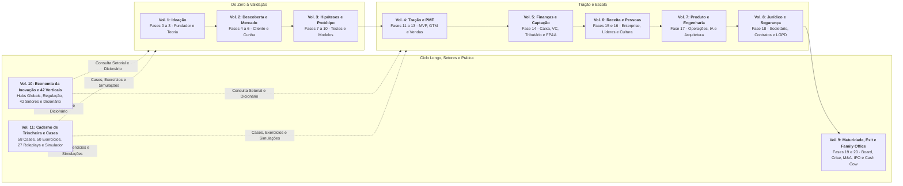
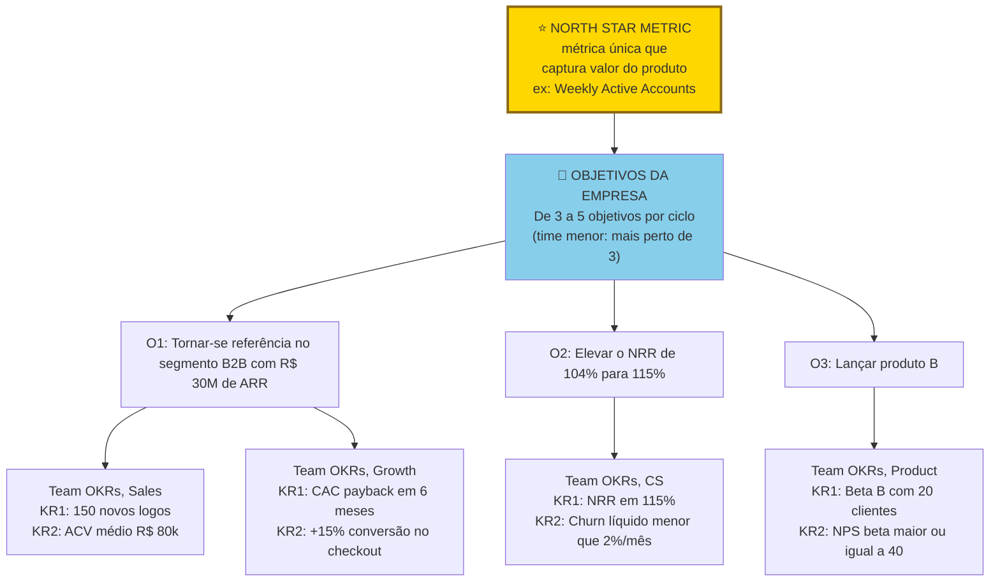
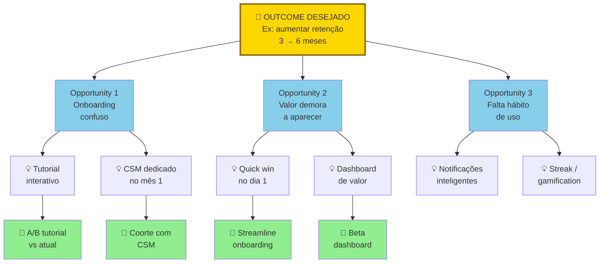
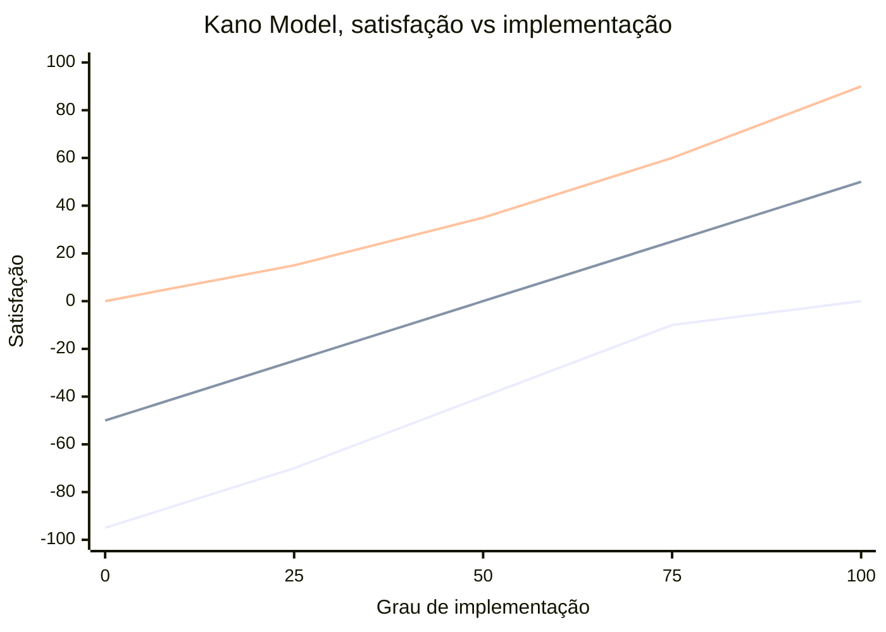

# IGNIÇÃO: Volume 7: Produto, Engenharia, Dados, IA e Operações

**Discovery Contínuo, Gestão Técnica, Dívida Técnica, AI Ops e Design Organizacional (Fase 17 e Capítulos 1 a 10)**

*João Prado · 2026 · Edição Narrativa Enxuta (v5.3)*

---

## Sobre este Volume

Este é o **Volume 7 (IGNIÇÃO: Volume 7: Produto, Engenharia, Dados, IA e Operações)** da coleção IGNIÇÃO: O manual operacional do empreendedor brasileiro (11 volumes).

O manual operacional do CTO, do CPO e do COO na scaleup brasileira. Abre com a Fase 17 (Operações, Processos e Gestão em Escala), reunindo 20 frameworks de produto e operação (do Continuous Discovery, Shape Up e OKRs a DORA, SPACE, WBR e Toyota Kata. Para o canvas Org Chart Evolution, ver [[IGNICAO-Vol-6-Receita-e-Pessoas#FASE 16: TIME, LIDERANÇA EXECUTIVA E CULTURA EM ESCALA|Volume 6, Fase 16]], e para Hoshin Kanri, ver [[IGNICAO-Vol-9-Maturidade-e-Exit#FASE 19: REINVENÇÃO E SEGUNDA CURVA|Volume 9, Fase 19]]) e 3 templates operacionais, seguida por 10 capítulos sobre produto em múltiplas squads, transição do fundador técnico para gestão, recrutamento técnico, Engineering Management, DevEx e dívida técnica, IA na engenharia de software, operações com IA, design organizacional, gestão do conhecimento, comunicação interna e excelência operacional.

---

## Mapa da Coleção IGNIÇÃO



---

## Sumário deste Volume

### Fase 17: Operações, Processos e Gestão em Escala

- [[#FASE 17: OPERAÇÕES, PROCESSOS E GESTÃO EM ESCALA|FASE 17: OPERAÇÕES, PROCESSOS E GESTÃO EM ESCALA]]

### Produto em Escala, Engenharia de Software, Dívida Técnica e IA (Capítulos 1 a 6)

- [[#CAPÍTULO 1: PRODUTO EM ESCALA E DESCOBERTA CONTÍNUA|CAPÍTULO 1: PRODUTO EM ESCALA E DESCOBERTA CONTÍNUA]]
- [[#CAPÍTULO 2: MANAGEMENT PARA O FUNDADOR TÉCNICO|CAPÍTULO 2: MANAGEMENT PARA O FUNDADOR TÉCNICO]]
- [[#CAPÍTULO 3: RECRUTAMENTO TÉCNICO EM PROFUNDIDADE|CAPÍTULO 3: RECRUTAMENTO TÉCNICO EM PROFUNDIDADE]]
- [[#CAPÍTULO 4: ENGINEERING MANAGEMENT, DEVELOPER EXPERIENCE E GESTÃO DE DÍVIDA TÉCNICA|CAPÍTULO 4: ENGINEERING MANAGEMENT, DEVELOPER EXPERIENCE E GESTÃO DE DÍVIDA TÉCNICA]]
- [[#CAPÍTULO 5: IA NA ENGENHARIA INTERNA: COPILOT, AGENTES E PRODUTIVIDADE DE DEV|CAPÍTULO 5: IA NA ENGENHARIA INTERNA: COPILOT, AGENTES E PRODUTIVIDADE DE DEV]]
- [[#CAPÍTULO 6: AI OPS E AUTOMAÇÃO INTELIGENTE|CAPÍTULO 6: AI OPS E AUTOMAÇÃO INTELIGENTE]]

### Arquitetura Organizacional, Conhecimento, Comunicação e Operações (Capítulos 7 a 10)

- [[#CAPÍTULO 7: DESIGN ORGANIZACIONAL|CAPÍTULO 7: DESIGN ORGANIZACIONAL]]
- [[#CAPÍTULO 8: GESTÃO DO CONHECIMENTO|CAPÍTULO 8: GESTÃO DO CONHECIMENTO]]
- [[#CAPÍTULO 9: COMUNICAÇÃO INTERNA|CAPÍTULO 9: COMUNICAÇÃO INTERNA]]
- [[#CAPÍTULO 10: OPERAÇÕES EM ESCALA|CAPÍTULO 10: OPERAÇÕES EM ESCALA]]

### Prática, Cases e Simulações Desta Etapa (Volume 11: Capítulos 19 a 21)

- [[IGNICAO-Vol-11-Workbook-Cases-e-Exercicios#CAPÍTULO 19: CASES GLOBAIS E BRASILEIROS DE PRODUTO EM ESCALA, ARQUITETURA TÉCNICA, DORA, IA EM PRODUÇÃO E OPERAÇÕES|CAPÍTULO 19: CASES GLOBAIS E BRASILEIROS DE PRODUTO EM ESCALA, ARQUITETURA TÉCNICA, DORA, IA EM PRODUÇÃO E OPERAÇÕES (Vol. 11)]]
- [[IGNICAO-Vol-11-Workbook-Cases-e-Exercicios#CAPÍTULO 20: CADERNO DE EXERCÍCIOS COM GABARITO COMENTADO: PR/FAQ, OKRS, MÉTRICAS DORA, TOKENOMICS DE IA E TEAM TOPOLOGIES|CAPÍTULO 20: CADERNO DE EXERCÍCIOS COM GABARITO COMENTADO: PR/FAQ, OKRS, MÉTRICAS DORA, TOKENOMICS DE IA E TEAM TOPOLOGIES (Vol. 11)]]
- [[IGNICAO-Vol-11-Workbook-Cases-e-Exercicios#CAPÍTULO 21: SIMULAÇÕES DE DECISÃO E ROLEPLAYS EXECUTIVOS: CONFLITO VENDAS vs. PRODUTO, POSTMORTEM SEM CULPA E MONÓLITO vs. MICROSSERVIÇOS|CAPÍTULO 21: SIMULAÇÕES DE DECISÃO E ROLEPLAYS EXECUTIVOS: CONFLITO VENDAS vs. PRODUTO, POSTMORTEM SEM CULPA E MONÓLITO vs. MICROSSERVIÇOS (Vol. 11)]]

---

# OPERAÇÕES, PROCESSOS E GESTÃO EM ESCALA (FASE 17)

Quando a operação passa de uma única equipe para múltiplas squads e milhares de clientes, o alinhamento informal por osmose entra em colapso. Esta abertura instala o sistema operacional de cadência, metas, processos e rituais de engenharia que sustenta o crescimento antes do mergulho funcional nos dez capítulos deste volume.

---

## FASE 17: OPERAÇÕES, PROCESSOS E GESTÃO EM ESCALA

### O imposto da osmose quebrada e a fábrica da sua empresa

Quatrocentos e dez clientes corporativos ficaram sem conciliação bancária às 19h40 de uma sexta-feira porque três squads subiram código no mesmo módulo de faturamento sem avisar ninguém. Enquanto Marina saía da sétima reunião seguida de alinhamento que terminou sem decisão em Florianópolis, a engenharia coordenada por Lucas em São Paulo disparou as três atualizações simultâneas: a equipe de Sucesso do Cliente ficou no escuro, o motor de conciliação travou e o suporte técnico acumulou 180 chamados urgentes em duas horas (quatro vezes a média mensal de 45 chamados críticos da operação). Quando a empresa tinha quatorze pessoas e um único canal de conversa no Slack, tudo funcionava por osmose: bastava levantar a cabeça do monitor e fazer uma pergunta. Com oitenta e cinco pessoas, a mesma informalidade que antes parecia velocidade virou sabotagem mútua.

O paradoxo da escala raramente aparece nos palcos de empreendedorismo: os hábitos heroicos de improviso que salvaram a sua startup na fase de tração são os mesmos vícios que destroem a operação na fase de maturidade. Andy Grove ensinava na Intel que toda empresa funciona como uma fábrica e que a produção de um gestor é a produção da sua organização somada à das áreas que ele influencia.

Você acaba de bater de frente com O Imposto da Osmose Quebrada: a perda quadrática de energia produtiva que ocorre quando os canais de comunicação crescem com o quadrado do time (14 pessoas formam 91 canais, 85 pessoas formam 3.570) sem que você instale cadência operacional, donos únicos de processo e indicadores antecedentes. Ou você projeta a máquina que constrói a máquina, ou passa o resto da vida apagando incêndios criados pelo seu próprio time.

---

### A Arquitetura de Comando: Cadência, Processos e Alavancagem Gerencial

Para que o colapso daquela sexta-feira na scaleup de Lucas e Marina não se repita, os sete passos a seguir reconectam a estratégia da empresa à trincheira operacional: do ritmo semanal de gestão no Passo 1 e da árvore de OKRs no Passo 2 (que impedem três squads de subirem código conflitante no escuro) até o pós-mortem sem caça às bruxas do motor de conciliação no Passo 7. Veja como a hierarquia de metas conecta a métrica North Star às equipes:



> [!important] Hierarquia descendente
> Do North Star à empresa, e depois aos times: os KRs das equipes devem somar diretamente aos KRs da companhia, evitando silos que otimizam métricas locais sem mover o negócio. Faça *check-in* semanal de 5 minutos, revisão nas semanas 4 e 8 e pontuação de 0,0 a 1,0 na última semana do trimestre. Separe OKRs comprometidos (meta de receita do orçamento, SLA contratual, conformidade legal, que exigem entrega de 1,0, ou 100%) dos OKRs aspiracionais (*moonshots*, cuja faixa saudável de atingimento fica entre 0,6 e 0,7, isto é, 60% a 70%).

> [!tip] Stack mínimo de operações em escala
> Em escala, a pilha operacional exige a mesma disciplina arquitetural da pilha de produto. Respeite o teto de 15 a 20 ferramentas ativas na fase de escala, consolidando as escolhas conforme a tabela do Passo 4: OKRs e gestão de projetos (Notion, Linear, Jira ou Asana), documentação interna (Notion, Confluence ou GitBook), comunicação e vídeo (Slack, Microsoft Teams, Google Meet ou Zoom), recrutamento, RH e folha (Gupy ou InHire para vagas, Sólides, Factorial ou Convenia para gestão de pessoas e DP), financeiro e ERP no Brasil (Conta Azul, Omie ou Nibo no pós-PMF, Sankhya, Totvs ou NetSuite na escala, reservando QuickBooks para subsidiárias no exterior), analytics e dados (PostHog, Amplitude ou Mixpanel sobre BigQuery ou Snowflake) e CRM (HubSpot, Pipedrive, Attio ou Salesforce).

> [!note] Entregáveis e critérios de entrada da Fase 17
> **Escopo e critérios da Fase 17:** estruturar o sistema de OKRs (de 3 a 5 objetivos trimestrais, com 2 a 4 resultados-chave por objetivo), a cadência semanal e mensal de reuniões, o manual de processos críticos e a pilha enxuta de ferramentas de gestão. Comece quando a equipe passa de 15 pessoas ou quando falhas de comunicação passam a gerar mais atrito do que velocidade. Conclua quando os cinco processos mais decisivos estiverem documentados, os dez donos nomeados, os rituais rodando no calendário e a pilha estabilizada em 15 a 20 ferramentas, revisitando a arquitetura a cada 6 a 9 meses. Responsáveis: CEO, liderança de operações (ou *Chief of Staff*) e líderes de área.

### Os Sete Passos da Engenharia do Ritmo: Cadência, OKRs, Processos e Pós-Mortems

Implante os sete passos na ordem abaixo, garantindo que o ritmo de decisão e os donos de processo venham antes da compra de novos softwares.

#### Passo 1: institua a cadência de gestão em três camadas

> [!note]
> A cadência operacional, o ritmo de reuniões gerais (*all-hands*), a resposta a incidentes, a automação e os indicadores por vertical são detalhados no [[#CAPÍTULO 10: OPERAÇÕES EM ESCALA|Capítulo 10: Operações em Escala]].

Toda empresa em escala roda em três ciclos simultâneos.

**Ciclo anual: planejamento estratégico.** No quarto trimestre (Q4), realiza-se o balanço do ano corrente combinado ao planejamento do ciclo seguinte (visão, apostas estratégicas, metas anuais, orçamento e estrutura organizacional). Os entregáveis são o documento de estratégia anual, o orçamento aprovado e o esboço dos OKRs anuais.

**Ciclo trimestral: OKRs.** Na semana 1 de cada trimestre ocorre o lançamento formal dos OKRs com todo o time, seguido de check-in semanal de 5 minutos, revisão formal de progresso e recalibração nas semanas 4 e 8, e retrospectiva com atribuição de nota (de 0,0 a 1,0 por KR, com justificativa) na última semana do trimestre. Os entregáveis são o documento de OKRs por área e o relatório trimestral para o conselho (se houver).

**Ciclo semanal: operacional.** Na segunda-feira ocorre a reunião de liderança (diretoria e VPs), focada nos 3 a 5 maiores bloqueios da semana. Na terça ou quarta-feira acontecem as reuniões 1:1 (cada gestor com cada liderado direto, de 45 a 60 minutos). Na quinta-feira realizam-se as revisões de área (engenharia, vendas e sucesso do cliente). Na sexta-feira fecha-se a semana com reunião geral ou boletim interno.

> [!important] A regra de fundo
> Sem uma reunião semanal fixa de liderança, com pauta escrita e indicadores atualizados, a diretoria passa a semana apagando incêndios em vez de coordenar prioridades.

#### Passo 2: implemente OKRs corretamente

A maioria das empresas tropeça na execução de OKRs por repetir cinco erros clássicos:

**Confundir OKR de mudança com KPI de manutenção de nível.** Um OKR mede um salto de patamar no trimestre (por exemplo, *"reduzir o churn mensal de 5% para 3%"* ou *"elevar o NRR de 95% para 115%"*), enquanto a manutenção de um indicador saudável (como *"manter retenção mensal acima de 95%"*) deve ficar no painel semanal de saúde operacional (KPI), nunca na lista de OKRs.

**Diluir o foco com excesso de metas.** A regra prática exige definir de 3 a 5 objetivos por ciclo (quanto menor o time, mais perto de 3), cada um acompanhado de 2 a 4 resultados-chave. Ultrapassar esse limite impede que a equipe alcance qualquer prioridade real.

**Escrever tarefas ou entregas no lugar de resultados-chave (*Key Results*).** Entregas binárias como *"lançar a funcionalidade X"*, *"contratar três vendedores"* ou *"documentar o playbook comercial"* são iniciativas (meios de execução), não resultados-chave. O KR correspondente precisa medir o efeito produzido no negócio (como *"50% da receita nova do trimestre fechada sem o fundador na reunião"* ou *"conversão das oportunidades conduzidas pelo time em pelo menos 80% da taxa do fundador"*).

**Calibrar metas com folga artificial (*sandbagging*).** Separe os OKRs comprometidos (receita do orçamento, SLA contratual e conformidade legal, que exigem entrega de 1,0) dos OKRs aspiracionais (metas de salto estratégico, cuja faixa saudável de atingimento fica entre 0,6 e 0,7). Se a equipe bate 1,0 até nos objetivos aspiracionais, as metas nasceram conservadoras.

**Engessar o trimestre sem recalibração formal.** Se na revisão da semana 4 ou da semana 8 ficar evidente que o contexto de mercado mudou ou que um KR nasceu mal dimensionado, registre o ajuste por escrito em vez de manter a equipe correndo atrás de um número obsoleto.

Formato canônico de OKR.

```text
Objective: [direcional, ambicioso, memorável]
 KR1: [número inicial] → [número alvo] (por [data])
 KR2: [número inicial] → [número alvo]
 KR3: [número inicial] → [número alvo]
Owner: [uma pessoa responsável, não um time]
```

#### Passo 3: nomeie os 10 donos de processos críticos e documente os 5 mais urgentes

> [!note]
> Estruturação de onboarding 30/60/90, wikis e runbooks, a infraestrutura de conhecimento que torna os playbooks consultáveis, está no [[#CAPÍTULO 8: GESTÃO DO CONHECIMENTO|Capítulo 8: Gestão do Conhecimento]].

Toda empresa possui fluxos que, quando quebram, geram dano imediato ao cliente ou ao caixa. Mapeie os dez processos críticos típicos da operação: (1) integração (*onboarding*) de novo cliente, (2) faturamento, conciliação e cobrança (incluindo régua de inadimplência), (3) suporte técnico com SLA por nível de severidade, (4) desenvolvimento e liberação de funcionalidades (da descoberta ao deploy), (5) resposta a incidentes quando o sistema cai, (6) integração de novos colaboradores (plano 30/60/90), (7) desligamento (*offboarding*) com revogação imediata de acessos, (8) contratação de profissionais seniores e lideranças, (9) revisão de oportunidades comerciais complexas (*deal review*), e (10) renovação contratual e prevenção de cancelamento (*churn*).

Nomeie agora um único responsável para cada um dos dez processos e escreva imediatamente o playbook dos cinco que mais doem quando quebram (os outros cinco ganham playbook no trimestre seguinte). Cada documento deve ser redigido em texto simples e conter: dono nominal do processo, passo a passo numerado, SLA por etapa, ferramentas utilizadas, exceções conhecidas e métrica de qualidade. Na empresa de Lucas e Marina, o primeiro playbook escrito após o incidente de sexta-feira foi o de janela coordenada de deploy e conciliação de faturamento.

Centralize os playbooks na base de conhecimento da empresa (Notion, Confluence ou GitBook) com dono nomeado e ciclo fixo de atualização: revise os documentos críticos a cada três meses e os demais a cada seis meses (conforme a regra de governança do [[#CAPÍTULO 8: GESTÃO DO CONHECIMENTO|Capítulo 8: Gestão do Conhecimento]]).

#### Passo 4: consolide o stack de ferramentas operacionais

A evolução do stack operacional por fase:

```mermaid
flowchart LR
 subgraph PreP["PRÉ-PMF (Fases 0 a 12)"]
 P1[Google Workspace]
 P2[Notion / Linear]
 P3[Slack]
 P4[GitHub]
 P5[Stripe / Pagar.me]
 P6[PostHog / Mixpanel]
 end

 subgraph PosP["PÓS-PMF (Fases 14 a 16)"]
 PP1[Consolida o pré-PMF e adiciona:]
 PP2[HubSpot / Salesforce CRM]
 PP3[Intercom / Zendesk]
 PP4[Amplitude]
 PP5[Datadog / Sentry]
 PP6[BambooHR / People]
 PP7[1Password / Vault]
 end

 subgraph Escala["ESCALA (Fase 17 / Série B+: teto de 15 a 20 ferramentas ativas)"]
 E1[Substitui ferramentas provisórias por:]
 E2[CS: Gainsight / ChurnZero]
 E3[Data: Snowflake / BigQuery]
 E4[BI: Looker / Metabase]
 E5[Identity: Okta]
 E6[Security: Drata / Vanta]
 E7[Finance: NetSuite / Oracle]
 end

 PreP --> PosP --> Escala

 style PreP fill:#FFE4B5
 style PosP fill:#87CEEB
 style Escala fill:#90EE90
```



> [!warning] Não antecipar stack
> Adquirir ferramentas caras cedo é procrastinar com dinheiro. Ferramenta não resolve falta de processo. A regra: adicione ferramenta quando a ausência já custa mais que o custo anual da ferramenta.

| Função Operacional | Ferramentas Típicas em 2026 (Pré-PMF → Pós-PMF → Escala) |
|---|---|
| Comunicação | Slack, Discord, Teams |
| Documentação e wiki | Notion, Confluence, GitBook |
| Gestão de projetos | Linear, Jira, Asana |
| CRM | HubSpot, Salesforce, Attio |
| E-mail e calendário | Google Workspace, Microsoft 365 |
| Analytics de produto | Mixpanel, Amplitude, PostHog |
| Business intelligence | Metabase, Looker, Hex |
| Data warehouse | BigQuery, Snowflake, Redshift |
| Financeiro e ERP | Conta Azul, Omie, Nibo (PMEs e Série A), Sankhya, Totvs, NetSuite (escala), QuickBooks (apenas exterior) |
| Recrutamento, RH e folha | Recrutamento: Gupy, InHire. Gestão de pessoas e DP: Sólides, Factorial, Convenia |
| Contratos | DocuSign, Clicksign, Zapsign |
| Pagamentos B2B | Iugu, Pagar.me, Stripe |

> [!important] Princípio do stack
> Mantenha a pilha enxuta: operar de 15 a 20 ferramentas bem integradas na escala entrega mais controle do que acumular trinta softwares que ninguém domina. Cada ferramenta nova exige treinamento, governança de acessos e custo marginal de atenção.

> [!note]
> Automação de CS, vendas e operações com IA, incluindo quando automatizar versus manter toque humano, é tratada no [[#CAPÍTULO 6: AI OPS E AUTOMAÇÃO INTELIGENTE|Capítulo 6: AI Ops e Automação]].

#### Passo 5: evolua a comunicação interna de 10 para 50 e para 100 pessoas

> [!note]
> Os formatos de reunião geral (*all-hands*), a comunicação de cortes de pessoal e os protocolos assíncronos por tamanho de time estão no [[#CAPÍTULO 9: COMUNICAÇÃO INTERNA|Capítulo 9: Comunicação Interna]].

A comunicação que funciona com dez pessoas colapsa com cinquenta. A régua operacional acompanha os estágios de crescimento detalhados no Capítulo 9: até 20 pessoas, alinhamento direto no Slack, decisões documentadas na wiki e reunião geral (*all-hands*) semanal ou quinzenal de 30 minutos. De 20 a 50 pessoas, *all-hands* mensal de 60 minutos, boletim interno escrito quinzenal ou mensal e RFC (*Request for Comments*) escrito para decisões estruturais. De 50 a 200 pessoas, *all-hands* mensal da empresa (75 a 90 minutos), reuniões quinzenais por área, boletim escrito semanal curado e *Town Hall* trimestral com espaço aberto para perguntas.

> [!warning] Sinal-vermelho na comunicação
> Se mais de 20% das pessoas respondem "não sei o que está acontecendo" em uma pesquisa anônima, a comunicação interna falhou.

#### Passo 6: monte cedo uma infraestrutura mínima de dados

> [!tip] Capítulo 9 (Vol. 4): Dados e Analytics
> Arquitetura de dados para startups em escala: data warehouse, ETL, modelagem de dados, cultura data-driven e como estruturar a função de analytics (self-serve vs. analista centralizado).

Até vinte pessoas, planilhas compartilhadas resolvem o controle básico. Acima desse porte, monte quatro alicerces: um repositório central de dados (*data warehouse* enxuto em BigQuery ou Snowflake) com ingestão automática do produto, do CRM e do financeiro. Painéis centrais de receita, retenção, CAC, LTV, churn e pipeline atualizados diariamente. Controle de acesso por perfil de função, e a disciplina de exigir dados auditados antes de tomar qualquer decisão estratégica.

#### Passo 7: institua pós-mortems sem culpa para incidentes

Quando ocorrer um incidente relevante (indisponibilidade severa, perda de grande conta ou falha de segurança), acione o protocolo padronizado da Fase 17: circule o rascunho técnico em até 48 horas e publique a versão final revisada em até cinco dias úteis, sempre com foco nas falhas do sistema e das travas de processo (*"por que a nossa arquitetura permitiu que o erro chegasse à produção?"*). Estruture o documento em três blocos (linha do tempo factual, causa-raiz pelos 5 Porquês e ações corretivas com responsável e prazo) e compartilhe com toda a equipe. Foi esse ritual que permitiu a Lucas e Marina transformar o colapso dos 410 clientes em três travas automáticas de deploy no faturamento.

> [!important] Cultura de erro
> Cultura que pune erro gera ocultamento. Cultura que aprende do erro gera resiliência.

### A Prova Material de Maturidade e os Critérios de Saída da Fase 17

A Fase 17 está concluída quando os seis critérios abaixo estão cumpridos.

1. Cadência de gestão (semanal, trimestral, anual) está formalizada, e rodando há dois ou mais trimestres. Aderência (reuniões acontecendo na data, com agenda e ata) ≥90%.
2. OKRs estão em uso com pontuação trimestral, separando metas comprometidas (orçamento, caixa e SLAs, que exigem 100% de entrega) de metas aspiracionais (nas quais atingimento entre 60% e 70%, ou 0,6 a 0,7, indica ambição bem calibrada).
3. Os cinco processos que mais doem quando quebram têm playbook escrito e testado, e os dez processos críticos têm dono nominal definido. Decisões estruturais (que afetam 10 ou mais pessoas ou envolvem custo a partir de R$ 100 mil) contam com RFC escrito em pelo menos 80% dos casos.
4. Pilha operacional estabilizada e integrada (teto de 15 a 20 ferramentas ativas na escala, substituindo soluções provisórias das fases iniciais sem sobreposição de função).
5. Infraestrutura mínima de dados em operação (fonte única de verdade e painel executivo confiável).
6. Pós-mortems sem culpa (*blameless post-mortems*) estão instituídos na rotina, com tempo médio de recuperação (MTTR) abaixo de 1 hora para incidentes P0, abaixo de 4 horas para P1 e abaixo de 24 horas para P2.

**Critérios observáveis.**

1. OKRs trimestrais estão escritos, com check-in semanal de 5 minutos, revisão formal documentada nas semanas 4 e 8 e nota atribuída na última semana do trimestre.
2. Dashboard central existe, com seis ou mais métricas alimentadas diariamente e revisadas toda semana na WBR.
3. Repositório de playbooks ativo na wiki com histórico de revisão trimestral nos cinco fluxos mais decisivos e matriz nominal publicada dos dez donos de processo.
4. Reuniões seguem agenda padrão, com decisões e ações registradas.
5. Stack de SaaS inventariado, e otimizado nos últimos seis meses.
6. Documentação interna centralizada e atualizada.

**Lista de verificação prática dos critérios de saída:**

- [ ] Implementei ciclos de planejamento (OKRs trimestrais ou equivalente)?
- [ ] Mantenho um painel operacional central com métricas-chave alimentadas por dados atualizados todo dia e lidas toda semana na WBR?
- [ ] Defini processos documentados para contratação, onboarding, atendimento e operação?
- [ ] Implementei sistema de tickets ou gestão para cada área (produto, customer, operação)?
- [ ] Tenho pessoas responsáveis nomeadas por cada sistema ou processo (dono único, não compartilhado)?
- [ ] As reuniões têm agenda, dono, duração, e saída clara (decisões ou ações)?
- [ ] Stack operacional consolidado, sem proliferação descontrolada de SaaS?
- [ ] Documentação interna centralizada (Notion, Confluence ou equivalente)?

**Plano imediato de implementação para fechar as lacunas de saída.**

1. Conduza a sessão de OKRs para o próximo trimestre, definindo de 3 a 5 objetivos para a empresa acompanhados de 2 a 4 resultados-chave (KRs) por objetivo.
2. Estruture um painel central no Notion ou no Looker contendo a métrica North Star e de 5 a 7 métricas secundárias com dados atualizados diariamente e lidos toda semana na WBR.
3. Liste os processos críticos ainda sem documentação e escolha os dois mais urgentes para documentar nesta semana.
4. Audite todas as assinaturas de SaaS ativas, cancele ferramentas redundantes e consolide acessos dentro do teto de 15 a 20 sistemas.

### OKRs trimestrais e painel central na prática: a scale-up de Lucas e Marina e o contraste com a PadariaPro

**OKRs do 3º trimestre na scaleup de Lucas e Marina (pós-incidente do motor de conciliação):** O1: Tornar o faturamento e a conciliação imunes a falhas de deploy (KR1: zero incidentes P0 ou P1 por deploy simultâneo sem janela coordenada, KR2: reduzir o tempo médio de detecção e reversão de 42 para menos de 8 minutos, KR3: cobrir 100% dos fluxos decisivos de faturamento com testes de contrato automatizados, KR4: atingir 100% dos incidentes P0 e P1 com rascunho de pós-mortem em 48 horas e versão final publicada em até cinco dias úteis). O2: Recuperar a confiança e a expansão da base corporativa (KR1: elevar o NRR acumulado de 12 meses de 104% para 108% até o fim do trimestre, KR2: reduzir a média mensal de chamados críticos de conciliação de 45 para menos de 10).

**Contraste de estágio anterior: OKRs Q3, PadariaPro (exemplo de operação menor, com 103 clientes).**

**O1: acelerar crescimento em SP Capital e RM, com qualidade de PMF.**
KR1: crescer de 80 para 150 clientes pagantes no trimestre.
KR2: reduzir o churn mensal de 5% para 3% (mantendo a retenção acima de 95% como métrica de saúde no painel).
KR3: elevar o NPS relacional de 34 para 50 até o fim do trimestre, eliminando as três principais causas de atrito no onboarding.

**Objetivo 2 (O2): reduzir a dependência do fundador na operação de vendas.**
KR1: 70% das negociações do trimestre fechadas sem o fundador na apresentação comercial (patamar atual: 30%).
KR2: 50% da receita nova vinda de negócios fechados sem o fundador na reunião (tendo a contratação e rampa do Head of Sales em 90 dias como iniciativa-chave).
KR3: manter a taxa de conversão das oportunidades conduzidas pelo time comercial em pelo menos 80% da taxa histórica do fundador (apoiado pela adoção do manual de vendas v1 em 100% do funil).

**O3: preparar expansão para duas novas cidades (Campinas, Grande Rio).**
KR1: dez clientes em Campinas até fim do Q3.
KR2: atingir R$ 30 mil de novo MRR em Campinas até o fim do trimestre (apoiado pela contratação e rampa do representante comercial local).
KR3: validar a viabilidade econômica da operação no Grande Rio com payback de CAC projetado abaixo de 9 meses em lote piloto de 20 clientes.

**Dashboard Central, seção principal.**

| Métrica | Meta Q3 | Hoje | Tendência |
|---|---|---|---|
| North Star: Pedidos confirmados/semana | 1.200 | 820 | ↑ |
| Clientes pagantes | 150 | 103 | ↑ |
| Churn mensal | ≤ 3% | 4,2% | ↓ |
| NPS | ≥ 50 | 48 | → |
| CAC | ≤ R$ 2.000 | R$ 1.850 | → |
| Pipeline ativo | ≥ R$ 300k | R$ 290k | ↑ |
| NPS de colaborador | ≥ 70 | 68 | → |
| Burn mensal | ≤ R$ 85k | R$ 78k | → |

**Processos documentados (amostra).**

1. Onboarding de novo cliente (v3, dono: Paula, CS).
2. Onboarding de novo colaborador (v2, dono: Mariana, CEO).
3. Processo de triagem de bug decisivo (v1, dono: Bruno, CTO).
4. Fluxo de cold outbound (v1, dono: Roberto, Sales).
5. Revisão trimestral de OKRs (v1, dono: Bruno, Estratégia).
6. Processo de contratação (v2, dono: Mariana).

### As Patologias da Burocracia Precoce e do Caos Institucionalizado

Repetir que processo mata a cultura é uma desculpa confortável para o improviso. Na prática, a ausência de rotina clara desgasta a equipe pelo retrabalho constante e leva profissionais excelentes a pedir demissão por exaustão. A saída consiste em atacar quatro patologias operacionais recorrentes:

**1. Cemitério de SaaS:** a empresa contrata cada software novo que surge no mercado e acumula 40 ferramentas que não conversam entre si. Na operação de Lucas e Marina, cortar 14 assinaturas duplicadas economizou R$ 18 mil por mês e devolveu visibilidade ao time.

**2. OKR de vitrine:** a liderança publica metas ambiciosas no início do trimestre e só volta a abrir a planilha noventa dias depois, sem rituais semanais de acompanhamento nem revisão de meio de ciclo.

**3. Reunião sem pauta:** encontros recorrentes consomem a agenda técnica sem objetivo nem documento prévio. Se o convite não trouxer pauta escrita e decisão esperada, cancele a reunião.

**4. Dados para depois:** adiar a estruturação do repositório central e das definições de métricas para "quando a empresa crescer" cobra juros altos quando a operação perde visibilidade sobre margem e retenção.

---

### Caso brasileiro real: VTEX, governança operacional e internacionalização

Fundada no Rio de Janeiro em 2000 por Geraldo Thomaz e Mariano Gomide de Faria, a VTEX consolidou-se como plataforma SaaS de comércio digital para grandes marcas antes de acelerar sua expansão internacional rumo ao IPO na NYSE em julho de 2021 (quando já operava clientes em mais de 30 países). O alicerce operacional que permitiu escalar múltiplos mercados sem fragmentar o produto combinou arquitetura *multi-tenant* única, metas trimestrais transparentes, documentação técnica e operacional em inglês desde cedo e divisão clara de responsabilidades entre equipes distribuídas.

A lição prática para fundadores brasileiros é direta: padronize a cadência de gestão, os playbooks de implantação e os donos de processo na operação doméstica antes de multiplicar escritórios ou regiões, evitando exportar desorganização em escala (para a estratégia de internacionalização, ver [[IGNICAO-Vol-9-Maturidade-e-Exit#CAPÍTULO 5: INTERNACIONALIZAÇÃO: ESTRUTURA E PRODUTO PARA MÚLTIPLOS MERCADOS|Volume 9, Capítulo 5]]).

Empresas que tentam arrumar a casa enquanto abrem três praças simultaneamente multiplicam o custo do retrabalho e destroem o SLA da base atual.

---

### MANUAL PASSO A PASSO DOS FRAMEWORKS (FASE 17)

> [!tip] Uso autocontido neste volume
> Os frameworks abaixo reúnem origem, estrutura, passo a passo de aplicação, exemplos aplicados ao contexto brasileiro (incluindo os arquétipos desta coleção) e armadilhas para execução imediata nesta Fase 17.

#### Framework: Hábitos de Descoberta Contínua (Continuous Discovery Habits, Teresa Torres, 2021)

> **Nota de escopo:** Os cinco primeiros blocos deste manual (Continuous Discovery, Shape Up, PR-FAQ, Stage-Gate e Dual-Track) conectam a cadência operacional da Fase 17 à disciplina de produto em escala detalhada no [[#CAPÍTULO 1: PRODUTO EM ESCALA E DESCOBERTA CONTÍNUA|Capítulo 1]]. Para a Árvore de Oportunidades e Soluções (*Opportunity Solution Tree*) e priorização inicial, ver [[IGNICAO-Vol-3-Experimentos-e-Prototipagem#FASE 9: IDEAÇÃO E PROTOTIPAGEM DE SOLUÇÕES|Volume 3, Fase 9]].

##### De onde vem a ferramenta (e por que sobreviveu ao filtro do tempo)

Teresa Torres, coach de discovery de produto e fundadora da Product Talk (após liderar produto e gestão executiva em empresas como Become.com e Affinity Circles), publicou *Continuous Discovery Habits* em 2021 consolidando anos de consultoria com times de produto. Livro se tornou referência moderna em product discovery, ensinado em Reforge e escolas de produto globalmente.

##### A mecânica central (sem jargão)

Framework de **descoberta contínua** de produto (em oposição a pesquisas isoladas em projetos pontuais). A tese central estabelece que os trios de produto (PM, designer e líder técnico) devem manter contato semanal com clientes e estruturar o aprendizado visualmente na Árvore de Oportunidades e Soluções (*Opportunity Solution Tree*, detalhada no [[IGNICAO-Vol-3-Experimentos-e-Prototipagem#FASE 9: IDEAÇÃO E PROTOTIPAGEM DE SOLUÇÕES|Volume 3, Fase 9]]).

##### As regras do jogo

Hábitos principais:

1. Entrevista semanal: o trio de produto conversa com pelo menos um ou dois usuários toda semana como ritual fixo no calendário.
2. Opportunity Solution Tree (OST): ferramenta visual conectando outcome desejado → oportunidades (problemas/necessidades do cliente) → soluções candidatas → experimentos.
3. Assumption testing: cada solução tem premissas, testar as mais arriscadas antes de construir.
4. Decision logs: documentar decisões e raciocínio, evitar revisitar mesma discussão.
5. Time outcome-oriented: time mede sucesso por outcome (métrica de impacto), não output (features entregues).

##### Roteiro de aplicação prática na operação

Passo 1: defina um resultado claro (ex.: "aumentar retenção no dia 30 de 40% para 55%"), em vez de listar entregas como "lançar a funcionalidade X".

Passo 2: realize entrevistas semanais com 1 a 2 clientes do perfil ideal (ICP), reunindo gerente de produto (*Product Manager*), designer e engenheiro líder do trio de produto.

Passo 3: Após entrevistas, atualize OST: novas oportunidades identificadas, quais são mais promissoras para o outcome?

Passo 4: Para cada oportunidade promissora, brainstorm soluções candidatas (múltiplas, não única).

Passo 5: Priorize 1-2 soluções para experimentar.

Passo 6: Assumption test rápido: o que precisa ser verdade para a solução funcionar? Teste a premissa mais arriscada.

Passo 7: quando acumular evidência suficiente nos testes de premissa, construa e libere em produção. Em seguida, volte imediatamente ao ciclo de descoberta.

##### Na trincheira real: como isso funciona na prática

Na scaleup B2B de Lucas e Marina, o trio de produto implementou *continuous discovery* para atacar a queda de ativação:

Outcome: aumentar conversão trial → paid de 8% para 15%.

Entrevistas semanais com usuários em trial:

Semana 1-4: identifica 4 oportunidades principais via OST:

- "Usuários não entendem valor na 1ª hora."
- "Configuração inicial trava 40% dos usuários."
- "Preço parece alto sem contexto."
- "Falta de urgência para converter."

Prioriza "configuração inicial trava 40%":

- Soluções candidatas: (a) onboarding guiado, (b) setup pré-populado, (c) concierge setup (CS faz).
- Teste de premissa comportamental: os usuários concluem a configuração inicial sem ajuda quando os dados de exemplo já vêm preenchidos?
- Experimento: oferece (b) e (c) para próximos 20 trials, mede conclusão de setup.

Resultado: setup pré-populado resolve 70% dos casos, concierge para os 30% restantes. Conversão sobe para 13% em 6 semanas.

##### Onde o papel aceita tudo (armadilhas de execução)

Transformar entrevistas em evento trimestral mata a descoberta contínua. Desenhar a árvore de oportunidades na parede e continuar decidindo o backlog no grito reduz o método a decoração. Testar uma única solução por oportunidade impede a comparação real de alternativas. Pular os testes rápidos de premissa leva o time a construir funcionalidades inteiras sobre hipóteses falsas. Medir sucesso pelo número de telas entregues, e não pelo impacto no indicador do cliente, mantém a equipe presa à fábrica de funcionalidades.

---

#### Framework: Shape Up (Ryan Singer / Basecamp, 2019)

##### De onde vem a ferramenta (e por que sobreviveu ao filtro do tempo)

Ryan Singer, ex-VP Produto da Basecamp, publicou *Shape Up* (gratuitamente online em basecamp.com/shapeup) em 2019, consolidando método interno da Basecamp desde ~2009. Alternativa ao Scrum, propondo ciclos mais longos (6 semanas), trabalho shaped (não user stories), e autonomia de time.

##### A mecânica central (sem jargão)

Método de desenvolvimento de produto que se opõe a Scrum tradicional, com três princípios centrais:

- Trabalho moldado (shaped work): o problema chega ao time com apetite de tempo, limites claros e solução em esboço grosso (rough, solved, bounded), sem wireframe detalhado, preservando a autonomia de execução.
- Ciclos de 6 semanas: tempo suficiente para trabalho significativo, pressão para foco.
- Betting table: liderança "aposta" em projetos a cada ciclo (não backlog interminável).

##### As regras do jogo

Fases:

1. Moldagem (shaping): profissionais seniores (PM e designer sênior) reservam uma a duas semanas para dar forma ao problema, definem appetite (tempo), boundaries (o que não fará) e risco. 1-2 semanas.

2. Betting: a cada 6 semanas, leadership "aposta" em 4-5 shaped projects. Descartados não viram "debt", somem.

3. Execução autônoma (*building*): duplas ou trios (1 designer e 1 a 2 engenheiros) assumem o projeto moldado com autonomia total para definir as tarefas dentro do apetite fixado.

4. Cooldown: 2 semanas após ciclo de 6 semanas para manutenção, tech debt, exploração.

Hill chart: ferramenta visual de progresso. Times acompanham projeto "subindo a colina" (desconhecidos) e "descendo" (conhecidos, em execução).

##### Protocolo prático de execução

Passo 1: Cultura de shaping: invista em gente sênior para fazer shaping decente. Shape ruim = projeto ruim.

Passo 2: proteja o ciclo de seis semanas com rigor. Nenhuma demanda paralela entra no meio do ciclo.

Passo 3: Appetite (não estimate): "este problema vale 6 semanas?", se não cabe, reduza escopo ou descarte.

Passo 4: dê autonomia real à dupla ou trio de execução e cobre a entrega dentro do apetite, sem microgerenciar tarefas diárias.

Passo 5: Cooldown: não cortar. Cooldown é onde surge criatividade e saúde técnica.

##### Na trincheira real: como isso funciona na prática

A engenharia de Lucas e Marina adotou ciclos inspirados no *Shape Up* para substituir o backlog infinito:

Ciclo de 6 semanas:

- Apostas: (a) redesign de dashboard, (b) feature de automação recorrente, (c) integração com ferramenta X.
- Time de 2 pessoas em cada.
- Liderança não interfere por 6 semanas.
- *Hill chart* atualizado toda semana, dando visibilidade clara ao que ainda está em investigação (subida do morro) e ao que já está resolvido e em acabamento (descida).

Final do ciclo:

- Dashboard: shipped.
- Automação: 85% pronta ao fim das seis semanas, pela regra do disjuntor (circuit breaker), não consome o cooldown e volta à mesa de apostas reformatada.
- Integração X: abandonado (mais complexo que apetite de 6 semanas comportava). Re-shape futuro.

Cooldown de 2 semanas: tech debt, bugs, exploração.

##### Onde o papel aceita tudo (armadilhas de execução)

Aceitar adições de escopo no meio do ciclo de seis semanas destrói o método. Um *shaping* superficial faz o projeto nascer com problema vago e terminar em atraso. Sem autonomia real na execução, o microgerenciamento anula a responsabilidade da equipe. Em organizações grandes, o modelo funciona melhor quando cada aposta é entregue a duplas ou trios dedicados, mantendo o grupo de *shaping* enxuto e sênior.

---

#### Framework: Working Backwards / PR-FAQ (Amazon, internal method)

##### De onde vem a ferramenta (e por que sobreviveu ao filtro do tempo)

A Amazon estruturou o método *Working Backwards* internamente por volta de 2004, sob impulso direto de Jeff Bezos e da liderança executiva (*S-team*). A prática ganhou projeção pública com uma síntese divulgada por Ian McAllister em 2012 e foi documentada em profundidade pelos ex-executivos Colin Bryar e Bill Carr no livro *Working Backwards* (2021).

##### A mecânica central (sem jargão)

Processo de desenvolvimento de produto que começa escrevendo a press release final e FAQ do produto antes de construir. Força clareza sobre: quem é o cliente, qual problema, qual solução, como explicar em linguagem clara, quais objeções existem.

##### As regras do jogo

Dois documentos:

Comunicado de imprensa (*Press Release* de 1 a 1,5 página): texto escrito no passado anunciando o produto já lançado e o benefício claro para o cliente.

- Headline.
- Summary.
- Customer problem.
- Solution.
- Quote executivo.
- Quote de cliente fictício.
- Call-to-action.

FAQ (3-5 páginas):

- Customer FAQ (perguntas que usuário faria).
- Internal FAQ (perguntas difíceis que executivos fariam).

##### Aplicação imediata na rotina da empresa

Passo 1: Escreva PR primeiro, antes de design, antes de código.

Passo 2: Linguagem clara, não jargão técnico. Se cliente não entende PR, produto não tem clareza.

Passo 3: FAQ cobre objeções internas reais: custo, prazo, risco, cannibalization, competição.

Passo 4: Itere: revise PR/FAQ antes de commit. Mudanças são baratas aqui.

Passo 5: Aprovação do PR/FAQ antes de ir para execução.

Passo 6: no início da reunião deliberativa, os participantes leem o PR-FAQ em silêncio durante 20 a 30 minutos antes de abrir o debate, sem usar apresentações de slides.

##### Na trincheira real: como isso funciona na prática

PR-FAQ para nova feature de SaaS:

PR (simplificado):
"A plataforma B2B de Lucas e Marina lança hoje o módulo de Previsão de Liquidez de 90 Dias, que cruza automaticamente as notas fiscais emitidas, a régua de inadimplência e os contratos recorrentes para antecipar rupturas de caixa em distribuidoras e indústrias médias. 'Antes descobríamos o furo de fluxo de caixa com uma semana de antecedência. Agora enxergamos noventa dias à frente com precisão de 94%', afirma Helena, diretora financeira de uma distribuidora com 180 clientes ativos em Campinas."

FAQ:

- "Quanto custa implementar esta feature?"
- "Por que não fizemos isso antes?"
- "Como competimos com ferramenta X que já oferece?"
- "Quais integrações bancárias são obrigatórias?"
- "E se banco não tiver API?"
- "Qual o impacto esperado em retenção?"
- "Quantos engenheiros/trimestres?"

Processo: liderança lê PR-FAQ, pergunta questões difíceis antes de aprovar, ajusta com clareza, depois vai para execução.

##### Onde o papel aceita tudo (armadilhas de execução)

Substituir o texto por slides (apresentações escondem lacunas de raciocínio que a prosa obriga a resolver). Escrever um comunicado vago cheio de adjetivos ("solução revolucionária", "incrível") sem especificar o ganho mensurável do cliente. Montar um FAQ apenas com perguntas fáceis, fugindo dos riscos técnicos e comerciais reais, ou pular o PR-FAQ para "ganhar velocidade" e acabar refazendo o produto inteiro três meses depois.

---

#### Framework: Stage-Gate Process (Robert Cooper, 1986)

##### De onde vem a ferramenta (e por que sobreviveu ao filtro do tempo)

Robert Cooper (professor McMaster University) desenvolveu Stage-Gate em estudos com empresas industriais nos anos 1980. *Winning at New Products* (1986) é texto canônico. Adotado por milhares de empresas (Procter & Gamble, 3M, Lego) em desenvolvimento de novos produtos. Versão moderna "Stage-Gate Express" adapta para ciclos rápidos.

##### A mecânica central (sem jargão)

Processo de desenvolvimento de novos produtos dividido em estágios separados por gates (pontos de decisão go/no-go). Reduz risco ao investir gradualmente e filtrar projetos fracos cedo.

##### As regras do jogo

Estágios clássicos (5 + discovery):

0. Discovery: geração de ideias.
1. Scoping: análise preliminar.
2. Business case: análise detalhada + plano.
3. Development: desenvolvimento.
4. Testing & validation: testes com usuários.
5. Launch: lançamento e comercialização.

Entre cada estágio, um Gate: grupo decide go/kill/recycle/hold. Critérios específicos: mercado viável? Técnica factível? Negócio atrativo? Alinhado à estratégia?

##### Execução prática com a equipe

Passo 1: Defina estágios e gates claros.

Passo 2: Gates com critérios objetivos, não políticos.

Passo 3: Investimento escalonado: mais recurso em estágios avançados, pouco em iniciais.

Passo 4: tenha disciplina para encerrar projetos nos portões de revisão. Um *gate* que aprova 100% das propostas não passa de teatro burocrático.

Passo 5: Ciclos curtos em versões modernas: Stage-Gate Express reduz duração de cada estágio.

##### Na trincheira real: como isso funciona na prática

Na operação D2C de Rafael e Bia, ao validar o lançamento de uma nova linha de produtos físicos com lojistas parceiros via *Stage-Gate* enxuto de quatro meses:

- Discovery: 40 ideias.
- Gate 1: 10 sobrevivem.
- Escopo rápido (1 semana, R$ 5 mil): teste de fumaça com anúncios e página de pré-venda para medir intenção real de compra.
- Gate 2: 5 sobrevivem.
- Caso de negócio e protótipo (3 semanas, R$ 25 mil): amostra física com fornecedor local e validação de margem de contribuição.
- Gate 3: 2 sobrevivem.
- Lote piloto (6 semanas, R$ 60 mil): fabricação de 500 unidades vendidas antecipadamente para 30 lojistas parceiros.
- Gate 4: 1 sobrevive.
- Teste de giro no ponto de venda (4 semanas): medição de recompra antes de escalar a ordem de produção.
- Gate 5: launch aprovado.
- Launch.

Resultado: 1 em 40 chega ao mercado, mas com alta probabilidade de sucesso. Investimento médio por projeto baixo.

##### Onde o papel aceita tudo (armadilhas de execução)

Portões de revisão viram mera formalidade quando todos os projetos são aprovados sem corte real. Usar critérios subjetivos (como "o diretor gostou da ideia") invalida a governança do funil. Em produtos digitais de evolução rápida, o *Stage-Gate* tradicional costuma ser pesado demais, sendo preferível operar com descoberta contínua e experimentos enxutos.

---

#### Framework: Dual-Track Agile (Desiree Sy, 2007, Marty Cagan e Jeff Patton, 2012: Trilha de Descoberta Contínua + Trilha de Entrega)

##### De onde vem a ferramenta (e por que sobreviveu ao filtro do tempo)

A formalização emergiu em três passos. Lynn Miller cunhou o conceito de "dual track" em 2005. Desiree Sy (Autodesk) publicou *Adapting Usability Investigations for Agile User-Centered Design* em 2007, descrevendo o padrão que vários times já praticavam. Em 2012, Marty Cagan (ex-CPO eBay, fundador da Silicon Valley Product Group) e Jeff Patton (autor de *User Story Mapping*) formalizaram o termo "Dual-Track Scrum/Agile" e o popularizaram via SVPG e *Inspired* (Cagan, 2008/2017). Responde à decisiva: Agile/Scrum clássico foca em delivery, não discovery. Dual-Track separa as duas tracks, paralelas.

##### A mecânica central (sem jargão)

Método que opera **dois tracks paralelos**:

1. Discovery Track: PM, designer, engineer-lead exploram problemas e validam soluções com usuários. Output: solutions validadas.

2. Delivery Track: engineering constrói e entrega o que discovery validou. Output: produto em produção.

Ambos acontecem ao mesmo tempo, discovery da próxima feature enquanto engineering entrega a atual.

##### As regras do jogo

Discovery track é contínuo, não pontual:

- Entrevistas semanais.
- Prototipação rápida.
- Assumption testing.
- Validação antes de entrega.

Delivery track tem Scrum/Kanban/Shape Up conforme preferência do time.

##### Aplicação imediata na rotina da empresa

Passo 1: PM + designer + tech lead dedicam tempo a discovery (20-50% da semana).

Passo 2: Discovery é estruturado: entrevistas, testes, prototypes. Não "reunião ad-hoc".

Passo 3: Só entrega o que discovery validou: features sem evidência não entram em delivery.

Passo 4: os ciclos de entrega rodam em paralelo, nos quais a engenharia constrói e implanta apenas o que já foi validado na descoberta.

Passo 5: Métricas separadas: discovery mede aprendizado (hipóteses testadas), delivery mede entrega.

##### Na trincheira real: como isso funciona na prática

Time de 7 pessoas (1 PM, 1 designer, 4 engs, 1 tech lead):

Semana típica:

- PM + designer + tech lead: 40% do tempo em discovery.
- 2 entrevistas com usuários.
- 1 teste de usabilidade com protótipo.
- 1 assumption test.
- Engineering: 100% em delivery.
- Sprint de 2 semanas executando features validadas 2-4 semanas antes.

Flow: feature idea → validada em discovery → entra em backlog de delivery → implementada → medida em produção → aprendizados alimentam discovery.

##### Onde o papel aceita tudo (armadilhas de execução)

Descoberta cosmética ocorre quando o gerente de produto "valida" ideias pedindo a opinião de colegas internos em vez de testar com usuários reais. Entrega sem validação acontece quando a engenharia consome sprints inteiras construindo funcionalidades que ignoraram a trilha de descoberta. A armadilha da trilha única surge quando a empresa afirma praticar *Dual-Track*, mas na prática abandona a pesquisa na primeira pressão de prazo.

---

#### Framework: OKRs (Objectives and Key Results: Andy Grove, anos 1970, John Doerr, difusão no Google, 1999)

##### De onde vem a ferramenta (e por que sobreviveu ao filtro do tempo)

**Andy Grove**, então vice-presidente executivo da Intel nos anos 1970 (presidente em 1979 e CEO a partir de 1987), desenvolveu os OKRs a partir da gestão por objetivos de Peter Drucker (ver o bloco *Management by Objectives* mais adiante nesta Fase 17). Grove ensinou o método a John Doerr, que em 1999 o apresentou a Larry Page e Sergey Brin no Google (então com cerca de 40 pessoas) e consolidou sua difusão global no livro *Measure What Matters* (2018).

##### A mecânica central (sem jargão)

Framework de definição e medição de metas em ciclos trimestrais (padrão) com dois componentes por meta:

- Objective: qualitativo, aspiracional, inspirador. "O que queremos alcançar?"
- Resultados-chave (*Key Results*, de 2 a 4 por objetivo): quantitativos, mensuráveis e verificáveis. Respondem à pergunta: *"Como saberemos que alcançamos o objetivo?"*

##### As regras do jogo

Características dos OKRs bem feitos:

- Ambiciosos: meta "segura" é mal definida. Alvo ideal = 70% de atingimento (10/10 é fácil demais).
- Transparentes: OKRs de todos (incluindo CEO) são visíveis a toda empresa.
- Cascateados: OKRs do time derivam dos da empresa, com alinhamento bi-direcional (alguns emergem de baixo).
- Desacoplados de compensação: OKR ligado a bônus gera gaming (metas que "batem 100%" mas pouco ambiciosas).
- Ciclos curtos: trimestral é padrão. Alguns usam mensal ou anual.

Diferença de KPIs: KPI é métrica contínua. OKR é meta com prazo. "MRR" é KPI, "atingir R$ 500k MRR até março" é KR.

##### Passos práticos de implantação

Passo 1: a liderança define de 3 a 5 objetivos corporativos por trimestre, cada um acompanhado de 2 a 4 resultados-chave (KRs) mensuráveis.

Passo 2: Cascata para times: cada time define seus OKRs, alinhados (não idênticos) aos da empresa.

Passo 3: Review em cadência: check-ins semanais (5 min por OKR: on track/at risk/off track + ação). Review formal mensal.

Passo 4: Score ao fim do trimestre: cada KR pontuado 0.0-1.0. Média do O é sua pontuação.

Passo 5: Retrospectiva: o que funcionou? O que aprendemos? Definir OKRs do próximo trimestre.

Passo 6: NÃO conectar a bônus: se conectar, funcionários definem Os conservadores para garantir bônus.

##### Na trincheira real: como isso funciona na prática

SaaS B2B brasileiro, OKR corporativo Q2 2026:

Objective: Construir um motor de aquisição previsível que escale sem depender diretamente dos fundadores.

Resultados-chave (2 a 4 KRs mensuráveis por objetivo):

- KR1: reduzir o CAC por canal de R$ 340 (linha de base) para menos de R$ 180 em 3 canais pagos.
- KR2: 40% de leads gerados por conteúdo orgânico (baseline: 15%).
- KR3: 30% do pipeline qualificado gerado por canais de growth sem participação direta dos fundadores (iniciativa: contratar liderança de Growth).
- KR4: Fazer o pipeline qualificado sustentar R$ 5 milhões em ARR novo em junho (partindo da base atual de R$ 2 milhões).

Cascata, time de Marketing:
Objective: Construir motor de conteúdo orgânico sustentável.

- KR1: crescer o tráfego orgânico qualificado de 8 mil para 20 mil visitas mensais até o fim do 2º trimestre (apoiado pela iniciativa editorial de publicar 50 guias técnicos).
- KR2: aumentar a geração de leads qualificados via busca orgânica de 120 para 300 por mês.
- KR3: Top 3 no Google para 12 keywords-alvo.

Check-ins semanais realizados. Ao fim do 2º trimestre: KR1 atingiu 0,75 (17 mil visitas mensais, cumprindo 75% do avanço entre 8 mil e 20 mil), KR2 atingiu 0,83 (270 leads orgânicos no mês, cumprindo 83% do avanço entre 120 e 300), KR3 atingiu 0,60 (6 das 10 palavras-chave-alvo no top 3). Média do objetivo = 0,73, dentro da faixa saudável de ambição.

##### Onde o papel aceita tudo (armadilhas de execução)

Principais armadilhas na implantação de OKRs: (1) *sandbagging* (metas fáceis demais para garantir 100% de atingimento sem esticar a ambição), (2) excesso de prioridades (mais de 3 a 5 objetivos e resultados-chave por equipe diluem o foco), (3) KRs escritos como tarefas ("entregar funcionalidade X" ou "publicar 50 artigos" é iniciativa de esforço, não resultado mensurável de negócio), (4) vincular a nota do OKR aspiracional diretamente ao bônus financeiro individual, incentivando metas conservadoras, (5) esquecer os OKRs na gaveta e só revisá-los no fim do trimestre, e (6) copiar rituais de gigantes de tecnologia sem adaptá-los ao porte da startup.

---

#### Framework: V2MOM (Marc Benioff / Salesforce, 1999)

##### De onde vem a ferramenta (e por que sobreviveu ao filtro do tempo)

**Marc Benioff**, fundador da Salesforce, concebeu o V2MOM ainda durante sua passagem pela Oracle e implantou o método desde o primeiro ano da Salesforce (1999) para alinhar visão e execução em uma única página. Documentado no livro *Trailblazer* (2019), o instrumento acompanhou o crescimento da companhia desde a fundação até dezenas de milhares de colaboradores.

##### A mecânica central (sem jargão)

Framework de planejamento em 5 camadas (acrônimo V2MOM):

- V, Vision: o que queremos alcançar? (aspirational, 3-5 anos).
- V, Values: quais valores guiam como chegamos lá?
- M, Methods: como executamos? (estratégias-chave).
- O, Obstacles: o que pode impedir?
- M, Measures: como saberemos que chegamos?

##### As regras do jogo

Diferença para OKRs: OKR foca em metas de curto prazo (trimestral). V2MOM captura visão de longo prazo + valores + obstáculos além de métricas. Mais holístico, menos trimestral.

Princípios:

- Cascata: CEO escreve V2MOM. VPs escrevem alinhando, times escrevem alinhando.
- Atualização anual (não trimestral).
- Values: confiança (*trust*), sucesso do cliente, inovação e igualdade.

##### Roteiro de aplicação prática na operação

Passo 1: CEO/fundador escreve V2MOM para empresa toda.

Passo 2: Cada VP/líder escreve V2MOM do seu time, derivando da empresa.

Passo 3: Times executam contra V2MOM todo o ano.

Passo 4: Revisão anual: o que funcionou? O que não? Ajuste a rota imediatamente.

Passo 5: Valores são imutáveis (ou quase). Vision, Methods, Measures evoluem.

##### Na trincheira real: como isso funciona na prática

Startup brasileira de educação, V2MOM 2026:

Vision: Ser a principal plataforma de educação profissional no Brasil, formando 100k profissionais/ano em 3 anos.

Values:

1. Estudante no centro (decisões focam no resultado do estudante, não no nosso).
2. Excelência pedagógica (conteúdo testado, não empacotado).
3. Transparência radical (dados de resultado publicados).
4. Time forte e resiliente.

Methods:

1. Parcerias com top-3 escolas de cada área.
2. Plataforma de aprendizado adaptativo.
3. Garantia de emprego (ou devolução) em 12 meses.
4. Conteúdo em vídeo + aulas ao vivo + comunidade.

Obstacles:

1. Competição com Alura, Coursera, Hotmart em mercado já saturado.
2. Garantir empregabilidade depende de parcerias corporativas sólidas.
3. Custo elevado de produção de conteúdo top.
4. Ciclo de caixa longo (assinatura vs. CAC).

Measures:

1. 25k estudantes matriculados em Q4 2026.
2. Taxa de empregabilidade 65%+ em coortes formadas.
3. NPS > 60.
4. ARR R$ 80M em 2026.

##### Onde o papel aceita tudo (armadilhas de execução)

Uma visão copiada de outra empresa não orienta decisões reais. Valores que não pautam contratações, promoções e demissões viram apenas decoração de parede. Métodos que ignoram os obstáculos concretos (como declarar "vamos crescer 5x" sem atacar o gargalo de retenção) deixam a operação sem plano de execução. Quando o V2MOM fica restrito à diretoria sem desdobramento para as equipes, o alinhamento morre no papel.

---

#### Framework: EOS / Traction (Gino Wickman, 2007)

##### De onde vem a ferramenta (e por que sobreviveu ao filtro do tempo)

**Gino Wickman** desenvolveu o EOS (*Entrepreneurial Operating System*) em 2003 com base em sua experiência como consultor de pequenas e médias empresas e publicou *Traction* (*Tração*) em 2007, obra que superou 2 milhões de cópias vendidas. O EOS funciona como um sistema de gestão completo para empresas de 10 a 250 funcionários, apoiado por uma rede global de implementadores certificados.

##### A mecânica central (sem jargão)

Sistema operacional que organiza a gestão em 6 componentes-chave: *Vision* (Visão), *People* (Pessoas), *Data* (Dados), *Issues* (Problemas), *Process* (Processos) e *Traction* (Tração), com ferramentas práticas para cada pilar.

##### As regras do jogo

6 componentes:

1. Vision: todos conhecem e concordam com destino.
2. People: pessoas certas, nos lugares certos.
3. Data: scorecard com métricas centrais.
4. Issues: cadência para identificar e resolver problemas.
5. Process: processos documentados e executados consistentemente.
6. *Traction* (Tração): disciplina de desdobrar prioridades trimestrais (*Rocks*) e sustentar o ritmo semanal de execução.

Ferramentas-chave do EOS:

- V/TO (*Vision/Traction Organizer*): documento estratégico de alinhamento de visão e tração em 2 páginas.
- Accountability Chart: organograma por função (não pessoa).
- Rocks: 3-7 prioridades trimestrais por pessoa.
- Scorecard: 5 a 15 indicadores semanais antecedentes que preveem a saúde operacional do negócio.
- Level 10 Meeting: reunião semanal de 90 min, estrutura rígida.
- IDS: framework de resolução de problemas (Identify, Discuss, Solve).

##### Passos práticos de implantação

Passo 1: a liderança preenche o V/TO (*Vision/Traction Organizer*), estruturando os pilares de *Vision* e *Traction* em oito perguntas-chave (valores, foco central, meta de 10 anos, estratégia de marketing, retrato de 3 anos, plano de 1 ano, prioridades trimestrais e lista de problemas).

Passo 2: Accountability Chart: cada função tem dono claro, elimina "quem faz o quê?".

Passo 3: Rocks trimestrais: 3-7 prioridades por pessoa (compatível com OKR em princípio).

Passo 4: Scorecard semanal: 5-15 números que time líder revisa toda semana.

Passo 5: Level 10 Meeting toda semana (90 min, horário fixo).

Passo 6: Processos documentados: 8-12 processos core "FBA" (Followed By All).

Passo 7: Revisões trimestrais e anuais: rocks, scorecard, V/TO.

##### Na trincheira real: como isso funciona na prática

Empresa brasileira de 40 pessoas em serviços profissionais implementa EOS:

Ano 0: caos operacional. Sem clareza de quem faz o quê. Reuniões improdutivas. Sócios discordam em prioridades.

Implementação EOS (9 meses com Implementer certificado):

- V/TO: clareza sobre a direção de 10 anos, o retrato de 3 anos e o plano de execução de 1 ano.
- Accountability Chart: redesenhado, 2 roles redundantes eliminadas, 1 nova role (CFO fractional) criada.
- Rocks: cada pessoa do leadership tem 3-5 rocks trimestrais.
- Scorecard: 10 números-chave (MRR, churn, pipeline, caixa, NPS, etc.).
- Level 10 Meeting: toda segunda, 90 min, agenda rígida.
- IDS: issues identificados são resolvidos estruturadamente.

Resultado ilustrativo após 12 meses de execução disciplinada: crescimento de 35% na receita, ganho de 8 pontos percentuais de margem, queda no turnover e sócios alinhados na mesma cadência.

##### Onde o papel aceita tudo (armadilhas de execução)

EOS parcial: implementar só L10 meeting sem V/TO, rocks, scorecard, fica sem força. Sem Implementer (DIY): maioria das PMEs não consegue implementar sozinhas, custa tempo que vale investir em coach. L10 meeting virando chat: estrutura rígida existe por razão. Rocks virando to-do list: rocks são prioridades grandes, não 50 micro-tarefas.

---

#### Framework: Scaling Up / Rockefeller Habits (Verne Harnish, 2014)

##### De onde vem a ferramenta (e por que sobreviveu ao filtro do tempo)

**Verne Harnish**, fundador da Entrepreneurs' Organization (EO, criada em 1987 como YEO) e da consultoria Gazelles, sistematizou os *Rockefeller Habits* nos anos 1990 a partir das disciplinas de gestão de John D. Rockefeller. O método foi publicado em *Mastering the Rockefeller Habits* (2002) e expandido em *Scaling Up* (2014), com foco em empresas em expansão de 20 a 2.000 funcionários.

##### A mecânica central (sem jargão)

Framework para scaling baseado em 4 decisões fundamentais: People, Strategy, Execution, Cash. Cada uma tem ferramentas específicas.

##### As regras do jogo

4 decisões:

1. People: pessoas certas em lugares certos (A-players).
2. Strategy: estratégia diferenciada e sustentável.
3. Execution: consistência em execução (os "habits").
4. Cash: fluxo de caixa saudável. Cash Conversion Cycle.

10 Rockefeller Habits (listagem resumida):

1. Equipe executiva saudável e alinhada.
2. Todos alinhados com # 1 prioridade trimestral.
3. Cadência de comunicação (daily huddle, weekly, monthly, quarterly).
4. Cada função tem um "accountable" primário.
5. Feedback de funcionários coletado continuamente.
6. Feedback de clientes coletado continuamente.
7. Valores vividos (contratar/desligar por valores).
8. Todos os colaboradores conseguem descrever com clareza os componentes centrais da estratégia da empresa.
9. Cada pessoa acompanha um ou dois indicadores diários ou semanais que mostram de forma objetiva se teve um bom dia ou uma boa semana de trabalho.
10. Os planos da empresa e os placares de desempenho ficam visíveis para toda a organização em tempo real.

Ferramentas-chave:

- One-Page Strategic Plan (OPSP): 1 página com vision + execution.
- Priorities (similar a rocks do EOS).
- Meeting rhythm: daily huddle, weekly, monthly, quarterly, annual.
- BHAG (*Big Hairy Audacious Goal*): meta audaciosa de longo prazo (horizonte de 10 a 25 anos, como chegar à liderança latino-americana do setor até 2040, distinta das metas intermediárias de 3 a 5 anos).

##### Roteiro de aplicação prática na operação

Passo 1: OPSP: liderança preenche página estratégica.

Passo 2: Implementar meeting rhythm:

- Daily huddle (5-15 min): cada pessoa compartilha prioridade do dia + bloqueios.
- Weekly meeting (60-90 min): revisar prioridades semanais.
- Monthly meeting (4 horas): revisar métricas mensais, resolver issues grandes.
- Quarterly offsite (1-2 dias): rocks do trimestre.
- Annual offsite (2-3 dias): estratégia anual.

Passo 3: People: filtrar As (top performers) vs. Bs/Cs. A-player no lugar certo.

Passo 4: Cash: Cash Conversion Cycle monitorado semanalmente.

##### Na trincheira real: como isso funciona na prática

**Exemplo hipotético: empresa brasileira de serviços de tecnologia (150 pessoas, receita anual de R$ 60 milhões)** após aplicar o método Scaling Up por 3 anos:

- No cenário ilustrativo, a liderança preenche e revisa o plano estratégico de uma página (OPSP) anualmente.
- BHAG (meta de 10 a 25 anos): "Tornar-se uma das três maiores consultorias de transformação empresarial da América Latina até 2040" (com meta intermediária de 3 a 5 anos para o mercado SAP no Brasil).
- Cada squad conduz reuniões diárias de alinhamento rápido (daily huddles) de até 15 minutos.
- A diretoria realiza uma reunião semanal de revisão de liderança focada nas prioridades do trimestre.
- A cada trimestre, os 15 líderes se reúnem fora da operação diária para avaliar metas e recalibrar rotas.
- Nessa simulação prática, o ciclo de conversão de caixa cai da faixa de 85 dias para cerca de 42 dias graças à cobrança disciplinada.
- Como efeito acumulado ilustrativo em 3 anos, a operação sustenta expansão anual na casa de 35% a 40% com ganho de margem operacional.

##### Onde o papel aceita tudo (armadilhas de execução)

Principais falhas de execução no *Scaling Up*: (1) ritmo de reuniões sem disciplina (cancelar a semanal ou transformar a diária em burocracia desmotivadora), (2) *One-Page Strategic Plan* (OPSP) decorativo, preenchido no *offsite* anual e nunca consultado, (3) falta de dono único por indicador ("todo mundo ajuda" vira "ninguém responde pelo número"), e (4) tentar implantar todos os instrumentos de uma só vez sem acompanhamento executivo.

---

#### Framework: Management by Objectives (Peter Drucker, 1954)

##### De onde vem a ferramenta (e por que sobreviveu ao filtro do tempo)

**Peter Drucker**, o "pai do management moderno", introduziu MBO em *The Practice of Management* (1954). Primeiro framework sistemático de gestão por metas. Inspirou OKRs (Grove), V2MOM (Benioff), e praticamente todos os sistemas modernos. Drucker enfatizava que trabalhadores do conhecimento precisam entender por que fazem o que fazem, metas conectam ação a propósito.

##### A mecânica central (sem jargão)

Sistema de management em que:

1. Objetivos organizacionais são estabelecidos.
2. Objetivos individuais são derivados dos organizacionais.
3. Funcionários e gestores **acordam** (não impõem) objetivos específicos.
4. Desempenho é avaliado contra objetivos.

##### As regras do jogo

5 passos:

1. Revisar objetivos organizacionais.
2. Definir objetivos individuais.
3. Monitorar progresso.
4. Avaliar desempenho.
5. Recompensar desempenho.

Características de objetivos bem formulados (sintetizadas por George T. Doran em 1981 no acrônimo SMART, inspirado na gestão por objetivos de Drucker):

- **S**pecific (Específicos): delimitam com nitidez a área ou o indicador que deve melhorar.
- **M**easurable (Mensuráveis): quantificam o progresso ou permitem verificação objetiva.
- **A**ssignable (Atribuíveis): definem nominalmente quem responderá pela execução.
- **R**ealistic (Realistas): declaram o resultado alcançável com os recursos disponíveis.
- **T**ime-related (Com prazo): fixam a data exata em que o resultado será entregue.

##### Passos práticos de implantação

MBO hoje frequentemente é praticado via OKRs ou variações. Drucker original é mais individual (gestor-funcionário) que organizacional.

Passo 1: Objetivos cascateados: empresa → divisão → time → indivíduo.

Passo 2: Acordo 1:1 entre gestor e subordinado.

Passo 3: Revisão periódica (trimestral padrão).

Passo 4: Feedback constante.

##### Onde o papel aceita tudo (armadilhas de execução)

MBO antigo focado só em output quantitativo: pode distorcer (tipos específicos de trabalho não são 100% quantificáveis). Top-down sem participação: Drucker original enfatizava acordo mútuo.

---

#### Framework: Scrum (Jeff Sutherland & Ken Schwaber, 1995)

##### De onde vem a ferramenta (e por que sobreviveu ao filtro do tempo)

**Jeff Sutherland** e Ken Schwaber apresentaram Scrum na OOPSLA '95. Nome "Scrum" vem de estudo de Nonaka & Takeuchi ("The New New Product Development Game", HBR 1986) sobre times japoneses que agiam como rugby team. Scrum Guide primeiro publicado em 2010, revisões em 2017 e 2020. É o framework ágil mais adotado globalmente segundo as edições anuais do relatório *State of Agile*.

##### A mecânica central (sem jargão)

Framework iterativo para desenvolvimento de produto baseado em sprints (iterações de 1-4 semanas) com papéis, cerimônias e artefatos definidos.

##### As regras do jogo

3 papéis:

- Product Owner: o "quê" e "porquê". Prioriza backlog.
- Scrum Master: facilita processo, remove impedimentos.
- Developers: executam.

5 eventos (cerimônias):

- Sprint Planning (início do sprint).
- Daily Scrum (15 min diário).
- Sprint Review (demo de fim de sprint).
- Sprint Retrospective (melhorar processo).
- The Sprint (contêiner dos outros).

3 artefatos:

- Product Backlog: tudo que pode ser feito.
- Sprint Backlog: tudo selecionado para este sprint.
- Increment: o que foi entregue no sprint.

##### Passos práticos de implantação

Passo 1: Definir sprint length (2 semanas é padrão).

Passo 2: Sprint planning: o que levar, com que capacidade?

Passo 3: Daily scrums: o que fiz, o que farei, bloqueios?

Passo 4: Ao fim do sprint: review + retrospective.

Passo 5: Próximo sprint começa imediatamente.

##### Onde o papel aceita tudo (armadilhas de execução)

Reduzir o Scrum aos nomes dos rituais transforma a reunião diária em relatório teatral de status. Planejar a sprint inteira sem margem de adaptação recria a cascata em miniatura. Confundir o papel facilitador do Scrum Master com a liderança técnica do *tech lead* embaralha a tomada de decisão. Pular a retrospectiva elimina o motor de melhoria contínua do processo. Tratar estimativas em horas ou *story points* (prática oriunda do Extreme Programming, não exigida pelo *Scrum Guide*) como contrato rígido incentiva a equipe a inflar prazos.

---

#### Framework: Kanban (Taiichi Ohno, 1940s, David Anderson, 2010 para software)

##### De onde vem a ferramenta (e por que sobreviveu ao filtro do tempo)

**Taiichi Ohno**, engenheiro da Toyota, desenvolveu Kanban nos anos 1940-50 como parte do Toyota Production System. Nome vem de "sinal visual" em japonês. David J. Anderson adaptou para software em *Kanban: Successful Evolutionary Change for Your Technology Business* (2010). Alternativa/complemento ao Scrum com filosofia pull system.

##### A mecânica central (sem jargão)

Método de visualização e gestão de fluxo de trabalho apoiado em 6 práticas centrais. Menos prescritivo que o Scrum, concentra-se em fluxo contínuo e limite explícito de trabalho em progresso (WIP).

##### As regras do jogo

6 práticas:

1. Visualize workflow (board com colunas: to do, doing, done).
2. Limit WIP (ex.: max 3 tarefas em "doing" simultaneamente).
3. Manage flow (meça cycle time, throughput).
4. Make policies explicit ("definition of done" documentada).
5. Implement feedback loops (retrospectives).
6. Improve collaboratively (evolução contínua).

Métricas-chave:

- Cycle time: tempo de "doing" a "done".
- Lead time: tempo de "criação" a "done".
- Throughput: quantas tarefas concluídas por período.
- WIP: quantas tarefas em paralelo.

##### Protocolo prático de execução

Passo 1: Board visual (físico ou Trello/Jira/Linear).

Passo 2: WIP limit: regra central. Ninguém pega nova tarefa se limite atingido.

Passo 3: Meça cycle time por tarefa.

Passo 4: Retrospectives regulares.

Passo 5: Evolua limites e processo baseado em dados.

##### Na trincheira real: como isso funciona na prática

Time de suporte ao cliente (10 pessoas):

Antes: caixa de entrada caótica, chamados levando de 5 a 15 dias para conclusão (média de 9 dias) e SLA cumprido em apenas 71% dos casos.

Kanban implementado:

- Board: Novo → Triagem → Em andamento → Aguardando cliente → Resolvido.
- WIP limit: cada atendente max 3 tickets "em andamento".
- Cycle time médio monitorado.

Após 3 meses: o tempo médio de ciclo caiu de 9 dias para 1,8 dia e o cumprimento do SLA subiu de 71% para 99%.

##### Onde o papel aceita tudo (armadilhas de execução)

Operar um quadro Kanban sem limite de trabalho em progresso (WIP) cria apenas uma lista visual bonita sem reduzir filas. Abrir exceções toda semana para furar o limite de WIP anula a disciplina do sistema puxado. Sem medir o tempo de ciclo (*cycle time*) e a vazão (*throughput*), a equipe não sabe se as mudanças surtiram efeito.

---

#### Framework: Métricas DORA (Forsgren, Humble e Kim, *Accelerate*, 2018) e Framework SPACE (Forsgren, Storey e coautores, 2021)

##### De onde vem a ferramenta (e por que sobreviveu ao filtro do tempo)

DORA (DevOps Research and Assessment) foi fundado em 2014 por Nicole Forsgren, Jez Humble e Gene Kim, consolidado no livro *Accelerate* (2018). Pesquisa identificou 4 métricas que separam times de software de alto desempenho dos demais. DORA foi adquirido por Google em 2018. SPACE Framework foi co-autorado por Forsgren e Margaret-Anne Storey com colegas da Microsoft Research em 2021, como extensão deliberada do escopo de DORA (foco em processo e dimensão humana, não só output).

##### A mecânica central (sem jargão)

DORA: 4 métricas de engineering performance:

1. Frequência de implantação (*Deployment Frequency*): com que frequência colocamos código em produção?
2. Lead Time for Changes: tempo de commit a produção.
3. Change Failure Rate: % de deploys que causam incidentes.
4. Tempo de recuperação de deploy com falha (*Failed Deployment Recovery Time*, nomenclatura que atualizou o antigo MTTR nos relatórios DORA de 2023 e 2024, ao lado do acompanhamento da taxa de retrabalho, *rework rate*): tempo necessário para restaurar o serviço quando uma alteração gera incidente.

SPACE: 5 dimensões de desenvolvedor:

- Satisfaction.
- Performance.
- Activity.
- Communication/Collaboration.
- Efficiency.

##### Faixas de referência DORA (relatórios Accelerate / DORA. Cortes variam por edição anual)

| Faixa (Corte DORA) | Frequência de deploy | Tempo de ciclo (Lead time) | Taxa de falha (CFR) | Recuperação após falha |
|------|-------------|-----------|-----|----------|
| Elite | Múltiplos/dia (sob demanda) | < 1 dia (ou < 1h no corte 2021) | < 5% (0-15% em 2021) | < 1 hora |
| High | 1x/dia a 1x/semana | 1 dia a 1 semana | < 10% (ou < 15%) | < 1 dia |
| Medium | 1x/mês | 1 semana-1 mês | 10-15% | < 1 semana |
| Low | < 1x/mês | > 1 mês | > 15% | > 1 semana |

##### Passos práticos de implantação

Passo 1: Instrumentar pipeline: CI/CD gera dados automaticamente.

Passo 2: Dashboard com 4 métricas DORA.

Passo 3: Objetivo trimestral: subir tier (ex.: Medium → High).

Passo 4: Retrospectivas focadas em melhorar métricas.

Passo 5: SPACE complementa com dimensões mais suaves.

##### Onde o papel aceita tudo (armadilhas de execução)

Medir apenas volume de atividade (como commits ou linhas de código por dia) cria ilusão de velocidade sem refletir valor entregue. Acelerar a frequência de deploy ignorando a taxa de falha de mudança empurra defeitos para o cliente. Otimizar indicadores de vazão à custa da exaustão da equipe gera números bons em um trimestre e pedidos de demissão no seguinte.

---

#### Framework: Memorando Narrativo de 6 Páginas (Amazon 6-Pager, Jeff Bezos, ver também Capítulo 8: Comunicação Interna e Gestão do Conhecimento)

##### De onde vem a ferramenta (e por que sobreviveu ao filtro do tempo)

**Jeff Bezos** baniu apresentações de PowerPoint nas reuniões estratégicas da liderança da Amazon no início dos anos 2000, substituindo-as por memorandos narrativos de até 6 páginas que todos os participantes leem em silêncio durante os primeiros 20 a 30 minutos do encontro antes de abrir o debate.

##### A mecânica central (sem jargão)

Documento narrativo de ~6 páginas (máximo) que substitui slides em reuniões estratégicas. Estrutura força raciocínio coerente e completo, bullets simplificam demais, prosa exige lógica.

##### As regras do jogo

Estrutura típica:

1. **Contexto e definição do problema:** diagnóstico quantificado da dor do cliente ou gargalo interno que motiva a proposta.
2. **Abordagem proposta:** funcionamento da solução, escopo funcional e métricas de sucesso esperadas.
3. **Alternativas consideradas:** opções técnicas ou comerciais avaliadas e os motivos objetivos pelos quais foram descartadas.
4. **Recomendação explícita:** decisão recomendada com cronograma, recursos necessários e responsáveis.
5. **Riscos e mitigações:** principais hipóteses de falha técnica, comercial ou regulatória e seus respectivos planos de contenção.
6. **Perguntas frequentes antecipadas (*FAQs*):** respostas diretas às objeções mais duras que a liderança fará durante a leitura silenciosa.

Regras:

- 6 páginas máximo (força priorização).
- Sem bullets extensos (prosa real).
- Dados completos (tabelas em apêndices ok).
- Antecipar dúvidas e objeções na seção de perguntas frequentes (FAQ) ao final do documento.

##### Protocolo prático de execução

Em reuniões estratégicas (decisões estruturais, aprovação de investimentos ou planejamento anual), reserve os primeiros 20 a 30 minutos para leitura silenciosa do memorando completo, anotando dúvidas por escrito antes de iniciar a discussão.

##### Na trincheira real: como isso funciona na prática

Trecho de memorando narrativo de Lucas e Marina para aprovar R$ 1,8 milhão na reengenharia da arquitetura de conciliação e expansão para contas corporativas:

**1. Contexto e problema.** Nos últimos seis meses, a nossa base de clientes corporativos cresceu de 240 para 410 empresas, mas a arquitetura monolítica do motor de conciliação bancária passou a operar no limite nos cinco primeiros dias úteis de cada mês. A média mensal atingiu 45 chamados críticos de lentidão e culminou no incidente de sexta-feira às 19h40, quando três atualizações simultâneas derrubaram o processamento e geraram 180 chamados em duas horas.
**2. Proposta e alternativas descartadas.** Propomos alocar uma squad dedicada durante dois trimestres (orçamento total de R$ 1,8 milhão entre engenharia, infraestrutura isolada de filas e suíte automatizada de testes de contrato) para desacoplar o motor de conciliação em eventos assíncronos. Descartamos (a) apenas dobrar o tamanho do banco de dados atual, pois o custo de nuvem subiria R$ 95 mil por mês sem impedir colisões de deploy, e (b) terceirizar o motor para um processador externo, o que comprimiria nossa margem bruta em 14 pontos percentuais.
**3. Recomendação e métricas de sucesso.** Recomendamos iniciar o desacoplamento imediatamente, condicionando toda liberação no módulo fiscal a testes de contrato automatizados no CI/CD.
O sucesso do investimento será medido por três metas até o fim do próximo trimestre: zero incidentes P0/P1 por deploy simultâneo, queda dos chamados críticos mensais de 45 para menos de 10 e capacidade comprovada em teste de carga para processar 1.200 fechamentos simultâneos em menos de três minutos.
**4. Riscos e perguntas frequentes (FAQ).** O principal risco é atrasar em quatro semanas o lançamento do módulo de previsão de caixa, mitigamos esse impacto mantendo as outras cinco squads focadas no roadmap comercial.
No apêndice de FAQ, detalhamos o plano de migração sem tempo de inatividade para os 410 clientes ativos e o cronograma de desligamento das tabelas legadas.
Esse formato em prosa corrida obriga o autor a explicitar premissas, custos e trade-offs que ficariam escondidos em tópicos telegráficos de uma apresentação.
Ao final dos 25 minutos de leitura silenciosa na segunda-feira, a diretoria aprovou o orçamento em 20 minutos de debate focado nas exceções fiscais.
O documento aprovado permaneceu na wiki como registro histórico da decisão e base para os OKRs do trimestre.

##### Onde o papel aceita tudo (armadilhas de execução)

O memorando vira slide disfarçado quando o autor preenche as seis páginas com listas de tópicos soltos em vez de prosa argumentativa. Um FAQ que só inclui perguntas fáceis esconde as fragilidades do projeto e transfere o impasse para o meio da reunião.

---

#### Framework: Weekly Business Review (WBR, Amazon)

##### De onde vem a ferramenta (e por que sobreviveu ao filtro do tempo)

Amazon usa ciclo semanal de review em que C-level revê métricas-chave de toda a empresa. Popularizado em *Working Backwards* (Bryar & Carr, 2021).

##### A mecânica central (sem jargão)

**Reunião semanal de 1 a 3 horas** em que a liderança revisa métricas operacionais, gargalos de execução e decisões pendentes. Prioriza **indicadores antecedentes (*inputs*)** que movem os resultados, em vez de olhar apenas para indicadores históricos (*outputs*) que reagem com atraso.

##### As regras do jogo

Pauta recomendada de 60 minutos (toda segunda-feira às 9h): (1) Leitura silenciosa do painel de métricas antecedentes e históricas (10 min), (2) Mergulho nas 3 a 5 métricas fora da curva (no vermelho) conduzido pelo dono nominal de cada indicador (25 min), (3) Destravamento de bloqueios entre áreas e decisões pendentes (15 min), e (4) Registro escrito das ações corretivas com dono e prazo (10 min). Na segunda-feira após o incidente dos 410 clientes, foi nessa pauta de 60 minutos que Lucas e Marina instituíram a janela única de deploy e o alerta de latência da fila de conciliação:

- Deep dive em 3-5 métricas "red" (underperforming).
- Status de iniciativas-chave.
- Issues a resolver.
- Decisões pendentes.

Princípio central: controlar o que está sob controle direto da equipe, acompanhando os indicadores antecedentes (*inputs*) que determinam os resultados históricos (*outputs*).

##### Protocolo prático de execução

Passo 1: definir os indicadores (KPIs) da revisão semanal com um único dono nominal para cada métrica.

Passo 2: Weekly update: cada owner traz status.

Passo 3: Foco em exceções (o que está fora da curva).

Passo 4: Decisões registradas.

##### Onde o papel aceita tudo (armadilhas de execução)

A WBR degenera em leitura burocrática de relatório quando consome duas horas sem produzir nenhuma decisão prática. Tentar revisar trinta indicadores superficialmente dilui a atenção da liderança. Examine de três a cinco métricas fora da curva em profundidade.

---

#### Framework: 4 Disciplines of Execution / 4DX (Chris McChesney, Sean Covey, Jim Huling, 2012)

##### De onde vem a ferramenta (e por que sobreviveu ao filtro do tempo)

Franklin Covey (empresa do Stephen Covey) desenvolveu 4DX ao longo dos anos 2000. Chris McChesney, Sean Covey e Jim Huling publicaram *The 4 Disciplines of Execution* em 2012. Pesquisa baseada em 1500+ implementações. Foco: executar apesar do "whirlwind" (caos cotidiano).

##### A mecânica central (sem jargão)

Framework de 4 disciplinas para executar Wildly Important Goals (WIGs) em meio ao dia a dia.

##### As regras do jogo

4 disciplinas:

1. Foco no WIG (wildly important goal): 1-2 metas, não 15.
2. Atuar sobre indicadores antecedentes (*lead measures*): alavancas de entrada que movem o resultado final, em contraste com indicadores históricos (*lag measures*), que apenas registram o que já aconteceu.
3. Placar visível (*compelling scoreboard*): painel simples e atualizado em tempo real, no qual toda a equipe enxerga imediatamente se está ganhando ou perdendo o jogo da semana.
4. Cadência de responsabilização: reunião semanal de 20 minutos em que cada pessoa assume um compromisso concreto para a semana.

Como escolher entre os sistemas de metas e cadência deste manual conforme o porte e a dor da empresa: até 50 pessoas, adote OKRs enxutos (3 objetivos trimestrais) ou EOS para instalar disciplina básica, quando um gargalo operacional específico exigir foco concentrado de uma área sem distrações, aplique o 4DX (1 a 2 metas crucialmente importantes puxadas por alavancas semanais). De 50 a 200 pessoas, combine OKRs com a cadência semanal da WBR e rituais de Scaling Up. Acima de 200 pessoas ou em desdobramentos plurianuais complexos, utilize o V2MOM ou o Hoshin Kanri (detalhado no [[IGNICAO-Vol-9-Maturidade-e-Exit#FASE 19: REINVENÇÃO E SEGUNDA CURVA|Volume 9, Fase 19]]).

##### Roteiro de aplicação prática na operação

Passo 1: Definir 1-2 WIGs por time.

Passo 2: identificar os indicadores antecedentes (*lead measures*), ou seja, as rotinas semanais sob controle direto da equipe que movem a meta crucialmente importante (WIG).

Passo 3: Criar scoreboard visível.

Passo 4: Weekly huddle 20 min: "o que eu fiz semana passada contra o scoreboard? O que farei esta semana?"

##### Na trincheira real: como isso funciona na prática

Time de vendas:

- Meta crucialmente importante (WIG): aumentar o MRR de R$ 1 milhão para R$ 1,5 milhão em 6 meses.
- Lag measure: MRR.
- Lead measures (controláveis): 50 discovery calls/semana, 20 demos/semana, 5 propostas/semana.
- Scoreboard visível: resultados lead measures atualizados diário.
- Weekly huddle: cada rep compromete-se com próxima semana.

Após 3 meses: lead measures consistentemente batidos. MRR em trajetória +50%.

##### Onde o papel aceita tudo (armadilhas de execução)

Definir muitas metas crucialmente importantes ao mesmo tempo destrói o foco que dá razão ao método. Confundir indicador histórico (como o MRR fechado do mês) com alavanca antecedente deixa a equipe sem ação prática na segunda-feira. Esconder o placar em uma planilha gerencial elimina o engajamento do time.

---

#### Framework: SIPOC (Motorola, anos 1980)

##### De onde vem a ferramenta (e por que sobreviveu ao filtro do tempo)

Desenvolvida na Motorola nos anos 1980 como parte da implementação inicial do Six Sigma. Ferramenta de alto nível usada nas fases iniciais de análise de processo, antes de mapeamento detalhado (process flow, value stream mapping). Adotada globalmente com expansão do Six Sigma.

##### A mecânica central (sem jargão)

Tabela de 5 colunas que mapeia um processo em alto nível: Suppliers (fornecedores), Inputs (entradas), Process (processo em 5-7 passos), Outputs (saídas), Customers (clientes). Uma única página captura o essencial de qualquer processo, tornando explícitas as dependências externas (Suppliers e Customers) que mapeamentos tradicionais de processo frequentemente ignoram.

##### Protocolo prático de execução

Comece pelo fim: quem são os clientes (*Customers*) do processo e o que exatamente eles recebem (*Outputs*)? A partir da entrega, mapeie o processo (*Process*) em 5 a 7 etapas macro, sem descer a subtarefas. Em seguida, liste quais insumos (*Inputs*) são necessários para operar e quem são os fornecedores internos ou externos (*Suppliers*) de cada insumo. Preencha o quadro em uma sessão de 60 a 90 minutos com as pessoas que executam a rotina na prática.

Exemplo aplicado, Onboarding de novo cliente SaaS. Suppliers: Sales (info do cliente), Finance (contrato), Engineering (ambiente provisionado). Inputs: dados de cadastro, contrato assinado, ambiente setup. Process: (1) Recepção de dados, (2) Validação KYC, (3) Provisionamento de conta, (4) Call de kickoff, (5) Handoff para CS. Outputs: conta ativa, cliente treinado, documentação entregue. Customers: o cliente (primário), CS team (secundário que assume relacionamento).

##### Onde o papel aceita tudo (armadilhas de execução)

(1) Detalhar trinta microetapas no quadro destrói a visão de alto nível que o SIPOC deve oferecer. (2) Preencher o diagrama em sala fechada sem quem executa a rotina gera um mapa fictício. (3) Esquecer os clientes internos (como o time de Sucesso do Cliente que recebe o contrato fechado por Vendas) oculta as quebras de passagem de bastão.

---

#### Framework: Mapeamento de Fluxo de Valor (Value Stream Mapping, Ohno / Rother & Shook, 1998, ver Capítulo 9: Operações de Atendimento, Suporte Técnico e Escala de Operações)

##### De onde vem a ferramenta (e por que sobreviveu ao filtro do tempo)

O Mapeamento de Fluxo de Valor (VSM) nasceu no Sistema Toyota de Produção, desenvolvido por Taiichi Ohno e Shigeo Shingo entre as décadas de 1950 e 1970 para visualizar etapas e eliminar desperdícios na manufatura, sendo sistematizado no Ocidente por Mike Rother e John Shook no livro *Learning to See* (1998). Combinado à Teoria das Restrições de Eliyahu Goldratt (retomada no [[#CAPÍTULO 10: OPERAÇÕES EM ESCALA|Capítulo 10]]), o método foi adaptado nos anos 2000 para software e operações de serviços, tornando-se a ferramenta central para localizar gargalos em integração de clientes, suporte, engenharia e logística.

##### A mecânica central (sem jargão)

Diagrama que mapeia o **fluxo completo de valor**, desde a solicitação do cliente até a entrega, mostrando cada etapa do processo, o tempo de processamento, o tempo de espera entre etapas, os responsáveis e os pontos de inventário (filas de trabalho pendente). O objetivo central não é descrever o processo como ele *deveria* ser, mas como ele *é*, o "estado atual", para então projetar o "estado futuro" com desperdícios eliminados.

##### As regras do jogo

O VSM distingue entre **tempo de valor agregado** (tempo em que trabalho real acontece) e tempo de não valor agregado (esperas, handoffs, retrabalho). Em processos reais, 80-95% do lead time total é não valor agregado. Tornar isso visível é o primeiro passo para redução. Os sete desperdícios do Lean (superprodução, espera, transporte, processamento excessivo, inventário, movimento, defeitos) são identificados visualmente no mapa. VSM é ferramenta de equipe: deve ser construído com quem executa o processo, não apenas por gestão.

##### Aplicação imediata na rotina da empresa

Passo 1: definir o fluxo de valor a mapear (ex. "do lead qualificado ao cliente ativo", "do bug reportado ao deploy em produção"). Passo 2: mapear o estado atual em sessão colaborativa com post-its ou ferramenta digital: cada etapa do processo com responsável, tempo médio de processamento, taxa de defeito, tempo médio de espera. Passo 3: calcular lead time total e % de valor agregado. Passo 4: identificar os maiores desperdícios e restrições (teoria das restrições: o gargalo que limita o fluxo). Passo 5: projetar o estado futuro com kaizens (melhorias) específicos para cada desperdício. Passo 6: implementar e medir.

Exemplo aplicado, onboarding de SaaS B2B. O mapeamento mostrou lead time de 23 dias entre a assinatura do contrato e a primeira funcionalidade ativa (incluindo a configuração inicial). Etapas: contrato assinado (D0) → provisionamento de ambiente (D0+3, espera do time de engenharia) → envio de credenciais (D0+4) → kickoff agendado (D0+8, fila de CS) → kickoff realizado (D0+9) → configuração inicial (D0+14, cliente faz sozinho, muitos abandonos) → entrada em produção (D0+23). O VSM revelou: 3 dias de espera no provisionamento (automação elimina), 4 dias de fila de CS (escalável com atendimento assíncrono) e 9 dias de configuração manual (simplificação ou *onboarding* guiado). Estado futuro: *lead time* alvo de 7 dias.

##### Onde o papel aceita tudo (armadilhas de execução)

(1) Mapear o processo idealizado em vez do fluxo real esconde o desperdício que o VSM precisa expor. (2) Descer a uma granularidade excessiva de microtarefas dilui o foco nos gargalos estruturais. (3) Desenhar o mapa sem caminhar pelo local de trabalho com quem executa a operação produz números falsos. (4) Arquivar o VSM como documento estático impede a melhoria contínua, revise o mapa trimestralmente. (5) Ignorar o tempo de espera entre etapas é o erro mais caro: na maioria das startups, a fila entre áreas consome dez vezes mais tempo do que a execução efetiva.

---

#### Framework: Toyota Kata (Mike Rother, 2010)

##### De onde vem a ferramenta (e por que sobreviveu ao filtro do tempo)

Mike Rother, pesquisador de Lean Manufacturing, passou anos estudando o Sistema Toyota de Produção e percebeu que as ferramentas visíveis (Kanban, VSM, *kaizen*) eram apenas a superfície. O que diferenciava a Toyota no longo prazo era um conjunto de rotinas diárias de melhoria contínua e de orientação (*coaching*) praticadas por cada gestor. Rother publicou *Toyota Kata* em 2010 sistematizando esses hábitos em dois *kata* (termo japonês para sequência de movimentos treinada até virar reflexo): o *Improvement Kata* e o *Coaching Kata*, adotados em operações industriais, times ágeis e engenharia de software.

##### A mecânica central (sem jargão)

Dois padrões de comportamento complementares: Improvement Kata: o padrão que qualquer pessoa usa para mover de uma situação atual para uma condição alvo através de obstáculos desconhecidos. Coaching Kata: o padrão que um gestor usa para desenvolver o pensamento científico de seus liderados através de cinco perguntas de coaching.

##### As regras do jogo

O Improvement Kata tem quatro etapas: (1) Entender a direção/desafio (North Star), (2) Compreender a condição atual com dados, (3) Estabelecer a condição alvo (o próximo passo concreto, não o objetivo final), (4) Experimentar em direção à condição alvo com ciclos PDCA rápidos (Plan-Do-Check-Act). A condição alvo é deliberadamente próxima (2-4 semanas) porque o futuro é incerto: o caminho se revela através de experimentos. O Coaching Kata usa cinco perguntas que o coach faz ao aprendiz antes de cada experimento: Qual é a condição alvo? Qual é a condição atual? Quais obstáculos estão impedindo? O que você vai tentar? Quando podemos ver o que aprendemos?

##### Roteiro de aplicação prática na operação

Para o Improvement Kata: na segunda-feira de sprint, definir em 1 frase a condição alvo da semana (não "melhorar onboarding", mas "reduzir tempo de kickoff de 60 para 30 minutos"). Mapear onde está hoje com dados (não estimativas). Listar obstáculos específicos entre condição atual e alvo. Escolher o obstáculo mais importante e planejar um experimento específico para esta semana. Revisar na sexta o que aprendeu. Para o Coaching Kata: cada gestor reserva 15 minutos por semana por liderado para fazer as cinco perguntas: não para dar respostas, mas para desenvolver o pensamento científico do liderado.

Exemplo aplicado, equipe de CS de scaleup de healthtech. Direção: "cada cliente deve receber valor mensurável nos primeiros 30 dias." Condição atual: 40% dos clientes chegam ao dia 30 sem nenhum resultado documentado. Condição alvo da semana: "entender por que 10 clientes específicos não tiveram resultado documentado." Experimento: CS liga para esses 10 clientes com 3 perguntas de diagnóstico. Aprendizado: 7 dos 10 nunca receberam acesso ao dashboard de resultados. Próxima condição alvo: automatizar envio de acesso no D3. Dois ciclos de kata depois: taxa cai para 15%.

##### Onde o papel aceita tudo (armadilhas de execução)

(1) Tratar o Kata como ritual mecânico de perguntas decoradas gera burocracia sem aprendizado. (2) Saltar direto para a solução sem observar a condição atual induz a equipe a atacar sintomas. (3) Quando o gestor dita a resposta em vez de conduzir o ciclo de perguntas, o *Coaching Kata* morre e o líder volta a ser o gargalo. (4) Planejar experimentos que levam semanas para rodar trava a cadência de aprendizado rápido. (5) Aplicar apenas o *Improvement Kata* sem treinar os líderes no *Coaching Kata* impede que a prática escale pela organização.

---

#### Framework: Modelo de Squads, Tribes, Chapters e Guilds ("Spotify Model", Henrik Kniberg e Anders Ivarsson, 2012)

##### De onde vem a ferramenta (e por que sobreviveu ao filtro do tempo)

Henrik Kniberg e Anders Ivarsson publicaram em 2012 o artigo *Scaling Agile @ Spotify with Tribes, Squads, Chapters & Guilds*, descrevendo como a empresa sueca organizava suas equipes de produto naquele momento. O texto virou referência frequente no ecossistema de tecnologia, embora os próprios autores tenham alertado reiteradamente que o documento retratava uma fotografia aspiracional e parcial de 2012, não um modelo fixo para ser copiado no atacado. Organizações tradicionais como o banco holandês ING documentaram adaptações públicas dessa taxonomia a partir de 2015, sempre combinadas a reformas profundas de governança e engenharia.

##### A mecânica central (sem jargão)

Estrutura matricial leve desenhada para equipes multidisciplinares em crescimento. Squad: equipe pequena (6 a 10 pessoas reunindo produto, engenharia, design e dados), autônoma e responsável de ponta a ponta por uma missão contínua. Tribe: agrupamento de squads que atuam em um mesmo domínio de negócio (como pagamentos ou aquisição). Chapter: linha funcional horizontal que conecta especialistas da mesma disciplina em diferentes squads da tribo. No desenho original de Kniberg e Ivarsson, o *Chapter Lead* responde por carreira, remuneração e padrão técnico da especialidade enquanto continua atuando tecnicamente dentro de uma squad, sem dirigir a prioridade diária de produto das demais. Guild: comunidade voluntária e transversal de prática que cruza toda a empresa (segurança, testes, acessibilidade).

##### As regras do jogo

A autonomia de cada squad sobre seu *roadmap* tático e seus rituais vem acompanhada de alinhamento estrito às metas da empresa. Enquanto a squad foca no que construir para o cliente, o *Chapter* preserva a qualidade de engenharia e a evolução profissional dos especialistas, e a *Guild* compartilha padrões e ferramentas entre diferentes tribos sem criar hierarquia formal.

##### Execução prática com a equipe

Como mostra a progressão detalhada no [[#CAPÍTULO 7: DESIGN ORGANIZACIONAL|Capítulo 7, seção 7.2]], empresas de até 80 pessoas operam melhor com squads de produto e funções compartilhadas enxutas, sem criar matrizes pesadas de tribos e capítulos. Avalie introduzir *Tribes* e *Chapters* apenas acima de 80 pessoas, quando as squads isoladas já exigem coordenação horizontal dedicada, começando por missões estáveis de 12 meses e comunidades de prática (*Guilds*) voluntárias.

No ecossistema brasileiro, o Nubank estruturou sua engenharia em squads multidisciplinares autônomas orientadas a domínios de produto (cartão, conta digital, crédito, investimentos) sobre uma plataforma fortemente padronizada em Clojure, Datomic e microsserviços, evoluindo sua organização ao longo do crescimento para priorizar resultados de negócio compartilhados e plataformas internas sólidas em vez de apego dogmático a rótulos matriciais.

##### Onde o papel aceita tudo (armadilhas de execução)

(1) Copiar a nomenclatura de tribos e capítulos mantendo uma cultura de comando e controle produz apenas teatro organizacional. (2) Tratar o artigo de 2012 como religião ignora que a própria Spotify alterou sua estrutura ao crescer. (3) Transformar o *Chapter Lead* em burocrata afastado do código ou em chefia paralela que compete com o gerente de produto paralisa as entregas da squad. (4) Tornar a participação em *Guilds* obrigatória transforma comunidades voluntárias de aprendizagem em comitês improdutivos. (5) Criar squad sem missão mensurável (como "squad de melhorias gerais") dilui a responsabilidade pelo resultado.

---

### TEMPLATES OPERACIONAIS E CASOS PREENCHIDOS (FASE 17)

#### Template: OKRs Trimestrais Preenchidos (Scale-up Brasileira em PMF)

**Objetivo 1: Transformar retention em motor de crescimento sustentável**

- KR1: Aumentar retenção D30 de 45% para 58% (medido em cohort trimestral)
- KR2: Reduzir churn mensal de 8% para 5%
- KR3: Elevar NPS de 32 para 45

**Objetivo 2: Abrir canal de crescimento indireto escalável**

- KR1: Fechar 3 parcerias estratégicas com volume mínimo de 500 usuários/mês cada
- KR2: Lançar programa de indicação com taxa de conversão >= 15%
- KR3: Atingir 30% de aquisição mensal via canais não pagos (vs 12% atual)

**Objetivo 3: Profissionalizar operação de produto**

- KR1: Alcançar 80% das apostas do roadmap validadas por descoberta contínua (tendo como iniciativa a rotina de 3 entrevistas de usuário por PM por semana)
- KR2: Elevar a conversão do fluxo de ativação de 18% para 26% a partir de hipóteses validadas em experimentos controlados (A/B) no trimestre
- KR3: elevar de 35% para 80% a proporção de entregas trimestrais que atingem a meta de adoção em 30 dias (apoiado pela priorização sistemática de todas as iniciativas P0/P1 via RICE).

Bons OKRs são *mensuráveis* (ancorados em números verificáveis), *desafiadores* (nos objetivos aspiracionais, atingir de 60% a 70% representa sucesso. Bater 100% em todos indica metas conservadoras) e *alinhados* entre si (neste caso, a melhora na retenção viabiliza o programa de indicação e sustenta o canal orgânico). Defina de três a cinco objetivos por trimestre, mantendo de dois a quatro resultados-chave por objetivo.

---

#### Template: Pós-Mortem Sem Culpa de Incidente Técnico (Referência para o Capítulo 3: Dívida Técnica e Confiabilidade e para o Capítulo 8: Comunicação Interna e Gestão do Conhecimento)

> [!note] Quando usar
> Após qualquer incidente que afetou usuários, dados ou operações por mais de 15 minutos, ou que causou perda de dados, falha de pagamento ou exposição de informações. Circule o rascunho em até 48 horas após a resolução e publique a versão final revisada com o time em até cinco dias úteis. Quando houver incidente de segurança com dados pessoais que possa acarretar risco ou dano relevante aos titulares, acione imediatamente o encarregado (DPO) para comunicar a ANPD e os titulares em até três dias úteis do conhecimento (Resolução CD/ANPD nº 15/2024, art. 6º. Ver Volume 8, Capítulo 9).

> [!tip] Cultura blameless
> Post-mortem é sobre o sistema, não sobre a pessoa. O objetivo é impedir a recorrência, não punir quem estava no plantão. Nomeie ações concretas no sistema, não comportamentos individuais.

---

**Incidente:** `[Nome curto, ex: "API de pagamento fora do ar, 2026-04-15"]`
**Severidade (escala única do volume):** `[ ] P0: decisivo (serviço indisponível)  [ ] P1: alto (degradação severa)  [ ] P2: médio (impacto parcial com contorno)`
**Status:** `[ ] Resolvido  [ ] Mitigado  [ ] Em monitoramento`
**Data do incidente:** `[DD/MM/AAAA HH:MM]`
**Duração:** `[___ min / horas]`
**Impacto:** `[N usuários afetados / R$ perdidos / N transações falhadas]`
**Autores do post-mortem:** `[Nomes]`
**Data do post-mortem:** `[DD/MM/AAAA]`

---

##### 1. Resumo executivo (3 parágrafos)

`[O que aconteceu, em linguagem não técnica]`

`[Qual foi o impacto para usuários / negócio]`

`[O que foi feito para resolver e o que vai ser feito para não repetir]`

##### 2. Timeline do incidente

| Horário | Evento | Quem |
|---|---|---|
| `[HH:MM]` | Primeiro sinal detectado | `[Sistema / pessoa]` |
| `[HH:MM]` | Alerta disparado para o time | `[Sistema / canal]` |
| `[HH:MM]` | Diagnóstico inicial | `[Nome]` |
| `[HH:MM]` | Mitigação aplicada | `[Nome]` |
| `[HH:MM]` | Resolução completa confirmada | `[Nome]` |
| `[HH:MM]` | Comunicação para usuários enviada | `[Nome]` |

##### 3. Causa-raiz (5 Porquês)

- **Por quê 1:** `[O serviço ficou fora do ar porque.]`
- **Por quê 2:** `[Isso aconteceu porque.]`
- **Por quê 3:** `[Isso foi possível porque.]`
- **Por quê 4:** `[O sistema permitiu isso porque.]`
- **Por quê 5 (causa-raiz):** `[A causa fundamental foi.]`

##### 4. Fatores contribuintes

- `[Fator 1: ex. falta de teste de carga antes do deploy]`
- `[Fator 2: ex. alertas configurados com threshold muito alto]`
- `[Fator 3: ex. runbook de rollback desatualizado]`

##### 5. O que funcionou bem

- `[Exemplo: alarme disparou em < 2 min após degradação]`
- `[Exemplo: time conseguiu comunicar status em 15 min]`

##### 6. O que não funcionou

- `[Exemplo: não havia circuit breaker configurado no serviço X]`
- `[Exemplo: canal de alertas não estava monitorado fora do horário comercial]`

##### 7. Ações corretivas

| Ação | Responsável | Prazo | Tipo |
|---|---|---|---|
| `[Ação concreta]` | `[Nome]` | `[DD/MM]` | `[Preventiva / Detectiva / Corretiva]` |
| `[Ação concreta]` | `[Nome]` | `[DD/MM]` | `[Preventiva / Detectiva / Corretiva]` |

> **Preventiva:** impede que o problema aconteça.
> **Detectiva:** detecta mais rápido quando acontecer.
> **Corretiva:** resolve mais rápido quando detectado.

##### 8. Comunicação com clientes e órgãos reguladores

- [ ] Status page atualizada durante o incidente
- [ ] E-mail / in-app notification enviado para afetados
- [ ] SLA credit aplicado (se contratualmente obrigado)
- [ ] Resposta individual para clientes enterprise que reportaram
- [ ] Resposta individual enviada para clientes corporativos que reportaram a falha
- [ ] Incidente de segurança com dados pessoais sob risco ou dano relevante: o encarregado (DPO) avaliou o impacto e comunicou formalmente a ANPD (Agência Nacional de Proteção de Dados, Lei 15.352/2026) e os titulares em até 3 dias úteis do conhecimento (Resolução CD/ANPD nº 15/2024, art. 6º, prazo em dobro para agentes de pequeno porte, ver Volume 8, Capítulo 9)

---

#### Template: OKR Cascade Anual

> [!note] Quando usar
> Ao iniciar o ciclo anual de OKRs, geralmente em dezembro / janeiro. Este template guia a definição top-down dos objetivos anuais da empresa e a cascata para time e individual.

> [!tip] Princípios
> Nos OKRs aspiracionais, atingir de 60% a 70% (0,6 a 0,7) de um resultado-chave ambicioso representa sucesso. Já nos OKRs comprometidos (orçamento, SLA contratual e conformidade legal), a meta exigida é 100% (1,0). Evite atrelar OKRs aspiracionais diretamente a fórmulas automáticas de bônus para não incentivar metas conservadoras (*sandbagging*). Trabalhe com 3 a 5 objetivos por ciclo (quanto menor o time, mais perto de 3) e de 2 a 4 KRs por objetivo.

##### Nível 1: OKRs da empresa (Anuais)

**Contexto estratégico do ano:** `[Uma frase sobre o que esse ano representa para a empresa]`

---

**Objective 1:** `[Verbo + resultado qualitativo ambicioso. Ex: "Tornar-se a referência em X para Y"]`

| Key Result | Meta | Atual | Dono | Prazo |
|---|---|---|---|---|
| KR1.1: `[Mensurável e verificável]` | `[___]` | `[___]` | `[Nome]` | `[MM/AAAA]` |
| KR1.2: `[Mensurável e verificável]` | `[___]` | `[___]` | `[Nome]` | `[MM/AAAA]` |
| KR1.3: `[Mensurável e verificável]` | `[___]` | `[___]` | `[Nome]` | `[MM/AAAA]` |

---

**Objective 2:** `[Verbo + resultado qualitativo]`

| Key Result | Meta | Atual | Dono | Prazo |
|---|---|---|---|---|
| KR2.1: | | | | |
| KR2.2: | | | | |
| KR2.3: | | | | |

---

**Objective 3:** `[Verbo + resultado qualitativo]`

| Key Result | Meta | Atual | Dono | Prazo |
|---|---|---|---|---|
| KR3.1: | | | | |
| KR3.2: | | | | |

---

##### Nível 2: OKRs de time (Trimestral)

> Cada time define seus OKRs trimestrais contribuindo para pelo menos um Objective da empresa. Um KR da empresa pode ser quebrado em múltiplos KRs de time ou gerar um Objective de time.

**Time:** `[Produto / Engenharia / Vendas / Growth / Operações / etc.]`
**Trimestre:** `[Q1 / Q2 / Q3 / Q4 AAAA]`
**Contribuição para OKR da empresa:** `[Objective X, KR Y]`

---

**Objective T1:** `[O que esse time vai conquistar esse trimestre]`

| Resultado-Chave (KR) | Meta | Revisão formal sem. 4 | Revisão formal sem. 8 | Nota final (última sem.) | Dono |
|---|---|---|---|---|---|
| KRT1.1: | | | | | |
| KRT1.2: | | | | | |

---

##### Nível 3: OKRs individuais (Trimestral)

> Opcionais em empresas pequenas (< 15 pessoas). Obrigatórios em escala (> 50 pessoas). Derivam dos OKRs de time: o indivíduo apoia os KRs do time, não inventa objetivos pessoais desconectados.

**Colaborador:** `[Nome]`
**Cargo:** `[___]`
**Time:** `[___]`
**Contribuição para OKR de time:** `[Objective X, KR Y]`

| Objective | KR | Meta | Progresso | Score final |
|---|---|---|---|---|
| `[O que alcançar]` | `[Como medir]` | `[Valor]` | | |

---

##### Check-in semanal de 5 minutos (com revisão formal nas semanas 4 e 8 e nota na última semana)

Para cada KR em andamento:

- Status: `[ ] On track  [ ] At risk  [ ] Off track`
- Progresso atual: `[___]` / Meta: `[___]`
- Bloqueio (se houver): `[___]`
- Ação para desbloquear: `[___]`

##### Scoring ao final do trimestre

| Score | Interpretação |
|---|---|
| 0,0 a 0,3 | Não avançou ou errou a direção. Revise a abordagem na raiz. |
| 0,4 a 0,5 | Progresso parcial abaixo do esperado. Analise o que travou a execução. |
| 0,6 a 0,7 | Zona-alvo nos OKRs aspiracionais: a meta foi ambiciosa e bem executada. |
| 0,8 a 0,9 | Entrega alta em OKR aspiracional (verifique se a meta nasceu conservadora). |
| 1,0 | Entrega integral: obrigatória nos OKRs comprometidos, se for recorrente nos aspiracionais, suba a barra. |

> Pontuação média ideal por trimestre: de 0,6 a 0,7. Atingir 1,0 de forma recorrente indica que as metas estão fáceis demais.

##### Retrospectiva de ciclo (ao final de cada trimestre)

- O que aprendemos sobre o negócio executando esses OKRs?
- Quais KRs foram úteis como guia? Quais não funcionaram como métricas?
- O que vamos mudar na configuração do próximo ciclo?

---

### O Espelho de Andy Grove: autodiagnóstico de saída da Fase 17 (sua empresa funciona porque você empurra ou porque o sistema puxa?)

Três semanas após a sexta-feira em que três deploys simultâneos deixaram 410 clientes corporativos sem conciliação bancária às 19h40 e geraram 180 chamados urgentes em duas horas, Lucas e Marina aplicaram este diagnóstico na própria rotina: descobriram que ainda concentravam a aprovação manual de cada pacote de produção e gastavam onze horas por semana em reuniões de status sem pauta escrita.

Feche a planilha de metas e responda sobre a operação da sua empresa hoje:

1. **O Teste das Férias de 15 Dias:** Se você e seus cofundadores ficarem duas semanas incomunicáveis a partir de amanhã, os processos decisivos (vendas, entrega, suporte N2, faturamento e deploy) continuam rodando no mesmo padrão de qualidade ou a empresa para esperando aprovação no WhatsApp?
2. **A Auditoria da Agenda:** Quantas horas da sua última semana foram gastas em reuniões de acompanhamento onde as pessoas apenas leram números em voz alta, em vez de debater desvios de meta e tomar decisões que mudam a semana seguinte?
3. **O Dono do Gargalo:** Para cada uma das cinco métricas principais da sua empresa hoje, existe uma única pessoa formalmente responsável pelo resultado, ou a responsabilidade está diluída entre dois ou três líderes?

**Regra de Sobrevivência:** Processo bom é o trilho mínimo que deixa gente talentosa decidir rápido sem pedir bênção.

**O Ritual de Segunda-Feira às 9h:** Cancele as reuniões recorrentes de status sem pauta escrita e substitua a reunião geral de liderança de segunda-feira por uma *Weekly Business Review (WBR)* de 60 minutos: 15 minutos de leitura silenciosa do placar de métricas de entrada e saída no início da sessão, seguidos de 45 minutos focados exclusivamente nas métricas que saíram da faixa esperada e nas ações corretivas com responsável e prazo.

---

### Fechamento da Fase 17: o que muda na sua cabeça e na sua empresa a partir de agora

Na sexta-feira seguinte ao colapso dos 410 clientes corporativos, a rotina na empresa de Lucas e Marina já era outra: o pós-mortem sem culpa do motor de conciliação estava publicado na wiki com três travas automatizadas de deploy, as squads de São Paulo alinharam a janela de liberação na reunião semanal de métricas (WBR) de segunda-feira com Marina em Florianópolis e nenhum chamado decisivo de conciliação entrou no suporte às 19h40. Com essa arquitetura operacional mínima instalada para domar o imposto da osmose, os 10 capítulos a seguir deste Volume 7 aprofundam a gestão de produto em múltiplas *squads*, a transição do fundador técnico para a gestão, o recrutamento técnico, a gestão de engenharia e dívida técnica, a IA na engenharia interna, a automação inteligente (*AI Ops*), o design organizacional, a gestão do conhecimento, a comunicação interna e as operações em escala.

---

# PRODUTO EM ESCALA, ENGENHARIA DE SOFTWARE, DÍVIDA TÉCNICA E IA (CAPÍTULOS 1 A 6)

Estes seis capítulos formam o guia integrado de liderança técnica e de produto em escala: como operar *discovery* contínuo em múltiplos *squads*, fazer a transição de fundador técnico para gestor, recrutar engenheiros de elite, liderar a organização de engenharia pagando a dívida técnica com disciplina e multiplicar a capacidade de entrega com agentes de código e *AI Ops*.

---

## CAPÍTULO 1: PRODUTO EM ESCALA E DESCOBERTA CONTÍNUA

### A Fábrica de Funcionalidades Cega e o Abandono da Descoberta de Produto em Escala

No telão do All-Hands trimestral em São Paulo, o VP de Produto de Lucas e Marina exibe um gráfico que arranca aplausos da engenharia: seis squads entregaram 94% dos story points planejados no trimestre, lançando vinte e duas novas funcionalidades no sistema. Trinta minutos depois, na sala fechada da diretoria, Marina mostra o número que ninguém aplaudiu: o Net Revenue Retention (NRR) caiu de 118% para 93% em seis meses, e dezoito das vinte e duas funcionalidades lançadas têm menos de 3% de adoção ativa pelos usuários. Os times trabalharam até tarde, cumpriram todos os prazos do Jira e construíram com perfeição técnica um cemitério de botões que ninguém pediu. Ao longo deste capítulo, veremos como Lucas e Marina usaram a Árvore de Oportunidades (OST) e o RICE para desligar as 18 funcionalidades mortas e barrar as próximas antes que virassem código, substituindo o roadmap de pedidos de vendas por descoberta contínua e recuperando o NRR para 114% dois trimestres depois.

Quase todo fundador descobre tarde demais que multiplicar o time de engenharia é mais simples do que escalar o discernimento sobre o que merece ser construído. Quando a operação cresce de um para seis squads sem redesenhar o processo de descoberta, o contato direto com o cliente dá lugar a um balcão de pedidos políticos em que o vendedor mais barulhento ou o executivo mais antigo dita o roadmap.

Marina deu nome ao diagnóstico logo na abertura da reunião: a equipe havia caído na armadilha da Fábrica de Funcionalidades Cega (*Feature Factory*), a ilusão reconfortante de medir progresso por código em produção (*output*) em vez de mudança real no comportamento e na retenção do cliente (*outcome*). Em escala, código sem descoberta contínua é apenas dívida de manutenção financiada a juros altos.

---

> [!note] Nota de validade
> Os frameworks de descoberta contínua (Teresa Torres), priorização (RICE, Kano, WSJF), Jobs to be Done e design systems têm vida útil longa. Ferramentas específicas evoluem a cada dezoito a vinte e quatro meses, e devem ser revisadas nesse intervalo.

As Fases 4 a 13 cobrem o produto até o PMF: descoberta do problema, validação, MVP e product-market fit. Depois do PMF, produto vira disciplina contínua em outro contexto: time maior, múltiplos stakeholders, roadmap disputado, sistema complexo e clientes mais exigentes.

Este capítulo mostra como a área de produto funciona em uma empresa após o ajuste produto-mercado (PMF), escalando de 50 para 200 pessoas, estágio em que a intuição isolada do fundador já não basta para sustentar o próximo ciclo.

### O Custo de Coordenação: Por Que Mais Engenheiros Produzem Produtos Piores Sem Filtro de Descoberta

Sem descoberta contínua e sem filtro de priorização, mais engenheiros apenas aceleram o acúmulo de complexidade na interface e o custo de coordenação entre times.

Empresa em escala precisa de produto como disciplina, não como intuição. O que funcionou com o fundador sozinho não escala para seis squads em paralelo. Sem descoberta contínua, a empresa vira uma fábrica de funcionalidades (feature factory), construindo o que stakeholders pedem em vez do que gera valor retido.

Priorização sem framework é política. Quem grita mais alto, ou tem mais acesso ao CEO, ganha. Isso destrói moral e qualidade. Sem sistema de design, cada tela sai de um jeito: a inconsistência confunde o usuário e consome a velocidade da engenharia. Product e Engineering sem ritos viram retrabalho: specs vagas, entregas erradas, moral em queda.

### Descoberta Contínua, Árvore de Oportunidades e Trilha Dupla (Dual-Track) em Escala

Em uma operação com seis ou mais squads, a descoberta contínua alimenta o desenvolvimento em trilha dupla (Dual-Track Agile, detalhado na Fase 17): enquanto a trilha de descoberta valida oportunidades e riscos com protótipos rápidos, a trilha de entrega constrói apenas o que superou o filtro de evidência.

#### 1. Descoberta Contínua em múltiplos squads (framework de Teresa Torres. Estrutura passo a passo na Fase 17)

O problema que ela resolve: evitar que o produto vire "o que o CEO quer" ou "o que clientes gritam mais alto", mantendo foco em valor.

A mecânica da entrevista semanal e da Árvore de Oportunidades (Opportunity Solution Tree, OST) está detalhada na Oficina da Fase 17. Em escala, o desafio deixa de ser desenhar uma única árvore e passa a ser fatiar o resultado de negócio entre múltiplos squads sem sobreposição: o VP de Produto ou CPO define o resultado trimestral na raiz (por exemplo, recuperar o NRR de 93% para 114%) e delega subárvores distintas para cada trio de produto (PM, designer e tech lead) explorar com autonomia.

A estrutura de uma Opportunity Solution Tree.



A árvore é viva, não documento morto. A descoberta semanal acrescenta e refina os nós da árvore. Se não atualiza em duas semanas, o hábito morreu.

O processo semanal em cinco passos. Entrevistar um a três usuários em torno do outcome atual. Adicionar opportunities novas na árvore ou refinar existentes. Gerar solutions para opportunities que parecem promissoras. Escolher experiments para testar solutions. Executar o experiment, medir, ajustar.

> [!important] Papel do CPO em descoberta contínua
> Fazer a árvore viver. Revisão quinzenal. Evitar que vire documento morto. CPO que delega a árvore para PM júnior, e nunca olha de novo, garante que a descoberta vire teatro depois de três meses.

Livro-fonte. *Continuous Discovery Habits*, Teresa Torres.

#### 2. Priorização, frameworks aplicados

Framework define processo, não resultado. O resultado ainda é decisão humana informada.

**RICE (Reach, Impact, Confidence, Effort).** Reach mede quantos usuários ou clientes são afetados em um período específico. Impact estima quanto cada usuário ou cliente é beneficiado, medido na escala original da Intercom: 3 (massivo), 2 (alto), 1 (médio), 0,5 (baixo) ou 0,25 (mínimo). Confidence expressa quão seguros estamos sobre Reach e Impact (em percentual). Effort mede as pessoa-meses estimadas. O score é calculado como (Reach vezes Impact vezes Confidence) dividido por Effort.

O RICE é útil para priorizar listas longas de funcionalidades pós-PMF com dados comparáveis de uso (para priorização de hipóteses por risco versus impacto antes do PMF, consulte a matriz da Fase 7, no Volume 3). Na tabela abaixo, veja como os squads de Lucas e Marina aplicaram o RICE para barrar pedidos pontuais de vendas e priorizar a conciliação automática que destravou a retenção:

| Iniciativa candidata | Reach (clientes/trim.) | Impact (0,25 a 3) | Confidence (%) | Effort (pessoa-mês) | Score RICE | Decisão do Trio |
| :--- | :--- | :--- | :--- | :--- | :--- | :--- |
| **Conciliação automática de divergência de PIX** | 1.800 | 3 (massivo) | 90% | 2,0 | **2.430** | Prioridade #1 do ciclo |
| **Alerta preditivo de saldo insuficiente na conta** | 1.400 | 2 (alto) | 80% | 1,5 | **1.493** | Prioridade #2 do ciclo |
| **Exportação customizada para ERP legado X** | 45 | 2 (alto) | 100% | 3,0 | **30** | Recusada (pedido isolado) |
| **Relatório em PDF com logotipo colorido** | 120 | 0,25 (mínimo) | 80% | 1,0 | **24** | Descartada do backlog |

Observe o efeito prático: pedidos barulhentos de vendas para um único cliente grande (como a exportação para um ERP específico, com Reach de apenas 45 contas e 3 pessoa-meses de esforço) caem para o fim da fila diante de dores transversais documentadas nas entrevistas semanais.

**WSJF (Weighted Shortest Job First, do SAFe).** O score é (Business Value mais Time Criticality mais Risk Reduction ou Opportunity Enablement) dividido por Job Size. Útil para contexto mais enterprise, com coordenação entre múltiplos squads.

**Modelo Kano.** Categoriza funcionalidades em cinco grupos: Básico (obrigatório), cuja ausência frustra o cliente, mas cuja presença não encanta, Performance, em que mais velocidade ou capacidade gera satisfação linear, Encantador (delighter), benefício inesperado que cria entusiasmo e diferenciação, Indiferente, ao qual o usuário não atribui valor, e Reverso, em que o excesso de automação ou complexidade incomoda e o usuário prefere a ausência.

Curvas do Kano Model (satisfação versus implementação).

> [!note] Compatibilidade
> requer Mermaid 10+ (Obsidian 1.4+)



Três curvas principais. A linha inferior (Must-have) tem teto em zero. Na curva básica, a ausência irrita o usuário e a presença apenas cumpre a obrigação. Na curva de desempenho, a satisfação cresce na proporção direta da entrega. A linha superior (Delighter) começa neutra, e sobe forte. Sequência: Basic, depois Performance, depois Delighter. Pular etapa destrói experiência. Útil para balancear "tapar buracos" com "criar amor".

**MoSCoW.** Must, Should, Could, Won't (simples e direto): Útil para alinhamento rápido de escopo em sprints.

**Opportunity Prioritization (Torres).** Dentro do Opportunity Solution Tree, escolher a próxima opportunity baseado em três critérios. Impacto esperado no outcome. Evidência acumulada (quantas entrevistas validam). Addressability (resolvível por solução factível).

A escolha do framework varia por estágio. Logo depois do PMF (Fase 13, Vol. 4), priorização por oportunidade com RICE leve. Na operação em escala (Fase 17), RICE combinado a Kano. Em operação enterprise com múltiplos squads, WSJF.

#### 3. Roadmap, comunicação de aposta

O problema clássico ocorre quando o roadmap vira contrato de data fixa: o cliente, o vendedor ou o conselho pergunta quando a funcionalidade X sai, o time de produto promete um dia exato, o prazo estoura e a confiança se desgasta.

A reformulação é roadmap de três horizontes.

Now (próximas quatro a oito semanas) (escopo comprometido): Data, e escopo, claros. Entrega prevista com alta confiança.

Next (próximos dois a quatro meses). Direção clara. Escopo provável. Não comprometido em data.

Later (além de quatro meses). Área de foco estratégico de longo prazo, sem escopo nem data definidos.

As regras de governança do *roadmap* são claras: a coluna *Now* (Agora) funciona como compromisso firme de curto prazo da equipe e só sofre alteração em caso de incidente severo; a coluna *Next* (A Seguir) reflete prioridades de médio prazo revisadas continuamente conforme o aprendizado das entregas; e a coluna *Later* (Depois) expressa a direção estratégica de longo prazo, recalibrada trimestralmente.

Na comunicação externa e interna, a equipe comercial tem acesso ao painel mediante diretriz clara sobre o que pode ser prometido: o cliente recebe o *Now* como entrega comprometida, o *Next* como direção provável sem data travada e o *Later* como visão futura sujeita a validação, enquanto o conselho enxerga os três horizontes vinculados às metas do negócio.

#### 4. Design Systems, infraestrutura visual

Quando implementar. Quando há dois ou mais designers, e dez ou mais engenheiros front-end, trabalhando no mesmo produto.

Os componentes em quatro camadas. Tokens, cores, tipografia, espaçamentos, sombras (variáveis base). Components, botões, inputs, cards, modais, tabelas (composições). Patterns, flows comuns (auth, checkout, onboarding). Documentação, como usar, quando usar e exemplos.

**Storage:** Design em Figma, com bibliotecas compartilhadas. Código em biblioteca de componentes em React, Vue, ou Svelte, com Storybook.

**Ownership:** Inicialmente, design e engineer compartilhados. Em escala, Design Systems Team (uma a três pessoas) full-time.

**Ferramentas:** Figma, Storybook, Chromatic (visual regression), Tailwind mais shadcn/ui como base comum.

#### 5. Product e Engineering, ritos e specs

**Spec (PRD, Product Requirements Document).** Spec moderno não é "documento de vinte páginas". Em formato moderno, tem seis peças. Problema, um a dois parágrafos sobre o problema ou opportunity. Success metrics, o que vai mudar, quantificado. User stories, ou JTBD, cenários reais de uso. Scope IN e OUT, explícito. Mocks, ou wireframes, link para o Figma. Open questions, o que ainda precisa decidir. Tamanho ideal, duas a cinco páginas. Mais longo significa que o spec não convergiu.

**Definition of Ready (quando o spec está pronto para dev).** Problema, e solução, claros. Designs (mocks ou hi-fi) prontos. Success metrics definidas. Scope congelado (mudanças viram nova spec). Engineering teve sessão de Q&A.

**Definition of Done (quando a feature está pronta).** Código em produção. Analytics instrumentado para success metrics. Documentação atualizada. QA passou. Comunicação a clientes, ou a Sales, feita (se aplicável).

**Os ritos.** A reunião semanal da tríade de produto (gerente de produto, designer e líder de engenharia) dura 60 minutos e garante alinhamento contínuo. A revisão quinzenal de sprint combina demonstração do software funcionando e coleta de feedback. A retrospectiva quinzenal do squad define o que melhorar no processo, e o planejamento semanal detalha as entregas da semana seguinte com clareza em cada item.

#### 6. Jobs to be Done aplicado em produto maduro

JTBD ([[IGNICAO-Vol-2-Descoberta-e-Mercado#FASE 5: PESQUISA COM USUÁRIOS (CUSTOMER DISCOVERY)|Fase 5 (Vol. 2)]] na descoberta inicial) continua relevante em escala. Mas em forma evoluída.

**Switch interview (Bob Moesta e Greg Engle, Re-Wired Group, *Demand-Side Sales 101*, 2020).** Consiste em entrevistar clientes que mudaram recentemente para o seu produto (vindos de um concorrente ou de uma planilha manual) para mapear o evento gatilho e as quatro forças da mudança: o empurrão da situação atual, o magnetismo da solução nova, a ansiedade diante da troca e a inércia do hábito antigo. O resultado revela o trabalho real (*job*) para o qual o produto foi contratado.

Aplicação em roadmap. Features que reforçam pull forces do job principal valem mais do que features random. Mesmo que populares.

#### 7. Shape Up em múltiplos squads (Ryan Singer / Basecamp, 2019. Mecânica completa na Fase 17)

Shape Up é a metodologia de desenvolvimento de produto criada por Ryan Singer na Basecamp, publicada como livro gratuito em 2019. Nasceu da insatisfação com Scrum e sprints de duas semanas em produto maduro: o ritmo constante de sprints cria pressão para "estar ocupado" em vez de entregar valor real, e features complexas ficam artificialmente cortadas para "caber no sprint". Shape Up opera em ciclos de seis semanas com três princípios centrais.

**Appetite em vez de estimativa.** Antes de começar qualquer trabalho, o time decide *quanto tempo está disposto a gastar* no problema: não quanto tempo vai demorar. Appetite de duas semanas significa: "se não resolvermos em duas semanas, não vale a pena." Isso força priorização real em vez de refinamento infinito de escopo.

**Shaping antes de executar.** Antes de entrar em ciclo, o problema é "moldado" em alto nível: problema definido, abordagem em esboço (fat marker sketch), elementos fora do escopo explicitados, riscos técnicos identificados. O pitch moldado vai para o betting table, não para o backlog. Backlog não existe no Shape Up: itens que ninguém aposta em ciclo após ciclo são descartados.

**Betting table e coordenação entre squads.** Os conceitos de apetite, shaping, betting table, scope hammering e circuit breaker estão detalhados na Fase 17. Na operação com múltiplos squads, a mesa de apostas evita dependências cruzadas: cada aposta de seis semanas é entregue a uma dupla ou trio autônomo (designer e um ou dois engenheiros) com escopo independente. Dentro do ciclo, os times não sofrem interrupções externas nem adições de escopo. O próprio trio corta escopo acessório para entregar a fatia principal dentro das seis semanas.

Quando Shape Up faz sentido em escala: em produto pós-PMF com arquitetura modularizada, quando há engenheiros seniores e líderes de produto com agenda protegida para fazer o shaping antes da mesa de apostas e quando sprints de duas semanas viraram fábrica de tickets desconexos.

Quando Shape Up *não* faz sentido: no pré-PMF (em que o ciclo de aprendizado precisa ser semanal), em ambientes regulados que exigem homologação formal a cada alteração ou quando ninguém sênior tem tempo livre para moldar os pitches com rigor antes do ciclo.

Tensão com Scrum e Kanban. Shape Up não é substituto de Scrum para times que já têm boa higiene de processo. É alternativa para contextos onde Scrum virou ritual sem substância. Muitas empresas adotam Shape Up para iniciativas estratégicas maiores e mantêm Scrum para manutenção e bugs.

### Medindo Valor Entregue: Adoção da Funcionalidade, Retenção por Coorte e Impacto na Métrica-Alvo

Para não repetir o All-Hands da abertura, acompanhe a retenção de uso da funcionalidade por coorte aos 30, 60 e 90 dias após o lançamento: se a coorte experimenta na primeira semana e abandona no segundo mês, a entrega gerou ruído, não valor. Foi exatamente essa auditoria que permitiu a Lucas e Marina reverter a queda do NRR: eles removeram do menu as 18 telas com menos de 3% de uso, mapearam na OST que 68% do churn nascia de falhas silenciosas na conciliação de PIX e dedicaram dois ciclos de seis semanas à conciliação automática (aposta #1 do RICE após protótipo validado com 15 clientes), elevando a adoção da funcionalidade para 74% da base e recuperando o NRR de 93% para 114% dois trimestres depois.

**Descoberta e validação.** Interviews por semana, ou mês, por squad. Opportunities na árvore (status: exploração, validação ou endereçada). Experiments rodados por trimestre.

**Execução.** Cycle time (spec até produção). Escopo entregue versus planejado por sprint. Bug backlog.

**Impacto.** Impacto em North Star Metric por feature entregue. Adoption rate de novas features. Deprecation rate (features removidas por falta de uso).

**Organização.** Proporção de PMs por engenheiros de um para seis a um para dez. Proporção de designers por engenheiros de um para cinco a um para oito. Squads autônomos com resultado de negócio definido e decisão local.

### As Dez Armadilhas Capitais da Gestão de Produto em Scaleups

Na fábrica de funcionalidades (feature factory), o time constrói o que os stakeholders pedem sem validar o problema e mede sucesso pelo volume de código entregue, acumulando telas sem impacto na retenção.

Descoberta que para em PMF. "Atingimos PMF, agora é só escalar." Não. Descoberta continua em forma diferente.

Priorização baseada em quem grita. Sem framework, decisão política. Qualidade degrada.

Roadmap como contrato. Prometer data em "Later", e não cumprir. A confiança erode.

Interface construída sem *Design System*: cada funcionalidade nasce com componentes visuais diferentes, gerando experiência inconsistente para o usuário e derrubando a velocidade de entrega da engenharia.

Spec vago. O engineer adivinha o que o PM queria, gerando retrabalho.

PM sem tempo para descoberta. Cem por cento do tempo em execution. Vira "project manager", não product.

HIPPO (Highest Paid Person's Opinion). O CEO muda roadmap em conversas de corredor.

Squad sem outcome claro. O time focado em output (features), não em outcome (métrica de negócio).

Métricas de vanity em review. "Lançamos doze features" não é sucesso. "Moveu a métrica X de Y para Z" é.

### Checklist de Auditoria Contra a Fábrica de Funcionalidades

Produto em escala está no padrão quando todos os itens abaixo estão cumpridos.

- [ ] Descoberta contínua como hábito: weekly interviewing implementado em todas as squads, com OST viva (revisão quinzenal pelo CPO).
- [ ] Framework de priorização escolhido e aplicado consistentemente (RICE, WSJF, Kano ou combinação por estágio), não política.
- [ ] Roadmap em três horizontes (Now, Next, Later) documentado, comunicado e respeitado pelos times.
- [ ] Design System implementado e adotado em 80% ou mais de novas features.
- [ ] Spec padrão (PRD) definido com Definition of Ready e Done.
- [ ] Squads autônomos operando com outcome claro (métrica de negócio), não apenas lista de features.
- [ ] Product triad (PM, Design, Eng lead) em cadência semanal.
- [ ] Impacto de features é medido, reportado e usado para decisão. Não suposto.
- [ ] Switch interviews (JTBD aplicado) rodam periodicamente para reforçar decisões de roadmap.

---

### O Espelho: Seus Squads Resolvem Problemas ou Fecham Tickets?

Como sintetiza Marty Cagan em *Inspired*, um trio de produto maduro mitiga quatro riscos antes de escalar código: risco de valor (o cliente quer?), risco de usabilidade (ele consegue usar?), risco de viabilidade técnica (conseguimos construir?) e risco de viabilidade de negócio (funciona para a empresa?).

No seu último All-Hands, o aplauso foi para story points entregues ou para adoção real pelos clientes? Quando Lucas e Marina trocaram a celebração de volume pela auditoria de coorte aos 30 dias e pelo filtro de RICE sobre a Árvore de Oportunidades, seis squads pararam de inflar a interface com pedidos isolados de vendas e recuperaram o NRR de 93% para 114% em dois trimestres.

Olhe para o roadmap dos seus times de produto neste exato trimestre e responda sem dourar a pílula:

1. **O Teste da Última Entrevista:** Quantos Product Managers e Tech Leads da sua empresa conversaram diretamente com um usuário real nos últimos sete dias sem que fosse uma chamada comercial de vendas?
2. **A Autópsia dos Lançamentos:** Das últimas cinco funcionalidades que seus squads colocaram em produção, quantas tiveram sua métrica de sucesso auditada 30 dias após o deploy? E quantas você teve coragem de desligar porque ninguém usou?
3. **Problema vs. Solução Pronta:** A diretoria entrega aos squads problemas estratégicos quantificados para resolver ou entrega listas de funcionalidades prometidas no calor de uma negociação comercial?

**Regra de Sobrevivência:** Se uma funcionalidade entrou no sprint sem evidência prévia de valor, usabilidade, viabilidade técnica e viabilidade de negócio, você está pagando salários de engenharia para construir passivo.

**O Ritual de Segunda-Feira às 9h:** Exija que cada tríade de produto (PM, Designer e Tech Lead) apresente no seu Opportunity Solution Tree qual hipótese de risco será testada com usuários reais até sexta-feira antes de aprovar qualquer épico de desenvolvimento.

---

## CAPÍTULO 2: MANAGEMENT PARA O FUNDADOR TÉCNICO

### A Síndrome do Programador-Herói e o Dia em que o CTO Vira o Gargalo da Própria Empresa

São 2h15 da madrugada de uma terça-feira no Itaim Bibi, em São Paulo. Lucas está com três monitores acesos, reescrevendo sozinho um pull request inteiro de arquitetura de fila assíncrona que seu engenheiro sênior mais brilhante levou quatro dias para desenvolver. Na cabeça de Lucas, a justificativa parece nobre: "O deploy precisa subir às 8h da manhã e eu escrevo esse módulo na metade do tempo com o dobro da performance". Duas semanas depois, na reunião individual de sexta-feira, esse mesmo engenheiro sênior pede demissão. A frase que ele deixa na mesa corta como navalha: "Lucas, você não quer um time de engenharia. Você quer assistentes que assistam você programar".

Essa é a transição mais solitária e mal compreendida da carreira de um fundador técnico: o código que fez de você um cofundador indispensável no dia um transforma você no maior destruidor de autonomia do seu time no dia mil. Código aceita lógica binária, compila em segundos e nunca fica ressentido. Seres humanos exigem contexto, erram para aprender e precisam sentir que são donos da arquitetura que constroem.

Você está diante da **Síndrome do Programador-Herói**: o vício dopaminérgico do fundador técnico que foge das conversas difíceis de gestão refugiando-se no teclado, sequestrando os problemas técnicos mais complexos e infantilizando sua própria equipe.

---

O [[#CAPÍTULO 4: ENGINEERING MANAGEMENT, DEVELOPER EXPERIENCE E GESTÃO DE DÍVIDA TÉCNICA|Capítulo 4 (Engineering Management, Developer Experience e Gestão de Dívida Técnica)]] trata da estrutura de gestão do time técnico em escala. Este capítulo foca na travessia pessoal do próprio fundador.

Dois anos antes do All-Hands narrado no Capítulo 1, quando a engenharia da empresa havia acabado de crescer de três para oito pessoas, a manhã seguinte ao pedido de demissão daquele engenheiro sênior forçou Lucas a encarar o verdadeiro gargalo da operação. Os problemas que chegavam até a mesa dele não eram mais bugs nem decisões isoladas de banco de dados, mas sim conflitos entre dois seniores, uma desenvolvedora que entregou abaixo do esperado no último ciclo e o diretor de tecnologia do fundo investidor cobrando previsibilidade de entrega.

Ninguém o preparou para isso. A faculdade ensinou algoritmos e o primeiro emprego ensinou a programar bem, mas nenhum dos dois ensinou a conduzir conversas difíceis e a desenvolver pessoas. Os livros de gestão foram escritos para gerentes de banco, não para fundadores que ainda têm opinião sobre qual ORM (Object-Relational Mapper, biblioteca que mapeia banco para objetos) usar.

Este capítulo trata da travessia. Da pessoa que era o melhor engenheiro da empresa para quem constrói o time que constrói o produto. A travessia tem custo real, armadilhas previsíveis e ferramentas concretas. Cada uma delas é tratada passo a passo neste capítulo.

---

### O Choque de Identidade: Quando Parar de Medir Seu Valor por Commits no GitHub

#### O que muda de verdade

A transição de contribuidor individual para gestor altera pela raiz a forma como você produz valor na organização.

Como engenheiro, você cria valor escrevendo código. A relação é direta: esforço entra, feature sai. O resultado do seu trabalho é visível, mensurável, reversível. Você pode medir seu desempenho em pull requests, bugs resolvidos, sistemas entregues. Quando algo falha, você depura, encontra a causa, corrige.

Como gestor técnico, você cria valor através das pessoas. O resultado do seu trabalho é indireto, defasado no tempo e frequentemente invisível no dia a dia. Uma conversa difícil que você teve em março pode só mostrar resultado em julho, quando o engenheiro que quase saiu decide ficar e vira sênior. A decisão de contratar alguém específico molda a cultura do time por anos. A clareza que você deu sobre prioridades evita semanas de trabalho errado que nunca vão aparecer no dashboard.

Essa defasagem entre esforço e resultado desorienta fundadores técnicos. Em código, o retorno é imediato: o teste passa ou falha. Em gestão, você raramente sabe na hora se tomou a decisão certa.

#### O que você precisa aprender a tolerar

Há três tolerâncias que o fundador técnico precisa desenvolver e que normalmente estão ausentes em pessoas que foram boas engenheiras.

A primeira é tolerância à ambiguidade em pessoas. Problemas técnicos têm uma causa raiz. Problemas com pessoas raramente têm. O dev que está desmotivado pode ter dez razões simultâneas, algumas que ele mesmo não sabe nomear. A dev que está entregando mal pode estar passando por algo fora do trabalho. Quem tenta depurar pessoas como se depura código vai se frustrar constantemente.

A segunda é tolerância à repetição. Em código, você resolve um problema uma vez e automatiza. Em gestão, você precisa repetir o mesmo contexto, a mesma direção, a mesma expectativa dezenas de vezes para dezenas de pessoas. Aquilo que parece óbvio para quem fundou a empresa não é óbvio para quem chegou mês passado.

A terceira é tolerância ao trabalho que não aparece. O melhor gestor técnico frequentemente parece que não fez nada. O time flui, os projetos entregam, as pessoas estão bem. O trabalho real foi feito nas conversas, nos bastidores, nas decisões invisíveis. Fundadores acostumados a ter pull requests como prova de trabalho acham isso psicologicamente difícil.

> [!important] A identidade é o problema real
> Fundadores técnicos que resistem à transição de gestão raramente resistem por preguiça ou incompetência. Resistem porque a identidade está ancorada em ser "o técnico". Ser o melhor dev do time era a fonte de respeito, segurança e autoestima. Virar gestor parece perda, não evolução. Reconhecer isso é o primeiro passo para não sabotar a transição.

#### O que você leva com você

A transição não anula o background técnico. Pelo contrário: o fundador que foi engenheiro tem vantagens estruturais que gestores sem background técnico nunca terão.

Você entende o que está sendo construído. Você sabe quando uma estimativa está sendo inflada por medo ou quando está sendo comprimida por pressão de cima. Você reconhece débito técnico quando vê, mesmo sem entrar no código. Você fala a língua dos engenheiros e sabe quando alguém está confundindo complexidade real com falta de clareza. Você entende o custo verdadeiro de uma decisão técnica tomada às pressas.

Essas vantagens só aparecem se você parar de usar o background técnico para resolver os problemas operacionais do time e começar a usar para fazer as perguntas certas.

---

### A Armadilha da Liderança por Superioridade Técnica: Respeito Não Substitui Gestão

#### O padrão mais comum

Existe um padrão que aparece com regularidade preocupante em fundadores técnicos que viraram gestores: o gestor continua resolvendo os problemas técnicos do time porque é mais rápido, mais prazeroso, e porque o time admira isso.

Foi exatamente o que Lucas fez com a fila assíncrona às 2h15 da madrugada: o engenheiro sênior entregou o pull request após quatro dias de trabalho, Lucas reescreveu tudo sozinho de madrugada para subir às 8h, o código entrou no ar, mas o sênior pediu demissão e o restante do time aprendeu a esperar pelo herói.

Parece eficiente e parece liderança no curto prazo, mas o engenheiro perde a autoria técnica sobre o sistema e o fundador passa a madrugada resolvendo o trabalho que deveria multiplicar.

O que aconteceu, na prática: o engenheiro não aprendeu a resolver aquele tipo de problema. O fundador consumiu capital cognitivo que deveria estar em decisão de contratação, alinhamento de roadmap, conversa com o board. O time aprendeu que trazer problema para o fundador resolve mais rápido do que tentar resolver sozinho. O fundador criou dependência, não capacidade.

Quando a Síndrome do Programador-Herói se instala no fundador, ela produz no time um efeito colateral previsível: a gestão por admiração. Você gere pela reverência que o time tem por você como técnico, não pelo desenvolvimento que você promove nas pessoas.

#### Por que acontece

Gestão por admiração acontece por três razões simultâneas.

A primeira é que resolver problema técnico é imediato e prazeroso. A dopamina do bug resolvido, do código funcionando, é real. Conversas sobre desenvolvimento de carreira não têm essa gratificação instantânea.

A segunda é que o time encoraja ativamente. Engenheiros apreciam genuinamente quando o líder mais experiente entra e resolve. Eles pedem isso. Receber esse pedido e dizer "você consegue, o que você já tentou?" parece frio, parece abandono.

A terceira é que é invisível enquanto está acontecendo. O time não mostra sinais de alarme no curto prazo. Só seis a doze meses depois o problema aparece: o time não cresceu, ninguém sabe resolver problemas complexos sem o fundador, e o fundador está gargalo em tudo.

#### O sinal de que você está no padrão

Você está no padrão de gestão por admiração quando:

- Mais de vinte por cento do seu tempo é em tarefas técnicas operacionais (não estratégicas).
- Os engenheiros te procuram primeiro para problemas que deveriam resolver sozinhos.
- Você se sente mais produtivo nos dias em que "ajudou o time" do que nos dias em que teve conversas difíceis sobre desempenho.
- O time apresenta o mesmo tipo de problema mês após mês sem melhora incremental.
- Você não consegue tirar férias de uma semana sem o time travar em algo.

> [!warning] O custo oculto
> Cada hora que o fundador técnico passa resolvendo problema operacional do time é uma hora que ele não passou desenvolvendo a pessoa que poderia resolver esse problema sozinha daqui a três meses. O custo se inverte. O que parece eficiente hoje é o que cria ineficiência estrutural amanhã.

#### A transição de resolver para desenvolver

A mudança não é de um dia para o outro, e forçá-la de forma brusca é contraproducente. A transição saudável tem três estágios.

No primeiro estágio, você resolve junto. Em vez de resolver sozinho, você para ao lado do engenheiro e resolve em voz alta, explicando o raciocínio.

No segundo estágio, você guia sem resolver. "O que você já tentou? Qual seria o próximo passo lógico? O que você acha que está causando?" Você fica perto mas coloca a mão do engenheiro no volante.

No terceiro estágio, você não resolve mais. O engenheiro traz o problema, você pergunta o que ele já tentou, você confia no julgamento dele, você está disponível se travar de verdade.

O tempo entre os estágios depende da senioridade do engenheiro e do tipo de problema. Com júnior em problema decisivo de produção, você talvez precise ficar no estágio um por mais tempo. Com sênior em problema não urgente, você devia estar no estágio três desde a primeira semana.

---

### A Reunião Mais Importante da Semana: Como Conduzir 1:1s que Antecipam Crises e Demissões

#### Por que o 1:1 é a ferramenta mais importante

O 1:1 é a unidade mínima de gestão. É onde você detecta problemas antes que virem crise, onde você desenvolve as pessoas de forma individual, onde você colhe informação que nunca aparece em reunião de time, onde você constrói a confiança que permite conversas difíceis.

Fundadores técnicos costumam cair em um de dois extremos: não fazem 1:1 nenhum ("não há necessidade, falamos no Slack o dia todo") ou transformam o 1:1 em reunião de cobrança de tarefas do sprint.

O 1:1 que não acontece é o fundador sinalizando que não tem interesse genuíno no desenvolvimento individual. O 1:1 que vira status report deixa de ter a única função que não pode ser substituída por nenhuma outra reunião: o espaço da pessoa, não do projeto.

#### Cadência

Reduzir a frequência para mensal só faz sentido para líderes seniores que operam com alta autonomia, e ainda assim com cautela para não perder sinais precoces de desgaste.

A duração padrão do 1:1 é de 30 minutos, com folga na agenda para estender quando a conversa exigir. Encerrar a reunião às pressas ou desmarcá-la por rotina operacional sinaliza que a pessoa vem depois das urgências do dia.

> [!tip] Regra única sobre cadência e cancelamento de 1:1
> Mantenha o 1:1 semanal nos primeiros três meses de casa e quinzenal a partir do quarto mês, com a regra estrita de nunca cancelar duas reuniões seguidas (se surgir imprevisto grave, reagende na mesma semana). Cancelamentos recorrentes destroem a confiança na ferramenta e revelam que o gestor ainda trata gestão de pessoas como interrupção.

#### O que perguntar

A estrutura de 1:1 que funciona começa com o espaço da pessoa, não do gestor.

Abra com pergunta aberta: "Como você está?" não como protocolo social, mas como pergunta genuína cuja resposta você escuta até o fim antes de entrar na pauta. "O que está travando você essa semana?" "Tem algo que você queria falar mas a reunião de time não era o lugar certo?"

Depois explore o que a pessoa quer explorar. Só então traga o que você quer abordar e anuncie isso antes: "Tenho três coisas que quero falar hoje, posso trazer?"

Perguntas que acessam o que o 1:1 precisa acessar:

- O que você está aprendendo que não estava aprendendo há três meses?
- Existe alguma parte do trabalho que está consumindo energia de forma desproporcional?
- O que você acha que devíamos mudar e não mudamos ainda?
- O que você precisa de mim que não está recebendo?
- Onde você quer estar em doze meses?

Essas perguntas são desconfortáveis no começo, especialmente para engenheiros que não estão acostumados a ter espaço para isso. Persista nas primeiras semanas. O desconforto dissolve.

#### Como registrar

Documente 1:1. Não para vigilância, mas para continuidade. Sem registro, você repete as mesmas perguntas toda semana, perde fio das conversas anteriores e não consegue identificar padrões ao longo do tempo.

Formato minimalista que funciona: data, o que a pessoa trouxe, o que você trouxe, ações combinadas com responsável e prazo. Documento compartilhado entre você e o engenheiro é melhor que documento que só o gestor vê. Quando os dois têm acesso, o 1:1 vira compromisso mútuo, não auditoria.

#### Quando o 1:1 é difícil

Algumas pessoas resistem a 1:1. Engenheiros introvertidos, pessoas com histórico de gestores que usaram o 1:1 como espaço de cobrança, pessoas de culturas onde a gestão sempre foi distante. O 1:1 difícil pede calibração de formato.

Se a pessoa trava quando você pergunta "como você está?", comece com agenda mais estruturada. Se ela só fala de projeto, explore isso com profundidade, e aos poucos faça pontes para o desenvolvimento individual. Se ela claramente preferiria não ter 1:1, seja honesto: "Eu sei que pode parecer sem necessidade, mas para mim é importante ter esse espaço. O que tornaria mais útil para você?"

---

### Radical Candor e Modelo SBI: Como Dar Feedback Técnico e Comportamental Sem Rodeios

O conceito de *Radical Candor* (Kim Scott) combina dois eixos: importar-se genuinamente com a pessoa e desafiá-la diretamente sem agressividade. Para transformar essa postura em conversa prática com engenheiros, a ferramenta mais eficaz é o modelo SBI (Situação, Comportamento, Impacto), desenvolvido pelo Center for Creative Leadership (CCL).

#### Por que fundadores técnicos dão feedback ruim

Fundadores técnicos costumam oscilar entre dois extremos ao dar retorno: calam-se por meses tolerando um comportamento problemático até explodir ou disparam decisivas ríspidas no canal público sem considerar como a mensagem será recebida.

O hábito de adiar a conversa é o mais frequente e nasce da confusão entre clareza e crueldade, expressa no receio de que apontar uma entrega abaixo do esperado destrua a motivação da pessoa. Na prática, o que corrói a motivação e a confiança é a surpresa de receber uma mensagem difícil tarde demais, quando o dano já se consolidou.

#### O modelo SBI

O modelo SBI (Situação, Comportamento, Impacto) é a estrutura mais simples e mais eficaz para dar feedback específico, especialmente o difícil.

A situação ancora a conversa em um evento específico, com data e lugar definidos. Dizer "na revisão de arquitetura de terça-feira" estabelece o contexto concreto, enquanto frases vagas como "você sempre faz isso" soam como acusação e travam a escuta.

Comportamento é o que a pessoa fez ou disse, de modo observável e factual. Dizer "você interrompeu três vezes quando o Diego estava apresentando" descreve um comportamento verificável, ao passo que rotular com "você foi desrespeitoso" expressa um julgamento que dispara defesa imediata.

O impacto descreve o efeito observável que o comportamento produziu no time, no projeto ou nos colegas. Relatar que "o Diego ficou visivelmente constrangido, encerrou a apresentação mais cedo e o restante do time calou-se até o fim da reunião" mostra a consequência real, ao passo que resumir com "isso foi um problema" entrega apenas um julgamento vago.

Veja a estrutura completa aplicada: "Na revisão de arquitetura de terça-feira [situação], você interrompeu o Diego três vezes enquanto ele apresentava [comportamento]. Ele ficou visivelmente incomodado e o restante do time permaneceu em silêncio até o fim da reunião [impacto]. Quero entender o que estava acontecendo do seu lado."

Essa última frase é importante. SBI não é monólogo de acusação. É abertura de conversa.

#### Feedback positivo com SBI

O SBI funciona igualmente bem para feedback positivo, e fundadores técnicos frequentemente subestimam o impacto de feedback positivo específico.

Um elogio genérico como "você fez um bom trabalho" se perde rápido porque não indica qual comportamento repetir. Já um reconhecimento estruturado em SBI marca a carreira do engenheiro por anos: "Na demonstração para o cliente na quinta-feira [situação], você percebeu que ele estava confuso com o fluxo de integração e ajustou a explicação em tempo real sem perder o fio [comportamento], fazendo o cliente sair seguro da arquitetura e elogiar a clareza técnica da sessão [impacto]."

#### Feedback negativo sem destruir confiança

Três princípios para dar feedback negativo sem destruir confiança.

O primeiro princípio é garantir conversa reservada: decisivas sobre comportamento ou entrega nunca devem ser feitas em reunião de grupo, em canal aberto ou na frente de colegas. A regra prática é reconhecer acertos em público e tratar correções de rota em particular.

O segundo é imediatismo relativo. Feedback dado dois meses depois do evento não serve. A pessoa não consegue conectar a mensagem ao comportamento, o gestor parece que estava guardando rancor, e não há mais nada a fazer sobre o evento específico. Dar feedback logo depois do evento, preferencialmente no mesmo dia ou na semana.

O terceiro é separar o comportamento da pessoa. "Essa entrega ficou aquém do esperado" é diferente de "você é descuidado". O primeiro abre espaço para mudar. O segundo fecha.

> [!note] Feedback como ato de respeito
> Dar feedback difícil é ato de respeito, não de crueldade. Quando você não dá feedback, sinaliza que a pessoa não pode melhorar ou que você não se importa o suficiente para investir na conversa difícil. Guardar o feedback "para não desmotivar" é, na prática, proteger o seu próprio conforto às custas do desenvolvimento da outra pessoa.

---

### Soltando o Teclado: A Diferença Entre Delegar Problemas e Ditar Linhas de Código

#### Por que fundadores não delegam de verdade

Delegação é um dos temas mais discutidos em gestão e um dos menos praticados de verdade. Fundadores técnicos têm razões específicas para não delegar que vão além das razões genéricas que qualquer gestor tem.

A primeira razão é padrão de qualidade. O fundador que construiu o sistema de zero tem padrões internalizados sobre como as coisas devem ser feitas. Quando outra pessoa faz de forma diferente, mesmo que o resultado final seja equivalente, há um desconforto visceral. Esse desconforto é frequentemente interpretado como "o resultado foi inferior", quando na realidade é "o processo foi diferente do meu".

A segunda razão é custo de transferência percebido. "Leva mais tempo explicar do que fazer eu mesmo." No curto prazo, frequentemente é verdade. No médio prazo, é a lógica que cria o gestor que nunca tem tempo para nada porque ninguém consegue fazer nada sem ele.

A terceira razão é confiança como pré-requisito. "Quando eu confiar mais nele, vou delegar mais." A lógica se inverte: confiança se constrói através de delegação progressiva, não antes dela. Você não aprende a confiar esperando. Aprende confiando em coisas pequenas e aumentando o escopo progressivamente.

#### Delegação aparente

Delegação aparente é quando você formalmente passa uma tarefa para alguém mas mantém controle tão próximo que a pessoa não tem autonomia real para decidir nada.

Os sinais de delegação aparente são claros. Você pede atualização diária sobre tarefa que você disse ter delegado. Você reverte decisões do time sem conversa, substituindo pelo que você teria feito. Você entra em tarefas técnicas quando nota que o caminho está sendo diferente do que você tomaria. Você define "como" junto com "o quê", deixando zero espaço de método para a pessoa.

Delegação aparente é mais prejudicial do que não delegar. Quem não delega, ao menos é honesto. Quem delega de forma aparente passa autonomia falsa, frustra a pessoa que achava que tinha responsabilidade real, e gera desengajamento.

#### Contrato de delegação

O contrato de delegação é uma conversa estruturada que transforma delegação de gesto vago em compromisso explícito.

O contrato de delegação cobre seis elementos: o quê (escopo claro da responsabilidade delegada), o resultado esperado (critério concreto de sucesso), o prazo (data de entrega e pontos de checagem intermediários), os recursos disponíveis (orçamento, pessoas, ferramentas e acessos liberados), a faixa de autonomia (o que a pessoa decide sozinha sem consulta prévia) e os gatilhos de escalação (o que exige alinhamento imediato com você antes da decisão).

A conversa de delegação leva dez a quinze minutos. Evita semanas de retrabalho, expectativas não alinhadas e a frustração mútua de "eu pensei que você ia fazer X" e "você nunca disse que queria X".

```text
CONTRATO DE DELEGAÇÃO - ESTRUTURA

O QUÊ
  Descrição da responsabilidade delegada

RESULTADO ESPERADO
  Como fica quando está completo
  Critério de sucesso mensurável

PRAZO
  Data de entrega final
  Check-ins intermediários: [frequência] [formato]

AUTONOMIA
  Pode decidir sozinho: [lista]
  Precisa de aprovação: [lista]

ESCALAÇÃO
  Escalar se: custo acima de R$ X / impacto em cliente / risco de segurança / .

RECURSOS
  Orçamento disponível: R$ X
  Pessoas disponíveis para ajudar: [lista]
  Informações ou acessos necessários: [lista]
```

---

### Avaliando Engenheiros Além da Velocidade: Impacto Sistêmico, Revisão e Mentoria

#### Career ladder simplificado

Career ladder é o framework que define o que se espera de um engenheiro em cada nível, e o que é necessário para avançar. Sem career ladder, as conversas de promoção são subjetivas, as expectativas são implícitas e percebidas como arbitrárias, e a empresa perde pessoas que nunca entenderam o que precisavam fazer para crescer.

O ladder simplificado para startup tem quatro níveis.

```text
CAREER LADDER - ENGENHARIA (SIMPLIFICADO)

NÍVEL 1 - JÚNIOR
  Escopo: tarefas definidas, com supervisão
  Técnico: escreve código funcional com orientação, aprende padrões do time
  Colaboração: comunica bloqueios, participa de code review como revisor júnior
  Autonomia: baixa - precisa de direção clara em toda tarefa
  Promoção para N2: entrega sem supervisão em escopo definido, domina stack principal

NÍVEL 2 - PLENO
  Escopo: funcionalidades completas, com independência
  Técnico: projeta soluções para problemas de complexidade média, mentora juniores
  Colaboração: lidera discussão técnica no escopo próprio, comunica proativamente
  Autonomia: média - decide como dentro do que foi definido
  Promoção para N3: entrega consistente além do escopo, resolve problemas ambíguos

NÍVEL 3 - SÊNIOR
  Escopo: domínio técnico, influência além do time imediato
  Técnico: projeta sistemas, identifica e endereça débito técnico, eleva o time
  Colaboração: influencia decisões de produto e arquitetura, mentora plenos
  Autonomia: alta - define o como e influencia o quê
  Promoção para N4: impacto além do time, multiplica capacidade de outros

NÍVEL 4 - STAFF / PRINCIPAL
  Escopo: múltiplos times, decisões técnicas de longo prazo
  Técnico: define padrões, resolve problemas sem solução conhecida, reduz risco técnico sistêmico
  Colaboração: parceiro de produto e negócio, representa engenharia em fóruns estratégicos
  Autonomia: muito alta - define o quê e como para áreas inteiras
```

O ladder não precisa ter cinco ou seis níveis para funcionar. Um ladder com quatro níveis bem definidos é mais útil que um com oito mal definidos.

#### Separar desempenho de potencial

Desempenho é o que a pessoa entrega agora, contra expectativas do nível atual. Potencial é a velocidade e o teto até onde ela pode crescer.

Confundir desempenho atual com prontidão para o próximo cargo leva a dois erros simétricos: promover prematuramente quem bate metas técnicas mas ainda não demonstrou as competências do degrau seguinte, ou reter sem horizonte de crescimento quem já opera acima do próprio nível.

A regra prática unificada do volume é direta: a promoção exige desempenho consistente no nível atual somado a pelo menos dois trimestres operando de forma comprovada nas responsabilidades do nível seguinte, com dossiê de evidências e calibração entre gestores (conforme o processo detalhado no Capítulo 4).

#### PIP sem surpresa

O PIP (Performance Improvement Plan) é o instrumento formal de documentação de baixo desempenho e das metas de recuperação para empregados sob regime CLT. Embora a legislação brasileira não exija PIP para dispensa sem justa causa, o registro objetivo evita decisões arbitrárias. Para prestadores PJ, o cuidado jurídico é mais amplo: aplicar PIP disciplinar, conduzir 1:1 de desenvolvimento de carreira, enquadrar o prestador na escada interna de níveis ou cobrar horário fixo compõem indícios de subordinação que geram risco de reconhecimento de vínculo empregatício. Gerencie prestadores PJ estritamente por escopo contratual e entregas acordadas (ver [[IGNICAO-Vol-8-Juridico-LGPD-e-Seguranca#CAPÍTULO 6: DIREITO DO TRABALHO PARA STARTUPS|Volume 8, Capítulo 6 (Direito do Trabalho para Startups)]]).

O erro mais comum com PIP não é colocar alguém em PIP. É colocar alguém em PIP como surpresa.

Se o engenheiro chega ao PIP sem ter recebido feedback claro e frequente sobre o problema ao longo de dois a quatro meses, o PIP não vai funcionar. A reação vai ser choque, revolta ou paralisação, não melhoria.

PIP bem conduzido tem três pré-condições. Primeiro, meses de feedback específico documentado antes do PIP formal, com expectativas claras e ações pedidas. Segundo, conversa franca de "estamos em ponto de decisão" antes de abrir o PIP, onde a pessoa sabe o que está em jogo. Terceiro, suporte real durante o PIP, não apenas acompanhamento de não cumprimento.

O PIP em si tem estrutura clara:

- Descrição objetiva do problema de desempenho com exemplos concretos
- Expectativas específicas para os próximos trinta a noventa dias
- Ações de suporte que a empresa vai oferecer
- Critérios de sucesso para encerramento do PIP
- Consequência explícita se os critérios não forem atingidos

> [!warning] Cuidado com o PIP punitivo
> PIP usado como protocolo antes de demissão decidida é antiético e em alguns contextos pode criar passivo legal. Se a decisão de desligamento já está tomada, o caminho honesto é conversar diretamente sobre isso, não criar um PIP que a empresa não tem intenção de honrar.

---

### A Sombra do CTO: Como Seus Commits de Madrugada Moldam a Cultura e a Rotina do Time

Quando Lucas reescreve código às 2h15 da madrugada e dispara mensagens no Slack fora de expediente, ele ensina ao time que heroísmo individual vale mais que processo previsível, além de abrir passivo trabalhista: empregados que respondem e trabalham fora da jornada podem cobrar horas extras, e a exigência de plantão à distância sob controle patronal aguardando chamado durante o descanso configura sobreaviso (Súmula 428, item II, do TST. O simples uso de celular corporativo sem plantão não basta, conforme o item I. Ver [[IGNICAO-Vol-8-Juridico-LGPD-e-Seguranca#CAPÍTULO 6: DIREITO DO TRABALHO PARA STARTUPS|Volume 8, Capítulo 6]]).

#### Cultura se pratica no que você tolera

Toda empresa tem cultura de engenharia, queira ou não. A diferença é se ela foi construída com intenção ou se emergiu por acidente das práticas cotidianas. Na maioria das startups, emergiu por acidente.

O fundador técnico cria cultura de engenharia não pelo que diz nos all-hands ou no Notion, mas pelo que faz e pelo que tolera todos os dias. E há quatro áreas onde isso acontece de forma especialmente visível.

#### Arquitetura como sinal cultural

As decisões de arquitetura que você toma, ou as que você permite que o time tome, ensinam como pensar sobre trade-offs.

Se você sempre opta pelo mais simples e funcional, o time aprende que pragmatismo é valor. Se você sempre opta pelo mais elegante e genérico, o time aprende que prematuridade de abstração é aceitável. Se você decide arquitetura sozinho e apresenta ao time como fato consumado, o time aprende que decisões técnicas são hierárquicas, não colaborativas.

Documentar decisões técnicas em ADRs (Architecture Decision Records) cria dois efeitos culturais importantes. Primeiro, o time aprende que decisões precisam ser explicadas, não apenas tomadas. Segundo, o histórico de decisões permite que times futuros entendam o raciocínio sem depender de quem estava presente.

#### Code review como ferramenta de desenvolvimento

Code review pode ser prática burocrática de checklist ou pode ser a principal ferramenta de desenvolvimento técnico do time. A diferença está no tom e no foco.

Code review burocrático: busca erros, aprova ou rejeita, comentários são imperativos. "Isso está errado." "Muda para X."

Code review como desenvolvimento: explora raciocínio, compartilha contexto, comentários são perguntas e sugestões. "Por que você escolheu essa abordagem? Considerei Y, que tem essa vantagem, mas pode haver razão para X que não estou vendo." "Isso funciona. Alternativa seria Z, que tem melhor performance em datasets grandes. Você quer experimentar ou manter o atual?"

O tom que o fundador usa em code review define o tom que todo o time usa. Se você revisa com imperativos, o time vai revisar com imperativos. Se você revisa com perguntas genuínas, o time vai revisar com perguntas genuínas.

#### Débito técnico e a cultura da honestidade

Como você trata débito técnico ensina ao time o que é aceitável esconder.

Startups que ignoram débito técnico até virar crise criam cultura de fingimento: o time aprende a não reportar problemas que não são urgentes, porque a resposta sempre vai ser "depois". O débito acumula, o depois nunca chega, e a crise é maior quando inevitavelmente chega.

Startups com cultura saudável de débito técnico fazem duas coisas diferentes. Primeiro, têm espaço explícito para nomear e priorizar débito sem que isso seja visto como confissão de falha. Segundo, tratam parte do débito de forma regular, mesmo sem crise, como manutenção preventiva e não como hemorragia controlada.

A forma prática de sustentar essa cultura é reservar no planejamento de cada ciclo 20% da capacidade de engenharia para pagamento de dívida e saúde técnica (calibrando entre 15% e 25% conforme o risco operacional do trimestre, regra unificada no Capítulo 4). Ter essa fatia protegida demonstra ao time que apontar fragilidades arquiteturais faz parte do trabalho.

#### Como você trata falha

Nada define a cultura de engenharia com mais clareza do que como o time reage quando algo falha em produção.

Se a reação default é buscar quem errou, o time aprende a esconder problemas, a trabalhar com medo e a não correr riscos. Se a reação default é entender o sistema, o time aprende que errar faz parte, que transparência é segura e que a empresa investe em melhoria estrutural.

Post-mortems blameless não são ingenuidade, mas sim engenharia de sistema: a premissa de que, na maioria das vezes, o erro foi possível porque o sistema permitiu, não porque uma pessoa má se comportou maliciosamente. A pergunta correta não é "quem fez isso?" mas "o que no nosso sistema tornou isso possível e o que precisamos mudar?"

O fundador que no primeiro incidente em produção pergunta em público "quem foi o culpado por isso?" destrói a segurança psicológica do time por meses.

> [!note] O post-mortem como ritual cultural
> A forma como você conduz o primeiro post-mortem do time define a expectativa para todos os seguintes. Conduza bem, com foco em sistema, com curiosidade genuína, sem culpa. O time vai aprender com você como se faz.

---

### Cinco Sinais de Que a Travessia para Executivo Técnico Aconteceu

A transição do fundador técnico para líder de engenharia não tem um evento inaugural. É gradual, às vezes invisível, e frequentemente você só percebe olhando para trás.

Esses são os cinco sinais de que a travessia de contribuidor individual para líder de engenharia aconteceu de verdade.

**Sinal 1: Você sente mais satisfação com o crescimento do time do que com seu próprio output técnico.**

Você acompanha com prazer genuíno quando um engenheiro que há seis meses travava em problemas de médio porte agora resolve problemas complexos de forma autônoma. Isso te satisfaz mais do que teria te satisfeito resolver o problema você mesmo.

**Sinal 2: Você consegue ficar uma semana de férias sem o time travar.**

Não porque você delegou tudo antes de sair e ficou verificando o celular no hotel. Mas porque você construiu um time que sabe tomar decisões no escopo correto, que tem processos claros para as situações previsíveis e que sabe o que escalar quando algo está fora do comum.

**Sinal 3: Você tem conversas difíceis no prazo certo.**

Você dá feedback negativo na semana em que o comportamento aconteceu, não no semestre seguinte. Você tem a conversa sobre desempenho abaixo do esperado antes de o problema virar crise. Você discorda de decisão de investidor, cofundador ou cliente quando tem razão para discordar, com dados e argumento, sem evitar o desconforto.

**Sinal 4: Você atrai e retém engenheiros melhores do que você.**

Esse é o sinal mais óbvio e mais revelador. Gestores que ainda estão presos na identidade de "melhor técnico do time" tendem, inconscientemente, a não contratar pessoas que os ameacem ou a não criar ambiente onde pessoas melhores queiram ficar. Quando você consegue atrair e reter engenheiros que você mesmo não consegue acompanhar em algumas dimensões técnicas, você virou gestor de verdade.

**Sinal 5: Você pensa em decisões técnicas pelo impacto no negócio e no time, não pela elegância da solução.**

Você ainda aprecia elegância técnica. Mas quando decide entre dois caminhos, a pergunta que vem primeiro não é "qual é mais elegante?" É "qual permite que o time entregue mais rápido?", "qual reduz o risco de falha para o cliente?", "qual o time consegue manter sem depender de uma pessoa específica?".

> [!important] A transição nunca termina
> Crescer além do papel técnico exige prática diária. Haverá semanas em que a identidade antiga falará mais alto e você voltará a resolver código no braço em vez de desenvolver pessoas. A maturidade na gestão aparece na rapidez com que você percebe essa recaída e corrige a rota.

---

**Ver também:**

Para aprofundar a estrutura organizacional e os rituais que complementam a travessia do fundador técnico, consulte o [[#CAPÍTULO 4: ENGINEERING MANAGEMENT, DEVELOPER EXPERIENCE E GESTÃO DE DÍVIDA TÉCNICA|Capítulo 4 (Engineering Management, Developer Experience e Gestão de Dívida Técnica)]] sobre gestão de engenharia em escala, o [[IGNICAO-Vol-6-Receita-e-Pessoas#CAPÍTULO 9: EXECUTIVE HIRING: CONTRATAR LÍDERES SÊNIOR E C-LEVEL|Capítulo 9 do Volume 6 (Executive Hiring: Contratar Líderes Sênior e C-Level)]] sobre contratação de VP de Engenharia ou CTO, o [[IGNICAO-Vol-6-Receita-e-Pessoas#CAPÍTULO 13: CULTURA COMO DISCIPLINA E EM SITUAÇÕES CRÍTICAS (HIPERCRESCIMENTO, M&A E REMOTO)|Capítulo 13 do Volume 6 (Cultura como Disciplina e em Situações Críticas)]] e o [[IGNICAO-Vol-9-Maturidade-e-Exit#CAPÍTULO 9: GESTÃO DE CRISE, CONTINUIDADE OPERACIONAL E COMUNICAÇÃO CRÍTICA|Capítulo 9 do Volume 9 (Gestão de Crise, Continuidade Operacional e Comunicação Crítica)]].

---

### O Espelho do CTO: Você Está Multiplicando Engenheiros ou Competindo com Eles?

Depois de perder seu principal engenheiro sênior por reescrever o pull request da fila assíncrona às 2h15 da madrugada, Lucas parou de fazer commits no caminho crítico, adotou contratos explícitos de delegação em seis itens e instituiu revisões de arquitetura conduzidas pelos próprios líderes técnicos, zerando a rotatividade involuntária de seniores nos doze meses seguintes.

Abra seu histórico do GitHub e sua agenda das últimas quatro semanas antes de responder:

1. **O Teste do Caminho Crítico:** Quantas vezes no último mês um deploy atrasou porque o time precisava especificamente da sua revisão de código ou porque apenas você entendia aquele módulo legado?
2. **A Fuga para o Código:** Quando surge um conflito interpessoal difícil entre dois engenheiros ou uma conversa dura de baixa performance, você resolve o problema em 48 horas ou abre o editor de código para programar algo "urgente" e adiar a conversa?
3. **A Sucessão Técnica:** Se você parar de programar 100% a partir de hoje para focar em arquitetura de longo prazo, recrutamento sênior e clientes enterprise, quem são os dois líderes técnicos prontos para assumir o front diário?

**Regra de Sobrevivência:** A partir do 15º engenheiro, cada linha de código no caminho crítico escrita pelo CTO vira um ponto único de falha injetado na operação da empresa.

**O Ritual de Segunda-Feira às 9h:** Saia imediatamente da fila de aprovação obrigatória de pull requests diários, transfira a titularidade dos módulos centrais para seus Tech Leads e bloqueie 4 horas semanais para 1:1s individuais e revisão de RFCs arquiteturais.

---

## CAPÍTULO 3: RECRUTAMENTO TÉCNICO EM PROFUNDIDADE

### O Teatro do Quadro-Branco e os R$ 190 Mil de Contratar o Engenheiro Errado

Lucas passou três meses cortejando um desenvolvedor sênior egresso de uma gigante de tecnologia internacional. Na entrevista técnica, o candidato foi brilhante: inverteu árvores binárias no quadro-branco em doze minutos, recitou de cor a complexidade assintótica de algoritmos de grafos e negociou um pacote salarial no topo da tabela. Sessenta dias depois da contratação, ainda durante o contrato de experiência de 90 dias, a realidade desabou. Diante de um sistema real em produção com integrações bancárias instáveis e requisitos de negócio em evolução, o novo contratado paralisou: recusava-se a tocar em código legado, transformava cada revisão de pull request em uma disputa de ego acadêmico e entregou zero funcionalidades completas em dois meses. A demissão custou R$ 190 mil entre salários, encargos, bônus de entrada e o atraso de um trimestre inteiro no produto principal. Embora o desligamento dentro do contrato de experiência de 90 dias da CLT tenha reduzido as verbas rescisórias diretas na saída, não evitou o desembolso acumulado nem o custo da janela de mercado perdida (ver [[IGNICAO-Vol-8-Juridico-LGPD-e-Seguranca#CAPÍTULO 6: DIREITO DO TRABALHO PARA STARTUPS|Volume 8, Capítulo 6]]).

O paradoxo do recrutamento técnico é que a maioria das startups copia processos seletivos desenhados pelo Google de quinze anos atrás para filtrar dezenas de milhares de recém-formados, quando o que uma scaleup brasileira precisa é de construtores pragmáticos que entreguem software confiável sob restrição de tempo e caixa.

"Caímos na armadilha do **Teatro do Quadro-Branco**", resumiu Marina ao revisar o processo seletivo: selecionar engenheiros pela memorização de quebra-cabeças algorítmicos artificiais, deixando de testar a capacidade real de diagnosticar, construir, depurar e colaborar em problemas idênticos aos do trabalho cotidiano.

---

Este capítulo aplica o método de recrutamento às particularidades da engenharia, conectando o funil de avaliação à grade unificada de níveis (L3 a L6) e às bandas de remuneração detalhadas no Capítulo 4.

### A Engenharia da Contratação Técnica: Selecionando Construtores de Alto Impacto

O erro de contratação de Lucas expõe por que o recrutamento técnico exige um processo estruturado de ponta a ponta para atrair, avaliar, contratar e integrar engenheiros (software, dados, aprendizado de máquina, produto, design técnico, confiabilidade, segurança e plataforma). Na engenharia, os bons candidatos são escassos, o desempenho em entrevistas acadêmicas engana e a remuneração compete diretamente com ofertas remotas em dólar. Cada etapa do funil que desenharemos a seguir corrige uma falha específica do caso de Lucas: o pareamento sobre código legado real (que teria revelado a paralisia do candidato diante do monólito), a checagem estruturada de referências de pares (que teria exposto o atrito em revisões de pull request) e os marcos de 30, 60 e 80 dias dentro do período de experiência.

Avaliar engenheiros com rigor sem transformar o processo seletivo em teatro acadêmico exige substituir enigmas de quadro-branco por simulações fiéis do trabalho cotidiano.

### A Matemática Assimétrica do Talento Técnico: Por Que Errar uma Contratação Sênior Custa Tão Caro

Engenharia é produto. Produto é empresa. Contratar errado em engenharia degrada velocidade, qualidade e moral do time.

O mercado é global e competitivo. Dev (desenvolvedor) sênior brasileiro compete com ofertas estrangeiras em dólar. Perder três contratações seguidas para o exterior pode custar seis a doze meses de roadmap (plano de produto).

> [!warning] Custo de erro em engenharia
> Sem marcos claros de avaliação aos 30, 60 e 80 dias, um desenvolvedor mal contratado costuma levar de seis a doze meses para ser desligado, deixando dívida técnica, desgastando a cultura da equipe e consumindo dezenas de horas de engenheiros seniores em revisões de código corretivas. Mesmo quando o erro é interrompido aos 60 dias, como fez Lucas, a soma de salários, encargos, tempo de entrevista e atraso de um trimestre no roadmap facilmente ultrapassa R$ 190 mil.

A diversidade de time importa. Times homogêneos têm pontos cegos previsíveis.

Os engenheiros avaliam o processo. Processo ruim perde bons candidatos, que têm várias opções.

### Recrutamento Técnico como Esporte de Contato do CTO e dos Líderes de Engenharia

Fundador ou CTO: no estágio inicial, o fundador técnico conduz pessoalmente a triagem técnica e o fechamento dos candidatos até a equipe atingir cerca de vinte engenheiros.

Engineering Managers (gerentes de engenharia). Hiring managers (gestores responsáveis pela contratação) responsáveis por contratações no time deles.

Senior, Staff ou Principal Engineers. Conduzem entrevistas técnicas profundas.

Recruiters in-house (recrutadores internos), ou tech recruiters (recrutadores especializados em tecnologia). Cuidam de sourcing, triagem, coordenação e fechamento.

Para que o recrutamento funcione como esporte de contato, distribua os papéis ao longo do funil: o recrutador técnico (interno a partir de quatro vagas simultâneas) faz a busca ativa e a triagem inicial, os engenheiros do time conduzem o pareamento prático e o desenho de arquitetura com rubrica escrita, e o gestor contratante lidera o debrief e a proposta. Agências externas cobram de 15% a 25% do salário anual e devem ser reservadas como última opção para vagas decisivas de nível Staff (L5) em diante ou especialidades raras.

Recruiting coordinators (coordenadores de recrutamento). Logística de entrevista em empresas maiores.

### Desenhando um Funil Seletivo que Respeita o Tempo do Candidato Sênior

Abaixo está o funil padrão de seis etapas para contratação de engenheiros (após a entrada dos candidatos por atração ativa ou inscrição espontânea):

1. **Triagem inicial de recrutamento (20 a 30 minutos):** alinha expectativas de carreira, motivação e faixa de remuneração após a entrada do candidato no funil.
2. **Conversa com o gestor da vaga (30 a 45 minutos):** avalia aderência técnica preliminar, histórico de entregas e contexto do desafio.
3. **Avaliação técnica prática (60 a 90 minutos):** sessão de revisão de PR real, programação em par ou estudo de caso técnico próximo ao produto.
4. **Painel aprofundado (remoto ou presencial):** bloco de 2 a 3 conversas cobrindo desenho de arquitetura, entrevista comportamental estruturada e liderança técnica.
5. **Comitê de calibração e checagem de referências:** o painel cruza as notas das rubricas independentes e conversa com 2 a 3 ex-gestores ou pares do candidato.
6. **Proposta e fechamento:** apresentação formal da oferta financeira e de participação societária, seguida de alinhamento da data de início.

A checagem de referências com dois ou três ex-colegas e ex-gestores ocorre integrada à etapa 5, mantendo o funil enxuto em no máximo seis etapas.
*(Meta de velocidade: concluir o percurso completo da etapa 1 à etapa 6 em no máximo duas a três semanas corridas.)*

Como estimativa operacional de funil em startups brasileiras, espere converter da abordagem inicial à contratação cerca de 1% a 3% dos candidatos em canais passivos (inbound) e de 3% a 8% na prospecção ativa qualificada (outbound).

### Sourcing Ativo no Brasil: Onde Estão os Melhores Engenheiros (Que Não Estão Mandando Currículo)

**Inbound e comunidade.** Construa uma página de carreiras objetiva e transparente, informando faixa salarial, arquitetura utilizada e etapas do processo seletivo. Divulgue em canais como LinkedIn Jobs, Wellfound, Programathor, Vagas.com e Revelo. No GitHub, avalie repositórios públicos, issues abertas e contribuições em código aberto. No X e em comunidades técnicas no Discord e no Slack (como Dev Brasil, Reactiflux e grupos de Rust e Go), bem como no Stack Overflow, observe quem responde dúvidas técnicas com clareza. Estruture um programa de indicações internas (*referrals*) com bônus de R$ 3 mil a R$ 10 mil por contratação efetivada, já que candidatos indicados costumam converter em taxa três a cinco vezes superior à candidatura fria. Marque presença também em eventos ativos no país, como The Developers Conference (TDC), Python Brasil, GopherCon Brasil e encontros regionais de tecnologia.

**Outbound.** LinkedIn Recruiter. Mensagem personalizada, não template. GitHub search, mais e-mail. Funciona, se a mensagem for específica (viu projeto dele, elogio real, pergunta real). Sequences com toque humano. Ferramentas de cadência como Lemlist, Gem e Woodpecker ajudam a organizar o contato, desde que a mensagem seja escrita por uma pessoa real. Em plataformas de recrutamento reverso (como a Revelo), os candidatos se cadastram e a empresa busca diretamente. Poaching ético. Mira em empresas adjacentes, com gente insatisfeita. Pesquisa via Glassdoor, LinkedIn e network.

O que converte na abordagem ativa: mensagem escrita pela liderança técnica mostrando que leu o trabalho público do candidato, clareza sobre os desafios reais da vaga, transparência de faixa salarial já no primeiro contato e explicação honesta do que a pessoa vai aprender, com quem vai trabalhar e qual impacto terá no produto.

O que não converte: mensagem genérica copiada e colada dizendo "temos uma vaga incrível" sem citar o produto nem a faixa de remuneração, exigência de enigma algorítmico estilo LeetCode antes da primeira conversa e processo seletivo lento que ultrapassa seis etapas.

### Além dos Enigmas Algorítmicos: Pareamento Prático, Revisão de PR Real e Desenho de Arquitetura

No teste de revisão de PR real (45 minutos), o candidato analisa um pull request anonimizado extraído de um problema concreto da empresa, com defeitos sutis de arquitetura, legibilidade e borda: a rubrica avalia se ele encontra os riscos técnicos e se escreve comentários construtivos, sem o ego acadêmico que paralisou o contratado da abertura.

**Algoritmos puros (estilo LeetCode):** têm a vantagem de padronizar a pontuação em larga escala, mas avaliam uma habilidade desconectada do trabalho cotidiano, favorecem quem tem tempo livre para decorar questões e afastam engenheiros seniores. Só fazem sentido em gigantes de tecnologia que filtram dezenas de milhares de inscritos por trimestre.

**Programação em par sobre problema real:** revela como a pessoa raciocina, colabora, depura e recebe sugestões em tempo real, embora exija entrevistador treinado para deixar o candidato à vontade. Funciona melhor em sessões de 60 a 90 minutos sobre um módulo representativo do produto, com consulta livre à documentação e uso da própria IDE.

**Desafio prático assíncrono (take-home challenge):** simula o trabalho real em ambiente calmo, mas fracassa quando exige de cinco a dez horas e afasta candidatos seniores disputados pelo mercado. Em 2026, a avaliação assíncrona exige regra explícita por escrito sobre o uso permitido de assistentes de IA, combinada a uma sessão ao vivo de 45 minutos na qual o candidato explica cada decisão do código entregue e modifica um requisito na hora (ver Capítulo 5). Limite o escopo assíncrono a no máximo duas ou três horas.

**Desenho de arquitetura (system design):** indispensável a partir do nível Sênior (L4) por medir capacidade de abstração, leitura de escolhas técnicas (trade-offs) e repertório prático de produção. Requer entrevistador experiente conduzindo um problema aberto de 45 a 60 minutos em que o candidato projeta o sistema discutindo gargalos, custos e falhas.

**Entrevista comportamental e situacional:** avalia alinhamento cultural, comunicação e maturidade em conflitos técnicos, mas permite respostas ensaiadas quando faltam critérios objetivos. Exige perguntas ancoradas em episódios reais pelo método STAR (Situação, Tarefa, Ação e Resultado) e avaliadas com rubrica escrita.

**Amostra de trabalho (projeto colaborativo remunerado):** oferece o sinal mais fiel do processo porque o candidato trabalha de um a dois dias remunerados junto com a equipe, mas depende de disponibilidade rara em profissionais empregados. Reserve essa modalidade para contratações decisivas de nível Staff (L5) em diante e lideranças técnicas, formalizando antes um contrato simples de prestação de serviços com cláusula de confidencialidade (NDA), cessão de propriedade intelectual do código produzido e confirmação de que o candidato não viola cláusula de exclusividade do empregador atual.

> [!tip] Recomendação sintética para startup brasileira
> Some o tempo total exigido do candidato ao longo das seis etapas: mantenha a carga total entre cinco e sete horas. Acima disso, você perde os melhores profissionais para processos mais ágeis.

### Scorecard Estruturado de Avaliação: Rubricas de 1 a 4 Contra o Viés de Simpatia

Para funcionar na prática, o scorecard de uma página deve avaliar cada um dos nove sinais abaixo em uma escala de 1 a 4 (1 = evidência contrária clara, 2 = abaixo da barra do nível, 3 = atende com evidência concreta, 4 = excede a barra com autonomia), exigindo registro escrito de exemplos observados antes do debrief coletivo.

Sinais que realmente importam.

Qualidade do pensamento. Ordena ideias, identifica trade-offs, e considera casos de borda.

Domínio técnico. Profundidade na stack relevante mais amplitude.

Capacidade de aprender. Não precisa saber tudo. Precisa aprender rápido.

**Comunicação:** Explica decisões, recebe feedback e argumenta sem ego.

Autonomia e julgamento. Decide sozinho, ou precisa de mão na cabeça?

**Entrega:** Histórico de coisas completadas (não começadas).

**Colaboração:** Trabalha com PM, design, outras engs e stakeholders.

Values fit. Alinha com como você trabalha (não "gosta de cerveja igual").

**Ownership:** Acha problema e resolve? Ou só reclama que o time anterior era ruim?

Sinais enganosos que exigem ceticismo: currículo em empresas famosas sem saber detalhar a própria contribuição individual no código, discurso teórico fluente sem vivência de incidentes em produção, carisma alto combinado a respostas técnicas vagas e candidatos que parecem bons apenas porque confirmam as preferências pessoais do entrevistador (viés de semelhança).

### Régua de Senioridade: A Diferença Real Entre Júnior, Pleno, Sênior, Staff e Principal

Framework típico (varia por empresa).

Júnior (início de carreira, pré-L3 na grade unificada do Capítulo 4): executa tarefas bem delimitadas com acompanhamento próximo em revisões de código, acumulando tipicamente de zero a dois anos de experiência.

Engenheiro Pleno (L3): atua com autonomia na entrega de funcionalidades completas de ponta a ponta, participa do plantão e contribui para decisões técnicas do próprio squad (em média de dois a cinco anos de experiência).

Engenheiro Sênior (L4): lidera projetos de alta complexidade técnica no squad, antecipa riscos operacionais, mentora plenos e juniores e sustenta a qualidade arquitetural do serviço (tipicamente cinco a oito anos de experiência).

Staff Engineer (L5): exerce impacto técnico transversal entre múltiplos squads, define arquitetura de sistemas decisivos, destrava gargalos estruturais e multiplica a produtividade da engenharia.

Principal Engineer (L6): lidera a direção técnica e arquitetural de longo prazo no nível da empresa inteira, alinhando apostas tecnológicas à estratégia do negócio.

> [!warning] Armadilha de nivelamento
> Nivelar errado na oferta. Contratar como "senior" alguém pleno, porque você precisa desesperadamente, gera frustração dos dois lados em seis meses. A pessoa pleno não entrega no nível esperado e perde confiança. A empresa frustra com a entrega e não consegue justificar o salário.

### Compensação Competitiva no Brasil: CLT, PJ, Equity e Pacote Total

Para a metodologia geral de desenho de bandas salariais e pacotes de opções, consulte o [[IGNICAO-Vol-6-Receita-e-Pessoas#CAPÍTULO 11: COMPENSAÇÃO E BENEFÍCIOS NO BRASIL|Capítulo 11 do Volume 6 (Compensação e Benefícios no Brasil)]]. A tabela consolidada de faixas salariais e equity da engenharia (de L3 a L6, em SaaS de porte médio e em Série B+) encontra-se na seção de Carreira e Remuneração do Capítulo 4. Abaixo estão os parâmetros práticos de negociação para o recrutamento no mercado brasileiro:

Júnior (pré-L3): de R$ 5 mil a R$ 10 mil mensais em regime CLT.

Engenheiro Pleno (L3): de R$ 10 mil a R$ 16 mil mensais CLT em SaaS de porte médio (chegando a R$ 14 mil a R$ 22 mil CLT em Série B+).

Engenheiro Sênior (L4): de R$ 15 mil a R$ 25 mil mensais CLT em SaaS de porte médio (chegando a R$ 20 mil a R$ 36 mil CLT, ou R$ 28 mil a R$ 48 mil em contratos PJ autônomos, em empresas capitalizadas de Série B+).

Nível Staff (L5): de R$ 22 mil a R$ 38 mil mensais CLT em SaaS de porte médio (alcançando de R$ 30 mil a R$ 55 mil CLT, ou R$ 42 mil a R$ 75 mil em contratos PJ de consultoria especializada, em Série B+. Ver tabela consolidada no Capítulo 4).

Nível Principal (L6): de R$ 30 mil a R$ 55 mil mensais CLT em empresas médias (alcançando de R$ 45 mil a R$ 80 mil mensais CLT em pacotes executivos de empresas pós-Série B. Ver tabela de bandas e equity no Capítulo 4).

Ofertas gringa para brasileiros (cem por cento remoto). Senior, US$ 80 a US$ 180 mil (R$ 400 mil a R$ 900 mil ao ano). Competição direta. Staff em diante, US$ 200 a US$ 400 mil em diante all-in.

Na escolha entre CLT e PJ, lembre que contratar engenheiro como PJ exigindo subordinação, horário fixo, pessoalidade e pacote de benefícios típicos de empregado caracteriza risco elevado de reconhecimento de vínculo na Justiça do Trabalho (ver [[IGNICAO-Vol-8-Juridico-LGPD-e-Seguranca#CAPÍTULO 6: DIREITO DO TRABALHO PARA STARTUPS|Volume 8, Capítulo 6]]). Ao comparar ofertas com o candidato, coloque na ponta do lápis o que a CLT garante por lei (13º salário, férias remuneradas com terço constitucional, FGTS e vale-transporte pela Lei 7.418/1985) e por convenção coletiva ou política interna (como vale-refeição e plano de saúde): sem essa conversão para pacote anual total, o valor nominal mensal de uma proposta PJ parece artificialmente maior, mas nunca conceda benefícios típicos de CLT a um prestador PJ para tentar igualar a proposta. Quanto à participação societária (*equity*), apresente na carta-oferta não apenas o percentual ou número de opções, mas o preço de exercício (*strike price*), o cronograma de aquisição (*vesting* de quatro anos com *cliff* de um ano) e as regras de liquidez (ver [[IGNICAO-Vol-6-Receita-e-Pessoas#CAPÍTULO 12: STOCK OPTIONS E ESOP NO BRASIL|Volume 6, Capítulo 12]]).

Transparência de salário. Alinhe cedo (recruiter screen). Candidato com expectativa de R$ 50 mil, sabendo que o teto é R$ 30 mil, economiza tempo de todos. Páginas de carreiras com faixas salariais convertem mais (vide empresas como Buffer, Basecamp e muitas startups europeias).

### Ampliando o Funil com Rigor: Diversidade sem Baixar a Régua Técnica

Se você depender apenas de indicações espontâneas da rede atual, terminará com um time homogêneo saído dos mesmos seis cursos universitários. Diversidade técnica com barra alta resulta de desenho deliberado de funil, não de acaso.

Ações que ampliam o funil sem baixar a régua técnica: busque candidatos ativamente em comunidades e programas como PrograMaria, PretaLab, Reprograma e Code Like a Girl, em vez de depender só de indicações internas. Escreva descrições de vaga neutras e enxutas, separando os poucos requisitos obrigatórios dos diferenciais desejáveis. Garanta diversidade na banca entrevistadora, pois candidatas que só veem homens em todas as etapas tendem a desistir do processo. Exija rubrica escrita com critérios objetivos e estabeleça metas concretas de topo de funil por nível (por exemplo, garantir ao menos 35% de mulheres e grupos sub-representados entre os finalistas de vagas L3 em doze meses). Audite as cartas-oferta por recorte demográfico para eliminar distorções geradas apenas pela barganha inicial e lembre que empresas com 100 ou mais empregados no Brasil estão obrigadas ao Relatório de Transparência Salarial (Lei 14.611/2023) e às cotas legais de pessoas com deficiência (Lei 8.213/1991. Ver [[IGNICAO-Vol-6-Receita-e-Pessoas#CAPÍTULO 14: DIVERSIDADE, EQUIDADE E INCLUSÃO (DEI) EM STARTUP BRASILEIRA|Volume 6, Capítulo 14]]).

### Primeiros 30 Dias: Do Commit no Dia Um à Autonomia em Produção

Na primeira semana, o foco é destravar a execução técnica desde o primeiro dia: computador configurado, permissões liberadas, padrinho técnico (*buddy*) designado, ambiente local compilando o repositório com a suíte de testes verde e o primeiro *Pull Request* simples (como corrigir um detalhe ou adicionar um teste unitário) enviado para produção ainda na primeira semana, jamais no fim do primeiro mês.

Nas primeiras duas a quatro semanas, o novo engenheiro aprofunda o domínio sobre seu primeiro serviço ou módulo por meio de programação em par (*pair programming*) com dois ou três colegas da equipe, leitura da documentação de arquitetura, *runbooks* e registros históricos de decisão (*ADRs*) e participação gradual nas revisões de código (*code reviews*).

Marcos de 30, 60 e 80 dias: aos 30 dias, o engenheiro já colocou código em produção e compreende a arquitetura do squad. Aos 60 dias, entregou sua primeira funcionalidade de ponta a ponta com autonomia crescente. Até o dia 80, o gestor realiza a sessão formal de calibração e toma a decisão de efetivação ou desligamento antes de vencer o contrato de experiência de 90 dias da CLT (ver [[IGNICAO-Vol-8-Juridico-LGPD-e-Seguranca#CAPÍTULO 6: DIREITO DO TRABALHO PARA STARTUPS|Volume 8, Capítulo 6]]).

Sinais de alerta (*red flags*) no *onboarding* incluem a ausência ou omissão do padrinho técnico (*buddy*), documentação de configuração desatualizada que impede rodar o projeto localmente, cobrança desorganizada sem contexto logo nas primeiras semanas e falta de clareza sobre o que significa sucesso aos 30, 60 e 90 dias.

### Por Que Engenheiros de Elite Ficam (e Por Que Eles Pedem Demissão em Silêncio)

Contratar é metade da guerra. Reter é a outra metade.

Os fatores que retêm engenheiros de alto desempenho, em ordem de impacto, combinam a qualidade dos desafios técnicos (problemas relevantes, arquitetura limpa e aprendizado contínuo), a densidade de talento e o respeito mútuo da equipe, a competência do gestor direto (já que profissionais pedem demissão de maus líderes, não da marca da empresa), uma trilha transparente de progressão de carreira, remuneração competitiva revisada periodicamente, autonomia com impacto real no produto e flexibilidade de rotina.

De modo simétrico, os principais motores de pedido de demissão, por ordem de incidência, são a liderança direta despreparada, a estagnação técnica sem aprendizado, propostas externas superiores em remuneração ou escopo técnico, ambientes contaminados por politicagem interna, ausência de perspectiva de crescimento e esgotamento crônico (*burnout*).

Intervenções que protegem a retenção: mantenha reuniões 1:1 regulares (seguindo a cadência do Capítulo 2), conduza conversas francas de carreira a cada trimestre, revise a competitividade da remuneração anualmente (ou semestralmente para destaques técnicos), ofereça mobilidade interna entre squads antes que o engenheiro busque novos desafios fora e pratique entrevistas de permanência (*stay interviews*, perguntando "o que faria você continuar construindo sua carreira aqui nos próximos dois anos?") muito antes de receber um pedido de demissão.

### Os Erros Clássicos que Fazem Você Contratar Rápido e Demitir Devagar

- **Contratação em excesso (*over-hiring*) em ciclos de euforia:** inflar a equipe contratando cinquenta pessoas em seis meses para depois demitir vinte destrói a densidade de talento e a confiança interna.
- **Baixar a régua para preencher a vaga rápido (*fill the seat*):** aceitar um candidato mediano apenas porque a posição está aberta há quatro meses cobra um preço alto em retrabalho e desgaste da equipe nos trimestres seguintes.
- **Lentidão no funil seletivo:** demorar três semanas para enviar a proposta final a um engenheiro disputado garante que ele já tenha aceitado outra oferta no mercado.
- **Reunião de calibração (*debrief*) superficial:** decidir uma contratação com frases vagas do tipo *"ele parece bom"* sem notas prévias independentes transforma a escolha em conformidade de grupo.
- **Entrevista sem matriz de avaliação (*rubric*):** quando cada entrevistador improvisa perguntas sem critérios objetivos, o viés de afinidade pessoal substitui a avaliação técnica e derruba a qualidade da equipe.
- **Ausência de um guardião da barra (*bar-raiser*):** sem um avaliador independente de outra equipe com poder de veto sobre contratações duvidosas, a urgência de curto prazo do gestor da vaga sempre vence o padrão de excelência da empresa.

- **Contratar apenas por intuição do fundador:** funciona até os dez primeiros engenheiros, mas depois disso transforma o recrutamento em roleta subjetiva dominada por vieses de simpatia.
- **Excesso de etapas no processo:** submeter um engenheiro pleno a sete ou oito baterias de entrevista faz os melhores candidatos desistirem no meio do caminho (mantenha o funil enxuto em até cinco ou seis etapas).
- **Entrevistadores despreparados:** entrar na sala sem ter lido o currículo e repetir a mesma pergunta genérica cinco vezes destrói a percepção do candidato sobre a seriedade da engenharia.
- **Avaliação vaga de "fit cultural":** quando a empresa não define comportamentos observáveis, o termo vira desculpa para contratar apenas pessoas parecidas com os entrevistadores; avalie aderência contra valores operacionais concretos.
- **Pular a checagem de referências (*reference check*):** uma conversa estruturada de quinze minutos com ex-gestores e ex-pares revela padrões de entrega e convivência que cinco entrevistas técnicas não capturam.
- **Contratar apenas seniores:** uma equipe sem *pipeline* de juniores e plenos encarece a folha de pagamento e perde capacidade de formação orgânica.
- **Contratar apenas juniores:** sem engenheiros seniores para definir a arquitetura e revisar código no dia a dia, os iniciantes travam e a qualidade técnica do produto degrada rapidamente.
- **Tolerar o "gênio intratável" (*brilliant jerk*):** capacidade técnica alta combinada a comportamento arrogante ou hostil destrói a colaboração do *squad* inteiro.
- **Perder um candidato excepcional por diferença marginal de proposta:** economizar R$ 2 mil na oferta final de um engenheiro de alto nível frequentemente custa mais três a seis meses de vaga aberta e atraso no *roadmap*.

### A gravidade brasileira: o que muda quando você aplica isso no Brasil

No mercado brasileiro, a disputa por engenheiros seniores fluentes em inglês envolve competição direta com empresas americanas e europeias que contratam remotamente pagando em dólar ou euro.

Há muitos juniores no mercado, mas poucos prontos para produzir com autonomia imediata. Formar juniores é um investimento necessário, mas não resolve toda vaga.

Em tecnologia no Brasil, a contratação via PJ é frequente em faixas seniores por pressão de liquidez imediata, ao passo que fintechs, instituições de pagamento autorizadas pelo Banco Central e startups em preparação para auditoria de M&A ou IPO costumam priorizar o regime CLT por exigência de governança corporativa, controles internos de acesso e mitigação de passivo trabalhista e previdenciário.

Depois de 2020, o trabalho remoto e o híbrido consolidaram-se em tecnologia. Em 2026, embora muitas empresas operem em regime híbrido, exigir presença física integral restringe a busca ao raio geográfico local.

Bootcamps, e programas alternativos (Reprograma, Awari, Trybe, Cubos Academy, Resilia Educacao), formam devs sem graduação tradicional. Sinal válido. Olhe portfolio ou código.

Universidades referência. USP, Unicamp, UFMG, UFRJ, ITA, UFPE, UFRGS, UnB. Mas pedigree não é tudo. Muitos excelentes vieram de outros caminhos.

Ambiente regulatório e trabalhista: contratar engenheiros como PJ com pessoalidade, habitualidade e subordinação (art. 3º da CLT) gera risco elevado de reconhecimento de vínculo empregatício na Justiça do Trabalho e autuação fiscal e previdenciária sobre todo o período retroativo. Antes de estruturar contratos de prestação de serviços técnicos, acompanhe a evolução do Tema 1.389 de repercussão geral no STF (que discute a licitude da contratação de autônomos e pessoas jurídicas e a competência de julgamento) e valide a modelagem jurídica no [[IGNICAO-Vol-8-Juridico-LGPD-e-Seguranca#CAPÍTULO 6: DIREITO DO TRABALHO PARA STARTUPS|Volume 8, Capítulo 6]].

### Checklist Operacional do Ciclo de Contratação e Integração Técnica

- [ ] JDs honestas, com salário ou faixa, stack real, e o que é, e não é
- [ ] Funil de entrevista enxuto e definido (no máximo seis etapas, da triagem inicial à proposta)
- [ ] Rubric escrito, por tipo de entrevista
- [ ] Entrevistadores treinados (inclusive em viés)
- [ ] Diversidade no painel
- [ ] Debrief estruturado, com decisão clara
- [ ] Reference checks antes da oferta
- [ ] Oferta rápida (idealmente vinte e quatro a quarenta e oito horas, após a decisão)
- [ ] Negociação com flexibilidade, mais equity explicada
- [ ] Onboarding com buddy, e primeira PR em uma semana
- [ ] Trinta-sessenta-noventa review com manager
- [ ] Reuniões 1:1 estabelecidas na cadência definida no Capítulo 2
- [ ] Revisão de compensação pelo menos anual
- [ ] Stay interviews com top performers
- [ ] Offboarding construtivo, quando sai

---

### O Espelho do Bar Raiser: Você Recruta Pelo Currículo ou Pela Prova de Trabalho Real?

Depois do prejuízo de R$ 190 mil com o especialista em algoritmos de quadro-branco que paralisou diante do sistema bancário real, Lucas e Marina aposentaram os enigmas abstratos: passaram a avaliar candidatos em sessões de 75 minutos de pareamento sobre código legado real, integraram a checagem de referências com ex-pares à quinta etapa do funil e instituíram a calibração obrigatória no dia 80 do contrato de experiência.

Analise as últimas cinco contratações de engenharia da sua empresa e responda sem enfeitar:

1. **O Teste da Recontratação:** Se você soubesse no dia da entrevista tudo o que sabe hoje sobre cada um dos últimos cinco engenheiros contratados, quantos deles você contrataria novamente sem hesitar?
2. **A Simulação do Mundo Real:** Seu teste técnico avalia o candidato lendo código existente, encontrando um bug real e discutindo trade-offs pragmáticos de produto, ou obriga um engenheiro sênior a fazer lição de casa de 12 horas no fim de semana?
3. **O Veto Cultural:** Você já teve coragem de reprovar um candidato tecnicamente brilhante porque ele demonstrou arrogância, falta de pragmatismo comercial ou incapacidade de receber crítica no code review?

**Regra de Sobrevivência:** Na dúvida entre contratar um engenheiro mediano para fechar a vaga rápido ou deixar a cadeira vazia por mais 45 dias, deixe a cadeira vazia: um engenheiro B- atrai engenheiros C e expulsa seus engenheiros A.

**O Ritual de Segunda-Feira às 9h:** Substitua qualquer teste algorítmico genérico do seu processo seletivo por uma sessão de 45 a 60 minutos de revisão de PR real e anonimizado do seu próprio repositório (seguida de pareamento prático), avaliando com rubrica escrita independente como o candidato lê código legado, aponta falhas de arquitetura e argumenta sem ego.

---

## CAPÍTULO 4: ENGINEERING MANAGEMENT, DEVELOPER EXPERIENCE E GESTÃO DE DÍVIDA TÉCNICA

### A Falácia do Homem-Mês em Escala e o Custo de Coordenação que Paralisa 40 Engenheiros

Na primeira reunião de conselho após a Série A, o investidor líder olha para o DRE da startup de Lucas e Marina e faz a pergunta que gela a sala: "Vocês dobraram a folha salarial de engenharia de vinte para quarenta e dois desenvolvedores nos últimos oito meses, mas o número de entregas em produção caiu 35% e o tempo médio de resolução de incidentes triplicou. Para onde está indo o dinheiro?". Lucas tenta explicar que o sistema ficou mais complexo, mas a verdade está escondida nos corredores digitais do time: um desenvolvedor leva quatro horas para rodar a suíte de testes local, espera três dias por revisão de código de outra equipe, enfrenta ambientes de homologação quebrados toda tarde e perde doze horas por semana em reuniões fragmentadas que destroem qualquer bloco de concentração profunda.

Fred Brooks já avisava em *The Mythical Man-Month*, mas toda scaleup repete o mesmo erro: adicionar mais engenheiros a um sistema com alta fricção de ferramentas e acoplamento arquitetural não acelera a entrega: apenas aumenta o custo de coordenação até a paralisia total.

Você está pagando o preço do Atrito Sistêmico de Developer Experience (DevEx): a degradação silenciosa do ambiente de construção onde engenheiros caros gastam boa parte da semana lutando contra pipelines lentos, filas de aprovação e dependências cruzadas (como as 12 horas de reunião e os três dias de espera da equipe de Lucas), sobrando uma fração reduzida do tempo para gerar valor direto ao cliente.

---

Para a metodologia geral de desenho de bandas salariais e opções no país, consulte o [[IGNICAO-Vol-6-Receita-e-Pessoas#CAPÍTULO 11: COMPENSAÇÃO E BENEFÍCIOS NO BRASIL|Capítulo 11 do Volume 6 (Compensação e Benefícios no Brasil)]]. Este capítulo consolida a grade unificada de níveis (L3 a L6) e as faixas de remuneração específicas da engenharia.

Engenharia de software é a função organizacional que escala de forma mais singular dentro de uma empresa. As regras de um time comercial de 20 pessoas não funcionam num time técnico de 20 pessoas, e a estrutura de comando que dá certo em operações trava no desenvolvimento de produto. O caso de Lucas mostra que até fundadores altamente técnicos erram na passagem de 20 para 42 engenheiros: ele continuou gerindo quatro dezenas de desenvolvedores como se ainda coubessem na mesma sala, sem investir em plataforma interna, automação de esteira e rituais de arquitetura. O resultado, tanto para o fundador técnico que não redesenha o sistema quanto para o fundador não técnico que importa réguas de outras áreas, é o mesmo: saída dos melhores seniores, dívida técnica crescente e queda de entrega líquida a cada nova contratação.

Este capítulo trata de três frentes complementares: gestão de engenharia em escala (Parte 1), experiência do desenvolvedor interna e externa (Parte 2) e gestão disciplinada de dívida técnica (Parte 3). A Parte 1 cobre trilhas de carreira em Y, níveis de senioridade, avaliações de desempenho, o que fazer com o contribuidor individual (IC) sênior que não deseja gerenciar pessoas, a transição do primeiro gerente de engenharia (EM), o desenho de squads e chapters (grupos horizontais por especialidade) e o dimensionamento do quadro. A Parte 2 aborda Developer Experience (DevEx) tanto na plataforma interna que destrava os squads da empresa quanto em produtos técnicos (APIs e SDKs). A Parte 3 estrutura a medição, a reserva de capacidade e a prevenção da dívida técnica.

---

### Parte 1: A Engenharia de Gerenciar Engenheiros: Pessoas, Fluxo e Contexto

#### Por que engenharia precisa de regras próprias

Três características tornam engenharia uma disciplina de gestão particular. Primeira: o produto do trabalho é código, que é inspecionável de forma diferente de uma campanha de marketing ou de uma meta de vendas. Segunda: o melhor engenheiro individual pode gerar mais valor do que cinco engenheiros medianos juntos, o que distorce a economia do time. Terceira: há uma fratura cultural persistente entre os que querem codar (programar) para sempre e os que querem gerenciar pessoas. Forçar o caminho errado destrói talento em ambos os lados.

A consequência prática dessas três características é que Engineering Management tem um conjunto de boas práticas específicas, construídas pela indústria ao longo de décadas. As principais você encontra abaixo.

#### Career ladders duais: IC e Manager

O primeiro princípio: oferecer duas trilhas paralelas de carreira, não forçar todo engenheiro a virar gerente.

**Trilha de Contribuidor Individual (IC).** L3 Engenheiro (início da grade plena, após os estágios iniciais de Júnior), L4 Engenheiro Sênior, L5 Staff Engineer, L6 Principal Engineer e L7+ Distinguished ou Fellow. A partir de Staff (L5), o contribuidor individual exerce impacto técnico e organizacional comparável ao de um gerente ou diretor. Engenheiros como Sanjay Ghemawat e Jeff Dean (que consolidou a infraestrutura distribuída do Google na trilha técnica antes de liderar o Google Research) demonstraram como organizações de tecnologia crescem preservando trajetórias técnicas de altíssimo impacto sem obrigar seus melhores arquitetos a abandonar o código.

**Trilha de Gestão (Manager).** L4 Engineering Manager (lidera 5 a 8 engenheiros), L5 Senior EM (par do Staff Engineer, lidera gestores ou múltiplos squads), L6 Director of Engineering (par do Principal), L7 VP de Engenharia, L8 CTO.

Três princípios tornam o sistema funcional: (1) em cada level equivalente, IC e Manager têm o mesmo impacto esperado e a mesma compensação: um L5 Staff Engineer ganha o mesmo que um L5 EM, (2) a pessoa pode transicionar entre trilhas sem perder level, um Staff que quer virar EM, ou um EM que quer voltar para IC, mantém seu nível, (3) a trilha de IC tem teto alto, um Principal Engineer pode ter mais influência na empresa do que um Director.

Sem career ladder dual explícito, você perde o top IC que não quer gerenciar, e cria pressão perversa para que bons engenheiros virem maus gerentes só para subir.

#### Levels e critérios

Cada level precisa ter critérios explícitos e documentados do que se espera em três dimensões:

**Escopo:** mede o tamanho do problema que a pessoa resolve. L3: tarefa bem definida dentro de uma funcionalidade. L4: funcionalidade completa de ponta a ponta (IC) ou gestão de um squad de 5 a 8 engenheiros (EM). L5: sistema ou plataforma que serve múltiplos times (Staff) ou gestão de múltiplos squads (Senior EM). L6: estratégia técnica da empresa (Principal) ou direção de área completa de produto (Director).

**Impacto:** define o alcance do resultado entregue. L3: entregas diretas dentro do próprio time. L4: eleva a barra técnica, a saúde e as decisões de arquitetura de todo o squad. L5: multiplica a produtividade de vários times e muda como a área resolve problemas. L6: alcance organizacional, alterando a trajetória técnica e de negócio de longo prazo.

**Autonomia:** reflete o grau de supervisão necessário. L3: atua com supervisão e direcionamento frequente. L4: independente na execução de ponta a ponta, validando decisões de arquitetura. L5: define a direção técnica ou organizacional da área e influencia o roadmap. L6: define a direção estratégica com mínimo contexto prévio.

Os critérios têm que estar escritos e ser compartilhados. Se a pergunta "por que ele é Senior e eu não?" não tem resposta clara e comparável, você tem um sistema injusto, e funcionários saindo como consequência.

#### Compensação por level

Empresas transparentes (GitLab, Buffer, Stripe em algumas faixas) publicam as bandas. Padrão médio de SaaS brasileiro mid-size em 2025-2026:

| Level | Salário mensal (R$) | Equity inicial |
|---|---|---|
| L3 Engenheiro Pleno | R$ 10 mil a R$ 16 mil (Série B+: R$ 14 mil a R$ 22 mil) | 0% a 0,05% |
| L4 Engenheiro Sênior | R$ 15 mil a R$ 25 mil (Série B+: R$ 20 mil a R$ 36 mil) | 0,05% a 0,15% |
| L5 Staff Engineer (ver Cap. 3) | R$ 22 mil a R$ 38 mil (Série B+: R$ 30 mil a R$ 55 mil) | 0,15% a 0,30% |
| L6 Principal Engineer | R$ 30 mil a R$ 55 mil (Série B+: R$ 45 mil a R$ 80 mil) | 0,20% a 0,50% |

As faixas base refletem empresas SaaS brasileiras de porte médio em regime CLT. Startups capitalizadas a partir da Série B costumam pagar de 35% a 50% acima dessas referências médias (alcançando de R$ 30 mil a R$ 55 mil CLT para L5 Staff e de R$ 45 mil a R$ 80 mil CLT para L6 Principal, conforme indicado na tabela). Calibre os intervalos contra pesquisas salariais atualizadas do seu setor antes de publicar a grade.

Para empresas que captam em dólar e operam com engenharia no Brasil, as faixas costumam ser superiores. Cruzar dados de pesquisas locais (como levantamentos anuais de remuneração de fundos de venture capital brasileiros, Código Fonte TV, Robert Half e Mercer) com plataformas globais (Mercer Comptryx, Radford e Pave) ajuda a evitar tanto pagar muito abaixo do mercado (gerando perda silenciosa de seniores) quanto inflar fixos insustentáveis.

Revisar bandas anualmente. Mercado de engenharia no Brasil teve inflação salarial entre 2020-2022 (dolarização, remoto global), correção parcial em 2023-2024, manter bandas estáticas por dois anos é fonte garantida de saídas.

#### Template de Career Ladder: Critérios por Dimensão

A tabela a seguir é um template base para formalizar o career ladder. Adapte para a realidade da sua empresa, mas mantenha os três eixos (Escopo, Impacto, Autonomia) e exemplos concretos para cada level: critérios vagos produzem avaliações inconsistentes.

| Level | Escopo | Impacto | Autonomia | Exemplo concreto |
|---|---|---|---|---|
| **L3: Engineer** | Tarefa bem definida dentro de uma feature | Dentro do próprio time | Supervisionado, precisa de direcionamento frequente | Implementa endpoint específico dado design e spec claros |
| **L4: Senior Engineer** | Feature completa, end-to-end | No time, influencia decisões técnicas do squad | Independente em execução, pede ajuda em arquitetura | Define e implementa módulo de autenticação sem supervisão |
| **L5: Staff Engineer** | Sistema ou plataforma que serve múltiplos times | Multiplica times, muda como a organização resolve problemas | Define direção técnica de área, influencia roadmap | Redesenha a arquitetura de dados de toda a plataforma |
| **L6: Principal Engineer** | Estratégia técnica da empresa | Organizacional, altera trajetória técnica de longo prazo | Define direção, age com mínimo contexto | Lidera migração de monolito para microserviços em empresa de 150+ eng |
| **L4: Engineering Manager** | Lidera 1 squad de 5 a 8 engenheiros | Saúde, retenção e vazão do próprio squad | Gerencia pessoas e conduz o processo do squad | Contrata 4 engenheiros e reduz o tempo de ciclo do squad em 30% em 6 meses |
| **L5: Senior EM (par do Staff)** | Múltiplos squads ou liderança de EMs | Cultura e execução de engenharia entre times | Gerencia outros gestores e desenha fronteiras de squads | Estrutura 3 squads autônomos com missões e indicadores claros |
| **L6: Director of Engineering (par do Principal)** | Área de produto completa ou tribo | Alinhamento entre engenharia, produto e negócio na organização | Define estratégia organizacional e representa a área na diretoria | Estrutura a organização técnica que viabiliza a expansão internacional |

**Como usar o template.** Para cada avaliação, o manager preenche os critérios do nível atual da pessoa e do nível seguinte, e documenta evidências concretas para cada dimensão. A decisão de promoção compara evidências com critérios: não com a percepção de "está pronto". Sem evidências documentadas, calibration é inviável.

**Processo de promoção.** Promoções nunca devem ocorrer de surpresa nem por ameaça de pedido de demissão: elas exigem pelo menos dois trimestres de atuação comprovada no nível seguinte, dossiê escrito de evidências e validação em comitê de calibração (veja o passo a passo na seção *O Processo Unificado de Promoção* ao final desta Parte 1).

#### Performance reviews

A estrutura que funciona tem cadência semestral ou anual com cinco componentes. Self-review: o engenheiro escreve o que entregou, o impacto gerado e seus pontos de desenvolvimento. Manager review: avaliação do gerente direto, alinhada aos critérios do nível. Peer 360: feedback de três a cinco colegas próximos. Skip-level: conversa com o gerente do gerente, para capturar sinal que normalmente não sobe. Calibration: managers se reúnem em grupo para comparar notas e garantir consistência entre reviewers: sem calibration, gerente severo pune o próprio time e gerente leniente favorece o dele.

Ferramentas: Lattice, 15Five, Culture Amp. Empresas menores usam templates próprios em Notion ou documentos.

#### Tech Lead vs Engineering Manager

Um dos erros mais comuns em empresas brasileiras de porte médio: acumular as duas funções na mesma pessoa. Tech Lead e EM são papéis diferentes:

- **Tech Lead** é um IC com responsabilidade técnica sobre um time, define arquitetura, faz revisões decisivas de código e tem a palavra final para destravar decisões técnicas do time. Não gerencia pessoas, não aprova férias, não faz 1:1s de desenvolvimento pessoal.
- **Engineering Manager** gerencia pessoas, desenvolvimento de carreira, performance reviews, alocação, contratações. Pode ou não codar no dia a dia, se codar, tende a fazer em menor escopo.

Acumular os dois papéis normalmente leva a negligência em um deles, ou a pessoa gerencia bem e o time perde referência técnica, ou a pessoa mantém contribuição técnica forte e abandona gestão. Em times de 6-10 pessoas, separar os papéis desde o começo é investimento com retorno garantido. Para a travessia específica do fundador técnico que vira gestor, ver [[#CAPÍTULO 2: MANAGEMENT PARA O FUNDADOR TÉCNICO|Capítulo 2 (Management para o Fundador Técnico)]].

#### O primeiro Engineering Manager: a promoção de alto risco

A travessia tratada aqui é distinta da do fundador técnico que aprende a liderar a engenharia (vista no Capítulo 2): trata-se do engenheiro sênior do time que aceita atuar como Engineering Manager (EM) pela primeira vez na carreira. Embora pareçam semelhantes na superfície, os dois movimentos enfrentam pressões diferentes.

Muitos gerentes de engenharia de primeira viagem desistem ou falham nos primeiros doze a dezoito meses após a promoção, pedindo para voltar à trilha de contribuidor individual (IC) ou deixando a empresa. Três choques explicam a maior parte desse desgaste.

O primeiro choque é de identidade (como vimos na travessia do fundador no Capítulo 2): o engenheiro promovido construiu reputação resolvendo problemas difíceis diretamente no código, mas como EM precisa formar quem resolve e contar com a supervisão próxima do seu diretor. A diferença parece pequena no organograma e enorme na rotina: quem não faz a passagem continua pegando as tarefas decisivas para si e deixa o squad sem direção.

O segundo choque é de métricas. O contribuidor individual mede valor em código entregue, bugs fechados e sistemas estáveis no ar. Já o EM mede valor no resultado agregado e na saúde da equipe ao longo dos trimestres. O sinal demora a chegar e é ambíguo. Quem não tolera essa defasagem recua para o que dá retorno imediato: programar.

O terceiro choque é de agenda. O engenheiro opera em blocos longos de concentração ininterrupta, enquanto o EM trabalha em um calendário fatiado por reuniões 1:1, entrevistas, calibração e alinhamento entre áreas. Quem tenta manter os hábitos da agenda antiga entrega mal os dois papéis.

O diretor ou CTO que promove um novo EM tem obrigações próprias nessa transição: firmar um contrato explícito de papel no dia da promoção (deixando claro o que passa e o que deixa de ser cobrado), conduzir mentoria semanal nos primeiros seis meses sobre dilemas reais de gestão de pessoas e realizar a primeira avaliação formal de gestão aos noventa dias, com critérios distintos dos usados para avaliar um desenvolvedor.

O novo EM, por sua vez, precisa abrir mão de três hábitos: pegar tarefas no caminho crítico do sprint (mesmo quando dói delegar), participar de reuniões técnicas nas quais o Tech Lead já representa o time e alimentar a ilusão de que consegue programar no mesmo ritmo de antes enquanto gerencia sete pessoas.

Os sinais de falha aparecem cedo: o gerente volta a escrever código de madrugada sem combinar, o squad fica sem cadência visível de 1:1 e planejamento, e decisões de pessoas travam por semanas. Quando dois desses sinais coexistem aos seis meses, a liderança precisa intervir imediatamente (oferecendo retorno honroso à trilha de IC se necessário) em vez de esperar o ciclo anual.

O novo EM aprende o cargo exercendo-o na prática, com acompanhamento próximo de sua liderança direta. O gestor do gestor define o sucesso da transição.

Para a transição específica do fundador técnico, ver [[#CAPÍTULO 2: MANAGEMENT PARA O FUNDADOR TÉCNICO|Capítulo 2 (Management para o Fundador Técnico)]].

#### Chapters, Squads e Guilds

Modelos de organização em escala costumam citar a matriz de squads, chapters, tribos e guildas divulgada por Kniberg e Ivarsson na Spotify em 2012 (cuja estrutura completa e armadilhas de adoção precoce estão detalhadas na Fase 17 e no Capítulo 7). Na gestão cotidiana de engenharia, retenha a distinção operacional entre linha de entrega e linha de especialidade: o squad multifuncional responde pela missão de produto, enquanto o chapter agrupa especialistas da mesma disciplina (como backend ou mobile) sob um líder técnico ou EM responsável por padrões arquiteturais e evolução de carreira.

O modelo funciona bem em empresas com mais de cem engenheiros. Abaixo disso, é complexo demais: introduz overhead organizacional sem o benefício que justifica. Para times menores, estruturas mais simples (squads ou um único time) funcionam melhor.

#### Headcount planning

Duas razões decisivas que, desbalanceadas, criam problemas:

**Proporção entre seniores e juniores.** Uma referência equilibrada em escala gira em torno de 60:40 (60% de seniores e plenos maduros para 40% de juniores e plenos iniciais). Abaixo disso, falta quem oriente e a qualidade técnica cai. Acima disso, a folha encarece sem ganho proporcional e a formação interna trava. Startups nos estágios iniciais costumam concentrar seniores pela urgência de entrega, abrindo espaço para juniores à medida que a arquitetura e os processos amadurecem.

**Ratio EM:IC.** Ideal 1:6-8 (um gerente para cada 6 a 8 engenheiros). Acima de 1:10, a qualidade do management cai, o gerente não consegue acompanhar cada pessoa. Abaixo de 1:5, você tem mais managers do que o necessário, com overhead e risco de micromanagement.

#### Cultura de engenharia

Além de estrutura formal, há práticas culturais que definem times de engenharia saudáveis.

Cinco práticas sustentam uma cultura de engenharia saudável em escala. Primeira, revisão de código obrigatória: todo merge passa por revisão de par (com exceção de correção emergencial em incidente crítico, revisada imediatamente após a estabilização), consolidando a disciplina apresentada no Capítulo 2. Segunda, implantação contínua (*continuous deployment*) ou no mínimo diária, evitando pacotes mensais volumosos que concentram falhas. Terceira, investigação de incidentes sem caça às bruxas (*blameless post-mortems*), focada em corrigir o sistema e o processo. Quarta, plantão (*on-call*) equilibrado, com alertas calibrados, roteiros de operação (*runbooks*) claros e compensação formalizada por escrito (no Brasil, para empregados CLT, a escala de plantão à distância sob controle patronal exige pagamento de sobreaviso nos termos da Súmula 428, item II, do TST, além de horas extras quando acionado. Ver [[IGNICAO-Vol-8-Juridico-LGPD-e-Seguranca#CAPÍTULO 6: DIREITO DO TRABALHO PARA STARTUPS|Volume 8, Capítulo 6]]). Quinta, reserva protegida de 20% da capacidade da engenharia (ajustável entre 15% e 25% conforme o risco, veja a Parte 3 adiante) para saúde técnica e pagamento de dívida, acompanhada do registro de decisões arquiteturais em ADRs (*Architecture Decision Records*).

#### O Processo Unificado de Promoção: Dossiê de Evidências e Comitê de Calibração

A promoção reconhece que a pessoa já opera de forma consistente há pelo menos dois trimestres no escopo do nível seguinte e atende a uma necessidade real da estrutura (regra introduzida no Capítulo 2). O processo unificado segue cinco etapas:

1. **Elegibilidade comprovada:** o gestor direto e o engenheiro alinham em reuniões de carreira que a pessoa já opera com consistência nas responsabilidades do nível seguinte há pelo menos dois trimestres.
2. **Dossiê de promoção** é construído com evidências: projetos entregues, impacto medido, peer feedback, exemplos concretos do escopo/impacto/autonomia do novo level.
3. **Comitê de promoção** (managers pares do nível alvo ou acima) revisa o dossiê, compara com candidatos em outros times, toma decisão.
4. **Aprovação executiva:** o diretor de engenharia ou VP valida o enquadramento orçamentário e a consistência com a grade da empresa.
5. **Comunicação e vigência:** a promoção é oficializada unindo novo nível, título e atualização salarial, enquanto os candidatos não aprovados recebem retorno estruturado com os critérios exatos para o ciclo seguinte.

Promoção anunciada sem dossiê, sem comitê, sem comparação com outros candidatos é promoção enfraquecida. A pessoa promovida sente a diferença, colegas sentem a diferença.

---

### Parte 2: Developer Experience (DevEx): Da Plataforma Interna às APIs para Desenvolvedores

#### O que é DX e por que importa

Developer Experience (DevEx) é a disciplina de remover atrito cognitivo e operacional na construção de software. Ela se aplica em duas frentes complementares:

**DX externo:** quando seu produto é consumido por desenvolvedores. API, SDK, CLI (interface de linha de comando), biblioteca, developer tool (ferramenta para desenvolvedor). Neste caso, DX é o equivalente do UX (user experience, experiência do usuário) para consumer (consumidor final). É a principal alavanca de adoção. Exemplos: Stripe, Twilio, Vercel, Pagar.me, Pluggy.

**DX interno:** a experiência dos engenheiros da sua empresa em trabalhar no seu próprio codebase (base de código). Quanto tempo leva para um novo dev rodar o projeto pela primeira vez? Testes passam rápido? Build (compilação) é rápido? Deploy (publicação em produção) é simples? DX interno ruim é uma das principais fontes de queda de produtividade em empresas de engenharia em escala.

Na operação de Lucas e Marina, o DevEx interno (engenharia de plataforma) atacou diretamente os quatro ralos diagnosticados na abertura do capítulo: (1) a fila de revisão de código caiu de três dias para menos de 4 horas úteis com limites de 400 linhas por pull request e roteamento automático por domínio (`CODEOWNERS`), (2) a suíte de testes de integração foi paralelizada em contêineres efêmeros, baixando o tempo de execução de 4 horas para 14 minutos, (3) os ambientes de homologação compartilhados que viviam quebrados deram lugar a ambientes efêmeros criados por pull request, e (4) a instituição das terças e quintas sem reuniões reduziu a carga média de reuniões de 12 para 4,5 horas semanais por desenvolvedor, monitorada pelas métricas DORA e SPACE (vistas na Fase 17). Quando o próprio produto da startup é uma API, SDK ou ferramenta técnica, esses mesmos princípios passam a reger o DevEx externo.

#### Princípios de DevEx externo para produtos consumidos por desenvolvedores

Desenvolvedores avaliam ferramentas com rigor técnico imediato: documentação confusa, APIs inconsistentes, mensagens de erro opacas ou pacotes de integração instáveis fazem o profissional descartar o produto em poucos minutos e migrar para o concorrente. Em produtos voltados a equipes técnicas, nenhum esforço comercial compensa uma experiência de integração precária, pois o veto técnico ocorre antes mesmo da conversa de compras.

Como a adoção costuma ocorrer da base para o topo (*bottom-up*), o engenheiro descobre, testa e integra a solução individualmente antes de a empresa assinar um contrato corporativo. Se ele não conseguir executar a primeira chamada funcional em cerca de cinco minutos, todo o funil comercial trava na largada.

#### Os pilares de DX externo

**Documentação tratada como produto:** para o desenvolvedor que avalia ou integra a ferramenta, a documentação funciona como a própria interface do produto e exige investimento contínuo de engenharia nos seguintes elementos:

- **Guia de início rápido (*Quickstart*):** entregue um tutorial funcional em menos de cinco minutos com exemplos prontos para copiar e executar, seguindo a referência clássica da Stripe, em que poucas linhas de código bastam para processar a primeira cobrança em ambiente de testes.

- **Guias práticos orientados a casos de uso:** além do catálogo técnico de rotas, publique roteiros passo a passo voltados às tarefas reais do cliente (como integrar cobrança via Pix, configurar *webhooks* de conciliação ou gerenciar permissões de usuários).

- **Referência completa de API (*API Reference*):** documente de forma exaustiva todos os *endpoints*, parâmetros obrigatórios e opcionais, formatos de resposta, códigos de erro e exemplos nas linguagens mais utilizadas pelo seu público.

- **Ambientes interativos e coleções executáveis:** disponibilize *sandboxes* de teste, coleções prontas para Postman ou Insomnia e ambientes de experimentação direta no navegador.

**Versionamento previsível e guias de migração:** documente de forma explícita o que mudou a cada versão da API, estabeleça janelas claras de descontinuação (*deprecation*) e publique roteiros passo a passo de atualização.

Ferramentas de documentação técnica: plataformas como Mintlify, ReadMe e Stoplight aceleram a publicação interativa de APIs, enquanto equipes que exigem controle total sobre versionamento em Git costumam adotar Docusaurus personalizado.

**SDKs oficiais bem mantidos:** ofereça bibliotecas nativas para as linguagens centrais do seu cliente ideal (tipicamente Python, TypeScript/JavaScript, Go, Java, C#, PHP ou Ruby), com tipagem estática, repetição automática com recuo exponencial (*retry with backoff*), tratamento de limites de taxa (*rate limiting*) e geração automatizada via especificação OpenAPI combinada a revisão humana de ergonomia.

**Mensagens de erro acionáveis:** retorne diagnósticos claros que expliquem exatamente qual parâmetro falhou, incluam o identificador único da requisição (*Request ID*) para rastreamento, apontem o link direto para a documentação corretiva e informem o cabeçalho `Retry-After` quando houver limite de requisições.

**Portal do desenvolvedor autosserviço:** permita testar chamadas sem burocracia inicial, gerenciar chaves de API com escopos granulares, inspecionar *logs* em tempo real e simular disparos de *webhooks* com autonomia.

**Relações com Desenvolvedores (*Developer Relations / DevRel*):** escale engenheiros experientes capazes de escrever código de produção, publicar artigos técnicos densos, manter bibliotecas abertas e dialogar de igual para igual com a comunidade, gerando demanda qualificada pela confiança técnica.

#### Métricas de DX

A qualidade da experiência do desenvolvedor deve ser acompanhada por quatro métricas objetivas:

O principal indicador de ativação é o TTFHW (*Time To First Hello World*), que mede o tempo decorrido entre o cadastro do desenvolvedor e a primeira chamada de API concluída com sucesso: a meta de referência é entregar esse marco em poucos minutos, não em horas.

**Tempo até o Primeiro Valor (*Time to First Value*, TTFV):** meça os minutos ou horas decorridos desde o cadastro do desenvolvedor até a primeira chamada de API concluída com sucesso em ambiente de testes.

**Desenvolvedores Ativos Semanais (*Weekly Active Developers*, WAD):** acompanhe a evolução semanal de profissionais únicos integrando ou mantendo aplicações ativas sobre a plataforma.

**Volume de chamados de suporte por usuário ativo:** acompanhe a proporção de tíquetes técnicos abertos por desenvolvedor ativo mensal, pois picos nesse indicador denunciam falhas na documentação ou atritos na API.

**NPS de Desenvolvedores (*Developer NPS*):** meça periodicamente a satisfação dos engenheiros que integram a plataforma, tendo como referência de mercado notas acima de 30 como saudáveis e acima de 50 como patamar de excelência.

### Parte 2.2: Experiência do Desenvolvedor Interno (Internal DevEx) e Produtividade da Engenharia

#### DX interno

Quando os próprios engenheiros da startup perdem horas diárias contornando ambientes lentos e processos manuais, a velocidade de entrega cai proporcionalmente. Os principais sinais de alerta de um DevEx interno deteriorado incluem:

- Configuração de máquina local (*onboarding setup*) que consome mais de meio dia de trabalho para um novo desenvolvedor conseguir rodar o projeto.

- Baterias de testes locais lentas que levam mais de cinco minutos para devolver retorno básico ao programador.

- Esteiras de compilação e integração contínua (*builds*) demoradas ou instáveis (*flaky tests* que falham aleatoriamente).

- Processos de publicação em produção (*deploy*) que dependem de passos manuais e memória humana em vez de automação confiável.

- Documentação arquitetural interna inexistente ou defasada em relação ao código em produção.

- Acúmulo de dívida técnica nos módulos centrais que transforma qualquer funcionalidade simples em semanas de retrabalho.

> [!tip] Engenharia de Plataforma (DevEx Interno) como ROI mensurável
> Investir em DevEx interno (Platform Engineering) entrega retorno financeiro direto. Um time de plataforma enxuto (de dois a cinco engenheiros atendendo trinta a cinquenta desenvolvedores de produto) costuma gerar retorno de duas a cinco vezes o seu custo em capacidade recuperada. Na operação de Lucas, economizar 1 hora por dia de cada um dos 42 desenvolvedores ao longo de 220 dias úteis devolve 9.240 horas anuais de engenharia (o equivalente a mais de cinco profissionais em tempo integral considerando 1.760 horas anuais por pessoa), pagando com folga o squad de plataforma de três engenheiros.

---

### Parte 3: Gestão Disciplinada de Dívida Técnica: Medição, Alocação e Prevenção

#### 1. Como medir o peso real da dívida técnica na velocidade da equipe

**Indicadores quantitativos de fluxo:** acompanhe a evolução do número de defeitos abertos por ciclo e o tempo total necessário para colocar em produção uma alteração simples.
**Pesquisa periódica de atrito da engenharia (*Engineering Time Survey*):** meça trimestralmente qual percentual da semana os desenvolvedores gastam contornando limitações legadas e apagando incêndios em vez de construir valor novo.

Combine os indicadores de fluxo e experiência (frameworks DORA e SPACE detalhados na Fase 17) com métricas diretas do estoque de dívida no repositório: arquivos que concentram a maioria dos defeitos e commits corretivos (*hotspots*), tempo gasto em manutenção não planejada e cobertura de testes nos módulos decisivos.

**Métricas DORA de entrega:** monitore continuamente a frequência de *deploy*, o tempo de ciclo das alterações (*lead time*), o tempo médio de recuperação (*MTTR*) e a taxa de falha em mudanças.

#### 2. Categorização

- **Dívida deliberada e prudente:** atalho técnico assumido conscientemente para validar uma janela comercial, registrado com data e plano explícito de quitação.

Dívida inadvertida ou por evolução de contexto (no quadrante de Martin Fowler, 2009): a decisão arquitetural fazia sentido na época, mas o volume de clientes mudou e o desenho antigo virou gargalo.

- **Dívida por envelhecimento tecnológico (*code rot*):** defasagem acumulada de bibliotecas, bancos de dados e *frameworks* que deixam de receber atualizações de segurança e desempenho.

#### 3. Priorização de pagamento

- **Caminhos de código de alta frequência e alto custo de alteração:** priorize imediatamente os módulos modificados toda semana pela equipe nos quais cada mudança gera lentidão ou regressões.

- **Bloqueador direto de roadmap (*blocker*):** módulos legados que impedem o lançamento de funcionalidades estratégicas do trimestre entram imediatamente no topo da fila de refatoração.

**Risco regulatório, fiscal e de segurança:** mesmo que um módulo receba poucos commits no dia a dia (como o motor de conciliação bancária de Lucas ou o módulo de substituição tributária e NF-e de Rafael e Bia antes de uma mudança de regra), qualquer exposição a falhas de segurança, perda de dados ou exigências regulatórias coloca a refatoração no topo da fila.

- **Módulos estáveis de baixa frequência de alteração:** se um componente legado roda sem falhas, não bloqueia o *roadmap* e quase nunca precisa ser editado, conviva com ele e concentre energia onde há retorno real.

#### 4. Alocação disciplinada de capacidade para pagamento de dívida técnica

> [!important] Regra dos vinte por cento
> Reserve 20% da capacidade de engenharia como regra padrão para abater dívida técnica e manter a saúde da plataforma, calibrando a faixa entre 15% e 25% conforme a criticidade do mapa de calor (os 20% verificados no Ritual de Segunda-Feira representam exatamente essa fatia protegida em cada sprint). Operar abaixo de 15% por mais de dois trimestres seguidos cobra a conta entre seis e doze meses depois na forma de lentidão crônica e incidentes.

- **Semanas dedicadas de saneamento (*fix-it weeks*):** reserve de uma a duas semanas por trimestre para toda a engenharia atacar pendências de performance, automação de testes e limpeza de código.

- **Refatoração incremental (padrão *Strangler Fig*) em vez de reescrita total:** substitua módulos decisivos passo a passo em produção, evitando congelar a evolução do produto por meses em uma reescrita do zero.

#### 5. Comunicação ao board

Ao negociar investimentos de plataforma com a diretoria ou o conselho, traduza a dívida técnica em horas de engenharia e impacto no negócio. Quando o investidor perguntou para onde estava indo o dinheiro dos 42 engenheiros, Lucas respondeu no trimestre seguinte com três números auditáveis (vazão de entregas 35% abaixo da meta, 4 horas de espera na suíte de testes e três dias de fila de revisão) e aprovou o plano de plataforma que devolveu 9.240 horas produtivas por ano.
**Transparência de escolhas com a liderança e o conselho:** explicite sempre o compromisso entre velocidade de curto prazo e resiliência da plataforma para que a reserva de manutenção seja defendida como investimento operacional.

KPIs. Deployment frequency, MTTR, e percentual de tempo em features versus manutenção.

#### 6. Prevention

Revisão de código rigorosa: antes de aprovar o merge, avalie se a mudança introduz dívida técnica nova e registre o prazo de pagamento.

Testes automatizados na esteira de integração contínua (CI/CD), prevenindo regressões a cada nova entrega.

Decisões de arquitetura registradas em ADRs (*Architecture Decision Records*), preservando o contexto e as alternativas descartadas.

**Prevenção contínua na esteira de código:**
Refatoração contínua em pequenos lotes (*Boy Scout Rule*: deixar o módulo mais limpo do que o encontrou a cada entrega).

---

### As Armadilhas da Gestão de Engenharia e a Ilusão de Medir Linhas de Código

Pela Lei de Goodhart, quando uma medida operacional vira meta punitiva individual, ela deixa de ser uma boa medida: cobrar linhas de código, número de commits ou pontos de história por desenvolvedor incentiva a fragmentação artificial de entregas em dezenas de pull requests minúsculos e destrói a colaboração, sem medir o valor real entregue ao cliente.

Forçar carreira única. Toda pessoa boa "tem que virar gerente" é receita para perder IC bom.

Título sem critério. Dar Senior para todo mundo com três anos de experiência dilui o significado, e mina calibração.

Calibration ignorada. Managers severos punem times. Managers lenientes favorecem times. Sem calibration entre managers, a meritocracia é fictícia.

EM que também é tech lead de time grande. Sobrecarga garantida: separe os papéis.

Quadro técnico desequilibrado: expandir o time sem engenheiros seniores suficientes para orientar a equipe gera dívida de qualidade e retrabalho.

Ignorar DX interno. Toda hora gasta contornando o produto próprio é hora não produzindo valor.

DX externo como afterthought. Em produto para dev, documentação é o produto. Tratar como "vamos fazer depois que tiver usuário" garante que não vai ter usuário.

---

#### Plano de Sucessão Técnica e Mitigação de Risco de Concentração (Bus Factor)

"Bus factor" (fator ônibus) é o número mínimo de pessoas cuja saída repentina paralisaria um sistema decisivo ou uma área do negócio. Um fator ônibus igual a 1 representa risco operacional grave. Em engenharia, esse gargalo costuma se esconder no especialista solitário: a única pessoa que sabe destravar o pipeline de dados, operar a integração bancária legada ou subir um hotfix de madrugada.

**Diagnóstico do bus factor atual.** Para cada sistema decisivo e área de conhecimento, mapeie três capacidades: (1) quem consegue operar o serviço em produção sem ajuda, (2) quem sabe diagnosticar e conter um incidente grave sem ajuda e (3) quem compreende a arquitetura a ponto de reconstruir ou evoluir o módulo do zero. Qualquer coluna com apenas um nome indica ponto único de falha.

**Estratégias de mitigação técnica.**

*Programação em par e em grupo (mob programming) rotativa*: o conhecimento tácito se transfere quando duas pessoas resolvem o mesmo problema real. Uma sessão mensal de pareamento nos módulos com fator ônibus igual a 1 já quebra o monopólio de contexto.

*Roteiros de operação (runbooks) testados a frio*: obrigue o especialista a documentar o passo a passo de implantação e resposta a incidentes e valide o documento colocando outro engenheiro para executá-lo em homologação sem ajuda.

*Rodízio de plantão com acompanhamento (shadowing)*: incluir engenheiros de squads vizinhos como acompanhantes na escala de plantão distribui na pratica o domínio sobre os modos de falha do sistema.

*Registros de decisão de arquitetura (ADRs)*: conforme a disciplina de engenharia vista no Capítulo 2 (e detalhada com modelo prático completo no Capítulo 8, seção 5), registre no repositório o contexto, a decisão tomada, as alternativas descartadas e as consequências aceitas para que novos engenheiros compreendam a evolução do sistema.

**Sucessão para papel de CTO ou Tech Lead sênior.** Para o papel mais decisivo de conhecimento concentrado, o plano deve incluir: (1) identificar internamente 1-2 candidatos de longo prazo, (2) dar-lhes exposição gradual às responsabilidades de liderança técnica (representação em board, decisões de arquitetura), (3) documentar decisões estratégicas com raciocínio, para que successor entenda o "why" além do "what". Em scaleup, o CTO que não tem sucessor planejado é risco para a empresa inteira: especialmente em M&A, onde adquirente avalia dependência de pessoa-chave.

**Quando não há candidato interno.** Contratação de Staff ou Principal Engineer com mandato explícito de distribuir conhecimento antes de escalar. Consultant ou advisor técnico temporário para documentar sistemas legados. Engineering manager que faz pair sistemático com o technical lead para aprender suficiente para gerenciar em ausência.

---

### Checklist de Diagnóstico de Engineering Management e DevEx

**Engineering Management:**

- [ ] Career ladder dual (IC, mais Manager) documentado
- [ ] Levels com critérios explícitos (escopo, impacto, autonomia)
- [ ] Compensation bands definidos, e revisados anualmente
- [ ] Performance reviews com cadência fixa, e calibration
- [ ] Tech Lead, e EM, como papéis separados
- [ ] Ratio EM:IC saudável (um para seis a oito)
- [ ] Ratio sênior:júnior calibrado à fase da empresa
- [ ] Processo de promotion com dossiê, e comitê
- [ ] On-call rotation com compensação

**Developer Experience externo (se aplicável):**

- [ ] TTFHW medido, e otimizado para menos de cinco minutos
- [ ] SDKs nas linguagens principais do ICP
- [ ] API reference completo, e atualizado
- [ ] Error messages acionáveis, com request ID
- [ ] Playground, ou sandbox, funcional
- [ ] DevRel com engineering background
- [ ] Ticket volume por MAU monitorado

**Developer Experience interno:**

- [ ] Setup do ambiente menor que meio dia
- [ ] Testes locais menores que cinco minutos
- [ ] Deploy simples, e documentado
- [ ] Documentação interna viva
- [ ] Platform team proporcional à escala

---

### O Espelho de Nicole Forsgren e Paul Graham: Quanto Tempo uma Linha de Código Leva até o Cliente?

Paul Graham mostrou no ensaio *Maker's Schedule, Manager's Schedule* (2009) que uma única reunião no meio da tarde quebra um turno inteiro de programação, e Nicole Forsgren demonstrou no programa DORA (*Accelerate*, 2018) que fluxo contínuo e baixo tempo de espera até produção separam as engenharias de elite das que travam na escala.

Quando o investidor cobrou por que 42 engenheiros entregavam menos que quinze, Lucas resistiu ao impulso de exigir mais horas extras: usou o diagnóstico DORA e SPACE para expor a suíte de testes de quatro horas e os três dias de fila de revisão, protegeu 20% da capacidade dos squads para infraestrutura interna e devolveu o equivalente a mais de cinco engenheiros em tempo integral à operação.

Pare de adivinhar por que a engenharia parece lenta e meça a realidade física do seu fluxo de trabalho:

1. **O Teste do Lead Time:** Se um engenheiro alterar uma única linha de código simples agora às 10h da manhã, quantos minutos (ou dias) levam até essa alteração estar rodando em produção com segurança para os clientes?
2. **A Proteção do Maker's Schedule:** Quantos blocos ininterruptos de pelo menos 4 horas sem nenhuma reunião seus engenheiros tiveram na última semana para realizar trabalho cognitivo profundo?
3. **A Fila do Pull Request:** Qual é o tempo médio que um Pull Request fica parado esperando revisão de outro colega na sua empresa hoje: duas horas ou três dias úteis?

**Regra de Sobrevivência:** Nunca use pontos de história, linhas de código ou contagem de commits para avaliar ou remunerar indivíduos.

**O Ritual de Segunda-Feira às 9h:** Meça o tempo de espera por revisão de PR e as quatro métricas de fluxo do DORA (frequência de deploy, tempo de ciclo de mudanças, taxa de falha de mudança e tempo de recuperação de implantação com falha, ver o passo a passo na Fase 17) dos últimos 30 dias e dedique 20% da capacidade de engenharia deste ciclo para atacar o maior gargalo do pipeline de CI/CD e revisão.

---

## CAPÍTULO 5: IA NA ENGENHARIA INTERNA: COPILOT, AGENTES E PRODUTIVIDADE DE DEV

### A Inflação de Código Alucinado vs. A Engenharia Aumentada por Agentes de IA

Quando a engenharia de Lucas e Marina atingiu quarenta desenvolvedores entre Florianópolis e São Paulo, Lucas decidiu liberar irrestritamente agentes autônomos de geração de código para todo o time, prometendo ao conselho dobrar a velocidade do roadmap sem novas contratações. Nas primeiras três semanas, a euforia tomou conta do escritório: o volume de pull requests abertos subiu 210% e funcionalidades inteiras brotavam da noite para o dia. Na quarta semana, a conta chegou. O tamanho médio dos PRs triplicou, os engenheiros seniores ficaram soterrados revisando milhares de linhas de código prolixo gerado por IA que os desenvolvedores juniores não sabiam explicar como funcionava, e uma falha sutil de injeção de SQL passou batida na revisão, expondo dados cadastrais de clientes e obrigando Lucas e Marina a acionar o plano de resposta a incidentes e comunicar a ocorrência à ANPD e aos titulares em três dias úteis (Resolução CD/ANPD nº 15/2024). O tropeço de Lucas conduz este capítulo: veremos como o piloto controlado de quatro semanas com cinco desenvolvedores teria acendido o alerta do tamanho de PR já na segunda semana, a política de uso seguro e revisão humana que ele implantou após o incidente e a substituição da métrica de vaidade (volume de PRs) por tempo de ciclo e taxa de falha em produção.

Na engenharia de software, a Inteligência Artificial não substitui a disciplina arquitetural, os testes e a revisão de código: ela amplifica tanto a competência quanto a incompetência do seu time. Quando escrever código fica quase gratuito, o gargalo da engenharia deixa de ser a digitação e passa a ser a especificação, a revisão decisiva, os testes automatizados e a segurança.

Se você adotar agentes de código sem redesenhar seu funil de qualidade, você cairá na Inflação de Código Alucinado: a produção industrial de código órfão que ninguém na sua empresa compreende de verdade até o momento em que ele explode em produção.

---

Este capítulo especializa o [[#CAPÍTULO 4: ENGINEERING MANAGEMENT, DEVELOPER EXPERIENCE E GESTÃO DE DÍVIDA TÉCNICA|Capítulo 4 (Engineering Management, Developer Experience e Gestão de Dívida Técnica)]] no tema de IA na engenharia.

### Da Digitação Manual à Engenharia Aumentada por Agentes: O Novo Paradigma de Construção

A aplicação de IA na engenharia interna integra modelos de linguagem de grande porte (LLMs) e agentes de codificação diretamente ao ciclo de desenvolvimento de software. O ferramental atual abrange preenchimento automático no editor (GitHub Copilot, Supermaven, Tabnine), ambientes de edição assistida (Cursor, Windsurf), agentes autônomos que recebem uma tarefa e abrem o pull request (Claude Code, agente de codificação do GitHub Copilot, OpenAI Codex, Gemini CLI, Devin, Factory), assistentes de revisão de código (CodeRabbit, Greptile), além de geração de testes, documentação, migração de sistemas legados e depuração de erros.

Este capítulo trata da IA como ferramenta de produtividade interna dos desenvolvedores para escrever, revisar, testar e manter código (a arquitetura de funcionalidades de IA embarcadas no produto para o cliente final encontra-se no Volume 4, Capítulo 10, e a operação de agentes nas áreas de negócio está no Capítulo 6 deste volume).

Até 2021, o uso de IA em engenharia limitava-se a extensões simples de autocompletar no editor. O lançamento do GitHub Copilot entre 2021 e 2022 popularizou a sugestão de blocos inteiros baseada em LLM, e o Cursor (2023) consolidou a experiência de edição assistida em múltiplos arquivos. Em 2024, Devin e SWE-agent demonstraram agentes capazes de resolver issues de ponta a ponta, em 2025 e 2026, ferramentas como Claude Code, OpenAI Codex e Gemini CLI levaram os agentes autônomos diretamente para o terminal e para o pipeline de engenharia. Hoje, a questão estratégica para o CTO deixou de ser se deve adotar IA e passou a ser como governar a qualidade e medir o efeito real no tempo de ciclo.

Este capítulo trata de quatro perguntas. Quando adotar. Como adotar. Quais ferramentas usar em quais contextos. Como gerenciar riscos (segurança, qualidade, dependência) e medir impacto real.

### O Deslocamento do Gargalo: Quando Escrever Código Custa Zero, Revisar e Arquitetar Valem Ouro

O custo da folha de engenharia explica tanto o entusiasmo quanto o risco. Um engenheiro sênior no Brasil representa um custo total (salário mais encargos e benefícios) de R$ 25 mil a R$ 55 mil mensais, de modo que um time de trinta engenheiros consome de R$ 10 milhões a R$ 20 milhões por ano (cerca de R$ 800 mil a R$ 1,6 milhão por mês com encargos). Como os estudos independentes mostram resultados que vão desde perda de 19% na velocidade de entrega em repositórios complexos (METR, 2025) até ganhos de 20% a 55% em tarefas bem delimitadas, qualquer ganho líquido sustentado de 15% a 25% no tempo de ciclo equivale a recuperar milhões de reais por ano em capacidade de engenharia, desde que medido no piloto real da sua empresa e não presumido a partir de material de fornecedores.

A velocidade de execução vira vantagem competitiva. Startup que lança produto em três meses, versus concorrente que lança em seis, tem janela. IA na engenharia comprime ciclos.

A qualidade aumenta, quando usada bem. Code review assistida por IA pega bugs que humanos perderiam. Testes gerados automaticamente aumentam cobertura. Refactoring (reescrita estrutural de código sem mudar comportamento) suportado por IA reduz risco em mudanças grandes.

A qualidade diminui, quando usada mal. Devs que aceitam sugestões sem entender produzem bugs sutis. Código gerado por IA, sem revisão, pode ter problemas de segurança, performance ou licenciamento.

Contratação e cultura mudam. O perfil de engenheiro ideal evolui. Menos "digite rápido". Mais "defina problema bem, revise criticamente, arquitete sistema". O time precisa adaptar expectativas e processos.

### O Estado da Arte em 2026: Autocomplete, Chat Contextual e Agentes Autônomos de Engenharia

> [!note] Nota de validade (outubro de 2026)
> Panorama verificado em outubro de 2026. Como modelos, preços e capacidades de agentes evoluem a cada trimestre, revise a lista de ferramentas e políticas deste capítulo a cada seis meses.

**Nível 1: autocompletar no editor e IDEs assistidas.** O GitHub Copilot, integrado ao VS Code e às IDEs da JetBrains, sugere linhas e funções em tempo real e acelera código repetitivo (*boilerplate*). Já as IDEs construídas em torno de LLMs, como o Cursor e o Windsurf (antiga Codeium, adquirida pela Cognition em julho de 2025), combinam preenchimento automático com edição coordenada em múltiplos arquivos, indexação do repositório local e regras customizáveis por projeto.

**Nível 2: agentes autônomos de codificação.** Ferramentas como Claude Code, OpenAI Codex, Gemini CLI, o agente de codificação do GitHub Copilot (que substituiu o Copilot Workspace em maio de 2025), Devin e Factory recebem uma tarefa ou issue de alto nível, leem o repositório, executam comandos no terminal, rodam a suíte de testes e iteram até abrir o pull request para revisão humana. No ecossistema de código aberto, projetos como Aider e OpenHands (ex-OpenDevin) cumprem papel semelhante conectando-se a modelos via API.

**Nível 3: ferramentas especializadas do ciclo de engenharia.** Na revisão de código, assistentes como CodeRabbit, Greptile e Graphite AI fazem a primeira varredura automatizada de defeitos e estilo antes do revisor sênior. Na geração de testes automatizados, destacam-se Qodo (ex-CodiumAI) e QA Wolf. Na depuração e observabilidade, Sentry AI e Datadog Bits AI correlacionam logs e pilhas de erro (*stack traces*) para sugerir a causa raiz. Na documentação viva, Mintlify e ReadMe mantêm guias sincronizados com o código, enquanto ferramentas como Amazon Q Developer Code Transformation aceleram a migração de versões legadas de linguagem (como atualizações de Java ou Node.js).

**Tier 4: infraestrutura de model.** Self-hosted LLMs (Llama, Mistral, DeepSeek Coder), em empresas sensíveis a dados. API providers (Anthropic, OpenAI, Google), para uso geral. Fine-tuned models customizados (empresas com base de código grande, e recursos, treinam modelo próprio).

### Quando e Onde Implantar Agentes de Código Sem Comprometer o Core do Sistema

> [!important] Recomendação pragmática em 2026
> Todo time de engenharia se beneficia de autocompletar e edição assistida sob licença corporativa (cujo custo gira em torno de US$ 19 a US$ 39 por desenvolvedor ao mês, antes de câmbio e tributos), desde que acompanhados das travas de repositório e revisão descritas a seguir.

Decisão caso-a-caso.

Code completion (tier 1). Toda empresa com time de dev de três pessoas em diante. Sem argumento a favor de não usar.

Agentes autônomos (tier 2). Empresas com pipeline de tarefas bem definidas (bug fixes, migrations simples, feature requests de estilo conhecido). Em empresas com código altamente customizado, ou domínio muito específico, a adoção ainda é experimental.

Ferramentas de apoio (tier 3). Adoção seletiva por caso de uso. Code review AI para times grandes, com alta taxa de PRs. Geração de testes para áreas com baixa cobertura. Docs AI para projetos open-source ou APIs públicas.

Infraestrutura self-hosted (tier 4). Apenas empresas com fortes restrições de dados (healthtech, fintech, govtech, dados regulamentados de clientes). Overhead grande.

### Playbook de Adoção Segura: Arquivos de Contexto, Testes Obrigatórios e Travas no CI/CD

Antes de liberar agentes de código para toda a engenharia, rode um piloto controlado de 4 semanas em uma equipe-alvo, publique uma política interna clara de uso de IA (definindo quais ferramentas são homologadas e proibindo o envio de segredos ou dados pessoais de clientes a modelos externos sem contrato corporativo de retenção zero) e instale três travas técnicas no repositório: (1) arquivos de contexto versionados na raiz (`AGENTS.md`, `CLAUDE.md` ou `.cursor/rules`) com os padrões de arquitetura e segurança da empresa, (2) exigência de testes automatizados para qualquer bloco gerado por IA, e (3) verificações automáticas no CI/CD (análise estática SAST, varredura de segredos e limite de tamanho de PR), que teriam barrado os PRs gigantescos da equipe de Lucas.

#### Etapa 1: diagnóstico (mês 1)

No primeiro mês, mapeie o que o time já utiliza por conta própria e onde estão os gargalos reais do fluxo. Perguntas essenciais: quantos desenvolvedores já usam Copilot, Cursor ou agentes equivalentes? (Tipicamente, alguns adotaram individualmente). Quais linguagens e frameworks dominantes? (Algumas ferramentas são melhores em certas linguagens). Quais restrições de dados? (O código pode sair para API de modelo? Cliente confidencial?). Qual o estado do onboarding de novos devs? (IA pode acelerar). Quais são os gargalos atuais, testes, revisão, bug fixing ou feature velocity?

#### Etapa 2: piloto controlado (mês 2)

Selecione duas ferramentas corporativas e execute um piloto controlado de quatro semanas com um grupo representativo de cinco a oito desenvolvedores (misturando seniores e plenos), mantendo o restante do time como linha de base. Compare a percepção subjetiva da equipe (que frequentemente engana, como provou o estudo do METR em 2025) com cinco métricas reais de fluxo e qualidade: tempo de ciclo até produção, taxa de falha de mudança, tamanho médio do PR, tempo de espera na fila de revisão e defeitos escapados. Quando Lucas refez o processo com um piloto disciplinado de quatro semanas após o incidente, o painel acusou já na segunda semana que PRs acima de 400 linhas gerados por agentes dobravam o tempo de fila dos seniores, permitindo impor a trava automática de tamanho no CI antes de expandir as licenças.

#### Etapa 3: expansão para o time e governança (meses 3 a 5)

Se o piloto demonstrar redução real no tempo de ciclo sem degradar a estabilidade, expanda as licenças corporativas para toda a engenharia. Formalize o treinamento em engenharia de contexto, publique a política de segurança definindo o que nunca pode ser enviado a provedores externos e estabeleça diretrizes claras sobre onde usar e onde restringir a geração automatizada (como decisões de arquitetura e módulos decisivos de segurança).

#### Etapa 4: maturidade (mês 6 em diante)

Integração profunda em workflow. Modelos fine-tuned para o código-base da empresa (se justifica). Agentes autônomos para tarefas repetitivas. Medição sistemática de produtividade e qualidade. Evolução de role descriptions de engineer, para refletir a nova realidade.

### Onde a IA Mais Rende na Engenharia: Testes Unitários, Migrações, Código Repetitivo e Documentação Viva

Os ganhos de produtividade nas dez frentes abaixo variam conforme a cobertura de testes e a modularidade da arquitetura. Meça cada indicador durante o piloto antes de projetar economias para o conselho.
**Caso 1: ambientação no código-base (onboarding).** Um desenvolvedor recém-contratado costuma levar semanas para mapear dependências de um repositório desconhecido, ao usar assistentes com contexto do repositório e da documentação para explicar módulos complexos, a equipe acelera a compreensão da arquitetura e as primeiras entregas.

**Caso 2: diagnóstico e correção de bugs em código legado.** Diante de uma pilha de erros (*stack trace*), o desenvolvedor usa a IA para cruzar o log com o histórico do módulo e levantar hipóteses iniciais de investigação, encurtando a triagem de defeitos rotineiros.

**Caso 3: refatoração (*refactoring*).** Tornar o código mais legível, padronizar arquitetura ou migrar bibliotecas legadas são tarefas repetitivas que a equipe costuma postergar, com assistência de IA respaldada por uma suíte sólida de testes automatizados, o esforço mecânico pode cair pela metade ou mais.

**Caso 4: documentação técnica.** Por pressão de prazo, o time costuma deixar a documentação interna defasada, ao usar a IA para gerar o rascunho de contratos de API e comentários arquiteturais a partir do código-fonte, cabe ao desenvolvedor apenas revisar e validar a precisão técnica.

**Caso 5: geração de testes unitários e de borda.** A IA analisa funções existentes e propõe baterias de testes cobrindo casos de borda que o autor original esqueceu, cabendo ao engenheiro revisar as asserções para garantir que testam o comportamento real do negócio.

**Caso 6: triagem preliminar em revisão de código.** Em pull requests extensos, agentes revisores fazem a primeira passada apontando variáveis não tratadas, regressões de performance e desvios de estilo, liberando o revisor sênior para focar na arquitetura e nas regras de domínio.

**Caso 7: investigação de incidentes em produção.** Quando um alerta dispara, o engenheiro de plantão utiliza assistentes integrados à observabilidade para correlacionar logs, métricas e commits recentes, acelerando a formulação de hipóteses de causa raiz.

**Caso 8: migração tecnológica e atualização de versões.** Atualizar sistemas legados entre versões principais de linguagens ou frameworks envolve padrões repetitivos em alto volume, agentes de código automatizam a conversão mecânica dos arquivos e deixam para o engenheiro a validação dos casos de borda e da suíte de testes.

**Caso 9: compreensão de módulos legados opacos.** Quando o engenheiro precisa alterar uma rotina decisiva escrita anos antes por alguém que já deixou a empresa, o assistente resume o fluxo de execução e mapeia os efeitos colaterais antes da primeira edição.

**Caso 10: geração de estrutura repetitiva (*boilerplate*).** Na criação de novos endpoints REST, operações CRUD ou scripts de migração de banco de dados, a IA redige a estrutura padronizada em segundos, deixando o desenvolvedor concentrado nas invariantes de negócio.

### Onde a IA Engana e Quebra: Lógica de Domínio Crítica, Concorrência e Segurança Criptográfica

Decisões de arquitetura. "Devo usar microserviços ou monolito?". A IA pode dar pros e contras. Mas a decisão precisa entender contexto específico da empresa, que a IA não tem.

**Código de domínio altamente específico:** em motores de negociação algorítmica (*trading*), cálculos atuariais proprietários ou protocolos de hardware sob medida, o modelo não possui repertório equivalente no treinamento e tende a sugerir abstrações incorretas com aparência plausível.

**Código de segurança decisiva (criptografia, autenticação e validação de entradas sensíveis):** um erro sutil sugerido pelo modelo abre brechas graves, como a injeção de SQL que atingiu a empresa de Lucas. Exija revisão linha a linha por um engenheiro sênior e execução obrigatória de análise estática de segurança (SAST) antes do merge, conforme consolidado na política de uso seguro adiante.

Debugging de problemas complexos, envolvendo race conditions ou concurrency. A IA ainda é fraca em raciocinar sobre execução multi-threaded.

Performance optimization em hot paths. Requer perfil detalhado e trade-offs profundos. A IA pode sugerir mudança "limpa", que piora performance decisiva.

Entendimento de business logic complexa, que só o dev sênior tem. A IA não substitui conhecimento tácito.

### Blindagem de Código e Propriedade Intelectual: Zero Data Retention (ZDR), SAST e Segredos

Ao contratar ferramentas de IA para engenharia, exija cláusula contratual de *Zero Data Retention* (ZDR, garantindo que nenhum trecho do seu código seja retido ou usado para treinar modelos públicos), combine varredura de segredos (como GitGuardian ou TruffleHog) e análise estática (SAST, como Semgrep ou SonarQube) no pipeline de CI e mantenha revisão e autoria humana documentada sobre o código decisivo para resguardar a titularidade de propriedade intelectual (Leis 9.609/1998 e 9.610/1998) em futuras diligências de M&A (ver Volume 9).

**Riscos:**

**Vazamento de código e dados para API externa.** Quando o desenvolvedor envia código proprietário no prompt de uma conta pessoal ou gratuita, o conteúdo pode ser retido e utilizado no treinamento de modelos futuros pelo provedor. Para proteger a propriedade intelectual da empresa, proíba o uso de contas pessoais e contrate exclusivamente planos corporativos com cláusula contratual de não treinamento e retenção zero de dados (*Zero Data Retention*, ZDR), como GitHub Copilot Business ou Enterprise, Cursor Teams ou Enterprise, Claude for Work (Team ou Enterprise) e ChatGPT Business ou Enterprise (nomes de planos verificados em outubro de 2026).

**Geração de código vulnerável:** o modelo pode sugerir consultas expostas a injeção de SQL, falhas de XSS ou credenciais fixas no código. Bloqueie a aprovação no pipeline de CI com varredura automática de segredos e análise estática (SAST) combinadas à revisão por par.

Dependência excessiva. O dev perde skills de escrever código do zero. Em cenário de falha de IA (outage ou API blocked), a produtividade despenca.

**Sugestão de padrões obsoletos:** modelos treinados em repositórios históricos frequentemente sugerem bibliotecas descontinuadas ou abordagens antigas (como manipular DOM com jQuery em uma aplicação React moderna), exigindo arquivo de regras do projeto (`AGENTS.md` ou `CLAUDE.md`) e repertório decisivo do desenvolvedor para filtrar o código gerado.

**Licenciamento:** trechos gerados por modelos de IA podem reproduzir padrões de bibliotecas *open-source* sujeitas a licenças restritivas (*copyleft* como GPL/AGPL); defina uma política interna clara, audite dependências com ferramentas automatizadas e evite copiar blocos extensos sem revisão para o núcleo proprietário.

**Alucinação:** A IA gera API call que não existe, ou função de library que não existe, ou padrão sintático errado. O dev aceita. O código não compila. Ou pior, compila, mas falha em runtime. Decisivo em código não testado.

> [!warning] Governança não é opcional
> Formalize a política de uso seguro de IA que Lucas instituiu após o incidente com a ANPD: (1) homologue apenas planos corporativos com cláusula contratual de zero treinamento e retenção zero (ZDR), (2) libere o uso de IA no repositório, mas exija dupla aprovação sênior e análise SAST limpa em módulos decisivos (autenticação, criptografia, pagamentos e dados pessoais), (3) proíba de forma absoluta o envio de chaves, credenciais ou dados reais de clientes nos prompts, e (4) bloqueie no CI qualquer pull request acima de 400 linhas ou sem cobertura de testes automatizados para os trechos novos.

### Medindo o Ganho Real Além da Vaidade: Lead Time, Cobertura de Testes e Change Failure Rate

Medir o ganho real de produtividade com IA exige separar volume de código de entrega de valor: estabeleça a linha de base de tempo de ciclo, taxa de falha e tempo de revisão antes de iniciar o piloto.

Métricas úteis.

Cycle time (issue até PR merged). Reduzir indica velocidade.

**Tamanho médio do PR e taxa de retrabalho (código alterado ou revertido em até 14 dias):** nunca utilize o volume bruto de PRs por desenvolvedor como meta de produtividade, pois isso premia volume artificial e entope a fila de revisão (no episódio de Lucas, o tamanho médio dos PRs triplicou e os seniores ficaram soterrados).

Bug escape rate (bugs encontrados em produção, após merge). Aumentar é sinal ruim (IA gerando código com defeito). Diminuir é sinal bom.

Test coverage. Aumentar é bom (IA gerando testes).

Time-to-onboard de novos devs. Reduzir é sinal de IA ajudando.

Developer satisfaction ou NPS. Pesquisa trimestral com time.

**Tempo de espera na fila de revisão (*code review wait time*):** se o tempo até a primeira revisão sobe após a adoção de agentes, a IA está gerando código mais rápido do que os seniores conseguem auditar. Reduza imediatamente o limite de linhas por PR antes de expandir o uso de agentes.

Custo de ferramentas por dev por mês. Comparar com ganho.

**Evidências empíricas e estudos independentes.** Os estudos sobre produtividade com IA mostram um contraste instrutivo entre tarefas isoladas e sistemas reais. Em um experimento controlado do GitHub (2022), desenvolvedores que usaram o Copilot concluíram uma tarefa padronizada de servidor HTTP em JavaScript 55% mais rápido, de modo semelhante, um estudo interno controlado do Google (2024) registrou redução de cerca de 21% no tempo gasto em tarefas complexas de manutenção. Em contrapartida, o estudo randomizado controlado do METR (*Model Evaluation and Threat Research*, julho de 2025, com 16 desenvolvedores experientes resolvendo 246 tarefas reais em seus próprios repositórios maduros de código aberto) constatou que o uso de IA tornou a conclusão das tarefas 19% mais lenta, embora os próprios participantes acreditassem ter ficado 20% mais rápidos, na mesma direção, o relatório DORA 2024 associou a adoção acelerada de IA a uma queda mensurável na estabilidade de entrega. A lição para o CTO é direta: ganhos expressivos ocorrem em tarefas repetitivas e bem cercadas por testes, mas viram lentidão e retrabalho em arquiteturas complexas quando faltam regras de contexto e revisão rigorosa.

> [!warning] Cuidado com gains reportados por vendors
> Os números divulgados por fabricantes de ferramentas costumam medir apenas tarefas isoladas de laboratório. Antes de expandir licenças, meça internamente três indicadores no seu próprio repositório: tempo de ciclo até produção, taxa de falha de mudança e tempo gasto na fila de revisão.

### Recrutando e Treinando Engenheiros Nativos em IA Sem Criar Dependência Cognitiva

A IA altera o perfil do engineer ideal. Tendências.

Habilidades que sobem em valor. Arquitetura e design de sistemas. Critical thinking e code review. Debugging, e análise de problemas complexos. Product sense e tradeoffs. Capacidade de escrever especificações claras (prompts bons). Skills de domínio específico.

Habilidades que descem em valor relativo. Digitação rápida. Conhecimento memorizado de sintaxe. Escrita de boilerplate. Busca em Stack Overflow (a IA substitui).

**Implicações:**

As entrevistas precisam evoluir. Em vez de "resolve em quadro branco sem IA", permitir uso de IA, e avaliar como o candidato usa.

Junior devs. A IA comprime aprendizado. Mas também pode mascarar falta de entendimento. Os seniors precisam mentorar, para garantir profundidade.

Ramp-up mais rápido. O time pode absorver juniors mais rapidamente.

Engenheiros seniores tornam-se ainda mais valiosos (e não descartáveis): desenho de arquitetura, escolha de compromissos técnicos (*trade-offs*) e auditoria decisiva do código gerado por agentes dependem diretamente do julgamento acumulado em produção.

### A Conta no Brasil: Custo Efetivo em Dólar por Assento, Complexidade Fiscal e ROI Líquido

No Brasil, além do câmbio e dos tributos incidentes sobre remessas e assinaturas de software no exterior (como IOF e, conforme o enquadramento fiscal validado com a contabilidade, IRRF, CIDE, PIS/COFINS-Importação e ISS), existe um risco técnico adicional: modelos gerais erram com frequência regras locais de NF-e, SPED, substituição tributária e convênios estaduais, exigindo validação determinística rigorosa em módulos fiscais e financeiros como os de Rafael e Bia ou de Lucas e Marina.

**Custo das ferramentas em reais e retorno real.** Licenças corporativas de preenchimento automático e edição assistida custam de US$ 19 a US$ 39 por desenvolvedor ao mês (GitHub Copilot Business por US$ 19 e Enterprise por US$ 39, Cursor Teams em faixa equivalente, antes de câmbio e tributos). Já o uso intensivo de agentes autônomos de terminal (como Claude Code em plano corporativo ou via API comercial com ZDR, OpenAI Codex e Gemini Code Assist corporativo) cobra por consumo de tokens e pode elevar o desembolso mensal de um time de trinta desenvolvedores da faixa básica de R$ 4 mil a R$ 8 mil para R$ 25 mil a R$ 60 mil mensais. Considerando uma folha total com encargos de R$ 800 mil a R$ 1,6 milhão por mês para trinta engenheiros, a conta de IA representa de 0,3% a 7,5% do custo da equipe: o investimento só entrega ROI positivo se o piloto comprovar redução superior a esse percentual no tempo de ciclo sem elevar a taxa de falha em produção.

**Proteção de dados e LGPD.** O código-fonte e os prompts de engenharia jamais devem conter dados pessoais de clientes reais (utilize sempre dados sintéticos ou anonimizados em desenvolvimento e homologação). Caso algum fluxo operacional envie dados pessoais a provedores de IA no exterior, a LGPD exige base legal idônea, instruções contratuais claras de tratamento entre controlador e operador (art. 39 da Lei 13.709/2018, ver [[IGNICAO-Vol-8-Juridico-LGPD-e-Seguranca#CAPÍTULO 9: LGPD, COMPLIANCE E GOVERNANÇA DE DADOS|Volume 8, Capítulo 9]]) e mecanismo válido de transferência internacional, como as cláusulas-padrão aprovadas pela Resolução CD/ANPD nº 19/2024. Exija sempre versões corporativas com garantia contratual de não treinamento (como Copilot Business/Enterprise, Claude Team/Enterprise e Cursor Teams).

**Fluência de idioma e documentação de contexto.** Embora boa parte dos desenvolvedores brasileiros leia documentação técnica em inglês, o nível de fluência escrita varia bastante dentro do time. Escreva as regras arquiteturais do repositório (`AGENTS.md`, `CLAUDE.md` e `.cursor/rules`) e os modelos de prompt compartilhados em português claro, reduzindo ambiguidades na especificação das tarefas.

**Escassez de talento sênior.** O mercado brasileiro sofre escassez crônica de engenheiros seniores, agravada pela competição direta com vagas remotas em dólar. As ferramentas de IA ajudam a multiplicar a vazão da equipe, desde que você preserve a proporção de seniores com agenda protegida para revisar arquitetura e auditar os pull requests.

### As Armadilhas da Adoção Ingênua: PRs Gigantes, Vazamento de Dados e Atrofia Júnior

Aceitar sugestão de IA, sem revisar. O código compila. O dev assume que está correto. Bug sutil em produção. "A IA disse que estava certo" não é desculpa.

**Usar a IA como muleta para pular os fundamentos:** em tarefas repetitivas, um júnior com IA entrega o volume de um pleno, mas sem revisão sênior e estudo de base ele entrega na mesma velocidade os erros de arquitetura e segurança que ainda não sabe enxergar e trava ao depurar falhas fora do padrão. Exija que o autor explique cada linha do próprio PR durante a revisão.

**Colar código gerado por IA sem verificação em domínios sensíveis:** em módulos de pagamentos, autenticação e criptografia, o modelo frequentemente produz código que compila mas falha em casos de borda. Aplique sem exceção a política de dupla revisão sênior e SAST obrigatório definida no quadro de governança deste capítulo.

Ignorar custos em escala. API de modelo cobra por token. Time de cinquenta devs, usando intensivamente, pode gerar custo de dezenas de milhares por mês. Monitorar e otimizar.

**Assumir que "agora um desenvolvedor rende por três" e cortar o quadro:** os estudos independentes mostram resultados que vão de perda de 19% na velocidade em sistemas maduros (METR, 2025) a ganhos de 20% a 55% em tarefas isoladas. Enxugar a equipe com base em promessas de fornecedores sobrecarrega os seniores remanescentes e paralisa o roadmap.

**Operar sem plano de contingência para indisponibilidade de provedor:** quando o fluxo inteiro depende de um único modelo externo e a API cai, o time para. Mantenha chaves de contingência para um segundo provedor homologado e preserve a capacidade da equipe de depurar e subir correções manualmente.

**Descuidar da proteção de dados nos prompts:** colar chaves de acesso ou dados pessoais de clientes em ferramentas públicas expõe a empresa a vazamentos e sanções da ANPD. Contrate exclusivamente planos corporativos com retenção zero de dados (ZDR) e bloqueie o envio de segredos na máquina do desenvolvedor.

**Congelar o ferramental por inércia:** como a fronteira de agentes de código muda rapidamente, reavalie as ferramentas homologadas e os indicadores de retorno do time a cada seis meses.

**Contratar avaliando apenas a velocidade com assistentes de IA:** programar no improviso guiado por prompts (*vibe coding*) resolve telas simples, mas trava diante de gargalos de concorrência, banco de dados ou arquitetura distribuída. Exija na entrevista técnica que o candidato explique e modifique ao vivo o código entregue (conforme o funil do Capítulo 3).

**Proibir totalmente o uso de IA no repositório principal:** proibições absolutas levam os desenvolvedores a usar contas pessoais gratuitas às escondidas, multiplicando o risco de vazamento. Adote a política equilibrada do quadro de governança deste capítulo: ferramentas corporativas homologadas liberadas com travas de CI e dupla revisão nos módulos decisivos.

Acreditar em números de vendor. Medir internamente.

Desprezar ferramentas open-source. Aider, Continue, Open Interpreter têm capacidades comparáveis para alguns casos, com melhor privacidade, valendo avaliar.

**Tratar todas as ferramentas como intercambiáveis:** cada categoria resolve um problema distinto no fluxo. Combine o preenchimento rápido no editor (GitHub Copilot), a edição assistida em múltiplos arquivos (Cursor ou Windsurf), o agente autônomo de terminal para tarefas bem escopadas (Claude Code ou Codex) e a triagem automatizada de pull requests (CodeRabbit ou Greptile).

### Checklist de Governança e Produtividade de IA na Engenharia

Time de engenharia maduro em uso de IA quando todos os itens abaixo estão cumpridos.

- [ ] Assessment do estado atual de adoção de IA no time, com revisão trimestral.
- [ ] Política formal de uso de IA escrita e comunicada (segurança, dados sensíveis, ferramentas aprovadas).
- [ ] Autocompletar e edição assistida (GitHub Copilot, Cursor ou Windsurf) disponíveis para 100% dos desenvolvedores exclusivamente sob licenças corporativas (Business, Teams ou Enterprise) com garantia contratual de não treinamento.
- [ ] Cultura de "usar IA para rascunho, revisar criticamente" estabelecida, training inicial sobre boas práticas de prompting, guidelines de quando usar e quando não usar.
- [ ] Política formal de uso seguro de IA ativa (conforme o quadro de governança deste capítulo): revisão sênior reforçada e SAST obrigatório em módulos decisivos, proibição de segredos ou dados pessoais no prompt e limite de 400 linhas por PR.
- [ ] Agentes autônomos (Claude Code, Devin) avaliados para tarefas específicas, code review assistida por IA (Greptile, CodeRabbit) considerada.
- [ ] Ferramentas integradas no workflow (IDE, code review, CI/CD, on-call).
- [ ] Métricas de engenharia instrumentadas antes e depois do piloto: tempo de ciclo (lead time até produção), taxa de falha de mudança, tempo de revisão, retrabalho em queda e tamanho médio de PR (sem usar volume de PRs por pessoa como meta).
- [ ] Onboarding de novos desenvolvedores apoiado por assistentes de IA com contexto do repositório, com meta de redução do tempo de rampa calibrada a partir da linha de base medida no piloto.
- [ ] Plano de contingência para indisponibilidade de ferramentas IA.
- [ ] Monitoramento de custo (gasto mensal em APIs e licenças), ROI positivo claro.
- [ ] Auditoria periódica (vazamento de dados sensíveis, incidentes de código ruim).
- [ ] Entrevistas técnicas adaptadas para avaliar como o candidato utiliza assistentes de IA e revisa o código gerado, exigindo comprovação prática dos fundamentos de arquitetura e depuração.

---

### O Espelho da Engenharia AI-Native: Seus Devs Dominam os Agentes ou São Despachantes de Código que Não Entendem?

Seis meses depois do vazamento por injeção de SQL que obrigou a notificar a ANPD, nenhum pull request passa de 400 linhas no repositório de Lucas e Marina, o tempo de espera na fila de revisão caiu pela metade e o tempo de ciclo até produção recuou 22% com estabilidade de entrega. E no seu repositório, os agentes estão acelerando entregas em produção ou apenas empilhando código não lido na fila dos seniores?

Inspecione os últimos vinte pull requests aprovados no repositório da sua empresa e responda:

1. **A Regra da Autoria Responsável:** Todo desenvolvedor da sua equipe sabe que, se assinou um PR gerado por IA e ele quebrar a produção, a responsabilidade técnica integral é do humano que abriu o PR e nunca "da ferramenta que alucinou"?
2. **O Gargalo da Revisão:** A adoção de assistentes de código reduziu o tempo total entre a ideia e o valor em produção (Lead Time), ou apenas entupiu a fila de code review dos seus engenheiros mais caros com código prolixo?
3. **A Blindagem de Privacidade:** Suas licenças de IA de engenharia estão configuradas contratualmente com *Zero Data Retention* e bloqueio de treinamento sobre seu código-fonte proprietário, ou seus devs estão colando chaves e regras de negócio em contas gratuitas?

**Regra de Sobrevivência:** Proíba que qualquer linha de código gerada por IA entre na branch principal sem cobertura de teste automatizado correspondente e sem que o autor consiga explicar cada decisão linha por linha.

**O Ritual de Segunda-Feira às 9h:** Toda segunda-feira de manhã, abra os cinco maiores pull requests da semana anterior que tiveram auxílio de IA, peça ao autor que explique em cinco minutos a lógica de um trecho decisivo e registre no painel do piloto o tempo de fila de revisão e a taxa de retrabalho em 14 dias.

---

## CAPÍTULO 6: AI OPS E AUTOMAÇÃO INTELIGENTE

### A Escala Desacoplada de Headcount: Como Multiplicar a Operação por 4x Sem Dobrar a Folha

Em Belo Horizonte, depois que os contratos corporativos B2B2C passaram a incluir planos odontológicos empresariais e elevaram o volume de guias para 3.200 por mês, a Dra. Camila enfrentou a parede clássica das empresas de saúde e serviços especializados no Brasil: para cada duas novas clínicas integradas à rede odontológica, ela precisava contratar mais um atendente de confirmação no WhatsApp, um analista de faturamento para auditar glosas de convênios e meio período de assistente financeiro para conciliar notas fiscais e boletos. Ao expandir de quatro para doze clínicas (e superar a crise de padronização clínica entre a 12ª e a 20ª unidade, que veremos no Capítulo 10), a central de operações na Savassi já somava vinte e quatro pessoas, a margem EBITDA estava comprimida pela folha administrativa e os erros manuais deixavam R$ 85 mil por mês na mesa em glosas odontológicas não recuperadas. Em vez de contratar mais seis analistas de glosa e quatorze assistentes de atendimento para sustentar o salto até trinta e cinco unidades, Camila redesenhou o backoffice combinando automação determinística via API com agentes de IA generativa supervisionados por exceção. Como prontuários, radiografias e guias de glosa contêm dados pessoais sensíveis de saúde (art. 11 da LGPD), a arquitetura de Camila que dissecaremos neste capítulo (na anatomia híbrida e na conta de ROI) incluiu pseudonimização antes da chamada de IA, amparo nas bases legais do art. 11, II, da LGPD (tutela da saúde e exercício regular de direitos em contrato, validado com o encarregado de dados), cláusulas-padrão de transferência internacional (Resolução CD/ANPD nº 19/2024) e aditivo de proteção de dados (DPA) com retenção zero (ZDR) junto ao provedor de nuvem. Dezoito meses depois, a rede operava trinta e cinco unidades com o mesmo time de backoffice, recuperando 92% das guias glosadas dentro do prazo (R$ 68 mil por mês em caixa líquido recuperado).

O segredo sujo do crescimento tradicional é que muitas empresas confundem crescer o negócio com inchar a folha de pagamento em tarefas mecânicas de copiar e colar entre sistemas que não conversam.

Essa arquitetura de **Operações com IA e Escala Desacoplada de Headcount** (aplicação de agentes e automação aos processos de negócio, distinta do termo de TI *AIOps* usado pelo Gartner para monitoramento de infraestrutura) consiste em mapear processos ponta a ponta, eliminar etapas inúteis, automatizar o determinístico com código tradicional e acionar modelos de linguagem onde há interpretação documental, mantendo humanos na aprovação de exceções decisivas.

---

A disciplina de operações assistidas por IA (AI Ops) aplica automação inteligente para escalar processos repetitivos com controle humano.

> [!tip] As três camadas de IA nesta coleção
> A inteligência artificial é tratada em cinco frentes complementares ao longo da obra. Você está na Frente 4: AI Ops e automação interna da operação de negócio. As outras quatro são:
>
> - **Frente 1: IA como copiloto e acelerador pessoal do fundador** ([[IGNICAO-Vol-1-Ideacao#CAPÍTULO 10: IA GENERATIVA E AGENTES COMO COPILOTO E ACELERADOR DO FUNDADOR (2026)|Volume 1, Capítulo 10]]): produtividade individual dos fundadores e executivos.
> - **Frente 2: IA como parte do produto (*AI-Native Product*)** ([[IGNICAO-Vol-4-Tracao-e-PMF#CAPÍTULO 10: AI COMO PARTE DO PRODUTO (AI-NATIVE PRODUCT)|Volume 4, Capítulo 10]]): LLMs e agentes como componente central do produto comercializado ao cliente.
> - **Frente 3: IA na engenharia interna** ([[#CAPÍTULO 5: IA NA ENGENHARIA INTERNA: COPILOT, AGENTES E PRODUTIVIDADE DE DEV|Volume 7, Capítulo 5]]): assistentes e agentes de codificação no ciclo de desenvolvimento de software.
> - **Frente 5: Governança, direitos autorais e regulação de IA** ([[IGNICAO-Vol-8-Juridico-LGPD-e-Seguranca#CAPÍTULO 10: REGULATÓRIO DE IA NO BRASIL|Volume 8, Capítulo 10]]): conformidade jurídica e regulatória.

---

### IA para Reduzir Custos Internos, Mesmo Que Seu Produto Não Seja de IA

Existe uma confusão recorrente em startups brasileiras que começam a explorar inteligência artificial: a empresa trata o uso interno de IA como se fosse o produto de IA. São estratégias distintas que exigem decisões distintas.

**AI Product** (IA como produto) ocorre quando a inteligência artificial está no núcleo da proposta de valor entregue ao cliente final: o modelo é o próprio produto ou parte inseparável dele. Exemplos incluem uma plataforma de análise jurídica que usa LLM para extrair cláusulas de contratos, um SaaS de RH que redige descrições de vagas automaticamente ou um copiloto de vendas que sugere respostas em tempo real.

**AI Ops** (operações com IA) é o uso de IA para operar a própria empresa com mais eficiência. O cliente não vê, não paga e muitas vezes não sabe que existe. Exemplos: triagem automática de tickets de suporte, resumo de chamadas de vendas para o CRM, geração do primeiro rascunho de propostas comerciais, categorização de feedbacks de usuário para o time de produto.

A distinção importa por razões práticas:

- Projetos de IA aplicada às operações internas geram retorno mensurável já nas primeiras semanas ao liberar horas de trabalho repetitivo de profissionais especializados.
- AI Ops não exige produto novo, roadmap novo nem pitch novo para investidores. É operação.
- AI Ops falha silenciosamente quando a equipe não confia nas saídas da IA. AI Product falha publicamente quando o cliente não confia.
- AI Ops pode usar LLMs de terceiros sem expor propriedade intelectual core do negócio, desde que a governança de dados esteja correta.

> [!important]
> A maioria das startups em estágio inicial deveria tratar IA como AI Ops antes de tratá-la como AI Product. O ganho de eficiência operacional libera capacidade de equipe para trabalho estratégico sem aumentar headcount.

Para startups nos estágios cobertos em [[IGNICAO-Vol-4-Tracao-e-PMF#FASE 11: MVP E EXPERIMENTOS DE MERCADO|Fase 11: MVP e Experimentos de Mercado (Vol. 4)]] e [[IGNICAO-Vol-6-Receita-e-Pessoas#FASE 15: MÁQUINA DE CRESCIMENTO E EXPANSÃO EM ESCALA|Fase 15: Máquina de Crescimento e Expansão em Escala (Vol. 6)]], AI Ops é alavanca de capital: permite que uma equipe de 8 pessoas opere com a capacidade de uma equipe de 12, sem os custos de contratação, treinamento e gestão.

---

### Anatomia do Fluxo Híbrido: Regras Determinísticas, Raciocínio de LLM e Fila Humana

Na central da Dra. Camila, na Savassi, o fluxo híbrido de auditoria de glosas combina cinco camadas com regras explícitas de alçada: (1) código determinístico em Python confere o XML da guia TISS, os campos obrigatórios e os prazos contratuais do convênio, (2) o LLM lê a justificativa clínica em texto livre pseudonimizado e compara com a diretriz de cobertura da operadora, (3) um validador de schema (Pydantic) confere se o JSON de saída contém o código exato do recurso de glosa, (4) qualquer guia com grau de confiança abaixo de 0,85 ou valor superior à alçada de R$ 1.500 cai automaticamente na fila de revisão humana dos analistas seniores, e (5) cada decisão (automática ou revisada) é gravada em trilha de auditoria imutável com o identificador da versão do prompt e do modelo.

#### Cinco categorias de trabalho operacional que a IA já assume em produção

Nem todo processo comporta automação imediata, mas cinco categorias de trabalho repetitivo já podem ser absorvidas com modelos comerciais vigentes, sem exigir equipe própria de ciência de dados:

**Tipo 1: Triagem e categorização**

Qualquer fluxo em que um humano lê uma entrada (e-mail, ticket, formulário, mensagem de WhatsApp) e decide para onde ela vai é candidato a automação. A IA classifica, roteia e prioriza com precisão suficiente para eliminar o trabalho de triagem manual em volumes altos.

Exemplos práticos: categorizar tickets de suporte por tipo de problema, classificar leads inbound por segmento ou intenção, rotear mensagens de WhatsApp para o agente certo, identificar e-mails que exigem resposta urgente.

**Tipo 2: Síntese de documentos longos**

A IA generativa lida bem com a tarefa de ler um documento extenso e produzir um resumo estruturado. Isso inclui chamadas de vendas transcritas, relatórios de pesquisa de usuário, feedbacks coletados em entrevistas, contratos, propostas de parceiros.

Além da economia de tempo, o ganho central está na padronização: o resumo sai sempre no mesmo formato, com todos os campos do CRM preenchidos, independentemente de qual vendedor conduziu a reunião.

**Tipo 3: Primeiro rascunho de comunicação**

E-mails de follow-up, propostas comerciais, respostas de suporte, posts de redes sociais, atualizações para investidores. A IA produz o primeiro rascunho. O humano revisa, ajusta o tom e envia. O tempo gasto cai de 20 minutos para 4 minutos por tarefa.

> [!tip]
> Não tente eliminar o humano da etapa de revisão em comunicações externas. Use a IA para eliminar a folha em branco e o humano para garantir que o texto representa a empresa. O risco reputacional de enviar textos com erros factuais ou tom inadequado é real.

**Tipo 4: Extração de dados estruturados**

Para nota fiscal eletrônica (NF-e ou NFS-e), baixe o arquivo XML oficial e extraia CNPJ, valor, data e itens com código determinístico. Reserve o LLM para documentos sem padrão fixo, como contratos em PDF, laudos clínicos, recibos digitalizados, currículos a cadastrar no sistema de recrutamento (ATS) e formulários de cadastro livre a normalizar em banco de dados estruturado. A precisão se mantém alta quando o schema JSON de saída é validado por código antes da gravação.

**Tipo 5: Suporte L1**

Responder perguntas frequentes, explicar como usar funcionalidades, esclarecer dúvidas de cobrança e conta. O modelo que consulta dinamicamente a base de conhecimento interna (via RAG) responde com mais consistência e velocidade do que um atendente humano para perguntas que já têm resposta documentada.

O limite do suporte L1 com IA é a consulta que exige julgamento, empatia com situação incomum ou acesso a sistemas legados mal documentados. Nesses casos, a IA deve escalar para humano, não tentar responder.

---

### A Pilha Realista no Brasil: Orquestradores, MCP, WhatsApp e Integração com ERPs Nacionais

Na prática brasileira, a camada de orquestração precisa conversar via API REST, webhooks ou conectores padronizados (como o *Model Context Protocol*, MCP, consolidado desde 2025 para expor ferramentas e bancos internos com segurança ao modelo) diretamente com ERPs nacionais como Omie, Conta Azul, Bling, Sankhya e TOTVS, além da API oficial do WhatsApp Business.

Uma stack funcional de AI Ops não exige engenheiro de ML, cientista de dados ou infraestrutura própria de GPU. O seguinte conjunto de ferramentas cobre a maioria dos casos de uso de startups em estágio inicial e de crescimento.

**LLMs: modelos de linguagem**

```text
Faixa de modelo (out./2026)   Exemplos vigentes                          Aplicação típica em AI Ops
----------------------------  -----------------------------------------  ----------------------------------------------
Leve e econômico              Gemini 2.5 Flash, Claude Haiku 4.5,        Triagem de tickets, classificação e extração
                              GPT-5 mini / GPT-4.1 mini                  estruturada em alto volume (baixo custo/latência)
Intermediário (uso geral)     Claude Sonnet 4.5, Gemini 2.5 Pro, GPT-5   Síntese de documentos longos, RAG e redação
Raciocínio / Fronteira        Claude Opus 4.5, série o3/o4-mini,         Auditoria complexa em múltiplas etapas e
Pesos abertos (auto-hosped.)  Llama 4 / Qwen 3 (em servidor próprio)     Privacidade estrita sem tráfego em API externa
```

Para a maioria das rotinas de AI Ops (panorama verificado em outubro de 2026, após a descontinuação dos antigos GPT-4 Turbo e GPT-4o na API padrão), modelos leves ou intermediários vigentes (como Gemini 2.5 Flash, Claude Haiku 4.5 e Sonnet 4.5, ou GPT-5 mini e GPT-5) entregam a melhor relação entre custo e precisão. Reserve modelos de raciocínio profundo (como Claude Opus 4.5 ou série o3/o4-mini) apenas para as etapas em que o teste automatizado comprovar que o modelo leve falha.

**Orquestração: conectar IA com sistemas existentes**

- **n8n com IA**: plataforma de automação com nós nativos para LLMs. Permite criar workflows visuais que conectam CRM, e-mail, WhatsApp, planilhas e modelos de linguagem sem código. Versão self-hosted disponível, o que é relevante para conformidade com LGPD.
- **Make (ex-Integromat)**: alternativa ao n8n, com mais integrações prontas e curva de aprendizado menor. Versão cloud apenas.
- **LangChain**: biblioteca em Python e TypeScript para orquestrar fluxos avançados com modelos de linguagem, incluindo agentes com memória, geração aumentada por recuperação sobre a base interna de documentos da empresa (RAG, conectando wikis, Slack e Drive, como aplicado à gestão do conhecimento no Capítulo 8) e cadeias em múltiplas etapas. Exige engenharia dedicada, mas oferece controle granular de permissões e auditoria.
- **LlamaIndex**: alternativa ao LangChain, focado especificamente em RAG e conexão com bases de conhecimento.

**Bases de conhecimento vetorizadas**

Embeddings permitem que um LLM responda perguntas baseando-se na documentação interna da empresa, sem precisar treinar um modelo novo. O fluxo é:

```text
Documento interno
       |
  Chunking (divide em pedaços menores)
       |
  Embedding (converte texto em vetor numérico)
       |
  Banco vetorial (Pinecone, Qdrant, Chroma, pgvector)
       |
  Busca semântica (query do usuário vira vetor, busca os chunks mais próximos)
       |
  Prompt aumentado (chunks relevantes + pergunta do usuário → LLM)
       |
  Resposta fundamentada
```

Para startups com wiki interna no Notion, Confluence ou Google Drive, esse fluxo converte a documentação existente em um assistente conversacional sem reescrever nada.

**Interfaces: como o time interage com a IA**

- **Slack bots**: o canal onde o time já trabalha. Um bot no Slack que responde perguntas sobre a wiki interna, resume documentos colados ou classifica itens tem adoção muito maior do que uma ferramenta separada.
- **Formulários inteligentes**: formulários que usam IA para preencher campos derivados automaticamente (ex.: preenche "segmento" e "tamanho estimado de empresa" a partir do nome da empresa informado pelo usuário).
- **Interfaces embutidas no CRM**: extensões que adicionam um painel de IA dentro do HubSpot, Salesforce ou Pipedrive, acessível no contexto de trabalho.

> [!note]
> A ferramenta de AI Ops com maior ROI é quase sempre a que está onde o time já trabalha, não a que exige abrir um novo sistema.

---

### Aplicações de Maior Retorno: Financeiro, Jurídico, Atendimento, Vendas e Produto

**Financeiro, Jurídico e Operações (conciliação, glosas e triagem contratual)**

Nas operações financeiras, jurídicas, de RH e de campo, os ganhos mais rápidos vêm de combinar extração determinística com leitura de exceções por LLM. No financeiro (como na central odontológica da Dra. Camila em Belo Horizonte), o pipeline cruza boletos, XMLs de notas fiscais e relatórios de repasse de operadoras, redigindo automaticamente a impugnação técnica das glosas com base no contrato vigente. No jurídico e no RH, o modelo compara minutas de clientes ou documentos de admissão contra o checklist padrão da empresa, destacando em amarelo apenas as cláusulas de responsabilidade, multa ou foro que fogem da política aprovada para revisão do advogado.

**Customer Success com IA**

Triagem de tickets: classificar por urgência, tipo de problema e cliente (plano, tempo de contrato, NPS histórico) antes de qualquer humano ver. O agente de CS abre o ticket já com contexto e prioridade definidos.

Resumo de chamadas: ferramentas como Fireflies, Otter ou integrações nativas do Zoom transcrevem e resumem chamadas automaticamente. O resumo é enviado para o CRM e para o canal do Slack do CS com próximos passos extraídos.

Sugestão de resposta: o agente vê o ticket e uma sugestão de resposta gerada com base nas últimas respostas aprovadas para casos similares. Aceita, edita ou descarta. Reduz o tempo de resposta sem reduzir a qualidade.

**Vendas com IA**

Enriquecimento de leads: ao receber um lead inbound com nome e e-mail corporativo, a automação consulta fontes empresariais públicas (dados de CNPJ/CNAE e site institucional) ou provedores B2B com base legal documentada sob a LGPD (evitando raspagem não autorizada de perfis pessoais no LinkedIn) e preenche os campos de qualificação no CRM: setor, tamanho estimado, cargo do contato, tecnologias usadas.

Personalização de outreach: o SDR não escreve o e-mail do zero. Um template é preenchido com informações específicas do lead (cargo, empresa, contexto recente) pelo modelo. O SDR revisa e envia. A taxa de resposta aumenta porque o e-mail parece escrito para aquela pessoa.

Análise de calls de vendas: ferramentas como Gong, Chorus ou integrações LangChain com transcrições analisam padrões nas ligações. Quais objeções aparecem mais. Quais perguntas os melhores SDRs fazem. Onde o negócio tende a travar. Esse dado alimenta treinamento e playbook.

> [!tip]
> Antes de contratar Gong (que é caro para startups early-stage), avalie Fireflies.ai integrado com um LLM via API. O resultado é comparável para times de até 15 pessoas, com custo 10 vezes menor.

**Produto com IA**

Análise de feedback de usuário: o time de produto recebe feedbacks espalhados em NPS, Intercom, App Store, e-mail e entrevistas. Um pipeline que centraliza, classifica por tema e ranqueia por volume e severidade transforma ruído em sinal acionável.

Geração de casos de teste: dado um documento de requisitos ou uma descrição de funcionalidade, o LLM gera casos de teste em formato BDD (Given/When/Then) ou em formato de checklist manual. O QA revisa e expande. A cobertura aumenta sem aumentar o tempo de QA.

Documentação técnica: comentários de código, READMEs, changelogs e documentação de API podem ser rascunhados automaticamente a partir do código ou das histórias de usuário.

---

### Alçada Humana, Trilha de Auditoria e Riscos Legais (CDC, LGPD e Versionamento)

No direito brasileiro (arts. 30 e 34 do Código de Defesa do Consumidor, em linha com precedentes internacionais como o caso *Moffatt v. Air Canada*, 2024), a promessa feita pelo chatbot vincula a empresa: por isso, agentes de atendimento nunca devem ter permissão direta de escrita para estornos acima de uma alçada mínima sem aprovação humana (*human-in-the-loop*), e toda interação precisa ficar gravada em trilha de auditoria imutável.

Além de impor travas financeiras por transação (como o limite de R$ 1.500 da rede de Camila, acima do qual o sistema apenas prepara o rascunho para clique de um supervisor humano), operar LLMs externos em uma empresa brasileira exige governar três frentes regulatórias e técnicas: proteção de dados pessoais sob a LGPD, isolamento de segredos e controle de versão do modelo.

**LGPD e dados de clientes em LLMs externos**

A Lei Geral de Proteção de Dados (Lei 13.709/2018) classifica dados pessoais de clientes como informação protegida. Enviar esses dados para a API de um LLM externo sem base legal adequada e sem contrato de processamento de dados é violação potencial.

O que isso significa na prática:

- Antes de enviar qualquer dado de cliente para OpenAI, Anthropic ou Google, verifique a região de processamento, assine o adendo de proteção de dados (Data Processing Agreement: DPA), incorpore as cláusulas-padrão da ANPD para transferência internacional (Resolução CD/ANPD 19/2024, art. 33 da LGPD) e registre o fluxo no inventário de dados. Todos os grandes fornecedores têm DPAs disponíveis, mas é preciso assinar.
- Dados pessoais sensíveis (origem racial ou étnica, convicção religiosa, opinião política, filiação a sindicato ou a organização de caráter religioso, filosófico ou político, dado referente à saúde ou à vida sexual, dado genético ou biométrico, conforme o art. 5º, II, da LGPD) exigem base legal estrita do art. 11 da LGPD e pseudonimização prévia, já dados financeiros, embora não listados como sensíveis na LGPD, exigem sigilo rigoroso e, quando a empresa é instituição financeira, instituição de pagamento ou equiparada sob supervisão do Banco Central, estão sujeitos ao sigilo bancário da Lei Complementar 105/2001. Nunca envie essas informações a LLMs externos sem avaliação jurídica formal.
- Informe na política de privacidade que dados podem ser processados por ferramentas de IA de terceiros. Clientes têm direito de saber.

**O que não pode entrar no prompt de um LLM de terceiro**

```text
NUNCA enviar para LLM externo:
- Senhas, tokens de API, chaves secretas
- Dados de cartão de crédito (PAN, CVV)
- CPF, RG, CNH em texto claro sem necessidade
- Dados médicos identificados
- Propriedade intelectual core do produto (algoritmos proprietários, modelos internos)
- Informações confidenciais de M&A, captação ou estratégia não pública
- Dados de crianças e adolescentes sem base legal clara e análise documentada do melhor interesse (art. 14 da LGPD e Enunciado CD/ANPD 1/2023)
```

**Sandbox seguro para experimentação**

Antes de colocar automação de IA em produção, valide em um ambiente controlado:

1. Use dados sintéticos ou dados anonimizados para prototipar o pipeline.
2. Defina um revisor humano obrigatório para as primeiras 200 saídas da automação antes de ativar o modo autônomo.
3. Crie um canal de feedback onde o time reporta saídas incorretas ou inadequadas. Isso alimenta a melhoria dos prompts.
4. Documente em repositório versionado o prompt, a versão datada do modelo e a data de ativação, vinculando a mudança à suíte de avaliação (*evals*) detalhada na seção de arquitetura agnóstica adiante.

> [!warning]
> Evite apontar automações de produção para apelidos móveis de modelo (como `-latest`): fixe sempre o identificador datado da versão e siga o protocolo de testes de regressão (*evals*) descrito no final deste capítulo antes de atualizar o ponteiro.

---

### A Conta na Ponta do Lápis: Custo de Tokens e Manutenção vs. Custo CLT Total

A reclamação mais comum de fundadores que abandonam AI Ops prematuramente é "ficou caro demais". Quem abandona projetos de automação com IA alegando custo alto quase sempre deixou de medir antes o custo real do trabalho manual e do retrabalho que a automação substitui.

**Como calcular o custo por operação**

```text
Custo com IA (por operação):
  (Tokens de entrada × preço por token de entrada) + (tokens de saída × preço por token de saída)
  + custo da infraestrutura de orquestração (n8n, Make)
  + tempo de revisão humana (se houver)

Custo sem IA (por operação):
  Tempo médio do operador humano × custo hora
  + custo de erros e retrabalho
  + custo de atraso (ticket aberto por mais tempo, lead sem follow-up)
```

Exemplo concreto para triagem de 500 tickets por mês:

```text
SEM IA:
  Tempo por ticket: 3 minutos
  Total: 1.500 minutos = 25 horas
  Custo hora do analista: R$ 50,00
  Custo total: R$ 1.250,00/mês

COM IA (modelo leve vigente, ex.: Gemini 2.5 Flash / GPT-5 mini):
  Custo médio por ticket (prompt ~500 tokens): ~R$ 0,03
  Total: R$ 15,00/mês
  Infraestrutura (n8n cloud): R$ 100,00/mês
  Custo total: R$ 115,00/mês
  Economia no processo isolado: R$ 1.135,00/mês (25 horas liberadas).
```

Na operação completa de auditoria de glosas da rede da Dra. Camila (3.200 guias/mês na central da Savassi), a conta de retorno seguiu a mesma estrutura na ponta do lápis: o investimento inicial de construção foi de R$ 18.000, e o custo recorrente ficou em R$ 4.850/mês (somando R$ 1.400/mês de API corporativa com retenção zero, 12 horas/mês de manutenção de prompts e *evals* por R$ 1.200 e 45 horas/mês de revisão humana concentrada nas 20% de guias sinalizadas acima da alçada ou abaixo do limiar de confiança por R$ 2.250). Na ponta do retorno, o fluxo evitou a contratação de seis novos analistas de faturamento na expansão de 12 para 35 clínicas (economia de R$ 33.000/mês em folha CLT total) e recuperou 92% da quantidade de guias glosadas dentro do prazo, resgatando R$ 68.000/mês (80% do valor financeiro de R$ 85.000 que antes se perdia por prescrição ou erro de preenchimento) e pagando o projeto já na primeira quinzena.

> [!important]
> O ROI de AI Ops raramente aparece como redução de headcount. Aparece como capacidade liberada: o analista que triava tickets passa a resolver os casos complexos que antes ficavam sem atenção. Meça o valor do trabalho deslocado, não só o custo evitado.

**A armadilha do "caro demais"**

Fundadores que acionam modelos de fronteira de alto custo para tarefas triviais de classificação, sem enxugar prompts nem ativar cache de contexto, chegam a gastar até 20 vezes mais do que o necessário. Quem desiste por achar caro quase sempre não mediu o custo do trabalho manual nem aplicou estas boas práticas:

- Roteie cada tarefa para a menor faixa de modelo capaz de sustentar a acurácia na sua suíte de testes (conforme a tabela de faixas de outubro de 2026): modelos leves e econômicos (Gemini 2.5 Flash, Claude Haiku 4.5, GPT-5 mini) resolvem triagem, classificação e extração, modelos intermediários (Claude Sonnet 4.5, Gemini 2.5 Pro, GPT-5) atendem síntese e redação, e modelos de raciocínio avançado (Claude Opus 4.5, série o3/o4-mini) ficam restritos às decisões complexas em múltiplas etapas.
- Ative prompt caching quando o sistema prompt é longo e repetido. A maioria dos fornecedores oferece desconto de 50 a 90% em tokens cacheados.
- Meça custo por tarefa, não custo total. Um gasto de R$ 300/mês em IA que libera 40 horas de trabalho é barato.

---

### Atendimento via WhatsApp sem Irritar o Cliente: Resolução Real no Primeiro Contato e Transbordo Fluido

O atendimento ao cliente via IA no Brasil tem particularidades que afetam a escolha de tecnologia e a conformidade regulatória.

**Chatbot vs. agente IA: a diferença que o cliente percebe**

Um chatbot tradicional opera com árvores de decisão e respostas fixas. O cliente percebe imediatamente quando sai do roteiro: o bot não entende, pede para reformular ou transfere sem contexto. A taxa de abandono é alta e o NPS do atendimento cai.

Um agente IA baseado em LLM interpreta a intenção do cliente em linguagem natural, consulta bases de conhecimento dinamicamente e compõe respostas contextualizadas. Em consultas simples e médias, o agente resolve a demanda na hora, identificando-se de forma transparente como assistente virtual da empresa e mantendo o atalho visível para falar com um atendente humano.

```text
Chatbot tradicional          Agente IA
--------------------------   --------------------------
Fluxo fixo de perguntas      Linguagem natural livre
Falha fora do roteiro        Lida com variações
Sem memória da conversa      Contexto acumulado
Integração manual            Integração via API/RAG
Rápido de configurar         Exige prompt engineering
Barato para manter           Custo variável por uso
```

**Integração com WhatsApp Business (WABA)**

O WhatsApp é o canal de atendimento dominante no Brasil. Qualquer automação de atendimento que ignore o WhatsApp está ignorando onde o cliente prefere ser atendido.

Para integrar IA com WABA:

1. Obtenha acesso à API oficial do WhatsApp Business (WABA) diretamente via Meta Cloud API ou por meio de provedor homologado (*Business Solution Provider*, BSP), como Blip (antiga Take Blip), Zenvia, Infobip ou Twilio.
2. Use n8n, Make ou LangChain para conectar o webhook do WhatsApp ao LLM.
3. Respeite a regra da janela de atendimento de 24 horas contada a partir da última mensagem enviada pelo cliente: dentro dessa janela de 24 horas, o agente pode responder com mensagens livres de serviço, fora da janela de 24 horas (ou para iniciar conversa ativa), o envio só é permitido mediante *templates* pré-aprovados pela Meta, tarifados por mensagem entregue conforme a categoria (marketing, utilidade ou autenticação, pelas regras vigentes em 2025 e 2026).
4. Implemente handoff para humano com transferência de contexto. O agente humano deve receber o histórico da conversa com o bot, não começar do zero.

> [!warning]
> O uso de automações não oficiais no WhatsApp (bibliotecas que emulam navegador ou contas pessoais automatizadas) viola os termos da Meta e leva ao bloqueio definitivo do número comercial. Além disso, observe a atualização de política da Meta em vigor desde janeiro de 2026: a API do WhatsApp Business proíbe disponibilizar assistentes de IA de propósito geral como produto principal no canal, mas mantém liberado o uso de agentes de IA para atendimento ao cliente, suporte e operações da própria empresa.

**Regulação do Banco Central para fintechs**

Fintechs autorizadas e supervisionadas pelo Banco Central (instituições de pagamento, SCDs, SEPs e demais instituições integrantes do Sistema Financeiro Nacional, o SFN) que utilizam IA no atendimento ao cliente devem observar três marcos normativos:

- **Regras do SAC regulado (Decreto 11.034/2022, substituído a partir de 2 de novembro de 2026 pelo Decreto 13.135, de 9 de outubro de 2026) e Resolução CMN 4.949/2021**: exigem tempestividade, transparência e ética no relacionamento com clientes e usuários e garantem, nos serviços regulados pelo Poder Executivo federal, que o consumidor tenha acesso efetivo a atendente humano no SAC e vedação à retenção abusiva em menus eletrônicos.
- **Sigilo bancário (Lei Complementar 105/2001) e prevenção à lavagem de dinheiro (Circular BCB 3.978/2020, que revogou a Circular 3.461/2009)**: dados financeiros de clientes têm proteção adicional. O processamento por LLM externo deve ser avaliado juridicamente.
- **Resolução CMN 4.860/2020 e Resolução BCB 28/2020 (ouvidoria)**: exige canal de ouvidoria com atendimento humano. A IA pode ser usada nas camadas anteriores, mas não substitui a ouvidoria regulada.

> [!note]
> Informar com clareza logo na primeira mensagem que o cliente está interagindo com um assistente automatizado decorre do dever geral de informação e transparência do Código de Defesa do Consumidor (art. 6º, III, do CDC) e vale para qualquer empresa no Brasil, além de ser exigência central nos debates do marco legal de IA (PL 2.338/2023). Para empresas de setores regulados sujeitas às normas de SAC federal (Decreto 11.034/2022 e, a partir de 02/11/2026, Decreto 13.135/2026), soma-se a obrigação de garantir opção visível e ágil de transferência para atendente humano.

---

### Arquitetura Agnóstica de Modelo: Como Trocar de Provedor de LLM em Dias Sem Parar a Empresa

Toda startup que constrói operações decisivas sobre APIs de terceiros assume risco de fornecedor. Com IA, esse risco tem características específicas que precisam ser gerenciadas.

**Lock-in de API**

Quando toda a lógica de processamento fica acoplada às particularidades de um único modelo (prompts calibrados exclusivamente para uma família proprietária ou fluxos que dependem de idiossincrasias de formatação de um único fornecedor), qualquer degradação ou reajuste tarifário paralisa a operação ou exige semanas de reescrita manual. O risco de aprisionamento (*lock-in*) cobra seu preço quando:

- O fornecedor altera silenciosamente os pesos do modelo em produção ou descontinua versões antigas exigindo migração com prazo curto.
- O fornecedor muda o comportamento do modelo em uma atualização silenciosa.
- O fornecedor lança a nova geração de um modelo cobrando mais caro por token que na geração anterior (como ocorreu do Claude 3 Haiku para o 3.5 Haiku em 2024 e do Gemini 2.0 Flash para o 2.5 Flash em 2025) ou descontinua endpoints com aviso curto (como o Codex original em março de 2023).

Estratégias de mitigação:

- Encapsule o acesso aos LLMs em uma camada interna de serviço (padrão *Adapter* ou *Gateway*): o restante do sistema chama apenas a função interna padronizada, permitindo alterar o provedor subjacente em um único ponto.
- Automatize uma bateria de testes de regressão (*evals*) seguindo o protocolo detalhado ao final desta seção.
- Teste o principal caso de uso com dois modelos diferentes antes de escolher. Se o segundo modelo resolve bem, a migração futura é viável.

**Mudança de pricing de LLM**

Os preços de LLM têm caído consistentemente desde 2023, mas o histórico não garante o futuro. E o custo de uso tende a aumentar à medida que você escala.

```text
Evolução histórica e faixas vigentes por milhão (1M) de tokens de saída (panorama verificado em outubro de 2026):
  Referência histórica (2023 - GPT-4 original): ~US$ 60,00 por 1M tokens de saída (~R$ 300/1M)
  Faixa leve vigente (Gemini 2.5 Flash, Claude Haiku 4.5, GPT-5 mini): ~US$ 0,40 a US$ 2,50 por 1M tokens
  Faixa intermediária (Claude Sonnet 4.5, Gemini 2.5 Pro, GPT-5): ~US$ 10,00 a US$ 15,00 por 1M tokens
  Faixa de raciocínio profundo (Claude Opus 4.5, série o3): ~US$ 25,00 a US$ 75,00 por 1M tokens
Lição: modelos mais baratos surgem rapidamente.
Risco: o modelo que você usa pode subir de preço antes do próximo.
```

Boas práticas financeiras:

- Monitore o custo de IA como linha separada no P&L, não diluído em "infra" ou "serviços".
- Defina um teto de custo por operação e alerte quando a média mensal se aproximar dele.
- Considere contratos de volume (committed use) com fornecedores se o consumo mensal for previsível e relevante.

**O que fazer quando o modelo que você usa muda**

A mudança de modelo por um fornecedor, mesmo sem mudança de versão explícita, é a causa mais comum de regressão silenciosa em AI Ops. O pipeline continua funcionando, mas a qualidade das saídas cai.

Protocolo único de avaliação (*evals*) e troca rápida de provedor:

1. Construa um conjunto fixo de 100 a 300 casos reais anonimizados com entradas e saídas ouro verificadas (*evals*) e execute-o automaticamente a cada alteração de prompt ou atualização de modelo.
2. Monitore métricas de qualidade de saída em produção: taxa de escalada para humano, tempo de resolução, nota de satisfação pós-atendimento.
3. Quando detectar regressão, compare o comportamento atual com o comportamento esperado nos evals antes de culpar o modelo. Pode ser um drift no dado de entrada.
4. Mantenha um plano de contingência testado para concluir a troca de provedor em poucos dias: defina qual modelo alternativo assume em caso de queda ou degradação, rode trimestralmente sua suíte de *evals* nele e mantenha o adaptador de chamada pronto em homologação.

> [!tip]
> Guardar as versões dos prompts em um repositório Git com data de criação e modelo para o qual foram escritos é a forma mais simples de manter rastreabilidade. Quando algo muda, você compara o prompt atual com o anterior e com o comportamento do modelo.

---

### Checklist de Implantação e Governança de AI Ops

```text
FUNDAMENTOS
[ ] Distingui AI Ops de AI Product e tenho clareza do que estou fazendo
[ ] Mapeei os 3 workflows com maior volume de trabalho repetitivo
[ ] Calculei o custo atual (horas × valor hora) de cada workflow

STACK E IMPLEMENTAÇÃO
[ ] Escolhi um modelo LLM adequado ao caso de uso e ao orçamento
[ ] Tenho uma camada de abstração entre meu código e a API do fornecedor
[ ] Tenho ambiente de sandbox com dados sintéticos para experimentação

GOVERNANÇA E COMPLIANCE
[ ] Assinei o adendo de proteção de dados (DPA) com cada fornecedor de LLM, confirmei a região de processamento, adotei as cláusulas-padrão da ANPD para transferência internacional (art. 33 da LGPD e Res. CD/ANPD 19/2024) e registrei o fluxo no inventário de dados
[ ] Documentei o que não pode entrar em prompt de LLM externo
[ ] Atualizei a política de privacidade para mencionar uso de IA de terceiros
[ ] Se atuo em setor regulado ou financeiro: validei com advogado especializado o cumprimento das normas do SAC federal (Decreto 11.034/2022 e, a partir de 02/11/2026, Decreto 13.135/2026, garantindo opção de atendente humano), da Resolução CMN 4.949/2021, das normas de ouvidoria (Res. CMN 4.860/2020 e Res. BCB 28/2020) e do sigilo bancário (LC 105/2001)

ATENDIMENTO AO CLIENTE
[ ] Estou usando API oficial do WhatsApp (WABA) se automatizar WhatsApp
[ ] Tenho handoff para humano com transferência de contexto
[ ] O agente identifica-se claramente desde a primeira mensagem como assistente virtual automatizado e oferece transferência imediata para atendente humano a qualquer momento

CUSTOS E QUALIDADE
[ ] Monitoro custo de IA como linha separada no P&L
[ ] Mantenho a suíte de *evals* e o adaptador de contingência ativos conforme o protocolo da seção de arquitetura agnóstica
[ ] Defini métricas de qualidade de saída monitoradas em produção
[ ] Tenho fallback documentado para o caso de falha ou degradação do fornecedor
```

---

**Ver também:**

- [[IGNICAO-Vol-6-Receita-e-Pessoas#CAPÍTULO 13: CULTURA COMO DISCIPLINA E EM SITUAÇÕES CRÍTICAS (HIPERCRESCIMENTO, M&A E REMOTO)|Capítulo 13: Cultura como Disciplina e em Situações Críticas (Vol. 6)]], como introduzir ferramentas de IA e automação sem gerar resistência cultural no time
- [[#OPERAÇÕES, PROCESSOS E GESTÃO EM ESCALA (FASE 17)|Blocos de Mapeamento de Processos (SIPOC e Fluxo de Valor) na Fase 17 (neste volume)]], ferramentas para desenhar e enxugar fluxos operacionais antes de automatizá-los
- [[IGNICAO-Vol-4-Tracao-e-PMF#FASE 11: MVP E EXPERIMENTOS DE MERCADO|Fase 11: MVP e Experimentos de Mercado (Vol. 4)]] – quando AI Ops começa a fazer sentido operacional
- [[IGNICAO-Vol-6-Receita-e-Pessoas#FASE 15: MÁQUINA DE CRESCIMENTO E EXPANSÃO EM ESCALA|Fase 15: Máquina de Crescimento e Expansão em Escala (Vol. 6)]] – como escalar operações com IA sem perder qualidade
- [[IGNICAO-Vol-5-Financas-e-Captacao#CAPÍTULO 4: PLANEJAMENTO FINANCEIRO (FP&A), ORÇAMENTO E REVENUE FORECASTING|Capítulo 4: Planejamento Financeiro e Orçamento (Vol. 5)]] – como tratar custo de IA no P&L e no planejamento financeiro

---

### O Espelho de Bill Gates e Elon Musk: Você Está Automatizando Eficiência ou Multiplicando o Caos?

Antes de escrever a primeira linha da automação de glosas na Savassi, a Dra. Camila descobriu que suas atendentes preenchiam duas planilhas paralelas de conferência que ninguém lia e deletou ambas no mesmo dia. O gesto aplica a regra formulada por Bill Gates em *The Road Ahead* (1995), segundo a qual a automação aplicada a uma operação ineficiente apenas amplia a ineficiência, e o algoritmo de cinco passos de engenharia relatado por Walter Isaacson (2023): questionar cada requisito, deletar etapas inúteis, simplificar o fluxo, acelerar o ciclo e só por último automatizar.

Olhando para a sua operação com a mesma lente que permitiu a Camila expandir de doze para trinta e cinco clínicas sem inflar o backoffice e recuperando R$ 68 mil por mês em glosas, responda com honestidade:

Antes de contratar a próxima leva de analistas operacionais ou plugar uma API de LLM, responda:

1. **O Filtro da Eliminação:** O processo que você quer automatizar hoje realmente precisa existir, ou é apenas um relatório burocrático interno que ninguém lê para tomar decisão?
2. **A Regra Determinística vs. Probabilística:** Você está tentando usar um modelo de linguagem caro e probabilístico para fazer cálculos financeiros ou roteamentos simples que um script de 20 linhas de código resolveria com 100% de precisão e custo zero?
3. **O Disjuntor Humano (Human-in-the-Loop):** Se o seu agente de IA no atendimento ou no financeiro alucinar às 3h da manhã de domingo, qual é a trava rígida de código que impede que ele aprove um reembolso indevido, altere um preço ou humilhe um cliente no WhatsApp?

**Regra de Sobrevivência:** Nunca automatize um fluxo que você ainda não desenhou no papel, limpou os desperdícios e executou manualmente até dominar cada exceção.

**O Ritual de Segunda-Feira às 9h:** Nesta segunda-feira, mapeie as três tarefas manuais que mais consomem horas repetitivas da sua operação (como triagem de chamados, conferência de guias ou qualificação de leads) e corte todas as etapas e campos que ninguém utiliza para decidir, até sexta-feira, execute a versão limpa manualmente cronometrando o tempo real e os erros, deixando o protótipo automatizado em *sandbox* com dados sintéticos para a semana seguinte.

---

# ARQUITETURA ORGANIZACIONAL, CONHECIMENTO, COMUNICAÇÃO E OPERAÇÕES (CAPÍTULOS 7 A 10)

A estrutura do seu organograma determina a arquitetura do seu produto e a velocidade das suas decisões. Estes quatro capítulos mostram como desenhar topologias organizacionais enxutas, instalar documentação viva e gestão do conhecimento, alinhar a comunicação interna sem reuniões inúteis e operar processos com excelência industrial.

---

## CAPÍTULO 7: DESIGN ORGANIZACIONAL

### O Espelho Implícito da Lei de Conway e a Armadilha do Cargo Cult Organizacional

Em Recife, quando o marketplace D2C de Rafael e Bia bateu quarenta e oito funcionários, um consultor de gestão convenceu os fundadores a implantar "o Modelo Spotify completo": com tribos, squads, capítulos, guildas e agilistas dedicados. Três meses depois, Bia, operando de Goiânia enquanto Rafael liderava o produto em Recife, descobriu que para mudar a posição do botão de pagamento via Pix na tela de fechamento de pedido era necessário agendar sete reuniões de alinhamento entre a Squad de Checkout, a Squad de Pagamentos, o Capítulo de Frontend, a Guilda de Segurança e o Time de Plataforma (gargalo que eles resolveriam ao mapear as dependências na seção 7.1, unificar a missão da squad na 7.4 e desmontar os comitês prematuros na 7.5). Uma alteração que levava duas horas quando eles tinham quinze pessoas passou a levar seis semanas. Pior: a tela de checkout do aplicativo começou a apresentar três estilos visuais diferentes e duas chamadas redundantes de banco de dados, exatamente uma para cada equipe envolvida.

Nenhuma apresentação de organograma consegue revogar a tese clássica de Melvin Conway: a arquitetura de qualquer sistema reflete inevitavelmente as fronteiras de comunicação da organização que o construiu.

Copiar o organograma de uma corporação de cinco mil funcionários dentro de uma startup de cinquenta pessoas tem nome: Cargo Cult Organizacional. Pela Lei de Conway, fronteiras de time mal desenhadas transformam-se rapidamente em APIs lentas, disputas de território e paralisia decisória.

---

> [!note] Escopo deste capítulo
> Desenho organizacional (*organizational design*) é a disciplina de alinhar estrutura de times, alçadas de decisão, fluxos de comunicação e incentivos ao estágio real da operação. Este capítulo examina oito temas centrais para fundadores: Lei de Conway, modelos estruturais, amplitude de comando e camadas (*spans and layers*), squads multifuncionais, reorganizações, pontos de ruptura nos saltos de escala, times de plataforma interna (*platform teams*) e os regimes presencial, híbrido e remoto no Brasil, consolidando ao final a matriz das armadilhas mais caras de cada escolha.

> [!important] Por que estrutura importa desde cedo
> Fundadores costumam postergar o desenho organizacional achando que ele só importa na escala, mas a estrutura improvisada com 8 pessoas cria dependência de trajetória (path dependence) que persiste até os 80 funcionários. Cada linha de reporte mal definida, cada silo tolerado e cada ambiguidade sobre quem responde pela área acumulam dívida organizacional, cuja correção custa mais caro do que refatorar código por envolver cargos, expectativas e política interna.

---

### Onde o Design Organizacional Se Conecta ao Ciclo de Vida do Talento

O fundador que estrutura o ciclo completo de gestão de pessoas e desenho organizacional atravessa diversos capítulos distribuídos pela coleção. O quadro a seguir orienta a sequência de leitura e indica onde cada etapa é aprofundada:

**Atrair e contratar**

- [[IGNICAO-Vol-6-Receita-e-Pessoas#CAPÍTULO 9: EXECUTIVE HIRING: CONTRATAR LÍDERES SÊNIOR E C-LEVEL|Capítulo 9 (Executive Hiring: Contratar Líderes Sênior e C-Level) (Vol. 6)]], executive hiring (C-level)
- [[#CAPÍTULO 3: RECRUTAMENTO TÉCNICO EM PROFUNDIDADE|Capítulo 3 (Recrutamento Técnico em Profundidade)]], recrutamento técnico

**Desenhar a organização**

- Capítulo 7 (este capítulo): desenho organizacional e estrutura de times
- [[#CAPÍTULO 8: GESTÃO DO CONHECIMENTO|Capítulo 8 (Gestão do Conhecimento)]], gestão do conhecimento
- [[IGNICAO-Vol-6-Receita-e-Pessoas#CAPÍTULO 15: TRABALHO REMOTO, HÍBRIDO E DISTRIBUÍDO COMO DISCIPLINA|Capítulo 15 (Remote, Hybrid e Distribuído como Disciplina) (Vol. 6)]], remoto e híbrido

**Pagar e medir**

- [[IGNICAO-Vol-6-Receita-e-Pessoas#CAPÍTULO 11: COMPENSAÇÃO E BENEFÍCIOS NO BRASIL|Capítulo 11 (Compensação e Benefícios no Brasil) (Vol. 6)]], compensação (fonte canônica de bandas)
- [[IGNICAO-Vol-6-Receita-e-Pessoas#CAPÍTULO 12: STOCK OPTIONS E ESOP NO BRASIL|Capítulo 12 (Stock Options e ESOP no Brasil) (Vol. 6)]], stock options e ESOP
- [[IGNICAO-Vol-6-Receita-e-Pessoas#CAPÍTULO 10: PERFORMANCE REVIEWS ESTRUTURADOS: CICLO, CALIBRAÇÃO E CONEXÃO COM COMPENSAÇÃO|Capítulo 10 (Performance Reviews Estruturados: Ciclo, Calibração e Conexão com Compensação) (Vol. 6)]], performance reviews

**Cultura e DEI**

- [[IGNICAO-Vol-6-Receita-e-Pessoas#CAPÍTULO 13: CULTURA COMO DISCIPLINA E EM SITUAÇÕES CRÍTICAS (HIPERCRESCIMENTO, M&A E REMOTO)|Capítulo 13 (Cultura como Disciplina e em Situações Críticas (Hipercrescimento, M&A e Remoto)) (Vol. 6)]], cultura como disciplina
- [[IGNICAO-Vol-6-Receita-e-Pessoas#CAPÍTULO 14: DIVERSIDADE, EQUIDADE E INCLUSÃO (DEI) EM STARTUP BRASILEIRA|Capítulo 14 (Diversidade, Equidade e Inclusão (DEI) em Startup Brasileira) (Vol. 6)]], DEI

**Engineering management**

- [[#CAPÍTULO 4: ENGINEERING MANAGEMENT, DEVELOPER EXPERIENCE E GESTÃO DE DÍVIDA TÉCNICA|Capítulo 4 (Engineering Management, Developer Experience e Gestão de Dívida Técnica)]], engineering management (raiz)

- [[#CAPÍTULO 5: IA NA ENGENHARIA INTERNA: COPILOT, AGENTES E PRODUTIVIDADE DE DEV|Capítulo 5 (IA na Engenharia Interna: Copilot, Agentes e Produtividade de Dev)]], IA na engenharia
- [[#CAPÍTULO 2: MANAGEMENT PARA O FUNDADOR TÉCNICO|Capítulo 2 (Management para o Fundador Técnico)]], a transição do fundador técnico

**Fundador humano**

- [[IGNICAO-Vol-6-Receita-e-Pessoas#CAPÍTULO 8: FOUNDER MODE, DELEGAÇÃO, GESTÃO DE TEMPO E CADÊNCIA OPERACIONAL DO CEO|Capítulo 8 (Founder Mode, Delegação, Gestão de Tempo e Cadência Operacional do CEO) (Vol. 6)]], founder mode, delegação e cadência operacional

- [[IGNICAO-Vol-1-Ideacao#CAPÍTULO 1: DINHEIRO PESSOAL DO FUNDADOR|Capítulo 1 (Dinheiro Pessoal do Fundador) (Vol. 1)]], dinheiro pessoal
- [[IGNICAO-Vol-1-Ideacao#CAPÍTULO 2: SAÚDE MENTAL, DINÂMICA DE COFUNDADORES E HUMANIDADE DO FUNDADOR|Capítulo 2 (Saúde Mental, Dinâmica de Cofundadores e Humanidade do Fundador) (Vol. 1)]], saúde mental e relação entre cofundadores

**Comunicação** (seis capítulos, com mapa de delimitação próprio em cada um)

- [[IGNICAO-Vol-6-Receita-e-Pessoas#CAPÍTULO 7: MARCA CORPORATIVA, PR, COMUNICAÇÃO PÚBLICA E MARCA PESSOAL DO FUNDADOR|Capítulo 7 (Marca Corporativa, PR, Comunicação Pública e Marca Pessoal do Fundador) (Vol. 6)]], comunicação pública, PR e marca pessoal

- [[#CAPÍTULO 9: COMUNICAÇÃO INTERNA|Capítulo 9 (Comunicação Interna)]], interna
- [[IGNICAO-Vol-1-Ideacao#CAPÍTULO 8: COMUNICAÇÃO ESCRITA PARA NEGÓCIOS|Capítulo 8 (Comunicação Escrita para Negócios) (Vol. 1)]], escrita
- [[IGNICAO-Vol-1-Ideacao#CAPÍTULO 9: APRESENTAÇÃO E FALA EM PÚBLICO|Capítulo 9 (Apresentação e Fala em Público) (Vol. 1)]], fala em público
- [[IGNICAO-Vol-1-Ideacao#CAPÍTULO 7: INFLUÊNCIA E PERSUASÃO SEM AUTORIDADE FORMAL|Capítulo 7 (Influência e Persuasão sem Autoridade Formal) (Vol. 1)]], persuasão
- [[IGNICAO-Vol-9-Maturidade-e-Exit#CAPÍTULO 9: GESTÃO DE CRISE, CONTINUIDADE OPERACIONAL E COMUNICAÇÃO CRÍTICA|Capítulo 9 (Gestão de Crise, Continuidade Operacional e Comunicação Crítica) (Vol. 9)]], crise

**Saída e Transição**

- [[IGNICAO-Vol-9-Maturidade-e-Exit#CAPÍTULO 10: LAYOFFS E DOWNSIZING: COMO DEMITIR EM ESCALA SEM DESTRUIR A EMPRESA|Capítulo 10 (Layoffs e Downsizing: Como Demitir em Escala sem Destruir a Empresa) (Vol. 9)]], layoffs
- [[IGNICAO-Vol-9-Maturidade-e-Exit#CAPÍTULO 18: SUCESSÃO NO EXIT, TRANSIÇÃO PÓS-AQUISIÇÃO (M&A) E RETENÇÃO DE TALENTOS|Capítulo 18 (Sucessão no Exit, Transição Pós-Aquisição (M&A) e Retenção de Talentos) (Vol. 9)]], retenção pós-M&A

---

### 7.1: Lei de Conway aplicada a startups

Em abril de 1968, na revista *Datamation*, o programador Melvin Conway publicou no artigo *"How Do Committees Invent?"* a observação que se tornaria clássica: "As organizações que projetam sistemas são constrangidas a produzir sistemas cujos designs são cópias das estruturas de comunicação dessas organizações."

A formulação original era descritiva. O uso moderno é prescritivo. Se você sabe que sua arquitetura vai espelhar sua estrutura de comunicação, então projete a estrutura de comunicação que produz a arquitetura que você quer. É o que os engenheiros da Thoughtworks chamam de Inverse Conway Maneuver (manobra de Conway invertida: reorganizar times para induzir a arquitetura desejada). Você reorganiza os times antes de reorganizar o código, para que o código siga naturalmente.

Para uma startup, a implicação é imediata. Se você tem um único time de engenharia fazendo backend, frontend e mobile, você vai produzir um monólito com fronteiras mal definidas. Se você separar frontend e backend em times diferentes com SLAs entre si, você vai produzir uma API que vira o contrato de fato entre as camadas. Se você criar um time por jornada do usuário (cadastro, pagamento, engajamento), a tendência é que os serviços reflitam essas jornadas.
Para uma startup, a implicação é imediata. Se você tem um único time de engenharia fazendo backend, frontend e mobile, produzirá um monólito com fronteiras mal definidas. Se separar frontend e backend em times diferentes com acordos de serviço entre si, produzirá uma API que vira fronteira burocrática entre as camadas. Foi exatamente o que Rafael e Bia descobriram ao desenhar no quadro branco o caminho do botão do Pix da abertura: as sete reuniões e as duas consultas duplicadas ao banco refletiam os cinco grupos organizacionais criados pelo consultor.
O erro clássico é o inverso: a empresa adota uma arquitetura de microsserviços enquanto mantém um único time de 12 engenheiros que decide tudo junto em reuniões de duas horas. O resultado é a arquitetura de microsserviços com a latência de decisão de um monólito.

> [!warning] Armadilha frequente
> Copiar a arquitetura da Netflix ou do Spotify sem copiar a estrutura de times que a produziu. Você vai construir a complexidade sem os mecanismos que a tornam sustentável.

**Perguntas diagnósticas para aplicar Conway:**

- Quais times precisam se falar para entregar uma feature? Se a resposta envolver mais de dois times, a arquitetura e a estrutura estão desalinhadas.
- Onde ficam os bugs de integração mais caros? Normalmente no limite entre dois times que têm incentivos diferentes.
- Quais decisões técnicas são travadas por dependência organizacional? Essa é a dívida que Conway acumula.

A Lei de Conway não determina que estrutura criar. Ela exige pensar estrutura de times e arquitetura de software em conjunto: na prática, redesenhe primeiro as fronteiras de comunicação dos times (Manobra Reversa de Conway) para que a arquitetura do código acompanhe a nova estrutura.

---

### 7.2: Modelos de estrutura

Quatro modelos de estrutura organizacional servem a startups em diferentes estágios de escala: funcional, divisional (por unidade de negócio ou região), por squads multifuncionais (incluindo o apoio de times de plataforma) e matricial (em que o profissional responde simultaneamente a um líder funcional e a um líder de produto ou operação, desenho que gera paralisia decisória se adotado antes de 150 pessoas). Eles não formam uma escada linear obrigatória: são escolhas arquiteturais com ganhos e custos específicos.

#### Estrutura funcional

Agrupa pessoas por especialidade: todos os engenheiros juntos, todos os designers juntos, todos os analistas de dados juntos. É o padrão de quase toda empresa até 30 pessoas porque reduz custo de coordenação dentro de cada função e facilita desenvolvimento de expertise.

O problema aparece quando a entrega de valor para o cliente cruza múltiplas funções: lançar uma funcionalidade exige coordenação entre design, engenharia e dados. Se esses três grupos respondem a chefias, calendários e metas distintos, o projeto fica refém da fila entre departamentos, e o atraso acumulado cresce de forma combinatória a cada passagem de bastão (*handoff*).

#### Estrutura divisional

Agrupa pessoas por produto, mercado ou cliente. Cada divisão tem suas próprias funções. Uma empresa com três linhas de produto tem três mini-empresas com design, engenharia e dados próprios.

Maximiza autonomia e velocidade dentro de cada divisão. O custo é duplicação de capacidade: cada divisão reinventa soluções que outra já resolveu. Plataforma, infraestrutura e ferramental interno ficam fragmentados. Funciona bem quando os produtos são realmente independentes (mercados distintos, tecnologias distintas). Falha quando há dependências técnicas ou de dados entre divisões que a estrutura força a ignorar.

#### Modelo de squads e por que não copiá-lo no piloto automático

Popularizado pelo artigo de Henrik Kniberg e Anders Ivarsson (2012) e pelos vídeos de cultura de engenharia de 2014 (cujo detalhamento completo de *Squads*, *Tribes*, *Chapters* e *Guilds* já foi apresentado no [[#Framework: Modelo de Squads, Tribes, Chapters e Guilds ("Spotify Model", Henrik Kniberg e Anders Ivarsson, 2012)|bloco do modelo na Fase 17]] e aplicado à carreira de engenharia no Capítulo 4), esse arranjo virou referência porque prometia escalar produto sem perder velocidade. O erro recorrente no Brasil, como viveram Rafael e Bia aos 48 funcionários, é copiar a nomenclatura de tribos, capítulos e guildas em empresas de 30 a 80 pessoas que ainda não têm maturidade de plataforma nem densidade de líderes para sustentar matriz dupla.

> [!warning] A ressalva obrigatória sobre o Modelo Spotify (ver também Fase 17 e Capítulo 4)
> O funcionamento original no Spotify dependia de autonomia cultural consolidada, engenheiros seniores em todas as squads e um produto único e coeso (streaming de música). Empresas brasileiras que importaram a matriz completa abaixo de 80 pessoas colheram dupla chefia entre líder de capítulo e PM de squad, comitês transversais paralisantes e perda de responsabilidade sobre o resultado final.

**Quando cada modelo faz sentido:**

```text
Estágio              Modelo recomendado            Razão operacional
-------------------  ----------------------------  --------------------------------------
1-30 pessoas         Funcional enxuto (flat)       Custo de coordenação direta é baixo
30-80 pessoas        Squads de produto + funções   Autonomia de entrega sem criar matriz
                     compartilhadas (sem tribos)   pesada de chapters/tribos prematuros
80-150 pessoas       Squads + platform team enxuto Padroniza infraestrutura repetitiva
150+ pessoas         Divisional + plataforma       Complexidade exige fronteiras formais
```

A regra prática: mude de modelo quando o custo de coordenação na estrutura atual superar o custo de transição. Não mude antes.

---

### 7.3: Spans and layers

Amplitude de comando (span of control) é o número de liderados diretos que se reportam a um gestor. Layer (camada hierárquica) é cada nível entre o CEO e o colaborador individual.

#### Quanto span é razoável?

Não existe número único para todos os times. Existe contexto operacional. Um gestor de engenharia sênior liderando squads maduras consegue acompanhar de 8 a 10 liderados diretos com qualidade. Já um gestor de equipe júnior em produto novo, que exige acompanhamento diário próximo, satura com 4 ou 5 liderados. A variável que determina a amplitude de comando (*span of control*) adequada é a carga de orientação individual exigida por pessoa.

O erro mais comum é comprimir o span porque parece mais seguro ("cada gestor cuida de menos gente"). O resultado é proliferação de camadas.

#### O custo oculto de hierarquia

Cada camada adicional na hierarquia tem custos que não aparecem no organograma:

- **Latência de decisão**: toda decisão que precisa subir e descer na hierarquia leva mais tempo. Em uma empresa com 5 camadas, uma decisão que deveria durar uma hora pode durar duas semanas.
- **Distorção de sinal**: informação se degrada à medida que sobe. O gestor de primeira linha ouve o cliente, o VP ouve o gestor, o C-level ouve o VP. Cada camada filtra, interpreta e reformula.
- **Custo de salário gerencial**: gestores custam mais por hora do que ICs (individual contributors). Camadas desnecessárias são custos desnecessários.
- **Infantilização**: quanto mais camadas, menos autonomia percebida nos níveis mais baixos. Profissionais bons saem para empresas mais planas.

> [!tip] Regra prática de camadas por tamanho
> Empresas de até 50 pessoas funcionam bem com 2 camadas (CEO e líderes de área). Empresas de 50 a 150 pessoas raramente precisam de mais de 3 camadas. Empresas de 150 a 500 pessoas chegam a 4. Cada camada acima desse referencial exige justificativa operacional explícita demonstrando qual gargalo real de coordenação ela resolve.

O *span* ótimo varia conforme o time é presencial, híbrido ou totalmente distribuído. Para a disciplina de trabalho remoto e híbrido, ver [[IGNICAO-Vol-6-Receita-e-Pessoas#CAPÍTULO 15: TRABALHO REMOTO, HÍBRIDO E DISTRIBUÍDO COMO DISCIPLINA|Capítulo 15 (Remote, Hybrid e Distribuído como Disciplina) (Vol. 6)]].

#### Quando criar nova camada

Crie nova camada hierárquica quando:

1. Um líder está com span tão alto que não consegue fazer 1:1s mensais com todos os reports.
2. A coordenação entre reports diretos está falhando e não existe mecanismo alternativo (processo, ritual, plataforma).
3. O trabalho dos reports é suficientemente diferente em domínio para que um único líder não tenha contexto adequado para todas as áreas.

Não crie nova camada para:

- Recompensar alguém com título de gestor sem que a função gerencial seja real.
- Resolver conflito entre dois sêniors fazendo um deles "gestor do outro".
- Imitar o organograma de uma empresa maior.

---

### 7.4: Squads autônomas

Uma squad autônoma opera com missão clara, escopo delimitado, responsabilidade primária sobre uma superfície do produto e todas as competências necessárias para entregar valor ao cliente sem depender de outros times em cada decisão operacional.

#### Os quatro elementos de uma squad funcional

**Missão**: uma frase que responde "por que este time existe?", formulada em termos de problema do cliente ou do negócio, não de funcionalidade. "Garantir que nenhum usuário abandone o fluxo de pagamento por atrito técnico" é missão. "Fazer o checkout" não é.

**Escopo**: a fronteira do que pertence a esta squad e o que não pertence. Escopo mal definido é a causa raiz da maioria dos conflitos entre squads. O escopo precisa ser explícito o suficiente para que qualquer pessoa na empresa possa dizer, sem consultar ninguém, se um determinado problema pertence a esta squad ou a outra.

**Responsabilidade primária (ownership):** define quem responde pelo produto, pelo código, pelos dados e pelas metas daquele escopo. Ser dono não significa apenas "quem escreveu o código", mas "quem acorda às 3h quando o sistema quebra e quem responde pelo número no fim do trimestre".

**Capacidade de entrega autônoma**: a squad precisa reunir todas as competências necessárias para colocar valor em produção sem entrar na fila de outra equipe. Quando Rafael e Bia corrigiram o fluxo da abertura, fundiram a Squad de Checkout e a Squad de Pagamentos em uma única Squad de Conversão e Pagamentos (com engenheiros de backend, frontend, mobile e designer dedicados e meta única de elevar a conversão do carrinho), eliminando a dependência externa que travava o botão do Pix.

#### O problema do "isso não é minha squad"

Em qualquer modelo de squads com boa maturidade, surge inevitavelmente a situação em que um problema cai no espaço vazio entre dois escopos. Nenhuma squad assume a responsabilidade: é a terra de ninguém.

Esse problema tem duas causas e dois tipos de solução:

A primeira causa é escopo mal definido. A solução é clarificar os escopos e criar um mecanismo explícito para lidar com inter-squad: um "embaixador" que representa a squad em integrações, ou um protocolo de escalada para o líder de tribo.

A segunda causa é incentivo errado. Se cada squad é avaliada somente pelo seu próprio OKR, qualquer problema que cruze escopos não tem dono com incentivo para resolver. A solução é criar OKRs compartilhados para outcomes que cruzam squads, e tornar a colaboração visível e recompensada.

> [!important] Sinal de problema sistêmico
> Se você ouve "isso não é nossa squad" mais de duas vezes por mês, é sinal de que o próprio desenho de fronteiras entre as equipes está incentivando a esquiva. Squads bem desenhadas têm incentivo e mecanismo para resolver o que pertence ao seu domínio. Quando o comportamento de evasão se generaliza, o design organizacional está criando o comportamento.

---

### 7.5: Reorganizações

Reorganização é uma das operações mais custosas que uma empresa pode fazer. E é uma das mais usadas como escape de problemas que não são estruturais.

#### Quando reorganização é necessária

Reorganize quando a estrutura atual está ativamente impedindo a estratégia: não quando está causando desconforto ou quando parece que poderia ser melhor.

Sinais de que a estrutura está impedindo a estratégia:

- Uma oportunidade de mercado importante exige trabalho conjunto de duas áreas que, pela estrutura atual, têm objetivos conflitantes e nenhum mecanismo de coordenação.
- O produto está crescendo para um novo segmento que a estrutura funcional trata como edge case, mas que representa 40% da receita futura.
- A arquitetura técnica que a estratégia exige não pode ser construída pelos times na configuração atual.

Reorganize apenas quando a escala quebrou os mecanismos de coordenação (ver seção 7.6. Para separação entre plataforma e produto, ver seção 7.7). Não reorganize para contornar conflitos interpessoais, acomodar vaidades ou imitar modismos. No caso de Rafael e Bia, para desmontar a burocracia que travava o marketplace aos 48 funcionários sem provocar o trauma de uma nova reestruturação formal, eles simplesmente extinguiram os comitês obrigatórios de capítulos e guildas no calendário e devolveram a decisão arquitetural para dentro das três squads de jornada, reduzindo o ciclo de mudança no checkout de seis semanas para dois dias.

#### Quando reorganização é fuga de problema

Se você está reorganizando porque "a comunicação não está boa", verifique primeiro se o problema é de estrutura ou de comportamento. Comunicação ruim entre dois líderes que competem por recursos não se resolve com um novo organograma: vai continuar ruim com os mesmos líderes em qualquer estrutura.

Se você está reorganizando porque um time está entregando mal, verifique se o problema é estrutural ou de capacidade. Mover pessoas para um novo agrupamento não aumenta a capacidade delas.

> [!warning] A reorganização como sinal para o mercado de talentos
> No Brasil, onde o mercado de tech é pequeno e bem conectado, cada reorganização é visível. Fundadores que reorganizam mais de uma vez por ano sinalizam instabilidade para candidatos e para o time atual. Talentos com opções saem. Os que ficam, ficam porque não têm para onde ir, o pior tipo de retention.

#### Como executar uma reorganização

Se a reorganização for necessária, execute rápido e comunique honestamente.

1. **Decida em privado, mas anuncie em público de uma vez.** Reorganizações que vazam em pedaços destroem confiança. A liderança decide, comunica ao mesmo tempo para todos os afetados e explica o raciocínio.

2. **Seja explícito sobre o "por quê" estratégico.** "A estratégia mudou e precisamos que engenharia e produto trabalhem juntos por segmento de cliente" é comunicação honesta. "Queremos aumentar a colaboração" não é: parece que o problema que gerou a reorganização foi escondido.

3. **Defina claramente o novo escopo de cada time antes de anunciar.** Reorganizações que anunciam nova estrutura sem definir escopos criam semanas de ambiguidade que destroem produtividade.

4. **Planeje de 3 a 6 meses de acomodação.** Poucos fundadores colocam essa conta no papel: toda reorganização consome de 3 a 6 meses até recuperar o ritmo anterior, porque as equipes precisam renegociar fronteiras de código, ajustar rituais e reconstruir relações de confiança. Se o caixa ou o momento comercial não comportam essa transição agora, adie a mudança estrutural.

---

### 7.6: Crescimento e estrutura: o que quebra em cada limiar

A heurística de Robin Dunbar (formulada para o limiar de 150 relações nos artigos de 1992–1993 e expandida em 2003–2005 para as camadas de 5, 15, 50, 150 e 500, embora debatida empiricamente por estudos recentes como Lindenfors et al., 2021) oferece uma lente útil para enxergar onde a coordenação informal quebra. Cada limiar representa um ponto onde os mecanismos informais de coordenação falham e precisam ser substituídos por mecanismos formais.

#### O que quebra em 10 pessoas

Antes de 10 pessoas, a empresa coordena por contato direto. Todo mundo sabe o que todo mundo está fazendo porque fala com todo mundo todo dia. A estrutura é irrelevante.

Entre 10 e 15 pessoas, o alinhamento por simples convivência diária (osmose) começa a falhar e a comunicação interna passa a exigir rituais estruturados (como veremos no Capítulo 9). O que quebra: o profissional contratado há três semanas não compartilha o histórico implícito dos fundadores, e decisões que pareciam óbvias na mesa única precisam ser documentadas.

O que precisa ser criado: ritual mínimo de alinhamento (weekly de 30 minutos onde o contexto estratégico é compartilhado) e documentação mínima de decisões importantes.

#### O que quebra em 50 pessoas

Em torno de 50 pessoas, o limite de confiança do número de Dunbar começa a ser pressionado. Não é mais possível confiar por experiência direta em todo mundo: você confia em quem você conhece pessoalmente. Quem você não conhece vira "o pessoal de engenharia" ou "alguém do time de produto".

O que quebra: coordenação informal falha porque depende de relações que não existem entre todos. Decisões de produto que antes eram feitas em um café começam a exigir reunião formal. Prioridades conflitam entre times que não têm mais canal direto.

O que precisa ser criado: estrutura de times com escopos definidos, OKRs que conectem trabalho ao estratégico, rituais de coordenação entre líderes de área.

#### O que quebra em 150 pessoas

Este é o limiar de Dunbar mais clássico. Em 150 pessoas, a empresa ultrapassa a capacidade cognitiva de um ser humano de manter relacionamentos conhecidos com todos.

O que quebra: cultura. Antes de 150 pessoas, a cultura se propaga pelo exemplo direto dos fundadores: cada pessoa na empresa interage com os fundadores regularmente. Depois de 150, a maioria dos colaboradores nunca fala com o CEO. A cultura precisa ser codificada, ou vai ser reinventada por cada novo gestor.

O que também quebra: processo de hiring. Com menos de 150 pessoas, o fit cultural pode ser avaliado informalmente porque todos os envolvidos em hiring têm calibração comum. Depois de 150, a calibração diverge sem processo explícito.

O que precisa ser criado: declaração explícita de valores com comportamentos concretos (não frases motivacionais), processo de hiring codificado, programa de onboarding que transmita cultura, gestão média com capacidade de multiplicar cultura.

> [!note] O paradoxo da gestão média
> Startups apegadas ao discurso de "empresa sem chefes" costumam resistir à criação de liderança intermediária muito depois de ultrapassar 150 pessoas. O resultado são fundadores e diretores tentando gerir mais de 20 liderados diretos cada, enquanto a cultura se fragmenta por falta de quem multiplique os critérios da empresa no dia a dia. Uma camada enxuta de gestores bem selecionados e treinados protege a velocidade e escala os princípios dos fundadores.

#### O que quebra em 500 pessoas

Em 500 pessoas, as economias de escala de capacidade centralizada (design, dados, infraestrutura) começam a competir com a necessidade de autonomia das unidades de produto. A estrutura funcional cria silos que impedem entrega. A estrutura divisional cria duplicação que aumenta custo.

O que quebra: agilidade. Cada feature cruzada envolve múltiplas hierarquias, múltiplos processos de priorização, múltiplos orçamentos. O time-to-market se deteriora não por falta de capacidade mas por fricção estrutural.

O que precisa ser criado: plataformas internas que permitem autonomia das unidades sem duplicação de capacidade (ver seção 7.7), governança de arquitetura para evitar fragmentação técnica e um modelo operacional claro sobre onde cada decisão é tomada.

---

### 7.7: Platform teams e enablement

Platform team (time de plataforma interna) é um time que existe para aumentar a velocidade de entrega de outros times. Não entrega produto diretamente para o cliente externo. A distinção é importante porque define o modelo de sucesso do time.

#### Quando criar um platform team

Crie um platform team quando:

- Múltiplos times de produto estão resolvendo o mesmo problema de infraestrutura de forma independente e incompatível.
- O custo de coordenação técnica entre times está crescendo mais rápido do que a capacidade de entrega.
- Existe conhecimento especializado (segurança, observabilidade, CI/CD, dados) que nenhum time de produto tem capacidade de desenvolver sozinho.

Não crie um platform team para:

- Centralizar controle técnico porque a liderança de engenharia está desconfortável com autonomia.
- Criar "excelência técnica" desconectada de problema de produto real.
- Terceirizar decisões difíceis sobre arquitetura.

O sinal de que você está criando o platform team cedo demais: nenhum time de produto reclama ativamente de problemas que o platform team resolveria. Se ninguém está pedindo a plataforma, você vai construir uma solução sem demanda real.

#### O tax de infraestrutura

Toda equipe de plataforma cobra um custo oculto de adoção, o Imposto da Plataforma (*infrastructure tax*): o tempo que as squads de produto precisam gastar aprendendo, integrando e se adaptando às ferramentas e padrões que o time de plataforma produz.

Quando o platform team funciona bem, o tax é baixo e os benefícios compensam amplamente. Quando o platform team funciona mal, o tax pode superar o benefício: os times de produto passam mais tempo gerenciando a plataforma do que entregando produto.

Sinais de platform team disfuncional:

- Os times de produto constroem workarounds para as ferramentas da plataforma em vez de usá-las.
- O onboarding de um novo serviço na plataforma demora mais do que construir o serviço do zero sem a plataforma.
- O platform team define roadmap baseado em preferências técnicas próprias, não em demanda dos times de produto.

#### Modelo de produto interno

O antídoto para o platform team disfuncional é tratar a plataforma como produto interno, com times de produto como clientes. Isso significa:

- O platform team tem SLAs mensuráveis para os times de produto (tempo de resposta a incidentes, tempo de onboarding, disponibilidade).
- O roadmap do platform team é priorizado pela demanda dos times de produto, não pela visão técnica da liderança de plataforma.
- O platform team faz discovery com os times de produto da mesma forma que times de produto fazem discovery com clientes externos: entrevistas, observação de uso, análise de friction points.

> [!tip] Referência prática
> O modelo de Team Topologies (Skelton e Pais, 2019) classifica os times em quatro tipos: stream-aligned (entrega de valor direta), platform, enabling e complicated-subsystem. A lógica central é que plataforma precisa reduzir cognitive load dos times stream-aligned, não aumentá-lo. Se você está criando uma plataforma que os times de produto precisam aprender profundamente para usar, você está criando complexidade, não reduzindo.

---

### 7.8: Remoto, presencial e híbrido no contexto brasileiro

O debate remoto versus presencial no Brasil tem uma dimensão que os frameworks americanos ignoram: a CLT.

#### A dimensão CLT

A Consolidação das Leis do Trabalho cria obrigações específicas para trabalho remoto que afetam o modelo operacional da empresa. A Reforma Trabalhista de 2017 regulamentou o teletrabalho, mas deixou ambiguidades que a prática jurídica ainda está resolvendo.

Os pontos mais relevantes para startups:

- **Controle de jornada**: desde a Lei 14.442/2022 (CLT, art. 62, III, e art. 75-B, § 3º), apenas o teletrabalho contratado por produção ou por tarefa fica dispensado de marcação de ponto, a modalidade por jornada exige controle formal e pagamento de horas extras (ver [[IGNICAO-Vol-6-Receita-e-Pessoas#CAPÍTULO 15: TRABALHO REMOTO, HÍBRIDO E DISTRIBUÍDO COMO DISCIPLINA|Volume 6, Capítulo 15 (Remote, Hybrid e Distribuído como Disciplina)]]). Por isso, defina por escrito a modalidade de cada contrato e lembre que o registro de ponto é obrigatório para estabelecimentos com mais de 20 empregados (art. 74, § 2º, da CLT).
- **Fornecimento de equipamentos e reembolso de despesas**: o art. 75-D da CLT determina que as disposições relativas à responsabilidade pela aquisição, manutenção ou fornecimento dos equipamentos tecnológicos e da infraestrutura necessária ao trabalho remoto, bem como ao reembolso de despesas arcadas pelo empregado, sejam previstas em contrato escrito. Como transferir o risco e o custo da atividade econômica ao trabalhador esbarra no art. 2º da CLT, formalize a entrega do equipamento em comodato e valide a ajuda de custo mensal (de natureza indenizatória quando comprovada) com advogado trabalhista.
- **Aditivo contratual e ergonomia (arts. 75-C e 75-E da CLT)**: a transição do regime presencial para o teletrabalho exige mútuo acordo registrado em aditivo contratual, acompanhado de instrução expressa e termo de responsabilidade sobre ergonomia e prevenção de doenças ocupacionais (veja o modelo operacional completo no [[IGNICAO-Vol-6-Receita-e-Pessoas#CAPÍTULO 15: TRABALHO REMOTO, HÍBRIDO E DISTRIBUÍDO COMO DISCIPLINA|Volume 6, Capítulo 15]]).
- **Adicional de insalubridade**: para trabalho em casa, o risco de adicional de insalubridade é baixo, mas não zero: especialmente para atividades que envolvem exposição a substâncias ou equipamentos específicos.

> [!warning] O passivo oculto do "remoto informal"
> Operar em regime remoto ou híbrido na prática mantendo contratos antigos de trabalho presencial gera passivo trabalhista imediato: alinhe os aditivos contratuais e os rituais de comunicação assíncrona seguindo as diretrizes do [[IGNICAO-Vol-6-Receita-e-Pessoas#CAPÍTULO 15: TRABALHO REMOTO, HÍBRIDO E DISTRIBUÍDO COMO DISCIPLINA|Volume 6, Capítulo 15]].

#### O que as melhores startups brasileiras fazem

A tendência entre startups brasileiras de crescimento acelerado entre 2022 e 2025 foi convergir para modelos híbridos com clareza de expectativa: não "híbrido flexible" sem regra, mas modelos como:

- **Núcleo presencial com satélites remotos**: escritório em São Paulo (ou outro hub) com presença mínima de 2 dias por semana para times de produto e liderança. Funções de suporte e operações podem ser totalmente remotas.
- **Sprints presenciais**: time 100% remoto com encontros presenciais mensais ou trimestrais de 2 a 3 dias. Funciona melhor quando o time já tem cultura forte e o produto está em fase de execução.
- **Remoto para captação de talento, presencial para cultura**: startups que enfrentam escassez de talento específico (ML, segurança, infraestrutura) adotam remoto para essas funções enquanto mantêm presencial para funções de liderança e produto.

O que não funciona no contexto brasileiro:

- **Remoto total sem ritual de encontro**: a cultura do trabalho brasileiro é mais orientada a relação do que a cultura americana ou nórdica. Times 100% remotos sem encontros presenciais regulares tendem a ter problemas de coesão mais cedo do que times em contextos com maior cultura de comunicação escrita assíncrona.
- **Presencial obrigatório sem justificativa clara**: forçar presença sem que o trabalho presencial seja claramente melhor do que o remoto gera ressentimento, especialmente em cidades como São Paulo onde o deslocamento pode consumir 3 a 4 horas por dia.
- **Híbrido sem protocolo**: "venha quando quiser" parece flexível mas cria assimetria, quem vai ao escritório tem acesso a conversas informais e a visibilidade com a liderança que quem fica em casa não tem. Isso cria dinâmicas políticas involuntárias que prejudicam quem trabalha remotamente.

#### O custo de oportunidade geográfico

O Brasil apresenta forte diferencial de custo e retenção de talentos técnicos fora do eixo mais caro da capital paulista. Pelas pesquisas salariais do ecossistema nacional, startups preparadas para operar de forma distribuída conseguem atrair engenheiros seniores em polos universitários e tecnológicos consolidados (como Campina Grande, Recife, Santa Rita do Sapucaí, Joinville, Florianópolis, Maringá e Goiânia) com pacotes totais significativamente mais competitivos e rotatividade menor do que exigindo presença física diária na Faria Lima ou no Itaim Bibi. Foi assim que Rafael e Bia montaram a engenharia do marketplace combinando talentos em Recife, Campina Grande e Goiânia sem pagar o prêmio imobiliário e salarial de São Paulo.

> [!tip] A decisão de modelo de trabalho como decisão estratégica
> A escolha entre regime remoto, presencial ou híbrido constitui uma decisão estratégica de negócios que molda o acesso a talentos, a cultura, a velocidade de entrega e a estrutura de custos. Fundadores devem guiar essa escolha por uma pergunta prática: "qual regime de trabalho nos permite contratar e reter os profissionais necessários para executar a nossa estratégia neste estágio?"

---

### Os Erros Mais Caros do Desenho Organizacional: De Cargos Inflados a Reorgs em Série

Além das falhas mapeadas na tabela abaixo, três vícios destroem organizações em escala: (1) inflação de títulos (dar cargo de Diretor ou VP na Série A para compensar caixa curto, travando a contratação de executivos experientes na Série B), (2) matrizes prematuras (dupla chefia antes de 150 pessoas), e (3) reorganizações trimestrais que impedem qualquer squad de estabilizar seu fluxo.

| Dimensão do desenho | Erro mais caro na execução |
| :--- | :--- |
| **Lei de Conway** | Adotar arquitetura de microsserviços mantendo um único time monolítico, somando complexidade distribuída sem ganho de autonomia. |
| **Modelos de estrutura** | Copiar a nomenclatura do Modelo Spotify (tribos, capítulos e guildas) abaixo de 80 pessoas sem maturidade de plataforma. |
| **Amplitude e camadas (*Spans and layers*)** | Criar camadas gerenciais com menos de 4 liderados apenas para premiar tempo de casa, aumentando a latência decisória. |
| **Squads autônomas** | Declarar autonomia sem delimitar fronteiras nem dependências, gerando esquiva (*"isso não é da nossa squad"*) nas bordas do produto. |
| **Reorganizações** | Reestruturar o organograma para fugir de conflitos de desempenho ou comportamento entre líderes, perpetuando o problema na nova caixa. |
| **Limiares de escala** | Ultrapassar 150 pessoas sem formar liderança intermediária nem documentar critérios culturais, fragmentando a execução. |
| **Times de plataforma** | Construir infraestrutura interna obrigatória sem ouvir as squads de produto, fazendo o imposto da plataforma superar o ganho. |
| **Regime remoto e híbrido** | Operar remotamente na prática sem formalizar aditivos de teletrabalho na CLT (arts. 75-B a 75-E), acumulando passivo trabalhista. |

---

### Checklist de Auditoria de Design Organizacional por Estágio

```text
Estágio        O que verificar
-----------    ---------------------------------------------------------------
Pre-seed       Escopo de cada fundador está claro?
               Decisões de produto têm dono único?

Seed           Times têm missão escrita (não lista de features)?
               Existe ritual de alinhamento semanal?
               Contratos CLT refletem modalidade de trabalho real?

Série A        Escopos de squads estão documentados e sem sobreposição?
               Spans de gestão são sustentáveis (max 8-10 reports)?
               Cultura está codificada em comportamentos concretos?

Série B        Platform team criado com modelo de produto interno?
               Hierarquia tem no máximo 4 camadas?
               Processo de hiring tem calibração explícita de cultura?

Série C+       Reorganização foi evitada ou executada com plano de 6 meses?
               Estrutura espelha arquitetura técnica desejada (Conway)?
               Gestão média está multiplicando cultura ou burocratizando?
```

---

**Ver também:**

- [[#Fase 17: Operações, Processos e Gestão em Escala|Blocos do Modelo Spotify, RACI e Mapeamento de Processos na Fase 17 (neste volume)]]
- [[IGNICAO-Vol-6-Receita-e-Pessoas#CAPÍTULO 8: FOUNDER MODE, DELEGAÇÃO, GESTÃO DE TEMPO E CADÊNCIA OPERACIONAL DO CEO|Capítulo 8 (Founder Mode, Delegação, Gestão de Tempo e Cadência Operacional do CEO) (Vol. 6)]], operating cadence e OKRs
- [[IGNICAO-Vol-6-Receita-e-Pessoas#CAPÍTULO 13: CULTURA COMO DISCIPLINA E EM SITUAÇÕES CRÍTICAS (HIPERCRESCIMENTO, M&A E REMOTO)|Capítulo 13 (Cultura como Disciplina e em Situações Críticas (Hipercrescimento, M&A e Remoto)) (Vol. 6)]], cultura organizacional
- [[IGNICAO-Vol-6-Receita-e-Pessoas#CAPÍTULO 15: TRABALHO REMOTO, HÍBRIDO E DISTRIBUÍDO COMO DISCIPLINA|Capítulo 15 (Remote, Hybrid e Distribuído como Disciplina) (Vol. 6)]], remoto e hybrid afetam span
- [[#CAPÍTULO 4: ENGINEERING MANAGEMENT, DEVELOPER EXPERIENCE E GESTÃO DE DÍVIDA TÉCNICA|Capítulo 4 (Engineering Management, Developer Experience e Gestão de Dívida Técnica)]], engineering management
- [[#CAPÍTULO 8: GESTÃO DO CONHECIMENTO|Capítulo 8 (Gestão do Conhecimento)]], gestão do conhecimento
- [[#CAPÍTULO 9: COMUNICAÇÃO INTERNA|Capítulo 9 (Comunicação Interna)]], comunicação interna em escala

---

### O Espelho de Melvin Conway: Seu Organograma Foi Desenhado Para Resolver o Problema do Cliente ou Para Agradar Egos Internos?

Seis meses depois de desmontarem os capítulos e guildas prematuros que exigiam sete reuniões para mover o botão do Pix, Rafael e Bia unificaram a Squad de Conversão e Pagamentos entre Recife e Goiânia e voltaram a colocar melhorias de checkout no ar em menos de quarenta e oito horas, eliminando as chamadas duplicadas ao banco e os três estilos visuais conflitantes.

Coloque o organograma atual da sua empresa sobre a mesa e faça esta autópsia sem piedade:

1. **O Teste da Dependência Cruzada:** Para colocar uma funcionalidade comum no ar, uma squad consegue ir da ideia ao deploy sozinha, ou precisa abrir chamados e negociar prioridade na fila de outros três times diferentes?
2. **A Auditoria de Amplitude e Camadas:** Quantas camadas hierárquicas existem hoje entre você (CEO) e a pessoa que atende o cliente ou escreve o código? E quantos gerentes na sua empresa lideram menos de quatro pessoas?
3. **A Armadilha do Cargo Cult:** Você introduziu dupla subordinação matricial (tribos, capítulos e comitês cruzando gestores funcionais e de produto) porque atingiu escala real de centenas de pessoas ou porque copiou o vocabulário da moda antes de dominar o básico de squads com dono claro?

**Regra de Sobrevivência:** Se dois times precisam fazer reuniões diárias de sincronização para conseguir trabalhar, suas fronteiras organizacionais estão erradas: funda os times ou redesenhe a interface técnica entre eles.

**O Ritual de Segunda-Feira às 9h:** Toda segunda-feira, escolha uma entrega ou chamado decisivo da semana anterior e conte por quantas squads ou aprovações externas ele precisou passar até chegar à produção, se o fluxo cruzou mais de dois times, registre o atrito para redesenhar a fronteira de responsabilidade na revisão trimestral de estrutura.

---

## CAPÍTULO 8: GESTÃO DO CONHECIMENTO

### A Amnésia Corporativa por Demissão e a Bomba-Relógio do Bus Factor 1

Em uma manhã de segunda-feira em Curitiba, Otávio, o engenheiro de operações mais antigo da empresa de Henrique, pediu desligamento imediato para mudar de país. Ele era a única pessoa na companhia inteira que sabia calibrar remotamente o firmware de trezentos coletores de dados instalados em silos agrícolas no Paraná e no Mato Grosso, além de guardar na própria cabeça todas as exceções das integrações com prefeituras clientes. Não havia um único runbook atualizado, nenhum diagrama das regras de contorno e nenhuma gravação do processo. Durante as seis semanas seguintes, Henrique e dois desenvolvedores seniores precisaram fazer engenharia reversa no escuro do próprio sistema enquanto clientes ameaçavam rescindir contratos por atraso na manutenção. Ao longo deste capítulo, usaremos o trauma de Henrique como régua prática: na matriz de fator ônibus (*bus factor*, onde a calibração dos 300 coletores entra como EMERGÊNCIA), na estrutura de runbooks (listando os comandos de rollback e os parâmetros de telemetria que faltaram naquela segunda-feira) e no ritual de sexta-feira em que os engenheiros de Curitiba passaram a gravar vídeos de 10 minutos executando cada rotina decisiva.

Todo fundador jura que "vai documentar tudo quando a correria diminuir". A correria nunca diminui. E cada mês de crescimento sem gestão do conhecimento concentra o capital intelectual que você levou anos para construir na cabeça de três ou quatro profissionais que podem sair amanhã.

Você está operando sob o risco da Amnésia Corporativa por Demissão (quando o fator ônibus, ou *bus factor*, isto é, o número de pessoas cuja saída basta para paralisar um processo decisivo, é igual a 1): a fragilidade estrutural em que o conhecimento da empresa permanece oral e volátil, obrigando cada novo contratado a fazer arqueologia no Slack.

---

> [!note] Nota de validade
> Os princípios de captura, organização e transferência de conhecimento têm vida útil longa. O que muda são as ferramentas específicas (versões de Notion, Confluence ou GitBook). As referências de plataforma deste capítulo devem ser revistas a cada dezoito a vinte e quatro meses, enquanto os fundamentos de gestão do conhecimento (*knowledge management*, disciplina de capturar, organizar e transferir o saber da organização) permanecem estáveis.

As seis semanas de engenharia reversa que Henrique enfrentou em Curitiba após a saída de Otávio expõem o preço concreto de deixar a memória técnica e operacional concentrada em uma única pessoa sem registro formal. Quando um cliente apresenta um problema inédito e a solução fica restrita à memória de quem o atendeu, ou quando uma decisão de produto é fechada em reunião sem ata, a equipe volta a cometer o mesmo erro seis meses depois. A gestão do conhecimento é a infraestrutura que permite à empresa aprender mais rápido que a concorrência, integrar novos profissionais sem perder tração e sustentar decisões sobre o histórico documentado.

Essas falhas de memória geram quatro perdas operacionais que raramente aparecem isoladas em uma rubrica própria na DRE, mas corroem a capacidade de entrega da empresa todos os meses.

---

### 1. O Custo da Tradição Oral e a Arqueologia no Slack

O custo de não documentar raramente aparece discriminado na DRE: ele se espalha em perguntas repetidas no chat, retrabalho técnico e rampa lenta de novos contratados, parecendo normal apenas porque a equipe já se acostumou com o atrito.

**Conhecimento que vai embora na rescisão:** quando um engenheiro sênior deixa a empresa sem registros, leva consigo o mapa mental de três anos de decisões técnicas, incluindo o motivo pelo qual um serviço foi separado do monolito, a razão da modelagem específica do banco de dados e os contornos exigidos pela integração com determinado parceiro. Sem esse histórico documentado, o substituto gasta semanas redescobrindo tudo do zero ou altera uma regra oculta e derruba a produção.

**Onboarding lento.** O tempo médio para um engenheiro novo atingir produtividade plena em uma startup sem documentação fica entre três e seis meses. Com documentação estruturada e integração guiada, a referência prática de gestão de engenharia mostra que esse tempo de rampa cai para oito a doze semanas. Para uma empresa que contrata dez engenheiros por ano, a diferença representa meses de capacidade produtiva preservada.

**Decisão tomada duas vezes.** Sem registro das decisões anteriores e dos motivos que levaram a elas, o time repete debates já encerrados: a reunião sobre mudar a tabela de preços acontece em janeiro, volta à pauta em junho e recomeça do zero em novembro, com os mesmos argumentos e sem conclusão. O tempo consumido passa despercebido porque fica pulverizado entre várias áreas e dezenas de reuniões.

**Dependência de pessoas específicas.** Quando o conhecimento está apenas nas cabeças de certas pessoas, essas pessoas se tornam gargalos. Elas não podem tirar férias sem que algo quebre. Elas ficam sobrecarregadas com perguntas que poderiam estar respondidas em um documento. Elas viram pontos únicos de falha operacional.

> [!important]
> O custo da falta de documentação fica pulverizado no tempo e entre várias equipes. Nenhuma linha da sua DRE mostrará "R$ 80.000 em produtividade perdida por ausência de documentação", mas a conta é paga todos os meses em atraso de entrega e retrabalho.

---

### 2. Conhecimento Explícito e Tácito: O Que Vira Documento (ADR, Playbook, Runbook) e o Que Exige Pareamento

Para estruturar a memória operacional de uma startup sem burocratizar a rotina, convém separar desde o início duas naturezas distintas de conhecimento: o explícito e o tácito.

**Conhecimento explícito** é aquele que pode ser articulado, escrito e transferido diretamente por meio de procedimentos, especificações, manuais e políticas internas. É a camada mais simples de registrar e a que as bases de conhecimento da empresa (wikis) capturam com facilidade.

**Conhecimento tácito** é o repertório prático que o profissional domina na execução, mas tem dificuldade de sistematizar no papel: envolve perceber pelo comportamento quando um potencial cliente está pronto para fechar, saber contornar as particularidades de uma conta estratégica ou notar que um projeto começou a atrasar antes que os indicadores mudem de cor. Por nascer de anos de vivência no domínio, é o ativo mais valioso e o mais difícil de transferir.

O problema é que a maioria das iniciativas de gestão do conhecimento foca apenas no explícito. Documenta-se o processo de vendas, mas não o instinto do vendedor sênior. Documenta-se o runbook de deployment, mas não o raciocínio do arquiteto sobre trade-offs.

**Como capturar o tácito antes que a pessoa saia.**

Reoriente as entrevistas de desligamento para capturar conhecimento decisivo, e não apenas medir a satisfação com o clima. A entrevista padrão pergunta sobre liderança e motivo da saída. Inclua nela uma sessão estruturada de transferência de conhecimento: quais foram os três projetos mais decisivos que você conduziu, quais decisões técnicas ou de negócio ficaram sem registro e quais rotinas você executa no piloto automático que ninguém mais na empresa sabe fazer?

Organize sessões estruturadas de transferência de conhecimento: quando alguém relevante sai, o gestor deve marcar pelo menos duas sessões de uma hora com o time antes do último dia para extrair o que está na cabeça do especialista e registrá-lo em local acessível.

Organize trabalho em par antes do desligamento: nas últimas duas ou três semanas de um profissional que detém conhecimento decisivo, coloque-o para executar as rotinas lado a lado com quem assumirá a função, o que transfere o julgamento prático com muito mais eficácia do que apenas pedir que ele preencha documentos.

Grave sessões de resolução de problemas reais (com o consentimento do profissional): pedir que o especialista narre em voz alta como diagnostica uma falha ou conduz uma negociação difícil registra o raciocínio tácito de um modo que o texto estático raramente alcança.

> [!tip]
> Se você identificar hoje quem são as três pessoas cujas saídas mais prejudicariam a empresa, você tem o seu mapa de risco de conhecimento tácito. Comece a captura por essas pessoas, agora, não quando elas pedirem demissão.

```text
MATRIZ DE RISCO DE CONHECIMENTO (FATOR ÔNIBUS)

                    IMPACTO CRÍTICO                  IMPACTO MODERADO    IMPACTO BAIXO
POUCA COBERTURA     EMERGÊNCIA (ex.: calibração      PRIORITÁRIO         MONITORAR
(fator ônibus = 1)  remota dos 300 coletores de      (documentar no      (registrar quando
                    Henrique na mão de Otávio)       ciclo atual)        houver mudança)
COBERTURA MÉDIA     PRIORITÁRIO (2 pessoas, mas      ADEQUADO            ADEQUADO
                    sem runbook testado)
BOA COBERTURA       ADEQUADO (2+ pessoas e           ADEQUADO            OK
                    runbook validado na prática)
```

---

### 3. A Fonte Única da Verdade: Como Organizar a Wiki Para Que Ela Não Vire um Cemitério de Links Mortos

A pergunta "qual ferramenta de wiki usar?" é menos importante do que a pergunta "como criar uma wiki que as pessoas realmente usam?". A maioria das wikis corporativas morre por falta de uso, não por falta de funcionalidade.

**As principais opções para startups brasileiras.**

O Notion é a escolha mais comum para startups em estágio inicial e médio pela facilidade de criar páginas e bancos de dados. O risco aparece seis a doze meses depois: justamente porque qualquer pessoa cria páginas soltas em segundos, a ferramenta vira um labirinto de documentos duplicados se não houver uma arquitetura de informação deliberada desde o início.

O Confluence é a escolha tradicional de empresas maiores e times de engenharia que já operam no ecossistema Atlassian, oferecendo estrutura mais rígida e integração nativa com o Jira. Na tabela pública verificada em outubro de 2026, a licença Standard do Confluence (cerca de US$ 5 a US$ 6 por usuário/mês, com faixa gratuita até 10 usuários) tem valor nominal inferior ao plano empresarial do Notion (US$ 10 por usuário/mês no ciclo anual ou US$ 12 no mensal), mas o custo real recai sobre o tempo de configuração e administração. Para startups com menos de cinquenta pessoas, o Confluence costuma trazer complexidade desnecessária.

O GitBook destaca-se na documentação técnica voltada para desenvolvedores, especialmente em referências públicas de API: integra-se nativamente ao Git, mantém controle de versão por ramificações e publica páginas com leitura limpa, embora seja menos indicado para manuais operacionais de áreas de negócio.

Independentemente da ferramenta escolhida (Notion, Confluence ou GitBook), conecte à base um assistente de busca interna com IA via RAG (usando os recursos nativos da plataforma ou conectores próprios, conforme detalhado no [[#CAPÍTULO 6: AI OPS E AUTOMAÇÃO INTELIGENTE|Capítulo 6: AI Ops e Automação Inteligente]]). Lembre-se de que a busca inteligente só entrega respostas confiáveis se os documentos tiverem dono nominal, permissões alinhadas à LGPD e revisão em dia.

**O problema da wiki que ninguém usa.**

Wikis morrem por três razões.

A primeira causa é a falta de dono definido para a saúde da base de conhecimento: os documentos envelhecem sem revisão e, em seis meses, a equipe deixa de confiar no que lê. A correção consiste em nomear um responsável pelo conhecimento em cada área, encarregado de cobrar a atualização periódica dos processos críticos da sua equipe.

A segunda é dificuldade de encontrar o que se procura. Estrutura de pastas mal planejada, sem convenção de nomenclatura, sem taxonomia consistente. A solução é investir em arquitetura de informação antes de começar a popular a wiki. Defina a estrutura de segundo e terceiro nível antes de criar os documentos.

A terceira é a wiki estar desacoplada do trabalho real. As pessoas documentam depois que o projeto acabou, como obrigação, e nunca mais acessam o que escreveram. A solução é integrar documentação no fluxo de trabalho. O ticket de produto deve ter link para o PRD. O deploy deve atualizar o runbook. A reunião de retrospectiva deve atualizar o playbook.

> [!warning]
> Uma base de conhecimento desatualizada é mais perigosa do que a ausência de documentação, porque o documento velho induz a equipe ao erro com aparência de instrução oficial. Estabeleça validade trimestral para documentos decisivos, semestral para os demais e nomeie o responsável por cada revisão.

**Estrutura recomendada para startups até cem pessoas.**

```text
ESTRUTURA DE WIKI

/empresa
  missao-visao-valores.md
  organograma.md
  politicas-rh.md

/produto
  /prds - especificações de produto
  /decisoes - registro de decisões (ADRs)
  /roadmap - histórico de roadmap

/engenharia
  /arquitetura - diagramas e decisões técnicas
  /runbooks - operação de sistemas
  /onboarding-eng - guia para novos engenheiros

/operacoes
  /playbooks - processos repetíveis
  /postmortems - análises de incidentes
  /fornecedores - contratos e contatos

/vendas-cs
  /playbooks-vendas
  /materiais-cliente
  /casos-de-uso
```

---

### 4. O Teste de Fogo do Onboarding 30/60/90: Transformando as Dúvidas do Novato em Wiki Viva

O teste prático da sua base de conhecimento acontece na primeira semana de cada contratação: peça ao novo integrante e ao seu padrinho (buddy) que anotem as 20 primeiras perguntas feitas no onboarding. Cada dúvida cuja resposta não estava na wiki (ou estava desatualizada) precisa virar página nova ou corrigida até a sexta-feira.

Onboarding estruturado é a primeira e mais visível aplicação de gestão do conhecimento. É o momento em que todo o conhecimento acumulado da empresa precisa ser transferido para uma pessoa nova de forma eficiente.

A integração mal estruturada segue um roteiro previsível: nos primeiros dias, a pessoa recém-contratada assiste a reuniões sem contexto, lê documentos soltos indicados ao acaso e tenta adivinhar o que esperam dela sem que ninguém o defina com clareza. Ao fim de três semanas, ainda não entregou resultado algum e acumula frustração.

**O modelo 30/60/90 dias.**

Os primeiros 30 dias formam o período de absorção: em vez de sofrer pressão por entregas complexas imediatas, a pessoa nova deve compreender o produto em profundidade, conhecer os interlocutores das áreas vizinhas, dominar os processos básicos e fazer perguntas até ter clareza sobre o que se espera da sua função e por quê.

Dos 31 aos 60 dias ocorre o período de contribuição inicial: a pessoa recém-contratada deve concluir um primeiro projeto de escopo limitado e iniciar um projeto de escopo médio até o dia 60, operando integrada aos rituais do time e identificando pelo menos uma melhoria prática em sua área de atuação.

Noventa dias é o ponto de avaliação. A pessoa deve ser produtiva de forma independente. Deve ter construído relacionamentos internos suficientes para navegar a organização. Deve ser capaz de explicar para um externo o que a empresa faz, como ela funciona, e qual é o seu papel.

**O que colocar no plano de onboarding.**

```text
TEMPLATE 30/60/90 DIAS

SEMANA 1 - ORIENTAÇÃO
  - Encontros: CEO ou cofundador (contexto estratégico)
  - Encontros: gestor direto (expectativas e prioridades)
  - Encontros: pares imediatos
  - Leitura obrigatória: missão, visão e valores da empresa
  - Leitura: pitch deck da empresa (versão interna)
  - Leitura: OKRs do trimestre
  - Setup: ferramentas, acessos, ambientes

SEMANAS 2-4 - IMERSÃO
  - Mapeamento: stakeholders da área
  - Leitura: documentação de produto relevante
  - Acompanhamento prático: observar de perto a execução dos processos-chave da área
  - Primeiro entregável: pequeno, claro, de escopo definido
  - Checkpoint: reunião com gestor ao final da semana 4

DIAS 31-60 - CONTRIBUIÇÃO
  - Assumir responsabilidade de uma área definida
  - Entregar um projeto de escopo limitado e iniciar um projeto de escopo médio até o dia 60
  - Participar de rituais de time como membro pleno
  - Identificar gap de conhecimento e propor como preencher
  - Checkpoint: reunião formal de feedback na semana 8

DIAS 61-90 - AUTONOMIA
  - Operar de forma independente na área de responsabilidade
  - Contribuir ativamente em reuniões estratégicas
  - Documentar aprendizados para próximo onboarding
  - Avaliação formal ao final do dia 90
```

**O papel do padrinho ou madrinha de integração (buddy).**

O buddy é um par, não o gestor direto, designado para ser o ponto de contato informal da pessoa nova. Responde perguntas que a pessoa teria vergonha de fazer ao gestor. Explica cultura e política não escrita. Facilita conexões com outras pessoas do time.

Bons buddies não são necessariamente as pessoas mais seniores, mas sim as pessoas com boa capacidade de explicação, paciência, e que entendem bem a cultura da empresa. Rodízio de buddies é saudável porque aumenta a diversidade de perspectivas que o novo colaborador recebe.

**O que é avaliado ao final do onboarding.**

A avaliação formal de 90 dias combina o resultado prático entregue à capacidade de compreender o contexto, integrar-se à cultura e operar com autonomia na organização, cobrindo quatro dimensões: entrega técnica ou funcional, entendimento do negócio e da estratégia, qualidade das relações de trabalho com os pares e alinhamento prático com os valores da empresa.

> [!note]
> O onboarding documenta a si mesmo quando bem estruturado. A pessoa nova que passa por um bom onboarding tem, ao final, uma visão limpa do que a empresa podia ter explicado melhor. Colete esse feedback ativamente. É a forma mais eficaz de melhorar continuamente o processo.

---

### 5. Documentação de Produto e Arquitetura: PRD, Brief, One-Pager e Registro de Decisão (ADR)

Times de produto produzem diferentes tipos de documentação para diferentes propósitos. A confusão sobre quando usar cada formato gera dois problemas opostos: excesso de documentação onde não é necessária, e ausência de documentação onde é decisiva.

**PRD: Product Requirements Document.**

O PRD é o documento mais formal da documentação de produto. Ele define o que será construído, por quê, para quem e com quais critérios de sucesso. É o documento de referência durante o desenvolvimento e a base para avaliação pós-lançamento.

Um PRD completo contém: contexto e problema que está sendo resolvido, personas impactadas, requisitos funcionais e não funcionais, critérios de aceitação, métricas de sucesso, dependências e riscos e o que está explicitamente fora do escopo.

Quando usar: para features de médio e grande porte, para qualquer mudança que afete múltiplos times, para funcionalidades com impacto significativo na experiência do usuário ou na arquitetura do sistema.

**Brief de produto.**

O brief é uma versão mais curta e ágil do PRD, com uma a duas páginas. Ele reúne contexto, objetivo, proposta de solução, critérios de sucesso e próximos passos, sem entrar em detalhes de implementação.

Quando usar: para features menores, para experimentos e testes A/B, para mudanças de UX de escopo limitado, para iterações em cima de algo já existente.

**One-pager.**

O one-pager é o documento de alinhamento estratégico, não de especificação técnica. Em uma única página, apresenta problema, solução proposta, impacto esperado, recursos necessários e prazo. O objetivo é obter alinhamento das lideranças antes de investir tempo em especificação detalhada.

Quando usar: para validar se uma ideia vale ser especificada, para apresentar uma proposta à liderança ou para alinhar times antes de iniciar um projeto.

```text
QUANDO USAR CADA FORMATO

ESCOPO        COMPLEXIDADE    FORMATO RECOMENDADO
Pequeno       Baixa           Brief (1-2 páginas)
Médio         Média           Brief ou PRD simplificado
Grande        Alta            PRD completo
Estratégico   Qualquer        One-pager primeiro, PRD depois
```

> [!tip]
> A regra prática
> se a feature vai levar mais de duas semanas de desenvolvimento, escreva um PRD. Se vai levar menos, um brief é suficiente. Se você não sabe ainda se vai ser desenvolvida, escreva um one-pager e valide primeiro.

**Onde armazenar e como versionar.**

Toda documentação de produto deve ser versionada e associada ao ciclo de desenvolvimento correspondente. A prática recomendada é manter o PRD no mesmo repositório de gestão do projeto: no mesmo espaço do Notion ou Confluence onde o projeto está sendo gerenciado, não em uma pasta genérica de "documentos de produto".

Documentos de produto devem incluir data da última atualização e nome do responsável. PRDs de funcionalidades já lançadas devem ser marcados como "concluído" com link para os resultados reais comparados aos critérios de sucesso originais.

**ADR: Architecture Decision Record (Registro de Decisão de Arquitetura).**

Enquanto o PRD e o brief documentam o que construir no produto, o ADR (referenciado no [[#CAPÍTULO 4: ENGINEERING MANAGEMENT, DEVELOPER EXPERIENCE E GESTÃO DE DÍVIDA TÉCNICA|Capítulo 4]] e no [[#CAPÍTULO 9: COMUNICAÇÃO INTERNA|Capítulo 9]]) registra o porquê de uma escolha estrutural de engenharia ou arquitetura: a troca de um protocolo de comunicação, a escolha do banco de dados, o padrão de autenticação ou a separação de um módulo crítico. Diferentemente da wiki de produto, os arquivos de ADR vivem versionados diretamente no repositório Git (`/docs/adr/`), ao lado do código. Um ADR nunca é sobrescrito depois de aprovado: se o contexto mudar um ano depois, cria-se um novo ADR que referencia e substitui o anterior, preservando a memória histórica de por que o sistema foi desenhado daquela forma.

```text
MODELO DE ADR (ARCHITECTURE DECISION RECORD)

ADR-014: Protocolo de telemetria e atualização remota dos coletores agrícolas
Data: 2026-05-18
Status: Aceito (substitui o fluxo manual sem registro anterior)
Autores: Henrique e equipe de engenharia de sistemas (Curitiba)

1. CONTEXTO
Os 300 coletores instalados em silos no Paraná e no Mato Grosso operam em redes
móveis instáveis (2G/4G rural) e exigem calibração periódica de firmware e de
regras de envio para prefeituras clientes. O processo anterior dependia de
conexão SSH manual sem verificação automática de integridade.

2. DECISÃO
Adotar comunicação assíncrona via MQTT sobre TLS com pacotes de atualização
assinados digitalmente e partição dupla de firmware (A/B) nos coletores,
exigindo confirmação de batimento (heartbeat) de telemetria em até 90 segundos
após o reboot antes de consolidar a nova versão.

3. ALTERNATIVAS DESCARTADAS
- Manter scripts manuais via SSH por túnel reverso: descartado por exigir
  intervenção individual e não reverter automaticamente quando o sinal cai.
- Migrar para agente comercial proprietário de MDM: descartado pelo custo de
  licença por dispositivo (inviável na margem atual dos contratos municipais).

4. CONSEQUÊNCIAS
- Positivas: qualquer atualização com falha de telemetria reverte sozinha para a
  partição anterior em 90 segundos. O procedimento passa a ser acionado por
  comando único documentado em runbook.
- Negativas / Trade-offs: reserva 40% do armazenamento flash local do coletor
  para a segunda partição e exige migração presencial única nos 18 coletores
  de primeira geração.
```

---

### 6. Pós-Mortem Sem Culpa (Blameless Post-Mortem): Convertendo Cada Incidente em Vacina Operacional

Um incidente bem analisado ensina mais sobre as fragilidades reais da operação do que um trimestre inteiro de retrospectivas genéricas. Incidentes, falhas e projetos que saíram do trilho contêm informação valiosa sobre fragilidades do sistema, lacunas de processo e pontos cegos da liderança. A maioria das startups não captura essa informação de forma sistemática.

**O conceito de pós-mortem sem culpa (blameless postmortem).**

O pós-mortem sem culpa nasceu na cultura de segurança da aviação e da saúde, foi levado para a engenharia de software por John Allspaw na Etsy (2012) e consolidou-se na indústria com o livro de SRE do Google (2016). A premissa é que sistemas complexos falham por razões complexas. Culpar uma pessoa específica é empiricamente impreciso, porque ignora os fatores sistêmicos que tornaram o erro possível e é contraproducente (porque cria incentivo para esconder problemas futuros).

O pós-mortem sem culpa foca em: o que aconteceu (linha do tempo factual), por que aconteceu (causas-raiz sistêmicas pelos 5 Porquês), qual foi o impacto quantificado, o que foi feito para estancar o problema e quais ações corretivas com dono e prazo impedirão a recorrência.

O que não deve aparecer: nomes associados a erros, linguagem de julgamento, conclusões sobre incompetência ou negligência.

**Template unificado e régua de severidade.** Para evitar formulários duplicados, utilize o Template Unificado de Pós-Mortem Sem Culpa impresso na Fase 17 (seção *Templates Operacionais Prontos para Uso*), classificando o impacto pela matriz de severidade P0, P1 e P2 detalhada no [[#CAPÍTULO 10: OPERAÇÕES EM ESCALA|Capítulo 10, seção 4]] e cumprindo o SLA padrão deste volume (rascunho técnico circulado em até 48 horas e versão final publicada em até cinco dias úteis).

**Onde guardar pós-mortems.**

Pós-mortems devem estar em um lugar de fácil acesso, organizado por data e por categoria de incidente. Para incidentes operacionais comuns, não devem ficar escondidos em pastas privadas (a única exceção são incidentes de segurança ou de dados pessoais sob a LGPD, em que a versão aberta ao time omite dados de titulares e detalhes exploráveis, ficando o relatório forense restrito ao comitê de resposta e ao encarregado/DPO). O valor do pós-mortem está em ser acessível para que a pessoa que enfrentar um problema similar possa pesquisar se algo parecido já aconteceu.

A estrutura recomendada: uma pasta `/postmortems` na wiki, com subpastas por trimestre ou por categoria (infraestrutura, produto, processo, segurança). Cada pós-mortem deve ser indexado com tags para facilitar busca.

> [!important]
> O pós-mortem sem lição aprendida operacionalizada não serve. A seção de "itens de ação" deve ser acompanhada em retrospectiva. Em equipes maduras, o início de cada ciclo de retrospectiva inclui uma revisão dos itens de ação de pós-mortems anteriores que ainda estão em aberto.

A prática de pós-mortem deve se expandir além de incidentes técnicos. Projetos que atrasaram significativamente, lançamentos que ficaram aquém das metas, perdas de clientes importantes: todos esses eventos merecem o mesmo tratamento estruturado. O conhecimento gerado tem o mesmo valor.

---

### 7. Runbooks de Madrugada: Como Qualquer Engenheiro de Plantão Resolve um Incidente em 15 Minutos

Runbooks e playbooks são a documentação operacional que permite que pessoas executem processos críticos corretamente, mesmo sem experiência prévia naquele processo específico.

**A diferença entre os dois.**

O **runbook** é o guia operacional técnico que descreve, passo a passo, como executar um procedimento exato de sistemas, como publicar uma versão em produção, reverter uma atualização com falha (rollback), configurar um novo ambiente ou responder a um alerta decisivo de monitoramento. Ele parte do princípio de que o operador já sabe qual ação precisa ser tomada e entrega o roteiro seguro de comandos e verificações para executá-la.

O **playbook** (que na operação de linha de frente corresponde ao POP, ou Procedimento Operacional Padrão / SOP, detalhado no [[#CAPÍTULO 10: OPERAÇÕES EM ESCALA|Capítulo 10, seção 2]]) é o manual de um processo de negócio e descreve como conduzir um fluxo repetível que envolve múltiplos participantes, árvores de decisão e variáveis, a exemplo da integração de novos clientes, do atendimento a chamados críticos de suporte ou do lançamento coordenado de um produto. Ele orienta o responsável sobre a sequência do fluxo e os critérios para tomar cada decisão ao longo do caminho.

```text
RUNBOOK vs. PLAYBOOK (POP / SOP)

DIMENSÃO         RUNBOOK                    PLAYBOOK (OU POP / SOP NA PONTA)
Domínio          Técnico/operacional        Negócio/processo
Público          Engenheiros, DevOps        Qualquer função
Formato          Passo a passo linear       Fluxo com decisões
Gatilho          Alerta ou tarefa           Evento de negócio
Frequência       Alta (repetido muitas      Variável (mensal,
de uso           vezes por semana)          trimestral, eventual)
Evolução         Atualizado a cada mudança  Atualizado a cada ciclo
                 de infraestrutura          de melhoria de processo
```

**O que colocar em um runbook técnico.**

Estrutura mínima do runbook em seis campos obrigatórios:

1. **Objetivo:** o que este procedimento técnico resolve e quando acioná-lo.
2. **Pré-requisitos:** acessos (VPN, chaves, permissões), ferramentas e variáveis de ambiente necessários.
3. **Passos de execução:** instruções numeradas com os comandos exatos prontos para copiar e executar.
4. **Verificação e parâmetros de telemetria:** métricas ou sinais exatos que confirmam que o procedimento funcionou.
5. **Reversão (*rollback*):** comando imediato para restaurar o estado anterior caso a verificação falhe.
6. **Escalação e contato:** quem acionar (papel e canal de plantão) se o runbook não restabelecer o serviço em 15 minutos.

Na operação de Henrique em Curitiba, o primeiro runbook escrito após a crise dos 300 coletores agrícolas preencheu exatamente esses seis blocos: para calibrar um lote de silos, o engenheiro de plantão roda o comando `iot-fleet calibrate --lote=PR-SUL --fw=v2.4.1`, confere no painel se três parâmetros de telemetria estabilizaram em até 90 segundos (`tensao_celula_mv` entre `1950` e `2050`, `perda_pacotes_mqtt < 1%` e `ack_prefeitura = 200`) e, se qualquer coletor ficar sem batimento por mais de dois minutos, dispara imediatamente o comando de reversão `iot-fleet rollback --lote=PR-SUL --target=prev-stable` para restaurar a partição anterior sem depender de viagem a campo.

Um runbook bom pode ser executado por um engenheiro que nunca fez aquele procedimento antes. Se requer conhecimento implícito para ser executado, ele não está completo.

**O que colocar em um playbook de processo.**

Um playbook de processo de negócio deve preencher sete campos objetivos: (1) Contexto (por que o processo existe e qual problema resolve), (2) Escopo (quando se aplica e quando não se aplica), (3) Participantes (quem atua e o papel de cada área), (4) Fluxo principal (passos em ordem cronológica com as decisões mapeadas), (5) Exceções (como agir fora do caminho padrão), (6) Métricas (indicadores que provam que o fluxo está saudável), e (7) Histórico de revisões (responsável, data da última atualização e revisão prevista).

> [!warning]
> Procedimentos operacionais nunca testados por uma segunda pessoa criam falsa sensação de segurança na hora da emergência. Quem segue runbook desatualizado em produção pode causar incidente que não teria ocorrido se tivesse pedido ajuda. Estabeleça uma política clara: quem é o dono de cada documento, qual a frequência mínima de revisão e como sinalizar que um procedimento envelheceu.

**Manutenção da documentação operacional.**

A documentação operacional deve ser governada como código, com responsável nomeado, controle de versão e calendário fixo de validade contendo a data da última revisão e a próxima prevista: conforme definido na seção 3 deste capítulo, runbooks e documentos decisivos (publicação em produção, reversão e resposta a incidentes) são revisados obrigatoriamente a cada três meses, e os demais playbooks e procedimentos a cada seis meses.

Uma prática eficaz é o "game day": simulação periódica em que membros do time executam runbooks em ambiente de staging para verificar se estão corretos e completos. Além de validar a documentação, é uma forma de treino para situações reais.

---

### 8. Métricas de Memória Institucional: Bus Factor, Tempo de Ramp-up e Taxa de Documentação Viva

Gestão do conhecimento sem métricas é fé. É possível instrumentar o quanto a empresa está aprendendo e retendo, e usar esses dados para priorizar onde investir.

**Tempo de onboarding até produtividade plena.**

Um indicador direto para medir se a gestão do conhecimento funciona na prática é o tempo médio até que uma pessoa recém-contratada atinja produtividade plena, definida como entregar no mesmo ritmo e qualidade de um colega com seis meses de casa, acompanhado separadamente por função e por área.

Faixas de referência com onboarding estruturado: engenheiros de software, oito a doze semanas. Papéis de negócio (CS e marketing, quatro a seis semanas. Vendas consultivas B2B, seis a doze semanas conforme o ciclo comercial). Gestores, doze a dezesseis semanas.

Se o tempo de sua empresa está consistentemente acima do benchmark, o problema é quase sempre documentação insuficiente, onboarding não estruturado, ou ausência de buddy.

**Frequência de perguntas repetidas.**

Uma proxy simples para medir lacunas de documentação: quantas vezes por semana as mesmas perguntas são feitas em canais de comunicação interna. Perguntas como "como faço deploy?", "qual o processo de aprovação de despesas?", "onde encontro o template de proposta comercial?" são sinais de que existe conhecimento que deveria estar documentado e facilmente acessível.

Ferramentas como Slack e Microsoft Teams permitem buscar por padrões de perguntas. Um time de gestão do conhecimento maduro monitora perguntas frequentes e as usa como insumo para priorizar o que documentar.

> [!note]
> Uma forma simples de capturar isso
> peça que o time use uma tag específica (por exemplo, `#precisa-de-wiki`) sempre que fizer uma pergunta que deveria estar respondida na documentação. Em um mês, você terá uma lista priorizada do que documentar.

**Satisfação do novo colaborador com onboarding.**

Aplique o questionário de **eNPS de onboarding** (pergunta padrão na escala de 0 a 10, acompanhada de três perguntas abertas de diagnóstico) ao final do 30º e do 90º dia de cada novo colaborador, avaliando clareza sobre expectativas, qualidade da documentação disponível, facilidade de encontrar informação sem depender de colegas e condições práticas para entregar resultado.

Como o eNPS varia de -100 a +100, mais importante do que fixar um corte rígido isolado é acompanhar a tendência entre safras de contratação (mantendo como referência saudável no painel um índice acima de 30 tanto aos 30 quanto aos 90 dias) e investigar imediatamente nas respostas abertas qualquer queda superior a 15 pontos entre uma turma e a seguinte.

**Taxa de atualização de documentação.**

Percentual de documentos decisivos que foram revisados nos últimos noventa dias. Se a wiki tem cem documentos considerados decisivos e apenas quarenta foram revisados no último trimestre, sessenta por cento do conhecimento decisivo pode estar desatualizado.

```text
PAINEL DE SAÚDE DO CONHECIMENTO

INDICADOR                          META          FREQUÊNCIA
Rampa até produtividade (eng)      8-12 semanas  Por contratação
Rampa até produtividade (negócio)  4-6 semanas   Por contratação
eNPS de onboarding (30 dias, 0-10) > 30 (safra)  Mensal (investigar queda > 15 pts)
eNPS de onboarding (90 dias, 0-10) > 30 (safra)  Trimestral (investigar queda > 15 pts)

Perguntas repetidas em Slack       < 5/semana    Semanal
(sem resposta documentada)
Docs decisivos revistos (a cada 3m) > 80%         Trimestral (demais: semestral)
nos últimos 90 dias
Pós-mortems com itens de ação      > 90%         Mensal
concluídos no prazo
```

**Indicador qualitativo: o teste do fator ônibus (*bus factor*) nos processos de negócio.**

A definição técnica do fator ônibus (*bus factor*) e suas práticas de mitigação na engenharia (programação em par, rodízio de plantão e ADRs) estão no [[#CAPÍTULO 4: ENGINEERING MANAGEMENT, DEVELOPER EXPERIENCE E GESTÃO DE DÍVIDA TÉCNICA|Capítulo 4, seção 6]]. Na gestão do conhecimento da empresa inteira, aplique a mesma régua às áreas de negócio e operações (faturamento, folha, integrações com clientes, contas bancárias e contratos críticos): qualquer rotina essencial com fator ônibus igual a 1 representa risco operacional imediato.

Cruze esse levantamento trimestralmente com a Matriz de Risco da seção 2 e leve o indicador para o painel de saúde do conhecimento: a meta operacional é zerar processos críticos com fator ônibus igual a 1, exigindo ao menos duas pessoas habilitadas na prática mais o playbook ou runbook testado.

> [!tip]
> Para tirar um processo de negócio do fator ônibus 1 sem criar burocracia documental excessiva, combine o registro enxuto do playbook ao trabalho em dupla (*pair working*), ao rodízio periódico de férias e ao treinamento cruzado entre analistas da área.

---

### O Protocolo Diário: Três Hábitos Para Embutir a Escrita no Fluxo de Trabalho Sem Burocratizar

Para que a documentação não dependa de mutirões trimestrais, instale três gatilhos diários: (1) toda decisão relevante fechada em reunião ou thread de Slack ganha registro escrito de cinco linhas no mesmo dia, (2) qualquer pergunta respondida pela segunda vez no chat recebe a marcação `#precisa-de-wiki` e vira página em 24 horas, e (3) nenhum deploy que altere rotina de suporte ou infraestrutura é considerado concluído sem atualizar o respectivo runbook.

Tentar documentar a empresa inteira de uma só vez costuma travar a adoção da gestão do conhecimento: o esforço vira uma força-tarefa de três meses que nunca termina ou cria regras tão pesadas que a equipe abandona na segunda semana.

A implantação funciona quando avança de forma incremental a partir da dor real: exija imediatamente runbook para toda funcionalidade decisiva em produção e ADR para toda decisão estrutural de arquitetura. Para os processos operacionais, comece pelos que mais doem hoje (como o plano 30/60/90 se a rampa estiver lenta, o pós-mortem após incidentes ou a transferência em par onde o fator ônibus for igual a 1) e documente sempre que a rotina passar a ser executada por uma segunda pessoa.

Cada intervenção bem-sucedida cria credibilidade para a próxima. O time começa a associar documentação com valor real, não com burocracia. Essa é a condição necessária para construir uma cultura de gestão do conhecimento sustentável.

Em estágio mais avançado, gestão do conhecimento se torna vantagem competitiva. A empresa que aprende mais rápido, que captura e aplica lições de cada ciclo, itera mais rápido do que a concorrência. A velocidade de aprendizado organizacional é, em última análise, a única vantagem sustentável em mercados competitivos.

---

**Ver também:**

- [[#CAPÍTULO 7: DESIGN ORGANIZACIONAL|Capítulo 7 (Design Organizacional)]], design organizacional
- [[IGNICAO-Vol-6-Receita-e-Pessoas#CAPÍTULO 15: TRABALHO REMOTO, HÍBRIDO E DISTRIBUÍDO COMO DISCIPLINA|Capítulo 15 (Remote, Hybrid e Distribuído como Disciplina) (Vol. 6)]], remote como disciplina e documentação como base
- [[#CAPÍTULO 2: MANAGEMENT PARA O FUNDADOR TÉCNICO|Capítulo 2 (Management para o Fundador Técnico)]], management para fundador técnico
- [[IGNICAO-Vol-6-Receita-e-Pessoas#CAPÍTULO 13: CULTURA COMO DISCIPLINA E EM SITUAÇÕES CRÍTICAS (HIPERCRESCIMENTO, M&A E REMOTO)|Capítulo 13 (Cultura como Disciplina e em Situações Críticas (Hipercrescimento, M&A e Remoto)) (Vol. 6)]], cultura como disciplina
- [[#CAPÍTULO 9: COMUNICAÇÃO INTERNA|Capítulo 9 (Comunicação Interna)]], comunicação interna

---

### O Espelho do Bus Factor: Se as Três Pessoas Mais Antigas da Sua Empresa Saírem Hoje, o Que Para de Funcionar Amanhã?

Seis meses após aquela segunda-feira de pânico em Curitiba, a calibração remota do firmware dos 300 coletores agrícolas deixou a coluna EMERGÊNCIA da matriz de risco: Henrique e os dois engenheiros seniores converteram a engenharia reversa em um runbook versionado no Git com parâmetros claros de telemetria e comando imediato de *rollback*, gravaram a rotina no ritual de sexta-feira e validaram o procedimento com dois analistas executando a atualização do zero em 15 minutos, sem perder um único contrato municipal.

Faça o exercício mais desconfortável de continuidade operacional da sua empresa agora:

1. **O Mapa do Bus Factor 1:** Liste os dez sistemas, contas bancárias, integrações ou processos comerciais mais vitais da sua empresa. Quantos deles hoje dependem do conhecimento exclusivo de uma única pessoa?
2. **O Teste do Plantão às 22h:** Dos dez processos críticos mapeados no item anterior (abaixo de cinco aprovados, sua operação está onde Henrique estava antes da crise), quantos contam com um runbook passo a passo já testado na prática por uma segunda pessoa para restaurar o serviço em 15 minutos?
3. **O Cemitério vs. A Fonte Viva:** Quando um funcionário busca um procedimento interno na sua base de conhecimento, ele encontra um documento confiável atualizado nos últimos 90 dias ou três versões contraditórias abandonadas em 2024?

**Regra de Sobrevivência:** Nenhuma funcionalidade decisiva vai ao ar sem o runbook de operação atualizado, nenhuma decisão estrutural de arquitetura é fechada sem ADR no repositório e nenhum processo recorrente executado por duas ou mais pessoas opera sem POP documentado.

**O Ritual de Segunda-Feira às 9h:** Identifique os três pontos de *Bus Factor 1* mais perigosos da sua operação hoje e determine que, até sexta-feira, o detentor daquele conhecimento grave a execução em vídeo/texto e que um segundo colega execute o procedimento do zero usando apenas o guia escrito.

---

## CAPÍTULO 9: COMUNICAÇÃO INTERNA

### A Entropia do Rádio-Corredor e o Poder da Cultura do Memorando Escrito

Em uma manhã de quarta-feira, Rafael, em Recife, e Bia, em Goiânia, tomaram uma decisão estratégica simples por chamada de vídeo: pausar temporariamente a expansão para duas categorias novas de produtos para concentrar o capital de giro nos itens campeões de margem antes da Black Friday. Como estavam corridos, comentaram a decisão rapidamente em uma chamada de vídeo com três gerentes, sem publicar nenhum documento escrito e sem abordar o tema no All-Hands. Na quinta-feira às 16h, pouco mais de um dia depois, Bia recebeu em Goiânia a ligação de dois analistas-chave perguntando se a empresa estava quebrando e se haveria demissão em massa na sexta-feira (boato que teria sido evitado com um comunicado escrito de três parágrafos explicando o motivo, o que mudava e o que permanecia igual). Em menos de trinta horas, o telefone sem fio corporativo havia transformado um ajuste saudável de foco em pânico generalizado no WhatsApp da equipe.

O paradoxo da comunicação interna é que o silêncio do fundador nunca fica vazio: toda lacuna de contexto deixada pela liderança é preenchida instantaneamente pela interpretação mais pessimista e paranoica possível da equipe.

Quando sua empresa passa de quinze para sessenta ou duzentas pessoas, falar de improviso deixa de funcionar. Para impedir que o telefone sem fio corporativo transforme ajustes táticos em pânico, você precisa substituir o improviso oral pela Cultura do Memorando Escrito (inspirada no memorando narrativo de Jeff Bezos e na transparência estruturada): a disciplina onde decisões complexas nascem em prosa clara antes da reunião e a verdade, boa ou ruim, chega primeiro pela boca do fundador.

---

> [!abstract] Onde este Capítulo 9 se posiciona no mapa de comunicação da coleção
> Este capítulo trata da **arquitetura de comunicação interna com o time** (rituais assíncronos e síncronos, documentação e transparência em escala). Ele se conecta diretamente à tríade de habilidades pessoais do fundador no Volume 1 ([[IGNICAO-Vol-1-Ideacao#CAPÍTULO 7: INFLUÊNCIA E PERSUASÃO SEM AUTORIDADE FORMAL|Influência sem Autoridade no Cap. 7]], [[IGNICAO-Vol-1-Ideacao#CAPÍTULO 8: COMUNICAÇÃO ESCRITA PARA NEGÓCIOS|Escrita Executiva no Cap. 8]] e [[IGNICAO-Vol-1-Ideacao#CAPÍTULO 9: APRESENTAÇÃO E FALA EM PÚBLICO|Apresentação e Fala em Público no Cap. 9]]), ao posicionamento externo em [[IGNICAO-Vol-6-Receita-e-Pessoas#CAPÍTULO 7: MARCA CORPORATIVA, PR, COMUNICAÇÃO PÚBLICA E MARCA PESSOAL DO FUNDADOR|Marca Corporativa, PR e Marca Pessoal (Vol. 6, Cap. 7)]] e à resposta a incidentes em [[IGNICAO-Vol-9-Maturidade-e-Exit#CAPÍTULO 9: GESTÃO DE CRISE, CONTINUIDADE OPERACIONAL E COMUNICAÇÃO CRÍTICA|Gestão de Crise e Comunicação Crítica (Vol. 9, Cap. 9)]].

A arquitetura de comunicação interna sustenta a cultura, a transparência e o alinhamento conforme a empresa escala.

Quando Rafael e Bia contaram a decisão apenas a três gerentes por vídeo, o boato chegou à equipe antes de qualquer contexto oficial: sem arquitetura de comunicação interna, cada área passa a operar com um mapa diferente da realidade. O resultado é retrabalho, desconfiança, politicagem e saída de pessoas boas que não aguentam a ambiguidade crônica.

Este capítulo cobre os mecanismos, rituais e decisões de design que constroem uma empresa onde a informação certa chega nas mãos certas na hora certa, sem depender de fofoca de corredor ou de um fundador que explica tudo na boca.

---

### 1. A Física da Distorção: Por Que a Mensagem do Fundador Se Perde a Cada Camada Hierárquica

Abaixo de 10 pessoas, comunicação acontece por osmose. Todos estão na mesma sala, ouvem as mesmas conversas, participam das mesmas reuniões. Não existe lacuna de informação porque não existe distância.

Em torno de 15 pessoas, essa osmose para de funcionar. O motivo é estrutural: o número de pares de comunicação cresce com o quadrado do tamanho do time ($n(n-1)/2$: dobrar a equipe quadruplica os canais possíveis), mas a capacidade de comunicação direta do fundador não escala no mesmo ritmo.

```text
PARES DE COMUNICAÇÃO POR TAMANHO DE TIME

  5 pessoas  →   10 pares possíveis
 10 pessoas  →   45 pares possíveis
 15 pessoas  →  105 pares possíveis
 20 pessoas  →  190 pares possíveis
 50 pessoas  →  1225 pares possíveis

Conclusão: dobrar o time quadruplica a complexidade de comunicação.
```

O sintoma mais comum nesse ponto de inflexão é o "todo mundo sabe": a crença de que uma informação foi comunicada só porque o fundador a mencionou uma vez em algum canal. Não foi. Comunicação efetiva exige repetição, contexto e confirmação de recebimento.

Os três padrões de falha mais comuns entre 15 e 30 pessoas:

- **Informação retida na liderança:** decisões importantes ficam no Slack do cofundador durante semanas antes de chegar ao time
- **Rumor como mecanismo de distribuição:** a notícia de uma contratação ou de um problema com cliente chega primeiro via conversa informal
- **Ausência de registro:** decisões são tomadas em reuniões sem ata, e seis semanas depois ninguém concorda sobre o que foi decidido

> [!important]
> O ponto de inflexão de 15 pessoas exige que a empresa construa deliberadamente mecanismos formais de comunicação, sem depender do improviso. Cada semana de atraso nessa transição custa confiança que demora meses para recuperar.

A solução está na arquitetura de informação: definir quem sabe o quê, quando, por qual canal e com qual nível de contexto.

---

### 2. O Ritual do All-Hands: Estrutura, Métricas Reais, Perguntas Sem Filtro e o Que Nunca Esconder

O *all-hands* reúne toda a empresa na mesma página: em vez de uma leitura burocrática de slides, funciona como o fórum regular em que a liderança compartilha o contexto completo do trimestre e responde a perguntas abertas da equipe.

**Frequência recomendada por estágio:**

```text
FREQUÊNCIA DE ALL-HANDS POR ESTÁGIO

Até 20 pessoas     | Semanal ou quinzenal (30 min, conforme a Fase 17)
20-50 pessoas      | Mensal    (60 min)
50-150 pessoas     | Mensal    (75-90 min) + updates assíncronos semanais
Acima de 150       | Mensal    (90 min) + all-hands por área quinzenal
```

**Estrutura recomendada (60 minutos):**

1. **Contexto do momento**: onde estamos no ciclo, o que mudou desde o último all-hands (5 min)
2. **Métricas**: as 3-5 métricas mais importantes da empresa, com comparativo do período anterior (10 min)
3. **Destaques positivos**: o que funcionou no período, com atribuição explícita de crédito às equipes (10 min)
4. **Lowlights**: o que não funcionou, com análise honesta de causa (10 min)
5. **Próximos passos**: o que a empresa vai fazer diferente nas próximas semanas (10 min)
6. **Q&A aberto**: perguntas do time, incluindo as enviadas anonimamente (15 min)

A seção de lowlights é onde a maioria das lideranças falha. Existe uma tentação forte de suavizar, omitir ou recontextualizar os problemas para não "desmotivar o time". Essa tentação é um erro de cálculo. O time já sabe dos problemas: eles trabalham na empresa. O que eles precisam é ver a liderança reconhecer a realidade e ter um plano.

**O que nunca esconder de um all-hands:**

- Runway atual e o que está sendo feito para estendê-lo
- Churn significativo de cliente ou perda de receita relevante
- Mudança de estratégia ou pivô (mesmo que incompleto)
- Saída de executivo ou líder importante
- Problemas sérios com produto ou infraestrutura

> [!warning]
> Esconder informação decisiva em all-hands não protege o time. Protege a ansiedade da liderança. O time percebe a omissão, preenche a lacuna com rumor e perde confiança na liderança. O custo da transparência é desconforto temporário. O custo da opacidade é desconfiança permanente.

**Mecanismo de Q&A anônimo:** use um formulário aberto (Google Forms, Slido, Mentimeter) para coletar perguntas antes e durante o all-hands. Responda todas as perguntas recebidas, incluindo as difíceis. Se não souber a resposta, diga que não sabe e defina quando vai saber.

---

### 3. A Hora da Verdade nos Desligamentos: Como Comunicar Demissões Sem Destruir a Confiança de Quem Fica

Um corte de pessoal (redução de quadro ou dispensa coletiva) é uma das situações mais difíceis e de maiores consequências que uma empresa enfrenta, tanto pela confiança de quem fica quanto pelo risco jurídico trabalhista. Antes de agendar o "Dia -1" do roteiro abaixo, valide obrigatoriamente com o advogado trabalhista se o volume de desligamentos configura dispensa em massa: no Tema 638 de repercussão geral, o STF fixou que a dispensa coletiva exige intervenção sindical prévia (diálogo de boa-fé com o sindicato da categoria antes da efetivação dos cortes, mesmo sem exigir autorização expressa, sob pena de nulidade ou condenação coletiva), conforme detalhado no [[IGNICAO-Vol-9-Maturidade-e-Exit#CAPÍTULO 10: LAYOFFS E DOWNSIZING: COMO DEMITIR EM ESCALA SEM DESTRUIR A EMPRESA|Capítulo 10 do Volume 9 (Layoffs e Downsizing)]]. Cumprido o rito legal, a forma como o corte é comunicado determina se o time remanescente mantém a confiança na liderança ou começa a atualizar o currículo.

**Princípios inegociáveis:**

- **Velocidade:** a comunicação para quem sai e para quem fica deve acontecer no mesmo dia, preferencialmente na mesma manhã
- **Sequência:** primeiro os afetados (em 1:1 com o gestor direto), depois o time imediato de cada área afetada, depois a empresa toda
- **Clareza sobre o motivo:** dizer "decisão difícil por contexto financeiro" é aceitável. Dizer "estamos otimizando recursos humanos" é insulto à inteligência
- **Clareza por camada sobre quem saiu:** cada gestor comunica nominalmente ao próprio time quem deixou a equipe e como o trabalho será redistribuído, enquanto o comunicado geral à empresa informa a dimensão, os motivos e as áreas afetadas sem expor lista nominal pública

**Sequência de comunicação em uma redução de quadro (RIF, do inglês *reduction in force*):**

```text
SEQUÊNCIA DE COMUNICAÇÃO - RIF

Dia -1 (preparação)
  └── Cofundadores alinham mensagem e respondem Q&A interno

Dia 0 - manhã (execução simultânea)
  ├── 09h00 - 1:1s com pessoas afetadas (gestor direto + RH)
  ├── 09h30 - e-mail/mensagem para afetados com próximos passos e pacote de saída
  ├── 09h45 - alinhamento rápido de cada gestor com seu time imediato (quem saiu da área e redistribuição)
  └── 10h15 - comunicado para toda a empresa (all-hands emergencial ou memorando geral)

Dia 0 - tarde
  ├── Rodadas de escuta e 1:1s dos gestores com os membros que permaneceram no time
  └── Canal aberto para perguntas (síncronas ou assíncronas)

Dias 1-3
  └── Follow-up com time sobre reorganização e prioridades
```

**O que o comunicado para quem fica deve conter:**

- Quantas pessoas saíram e de quais áreas (não precisa listar nomes, mas precisa dar dimensão)
- Motivo honesto (financeiro, mudança de estratégia, redundância após aquisição)
- O que muda na estrutura e nas responsabilidades
- O que não muda: produto, missão, clientes principais
- Como o time pode tirar dúvidas

> [!note]
> Em comunicados de corte de quadro (RIF), evite esconder a perda humana atrás de jargões corporativos. As pessoas desligadas eram colegas de trabalho: repetir frases prontas como "desejamos sucesso em suas próximas jornadas" sem reconhecer o peso de uma saída forçada soa cínico. Fale com respeito e franqueza, pois a equipe suporta a verdade dura, mas perde a confiança diante da dissimulação.

---

### 4. Protocolo de Crise Interna: Quem Fala, em Quanto Tempo e com Que Estrutura

Crises não avisam: o produto caiu às 3h da manhã, um cliente de R$ 2 milhões em ARR cancelou ou um diretor executivo foi desligado. Em cada cenário, a comunicação interna precisa acontecer rápido, com contexto suficiente, sem pânico e sem minimização (para a gestão de crise externa e continuidade de negócios, ver [[IGNICAO-Vol-9-Maturidade-e-Exit#CAPÍTULO 9: GESTÃO DE CRISE, CONTINUIDADE OPERACIONAL E COMUNICAÇÃO CRÍTICA|Volume 9, Capítulo 9]]. Para desligamentos coletivos, ver [[IGNICAO-Vol-9-Maturidade-e-Exit#CAPÍTULO 10: LAYOFFS E DOWNSIZING: COMO DEMITIR EM ESCALA SEM DESTRUIR A EMPRESA|Volume 9, Capítulo 10]]).

**Os quatro tipos de crise interna mais comuns:**

```text
TIPO DE CRISE         | URGÊNCIA     | QUEM COMUNICA       | PRAZO
----------------------|--------------|---------------------|-------
Produto fora do ar    | Alta         | CTO / Head de Eng   | < 30 min
Saída de cliente      | Média-alta   | CEO / Head de CS    | < 4 horas
Demissão de executivo | Alta         | CEO                 | < 2 horas
Problema financeiro   | Alta         | CEO                 | < 24 horas
```

**Estrutura de comunicado de crise:**

1. **O que aconteceu**: factual, sem especulação
2. **O que já sabemos**: dados concretos disponíveis no momento
3. **O que estamos fazendo**: ações em curso, quem é o responsável
4. **O que ainda não sabemos**: honestidade sobre incerteza
5. **Quando haverá atualização**: horário concreto para próxima comunicação

> [!warning]
> Comunicar "estamos investigando" sem dar horário de retorno cria um vácuo que o time preenche com ansiedade. Mesmo que a atualização em 2 horas seja "ainda estamos investigando", ela demonstra que a liderança está no controle do processo de comunicação, mesmo que ainda não esteja no controle do problema em si.

**Crise de produto (sistema fora do ar, ver também o protocolo de comando de incidente no [[#CAPÍTULO 10: OPERAÇÕES EM ESCALA|Capítulo 10, seção 4]]):**

A comunicação interna deve acontecer antes da comunicação externa para clientes. O time precisa saber o que está acontecendo para não ser pego de surpresa por clientes furiosos sem contexto. O canal de incidente deve ter atualizações a cada 30 minutos até a resolução.

**Saída de executivo:**

Quando um executivo da diretoria deixa a empresa, por desligamento ou pedido de saída, a comunicação interna precisa ocorrer no mesmo dia e antes de qualquer anúncio externo. O comunicado deve informar com clareza quem assume as responsabilidades interinamente, como funcionará o plano de transição e se a vaga será aberta ou redesenhada.

> [!tip]
> Para crises operacionais recorrentes (como instabilidade severa do produto), abra um canal dedicado de sala de guerra no Slack e publique o pós-mortem sem culpa para toda a empresa após cada incidente. Isso converte a crise em aprendizado documentado e mostra que a liderança enfrenta os erros operacionais às claras.

---

### 5. Prosa Acima de PowerPoint: O Memorando Narrativo de Decisão Executiva

No ritual popularizado por Jeff Bezos na Amazon (detalhado no bloco do *Memorando Narrativo de 6 Páginas* na Fase 17), reuniões estratégicas não começam com slides: abrem com 20 a 30 minutos de leitura silenciosa de um documento em prosa corrida (de uma a seis páginas) contendo contexto, dados, alternativas descartadas e recomendação clara, enquanto documentos técnicos específicos (como RFCs, abaixo, e ADRs, detalhados no [[#CAPÍTULO 8: GESTÃO DO CONHECIMENTO|Capítulo 8, seção 5]]) registram as escolhas de engenharia.

Documentação assíncrona é o mecanismo pelo qual uma empresa escala seu raciocínio coletivo sem multiplicar reuniões. Quando bem implementada, permite que alguém contratado hoje compreenda decisões tomadas há dezoito meses, incluindo o contexto, as alternativas consideradas e o motivo da escolha final.

**Como estruturar e conduzir o Memorando Narrativo de Decisão Executiva:**

O memorando executivo substitui apresentações de tópicos vagos (*bullet points*) por orações completas com sujeito, verbo e nexo causal. Para decisões estratégicas da diretoria (alocação de capital, corte ou abertura de linha de produto, mudança de preços), o dono da proposta redige de duas a seis páginas estruturadas em cinco blocos: (1) Contexto e pergunta central (qual problema real ou restrição de caixa exige decisão agora), (2) Dados e estado atual (métricas auditadas sem adjetivos), (3) Alternativas avaliadas e descartadas (com o custo e o risco de cada caminho), (4) Decisão recomendada e plano de execução (o que muda, o que permanece igual, donos e prazos), e (5) Perguntas frequentes (FAQ) antecipando as objeções mais duras. Na abertura da reunião, ninguém fala pelos primeiros 20 a 30 minutos: todos leem o texto em silêncio e anotam dúvidas nas margens, garantindo que o debate parta do mesmo raciocínio completo.

Para comunicados táticos à empresa (como a decisão de Rafael e Bia entre Recife e Goiânia de pausar duas categorias novas antes da Black Friday), a mesma disciplina cabe em um memorando curto de três parágrafos: o primeiro explica o contexto e o motivo econômico (preservar capital de giro para financiar o estoque dos itens campeões de margem na Black Friday). O segundo detalha o que muda na rotina das áreas afetadas, e o terceiro crava o que não muda (quadro da equipe, metas das linhas principais e cronograma do trimestre seguinte), cortando pela raiz qualquer espaço para boatos de demissão.

**Três formatos complementares de decisão e especificação:**

**RFC (Request for Comments)**

Usado para propor mudanças significativas em produto, processo, arquitetura ou estratégia antes de bater o martelo. O autor escreve a proposta, lista as alternativas consideradas e abre o documento para comentários assíncronos por um período definido (geralmente de 5 a 10 dias úteis). Ao final, a decisão é consolidada e registrada no próprio cabeçalho do RFC.

Estrutura mínima de um RFC:

```text
RFC-[número]: [título]
Autor: [nome]
Status: [rascunho | em revisão | aprovado | rejeitado]
Data: [data de criação]

  1. Contexto: por que este RFC existe e qual problema resolve?

  2. Proposta: o que está sendo proposto especificamente?

  3. Alternativas consideradas: o que mais foi avaliado e por que foi descartado?

  4. Impactos e riscos: o que pode dar errado e quais áreas são afetadas?

  5. Definição de sucesso: como saberemos que funcionou?

  6. Comentários: thread aberta para feedback estruturado antes da decisão final

```

**Design Doc**

Usado por times de produto e engenharia para documentar o desenho técnico de uma funcionalidade antes de iniciar o desenvolvimento. Alinha interlocutores, expõe premissas e serve como referência durante e após a implementação.

**ADR (Architecture Decision Record)**

Registro pontual e permanente de uma decisão de arquitetura já tomada, versionado no repositório Git junto ao código. Um ADR não é editado depois de fechado: se a decisão mudar no futuro, cria-se um novo ADR que referencia e substitui o anterior (ver o modelo completo e preenchido no [[#CAPÍTULO 8: GESTÃO DO CONHECIMENTO|Capítulo 8, seção 5]]).

**Onde fica a documentação:**

```text
REPOSITÓRIO DE DOCUMENTAÇÃO RECOMENDADO

Notion / Confluence     | Fonte única da wiki operacional, playbooks e RFCs de negócio (mantendo ADRs técnicos no Git)
GitHub / GitLab Wiki    | Documentação técnica, design docs, runbooks
Google Drive            | Documentos colaborativos em edição ativa
Loom / Tella            | Explicações em vídeo para contexto complexo
```

> [!important]
> A documentação operacional só cumpre seu papel quando qualquer pessoa encontra a resposta em menos de um minuto. Acumular 800 páginas soltas no Notion sem árvore de navegação faz o time desistir da busca e voltar a interromper colegas no chat. Desenhe a taxonomia de pastas antes de migrar os arquivos e audite a árvore a cada seis meses.

**Quem escreve:**

A cultura de documentação não se impõe por decreto. Começa quando a liderança documenta suas próprias decisões e cobranças de forma consistente. Se o CEO toma decisões importantes em reuniões sem registro, o time aprende que documentação é burocracia, não ferramenta.

---

### 6. Slack, Teams e WhatsApp como Infraestrutura Cultural

No Brasil, ignorar o WhatsApp na política de comunicação interna é fechar os olhos para a realidade: defina por escrito que decisões e aprovações vivem nas ferramentas oficiais (Slack/Teams e wiki), restrinja grupos de WhatsApp a avisos operacionais com moderador definido e respeite o horário de silêncio fora do expediente para não gerar passivo trabalhista de horas extras ou sobreaviso (Súmula 428 do TST. Consulte seu jurídico).

Ferramentas de mensageria não são neutras. A forma como os canais são organizados, as normas de uso e o que circula neles molda a cultura da empresa tão diretamente quanto os valores declarados.

**Convenções de canais recomendadas:**

```text
ESTRUTURA DE CANAIS - REFERÊNCIA

#geral             | Comunicados oficiais da empresa (apenas liderança posta)
#random            | Conversas informais, links, cultura
#anuncios          | Novidades de produto, conquistas de clientes, contratações
#ops-[area]        | Canais operacionais por área (ops-produto, ops-cs, etc.)
#proj-[nome]       | Canal temporário para projeto específico (arquivado ao final)
#incidente         | Canal de war room durante crises (pode ser criado ad hoc)
#feedback-produto  | Input do time para produto (estruturado)
#[cidade]          | Para empresas com múltiplos escritórios
```

**Normas de uso que precisam ser explicitadas:**

- **Tempo de resposta esperado:** trate o Slack como ferramenta de comunicação assíncrona em janelas de foco, definindo e documentando se o prazo padrão de resposta é de algumas horas ou até o fim do dia útil (reservando telefone ou alerta de plantão para urgências reais)
- **@here e @channel:** restrito a comunicados urgentes e relevantes para todos no canal. Abuso dessas notificações treina o time a ignorá-las
- **Decisões não vivem no Slack:** qualquer decisão tomada via mensagem precisa ser registrada no sistema de documentação oficial e linkada no canal
- **Horário de silêncio:** defina explicitamente que não existe expectativa de resposta fora do horário comercial, e configure isso nas configurações de notificação da ferramenta

> [!note]
> Nunca use o Slack como repositório de conhecimento. Mensagens desaparecem no plano gratuito, são difíceis de localizar meses depois e não oferecem estrutura para raciocínio complexo. O Slack serve para comunicação rápida de curto prazo. Para tudo o que precisa durar, registre na wiki ou no repositório oficial.

**O que não vai para o Slack:**

- Feedback de performance (vai para 1:1 documentado)
- Decisões estratégicas importantes (vão para RFC ou ata de reunião)
- Discussões de conflito interpessoal (vão para conversa direta ou RH)
- Informações confidenciais de clientes ou investidores (vão para canais com acesso restrito ou e-mail)

**Sinais de que o Slack se tornou disfuncional:**

- Mais de 80% das mensagens importantes chegam via DM em vez de canais
- Decisões são tomadas em conversas de grupo sem registro externo
- O time tem ansiedade com notificações fora do horário
- Existe um canal não oficial onde as conversas "reais" acontecem

---

### 7. Feedback Ascendente: Como o Time Fala com a Liderança sem Medo

Um canal raramente estruturado na comunicação interna é o *feedback* ascendente: a possibilidade de a equipe relatar problemas reais à liderança sem receio de retaliação. Sem esse termômetro, a diretoria recebe apenas versões filtradas da operação, decide sobre premissas distorcidas e só descobre o desgaste quando profissionais-chave pedem demissão.

**Por que o feedback ascendente é difícil:**

A assimetria de poder entre liderança e time cria um filtro automático. Mesmo em culturas declaradamente abertas, as pessoas calibram o que dizem com base em percepção de segurança. Um fundador que reage mal a decisivas, mesmo de forma não intencional, treina o time a não criticar.

**Mecanismos estruturais que funcionam:**

**Pesquisa de Engajamento Trimestral**

Pesquisa anônima trimestral com 8 a 12 perguntas cobrindo clareza de direção, confiança na liderança, qualidade do feedback recebido, equilíbrio entre trabalho e vida pessoal e intenção de permanência. Os resultados devem ser compartilhados com o time inteiro, incluindo os pontos decisivos, acompanhados de plano de ação.

```text
PERGUNTAS ESSENCIAIS - PESQUISA DE ENGAJAMENTO

1. Eu entendo claramente as prioridades da empresa nos próximos 3 meses.
2. Tenho confiança que a liderança toma boas decisões para a empresa.
3. Recebo feedback útil e frequente do meu gestor direto.
4. Sinto que minha opinião é levada em consideração.
5. Estou satisfeito com o equilíbrio entre trabalho e vida pessoal.
6. Recomendaria a empresa como ótimo lugar para trabalhar.
7. Estou planejando continuar na empresa nos próximos 12 meses.

Escala: 1-5 + campo aberto para comentários em cada pergunta.
```

**Town Hall com perguntas anônimas**

Sessão mensal ou trimestral de 60 a 90 minutos dedicada exclusivamente a perguntas do time para a liderança. As perguntas são enviadas anonimamente antes e durante o evento, e a diretoria responde a todas, incluindo as desconfortáveis. "Não sei" é uma resposta válida quando acompanhada de "vou apurar e comunicar até [data]".

> [!tip]
> Publique as perguntas e respostas do Town Hall em um documento acessível a todos após o evento. Isso aumenta o valor do mecanismo para quem não pôde participar e cria um registro de transparência ao longo do tempo.

**Reuniões 1:1 com quem se reporta aos seus liderados (skip-level 1:1)**

São conversas periódicas entre um executivo e profissionais situados dois níveis abaixo dele no organograma, desenhadas para ouvir a experiência real da ponta, calibrar a percepção da diretoria com a rotina operacional e fortalecer (sem atropelar) a atuação do gestor direto.

**Criando segurança psicológica para feedback:**

A segurança psicológica nasce da reação concreta da liderança diante de más notícias: quando um diretor ouve uma crítica fundamentada com perguntas genuínas e ação corretiva, a equipe entende que vale a pena falar a verdade, quando reage com justificativa imediata ou retaliação sutil, o time aprende a se calar.

> [!important]
> Quando a pesquisa interna revela que a equipe evita apontar falhas ou desconfia da direção, a causa está nas reações anteriores da própria liderança a notícias difíceis. Nesses casos, apoiar-se em um facilitador externo ajuda a destravar a escuta enquanto os líderes corrigem a própria postura.

---

### 8. Como Evoluir a Comunicação de 5 para 50 para 200 Pessoas

Comunicação não tem tamanho único. O que funciona para 5 pessoas quebra em 20. O que funciona para 20 pessoas vira burocracia insuportável em 200. Cada estágio pede um desenho diferente, e a liderança precisa antecipar as transições antes que a comunicação quebre.

**Estágio 1: até 20 pessoas (osmose estruturada)**

```text
MECANISMO                  | FREQUÊNCIA     | FORMATO
---------------------------|----------------|------------------
Reunião geral (all-hands)  | Sem./quinzenal | 30 min, síncrona (conforme Fase 17)
1:1 fundador com todos     | Quinzenal      | 30 min
Decisões documentadas      | Por evento     | Notion / doc compartilhado
Canal de comunicados       | Conforme necc. | Slack #geral
```

Nesse estágio, a comunicação ainda é predominantemente síncrona. O fundador ainda consegue ter contexto de todo o time. O risco é criar dependência excessiva do fundador como único ponto de distribuição de informação.

**Estágio 2: 15 a 50 pessoas (estrutura intencional)**

```text
MECANISMO                  | FREQUÊNCIA     | FORMATO
---------------------------|----------------|------------------
All-hands                  | Mensal         | 60 min, síncrona
1:1 líderes com seus times | Semanal        | 30 min por pessoa
Reunião de liderança       | Semanal        | 60 min, decisões documentadas
Pesquisa de engajamento    | Trimestral     | Anônima, resultados públicos
RFC para decisões grandes  | Por evento     | Template padronizado
Boletim interno (escrito)  | Quinzenal/mens.| Assíncrono (conforme Fase 17)
```

Nessa faixa de porte, a comunicação passa a depender de gestores intermediários e surge o risco do "telefone sem fio" que atingiu a operação de Rafael e Bia na abertura do capítulo: sem registro escrito, a pausa temporária na expansão de duas categorias novas para concentrar capital de giro antes da Black Friday virou boato de quebra e demissão em massa em menos de trinta horas. A solução combina o memorando escrito direto dos fundadores para toda a empresa (explicando o motivo da decisão, o que muda e o que permanece igual) ao roteiro estruturado de perguntas e respostas para os gestores conduzirem com seus times.

**Estágio 3: 50 a 200 pessoas (arquitetura de comunicação)**

```text
MECANISMO                  | FREQUÊNCIA     | FORMATO
---------------------------|----------------|------------------
All-hands empresa          | Mensal         | 75-90 min
All-hands por área         | Quinzenal      | 45 min por área
Town Hall                  | Trimestral     | 90 min, Q&A aberto
Boletim interno (escrito)  | Semanal        | Assíncrono, curado (conforme Fase 17)
1:1s em cascata            | Semanal        | Cada nível com o próximo
Pesquisa de engajamento    | Trimestral     | Com benchmark histórico
Onboarding estruturado     | Por contratação| Inclui cultura de comunicação
Postmortem público         | Por incidente  | Time completo tem acesso
```

Nesse estágio, a comunicação informal não consegue mais carregar o peso de alinhar a organização. A empresa precisa de uma função ou responsável dedicado à comunicação interna: não necessariamente um cargo full-time, mas alguém com mandato claro para coordenar os mecanismos.

> [!note]
> A transição mais decisiva e menos antecipada é a de 50 para 100 pessoas. Nesse ponto, a empresa deixa de ser "todo mundo se conhece" e passa a ter subgrupos que não têm contato regular entre si. Culturas de produto e operações divergem. Times em cidades diferentes desenvolvem normas diferentes. Sem comunicação deliberada, a empresa começa a ter múltiplas culturas paralelas e, em algum momento, conflitantes.

**Indicadores de que a comunicação está quebrando:**

- Times diferentes têm versões diferentes da estratégia da empresa
- Novos funcionários levam mais de 30 dias para entender quem toma quais decisões
- Informações importantes chegam ao time via rumor antes de chegar via canal oficial
- A liderança sênior não sabe de problemas operacionais relevantes até que virem crise
- Funcionários antigos reclamam que "a empresa mudou" sem conseguir articular o que mudou

**O princípio central:**

Comunicação em escala não é sobre mais mensagens. Antes de criar um novo canal, ritual ou comunicado recorrente, responda por escrito qual decisão ou alinhamento concreto ele destrava. Se não houver resposta clara, não crie. Cada mecanismo adicionado sem propósito claro aumenta o ruído e diminui a atenção do time para o que realmente importa.

A melhor comunicação interna é aquela que o time não percebe como comunicação: percebe como clareza.

---

**Ver também:**

- [[IGNICAO-Vol-1-Ideacao#CAPÍTULO 9: APRESENTAÇÃO E FALA EM PÚBLICO|Capítulo 9 (Apresentação e Fala em Público) (Vol. 1)]], fala em público (all-hands, board)
- [[IGNICAO-Vol-1-Ideacao#CAPÍTULO 8: COMUNICAÇÃO ESCRITA PARA NEGÓCIOS|Capítulo 8 (Comunicação Escrita para Negócios) (Vol. 1)]], escrita executiva (memo, update, postmortem)
- [[IGNICAO-Vol-9-Maturidade-e-Exit#CAPÍTULO 10: LAYOFFS E DOWNSIZING: COMO DEMITIR EM ESCALA SEM DESTRUIR A EMPRESA|Capítulo 10 (Layoffs e Downsizing: Como Demitir em Escala sem Destruir a Empresa) (Vol. 9)]], comunicação interna em layoff
- [[IGNICAO-Vol-6-Receita-e-Pessoas#CAPÍTULO 13: CULTURA COMO DISCIPLINA E EM SITUAÇÕES CRÍTICAS (HIPERCRESCIMENTO, M&A E REMOTO)|Capítulo 13 (Cultura como Disciplina e em Situações Críticas (Hipercrescimento, M&A e Remoto)) (Vol. 6)]], cultura organizacional
- [[IGNICAO-Vol-6-Receita-e-Pessoas#CAPÍTULO 10: PERFORMANCE REVIEWS ESTRUTURADOS: CICLO, CALIBRAÇÃO E CONEXÃO COM COMPENSAÇÃO|Capítulo 10 (Performance Reviews Estruturados: Ciclo, Calibração e Conexão com Compensação) (Vol. 6)]], performance reviews
- [[#CAPÍTULO 7: DESIGN ORGANIZACIONAL|Capítulo 7 (Design Organizacional)]], desenho da estrutura

---

### O Espelho de Ben Horowitz e Jeff Bezos: Sua Equipe Ouviu a Verdade de Você ou Vive de Boato no WhatsApp?

Jeff Bezos substituiu apresentações de slides por memorandos lidos em silêncio para forçar clareza de pensamento, e Ben Horowitz mostrou em *The Hard Thing About Hard Things* (2014) que, em momentos críticos ou demissões, a confiança da equipe depende de ouvir a verdade diretamente do fundador e de cada gestor imediato, sem atraso nem eufemismo.

Na decisão estratégica seguinte entre Recife e Goiânia, Rafael e Bia publicaram um memorando narrativo de três parágrafos explicando o contexto econômico, o que mudava e o que permanecia intacto, alinharam o roteiro de perguntas e respostas com os gerentes antes do anúncio geral e abriram um canal de dúvidas no Slack: a mudança de rota foi absorvida no mesmo dia e nenhum boato chegou aos grupos de WhatsApp da equipe.

Se Rafael e Bia tivessem publicado três parágrafos na quarta-feira de manhã, teriam poupado trinta horas de pânico em Recife e Goiânia. Teste a nitidez da comunicação da sua empresa respondendo a estas três perguntas hoje:

1. **O Teste dos Cinco Funcionários e do Canal Oficial:** Se você parar agora cinco colaboradores de níveis diferentes e perguntar quais são as três prioridades do trimestre e por qual canal eles souberam da última grande decisão da empresa, ouvirá cinco respostas alinhadas vindas do comunicado oficial ou descobrirá que a notícia chegou primeiro por boato no WhatsApp?
2. **A Coragem no All-Hands:** Nas suas reuniões gerais com toda a empresa, quantos minutos da última edição foram dedicados aos indicadores que pioraram (*lowlights*) para mostrar as metas que ficaram no vermelho, explicar o que deu errado e responder às perguntas anônimas mais difíceis?
3. **Prosa vs. Improviso:** As grandes decisões estratégicas da sua diretoria são debatidas sobre um memorando narrativo completo (nos moldes do Memorando Narrativo de 6 Páginas da Fase 17) lido em silêncio nos primeiros 20 a 30 minutos da reunião, ou decididas no improviso sobre apresentações de tópicos superficiais?

**Regra de Sobrevivência:** Comunique a estratégia central da empresa repetidas vezes em todos os formatos disponíveis (memorando escrito, All-Hands, reuniões 1:1 e rituais semanais): você só comunicou o bastante quando ouve os membros do time explicando os critérios de decisão com as próprias palavras.

**O Ritual de Segunda-Feira às 9h:** Envie toda segunda-feira pela manhã o "Pulso do Fundador", um memorando escrito de 300 palavras para toda a empresa destacando a prioridade número 1 da semana, a métrica principal do negócio e o maior aprendizado com o cliente dos últimos sete dias.

---

## CAPÍTULO 10: OPERAÇÕES EM ESCALA

### O Gargalo Móvel da Teoria das Restrições e a Obsessão pelo Tempo de Ciclo

Antes da automação do backoffice de glosas descrita no Capítulo 6, quando a rede de clínicas odontológicas e de radiologia da Dra. Camila em Belo Horizonte saltou de doze para vinte unidades, o faturamento bruto cresceu 70%, mas o NPS despencou de 79 para 38 em noventa dias e a taxa de pedidos de cancelamento explodiu. Os cirurgiões-dentistas continuavam excelentes, mas o paciente esperava quarenta e cinco minutos na recepção porque a guia do plano odontológico para radiologia e tomografia era conferida manualmente na hora do check-in. Além disso, o laudo atrasava quatro dias porque os arquivos ficavam parados em uma fila entre a aquisição da imagem na clínica e a central técnica, sem que ninguém soubesse informar quando um exame urgente seria liberado. Ao aplicar o mapeamento de fluxo de valor (*Value Stream Mapping*, ferramenta do Sistema Toyota formalizada por Mike Rother e John Shook) combinado à Teoria das Restrições de Eliyahu Goldratt, Camila descobriu que, das 96 horas entre o exame e o laudo entregue, o trabalho efetivo durava apenas 22 minutos: as outras 95 horas e 38 minutos eram puro estoque de espera entre setores.

A regra física que governa o fluxo de qualquer empresa cabe em uma frase: toda operação possui exatamente um gargalo dominante (*constraint*) em qualquer momento do tempo, e otimizar qualquer etapa fora desse gargalo é puro teatro que só acumula fila no meio do caminho.

Você precisa dominar **O Gargalo Móvel da Teoria das Restrições** e A Obsessão pela Compressão de Ciclo: identificar a etapa limitante da sua operação, subordinar todo o resto a ela, destravá-la com processo e tecnologia e partir imediatamente para o próximo gargalo. Na prática, isso significa aplicar os cinco passos de focalização de Eliyahu Goldratt sobre o Mapa de Fluxo de Valor (VSM, detalhado na Fase 17), exatamente como fez a Dra. Camila na fila de laudos radiológicos:

1. **Identificar a restrição:** a auditoria e assinatura manual dos laudos panorâmicos retinha 200 exames por dia e travava o tempo de ciclo total em 96 horas.
2. **Explorar o gargalo:** retirar dos cirurgiões-dentistas radiologistas toda digitação administrativa e triagem de arquivos corrompidos.
3. **Subordinar o restante do fluxo:** cadenciar o envio das vinte clínicas e padronizar o checklist de captura na recepção antes de o exame entrar na fila de laudo dos radiologistas odontológicos.
4. **Elevar a capacidade da restrição:** implantar pré-laudo assistido por visão computacional e modelos padronizados, derrubando o tempo de ciclo de 96 horas para 4 horas.
5. **Repetir o ciclo:** voltar ao passo 1 assim que o gargalo migrou dos laudos para o agendamento de retorno na recepção.

---

> [!abstract] Posição no livro
> Operação como vantagem competitiva: processos, cadência e instrumentação para escalar com previsibilidade. Capítulos vizinhos:
>
> - [[IGNICAO-Vol-5-Financas-e-Captacao#CAPÍTULO 8: GESTÃO DE RISCO E SEGUROS PARA STARTUPS|Capítulo 8 (Gestão de Risco e Seguros para Startups) (Vol. 5)]], transferência de risco residual via seguros
> - [[IGNICAO-Vol-9-Maturidade-e-Exit#CAPÍTULO 9: GESTÃO DE CRISE, CONTINUIDADE OPERACIONAL E COMUNICAÇÃO CRÍTICA|Capítulo 9 (Gestão de Crise, Continuidade Operacional e Comunicação Crítica) (Vol. 9)]], BCP e DRP como camada operacional de continuidade
> - [[IGNICAO-Vol-8-Juridico-LGPD-e-Seguranca#CAPÍTULO 13: SEGURANÇA DA INFORMAÇÃO: DA CERTIFICAÇÃO À ENGENHARIA DEFENSIVA|Capítulo 13 (Segurança da Informação: Da Certificação à Engenharia) (Vol. 8)]], segurança como disciplina operacional
> - [[#CAPÍTULO 7: DESIGN ORGANIZACIONAL|Capítulo 7 (Design Organizacional)]], desenho de equipes, papéis e cadências que sustentam a operação
> - Capítulos setoriais com operação física (como Saúde, Indústria, Logística e Varejo no Volume 10), quando o playbook exige integração com o mundo físico

---

### 1. Operações Como Fosso Defensivo: Por Que Concorrentes Podem Copiar Seu Site, Mas Não Sua Máquina

A maioria dos empreendedores trata operações como custo a minimizar. Os que constroem negócios duráveis tratam operações como motor de crescimento. A cadeia causal é direta: excelência operacional reduz fricção para o cliente, menor atrito eleva o NPS, o que aumenta a retenção e a indicação orgânica, expandindo o LTV sem elevar o CAC na mesma proporção.

Essa cadeia não é teórica. Empresas como Amazon (malha logística e fulfillment), Nubank (atendimento e operação digital de baixo custo) e Mercado Livre (rede própria Mercado Envios) construíram fossos competitivos apoiados na execução operacional. O produto pode ser copiado em meses. A máquina operacional leva anos para replicar.

```text
CADEIA DE VALOR OPERACIONAL

Processo bem desenhado
       ↓
Entrega consistente e previsível
       ↓
Experiência acima da expectativa
       ↓
NPS elevado (promotores ativos)
       ↓
Menor churn + maior expansão
       ↓
LTV/CAC saudável
       ↓
Margem para reinvestir em produto e operação
```

Excelência operacional não significa burocracia. Significa que os processos críticos funcionam de forma previsível, os desvios são detectados rapidamente e cada correção vira aprendizado incorporado às regras do sistema.

> [!important]
> A maturidade de uma operação mede-se pelo tempo que a equipe leva para detectar, conter e corrigir na raiz qualquer falha quando o fluxo sai do roteiro.

**Os três pilares das operações em escala:**

- Documentação: o que deve ser feito, por quem e em que sequência
- Cadência: quando revisar, decidir e comunicar
- Instrumentação: como saber se está funcionando antes que o cliente reclame

---

### 2. Procedimento Operacional Padrão (POP / SOP) que Funciona: Simples, Visual e Auditável na Ponta

Para funcionar na ponta (como na recepção das clínicas de Camila ou na montagem de Henrique), o POP (também chamado de SOP, *Standard Operating Procedure*) deve caber em uma página visual com fluxograma ou fotos fixada no posto de trabalho e passar por auditoria mensal por amostragem conduzida pelo dono do processo.

#### Quando Documentar

Quem documenta cedo demais gasta energia em fluxos que ainda mudam toda semana. Quem documenta tarde demais prende a operação na memória de poucas pessoas, criando filas de espera (como o gargalo de laudos da Dra. Camila na abertura deste capítulo), alto risco no fator ônibus (*bus factor*) e lentidão na rampa de novos contratados.

Para decidir o momento certo de registrar cada rotina sem engessar a equipe, aplique a regra de governança do [[#CAPÍTULO 8: GESTÃO DO CONHECIMENTO|Capítulo 8]]: sistemas críticos de produção já nascem com runbook e decisões estruturais de arquitetura com ADR desde o primeiro dia, enquanto os processos operacionais da linha de frente devem ser documentados em POP assim que passarem a ser executados por uma segunda pessoa ou na primeira vez em que a falta de padrão gerar erro.

#### Os Três Formatos Operacionais (e a Conexão com os Playbooks do Capítulo 8)

```text
FORMATOS DE DOCUMENTAÇÃO

┌─────────────┬──────────────────────────────┬───────────────────────────────┐
│ Formato     │ Para que serve               │ Quando usar                   │
├─────────────┼──────────────────────────────┼───────────────────────────────┤
│ Runbook     │ Guia passo a passo para       │ Incidentes, deploys,          │
│             │ executar uma tarefa           │ onboarding técnico            │
│             │ operacional específica        │                               │
├─────────────┼──────────────────────────────┼───────────────────────────────┤
│ POP / SOP   │ Manual do processo na ponta   │ Processos recorrentes com     │
│ (Standard   │ (o playbook do Cap. 8 em      │ múltiplos responsáveis:       │
│ Operating   │ 1 página visual): quem faz o  │ recepção, cobrança, suporte   │
│ Procedure)  │ quê, na ordem e no padrão     │ e lançamento                  │
├─────────────┼──────────────────────────────┼───────────────────────────────┤
│ Checklist   │ Lista de verificação para     │ Tarefas decisivas onde         │
│             │ garantir que nada foi         │ esquecimento tem custo alto:  │
│             │ esquecido                     │ fechamento de mês, go-live    │
└─────────────┴──────────────────────────────┴───────────────────────────────┘
```

#### Estrutura Mínima de um SOP

Para que um procedimento operacional padrão (SOP) seja seguido de verdade na rotina e não vire peça de gaveta, ele precisa ser curto, escrito em passos acionáveis e vinculado diretamente à ferramenta em que o operador executa a tarefa.

Campos obrigatórios de um SOP:

- Nome do processo e versão
- Responsável (dono do processo) e executores
- Gatilho (*trigger*): evento claro que inicia o processo
- Etapas numeradas com entregas (*outputs*) esperadas em cada uma
- Critério de conclusão: como saber que foi feito corretamente
- Escalação: o que fazer quando algo foge do padrão
- Data da última revisão

> [!warning]
> Documento sem data de revisão envelhece rápido
> agende revisão trimestral (a cada 90 dias) para runbooks e POPs decisivos e semestral para os demais documentos.

#### Onde Guardar

A localização da documentação é mais importante que o formato. A regra é direta: a documentação deve estar a no máximo dois cliques de onde o trabalho acontece. Notion, Confluence, Google Drive ou qualquer outra ferramenta funciona, desde que a operação não deixe procedimentos espalhados em pastas soltas sem um índice central.

---

### 3. Cadência Operacional: Rituais Diários de Turno, Semanais de Gargalo e Mensais de Capacidade

A cadência operacional é o ritmo de reuniões, revisões e decisões que mantém a empresa alinhada e expõe desvios nos indicadores antecedentes (*leading indicators*) antes que virem crises nos indicadores históricos (*lagging indicators*). No chão de operação das clínicas da Dra. Camila, a pirâmide de cadências abaixo se traduziu em três rituais conectados: (1) no nível diário, a passagem de turno de 10 minutos na abertura de cada unidade para alinhar agenda e travas do dia, (2) no nível semanal (WBR), a revisão de 30 minutos focada exclusivamente na fila e no tempo de ciclo do gargalo dominante (liberação de guias e laudos), e (3) no nível mensal, o planejamento de capacidade por clínica para ajustar escalas antes que o SLA quebre.

#### O Modelo de Cadências

```text
PIRÂMIDE DE CADÊNCIAS OPERACIONAIS

ANUAL
└── Planejamento estratégico + definição de OKRs anuais
    Revisão de cultura e estrutura organizacional

TRIMESTRAL - QBR (Quarterly Business Review)
└── Performance vs. OKRs do trimestre
    Revisão de métricas financeiras e operacionais chave
    Prioridades do próximo trimestre
    Decisões de alocação de recursos
    Quem participa: liderança e fundadores

MENSAL
└── Revisão de métricas por área
    Análise de desvios e planos de ação
    Atualização de previsões financeiras
    Quem participa: líderes de cada área e fundadores

SEMANAL - WBR (Weekly Business Review, ver Fase 17)
└── Métricas antecedentes (leading) fora da curva e causas de desvio
    Bloqueios no gargalo dominante que exigem decisão
    Métricas operacionais da semana vs. meta e semana anterior
    Ações corretivas com dono e prazo (sem leitura passiva de status)
    Quem participa: líderes de área (o time completo recebe o resumo por escrito)

DIÁRIO - Standup
└── O que fiz ontem | O que farei hoje | Bloqueios
    Máximo 15 minutos, em pé ou assíncrono
    Foco em bloqueios, não em relatório de atividades
```

#### O Que Vai em Cada Cadência

**Alinhamento diário (standup de 15 min):** serve para sincronização horizontal entre os membros da equipe, tendo como único resultado prático identificar e destravar bloqueios do dia. Quando ninguém tem impedimento, o encontro deve ser substituído por uma atualização escrita no Slack.

**Reunião semanal de gestão (WBR de 60 a 90 min, apenas com os líderes de área, enviando resumo escrito ao time):** combina leitura silenciosa do painel, análise dos indicadores fora da curva e decisões táticas (conforme o ritual da Fase 17). Estruture em blocos fixos: 10 min de leitura do painel, 25 min nas métricas no vermelho, 15 min de decisões para destravar bloqueios e 10 min de registro de ações e comunicados. Nunca transforme a reunião semanal em rodada passiva de status de projetos.

**QBR trimestral (meio dia a um dia):** é o momento de sair da execução e olhar para o padrão. Perguntas centrais: onde estamos vs. onde imaginávamos estar? O que aprendemos? O que muda nas prioridades? Erros frequentes no QBR: focar só em números positivos, não tomar decisões durante a reunião, não registrar os compromissos assumidos.

> [!note]
> Uma cadência bem executada elimina a maioria das reuniões de emergência. Quando toda a equipe sabe que os desvios e bloqueios serão resolvidos na revisão semanal (WBR), não há motivo para convocar reuniões improvisadas na terça-feira.

---

### 4. Comando de Incidente (P0 a P2): Estancar o Sangramento Antes de Buscar a Causa Raiz

A primeira regra do comandante de incidente é estancar o impacto ao cliente antes de depurar a causa raiz: reverta o último deploy, desligue a chave da funcionalidade (*feature flag*) ou acione a contingência manual nos primeiros minutos, deixando a investigação profunda para o pós-mortem.

Incidentes são inevitáveis em qualquer operação em escala. A diferença entre empresas que crescem e empresas que travam em crises está na capacidade de responder com rapidez e aprender sistematicamente.

#### Classificação por Severidade

```text
MATRIZ DE SEVERIDADE DE INCIDENTES

┌──────┬────────────────────────────────┬───────────────┬────────────────────┐
│ Nível│ Definição                      │ Tempo de      │ Comunicação        │
│      │                                │ resposta      │ obrigatória        │
├──────┼────────────────────────────────┼───────────────┼────────────────────┤
│  P0  │ Sistema fora / dados pessoais  │ Imediato      │ CEO, DPO e clientes em < 1h│
│      │ OU perda de dados de clientes  │ (< 15 min)    │ (se houver risco relevante │
│      │ OU falha de segurança ativa    │               │ a dados: ANPD em 3 d.ú.)   │
├──────┼────────────────────────────────┼───────────────┼────────────────────┤
│  P1  │ Funcionalidade decisiva         │ < 1 hora      │ Time interno +     │
│      │ degradada para maioria dos     │               │ clientes afetados  │
│      │ usuários                       │               │ em < 2h            │
├──────┼────────────────────────────────┼───────────────┼────────────────────┤
│  P2  │ Funcionalidade secundária      │ Próximo dia   │ Ticket interno +   │
│      │ com problema ou degradação     │ útil          │ update no canal    │
│      │ para subconjunto de usuários   │               │ de status          │
└──────┴────────────────────────────────┴───────────────┴────────────────────────────┘
```

**Nota legal (*P0 com dados pessoais*):** quando o incidente de segurança puder acarretar risco ou dano relevante aos titulares, o controlador deve comunicar a ANPD (transformada em Agência Nacional de Proteção de Dados pela Lei 15.352/2026) e os titulares em até 3 dias úteis do conhecimento (ou no dobro do prazo para agentes de pequeno porte, conforme a Resolução CD/ANPD nº 15/2024, ver Volume 8, Capítulo 9).

#### O Papel do Incident Commander

Em incidentes de severidade P0 e P1, nomeie imediatamente um comandante de incidente (IC), escolhendo a pessoa mais preparada para organizar a resposta e manter a disciplina de comunicação na sala. As responsabilidades do IC são:

- Manter o canal de comunicação do incidente organizado
- Garantir que cada hipótese tem alguém investigando
- Atualizar stakeholders a cada 30 minutos enquanto o incidente está ativo
- Declarar o fim do incidente e convocar o pós-mortem sem culpa

> [!warning]
> Durante um incidente decisivo (P0), colocar vários engenheiros para alterar o ambiente ao mesmo tempo sem comando central duplica esforços, polui os registros de auditoria e atrasa a recuperação do serviço. Nomeie um comandante de incidente (IC) nos primeiros cinco minutos.

#### Pós-Mortem Sem Culpa (ver template completo na Fase 17 e governança no Capítulo 8, seção 6)

O pós-mortem sem culpa (*blameless post-mortem*) é a prática de revisar incidentes sem atribuir culpa individual. O pressuposto central é direto: se um sistema permitiu que um erro humano causasse um incidente, o sistema e suas travas precisam ser corrigidos, não a pessoa.

Estrutura mínima de cinco pontos (detalhada no Template Unificado da Fase 17):

- Linha do tempo do incidente (o que aconteceu, quando, quem detectou)
- Impacto quantificado (usuários afetados, receita impactada, duração)
- Causa raiz (com os "5 porquês" para chegar ao sistema, não à pessoa)
- Ações corretivas com responsável e prazo (em vez de "melhorar monitoramento", escreva "configurar alerta X até sexta")
- O que funcionou bem na resposta ao incidente

> [!tip]
> Pós-mortems compartilhados abertamente na empresa constroem segurança psicológica. Quando a liderança publica a análise dos próprios erros, o time aprende que incidentes são insumo de engenharia, não motivo para esconder falhas.

#### Comunicação Durante Incidentes (Complemento ao Protocolo de Crise do Capítulo 9, seção 4)

A regra de ouro: comunique cedo, comunique frequentemente, nunca fique em silêncio. Um cliente que recebe atualização a cada 30 minutos tolera um incidente de 4 horas. Um cliente que fica 40 minutos no escuro sem nenhuma atualização não perdoa nem um incidente resolvido em 45 minutos.

Estrutura da comunicação de incidente:

- Status page ou canal público (para clientes)
- Canal interno dedicado (para o time resolver)
- Atualização executiva (para fundadores e investidores em incidentes decisivos P0)

---

### 5. O Painel Operacional por Vertical: SaaS, Marketplace, D2C, Serviços Físicos e Indústria/Logística

Em operações de serviços físicos e saúde (como a rede da Dra. Camila), acompanhe semanalmente quatro indicadores: ocupação de agenda por cadeira/sala, tempo de espera na recepção, tempo de ciclo até a entrega do laudo e taxa de não comparecimento (*no-show*). Já em hardware, indústria e logística B2B (como a operação de Henrique), monitore o OEE (*Overall Equipment Effectiveness*), o tempo médio de atendimento em campo (SLA de manutenção), o giro de estoque de peças e a taxa de falha no primeiro envio.

Métricas operacionais são os sinais que indicam a saúde do motor antes que os resultados financeiros mostrem o problema. Cada modelo de negócio tem seu conjunto específico.

#### SaaS

```text
MÉTRICAS OPERACIONAIS - SaaS

┌──────────────────────┬────────────────────────────────┬──────────────────┐
│ Métrica              │ O que mede                     │ Referência sadia │
├──────────────────────┼────────────────────────────────┼──────────────────┤
│ Uptime               │ % do tempo em que o serviço    │ ≥ 99,9%          │
│                      │ está disponível                │                  │
├──────────────────────┼────────────────────────────────┼──────────────────┤
│ MTTR                 │ Tempo médio para restaurar     │ P0: < 1h         │
│ (Mean Time to        │ o serviço após incidente       │ P1: < 4h         │
│  Recovery)           │                                │                  │
├──────────────────────┼────────────────────────────────┼──────────────────┤
│ Deploy Frequency     │ Com que frequência o time      │ ≥ 1x por dia     │
│                      │ faz deploys em produção        │ (elite)          │
├──────────────────────┼────────────────────────────────┼──────────────────┤
│ Change Failure Rate  │ % de deploys que causam        │ < 5%             │
│                      │ incidente ou rollback          │                  │
├──────────────────────┼────────────────────────────────┼──────────────────┤
│ Lead Time for Change │ Tempo entre commit e deploy    │ < 1 dia (elite)  │
│                      │ em produção                    │                  │
└──────────────────────┴────────────────────────────────┴──────────────────┘
```

#### Marketplace

```text
MÉTRICAS OPERACIONAIS - Marketplace

┌──────────────────────┬────────────────────────────────────────────────────┐
│ Métrica              │ O que mede e por que importa                       │
├──────────────────────┼────────────────────────────────────────────────────┤
│ GMV                  │ Volume bruto de transações. Indica saúde do lado   │
│ (Gross Merchandise   │ da demanda. Atenção: GMV alto com take rate baixo  │
│  Value)              │ pode mascarar unit economics ruins.                │
├──────────────────────┼────────────────────────────────────────────────────┤
│ Fill Rate            │ % das requisições de compra que encontram oferta.  │
│                      │ Indicador de liquidez do marketplace. Abaixo de    │
│                      │ 70% sinaliza problema grave no lado da oferta.     │
├──────────────────────┼────────────────────────────────────────────────────┤
│ Time to Match        │ Tempo entre requisição e match confirmado.         │
│                      │ Correlaciona diretamente com conversão.            │
├──────────────────────┼────────────────────────────────────────────────────┤
│ Dispute Rate         │ % de transações com disputa. Proxy de qualidade    │
│                      │ de ambos os lados (acima de 3% exige atenção).     │
└──────────────────────┴────────────────────────────────────────────────────┘
```

#### D2C (Direct-to-Consumer)

```text
MÉTRICAS OPERACIONAIS - D2C

┌──────────────────────┬────────────────────────────────────────────────────┐
│ Métrica              │ Definição e benchmark                              │
├──────────────────────┼────────────────────────────────────────────────────┤
│ NPS                  │ Net Promoter Score. Benchmark varia por categoria: │
│                      │ referência usual: > 50 bom, > 70 excelente.        │
├──────────────────────┼────────────────────────────────────────────────────┤
│ OTIF                 │ On Time In Full - % de pedidos entregues no prazo  │
│ (On Time In Full)    │ e completos. Meta mínima: 95%.                     │
├──────────────────────┼────────────────────────────────────────────────────┤
│ Taxa de Devolução    │ % de pedidos devolvidos. Acima de 10% sinaliza     │
│                      │ descompasso entre expectativa criada e entrega.    │
├──────────────────────┼────────────────────────────────────────────────────┤
│ Custo de Fulfillment │ Custo por pedido (picking + packing + envio).      │
│ por Pedido           │ Precisa cair com escala, não crescer junto.        │
├──────────────────────┼────────────────────────────────────────────────────┤
│ Repeat Purchase Rate │ % de clientes que compram mais de uma vez em 90   │
│                      │ dias. Indicador primário de product-market fit.   │
└──────────────────────┴────────────────────────────────────────────────────┘
```

> [!note]
> As faixas de referência das três tabelas acima variam conforme a categoria e o tíquete médio. Calibre cada meta com os dados históricos do seu setor. Empresas que chegam aos 50 funcionários sem indicadores operacionais claros costumam enfrentar crises severas de coordenação e margem ao crescer para 150 pessoas.

---

### 6. Da Planilha ao Sistema: Quando Automatizar, Como Passar o Bastão (Handoffs) e Alertas de SLA

Os dois primeiros pontos para tirar da planilha manual são os alertas automáticos de risco de SLA (disparando aviso no Slack para o responsável e seu gestor quando um chamado ou laudo atinge 70% do tempo-limite sem conclusão) e os *handoffs* entre áreas (como a assinatura do contrato no CRM abrindo automaticamente o projeto de onboarding com os dados preenchidos).

#### Quando Automatizar vs. Contratar

A escolha entre automatizar uma rotina ou contratar mais gente obedece a um cálculo econômico e estratégico: automatize tarefas repetitivas de alta frequência com regras estáveis e contrate pessoas para fluxos que exigem julgamento contextual ou que ainda estão mudando.

```text
MATRIZ DE DECISÃO - AUTOMATIZAR vs. CONTRATAR

                         PROCESSO JÁ ESTÁ BEM DEFINIDO?
                         Sim (estável)        Não (em descoberta)
                   ┌──────────────────────┬──────────────────────┐
Alta Frequência    │  1. AUTOMATIZAR JÁ   │  2. DOCUMENTAR ANTES │
(≥ 5h/sem do time) │  (alto ROI e payback │  (padronizar rodando │
                   │   rápido < 6 meses)  │   manual ≥ 30 vezes) │
                   ├──────────────────────┼──────────────────────┤
Baixa Frequência   │  3. CHECKLIST LEVE   │  4. CONTRATAR / OPS  │
(< 5h/sem do time) │  (manter runbook sem │  (exige julgamento   │
                   │   gastar engenharia) │   humano caso a caso)│
                   └──────────────────────┴──────────────────────┘
```

#### Calculando o ROI da Automação

Antes de automatizar, calcule:

- Tempo atual gasto na tarefa por semana (em horas)
- Custo hora da pessoa que executa
- Custo de construir ou assinar a automação
- Tempo de manutenção mensal esperado

Fórmula básica:

```text
Payback (meses) = Custo da automação ÷ (economia mensal em horas × custo/hora)

Exemplo:
- Processo manual: 10h/semana × R$ 50/h = R$ 500/semana = R$ 2.000/mês
- Custo da automação: R$ 3.000 (implementação)
- Manutenção: 1h/mês × R$ 50 = R$ 50/mês
- Economia líquida: R$ 2.000 - R$ 50 = R$ 1.950/mês
- Payback: R$ 3.000 ÷ R$ 1.950 = 1,5 meses
→ Automatize.
```

#### Ferramentas por Nível de Complexidade

```text
PILHA DE AUTOMAÇÃO POR MATURIDADE (PARA AGENTES DE IA, VER CAPÍTULO 6)

NÍVEL 1 - Sem código (até ~R$ 500/mês)
├── Zapier: integrações entre SaaS, ideal para notificações e sincronização
├── Make (ex-Integromat): mais flexível que Zapier, bom para fluxos complexos
└── n8n: código disponível (licença fair-code), em nuvem ou auto-hospedado (a versão própria exige perfil técnico e não limita execuções)

NÍVEL 2 - Low code (R$ 500–5.000/mês ou equipe técnica interna)
├── Retool: dashboards internos e ferramentas operacionais com acesso a DB
├── Bubble: construtor de aplicações web sem código com lógica de negócio própria
└── Airtable + automações nativas: bom para operações de conteúdo e logística

NÍVEL 3 - Código (equipe de engenharia)
├── Scripts Python/Node para automações customizadas
├── Prefect ou Airflow para orquestração de pipelines de dados
└── Integrações diretas via API com webhooks
```

> [!tip]
> Comece sempre no nível mais simples que resolve o problema. Uma automação em Zapier que funciona vale mais do que um script perfeito que nunca é entregue.

#### A Sequência de Estabilização Antes de Automatizar (Contra a Automação Prematura)

Automatizar um fluxo instável antes de validar suas regras desperdiça horas de engenharia: embora a meta final seja resolver em produto, o caminho seguro passa antes pelo processo estabilizado. Se a rotina ainda vai mudar nos próximos 30 dias, siga esta sequência prática:

1. Executar manualmente na ponta até compreender todas as variáveis e exceções do fluxo
2. Estabilizar e documentar o procedimento padrão antes de escrever código
3. Automatizar ou transformar em funcionalidade de produto as etapas de alta frequência e baixo julgamento
4. Manter supervisão humana para exceções complexas e contratar apenas quando nem produto nem processo bastarem

---

### 7. A Engenharia da Escala Não Linear: Crescer o Volume Sem Multiplicar os Custos na Mesma Proporção

Dobrar a receita sem dobrar o headcount é o objetivo declarado de toda startup, mas poucos têm um framework para conseguir. A pergunta central: o que, exatamente, precisa escalar para dobrar a receita?

#### A Ordem de Escala: Produto, Processo, Pessoa

Quando uma tarefa cresce além da capacidade de execução improvisada, o destino final de maior alavancagem é transformá-la em produto (código e autoatendimento), evitando inflar a folha na mesma proporção da receita. Na prática, porém, a construção segue a ordem cronológica da seção 6: primeiro execute manualmente para mapear as exceções, depois padronize em processo (POP ou runbook), em seguida automatize em produto o que já está estável e só contrate mais pessoas para o que exigir julgamento humano insubstituível.

```text
FLUXO DE ESCALA NÃO LINEAR (DA EXECUÇÃO MANUAL AO PRODUTO)

Demanda crescendo além da execução manual improvisada?
              ↓
1. Padronizar em PROCESSO (POP, runbook, regras claras)
              ↓ Fluxo estabilizou e tem alta frequência?
2. Transformar em PRODUTO (automação, código, self-service)
              ↓ Exige julgamento humano caso a caso?
3. Contratar PESSOA (operando sobre o POP já documentado
   para atingir produtividade rápida sem depender de heróis)

```

**Produto** é a alavanca mais eficiente de escala: cada novo cliente que se integra sozinho (*self-service*) pelo produto não gera custo marginal de atendimento. Exemplos práticos incluem ativação guiada dentro do sistema, central de ajuda conectada à busca, calculadoras e painéis de configuração pelo próprio usuário.

**Processo** é o degrau obrigatório que organiza a casa antes do código e permite escalar a operação enquanto a funcionalidade não existe: um POP claro faz com que um analista júnior execute com segurança uma rotina que antes dependia de um especialista sênior, reduzindo o custo unitário e aumentando a vazão (*throughput*) da área.

**Pessoa** é o recurso necessário para tudo o que exige julgamento contextual e não pode virar código nem roteiro fixo. Mas contratar sem processo definido é apenas escalar o caos.

> [!important]
> Cada vez que você contrata mais gente para resolver uma tarefa repetitiva sem antes desenhar o processo ou automatizar em produto, adia a escala não linear e trava a margem da empresa no crescimento da folha.

#### O Índice de Escala Não Linear

Uma forma de medir se você está escalando de forma saudável:

```text
Índice de Escala = Crescimento de Receita (%) ÷ Crescimento de Headcount (%)

Índice > 1,5: escala saudável (receita crescendo bem acima do quadro de pessoas)
Índice 1,0–1,5: atenção - crescimento linear, pressão sobre margens
Índice < 1,0: alarme - headcount crescendo mais rápido que receita
```

Monitore o índice todo trimestre. Se ele ficar abaixo de 1,5 por dois trimestres seguidos, revise o que está sendo feito no braço que já deveria ter virado processo ou produto. Caso o quadro de pessoas tenha permanecido estável ou encolhido no período, acompanhe diretamente a evolução da receita por colaborador.

#### O Que Normalmente Vira Produto

- Onboarding manual de novos usuários: vira wizard self-service
- FAQ respondido por humanos: vira base de conhecimento com busca
- Relatórios gerados manualmente: viram dashboards
- Aprovações manuais com critérios claros: viram workflows automatizados
- Configurações feitas pelo time técnico: viram painel de configuração para o cliente

#### O Que Normalmente Vira Processo

- Vendas consultivas complexas: viram playbook de vendas + training
- Onboarding de novos funcionários: vira trilha de onboarding documentada
- Suporte a casos de borda: vira árvore de decisão + runbook de escalação
- Controle de qualidade visual: vira checklist com critérios objetivos

---

### 8. As Oito Armadilhas Operacionais: De Otimizar Fora do Gargalo a Burocratizar a Ponta

Antes das oito falhas clássicas abaixo, lembre as duas armadilhas da linha de frente: otimizar uma etapa fora do gargalo dominante (como acelerar a recepção da clínica quando a fila real está na emissão do laudo) apenas acumula estoque intermediário, e punir quem aponta um problema faz a equipe esconder falhas até que virem crises (o oposto do cordão *andon* da Toyota).

Empresas que passam de 10 para 100 funcionários cometem erros operacionais previsíveis. Conhecê-los antecipadamente não evita todos, mas reduz o custo de aprender na prática.

#### Armadilha 1: Processo para Tudo Antes da Hora

Criar procedimentos rígidos antes de validar o fluxo engessa a capacidade de aprendizado de equipes pequenas, que dependem de velocidade de iteração. A regra prática é documentar apenas o que já se tornou repetitivo, enquanto a tarefa ainda estiver em fase de descoberta, trate-a como experimento.

#### Armadilha 2: Métricas de Vaidade no Lugar de Métricas Operacionais

Número de usuários registrados, downloads, sessões: são métricas de vaidade. Elas crescem sem que o negócio melhore. Métricas operacionais são as que mudam comportamento quando ficam vermelhas. Se a equipe vê a métrica e não sabe o que fazer, é métrica de vaidade.

#### Armadilha 3: Reuniões que Crescem com o Time

Em times de até 10 pessoas, a comunicação acontece por osmose. A partir de 15 pessoas, a comunicação precisa de estrutura intencional (ver [[#CAPÍTULO 9: COMUNICAÇÃO INTERNA|Capítulo 9]]). O erro clássico é multiplicar reuniões síncronas em vez de substituir o alinhamento informal por documentos e mensagens assíncronas. Antes de criar uma reunião, pergunte: isso pode ser resolvido com um documento ou uma mensagem estruturada?

> [!warning]
> Reuniões síncronas mal dimensionadas escondem um custo alto na escala
> colocar 8 líderes por 1 hora na sala consome 8 horas produtivas, e convocar 50 pessoas por 90 minutos queima até 75 horas de trabalho da empresa. Restrinja a reunião semanal de gestão aos líderes de área (enviando o resumo escrito à equipe) e trate encontros síncronos como exceções planejadas.

#### Armadilha 4: Onboarding Informal

Em empresas de até 10 pessoas, o fundador integra cada novo contratado pessoalmente. Isso não escala. Quando o onboarding é informal, cada novo funcionário aprende uma versão diferente do trabalho, da cultura e dos processos. A inconsistência se manifesta em qualidade irregular e dificuldade de diagnóstico de problemas.

Crie um onboarding estruturado antes de contratar a décima pessoa, não depois.

#### Armadilha 5: Heroísmo Operacional

O herói operacional é a pessoa que resolve crises sozinha, trabalha de madrugada para entregar e conhece todos os atalhos do sistema. No curto prazo, parece um ativo. No médio prazo, é um passivo: derruba o fator ônibus (*bus factor*) para 1, não compartilha conhecimento e mascara problemas sistêmicos que deveriam ser corrigidos na raiz.

> [!warning]
> Uma operação que depende de um herói todas as sextas-feiras já está quebrada e apenas sobrevive no improviso. O herói é o sintoma visível de um processo que você ainda não desenhou.

#### Armadilha 6: Pular a Simplificação Antes de Automatizar (ver os 4 passos na seção 6)

Automatizar um processo ruim apenas multiplica erros em alta velocidade. Antes de escrever código ou configurar integrações, confirme se o procedimento gera o resultado certo quando executado manualmente. Se não gera, corrija o fluxo primeiro, pois a automação amplifica tanto a eficiência quanto o defeito.

#### Armadilha 7: Ignorar a Dívida Operacional

Assim como dívida técnica, dívida operacional se acumula: gambiarras viram processo padrão, integrações entre sistemas continuam manuais e a exceção vira regra. Em estágios iniciais, essa dívida é aceitável para ganhar velocidade. Em escala, ela vira gargalo e risco operacional. Reserve capacidade trimestral para amortizar dívida operacional: refatore processos, elimine gambiarra, consolide ferramentas.

#### Armadilha 8: Separar Produto de Operações

Empresas que tratam produto e operações como silos distintos criam produtos que ignoram a realidade operacional e operações que não se beneficiam da tecnologia. Os melhores produtos operacionais nascem da colaboração entre quem constrói e quem opera. Inclua os operadores no processo de produto desde o início.

---

### Síntese de Comando: Os Princípios Inegociáveis da Excelência Operacional

```text
CHECKLIST DE MATURIDADE OPERACIONAL

Estágio 0–10 pessoas
□ Processos críticos documentados informalmente
□ Cadência semanal de time
□ Classificação básica de incidentes (decisivo vs. não decisivo, na escala P0 a P2)

Estágio 10–50 pessoas
□ SOPs para processos de alta frequência
□ Cadência completa: alinhamento diário (standup) + semanal (WBR) + mensal
□ Métricas operacionais definidas por área
□ Runbook de incidentes P0/P1 testado
□ Onboarding documentado e testado com novas contratações

Estágio 50–150 pessoas
□ QBR trimestral estruturado
□ Pós-mortems sem culpa como prática sistemática
□ Stack de automação implementado para processos de alto volume
□ Índice de escala não linear monitorado trimestralmente
□ Programa de amortização de dívida operacional ativo

Estágio 150+ pessoas
□ Operações com responsabilidade definida por área, sem depender da centralização no fundador
□ Métricas de DORA para times de engenharia
□ SLA formal para suporte interno e externo
□ Processo de revisão e atualização de SOPs estabelecido
```

---

**Ver também:**

- [[IGNICAO-Vol-4-Tracao-e-PMF#CAPÍTULO 8: CUSTOMER SUCCESS (CS) E CUSTOMER EXPERIENCE (CX): DA JORNADA À RETENÇÃO SUSTENTÁVEL E NRR ACIMA DE 100%|Capítulo 8: Customer Success e Customer Experience (Vol. 4)]] para como a execução operacional impacta diretamente o NPS e a retenção
- [[IGNICAO-Vol-5-Financas-e-Captacao#CAPÍTULO 3: MODELAGEM FINANCEIRA OPERACIONAL BOTTOM-UP E PROJEÇÕES POR COORTES (COHORTS)|Capítulo 3: Modelagem Financeira Operacional (Vol. 5)]] para métricas financeiras que complementam as operacionais
- [[#OPERAÇÕES, PROCESSOS E GESTÃO EM ESCALA (FASE 17)|Mapeamento de Fluxo de Valor (VSM) e SIPOC na Fase 17]] para as ferramentas visuais de mapeamento de processos e filas
- [[#OPERAÇÕES, PROCESSOS E GESTÃO EM ESCALA (FASE 17)|Fase 17: Operações, Processos e Gestão em Escala]] para a cadência executiva, os OKRs e os frameworks que este capítulo aprofunda
- [[IGNICAO-Vol-9-Maturidade-e-Exit#FASE 19: REINVENÇÃO E SEGUNDA CURVA|Fase 19: Reinvenção e Segunda Curva (Vol. 9)]] para quando a operação madura precisa sustentar uma segunda curva de crescimento

---

### O Espelho de Taiichi Ohno e Eliyahu Goldratt: Onde Está a Fila Escondida na Sua Operação Hoje?

Eliyahu Goldratt popularizou com *A Meta* (1984) a Teoria das Restrições e seus cinco passos de focalização (identificar o gargalo, explorá-lo ao máximo, subordinar todo o resto a ele, elevar sua capacidade e voltar ao passo um), enquanto Taiichi Ohno estruturou no Sistema Toyota a observação direta no local de trabalho (*gemba*) e o cordão *andon*, que dá a qualquer operador o poder de puxar o freio e sinalizar uma anomalia na hora em que ela ocorre.

Ao aplicar o mapeamento de fluxo de valor e os cinco passos de Goldratt na rede de clínicas em Belo Horizonte, a Dra. Camila derrubou o tempo de ciclo dos laudos radiológicos de 96 horas para 4 horas e recuperou o NPS das vinte unidades, deslocando imediatamente o foco operacional para a nova restrição que emergiu no agendamento de retorno da recepção.

Saia da sua sala e acompanhe pessoalmente o pedido de um cliente do segundo em que ele paga até o segundo em que ele recebe o valor completo:

1. **A Proporção Trabalho vs. Espera:** Do tempo total que seu cliente espera pela entrega ou ativação hoje, quantos minutos alguém está efetivamente trabalhando no pedido dele e quantas horas o pedido fica parado em uma fila esperando transferência entre áreas?
2. **A Clareza do Único Gargalo:** Se você perguntar aos seus cinco líderes hoje "Qual é o único gargalo físico ou digital que limita a capacidade de entrega da empresa nesta semana?", todos apontam exatamente para a mesma etapa?
3. **O Cordão Andon e a Ida ao Gemba (Taiichi Ohno):** Quando um operador da ponta percebe um defeito recorrente no processo, ele conta com o equivalente ao cordão *andon* do Sistema Toyota (autoridade e canal direto para pausar o fluxo na fonte, chamar a liderança ao local real de trabalho e corrigir a causa raiz), ou é empurrado a improvisar contornos silenciosos para cumprir a meta de volume?

**Regra de Sobrevivência:** Uma hora ganha no gargalo da operação é uma hora ganha para a empresa inteira. Já uma hora ganha fora do gargalo é uma miragem que só aumenta o estoque intermediário.

**O Ritual de Segunda-Feira às 9h:** Escolha o fluxo operacional de maior impacto no cliente, cronometre o tempo real de ponta a ponta (Lead Time vs. Touch Time) e elimine um handoff manual ou fila de espera até sexta-feira.
