# IGNIÇÃO — Volume 7: Produto, Engenharia, Dados, IA e Operações

**Discovery Contínuo, Gestão Técnica, Dívida Técnica, AI Ops e Design Organizacional (Fase 17 e Capítulos 1 a 11)**

*João Prado · 2026 — Edição Autocontida (v4.0)*

---

## Sobre este Volume

Este é o **Volume 7 (Produto, Engenharia, Dados, IA e Operações)** da coleção **IGNIÇÃO — O manual operacional do empreendedor brasileiro** (10 volumes autocontidos).

O manual operacional 100% autocontido do CTO, do CPO e do COO na scaleup brasileira. Abre com a Fase 17 (Operações, Processos e Gestão em Escala) — trazendo embutidos todos os 20 frameworks mundiais de produto e operações (Continuous Discovery, Shape Up, Working Backwards PR/FAQ, Stage-Gate, Dual-Track Agile, OKRs, V2MOM, EOS, Scaling Up, MBO, Scrum, Kanban, DORA & SPACE, Amazon 6-Pager, WBR, 4DX, SIPOC, Value Stream Mapping, Toyota Kata e Spotify Model), o canvas Org Chart Evolution e 3 templates operacionais (OKRs Trimestral Preenchido, OKR Cascade Anual e Post-Mortem de Incidente Técnico) —, seguida por 11 capítulos sobre produto em múltiplos squads, transição do fundador técnico para gestão, recrutamento técnico, Engineering Management e DevEx, dívida técnica, IA na engenharia de software, AI Ops, design organizacional, gestão do conhecimento, comunicação interna e excelência operacional.

---

## Mapa da Coleção IGNIÇÃO

```mermaid
graph LR
    subgraph J1["Do Zero à Validação"]
        V1["<b>Vol. 1 — Ideação</b><br/>Fases 0 a 3 · Fundador e Teoria"]
        V2["<b>Vol. 2 — Descoberta e Mercado</b><br/>Fases 4 a 6 · Cliente e Cunha"]
        V3["<b>Vol. 3 — Hipóteses e Protótipo</b><br/>Fases 7 a 10 · Testes e Modelos"]
        V1 --> V2 --> V3
    end
    subgraph J2["Tração e Escala"]
        V4["<b>Vol. 4 — Tração e PMF</b><br/>Fases 11 a 13 · MVP, GTM e Vendas"]
        V5["<b>Vol. 5 — Finanças e Captação</b><br/>Fase 14 · Caixa, VC, Tributário e FP&A"]
        V6["<b>Vol. 6 — Receita e Pessoas</b><br/>Fases 15 e 16 · Enterprise, Líderes e Cultura"]
        V7["<b>Vol. 7 — Produto e Engenharia</b><br/>Fase 17 · Operações, IA e Arquitetura"]
        V8["<b>Vol. 8 — Jurídico e Segurança</b><br/>Fase 18 · Societário, Contratos e LGPD"]
        V3 --> V4 --> V5 --> V6 --> V7 --> V8
    end
    subgraph J3["Ciclo Longo e Setores"]
        V9["<b>Vol. 9 — Maturidade e Exit</b><br/>Fases 19 e 20 · Board, Crise, M&A e IPO"]
        V10["<b>Vol. 10 — Verticais e Glossário</b><br/>Regulação, 9 Setores e Índices Gerais"]
        V8 --> V9
    end
    V10 -. "Consulta Setorial e Dicionário" .-> J1
    V10 -. "Consulta Setorial e Dicionário" .-> J2
    V10 -. "Consulta Setorial e Dicionário" .-> J3
```

---

## Sumário deste Volume

### Fase da Etapa (Fase 17)
- [[#FASE 17 — OPERAÇÕES, PROCESSOS E GESTÃO EM ESCALA|FASE 17 — OPERAÇÕES, PROCESSOS E GESTÃO EM ESCALA]]
### Produto em Escala, Engenharia de Software, Dívida Técnica e IA (Capítulos 1 a 7)
- [[#CAPÍTULO 1 — PRODUTO EM ESCALA E DESCOBERTA CONTÍNUA|CAPÍTULO 1 — PRODUTO EM ESCALA E DESCOBERTA CONTÍNUA]]
- [[#CAPÍTULO 2 — MANAGEMENT PARA O FUNDADOR TÉCNICO|CAPÍTULO 2 — MANAGEMENT PARA O FUNDADOR TÉCNICO]]
- [[#CAPÍTULO 3 — RECRUTAMENTO TÉCNICO EM PROFUNDIDADE|CAPÍTULO 3 — RECRUTAMENTO TÉCNICO EM PROFUNDIDADE]]
- [[#CAPÍTULO 4 — ENGINEERING MANAGEMENT: GESTÃO DO TIME TÉCNICO E DEVELOPER EXPERIENCE|CAPÍTULO 4 — ENGINEERING MANAGEMENT: GESTÃO DO TIME TÉCNICO E DEVELOPER EXPERIENCE]]
- [[#CAPÍTULO 5 — TECHNICAL DEBT COMO DISCIPLINA GERENCIADA|CAPÍTULO 5 — TECHNICAL DEBT COMO DISCIPLINA GERENCIADA]]
- [[#CAPÍTULO 6 — IA NA ENGENHARIA INTERNA: COPILOT, AGENTES E PRODUTIVIDADE DE DEV|CAPÍTULO 6 — IA NA ENGENHARIA INTERNA: COPILOT, AGENTES E PRODUTIVIDADE DE DEV]]
- [[#CAPÍTULO 7 — AI OPS E AUTOMAÇÃO INTELIGENTE|CAPÍTULO 7 — AI OPS E AUTOMAÇÃO INTELIGENTE]]
### Arquitetura Organizacional, Conhecimento, Comunicação e Operações (Capítulos 8 a 11)
- [[#CAPÍTULO 8 — DESIGN ORGANIZACIONAL|CAPÍTULO 8 — DESIGN ORGANIZACIONAL]]
- [[#CAPÍTULO 9 — GESTÃO DO CONHECIMENTO|CAPÍTULO 9 — GESTÃO DO CONHECIMENTO]]
- [[#CAPÍTULO 10 — COMUNICAÇÃO INTERNA|CAPÍTULO 10 — COMUNICAÇÃO INTERNA]]
- [[#CAPÍTULO 11 — OPERAÇÕES EM ESCALA|CAPÍTULO 11 — OPERAÇÕES EM ESCALA]]

---

# FASE DA ETAPA — OPERAÇÕES, PROCESSOS E GESTÃO EM ESCALA (FASE 17)

### Arquitetura deste Domínio: Operações, Processos, Produto e Engenharia em Escala (Fase 17)

Se o Volume 6 construiu a máquina comercial e humana, este **Volume 7** é a **bíblia operacional do CTO, do CPO e do COO na scaleup**. Quando a empresa passa de um único time de produto para múltiplos *squads* e dezenas de milhares de clientes, a coordenação informal colapsa: sem cadência operacional, arquitetura de software resiliente e *discovery* contínuo, cada novo engenheiro contratado deixa o produto mais lento.

A **[[#FASE 17 — OPERAÇÕES, PROCESSOS E GESTÃO EM ESCALA|Fase 17 (Operações, Processos e Gestão em Escala)]]** abre este volume estabelecendo a espinha dorsal de execução da empresa (com o estudo de caso da VTEX). O volume é **100% autocontido**, trazendo embutidos logo na Fase 17 **todos os 20 frameworks mundiais de Produto em Escala e Operações** (*Continuous Discovery Habits*, *Shape Up*, *Working Backwards / PR-FAQ*, *Stage-Gate*, *Dual-Track Agile*, *OKRs*, *V2MOM*, *EOS / Tração*, *Scaling Up / Rockefeller Habits*, *MBO*, *Scrum*, *Kanban*, *DORA Metrics & SPACE*, *Amazon 6-Pager*, *Weekly Business Review*, *4DX*, *SIPOC*, *Value Stream Mapping*, *Toyota Kata* e *Spotify Model*), o canvas *Org Chart Evolution* e os **3 templates operacionais completos** (*Template de OKRs Trimestral Preenchido*, *OKR Cascade Anual* e *Post-Mortem de Incidente Técnico*).

---

## FASE 17 — OPERAÇÕES, PROCESSOS E GESTÃO EM ESCALA

> [!abstract] Resumo operacional — Fase 17
> - **Entregável principal:** Sistema operacional de gestão em escala (cadência em 3 camadas, OKRs trimestrais e anuais, 10 processos críticos documentados, *stack* de dados e cultura de *blameless post-mortems*).
> - **Sinais de saída:** Empresa opera por 30 dias sem intervenção tática diária do fundador; 100% dos times com OKRs claros e *Weekly Business Review* rodando no ritmo; incidentes críticos documentados com causa-raiz e prevenção.
> - **Três armadilhas mais comuns:** (1) Burocratizar antes da hora (processo para proteger incompetência em vez de dar velocidade); (2) Transformar OKRs em lista de tarefas ou atrelá-los mecanicamente a bônus individual; (3) Deixar a comunicação interna quebrar na passagem de 20 para 100 pessoas.

### OPERAÇÕES, PROCESSOS E GESTÃO EM ESCALA

A hierarquia OKR, do North Star aos times:

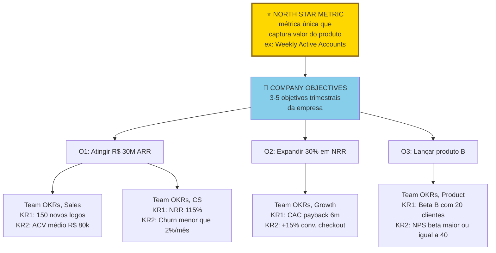

> [!important] Hierarquia descendente
> Do North Star à Company, depois aos Times. Os KRs dos times devem somar ao KR do nível acima. Senão times viram silos otimizando métricas que não movem a empresa. Revisão quinzenal de scoring (zero a um). Sweet spot: zero vírgula seis a zero vírgula sete (ambicioso, mas atingível).

> [!tip] Stack mínimo da Fase 14, frente Operações
> Em escala, stack operacional fica mais importante que stack de produto. **OKRs e gestão**: Notion, Asana, ClickUp, Linear (para times tech), ou plataformas específicas de OKR (Perdoo, Weekdone). **Documentação interna**: Notion, Confluence, Coda. **Comunicação**: Slack ou Microsoft Teams. **Videoconferência**: Google Meet, Zoom. **RH e folha**: Gupy para recrutamento. Sólides, Pipefy ou Factorial para gestão. Omie ou Conta Azul mais parceiros para folha no Brasil. **Financeiro**: Conta Azul ou Omie para ERP pequeno. Sage Intacct, NetSuite para médio. QuickBooks internacional. **Analytics de produto**: Mixpanel, Amplitude, PostHog. **CRM**: HubSpot (grátis inicial), Pipedrive, Salesforce (pesado, enterprise). **Regra**: consolidar ferramentas sempre que possível. O custo escondido de integrar vinte SaaS diferentes é altíssimo.

> [!note] Entregáveis e gates da subfase Operações
> Arquitetura Operacional: sistema de OKRs, cadência de reuniões, playbook de processos críticos, stack de ferramentas de gestão. Comece quando o time passa de ~15 pessoas, ou quando comunicação começa a gerar mais atrito do que velocidade. Termine quando processos críticos estão documentados, rituais em cadência, stack estável. Revisite a cada 6-9 meses de alta velocidade de contratação. Executor: CEO + Head of Operations (ou Chief of Staff) + lideranças de área. Decisor: CEO em cadência; lideranças em execução.

### COMO

Sete passos.

#### Passo 1, institua cadência de gestão em três camadas

> [!note]
> Cadência operacional — ritmo de all-hands, incidentes, automação e OKRs operacionais — é detalhada no [[#CAPÍTULO 11 — OPERAÇÕES EM ESCALA|Capítulo 11 — Operações em Escala]].

Toda empresa em escala roda em três ciclos simultâneos.

**Ciclo anual, planejamento estratégico.** Q4 do ano: revisão do ano, mais planejamento do próximo (visão, apostas estratégicas, metas anuais, orçamento, e estrutura organizacional). Os entregáveis: documento de estratégia anual, orçamento aprovado, e OKRs anuais em esboço.

**Ciclo trimestral, OKRs.** Semana 1 de cada trimestre: lançamento formal dos OKRs com todo o time. Semanas 4 e 8: check-ins de progresso (não apenas status, recalibração). Última semana: retrospectiva e scoring (zero a um por KR, com justificativa). Os entregáveis: documento de OKRs por área, e report trimestral para board (se houver).

**Ciclo semanal, operacional.** Segunda: reunião de liderança (C-level e VPs), focada nos top três a cinco bloqueios da semana. Terça ou quarta: reuniões 1:1 (cada gestor com cada reporte direto, quarenta e cinco a sessenta minutos). Quinta: reviews de área (engenharia, vendas, e CS). Sexta: all-hands, ou newsletter interna.

> [!important] A regra de fundo
> Se você não tem reunião de liderança semanal fixa, com agenda escrita, você não tem gestão. Tem reação.

#### Passo 2, implemente OKRs corretamente

A maioria implementa errado. Os erros mais comuns, em ordem de frequência.

Confundir OKR com KPI recorrente. OKRs descrevem *mudança* ("aumentar NRR de 95% para 115%"). KPIs descrevem *nível* ("NRR mensal"). Não misture.

OKRs demais. Mais de três a cinco OKRs por time é receita para não alcançar nenhum. Forçar priorização é função do processo.

Key Results que são iniciativas. "Lançar feature X" não é KR. É iniciativa. KR é o resultado mensurável que a feature deveria produzir. Por exemplo, "aumentar retenção D30 em dez pontos percentuais".

Sandbagging (colocar metas conservadoras para garantir sucesso). OKRs ambiciosos têm sessenta a setenta por cento de atingimento como "bom". Se você bate cem por cento sempre, as metas estão baixas.

Não recalibrar mid-quarter. Se nas semanas quatro a seis fica claro que um OKR vai falhar (ou exceder muito), ajuste com justificativa escrita. Rígido é pior do que honesto.

Formato canônico de OKR.

```text
Objective: [direcional, ambicioso, memorável]
 KR1: [número inicial] → [número alvo] (por [data])
 KR2: [número inicial] → [número alvo]
 KR3: [número inicial] → [número alvo]
Owner: [uma pessoa responsável, não um time]
```

#### Passo 3, documente os 10 processos críticos operacionais

> [!note]
> Estruturação de onboarding 30/60/90, wikis e runbooks — a infraestrutura de conhecimento que torna os playbooks consultáveis — está no [[#CAPÍTULO 9 — GESTÃO DO CONHECIMENTO|Capítulo 9 — Gestão do Conhecimento]].

Cada empresa tem processos que, se quebrados, geram dor imediata. Liste os seus. Os típicos. Onboarding de novo cliente. Faturamento e cobrança (incluindo inadimplência). Suporte técnico (SLA por tier). Desenvolvimento de feature (da ideia ao deploy). Incident response (quando o produto cai). Onboarding de novo colaborador. Off-boarding de colaborador. Contratação sênior. Deal review (sales operations). Renewal e churn prevention.

Para cada um, crie um playbook em texto simples (não precisa de software caro) com: dono do processo, passo a passo numerado, SLA por etapa, ferramentas usadas, exceções conhecidas e métrica de qualidade.

Coloque os playbooks em wiki (Notion, Confluence, GitBook) e revise-os semestralmente. Processo desatualizado é pior do que nenhum processo.

#### Passo 4, defina stack de ferramentas operacionais

A evolução do stack operacional por fase:

```mermaid
flowchart LR
 subgraph PreP["PRÉ-PMF (Fase 3-11)"]
 P1[Google Workspace]
 P2[Notion / Linear]
 P3[Slack]
 P4[GitHub]
 P5[Stripe / Pagar.me]
 P6[PostHog / Mixpanel]
 end

 subgraph PosP["PÓS-PMF (Fase 14, frente Time)"]
 PP1[Tudo do pré-PMF +]
 PP2[HubSpot / Salesforce CRM]
 PP3[Intercom / Zendesk]
 PP4[Amplitude]
 PP5[Datadog / Sentry]
 PP6[BambooHR / People]
 PP7[1Password / Vault]
 end

 subgraph Escala["ESCALA (Série B+)"]
 E1[Tudo anterior +]
 E2[CS: Gainsight / ChurnZero]
 E3[Data: Snowflake / BigQuery]
 E4[BI: Looker / Metabase]
 E5[Identity: Okta]
 E6[Security: Drata / Vanta]
 E7[Finance: NetSuite / Oracle]
 end

 PreP --> PosP --> Escala

 style PreP fill:#FFE4B5
 style PosP fill:#87CEEB
 style Escala fill:#90EE90
```

> [!warning] Não antecipar stack
> Adquirir ferramentas caras cedo é procrastinar com dinheiro. Ferramenta não resolve falta de processo. A regra: adicione ferramenta quando a ausência já custa mais que o custo anual da ferramenta.

| Função | Ferramentas típicas em 2026 |
|---|---|
| Comunicação | Slack, Discord, Teams |
| Documentação e wiki | Notion, Confluence, GitBook |
| Gestão de projetos | Linear, Jira, Asana |
| CRM | HubSpot, Salesforce, Attio |
| E-mail e calendário | Google Workspace, Microsoft 365 |
| Analytics de produto | Mixpanel, Amplitude, PostHog |
| Business intelligence | Metabase, Looker, Hex |
| Data warehouse | BigQuery, Snowflake, Redshift |
| Financeiro | Conta Azul, QuickBooks, Omie |
| RH e folha | Gupy, Sólides, Kenoby |
| Contratos | DocuSign, Clicksign, Zapsign |
| Pagamentos B2B | Iugu, Pagar.me, Stripe |

> [!important] Princípio do stack
> Menos é mais. Doze ferramentas bem-integradas valem mais que trinta ferramentas que ninguém usa direito. Cada ferramenta nova exige treinamento, integração, e custo marginal de atenção.

> [!note]
> Automação de CS, vendas e operações com IA — incluindo quando automatizar versus manter toque humano — é tratada no [[#CAPÍTULO 7 — AI OPS E AUTOMAÇÃO INTELIGENTE|Capítulo 7 — AI Ops e Automação]].

#### Passo 5, evolua a comunicação interna de 10 para 50 e para 100 pessoas

> [!note]
> Formatos de all-hands, comunicação de RIF e protocolos async por tamanho de time estão no [[#CAPÍTULO 10 — COMUNICAÇÃO INTERNA|Capítulo 10 — Comunicação Interna]].

Comunicação que funcionava com dez não funciona com cinquenta. A regra operacional: com cerca de dez pessoas, Slack no geral — todo mundo sabe o que todo mundo faz. Com cerca de trinta, times virtuais por projeto, all-hands semanais e compartilhamento de conhecimento estruturado. Com cinquenta a cem, comunicação em camadas (C-level para VPs para times), newsletter interna mensal e decisões importantes com RFC (Request for Comments) escrito. Com cem ou mais, fóruns formais (engineering review, product review, business review trimestral), townhalls mensais e comunicação executiva top-down com tempo para perguntas.

> [!warning] Sinal-vermelho na comunicação
> Se mais de vinte por cento das pessoas dizem "não sei o que está acontecendo" em pesquisa anônima, comunicação interna falhou.

#### Passo 6, construa data infrastructure mínima desde cedo

> [!tip] Capítulo 14 (Vol. 4) — Dados e Analytics
> Arquitetura de dados para startups em escala: data warehouse, ETL, modelagem de dados, cultura data-driven e como estruturar a função de analytics (self-serve vs. analista centralizado).

Antes de vinte pessoas, planilhas Google resolvem. Acima disso, você precisa de quatro coisas. Data warehouse, mesmo que pequeno: BigQuery ou Snowflake, com ingestão automática de produção, mais CRM, mais financeiro. Dashboards centrais: receita, retenção, CAC e LTV, churn, e pipeline. Atualizados diariamente. Acesso controlado: nem todos precisam ver tudo. Cultura de "dados antes de opinião": decisões grandes são acompanhadas de análise de dado antes.

#### Passo 7, institua blameless post-mortems

Quando algo dá errado (produto cai, cliente grande cancela, incidente de segurança), siga este processo: escreva o post-mortem em até cinco dias, com foco no sistema, não na pessoa ("por que o processo permitiu o erro?"). Use três seções: o que aconteceu, o que causou e o que mudar. Publique internamente para toda a empresa aprender. Defina ação de melhoria com dono e prazo.

> [!important] Cultura de erro
> Cultura que pune erro gera ocultamento. Cultura que aprende do erro gera resiliência.

### PERGUNTAS A RESPONDER

- Tenho cadência semanal, trimestral, e anual formalizada?
- Os meus OKRs descrevem mudança, ou são KPIs disfarçados?
- Quais processos críticos ainda são "no implícito", e precisam virar playbook?
- A minha stack está enxuta (doze a quinze ferramentas), ou inflada?
- Pessoas entrando hoje conseguem saber o que está acontecendo em menos de uma semana?
- Quando o produto caiu da última vez, o que aprendemos formalmente?

### SAÍDA DESTA FASE

A [[IGNICAO-Vol-6-Receita-e-Pessoas#FASE 16 — TIME, LIDERANÇA EXECUTIVA E CULTURA EM ESCALA|Fase 16 (Vol. 6)]] (Operações) está concluída quando os seis critérios abaixo estão cumpridos.

1. Cadência de gestão (semanal, trimestral, anual) está formalizada, e rodando há dois ou mais trimestres. Aderência (reuniões acontecendo na data, com agenda e ata) ≥90%.
2. OKRs estão em uso, com scoring trimestral. Atingimento entre 60-70% do alvo é saudável (100% indica metas baixas).
3. Os top dez processos críticos têm playbook escrito. Decisões grandes (afetam ≥10 pessoas ou custo ≥R$ 100k) com RFC escrito em ≥80% dos casos.
4. Stack operacional está estabilizada (até quinze ferramentas ativas).
5. Data infrastructure mínima está operando.
6. Blameless post-mortems estão instituídos. MTTR: P0 <1h, P1 <4h, P2 <24h, com trajetória decrescente em todas as severidades.

**Critérios observáveis.**

1. OKRs trimestrais escritos, com revisão mensal documentada.
2. Dashboard central existe, com seis ou mais métricas atualizadas semanalmente.
3. Cinco ou mais processos críticos documentados, com dono claro.
4. Reuniões seguem agenda padrão, com decisões e ações registradas.
5. Stack de SaaS inventariado, e otimizado nos últimos seis meses.
6. Documentação interna centralizada, e atualizada.

**Checklist de avanço.**

- [ ] Implementei ciclos de planejamento (OKRs trimestrais ou equivalente)?
- [ ] Tenho dashboard operacional central, com métricas-chave atualizadas semanalmente?
- [ ] Defini processos documentados para contratação, onboarding, atendimento, e operação?
- [ ] Implementei sistema de tickets ou gestão para cada área (produto, customer, operação)?
- [ ] Tenho pessoas responsáveis nomeadas por cada sistema ou processo (dono único, não compartilhado)?
- [ ] As reuniões têm agenda, dono, duração, e saída clara (decisões ou ações)?
- [ ] Stack operacional consolidado, sem proliferação descontrolada de SaaS?
- [ ] Documentação interna centralizada (Notion, Confluence, ou equivalente)?

**Próximos passos.**

1. Rodar sessão de OKRs para o próximo trimestre. Três a cinco objetivos da empresa, mais dois a quatro key results cada.
2. Criar dashboard central em Notion, ou Looker. North Star, mais cinco a sete métricas secundárias atualizadas semanalmente.
3. Listar processos críticos ainda não documentados. Escolher dois para documentar essa semana.
4. Auditar SaaS pagos. Eliminar redundância. Consolidar onde possível.

### EXEMPLO PRÁTICO (Operações)

**OKRs Q3, PadariaPro (exemplo).**

**O1: acelerar crescimento em SP Capital e RM, com qualidade de PMF.**
KR1: crescer de oitenta para cento e cinquenta clientes pagantes no trimestre.
KR2: manter retenção mensal de noventa e cinco por cento ou mais (churn de cinco por cento ou menos).
KR3: atingir NPS de cinquenta ou mais.

**O2: reduzir dependência do fundador em vendas.**
KR1: setenta por cento das deals do trimestre fechadas sem founder no pitch (hoje: trinta por cento).
KR2: Head of Sales contratado, e ramped em noventa dias.
KR3: Playbook de vendas v1 documentado, e usado em cem por cento das deals.

**O3: preparar expansão para duas novas cidades (Campinas, Grande Rio).**
KR1: dez clientes em Campinas até fim do Q3.
KR2: um Green Angel contratado para Campinas.
KR3: decisão go ou no-go para Grande Rio documentada até fim do Q3.

**Dashboard Central, seção principal.**

| Métrica | Meta Q3 | Hoje | Tendência |
|---|---|---|---|
| North Star: Pedidos confirmados/semana | 1.200 | 820 | ↑ |
| Clientes pagantes | 150 | 103 | ↑ |
| Churn mensal | ≤ 5% | 4,2% | → |
| NPS | ≥ 50 | 48 | → |
| CAC | ≤ R$ 2.000 | R$ 1.850 | → |
| Pipeline ativo | ≥ R$ 300k | R$ 290k | ↑ |
| NPS de colaborador | ≥ 70 | 68 | → |
| Burn mensal | ≤ R$ 85k | R$ 78k | → |

**Processos documentados (amostra).**

1. Onboarding de novo cliente (v3, dono: Paula, CS).
2. Onboarding de novo colaborador (v2, dono: Mariana, CEO).
3. Processo de triagem de bug crítico (v1, dono: Bruno, CTO).
4. Fluxo de cold outbound (v1, dono: Roberto, Sales).
5. Revisão trimestral de OKRs (v1, dono: Bruno, Estratégia).
6. Processo de contratação (v2, dono: Mariana).

### ARMADILHAS

"Processos matam cultura". Falso. Falta de processo mata cultura. As pessoas saem por frustração. O ponto é processos *leves e úteis*, não ausência deles.

Over-tooling. Adotar toda ferramenta nova que aparece. O resultado: quarenta logins, e nada integrado.

OKRs como teatro. A organização posta OKRs no início do trimestre, e ignora até o próximo. Os rituais de check-in são obrigatórios.

Reuniões demais sem agenda. Reunião sem agenda escrita é roubo de tempo. Cancele, ou peça para reenviarem com agenda.

"Data quando precisar". Esperar para construir infra de dados depois que já precisava é sempre mais caro do que construir cedo.

---

### CASO BRASILEIRO, Fase 17 (Operações), VTEX e internacionalização

A VTEX, plataforma brasileira de comércio eletrônico, expandiu para LatAm, Europa, e América do Norte. A decisão. Antes de internacionalizar agressivamente, consolidaram operações internas com OKRs trimestrais, playbooks de onboarding de cliente multi-idioma, infraestrutura técnica multi-região, processo de contratação em três continentes, e governança de produto com roadmap global.

O resultado foi internacionalização bem-sucedida, com IPO em Nova York em 2021. Empresas brasileiras que tentaram internacionalizar sem infraestrutura operacional madura tipicamente falharam, ou queimaram capital excessivo na tentativa.

A lição transferível. Operação escalável é pré-requisito para internacionalização. Não consequência dela. Empresas que invertem a ordem pagam caro.

---

### FERRAMENTAS DESTA FASE

Quatro essenciais para a subfase. Templates: Template: OKR Cascade Anual (Fase 17) (OKR Cascade Anual) e Template: Post-Mortem de Incidente Técnico (Fase 17) (Post-Mortem blameless).

**Essenciais para Operações:**

- **OKRs** (Andy Grove, John Doerr) — Objectives qualitativos + Key Results quantitativos trimestrais. Ambiciosos (70% de atingimento é meta). Desacoplados de bônus. Framework: OKRs — Objectives and Key Results (Andy Grove, 1970s; John Doerr, popularizou) (Fase 17).
- **Scaling Up / Rockefeller Habits** (Verne Harnish, 2014) — People, Strategy, Execution, Cash. OPSP de uma página. Para 20-2000 funcionários. Framework: Scaling Up / Rockefeller Habits (Verne Harnish, 2014) (Fase 17).
- **Amazon 6-Pager** (Bezos) — documento narrativo de seis páginas substitui PowerPoint. Primeiros 20 minutos em leitura silenciosa. Para decisões estratégicas grandes. Framework: Amazon 6-Pager (Jeff Bezos, Amazon) (Fase 17).
- **DORA Metrics e SPACE Framework** (Forsgren et al.) — Deployment Frequency, Lead Time, Change Failure Rate, Time to Restore. Para engineering performance. Framework: DORA Metrics (Forsgren, Humble, Kim, 2014); SPACE Framework (Forsgren, Storey et al., 2021) (Fase 17).

**Complementares (consulte conforme o caso):**

- V2MOM (Benioff/Salesforce), OGSM, EOS/Tração (Wickman), MBO (Drucker), Scrum, Kanban, Weekly Business Review (Amazon), 4 Disciplines of Execution (4DX), Hoshin Kanri (cascata com catchball), Balanced Scorecard (Kaplan/Norton), Lean Analytics (Croll/Yoskovitz, OMTM), Value Stream Mapping, Toyota Kata. Detalhamento em Framework: Hoshin Kanri (Japão, anos 1950-1970) (Fase 19, Vol. 9) a Framework: Toyota Kata (Mike Rother, 2010) (Fase 17).

---


---

### MANUAL PASSO A PASSO DOS FRAMEWORKS DESTA FASE

> [!tip] Uso autocontido neste volume
> Todos os frameworks abaixo estão detalhados integralmente com origem, estrutura, passo a passo de aplicação, exemplo brasileiro e armadilhas para execução imediata nesta **Fase 17**.

#### Framework: Continuous Discovery Habits (Teresa Torres, 2021)

##### Origem

Teresa Torres, coach de produto com carreira em empresas como SurveyMonkey e HubSpot, publicou *Continuous Discovery Habits* em 2021 consolidando anos de consultoria com times de produto. Livro se tornou referência moderna em product discovery, ensinado em Reforge e escolas de produto globalmente.

##### O que é

Framework de **descoberta contínua** de produto (em oposição a descoberta em projetos pontuais). Tese central: times de produto devem ter **contato semanal com clientes** e **estruturar aprendizado** em torno de uma ferramenta visual, a **Opportunity Solution Tree** (Framework: Opportunity Solution Tree (Teresa Torres) (Fase 9, Vol. 3)).

##### Princípios / estrutura

Hábitos principais:

1. Interviewing semanal: time de produto entrevista pelo menos 1-2 clientes por semana. Não eventual, ritual.
2. Opportunity Solution Tree (OST): ferramenta visual conectando outcome desejado → oportunidades (problemas/necessidades do cliente) → soluções candidatas → experimentos.
3. Assumption testing: cada solução tem premissas, testar as mais arriscadas antes de construir.
4. Decision logs: documentar decisões e raciocínio, evitar revisitar mesma discussão.
5. Time outcome-oriented: time mede sucesso por outcome (métrica de impacto), não output (features entregues).

##### Como aplicar do jeito certo

Passo 1, Defina outcome claro (ex.: "aumentar retenção no dia 30 de 40% para 55%"). Não é "lançar feature X".

Passo 2, Entrevistas semanais com 1-2 clientes do ICP target. Produto Manager + designer + engenheiro juntos quando possível.

Passo 3, Após entrevistas, atualize OST: novas oportunidades identificadas, quais são mais promissoras para o outcome?

Passo 4, Para cada oportunidade promissora, brainstorm soluções candidatas (múltiplas, não única).

Passo 5, Priorize 1-2 soluções para experimentar.

Passo 6, Assumption test rápido: o que precisa ser verdade para a solução funcionar? Teste a premissa mais arriscada.

Passo 7, Construa e libere quando evidência suficiente, volte a descobrir.

##### Exemplo aplicado

Time de SaaS B2B implementa continuous discovery:

Outcome: aumentar conversão trial → paid de 8% para 15%.

Entrevistas semanais com usuários em trial:

Semana 1-4: identifica 4 oportunidades principais via OST:

- "Usuários não entendem valor na 1ª hora."
- "Configuração inicial trava 40% dos usuários."
- "Preço parece alto sem contexto."
- "Falta de urgência para converter."

Prioriza "configuração inicial trava 40%":

- Soluções candidatas: (a) onboarding guiado, (b) setup pré-populado, (c) concierge setup (CS faz).
- Assumption test: qual das 3 abordagens os usuários preferem?
- Experimento: oferece (b) e (c) para próximos 20 trials, mede conclusão de setup.

Resultado: setup pré-populado resolve 70% dos casos, concierge para os 30% restantes. Conversão sobe para 13% em 6 semanas.

##### Erros comuns

Entrevistas eventuais: ritual de 1x por trimestre não gera continuous discovery. OST no papel, decisões no ad-hoc: árvore decorativa, time decide por outros critérios. Uma solução por oportunidade: elimina comparação, primeiro pensamento nem sempre é melhor. Pular assumption test: constrói feature grande, descobre que premissa base era falsa. Time output-oriented: mede "features entregues", não impacto em métrica.

##### Quando NÃO usar

Pré-PMF em fase de descoberta ampla, Teresa recomenda framework mais exploratório primeiro, Times muito pequenos sem PM dedicado, difícil manter cadência.

##### Leitura adicional

- Torres, T. (2021). *Continuous Discovery Habits*. Product Talk.
- Blog producttalk.org (Teresa Torres, artigos e vídeos regulares).

---

#### Framework: Shape Up (Ryan Singer / Basecamp, 2019)

##### Origem

Ryan Singer, ex-VP Produto da Basecamp, publicou *Shape Up* (gratuitamente online em basecamp.com/shapeup) em 2019, consolidando método interno da Basecamp desde ~2009. Alternativa ao Scrum, propondo **ciclos mais longos (6 semanas)**, **trabalho shaped (não user stories)**, e **autonomia de time**.

##### O que é

Método de desenvolvimento de produto que se opõe a Scrum tradicional, com três princípios centrais:

- Shaped work: problemas são "shaped" em documento detalhado antes de chegar ao time, elimina ambiguidade.
- Ciclos de 6 semanas: tempo suficiente para trabalho significativo, pressão para foco.
- Betting table: liderança "aposta" em projetos a cada ciclo (não backlog interminável).

##### Princípios / estrutura

Fases:

1. Shaping: senior people (PM, designer senior) tomam tempo "shape" o problema, definem appetite (tempo), boundaries (o que não fará), e risco. 1-2 semanas.

2. Betting: a cada 6 semanas, leadership "aposta" em 4-5 shaped projects. Descartados não viram "debt", somem.

3. Building: times pequenos (1-3 pessoas) executam, têm autonomia total sobre como.

4. Cooldown: 2 semanas após ciclo de 6 semanas para manutenção, tech debt, exploração.

Hill chart: ferramenta visual de progresso. Times acompanham projeto "subindo a colina" (desconhecidos) e "descendo" (conhecidos, em execução).

##### Como aplicar do jeito certo

Passo 1, Cultura de shaping: invista em gente sênior para fazer shaping decente. Shape ruim = projeto ruim.

Passo 2, Ciclos de 6 semanas: resiste a "adicionar no meio", no meio do ciclo, foco total.

Passo 3, Appetite (não estimate): "este problema vale 6 semanas?", se não cabe, reduza escopo ou descarte.

Passo 4, Time pequeno autônomo: não micromanage, entregam ou não entregam.

Passo 5, Cooldown: não cortar. Cooldown é onde surge criatividade e saúde técnica.

##### Exemplo aplicado

SaaS adota Shape Up:

Ciclo de 6 semanas:

- Apostas: (a) redesign de dashboard, (b) feature de automação recorrente, (c) integração com ferramenta X.
- Time de 2 pessoas em cada.
- Liderança não interfere por 6 semanas.
- Hill chart atualizado semanalmente: Shape Up visível sobre o que está incerto vs. decidido.

Final do ciclo:

- Dashboard: shipped.
- Automação: 85% pronto, leva 1 semana extra do cooldown.
- Integração X: abandonado (mais complexo que apetite de 6 semanas comportava). Re-shape futuro.

Cooldown de 2 semanas: tech debt, bugs, exploração.

##### Erros comuns

Ciclo de 6 semanas com adições no meio: destrói o método, Shaping superficial: projeto começa com problema vago, termina em confusão, Time sem autonomia real: micromanagement quebra o princípio, Aplicar a time muito grande: Shape Up funciona melhor em times de 3-15 pessoas, em escala grande, adaptações são necessárias.

##### Quando NÃO usar

Startup pré-PMF com pivot frequente, Contextos regulatórios com sprint obrigatório (ex.: governo), Times sem maturidade para autonomia.

##### Leitura adicional

- Singer, R. (2019). *Shape Up*. basecamp.com/shapeup (gratuito).

---

#### Framework: Working Backwards / PR-FAQ (Amazon, internal method)

##### Origem

Amazon desenvolveu "Working Backwards" internamente desde início dos anos 2000, formalizado por Ian McAllister e outros VPs. Publicado externamente em *Working Backwards* (Colin Bryar e Bill Carr, 2021) após ambos saírem da Amazon. Método central em cultura de produto da Amazon.

##### O que é

Processo de desenvolvimento de produto que começa **escrevendo a press release final** e FAQ do produto **antes de construir**. Força clareza sobre: quem é o cliente, qual problema, qual solução, como explicar em linguagem clara, quais objeções existem.

##### Princípios / estrutura

Dois documentos:

Press Release (1-1.5 página): como seria a release quando produto launching.

- Headline.
- Summary.
- Customer problem.
- Solution.
- Quote executivo.
- Quote de cliente fictício.
- Call-to-action.

FAQ (3-5 páginas):

- Customer FAQ (perguntas que usuário faria).
- Internal FAQ (perguntas difíceis que executivos fariam).

##### Como aplicar do jeito certo

Passo 1, Escreva PR primeiro, antes de design, antes de código.

Passo 2, Linguagem clara, não jargão técnico. Se cliente não entende PR, produto não tem clareza.

Passo 3, FAQ cobre objeções internas reais: custo, prazo, risco, cannibalization, competição.

Passo 4, Itere: revise PR/FAQ antes de commit. Mudanças são baratas aqui.

Passo 5, Aprovação do PR/FAQ antes de ir para execução.

Passo 6, Executivos leem em silêncio no início de reuniões (~30 min), depois discutem. Sem decks, só documento.

##### Exemplo aplicado

PR-FAQ para nova feature de SaaS:

PR (simplificado):
"Empresa X anuncia Conciliação Inteligente, nova feature que automatiza conciliação bancária para PMEs... reduz tempo de 5 horas por mês para 15 minutos... 'Antes eu passava madrugada fechando o mês, agora faço antes do almoço', disse Maria, dona de loja em Curitiba..."

FAQ:

- "Quanto custa implementar esta feature?"
- "Por que não fizemos isso antes?"
- "Como competimos com ferramenta X que já oferece?"
- "Quais integrações bancárias são obrigatórias?"
- "E se banco não tiver API?"
- "Qual o impacto esperado em retenção?"
- "Quantos engenheiros/trimestres?"

Processo: liderança lê PR-FAQ, pergunta questões difíceis antes de aprovar, ajusta com clareza, depois vai para execução.

##### Erros comuns

Deck em vez de documento: slides simplificam demais, escrita força raciocínio, PR vaga: "revolucionaria", "incrível", sem especificidade, FAQ só com perguntas fáceis: evita dificuldades, fraqueza em raciocínio, Pular PR-FAQ para "ir mais rápido": ironia, pula rigor, constrói errado, refaz.

##### Quando NÃO usar

Decisões pequenas/táticas (overhead desnecessário), Produtos já validados em iteração pequena.

##### Leitura adicional

- Bryar, C. & Carr, B. (2021). *Working Backwards*. St. Martin's Press.

---

#### Framework: Stage-Gate Process (Robert Cooper, 1986)

##### Origem

Robert Cooper (professor McMaster University) desenvolveu Stage-Gate em estudos com empresas industriais nos anos 1980. *Winning at New Products* (1986) é texto canônico. Adotado por milhares de empresas (Procter & Gamble, 3M, Lego) em desenvolvimento de novos produtos. Versão moderna "Stage-Gate Express" adapta para ciclos rápidos.

##### O que é

Processo de desenvolvimento de novos produtos dividido em **estágios** separados por **gates** (pontos de decisão go/no-go). Reduz risco ao investir gradualmente e filtrar projetos fracos cedo.

##### Princípios / estrutura

Estágios clássicos (5 + discovery):

0. Discovery: geração de ideias.
1. Scoping: análise preliminar.
2. Business case: análise detalhada + plano.
3. Development: desenvolvimento.
4. Testing & validation: testes com usuários.
5. Launch: lançamento e comercialização.

Entre cada estágio, um Gate: grupo decide go/kill/recycle/hold. Critérios específicos: mercado viável? Técnica factível? Negócio atrativo? Alinhado à estratégia?

##### Como aplicar do jeito certo

Passo 1, Defina estágios e gates claros.

Passo 2, Gates com critérios objetivos, não políticos.

Passo 3, Investimento escalonado: mais recurso em estágios avançados, pouco em iniciais.

Passo 4, Willingness to kill: gates são para filtrar. Se nunca kill, gates são teatro.

Passo 5, Ciclos curtos em versões modernas: Stage-Gate Express reduz duração de cada estágio.

##### Exemplo aplicado

Empresa de CPG testando novo produto:

- Discovery: 40 ideias.
- Gate 1: 10 sobrevivem.
- Scoping (2 semanas, R$ 50k): análise de mercado rápida.
- Gate 2: 5 sobrevivem.
- Business case (3 meses, R$ 500k): pesquisa, protótipo, business plan.
- Gate 3: 2 sobrevivem.
- Development (9 meses, R$ 3M): produto funcional.
- Gate 4: 1 sobrevive.
- Testing (3 meses).
- Gate 5: launch aprovado.
- Launch.

Resultado: 1 em 40 chega ao mercado, mas com alta probabilidade de sucesso. Investimento médio por projeto baixo.

##### Erros comuns

Gates como formalidade: todos passam, sem filtro real, Critérios subjetivos: "executivo gostou" não é critério, Rígido demais em contextos digitais: lean/agile são mais adequados para software em muitos casos.

##### Quando NÃO usar

Software SaaS early-stage (iteração rápida é melhor), Contextos muito incertos onde "critérios" são artificiais.

##### Leitura adicional

- Cooper, R. G. (1986, multiple editions). *Winning at New Products*. Basic Books.
- Cooper, R. (2017). "Stage-Gate for the Digital Age", versão atualizada.

---

#### Framework: Dual-Track Agile (Desiree Sy 2007; Cagan & Patton 2012)

##### Origem

A formalização emergiu em três passos. Lynn Miller cunhou o conceito de "dual track" em 2005. Desiree Sy (Autodesk) publicou *Adapting Usability Investigations for Agile User-Centered Design* em 2007, descrevendo o padrão que vários times já praticavam. Em 2012, Marty Cagan (ex-CPO eBay, fundador da Silicon Valley Product Group) e Jeff Patton (autor de *User Story Mapping*) formalizaram o termo "Dual-Track Scrum/Agile" e o popularizaram via SVPG e *Inspired* (Cagan, 2008/2017). Responde à crítica: Agile/Scrum clássico foca em **delivery**, não **discovery**. Dual-Track separa as duas tracks, paralelas.

##### O que é

Método que opera **dois tracks paralelos**:

1. Discovery Track: PM, designer, engineer-lead exploram problemas e validam soluções com usuários. Output: solutions validadas.

2. Delivery Track: engineering constrói e entrega o que discovery validou. Output: produto em produção.

Ambos acontecem ao mesmo tempo, discovery da próxima feature enquanto engineering entrega a atual.

##### Princípios / estrutura

Discovery track é contínuo, não pontual:

- Entrevistas semanais.
- Prototipação rápida.
- Assumption testing.
- Validação antes de entrega.

Delivery track tem Scrum/Kanban/Shape Up conforme preferência do time.

##### Como aplicar do jeito certo

Passo 1, PM + designer + tech lead dedicam tempo a discovery (20-50% da semana).

Passo 2, Discovery é estruturado: entrevistas, testes, prototypes. Não "reunião ad-hoc".

Passo 3, Só entrega o que discovery validou: features sem evidência não entram em delivery.

Passo 4, Sprints de delivery operam paralelos: engineering builds o que já foi validado.

Passo 5, Métricas separadas: discovery mede aprendizado (hipóteses testadas), delivery mede entrega.

##### Exemplo aplicado

Time de 7 pessoas (1 PM, 1 designer, 4 engs, 1 tech lead):

Semana típica:

- PM + designer + tech lead: 40% do tempo em discovery.
- 2 entrevistas com usuários.
- 1 teste de usabilidade com protótipo.
- 1 assumption test.
- Engineering: 100% em delivery.
- Sprint de 2 semanas executando features validadas 2-4 semanas antes.

Flow: feature idea → validada em discovery → entra em backlog de delivery → implementada → medida em produção → aprendizados alimentam discovery.

##### Erros comuns

Discovery cosmético: PM "valida" via opinião de colegas em vez de usuários, Delivery constrói sem validação: engineering em sprint enquanto descoberta é ignorada, Um track só: empresa diz "fazemos dual track" mas discovery some.

##### Quando NÃO usar

Times muito pequenos (< 5) sem recursos para dois tracks, Contextos muito regulamentados onde escopo é imposto externamente.

##### Leitura adicional

- Cagan, M. (2017). *Inspired* (2nd ed.). Wiley.
- Cagan, M. & Jones, C. (2020). *Empowered*. Wiley.

---

#### Framework: OKRs — Objectives and Key Results (Andy Grove, 1970s; John Doerr, popularizou)

##### Origem

**Andy Grove**, CEO da Intel nos anos 1970-80, desenvolveu OKRs a partir do MBO de Drucker (Framework: Management by Objectives (Peter Drucker, 1954) (Fase 17)). Grove ensinou **John Doerr** (que trabalhou na Intel antes da Kleiner Perkins). Em 1999, Doerr apresentou OKRs ao Larry Page e Sergey Brin na Google (empresa com ~40 pessoas). Google adotou e nunca abandonou. Doerr publicou *Measure What Matters* (2018) consolidando método. Hoje OKR é o framework de metas mais usado em tech globalmente.

##### O que é

Framework de definição e medição de metas em **ciclos trimestrais** (padrão) com dois componentes por meta:

- Objective: qualitativo, aspiracional, inspirador. "O que queremos alcançar?"
- Key Results (3-5 por objective): **quantitativos**, mensuráveis, ambiciosos. "Como saberemos que alcançamos?"

##### Princípios / estrutura

Características dos OKRs bem feitos:

- Ambiciosos: meta "segura" é mal definida. Alvo ideal = 70% de atingimento (10/10 é fácil demais).
- Transparentes: OKRs de todos (incluindo CEO) são visíveis a toda empresa.
- Cascateados: OKRs do time derivam dos da empresa, com alinhamento bi-direcional (alguns emergem de baixo).
- Desacoplados de compensação: OKR ligado a bônus gera gaming (metas que "batem 100%" mas pouco ambiciosas).
- Ciclos curtos: trimestral é padrão. Alguns usam mensal ou anual.

Diferença de KPIs: KPI é métrica contínua. OKR é meta com prazo. "MRR" é KPI, "atingir R$ 500k MRR até março" é KR.

##### Como aplicar do jeito certo

Passo 1, OKRs da empresa (top-level): CEO/liderança define 3-5 Os corporativos por trimestre. Cada O tem 3-5 KRs.

Passo 2, Cascata para times: cada time define seus OKRs, alinhados (não idênticos) aos da empresa.

Passo 3, Review em cadência: check-ins semanais (5 min por OKR: on track/at risk/off track + ação). Review formal mensal.

Passo 4, Score ao fim do trimestre: cada KR pontuado 0.0-1.0. Média do O é sua pontuação.

Passo 5, Retrospectiva: o que funcionou? O que aprendemos? Definir OKRs do próximo trimestre.

Passo 6, NÃO conectar a bônus: se conectar, funcionários definem Os conservadores para garantir bônus.

##### Exemplo aplicado

SaaS B2B brasileiro, OKR corporativo Q2 2026:

Objective: Construir motor de crescimento que escala sem depender de founder.

Key Results:

- KR1: CAC por canal < R$ 180 em 3 canais pagos (baseline: R$ 340).
- KR2: 40% de leads gerados por conteúdo orgânico (baseline: 15%).
- KR3: Contratar VP de Growth com experiência em SaaS $10M-50M ARR.
- KR4: Pipeline qualificado sustentar $1M em new ARR em junho (baseline: $400k).

Cascata, time de Marketing:
Objective: Construir motor de conteúdo orgânico sustentável.

- KR1: 50 artigos publicados em Q2.
- KR2: Sessões orgânicas mensais crescem de 8k → 25k.
- KR3: Top 3 no Google para 12 keywords-alvo.

Check-ins semanais. Ao fim de Q2: KR1 = 1.0 (hit). KR2 = 0.7 (22k). KR3 = 0.5 (6 keywords). Média = 0.73. Ambição apropriada.

##### Erros comuns

OKRs safety ("sandbagging"): metas fáceis para "bater 100%". Sinal: atingimento médio é 95%+, ambição baixa, Todo mundo com 10+ OKRs: dilui foco. 3-5 por time é teto, KRs como tarefas: "entregar feature X" é task, não KR. KR é resultado mensurável, Conectar OKR a bônus: distorce comportamentos, Sem check-ins: OKRs ficam esquecidos, revisão só no fim do trimestre = reativo demais, Copiar da Google sem adaptar: métodos operacionais precisam tunning local.

##### Quando NÃO usar

Startups pré-PMF com alta incerteza (trimestres inteiros podem mudar direção), Empresas muito pequenas (< 10 pessoas), overhead relativo alto, Ambientes com cultura rígida de cumprir-metas-ou-demissão (causará sandbagging).

##### Leitura adicional

- Doerr, J. (2018). *Measure What Matters*. Portfolio.
- Grove, A. (1983). *High Output Management*. Vintage.
- Site whatmatters.com (recursos de Doerr).

---

#### Framework: V2MOM (Marc Benioff / Salesforce, 1999)

##### Origem

**Marc Benioff**, fundador da Salesforce, criou V2MOM no primeiro ano da empresa (1999), inspirado em Oracle (onde trabalhou) mas querendo algo mais simples. Usado em todo ciclo de planejamento da Salesforce desde então. Benioff publicou sobre V2MOM em *Trailblazer* (2019). É base para como Salesforce cresceu de 3 pessoas para 80k+.

##### O que é

Framework de planejamento em **5 camadas** (acrônimo V2MOM):

- V, Vision: o que queremos alcançar? (aspirational, 3-5 anos).
- V, Values: quais valores guiam como chegamos lá?
- M, Methods: como executamos? (estratégias-chave).
- O, Obstacles: o que pode impedir?
- M, Measures: como saberemos que chegamos?

##### Princípios / estrutura

Diferença para OKRs: OKR foca em metas de curto prazo (trimestral). V2MOM captura **visão de longo prazo + valores + obstáculos** além de métricas. Mais holístico, menos trimestral.

Princípios:

- Cascata: CEO escreve V2MOM. VPs escrevem alinhando, times escrevem alinhando.
- Atualização anual (não trimestral).
- Valores explícitos: Salesforce tem "Trust" como #1 desde 1999.

##### Como aplicar do jeito certo

Passo 1, CEO/fundador escreve V2MOM para empresa toda.

Passo 2, Cada VP/líder escreve V2MOM do seu time, derivando da empresa.

Passo 3, Times executam contra V2MOM todo o ano.

Passo 4, Revisão anual: o que funcionou? O que não? Ajustar.

Passo 5, Valores são imutáveis (ou quase). Vision, Methods, Measures evoluem.

##### Exemplo aplicado

Startup brasileira de educação, V2MOM 2026:

Vision: Ser a principal plataforma de educação profissional no Brasil, formando 100k profissionais/ano em 3 anos.

Values:

1. Estudante no centro (decisões focam no resultado do estudante, não no nosso).
2. Excelência pedagógica (conteúdo testado, não empacotado).
3. Transparência radical (dados de resultado publicados).
4. Time forte e resiliente.

Methods:

1. Parcerias com top-3 escolas de cada área.
2. Plataforma de aprendizado adaptativo.
3. Garantia de emprego (ou devolução) em 12 meses.
4. Conteúdo em video + ao vivo + comunidade.

Obstacles:

1. Competição com Alura, Coursera, Hotmart em mercado já saturado.
2. Garantir empregabilidade depende de parcerias corporativas sólidas.
3. Custo elevado de produção de conteúdo top.
4. Ciclo de caixa longo (assinatura vs. CAC).

Measures:

1. 25k estudantes matriculados em Q4 2026.
2. Taxa de empregabilidade 65%+ em coortes formadas.
3. NPS > 60.
4. ARR R$ 80M em 2026.

##### Erros comuns

V sem verdade: vision é aspiracional mas precisa ser genuína. Copy-paste de outras empresas, Values que não pautam decisões reais: valores decoração, Methods desconectadas de obstacles: "vamos crescer 5x" sem addressing o obstáculo que impede, V2MOM sem cascata: documento do CEO, times operam sem referência.

##### Quando NÃO usar

Empresas que preferem frameworks mais focados (OKR trimestral), Contextos de alta incerteza onde Vision de 3-5 anos é ficção.

##### Leitura adicional

- Benioff, M. (2019). *Trailblazer*. Currency.
- Blog Salesforce (materiais internos tornados públicos sobre V2MOM).

---

#### Framework: EOS / tração (Gino Wickman, 2007)

##### Origem

**Gino Wickman** desenvolveu EOS (Entrepreneurial Operating System) em 2003 baseado em experiência de 25 anos como consultor de PMEs. Publicou *tração* em 2007, mais de 2M cópias vendidas. EOS é sistema operacional completo para empresas de 10-250 funcionários, principalmente PMEs tradicionais (não tech startups). Tem rede de Implementers certificados globalmente.

##### O que é

Sistema operacional que define **6 componentes-chave** que toda empresa precisa dominar: Vision, People, Data, Issues, Process, tração. Para cada, ferramentas específicas.

##### Princípios / estrutura

6 componentes:

1. Vision: todos conhecem e concordam com destino.
2. People: pessoas certas, nos lugares certos.
3. Data: scorecard com métricas centrais.
4. Issues: cadência para identificar e resolver problemas.
5. Process: processos documentados e executados consistentemente.
6. tração: sistema para cascatar metas e executar.

Ferramentas-chave do EOS:

- V/TO (Vision/tração Organizer): documento de visão em 2 páginas.
- Accountability Chart: organograma por função (não pessoa).
- Rocks: 3-7 prioridades trimestrais por pessoa.
- Scorecard: 5-15 números semanais que prevem saúde.
- Level 10 Meeting: reunião semanal de 90 min, estrutura rígida.
- IDS: framework de resolução de problemas (Identify, Discuss, Solve).

##### Como aplicar do jeito certo

Passo 1, Liderança define V/TO (vision em 10 perguntas-chave).

Passo 2, Accountability Chart: cada função tem dono claro, elimina "quem faz o quê?".

Passo 3, Rocks trimestrais: 3-7 prioridades por pessoa (compatível com OKR em princípio).

Passo 4, Scorecard semanal: 5-15 números que time líder revisa toda semana.

Passo 5, Level 10 Meeting toda semana (90 min, horário fixo).

Passo 6, Processos documentados: 8-12 processos core "FBA" (Followed By All).

Passo 7, Revisões trimestrais e anuais: rocks, scorecard, V/TO.

##### Exemplo aplicado

Empresa brasileira de 40 pessoas em serviços profissionais implementa EOS:

Ano 0: caos operacional. Sem clareza de quem faz o quê. Reuniões improdutivas. Sócios discordam em prioridades.

Implementação EOS (9 meses com Implementer certificado):

- V/TO: clareza sobre 10 anos de vision + 3 anos pictures + 1 ano plan.
- Accountability Chart: redesenhado, 2 roles redundantes eliminadas, 1 nova role (CFO fractional) criada.
- Rocks: cada pessoa do leadership tem 3-5 rocks trimestrais.
- Scorecard: 10 números-chave (MRR, churn, pipeline, caixa, NPS, etc.).
- Level 10 Meeting: toda segunda, 90 min, agenda rígida.
- IDS: issues identificados são resolvidos estruturadamente.

Resultado após 12 meses: receita +35%, margem +8 pp, retenção de funcionários melhora, sócios alinhados.

##### Erros comuns

EOS parcial: implementar só L10 meeting sem V/TO, rocks, scorecard, fica sem força. Sem Implementer (DIY): maioria das PMEs não consegue implementar sozinhas, custa tempo que vale investir em coach. L10 meeting virando chat: estrutura rígida existe por razão. Rocks virando to-do list: rocks são prioridades grandes, não 50 micro-tarefas.

##### Quando NÃO usar

Tech startups com alta incerteza (OKR é mais ágil), Empresas muito pequenas (< 10 pessoas), Empresas > 300 pessoas (Scaling Up é superior).

##### Leitura adicional

- Wickman, G. (2007). *tração*. BenBella Books.
- eosworldwide.com (recursos oficiais).

---

#### Framework: Scaling Up / Rockefeller Habits (Verne Harnish, 2014)

##### Origem

**Verne Harnish**, fundador da YPO/EO (Young Presidents Organization/Entrepreneurs Organization) e da Gazelles (consultoria), desenvolveu os "Rockefeller Habits" nos anos 1990, baseado em práticas de John D. Rockefeller aplicadas ao management moderno. Publicou *Mastering the Rockefeller Habits* em 2002, *Scaling Up* em 2014 com versão evoluída. Foco: empresas de 20-2000 funcionários em crescimento.

##### O que é

Framework para scaling baseado em **4 decisões fundamentais**: People, Strategy, Execution, Cash. Cada uma tem ferramentas específicas.

##### Princípios / estrutura

4 decisões:

1. People: pessoas certas em lugares certos (A-players).
2. Strategy: estratégia diferenciada e sustentável.
3. Execution: consistência em execução (os "habits").
4. Cash: fluxo de caixa saudável. Cash Conversion Cycle.

10 Rockefeller Habits (listagem resumida):

1. Equipe executiva saudável e alinhada.
2. Todos alinhados com # 1 prioridade trimestral.
3. Cadência de comunicação (daily huddle, weekly, monthly, quarterly).
4. Cada função tem um "accountable" primário.
5. Feedback de funcionários coletado continuamente.
6. Feedback de clientes coletado continuamente.
7. Valores vividos (contratar/desligar por valores).
8. Brand Promise (promessa diferenciada monitorada).
9. Funcionários podem descrever estratégia em 1 frase.
10. Funcionários engajados e produtivos.

Ferramentas-chave:

- One-Page Strategic Plan (OPSP): 1 página com vision + execution.
- Priorities (similar a rocks do EOS).
- Meeting rhythm: daily huddle, weekly, monthly, quarterly, annual.
- BHAG (Big Hairy Audacious Goal): meta de 10-25 anos.

##### Como aplicar do jeito certo

Passo 1, OPSP: liderança preenche página estratégica.

Passo 2, Implementar meeting rhythm:

- Daily huddle (5-15 min): cada pessoa compartilha prioridade do dia + bloqueios.
- Weekly meeting (60-90 min): revisar prioridades semanais.
- Monthly meeting (4 horas): revisar métricas mensais, resolver issues grandes.
- Quarterly offsite (1-2 dias): rocks do trimestre.
- Annual offsite (2-3 dias): estratégia anual.

Passo 3, People: filtrar As (top performers) vs. Bs/Cs. A-player no lugar certo.

Passo 4, Cash: Cash Conversion Cycle monitorado semanalmente.

##### Exemplo aplicado

**Empresa brasileira de tech services, 150 pessoas, receita R$ 60M**, usando Scaling Up por 3 anos:

- OPSP preenchida anualmente.
- BHAG: "Ser top 3 em consultoria SAP no Brasil até 2030".
- Daily huddles em cada squad.
- Weekly leadership review.
- Quarterly offsite com 15 líderes.
- Cash Conversion Cycle reduziu de 85 dias para 42 (foco disciplinado).
- Receita +38% ao ano, margem +6 pp em 3 anos.

##### Erros comuns

Meeting rhythm sem rigor: cancela weekly, daily vira desmotivado, OPSP decorativa: preenche, ninguém olha, People sem accountability: "todo mundo ajuda" vira "ninguém responsável", Implementar sem coach: Harnish enfatiza coaching.

##### Quando NÃO usar

Empresas < 20 pessoas (overhead), Startups early-stage com pivots frequentes.

##### Leitura adicional

- Harnish, V. (2014). *Scaling Up*. Gazelles.
- scalingup.com (ferramentas).

---

#### Framework: Management by Objectives (Peter Drucker, 1954)

##### Origem

**Peter Drucker**, o "pai do management moderno", introduziu MBO em *The Practice of Management* (1954). Primeiro framework sistemático de gestão por metas. Inspirou OKRs (Grove), V2MOM (Benioff), e praticamente todos os sistemas modernos. Drucker enfatizava que **trabalhadores do conhecimento precisam entender por que fazem o que fazem**, metas conectam ação a propósito.

##### O que é

Sistema de management em que:

1. Objetivos organizacionais são estabelecidos.
2. Objetivos individuais são derivados dos organizacionais.
3. Funcionários e gestores **acordam** (não impõem) objetivos específicos.
4. Desempenho é avaliado contra objetivos.

##### Princípios / estrutura

5 passos:

1. Revisar objetivos organizacionais.
2. Definir objetivos individuais.
3. Monitorar progresso.
4. Avaliar desempenho.
5. Recompensar desempenho.

Características de objetivos bem definidos (via Drucker, precedendo SMART):

- Específicos.
- Mensuráveis.
- Acordados.
- Realistas.
- Time-bound.

##### Como aplicar do jeito certo

MBO hoje frequentemente é praticado via OKRs ou variações. Drucker original é mais **individual** (gestor-funcionário) que organizacional.

Passo 1, Objetivos cascateados: empresa → divisão → time → indivíduo.

Passo 2, Acordo 1:1 entre gestor e subordinado.

Passo 3, Revisão periódica (trimestral padrão).

Passo 4, Feedback constante.

##### Erros comuns

MBO antigo focado só em output quantitativo: pode distorcer (tipos específicos de trabalho não são 100% quantificáveis). Top-down sem participação: Drucker original enfatizava acordo mútuo.

##### Quando NÃO usar

Substituído em contexto moderno por OKRs em maior parte dos casos.

##### Leitura adicional

- Drucker, P. (1954). *The Practice of Management*. Harper & Brothers.
- Drucker, P. (1999). *Management Challenges for the 21st Century*.

---

#### Framework: Scrum (Jeff Sutherland & Ken Schwaber, 1995)

##### Origem

**Jeff Sutherland** e **Ken Schwaber** apresentaram Scrum na OOPSLA '95. Nome "Scrum" vem de estudo de Nonaka & Takeuchi ("The New New Product Development Game", HBR 1986) sobre times japoneses que agiam como rugby team. Scrum Guide primeiro publicado em 2010, revisões em 2017 e 2020. É a metodologia ágil mais usada globalmente (72% dos times ágeis segundo State of Agile 2023).

##### O que é

Framework iterativo para desenvolvimento de produto baseado em **sprints** (iterações de 1-4 semanas) com papéis, cerimônias e artefatos definidos.

##### Princípios / estrutura

3 papéis:

- Product Owner: o "quê" e "porquê". Prioriza backlog.
- Scrum Master: facilita processo, remove impedimentos.
- Developers: executam.

5 eventos (cerimônias):

- Sprint Planning (início do sprint).
- Daily Scrum (15 min diário).
- Sprint Review (demo de fim de sprint).
- Sprint Retrospective (melhorar processo).
- The Sprint (contêiner dos outros).

3 artefatos:

- Product Backlog: tudo que pode ser feito.
- Sprint Backlog: tudo selecionado para este sprint.
- Increment: o que foi entregue no sprint.

##### Como aplicar do jeito certo

Passo 1, Definir sprint length (2 semanas é padrão).

Passo 2, Sprint planning: o que levar, com que capacidade?

Passo 3, Daily scrums: o que fiz, o que farei, bloqueios?

Passo 4, Ao fim do sprint: review + retrospective.

Passo 5, Próximo sprint começa imediatamente.

##### Erros comuns

Scrum em nome só: "daily sync" sem disciplina vira status update teatral, Sprint virando micro-waterfall: tudo planejado cedo, sem adaptação, Scrum Master como tech lead: papéis confundidos, Ignorar retrospective: melhoria contínua morre, Estimativas em horas: Scrum usa story points para abstrair incerteza.

##### Quando NÃO usar

Contextos não-iterativos (operações, atendimento ao cliente), Times pequenos muito maduros (menos overhead ajuda), Contextos com scope muito instável (Kanban pode ser melhor).

##### Leitura adicional

- Sutherland, J. (2014). *Scrum: The Art of Doing Twice the Work in Half the Time*. Crown Business.
- Scrum Guide (scrumguides.org, gratuito, atualizado).

---

#### Framework: Kanban (Taiichi Ohno, 1940s; David Anderson, 2010 para software)

##### Origem

**Taiichi Ohno**, engenheiro da Toyota, desenvolveu Kanban nos anos 1940-50 como parte do Toyota Production System. Nome vem de "sinal visual" em japonês. **David J. Anderson** adaptou para software em *Kanban: Successful Evolutionary Change for Your Technology Business* (2010). Alternativa/complemento ao Scrum com filosofia pull system.

##### O que é

Método de visualização e gestão de fluxo de trabalho com 6 práticas-chave. Menos prescriptivo que Scrum, foca em **fluxo contínuo** e **limite de WIP (Work In Progress)**.

##### Princípios / estrutura

6 práticas:

1. Visualize workflow (board com colunas: to do, doing, done).
2. Limit WIP (ex.: max 3 tarefas em "doing" simultaneamente).
3. Manage flow (meça cycle time, throughput).
4. Make policies explicit ("definition of done" documentada).
5. Implement feedback loops (retrospectives).
6. Improve collaboratively (evolução contínua).

Métricas-chave:

- Cycle time: tempo de "doing" a "done".
- Lead time: tempo de "criação" a "done".
- Throughput: quantas tarefas concluídas por período.
- WIP: quantas tarefas em paralelo.

##### Como aplicar do jeito certo

Passo 1, Board visual (físico ou Trello/Jira/Linear).

Passo 2, WIP limit: regra central. Ninguém pega nova tarefa se limite atingido.

Passo 3, Meça cycle time por tarefa.

Passo 4, Retrospectives regulares.

Passo 5, Evolua limites e processo baseado em dados.

##### Exemplo aplicado

Time de suporte ao cliente (10 pessoas):

Antes: caixa de entrada caótica, tickets resolvidos em 5-15 dias. SLA violado frequentemente.

Kanban implementado:

- Board: Novo → Triagem → Em andamento → Aguardando cliente → Resolvido.
- WIP limit: cada atendente max 3 tickets "em andamento".
- Cycle time médio monitorado.

Após 3 meses: cycle time médio 5 dias → 1.8 dias. SLA cumprido 94% → 99%.

##### Erros comuns

Kanban sem WIP limit: vira só board bonito, fluxo não melhora, WIP limit sem rigor: excedido rotineiramente "só hoje", Sem métricas: não monitora cycle time, throughput, não sabe se melhorou.

##### Quando NÃO usar

Contextos que exigem comprometimento de prazo fixo (projetos complexos pode precisar Scrum).

##### Leitura adicional

- Anderson, D. (2010). *Kanban*. Blue Hole Press.
- Ohno, T. (1988). *Toyota Production System*. Productivity Press.

---

#### Framework: DORA Metrics (Forsgren, Humble, Kim, 2014); SPACE Framework (Forsgren, Storey et al., 2021)

##### Origem

DORA (DevOps Research and Assessment) foi fundado em 2014 por **Nicole Forsgren, Jez Humble e Gene Kim**, consolidado no livro *Accelerate* (2018). Pesquisa identificou 4 métricas que separam times de software de alto desempenho dos demais. DORA foi adquirido por Google em 2018. **SPACE Framework** foi co-autorado por Forsgren e Margaret-Anne Storey com colegas da Microsoft Research em 2021, como extensão deliberada do escopo de DORA (foco em processo e dimensão humana, não só output).

##### O que é

DORA: 4 métricas de engineering performance:

1. Deployment Frequency: com que frequência deployamos?
2. Lead Time for Changes: tempo de commit a produção.
3. Change Failure Rate: % de deploys que causam incidentes.
4. Time to Restore Service: tempo para recuperar após falha.

SPACE: 5 dimensões de desenvolvedor:

- Satisfaction.
- Performance.
- Activity.
- Communication/Collaboration.
- Efficiency.

##### Benchmarks DORA (2023)

| Tier | Deploy freq | Lead time | CFR | Recovery |
|------|-------------|-----------|-----|----------|
| Elite | Múltiplos/dia | < 1 hora | < 5% | < 1 hora |
| High | 1x/semana | < 1 semana | < 10% | < 1 dia |
| Medium | 1x/mês | 1 semana-1 mês | 10-15% | < 1 semana |
| Low | < 1x/mês | > 1 mês | > 15% | > 1 semana |

##### Como aplicar do jeito certo

Passo 1, Instrumentar pipeline: CI/CD gera dados automaticamente.

Passo 2, Dashboard com 4 métricas DORA.

Passo 3, Objetivo trimestral: subir tier (ex.: Medium → High).

Passo 4, Retrospectivas focadas em melhorar métricas.

Passo 5, SPACE complementa com dimensões mais suaves.

##### Erros comuns

Medir só Activity: commits/dia é vanity, diz pouco sobre valor entregue, Otimizar uma métrica isoladamente: subir deploy freq sem cuidar de CFR = caos, Ignorar satisfação: equipes exaustas têm métricas boas hoje, colapso amanhã.

##### Leitura adicional

- Forsgren, N., Humble, J. & Kim, G. (2018). *Accelerate*. IT Revolution.
- GitHub State of the Octoverse (dados anuais).

---

#### Framework: Amazon 6-Pager (Jeff Bezos, Amazon)

##### Origem

**Jeff Bezos** baniu PowerPoint em reuniões executivas da Amazon nos anos 2000. Substituiu por documento estruturado de 6 páginas que time executivo **lê em silêncio** nos primeiros 20-30 min da reunião, antes de discutir.

##### O que é

Documento narrativo de ~6 páginas (máximo) que substitui slides em reuniões estratégicas. Estrutura força raciocínio coerente e completo, bullets simplificam demais, prosa exige lógica.

##### Princípios / estrutura

Estrutura típica:

1. Contexto/problema.
2. Abordagem proposta.
3. Opções consideradas.
4. Recomendação.
5. Riscos/mitigações.
6. FAQs antecipados.

Regras:

- 6 páginas máximo (força priorização).
- Sem bullets extensos (prosa real).
- Dados completos (tabelas em apêndices ok).
- Anticipar perguntas (FAQ seção).

##### Como aplicar

Reuniões estratégicas (decisões grandes, aprovação de projetos, planejamento anual). Primeiros 20 min = silêncio, leitura. Depois, perguntas/discussão.

##### Exemplo aplicado

Proposta para investir R$ 2M em novo mercado:

1. Contexto: mercado Y tem $X bilhões com crescimento 15% a.a. Nossa presença atual: 0%.
2. Proposta: lançar piloto em 6 meses com R$ 2M (team, marketing, produto).
3. Opções:
    - (a) Greenfield (nossa proposta).
    - (b) Parceria com player local.
    - (c) M&A.
4. Recomendação: greenfield por razões 1, 2, 3.
5. Riscos: mercado ser menor que estimado, competição reagir, time não performar.
6. FAQ: 8-10 perguntas antecipadas.

##### Erros comuns

Virar slide disfarçado: bullets longos fingindo ser prosa, Sem FAQ genuíno: "todas perguntas fáceis", reunião expõe fraqueza.

##### Leitura adicional

- Bryar, C. & Carr, B. (2021). *Working Backwards*. St. Martin's.

---

#### Framework: Weekly Business Review (Bezos/Amazon)

##### Origem

Amazon usa ciclo semanal de review em que C-level revê métricas-chave de toda a empresa. Popularizado em *Working Backwards* (Bryar & Carr, 2021).

##### O que é

**Reunião semanal de 1-3 horas** em que executivos revisam métricas-chave, questões de performance, e decisões. Foca em **inputs** (comportamentos que drivam outputs) mais que outputs (que laggam).

##### Princípios / estrutura

Estrutura típica:

- Deep dive em 3-5 métricas "red" (underperforming).
- Status de iniciativas-chave.
- Issues a resolver.
- Decisões pendentes.

Mindset: "controlar o controlável", monitorar inputs que lead outputs.

##### Como aplicar

Passo 1, Definir KPIs com owner clear.

Passo 2, Weekly update: cada owner traz status.

Passo 3, Foco em exceções (o que está fora da curva).

Passo 4, Decisões registradas.

##### Erros comuns

WBR vira reporting ritual: 2h de sludge sem decisão, Todos KPIs revisados superficialmente: prefira 3-5 em profundidade a 30 superficiais.

##### Leitura adicional

- Bryar & Carr (2021). *Working Backwards*.

---

#### Framework: 4 Disciplines of Execution / 4DX (Chris McChesney, Sean Covey, Jim Huling, 2012)

##### Origem

Franklin Covey (empresa do Stephen Covey) desenvolveu 4DX ao longo dos anos 2000. Chris McChesney, Sean Covey e Jim Huling publicaram *The 4 Disciplines of Execution* em 2012. Pesquisa baseada em 1500+ implementações. Foco: executar apesar do "whirlwind" (caos cotidiano).

##### O que é

Framework de 4 disciplinas para executar **Wildly Important Goals (WIGs)** em meio ao dia-a-dia.

##### Princípios / estrutura

4 disciplinas:

1. Foco no WIG (wildly important goal): 1-2 metas, não 15.
2. Agir em lead measures: inputs que driven outputs (ao contrário de lag measures, que só reportam).
3. Scoreboard compelling: visual, atualizado, todos conhecem o score.
4. Cadence of accountability: weekly huddle (20 min) para commit-ment pessoal.

Diferença do OKR: 4DX foca mais em execution-focus (1-2 metas por vez, lead measures). OKR é mais flexível mas menos focado.

##### Como aplicar

Passo 1, Definir 1-2 WIGs por time.

Passo 2, Identificar lead measures: comportamentos controláveis que drivão o WIG.

Passo 3, Criar scoreboard visível.

Passo 4, Weekly huddle 20 min: "o que eu fiz semana passada contra o scoreboard? O que farei esta semana?"

##### Exemplo aplicado

Time de vendas:

- WIG: aumentar MRR de R$ 1M para R$ 1.5M em 6 meses.
- Lag measure: MRR.
- Lead measures (controláveis): 50 discovery calls/semana, 20 demos/semana, 5 propostas/semana.
- Scoreboard visível: resultados lead measures atualizados diário.
- Weekly huddle: cada rep compromete-se com próxima semana.

Após 3 meses: lead measures consistentemente batidos. MRR em trajetória +50%.

##### Erros comuns

Muitos WIGs: dilui foco, Lag measures como lead: "vamos olhar MRR" sem identificar inputs, Scoreboard escondido: funcionários não veem progresso.

##### Leitura adicional

- McChesney, C., Covey, S. & Huling, J. (2012). *The 4 Disciplines of Execution*. Free Press.

---

#### Framework: SIPOC (Motorola, anos 1980)

##### Origem

Desenvolvida na Motorola nos anos 1980 como parte da implementação inicial do Six Sigma. Ferramenta de alto nível usada nas fases iniciais de análise de processo, antes de mapeamento detalhado (process flow, value stream mapping). Adotada globalmente com expansão do Six Sigma.

##### O que é

Tabela de 5 colunas que mapeia um processo em alto nível: **S**uppliers (fornecedores), **I**nputs (entradas), **P**rocess (processo em 5-7 passos), **O**utputs (saídas), **C**ustomers (clientes). Uma única página captura o essencial de qualquer processo, tornando explícitas as dependências externas (Suppliers e Customers) que mapeamentos tradicionais de processo frequentemente ignoram.

##### Como aplicar do jeito certo

Começar pelo fim: quem são os Customers? O que eles recebem (Outputs)? De volta, o Process em 5-7 passos principais (não detalhar mais). Depois: que Inputs o processo precisa? E quem fornece esses Inputs (Suppliers)? Preencher em sessão de 60-90 min com equipe operacional que conhece o processo.

Exemplo aplicado, Onboarding de novo cliente SaaS. Suppliers: Sales (info do cliente), Finance (contrato), Engineering (ambiente provisionado). Inputs: dados de cadastro, contrato assinado, ambiente setup. Process: (1) Recepção de dados, (2) Validação KYC, (3) Provisionamento de conta, (4) Call de kickoff, (5) Handoff para CS. Outputs: conta ativa, cliente treinado, documentação entregue. Customers: o cliente (primário), CS team (secundário que assume relacionamento).

##### Erros comuns a evitar

Processo detalhado demais (mais que 7 passos), SIPOC perde função de visão de alto nível, esquecer Suppliers externos (fornecedores que travam processo se falham), não validar com quem executa (SIPOC criado por gestão sem confirmação operacional frequentemente está errado).

##### Quando não usar

Quando análise detalhada de fluxo já foi feita (SIPOC é predecessor, não substituto), processos pequenos onde 1 página de documentação é overkill.

##### Leitura adicional

*The Six Sigma Handbook* (Thomas Pyzdek, 2018), materiais iSixSigma.com.

---

#### Framework: Value Stream Mapping (Taiichi Ohno / Mike Rother & John Shook, 1998)

##### Origem

Value Stream Mapping (VSM) originou-se no Sistema Toyota de Produção desenvolvido por Taiichi Ohno e Shigeo Shingo nos anos 1950-1970 como ferramenta para visualizar e eliminar desperdício no fluxo de produção. Mike Rother e John Shook formalizaram o método e o tornaram acessível ao ocidente no livro *Learning to See* (1998), que se tornou referência da comunidade Lean global. O VSM foi adaptado para serviços, software e processos de negócio ao longo dos anos 2000-2010, sendo hoje utilizado amplamente em operações de startups para diagnosticar gargalos em onboarding, suporte, desenvolvimento e entrega.

##### O que é

Diagrama que mapeia o **fluxo completo de valor** — desde a solicitação do cliente até a entrega — mostrando cada etapa do processo, o tempo de processamento, o tempo de espera entre etapas, os responsáveis e os pontos de inventário (filas de trabalho pendente). O objetivo central não é descrever o processo como ele *deveria* ser, mas como ele *é* — o "estado atual" — para então projetar o "estado futuro" com desperdícios eliminados.

##### Princípios / estrutura

O VSM distingue entre **tempo de valor agregado** (tempo em que trabalho real acontece) e **tempo de não-valor agregado** (esperas, handoffs, retrabalho). Em processos reais, 80-95% do lead time total é não-valor agregado. Tornar isso visível é o primeiro passo para redução. Os sete desperdícios do Lean (superprodução, espera, transporte, processamento excessivo, inventário, movimento, defeitos) são identificados visualmente no mapa. VSM é ferramenta de equipe — deve ser construído com quem executa o processo, não apenas por gestão.

##### Como aplicar do jeito certo

Passo 1: definir o fluxo de valor a mapear (ex.: "do lead qualificado ao cliente ativo", "do bug reportado ao deploy em produção"). Passo 2: mapear o estado atual em sessão colaborativa com post-its ou ferramenta digital — cada etapa do processo com responsável, tempo médio de processamento, taxa de defeito, tempo médio de espera. Passo 3: calcular lead time total e % de valor agregado. Passo 4: identificar os maiores desperdícios e restrições (teoria das restrições: o gargalo que limita o fluxo). Passo 5: projetar o estado futuro com kaizens (melhorias) específicos para cada desperdício. Passo 6: implementar e medir.

Exemplo aplicado, onboarding de SaaS B2B. Mapeamento revelou: lead tempo 23 dias entre assinatura e primeira feature ativa. Etapas: contrato assinado (D0) → provisioning de ambiente (D0+3, espera do time de eng) → envio de credenciais (D0+4) → kickoff agendado (D0+8, fila de CS) → kickoff realizado (D0+9) → configuração initial (D0+14, cliente faz sozinho, muitos abandonos) → go-live (D0+23). VSM revelou: 3 dias de espera em provisioning (automação elimina), 4 dias de fila de CS (escalável com CS assíncrono), 9 dias de configuração self-service (simplificação ou guided onboarding). Estado futuro: lead time alvo de 7 dias.

##### Erros comuns a evitar

(1) Mapear o processo ideal em vez do processo real — o VSM revela desperdício, não confirma que tudo está bem. (2) Granularidade excessiva — mapear cada micro-tarefa dilui o foco nos gargalos reais. (3) Criar VSM sem envolver quem executa — gestão frequentemente não sabe o que realmente acontece. (4) VSM como documento estático — deve ser revisitado trimestralmente. (5) Ignorar filas (inventário de trabalho) — o tempo entre etapas é frequentemente mais importante que o tempo dentro da etapa.

##### Quando não usar

Em processos altamente criativos e únicos onde padronização destrói valor (pesquisa, design exploratório). Em estágios muito iniciais onde o processo ainda está sendo descoberto — VSM pressupõe processo repetível. Para otimizações pontuais pequenas onde o overhead do mapeamento não compensa.

##### Leitura adicional

Rother, M. & Shook, J. (1998). *Learning to See*. Lean Enterprise Institute. *This Is Lean* (Niklas Modig & Pär Åhlström, 2012) — versão mais acessível e aplicada a serviços.

---

#### Framework: Toyota Kata (Mike Rother, 2010)

##### Origem

Mike Rother, pesquisador de Lean Manufacturing, passou anos estudando o Sistema Toyota de Produção e percebeu que os frameworks visíveis (Kanban, VSM, kaizen) eram apenas a superfície. O que tornava a Toyota diferente era um padrão de comportamento invisível — rotinas de melhoria contínua e de coaching incorporadas no dia a dia de cada gestor. Rother publicou *Toyota Kata* em 2010 sistematizando esses padrões em dois "kata" (palavra japonesa para padrão de movimento praticado até virar reflexo): o Improvement Kata e o Coaching Kata. O livro influenciou profundamente comunidades de Lean, agilismo e engenharia.

##### O que é

Dois padrões de comportamento complementares: **Improvement Kata** — o padrão que qualquer pessoa usa para mover de uma situação atual para uma condição alvo através de obstáculos desconhecidos. **Coaching Kata** — o padrão que um gestor usa para desenvolver o pensamento científico de seus liderados através de cinco perguntas de coaching.

##### Princípios / estrutura

O Improvement Kata tem quatro etapas: (1) Entender a direção/desafio (North Star), (2) Compreender a condição atual com dados, (3) Estabelecer a condição alvo (o próximo passo concreto, não o objetivo final), (4) Experimentar em direção à condição alvo com ciclos PDCA rápidos (Plan-Do-Check-Act). A condição alvo é deliberadamente próxima (2-4 semanas) porque o futuro é incerto — o caminho se revela através de experimentos. O Coaching Kata usa cinco perguntas que o coach faz ao aprendiz antes de cada experimento: Qual é a condição alvo? Qual é a condição atual? Quais obstáculos estão impedindo? O que você vai tentar? Quando podemos ver o que aprendemos?

##### Como aplicar do jeito certo

Para o Improvement Kata: na segunda-feira de sprint, definir em 1 frase a condição alvo da semana (não "melhorar onboarding", mas "reduzir tempo de kickoff de 60 para 30 minutos"). Mapear onde está hoje com dados (não estimativas). Listar obstáculos específicos entre condição atual e alvo. Escolher o obstáculo mais importante e planejar um experimento específico para esta semana. Revisar na sexta o que aprendeu. Para o Coaching Kata: cada gestor reserva 15 minutos por semana por liderado para fazer as cinco perguntas — não para dar respostas, mas para desenvolver o pensamento científico do liderado.

Exemplo aplicado, equipe de CS de scaleup de healthtech. Direção: "cada cliente deve receber valor mensurável nos primeiros 30 dias." Condição atual: 40% dos clientes chegam ao dia 30 sem nenhum resultado documentado. Condição alvo da semana: "entender por que 10 clientes específicos não tiveram resultado documentado." Experimento: CS liga para esses 10 clientes com 3 perguntas de diagnóstico. Aprendizado: 7 dos 10 nunca receberam acesso ao dashboard de resultados. Próxima condição alvo: automatizar envio de acesso no D3. Dois ciclos de kata depois: taxa cai para 15%.

##### Erros comuns a evitar

(1) Confundir condição alvo com objetivo final — condição alvo é o próximo passo claro num caminho incerto, não a meta do trimestre. (2) Pular direto para solução sem entender condição atual — Toyota Kata começa com dados, não com ideias. (3) Coach que dá respostas — Coaching Kata desenvolve pensamento, coach que resolve problemas impede o desenvolvimento. (4) Ciclos PDCA longos demais — experimento deve ser testável em dias, não semanas. (5) Usar apenas Improvement Kata sem Coaching Kata — o primeiro sem o segundo não escala, o gestor vira gargalo.

##### Quando não usar

Em situações de crise aguda onde o problema é conhecido e a solução imediata — Toyota Kata é para melhoria contínua, não para gestão de incêndio. Para decisões estratégicas de alto impacto — use SPADE ou Playing to Win. Em equipes que ainda não têm processo mínimo definido — kata pressupõe algo a melhorar, não algo a criar do zero.

##### Leitura adicional

Rother, M. (2010). *Toyota Kata*. McGraw-Hill. Rother, M. (2017). *The Toyota Kata Practice Guide*. McGraw-Hill. Blog: toyota-kata.com.

---

#### Framework: Spotify Model (Henrik Kniberg & Anders Ivarsson, 2012)

##### Origem

Henrik Kniberg, coach ágil da Spotify, e Anders Ivarsson publicaram em 2012 white paper descrevendo o modelo organizacional da Spotify, *Squads, Tribes, Chapters, Guilds*. O modelo tornou-se o padrão *de facto* de organização ágil em escala em empresas de tecnologia entre 2013-2022. A própria Spotify evoluiu o modelo desde então (documentado em posts subsequentes), mas a versão original virou referência base. Adotado por ING, LEGO Digital, Starbucks, empresas brasileiras (Nubank em alguns estágios, Creditas, várias scaleups tech).

##### O que é

Estrutura organizacional para times de produto/engineering em escala. **Squad**: time pequeno (6-12 pessoas), autônomo, com missão única, multifuncional (produto + engenharia + design + eventualmente data). **Tribe**: coleção de squads que trabalham em área relacionada (ex.: Tribe de Pagamentos agrupa squads de checkout, assinatura, anti-fraude). **Chapter**: agrupamento funcional horizontal dentro de uma tribe (ex.: todos engenheiros backend de uma tribe são um Chapter, reportam ao Chapter Lead mesmo estando em squads diferentes). **Guild**: comunidade de interesse voluntária que atravessa a organização (Guild de Testing, Guild de Mobile, Guild de Acessibilidade).

##### Princípios / estrutura

Autonomia de squad como default, cada squad decide tech stack, processo, roadmap tático dentro da missão que recebeu. Alinhamento estratégico via missão clara e OKRs compartilhados, não via controle central. Chapters preservam excelência técnica (Chapter Lead é mentor técnico + carreira, não gestor operacional). Guilds disseminam conhecimento e práticas sem hierarquia.

##### Como aplicar do jeito certo

Implementar quando organização passa de ~50-80 pessoas e squads únicas viram insuficiente. Definir missões claras e estáveis para cada squad (não projetos, missões de 12+ meses). Nomear Chapter Leads internamente (engenheiros seniores respeitados, não gestores trazidos externamente). Começar com Guilds naturais (voluntárias), não forçadas. Pilotar em uma tribe antes de expandir para toda organização. Revisar periodicamente, modelo não deve virar burocracia em si.

Exemplo aplicado, Nubank em escala. Implementou versão customizada do Spotify Model entre 2017-2021. Squads por área de produto (cartão, conta, lending, investimentos). Tribes agrupando squads adjacentes. Chapters por função técnica (iOS, Android, Backend, Data). Guilds por interesse (Security Guild, Scala Guild, Kotlin Guild). A empresa modificou com o tempo, menos rígida, mais focada em outcome compartilhado do que em estrutura formal.

##### Erros comuns a evitar

(1) Copiar estrutura sem cultura, o Spotify Model funciona parcialmente porque a Spotify tinha cultura de autonomia e confiança, implementar a estrutura em cultura de comando-e-controle produz teatro. (2) Virar religião, Spotify Model é uma forma, não a forma, a própria Spotify evoluiu e modificou. (3) Chapter Lead como gestor disfarçado, Chapter Lead deve ser mentor técnico, se vira gestor de performance, hierarquia dupla confunde reports. (4) Guilds forçadas, Guild funciona porque é voluntária. Guild obrigatória é comitê ruim. (5) Squad com missão vaga, "squad de melhorias do produto" não é missão, "squad de checkout com objetivo de aumentar conversão de 15 para 25%" é missão.

##### Quando não usar

Em organização pequena (< 30-50 pessoas), overhead da estrutura não compensa. Em indústria fortemente regulada onde aprovações centralizadas são obrigatórias (não dá para squad autônoma em farmacêutica aprovando próprios trials). Quando cultura subjacente é fortemente hierárquica e mudança cultural não faz parte da iniciativa.

##### Leitura adicional

*Scaling Agile @ Spotify* (Kniberg & Ivarsson, 2012, white paper), *Team Topologies* (Matthew Skelton & Manuel Pais, 2019), evolução conceitual do Spotify Model, blog crisp.se (Kniberg).

---

### CANVASES VISUAIS DESTA FASE (COM EXEMPLOS BRASILEIROS PREENCHIDOS)

#### Canvas: Org Chart Evolution

##### Origem

O Org Chart Evolution não é canvas de um autor único — é síntese de observações empíricas de como as estruturas organizacionais de startups evoluem com o crescimento. O trabalho de Greiner (*Evolution and Revolution as Organizations Grow*, Harvard Business Review, 1972), de Brian Chesky (Airbnb) sobre recentralização em crise, e de Camille Fournier (*The Manager's Path*, 2017) sobre progressão técnica formam a base. O canvas foi desenvolvido como ferramenta diagnóstica para fundadores que precisam responder à pergunta "que estrutura organizacional corresponde ao meu estágio?"

##### O que é

Série de quatro diagramas que mostram como a estrutura da empresa deve evoluir em quatro estágios de crescimento, com os princípios de design organizacional subjacentes a cada transição.

**Os quatro estágios:**

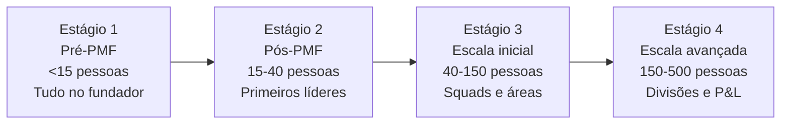

##### Estágio 1 — Pré-PMF (< 15 pessoas)

**Princípio:** Todos fazem tudo. O fundador é o CEO, o CPO, o head de vendas e às vezes ainda escreve código. Não há hierarquia — há comprometimento.

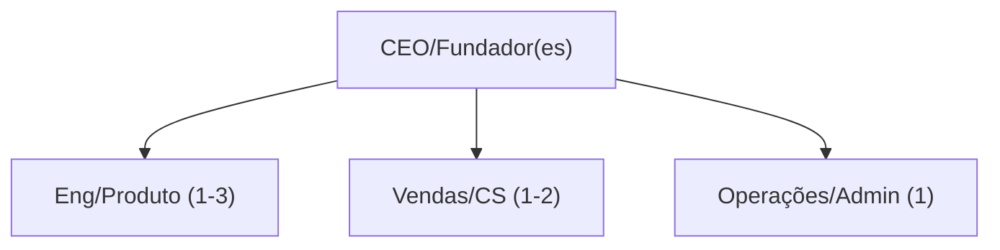

**O que não montar aqui:**

- VPs ou Heads antes de ter ~10 pessoas diretas para eles gerenciarem
- Comitês de decisão — o fundador decide, rápido
- Departamentos de RH, Jurídico, Financeiro próprios — terceirize

**Sinal de que é hora de passar para Estágio 2:** Fundador não consegue mais falar com cada pessoa da empresa toda semana.

##### Estágio 2 — Pós-PMF (15–40 pessoas)

**Princípio:** Contratar os primeiros líderes funcionais. Eles ainda executam — não são gestores puros. O fundador ainda decide tudo estratégico, mas libera espaço operacional.

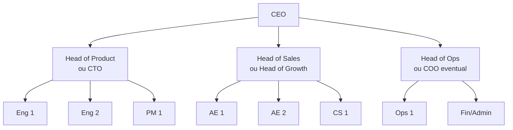

**O que não montar aqui:**

- Mais de 3-4 reports diretos do CEO — limite cognitivo real
- Processo de performance review formal antes de 25 pessoas — overhead injustificado
- Departamentos separados de Marketing, Brand, PR — concentre em Growth/Revenue

**Sinal de que é hora de passar para Estágio 3:** Produto ou vendas têm mais de 8-10 pessoas e o head não consegue gerenciar diretamente + há conflito de prioridades entre áreas sem fórum de resolução.

##### Estágio 3 — Escala inicial (40–150 pessoas)

**Princípio:** Squads autônomos orientados a resultado. O fundador/CEO gerencia líderes, não output direto. Rituais formais de alinhamento (OKRs, weekly leadership, quarterly planning).

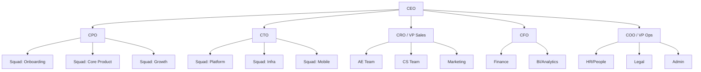

**O que não montar aqui:**

- Mais de 5-6 reports diretos do CEO — atenção fica diluída
- Estrutura matricial complexa (funcional + por produto) — cria conflito de autoridade sem benefício
- P&L separado por produto — ainda cedo para accountability de margem por divisão

**Sinal de que é hora de passar para Estágio 4:** Mais de uma linha de produto / mercado com lógicas de go-to-market distintas, ou headcount acima de 150 com decisões cruzando mais de 3 camadas hierárquicas.

##### Estágio 4 — Escala avançada (150–500 pessoas)

**Princípio:** Divisões com P&L próprio. O CEO gerencia um "portfólio" de negócios, não um único produto. Cada divisão tem sua liderança completa. Governança corporativa formal (board, comitês, auditoria).

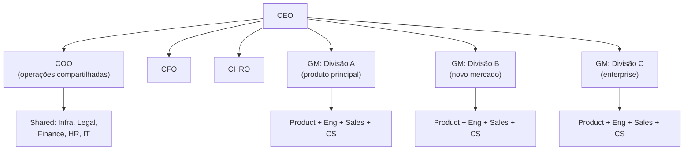

##### Armadilhas transversais

1. **Contratar sênior antes do time.** VP de Marketing sem time de marketing produz overhead e frustração. Contrate o líder quando já tem 3-5 pessoas para liderar.
2. **Reorganizar em crise.** Reorg consome 3-6 meses de energia. Se a empresa está em crise, reorg piora antes de melhorar. Resolva o problema, depois reorganize.
3. **Copiar estrutura de empresa maior.** Spotify Model, Amazon Two-Pizza Teams — são para outra escala. Em 30 pessoas, tribe e squad são burocracia vazia.
4. **Manter estrutura de Estágio 1 na Fase de Escala.** Fundador que ainda gerencia 15 ICs diretamente a 50 pessoas é gargalo — não liderança.

##### Conexão com outros canvases

O Org Chart Evolution **complementa o Team Canvas (Fase 0, Vol. 1)** — o Team Canvas define propósito e valores do time atual; o Org Chart Evolution define a estrutura que o time assume conforme cresce. **Alimenta o Capítulo 2 (Vol. 4) (FRAMEWORK DE CANAIS DE AQUISIÇÃO)** (organizações em escala) e as [[IGNICAO-Vol-8-Juridico-LGPD-e-Seguranca#FASE 18 — ESTRUTURAÇÃO JURÍDICA, SOCIETÁRIA E BLINDAGEM OPERACIONAL|Fase 18 (Vol. 8)]] e [[IGNICAO-Vol-6-Receita-e-Pessoas#FASE 16 — TIME, LIDERANÇA EXECUTIVA E CULTURA EM ESCALA|Fase 16 (Vol. 6)]].

##### Leitura adicional

- *The Manager's Path* (Camille Fournier, 2017) — progressão de carreira técnica e estruturas de eng.
- *High Output Management* (Andy Grove, 1983) — gestão por output, não por atividade.
- [[IGNICAO-Vol-4-Tracao-e-PMF#CAPÍTULO 2 — FRAMEWORK DE CANAIS DE AQUISIÇÃO|Capítulo 2 — Organizações em escala: de 20 a 500 pessoas (Vol. 4)]].

---

### TEMPLATES OPERACIONAIS E CASOS PREENCHIDOS DESTA FASE

#### Template: Template de OKRs trimestral preenchido — scaleup brasileira em PMF

**Objetivo 1: Transformar retention em motor de crescimento sustentável**

- KR1: Aumentar retenção D30 de 45% para 58% (medido em cohort trimestral)
- KR2: Reduzir churn mensal de 8% para 5%
- KR3: Elevar NPS de 32 para 45

**Objetivo 2: Abrir canal de crescimento indirecto escalável**

- KR1: Fechar 3 parcerias estratégicas com volume mínimo de 500 usuários/mês cada
- KR2: Lançar programa de indicação com taxa de conversão >= 15%
- KR3: Atingir 30% de aquisição mensal via canais não-pagos (vs 12% atual)

**Objetivo 3: Profissionalizar operação de produto**

- KR1: Implementar descoberta contínua com 3 entrevistas de usuário por PM por semana
- KR2: Rodar 8 experimentos controlados (A/B) no trimestre com resultado decisivo
- KR3: Documentar roadmap priorizado usando RICE para todos os features de prioridade P0/P1

**Insight do exemplo:** OKRs boas são *mensuráveis* (números específicos), *desafiadoras* (se você atinge 100%, provavelmente foram fáceis demais, atingir 70% é sucesso), e *alinhadas* entre si (neste caso, retenção melhor viabiliza programa de indicação, ambos viabilizam canal sustentável). Três objetivos é o máximo recomendado por ciclo, mais que isso dilui foco.

---

#### Template: Post-Mortem de Incidente Técnico

> [!note] Quando usar
> Após qualquer incidente que afetou usuários, dados ou operações por mais de 15 minutos, ou que causou perda de dados, falha de pagamento, ou exposição de informações. Preencher em até 48h após a resolução, com o time envolvido.

> [!tip] Cultura blameless
> Post-mortem é sobre o sistema, não sobre a pessoa. O objetivo é impedir a recorrência, não punir quem estava no plantão. Nomeie ações concretas no sistema, não comportamentos individuais.

---

**Incidente:** `[Nome curto, ex: "API de pagamento fora do ar — 2026-04-15"]`
**Severidade:** `[ ] P0 — crítico  [ ] P1 — alto  [ ] P2 — médio`
**Status:** `[ ] Resolvido  [ ] Mitigado  [ ] Em monitoramento`
**Data do incidente:** `[DD/MM/AAAA HH:MM]`
**Duração:** `[___ min / horas]`
**Impacto:** `[N usuários afetados / R$ perdidos / N transações falhadas]`
**Autores do post-mortem:** `[Nomes]`
**Data do post-mortem:** `[DD/MM/AAAA]`

---

##### 1. Resumo executivo (3 parágrafos)

`[O que aconteceu, em linguagem não-técnica]`

`[Qual foi o impacto para usuários / negócio]`

`[O que foi feito para resolver e o que vai ser feito para não repetir]`

##### 2. Timeline do incidente

| Horário | Evento | Quem |
|---|---|---|
| `[HH:MM]` | Primeiro sinal detectado | `[Sistema / pessoa]` |
| `[HH:MM]` | Alerta disparado para o time | `[Sistema / canal]` |
| `[HH:MM]` | Diagnóstico inicial | `[Nome]` |
| `[HH:MM]` | Mitigação aplicada | `[Nome]` |
| `[HH:MM]` | Resolução completa confirmada | `[Nome]` |
| `[HH:MM]` | Comunicação para usuários enviada | `[Nome]` |

##### 3. Causa-raiz (5 Porquês)

- **Por quê 1:** `[O serviço ficou fora do ar porque…]`
- **Por quê 2:** `[Isso aconteceu porque…]`
- **Por quê 3:** `[Isso foi possível porque…]`
- **Por quê 4:** `[O sistema permitiu isso porque…]`
- **Por quê 5 (causa-raiz):** `[A causa fundamental foi…]`

##### 4. Fatores contribuintes

- `[Fator 1: ex. falta de teste de carga antes do deploy]`
- `[Fator 2: ex. alertas configurados com threshold muito alto]`
- `[Fator 3: ex. runbook de rollback desatualizado]`

##### 5. O que funcionou bem

- `[Exemplo: alarme disparou em < 2 min após degradação]`
- `[Exemplo: time conseguiu comunicar status em 15 min]`

##### 6. O que não funcionou

- `[Exemplo: não havia circuit breaker configurado no serviço X]`
- `[Exemplo: canal de alertas não estava monitorado fora do horário comercial]`

##### 7. Ações corretivas

| Ação | Responsável | Prazo | Tipo |
|---|---|---|---|
| `[Ação concreta]` | `[Nome]` | `[DD/MM]` | `[Preventiva / Detectiva / Corretiva]` |
| `[Ação concreta]` | `[Nome]` | `[DD/MM]` | `[Preventiva / Detectiva / Corretiva]` |

> **Preventiva:** impede que o problema aconteça.
> **Detectiva:** detecta mais rápido quando acontecer.
> **Corretiva:** resolve mais rápido quando detectado.

##### 8. Comunicação com clientes

- [ ] Status page atualizada durante o incidente
- [ ] E-mail / in-app notification enviado para afetados
- [ ] SLA credit aplicado (se contratualmente obrigado)
- [ ] Resposta individual para clientes enterprise que reportaram

---

#### Template: OKR Cascade Anual

> [!note] Quando usar
> Ao iniciar o ciclo anual de OKRs, geralmente em dezembro / janeiro. Este template guia a definição top-down dos objetivos anuais da empresa e a cascata para time e individual.

> [!tip] Princípios
> OKRs são aspiracionais — atingir 70% de um KR ambicioso é sucesso. Não misture OKR com meta de bônus: isso cria sandbagging. Máximo de 3–5 Objectives por nível; máximo de 3–4 KRs por Objective.

##### Nível 1 — OKRs da empresa (Anuais)

**Contexto estratégico do ano:** `[Uma frase sobre o que esse ano representa para a empresa]`

---

**Objective 1:** `[Verbo + resultado qualitativo ambicioso. Ex: "Tornar-se a referência em X para Y"]`

| Key Result | Meta | Atual | Dono | Prazo |
|---|---|---|---|---|
| KR1.1: `[Mensurável e verificável]` | `[___]` | `[___]` | `[Nome]` | `[MM/AAAA]` |
| KR1.2: `[Mensurável e verificável]` | `[___]` | `[___]` | `[Nome]` | `[MM/AAAA]` |
| KR1.3: `[Mensurável e verificável]` | `[___]` | `[___]` | `[Nome]` | `[MM/AAAA]` |

---

**Objective 2:** `[Verbo + resultado qualitativo]`

| Key Result | Meta | Atual | Dono | Prazo |
|---|---|---|---|---|
| KR2.1: | | | | |
| KR2.2: | | | | |
| KR2.3: | | | | |

---

**Objective 3:** `[Verbo + resultado qualitativo]`

| Key Result | Meta | Atual | Dono | Prazo |
|---|---|---|---|---|
| KR3.1: | | | | |
| KR3.2: | | | | |

---

##### Nível 2 — OKRs de time (Trimestral)

> Cada time define seus OKRs trimestrais contribuindo para pelo menos um Objective da empresa. Um KR da empresa pode ser quebrado em múltiplos KRs de time ou gerar um Objective de time.

**Time:** `[Produto / Engenharia / Vendas / Growth / Operações / etc.]`
**Trimestre:** `[Q1 / Q2 / Q3 / Q4 AAAA]`
**Contribuição para OKR da empresa:** `[Objective X, KR Y]`

---

**Objective T1:** `[O que esse time vai conquistar esse trimestre]`

| Key Result | Meta | Check-in semana 4 | Check-in semana 8 | Final | Dono |
|---|---|---|---|---|---|
| KRT1.1: | | | | | |
| KRT1.2: | | | | | |

---

##### Nível 3 — OKRs individuais (Trimestral)

> Opcionais em empresas pequenas (< 15 pessoas). Obrigatórios em escala (> 50 pessoas). Derivam dos OKRs de time — o indivíduo apoia os KRs do time, não inventa objetivos pessoais desconectados.

**Colaborador:** `[Nome]`
**Cargo:** `[___]`
**Time:** `[___]`
**Contribuição para OKR de time:** `[Objective X, KR Y]`

| Objective | KR | Meta | Progresso | Score final |
|---|---|---|---|---|
| `[O que alcançar]` | `[Como medir]` | `[Valor]` | | |

---

##### Check-in semanal (5 min por OKR)

Para cada KR em andamento:

- Status: `[ ] On track  [ ] At risk  [ ] Off track`
- Progresso atual: `[___]` / Meta: `[___]`
- Bloqueio (se houver): `[___]`
- Ação para desbloquear: `[___]`

##### Scoring ao final do trimestre

| Score | Interpretação |
|---|---|
| 0.0–0.3 | Não avançou ou errou a direção. Revisar abordagem. |
| 0.4–0.6 | Progresso parcial. Analise por que não foi além. |
| 0.7–0.9 | Zona alvo — OKR foi ambicioso e foi executado bem. |
| 1.0 | Bateu 100%. Provavelmente a meta era conservadora demais. |

> Score médio ideal por trimestre: 0.6–0.7. Consistentemente 1.0 = metas fáceis demais.

##### Retrospectiva de ciclo (ao final de cada trimestre)

- O que aprendemos sobre o negócio executando esses OKRs?
- Quais KRs foram úteis como guia? Quais não funcionaram como métricas?
- O que vamos mudar na configuração do próximo ciclo?

---

### SÍNTESE DA FASE 17

Na **[[#FASE 17 — OPERAÇÕES, PROCESSOS E GESTÃO EM ESCALA|Fase 17]]**, você instalou a arquitetura operacional que impede que o hipercrescimento gere caos. Os 11 capítulos a seguir deste **Volume 7** aprofundam a gestão de produto em múltiplos *squads*, liderança de engenharia, pagamento de dívida técnica, IA na engenharia de software, *AI Ops*, design organizacional e excelência operacional.

---

# PRODUTO EM ESCALA, ENGENHARIA DE SOFTWARE, DÍVIDA TÉCNICA E IA (CAPÍTULOS 1 A 7)

### Arquitetura deste Domínio: Produto em Escala, Engenharia de Software, Dívida Técnica e IA (Capítulos 1 a 7)

Estes sete capítulos formam o manual integrado de liderança técnica e de produto quando a empresa precisa entregar velocidade de inovação e estabilidade de plataforma ao mesmo tempo:

- **Produto e Liderança Técnica ([[IGNICAO-Vol-10-Playbooks-Setoriais-e-Glossario#C|Capítulo 1 (Vol. 10)]], [[IGNICAO-Vol-10-Playbooks-Setoriais-e-Glossario#C|Capítulo 2 (Vol. 10)]], [[IGNICAO-Vol-10-Playbooks-Setoriais-e-Glossario#C|Capítulo 3 (Vol. 10)]] e [[IGNICAO-Vol-10-Playbooks-Setoriais-e-Glossario#C|Capítulo 4 (Vol. 10)]]):** Como manter *discovery* contínuo e gerenciar portfólio entre múltiplos *squads* (Cap. 1), a transição do fundador desenvolvedor de contribuidor individual (IC) para líder de engenharia/CTO (Cap. 2), como avaliar e recrutar engenheiros excelentes mesmo se você não for técnico (Cap. 3) e como estruturar *Engineering Management*, trilhas de carreira (IC vs. Manager) e *Developer Experience / DevEx* (Cap. 4).
- **Arquitetura, Dívida Técnica e IA Operacional ([[IGNICAO-Vol-10-Playbooks-Setoriais-e-Glossario#C|Capítulo 5 (Vol. 10)]], [[IGNICAO-Vol-10-Playbooks-Setoriais-e-Glossario#C|Capítulo 6 (Vol. 10)]] e [[IGNICAO-Vol-10-Playbooks-Setoriais-e-Glossario#C|Capítulo 7 (Vol. 10)]]):** Como diagnosticar, negociar e pagar dívida técnica antes que o sistema pare (Cap. 5), como liderar times de engenharia potencializados por agentes de código e IA (Cap. 6) e como automatizar operações internas de ponta a ponta com *AI Ops* (Cap. 7).

---

## CAPÍTULO 1 — PRODUTO EM ESCALA E DESCOBERTA CONTÍNUA

> [!note] Nota de validade
> Os frameworks de descoberta contínua (Teresa Torres), priorização (RICE, Kano, WSJF), Jobs to be Done e design systems têm vida útil longa. Ferramentas específicas evoluem a cada dezoito a vinte e quatro meses, e devem ser revisadas nesse intervalo.

As Fases 2 a 11 cobrem produto até o PMF: descoberta, validação, MVP, encaixe. Depois disso, produto vira disciplina contínua, em contexto diferente. Time maior, múltiplos stakeholders, roadmap disputado, sistema complexo, clientes com expectativas altas. O território pós-PMF fica subcoberto no manual até aqui.

Este capítulo cobre como Product funciona em empresa pós-PMF escalando para cinquenta a duzentas pessoas, onde a disciplina que levou até aqui já não basta para o que vem a seguir.

### O que este capítulo cobre

Cinco territórios em Product pós-PMF. Primeiro, descoberta contínua: pesquisa de usuário não para em PMF, evolui de exploratória para iterativa. Segundo, priorização com framework estruturado, não opinião do CEO ou HIPPO (Highest Paid Person's Opinion, opinião da pessoa mais bem paga). Terceiro, roadmap como comunicação de aposta, não contrato de entrega. Quarto, Design Systems (sistemas de design), infraestrutura de UI que permite velocity (velocidade de entrega) em escala. Quinto, colaboração entre Product e Engineering: ritos, specs (especificações), definition of ready e definition of done (critérios de pronto para começar e pronto para entregar).

Os entregáveis são: opportunity solution tree (árvore de oportunidades) viva, framework de priorização aplicado, roadmap de três horizontes, design system documentado e processo de spec até implementação.

### POR QUE

Empresa em escala precisa de produto como disciplina, não como intuição. O que funcionou no founder sozinho não escala para quatro squads em paralelo. Sem descoberta contínua, a empresa vira feature factory (fábrica de funcionalidades), constrói o que stakeholders pedem, não o que gera valor.

Priorização sem framework é política. Quem grita mais alto, ou tem mais acesso ao CEO, ganha. Isso destrói moral e qualidade. Design sem system vira caos visual. Inconsistência agride o usuário e consome velocity de engineering. Product e Engineering sem ritos viram retrabalho: specs vagas, entregas erradas, moral em queda.

### Quando usar

[[IGNICAO-Vol-4-Tracao-e-PMF#FASE 13 — PRODUCT-MARKET FIT|Fase 13 (Vol. 4)]], primeiras disciplinas estruturadas (descoberta contínua e priorização leve). [[IGNICAO-Vol-6-Receita-e-Pessoas#FASE 16 — TIME, LIDERANÇA EXECUTIVA E CULTURA EM ESCALA|Fase 16 (Vol. 6)]] com primeiros Product Managers contratados, todos os territórios começam a importar. [[IGNICAO-Vol-6-Receita-e-Pessoas#FASE 16 — TIME, LIDERANÇA EXECUTIVA E CULTURA EM ESCALA|Fase 16 (Vol. 6)]] com múltiplos squads, Product Ops emerge como função. [[IGNICAO-Vol-6-Receita-e-Pessoas#FASE 16 — TIME, LIDERANÇA EXECUTIVA E CULTURA EM ESCALA|Fase 16 (Vol. 6)]] em diante, Design System e Platform Product Management.

### Quem envolve

CPO ou VP Product lidera a disciplina. Product Managers (gerentes de produto): um PM por squad, e um a dois squads por PM sênior. Product Designers: idealmente um designer por squad. User Researchers (pesquisadores de usuário): um UR para dois a quatro squads em escala. Product Ops: uma pessoa dedicada a partir de cerca de seis PMs. Staff e Principal PMs: para problemas transversais e iniciativas estratégicas.

### Como executar

#### 1. Descoberta Contínua, framework Teresa Torres

O problema que ela resolve: evitar que o produto vire "o que o CEO quer" ou "o que clientes gritam mais alto", mantendo foco em valor.

Os ingredientes em duas peças. Weekly interviewing habit (hábito de entrevistar semanalmente): a equipe de produto entrevista pelo menos um usuário por semana, toda semana. Opportunity Solution Tree (árvore de oportunidade-solução): árvore visual que conecta outcome desejado (raiz, por exemplo "aumentar retenção de clientes de três para seis meses"), opportunities (galhos — problemas ou necessidades do usuário que, se endereçadas, movem o outcome), solutions (folhas — ideias de produto que endereçam a opportunity) e experiments (testes para validar se a solução move a opportunity).

A estrutura de uma Opportunity Solution Tree.

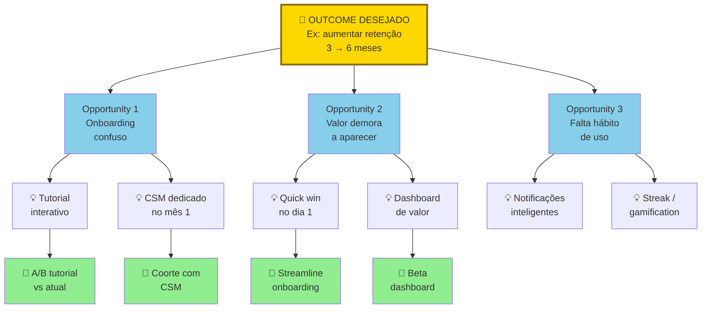

A árvore é viva, não documento morto. Descoberta semanal adiciona, e refina, nós. Se não atualiza em duas semanas, o hábito morreu.

O processo semanal em cinco passos. Entrevistar um a três usuários em torno do outcome atual. Adicionar opportunities novas na árvore, ou refinar existentes. Gerar solutions para opportunities que parecem promissoras. Escolher experiments para testar solutions. Executar o experiment, medir, ajustar.

> [!important] Papel do CPO em descoberta contínua
> Fazer a árvore viver. Revisão quinzenal. Evitar que vire documento morto. CPO que delega a árvore para PM júnior, e nunca olha de novo, garante que a descoberta vire teatro depois de três meses.

Livro-fonte. *Continuous Discovery Habits*, Teresa Torres.

#### 2. Priorização, frameworks aplicados

Framework define processo, não resultado. O resultado ainda é decisão humana informada.

**RICE (Reach, Impact, Confidence, Effort).** Reach, quantos usuários, ou clientes, afetados em período específico. Impact, quanto cada usuário ou cliente beneficiado (escala um a cinco, ou massive, high, medium, low, minimal). Confidence, quão seguros sobre Reach, e Impact (em percentual). Effort, pessoa-meses estimados. O score é (Reach vezes Impact vezes Confidence) dividido por Effort.

Matriz visual de priorização R x I.

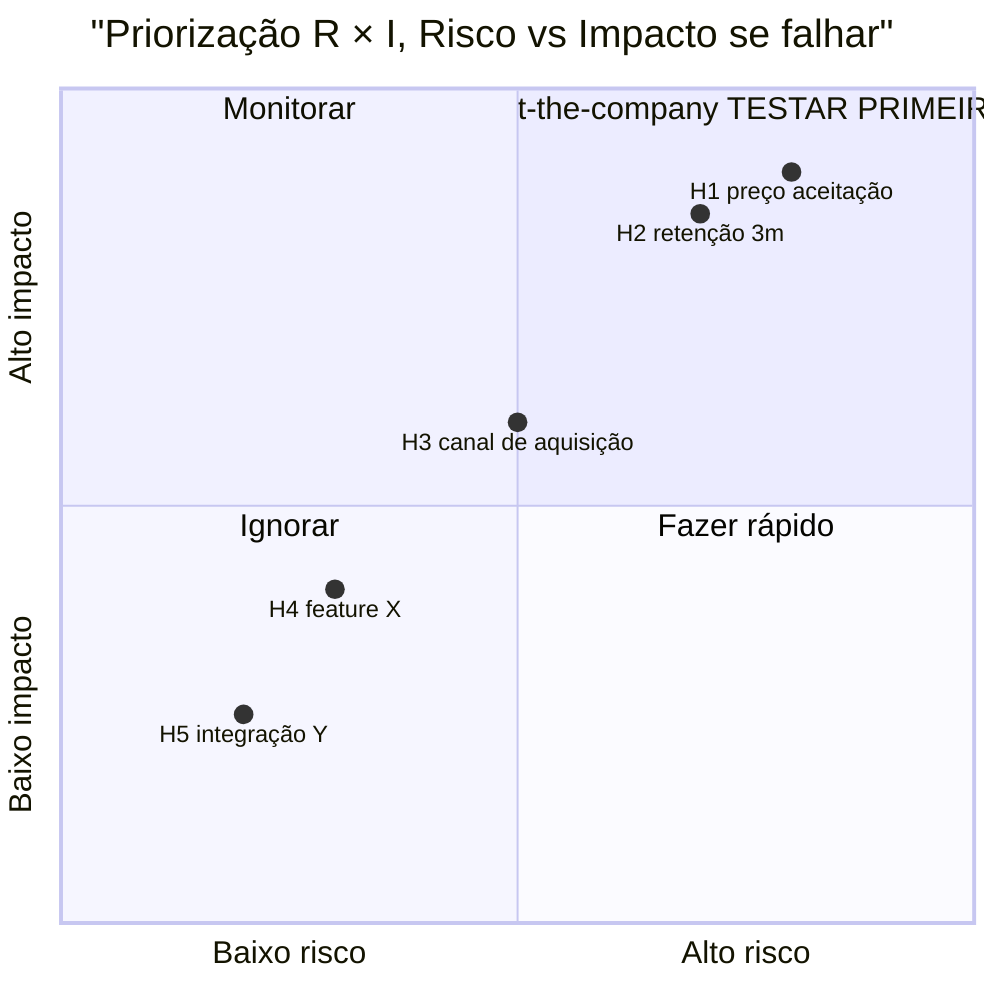

O quadrante superior-direito (alto risco mais alto impacto se falhar) contém hipóteses bet-the-company. Essas são as que, se refutadas, destroem o negócio. Teste-as primeiro. Com mais rigor. Inferior-esquerdo (baixo risco mais baixo impacto), ignore. Não gere experimento. Útil para priorizar lista longa de features com dados.

**WSJF (Weighted Shortest Job First, do SAFe).** O score é (Business Value mais Time Criticality mais Risk Reduction ou Opportunity Enablement) dividido por Job Size. Útil para contexto mais enterprise, com coordenação entre múltiplos squads.

**Kano Model.** Categoriza features em cinco grupos. Basic (must-have), ausência frustra, presença não delighta. Performance, mais é melhor, linear. Delighter, inesperado, cria entusiasmo. Indifferent, o usuário não se importa. Reverse, o usuário prefere ausência.

Curvas do Kano Model (satisfação versus implementação).

> [!note] Compatibilidade — requer Mermaid 10+ (Obsidian 1.4+)

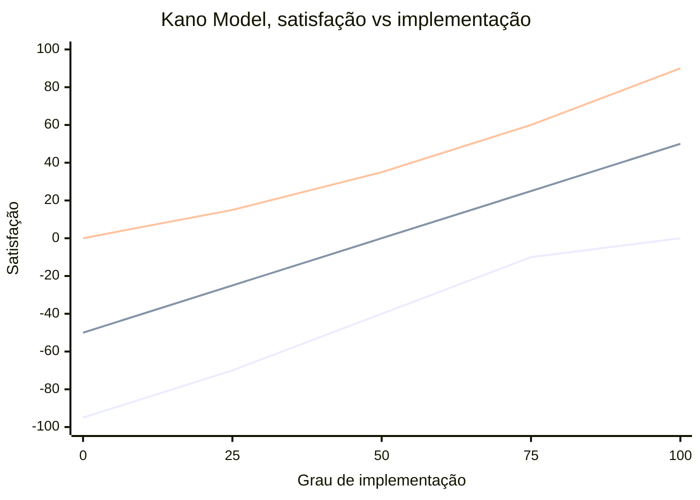

Três curvas principais. A linha inferior (Must-have) tem teto em zero. Ausência frustra, presença não delighta. A linha intermediária (Performance) é linear. Mais é melhor proporcional. A linha superior (Delighter) começa neutra, e sobe forte. Sequência: Basic, depois Performance, depois Delighter. Pular etapa destrói experiência. Útil para balancear "tapar buracos" com "criar amor".

**MoSCoW.** Must, Should, Could, Won't. Simples. Útil para alinhamento rápido de escopo em sprints.

**Opportunity Prioritization (Torres).** Dentro do Opportunity Solution Tree, escolher a próxima opportunity baseado em três critérios. Impacto esperado no outcome. Evidência acumulada (quantas entrevistas validam). Addressability (resolvível por solução factível).

A escolha do framework varia por estágio. [[IGNICAO-Vol-4-Tracao-e-PMF#FASE 13 — PRODUCT-MARKET FIT|Fase 13 (Vol. 4)]] a 13A, Opportunity mais RICE leve. [[IGNICAO-Vol-6-Receita-e-Pessoas#FASE 16 — TIME, LIDERANÇA EXECUTIVA E CULTURA EM ESCALA|Fase 16 (Vol. 6)]] (Operações em diante), RICE mais Kano. Enterprise com múltiplos squads, WSJF.

#### 3. Roadmap, comunicação de aposta

O problema clássico. Roadmap virou contrato. Cliente, vendedor, ou board, pede "quando X?". Produto responde data. A data não bate. A confiança erode.

A reformulação é roadmap de três horizontes.

Now (próximas quatro a oito semanas). Comprometido. Data, e escopo, claros. Entrega prevista com alta confiança.

Next (próximos dois a quatro meses). Direção clara. Escopo provável. Não comprometido em data.

Later (seis ou mais meses). Área de foco estratégico. Sem escopo, ou data, específicos.

As regras. Now é "contrato" interno. O time não muda exceto por emergência. Next é conversa regular. Pode mudar conforme aprendizado. Later é visão. Ajustada trimestralmente.

A comunicação. Sales tem acesso, com treinamento sobre o que comunicar externamente. O cliente recebe Now como certeza. Next como provável. Later como visão. O board vê os três com contexto estratégico.

#### 4. Design Systems, infraestrutura visual

Quando implementar. Quando há dois ou mais designers, e dez ou mais engenheiros front-end, trabalhando no mesmo produto.

Os componentes em quatro camadas. Tokens, cores, tipografia, espaçamentos, sombras (variáveis base). Components, botões, inputs, cards, modais, tabelas (composições). Patterns, flows comuns (auth, checkout, onboarding). Documentação, como usar, quando usar, e exemplos.

Storage. Design em Figma, com bibliotecas compartilhadas. Código em biblioteca de componentes em React, Vue, ou Svelte, com Storybook.

Ownership. Inicialmente, design e engineer compartilhados. Em escala, Design Systems Team (uma a três pessoas) full-time.

Ferramentas. Figma, Storybook, Chromatic (visual regression), Tailwind mais shadcn/ui como base comum.

#### 5. Product e Engineering, ritos e specs

**Spec (PRD, Product Requirements Document).** Spec moderno não é "documento de vinte páginas". Em formato moderno, tem seis peças. Problema, um a dois parágrafos sobre o problema, ou opportunity. Success metrics, o que vai mudar, quantificado. User stories, ou JTBD, cenários reais de uso. Scope IN e OUT, explícito. Mocks, ou wireframes, link para o Figma. Open questions, o que ainda precisa decidir. Tamanho ideal, duas a cinco páginas. Mais longo significa que o spec não convergiu.

**Definition of Ready (quando o spec está pronto para dev).** Problema, e solução, claros. Designs (mocks, ou hi-fi) prontos. Success metrics definidas. Scope congelado (mudanças viram nova spec). Engineering teve sessão de Q&A.

**Definition of Done (quando a feature está pronta).** Código em produção. Analytics instrumentado para success metrics. Documentação atualizada. QA passou. Comunicação a clientes, ou a Sales, feita (se aplicável).

**Os ritos.** Product triad weekly (PM mais Design mais Eng lead), sessenta minutos por semana, alinhamento contínuo. Sprint review quinzenal, demo mais feedback. Squad retrospective quinzenal, o que melhorar. Planning semanal, próxima semana, com clareza em cada item.

#### 6. Jobs to be Done aplicado em produto maduro

JTBD ([[IGNICAO-Vol-2-Descoberta-e-Mercado#FASE 5 — PESQUISA COM USUÁRIOS (CUSTOMER DISCOVERY)|Fase 5 (Vol. 2)]] na descoberta inicial) continua relevante em escala. Mas em forma evoluída.

**Switch interview (Alan Klement).** Entrevistar clientes que recentemente mudaram para o seu produto (de competidor, ou de nenhum produto). Mapear evento gatilho, forças puxando para mudança, forças resistindo à mudança, e forças puxando de volta. Output: entendimento profundo do "job" que o produto está sendo contratado para fazer.

Aplicação em roadmap. Features que reforçam pull forces do job principal valem mais do que features random. Mesmo que populares.

#### 7. Shape Up (Ryan Singer / Basecamp, 2019)

Shape Up é a metodologia de desenvolvimento de produto criada por Ryan Singer na Basecamp, publicada como livro gratuito em 2019. Nasceu da insatisfação com Scrum e sprints de duas semanas em produto maduro: o ritmo constante de sprints cria pressão para "estar ocupado" em vez de entregar valor real, e features complexas ficam artificialmente cortadas para "caber no sprint". Shape Up opera em ciclos de seis semanas com três princípios centrais.

**Appetite em vez de estimativa.** Antes de começar qualquer trabalho, o time decide *quanto tempo está disposto a gastar* no problema — não quanto tempo vai demorar. Appetite de duas semanas significa: "se não resolvermos em duas semanas, não vale a pena." Isso força priorização real em vez de refinamento infinito de escopo.

**Shaping antes de executar.** Antes de entrar em ciclo, o problema é "moldado" em alto nível: problema definido, abordagem em esboço (fat marker sketch), elementos fora do escopo explicitados, riscos técnicos identificados. O pitch moldado vai para o betting table, não para o backlog. Backlog não existe no Shape Up — itens que ninguém aposta em ciclo após ciclo são descartados.

**Betting table e autonomia total.** A cada ciclo, líderes apostam em pitches. Time que "ganhou" a aposta tem seis semanas de autonomia total para executar — sem interrupcões, sem reuniões de status, sem mudança de escopo. Se não entregou em seis semanas, o projeto é cancelado (circuit breaker), não "carregado" para o próximo ciclo. A pressão é real, mas o tempo também é real.

Quando Shape Up faz sentido. Em produto maduro com mais de dois anos, com time estável de oito ou mais pessoas. Quando sprints de duas semanas estão produzindo "busyness" sem entregas de impacto. Quando features complexas estão sendo artificialmente quebradas sem coerência. Quando há frustração com backlog que cresce infinitamente sem priorização real.

Quando Shape Up *não* faz sentido. Em pré-PMF, onde o ciclo de aprendizado precisa ser mais rápido do que seis semanas. Em ambientes fortemente regulados onde mudanças precisam de aprovação formal em cada iteração. Em times menores que quatro pessoas onde o overhead de shaping não justifica.

Tensão com Scrum e Kanban. Shape Up não é substituto de Scrum para times que já têm boa higiene de processo. É alternativa para contextos onde Scrum virou ritual sem substância. Muitas empresas adotam Shape Up para iniciativas estratégicas maiores e mantêm Scrum para manutenção e bugs.

### Métricas

**Descoberta e validação.** Interviews por semana, ou mês, por squad. Opportunities na árvore (status: exploração, validação, ou endereçada). Experiments rodados por trimestre.

**Execução.** Cycle time (spec até produção). Escopo entregue versus planejado por sprint. Bug backlog.

**Impacto.** Impacto em North Star Metric por feature entregue. Adoption rate de novas features. Deprecation rate (features removidas por falta de uso).

**Organização.** PM e eng ratio (alvo de um para seis até um para dez). Design e eng ratio (alvo de um para cinco até um para oito). Squads autônomos (outcome definido, decisão local).

### Armadilhas

Feature factory. O time constrói o que stakeholders pedem, sem validação. Muito output. Pouco impacto.

Descoberta que para em PMF. "Atingimos PMF, agora é só escalar." Não. Descoberta continua em forma diferente.

Priorização baseada em quem grita. Sem framework, decisão política. Qualidade degrada.

Roadmap como contrato. Prometer data em "Later", e não cumprir. A confiança erode.

Design sem system. Cada feature com variação. UX inconsistente. Velocity destruída.

Spec vago. O engineer adivinha o que o PM queria. Retrabalho.

PM sem tempo para descoberta. Cem por cento do tempo em execution. Vira "project manager", não product.

HIPPO (Highest Paid Person's Opinion). O CEO muda roadmap em conversas de corredor.

Squad sem outcome claro. O time focado em output (features), não em outcome (métrica de negócio).

Métricas de vanity em review. "Lançamos doze features" não é sucesso. "Moveu a métrica X de Y para Z" é.

### Checklist

Produto em escala está no padrão quando todos os itens abaixo estão cumpridos.

- [ ] Descoberta contínua como hábito: weekly interviewing implementado em todas as squads, com OST viva (revisão quinzenal pelo CPO).
- [ ] Framework de priorização escolhido e aplicado consistentemente (RICE, WSJF, Kano ou combinação por estágio), não política.
- [ ] Roadmap em três horizontes (Now, Next, Later) documentado, comunicado e respeitado pelos times.
- [ ] Design System implementado e adotado em 80% ou mais de novas features.
- [ ] Spec padrão (PRD) definido com Definition of Ready e Done.
- [ ] Squads autônomos operando com outcome claro (métrica de negócio), não apenas lista de features.
- [ ] Product triad (PM, Design, Eng lead) em cadência semanal.
- [ ] Impacto de features é medido, reportado e usado para decisão. Não suposto.
- [ ] Switch interviews (JTBD aplicado) rodam periodicamente para reforçar decisões de roadmap.

### Ver também

[[IGNICAO-Vol-4-Tracao-e-PMF#CAPÍTULO 10 — SUBSCRIPTION ECONOMY EM PROFUNDIDADE: ALÉM DO "COBRA MENSALMENTE"|Capítulo 10 (SUBSCRIPTION ECONOMY EM PROFUNDIDADE: ALÉM DO "COBRA MENSALMENTE") (Vol. 4)]], Subscription economy. [[IGNICAO-Vol-3-Experimentos-e-Prototipagem#CAPÍTULO 7 — PLATAFORMA VS PRODUTO: QUANDO CONSTRUIR PLATAFORMA E QUANDO NÃO|Capítulo 7 (PLATAFORMA VS PRODUTO: QUANDO CONSTRUIR PLATAFORMA E QUANDO NÃO) (Vol. 3)]], Plataforma versus produto. [[IGNICAO-Vol-3-Experimentos-e-Prototipagem#CAPÍTULO 6 — MARKETPLACE DYNAMICS E RISCO DE PLATAFORMA|Capítulo 6 (MARKETPLACE DYNAMICS E RISCO DE PLATAFORMA) (Vol. 3)]], Marketplace dynamics. [[IGNICAO-Vol-4-Tracao-e-PMF#CAPÍTULO 12 — CUSTOMER SUCCESS COMO DISCIPLINA|Capítulo 12 (CUSTOMER SUCCESS COMO DISCIPLINA) (Vol. 4)]], Customer Success.

> [!info] Fases relacionadas
> Referenciado em: Fase 12.

---

## CAPÍTULO 2 — MANAGEMENT PARA O FUNDADOR TÉCNICO

Este capítulo especializa o [[#CAPÍTULO 4 — ENGINEERING MANAGEMENT: GESTÃO DO TIME TÉCNICO E DEVELOPER EXPERIENCE|Capítulo 4 (ENGINEERING MANAGEMENT: GESTÃO DO TIME TÉCNICO E DEVELOPER EXPERIENCE)]] no tema da transicao do fundador tecnico para gestao.

Há um momento previsível na vida de todo fundador técnico, aquele em que ele percebe que parou de escrever código produtivo há seis semanas e que o time de engenharia, que era de três pessoas, agora tem oito. Os problemas que chegam até ele não são mais bugs nem decisões de arquitetura. São conflitos entre dois sêniors, a dev que entregou abaixo do esperado no último sprint (ciclo curto de entrega), o CTO (Chief Technology Officer, diretor de tecnologia) da empresa investidora querendo saber por que o time não está mais rápido.

Ninguém o preparou para isso. A escola ensinou algoritmos, não conversas difíceis. O primeiro emprego ensinou a programar bem, não a desenvolver pessoas. Os livros de gestão foram escritos para gerentes de banco, não para fundadores que ainda têm opinião sobre qual ORM (Object-Relational Mapper, biblioteca que mapeia banco para objetos) usar.

Este capítulo trata da travessia. Da pessoa que era o melhor engenheiro da empresa para quem constrói o time que constrói o produto. A travessia tem custo real, armadilhas previsíveis e ferramentas concretas. Cada uma delas vai coberta aqui.

---

### 1. A transição que ninguém te prepara

#### O que muda de verdade

A mudança fundamental não é de função. É de como você produz valor.

Como engenheiro, você cria valor escrevendo código. A relação é direta: esforço entra, feature sai. O resultado do seu trabalho é visível, mensurável, reversível. Você pode medir seu desempenho em pull requests, bugs resolvidos, sistemas entregues. Quando algo falha, você depura, encontra a causa, corrige.

Como gestor técnico, você cria valor através das pessoas. O resultado do seu trabalho é indireto, defasado no tempo e frequentemente invisível no dia a dia. Uma conversa difícil que você teve em março pode só mostrar resultado em julho, quando o engenheiro que quase saiu decide ficar e vira sênior. A decisão de contratar alguém específico molda a cultura do time por anos. A clareza que você deu sobre prioridades evita semanas de trabalho errado que nunca vão aparecer no dashboard.

Essa defasagem entre esforço e resultado desorenta fundadores técnicos. Em código, feedback é imediato: o teste passa ou falha. Em gestão, você raramente sabe na hora se tomou a decisão certa.

#### O que você precisa aprender a tolerar

Há três tolerâncias que o fundador técnico precisa desenvolver e que normalmente estão ausentes em pessoas que foram boas engenheiras.

A primeira é tolerância à ambiguidade em pessoas. Problemas técnicos têm uma causa raiz. Problemas com pessoas raramente têm. O dev que está desmotivado pode ter dez razões simultâneas, algumas que ele mesmo não sabe nomear. A dev que está entregando mal pode estar passando por algo fora do trabalho. Quem tenta depurar pessoas como se depura código vai se frustrar constantemente.

A segunda é tolerância à repetição. Em código, você resolve um problema uma vez e automatiza. Em gestão, você precisa repetir o mesmo contexto, a mesma direção, a mesma expectativa dezenas de vezes para dezenas de pessoas. Aquilo que parece óbvio para quem fundou a empresa não é óbvio para quem chegou mês passado.

A terceira é tolerância ao trabalho que não aparece. O melhor gestor técnico frequentemente parece que não fez nada. O time flui, os projetos entregam, as pessoas estão bem. O trabalho real foi feito nas conversas, nos bastidores, nas decisões invisíveis. Fundadores acostumados a ter pull requests como prova de trabalho acham isso psicologicamente difícil.

> [!important] A identidade é o problema real
> Fundadores técnicos que resistem à transição de gestão raramente resistem por preguiça ou incompetência. Resistem porque a identidade está ancorada em ser "o técnico". Ser o melhor dev do time era a fonte de respeito, segurança e autoestima. Virar gestor parece perda, não evolução. Reconhecer isso é o primeiro passo para não sabotar a transição.

#### O que você leva com você

A transição não anula o background técnico. Pelo contrário: o fundador que foi engenheiro tem vantagens estruturais que gestores sem background técnico nunca terão.

Você entende o que está sendo construído. Você sabe quando uma estimativa está sendo inflada por medo ou quando está sendo comprimida por pressão de cima. Você reconhece débito técnico quando vê, mesmo sem entrar no código. Você fala a língua dos engenheiros e sabe quando alguém está confundindo complexidade real com falta de clareza. Você entende o custo verdadeiro de uma decisão técnica tomada às pressas.

Essas vantagens só aparecem se você parar de usar o background técnico para resolver os problemas operacionais do time e começar a usar para fazer as perguntas certas.

---

### 2. O erro da gestão por admiração

#### O padrão mais comum

Existe um padrão que aparece com regularidade preocupante em fundadores técnicos que viraram gestores: o gestor continua resolvendo os problemas técnicos do time porque é mais rápido, mais prazeroso, e porque o time admira isso.

O engenheiro trava em um bug difícil. O fundador mergulha no problema, depura em quarenta minutos, o time aplaude, problema resolvido. Parece eficiente. Parece liderança.

Não é nem um nem o outro.

O que aconteceu, na prática: o engenheiro não aprendeu a resolver aquele tipo de problema. O fundador consumiu capital cognitivo que deveria estar em decisão de contratação, alinhamento de roadmap, conversa com o board. O time aprendeu que trazer problema para o fundador resolve mais rápido do que tentar resolver sozinho. O fundador criou dependência, não capacidade.

Esse padrão tem nome: gestão por admiração. Você gere pela reverência que o time tem por você como técnico, não pelo desenvolvimento que você promove nas pessoas.

#### Por que acontece

Gestão por admiração acontece por três razões simultâneas.

A primeira é que resolver problema técnico é imediato e prazeroso. A dopamina do bug resolvido, do código funcionando, é real. Conversas sobre desenvolvimento de carreira não têm essa gratificação instantânea.

A segunda é que o time encoraja ativamente. Engenheiros apreciam genuinamente quando o líder mais experiente entra e resolve. Eles pedem isso. Receber esse pedido e dizer "você consegue, o que você já tentou?" parece frio, parece abandono.

A terceira é que é invisível enquanto está acontecendo. O time não mostra sinais de alarme no curto prazo. Só seis a doze meses depois o problema aparece: o time não cresceu, ninguém sabe resolver problemas complexos sem o fundador, e o fundador está gargalo em tudo.

#### O sinal de que você está no padrão

Você está no padrão de gestão por admiração quando:

- Mais de vinte por cento do seu tempo é em tarefas técnicas operacionais (não estratégicas).
- Os engenheiros te procuram primeiro para problemas que deveriam resolver sozinhos.
- Você se sente mais produtivo nos dias em que "ajudou o time" do que nos dias em que teve conversas difíceis sobre desempenho.
- O time apresenta o mesmo tipo de problema mês após mês sem melhora incremental.
- Você não consegue tirar férias de uma semana sem o time travar em algo.

> [!warning] O custo oculto
> Cada hora que o fundador técnico passa resolvendo problema operacional do time é uma hora que ele não passou desenvolvendo a pessoa que poderia resolver esse problema sozinha daqui a três meses. O custo se inverte. O que parece eficiente hoje é o que cria ineficiência estrutural amanhã.

#### A transição de resolver para desenvolver

A mudança não é de um dia para o outro, e forçá-la de forma brusca é contraproducente. A transição saudável tem três estágios.

No primeiro estágio, você resolve junto. Em vez de resolver sozinho, você para ao lado do engenheiro e resolve em voz alta, explicando o raciocínio.

No segundo estágio, você guia sem resolver. "O que você já tentou? Qual seria o próximo passo lógico? O que você acha que está causando?" Você fica perto mas coloca a mão do engenheiro no volante.

No terceiro estágio, você não resolve mais. O engenheiro traz o problema, você pergunta o que ele já tentou, você confia no julgamento dele, você está disponível se travar de verdade.

O tempo entre os estágios depende da senioridade do engenheiro e do tipo de problema. Com júnior em problema crítico de produção, você talvez precise ficar no estágio um por mais tempo. Com sênior em problema não urgente, você devia estar no estágio três desde a primeira semana.

---

### 3. O 1:1 como ferramenta principal

#### Por que o 1:1 é a ferramenta mais importante

O 1:1 é a unidade mínima de gestão. É onde você detecta problemas antes que virem crise, onde você desenvolve as pessoas de forma individual, onde você colhe informação que nunca aparece em reunião de time, onde você constrói a confiança que permite conversas difíceis.

Fundadores técnicos costumam ter dois extremos: ou não fazem 1:1 nenhum ("não tem necessidade, estamos todos juntos o dia todo") ou transformam o 1:1 em status meeting de projeto. Os dois são erros.

O 1:1 que não acontece é o fundador sinalizando que não tem interesse genuíno no desenvolvimento individual. O 1:1 que vira status report deixa de ter a única função que não pode ser substituída por nenhuma outra reunião: o espaço da pessoa, não do projeto.

#### Cadência

A cadência recomendada é semanal para os primeiros três meses de qualquer engenheiro no time, e quinzenal depois. Reduzir para mensal só faz sentido para líderes sêniors que trabalham de forma muito autônoma, e mesmo assim com cautela.

Duração: trinta minutos por padrão, com possibilidade de estender. Nunca cortar antes do tempo sem razão legítima. Cortar 1:1 por prioridade envia mensagem forte sobre o que o gestor de fato prioriza.

> [!tip] Sobre cancelamento
> Cancelar 1:1 uma vez por mês está dentro do aceitável. Cancelar duas vezes seguidas é sinal de alerta para o engenheiro de que ele não é prioridade. Cancelar de forma sistemática é o fim da ferramenta. Se você cancela 1:1 com frequência, o problema não é sua agenda. É que você ainda não acredita que o 1:1 vale o tempo.

#### O que perguntar

A estrutura de 1:1 que funciona começa com o espaço da pessoa, não do gestor.

Abra com pergunta aberta: "Como você está?" não como protocolo social, mas como pergunta genuína que você ouve a resposta. "O que está travando você essa semana?" "Tem algo que você queria falar mas a reunião de time não era o lugar certo?"

Depois explore o que a pessoa quer explorar. Só então traga o que você quer abordar, e anuncie isso antes: "Tenho três coisas que quero falar hoje, posso trazer?"

Perguntas que acessam o que o 1:1 precisa acessar:

- O que você está aprendendo que não estava aprendendo há três meses?
- Existe alguma parte do trabalho que está consumindo energia de forma desproporcional?
- O que você acha que devíamos mudar e não mudamos ainda?
- O que você precisa de mim que não está recebendo?
- Onde você quer estar em doze meses?

Essas perguntas são desconfortáveis no começo, especialmente para engenheiros que não estão acostumados a ter espaço para isso. Persista nas primeiras semanas. O desconforto dissolve.

#### Como registrar

Documente 1:1. Não para vigilância, mas para continuidade. Sem registro, você repete as mesmas perguntas toda semana, perde fio das conversas anteriores e não consegue identificar padrões ao longo do tempo.

Formato minimalista que funciona: data, o que a pessoa trouxe, o que você trouxe, ações combinadas com responsável e prazo. Documento compartilhado entre você e o engenheiro é melhor que documento que só o gestor vê. Quando os dois têm acesso, o 1:1 vira compromisso mútuo, não auditoria.

#### Quando o 1:1 é difícil

Algumas pessoas resistem a 1:1. Engenheiros introvertidos, pessoas com histórico de gestores que usaram o 1:1 como espaço de cobrança, pessoas de culturas onde a gestão sempre foi distante. O 1:1 difícil pede calibração de formato.

Se a pessoa trava quando você pergunta "como você está?", comece com agenda mais estruturada. Se ela só fala de projeto, explore isso com profundidade, e aos poucos faça pontes para o desenvolvimento individual. Se ela claramente preferiria não ter 1:1, seja honesto: "Eu sei que pode parecer sem necessidade, mas para mim é importante ter esse espaço. O que tornaria mais útil para você?"

---

### 4. Feedback direto

#### Por que fundadores técnicos dão feedback ruim

Fundadores técnicos costumam ter um de dois padrões de feedback: ou não dão feedback nenhum (evitam a conversa, toleram comportamento problemático até não poder mais, e aí explodem), ou dão feedback de forma direta demais e abrupta (falam o problema sem qualquer consideração pela forma como vai ser recebido).

O padrão de evitar é mais comum. Ele vem de uma confusão entre ser direto e ser cruel. "Se eu disser que o trabalho dele está abaixo do esperado, vou destruir a motivação dele." O que destrói motivação não é o feedback. É a surpresa do feedback. E o que destrói confiança não é a mensagem difícil. É a mensagem que chega tarde demais, quando o dano já está feito.

#### O modelo SBI

O modelo SBI (Situação, Comportamento, Impacto) é a estrutura mais simples e mais eficaz para dar feedback específico, especialmente o difícil.

Situação é o contexto concreto. Não generalização, mas evento específico. "Na revisão de arquitetura de terça-feira" é situação. "Você sempre faz isso" não é situação, é acusação.

Comportamento é o que a pessoa fez ou disse, observável e factual. "Você interrompeu três vezes quando o Lucas estava apresentando" é comportamento. "Você foi desrespeitoso" é julgamento que vai gerar defesa imediata.

Impacto é o efeito que o comportamento teve. No time, no projeto, em você, nos outros. "O Lucas ficou visivelmente constrangido e encerrou a apresentação mais cedo do que o planejado. O restante do time ficou quieto no resto da reunião" é impacto concreto. "Isso foi um problema" não é impacto, é conclusão sem base.

A estrutura completa: "Na revisão de arquitetura de terça [situação], você interrompeu o Lucas três vezes enquanto ele apresentava [comportamento]. Ele ficou visivelmente incomodado e o restante do time ficou quieto pelo resto da reunião [impacto]. Quero entender o que estava acontecendo para você."

Essa última frase é importante. SBI não é monólogo de acusação. É abertura de conversa.

#### Feedback positivo com SBI

O SBI funciona igualmente bem para feedback positivo, e fundadores técnicos frequentemente subestimam o impacto de feedback positivo específico.

"Você fez um bom trabalho" não tem valor duradouro porque não diz à pessoa o que exatamente fazer de novo. "Na demo para o cliente na quinta [situação], você percebeu que ele estava confuso com o fluxo de onboarding e ajustou a apresentação em tempo real sem perder o fio [comportamento]. O cliente saiu com entendimento claro, e ele mencionou explicitamente que foi a demo mais clara que viu [impacto]" — isso a pessoa vai lembrar por anos.

#### Feedback negativo sem destruir confiança

Três princípios para dar feedback negativo sem destruir confiança.

O primeiro é privacidade absoluta. Feedback sobre comportamento problemático nunca em público. Nunca em reunião de time, nunca em canal aberto, nunca na frente de outros. A regra é elogiar em público, corrigir em privado.

O segundo é imediatismo relativo. Feedback dado dois meses depois do evento não serve. A pessoa não consegue conectar a mensagem ao comportamento, o gestor parece que estava guardando rancor, e não há mais nada a fazer sobre o evento específico. Dar feedback logo depois do evento, preferencialmente no mesmo dia ou na semana.

O terceiro é separar o comportamento da pessoa. "Essa entrega ficou aquém do esperado" é diferente de "você é descuidado". O primeiro abre espaço para mudar. O segundo fecha.

> [!note] Feedback como ato de respeito
> Dar feedback difícil é ato de respeito, não de crueldade. Quando você não dá feedback, sinaliza que a pessoa não pode melhorar ou que você não se importa o suficiente para investir na conversa difícil. Guardar o feedback "para não desmotivar" é, na prática, proteger o seu próprio conforto às custas do desenvolvimento da outra pessoa.

---

### 5. Delegação real vs. aparente

#### Por que fundadores não delegam de verdade

Delegação é um dos temas mais discutidos em gestão e um dos menos praticados de verdade. Fundadores técnicos têm razões específicas para não delegar que vão além das razões genéricas que qualquer gestor tem.

A primeira razão é padrão de qualidade. O fundador que construiu o sistema de zero tem padrões internalizados sobre como as coisas devem ser feitas. Quando outra pessoa faz de forma diferente, mesmo que o resultado final seja equivalente, há um desconforto visceral. Esse desconforto é frequentemente interpretado como "o resultado foi inferior", quando na realidade é "o processo foi diferente do meu".

A segunda razão é custo de transferência percebido. "Leva mais tempo explicar do que fazer eu mesmo." No curto prazo, frequentemente é verdade. No médio prazo, é a lógica que cria o gestor que nunca tem tempo para nada porque ninguém consegue fazer nada sem ele.

A terceira razão é confiança como pré-requisito. "Quando eu confiar mais nele, vou delegar mais." A lógica se inverte: confiança se constrói através de delegação progressiva, não antes dela. Você não aprende a confiar esperando. Aprende confiando em coisas pequenas e aumentando o escopo progressivamente.

#### Delegação aparente

Delegação aparente é quando você formalmente passa uma tarefa para alguém mas mantém controle tão próximo que a pessoa não tem autonomia real para decidir nada.

Os sinais de delegação aparente são claros. Você pede atualização diária sobre tarefa que você disse ter delegado. Você reverte decisões do time sem conversa, substituindo pelo que você teria feito. Você entra em tarefas técnicas quando nota que o caminho está sendo diferente do que você tomaria. Você define "como" junto com "o quê", deixando zero espaço de método para a pessoa.

Delegação aparente é mais prejudicial do que não delegar. Quem não delega, ao menos é honesto. Quem delega de forma aparente passa autonomia falsa, frustra a pessoa que achava que tinha responsabilidade real, e gera desengajamento.

#### Contrato de delegação

O contrato de delegação é uma conversa estruturada que transforma delegação de gesto vago em compromisso explícito.

O contrato cobre cinco elementos. O quê: o escopo claro da tarefa ou responsabilidade delegada. Resultado esperado: como fica quando está feito, qual o critério de sucesso. Prazo: quando você precisa do resultado, e quando quer check-ins intermediários, se quiser. Autonomia: o que a pessoa pode decidir sozinha sem consultar você. Escalação: o que deve ser escalado para você antes de decidir.

A conversa de delegação leva dez a quinze minutos. Evita semanas de retrabalho, expectativas não alinhadas e a frustração mútua de "eu pensei que você ia fazer X" e "você nunca disse que queria X".

```text
CONTRATO DE DELEGAÇÃO — ESTRUTURA

O QUÊ
  Descrição da responsabilidade delegada

RESULTADO ESPERADO
  Como fica quando está completo
  Critério de sucesso mensurável

PRAZO
  Data de entrega final
  Check-ins intermediários: [frequência] [formato]

AUTONOMIA
  Pode decidir sozinho: [lista]
  Precisa de aprovação: [lista]

ESCALAÇÃO
  Escalar se: custo acima de R$ X / impacto em cliente / risco de segurança / ...

RECURSOS
  Orçamento disponível: R$ X
  Pessoas disponíveis para ajudar: [lista]
  Informações ou acessos necessários: [lista]
```

---

### 6. Performance de engenheiros

#### Career ladder simplificado

Career ladder é o framework que define o que se espera de um engenheiro em cada nível, e o que é necessário para avançar. Sem career ladder, as conversas de promoção são subjetivas, as expectativas são implícitas e percebidas como arbitrárias, e a empresa perde pessoas que nunca entenderam o que precisavam fazer para crescer.

O ladder simplificado para startup tem quatro níveis.

```text
CAREER LADDER — ENGENHARIA (SIMPLIFICADO)

NÍVEL 1 — JÚNIOR
  Escopo: tarefas definidas, com supervisão
  Técnico: escreve código funcional com orientação, aprende padrões do time
  Colaboração: comunica bloqueios, participa de code review como revisor júnior
  Autonomia: baixa — precisa de direção clara em toda tarefa
  Promoção para N2: entrega sem supervisão em escopo definido, domina stack principal

NÍVEL 2 — PLENO
  Escopo: funcionalidades completas, com independência
  Técnico: projeta soluções para problemas de complexidade média, mentora júniors
  Colaboração: lidera discussão técnica no escopo próprio, comunica proativamente
  Autonomia: média — decide como dentro do que foi definido
  Promoção para N3: entrega consistente além do escopo, resolve problemas ambíguos

NÍVEL 3 — SÊNIOR
  Escopo: domínio técnico, influência além do time imediato
  Técnico: projeta sistemas, identifica e endereça débito técnico, eleva o time
  Colaboração: influencia decisões de produto e arquitetura, mentora plenos
  Autonomia: alta — define o como e influencia o quê
  Promoção para N4: impacto além do time, multiplica capacidade de outros

NÍVEL 4 — STAFF / PRINCIPAL
  Escopo: múltiplos times, decisões técnicas de longo prazo
  Técnico: define padrões, resolve problemas sem solução conhecida, reduz risco técnico sistêmico
  Colaboração: parceiro de produto e negócio, representa engenharia em fóruns estratégicos
  Autonomia: muito alta — define o quê e como para áreas inteiras
```

O ladder não precisa ter cinco ou seis níveis para funcionar. Um ladder com quatro níveis bem definidos é mais útil que um com oito mal definidos.

#### Separar desempenho de potencial

Desempenho é o que a pessoa entrega agora, contra expectativas do nível atual. Potencial é a velocidade e o teto até onde ela pode crescer.

A separação importa porque confundir os dois leva a dois erros opostos. O primeiro é promover quem entrega consistentemente sem checar se tem capacidade para o próximo nível. Resultado: a pessoa fica em posição para a qual não tem as competências ainda necessárias. O segundo é não promover quem mostra alto potencial porque o desempenho ainda não está no nível do próximo degrau. Resultado: a empresa perde a pessoa para outra que vai apostar nela.

A regra prática é simples: promoção exige desempenho consistente no nível atual por dois a três trimestres mais evidências claras de que está operando parcialmente no nível seguinte.

#### PIP sem surpresa

PIP (Performance Improvement Plan) é o instrumento formal de documentação de baixo desempenho e das ações necessárias para corrigi-lo. Em startup brasileira, o PIP tem importância legal além da gerencial: é documentação que pode ser necessária em eventual processo trabalhista.

O erro mais comum com PIP não é colocar alguém em PIP. É colocar alguém em PIP como surpresa.

Se o engenheiro chega ao PIP sem ter recebido feedback claro e frequente sobre o problema ao longo de dois a quatro meses, o PIP não vai funcionar. A reação vai ser choque, revolta ou paralisação, não melhoria.

PIP bem conduzido tem três pré-condições. Primeiro, meses de feedback específico documentado antes do PIP formal, com expectativas claras e ações pedidas. Segundo, conversa franca de "estamos em ponto de decisão" antes de abrir o PIP, onde a pessoa sabe o que está em jogo. Terceiro, suporte real durante o PIP, não apenas acompanhamento de não cumprimento.

O PIP em si tem estrutura clara:

- Descrição objetiva do problema de desempenho com exemplos concretos
- Expectativas específicas para os próximos trinta a noventa dias
- Ações de suporte que a empresa vai oferecer
- Critérios de sucesso para encerramento do PIP
- Consequência explícita se os critérios não forem atingidos

> [!warning] Cuidado com o PIP punitivo
> PIP usado como protocolo antes de demissão decidida é antiético e em alguns contextos pode criar passivo legal. Se a decisão de desligamento já está tomada, o caminho honesto é conversar diretamente sobre isso, não criar um PIP que a empresa não tem intenção de honrar.

---

### 7. Cultura de engenharia que você cria sem querer

#### Cultura não se declara, se pratica

Toda empresa tem cultura de engenharia, queira ou não. A diferença é se ela foi construída com intenção ou se emergiu por acidente das práticas cotidianas. Na maioria das startups, emergiu por acidente.

O fundador técnico cria cultura de engenharia não pelo que diz nos all-hands ou no Notion, mas pelo que faz e pelo que tolera todos os dias. E há quatro áreas onde isso acontece de forma especialmente visível.

#### Arquitetura como sinal cultural

As decisões de arquitetura que você toma — ou as que você permite que o time tome — ensinam como pensar sobre trade-offs.

Se você sempre opta pelo mais simples e funcional, o time aprende que pragmatismo é valor. Se você sempre opta pelo mais elegante e genérico, o time aprende que prematuridade de abstração é aceitável. Se você decide arquitetura sozinho e apresenta ao time como fato consumado, o time aprende que decisões técnicas são hierárquicas, não colaborativas.

Documentar decisões técnicas em ADRs (Architecture Decision Records) cria dois efeitos culturais importantes. Primeiro, o time aprende que decisões precisam ser explicadas, não apenas tomadas. Segundo, o histórico de decisões permite que times futuros entendam o raciocínio sem depender de quem estava presente.

#### Code review como ferramenta de desenvolvimento

Code review pode ser prática burocrática de checklist ou pode ser a principal ferramenta de desenvolvimento técnico do time. A diferença está no tom e no foco.

Code review burocrático: busca erros, aprova ou rejeita, comentários são imperativos. "Isso está errado." "Muda para X."

Code review como desenvolvimento: explora raciocínio, compartilha contexto, comentários são perguntas e sugestões. "Por que você escolheu essa abordagem? Considerei Y, que tem essa vantagem, mas pode haver razão para X que não estou vendo." "Isso funciona. Alternativa seria Z, que tem melhor performance em datasets grandes. Você quer experimentar ou manter o atual?"

O tom que o fundador usa em code review define o tom que todo o time usa. Se você revisa com imperativos, o time vai revisar com imperativos. Se você revisa com perguntas genuínas, o time vai revisar com perguntas genuínas.

#### Débito técnico e a cultura da honestidade

Como você trata débito técnico ensina ao time o que é aceitável esconder.

Startups que ignoram débito técnico até virar crise criam cultura de fingimento: o time aprende a não reportar problemas que não são urgentes, porque a resposta sempre vai ser "depois". O débito acumula, o depois nunca chega, e a crise é maior quando inevitavelmente chega.

Startups com cultura saudável de débito técnico fazem duas coisas diferentes. Primeiro, têm espaço explícito para nomear e priorizar débito sem que isso seja visto como confissão de falha. Segundo, tratam parte do débito de forma regular, mesmo sem crise, como manutenção preventiva e não como hemorragia controlada.

A forma prática de criar essa cultura é simples: no planning de cada sprint ou ciclo, reserve espaço explícito para débito. Não vinte por cento sempre, mas algum espaço, negociado e previsível. Isso sinaliza que falar de débito não é fraqueza.

#### Como você trata falha

Nada define a cultura de engenharia com mais clareza do que como o time reage quando algo falha em produção.

Se a reação default é buscar quem errou, o time aprende a esconder problemas, a trabalhar com medo e a não correr riscos. Se a reação default é entender o sistema, o time aprende que errar faz parte, que transparência é segura e que a empresa investe em melhoria estrutural.

Post-mortems blameless não são ingenuidade. São engenharia de sistema: a premissa de que, na maioria das vezes, o erro foi possível porque o sistema permitiu, não porque uma pessoa má se comportou maliciosamente. A pergunta correta não é "quem fez isso?" mas "o que no nosso sistema tornou isso possível e o que precisamos mudar?"

O fundador que na primeira falha pergunta publicamente "quem foi o responsável por isso?" destruiu a cultura de segurança psicológica para meses.

> [!note] O post-mortem como ritual cultural
> A forma como você conduz o primeiro post-mortem do time define a expectativa para todos os seguintes. Conduza bem, com foco em sistema, com curiosidade genuína, sem culpa. O time vai aprender com você como se faz.

---

### 8. Os 5 sinais de que você cresceu além do papel técnico

A transição do fundador técnico para líder de engenharia não tem um evento inaugural. É gradual, às vezes invisível, e frequentemente você só percebe olhando para trás.

Esses são os cinco sinais de que a transição aconteceu de verdade.

**Sinal 1: Você sente mais satisfação com o crescimento do time do que com seu próprio output técnico.**

Você acompanha com prazer genuíno quando um engenheiro que há seis meses travava em problemas de médio porte agora resolve problemas complexos de forma autônoma. Isso te satisfaz mais do que teria te satisfeito resolver o problema você mesmo.

**Sinal 2: Você consegue ficar uma semana de férias sem o time travar.**

Não porque você delegou tudo antes de sair e ficou verificando o celular no hotel. Mas porque você construiu um time que sabe tomar decisões no escopo correto, que tem processos claros para as situações previsíveis e que sabe o que escalar quando algo está fora do comum.

**Sinal 3: Você tem conversas difíceis no prazo certo.**

Você dá feedback negativo na semana em que o comportamento aconteceu, não no semestre seguinte. Você tem a conversa sobre desempenho abaixo do esperado antes de o problema virar crise. Você discorda de decisão de investidor, cofundador ou cliente quando tem razão para discordar, com dados e argumento, sem evitar o desconforto.

**Sinal 4: Você atrai e retém engenheiros melhores do que você.**

Esse é o sinal mais óbvio e mais revelador. Gestores que ainda estão presos na identidade de "melhor técnico do time" tendem, inconscientemente, a não contratar pessoas que os ameacem ou a não criar ambiente onde pessoas melhores queiram ficar. Quando você consegue atrair e reter engenheiros que você mesmo não consegue acompanhar em algumas dimensões técnicas, você virou gestor de verdade.

**Sinal 5: Você pensa em decisões técnicas pelo impacto no negócio e no time, não pela elegância da solução.**

Você ainda aprecia elegância técnica. Mas quando decide entre dois caminhos, a pergunta que vem primeiro não é "qual é mais elegante?" É "qual permite que o time entregue mais rápido?", "qual reduz o risco de falha para o cliente?", "qual o time consegue manter sem depender de uma pessoa específica?".

> [!important] A transição nunca termina
> Crescer além do papel técnico não é destino. É prática contínua. Haverá semanas em que você vai escorregar de volta para resolver problemas técnicos em vez de desenvolver pessoas. Haverá momentos em que a identidade técnica vai falar mais alto. O que define o gestor maduro não é nunca escorregar. É reconhecer quando escorregou e corrigir.

---

**Ver também:**

[[#CAPÍTULO 4 — ENGINEERING MANAGEMENT: GESTÃO DO TIME TÉCNICO E DEVELOPER EXPERIENCE|Capítulo 4 (ENGINEERING MANAGEMENT: GESTÃO DO TIME TÉCNICO E DEVELOPER EXPERIENCE)]], Engineering management como raiz. [[#CANVASES VISUAIS DESTA FASE (COM EXEMPLOS BRASILEIROS PREENCHIDOS)|Canvases Visuais da Fase]], Canvases e Mapas Visuais. [[IGNICAO-Vol-9-Maturidade-e-Exit#CAPÍTULO 9 — CRISE E CONTINUIDADE: PREVENÇÃO, RESPOSTA, RECUPERAÇÃO|Capítulo 9 (CRISE E CONTINUIDADE: PREVENÇÃO, RESPOSTA, RECUPERAÇÃO) (Vol. 9)]], Crise e Continuidade. [[IGNICAO-Vol-6-Receita-e-Pessoas#CAPÍTULO 16 — CULTURA COMO DISCIPLINA|Capítulo 16 (CULTURA COMO DISCIPLINA) (Vol. 6)]], cultura organizacional. [[IGNICAO-Vol-8-Juridico-LGPD-e-Seguranca#CAPÍTULO 14 — SEGURANÇA DA INFORMAÇÃO: DA CERTIFICAÇÃO À ENGENHARIA|Capítulo 14 (SEGURANÇA DA INFORMAÇÃO: DA CERTIFICAÇÃO À ENGENHARIA) (Vol. 8)]], Segurança da Informação. [[IGNICAO-Vol-6-Receita-e-Pessoas#CAPÍTULO 12 — EXECUTIVE HIRING: CONTRATAR LÍDERES SÊNIOR E C-LEVEL|Capítulo 12 (EXECUTIVE HIRING: CONTRATAR LÍDERES SÊNIOR E C-LEVEL) (Vol. 6)]], Executive hiring (CTO/VP Eng).

---

## CAPÍTULO 3 — RECRUTAMENTO TÉCNICO EM PROFUNDIDADE

Para a metodologia geral de bandas e benchmarks, ver [[IGNICAO-Vol-6-Receita-e-Pessoas#CAPÍTULO 14 — COMPENSAÇÃO E BENEFÍCIOS NO BRASIL|Capítulo 14 (COMPENSAÇÃO E BENEFÍCIOS NO BRASIL) (Vol. 6)]]. Aqui aprofundamos remuneracao no contexto de recrutamento tecnico.

### O QUE É

Processo completo de atrair, avaliar, contratar e integrar engenheiros e talentos técnicos (software, dados, ML ou aprendizado de máquina, produto, design técnico, SRE ou engenharia de confiabilidade, security ou segurança, platform ou plataforma). Cobre sourcing (busca de candidatos), avaliação, decisão, oferta, onboarding (integração) e retenção. E os trade-offs (compromissos) entre velocidade, qualidade e custo.

Este capítulo se distingue dos apêndices gerais de pessoas e talentos por focar nas particularidades da função técnica. Pipelines (filas de candidatos) escassos. Sinais difíceis de ler. Remuneração pressionada pelo mercado global. Avaliação que exige rigor sem virar teatro.

### POR QUE IMPORTA

Engenharia é produto. Produto é empresa. Contratar errado em engenharia degrada velocidade, qualidade e moral do time.

O mercado é global, e competitivo. Dev (desenvolvedor) sênior brasileiro compete com ofertas estrangeiras em dólar. Perder três contratações seguidas para o exterior pode custar seis a doze meses de roadmap (plano de produto).

> [!warning] Custo de erro em engenharia
> Dev ruim contratado demora seis a doze meses para sair. Deixa dívida técnica. Contamina cultura. E ainda gasta tempo de sêniors que poderiam estar construindo, em code review (revisão de código) remediativo.

A diversidade de time importa. Times homogêneos têm pontos cegos previsíveis.

Os engenheiros avaliam o processo. Processo ruim perde bons candidatos, que têm várias opções.

### QUEM CONDUZ

Founders (fundadores) ou CTO (diretor de tecnologia). Em early stage (estágio inicial), o fundador técnico conduz as entrevistas mais importantes. Não delegável antes de cerca de vinte engenheiros.

Engineering Managers (gerentes de engenharia). Hiring managers (gestores responsáveis pela contratação) responsáveis por contratações no time deles.

Senior, Staff, ou Principal Engineers. Conduzem entrevistas técnicas profundas.

Recruiters in-house (recrutadores internos), ou tech recruiters (recrutadores especializados em tecnologia). Cuidam de sourcing, triagem, coordenação e fechamento.

Agências (última opção). Caras. Mas úteis para posições críticas, e difíceis (por exemplo, staff em diante, com expertise rara). Custo de quinze a vinte e cinco por cento do salário anual.

Recruiting coordinators (coordenadores de recrutamento). Logística de entrevista em empresas maiores.

### FUNIL CLÁSSICO (E VARIAÇÕES)

Funil padrão para engenheiros, em ordem aproximada.

1. Sourcing, ou applicants. Os candidatos entram (inbound, ou outbound).
2. Recruiter screen. Vinte a trinta minutos. Filtra expectativas, motivação, e compensação.
3. Hiring manager screen. Trinta a quarenta e cinco minutos. Fit técnico, e de contexto.
4. Technical screen(s). Uma a duas sessões de sessenta a noventa minutos. Coding, system design, ou case técnico.
5. On-site (remoto, ou presencial). Três a cinco sessões em bloco. Coding, system design, behavioral, values, e tech leadership.
6. Debrief. Painel discute, e decide.
7. Reference checks. Dois a três ex-colegas, ou gestores.
8. Offer mais fechamento. Negocia, e fecha.

Taxa de conversão esperada. Sourcing para hire, cerca de um a três por cento no inbound. Outbound ativo, três a oito por cento.

### SOURCING, ONDE ENCONTRAR

**Inbound.** Página de carreiras. Objetiva, atrativa, e honesta. Descrição realista, salário (transparência vale ouro), stack, valores, e processo. LinkedIn Jobs, AngelList (Wellfound), Programa Vagas.com, Revelo, Turing, e similares. GitHub. Perfil público, issues abertas, e contribuições open source. Twitter, ou X técnico. Pessoas que escrevem sobre tech. Discord, ou Slack communities. Dev Brasil, Stack Overflow, Reactiflux, Rust, Go, etc. Referrals. Bônus para indicação (R$ 3 a R$ 10 mil é padrão). Indicações têm taxa de contratação três a cinco vezes maior que inbound frio. Eventos técnicos. RubyConf Brasil, The Developers Conference (TDC), Rust BR, PyCon, e meetups regionais.

**Outbound.** LinkedIn Recruiter. Mensagem personalizada, não template. GitHub search, mais e-mail. Funciona, se a mensagem for específica (viu projeto dele, elogio real, pergunta real). Sequences com toque humano. Lemlist, Gem, Woodpecker, são ferramentas. Mas a mensagem precisa ser de humano. Reverse-recruit (Gupy, Revelo). Os candidatos cadastrados, e você busca. Poaching ético. Mira em empresas adjacentes, com gente insatisfeita. Pesquisa via Glassdoor, LinkedIn, e network.

O que converte. Mensagem que mostra pesquisa genuína (não template). Clareza sobre o que a vaga é, e não é. Transparência de salário (mesmo que faixa ampla). Valor além de salário, o que o cara vai aprender, quem trabalhará com ele, e o impacto real.

O que não converte. Template que claramente é template. "Temos uma vaga incrível", sem dizer qual. Cold mais vaga júnior mais ping genérico mais exigência de leetcode. Processo com oito etapas.

### AVALIAÇÃO TÉCNICA, O TRADE-OFF CENTRAL

**Leetcode, ou algoritmos puros.** Prós. Escalável, mensurável, e reduz variância entre entrevistadores. Contras. Mede habilidade desligada do trabalho real. Favorece quem pode estudar, ou treinar (viés de classe). Hostil. Muitos bons engenheiros recusam. Quando faz sentido. FAANG competindo por volume massivo. Para startups, raramente faz sentido.

**Pair programming, ou live coding em problema real (não leetcode).** Prós. Mede como a pessoa pensa, colabora, debuga, e comunica. Contras. Nervosismo deforma sinal. Exige entrevistador treinado. Bom padrão. Sessenta a noventa minutos, problema real (extensão do que o seu time faz), com suporte (Google, docs permitidos, IDE local).

**Take-home challenge.** Prós. Ambiente calmo. Simula trabalho real. O candidato mostra estilo. Contras. Exige tempo do candidato (cinco a dez horas, e o sênior com oferta competitiva não faz). Difícil garantir autoria (agora com IA, ainda mais). Viés a favor de quem tem tempo. Bom padrão. Take-home pequeno (duas a três horas no máximo), com discussão pós, via call de quarenta e cinco minutos.

**System design.** Prós. Fundamental para sênior em diante. Mede abstração, trade-offs, e experiência. Contras. Exige entrevistador experiente. Sinal ruim, se mal conduzido. Bom padrão. Problema aberto, quarenta e cinco a sessenta minutos, entrevistador guia com perguntas, e o candidato projeta sistema discutindo alternativas.

**Behavioral, ou situation.** Prós. Mede cultura, comunicação, e maturidade. Contras. Fácil de fakear, sem rubric. Bom padrão. STAR method (Situation, Task, Action, Result). Perguntas comportamentais específicas. Rubric escrito. Entrevistador treinado.

**Work sample, ou projeto colaborativo.** Prós. Sinal altíssimo. O candidato passa um a dois dias dentro do time. Contras. Exige candidato disponível (raro em sênior empregado). Pagar pelo tempo. Quando. Contratações críticas (staff em diante, e fundadores técnicos adjacentes).

> [!tip] Recomendação sintética para startup brasileira
> Evite leetcode clássico. Use problemas reais. Mix indicado. Recruiter screen, hiring manager screen, um coding real, um system design (para sênior), um behavioral ou values, debrief e references. Total para o candidato, cinco a sete horas. Acima disso, você perde bons candidatos.

### O QUE AVALIAR (RUBRIC)

Sinais que realmente importam.

Qualidade do pensamento. Ordena ideias, identifica trade-offs, e considera casos de borda.

Domínio técnico. Profundidade na stack relevante mais amplitude.

Capacidade de aprender. Não precisa saber tudo. Precisa aprender rápido.

Comunicação. Explica decisões, recebe feedback, e argumenta sem ego.

Autonomia, e julgamento. Decide sozinho, ou precisa de mão na cabeça?

Entrega. Histórico de coisas completadas (não começadas).

Colaboração. Trabalha com PM, design, outras engs, e stakeholders.

Values fit. Alinha com como você trabalha (não "gosta de cerveja igual").

Ownership. Acha problema, e resolve? Ou só reclama que o time anterior era ruim?

Sinais enganosos (não confiar). Currículo impressionante, sem profundidade na conversa. Muita teoria, sem experiência prática. "Construí sistema X", sem detalhar contribuição real. Carisma alto, mais respostas vagas. Exatamente o perfil que você imaginou (viés de confirmação).

### LEVEL SETTING: JUNIOR, PLENO, SENIOR, STAFF, PRINCIPAL

Framework típico (varia por empresa).

Junior (L1 a L2). Autônomo em tarefas simples. Precisa de supervisão para projetos. Zero a dois anos.

Mid, ou Pleno (L3). Autônomo em features. Contribui para decisões técnicas. Dois a cinco anos.

Senior (L4 a L5). Autônomo em projetos grandes. Mentora plenos, e juniors. Técnico sólido mais comunicação. Cinco a dez anos.

Staff (L6). Impacto cross-team. Define arquitetura. Multiplica o time. Raro. Dez ou mais anos, com histórico excepcional.

Principal, ou Distinguished (L7 em diante). Impacto na empresa. Visão técnica de longo prazo. Muito raro. Geralmente contratação mundial.

> [!warning] Armadilha de nivelamento
> Nivelar errado na oferta. Contratar como "senior" alguém pleno, porque você precisa desesperadamente, gera frustração dos dois lados em seis meses. A pessoa pleno não entrega no nível esperado e perde confiança. A empresa frustra com a entrega e não consegue justificar o salário.

### REMUNERAÇÃO

Mercado brasileiro de engenharia (ordens de grandeza 2024 a 2026, sujeito a mudança).

Junior. R$ 4 a R$ 10 mil por mês CLT, ou R$ 8 a R$ 15 mil PJ.

Mid, ou Pleno. R$ 10 a R$ 22 mil CLT, ou R$ 18 a R$ 35 mil PJ.

Senior. R$ 20 a R$ 40 mil CLT, ou R$ 30 a R$ 60 mil PJ.

Staff. R$ 40 a R$ 80 mil CLT, ou R$ 60 a R$ 120 mil PJ.

Principal. R$ 60 a R$ 150 mil em diante, ou equivalente.

Ofertas gringa para brasileiros (cem por cento remoto). Senior, US$ 80 a US$ 180 mil (R$ 400 mil a R$ 900 mil ao ano). Competição direta. Staff em diante, US$ 200 a US$ 400 mil em diante all-in.

Decisões. CLT versus PJ. O candidato ganha mais PJ. Mas perde benefícios. Mix é comum. Em scale-up regulada, forçar CLT pode custar salário. Equity. Em startup early-stage, parte da comp é equity. Explique bem. Quanto é, strike price, vesting (quatro anos, e um cliff), e o que acontece no exit. Bônus. Menos comum em tech brasileiro do que nos EUA. Startups em crescimento, às vezes, têm bônus semestral. Benefícios. PJ sem plano de saúde, mais VR, mais VT, é oferta inferior. CLT tem CLT.

Transparência de salário. Alinhe cedo (recruiter screen). Candidato com expectativa de R$ 50 mil, sabendo que o teto é R$ 30 mil, economiza tempo de todos. Páginas de carreiras com faixas salariais convertem mais (vide empresas como Buffer, Basecamp, e muitas startups europeias).

### DIVERSIDADE

Se você não age ativamente, acaba com time de homens brancos de seis universidades. Não é acaso. É pipeline, viés de entrevista, e rede.

Ações que movem. Sourcing deliberado. Fontes específicas (PrograMaria, PretaLab, Reprograma, Code Like a Girl). Não depende só de indicações. Job description neutra. Linguagem inclusiva, sem exigir unicórnios. "Requisitos" curtos, "nice-to-have" separados. Panels diversos. Candidato mulher vê só homens no processo. Passa por cima de você. Rubric escrito. Reduz viés subjetivo. Treinamento em viés inconsciente, para entrevistadores. Meta por nível, ou time. Não "contratar mais mulheres" genérico. "Em doze meses, pipeline L3 de eng precisa ser trinta e cinco por cento mulheres, ou minorias". Paridade de oferta. Revisar ofertas por demografia. Pay gap surge por diferença de negociação.

### ONBOARDING TÉCNICO

Primeira semana. Laptop configurado no dia 1. Acessos resolvidos. Buddy técnico designado. Setup local funcional. Repositório clonado, build passa, testes rodam. Primeira PR (pequena), arrumar typo, ou adicionar teste. Objetivo. Contribuir código na primeira semana. Não no primeiro mês.

Primeiras duas a quatro semanas. Dominar primeiro serviço, ou área. Sombrear, ou pair programar, com duas a três pessoas do time. Ler documentação arquitetural, runbooks, e histórico de decisões. Participar de code reviews (passivamente primeiro).

Trinta-sessenta-noventa. Trinta dias, código em produção. Entende time, e contexto. Sessenta dias, feature pequena sua, fim-a-fim. Noventa dias, contribuição estável. Autonomia em tarefas de tamanho médio. Conversa de calibração com manager.

Red flags no onboarding. Buddy inexistente, ou desinteressado. Documentação ausente, ou errada. "Corre" já no primeiro mês. Ninguém explica "por que" das coisas. Expectativas não claras.

### RETENÇÃO

Contratar é metade da guerra. Reter é a outra metade.

Drivers de retenção técnica, em ordem de impacto. Qualidade do trabalho, problemas interessantes, tecnologia relevante, e aprendizado contínuo. Time, pessoas respeitáveis, e relações saudáveis. Manager, as pessoas saem de managers, não de empresas. Progresso de carreira, caminho visível, e promoções com critério. Compensação, dentro do mercado, e revisada. Autonomia, e propósito, confiança, impacto, e significado do trabalho. Flex, ou remoto, cultura de flexibilidade importa.

Drivers de saída, em ordem de prevalência. Manager ruim. Pouco aprendizado. Oferta melhor externa (salário, ou problema). Política interna, ou time tóxico. Falta de carreira visível. Burnout.

Intervenções. Um a um semanais regulares (manager-engineer), sem cancelar. Career conversations trimestrais. Revisão de compensação anual, idealmente duas vezes por ano para top performers. Internal mobility, mover dentro, em vez de perder. Stay interviews (perguntar "o que te manteria aqui?", antes da exit interview).

### Armadilhas

Over-hiring em bull market. Contratar cinquenta em seis meses, depois precisar demitir vinte. Destrói cultura.

Pressão por "fill the seat". Baixar barra, porque tem vaga aberta há quatro meses. Erro dolorosíssimo depois.

Processo lento. Candidato esperou três semanas pela oferta. Já tem outra.

Debrief fraco. "Ele é bom?". "Acho que sim". Decisão sem rubric.

Entrevista sem rubric. Viés vence. Qualidade desce.

Falta de bar-raiser. Ninguém responsável por manter barra, quando há pressão para contratar.

CTO que contrata por gut feeling. Funciona até os primeiros dez. Depois, quebra.

Excesso de etapas. Sete entrevistas, para um pleno.

Entrevistadores despreparados. Chegam sem ler CV. Fazem mesma pergunta cinco vezes.

"Cultural fit" sem definição. Virou proxy de "parece comigo". Define valores concretos, e avalia contra eles.

Ignorar referência. Reference check bem feito capta sinais que cinco entrevistas não pegam.

Contratar só seniors. Time sem pipeline jr, ou mid, fica caro. E tem problemas de mentoria invertida.

Contratar só juniors. Sem sêniors para mentorar, os juniors não crescem. O produto decai.

Contratar estranho "brilhante". 160 QI mais personalidade difícil afunda time inteiro.

Perder candidato bom por R$ 2 mil. Economia pontual, que custa três a seis meses de busca.

### CONTEXTO BRASIL

Mercado aquecido, para sênior em diante, que fala inglês. Competição direta com gringa.

Juniors abundantes. Pretos no mercado limitado. Formar juniors é investimento necessário. Mas não cabe em tudo.

PJ predominante em tech. CLT vira obstáculo em atração. Mas scale-ups reguladas (fintech com cuidado CARF, financeiras BCB) frequentemente forçam CLT.

Home office, ou remoto, virou default em tech pós-2020. Empresas que forçam presencial perdem talento.

Bootcamps, e programas alternativos (Reprograma, Awari, Trybe, Cubos Academy, Resilia Educacao), formam devs sem graduação tradicional. Sinal válido. Olhe portfolio, ou código.

Universidades referência. USP, Unicamp, UFMG, UFRJ, ITA, UFPE, UFRGS, UnB. Mas pedigree não é tudo. Muitos excelentes vieram de outros caminhos.

Regulatório. eSocial, e CLT, traz obrigações pesadas. PJ com exclusividade é frequentemente reclassificado pelo fisco. Risco real.

### Checklist

- [ ] JDs honestas, com salário ou faixa, stack real, e o que é, e não é
- [ ] Funil de entrevista definido (cinco a sete etapas, no máximo, para a maioria)
- [ ] Rubric escrito, por tipo de entrevista
- [ ] Entrevistadores treinados (inclusive em viés)
- [ ] Diversidade no painel
- [ ] Debrief estruturado, com decisão clara
- [ ] Reference checks antes da oferta
- [ ] Oferta rápida (idealmente vinte e quatro a quarenta e oito horas, após a decisão)
- [ ] Negociação com flexibilidade, mais equity explicada
- [ ] Onboarding com buddy, e primeira PR em uma semana
- [ ] Trinta-sessenta-noventa review com manager
- [ ] Um a um semanais estabelecidos
- [ ] Revisão de compensação pelo menos anual
- [ ] Stay interviews com top performers
- [ ] Offboarding construtivo, quando sai

### Ver também

[[IGNICAO-Vol-6-Receita-e-Pessoas#CAPÍTULO 12 — EXECUTIVE HIRING: CONTRATAR LÍDERES SÊNIOR E C-LEVEL|Capítulo 12 (EXECUTIVE HIRING: CONTRATAR LÍDERES SÊNIOR E C-LEVEL) (Vol. 6)]], Executive hiring. [[IGNICAO-Vol-6-Receita-e-Pessoas#CAPÍTULO 13 — PERFORMANCE REVIEWS ESTRUTURADOS: CICLO, CALIBRAÇÃO E CONEXÃO COM COMPENSAÇÃO|Capítulo 13 (PERFORMANCE REVIEWS ESTRUTURADOS: CICLO, CALIBRAÇÃO E CONEXÃO COM COMPENSAÇÃO) (Vol. 6)]], Performance reviews. [[IGNICAO-Vol-6-Receita-e-Pessoas#CAPÍTULO 16 — CULTURA COMO DISCIPLINA|Capítulo 16 (CULTURA COMO DISCIPLINA) (Vol. 6)]], Cultura. [[IGNICAO-Vol-6-Receita-e-Pessoas#CAPÍTULO 18 — DIVERSIDADE, EQUIDADE E INCLUSÃO (DEI) EM STARTUP BRASILEIRA|Capítulo 18 (DIVERSIDADE, EQUIDADE E INCLUSÃO (DEI) EM STARTUP BRASILEIRA) (Vol. 6)]], DEI. [[#CAPÍTULO 4 — ENGINEERING MANAGEMENT: GESTÃO DO TIME TÉCNICO E DEVELOPER EXPERIENCE|Capítulo 4 (ENGINEERING MANAGEMENT: GESTÃO DO TIME TÉCNICO E DEVELOPER EXPERIENCE)]], Engineering management em escala. [[IGNICAO-Vol-6-Receita-e-Pessoas#CAPÍTULO 14 — COMPENSAÇÃO E BENEFÍCIOS NO BRASIL|Capítulo 14 (COMPENSAÇÃO E BENEFÍCIOS NO BRASIL) (Vol. 6)]], Compensação e benefícios.

---

> [!info] Fases relacionadas
> Referenciado em: Fase 14.

---

## CAPÍTULO 4 — ENGINEERING MANAGEMENT: GESTÃO DO TIME TÉCNICO E DEVELOPER EXPERIENCE

Para a metodologia geral de bandas salariais e benchmarks brasileiros, ver [[IGNICAO-Vol-6-Receita-e-Pessoas#CAPÍTULO 14 — COMPENSAÇÃO E BENEFÍCIOS NO BRASIL|Capítulo 14 (COMPENSAÇÃO E BENEFÍCIOS NO BRASIL) (Vol. 6)]]. As faixas tratadas neste capítulo sao especializacao para engineering.

Engenharia (de software) é a função organizacional que escala de forma mais diferente das outras. As regras de um time de vendas de 20 pessoas não funcionam num time de engenharia de 20 pessoas. As ferramentas de performance management (gestão de desempenho) de marketing não cabem em avaliação técnica. A estrutura hierárquica que dá certo em operações quebra em produto de software. Fundadores não-técnicos costumam aplicar ao time de engenharia o que aprenderam em outras áreas. O resultado é saída de engenheiros bons, débito técnico crescente e time cada vez menos produtivo a cada contratação.

Este capítulo trata das duas faces da disciplina. A **Parte 1** cobre Engineering Management (gestão de engenharia) em escala. Inclui career ladders (trilhas de carreira), levels (níveis), performance reviews (avaliações de desempenho), estrutura organizacional, o que fazer com o IC (Individual Contributor, contribuidor individual) sênior que não quer ser gerente, como montar chapters (capítulos) e squads (esquadrões), como dimensionar headcount (quadro de pessoal). A **Parte 2** cobre Developer Experience (experiência do desenvolvedor) como disciplina, relevante para empresas cujo produto é consumido por desenvolvedores (APIs, SDKs ou kits de desenvolvimento, developer tools ou ferramentas para devs), com princípios que valem também para o DX (developer experience) interno da sua própria engenharia.

---

### Parte 1 — ENGINEERING MANAGEMENT EM ESCALA

#### Por que engenharia precisa de regras próprias

Três características tornam engenharia uma disciplina de gestão particular. Primeira: o produto do trabalho é código, que é inspecionável de forma diferente de uma campanha de marketing ou de uma meta de vendas. Segunda: o melhor engenheiro individual pode gerar mais valor do que cinco engenheiros medianos juntos, o que distorce a economia do time. Terceira: há uma fratura cultural persistente entre os que querem codar (programar) para sempre e os que querem gerenciar pessoas. Forçar o caminho errado destrói talento em ambos os lados.

A consequência prática dessas três características é que Engineering Management tem um conjunto de boas práticas específicas, construídas pela indústria ao longo de décadas. As principais você encontra abaixo.

#### Career ladders duais: IC e Manager

O primeiro princípio: oferecer duas trilhas paralelas de carreira, não forçar todo engenheiro a virar gerente.

**Trilha de Individual Contributor (IC).** L3 Engineer (início de carreira), L4 Senior Engineer, L5 Staff Engineer, L6 Principal Engineer, L7+ Distinguished ou Fellow. Staff+ é um IC com impacto organizacional comparável ao de um gerente, frequentemente maior. Pessoas como Jeff Dean e Sanjay Ghemawat fizeram Google ser o que é construindo trajetorias predominantemente como ICs de altissimo impacto, com momentos pontuais de lideranca tecnica formal.

**Trilha de Manager.** L4 ou L5 Engineering Manager (gerencia 5-10 reports), L6 Senior EM (gerencia outros gerentes), L7 Director, L8 VP Engineering, L9 CTO.

Três princípios tornam o sistema funcional: (1) em cada level equivalente, IC e Manager têm o **mesmo impacto esperado e a mesma compensação**: um L5 Staff Engineer ganha o mesmo que um L5 EM, (2) a pessoa pode **transicionar entre trilhas** sem perder level, um Staff que quer virar EM, ou um EM que quer voltar para IC, mantém seu nível, (3) a trilha de IC tem teto alto, um Principal Engineer pode ter mais influência na empresa do que um Director.

Sem career ladder dual explícito, você perde o top IC que não quer gerenciar, e cria pressão perversa para que bons engenheiros virem maus gerentes só para subir.

#### Levels e critérios

Cada level precisa ter critérios **explícitos e documentados** do que se espera em três dimensões:

**Escopo.** O tamanho do problema que a pessoa resolve sozinha. L3: tarefa bem definida. L4: feature. L5: sistema. L6: plataforma. L7: estratégia técnica.

**Impacto.** O alcance do resultado. L3: no próprio time. L4: no time. L5: em múltiplos times. L6: na organização. L7: na indústria.

**Autonomia.** O grau de supervisão necessário. L3: supervisionado. L4: independente. L5: define direção de time. L6: define direção de área. L7: define direção da empresa.

Os critérios têm que estar escritos e ser compartilhados. Se a pergunta "por que ele é Senior e eu não?" não tem resposta clara e comparável, você tem um sistema injusto, e funcionários saindo como consequência.

#### Compensação por level

Empresas transparentes (GitLab, Buffer, Stripe em algumas faixas) publicam as bandas. Padrão médio de SaaS brasileiro mid-size em 2025-2026:

| Level | Salário mensal (R$) | Equity inicial |
|---|---|---|
| L3 | 10-16k | 0-0,05% |
| L4 | 15-25k | 0,05-0,15% |
| L5 Staff | 22-38k | 0,15-0,3% |
| L6 Principal | 30-55k | 0,2-0,5% |

Faixas conservadoras, baseadas em mid-cap. Empresas Serie B+ bem capitalizadas (Pave 2025, Atlantico Comp Survey 2024) podem pagar 30 a 50 por cento acima destas faixas, especialmente para L5 Staff e L6 Principal. Calibrar contra benchmarks setoriais antes de adotar.

Para empresas que captam em USD e operam no Brasil, as faixas podem ser substancialmente superiores. Benchmarking com serviços especializados (Radford, Option Impact, Pave) é obrigatório para evitar pagar muito acima ou muito abaixo do mercado, os dois destroem o time de formas diferentes.

Revisar bandas anualmente. Mercado de engenharia no Brasil teve inflação salarial entre 2020-2022 (dolarização, remoto global), correção parcial em 2023-2024, manter bandas estáticas por dois anos é fonte garantida de saídas.

#### Template de Career Ladder — Critérios por Dimensão

A tabela a seguir é um template base para formalizar o career ladder. Adapte para a realidade da sua empresa, mas mantenha os três eixos (Escopo, Impacto, Autonomia) e exemplos concretos para cada level — critérios vagos produzem avaliações inconsistentes.

| Level | Escopo | Impacto | Autonomia | Exemplo concreto |
|---|---|---|---|---|
| **L3 — Engineer** | Tarefa bem definida dentro de uma feature | Dentro do próprio time | Supervisionado; precisa de direcionamento frequente | Implementa endpoint específico dado design e spec claros |
| **L4 — Senior Engineer** | Feature completa, end-to-end | No time; influencia decisões técnicas do squad | Independente em execução; pede ajuda em arquitetura | Define e implementa módulo de autenticação sem supervisão |
| **L5 — Staff Engineer** | Sistema ou plataforma que serve múltiplos times | Multiplica times; muda como a organização resolve problemas | Define direção técnica de área; influencia roadmap | Redesenha a arquitetura de dados de toda a plataforma |
| **L6 — Principal Engineer** | Estratégia técnica da empresa | Organizacional; altera trajetória técnica de longo prazo | Define direção; age com mínimo contexto | Lidera migração de monolito para microserviços em empresa de 150+ eng |
| **L4 — Engineering Manager** | Time de 5-8 engineers | Saúde e performance do time; recrutamento | Gerencia pessoas; define processo do squad | Contrata 4 engineers, reduz cycle time do squad em 30% em 6 meses |
| **L5 — Senior EM** | Múltiplos times ou squads | Cultura de engenharia em área | Gerencia outros gerentes; define estrutura organizacional | Estrutura três squads autônomos com missões claras |
| **L6 — Director of Engineering** | Área de produto completa | Alinhamento eng × produto × negócio em escala | Define estratégia técnica de produto; representa eng no board | Entrega plataforma multitenancy que habilita expansão internacional |

**Como usar o template.** Para cada avaliação, o manager preenche os critérios do nível atual da pessoa e do nível seguinte, e documenta evidências concretas para cada dimensão. A decisão de promoção compara evidências com critérios — não com a percepção de "está pronto". Sem evidências documentadas, calibration é inviável.

**Promotion process.** Promoções não devem ser surpresa — manager e engineer concordam que a pessoa está "operando no próximo nível" com consistência antes da promoção formal. O processo típico: (1) manager identifica que engineer opera consistentemente no próximo nível por 2-3 meses, (2) manager elabora dossiê com evidências por dimensão, (3) calibration com outros managers para garantir consistência, (4) aprovação do director ou VP, (5) comunicação com o timeline de início da nova compensação. Promoções surpresa ou negadas sem feedback claro são as principais causas de saída de engenheiros seniores.

#### Performance reviews

A estrutura que funciona tem cadência semestral ou anual com cinco componentes. Self-review: o engenheiro escreve o que entregou, o impacto gerado e seus pontos de desenvolvimento. Manager review: avaliação do gerente direto, alinhada aos critérios do nível. Peer 360: feedback de três a cinco colegas próximos. Skip-level: conversa com o gerente do gerente, para capturar sinal que normalmente não sobe. Calibration: managers se reúnem em grupo para comparar notas e garantir consistência entre reviewers — sem calibration, gerente severo pune o próprio time e gerente leniente favorece o dele.

Ferramentas: Lattice, 15Five, Culture Amp. Empresas menores usam templates próprios em Notion ou documentos.

#### Tech Lead vs Engineering Manager

Um dos erros mais comuns em empresas brasileiras de porte médio: acumular as duas funções na mesma pessoa. Tech Lead e EM são papéis **diferentes**:

- **Tech Lead** é um IC com responsabilidade técnica sobre um time, define arquitetura, faz code reviews críticas, bloqueia decisões técnicas importantes. Não gerencia pessoas, não aprova férias, não faz 1:1s de desenvolvimento pessoal.
- **Engineering Manager** gerencia pessoas, desenvolvimento de carreira, performance reviews, alocação, contratações. Pode ou não codar no dia a dia, se codar, tende a fazer em menor escopo.

Acumular os dois papéis normalmente leva a negligência em um deles, ou a pessoa gerencia bem e o time perde referência técnica, ou a pessoa mantém contribuição técnica forte e abandona gestão. Em times de 6-10 pessoas, separar os papéis desde o começo é investimento com retorno garantido. Para a travessia especifica do fundador tecnico que vira gestor, ver [[#CAPÍTULO 2 — MANAGEMENT PARA O FUNDADOR TÉCNICO|Capítulo 2 (MANAGEMENT PARA O FUNDADOR TÉCNICO)]].

### O primeiro EM, do engenheiro a gestor

A travessia tratada aqui e outra. Nao e a do fundador tecnico que vira CEO de fato. E a do engenheiro senior dentro do time que aceita virar Engineering Manager pela primeira vez na carreira. As duas se parecem na superficie e divergem no conteudo.

EM novo e o cargo de maior turnover em organizacoes de engenharia em escala. Doze a dezoito meses depois da promocao, o EM novo larga o cargo, volta para IC, ou e desmontado pela propria area. Tres choques explicam a maior parte dessa mortalidade.

O primeiro choque e de identidade. O engenheiro promovido construiu reputacao sendo quem resolve. O EM precisa virar quem decide quem resolve. A diferenca parece pequena no organograma e e enorme na cabeca. Quem nao faz a passagem fica resolvendo as coisas e deixando o time sem direcao.

O segundo choque e de metricas. O IC mede valor em codigo entregue, bugs fechados, sistemas no ar. O EM mede valor em resultado do time agregado e em saude do time ao longo dos meses. O sinal demora a chegar e e ambiguo. Quem nao tolera essa defasagem volta para o que da feedback rapido, e codigo.

O terceiro choque e de tempo. O IC opera em blocos longos de foco. O EM opera em calendar fragmentado por 1:1s, contratacao, calibration, conversas de carreira. Quem tenta manter o calendario antigo entrega mal os dois lados.

O gestor do EM novo tem trabalho proprio nesse periodo. Contrato explicito de papel no dia da promocao, com escopo, expectativas e o que deixa de ser cobrado. Mentoria semanal nos primeiros seis meses, focada em situacoes concretas de pessoas e processo. Primeira avaliacao formal aos noventa dias, com criterios distintos dos que avaliaram a pessoa como IC.

O EM novo, do lado dele, precisa abandonar tres coisas. Codigo critico, mesmo que doa delegar. Reunioes tecnicas onde nao adiciona alem de presenca. E a ilusao de que pode "fazer junto" o que entregava sozinho antes. O time nao precisa de mais um IC mediano disfarcado de manager.

Sinais de fracasso aparecem cedo. EM voltando para IC sem combinado. Time sem cadence visivel de 1:1, weekly e planning. Decisoes paradas no EM por semanas. Quando dois desses sinais coexistem aos seis meses, o gestor do gestor precisa intervir, nao esperar a avaliacao anual.

EM novo nao vira gestor por treino, vira por exposicao supervisionada. O gestor do gestor define o sucesso da transicao.

Para a transicao especifica do fundador tecnico, ver [[#CAPÍTULO 2 — MANAGEMENT PARA O FUNDADOR TÉCNICO|Capítulo 2 (MANAGEMENT PARA O FUNDADOR TÉCNICO)]].

#### Chapters, Squads e Guilds

Modelos de organização em escala. O mais famoso é o modelo Spotify (publicado em 2012-2014 e adaptado em várias empresas desde então). Squads são times cross-funcionais orientados a produto ou missão, de seis a dez pessoas, com autonomia sobre como entregar. Chapters são agrupamentos horizontais por disciplina — todos os backend engineers de todos os squads formam um chapter, e o EM de backend gerencia o chapter, não o squad. Guilds são comunidades de interesse voluntárias (quem quer discutir IA/ML, segurança ou testing se junta à guild correspondente). Tribes são agrupamentos de squads relacionados.

O modelo funciona bem em empresas com mais de cem engenheiros. Abaixo disso, é complexo demais — introduz overhead organizacional sem o benefício que justifica. Para times menores, estruturas mais simples (squads ou um único time) funcionam melhor.

#### Headcount planning

Duas razões críticas que, desbalanceadas, criam problemas:

**Ratio Sênior:Júnior.** Ideal tipicamente 60:40, 60% de sêniores. Abaixo disso, você acumula débito de mentoria e qualidade técnica cai. Acima disso, você gasta caro sem retorno proporcional e pode sufocar desenvolvimento de júniores. Empresas early-stage tendem a ter ratio distorcido para sênior (não há tempo de treinar júnior), empresas maduras podem absorver mais júnior.

**Ratio EM:IC.** Ideal 1:6-8 (um gerente para cada 6 a 8 engenheiros). Acima de 1:10, a qualidade do management cai, o gerente não consegue acompanhar cada pessoa. Abaixo de 1:5, você tem mais managers do que o necessário, com overhead e risco de micromanagement.

#### Cultura de engenharia

Além de estrutura formal, há práticas culturais que definem times de engenharia saudáveis.

Code review obrigatório: todo merge precisa de pelo menos uma revisão de par. Exceções apenas para hotfix crítico, com post-review. Deployment frequente: continuous deployment ou, no mínimo, diário — releases mensais gigantescos geram risco e concentram debugging. Blameless post-mortems: quando algo dá errado, a investigação foca em sistema e processo, não em culpados. On-call justo: rotação com compensação adequada, alertas bem calibrados e documentação de runbooks. Tempo para refatoração e débito técnico: dez a vinte por cento do tempo do time alocado para trabalho não-de-feature. E decisões técnicas documentadas: ADRs (Architecture Decision Records) ou equivalente, para que quem chega depois entenda por que algo foi feito daquele jeito.

#### Promoção: processo, não prêmio

Promover é decisão organizacional, não recompensa por lealdade. Processo saudável de promoção:

1. **Pessoa candidata** ou gerente sinaliza que a pessoa está operando em level mais alto há algum tempo.
2. **Dossiê de promoção** é construído com evidências: projetos entregues, impacto medido, peer feedback, exemplos concretos do escopo/impacto/autonomia do novo level.
3. **Comitê de promoção** (managers pares do nível alvo ou acima) revisa o dossiê, compara com candidatos em outros times, toma decisão.
4. **Promoção oficializada** com mudança de level, título e compensação, tudo junto.

Promoção anunciada sem dossiê, sem comitê, sem comparação com outros candidatos é promoção enfraquecida. A pessoa promovida sente a diferença, colegas sentem a diferença.

---

### Parte 2 — DEVELOPER EXPERIENCE: PRODUTO PARA DEVELOPERS (E INTERNO)

#### O que é DX e por que importa

Developer Experience (DX, experiência do desenvolvedor) é a disciplina de construir produtos e interfaces técnicas que geram adoção e produtividade via qualidade técnica percebida. Aplica-se em dois contextos:

**DX externo:** quando seu produto é consumido por desenvolvedores. API, SDK, CLI (interface de linha de comando), biblioteca, developer tool (ferramenta para desenvolvedor). Neste caso, DX é o equivalente do UX (user experience, experiência do usuário) para consumer (consumidor final). É a principal alavanca de adoção. Exemplos: Stripe, Twilio, Vercel, Pagar.me, Pluggy.

**DX interno:** a experiência dos engenheiros da sua empresa em trabalhar no seu próprio codebase (base de código). Quanto tempo leva para um novo dev rodar o projeto pela primeira vez? Testes passam rápido? Build (compilação) é rápido? Deploy (publicação em produção) é simples? DX interno ruim é uma das principais fontes de queda de produtividade em empresas de engenharia em escala.

Este capítulo foca principalmente em DX externo, mas os princípios se aplicam nos dois.

#### Por que DX é decisivo em produtos para devs

Desenvolvedores não toleram produtos mal-feitos. Documentação confusa, API inconsistente, error messages (mensagens de erro) opacos, SDK com bugs. Em minutos, o developer avaliando o seu produto decide que não vai adotar, e vai para o concorrente. Não há processo de venda que compense DX ruim. A decisão técnica acontece antes do comercial.

Produtos para developers frequentemente têm padrão de adoção bottom-up (de baixo para cima). O developer descobre, experimenta, integra. Depois a empresa paga. Se o desenvolvedor individual não consegue fazer o primeiro hello world em 5 minutos, nunca haverá cliente corporativo. DX ruim compromete o funil inteiro.

#### Os pilares de DX externo

**Documentação como produto.** Documentação não é auxílio à venda. É o produto em si, do ponto de vista do comprador. Investimento equivalente ao engineering do produto. Elementos.

Quickstart. Tutorial de "Hello World" em menos de cinco minutos. Copy-paste funciona. Stripe é referência. Em quatro linhas, você cobra a primeira taxa.

Guias de uso. Narrativos, por caso de uso ("Como receber pagamento por PIX", "Como listar usuários"). Não apenas referência.

API reference completo. Todos os endpoints, parâmetros, respostas, e códigos de erro. Exemplos em múltiplas linguagens.

Exemplos executáveis. Playgrounds, sandboxes, e Postman collections.

Versioning claro. O que mudou entre versões. Deprecations com prazo. Migration guides.

Ferramentas. Stoplight, ReadMe, Mintlify, Docusaurus. Empresas mais técnicas preferem Docusaurus mais custom.

**SDKs de qualidade.** Cobrir as linguagens principais do ICP (tipicamente Python, JS, ou TS, Go, Ruby, Java, PHP, e às vezes C#, ou Elixir). Type-safe, onde a linguagem permite. Retry, rate limiting, e error handling, built-in. Auto-gerados a partir da API spec (OpenAPI) mantêm consistência. Mas requerem revisão manual de ergonomia.

**Error messages que ajudam.** Mensagem clara do que deu errado (não apenas código genérico). Sugestão de solução, ou link para doc específica. Request ID para debug. Rate limit, quando aplicável, com `Retry-After` header. Error message ruim custa hora de suporte por cliente.

**Developer portal.** Playground para testar sem credenciais. API explorer inline na documentação. Dashboard de uso, logs, e debugging. Gestão de API keys. Webhook tester.

**Developer Relations (DevRel).** Engenheiros-advocates. Não marketeiros disfarçados. Perfil. Experiência de desenvolvimento real, capacidade de escrever código, e produzir conteúdo técnico, e presença em comunidade. Papel. Conteúdo técnico, participação em eventos, resposta em HackerNews, e Stack Overflow, e criação de exemplos. DevRel bem posicionado entrega pipeline qualificado. Mal posicionado vira marketing caro.

#### Métricas de DX

DX é disciplina mensurável.

TTFHW (Time To First Hello World). Tempo médio do signup, até a primeira chamada de API bem-sucedida. Minutos. Não horas.

TTFV (Time To First Value). Tempo do signup, até a primeira integração produtiva. Dias. Não semanas.

Weekly Active Developers (WAD). Developers únicos ativos por semana.

Ticket volume por MAU. Volume de support tickets, dividido por Monthly Active Users. Baixo é bom. Alto indica documentação, ou produto, ruim.

Developer NPS. Pesquisa direta com developers. Benchmark global. Trinta ou mais é bom. Cinquenta ou mais é excelente.

#### DX interno

Se os seus próprios engineers gastam horas por dia contornando a complexidade interna do seu produto, a produtividade cai linearmente. Sinais de DX interno ruim.

Setup de ambiente leva mais de meio dia, para novo dev.

Testes locais são lentos (mais de cinco minutos, para feedback).

Build lento, ou flaky.

Deploy complexo, requer memória humana ("precisa rodar script X antes").

Documentação interna desatualizada. Ou inexistente.

Débito técnico sobrepondo a qualquer feature nova.

> [!tip] Platform Engineering como ROI mensurável
> Investir em DX interno (Platform Engineering, como às vezes é chamado) tem ROI mensurável. Um time de plataforma com dois a cinco engenheiros atendendo trinta a cinquenta engenheiros de produto pode entregar ROI de duas a cinco vezes em produtividade. A matemática é simples. Cada hora economizada por engenheiro, multiplicada por trinta a cinquenta engenheiros e por duzentos dias úteis, paga o time de plataforma em pouco tempo.

---

### ARMADILHAS EM ENGINEERING MANAGEMENT

Forçar carreira única. Toda pessoa boa "tem que virar gerente" é receita para perder IC bom.

Título sem critério. Dar Senior para todo mundo com três anos de experiência dilui o significado, e mina calibração.

Calibration ignorada. Managers severos punem times. Managers lenientes favorecem times. Sem calibration entre managers, a meritocracia é fictícia.

EM que também é tech lead de time grande. Sobrecarga garantida. Separar.

Headcount desalinhado. Crescer time sem sêniores suficientes para mentorar gera débito de qualidade.

Ignorar DX interno. Toda hora gasta contornando o produto próprio é hora não produzindo valor.

DX externo como afterthought. Em produto para dev, documentação é o produto. Tratar como "vamos fazer depois que tiver usuário" garante que não vai ter usuário.

---

#### Plano de Sucessão Técnica

"Bus factor" é o número de pessoas que, se fossem atropeladas por um ônibus, pararia um sistema crítico ou área de negócio. Bus factor de 1 é risco existencial. Em engenharia, bus factor baixo é a norma não-gerenciada: o único que sabe como o pipeline de dados funciona, o único que conhece a API legada de pagamentos, o único que consegue deployar em produção em crise.

**Diagnóstico do bus factor atual.** Para cada sistema crítico e área de conhecimento, mapear: (1) quem pode operar em produção sem ajuda, (2) quem pode debugar em crise sem ajuda, (3) quem pode refazer do zero se necessário. Qualquer coluna com apenas 1 nome é risco.

**Estratégias de redução.**

*Pair programming e mob programming rotativos*: conhecimento transfere quando duas pessoas trabalham no mesmo problema. Não precisa ser sistemático — uma sessão mensal de pair em áreas de bus factor alto é suficiente para começar. Mob programming (time inteiro em um problema complexo) é especialmente eficaz para sistemas legados opacos.

*Runbooks e incident playbooks*: o "saber como deployar em crise" é frequentemente tácito. Forçar o expert a escrever o runbook como se outra pessoa fosse usar transforma conhecimento tácito em explícito. Regra: nenhum sistema em produção sem runbook de incident response.

*Rotação de on-call*: quem não foi on-call em um sistema não conhece os modos de falha. Rotação de on-call com shadowing por engenheiros fora da squad que construiu o sistema é a melhor forma de distribuir conhecimento operacional.

*Architecture decision records (ADRs)*: documentar não apenas o que foi decidido, mas por quê — as alternativas consideradas, os trade-offs, o contexto do momento. Quem chega depois entende a história, não apenas o estado atual.

**Sucessão para papel de CTO ou Tech Lead sênior.** Para o papel mais crítico de conhecimento concentrado, o plano deve incluir: (1) identificar internamente 1-2 candidatos de longo prazo, (2) dar-lhes exposição gradual às responsabilidades de liderança técnica (representação em board, decisões de arquitetura), (3) documentar decisões estratégicas com raciocínio, para que successor entenda o "why" além do "what". Em scaleup, o CTO que não tem sucessor planejado é risco para a empresa inteira — especialmente em M&A, onde adquirente avalia dependência de pessoa-chave.

**Quando não há candidato interno.** Contratação de Staff ou Principal Engineer com mandato explícito de distribuir conhecimento antes de escalar. Consultant ou advisor técnico temporário para documentar sistemas legados. Engineering manager que faz pair sistemático com o technical lead para aprender suficiente para gerenciar em ausência.

---

### Checklist

**Engineering Management:**

- [ ] Career ladder dual (IC, mais Manager) documentado
- [ ] Levels com critérios explícitos (escopo, impacto, autonomia)
- [ ] Compensation bands definidos, e revisados anualmente
- [ ] Performance reviews com cadência fixa, e calibration
- [ ] Tech Lead, e EM, como papéis separados
- [ ] Ratio EM:IC saudável (um para seis a oito)
- [ ] Ratio sênior:júnior calibrado à fase da empresa
- [ ] Processo de promotion com dossiê, e comitê
- [ ] On-call rotation com compensação

**Developer Experience externo (se aplicável):**

- [ ] TTFHW medido, e otimizado para menos de cinco minutos
- [ ] SDKs nas linguagens principais do ICP
- [ ] API reference completo, e atualizado
- [ ] Error messages acionáveis, com request ID
- [ ] Playground, ou sandbox, funcional
- [ ] DevRel com engineering background
- [ ] Ticket volume por MAU monitorado

**Developer Experience interno:**

- [ ] Setup do ambiente menor que meio dia
- [ ] Testes locais menores que cinco minutos
- [ ] Deploy simples, e documentado
- [ ] Documentação interna viva
- [ ] Platform team proporcional à escala

### Ver também

[[#CAPÍTULO 5 — TECHNICAL DEBT COMO DISCIPLINA GERENCIADA|Capítulo 5 (TECHNICAL DEBT COMO DISCIPLINA GERENCIADA)]], Technical debt como disciplina. [[#CAPÍTULO 6 — IA NA ENGENHARIA INTERNA: COPILOT, AGENTES E PRODUTIVIDADE DE DEV|Capítulo 6 (IA NA ENGENHARIA INTERNA: COPILOT, AGENTES E PRODUTIVIDADE DE DEV)]], IA na engenharia interna (Copilot, e AI tooling no time). [[#CAPÍTULO 3 — RECRUTAMENTO TÉCNICO EM PROFUNDIDADE|Capítulo 3 (RECRUTAMENTO TÉCNICO EM PROFUNDIDADE)]], Recrutamento técnico. [[IGNICAO-Vol-6-Receita-e-Pessoas#CAPÍTULO 16 — CULTURA COMO DISCIPLINA|Capítulo 16 (CULTURA COMO DISCIPLINA) (Vol. 6)]], Cultura organizacional, incluindo cultura de engenharia. [[#CAPÍTULO 2 — MANAGEMENT PARA O FUNDADOR TÉCNICO|Capítulo 2 (MANAGEMENT PARA O FUNDADOR TÉCNICO)]], Travessia do fundador técnico. [[IGNICAO-Vol-6-Receita-e-Pessoas#CAPÍTULO 12 — EXECUTIVE HIRING: CONTRATAR LÍDERES SÊNIOR E C-LEVEL|Capítulo 12 (EXECUTIVE HIRING: CONTRATAR LÍDERES SÊNIOR E C-LEVEL) (Vol. 6)]], Executive hiring (CTO/VP Eng). [[IGNICAO-Vol-6-Receita-e-Pessoas#CAPÍTULO 14 — COMPENSAÇÃO E BENEFÍCIOS NO BRASIL|Capítulo 14 (COMPENSAÇÃO E BENEFÍCIOS NO BRASIL) (Vol. 6)]], Bandas de comp.

---

## CAPÍTULO 5 — TECHNICAL DEBT COMO DISCIPLINA GERENCIADA

Este capítulo especializa o [[#CAPÍTULO 4 — ENGINEERING MANAGEMENT: GESTÃO DO TIME TÉCNICO E DEVELOPER EXPERIENCE|Capítulo 4 (ENGINEERING MANAGEMENT: GESTÃO DO TIME TÉCNICO E DEVELOPER EXPERIENCE)]] no tema de debt.

> [!note] Aplicabilidade
> Empresas pós-Série A, com time de engenharia de dez ou mais pessoas.

### O que este capítulo cobre

Technical debt (dívida técnica) é trabalho de engenharia acumulado que, deixado em aberto, aumenta o custo de mudanças futuras. A analogia útil são juros compostos negativos em codebase (base de código).

### POR QUE

Sem gestão explícita, o tech debt (dívida técnica) acumula até travar desenvolvimento.

Os sintomas. Velocity (velocidade de entrega) caindo, bugs aumentando, contratados desistindo, e incidents (incidentes em produção) crescendo.

> [!warning] Board, e investidor, não veem
> Tech debt é problema invisível até explodir. O board (conselho) olha para velocity e roadmap (mapa de produto) sem enxergar as causas. Quando a velocity cai trinta por cento de um trimestre para o outro e o motivo é débito acumulado por dois anos, a conversa fica dolorosa. Antecipar essa conversa é parte da disciplina.

### Como executar

#### 1. Medição

Qualitativo. Ticket bugs por sprint, e tempo para adicionar feature simples.

Engineering Time Survey. Percentual de tempo em "necessário, mas não agrega valor" (manutenção, e workarounds).

SPACE framework. Satisfaction, Performance, Activity, Communication, Efficiency.

DORA metrics. Deployment frequency, lead time for changes, MTTR, e change failure rate.

#### 2. Categorização

Deliberate debt. Conscientemente contraído por prazo ("vamos arrumar depois"). Deve ter prazo de pagamento.

Accidental debt. A decisão foi boa na hora. O contexto mudou. E agora é débito.

Rot. Debt de dependências desatualizadas, linguagens, ou frameworks antigos.

#### 3. Priorização de pagamento

High frequency vezes high cost. Pagar primeiro. Code path mexido diariamente, com custo alto de mudança.

Blocker. Bloqueia features planejadas.

Risk. Segurança, e confiabilidade.

Low frequency vezes low cost. Aceitar. Não pagar.

#### 4. Alocação de capacity

> [!important] Regra dos vinte por cento
> Vinte por cento do sprint capacity dedicado a debt. Não negociável. Cair abaixo disso por mais de dois trimestres seguidos é o sinal mais claro de que a empresa prioriza velocity de curto prazo em detrimento de capacidade de execução de longo prazo. A consequência aparece seis a doze meses depois. Sempre.

Fix-it weeks. Uma a duas semanas por trimestre, dedicadas cem por cento a debt.

Rewrite versus refactor. Reescrita raramente justifica custo. Refactor incremental é norma.

#### 5. Comunicação ao board

Em termos de business. Não "temos debt técnico". Mas "velocity caiu trinta por cento, quarenta por cento do tempo vai em manutenção, e isso impacta delivery de roadmap em dois trimestres".

Tradeoff explícito. Features de produto, versus pagamento de debt. O board precisa saber.

KPIs. Deployment frequency, MTTR, e percentual de tempo em features versus manutenção.

#### 6. Prevention

Code review rigoroso. Catch debt antes de merge.

Automated testing. Regression prevention.

Architecture decisions documented (ADRs). Raciocínio preservado.

Regular refactoring. Pequenos pagamentos contínuos.

### Checklist

- [ ] Tech debt mensurado (qualitativa, ou quantitativamente)?
- [ ] Capacity dedicado regularmente (regra dos vinte por cento, ou fix-it weeks)?
- [ ] Priorização clara (high-freq vezes high-cost primeiro)?
- [ ] Comunicação estruturada ao board, ou liderança não-técnica?
- [ ] DORA metrics, ou equivalente, rastreados?
- [ ] Prevention prática (reviews, testing, ADRs)?

### Ver também

[[#CAPÍTULO 6 — IA NA ENGENHARIA INTERNA: COPILOT, AGENTES E PRODUTIVIDADE DE DEV|Capítulo 6 (IA NA ENGENHARIA INTERNA: COPILOT, AGENTES E PRODUTIVIDADE DE DEV)]], IA na engenharia interna. [[#CAPÍTULO 4 — ENGINEERING MANAGEMENT: GESTÃO DO TIME TÉCNICO E DEVELOPER EXPERIENCE|Capítulo 4 (ENGINEERING MANAGEMENT: GESTÃO DO TIME TÉCNICO E DEVELOPER EXPERIENCE)]], Engineering management em escala, e Developer Experience.

---

## CAPÍTULO 6 — IA NA ENGENHARIA INTERNA: COPILOT, AGENTES E PRODUTIVIDADE DE DEV

Este capítulo especializa o [[#CAPÍTULO 4 — ENGINEERING MANAGEMENT: GESTÃO DO TIME TÉCNICO E DEVELOPER EXPERIENCE|Capítulo 4 (ENGINEERING MANAGEMENT: GESTÃO DO TIME TÉCNICO E DEVELOPER EXPERIENCE)]] no tema de IA na engenharia.

### O QUE É

IA (inteligência artificial) na engenharia interna é o uso de ferramentas baseadas em LLMs (*large language models*, modelos de linguagem grande) e agentes autônomos dentro do fluxo de trabalho de desenvolvimento de software. Code completion, ou autocomplete de código (Copilot, Codeium, Tabnine). Geração de código assistida (Cursor, Windsurf, Cody). Agentes autônomos para tarefas (Claude Code, Devin, AI-SWE, Factory). Auxílio em code review (revisão de código, como Greptile e CodeRabbit). Documentação automática. Geração de testes. Migração de código legado. Análise de logs e debugging.

Não é "IA no produto" (chatbot do lado do cliente ou feature de ML embarcada em produto). É IA como ferramenta de produtividade interna. Os devs do time usam IA para escrever, revisar, testar e manter código.

Até 2022, IA em engenharia era marginal (autocompleters de VSCode, com qualidade razoável). GitHub Copilot (2021 a 2022) popularizou code completion baseado em LLM. Cursor (2023) introduziu uma experiência em que o LLM atua como copiloto ativo, não só como completador. Claude Code (2024 a 2025) levou ao agente autônomo que executa tarefas complexas. Em 2026, os times de engenharia que não usam IA em ao menos vinte a quarenta por cento do fluxo de trabalho ficam para trás em produtividade.

Este capítulo trata de quatro perguntas. Quando adotar. Como adotar. Quais ferramentas usar em quais contextos. Como gerenciar riscos (segurança, qualidade, dependência) e medir impacto real.

### POR QUE IMPORTA

A produtividade de dev é fator de custo massivo. Engenheiro sênior no Brasil custa R$ 20 a R$ 40 mil por mês. Em empresas globais, R$ 50 a R$ 100 mil ou mais por mês (US$ 150 a US$ 250 mil por ano). Time de trinta engenheiros custa R$ 10 a R$ 20 milhões por ano. Aumento de produtividade de vinte a trinta por cento (ordem de magnitude típica reportada) equivale a economia, ou produção adicional, de R$ 2 a R$ 6 milhões por ano.

A velocidade de execução vira vantagem competitiva. Startup que lança produto em três meses, versus concorrente que lança em seis, tem janela. IA na engenharia comprime ciclos.

A qualidade aumenta, quando usada bem. Code review assistida por IA pega bugs que humanos perderiam. Testes gerados automaticamente aumentam cobertura. Refactoring (reescrita estrutural de código sem mudar comportamento) suportado por IA reduz risco em mudanças grandes.

A qualidade diminui, quando usada mal. Devs que aceitam sugestões sem entender produzem bugs sutis. Código gerado por IA, sem revisão, pode ter problemas de segurança, performance, ou licenciamento.

Contratação e cultura mudam. O perfil de engenheiro ideal evolui. Menos "digite rápido". Mais "defina problema bem, revise criticamente, arquitete sistema". O time precisa adaptar expectativas, e processos.

### O ESTADO DA ARTE (ABRIL 2026)

> [!note] Nota de validade
> O espaço evolui em trimestres. Não em anos. Ferramentas, e capacidades descritas aqui, refletem o momento dessa edição. Revisitar anualmente.

**Tier 1, code completion.** GitHub Copilot. Maduro, integrado em VSCode, e IDEs JetBrains. Sugere próximas linhas. Útil para boilerplate, e padrões conhecidos. Codeium, ou Windsurf. Alternativa open-source-leaning. Similar em output. Cursor. Cresceu como IDE alternativa, com experiência LLM-first. Chat com código, multi-file edits, e comandos customizáveis. Claude Code. Agentes para execução de tarefas complexas (não só completar código).

**Tier 2, agentes autônomos.** Claude Code, Devin AI, Factory AI, AI Software Engineer. Recebem tarefa de alto nível ("implemente feature X"), executam com autonomia (ler código, escrever código, testar, e iterar). Produtividade substancial em tarefas bem escopadas. Ainda precisam supervisão. Copilot Workspace. Interpretação de issues, e geração de PRs. Open Interpreter, Aider. Open-source na mesma direção.

**Tier 3, ferramentas de apoio.** Code review. Greptile, CodeRabbit, Graphite AI review. Substituem, ou augmentam, revisão humana. Testes. QA Wolf, Devzero, TestGPT. Geram testes automatizados a partir de código. Debugging. Tusk, Sentry AI, Datadog AI ops. Analisam logs, e stack traces. Documentação. Mintlify, Readme AI. Geram docs a partir de código. Migration. Gemini Code Transform, Facet. Migram código de uma tecnologia para outra.

**Tier 4, infraestrutura de model.** Self-hosted LLMs (Llama, Mistral, DeepSeek Coder), em empresas sensíveis a dados. API providers (Anthropic, OpenAI, Google), para uso geral. Fine-tuned models customizados (empresas com base de código grande, e recursos, treinam modelo próprio).

### QUANDO ADOTAR

> [!important] Recomendação pragmática em 2026
> Toda empresa de software deveria estar usando code completion. Não usar é deixar de ganhar produtividade gratuita, ou muito barata (US$ 10 a US$ 30 por mês por dev).

Decisão caso-a-caso.

Code completion (tier 1). Toda empresa com time de dev de três pessoas em diante. Sem argumento a favor de não usar.

Agentes autônomos (tier 2). Empresas com pipeline de tarefas bem definidas (bug fixes, migrations simples, feature requests de estilo conhecido). Em empresas com código altamente customizado, ou domínio muito específico, a adoção ainda é experimental.

Ferramentas de apoio (tier 3). Adoção seletiva por caso de uso. Code review AI para times grandes, com alta taxa de PRs. Geração de testes para áreas com baixa cobertura. Docs AI para projetos open-source, ou APIs públicas.

Infraestrutura self-hosted (tier 4). Apenas empresas com fortes restrições de dados (healthtech, fintech, govtech, dados regulamentados de clientes). Overhead grande.

### COMO ADOTAR (FRAMEWORK)

#### Fase 2, assessment (mês 1)

Entender o que o time usa hoje, o que sabe, e o que precisa. Perguntas. Quantos devs já usam Copilot, ou similares? (Tipicamente, alguns adotaram individualmente). Quais linguagens, e frameworks dominantes? (Algumas ferramentas são melhores em certas linguagens). Quais restrições de dados? (O código pode sair para API de modelo? Cliente confidencial?). Qual o estado do onboarding de novos devs? (IA pode acelerar). Quais são os gargalos atuais, testes, revisão, bug fixing, ou feature velocity?

#### Fase 3, piloto (mês 2 a 3)

Escolher duas a três ferramentas. Testar em subset do time (cinco a dez devs). Critérios de sucesso. Os developers relatam produtividade subjetiva. Métricas. PRs mergeados por dev por semana, bugs escapando para produção, e cycle time. Custo por dev por mês, versus benefício percebido.

#### Fase 4, rollout, e governança (mês 3 a 6)

Se o piloto for sucesso, rollout para todo o time. Treinamento em boas práticas de prompting. Política de segurança, o que pode, e o que não pode, ser compartilhado com IA externa. Guidelines, quando usar IA, e quando não usar (decisões de arquitetura, código sensível). Revisão contínua, a ferramenta X está gerando valor? Substituir?

#### Fase 5, maturidade (mês 6 em diante)

Integração profunda em workflow. Modelos fine-tuned para o código-base da empresa (se justifica). Agentes autônomos para tarefas repetitivas. Medição sistemática de produtividade, e qualidade. Evolução de role descriptions de engineer, para refletir a nova realidade.

### CASOS DE USO DE ALTO IMPACTO

**Caso 1, onboarding.** Dev novo em empresa pode demorar duas a quatro semanas para entender o código-base. Com IA acessando código, mais docs, mais explicações ("explique o que faz esse módulo"), o tempo cai para três a sete dias.

**Caso 2, bug fixing.** Bug em código legado. O dev lê stack trace, e pergunta à IA "o que pode estar causando esse erro?". A IA sugere hipóteses baseadas em código. O dev investiga. Tempo de resolução de bug cai trinta a cinquenta por cento, em casos comuns.

**Caso 3, refactoring.** Tornar código mais legível, mudar padrão arquitetural, ou migrar de library antiga, para nova. Tarefas tediosas, que devs evitam. IA assistindo reduz sessenta a setenta por cento o esforço.

**Caso 4, documentation.** Dev escreve pouca documentação, por preguiça, ou pressa. IA gera documentação a partir de código. O dev revisa, e ajusta. A cobertura de docs sobe substancialmente.

**Caso 5, test generation.** Gerar unit tests para código existente. IA escreve testes baseados no código. O dev revisa qualidade. A cobertura sobe. As regressões caem.

**Caso 6, code review.** PR grande, com muitos arquivos. IA faz primeira passada de revisão (comentários sobre bugs potenciais, performance, segurança). O reviewer humano foca em partes onde a IA sinalizou. Revisão mais rápida, e mais cuidadosa.

**Caso 7, investigação de produção.** Alert de produção. Dev usa IA para correlacionar logs, stack traces, e métricas. Hipóteses de causa raiz. Resolução mais rápida.

**Caso 8, migração tecnológica.** Migrar código de Python 2 para Python 3. De AngularJS para Angular versao atual (em 2026, versao 19+). De Ruby 2 para Ruby 3. Tarefas com padrões claros, mas volume alto. IA aumenta velocidade três a cinco vezes.

**Caso 9, entendimento de código legado.** O dev precisa modificar função escrita há cinco anos, por alguém que saiu. IA lê função, explica em português, e sugere como modificar. Tempo reduzido significativamente.

**Caso 10, geração de boilerplate.** Novo endpoint REST, novo CRUD, ou nova migração de database. Padrões repetitivos. IA gera oitenta por cento do código. O dev ajusta. Tempo por task cai cinquenta a setenta por cento.

### CASOS ONDE IA É MARGINAL OU PROBLEMÁTICA

Decisões de arquitetura. "Devo usar microserviços, ou monolito?". A IA pode dar pros, e contras. Mas a decisão precisa entender contexto específico da empresa, que a IA não tem.

Código altamente customizado, com domínio. Sistema de trading, com algoritmos proprietários. A IA não tem treinamento relevante. As sugestões podem ser perigosamente erradas.

Código de segurança crítica. Criptografia, autenticação, validação de input em áreas sensíveis. Erro sutil gerado por IA pode virar vulnerabilidade. Revisão humana rigorosa é essencial.

Debugging de problemas complexos, envolvendo race conditions, ou concurrency. A IA ainda é fraca em raciocinar sobre execução multi-threaded.

Performance optimization em hot paths. Requer perfil detalhado, e trade-offs profundos. A IA pode sugerir mudança "limpa", que piora performance crítica.

Entendimento de business logic complexa, que só o dev sênior tem. A IA não substitui conhecimento tácito.

### SEGURANÇA E GOVERNANÇA

Riscos.

Vazamento de código para API externa. Dev cola código proprietário no prompt. O código vai para servidor de terceiro. Pode ser usado em treinamento de modelo futuro. GitHub Copilot Enterprise, Claude Enterprise, e outros planos, têm cláusulas de não-treinamento. As versões grátis frequentemente não.

Geração de código inseguro. IA gera SQL injection, XSS vulnerabilities, ou hardcoded credentials. O dev aceita sem revisar. Revisão de segurança é essencial.

Dependência excessiva. O dev perde skills de escrever código do zero. Em cenário de falha de IA (outage, ou API blocked), a produtividade despenca.

Viés, e desinformação. IA treinada em código antigo pode sugerir padrões deprecados. Exemplo. Sugerir jQuery, quando o padrão moderno é React. O dev precisa conhecer boas práticas, para filtrar.

Licenciamento. Código gerado por IA pode derivar de código open-source, com licença restritiva. Risco legal em alguns casos. Política. Documentar uso. Evitar copy-paste direto de sugestões em código sensível.

Alucinação. A IA gera API call que não existe, ou função de library que não existe, ou padrão sintático errado. O dev aceita. O código não compila. Ou pior, compila, mas falha em runtime. Crítico em código não testado.

> [!warning] Governança não é opcional
> Política formal de uso de IA escrita e comunicada. Ferramentas aprovadas pela empresa (lista limitada). Regra. Código sensível (auth, crypto, payment) exige revisão adicional pós-IA. Nunca colocar em prompt credenciais, dados pessoais de clientes ou IP proprietário crítico. Training de todo dev sobre boas práticas. Auditoria periódica. Como o time usa IA? Há incidentes de código ruim aceito?

### MEDIÇÃO DE IMPACTO

Medir "aumento de produtividade por IA" é difícil. Mas essencial.

Métricas úteis.

Cycle time (issue até PR merged). Reduzir indica velocidade.

PRs mergeados por dev por semana. Aumentar indica throughput.

Bug escape rate (bugs encontrados em produção, após merge). Aumentar é sinal ruim (IA gerando código com defeito). Diminuir é sinal bom.

Test coverage. Aumentar é bom (IA gerando testes).

Time-to-onboard de novos devs. Reduzir é sinal de IA ajudando.

Developer satisfaction, ou NPS. Pesquisa trimestral com time.

Tempo em code review. Reduzir por IA é bom. Aumentar indica revisão mais cuidadosa (também pode ser bom).

Custo de ferramentas por dev por mês. Comparar com ganho.

Estudos externos relevantes. GitHub reportou estudos com Copilot, mostrando trinta a cinquenta e cinco por cento de aumento em produtividade percebida, e redução de tempo em tarefas específicas. METR (Model Evaluation and Threat Research) publicou estudos mais recentes, com achados mistos. Ganhos em tarefas simples, ou padronizadas. Ganhos menores, ou nulos, em tarefas complexas, ou domain-specific. Internal studies de empresas grandes (Meta, Google, Microsoft) reportam ganhos variando quinze a quarenta por cento, dependendo de tipo de código.

> [!warning] Cuidado com gains reportados por vendors
> Os ganhos reportados por vendors são otimistas. Medição interna honesta é essencial. "Copilot aumenta produtividade em cinquenta e cinco por cento" provavelmente é exagero. Medir internamente.

### CONTRATAÇÃO E CULTURA

A IA altera o perfil do engineer ideal. Tendências.

Habilidades que sobem em valor. Arquitetura, e design de sistemas. Critical thinking, e code review. Debugging, e análise de problemas complexos. Product sense, e tradeoffs. Capacidade de escrever especificações claras (prompts bons). Skills de domínio específico.

Habilidades que descem em valor relativo. Digitação rápida. Conhecimento memorizado de sintaxe. Escrita de boilerplate. Busca em Stack Overflow (a IA substitui).

Implicações.

As entrevistas precisam evoluir. Em vez de "resolve em quadro branco sem IA", permitir uso de IA, e avaliar como o candidato usa.

Junior devs. A IA comprime aprendizado. Mas também pode mascarar falta de entendimento. Os seniors precisam mentorar, para garantir profundidade.

Ramp-up mais rápido. O time pode absorver juniors mais rapidamente.

Seniors são mais valiosos (não menos). Arquitetura, decisões, revisão de IA output. Tudo depende de senior judgment.

### CENÁRIOS BRASILEIROS ESPECÍFICOS

Custo de ferramentas em real. Copilot custa US$ 10 a US$ 20 por mês por dev (cerca de R$ 50 a R$ 100). Cursor Pro é US$ 20 por mês. Claude Code, Claude Pro, ou API. Gemini Pro. Os custos variam. Para time de trinta devs, o custo de ferramenta-IA é R$ 1.500 a R$ 3.000 por mês. Baixo, comparado a payroll de R$ 600 mil a R$ 1,2 milhão por mês. ROI é positivo, mesmo com ganho marginal.

Regulamentação LGPD. Código em empresa que processa dados pessoais (maioria das startups brasileiras) não pode ser compartilhado com API de terceiro, se contiver dados pessoais. Usar ferramenta que garanta não-treinamento é condição. Versões enterprise (Copilot Enterprise, Claude Enterprise, Cursor Business) têm garantias adequadas.

Competência do time brasileiro. Os devs brasileiros tipicamente têm bom inglês (maioria), e adaptam-se rápido a ferramentas americanas. A barreira de adoção é cultura interna ("não vou usar, prefiro pensar sozinho"), mais que competência técnica.

Escassez de talento sênior. O Brasil tem escassez estrutural de engs seniors (muitos foram para empresas gringas, com salário em dólar). A IA pode compensar parcialmente. Junior, mais IA, em algumas tarefas, substitui mid-level.

### Armadilhas

Aceitar sugestão de IA, sem revisar. O código compila. O dev assume que está correto. Bug sutil em produção. "A IA disse que estava certo" não é desculpa.

Usar IA para evitar aprender. Junior dev aceita sugestões. Mas não entende fundamentos. Dois anos depois, tem título sênior, mas não consegue debug bug fora do caminho batido. Investir em learning, mesmo com IA.

Copy-paste direto de código IA, em domínio sensível. Sistema de pagamentos, autenticação, ou encryption. A IA pode produzir código plausível, mas inseguro. Revisão humana rigorosa, mais teste de segurança, é essencial.

Ignorar custos em escala. API de modelo cobra por token. Time de cinquenta devs, usando intensivamente, pode gerar custo de dezenas de milhares por mês. Monitorar, e otimizar.

Assumir que "agora um dev rende três". Os ganhos reais tendem a quinze a quarenta por cento. Não duzentos por cento. Decisão de redução de time, baseada em premissa otimista, leva a under-staffing.

Não ter plano de contingência. O dev depende cem por cento de IA. A API fica indisponível. O time para. Manter capacidade de trabalhar sem IA.

Ignorar dimensão de segurança. O dev cola código com credenciais em prompt. A credencial vaza. O dev cola código de cliente em prompt. O dado sensível vaza. Políticas, e training, essenciais.

Não atualizar ferramentas. O espaço evolui rápido. A ferramenta líder de hoje pode ser superada em seis meses. Revisão anual mínima.

Contratar só por capacidade de usar IA. "Vibe coding" sem fundamentos gera dev que funciona em cenário simples, mas trava em complexidade. Os fundamentos continuam essenciais.

Política "só posso usar IA em código não-crítico". Muito restritiva. Os devs usam escondido. Melhor. Política específica sobre dados sensíveis. Não sobre criticidade.

Acreditar em números de vendor. Medir internamente.

Desprezar ferramentas open-source. Aider, Continue, Open Interpreter têm capacidades comparáveis para alguns casos, com melhor privacidade. Avaliar.

Ignorar que a ferramenta certa depende do caso de uso. Copilot para code completion. Cursor para refactoring grande. Claude Code para agentes autônomos em tarefas longas. Greptile para code review. Não há ferramenta única que seja melhor em tudo.

### Checklist

Time de engenharia maduro em uso de IA quando todos os itens abaixo estão cumpridos.

- [ ] Assessment do estado atual de adoção de IA no time, com revisão trimestral.
- [ ] Política formal de uso de IA escrita e comunicada (segurança, dados sensíveis, ferramentas aprovadas).
- [ ] Code completion (Copilot, Cursor, Codeium) disponível para 100% dos devs com licenças Enterprise/Business para garantir não-uso de código em training.
- [ ] Cultura de "usar IA para rascunho, revisar criticamente" estabelecida; training inicial sobre boas práticas de prompting; guidelines de quando usar e quando não usar.
- [ ] Revisão adicional de segurança para código IA-generated em áreas sensíveis (pagamento, auth, encryption).
- [ ] Agentes autônomos (Claude Code, Devin) avaliados para tarefas específicas; code review assistida por IA (Greptile, CodeRabbit) considerada.
- [ ] Ferramentas integradas no workflow (IDE, code review, CI/CD, on-call).
- [ ] Métricas de produtividade instrumentadas: cycle time, PRs por dev, bug escape rate em queda, developer satisfaction alta.
- [ ] Onboarding de novos devs com IA como parte do fluxo (alvo: produtividade em < 1 semana).
- [ ] Plano de contingência para indisponibilidade de ferramentas IA.
- [ ] Monitoramento de custo (gasto mensal em APIs e licenças); ROI positivo claro.
- [ ] Auditoria periódica (vazamento de dados sensíveis, incidentes de código ruim).
- [ ] Adaptação de entrevistas de contratação para permitir e avaliar uso de IA, mantendo fundamentos de engenharia como essenciais.

> [!note] Nota de validade crítica
> Este capítulo descreve o estado da arte em abril de 2026. O espaço evolui em trimestres. Ferramentas, modelos, capacidades, e práticas recomendadas, mudam rapidamente. Revisar este capítulo a cada seis a doze meses.

### Ver também

[[#CAPÍTULO 5 — TECHNICAL DEBT COMO DISCIPLINA GERENCIADA|Capítulo 5 (TECHNICAL DEBT COMO DISCIPLINA GERENCIADA)]], Technical debt. [[#CAPÍTULO 4 — ENGINEERING MANAGEMENT: GESTÃO DO TIME TÉCNICO E DEVELOPER EXPERIENCE|Capítulo 4 (ENGINEERING MANAGEMENT: GESTÃO DO TIME TÉCNICO E DEVELOPER EXPERIENCE)]], Engineering management. [[IGNICAO-Vol-1-Ideacao#CAPÍTULO 10 — IA GENERATIVA COMO ACELERADOR DO EMPREENDEDOR (2026)|Capítulo 10 (IA GENERATIVA COMO ACELERADOR DO EMPREENDEDOR (2026)) (Vol. 1)]], IA generativa como acelerador.

---

## CAPÍTULO 7 — AI OPS E AUTOMAÇÃO INTELIGENTE

**AI Ops e Automação Inteligente, Como Usar IA para Operar Melhor**

> [!tip] As quatro camadas de IA neste livro
> IA aparece em quatro camadas, cada uma com decisões e ferramentas distintas. Você está em **AI Ops** (camada 4). As outras três:
>
> - **Camada 1, IA como acelerador do empreendedor** ([[IGNICAO-Vol-1-Ideacao#CAPÍTULO 10 — IA GENERATIVA COMO ACELERADOR DO EMPREENDEDOR (2026)|Capítulo 10 (IA GENERATIVA COMO ACELERADOR DO EMPREENDEDOR (2026)) (Vol. 1)]]). Uso pessoal do fundador para escrita, pesquisa, análise.
> - **Camada 2, IA como co-piloto do fundador** ([[IGNICAO-Vol-1-Ideacao#CAPÍTULO 11 — IA COMO CO-PILOTO DO FUNDADOR (2026)|Capítulo 11 (IA COMO CO-PILOTO DO FUNDADOR (2026)) (Vol. 1)]]). Versão atualizada de I para 2026, com casos de uso de alto ROI.
> - **Camada 3, AI no produto** ([[IGNICAO-Vol-4-Tracao-e-PMF#CAPÍTULO 15 — AI COMO PARTE DO PRODUTO (AI-NATIVE PRODUCT)|Capítulo 15 (AI COMO PARTE DO PRODUTO (AI-NATIVE PRODUCT)) (Vol. 4)]]). LLM como componente crítico do produto que vai a mercado.

---

### 1. AI Ops como vantagem operacional, não como diferencial de produto

Existe uma confusão recorrente em startups brasileiras que começam a explorar inteligência artificial: a empresa trata o uso interno de IA como se fosse o produto de IA. São estratégias distintas que exigem decisões distintas.

**AI Product** (IA como produto) é quando a IA está no núcleo da proposta de valor entregue ao cliente. O modelo é o produto, ou parte inseparável dele. Exemplos: uma plataforma de análise jurídica que usa LLM (Large Language Model, modelo de linguagem amplo) para extrair cláusulas de contratos, um SaaS (Software as a Service, software como serviço) de RH que gera descrições de vagas automaticamente, um copiloto de vendas que sugere respostas em tempo real.

**AI Ops** (operações com IA) é o uso de IA para operar a própria empresa com mais eficiência. O cliente não vê, não paga e muitas vezes não sabe que existe. Exemplos: triagem automática de tickets de suporte, resumo de chamadas de vendas para o CRM, geração do primeiro rascunho de propostas comerciais, categorização de feedbacks de usuário para o time de produto.

A distinção importa por razões práticas:

- AI Ops tem ROI mensurável em semanas, não em meses. Você reduz horas de trabalho repetitivo de pessoas que custam caro.
- AI Ops não exige produto novo, roadmap novo nem pitch novo para investidores. É operação.
- AI Ops falha silenciosamente quando a equipe não confia nas saídas da IA. AI Product falha publicamente quando o cliente não confia.
- AI Ops pode usar LLMs de terceiros sem expor propriedade intelectual core do negócio, desde que a governança de dados esteja correta.

> [!important]
> A maioria das startups em estágio inicial deveria tratar IA como AI Ops antes de tratá-la como AI Product. O ganho de eficiência operacional libera capacidade de equipe para trabalho estratégico sem aumentar headcount.

Para startups nos estágios cobertos em [[IGNICAO-Vol-2-Descoberta-e-Mercado#FASE 4 — DESCOBERTA DO PROBLEMA|Fase 4 — Tração Inicial (Vol. 2)]] e [[IGNICAO-Vol-2-Descoberta-e-Mercado#FASE 5 — PESQUISA COM USUÁRIOS (CUSTOMER DISCOVERY)|Fase 5 — Crescimento (Vol. 2)]], AI Ops é alavanca de capital: permite que uma equipe de 8 pessoas opere com a capacidade de uma equipe de 12, sem os custos de contratação, treinamento e gestão.

---

### 2. Automação de workflows com IA generativa

Nem todo trabalho é automatizável com IA. Mas cinco categorias de trabalho são substituíveis hoje, com modelos disponíveis comercialmente, sem engenharia de ponta.

**Tipo 1 — Triagem e categorização**

Qualquer fluxo em que um humano lê uma entrada (e-mail, ticket, formulário, mensagem de WhatsApp) e decide para onde ela vai é candidato a automação. A IA classifica, roteia e prioriza com precisão suficiente para eliminar o trabalho de triagem manual em volumes altos.

Exemplos práticos: categorizar tickets de suporte por tipo de problema, classificar leads inbound por segmento ou intenção, rotear mensagens de WhatsApp para o agente certo, identificar e-mails que exigem resposta urgente.

**Tipo 2 — Síntese de documentos longos**

A IA generativa lida bem com a tarefa de ler um documento extenso e produzir um resumo estruturado. Isso inclui chamadas de vendas transcritas, relatórios de pesquisa de usuário, feedbacks coletados em entrevistas, contratos, propostas de parceiros.

O ganho não é apenas velocidade. É consistência: o resumo segue sempre o mesmo formato, com os mesmos campos preenchidos, sem depender de quem fez a reunião.

**Tipo 3 — Primeiro rascunho de comunicação**

E-mails de follow-up, propostas comerciais, respostas de suporte, posts de redes sociais, atualizações para investidores. A IA produz o primeiro rascunho. O humano revisa, ajusta o tom e envia. O tempo gasto cai de 20 minutos para 4 minutos por tarefa.

> [!tip]
> Não tente eliminar o humano da etapa de revisão em comunicações externas. Use a IA para eliminar a folha em branco e o humano para garantir que o texto representa a empresa. O risco reputacional de enviar textos com erros factuais ou tom inadequado é real.

**Tipo 4 — Extração de dados estruturados**

Receber um PDF de nota fiscal e extrair CNPJ, valor, data e itens para uma planilha. Ler um currículo e preencher campos de um ATS. Processar um formulário de cadastro livre e normalizar os dados para um banco estruturado. A IA faz isso com precisão alta quando o schema de saída é bem definido no prompt.

**Tipo 5 — Suporte L1**

Responder perguntas frequentes, explicar como usar funcionalidades, esclarecer dúvidas de cobrança e conta. O modelo treinado na base de conhecimento interna responde com mais consistência e velocidade do que um agente humano para perguntas que já têm resposta documentada.

O limite do suporte L1 com IA é a consulta que exige julgamento, empatia com situação incomum ou acesso a sistemas legados mal documentados. Nesses casos, a IA deve escalar para humano, não tentar responder.

---

### 3. Stack de AI Ops para startups brasileiras

Uma stack funcional de AI Ops não exige engenheiro de ML, cientista de dados ou infraestrutura própria de GPU. O seguinte conjunto de ferramentas cobre a maioria dos casos de uso de startups em estágio inicial e de crescimento.

**LLMs — modelos de linguagem**

```text
Modelo          Fornecedor    Ponto forte para AI Ops
-------------------------------------------------------
GPT-4o          OpenAI        Velocidade, custo moderado, ampla adoção
Claude 3.5/3.7  Anthropic     Contexto longo, análise de documentos
Gemini 1.5 Pro  Google        Integração com Google Workspace
Llama 3.x       Meta (open)   Self-hosted, sem custo de API, privacidade
```

Para a maioria das tarefas de AI Ops, GPT-4o ou Claude Sonnet são suficientes. Modelos maiores (GPT-4 Turbo, Claude Opus) só se justificam quando a tarefa exige raciocínio complexo ou contexto muito longo.

**Orquestração — conectar IA com sistemas existentes**

- **n8n com IA**: plataforma de automação com nós nativos para LLMs. Permite criar workflows visuais que conectam CRM, e-mail, WhatsApp, planilhas e modelos de linguagem sem código. Versão self-hosted disponível, o que é relevante para conformidade com LGPD.
- **Make (ex-Integromat)**: alternativa ao n8n, com mais integrações prontas e curva de aprendizado menor. Versão cloud apenas.
- **LangChain**: framework em Python para construir pipelines de LLM mais complexos, como agentes com memória, RAG (retrieval-augmented generation) e chains multi-etapa. Exige desenvolvedor, mas oferece controle maior.
- **LlamaIndex**: alternativa ao LangChain, focado especificamente em RAG e conexão com bases de conhecimento.

**Bases de conhecimento vetorizadas**

Embeddings permitem que um LLM responda perguntas baseando-se na documentação interna da empresa, sem precisar treinar um modelo novo. O fluxo é:

```text
Documento interno
       |
  Chunking (divide em pedaços menores)
       |
  Embedding (converte texto em vetor numérico)
       |
  Banco vetorial (Pinecone, Qdrant, Chroma, pgvector)
       |
  Busca semântica (query do usuário vira vetor, busca os chunks mais próximos)
       |
  Prompt aumentado (chunks relevantes + pergunta do usuário → LLM)
       |
  Resposta fundamentada
```

Para startups com wiki interna no Notion, Confluence ou Google Drive, esse fluxo converte a documentação existente em um assistente conversacional sem reescrever nada.

**Interfaces — como o time interage com a IA**

- **Slack bots**: o canal onde o time já trabalha. Um bot no Slack que responde perguntas sobre a wiki interna, resume documentos colados ou classifica itens tem adoção muito maior do que uma ferramenta separada.
- **Formulários inteligentes**: formulários que usam IA para preencher campos derivados automaticamente (ex.: preenche "segmento" e "tamanho estimado de empresa" a partir do nome da empresa informado pelo usuário).
- **Interfaces embutidas no CRM**: extensões que adicionam um painel de IA dentro do HubSpot, Salesforce ou Pipedrive, acessível no contexto de trabalho.

> [!note]
> A ferramenta de AI Ops com maior ROI é quase sempre a que está onde o time já trabalha, não a que exige abrir um novo sistema.

---

### 4. Automação de operações internas

**Customer Success com IA**

Triagem de tickets: classificar por urgência, tipo de problema e cliente (plano, tempo de contrato, NPS histórico) antes de qualquer humano ver. O agente de CS abre o ticket já com contexto e prioridade definidos.

Resumo de chamadas: ferramentas como Fireflies, Otter ou integrações nativas do Zoom transcrevem e resumem chamadas automaticamente. O resumo é enviado para o CRM e para o canal do Slack do CS com próximos passos extraídos.

Sugestão de resposta: o agente vê o ticket e uma sugestão de resposta gerada com base nas últimas respostas aprovadas para casos similares. Aceita, edita ou descarta. Reduz o tempo de resposta sem reduzir a qualidade.

**Vendas com IA**

Enriquecimento de leads: ao receber um lead inbound com nome e e-mail corporativo, a IA busca informações públicas (LinkedIn, site, notícias recentes) e preenche campos no CRM automaticamente — setor, tamanho estimado, cargo do contato, tecnologias usadas.

Personalização de outreach: o SDR não escreve o e-mail do zero. Um template é preenchido com informações específicas do lead (cargo, empresa, contexto recente) pelo modelo. O SDR revisa e envia. A taxa de resposta aumenta porque o e-mail parece escrito para aquela pessoa.

Análise de calls de vendas: ferramentas como Gong, Chorus ou integrações LangChain com transcrições analisam padrões nas ligações. Quais objeções aparecem mais. Quais perguntas os melhores SDRs fazem. Onde o negócio tende a travar. Esse dado alimenta treinamento e playbook.

> [!tip]
> Antes de contratar Gong (que é caro para startups early-stage), avalie Fireflies.ai integrado com um LLM via API. O resultado é comparável para times de até 15 pessoas, com custo 10 vezes menor.

**Produto com IA**

Análise de feedback de usuário: o time de produto recebe feedbacks espalhados em NPS, Intercom, App Store, e-mail e entrevistas. Um pipeline que centraliza, classifica por tema e ranqueia por volume e severidade transforma ruído em sinal acionável.

Geração de casos de teste: dado um documento de requisitos ou uma descrição de funcionalidade, o LLM gera casos de teste em formato BDD (Given/When/Then) ou em formato de checklist manual. O QA revisa e expande. A cobertura aumenta sem aumentar o tempo de QA.

Documentação técnica: comentários de código, READMEs, changelogs e documentação de API podem ser rascunhados automaticamente a partir do código ou das histórias de usuário.

---

### 5. Governança de AI Ops

Usar LLMs externos para operar uma empresa brasileira cria obrigações legais e riscos contratuais que precisam ser gerenciados antes de escalar qualquer automação.

**LGPD e dados de clientes em LLMs externos**

A Lei Geral de Proteção de Dados (Lei 13.709/2018) classifica dados pessoais de clientes como informação protegida. Enviar esses dados para a API de um LLM externo sem base legal adequada e sem contrato de processamento de dados é violação potencial.

O que isso significa na prática:

- Antes de enviar qualquer dado de cliente para OpenAI, Anthropic ou Google, verifique se o contrato com o fornecedor inclui cláusulas de processamento de dados (Data Processing Agreement — DPA). Todos os grandes fornecedores têm DPAs disponíveis, mas é preciso assinar.
- Dados sensíveis (saúde, finanças, biometria, posição política) têm restrições adicionais. Evite enviá-los para LLMs externos sem avaliação jurídica específica.
- Informe na política de privacidade que dados podem ser processados por ferramentas de IA de terceiros. Clientes têm direito de saber.

**O que não pode entrar no prompt de um LLM de terceiro**

```text
NUNCA enviar para LLM externo:
- Senhas, tokens de API, chaves secretas
- Dados de cartão de crédito (PAN, CVV)
- CPF, RG, CNH em texto claro sem necessidade
- Dados médicos identificados
- Propriedade intelectual core do produto (algoritmos proprietários, modelos internos)
- Informações confidenciais de M&A, captação ou estratégia não pública
- Dados de menores de 18 anos sem consentimento dos responsáveis
```

**Sandbox seguro para experimentação**

Antes de colocar automação de IA em produção, valide em um ambiente controlado:

1. Use dados sintéticos ou dados anonimizados para prototipar o pipeline.
2. Defina um revisor humano obrigatório para as primeiras 200 saídas da automação antes de ativar o modo autônomo.
3. Crie um canal de feedback onde o time reporta saídas incorretas ou inadequadas. Isso alimenta a melhoria dos prompts.
4. Documente o prompt em uso, a versão do modelo e a data de ativação. Quando o comportamento mudar (e vai mudar quando o fornecedor atualizar o modelo), você saberá o que comparar.

> [!warning]
> Modelos de LLM são atualizados pelos fornecedores sem aviso prévio. O comportamento que você testou em fevereiro pode ser diferente em junho. Mantenha avaliações automatizadas (evals) para detectar regressões em automações críticas.

---

### 6. Custos e ROI de AI Ops

A reclamação mais comum de founders que abandonam AI Ops prematuramente é "ficou caro demais". Na maioria dos casos, o problema não é o custo da IA: é a ausência de medição do custo do trabalho manual que a IA substitui.

**Como calcular o custo por operação**

```text
Custo com IA (por operação):
  Tokens de entrada + tokens de saída × preço por token
  + custo da infraestrutura de orquestração (n8n, Make)
  + tempo de revisão humana (se houver)

Custo sem IA (por operação):
  Tempo médio do operador humano × custo hora
  + custo de erros e retrabalho
  + custo de atraso (ticket aberto por mais tempo, lead sem follow-up)
```

Exemplo concreto para triagem de 500 tickets por mês:

```text
SEM IA:
  Tempo por ticket: 3 minutos
  Total: 1.500 minutos = 25 horas
  Custo hora do analista: R$ 50,00
  Custo total: R$ 1.250,00/mês

COM IA (GPT-4o):
  Custo médio por ticket (prompt ~500 tokens): ~R$ 0,03
  Total: R$ 15,00/mês
  Infraestrutura (n8n cloud): R$ 100,00/mês
  Custo total: R$ 115,00/mês

Economia: R$ 1.135,00/mês — 25 horas de analista liberadas
```

> [!important]
> O ROI de AI Ops raramente aparece como redução de headcount. Aparece como capacidade liberada: o analista que triava tickets passa a resolver os casos complexos que antes ficavam sem atenção. Meça o valor do trabalho deslocado, não só o custo evitado.

**A armadilha do "caro demais"**

Founders que usam modelos premium (GPT-4 Turbo, Claude Opus) para tarefas simples, sem otimizar prompts e sem caching, podem chegar a custos 20 vezes maiores do que o necessário. Boas práticas:

- Use o modelo mais barato que resolve o problema. GPT-4o-mini resolve triagem. GPT-4o resolve síntese. Claude Opus é para casos que exigem raciocínio muito profundo.
- Ative prompt caching quando o sistema prompt é longo e repetido. A maioria dos fornecedores oferece desconto de 50 a 90% em tokens cacheados.
- Meça custo por tarefa, não custo total. Um gasto de R$ 300/mês em IA que libera 40 horas de trabalho é barato.

---

### 7. Automação de atendimento ao cliente no Brasil

O atendimento ao cliente via IA no Brasil tem particularidades que afetam a escolha de tecnologia e a conformidade regulatória.

**Chatbot vs. agente IA — a diferença que o cliente percebe**

Um chatbot tradicional opera com árvores de decisão e respostas fixas. O cliente percebe imediatamente quando sai do roteiro: o bot não entende, pede para reformular ou transfere sem contexto. A taxa de abandono é alta e o NPS do atendimento cai.

Um agente IA baseado em LLM interpreta a intenção do cliente em linguagem natural, consulta bases de conhecimento dinamicamente e compõe respostas contextualizadas. O cliente não percebe a diferença de um humano em consultas simples e médias.

```text
Chatbot tradicional          Agente IA
--------------------------   --------------------------
Fluxo fixo de perguntas      Linguagem natural livre
Falha fora do roteiro        Lida com variações
Sem memória da conversa      Contexto acumulado
Integração manual            Integração via API/RAG
Rápido de configurar         Exige prompt engineering
Barato para manter           Custo variável por uso
```

**Integração com WhatsApp Business (WABA)**

O WhatsApp é o canal de atendimento dominante no Brasil. Qualquer automação de atendimento que ignore o WhatsApp está ignorando onde o cliente prefere ser atendido.

Para integrar IA com WABA:

1. Obtenha acesso à API oficial do WhatsApp Business via Meta ou via BSP (Business Solution Provider) homologado — Zenvia, Take Blip, Infobip, Twilio são os mais usados no Brasil.
2. Use n8n, Make ou LangChain para conectar o webhook do WhatsApp ao LLM.
3. Respeite as janelas de atendimento da Meta: fora de uma conversa iniciada pelo cliente nas últimas 24 horas, só é possível enviar mensagens usando templates pré-aprovados.
4. Implemente handoff para humano com transferência de contexto. O agente humano deve receber o histórico da conversa com o bot, não começar do zero.

> [!warning]
> O uso de WhatsApp não oficial (APIs não homologadas, contas pessoais automatizadas) viola os termos de serviço da Meta e resulta em banimento do número. Startups que constroem atendimento sobre APIs não oficiais acumulam risco operacional crítico.

**Regulação do Banco Central para fintechs**

Fintechs supervisionadas pelo Banco Central (IPs, SFN, SCDs, SEPs) que usam IA em atendimento ao cliente devem observar:

- **Resolução BCB 96/2021 e complementares**: exige que o cliente seja informado quando está sendo atendido por sistema automatizado e tenha a opção de falar com humano.
- **Circular 3.461 e legislação de sigilo bancário**: dados financeiros de clientes têm proteção adicional. O processamento por LLM externo deve ser avaliado juridicamente.
- **Resolução CMN 4.949/2021 (ouvidoria)**: exige canal de ouvidoria com atendimento humano. A IA pode ser usada nas camadas anteriores, mas não substitui a ouvidoria regulada.

> [!note]
> A obrigação de informar ao cliente que está sendo atendido por sistema automatizado vale para todas as empresas reguladas. Para as não reguladas, é boa prática que aumenta confiança e reduz reclamações no Procon.

---

### 8. O risco de depender de fornecedor de IA

Toda startup que constrói operações críticas sobre APIs de terceiros assume risco de fornecedor. Com IA, esse risco tem características específicas que precisam ser gerenciadas.

**Lock-in de API**

Quando toda a lógica de processamento está amarrada a um modelo específico (prompts escritos para GPT-4, pipelines que assumem o formato de resposta do Claude), migrar para outro fornecedor exige reescrita significativa. O risco se manifesta quando:

- O fornecedor encerra o modelo ou a API sem aviso adequado (já aconteceu com GPT-3 da OpenAI).
- O fornecedor muda o comportamento do modelo em uma atualização silenciosa.
- O fornecedor aumenta o preço dramaticamente (como a OpenAI fez entre 2022 e 2023 em algumas famílias de modelos).

Estratégias de mitigação:

- Abstraia o acesso ao LLM em uma camada de serviço interna. O restante do código chama essa camada, não a API do fornecedor diretamente. Trocar o fornecedor vira mudança de uma função, não refatoração completa.
- Mantenha evals automatizados. Quando o modelo muda, você detecta a regressão antes do cliente.
- Teste o principal caso de uso com dois modelos diferentes antes de escolher. Se o segundo modelo resolve bem, a migração futura é viável.

**Mudança de pricing de LLM**

Os preços de LLM têm caído consistentemente desde 2023, mas o histórico não garante o futuro. E o custo de uso tende a aumentar à medida que você escala.

```text
Marcos de pricing da OpenAI (referência histórica):
  GPT-4 (2023): ~R$ 0,15-0,30 por 1k tokens de saída
  GPT-4o (2024): ~R$ 0,05 por 1k tokens de saída
  GPT-4o-mini (2024): ~R$ 0,003 por 1k tokens de saída

Lição: modelos mais baratos surgem rapidamente.
Risco: o modelo que você usa pode subir de preço antes do próximo.
```

Boas práticas financeiras:

- Monitore o custo de IA como linha separada no P&L, não diluído em "infra" ou "serviços".
- Defina um teto de custo por operação e alerte quando a média mensal se aproximar dele.
- Considere contratos de volume (committed use) com fornecedores se o consumo mensal for previsível e relevante.

**O que fazer quando o modelo que você usa muda**

A mudança de modelo por um fornecedor — mesmo sem mudança de versão explícita — é a causa mais comum de regressão silenciosa em AI Ops. O pipeline continua funcionando, mas a qualidade das saídas cai.

Protocolo recomendado:

1. Mantenha um conjunto de casos de teste com entradas e saídas esperadas (evals). Execute mensalmente ou a cada deploy.
2. Monitore métricas de qualidade de saída em produção: taxa de escalada para humano, tempo de resolução, nota de satisfação pós-atendimento.
3. Quando detectar regressão, compare o comportamento atual com o comportamento esperado nos evals antes de culpar o modelo. Pode ser um drift no dado de entrada.
4. Tenha um fallback documentado: se o modelo principal falha ou degrada, qual modelo alternativo assume e quais ajustes de prompt são necessários.

> [!tip]
> Guardar as versões dos prompts em um repositório Git com data de criação e modelo para o qual foram escritos é a forma mais simples de manter rastreabilidade. Quando algo muda, você compara o prompt atual com o anterior e com o comportamento do modelo.

---

### Checklist de AI Ops para startups

```text
FUNDAMENTOS
[ ] Distingui AI Ops de AI Product e tenho clareza do que estou fazendo
[ ] Mapeei os 3 workflows com maior volume de trabalho repetitivo
[ ] Calculei o custo atual (horas × valor hora) de cada workflow

STACK E IMPLEMENTAÇÃO
[ ] Escolhi um modelo LLM adequado ao caso de uso e ao orçamento
[ ] Tenho uma camada de abstração entre meu código e a API do fornecedor
[ ] Tenho ambiente de sandbox com dados sintéticos para experimentação

GOVERNANÇA E COMPLIANCE
[ ] Assinei o DPA com cada fornecedor de LLM que uso
[ ] Documentei o que não pode entrar em prompt de LLM externo
[ ] Atualizei a política de privacidade para mencionar uso de IA de terceiros
[ ] Se fintech: verifiquei conformidade com Resolução BCB 96/2021

ATENDIMENTO AO CLIENTE
[ ] Estou usando API oficial do WhatsApp (WABA) se automatizar WhatsApp
[ ] Tenho handoff para humano com transferência de contexto
[ ] Informo ao cliente quando está sendo atendido por sistema automatizado

CUSTOS E QUALIDADE
[ ] Monitoro custo de IA como linha separada no P&L
[ ] Tenho evals automatizados para detectar regressão de modelo
[ ] Defini métricas de qualidade de saída monitoradas em produção
[ ] Tenho fallback documentado para o caso de falha ou degradação do fornecedor
```

---

**Ver também:**

- [[IGNICAO-Vol-10-Playbooks-Setoriais-e-Glossario#CAPÍTULO 6 — HARDWARE E DEEP TECH: CONSTRUIR NEGÓCIO COM FABRICAÇÃO, IP E HORIZONTES LONGOS|Capítulo 6 — Cultura e Gestão de Pessoas (Vol. 10)]] — como introduzir ferramentas de IA sem gerar resistência no time
- [[#CANVASES VISUAIS DESTA FASE (COM EXEMPLOS BRASILEIROS PREENCHIDOS)|Canvases e Mapas Visuais]] — ferramentas para mapear workflows antes de automatizá-los
- [[IGNICAO-Vol-2-Descoberta-e-Mercado#FASE 4 — DESCOBERTA DO PROBLEMA|Fase 4 — Tração Inicial (Vol. 2)]] — quando AI Ops começa a fazer sentido operacional
- [[IGNICAO-Vol-2-Descoberta-e-Mercado#FASE 5 — PESQUISA COM USUÁRIOS (CUSTOMER DISCOVERY)|Fase 5 — Crescimento (Vol. 2)]] — como escalar operações com IA sem perder qualidade
- [[IGNICAO-Vol-5-Financas-e-Captacao#CAPÍTULO 16 — PLANEJAMENTO FINANCEIRO E ORÇAMENTO|Capítulo 16 — Planejamento Financeiro e Orçamento (Vol. 5)]] — como tratar custo de IA no P&L e no planejamento financeiro

---

# ARQUITETURA ORGANIZACIONAL, CONHECIMENTO, COMUNICAÇÃO E OPERAÇÕES (CAPÍTULOS 8 A 11)

### Arquitetura deste Domínio: Design Organizacional, Conhecimento, Comunicação e Excelência Operacional (Capítulos 8 a 11)

Conforme a empresa cresce, a estrutura organizacional dita a arquitetura do produto (Lei de Conway). Estes quatro capítulos mostram como desenhar a máquina organizacional para que a informação flua sem reuniões intermináveis:

- **[[#CAPÍTULO 8 — DESIGN ORGANIZACIONAL|Capítulo 8 — Design Organizacional na Escala]]:** Como desenhar topologias de times (*squads*, tribos, capítulos, plataformas), linhas de reporte e *spans of control* em cada estágio de crescimento.
- **[[#CAPÍTULO 9 — GESTÃO DO CONHECIMENTO|Capítulo 9 — Gestão do Conhecimento e Documentação Viva]]:** Como criar uma cultura de documentação (*handbook-first*, RFCs, ADRs) onde o conhecimento não vai embora quando um funcionário pede demissão.
- **[[#CAPÍTULO 10 — COMUNICAÇÃO INTERNA|Capítulo 10 — Comunicação Interna em Escala]]:** Rituais de alinhamento (*All-Hands*, *Town Halls*, comunicação assíncrona vs. síncrona) para manter 50, 200 ou 1.000 pessoas puxando na mesma direção.
- **[[#CAPÍTULO 11 — OPERAÇÕES EM ESCALA|Capítulo 11 — Operações em Escala]]:** Mapeamento de cadeias de valor, SLAs internos e externos, eliminação de gargalos e melhoria contínua.

---

## CAPÍTULO 8 — DESIGN ORGANIZACIONAL

> [!note] Escopo deste capítulo
> Design organizacional (organizational design — desenho da estrutura e relações de uma empresa) é a arte de alinhar estrutura, poder formal, fluxos de comunicação e incentivos ao problema que a empresa precisa resolver. Este capítulo cobre os oito temas mais críticos para founders: a Lei de Conway, modelos de estrutura, spans and layers (amplitude de comando e camadas hierárquicas), squads autônomas, reorganizações, o que quebra nos saltos de escala, platform teams (times de plataforma interna) e o debate remoto-presencial no contexto brasileiro. Cada seção termina com o erro mais caro que startups cometem naquele tópico.

> [!important] Por que estrutura importa desde cedo
> Founders costumam tratar design organizacional como problema de escala. Não é. A estrutura que você improvisa com 8 pessoas cria path dependence (dependência de trajetória, em que escolhas iniciais condicionam o futuro) que persiste até os 80. Cada decisão de reporting line (linha de reporte hierárquico), cada silo tolerado, cada ambiguidade de ownership (responsabilidade primária por uma área) que passa vira dívida organizacional. Dívida organizacional é mais cara de resolver do que dívida técnica, porque envolve pessoas, expectativas e política.

---

### Mapa do ciclo de talento (talent lifecycle) na Fatia People

O fundador-leitor que tenta montar o ciclo completo de gestao de pessoas precisa atravessar vários capítulos distribuidos pelo livro. Este mapa orienta a sequencia. A Fatia People reune 26 apendices organizados pelos estagios do ciclo de talento.

**Atrair e contratar**

- [[IGNICAO-Vol-6-Receita-e-Pessoas#CAPÍTULO 12 — EXECUTIVE HIRING: CONTRATAR LÍDERES SÊNIOR E C-LEVEL|Capítulo 12 (EXECUTIVE HIRING: CONTRATAR LÍDERES SÊNIOR E C-LEVEL) (Vol. 6)]], executive hiring (C-level)
- [[#CAPÍTULO 3 — RECRUTAMENTO TÉCNICO EM PROFUNDIDADE|Capítulo 3 (RECRUTAMENTO TÉCNICO EM PROFUNDIDADE)]], recrutamento tecnico

**Desenhar a organizacao**

- FB (este capítulo), design organizacional
- [[#CAPÍTULO 9 — GESTÃO DO CONHECIMENTO|Capítulo 9 (GESTÃO DO CONHECIMENTO)]], gestao do conhecimento
- [[IGNICAO-Vol-6-Receita-e-Pessoas#CAPÍTULO 19 — REMOTE, HYBRID E DISTRIBUÍDO COMO DISCIPLINA|Capítulo 19 (REMOTE, HYBRID E DISTRIBUÍDO COMO DISCIPLINA) (Vol. 6)]], remoto e hibrido

**Pagar e medir**

- [[IGNICAO-Vol-6-Receita-e-Pessoas#CAPÍTULO 14 — COMPENSAÇÃO E BENEFÍCIOS NO BRASIL|Capítulo 14 (COMPENSAÇÃO E BENEFÍCIOS NO BRASIL) (Vol. 6)]], compensacao (fonte canonica de bandas)
- [[IGNICAO-Vol-6-Receita-e-Pessoas#CAPÍTULO 15 — STOCK OPTIONS E ESOP NO BRASIL|Capítulo 15 (STOCK OPTIONS E ESOP NO BRASIL) (Vol. 6)]], stock options e ESOP
- [[IGNICAO-Vol-6-Receita-e-Pessoas#CAPÍTULO 13 — PERFORMANCE REVIEWS ESTRUTURADOS: CICLO, CALIBRAÇÃO E CONEXÃO COM COMPENSAÇÃO|Capítulo 13 (PERFORMANCE REVIEWS ESTRUTURADOS: CICLO, CALIBRAÇÃO E CONEXÃO COM COMPENSAÇÃO) (Vol. 6)]], performance reviews

**Cultura e DEI**

- [[IGNICAO-Vol-6-Receita-e-Pessoas#CAPÍTULO 16 — CULTURA COMO DISCIPLINA|Capítulo 16 (CULTURA COMO DISCIPLINA) (Vol. 6)]], cultura como disciplina
- [[IGNICAO-Vol-6-Receita-e-Pessoas#CAPÍTULO 18 — DIVERSIDADE, EQUIDADE E INCLUSÃO (DEI) EM STARTUP BRASILEIRA|Capítulo 18 (DIVERSIDADE, EQUIDADE E INCLUSÃO (DEI) EM STARTUP BRASILEIRA) (Vol. 6)]], DEI

**Engineering management**

- [[#CAPÍTULO 4 — ENGINEERING MANAGEMENT: GESTÃO DO TIME TÉCNICO E DEVELOPER EXPERIENCE|Capítulo 4 (ENGINEERING MANAGEMENT: GESTÃO DO TIME TÉCNICO E DEVELOPER EXPERIENCE)]], engineering management (raiz)
- [[#CAPÍTULO 5 — TECHNICAL DEBT COMO DISCIPLINA GERENCIADA|Capítulo 5 (TECHNICAL DEBT COMO DISCIPLINA GERENCIADA)]], debt
- [[#CAPÍTULO 6 — IA NA ENGENHARIA INTERNA: COPILOT, AGENTES E PRODUTIVIDADE DE DEV|Capítulo 6 (IA NA ENGENHARIA INTERNA: COPILOT, AGENTES E PRODUTIVIDADE DE DEV)]], IA na engenharia
- [[#CAPÍTULO 2 — MANAGEMENT PARA O FUNDADOR TÉCNICO|Capítulo 2 (MANAGEMENT PARA O FUNDADOR TÉCNICO)]], a transicao do fundador tecnico

**Founder humano**

- [[IGNICAO-Vol-6-Receita-e-Pessoas#CAPÍTULO 10 — FOUNDER MODE, DELEGAÇÃO E QUANDO PARAR DE FAZER|Capítulo 10 (FOUNDER MODE, DELEGAÇÃO E QUANDO PARAR DE FAZER) (Vol. 6)]], founder mode e delegacao
- [[IGNICAO-Vol-6-Receita-e-Pessoas#CAPÍTULO 11 — GESTÃO DE TEMPO DO FUNDADOR E OPERATING CADENCE|Capítulo 11 (GESTÃO DE TEMPO DO FUNDADOR E OPERATING CADENCE) (Vol. 6)]], tempo e cadence
- [[IGNICAO-Vol-1-Ideacao#CAPÍTULO 1 — DINHEIRO PESSOAL DO FUNDADOR|Capítulo 1 (DINHEIRO PESSOAL DO FUNDADOR) (Vol. 1)]], dinheiro pessoal
- [[IGNICAO-Vol-1-Ideacao#CAPÍTULO 2 — SAÚDE MENTAL, DINÂMICA DE CO-FOUNDERS E HUMANIDADE DO FUNDADOR|Capítulo 2 (SAÚDE MENTAL, DINÂMICA DE CO-FOUNDERS E HUMANIDADE DO FUNDADOR) (Vol. 1)]], saude mental e cofounders

**Comunicacao** (sete capítulos, com mapa de delimitacao proprio em cada um)

- [[IGNICAO-Vol-6-Receita-e-Pessoas#CAPÍTULO 8 — COMUNICAÇÃO PÚBLICA DO FUNDADOR: NARRATIVA, IMPRENSA E PORTA-VOZ|Capítulo 8 (COMUNICAÇÃO PÚBLICA DO FUNDADOR: NARRATIVA, IMPRENSA E PORTA-VOZ) (Vol. 6)]], publica
- [[IGNICAO-Vol-6-Receita-e-Pessoas#CAPÍTULO 9 — MARCA PESSOAL DO FUNDADOR: DISTRIBUIÇÃO, AUTORIDADE E CUSTO DE REPUTAÇÃO|Capítulo 9 (MARCA PESSOAL DO FUNDADOR: DISTRIBUIÇÃO, AUTORIDADE E CUSTO DE REPUTAÇÃO) (Vol. 6)]], marca pessoal
- [[#CAPÍTULO 10 — COMUNICAÇÃO INTERNA|Capítulo 10 (COMUNICAÇÃO INTERNA)]], interna
- [[IGNICAO-Vol-1-Ideacao#CAPÍTULO 8 — COMUNICAÇÃO ESCRITA PARA NEGÓCIOS|Capítulo 8 (COMUNICAÇÃO ESCRITA PARA NEGÓCIOS) (Vol. 1)]], escrita
- [[IGNICAO-Vol-1-Ideacao#CAPÍTULO 9 — APRESENTAÇÃO E FALA EM PÚBLICO|Capítulo 9 (APRESENTAÇÃO E FALA EM PÚBLICO) (Vol. 1)]], fala em publico
- [[IGNICAO-Vol-1-Ideacao#CAPÍTULO 7 — INFLUÊNCIA E PERSUASÃO SEM AUTORIDADE FORMAL|Capítulo 7 (INFLUÊNCIA E PERSUASÃO SEM AUTORIDADE FORMAL) (Vol. 1)]], persuasao
- [[IGNICAO-Vol-9-Maturidade-e-Exit#CAPÍTULO 10 — COMUNICAÇÃO EM CRISE|Capítulo 10 (COMUNICAÇÃO EM CRISE) (Vol. 9)]], crise

**Saida**

- [[IGNICAO-Vol-9-Maturidade-e-Exit#CAPÍTULO 11 — LAYOFFS E DOWNSIZING: COMO DEMITIR EM ESCALA SEM DESTRUIR A EMPRESA|Capítulo 11 (LAYOFFS E DOWNSIZING: COMO DEMITIR EM ESCALA SEM DESTRUIR A EMPRESA) (Vol. 9)]], layoffs
- [[IGNICAO-Vol-9-Maturidade-e-Exit#CAPÍTULO 20 — RETENÇÃO DE TALENTOS APÓS M&A: O QUE MUDA E O QUE SE PERDE|Capítulo 20 (RETENÇÃO DE TALENTOS APÓS M&A: O QUE MUDA E O QUE SE PERDE) (Vol. 9)]], retencao pos M&A

---

### 8.1 — Lei de Conway aplicada a startups

Em 1967, o programador Melvin Conway publicou uma observação que ficou sendo citada para sempre: "As organizações que projetam sistemas são constrangidas a produzir sistemas cujos designs são cópias das estruturas de comunicação dessas organizações."

A formulação original era descritiva. O uso moderno é prescritivo. Se você sabe que sua arquitetura vai espelhar sua estrutura de comunicação, então projete a estrutura de comunicação que produz a arquitetura que você quer. É o que os engenheiros da Thoughtworks chamam de Inverse Conway Maneuver (manobra de Conway invertida — reorganizar times para induzir a arquitetura desejada). Você reorganiza os times antes de reorganizar o código, para que o código siga naturalmente.

Para uma startup, a implicação é imediata. Se você tem um único time de engenharia fazendo backend, frontend e mobile, você vai produzir um monólito com fronteiras mal definidas. Se você separar frontend e backend em times diferentes com SLAs entre si, você vai produzir uma API que vira controle de facto entre camadas. Se você criar um time por jornada do usuário (cadastro, pagamento, engajamento), a tendência é que os serviços reflitam essas jornadas.

O erro clássico é o inverso: a empresa adota uma arquitetura de microsserviços enquanto mantém um único time de 12 engenheiros que decide tudo junto em reuniões de duas horas. O resultado é a arquitetura de microsserviços com a latência de decisão de um monólito.

> [!warning] Armadilha frequente
> Copiar a arquitetura da Netflix ou do Spotify sem copiar a estrutura de times que a produziu. Você vai construir a complexidade sem os mecanismos que a tornam sustentável.

**Perguntas diagnósticas para aplicar Conway:**

- Quais times precisam se falar para entregar uma feature? Se a resposta envolver mais de dois times, a arquitetura e a estrutura estão desalinhadas.
- Onde ficam os bugs de integração mais caros? Normalmente no limite entre dois times que têm incentivos diferentes.
- Quais decisões técnicas são travadas por dependência organizacional? Essa é a dívida que Conway acumula.

A Lei de Conway não determina que estrutura criar. Ela determina que você precisa projetar estrutura e arquitetura juntas, não sequencialmente.

---

### 8.2 — Modelos de estrutura

Existem três arquétipos de estrutura organizacional relevantes para startups. Eles não são estágios evolutivos lineares — são escolhas com trade-offs.

#### Estrutura funcional

Agrupa pessoas por especialidade: todos os engenheiros juntos, todos os designers juntos, todos os analistas de dados juntos. É o padrão de quase toda empresa até 30 pessoas porque reduz custo de coordenação dentro de cada função e facilita desenvolvimento de expertise.

O problema aparece quando a entrega de valor para o cliente cruza funções — o que é sempre. Uma feature de produto precisa de design, engenharia e dados. Se esses três grupos têm chefias diferentes, calendários diferentes e prioridades diferentes, a entrega fica refém da coordenação entre silos. O custo de coordenação cresce exponencialmente com o número de handoffs.

#### Estrutura divisional

Agrupa pessoas por produto, mercado ou cliente. Cada divisão tem suas próprias funções. Uma empresa com três linhas de produto tem três mini-empresas com design, engenharia e dados próprios.

Maximiza autonomia e velocidade dentro de cada divisão. O custo é duplicação de capacidade — cada divisão reinventa soluções que outra já resolveu. Plataforma, infraestrutura e ferramental interno ficam fragmentados. Funciona bem quando os produtos são realmente independentes (mercados distintos, tecnologias distintas). Falha quando há dependências técnicas ou de dados entre divisões que a estrutura força a ignorar.

#### Modelo de squads (e a crítica ao Spotify Model)

O Spotify Model virou referência em 2012 depois de dois posts de blog do Henrik Kniberg descrevendo como o Spotify organizava times. O modelo tem quatro conceitos:

- **Squad**: time pequeno (6 a 12 pessoas) com missão específica, autonomia para decidir como trabalhar, dono de uma área de produto.
- **Tribe**: conjunto de squads com afinidade de produto ou domínio, agrupadas geograficamente.
- **Chapter**: pessoas com a mesma especialidade em squads diferentes, coordenadas por um chapter lead para desenvolvimento técnico e carreira.
- **Guild**: comunidade de interesse transversal, voluntária, sem hierarquia formal.

O modelo virou benchmark porque resolvia o problema de como escalar sem perder agilidade. O problema é que o que virou referência foi a taxonomia (nomes), não a lógica (por que funciona e quando não funciona).

> [!warning] A crítica ao Spotify Model
> O próprio Spotify declarou publicamente que não usa mais o modelo exatamente como descrito nos posts originais. O modelo foi fotografia de um momento, não blueprint. Mais importante, o que funcionou no Spotify dependia de cultura específica, engenheiros seniores em todas as squads e contexto de produto relativamente coeso (streaming de música). Empresas brasileiras que adotaram a taxonomia sem a cultura colheram matrix de reporting, conflitos de capítulo versus squad e ambiguidade de autoridade.

**Quando cada modelo faz sentido:**

```text
Estágio              Modelo recomendado        Razão
-----------          ----------------------    ------------------------------
1-15 pessoas         Funcional flat            Custo de coordenação baixo
15-50 pessoas        Squads + funções shared   Autonomia sem duplicação
50-150 pessoas       Squads + platform team    Economias de escala técnica
150+ pessoas         Divisional + plataforma   Complexidade exige separação
```

A regra prática: mude de modelo quando o custo de coordenação na estrutura atual superar o custo de transição. Não mude antes.

---

### 8.3 — Spans and layers

Span of control (amplitude de comando) é o número de reports diretos que um gestor tem. Layer (camada hierárquica) é cada nível entre o CEO e o colaborador individual.

#### Quanto span é razoável?

Não existe número certo. Existe contexto. Um gestor de engenharia sênior com squads maduras pode ter 8 a 10 reports e funcionar bem. Um gestor de equipe júnior em produto novo, com muito coaching necessário, satura com 4. A variável que determina o span adequado é a quantidade de intervenção que cada report precisa — não o número absoluto.

O erro mais comum é comprimir o span porque parece mais seguro ("cada gestor cuida de menos gente"). O resultado é proliferação de camadas.

#### O custo oculto de hierarquia

Cada camada adicional na hierarquia tem custos que não aparecem no organograma:

- **Latência de decisão**: toda decisão que precisa subir e descer na hierarquia leva mais tempo. Em uma empresa com 5 camadas, uma decisão que deveria durar uma hora pode durar duas semanas.
- **Distorção de sinal**: informação se degrada à medida que sobe. O gestor de primeira linha ouve o cliente; o VP ouve o gestor; o C-level ouve o VP. Cada camada filtra, interpreta e reformula.
- **Custo de salário gerencial**: gestores custam mais por hora do que ICs (individual contributors). Camadas desnecessárias são custos desnecessários.
- **Infantilização**: quanto mais camadas, menos autonomia percebida nos níveis mais baixos. Profissionais bons saem para empresas mais planas.

> [!tip] Regra prática de camadas por tamanho
> Empresas de até 50 pessoas funcionam bem com 2 camadas (CEO mais líderes de área). Empresas de 50 a 150 pessoas raramente precisam de mais de 3 camadas. Empresas de 150 a 500 pessoas chegam a 4. Cada camada acima desse referencial precisa de justificativa explícita. Não "faz sentido ter um gerente médio aqui", mas "sem essa camada, este problema específico não tem solução".

Span otimo varia conforme o time e presencial, hibrido ou totalmente distribuido. Para a disciplina de remoto e hibrido, ver [[IGNICAO-Vol-6-Receita-e-Pessoas#CAPÍTULO 19 — REMOTE, HYBRID E DISTRIBUÍDO COMO DISCIPLINA|Capítulo 19 (REMOTE, HYBRID E DISTRIBUÍDO COMO DISCIPLINA) (Vol. 6)]].

#### Quando criar nova camada

Crie nova camada hierárquica quando:

1. Um líder está com span tão alto que não consegue fazer 1:1s mensais com todos os reports.
2. A coordenação entre reports diretos está falhando e não existe mecanismo alternativo (processo, ritual, plataforma).
3. O trabalho dos reports é suficientemente diferente em domínio para que um único líder não tenha contexto adequado para todas as áreas.

Não crie nova camada para:

- Recompensar alguém com título de gestor sem que a função gerencial seja real.
- Resolver conflito entre dois sêniors fazendo um deles "gestor do outro".
- Imitar o organograma de uma empresa maior.

---

### 8.4 — Squads autônomas

Squad autônoma não é time que faz o que quer. É time com missão clara, escopo bem definido, ownership (responsabilidade primária) de uma área de produto e capacidade de entregar valor sem depender de outro time para cada decisão operacional.

#### Os quatro elementos de uma squad funcional

**Missão**: uma frase que responde "por que este time existe?", formulada em termos de problema do cliente ou do negócio, não de funcionalidade. "Garantir que nenhum usuário abandone o fluxo de pagamento por atrito técnico" é missão. "Fazer o checkout" não é.

**Escopo**: a fronteira do que pertence a esta squad e o que não pertence. Escopo mal definido é a causa raiz da maioria dos conflitos entre squads. O escopo precisa ser explícito o suficiente para que qualquer pessoa na empresa possa dizer, sem consultar ninguém, se um determinado problema pertence a esta squad ou a outra.

**Ownership**: quem é responsável pelo produto, pelo código, pelos dados e pelos resultados daquele escopo. Ownership não é "quem fez" — é "quem acorda às 3h quando o sistema quebra e quem responde pelo número no final do trimestre".

**Capacidade de entrega autônoma**: a squad precisa de todos os perfis necessários para entregar valor sem esperar por outro time. Se toda feature de produto precisa passar pela squad de design centralizado, a squad não é autônoma — é funcional com nome diferente.

#### O problema do "isso não é minha squad"

Em qualquer modelo de squads com boa maturidade, surge inevitavelmente a situação onde um problema cai no espaço entre escopos. Nenhuma squad quer pegar. É o "land of nobody" — terra de ninguém.

Esse problema tem duas causas e dois tipos de solução:

A primeira causa é escopo mal definido. A solução é clarificar os escopos e criar um mecanismo explícito para lidar com inter-squad — um "embaixador" que representa a squad em integrações, ou um protocolo de escalada para o líder de tribo.

A segunda causa é incentivo errado. Se cada squad é avaliada somente pelo seu próprio OKR, qualquer problema que cruze escopos não tem dono com incentivo para resolver. A solução é criar OKRs compartilhados para outcomes que cruzam squads, e tornar a colaboração visível e recompensada.

> [!important] Sinal de problema sistêmico
> Se você ouve "isso não é nossa squad" mais de duas vezes por mês, o problema não é de atitude. É de design. Squads bem desenhadas têm incentivo e mecanismo para resolver o que pertence ao seu domínio. Quando o comportamento de evasão se generaliza, o design organizacional está criando o comportamento.

---

### 8.5 — Reorganizações

Reorganização é uma das operações mais custosas que uma empresa pode fazer. E é uma das mais usadas como escape de problemas que não são estruturais.

#### Quando reorganização é necessária

Reorganize quando a estrutura atual está ativamente impedindo a estratégia — não quando está causando desconforto ou quando parece que poderia ser melhor.

Sinais de que a estrutura está impedindo a estratégia:

- Uma oportunidade de mercado importante exige trabalho conjunto de duas áreas que, pela estrutura atual, têm objetivos conflitantes e nenhum mecanismo de coordenação.
- O produto está crescendo para um novo segmento que a estrutura funcional trata como edge case, mas que representa 40% da receita futura.
- A arquitetura técnica que a estratégia exige não pode ser construída pelos times na configuração atual.

Reorganize quando a escala quebrou os mecanismos de coordenação (ver FB.6). Não reorganize para resolver conflitos interpessoais, para acomodar ego de líderes ou porque outro founder contou que reestruturou e ficou melhor.

#### Quando reorganização é fuga de problema

Se você está reorganizando porque "a comunicação não está boa", verifique primeiro se o problema é de estrutura ou de comportamento. Comunicação ruim entre dois líderes que competem por recursos não se resolve com um novo organograma — vai continuar ruim com os mesmos líderes em qualquer estrutura.

Se você está reorganizando porque um time está entregando mal, verifique se o problema é estrutural ou de capacidade. Mover pessoas para um novo agrupamento não aumenta a capacidade delas.

> [!warning] A reorganização como sinal para o mercado de talentos
> No Brasil, onde o mercado de tech é pequeno e bem conectado, cada reorganização é visível. Founders que reorganizam mais de uma vez por ano sinalizam instabilidade para candidatos e para o time atual. Talentos com opções saem. Os que ficam, ficam porque não têm para onde ir, o pior tipo de retention.

#### Como executar uma reorganização

Se a reorganização for necessária, execute rápido e comunique honestamente.

1. **Decida em privado, mas anuncie em público de uma vez.** Reorganizações que vazam em pedaços destroem confiança. A liderança decide, comunica ao mesmo tempo para todos os afetados e explica o raciocínio.

2. **Seja explícito sobre o "por quê" estratégico.** "A estratégia mudou e precisamos que engenharia e produto trabalhem juntos por segmento de cliente" é comunicação honesta. "Queremos aumentar a colaboração" não é — parece que o problema que gerou a reorganização foi escondido.

3. **Defina claramente o novo escopo de cada time antes de anunciar.** Reorganizações que anunciam nova estrutura sem definir escopos criam semanas de ambiguidade que destroem produtividade.

4. **Aceite 6 meses de perda de velocidade.** Este é o número que poucos founders aceitam: toda reorganização custa em torno de 3 a 6 meses de produtividade, porque as pessoas precisam aprender a trabalhar em novos agrupamentos, os processos precisam ser redesenhados e as relações de confiança precisam ser reconstruídas. Se você não pode absorver essa perda agora, não reorganize agora.

---

### 8.6 — Crescimento e estrutura — o que quebra em cada limiar

O número de Dunbar (Robin Dunbar, 1992) descreve os limites cognitivos de manutenção de relações sociais: 5 relações íntimas, 15 próximas, 50 confiáveis, 150 conhecidas, 500 reconhecidas. Cada limiar representa um ponto onde os mecanismos informais de coordenação falham e precisam ser substituídos por mecanismos formais.

#### O que quebra em 10 pessoas

Antes de 10 pessoas, a empresa coordena por contato direto. Todo mundo sabe o que todo mundo está fazendo porque fala com todo mundo todo dia. A estrutura é irrelevante.

Em torno de 10 pessoas, o contexto compartilhado começa a se fragmentar. O que quebra: a pessoa que entrou há três semanas não tem o mesmo contexto de produto que a pessoa que fundou a empresa. Decisões que pareciam óbvias para os fundadores precisam ser explicadas.

O que precisa ser criado: ritual mínimo de alinhamento (weekly de 30 minutos onde o contexto estratégico é compartilhado) e documentação mínima de decisões importantes.

#### O que quebra em 50 pessoas

Em torno de 50 pessoas, o limite de confiança do número de Dunbar começa a ser pressionado. Não é mais possível confiar por experiência direta em todo mundo — você confia em quem você conhece pessoalmente. Quem você não conhece é "aquele cara de engenharia" ou "a menina de produto".

O que quebra: coordenação informal falha porque depende de relações que não existem entre todos. Decisões de produto que antes eram feitas em um café começam a exigir reunião formal. Prioridades conflitam entre times que não têm mais canal direto.

O que precisa ser criado: estrutura de times com escopos definidos, OKRs que conectem trabalho ao estratégico, rituais de coordenação entre líderes de área.

#### O que quebra em 150 pessoas

Este é o limiar de Dunbar mais clássico. Em 150 pessoas, a empresa ultrapassa a capacidade cognitiva de um ser humano de manter relacionamentos conhecidos com todos.

O que quebra: cultura. Antes de 150 pessoas, a cultura se propaga pelo exemplo direto dos fundadores — cada pessoa na empresa interage com os fundadores regularmente. Depois de 150, a maioria dos colaboradores nunca fala com o CEO. A cultura precisa ser codificada, ou vai ser reinventada por cada novo gestor.

O que também quebra: processo de hiring. Com menos de 150 pessoas, o fit cultural pode ser avaliado informalmente porque todos os envolvidos em hiring têm calibração comum. Depois de 150, a calibração diverge sem processo explícito.

O que precisa ser criado: declaração explícita de valores com comportamentos concretos (não frases motivacionais), processo de hiring codificado, programa de onboarding que transmita cultura, gestão média com capacidade de multiplicar cultura.

> [!note] O paradoxo da gestão média
> Startups com cultura de "empresa plana" tendem a resistir a criar gestão média muito depois de 150 pessoas. O resultado, founders e VPs tentando gerir 20 ou mais reports diretos cada, enquanto a cultura fragmenta porque não há ninguém no meio multiplicando-a. Gestão média bem selecionada e bem treinada não burocratiza. Escala a cultura dos fundadores.

#### O que quebra em 500 pessoas

Em 500 pessoas, as economias de escala de capacidade centralizada (design, dados, infraestrutura) começam a competir com a necessidade de autonomia das unidades de produto. A estrutura funcional cria silos que impedem entrega. A estrutura divisional cria duplicação que aumenta custo.

O que quebra: agilidade. Cada feature cruzada envolve múltiplas hierarquias, múltiplos processos de priorização, múltiplos orçamentos. O time-to-market se deteriora não por falta de capacidade mas por fricção estrutural.

O que precisa ser criado: plataformas internas que permitem autonomia das unidades sem duplicação de capacidade (ver FB.7), governança de arquitetura para evitar fragmentação técnica, modelo operacional que define onde as decisões são tomadas.

---

### 8.7 — Platform teams e enablement

Platform team (time de plataforma interna) é um time que existe para aumentar a velocidade de entrega de outros times. Não entrega produto diretamente para o cliente externo. A distinção é importante porque define o modelo de sucesso do time.

#### Quando criar um platform team

Crie um platform team quando:

- Múltiplos times de produto estão resolvendo o mesmo problema de infraestrutura de forma independente e incompatível.
- O custo de coordenação técnica entre times está crescendo mais rápido do que a capacidade de entrega.
- Existe conhecimento especializado (segurança, observabilidade, CI/CD, dados) que nenhum time de produto tem capacidade de desenvolver sozinho.

Não crie um platform team para:

- Centralizar controle técnico porque a liderança de engenharia está desconfortável com autonomia.
- Criar "excelência técnica" desconectada de problema de produto real.
- Terceirizar decisões difíceis sobre arquitetura.

O sinal de que você está criando o platform team cedo demais: nenhum time de produto reclama ativamente de problemas que o platform team resolveria. Se ninguém está pedindo a plataforma, você vai construir uma solução sem demanda real.

#### O tax de infraestrutura

Todo platform team tem um custo oculto que chamaremos de infrastructure tax: o tempo que os times de produto precisam gastar aprendendo, integrando e se adaptando às ferramentas e processos que o platform team produz.

Quando o platform team funciona bem, o tax é baixo e os benefícios compensam amplamente. Quando o platform team funciona mal, o tax pode superar o benefício — os times de produto passam mais tempo gerenciando a plataforma do que entregando produto.

Sinais de platform team disfuncional:

- Os times de produto constroem workarounds para as ferramentas da plataforma em vez de usá-las.
- O onboarding de um novo serviço na plataforma demora mais do que construir o serviço do zero sem a plataforma.
- O platform team define roadmap baseado em preferências técnicas próprias, não em demanda dos times de produto.

#### Modelo de produto interno

O antídoto para o platform team disfuncional é tratar a plataforma como produto interno, com times de produto como clientes. Isso significa:

- O platform team tem SLAs mensuráveis para os times de produto (tempo de resposta a incidentes, tempo de onboarding, disponibilidade).
- O roadmap do platform team é priorizado pela demanda dos times de produto, não pela visão técnica da liderança de plataforma.
- O platform team faz discovery com os times de produto da mesma forma que times de produto fazem discovery com clientes externos: entrevistas, observação de uso, análise de friction points.

> [!tip] Referência prática
> O modelo de Team Topologies (Skelton e Pais, 2019) classifica os times em quatro tipos: stream-aligned (entrega de valor direta), platform, enabling e complicated-subsystem. A lógica central é que plataforma precisa reduzir cognitive load dos times stream-aligned, não aumentá-lo. Se você está criando uma plataforma que os times de produto precisam aprender profundamente para usar, você está criando complexidade, não reduzindo.

---

### 8.8 — Remoto, presencial e híbrido no contexto brasileiro

O debate remoto versus presencial no Brasil tem uma dimensão que os frameworks americanos ignoram: a CLT.

#### A dimensão CLT

A Consolidação das Leis do Trabalho cria obrigações específicas para trabalho remoto que afetam o modelo operacional da empresa. A Reforma Trabalhista de 2017 regulamentou o teletrabalho, mas deixou ambiguidades que a prática jurídica ainda está resolvendo.

Os pontos mais relevantes para startups:

- **Controle de jornada**: em trabalho remoto, o controle de jornada é tecnicamente desnecessário desde que o contrato explicite a modalidade teletrabalho com autonomia de horário. Mas a empresa precisa ter política clara para não criar passivo trabalhista de horas extras.
- **Fornecimento de equipamento**: a lei permite que o custo de equipamento e infraestrutura seja dividido entre empresa e empregado desde que contratualmente previsto. Startups que não formalizam isso ficam expostas.
- **Controle de saúde e segurança**: o empregador é responsável pela ergonomia do home office do empregado. Na prática, isso significa ter política de auxílio ergonômico e, idealmente, checklist de setup.
- **Adicional de insalubridade**: para trabalho em casa, o risco de adicional de insalubridade é baixo, mas não zero — especialmente para atividades que envolvem exposição a substâncias ou equipamentos específicos.

> [!warning] O passivo oculto do "remoto informal"
> Muitas startups brasileiras operam em remoto de facto sem ter os contratos ajustados para teletrabalho. Isso cria passivo trabalhista porque os contratos anteriores presumem trabalho presencial. A conversão formal para teletrabalho requer aditivo contratual e, em muitos casos, concordância do empregado. Consulte jurídico antes de adotar remoto permanente.

#### O que as melhores startups brasileiras fazem

A tendência entre startups brasileiras de crescimento acelerado entre 2022 e 2025 foi convergir para modelos híbridos com clareza de expectativa — não "híbrido flexible" sem regra, mas modelos como:

- **Núcleo presencial com satélites remotos**: escritório em São Paulo (ou outro hub) com presença mínima de 2 dias por semana para times de produto e liderança. Funções de suporte e operações podem ser totalmente remotas.
- **Sprints presenciais**: time 100% remoto com encontros presenciais mensais ou trimestrais de 2 a 3 dias. Funciona melhor quando o time já tem cultura forte e o produto está em fase de execução.
- **Remoto para captação de talento, presencial para cultura**: startups que enfrentam escassez de talento específico (ML, segurança, infraestrutura) adotam remoto para essas funções enquanto mantêm presencial para funções de liderança e produto.

O que não funciona no contexto brasileiro:

- **Remoto total sem ritual de encontro**: a cultura do trabalho brasileiro é mais orientada a relação do que a cultura americana ou nórdica. Times 100% remotos sem encontros presenciais regulares tendem a ter problemas de coesão mais cedo do que times em contextos com maior cultura de comunicação escrita assíncrona.
- **Presencial obrigatório sem justificativa clara**: forçar presença sem que o trabalho presencial seja claramente melhor do que o remoto gera ressentimento, especialmente em cidades como São Paulo onde o deslocamento pode consumir 3 a 4 horas por dia.
- **Híbrido sem protocolo**: "venha quando quiser" parece flexível mas cria assimetria — quem vai ao escritório tem acesso a conversas informais e a visibilidade com a liderança que quem fica em casa não tem. Isso cria dinâmicas políticas involuntárias que prejudicam quem trabalha remotamente.

#### O custo de oportunidade geográfico

O Brasil tem um dos maiores diferenciais de custo de talent entre capitais e interior do mundo. Um engenheiro sênior em São Paulo pode custar o dobro de um engenheiro equivalente em Fortaleza, Belém ou Cuiabá. Startups que adotam remoto genuíno com infraestrutura e cultura adequadas têm acesso a esse diferencial. Startups que exigem presencial em São Paulo pagam o prêmio de São Paulo para todo o time.

> [!tip] A decisão de modelo de trabalho como decisão estratégica
> A decisão sobre remoto, presencial ou híbrido não é decisão de RH — é decisão estratégica que afeta modelo de talento, cultura, velocidade de entrega e custo. Founders que tratam isso como benefício operacional perdem a dimensão estratégica. A pergunta certa não é "onde as pessoas trabalham?" mas "qual modelo de trabalho nos permite contratar e reter as pessoas que precisamos para executar esta estratégia neste momento?"

---

### Erros mais caros por tema

```text
Tema                   Erro mais caro
-------------------    -------------------------------------------------------
Conway                 Adotar arquitetura de microsserviços sem times
                       correspondentes — complexidade sem autonomia
Modelos de estrutura   Copiar taxonomia do Spotify Model sem a cultura e a
                       maturidade técnica que o modelo pressupõe
Spans and layers       Criar camadas gerenciais para recompensar seniority
                       — aumenta latência sem aumentar capacidade
Squads autônomas       Declarar autonomia sem definir escopo — a squad não
                       sabe o que pertence a ela e evita o que é difícil
Reorganizações         Reorganizar para fugir de problema interpessoal —
                       os mesmos problemas reaparecem na nova estrutura
Limiares de escala     Ignorar o limiar de 150 pessoas — cultura fragmenta
                       sem gestão média e codificação explícita de valores
Platform teams         Construir plataforma sem demanda dos times de produto
                       — infrastructure tax supera benefício
Remoto/presencial      Operar remoto de facto sem ajustar contratos CLT —
                       passivo trabalhista silencioso
```

---

### Checklist de design organizacional por estágio

```text
Estágio        O que verificar
-----------    ---------------------------------------------------------------
Pre-seed       Escopo de cada fundador está claro?
               Decisões de produto têm dono único?

Seed           Times têm missão escrita (não lista de features)?
               Existe ritual de alinhamento semanal?
               Contratos CLT refletem modalidade de trabalho real?

Serie A        Escopos de squads estão documentados e sem sobreposição?
               Spans de gestão são sustentáveis (max 8-10 reports)?
               Cultura está codificada em comportamentos concretos?

Serie B        Platform team criado com modelo de produto interno?
               Hierarquia tem no máximo 4 camadas?
               Processo de hiring tem calibração explícita de cultura?

Serie C+       Reorganização foi evitada ou executada com plano de 6 meses?
               Estrutura espelha arquitetura técnica desejada (Conway)?
               Gestão média está multiplicando cultura ou burocratizando?
```

---

**Ver também:**

- [[#CANVASES VISUAIS DESTA FASE (COM EXEMPLOS BRASILEIROS PREENCHIDOS)|Canvases Visuais da Fase]], Canvases e Mapas Visuais
- [[IGNICAO-Vol-6-Receita-e-Pessoas#CAPÍTULO 11 — GESTÃO DE TEMPO DO FUNDADOR E OPERATING CADENCE|Capítulo 11 (GESTÃO DE TEMPO DO FUNDADOR E OPERATING CADENCE) (Vol. 6)]], operating cadence e OKRs
- [[IGNICAO-Vol-6-Receita-e-Pessoas#CAPÍTULO 16 — CULTURA COMO DISCIPLINA|Capítulo 16 (CULTURA COMO DISCIPLINA) (Vol. 6)]], cultura organizacional
- [[IGNICAO-Vol-6-Receita-e-Pessoas#CAPÍTULO 19 — REMOTE, HYBRID E DISTRIBUÍDO COMO DISCIPLINA|Capítulo 19 (REMOTE, HYBRID E DISTRIBUÍDO COMO DISCIPLINA) (Vol. 6)]], remoto e hybrid afetam span
- [[#CAPÍTULO 4 — ENGINEERING MANAGEMENT: GESTÃO DO TIME TÉCNICO E DEVELOPER EXPERIENCE|Capítulo 4 (ENGINEERING MANAGEMENT: GESTÃO DO TIME TÉCNICO E DEVELOPER EXPERIENCE)]], engineering management
- [[#CAPÍTULO 9 — GESTÃO DO CONHECIMENTO|Capítulo 9 (GESTÃO DO CONHECIMENTO)]], gestão do conhecimento
- [[#CAPÍTULO 10 — COMUNICAÇÃO INTERNA|Capítulo 10 (COMUNICAÇÃO INTERNA)]], comunicação interna em escala

---

## CAPÍTULO 9 — GESTÃO DO CONHECIMENTO

> [!note] Nota de validade
> Os princípios de captura, organização e transferência de conhecimento têm vida útil longa. O que muda são as ferramentas específicas — versões de Notion, Confluence, GitBook. Revise a cada dezoito a vinte e quatro meses para atualizar referências de plataforma. Os fundamentos de gestão do conhecimento (knowledge management — disciplina de capturar, organizar e transferir o conhecimento de uma organização) permanecem estáveis.

Toda startup que cresce rápido enfrenta, em algum momento, a mesma crise silenciosa. A pessoa que sabia como determinada coisa funcionava foi embora, e ninguém mais sabe. O cliente que apresentou um problema inédito gerou uma solução que existiu só na cabeça de quem resolveu. A decisão de produto foi tomada, discutida em reunião, nunca registrada. Seis meses depois, o time toma a mesma decisão errada outra vez.

Gestão do conhecimento não é burocracia. É a infraestrutura que permite à empresa aprender mais rápido que a competição, integrar pessoas novas sem perder velocidade e tomar decisões melhores porque os erros anteriores estão documentados.

Este capítulo cobre como construir essa infraestrutura de forma pragmática, sem criar wikis que ninguém usa e sem transformar documentação em fim em si mesmo.

---

### 1. O CUSTO INVISÍVEL DE NÃO DOCUMENTAR

O custo de não documentar raramente aparece no P&L (profit and loss — demonstrativo de resultados). Ele se manifesta de formas que parecem normais porque todo mundo está acostumado com elas.

**Conhecimento que sai com a pessoa.** Quando um engenheiro sênior sai, ele leva consigo o mapa mental de três anos de decisões arquiteturais. Por que determinado serviço foi separado do monolito. Por que o banco de dados foi modelado daquela forma. Por que a integração com o parceiro X funciona de um jeito não óbvio. Esse conhecimento não está em lugar nenhum. O próximo engenheiro vai descobrir tudo de novo, ou vai fazer diferente e quebrar algo.

**Onboarding lento.** O tempo médio para um engenheiro novo ser produtivo em uma startup sem documentação fica entre três e seis meses. Com documentação estruturada, esse número cai para seis a oito semanas. A diferença não é uma impressão. É tempo de rampa documentado em estudos do setor de People Operations (operações de RH com foco em escala e processos). Para uma empresa que contrata dez engenheiros por ano, a diferença representa meses de produtividade perdida.

**Decisão tomada duas vezes.** Sem registro de decisões anteriores, o time repete discussões que já aconteceram. A reunião sobre "deveríamos mudar o pricing?" acontece em janeiro, em junho, e em novembro. Cada vez, as mesmas posições, os mesmos argumentos, o mesmo resultado inconclusivo. O tempo gasto é invisível porque está distribuído entre muitas pessoas em muitas reuniões.

**Dependência de pessoas específicas.** Quando o conhecimento está apenas nas cabeças de certas pessoas, essas pessoas se tornam gargalos. Elas não podem tirar férias sem que algo quebre. Elas ficam sobrecarregadas com perguntas que poderiam estar respondidas em um documento. Elas viram pontos únicos de falha operacional.

> [!important]
> O custo de não documentar é real, mas é distribuído no tempo e entre muitas pessoas, o que o torna invisível. Nenhuma linha do seu P&L vai mostrar "R$ 80.000 em produtividade perdida por ausência de documentação". Mas o número está lá.

---

### 2. TIPOS DE CONHECIMENTO

A distinção mais útil para gestão do conhecimento em startups é entre conhecimento explícito e conhecimento tácito.

**Conhecimento explícito** é o que pode ser articulado, escrito e transferido diretamente. Processos, procedimentos, especificações, manuais, políticas. É o tipo mais fácil de documentar e o que a maioria das wikis (sites colaborativos editáveis pela equipe) captura razoavelmente bem.

**Conhecimento tácito** é o que a pessoa sabe, mas não consegue descrever completamente. Como reconhecer um bom lead pelo comportamento. Por que aquele cliente específico é difícil de lidar. Como detectar que um projeto está em risco antes dos indicadores mostrarem. O julgamento que vem de anos de experiência em um domínio. É o tipo mais valioso e o mais difícil de capturar.

O problema é que a maioria das iniciativas de gestão do conhecimento foca apenas no explícito. Documenta-se o processo de vendas, mas não o instinto do vendedor sênior. Documenta-se o runbook de deployment, mas não o raciocínio do arquiteto sobre trade-offs.

**Como capturar o tácito antes que a pessoa saia.**

Entrevistas de saída focadas em conhecimento, não em satisfação. A entrevista de desligamento padrão pergunta sobre clima, liderança, e motivo da saída. Inclua uma sessão de transferência de conhecimento. Quais são os três projetos mais críticos que você tocou? Quais decisões técnicas ou de negócio que você tomou estão documentadas? Quais as coisas que você faz no piloto automático, que ninguém mais faz?

Sessões de knowledge transfer estruturadas. Quando alguém relevante sai, o gestor deve organizar pelo menos duas sessões de uma hora com o time antes do último dia. O propósito é explícito: extrair o que está na cabeça e colocar em algum lugar acessível.

Pair working antes da saída. Nas últimas duas ou três semanas de alguém que tem conhecimento crítico, faça com que ela trabalhe em par com o substituto ou com quem vai absorver aquela responsabilidade. Muito mais eficaz do que documentação.

Gravação de sessões de trabalho real. Quando a pessoa está resolvendo um problema complexo, grave a sessão (com consentimento). O raciocínio em voz alta captura tácito de forma que documentação escrita raramente consegue.

> [!tip]
> Se você identificar hoje quem são as três pessoas cujas saídas mais prejudicariam a empresa, você tem o seu mapa de risco de conhecimento tácito. Comece a captura por essas pessoas, agora, não quando elas pedirem demissão.

```text
MATRIZ DE RISCO DE CONHECIMENTO

                   CRÍTICO        MODERADO       BAIXO
POUCA COBERTURA   EMERGÊNCIA     PRIORITÁRIO    MONITORAR
COBERTURA MÉDIA   PRIORITÁRIO    ADEQUADO       ADEQUADO
BOA COBERTURA     ADEQUADO       ADEQUADO       OK
```

---

### 3. INFRAESTRUTURA DE WIKI

A pergunta "qual ferramenta de wiki usar?" é menos importante do que a pergunta "como criar uma wiki que as pessoas realmente usam?". A maioria das wikis corporativas morre por falta de uso, não por falta de funcionalidade.

**As principais opções para startups brasileiras.**

Notion é a escolha mais comum para startups em estágio inicial e médio. Interface amigável, flexível, fácil de criar páginas e bancos de dados. O problema: exatamente porque é fácil criar qualquer coisa, a estrutura tende a virar caos em seis a doze meses. Sem arquitetura de informação deliberada, o Notion se torna um cemitério de documentos que ninguém consegue encontrar.

Confluence é a escolha tradicional de empresas maiores e times de engenharia. Mais rígido, mais estruturado, mais feio visualmente. Tem integração nativa com Jira, o que é relevante para times que usam Jira para gestão de produto. O custo por usuário é mais alto que Notion. Para startups com menos de cinquenta pessoas, Confluence frequentemente é excesso de complexidade.

GitBook é a melhor opção para documentação técnica voltada para desenvolvedores, especialmente documentação pública de API. Integra com Git, tem controle de versão nativo, e gera documentação com aparência profissional. Não é ideal para documentação operacional interna não técnica.

**O problema da wiki que ninguém usa.**

Wikis morrem por três razões.

A primeira é ausência de ownership. Ninguém é responsável pela saúde da wiki. Documentos ficam desatualizados, ninguém percebe, e em seis meses ninguém confia mais no que está lá. A solução é designar um "knowledge owner" por área — não para escrever tudo, mas para garantir que o que está escrito está correto e atualizado.

A segunda é dificuldade de encontrar o que se procura. Estrutura de pastas mal planejada, sem convenção de nomenclatura, sem taxonomia consistente. A solução é investir em arquitetura de informação antes de começar a popular a wiki. Defina a estrutura de segundo e terceiro nível antes de criar os documentos.

A terceira é a wiki estar desacoplada do trabalho real. As pessoas documentam depois que o projeto acabou, como obrigação, e nunca mais acessam o que escreveram. A solução é integrar documentação no fluxo de trabalho. O ticket de produto deve ter link para o PRD. O deploy deve atualizar o runbook. A reunião de retrospectiva deve atualizar o playbook.

> [!warning]
> Wiki desatualizada é pior do que nenhuma wiki. Cria falsa sensação de que o conhecimento está documentado, quando na verdade o documento leva à decisão errada. Defina política clara de "data de revisão" para documentos críticos e estabeleça quem responde pela revisão.

**Estrutura recomendada para startups até cem pessoas.**

```text
ESTRUTURA DE WIKI

/empresa
  missao-visao-valores.md
  organograma.md
  politicas-rh.md

/produto
  /prds            — especificações de produto
  /decisoes        — registro de decisões (ADRs)
  /roadmap         — histórico de roadmap

/engenharia
  /arquitetura     — diagramas e decisões técnicas
  /runbooks        — operação de sistemas
  /onboarding-eng  — guia para novos engenheiros

/operacoes
  /playbooks       — processos repetíveis
  /postmortems     — análises de incidentes
  /fornecedores    — contratos e contatos

/vendas-cs
  /playbooks-vendas
  /materiais-cliente
  /casos-de-uso
```

---

### 4. ONBOARDING COMO SISTEMA DE CONHECIMENTO

Onboarding estruturado é a primeira e mais visível aplicação de gestão do conhecimento. É o momento em que todo o conhecimento acumulado da empresa precisa ser transferido para uma pessoa nova de forma eficiente.

O onboarding mal estruturado tem um padrão reconhecível: a pessoa nova fica os primeiros dias assistindo reuniões sem contexto, lendo documentos aleatórios que outros indicam, e tentando entender o que é esperado dela sem que ninguém deixe isso claro. Em três semanas, ela ainda não produziu nada e está frustrada.

**O modelo 30/60/90 dias.**

Trinta dias é o período de absorção. A pessoa nova não deve ser pressionada a entregar. Ela deve entender o produto profundamente, conhecer os stakeholders, aprender os processos, e fazer perguntas. O objetivo é ter clareza sobre o que é esperado dela e por quê.

Sessenta dias é o período de contribuição inicial. A pessoa nova deve estar entregando algo real, mesmo que de escopo limitado. Ela deve estar integrada ao ritmo do time. Ela deve ter identificado pelo menos uma área onde pode contribuir além do escrito na descrição da vaga.

Noventa dias é o ponto de avaliação. A pessoa deve ser produtiva de forma independente. Deve ter construído relacionamentos internos suficientes para navegar a organização. Deve ser capaz de explicar para um externo o que a empresa faz, como ela funciona, e qual é o seu papel.

**O que colocar no plano de onboarding.**

```text
TEMPLATE 30/60/90 DIAS

SEMANA 1 — ORIENTAÇÃO
  - Encontros: CEO/co-founder (contexto estratégico)
  - Encontros: gestor direto (expectativas e prioridades)
  - Encontros: pares imediatos
  - Leitura: mission, vision, values
  - Leitura: pitch deck da empresa (versão interna)
  - Leitura: OKRs do trimestre
  - Setup: ferramentas, acessos, ambientes

SEMANAS 2-4 — IMERSÃO
  - Mapeamento: stakeholders da área
  - Leitura: documentação de produto relevante
  - Shadowing: acompanhar processos chave da área
  - Primeiro entregável: pequeno, claro, de escopo definido
  - Checkpoint: reunião com gestor ao final da semana 4

DIAS 31-60 — CONTRIBUIÇÃO
  - Assumir responsabilidade de uma área definida
  - Entregar dois a três projetos de escopo médio
  - Participar de rituais de time como membro pleno
  - Identificar gap de conhecimento e propor como preencher
  - Checkpoint: reunião formal de feedback na semana 8

DIAS 61-90 — AUTONOMIA
  - Operar de forma independente na área de responsabilidade
  - Contribuir ativamente em reuniões estratégicas
  - Documentar aprendizados para próximo onboarding
  - Avaliação formal ao final do dia 90
```

**O papel do buddy.**

O buddy é um par — não o gestor direto — designado para ser o ponto de contato informal da pessoa nova. Responde perguntas que a pessoa teria vergonha de fazer ao gestor. Explica cultura e política não escrita. Facilita conexões com outras pessoas do time.

Bons buddies não são necessariamente as pessoas mais seniores. São as pessoas com boa capacidade de explicação, paciência, e que entendem bem a cultura da empresa. Rodízio de buddies é saudável porque aumenta a diversidade de perspectivas que o novo colaborador recebe.

**O que é avaliado ao final do onboarding.**

Não é apenas entrega. É também compreensão do contexto, integração cultural, e capacidade de navegar a organização. A avaliação formal de noventa dias deve cobrir quatro dimensões: entrega técnica ou funcional, compreensão do negócio e da estratégia, relacionamentos construídos, e alinhamento com valores e cultura.

> [!note]
> O onboarding documenta a si mesmo quando bem estruturado. A pessoa nova que passa por um bom onboarding tem, ao final, uma visão limpa do que a empresa podia ter explicado melhor. Colete esse feedback ativamente. É a forma mais eficaz de melhorar continuamente o processo.

---

### 5. DOCUMENTAÇÃO DE PRODUTO

Times de produto produzem diferentes tipos de documentação para diferentes propósitos. A confusão sobre quando usar cada formato gera dois problemas opostos: excesso de documentação onde não é necessária, e ausência de documentação onde é crítica.

**PRD — Product Requirements Document.**

O PRD é o documento mais formal da documentação de produto. Ele define o que será construído, por quê, para quem, e com quais critérios de sucesso. É o documento de referência durante o desenvolvimento e a base para avaliação pós-lançamento.

Um PRD completo contém: contexto e problema que está sendo resolvido, personas impactadas, requisitos funcionais e não funcionais, critérios de aceitação, métricas de sucesso, dependências e riscos, e o que está fora do escopo.

Quando usar: para features de médio e grande porte, para qualquer mudança que afete múltiplos times, para funcionalidades com impacto significativo na experiência do usuário ou na arquitetura do sistema.

**Brief de produto.**

O brief é uma versão mais curta e mais ágil do PRD. Uma a duas páginas. Contexto, objetivo, proposta de solução, critérios de sucesso, e próximos passos. Não entra em detalhes de implementação.

Quando usar: para features menores, para experimentos e testes A/B, para mudanças de UX de escopo limitado, para iterações em cima de algo já existente.

**One-pager.**

O one-pager é o documento de alinhamento estratégico, não de especificação técnica. Uma página. Problema, solução proposta, impacto esperado, recursos necessários, e prazo. O objetivo é conseguir alinhamento de stakeholders antes de investir tempo em especificação detalhada.

Quando usar: para validar se uma ideia vale ser especificada, para apresentar uma proposta a liderança, para alinhar times antes de iniciar um projeto.

```text
QUANDO USAR CADA FORMATO

ESCOPO        COMPLEXIDADE    FORMATO RECOMENDADO
Pequeno       Baixa           Brief (1-2 páginas)
Médio         Média           Brief ou PRD simplificado
Grande        Alta            PRD completo
Estratégico   Qualquer        One-pager primeiro, PRD depois
```

> [!tip]
> A regra prática: se a feature vai levar mais de duas semanas de desenvolvimento, escreva um PRD. Se vai levar menos, um brief é suficiente. Se você não sabe ainda se vai ser desenvolvida, escreva um one-pager e valide primeiro.

**Onde armazenar e como versionar.**

Toda documentação de produto deve ser versionada e associada ao ciclo de desenvolvimento correspondente. A prática recomendada é manter o PRD no mesmo repositório de gestão do projeto — no mesmo espaço do Notion ou Confluence onde o projeto está sendo gerenciado, não em uma pasta genérica de "documentos de produto".

Documentos de produto devem incluir data da última atualização e nome do responsável. PRDs de features já lançadas devem ser marcados como "concluído" com link para os resultados reais versus critérios de sucesso originais.

---

### 6. PÓS-MORTEM COMO BASE DE CONHECIMENTO

O pós-mortem é o mecanismo mais poderoso de aprendizado organizacional disponível para startups. Incidentes, falhas, e projetos que deram errado contêm informação valiosa sobre fragilidades do sistema, gaps de processo, e pontos cegos da liderança. A maioria das startups não captura essa informação de forma sistemática.

**O conceito de blameless postmortem.**

O pós-mortem sem culpa é um princípio desenvolvido em engenharia de confiabilidade de sites (SRE) no Google e disseminado pela indústria. A premissa é que sistemas complexos falham por razões complexas. Atribuir culpa a uma pessoa específica é empiricamente impreciso (porque ignorar os fatores sistêmicos que tornaram o erro possível) e é contraproducente (porque cria incentivo para esconder problemas futuros).

O pós-mortem sem culpa foca em: o que aconteceu (linha do tempo factual), por que aconteceu (causas raiz sistêmicas), qual foi o impacto, o que foi feito para resolver, e o que será feito para evitar recorrência.

O que não deve aparecer: nomes associados a erros, linguagem de julgamento, conclusões sobre incompetência ou negligência.

**Template de pós-mortem.**

```text
TEMPLATE BLAMELESS POSTMORTEM

CABEÇALHO
  Data do incidente:
  Data do postmortem:
  Severidade: (P1 crítico / P2 alto / P3 médio)
  Status: (resolvido / em andamento)
  Responsável pelo documento:

SUMÁRIO EXECUTIVO
  (2-3 linhas: o que aconteceu, impacto, status atual)

LINHA DO TEMPO
  HH:MM — evento
  HH:MM — evento
  (formato factual, sem interpretação)

IMPACTO
  Usuários afetados:
  Duração do impacto:
  Impacto em receita (se aplicável):
  Outros sistemas afetados:

CAUSA RAIZ
  Causa imediata: (o que diretamente causou o problema)
  Causas contribuintes: (fatores que tornaram o problema possível)
  Causa raiz sistêmica: (por que o sistema permitiu que isso acontecesse)

O QUE DEU CERTO
  (o que funcionou bem na detecção e resposta)

O QUE PODE MELHORAR
  (lacunas no processo, nos sistemas, no monitoramento)

ITENS DE AÇÃO
  | Ação | Responsável | Prazo | Status |
  |------|-------------|-------|--------|

LIÇÕES APRENDIDAS
  (síntese do que o time aprendeu)
```

**Onde guardar pós-mortems.**

Pós-mortems devem estar em um lugar de fácil acesso, organizado por data e por categoria de incidente. Não devem estar em pastas privadas nem em documentos restritos. O valor do pós-mortem está em ser acessível para que a pessoa que enfrentar um problema similar possa pesquisar se algo parecido já aconteceu.

A estrutura recomendada: uma pasta `/postmortems` na wiki, com subpastas por trimestre ou por categoria (infraestrutura, produto, processo, segurança). Cada pós-mortem deve ser indexado com tags para facilitar busca.

> [!important]
> O pós-mortem sem lição aprendida operacionalizada não serve. A seção de "itens de ação" deve ser acompanhada em retrospectiva. Em equipes maduras, o início de cada ciclo de retrospectiva inclui uma revisão dos itens de ação de pós-mortems anteriores que ainda estão em aberto.

A prática de pós-mortem deve se expandir além de incidentes técnicos. Projetos que atrasaram significativamente, lançamentos que ficaram aquém das metas, perdas de clientes importantes — todos esses eventos merecem o mesmo tratamento estruturado. O conhecimento gerado tem o mesmo valor.

---

### 7. RUNBOOKS E PLAYBOOKS OPERACIONAIS

Runbooks e playbooks são a documentação operacional que permite que pessoas executem processos críticos corretamente, mesmo sem experiência prévia naquele processo específico.

**A diferença entre os dois.**

Runbook é documentação operacional técnica. Descreve como executar uma tarefa técnica específica, passo a passo. Deployment em produção. Rollback de uma versão. Configuração de um novo ambiente. Resposta a um alerta específico de monitoramento. O runbook presume que a pessoa sabe o que precisa fazer — ela só precisa do guia de como fazer.

Playbook é documentação de processo de negócio. Descreve como executar um processo repetível com múltiplos participantes, decisões, e variáveis. O playbook de onboarding de clientes. O playbook de resposta a solicitação de suporte crítico. O playbook de lançamento de produto. O playbook pressupõe que a pessoa entende o contexto — ela precisa do guia de qual é o processo e quais as decisões a tomar.

```text
RUNBOOK vs. PLAYBOOK

DIMENSÃO         RUNBOOK                    PLAYBOOK
Domínio          Técnico/operacional        Negócio/processo
Público          Engenheiros, DevOps        Qualquer função
Formato          Passo a passo linear       Fluxo com decisões
Gatilho          Alerta ou tarefa           Evento de negócio
Frequência       Alta (repetido muitas      Variável (mensal,
de uso           vezes por semana)          trimestral, eventual)
Evolução         Atualizado a cada mudança  Atualizado a cada ciclo
                 de infraestrutura          de melhoria de processo
```

**O que colocar em um runbook técnico.**

Objetivo: o que esse runbook resolve. Pré-requisitos: acessos, ferramentas, e contexto necessário antes de começar. Passos: instruções numeradas, específicas, com comandos exatos onde aplicável. Verificação: como confirmar que o procedimento foi executado com sucesso. Rollback: o que fazer se algo der errado. Contato: quem acionar se o runbook não resolver.

Um runbook bom pode ser executado por um engenheiro que nunca fez aquele procedimento antes. Se requer conhecimento implícito para ser executado, ele não está completo.

**O que colocar em um playbook de processo.**

Contexto: por que esse processo existe e qual problema ele resolve. Escopo: quando esse playbook se aplica e quando não se aplica. Participantes: quem está envolvido e qual o papel de cada um. Fluxo principal: os passos do processo em ordem, com decisões mapeadas. Variações: o que fazer em casos não padrão. Métricas: como medir se o processo está funcionando bem. Histórico de revisões: data e motivo das últimas atualizações.

> [!warning]
> Runbooks e playbooks desatualizados são piores do que ausentes. Quem segue runbook desatualizado em produção pode causar incidente que não teria ocorrido se tivesse pedido ajuda. Estabeleça política clara, quem é o dono de cada documento, qual a frequência mínima de revisão e como sinalizar que um documento pode estar desatualizado.

**Manutenção da documentação operacional.**

A documentação operacional deve ser tratada como código: tem dono, tem versão, e tem processo de revisão. Cada runbook deve ter um campo "última revisão" e "próxima revisão prevista". Runbooks críticos (deployment, rollback, resposta a incidentes) devem ser revisados pelo menos a cada três meses.

Uma prática eficaz é o "game day" — simulação periódica em que membros do time executam runbooks em ambiente de staging para verificar se estão corretos e completos. Além de validar a documentação, é uma forma de treino para situações reais.

---

### 8. INDICADORES DE SAÚDE DO CONHECIMENTO

Gestão do conhecimento sem métricas é fé. É possível instrumentar o quanto a empresa está aprendendo e retendo, e usar esses dados para priorizar onde investir.

**Tempo de onboarding até produtividade plena.**

A métrica mais objetiva de gestão do conhecimento em startups é o tempo médio para uma pessoa nova atingir produtividade plena — definida como "entregando no mesmo nível que um colaborador com seis meses de casa". Essa métrica é medida por função e por área.

Benchmark geral: engenheiros de software, oito a doze semanas com onboarding estruturado. Papéis de negócio (vendas, CS, marketing), quatro a oito semanas. Gestores, doze a dezesseis semanas.

Se o tempo de sua empresa está consistentemente acima do benchmark, o problema é quase sempre documentação insuficiente, onboarding não estruturado, ou ausência de buddy.

**Frequência de perguntas repetidas.**

Uma proxy simples para medir lacunas de documentação: quantas vezes por semana as mesmas perguntas são feitas em canais de comunicação interna. Perguntas como "como faço deploy?", "qual o processo de aprovação de despesas?", "onde encontro o template de proposta comercial?" são sinais de que existe conhecimento que deveria estar documentado e facilmente acessível.

Ferramentas como Slack e Microsoft Teams permitem buscar por padrões de perguntas. Um time de gestão do conhecimento maduro monitora perguntas frequentes e as usa como insumo para priorizar o que documentar.

> [!note]
> Uma forma simples de capturar isso: peça que o time use uma tag específica (por exemplo, #wiki-needed) sempre que fizer uma pergunta que deveria estar respondida na documentação. Em um mês, você terá uma lista priorizada do que documentar.

**Satisfação do novo colaborador com onboarding.**

Uma pesquisa curta (três a cinco perguntas, escala de um a dez) aplicada no final do trigésimo e do nonagésimo dia de cada novo colaborador. As perguntas devem cobrir: clareza sobre expectativas, qualidade do material disponível, facilidade de encontrar informação, e se a pessoa sente que tem o que precisa para ser bem-sucedida.

Um NPS de onboarding abaixo de 30 é sinal de problema estrutural. Entre 30 e 50, processo funcional mas com gaps. Acima de 50, onboarding saudável.

**Taxa de atualização de documentação.**

Percentual de documentos críticos que foram revisados nos últimos noventa dias. Se a wiki tem cem documentos considerados críticos e apenas quarenta foram revisados no último trimestre, sessenta por cento do conhecimento crítico pode estar desatualizado.

```text
PAINEL DE SAÚDE DO CONHECIMENTO

INDICADOR                          META          FREQUÊNCIA
Tempo de onboarding até            8-12 semanas  Por contratação
produtividade (eng)
Tempo de onboarding até            4-6 semanas   Por contratação
produtividade (negócio)
NPS de onboarding (30 dias)        > 30          Mensal
NPS de onboarding (90 dias)        > 40          Trimestral
Perguntas repetidas em Slack       < 5/semana    Semanal
(sem resposta documentada)
Documentos críticos atualizados    > 80%         Trimestral
nos últimos 90 dias
Pós-mortems com itens de ação      > 90%         Mensal
concluídos no prazo
```

**Indicador qualitativo: o teste da bus factor.**

Bus factor (ou fator ônibus) é um indicador informal que mede quantas pessoas precisariam "ser atropeladas por um ônibus" para que um processo crítico ficasse inoperante. Bus factor igual a um é risco crítico: existe apenas uma pessoa que sabe fazer aquilo.

Mapear o bus factor de processos e sistemas críticos é uma forma de identificar onde o conhecimento está perigosamente concentrado. O objetivo não é chegar a bus factor infinito — é garantir que nenhum processo crítico tenha bus factor igual a um.

> [!tip]
> O bus factor não precisa ser resolvido apenas com documentação. Pair working, rotação de responsabilidades, e treinamento cruzado entre membros do time são formas igualmente eficazes de aumentar o bus factor sem criar burocracia documental excessiva.

---

### GESTÃO DO CONHECIMENTO NA PRÁTICA

O maior erro na implementação de gestão do conhecimento em startups é tentar fazer tudo de uma vez. O resultado é um projeto de wiki de três meses que nunca fica pronto, ou um processo de documentação tão pesado que o time rejeita.

A abordagem mais eficaz é incremental e baseada em dor real. Comece pelo que mais dói. Se o onboarding está lento, estruture o plano 30/60/90. Se um incidente recente causou impacto, implante o pós-mortem. Se a pessoa que sabe como determinado sistema funciona está cogitando sair, faça a transferência de conhecimento tácito agora.

Cada intervenção bem-sucedida cria credibilidade para a próxima. O time começa a associar documentação com valor real, não com burocracia. Essa é a condição necessária para construir uma cultura de gestão do conhecimento sustentável.

Em estágio mais avançado, gestão do conhecimento se torna vantagem competitiva. A empresa que aprende mais rápido — que captura e aplica lições de cada ciclo — itera mais rápido do que a concorrência. A velocidade de aprendizado organizacional é, em última análise, a única vantagem sustentável em mercados competitivos.

---

**Ver também:**

- [[#CAPÍTULO 8 — DESIGN ORGANIZACIONAL|Capítulo 8 (DESIGN ORGANIZACIONAL)]], design organizacional
- [[IGNICAO-Vol-6-Receita-e-Pessoas#CAPÍTULO 19 — REMOTE, HYBRID E DISTRIBUÍDO COMO DISCIPLINA|Capítulo 19 (REMOTE, HYBRID E DISTRIBUÍDO COMO DISCIPLINA) (Vol. 6)]], remote como disciplina e documentação como base
- [[#CAPÍTULO 2 — MANAGEMENT PARA O FUNDADOR TÉCNICO|Capítulo 2 (MANAGEMENT PARA O FUNDADOR TÉCNICO)]], management para fundador técnico
- [[IGNICAO-Vol-6-Receita-e-Pessoas#CAPÍTULO 16 — CULTURA COMO DISCIPLINA|Capítulo 16 (CULTURA COMO DISCIPLINA) (Vol. 6)]], cultura como disciplina
- [[#CAPÍTULO 10 — COMUNICAÇÃO INTERNA|Capítulo 10 (COMUNICAÇÃO INTERNA)]], comunicação interna

---

## CAPÍTULO 10 — COMUNICAÇÃO INTERNA

> [!abstract] Onde este capítulo se posiciona no bloco de comunicacao
> O livro tem sete capítulos de comunicacao com territorios distintos,
> - [[IGNICAO-Vol-6-Receita-e-Pessoas#CAPÍTULO 8 — COMUNICAÇÃO PÚBLICA DO FUNDADOR: NARRATIVA, IMPRENSA E PORTA-VOZ|Capítulo 8 (COMUNICAÇÃO PÚBLICA DO FUNDADOR: NARRATIVA, IMPRENSA E PORTA-VOZ) (Vol. 6)]], narrativa publica e imprensa
> - [[IGNICAO-Vol-6-Receita-e-Pessoas#CAPÍTULO 9 — MARCA PESSOAL DO FUNDADOR: DISTRIBUIÇÃO, AUTORIDADE E CUSTO DE REPUTAÇÃO|Capítulo 9 (MARCA PESSOAL DO FUNDADOR: DISTRIBUIÇÃO, AUTORIDADE E CUSTO DE REPUTAÇÃO) (Vol. 6)]], marca pessoal e canais proprios
> - [[#CAPÍTULO 10 — COMUNICAÇÃO INTERNA|Capítulo 10 (COMUNICAÇÃO INTERNA)]], comunicacao com o time
> - [[IGNICAO-Vol-1-Ideacao#CAPÍTULO 8 — COMUNICAÇÃO ESCRITA PARA NEGÓCIOS|Capítulo 8 (COMUNICAÇÃO ESCRITA PARA NEGÓCIOS) (Vol. 1)]], escrita executiva (memo, update, postmortem)
> - [[IGNICAO-Vol-1-Ideacao#CAPÍTULO 9 — APRESENTAÇÃO E FALA EM PÚBLICO|Capítulo 9 (APRESENTAÇÃO E FALA EM PÚBLICO) (Vol. 1)]], fala em publico (pitch, all-hands, board)
> - [[IGNICAO-Vol-1-Ideacao#CAPÍTULO 7 — INFLUÊNCIA E PERSUASÃO SEM AUTORIDADE FORMAL|Capítulo 7 (INFLUÊNCIA E PERSUASÃO SEM AUTORIDADE FORMAL) (Vol. 1)]], persuasao sem autoridade
> - [[IGNICAO-Vol-9-Maturidade-e-Exit#CAPÍTULO 10 — COMUNICAÇÃO EM CRISE|Capítulo 10 (COMUNICAÇÃO EM CRISE) (Vol. 9)]], comunicacao em crise
>
> Este capítulo cobre comunicacao interna com o time, rituais e mecanismos que sustentam alinhamento em escala. Para os outros territorios, ver acima.

**Cultura, Transparência e Alinhamento em Escala**

Comunicação interna não é RH. É infraestrutura. Quando ela falha, a empresa opera com informação corrompida, cada pessoa tomando decisões com um mapa diferente da realidade. O resultado é retrabalho, desconfiança, politicagem e saída de pessoas boas que não aguentam a ambiguidade crônica.

Este capítulo cobre os mecanismos, rituais e decisões de design que constroem uma empresa onde a informação certa chega nas mãos certas na hora certa, sem depender de fofoca de corredor ou de um fundador que explica tudo na boca.

---

### 1. Por que a Comunicação Interna Quebra em 15 Pessoas

Abaixo de 10 pessoas, comunicação acontece por osmose. Todos estão na mesma sala, ouvem as mesmas conversas, participam das mesmas reuniões. Não existe lacuna de informação porque não existe distância.

Em torno de 15 pessoas, essa osmose para de funcionar. O motivo é estrutural: o número de pares de pessoas cresce exponencialmente com o headcount, mas a capacidade de comunicação direta do fundador não escala no mesmo ritmo.

```text
PARES DE COMUNICAÇÃO POR TAMANHO DE TIME

  5 pessoas  →   10 pares possíveis
 10 pessoas  →   45 pares possíveis
 15 pessoas  →  105 pares possíveis
 20 pessoas  →  190 pares possíveis
 50 pessoas  →  1225 pares possíveis

Conclusão: dobrar o time quadruplica a complexidade de comunicação.
```

O sintoma mais comum nesse ponto de inflexão é o "todo mundo sabe" — a crença de que uma informação foi comunicada só porque o fundador a mencionou uma vez em algum canal. Não foi. Comunicação efetiva exige repetição, contexto e confirmação de recebimento.

Os três padrões de falha mais comuns entre 15 e 30 pessoas:

- **Informação retida na liderança:** decisões importantes ficam no Slack do cofundador durante semanas antes de chegar ao time
- **Rumor como mecanismo de distribuição:** a notícia de uma contratação ou de um problema com cliente chega primeiro via conversa informal
- **Ausência de registro:** decisões são tomadas em reuniões sem ata, e seis semanas depois ninguém concorda sobre o que foi decidido

> [!important]
> O ponto de inflexão de 15 pessoas exige que a empresa deliberadamente construa mecanismos de comunicação — não improvise. Cada semana de atraso nessa transição custa confiança que demora meses para recuperar.

A solução não é mais reuniões. É arquitetura de informação: definir quem sabe o quê, quando, por qual canal, e com qual nível de contexto.

---

### 2. All-Hands — Frequência, Estrutura e o que Nunca Esconder

O all-hands é o ritual de alinhamento coletivo mais importante da empresa. Não é apresentação de PowerPoint para o time. É o momento em que a liderança mostra o mapa completo e convida perguntas honestas.

**Frequência recomendada por estágio:**

```text
FREQUÊNCIA DE ALL-HANDS POR ESTÁGIO

Até 20 pessoas     | Quinzenal (30-40 min)
20-50 pessoas      | Mensal    (60 min)
50-150 pessoas     | Mensal    (75-90 min) + updates assíncronos semanais
Acima de 150       | Mensal    (90 min) + all-hands por área quinzenal
```

**Estrutura recomendada (60 minutos):**

1. **Contexto do momento** — onde estamos no ciclo, o que mudou desde o último all-hands (5 min)
2. **Métricas** — as 3-5 métricas mais importantes da empresa, com comparativo do período anterior (10 min)
3. **Highlights** — o que funcionou, com atribuição de crédito clara (10 min)
4. **Lowlights** — o que não funcionou, com análise honesta de causa (10 min)
5. **Próximos passos** — o que a empresa vai fazer diferente nas próximas semanas (10 min)
6. **Q&A aberto** — perguntas do time, incluindo as enviadas anonimamente (15 min)

A seção de lowlights é onde a maioria das lideranças falha. Existe uma tentação forte de suavizar, omitir ou recontextualizar os problemas para não "desmotivar o time". Essa tentação é um erro de cálculo. O time já sabe dos problemas — eles trabalham na empresa. O que eles precisam é ver a liderança reconhecer a realidade e ter um plano.

**O que nunca esconder de um all-hands:**

- Runway atual e o que está sendo feito para estendê-lo
- Churn significativo de cliente ou perda de receita relevante
- Mudança de estratégia ou pivô (mesmo que incompleto)
- Saída de executivo ou líder importante
- Problemas sérios com produto ou infraestrutura

> [!warning]
> Esconder informação crítica em all-hands não protege o time. Protege a ansiedade da liderança. O time percebe a omissão, preenche a lacuna com rumor e perde confiança na liderança. O custo da transparência é desconforto temporário. O custo da opacidade é desconfiança permanente.

**Mecanismo de Q&A anônimo:** use um formulário aberto (Google Forms, Slido, Mentimeter) para coletar perguntas antes e durante o all-hands. Responda todas as perguntas recebidas, incluindo as difíceis. Se não souber a resposta, diga que não sabe e defina quando vai saber.

---

### 3. Comunicação de Demissão — RIF e Como Comunicar para Quem Fica

RIF (Reduction in Force — redução de quadro, ou demissão coletiva) é uma das situações de comunicação mais difíceis e mais consequentes que uma empresa enfrenta. A forma como é comunicada determina se quem fica mantém confiança na liderança ou começa a atualizar o LinkedIn.

**Princípios inegociáveis:**

- **Velocidade:** a comunicação para quem sai e para quem fica deve acontecer no mesmo dia, preferencialmente na mesma manhã
- **Sequência:** primeiro os afetados (em 1:1 com o gestor direto), depois o time imediato, depois a empresa toda
- **Clareza sobre o motivo:** dizer "decisão difícil por contexto financeiro" é aceitável. Dizer "estamos otimizando recursos humanos" é insulto à inteligência
- **Sem vagueza sobre quem saiu:** o time precisa saber quem saiu para processar a perda e reorganizar o trabalho

**Sequência de comunicação em um RIF:**

```text
SEQUÊNCIA DE COMUNICAÇÃO — RIF

Dia -1 (preparação)
  └── Cofundadores alinham mensagem e respondem Q&A interno

Dia 0 — manhã (execução simultânea)
  ├── 09h00 — 1:1s com pessoas afetadas (gestor direto + RH)
  ├── 09h30 — e-mail/mensagem para afetados com próximos passos
  └── 10h00 — comunicado para toda a empresa (all-hands emergencial ou e-mail)

Dia 0 — tarde
  ├── 1:1 ou reunião de time com quem ficou (cada gestor com seu time)
  └── Canal aberto para perguntas (síncronas ou assíncronas)

Dias 1-3
  └── Follow-up com time sobre reorganização e prioridades
```

**O que o comunicado para quem fica deve conter:**

- Quantas pessoas saíram e de quais áreas (não precisa listar nomes, mas precisa dar dimensão)
- Motivo honesto (financeiro, mudança de estratégia, redundância após aquisição)
- O que muda na estrutura e nas responsabilidades
- O que não muda — produto, missão, clientes principais
- Como o time pode tirar dúvidas

> [!note]
> O maior erro em comunicação de RIF é não reconhecer a perda humana. Quem saiu eram colegas. Dizer "desejamos sucesso a elas em suas próximas jornadas" sem reconhecer que a saída foi forçada soa cínico. Reconheça que é difícil. O time aguenta a honestidade. Não aguenta a hipocrisia.

---

### 4. Comunicação de Crise Interna

Crises não avisam. Produto caiu às 3h da manhã. Um cliente de R$2 milhões em ARR cancelou. O CTO foi demitido. Em cada cenário, a comunicação interna precisa acontecer rápido, com contexto suficiente, sem pânico e sem minimização.

**Os quatro tipos de crise interna mais comuns:**

```text
TIPO DE CRISE         | URGÊNCIA     | QUEM COMUNICA       | PRAZO
----------------------|--------------|---------------------|-------
Produto fora do ar    | Alta         | CTO / Head de Eng   | < 30 min
Saída de cliente      | Média-alta   | CEO / Head de CS    | < 4 horas
Demissão de executivo | Alta         | CEO                 | < 2 horas
Problema financeiro   | Alta         | CEO                 | < 24 horas
```

**Estrutura de comunicado de crise:**

1. **O que aconteceu** — factual, sem especulação
2. **O que já sabemos** — dados concretos disponíveis no momento
3. **O que estamos fazendo** — ações em curso, quem é o responsável
4. **O que ainda não sabemos** — honestidade sobre incerteza
5. **Quando haverá atualização** — horário concreto para próxima comunicação

> [!warning]
> Comunicar "estamos investigando" sem dar horário de retorno cria um vácuo que o time preenche com ansiedade. Mesmo que a atualização em 2 horas seja "ainda estamos investigando", ela demonstra que a liderança está no controle do processo de comunicação, mesmo que ainda não esteja no controle do problema em si.

**Crise de produto (sistema fora do ar):**

A comunicação interna deve acontecer antes da comunicação externa para clientes. O time precisa saber o que está acontecendo para não ser pego de surpresa por clientes furiosos sem contexto. O canal de incidente deve ter atualizações a cada 30 minutos até a resolução.

**Saída de executivo:**

Quando um C-level sai — seja demissão ou pedido de demissão — a comunicação precisa acontecer no mesmo dia para o time antes de qualquer anúncio público. O comunicado deve responder: quem vai assumir as responsabilidades interinamente, qual o plano de transição, e qual é o status do papel daqui para frente.

> [!tip]
> Para crises recorrentes (produto instável, por exemplo), crie um "war room" channel no Slack com postmortem público após cada incidente. Isso transforma uma crise em aprendizado documentado e demonstra que a empresa não esconde seus erros operacionais.

---

### 5. Cultura de Documentação Assíncrona

Documentação assíncrona é o mecanismo pelo qual uma empresa escala seu raciocínio coletivo sem aumentar o número de reuniões. Quando bem implementada, ela permite que alguém contratado hoje entenda decisões tomadas há 18 meses — incluindo o contexto, as alternativas consideradas e o motivo da escolha final.

**Os três formatos mais importantes:**

**RFC (Request for Comments)**

Usado para propor mudanças significativas — em produto, processo, arquitetura ou estratégia. O autor escreve a proposta, lista alternativas consideradas, e abre para comentários por um período definido (geralmente 5-10 dias úteis). Ao final, a decisão é tomada e documentada no próprio RFC.

Estrutura mínima de um RFC:

```text
RFC-[número]: [título]
Autor: [nome]
Status: [rascunho | em revisão | aprovado | rejeitado]
Data: [data de criação]

## Contexto
[Por que este RFC existe? Qual problema resolve?]

## Proposta
[O que está sendo proposto especificamente?]

## Alternativas consideradas
[O que mais foi avaliado e por que foi descartado?]

## Impactos e riscos
[O que pode dar errado? Quais áreas são afetadas?]

## Definição de sucesso
[Como saberemos que funcionou?]

## Comentários
[thread aberta para feedback estruturado]
```

**Design Doc**

Usado por times de produto e engenharia para documentar o design de uma feature antes de iniciar o desenvolvimento. Alinha stakeholders, expõe premissas, e serve como referência durante e após a implementação.

**ADR (Architecture Decision Record)**

Registro pontual e permanente de uma decisão técnica tomada. Não discute — registra. Formato mínimo: contexto, decisão, consequências. Um ADR não é editado após ser fechado — se a decisão mudou, um novo ADR é criado documentando a mudança.

**Onde fica a documentação:**

```text
REPOSITÓRIO DE DOCUMENTAÇÃO RECOMENDADO

Notion / Confluence     | Documentação de processo, playbooks, RFCs, ADRs
GitHub / GitLab Wiki    | Documentação técnica, design docs, runbooks
Google Drive            | Documentos colaborativos em edição ativa
Loom / Tella            | Explicações em vídeo para contexto complexo
```

> [!important]
> Documentação só tem valor se for encontrável. Um Notion com 800 páginas sem estrutura de navegação é pior do que nenhum Notion. Cria a ilusão de que a empresa documenta, quando na prática ninguém encontra nada. Defina estrutura de árvore antes de começar a documentar e revise a cada 6 meses.

**Quem escreve:**

A cultura de documentação não se impõe por decreto. Começa quando a liderança documenta suas próprias decisões e cobranças de forma consistente. Se o CEO toma decisões importantes em reuniões sem registro, o time aprende que documentação é burocracia, não ferramenta.

---

### 6. Slack e Teams como Infraestrutura Cultural

Ferramentas de mensageria não são neutras. A forma como os canais são organizados, as normas de uso e o que circula neles molda a cultura da empresa tão diretamente quanto os valores declarados.

**Convenções de canais recomendadas:**

```text
ESTRUTURA DE CANAIS — REFERÊNCIA

#geral             | Comunicados oficiais da empresa (apenas liderança posta)
#random            | Conversas informais, links, cultura
#anuncios          | Novidades de produto, conquistas de clientes, contratações
#ops-[area]        | Canais operacionais por área (ops-produto, ops-cs, etc.)
#proj-[nome]       | Canal temporário para projeto específico (arquivado ao final)
#incidente         | Canal de war room durante crises (pode ser criado ad hoc)
#feedback-produto  | Input do time para produto (estruturado)
#[cidade/escritório| Para empresas com múltiplos escritórios
```

**Normas de uso que precisam ser explicitadas:**

- **Tempo de resposta esperado:** Slack não é SMS. Defina se a expectativa é resposta no mesmo dia ou na mesma hora — e documente isso
- **@here e @channel:** restrito a comunicados urgentes e relevantes para todos no canal. Abuso dessas notificações treina o time a ignorá-las
- **Decisões não vivem no Slack:** qualquer decisão tomada via mensagem precisa ser registrada no sistema de documentação oficial e linkada no canal
- **Horário de silêncio:** defina explicitamente que não existe expectativa de resposta fora do horário comercial, e configure isso nas configurações de notificação da ferramenta

> [!note]
> Nunca use o Slack como repositório de conhecimento. Mensagens desaparecem do plano free, são difíceis de encontrar depois, e não têm estrutura para raciocínio complexo. O Slack é para comunicação síncrona-assíncrona de curto prazo. Para tudo que precisa durar, use a ferramenta certa.

**O que não vai para o Slack:**

- Feedback de performance (vai para 1:1 documentado)
- Decisões estratégicas importantes (vão para RFC ou ata de reunião)
- Discussões de conflito interpessoal (vão para conversa direta ou RH)
- Informações confidenciais de clientes ou investidores (vão para canais com acesso restrito ou e-mail)

**Sinais de que o Slack se tornou disfuncional:**

- Mais de 80% das mensagens importantes chegam via DM em vez de canais
- Decisões são tomadas em conversas de grupo sem registro externo
- O time tem ansiedade com notificações fora do horário
- Existe um canal não-oficial onde as conversas "reais" acontecem

---

### 7. Feedback Ascendente — Como o Time Fala com a Liderança sem Medo

O mecanismo mais importante e menos implementado de comunicação interna é o feedback ascendente — a capacidade de o time dar feedback honesto para a liderança sem consequência. Sem esse mecanismo, a empresa opera com informação filtrada: a liderança recebe a versão polida da realidade, toma decisões com dados errados, e se surpreende quando pessoas-chave pedem demissão.

**Por que o feedback ascendente é difícil:**

A assimetria de poder entre liderança e time cria um filtro automático. Mesmo em culturas declaradamente abertas, as pessoas calibram o que dizem com base em percepção de segurança. Um fundador que reage mal a críticas — mesmo de forma não-intencional — treina o time a não criticar.

**Mecanismos estruturais que funcionam:**

**Pesquisa de Engajamento (quarterly)**

Pesquisa anônima trimestral com 8-12 perguntas cobrindo: clareza de direção, confiança na liderança, qualidade do feedback recebido, equilíbrio de trabalho e vida pessoal, e intenção de permanência. Os resultados devem ser compartilhados com o time inteiro — incluindo os negativos — com plano de ação.

```text
PERGUNTAS ESSENCIAIS — PESQUISA DE ENGAJAMENTO

1. Eu entendo claramente as prioridades da empresa nos próximos 3 meses.
2. Tenho confiança que a liderança toma boas decisões para a empresa.
3. Recebo feedback útil e frequente do meu gestor direto.
4. Sinto que minha opinião é levada em consideração.
5. Estou satisfeito com o equilíbrio entre trabalho e vida pessoal.
6. Recomendaria a empresa como ótimo lugar para trabalhar.
7. Estou planejando continuar na empresa nos próximos 12 meses.

Escala: 1-5 + campo aberto para comentários em cada pergunta.
```

**Town Hall com perguntas anônimas**

Sessão mensal ou trimestral de 60-90 minutos dedicada exclusivamente a perguntas do time para a liderança. As perguntas são enviadas anonimamente antes e durante o evento. A liderança responde todas — incluindo as desconfortáveis. "Não sei" é uma resposta válida quando acompanhada de "vou descobrir e comunicar até [data]".

> [!tip]
> Publique as perguntas e respostas do Town Hall em um documento acessível a todos após o evento. Isso aumenta o valor do mecanismo para quem não pôde participar e cria um registro de transparência ao longo do tempo.

**Skip-level 1:1s**

Reuniões regulares entre um líder e pessoas dois níveis abaixo dele na hierarquia. O objetivo não é criar canal paralelo ao gestor direto, mas entender a experiência real do time e calibrar a percepção da liderança com a realidade operacional.

**Criando segurança psicológica para feedback:**

A segurança psicológica não é criada por declaração — é criada por comportamento consistente da liderança. Quando a liderança recebe feedback crítico e responde com curiosidade em vez de defensividade, o time aprende que é seguro ser honesto. Quando responde com justificativa automática ou punição velada, o time aprende a calar.

> [!important]
> Se a pesquisa de engajamento mostra que o time não confia na liderança ou não se sente seguro para dar feedback, o problema não é a pesquisa nem o time. O problema está no comportamento da liderança. Contratar coach externo ou facilitador para conduzir as conversas difíceis pode ajudar a criar o espaço de segurança necessário.

---

### 8. Como Evoluir a Comunicação de 5 para 50 para 200 Pessoas

Comunicação não tem tamanho único. O que funciona para 5 pessoas quebra em 20. O que funciona para 20 pessoas se torna burocracia insuportável em 200. O design certo para cada estágio é diferente — e a liderança precisa antecipar as transições antes que a comunicação quebre.

**Estágio 1 — 5 a 15 pessoas (osmose estruturada)**

```text
MECANISMO                  | FREQUÊNCIA     | FORMATO
---------------------------|----------------|------------------
Reunião de time completo   | Semanal        | 45-60 min, síncrona
1:1 fundador com todos     | Quinzenal      | 30 min
Decisões documentadas      | Por evento     | Notion / doc compartilhado
Canal de comunicados       | Conforme necc. | Slack #geral
```

Nesse estágio, a comunicação ainda é predominantemente síncrona. O fundador ainda consegue ter contexto de todo o time. O risco é criar dependência excessiva do fundador como único ponto de distribuição de informação.

**Estágio 2 — 15 a 50 pessoas (estrutura intencional)**

```text
MECANISMO                  | FREQUÊNCIA     | FORMATO
---------------------------|----------------|------------------
All-hands                  | Mensal         | 60 min, síncrona
1:1 líderes com seus times | Semanal        | 30 min por pessoa
Reunião de liderança       | Semanal        | 60 min, decisões documentadas
Pesquisa de engajamento    | Trimestral     | Anônima, resultados públicos
RFC para decisões grandes  | Por evento     | Template padronizado
Newsletter interna         | Quinzenal      | Assíncrona, escrita
```

Aqui a comunicação começa a depender de gestores intermediários. O risco é o "telefone sem fio" — informações que chegam distorcidas ao time porque cada camada adiciona ou remove contexto. A solução é comunicação direta da liderança sênior para o time completo em paralelo à comunicação em cascata pelos gestores.

**Estágio 3 — 50 a 200 pessoas (arquitetura de comunicação)**

```text
MECANISMO                  | FREQUÊNCIA     | FORMATO
---------------------------|----------------|------------------
All-hands empresa          | Mensal         | 75-90 min
All-hands por área         | Quinzenal      | 45 min por área
Town Hall                  | Trimestral     | 90 min, Q&A aberto
Newsletter interna         | Semanal        | Assíncrona, curada
1:1s em cascata            | Semanal        | Cada nível com o próximo
Pesquisa de engajamento    | Trimestral     | Com benchmark histórico
Onboarding estruturado     | Por contratação| Inclui cultura de comunicação
Postmortem público         | Por incidente  | Time completo tem acesso
```

Nesse estágio, a comunicação informal não consegue mais carregar o peso de alinhar a organização. A empresa precisa de uma função ou responsável dedicado à comunicação interna — não necessariamente um cargo full-time, mas alguém com mandato claro para coordenar os mecanismos.

> [!note]
> A transição mais crítica e menos antecipada é a de 50 para 100 pessoas. Nesse ponto, a empresa deixa de ser "todo mundo se conhece" e passa a ter subgrupos que não têm contato regular entre si. Culturas de produto e operações divergem. Times em cidades diferentes desenvolvem normas diferentes. Sem comunicação deliberada, a empresa começa a ter múltiplas culturas paralelas e, em algum momento, conflitantes.

**Indicadores de que a comunicação está quebrando:**

- Times diferentes têm versões diferentes da estratégia da empresa
- Novos funcionários levam mais de 30 dias para entender quem toma quais decisões
- Informações importantes chegam ao time via rumor antes de chegar via canal oficial
- A liderança sênior não sabe de problemas operacionais relevantes até que virem crise
- Funcionários antigos reclamam que "a empresa mudou" sem conseguir articular o que mudou

**O princípio central:**

Comunicação em escala não é sobre mais mensagens. É sobre informação certa, no canal certo, com o contexto certo, para as pessoas certas, no momento certo. Cada mecanismo adicionado sem propósito claro aumenta o ruído e diminui a atenção do time para o que realmente importa.

A melhor comunicação interna é aquela que o time não percebe como comunicação — percebe como clareza.

---

**Ver também:**

- [[IGNICAO-Vol-1-Ideacao#CAPÍTULO 9 — APRESENTAÇÃO E FALA EM PÚBLICO|Capítulo 9 (APRESENTAÇÃO E FALA EM PÚBLICO) (Vol. 1)]], fala em público (all-hands, board)
- [[IGNICAO-Vol-1-Ideacao#CAPÍTULO 8 — COMUNICAÇÃO ESCRITA PARA NEGÓCIOS|Capítulo 8 (COMUNICAÇÃO ESCRITA PARA NEGÓCIOS) (Vol. 1)]], escrita executiva (memo, update, postmortem)
- [[IGNICAO-Vol-9-Maturidade-e-Exit#CAPÍTULO 11 — LAYOFFS E DOWNSIZING: COMO DEMITIR EM ESCALA SEM DESTRUIR A EMPRESA|Capítulo 11 (LAYOFFS E DOWNSIZING: COMO DEMITIR EM ESCALA SEM DESTRUIR A EMPRESA) (Vol. 9)]], comunicação interna em layoff
- [[IGNICAO-Vol-6-Receita-e-Pessoas#CAPÍTULO 16 — CULTURA COMO DISCIPLINA|Capítulo 16 (CULTURA COMO DISCIPLINA) (Vol. 6)]], cultura organizacional
- [[IGNICAO-Vol-6-Receita-e-Pessoas#CAPÍTULO 13 — PERFORMANCE REVIEWS ESTRUTURADOS: CICLO, CALIBRAÇÃO E CONEXÃO COM COMPENSAÇÃO|Capítulo 13 (PERFORMANCE REVIEWS ESTRUTURADOS: CICLO, CALIBRAÇÃO E CONEXÃO COM COMPENSAÇÃO) (Vol. 6)]], performance reviews
- [[#CAPÍTULO 8 — DESIGN ORGANIZACIONAL|Capítulo 8 (DESIGN ORGANIZACIONAL)]], desenho da estrutura

---

## CAPÍTULO 11 — OPERAÇÕES EM ESCALA

> [!abstract] Posicao no livro
> Operacao como vantagem competitiva, processo, cadencia e instrumentacao para escala previsivel. Vizinhos relevantes,
> - [[IGNICAO-Vol-5-Financas-e-Captacao#CAPÍTULO 20 — GESTÃO DE RISCO E SEGUROS PARA STARTUPS|Capítulo 20 (GESTÃO DE RISCO E SEGUROS PARA STARTUPS) (Vol. 5)]], transferencia de risco residual via seguros
> - [[IGNICAO-Vol-9-Maturidade-e-Exit#CAPÍTULO 9 — CRISE E CONTINUIDADE: PREVENÇÃO, RESPOSTA, RECUPERAÇÃO|Capítulo 9 (CRISE E CONTINUIDADE: PREVENÇÃO, RESPOSTA, RECUPERAÇÃO) (Vol. 9)]], BCP e DRP como camada operacional de continuidade
> - [[IGNICAO-Vol-8-Juridico-LGPD-e-Seguranca#CAPÍTULO 14 — SEGURANÇA DA INFORMAÇÃO: DA CERTIFICAÇÃO À ENGENHARIA|Capítulo 14 (SEGURANÇA DA INFORMAÇÃO: DA CERTIFICAÇÃO À ENGENHARIA) (Vol. 8)]], seguranca como disciplina operacional
> - [[#CAPÍTULO 8 — DESIGN ORGANIZACIONAL|Capítulo 8 (DESIGN ORGANIZACIONAL)]], desenho de equipes, papeis e cadencias que sustentam a operacao
> - Capítulos verticais com operacao fisica (CM, CA, DL, DQ), quando o playbook exige integracao com mundo nao digital

Processos, Infraestrutura e Excelência Operacional

---

### 1. Operações como Vantagem Competitiva

A maioria dos empreendedores trata operações como custo a minimizar. Os que constroem negócios duráveis tratam operações como motor de crescimento. A cadeia causal é direta: excelência operacional reduz fricção para o cliente, fricção menor eleva NPS (Net Promoter Score, índice de recomendação), NPS alto aumenta retenção e recomendação, retenção e recomendação ampliam LTV (Lifetime Value, valor total do cliente ao longo do relacionamento) sem elevar CAC (Customer Acquisition Cost, custo de aquisição de cliente) na mesma proporção.

Essa cadeia não é teórica. Empresas como Amazon, Nubank e Loft construíram fossos competitivos principalmente via operações. O produto pode ser copiado em meses. A máquina operacional leva anos para replicar.

```text
CADEIA DE VALOR OPERACIONAL

Processo bem desenhado
       ↓
Entrega consistente e previsível
       ↓
Experiência acima da expectativa
       ↓
NPS elevado (promotores ativos)
       ↓
Menor churn + maior expansão
       ↓
LTV/CAC saudável
       ↓
Margem para reinvestir em produto e operação
```

Excelência operacional não significa burocracia. Significa que os processos críticos funcionam de forma previsível, os desvios são detectados rapidamente e as correções são aprendizadas incorporadas ao sistema.

> [!important]
> O teste de excelência operacional não é "funciona quando está tudo certo". É "quanto tempo leva para detectar e corrigir quando algo dá errado".

**Os três pilares das operações em escala:**

- Documentação: o que deve ser feito, por quem e em que sequência
- Cadência: quando revisar, decidir e comunicar
- Instrumentação: como saber se está funcionando antes que o cliente reclame

---

### 2. Documentação de Processos

#### Quando Documentar

Documentar cedo demais desperdiça energia em processos que ainda vão mudar. Documentar tarde demais deixa conhecimento preso na cabeça de pessoas específicas — o que cria gargalos, riscos de bus factor e dificuldade de onboarding.

A regra prática: documente quando o processo for executado por mais de uma pessoa, ou quando a ausência de documentação já causou erro pelo menos uma vez.

> [!tip]
> Se você está explicando o mesmo processo para a segunda pessoa diferente, é hora de documentar. Não antes.

#### Os Três Formatos e Quando Usar Cada Um

```text
FORMATOS DE DOCUMENTAÇÃO

┌─────────────┬──────────────────────────────┬───────────────────────────────┐
│ Formato     │ Para que serve               │ Quando usar                   │
├─────────────┼──────────────────────────────┼───────────────────────────────┤
│ Runbook     │ Guia passo a passo para       │ Incidentes, deploys,          │
│             │ executar uma tarefa           │ onboarding técnico            │
│             │ operacional específica        │                               │
├─────────────┼──────────────────────────────┼───────────────────────────────┤
│ SOP         │ Procedimento padrão que       │ Processos recorrentes com     │
│ (Standard   │ define quem faz o quê,        │ múltiplos responsáveis:       │
│ Operating   │ em que ordem e com quais      │ cobrança, suporte, lançamento │
│ Procedure)  │ critérios de qualidade        │                               │
├─────────────┼──────────────────────────────┼───────────────────────────────┤
│ Checklist   │ Lista de verificação para     │ Tarefas críticas onde         │
│             │ garantir que nada foi         │ esquecimento tem custo alto:  │
│             │ esquecido                     │ fechamento de mês, go-live    │
└─────────────┴──────────────────────────────┴───────────────────────────────┘
```

#### Estrutura Mínima de um SOP

Um SOP que não é usado é pior que nenhum SOP — cria falsa sensação de controle. Para ser usado, precisa ser curto, direto e acessível onde a pessoa está no momento de executar.

Campos obrigatórios de um SOP:

- Nome do processo e versão
- Responsável (dono do processo) e executores
- Trigger: o que inicia o processo
- Etapas numeradas com outputs esperados em cada uma
- Critério de conclusão: como saber que foi feito corretamente
- Escalação: o que fazer quando algo foge do padrão
- Data da última revisão

> [!warning]
> SOP sem data de revisão é SOP desatualizado. Coloque revisão semestral no calendário no momento em que o documento é criado.

#### Onde Guardar

A localização da documentação é mais importante que o formato. A regra: a documentação deve estar a no máximo dois cliques de onde o trabalho acontece. Notion, Confluence, Google Drive ou qualquer outra ferramenta funciona — o que não funciona é ter documentação espalhada em lugares diferentes sem um índice central.

---

### 3. Cadência Operacional

Cadência operacional é o ritmo de reuniões, revisões e decisões que mantém a organização alinhada e os problemas visíveis antes de se tornarem crises. A maioria das startups tem cadência fraca: reuniões demais no nível errado, revisões de lagging indicators quando deveriam olhar leading indicators.

#### O Modelo de Cadências

```text
PIRÂMIDE DE CADÊNCIAS OPERACIONAIS

ANUAL
└── Planejamento estratégico + definição de OKRs anuais
    Revisão de cultura e estrutura organizacional

TRIMESTRAL — QBR (Quarterly Business Review)
└── Performance vs. OKRs do trimestre
    Revisão de métricas financeiras e operacionais chave
    Prioridades do próximo trimestre
    Decisões de alocação de recursos
    Quem participa: liderança + founders

MENSAL
└── Revisão de métricas por área
    Análise de desvios e planos de ação
    Atualização de previsões financeiras
    Quem participa: leads de cada área + founders

SEMANAL — Weekly
└── Status de projetos em andamento
    Bloqueios que precisam de decisão
    Métricas da semana vs. semana anterior
    Comunicados da empresa
    Quem participa: time completo ou por departamento

DIÁRIO — Standup
└── O que fiz ontem | O que farei hoje | Bloqueios
    Máximo 15 minutos, em pé ou assíncrono
    Foco em bloqueios, não em relatório de atividades
```

#### O Que Vai em Cada Cadência

**Standup diário (15 min):** não é reunião de status para o gestor — é sincronização horizontal entre o time. O único output útil são bloqueios identificados e desbloqueados. Se ninguém tem bloqueio, o standup pode ser assíncrono (mensagem no Slack).

**Weekly semanal (60-90 min):** combina métricas da semana, decisões táticas e comunicação. Estruture em blocos fixos: 20 min de métricas, 40 min de tópicos com dono e decisão esperada, 10 min de comunicados. Evite transformar weekly em fórum de apresentação.

**QBR trimestral (meio dia a um dia):** é o momento de sair da execução e olhar para o padrão. Perguntas centrais: onde estamos vs. onde imaginávamos estar? O que aprendemos? O que muda nas prioridades? Erros frequentes no QBR: focar só em números positivos, não tomar decisões durante a reunião, não registrar os compromissos assumidos.

> [!note]
> Uma cadência bem executada elimina a maioria das reuniões ad hoc. Quando todo mundo sabe que o problema será discutido na weekly de quinta, ele não precisa de reunião emergencial na terça.

---

### 4. Gestão de Incidentes

Incidentes são inevitáveis em qualquer operação em escala. A diferença entre empresas que crescem e empresas que travam em crises está na capacidade de responder com rapidez e aprender sistematicamente.

#### Classificação por Severidade

```text
MATRIZ DE SEVERIDADE DE INCIDENTES

┌──────┬────────────────────────────────┬───────────────┬────────────────────┐
│ Nível│ Definição                      │ Tempo de      │ Comunicação        │
│      │                                │ resposta      │ obrigatória        │
├──────┼────────────────────────────────┼───────────────┼────────────────────┤
│  P0  │ Sistema completamente fora     │ Imediato      │ CEO + clientes     │
│      │ OU perda de dados de clientes  │ (< 15 min)    │ afetados em < 1h   │
│      │ OU problema de segurança ativo │               │                    │
├──────┼────────────────────────────────┼───────────────┼────────────────────┤
│  P1  │ Funcionalidade crítica         │ < 1 hora      │ Time interno +     │
│      │ degradada para maioria dos     │               │ clientes afetados  │
│      │ usuários                       │               │ em < 2h            │
├──────┼────────────────────────────────┼───────────────┼────────────────────┤
│  P2  │ Funcionalidade secundária      │ Próximo dia   │ Ticket interno +   │
│      │ com problema ou degradação     │ útil          │ update no canal    │
│      │ para subconjunto de usuários   │               │ de status          │
└──────┴────────────────────────────────┴───────────────┴────────────────────┘
```

#### O Papel do Incident Commander

Em incidentes P0 e P1, designe imediatamente um Incident Commander (IC). O IC não precisa ser o mais técnico da sala — precisa ser quem vai coordenar a resposta. Responsabilidades do IC:

- Manter o canal de comunicação do incidente organizado
- Garantir que cada hipótese tem alguém investigando
- Atualizar stakeholders a cada 30 minutos enquanto o incidente está ativo
- Declarar o fim do incidente e convocar o postmortem

> [!warning]
> O maior erro em incidentes P0 é todo mundo tentando resolver ao mesmo tempo sem coordenação. Isso duplica esforço, contamina os logs de investigação e atrasa a resolução. Designe um IC nos primeiros cinco minutos.

#### Blameless Postmortem

O postmortem blameless é a prática de revisar incidentes sem atribuir culpa a indivíduos. O pressuposto central: se um sistema permitiu que um erro humano causasse um incidente, o sistema precisa ser corrigido — não a pessoa.

Estrutura mínima de um postmortem:

- Linha do tempo do incidente (o que aconteceu, quando, quem detectou)
- Impacto quantificado (usuários afetados, receita impactada, duração)
- Causa raiz (com os "5 porquês" para chegar ao sistema, não à pessoa)
- Ações corretivas com responsável e prazo (não "melhorar monitoramento" — "configurar alerta X até sexta")
- O que funcionou bem na resposta ao incidente

> [!tip]
> Postmortems públicos internamente constroem cultura de segurança psicológica. Quando a liderança compartilha postmortems dos próprios erros, o time aprende que incidentes são dados, não fracassos.

#### Comunicação Durante Incidentes

A regra de ouro: comunique cedo, comunique frequentemente, nunca fique em silêncio. Um cliente que recebe atualização a cada 30 minutos tolera um incidente de 4 horas. Um cliente que fica sem notícia por 2 horas não tolera um incidente de 45 minutos.

Estrutura da comunicação de incidente:

- Status page ou canal público (para clientes)
- Canal interno dedicado (para o time resolver)
- Update executivo (para founders e investidores em P0)

---

### 5. Métricas Operacionais por Tipo de Negócio

Métricas operacionais são os sinais que indicam a saúde do motor antes que os resultados financeiros mostrem o problema. Cada modelo de negócio tem seu conjunto específico.

#### SaaS

```text
MÉTRICAS OPERACIONAIS — SaaS

┌──────────────────────┬────────────────────────────────┬──────────────────┐
│ Métrica              │ O que mede                     │ Referência sadia │
├──────────────────────┼────────────────────────────────┼──────────────────┤
│ Uptime               │ % do tempo em que o serviço    │ ≥ 99,9%          │
│                      │ está disponível                │                  │
├──────────────────────┼────────────────────────────────┼──────────────────┤
│ MTTR                 │ Tempo médio para restaurar     │ P0: < 1h         │
│ (Mean Time to        │ o serviço após incidente       │ P1: < 4h         │
│  Recovery)           │                                │                  │
├──────────────────────┼────────────────────────────────┼──────────────────┤
│ Deploy Frequency     │ Com que frequência o time      │ ≥ 1x por dia     │
│                      │ faz deploys em produção        │ (elite)          │
├──────────────────────┼────────────────────────────────┼──────────────────┤
│ Change Failure Rate  │ % de deploys que causam        │ < 5%             │
│                      │ incidente ou rollback          │                  │
├──────────────────────┼────────────────────────────────┼──────────────────┤
│ Lead Time for Change │ Tempo entre commit e deploy    │ < 1 dia (elite)  │
│                      │ em produção                    │                  │
└──────────────────────┴────────────────────────────────┴──────────────────┘
```

#### Marketplace

```text
MÉTRICAS OPERACIONAIS — Marketplace

┌──────────────────────┬────────────────────────────────────────────────────┐
│ Métrica              │ O que mede e por que importa                       │
├──────────────────────┼────────────────────────────────────────────────────┤
│ GMV                  │ Volume bruto de transações. Indica saúde do lado   │
│ (Gross Merchandise   │ da demanda. Atenção: GMV alto com take rate baixo  │
│  Value)              │ pode mascarar unit economics ruins.                │
├──────────────────────┼────────────────────────────────────────────────────┤
│ Fill Rate            │ % das requisições de compra que encontram oferta.  │
│                      │ Indicador de liquidez do marketplace. < 70%        │
│                      │ indica problema grave no lado da oferta.           │
├──────────────────────┼────────────────────────────────────────────────────┤
│ Time to Match        │ Tempo entre requisição e match confirmado.         │
│                      │ Correlaciona diretamente com conversão.            │
├──────────────────────┼────────────────────────────────────────────────────┤
│ Dispute Rate         │ % de transações com disputa. Proxy de qualidade    │
│                      │ de ambos os lados. > 3% é sinal de alerta.        │
└──────────────────────┴────────────────────────────────────────────────────┘
```

#### D2C (Direct-to-Consumer)

```text
MÉTRICAS OPERACIONAIS — D2C

┌──────────────────────┬────────────────────────────────────────────────────┐
│ Métrica              │ Definição e benchmark                              │
├──────────────────────┼────────────────────────────────────────────────────┤
│ NPS                  │ Net Promoter Score. Benchmark varia por categoria: │
│                      │ > 50 é bom, > 70 é excelente em D2C.              │
├──────────────────────┼────────────────────────────────────────────────────┤
│ OTIF                 │ On Time In Full — % de pedidos entregues no prazo  │
│ (On Time In Full)    │ e completos. Meta mínima: 95%.                     │
├──────────────────────┼────────────────────────────────────────────────────┤
│ Taxa de Devolução    │ % de pedidos devolvidos. Acima de 10% indica       │
│                      │ problema de expectativa vs. entrega.               │
├──────────────────────┼────────────────────────────────────────────────────┤
│ Custo de Fulfillment │ Custo por pedido (picking + packing + envio).      │
│ por Pedido           │ Precisa cair com escala, não crescer junto.        │
├──────────────────────┼────────────────────────────────────────────────────┤
│ Repeat Purchase Rate │ % de clientes que compram mais de uma vez em 90   │
│                      │ dias. Indicador primário de product-market fit.   │
└──────────────────────┴────────────────────────────────────────────────────┘
```

> [!note]
> Empresas que não definem suas métricas operacionais até os 50 funcionários invariavelmente passam por uma crise de gestão entre 50 e 150 pessoas. Defina antes de precisar.

---

### 6. Automação de Operações

#### Quando Automatizar vs. Contratar

A decisão entre automatizar e contratar não é técnica — é econômica e estratégica. A regra de base: automatize processos repetitivos de alta frequência, contrate para processos que requerem julgamento ou que estão evoluindo.

```text
MATRIZ DE DECISÃO — AUTOMATIZAR vs. CONTRATAR

                        PROCESSO BEM DEFINIDO?
                        Sim              Não
                   ┌────────────────┬────────────────┐
Alta     │         │                │                │
Frequência│        │  AUTOMATIZAR   │  DOCUMENTAR    │
          │        │  primeiro      │  e depois      │
          │        │                │  automatizar   │
          ├────────┼────────────────┼────────────────┤
Baixa    │         │                │                │
Frequência│        │  CHECKLIST     │  CONTRATAR     │
          │        │  ou runbook    │  ou terceirizar│
          │        │                │                │
          └────────┴────────────────┴────────────────┘
```

#### Calculando o ROI da Automação

Antes de automatizar, calcule:

- Tempo atual gasto na tarefa por semana (em horas)
- Custo hora da pessoa que executa
- Custo de construir ou assinar a automação
- Tempo de manutenção mensal esperado

Fórmula básica:

```text
Payback (meses) = Custo da automação ÷ (economia mensal em horas × custo/hora)

Exemplo:
- Processo manual: 10h/semana × R$ 50/h = R$ 500/semana = R$ 2.000/mês
- Custo da automação: R$ 3.000 (implementação)
- Manutenção: 1h/mês × R$ 50 = R$ 50/mês
- Economia líquida: R$ 2.000 - R$ 50 = R$ 1.950/mês
- Payback: R$ 3.000 ÷ R$ 1.950 = 1,5 meses
→ Automatize.
```

#### Ferramentas por Nível de Complexidade

```text
STACK DE AUTOMAÇÃO POR MATURIDADE

NÍVEL 1 — Sem código (até ~R$ 500/mês)
├── Zapier: integrações entre SaaS, ideal para notificações e sincronização
├── Make (ex-Integromat): mais flexível que Zapier, bom para fluxos complexos
└── n8n: open source, self-hosted, sem limite de execuções

NÍVEL 2 — Low code (R$ 500–5.000/mês ou equipe técnica interna)
├── Retool: dashboards internos e ferramentas operacionais com acesso a DB
├── Bubble: automação com lógica de negócio mais sofisticada
└── Airtable + automações nativas: bom para operações de conteúdo e logística

NÍVEL 3 — Código (equipe de engenharia)
├── Scripts Python/Node para automações customizadas
├── Prefect ou Airflow para orquestração de pipelines de dados
└── Integrações diretas via API com webhooks
```

> [!tip]
> Comece sempre no nível mais simples que resolve o problema. Uma automação em Zapier que funciona vale mais do que um script perfeito que nunca é entregue.

#### Armadilha da Automação Prematura

Automatizar antes de validar o processo é desperdiçar engenharia. Se o processo vai mudar daqui a 30 dias, automatizá-lo hoje cria débito técnico. A sequência correta é:

1. Executar manualmente até entender o processo completamente
2. Documentar o processo estabilizado
3. Automatizar as etapas de alta frequência e baixo julgamento
4. Manter humano no loop para exceções e casos de borda

---

### 7. Escala Não-Linear

Dobrar a receita sem dobrar o headcount é o objetivo declarado de toda startup, mas poucos têm um framework para conseguir. A pergunta central: o que, exatamente, precisa escalar para dobrar a receita?

#### O Framework PPP: Produto, Processo, Pessoa

Quando uma tarefa ou capacidade cresce para além da capacidade humana de executar manualmente, ela precisa virar produto, processo ou pessoa — nessa ordem de preferência.

```text
FRAMEWORK PPP — DECISÃO DE ESCALA

Capacidade crescendo além do manual?
              ↓
    Pode virar produto?
    (feature, automação, self-service)
              ↓ Não
    Pode virar processo?
    (SOP, runbook, treinamento escalonável)
              ↓ Não
    Contrate pessoa
    (mas com processo definido para onboarding rápido)
```

**Produto** é a forma mais eficiente de escalar. Cada novo cliente que se onborda sozinho via produto não gera custo incremental. Exemplos: onboarding self-service, central de ajuda com busca, calculadoras e configuradores de produto.

**Processo** é a forma de escalar antes do produto estar pronto. Um bom processo permite que uma pessoa júnior execute uma tarefa que antes exigia um sênior. Isso reduz custo e aumenta throughput sem aumentar headcount qualificado.

**Pessoa** é o fallback necessário para o que não pode ser produto nem processo — mas contratar sem processo é escalar caos.

> [!important]
> Cada vez que você contrata alguém para resolver um problema recorrente sem criar processo ou produto, você está adiando a escala não-linear e criando dependência de headcount.

#### O Índice de Escala Não-Linear

Uma forma de medir se você está escalando de forma saudável:

```text
Índice de Escala = Crescimento de Receita (%) ÷ Crescimento de Headcount (%)

Índice > 1,5: escala saudável (receita crescendo mais rápido que time)
Índice 1,0–1,5: atenção — crescimento linear, pressão sobre margens
Índice < 1,0: alarme — headcount crescendo mais rápido que receita
```

Monitore esse índice trimestral. Se estiver abaixo de 1,2 por dois trimestres consecutivos, revise o que está sendo resolvido com contratação que deveria ser produto ou processo.

#### O Que Normalmente Vira Produto

- Onboarding manual de novos usuários — vira wizard self-service
- FAQ respondido por humanos — vira base de conhecimento com busca
- Relatórios gerados manualmente — viram dashboards
- Aprovações manuais com critérios claros — viram workflows automatizados
- Configurações feitas pelo time técnico — viram painel de configuração para o cliente

#### O Que Normalmente Vira Processo

- Vendas consultivas complexas — viram playbook de vendas + training
- Onboarding de novos funcionários — vira trilha de onboarding documentada
- Suporte a casos de borda — vira árvore de decisão + runbook de escalação
- Controle de qualidade visual — vira checklist com critérios objetivos

---

### 8. Armadilhas Operacionais em Escala

Empresas que passam de 10 para 100 funcionários cometem erros operacionais previsíveis. Conhecê-los antecipadamente não evita todos, mas reduz o custo de aprender na prática.

#### Armadilha 1 — Processo para Tudo Antes da Hora

Processos excessivos antes da maturidade engessam a velocidade de iteração. Times pequenos precisam de velocidade, não de conformidade. A regra: processo é para repetição. Se uma tarefa ainda está sendo descoberta, não precisa de SOP — precisa de experimento.

#### Armadilha 2 — Métricas de Vaidade no Lugar de Métricas Operacionais

Número de usuários registrados, downloads, sessões — são métricas de vaidade. Elas crescem sem que o negócio melhore. Métricas operacionais são as que mudam comportamento quando ficam vermelhas. Se a equipe vê a métrica e não sabe o que fazer, é métrica de vaidade.

#### Armadilha 3 — Reuniões que Crescem com o Time

Em times pequenos, comunicação acontece por osmose. Em times de 30+ pessoas, comunicação precisa de estrutura. O erro clássico é adicionar reuniões ao invés de substituir comunicação informal por processos escritos. Antes de criar uma reunião, pergunte: isso pode ser resolvido com um documento ou uma mensagem assíncrona?

> [!warning]
> Reuniões são o custo mais oculto em operações de escala. Uma reunião de 1 hora com 8 pessoas custa 8 horas de trabalho. Trate reuniões como interrupções planejadas, não como o método padrão de trabalho.

#### Armadilha 4 — Onboarding Informal

Em startups de até 10 pessoas, o founder onborda cada pessoa diretamente. Isso não escala. Quando o onboarding é informal, cada novo funcionário aprende uma versão diferente do trabalho, da cultura e dos processos. A inconsistência se manifesta em qualidade irregular e dificuldade de diagnóstico de problemas.

Crie um onboarding estruturado antes de contratar a décima pessoa, não depois.

#### Armadilha 5 — Heroísmo Operacional

O herói operacional é a pessoa que resolve crises sozinha, trabalha de madrugada para entregar e conhece todos os atalhos do sistema. No curto prazo, parece um ativo. No médio prazo, é um passivo: cria bus factor, não compartilha conhecimento e mascara problemas sistêmicos que deveriam ser corrigidos.

> [!warning]
> Se uma operação depende de um herói para funcionar, ela não está funcionando — está sendo mantida funcionando artificialmente. O herói não é o problema, é o sintoma de um processo ausente.

#### Armadilha 6 — Automatizar Processos Quebrados

Automatizar um processo ruim cria erros em escala. Antes de automatizar, verifique se o processo produz o output correto quando executado manualmente. Se não produz, corrija o processo. Automatização amplifica o que existe — bom ou ruim.

#### Armadilha 7 — Ignorar a Dívida Operacional

Assim como dívida técnica, dívida operacional se acumula: processos gambiarra, integrações manuais entre sistemas, exceções vira regra. Em estágios iniciais, essa dívida é aceitável para ganhar velocidade. Em escala, ela vira gargalo e risco operacional. Reserve capacidade trimestral para amortizar dívida operacional — refatore processos, elimine gambiarra, consolide ferramentas.

#### Armadilha 8 — Separar Produto de Operações

Empresas que tratam produto e operações como silos distintos criam produtos que ignoram a realidade operacional e operações que não se beneficiam da tecnologia. Os melhores produtos operacionais nascem da colaboração entre quem constrói e quem opera. Inclua os operadores no processo de produto desde o início.

---

### Resumo Executivo

```text
CHECKLIST DE MATURIDADE OPERACIONAL

Fase 0–10 pessoas
□ Processos críticos documentados informalmente
□ Cadência semanal de time
□ Classificação básica de incidentes (crítico vs. não-crítico)

Fase 10–50 pessoas
□ SOPs para processos de alta frequência
□ Cadência completa: standup + weekly + monthly
□ Métricas operacionais definidas por área
□ Runbook de incidentes P0/P1 testado
□ Onboarding documentado e testado com novas contratações

Fase 50–150 pessoas
□ QBR trimestral estruturado
□ Postmortems blameless como prática sistemática
□ Stack de automação implementado para processos de alto volume
□ Índice de escala não-linear monitorado trimestralmente
□ Programa de amortização de dívida operacional ativo

Fase 150+ pessoas
□ Operações com ownership por área, não centralizado no founder
□ Métricas de DORA para times de engenharia
□ SLA formal para suporte interno e externo
□ Processo de revisão e atualização de SOPs estabelecido
```

---

**Ver também:**

- [[IGNICAO-Vol-6-Receita-e-Pessoas#CAPÍTULO 6 — CANAIS INDIRETOS E PARCERIAS: PARCERIAS, FRANQUIAS, CHANNEL|Capítulo 6 — Experiência do Cliente e Jornada (Vol. 6)]] para como operações impactam NPS diretamente
- [[IGNICAO-Vol-5-Financas-e-Captacao#CAPÍTULO 2 — MODELAGEM FINANCEIRA OPERACIONAL|Capítulo 2 — Modelagem Financeira Operacional (Vol. 5)]] para métricas financeiras que complementam as operacionais
- [[#CANVASES VISUAIS DESTA FASE (COM EXEMPLOS BRASILEIROS PREENCHIDOS)|Canvases e Mapas Visuais]] para ferramentas visuais de mapeamento de processos
- [[IGNICAO-Vol-2-Descoberta-e-Mercado#FASE 6 — MAPEAMENTO DE MERCADO E CONCORRÊNCIA|Fase 6 — Construção (Vol. 2)]] para como configurar operações nos primeiros meses
- [[IGNICAO-Vol-3-Experimentos-e-Prototipagem#FASE 9 — IDEAÇÃO E PROTOTIPAGEM DE SOLUÇÕES|Fase 9 — Escala (Vol. 3)]] para o contexto estratégico em que este capítulo se insere
