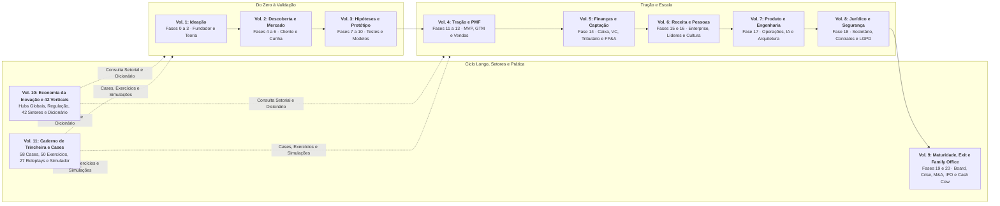
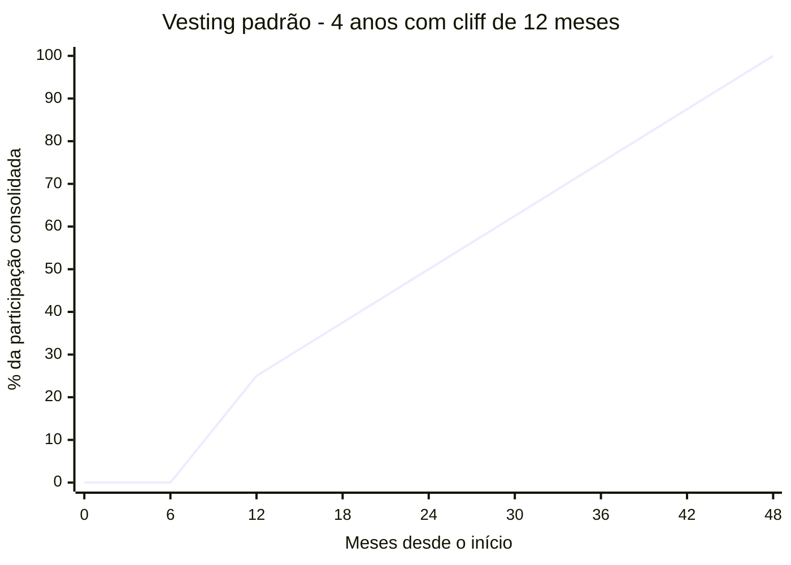
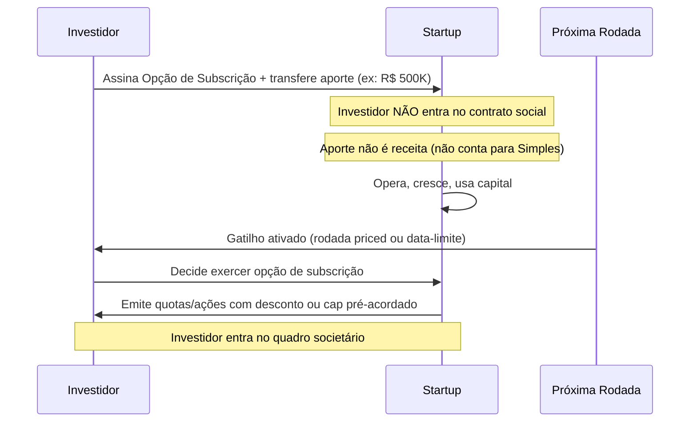
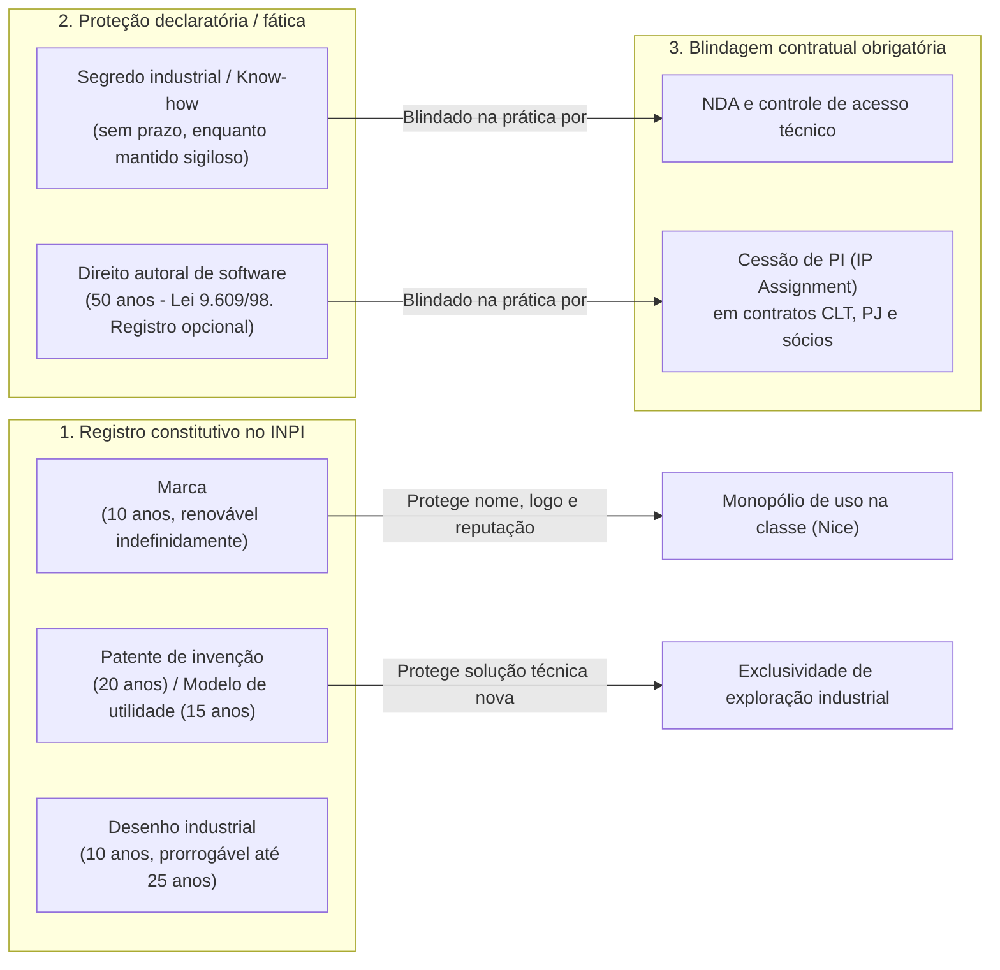
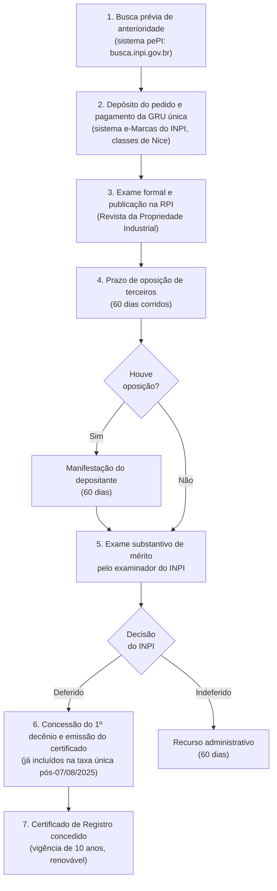

# IGNIÇÃO: Volume 8: Blindagem Jurídica, Societária, LGPD e Segurança

**Estruturação Societária, Contratos, Trabalhista, Propriedade Intelectual, Compliance e Cibersegurança (Fase 18 e Capítulos 1 a 13)**

*João Prado · 2026 · Edição Narrativa Enxuta (v5.3)*

---

## Sobre este Volume

Este é o **Volume 8 (IGNIÇÃO: Volume 8: Blindagem Jurídica, Societária, LGPD e Segurança)** da coleção IGNIÇÃO: O manual operacional do empreendedor brasileiro (11 volumes).

O manual jurídico, societário, regulatório e de segurança da informação para fundadores, executivos e advogados de startups no Brasil. Abre com a Fase 18 (Estruturação Jurídica, Societária e Blindagem Operacional: os 10 passos de formalização, acordo de sócios, propriedade intelectual, contratos, LGPD e proteção patrimonial, com o caso aplicado da PadariaPro LTDA), seguida por 13 capítulos em profundidade sobre o Marco Legal das Startups (LC 182/2021), responsabilidade pessoal dos sócios e desconsideração da personalidade jurídica, registro de marcas, patentes e software no INPI, cláusulas de non-compete, contratos empresariais e operacionais, direito do trabalho para startups (CLT vs. PJ e passivos), CDC aplicado a produtos digitais, contencioso estratégico, LGPD e governança de dados, regulação de IA, compliance anticorrupção, prevenção a fraudes internas e certificações SOC 2 e ISO 27001.

---

## Mapa da Coleção IGNIÇÃO



---

## Sumário deste Volume

### Fase da Etapa (Fase 18)

- [[#FASE 18: ESTRUTURAÇÃO JURÍDICA, SOCIETÁRIA E BLINDAGEM OPERACIONAL|FASE 18: ESTRUTURAÇÃO JURÍDICA, SOCIETÁRIA E BLINDAGEM OPERACIONAL]]

### Sociedade, Marco Legal, Propriedade Intelectual e Proteção dos Sócios (Capítulos 1 a 4)

- [[#CAPÍTULO 1: MARCO LEGAL DAS STARTUPS: LC 182/2021|CAPÍTULO 1: MARCO LEGAL DAS STARTUPS: LC 182/2021]]
- [[#CAPÍTULO 2: RESPONSABILIDADE DO SÓCIO E DO ADMINISTRADOR|CAPÍTULO 2: RESPONSABILIDADE DO SÓCIO E DO ADMINISTRADOR]]
- [[#CAPÍTULO 3: PROPRIEDADE INTELECTUAL E INPI|CAPÍTULO 3: PROPRIEDADE INTELECTUAL E INPI]]
- [[#CAPÍTULO 4: NÃO CONCORRÊNCIA E NÃO SOLICITAÇÃO NO BRASIL|CAPÍTULO 4: NÃO CONCORRÊNCIA E NÃO SOLICITAÇÃO NO BRASIL]]

### Contratos Empresariais, Direito do Trabalho, CDC e Contencioso (Capítulos 5 a 8)

- [[#CAPÍTULO 5: ARQUITETURA CONTRATUAL PARA STARTUPS: OPERAÇÃO E CONTRATOS EM PROFUNDIDADE POR TIPO|CAPÍTULO 5: ARQUITETURA CONTRATUAL PARA STARTUPS: OPERAÇÃO E CONTRATOS EM PROFUNDIDADE POR TIPO]]
- [[#CAPÍTULO 6: DIREITO DO TRABALHO PARA STARTUPS|CAPÍTULO 6: DIREITO DO TRABALHO PARA STARTUPS]]
- [[#CAPÍTULO 7: DIREITO DO CONSUMIDOR E CDC PARA STARTUPS|CAPÍTULO 7: DIREITO DO CONSUMIDOR E CDC PARA STARTUPS]]
- [[#CAPÍTULO 8: CONTENCIOSO E LITÍGIO PARA STARTUPS|CAPÍTULO 8: CONTENCIOSO E LITÍGIO PARA STARTUPS]]

### LGPD, Regulação de IA, Compliance, Prevenção a Fraudes e Cibersegurança (Capítulos 9 a 13)

- [[#CAPÍTULO 9: LGPD, COMPLIANCE E GOVERNANÇA DE DADOS|CAPÍTULO 9: LGPD, COMPLIANCE E GOVERNANÇA DE DADOS]]
- [[#CAPÍTULO 10: REGULATÓRIO DE IA NO BRASIL|CAPÍTULO 10: REGULATÓRIO DE IA NO BRASIL]]
- [[#CAPÍTULO 11: COMPLIANCE E ANTICORRUPÇÃO PARA STARTUPS|CAPÍTULO 11: COMPLIANCE E ANTICORRUPÇÃO PARA STARTUPS]]
- [[#CAPÍTULO 12: FRAUDE INTERNA E CONTROLES INTERNOS|CAPÍTULO 12: FRAUDE INTERNA E CONTROLES INTERNOS]]
- [[#CAPÍTULO 13: SEGURANÇA DA INFORMAÇÃO: DA CERTIFICAÇÃO À ENGENHARIA DEFENSIVA|CAPÍTULO 13: SEGURANÇA DA INFORMAÇÃO: DA CERTIFICAÇÃO À ENGENHARIA]]

### Prática, Cases e Simulações Desta Etapa (Volume 11: Capítulos 22 a 24)

- [[IGNICAO-Vol-11-Workbook-Cases-e-Exercicios#CAPÍTULO 22: CASES GLOBAIS E BRASILEIROS DE CONFLITOS SOCIETÁRIOS, COMPLIANCE REGULATÓRIO, TRABALHISTA, PI, LGPD E SEGURANÇA|CAPÍTULO 22: CASES GLOBAIS E BRASILEIROS DE CONFLITOS SOCIETÁRIOS, COMPLIANCE REGULATÓRIO, TRABALHISTA, PI, LGPD E SEGURANÇA (Vol. 11)]]
- [[IGNICAO-Vol-11-Workbook-Cases-e-Exercicios#CAPÍTULO 23: CADERNO DE EXERCÍCIOS COM GABARITO COMENTADO: ACORDO DE SÓCIOS, REDLINING DE MSA B2B, TRABALHISTA, LGPD E SOC 2|CAPÍTULO 23: CADERNO DE EXERCÍCIOS COM GABARITO COMENTADO: ACORDO DE SÓCIOS, REDLINING DE MSA B2B, TRABALHISTA, LGPD E SOC 2 (Vol. 11)]]
- [[IGNICAO-Vol-11-Workbook-Cases-e-Exercicios#CAPÍTULO 24: SIMULAÇÕES DE DECISÃO E ROLEPLAYS EXECUTIVOS: SAÍDA LITIGIOSA DE SÓCIO, NEGOCIAÇÃO JURÍDICA B2B E WAR ROOM DE RANSOMWARE|CAPÍTULO 24: SIMULAÇÕES DE DECISÃO E ROLEPLAYS EXECUTIVOS: SAÍDA LITIGIOSA DE SÓCIO, NEGOCIAÇÃO JURÍDICA B2B E WAR ROOM DE RANSOMWARE (Vol. 11)]]

---

# ESTRUTURAÇÃO JURÍDICA, SOCIETÁRIA E BLINDAGEM OPERACIONAL

No Brasil, um único ponto cego societário, trabalhista ou contratual pode destruir anos de criação de valor e atingir o patrimônio pessoal dos fundadores. Embora posicionada neste Volume 8 para concentrar a doutrina jurídica em um único bloco de consulta, a [[#FASE 18: ESTRUTURAÇÃO JURÍDICA, SOCIETÁRIA E BLINDAGEM OPERACIONAL|Fase 18]] deve ser executada desde a abertura da empresa e em paralelo à captação (Fase 14) e à escala operacional (Fases 15 a 17), entregando o roteiro prático de 10 passos para formalizar e blindar a companhia até a *due diligence* institucional.

---

## FASE 18: ESTRUTURAÇÃO JURÍDICA, SOCIETÁRIA E BLINDAGEM OPERACIONAL

### O esqueleto jurídico que a diligência abre

Dois anos antes, na preparação da Série A retratada no Volume 5, Lucas e Marina haviam passado quatro meses negociando a rodada de R$ 18 milhões com um fundo de Venture Capital de São Paulo. O *valuation* estava fechado, o comitê de investimento havia aprovado a tese comercial e a minuta final parecia pronta. Na terceira semana da auditoria jurídica (*legal due diligence*), o escritório de advocacia do fundo abriu a documentação societária da startup e encontrou quatro passivos clássicos: os primeiros desenvolvedores PJ que ajudaram Lucas a escrever módulos do sistema nos meses iniciais nunca haviam assinado termo de cessão de propriedade intelectual. A marca principal operava com pedido indeferido no INPI. O investidor-anjo cuja proposta de 35% Marina recusara no décimo mês ainda mantinha uma carta de intenções antiga com direito de veto nunca formalmente distrata, somada à ausência de cláusula de recompra (*reverse vesting*) no acordo de sócios, e quatro vendedores estratégicos atuavam como PJs com subordinação explícita no WhatsApp. O fundo exigiu a retenção de 15% do aporte (R$ 2,7 milhões) em conta vinculada (*escrow*) e condicionou o fechamento da Série A (na qual a participação dos fundadores passaria de 85% para 47%, conforme visto no Volume 5) à limpeza completa do passivo.

Ninguém abre uma empresa sonhando em ler cláusulas societárias, mas o Brasil pune a ingenuidade jurídica com confisco patrimonial. O paradoxo da blindagem operacional é que o jurídico nunca parece urgente enquanto a empresa é pequena: até o dia em que a empresa dá certo e cada atalho do passado ganha poder de veto sobre o seu futuro.

Você precisa vencer **A Fragilidade do Alicerce de Papel**: a ilusão de que ter um CNPJ aberto na Junta Comercial equivale a ter uma empresa estruturada. No caso de Lucas e Marina, limpar as quatro falhas apontadas na diligência levou seis semanas e consumiu R$ 180 mil entre honorários, taxas e acordos (colher os termos retroativos de cessão de código com quitação, firmar acordo de coexistência e compra do registro anterior da marca no INPI por R$ 45 mil, assinar o distrato formal da carta de intenções do anjo com inclusão de *reverse vesting* no acordo de quotistas e migrar para CLT os quatro vendedores com subordinação direta), reduzindo a retenção em *escrow* de R$ 2,7 milhões para R$ 400 mil, liberados após doze meses sem reclamações.

---

> [!note] Antes de assumir captação como rota
> Esta fase estrutura a base jurídica tanto para empresas que seguem a trilha de *venture capital* quanto para negócios *bootstrap* (escolha fundacional tratada no [[IGNICAO-Vol-1-Ideacao#CAPÍTULO 4: BOOTSTRAP vs VENTURE CAPITAL: A ESCOLHA FUNDACIONAL|Capítulo 4 do Volume 1]]). Os dez passos protegem qualquer operação. No caminho de *venture capital*, ganham peso adicional a governança do acordo de sócios, a conversão futura em S.A. e a higiene do *cap table* (como nas trajetórias de RD Station, adquirida pela TOTVS em 2021, e Conta Azul, que passou ao controle do grupo Visma em 2025 após rodadas institucionais).

### Por Que um Passivo Jurídico Mal Cuidado Destrói Múltiplos de Valuation e Trava Rodadas

Quando uma startup adia a formalização societária, trabalhista e contratual, o passivo acumulado cobra seu preço exatamente no momento de maior alavancagem: na auditoria de uma rodada institucional ou na venda da empresa. Na mesa de *due diligence*, cada falha documental se converte em desconto direto no *valuation*, condição precedente que atrasa o caixa por meses ou retenção de 10% a 25% do cheque em conta vinculada (*escrow*). No limite, a ausência de contratos e a mistura entre contas pessoais e societárias abrem caminho para bloqueios judiciais e desconsideração da personalidade jurídica. Estruturar cedo custa uma fração do que custa remediar sob pressão.

### A Execução Sequencial dos 10 Passos: Tipo Societário, Acordo de Sócios, IP, Contratos e LGPD

Dez passos.

#### Passo 1: defina o tipo societário

No Brasil, a escolha da roupagem jurídica inicial passa por quatro figuras principais. Se você está abrindo a empresa agora, siga os dez passos na ordem. Se já opera e captou, use esta sequência como auditoria imediata, começando pelos Passos 4 (acordo de sócios e *vesting*), 5 (contratos e cessão de PI) e 7 (separação entre CPF e CNPJ).

**MEI (Microempreendedor Individual):** é regime simplificado do empresário individual, não tipo societário. Tem teto legal de R$ 81 mil por ano (vigente em outubro de 2026, projetos como o PLP 186/2026 discutem sua atualização, que depende de lei complementar), não admite sócio nem investidor e veda atividades de desenvolvimento de software (Anexo XI da Resolução CGSN 140/2018). Serve apenas para quem testa sozinho um serviço permitido antes de constituir a sociedade.

**Sociedade Limitada Unipessoal (SLU):** modalidade de sociedade limitada com sócio único e responsabilidade restrita ao capital social (CC, art. 1.052, § 1º, incluído pela Lei 13.874/2019). Substituiu a antiga EIRELI, extinta e convertida automaticamente em SLU pelo art. 41 da Lei 14.195/2021.

**Sociedade Limitada (LTDA):** admite um ou mais sócios, limita a responsabilidade ao capital subscrito (uma vez integralizado) e comporta acordo de quotistas flexível com regência supletiva da Lei das S.A. (CC, art. 1.053, parágrafo único). É o tipo societário padrão das startups brasileiras da fundação até a Série A.

**Sociedade Anônima (S.A.):** estrutura corporativa regida pela Lei 6.404/1976, com capital dividido em ações ordinárias e preferenciais, governança de conselho e emissão nativa de opções de compra de ações. Mais complexa de manter no dia zero, torna-se o veículo padrão em rodadas institucionais robustas (Série A em diante) e obrigatória para abertura de capital (IPO).

> [!important] Para a maioria das startups iniciais, LTDA é o ponto ideal
> A S.A. entra em cena quando há captações institucionais relevantes. Migrar de LTDA para S.A. custa entre R$ 15 mil e R$ 30 mil em honorários jurídicos para uma conversão simples (alteração de tipo societário, sem reestruturar o *cap table*, que é o quadro de distribuição do capital da empresa). Na Série A, quando a transformação vem acompanhada de reestruturação societária completa (classes de ações preferenciais, plano de opções, regras de *drag-along* e *tag-along* e eventual *holding* no exterior), o orçamento sobe para a faixa de R$ 30 mil a R$ 100 mil, alinhada ao [[IGNICAO-Vol-5-Financas-e-Captacao#CAPÍTULO 2: CONTABILIDADE, REGIMES FISCAIS E TRIBUTÁRIO ESTRATÉGICO (REFORMA IBS/CBS E INCENTIVOS)|Capítulo 2 (Contabilidade, Regimes Fiscais e Tributário Estratégico) do Volume 5]]. Ainda assim, esse desembolso pesa pouco diante do cheque captado, razão pela qual não compensa antecipar a S.A. na largada.

> [!tip] Capítulo 1: Marco Legal das Startups (LC 182/2021)
> O [[#CAPÍTULO 1: MARCO LEGAL DAS STARTUPS: LC 182/2021|Capítulo 1: Marco Legal das Startups (LC 182/2021)]] detalha os mecanismos da Lei Complementar 182/2021: critérios objetivos de enquadramento como startup, proteção patrimonial ao investidor que aporta sem ingressar no quadro societário, *sandbox* regulatório (art. 11), licitação em modalidade especial para testar soluções inovadoras no setor público (CPSI, arts. 12 a 15) e simplificações para S.A. fechada de menor porte.

#### Passo 2: escolha o regime tributário

No Brasil, as empresas operam sob três regimes tributários principais: Simples Nacional, Lucro Presumido e Lucro Real.

**Simples Nacional:** atende empresas com receita bruta anual de até R$ 4,8 milhões (enquanto o Lucro Presumido alcança até R$ 78 milhões/ano, valores vigentes em outubro de 2026) e reduz a complexidade de apuração, com alíquotas definidas por anexo, faixa de receita e Fator R. Com a Reforma Tributária (LC 214/2025, com ano-teste de CBS e IBS em 2026 e cobrança da CBS em 2027), empresas do Simples que vendem para clientes B2B no regime regular transferem crédito tributário reduzido se mantiverem o recolhimento dentro do DAS. A opção semestral por apurar IBS e CBS por fora do DAS (transferindo crédito integral ao comprador B2B) é exercida em setembro do ano anterior para vigência em janeiro (Resolução CGSN 186, com primeira janela encerrada em 30 de setembro de 2026 para o primeiro semestre de 2027). Avalie essa escolha com seu contador conforme o [[IGNICAO-Vol-5-Financas-e-Captacao#CAPÍTULO 2: CONTABILIDADE, REGIMES FISCAIS E TRIBUTÁRIO ESTRATÉGICO (REFORMA IBS/CBS E INCENTIVOS)|Capítulo 2 do Volume 5]].

**Lucro Presumido:** regime intermediário para empresas que faturam até R$ 78 milhões por ano e não possuem impedimento legal. Aplica percentuais pré-fixados de presunção de lucro sobre a receita bruta (32% para serviços em geral para IRPJ e CSLL), mostrando-se vantajoso quando a margem líquida real supera a presumida e a folha de pagamento já não favorece o Simples.

**Lucro Real:** obrigatório para empresas com faturamento anual acima de R$ 78 milhões ou em atividades financeiras e reguladas específicas, e facultativo para qualquer sociedade. Embora exija escrituração contábil estrita, costuma ser o regime mais eficiente para startups em fase de investimento intensivo que operam com prejuízo fiscal (pois não há IRPJ nem CSLL sem lucro contábil ajustado) ou que acumulam créditos relevantes de PIS/Cofins e, na transição da LC 214/2025, de CBS e IBS.

> [!warning] Consulte o seu contador antes de decidir
> A escolha errada pode custar cinco a dez por cento de margem sem necessidade. Os limites e alíquotas dos regimes mudam periodicamente: esse manual aponta a estrutura, não os números do ano corrente.

> [!note] Tributário estratégico para startups
> O [[IGNICAO-Vol-5-Financas-e-Captacao#CAPÍTULO 2: CONTABILIDADE, REGIMES FISCAIS E TRIBUTÁRIO ESTRATÉGICO (REFORMA IBS/CBS E INCENTIVOS)|Capítulo 2 (Contabilidade, Regimes Fiscais e Tributário Estratégico) do Volume 5]] aprofunda enquadramento tributário, Fator R, incentivos fiscais e controles contábeis. Aqui, o essencial para o checklist de estruturação.

#### Passo 3: registre marca e domínio

Três providências.

Registre a marca no INPI para proteger o nome e o logotipo da empresa. O protocolo garante imediatamente a prioridade na classe escolhida contra depósitos posteriores, mas o direito exclusivo de uso em todo o território nacional só nasce com a concessão do certificado (cujo exame, segundo auditoria do TCU sobre o INPI julgada em agosto de 2026, levou em média 19 meses nos pedidos sem oposição e 34 meses nos processos com oposição em 2025. Ver [[#CAPÍTULO 3: PROPRIEDADE INTELECTUAL E INPI|Capítulo 3]]).

Registro de domínio. .com.br, .com, e outros relevantes para o negócio.

Caso o produto atenda clientes no exterior ou dispute mercado com concorrentes globais, planeje a extensão do registro de marca dentro do prazo de prioridade de seis meses da Convenção de Paris ou via Protocolo de Madri.

#### Passo 4: estruture contratos formais

Quatro tipos de contrato.

##### Acordo de sócios desde a fundação

Indispensável desde o primeiro dia entre cofundadores. Na LTDA, como as quotas são subscritas na abertura, o *vesting* opera por cláusula de opção de recompra das quotas não consolidadas pelo valor nominal (*reverse vesting*) no acordo de sócios, redigida com cautela para afastar risco de requalificação trabalhista se o sócio também for empregado. O acordo precisa cobrir seis pontos: (1) divisão societária e cronograma de *vesting*, (2) regras de saída voluntária, involuntária, invalidez e sucessão por morte, (3) matérias sujeitas a veto em decisões decisivas, (4) mecanismos de resolução de impasse e foro/arbitragem, (5) deveres de não concorrência e confidencialidade, e (6) cláusulas de *tag-along* (direito de venda conjunta) e *drag-along* (obrigação de venda conjunta) para rodadas futuras.



> [!note] Como funciona o vesting com cliff
> Nos primeiros 12 meses, o período de carência (*cliff*), nenhuma participação se consolida. No mês 13, 25% consolida de uma vez. Dos meses 13 a 48, o restante consolida-se mensalmente (~2,08% ao mês). Se o fundador sai antes de completar os 12 meses de carência, não consolida participação alguma. Se sai no mês 30, consolida 62,5% da participação acordada (30 de 48 meses. Sem cláusula de recompra no acordo de sócios, um cofundador com 50% do capital sairia mantendo 100% das suas quotas originais, equivalentes a 50% da empresa, em vez de reter 31,25% e devolver os 18,75% não consolidados). Isso protege a sociedade contra cofundadores que deixam a operação cedo carregando fatia desproporcional do *cap table*.

> [!tip] Canvases Visuais: Capital Stack / Waterfall (Fase 14)
> O *cap table* com *vesting* estruturado nesta fase alimenta diretamente o [[IGNICAO-Vol-5-Financas-e-Captacao#Canvas: Capital Stack / Waterfall Canvas|Canvas: Capital Stack / Waterfall Canvas (Vol. 5)]], que projeta a cascata de recebimento (*waterfall*) entre quotas/ações ordinárias dos fundadores, ações preferenciais de investidores, *pool* de opções (ESOP) e dívida conversível em diferentes cenários de venda da empresa.

> [!warning] Conflitos entre cofundadores estão entre as causas mais citadas de mortalidade precoce de startups (Noam Wasserman, *The Founder's Dilemmas*): casal sem pacto antenupcial briga pela partilha. Sócios sem acordo brigam pela empresa no tribunal
> Não adie a assinatura do acordo de quotistas. Casal que se separa sem pacto antenupcial transforma a partilha de bens em litígio. Sócios que se separam sem acordo escrito travam a empresa por anos na Justiça. O [[IGNICAO-Vol-9-Maturidade-e-Exit#CAPÍTULO 3: DISPUTA SOCIETÁRIA E SAÍDA DE SÓCIO|Capítulo 3 (Disputa Societária e Saída de Sócio) do Volume 9]] detalha as cláusulas preventivas, a mediação empresarial e a mecânica de apuração de haveres e saída forçada.

###### Formalização jurídica do equity acordado

A escolha dos cofundadores e o alinhamento prévio de expectativas estão na [[IGNICAO-Vol-1-Ideacao#FASE 0: PREPARAÇÃO DO EMPREENDEDOR|Fase 0 (Vol. 1)]]. Aqui o foco é traduzir o que foi combinado em quatro travas jurídicas no acordo de sócios:

- **Vesting de 4 anos com cliff de 12 meses para todos os fundadores:** padrão de mercado que vincula a consolidação das quotas à permanência efetiva na operação.
- **Recompra de participação não consolidada (*reverse vesting*):** obrigação contratual de devolver à sociedade ou aos sócios remanescentes, pelo valor nominal de subscrição, a fração de quotas ainda não consolidada no momento do desligamento (conforme o cálculo ilustrado na nota do gráfico acima).
- **Mecanismo de recompra das quotas do sócio que sai e resolução de impasse:** opção de compra com fórmula de preço e prazo de pagamento distintos para saída de boa-fé (*good leaver*) e saída por falta grave ou abandono (*bad leaver*), combinada com cláusula *shotgun* (*buy-or-sell*, na qual um sócio fixa o preço por quota e o outro escolhe comprar ou vender pelo mesmo valor).
- **Critério explícito de voto de minerva em impasse:** em divisões 50/50, atribua voto de desempate por matéria (ex.: CEO em decisões comerciais e financeiras, CTO em arquitetura técnica) ou escalonamento para mediação antes de acionar a cláusula *shotgun*, evitando que divergências operacionais paralisem a empresa.

> [!tip] Não negocie equity em jantar
> A conversa de divisão de equity deve acontecer em ambiente estruturado, com documentação. Acordos verbais em jantar geram memórias diferentes seis meses depois. Use um template de acordo ou leve para advogado desde o primeiro rascunho.

> [!tip] Capítulo 12 (Vol. 6): Stock Options para Startups Brasileiras
> O [[IGNICAO-Vol-6-Receita-e-Pessoas#CAPÍTULO 12: STOCK OPTIONS E ESOP NO BRASIL|Capítulo 12: Stock Options e ESOP no Brasil (Vol. 6)]] cobre a estrutura jurídica e fiscal dos planos de incentivo de longo prazo: opções mercantis versus *phantom shares*, o julgamento vinculante do STJ no Tema 1.226 sobre IRPF, os cuidados previdenciários e como redigir a carta-convite de outorga sem criar passivo fiscal ou trabalhista.

##### Contrato com clientes

Elabore os termos de uso, os contratos de prestação de serviço e os acordos de nível de serviço (SLAs) com revisão de um advogado habituado ao seu modelo de negócios.

> [!note] Contratos operacionais em profundidade: MSA, NDA, DPA e LOI
> O [[#CAPÍTULO 5: ARQUITETURA CONTRATUAL PARA STARTUPS: OPERAÇÃO E CONTRATOS EM PROFUNDIDADE POR TIPO|Capítulo 5: Arquitetura Contratual para Startups]] detalha cada instrumento essencial da operação: MSA (*Master Service Agreement*), Order Form, SLA, NDA, DPA (*Data Processing Agreement*), LOI, contratos com fornecedores de tecnologia e parceiros comerciais, acordos de *advisors* e os pontos que a diligência de Série A audita.

##### Contrato com colaboradores

Escolha a modalidade de contratação adequada para cada função (CLT, prestador PJ genuíno, autônomo ou estagiário), pois mascarar relação de emprego sob contrato PJ gera o passivo trabalhista mais caro das pequenas empresas.

> [!note] Direito do trabalho para startups: CLT vs PJ, eSocial e rescisão
> O [[#CAPÍTULO 6: DIREITO DO TRABALHO PARA STARTUPS|Capítulo 6: Direito do Trabalho para Startups]] detalha os requisitos de vínculo empregatício que levam à condenação por pejotização na Justiça do Trabalho, as obrigações do eSocial e do FGTS Digital desde o primeiro empregado, o regime de teletrabalho e sobreaviso em engenharia e o custo real de cada modalidade de rescisão.

> [!note] Como estruturar a compensação dos primeiros funcionários
> O [[IGNICAO-Vol-6-Receita-e-Pessoas#CAPÍTULO 11: COMPENSAÇÃO E BENEFÍCIOS NO BRASIL|Capítulo 11: Compensação e Benefícios no Brasil (Vol. 6)]] explica o multiplicador real do salário CLT (1,66x sobre o bruto), como estruturar PLR e equity para os primeiros funcionários, e quais benefícios fazem sentido em cada estágio da empresa.

##### NDAs com terceiros críticos

Parceiros, fornecedores, e potenciais investidores quando apropriado.

#### Passo 5: adeque-se à LGPD desde o primeiro tratamento de dados

Toda empresa trata dados pessoais (no mínimo de empregados, candidatos, representantes de clientes e usuários). Execute cinco providências iniciais: (1) mapeie as operações de tratamento e atribua a cada uma a base legal correta dentre as dez do art. 7º da LGPD (como execução de contrato, obrigação legal ou legítimo interesse, reservando o consentimento para quando não houver outra base adequada), (2) publique política de privacidade clara no site e no produto, (3) nomeie formalmente o encarregado (DPO) com identidade e contato públicos no site (Resolução CD/ANPD nº 18/2024) ou, se enquadrado como agente de tratamento de pequeno porte sem tratamento de alto risco (Resolução CD/ANPD nº 2/2022), disponibilize canal direto de atendimento ao titular, (4) mantenha o registro das operações de tratamento (ROPA, que pode seguir o modelo simplificado da ANPD para pequeno porte), e (5) estruture o fluxo para responder pedidos de titulares no prazo legal.

> [!note] Compliance mínimo viável além da LGPD
> O [[#CAPÍTULO 11: COMPLIANCE E ANTICORRUPÇÃO PARA STARTUPS|Capítulo 11: Compliance e Anticorrupção para Startups]] cobre as exigências da Lei Anticorrupção (Lei 12.846/2013), as regras de prevenção à lavagem de dinheiro (PLD/FTP) para fintechs e meios de pagamento e o desenho de um programa de integridade proporcional ao estágio da empresa, enquanto a nomeação do Encarregado (DPO) e a governança de privacidade são aprofundadas no [[#CAPÍTULO 9: LGPD, COMPLIANCE E GOVERNANÇA DE DADOS|Capítulo 9]].

#### Passo 6: instale contabilidade em dia

Mantenha quatro rotinas fiscais em dia com contabilidade especializada: (1) fechamento contábil mensal com balancete e DRE, (2) emissão correta de notas fiscais de serviço ou produto no código tributário adequado, (3) escrituração contábil regular conforme o regime, e (4) entrega tempestiva das obrigações acessórias vigentes em outubro de 2026 (no Simples Nacional: PGDAS-D, DEFIS e, havendo folha ou retenções, eSocial, DCTFWeb e FGTS Digital, no Lucro Presumido e no Lucro Real: DCTFWeb com MIT, eSocial, EFD-Reinf, FGTS Digital, ECD e ECF, lembrando que a DIRF e a DCTF tradicional foram extintas para fatos geradores a partir de janeiro de 2025).

> [!tip] Capítulo 2 (Vol. 5): Contabilidade para Startups
> O [[IGNICAO-Vol-5-Financas-e-Captacao#CAPÍTULO 2: CONTABILIDADE, REGIMES FISCAIS E TRIBUTÁRIO ESTRATÉGICO (REFORMA IBS/CBS E INCENTIVOS)|Capítulo 2: Contabilidade, Regimes Fiscais e Tributário Estratégico (Vol. 5)]] explica a diferença entre contabilidade fiscal e gerencial, os critérios para escolher entre plataforma online, escritório especializado em tecnologia e *controller* interno conforme o estágio e o calendário mensal de obrigações que o fundador precisa monitorar.

#### Passo 7: separe finanças pessoais e empresariais

Mantenha conta bancária exclusivamente da pessoa jurídica, cartão corporativo separado, pró-labore mensal formalizado e distribuição de lucros amparada em balancete contábil. Desde janeiro de 2026 (Lei 15.270/2025), a distribuição de lucros e dividendos a pessoa física acima de R$ 50 mil por mês por empresa sofre retenção de 10% de IRRF na fonte e compõe a apuração do imposto mínimo anual, exigindo calibrar a relação entre pró-labore e dividendos com o contador (ver [[IGNICAO-Vol-5-Financas-e-Captacao#CAPÍTULO 2: CONTABILIDADE, REGIMES FISCAIS E TRIBUTÁRIO ESTRATÉGICO (REFORMA IBS/CBS E INCENTIVOS)|Capítulo 2 do Volume 5]]).

> [!warning] Misturar CPF e CNPJ é caminho para desorganização e risco fiscal
> Empréstimo da empresa ao sócio sem contrato formal e sem encargos de mercado sofre incidência de IOF-crédito (Decreto 6.306/2007) e pode ser autuado pela Receita Federal como distribuição disfarçada de lucros (DDL). Na mão inversa, dinheiro transferido pelo sócio pessoa física para a empresa sem contrato de mútuo ou comprovante de origem (embora isento de IOF-crédito) corre o risco de ser tributado como omissão de receita por suprimento de caixa sem causa comprovada (Decreto-Lei 1.598/1977, art. 12, § 3º). Nos dois sentidos, transferências informais servem de prova de confusão patrimonial para desconsideração da personalidade jurídica (art. 50 do Código Civil).

> [!note] Responsabilidade do sócio e do administrador
> O [[#CAPÍTULO 2: RESPONSABILIDADE DO SÓCIO E DO ADMINISTRADOR|Capítulo 2: Responsabilidade do Sócio e Administrador]] explica quando a desconsideração da personalidade jurídica se aplica, o que configura confusão patrimonial, e as obrigações legais do administrador que justificam a separação rigorosa de contas.

#### Passo 8: estabeleça processos operacionais documentados

Mantenha cinco documentos operacionais vivos: roteiro de integração (*onboarding*) de novo cliente, integração de novo colaborador, processo de suporte, processo de vendas e políticas internas de gastos, viagens e reembolsos.

> [!tip] Documente o necessário, não o exaustivo
> Não precisa ser cinquenta páginas. Precisa ser claro e usado. Documento que ninguém lê é teatro de processo. Uma página por processo, em linguagem direta, vale mais do que manual elaborado que ninguém abre.

#### Passo 9: defina estrutura financeira mínima

Acompanhe mensalmente quatro controles financeiros básicos: fluxo de caixa projetado para os próximos doze meses, régua ativa de cobrança e inadimplência, conciliação bancária semanal e demonstrativo gerencial de resultados (DRE) confrontado com o orçamento.

> [!note] Capital de giro ao estruturar e captar a primeira rodada
> O [[IGNICAO-Vol-5-Financas-e-Captacao#CAPÍTULO 5: CAPITAL DE GIRO, RECEBÍVEIS E GESTÃO DE CAIXA EM PROFUNDIDADE|Capítulo 5: Capital de Giro e Recebíveis (Vol. 5)]] cobre o Ciclo de Conversão de Caixa, as modalidades de antecipação de recebíveis disponíveis no Brasil, e como o FIDC se encaixa em fintechs e marketplaces: ferramentas para não ficar com caixa represado enquanto o negócio cresce.

#### Passo 10: revise seguros

Quatro modalidades, dependendo do negócio.

- **Seguro de responsabilidade civil geral e de administradores (D&O):** cobre danos involuntários causados a terceiros pela operação e protege o patrimônio pessoal dos diretores e conselheiros em processos de gestão.
- **Seguro de riscos cibernéticos (*cyber insurance*):** cobre custos de perícia forense, restauração de sistemas, assessoria jurídica, notificação a titulares e defesa regulatória em incidentes de dados.
- **Seguro de responsabilidade civil profissional (Erros e Omissões, E&O):** indispensável para empresas de software e serviços B2B, cobre prejuízos financeiros reclamados por clientes em razão de falhas técnicas ou indisponibilidade do serviço.
- **Seguro de vida de pessoa-chave (*key person*):** protege o caixa da sociedade diante da falta repentina de um fundador técnico ou comercial decisivo, garantindo recursos para contratar substituto ou honrar compromissos.

> [!note] Coberturas essenciais para startups: D&O, E&O, cyber e Key Man
> O [[IGNICAO-Vol-5-Financas-e-Captacao#CAPÍTULO 8: GESTÃO DE RISCO E SEGUROS PARA STARTUPS|Capítulo 8: Gestão de Risco e Seguros para Startups (Vol. 5)]] detalha quando contratar cada apólice, as exclusões típicas que o fundador precisa revisar e os gatilhos contratuais que tornam o D&O e o E&O obrigatórios após a entrada de fundos institucionais e clientes corporativos.

### Caso aplicado: a blindagem passo a passo da PadariaPro Ltda.

Ao contrário de Lucas e Marina, que precisaram desembolsar R$ 180 mil às pressas na diligência da Série A para limpar passivos acumulados, veja como a PadariaPro LTDA (SaaS de gestão para padarias que acompanhamos desde o Volume 1) montou sua fundação jurídica no dia zero:

**A pessoa jurídica:** constituída como LTDA (Sociedade Limitada), formato enxuto até a Série A, com cláusula expressa de modelo de negócios inovador (LC 182/2021, art. 4º, § 1º, III) e regência supletiva da Lei das S.A. CNAE principal: `62.02-3-00` (Desenvolvimento e licenciamento de programas de computador customizáveis). Capital social subscrito e integralizado de R$ 30 mil no ato (evitando subscrever capital alto não integralizado, pois pelo art. 1.052 do Código Civil todos os sócios respondem solidariamente pelo saldo que faltar integralizar perante credores).

O cap table inicial.

| Sócio | Percentual | Tipo de entrada | Vesting |
|---|---|---|---|
| Joana (fundadora, CEO) | 60% (incluindo 5% reservados para o *pool* de incentivos) | Tempo integral desde o dia um | 48 meses, *cliff* de 12 meses |
| Bruno (cofundador, CTO) | 40% | Tempo integral desde o mês três | 48 meses, *cliff* de 12 meses |
| Pedro (conselheiro e investidor-anjo) | Fora do QSA (0% até a conversão) | R$ 200 mil em mútuo conversível (LC 182/2021, art. 5º), estimativa de ~5% pós-conversão na próxima rodada | Não se aplica (investidor) |
| *Pool* de incentivos (ESOP / opções) | 5% (destacados da fatia dos fundadores por obrigação no acordo de sócios) | Reservado para futuras contratações-chave | 48 meses por outorga (*cliff* de 12 meses) |

**Contabilidade e fechamento mensal:** escritório contábil terceirizado e especializado em empresas de tecnologia (honorários de R$ 1.200 por mês), responsável pela apuração de tributos, folha de pagamento integrada, entrega de obrigações acessórias e fechamento até o 10º dia útil com DRE e balanço gerencial.

**Os contratos:** contratação CLT para os colaboradores com rotina fixa, subordinação e dedicação contínua, reservando contratos PJ exclusivamente para prestadores eventuais com autonomia real e cláusula expressa de cessão de propriedade intelectual e sigilo. Termos de uso e política de privacidade publicados no site. Aditivos de proteção de dados (DPA) assinados com AWS (nuvem), provedor oficial da API do WhatsApp Business (BSP homologado pela Meta, evitando APIs não oficiais baseadas em emulação de QR Code que violam os termos da plataforma e causam bloqueio do número), Asaas (pagamentos) e Mailgun (e-mail transacional).

A LGPD ([[#CAPÍTULO 9: LGPD, COMPLIANCE E GOVERNANÇA DE DADOS|Capítulo 9 (LGPD, Compliance e Governança de Dados)]]). DPO terceirizado (DPO-as-a-Service, R$ 800 por mês). Canal `privacidade@padariapro.com.br` ativo. Mapeamento de tratamentos: catorze operações documentadas, com base legal.

**Registro de marca no INPI:** pedido protocolado em 15 de fevereiro nas classes NCL 9 (software) e 42 (serviços tecnológicos) para o nome e o logotipo "PadariaPro", com pagamento da taxa única de depósito (R$ 440 por classe com desconto de EPP, já incluído o primeiro decênio). O protocolo assegura desde a data do depósito a prioridade legal contra pedidos posteriores na mesma classe.

A contingência. Reserva líquida: R$ 150 mil (cerca de três meses de despesas fixas). Plano de contingência de quatro páginas documentado ([[IGNICAO-Vol-9-Maturidade-e-Exit#CAPÍTULO 9: GESTÃO DE CRISE, CONTINUIDADE OPERACIONAL E COMUNICAÇÃO CRÍTICA|Capítulo 9 (Gestão de Crise, Continuidade Operacional e Comunicação Crítica) (Vol. 9)]]), para quatro cenários: caixa crítico, churn explosivo, perda de sócio, e regulatório.

**A separação financeira:** conta PJ dedicada em banco digital corporativo. Pró-labore dos fundadores fixado em R$ 7.500 por mês, alinhado ao planejamento financeiro pessoal visto no [[IGNICAO-Vol-1-Ideacao#CAPÍTULO 1: DINHEIRO PESSOAL DO FUNDADOR|Capítulo 1 do Volume 1 (Dinheiro Pessoal do Fundador)]] e na [[IGNICAO-Vol-1-Ideacao#FASE 0: PREPARAÇÃO DO EMPREENDEDOR|Fase 0 (Vol. 1)]]. Nenhuma despesa pessoal passa pela conta da empresa e qualquer aporte suplementar é formalizado por contrato escrito.

### Os Entregáveis Concretos da Empresa Blindada e Pronta Para Escalar

Você concluiu a Fase 18 quando todos os critérios abaixo estão cumpridos.

- [ ] Pessoa jurídica constituída em tipo societário aderente ao estágio (LTDA com regência supletiva da Lei das S.A. ou S.A. fechada), enquadrada no regime tributário ótimo e com ato constitutivo revisado por advogado societário.
- [ ] Quadro societário (*cap table*) formalizado com divisão de quotas e *vesting* de 4 anos com *cliff* de 12 meses, acompanhado de acordo de sócios assinado prevendo regras de saída, *tag-along*, *drag-along* e mediação de impasses.
- [ ] Nome empresarial, domínio de internet e pedido de registro de marca protocolados no INPI após busca prévia de anterioridade.
- [ ] Instrumentos contratuais padronizados e assinados com clientes (termos de uso, SLA e política de privacidade), equipe (contratos CLT ou PJ sem subordinação) e parceiros (NDAs e cessão de propriedade intelectual).
- [ ] Estrutura inicial de conformidade com a LGPD em operação: encarregado nomeado com contato público no site (ou canal direto de atendimento ao titular, se dispensado como agente de pequeno porte pela Resolução CD/ANPD nº 2/2022), registro das operações de tratamento (ROPA), bases legais mapeadas, aditivos de proteção de dados (DPAs) com fornecedores e política de privacidade publicada.
- [ ] Contabilidade ativa com fechamento mensal até o 10º dia útil (DRE e balanço), zero atrasos nos últimos 6 meses nas obrigações acessórias vigentes em outubro de 2026 conforme o regime tributário (PGDAS-D, DEFIS e, havendo folha ou retenções, eSocial, DCTFWeb e FGTS Digital no Simples Nacional, DCTFWeb com MIT, EFD-Reinf, eSocial, FGTS Digital, ECD e ECF no Lucro Presumido e no Lucro Real, lembrando que a DIRF e a DCTF mensal tradicional foram extintas a partir de janeiro de 2025) e certidões negativas (CND/CPEND) válidas.
- [ ] Separação estrita entre o patrimônio pessoal dos sócios e o caixa da empresa, operando exclusivamente com conta bancária PJ, cartão corporativo, pró-labore escriturado e distribuição de lucros documentada.
- [ ] Rotinas operacionais essenciais registradas em manuais curtos (implantação de clientes, integração de contratados, atendimento de suporte, funil comercial e alçadas internas).
- [ ] Plano de contingência financeira e operacional documentado ([[IGNICAO-Vol-9-Maturidade-e-Exit#CAPÍTULO 9: GESTÃO DE CRISE, CONTINUIDADE OPERACIONAL E COMUNICAÇÃO CRÍTICA|Capítulo 9 (Gestão de Crise, Continuidade Operacional e Comunicação Crítica) (Vol. 9)]]).
- [ ] Apólices de seguro compatíveis com o porte da operação: responsabilidade civil profissional, seguro cibernético quando houver tratamento relevante de dados, D&O a partir da entrada de investidores institucionais no conselho e seguro de pessoa-chave (*Key Man*) quando a operação depender diretamente de um fundador técnico ou comercial.

> [!warning] Critério de saída
> Cada mês operando com prestadores PJ subordinados, código sem termo de cessão ou marca sem protocolo no INPI acumula passivo trabalhista, fiscal e societário corrigido pela Selic. Na diligência da Série A de Lucas e Marina, essas pendências congelaram R$ 2,7 milhões do aporte em conta vinculada (*escrow*) e custaram R$ 180 mil de saneamento.

**Oficina de Trincheira (As 3 Peças do Dia Zero e Primeiros Passos):** antes de avançar, estruture estas três peças no seu arquivo societário: (A) Esqueleto do Acordo de Sócios (6 cláusulas obrigatórias): (1) *Quotas e Reverse Vesting* (48 meses, *cliff* de 12 meses, opção de recompra pelo valor nominal da fração não consolidada), (2) *Regras de Saída* (*Good Leaver* com pagamento parcelado pelo valor contábil/avaliado, *Bad Leaver* por falta grave, abandono ou violação de não concorrência com recompra pelo valor nominal), (3) *Governança e Vetos* (quórum qualificado para dívida acima de R$ X, emissão de novas quotas, venda de ativos de PI e alteração de pró-labore), (4) *Resolução de Impasse* (mediação de 30 dias seguida de cláusula *shotgun*), (5) *Transferência de Quotas* (direito de preferência, *tag-along* de 100% e *drag-along* acima de gatilho mínimo de preço), e (6) *Cessão de PI, Sigilo e Não Aliciamento* (24 meses). (B) Cláusula-Núcleo de Cessão de PI para Prestadores e Cofundadores: *"O CEDENTE cede e transfere à SOCIEDADE, em caráter definitivo, irrevogável, irretratável e exclusivo, em todo o território nacional e no exterior, pelo prazo integral de proteção legal (Lei 9.609/1998, art. 4º, e Lei 9.610/1998, art. 49), a totalidade dos direitos patrimoniais sobre códigos-fonte, algoritmos, arquiteturas, interfaces, bancos de dados e documentações desenvolvidos para a SOCIEDADE desde a fase pré-constitutiva."* (C) Índice das 6 Pastas do Data Room Permanente: `01_Societario` (contrato social, acordo de sócios, *cap table*, atas), `02_Propriedade_Intelectual` (protocolos INPI, termos de cessão de PI, inventário *open source*), `03_Contratos_Comerciais` (MSA, termos de uso, contratos com grandes clientes e fornecedores), `04_Trabalhista_e_Pessoas` (contratos CLT, aditivos de teletrabalho, contratos PJ por escopo, recibos FGTS/eSocial), `05_Tributario_e_Contabil` (balancetes, DREs, recibos DCTFWeb/PGDAS-D, certidões CND/CPEND) e `06_LGPD_e_Seguranca` (ROPA, política de privacidade, DPAs, plano de resposta a incidentes). Com esse índice aberto, execute os cinco primeiros passos:

1. Contrate advogado especializado em startups para revisar o contrato social, o acordo de quotistas com *reverse vesting* e os modelos de cessão de PI e contratos B2B (pacote inicial típico de R$ 5 mil a R$ 15 mil, conforme a complexidade societária).
2. Formalize o cap table em planilha detalhada, mais o vesting dos sócios (quatro anos com cliff de doze meses é padrão).
3. Contrate contador especializado em startup, ou serviços como Contabilizei, ou Omie mais contador, para começar fechamento mensal.
4. Realize a busca prévia de anterioridade e protocole o pedido de registro de marca no INPI nas classes corretas, garantindo a prioridade da fila desde a data do depósito (enquanto o exame técnico leva em média 19 meses sem oposição, conforme visto no Passo 3).
5. Redija a política de privacidade, os termos de uso e o mapeamento básico de dados pessoais (LGPD).

### Os Erros Jurídicos que Custam Parte do Cap Table ou o Patrimônio da Família

Três falhas concentram as maiores perdas patrimoniais em diligências de Série A e litígios societários: (1) deixar de colher termo de cessão de propriedade intelectual dos primeiros desenvolvedores, o que permite que um ex-prestador bloqueie a rodada ou exija participação para liberar o código, (2) admitir cofundador no contrato social sem acordo de sócios com opção de recompra (*reverse vesting*), permitindo que quem abandona a operação no primeiro ano leve 20% ou 30% da empresa, e (3) misturar contas pessoais e societárias, caracterizando confusão patrimonial que autoriza a desconsideração da personalidade jurídica (art. 50 do CC). Na esfera de dados pessoais, operar sem base legal ou controles de segurança expõe a empresa às sanções da LGPD, cuja multa administrativa chega a até 2% do faturamento no Brasil, limitada a R$ 50 milhões por infração (art. 52, II).

**"Depois eu resolvo":** adiar a regularização societária, tributária e trabalhista não economiza caixa. Os passivos crescem todo mês com multa e juros Selic e explodem na mesa de diligência.

Economizar na contabilidade contratando um escritório sem experiência em tecnologia costuma sair caro em multas fiscais, enquadramento tributário inadequado e retrabalho antes da diligência.

Deixar a relação societária apenas na conversa verbal transforma divergências futuras sobre caixa, dedicação ou saída de cofundador em litígios capazes de travar a empresa.

Adiar as medidas básicas da LGPD expõe a empresa a sanções administrativas de até 2% do faturamento (limitadas a R$ 50 milhões por infração) e, sobretudo, à perda de contratos com clientes corporativos.

Criar políticas extensas que ninguém lê nem executa gera falsa sensação de segurança e produz prova contra a própria empresa em auditorias: mantenha documentos enxutos e auditados na rotina semanal.

---

### O Espelho da Due Diligence: Se um Comprador Auditar Sua Empresa Amanhã às 8h, o Que Ele Vai Encontrar?

Quando Lucas e Marina revisaram a operação em São Paulo e Florianópolis após o susto da Série A, transformaram a limpeza de emergência em rotina permanente: nenhuma linha de código entrou mais no repositório sem termo de cessão arquivado, nenhum prestador iniciou projeto sem contrato por escopo validado e as seis pastas do Data Room passaram a ser conferidas toda segunda-feira.

Abra a pasta societária e contratual da sua empresa agora e atribua uma nota de 1 a 5 para cada um dos três testes abaixo (1 = inexistente ou verbal, 3 = parcial ou desatualizado, 5 = formalizado, assinado e arquivado no Data Room). Chave de leitura: soma de 13 a 15 pontos indica prontidão para diligência institucional. De 9 a 12 pontos, trava comercial ou desconto de *valuation* na rodada (corrija em 30 dias), abaixo de 9 pontos, exposição patrimonial decisiva que exige estancar as falhas nesta semana:

1. **O Teste da Propriedade do Código e da Marca (nota 1 a 5):** Cada linha de código, algoritmo, domínio e marca que gera receita para sua empresa hoje pertence formalmente ao CNPJ por contratos assinados e pedidos protocolados no INPI, ou está no CPF de sócios e ex-prestadores?
2. **O Teste do Sócio Ausente e do Impasse (nota 1 a 5):** Seu Acordo de Sócios separa claramente o mecanismo de recompra das quotas de quem sai (*good leaver* e *bad leaver*) da cláusula *shotgun* (*buy-or-sell*) para resolução de impasse societário grave?
3. **A Segregação Patrimonial:** Existe alguma despesa pessoal de sócio sendo paga pela conta bancária da empresa hoje que serviria de munição imediata para um juiz decretar confusão patrimonial?

**Regra de Sobrevivência:** O advogado mais caro do mundo é o advogado barato ou o modelo copiado da internet que você usa para economizar R$ 5 mil no ano um e que custa R$ 2 milhões na Série A.

**O Ritual de Segunda-Feira às 9h:** Estruture hoje o Data Room permanente da empresa na nuvem com as seis pastas da Oficina de Trincheira. Toda segunda-feira, às 9h, dedique 20 minutos para arquivar os contratos assinados na semana anterior, conferir se cada novo colaborador ou prestador assinou cessão de PI e NDA antes de receber acesso aos sistemas e renovar as certidões negativas que vencem nos próximos 30 dias.

---

### MÉTRICAS E BENCHMARKS DESTA FASE (FASE 18)

| Métrica | O que medir | Referência saudável |
|---|---|---|
| Conformidade de PI e Contratos | % de colaboradores e PJs com cessão de PI e NDA assinados e certidões negativas válidas no data room | 100% dos ativos decisivos, contratos e registros no INPI regularizados antes da diligência |
| Exposição trabalhista em contratações | % de prestadores PJ com subordinação, horário fixo ou exclusividade disfarçada | 0% (CLT para rotina subordinada, PJ apenas por escopo autônomo) |
| Prontidão regulatória de dados (LGPD) | Prazo de resposta a pedidos de titulares (art. 19, II) e de notificação de incidentes à ANPD (Res. 15/2024) | Até 15 dias para acesso completo, até 3 dias úteis para incidente relevante (6 dias úteis no pequeno porte) |
| Cap table limpa | Sem problemas de governança ou direitos conflitantes | Sim |
| Compliance básico | LGPD, trabalhista, tributário em dia | Sim |
| Acordo de sócios | Vesting, drag-along, tag-along definidos | Sim |
| Data room Série A | Documentos para due diligence organizados | ≥ 80% completo |

---

### LEITURAS E RECURSOS RECOMENDADOS DESTA FASE

#### Profissionais que você vai precisar

Contrate quatro perfis especializados conforme a etapa: (1) contador B2B com prática em startups, apuração de Fator R, folha de tecnologia, DCTFWeb/eSocial e créditos na transição IBS/CBS (mensalidade típica de R$ 800 a R$ 2.500 no estágio inicial), (2) advogado societário e contratual habituado ao Marco Legal das Startups (LC 182/2021), acordos de quotistas com *reverse vesting* e contratos B2B (pacote inicial típico de R$ 5 mil a R$ 15 mil, conforme o escopo), (3) **encarregado de dados (*DPO as a Service* ou interno) que entregue o ROPA, os DPAs e o fluxo de incidentes alinhados às resoluções da ANPD, e (4) agente de propriedade industrial** (ou protocolo direto auditado no sistema e-Marcas) para buscas de anterioridade e depósitos no INPI. Leituras de cabeceira: Lei Complementar 182/2021, Código Civil (arts. 1.052 a 1.087), guias orientativos da ANPD e *Venture Deals* (Brad Feld e Jason Mendelson).

#### Tipos de comunidades e recursos online para empreendedores

Comunidades de fundadores locais via associações, eventos e encontros. Programas de aceleração: estude com rigor antes de entrar. Muitos são mais ruins do que bons. Mentoria estruturada com gente que já construiu, não só investiu ou escreveu. Cursos de Y Combinator Startup School, gratuitos.

#### Artigos práticos abertos ao público

**Guias oficiais, legislação e referências públicas:** (1) ANPD (Agência Nacional de Proteção de Dados): *Guia Orientativo para Definições dos Agentes de Tratamento de Dados Pessoais e do Encarregado*, *Guia Orientativo de Segurança da Informação para Agentes de Tratamento de Pequeno Porte* (ANPD, 2021) e Resolução CD/ANPD nº 2/2022 (regulamento de aplicação diferenciada da LGPD para agentes de pequeno porte), disponíveis gratuitamente em `gov.br/anpd`, (2) Marco Legal das Startups (Lei Complementar nº 182/2021) e Código Civil (Lei nº 10.406/2002, arts. 1.052 a 1.087) no Portal da Legislação do Planalto, e (3) INPI: *Manual de Marcas* e *Manual de Registro de Programa de Computador* (`gov.br/inpi`).

---

### Fechamento da Fase 18: o que muda na sua cabeça e na sua empresa a partir de agora

Nesta Fase 18 você estruturou o tipo societário (LTDA ou S.A.), o regime tributário, o *cap table* com *vesting*, o acordo de sócios, os contratos com clientes e prestadores, a conformidade com a LGPD e a rotina contábil mensal. Fundadores experientes tratam a fundação jurídica como infraestrutura de crescimento: a escolha tributária preserva caixa ao longo de cinco anos, um quadro societário limpo destrava a diligência de fundos institucionais e a governança de dados abre as portas de clientes corporativos.

Com a casa blindada após o susto da Série A, Lucas e Marina puderam voltar 100% da atenção executiva para a expansão do negócio. Após mergulhar nos treze capítulos de aprofundamento jurídico, regulatório e de segurança deste Volume 8, a [[IGNICAO-Vol-9-Maturidade-e-Exit#FASE 19: REINVENÇÃO E SEGUNDA CURVA|Fase 19 (no Volume 9)]] mostrará como conduzir a segunda curva de crescimento, a governança de conselho e a preparação de saída (*exit*) sem reabrir os passivos que você acabou de fechar.

---

# SOCIEDADE, MARCO LEGAL, PROPRIEDADE INTELECTUAL E PROTEÇÃO DOS SÓCIOS (CAPÍTULOS 1 A 4)

Estes quatro capítulos definem quem é dono da empresa, até onde vai o risco do CPF dos sócios e quem detém a tecnologia e a marca: o uso estratégico do Marco Legal das Startups (LC 182/2021), a defesa contra a desconsideração da personalidade jurídica, o registro de propriedade intelectual no INPI e a validade real de cláusulas de não concorrência e segredo de negócio.

---

## CAPÍTULO 1: MARCO LEGAL DAS STARTUPS: LC 182/2021

### O Escudo do Investidor-Anjo e as Engrenagens Reais do Marco Legal das Startups

Em Belo Horizonte, quando a Dra. Camila estruturou a nova controlada de tecnologia e teleodontologia do seu grupo (constituída com CNPJ próprio, declaração de modelo inovador no contrato social e faturamento ainda abaixo do teto de R$ 16 milhões do art. 4º da LC 182/2021), um médico cirurgião amigo decidiu investir R$ 1,2 milhão na expansão da plataforma. Na véspera da transferência, o contador tradicional do médico travou o negócio com um alerta: "Não coloque seu CPF nem como minoritário nessa LTDA! Meu cunhado entrou com 5% como sócio quotista no restaurante de um amigo há seis anos, o restaurante quebrou e a Justiça do Trabalho bloqueou a conta pessoal dele na semana passada para pagar dívida de ex-funcionário". O contador tinha razão quanto ao risco de entrar como quotista comum no contrato social de uma LTDA, hoje como antes de 2017. O que mudou na lei brasileira foi a criação de instrumentos que mantêm o investidor fora do quadro societário: desde a LC 155/2016 (para ME e EPP) e com a ampliação da Lei Complementar 182/2021 para qualquer startup enquadrada no art. 4º, o aporte passivo ficou blindado. Camila e seu advogado societário conferiram os requisitos legais de enquadramento e formalizaram o cheque de R$ 1,2 milhão via mútuo conversível (art. 5º, § 1º, IV, da LC 182/2021), mantendo o cirurgião fora do quadro societário e protegido pelo escudo do art. 8º contra dívidas trabalhistas e desconsideração da personalidade jurídica.

Muitos empreendedores e contadores generalistas ainda desconhecem os instrumentos práticos da LC 182/2021 e continuam assinando alterações de contrato social que colocam o investidor-anjo diretamente no quadro de sócios da LTDA ou deixam de usar os ritos próprios para vender inovação ao Estado.

Você precisa dominar **A Assimetria Regulatória do Marco Legal**: saber exatamente onde a Lei Complementar 182/2021 blinda o investidor contra desconsideração da personalidade jurídica e abre portas de licitação especial (CPSI), e onde ela não passa de letra bonita se você ignorar o regime tributário e o direito trabalhista.

---

> [!note] Nota de validade
> A Lei Complementar 182/2021 foi promulgada em junho de 2021. O teto de receita bruta de R$ 16 milhões para enquadramento de startup (art. 4º, § 1º, I) está fixado na própria lei complementar. Já os tetos do CPSI (R$ 1,6 milhão no teste e até 5 vezes no fornecimento posterior) podem ser atualizados anualmente pelo Poder Executivo federal via IPCA (art. 12, § 3º), os limites gerais de dispensa da Lei 14.133/2021 são corrigidos todo fim de ano por decreto federal e as regras de cada *sandbox* regulatório são definidas por resolução do respectivo regulador setorial. Este capítulo reflete o cenário de outubro de 2026.

A [[#FASE 18: ESTRUTURAÇÃO JURÍDICA, SOCIETÁRIA E BLINDAGEM OPERACIONAL|Fase 18]] cobriu constituição, *cap table* e *vesting*. O [[#CAPÍTULO 5: ARQUITETURA CONTRATUAL PARA STARTUPS: OPERAÇÃO E CONTRATOS EM PROFUNDIDADE POR TIPO|Capítulo 5]] aprofunda os contratos operacionais, enquanto o [[#CAPÍTULO 3: PROPRIEDADE INTELECTUAL E INPI|Capítulo 3]] trata de propriedade intelectual e registro no INPI. O [[IGNICAO-Vol-5-Financas-e-Captacao#CAPÍTULO 2: CONTABILIDADE, REGIMES FISCAIS E TRIBUTÁRIO ESTRATÉGICO (REFORMA IBS/CBS E INCENTIVOS)|Capítulo 2 (Contabilidade, Regimes Fiscais e Tributário Estratégico) do Volume 5]] aborda o planejamento tributário e o [[IGNICAO-Vol-5-Financas-e-Captacao#CAPÍTULO 9: CAPTAÇÃO DE EQUITY: PLANEJAMENTO DE RODADA, PITCH E RELACIONAMENTO COM INVESTIDORES|Capítulo 9 do Volume 5]] estrutura a estratégia de captação. Este capítulo examina a Lei Complementar 182/2021 e como aplicar seus instrumentos na prática.

### Por Que Entender o Marco Legal Destrava Cheques de Anjos que Têm Medo da Justiça Brasileira

Quando o fundador apresenta ao investidor-anjo um contrato tipificado na LC 182/2021, elimina a principal objeção patrimonial de médicos, executivos e empresários brasileiros que temem responder com o próprio CPF por passivos trabalhistas ou fiscais da startup. O efeito prático aparece nas duas pontas: o anjo ganha previsibilidade legal para assinar o cheque sem entrar no contrato social da LTDA, e a startup preserva um quadro societário enxuto para a futura diligência de fundos de *venture capital*.

Operar com os instrumentos expressamente tipificados no art. 5º, § 1º, da LC 182/2021 (como o mútuo conversível em participação societária ou o contrato de opção de subscrição de ações ou quotas, que funcionam como equivalentes locais seguros ao SAFE estrangeiro), em vez de traduzir minutas americanas sem respaldo no Código Civil, dá segurança jurídica imediata às duas pontas: protege o CPF do anjo e reduz contingências na diligência da Série A.

Para govtechs, a LC 182/2021 criou a licitação em modalidade especial e o Contrato Público para Solução Inovadora (CPSI, arts. 12 a 15), aberto a qualquer pessoa física ou jurídica, com teto de R$ 1,6 milhão por contrato de teste e possibilidade de contrato de fornecimento posterior sem nova licitação até cinco vezes esse valor (R$ 8 milhões).

O ARE é subutilizado, mas resolve o impasse que trava fintechs, healthtechs e edtechs antes da largada: testar um produto regulado em ambiente real sem precisar aguardar a licença definitiva completa.

### Os Critérios Objetivos de Enquadramento: Receita, Tempo de CNPJ e Declaração de Inovação

O art. 4º, § 1º, da LC 182/2021 enquadra como startup a organização empresarial ou societária nascente ou em operação recente cuja atuação caracterize inovação aplicada a modelo de negócios ou a produtos ou serviços ofertados, desde que cumpra cumulativamente três critérios objetivos: (I) receita bruta de até R$ 16 milhões no ano-calendário anterior (ou de até R$ 1.333.334 multiplicado pelo número de meses de atividade no ano-calendário anterior, quando tiver menos de 12 meses), (II) até 10 (dez) anos de inscrição no CNPJ, e (III) declaração expressa em seu ato constitutivo ou alterador de que utiliza modelos de negócios inovadores para a geração de produtos ou serviços, ou enquadramento no regime especial Inova Simples (art. 65-A da LC 123/2006).

> [!warning] O critério de inovação é autodeclaratório
> A lei não exige certificação externa para qualificar como startup inovadora. A empresa declara. Mas em caso de autuação ou disputa contratual, a autodeclaração precisa ter substância. Manter documentação que comprove o caráter inovador: roadmap de produto, registros de pesquisa e desenvolvimento, propriedade intelectual depositada, ou literatura técnica de suporte.

**Formas jurídicas elegíveis.** Empresário individual, sociedades empresárias limitadas (LTDA, inclusive a Sociedade Limitada Unipessoal, SLU, na qual todas as antigas EIRELIs foram convertidas pelo art. 41 da Lei 14.195/2021), sociedades anônimas (S.A.), sociedades simples e sociedades cooperativas (art. 4º, § 1º, da LC 182/2021).

**O que não conta para o limite de receita.** Receita de subsidiárias ou coligadas pode ser consolidada, dependendo da estrutura. Consultar contador antes de assumir elegibilidade.

**O limite de dez anos:** conta-se da data de inscrição no CNPJ (art. 4º, § 1º, II, da LC 182/2021), e não do início do faturamento comercial. Uma empresa com CNPJ aberto em 2018 que permaneceu inativa e só lançou seu produto em 2023 perde a elegibilidade ao Marco Legal em 2028, e não em 2033.

---

### Opção de Subscrição, Opção de Compra e Mútuo Conversível (Art. 5º da LC 182/2021): Como o Investidor Entra Sem Ser Sócio

#### O que são os contratos de opção e o mútuo conversível

A LC 182/2021 (art. 5º, § 1º, I e II) prevê dois contratos distintos de opção que parte do mercado agrupa informalmente sob a sigla "COCP", mas que possuem natureza financeira oposta: no Contrato de Opção de Subscrição (inciso I, firmado com a própria startup), os recursos ingressam no caixa da empresa para financiar o crescimento e o investidor recebe o direito de subscrever novas quotas ou ações no futuro. Já no Contrato de Opção de Compra (inciso II, firmado com os sócios existentes), o investidor adquire o direito de comprar quotas ou ações já emitidas (operação secundária em que o preço vai para os sócios vendedores, e não para o caixa da companhia). Na captação primária (*pre-seed* e *seed*), os equivalentes funcionais brasileiros do SAFE norte-americano (*Simple Agreement for Future Equity*) são o Contrato de Opção de Subscrição e o Mútuo Conversível (inciso IV).

#### Como funciona na prática a opção de subscrição



**Elementos essenciais do Contrato de Opção de Subscrição.**

| Cláusula | O que define |
|---|---|
| Valor do aporte | Capital transferido imediatamente |
| Prazo da opção | Período máximo para exercício definido livremente em contrato (o limite legal de 7 anos na LC 123, art. 61-A, § 1º e § 4º, III, aplica-se apenas à vigência e remuneração do contrato de participação de investidor-anjo, cujo resgate exige no mínimo 2 anos) |
| Gatilho de conversão | Próxima rodada priced, data fixa, ou evento específico |
| Cap de valuation | Valuation máximo para cálculo da participação |
| Desconto | % de desconto sobre o preço da próxima rodada |
| Condições de exercício | Quóruns, documentação, notificação |
| Direitos do optante | Informativos (sim), votos (não, antes do exercício) |

#### Comparativo: Opção de Subscrição vs. SAFE vs. Mútuo Conversível

| Critério | Opção de Subscrição (art. 5º, I) | SAFE (adaptado) | Mútuo Conversível (art. 5º, IV) |
|---|---|---|---|
| Base legal brasileira | ✅ LC 182/2021 (art. 5º, § 1º, I) | ❌ Adaptação contratual atípica | ✅ LC 182/2021 (art. 5º, § 1º, IV) e Código Civil |
| Natureza | Opção de equity | Futuro equity | Dívida conversível |
| Investidor é sócio? | Não, até exercício | Não, até conversão | Não (é credor) |
| Gera IOF? | Não (não é operação de crédito) | Não (se estruturado como opção) | Sim se o mutuante for PJ, isento quando o investidor é pessoa física |
| Conta para limite Simples? | Não | Depende da estrutura | Não (empréstimo) |
| Responsabilidade do investidor | Limitada ao aporte | Limitada | Limitada |
| Risco de requalificação tributária | Baixo | Médio (sem lei) | Médio (juros e IOF) |
| Conforto em DD | Alto (base legal clara) | Médio | Alto |

> [!tip] Quando escolher entre opção de subscrição e mútuo conversível
> O **contrato de opção de subscrição** é preferível quando o investidor busca puramente participação societária futura (*equity*) sem registrar passivo de empréstimo no balanço da startup. O mútuo conversível é útil quando o investidor deseja a posição jurídica de credor até a conversão (ou gatilho de vencimento caso a rodada qualificada não ocorra) ou quando a empresa prefere um instrumento amplamente testado pela jurisprudência brasileira.

#### Exemplo brasileiro preenchido

**Empresa**: Plantio.AI, startup de agritech com dois anos de constituição.
**Investidor**: investidor-anjo brasileiro com perfil de ex-fundador.
**Situação**: rodada *pré-seed* de R$ 400 mil, antes de o produto entrar em produção.

Cláusulas do Contrato de Opção de Subscrição:
- Aporte: R$ 400.000 (transferência imediata para o caixa, sem emissão imediata de quotas)
- Teto de avaliação (*cap* de *valuation*): R$ 6 milhões (*pré-money* da próxima rodada)
- Desconto: 20% sobre o preço por quota/ação da próxima rodada precificada
- Gatilho: próxima rodada qualificada ≥ R$ 1 milhão, ou 36 meses da data de assinatura
- Prazo máximo para exercício: 5 anos
- Direitos informativos: acesso mensal a receita recorrente (MRR), queima de caixa (*burn*) e quadro de pessoal

Na rodada seguinte (18 meses depois), a startup capta uma rodada *seed* de R$ 2 milhões com avaliação pré-investimento (*valuation pré-money*) de R$ 8 milhões. O investidor exerce a opção de subscrição. Calcula-se o preço de conversão pelo menor valor entre: (a) o teto (*cap*) de R$ 6 milhões, ou (b) 80% do *valuation* da rodada (R$ 6,4 milhões). Aplica-se o teto de R$ 6 milhões. Na conversão pelo teto *pré-money*, os R$ 400 mil equivalem inicialmente a 6,25% antes do cheque novo e, após a diluição de 20% pelos novos investidores da rodada, resultam em 5,0% do quadro societário final (chegando a R$ 400 mil ÷ R$ 6 milhões = 6,67% apenas se o contrato estipular percentual fixo pós-rodada, distinção detalhada no Volume 5).

#### Armadilhas dos contratos de opção

**Teto de avaliação (*cap*) mal calibrado.** Um teto alto demais faz o investidor receber participação menor que a esperada (anulando o prêmio pelo risco inicial), um teto baixo demais gera diluição excessiva para os fundadores na rodada seguinte.

**Ausência de data-limite.** Contrato de opção sem prazo final de exercício cria incerteza societária permanente no *cap table*. Fixe sempre prazo máximo de validade e regra clara para o caso de não ocorrer rodada qualificada até o vencimento.

**Ignorar a diluição oculta em rodadas futuras.** Títulos conversíveis e opções em aberto geram diluição sombra (*shadow dilution*): fundos de *seed* e Série A calculam o *cap table* em base totalmente diluída (*fully diluted*), somando todas as opções e mútuos pendentes antes de precificar suas ações. Simule a planilha completa antes de assinar.

**Investidor exercendo fora do momento certo.** COCP dá ao investidor a escolha de exercer. Se a empresa performar bem e o investidor segurar a opção, pode haver tensão no momento de uma rodada que requer cap table limpo.

---

### O Escudo Patrimonial do Investidor: Como Funciona a Proteção Contra Passivos da Empresa

Desde 1º de janeiro de 2017, a Lei Complementar nº 155/2016 (que inseriu os arts. 61-A a 61-D na LC 123/2006) já protegia o investidor-anjo em microempresas (ME) e empresas de pequeno porte (EPP) contra responsabilidade por dívidas da empresa. Em 2021, a LC 182/2021 (arts. 5º e 8º) aperfeiçoou esse regime e estendeu expressamente a blindagem patrimonial a todos os instrumentos de investimento em inovação listados no art. 5º, § 1º, independentemente de a startup optar pelo Simples Nacional.

#### Proteções legais

O investidor que aporta por meio dos instrumentos do art. 5º, § 1º, sem ingressar no capital social não é considerado sócio nem acionista, não possui direito agerência ou voto na administração da empresa e não responde por qualquer dívida da startup, inclusive em recuperação judicial, não se aplicando a ele a desconsideração da personalidade jurídica (art. 50 do CC, art. 855-A da CLT e arts. 124, 134 e 135 do CTN), salvo nas hipóteses de dolo, fraude ou simulação com o envolvimento do próprio investidor (art. 8º, I, II e parágrafo único, da LC 182/2021).

Em troca, pode:
- Receber a remuneração periódica contratada ao final de cada período por até 7 (sete) anos (LC 123/2006, art. 61-A, § 4º, III, na redação dada pela LC 182/2021, que ampliou o antigo prazo de 5 anos e suprimiu o teto legal anterior de 50% dos lucros) ou converter o aporte em participação societária conforme previsto em contrato (§ 6º).
- Participar de reuniões de diretoria como observador.
- Ter acesso a informações financeiras.
- Transferir a titularidade do aporte a terceiros alheios à sociedade (o que depende do consentimento dos sócios, salvo estipulação contratual em contrário, nos termos do art. 61-A, § 9º, da LC 123/2006) e exercer direito de preferência e **direito de venda conjunta (*tag-along*)** nos mesmos termos e condições caso os sócios decidam vender a empresa (art. 61-C da LC 123/2006).

**Prazos legais do Contrato de Participação (LC 123/2006, art. 61-A, §§ 1º, 4º e 7º, com redação da LC 182/2021):** a vigência máxima contratual e o prazo máximo de remuneração periódica são de até 7 (sete) anos, e o direito de resgate do capital aportado só pode ser exercido após decorridos, no mínimo, 2 (dois) anos do aporte (ou prazo superior pactuado pelas partes), limitado ao valor corrigido por índice previsto em contrato.

> [!important] Diferença entre o Contrato de Participação de Investidor-Anjo e os Instrumentos Conversíveis (Art. 5º da LC 182/2021)
> O **Contrato de Participação (art. 61-A da LC 123/2006)** foi desenhado para ME e EPP que desejam remunerar o anjo com participação nos resultados por até sete anos ou resgate após o biênio mínimo, embora também admita cláusula de conversão futura. Já o Mútuo Conversível e o Contrato de Opção de Subscrição (previstos no art. 5º, § 1º, I e IV, da LC 182/2021, cujo prazo de exercício ou vencimento é livremente fixado em contrato pelas partes, sem a trava legal de sete anos do art. 61-A) são os instrumentos preferidos do mercado de Venture Capital quando o objetivo central do anjo é converter seu cheque em participação societária (*equity*) na próxima rodada precificada.

---

### FIPs na CVM (Resolução CVM 175) e Aportes de PD&I Regulado (Art. 9º da LC 182/2021)

O **art. 9º da LC 182/2021** autoriza empresas que possuem obrigações legais ou contratuais de investimento em pesquisa, desenvolvimento e inovação (PD&I) decorrentes de outorgas ou delegações firmadas com agências reguladoras (como ANEEL, ANP e ANATEL) a cumprir esses compromissos aportando recursos em startups por meio de Fundos Patrimoniais (Lei 13.800/2019), programas públicos de fomento ou Fundos de Investimento em Participações (FIPs) nas categorias Capital Semente, Empresas Emergentes e PD&I. No mercado geral de *venture capital*, regido pelo Anexo Normativo IV da Resolução CVM 175/2022 (que substituiu a Instrução CVM 578/2016), os FIPs classificam-se conforme o porte da empresa investida: o FIP Capital Semente investe em sociedades limitadas ou companhias fechadas com receita bruta anual de até R$ 20 milhões (teto elevado pela Resolução CVM 175 frente aos antigos R$ 16 milhões da ICVM 578). O FIP Empresas Emergentes atende companhias com receita bruta anual de até R$ 400 milhões (acima dos antigos R$ 300 milhões). Além das categorias Multiestratégia, Infraestrutura (FIP-IE) e Produção Econômica Intensiva em PD&I (FIP-PD&I).

#### O que é um FIP

O FIP é um fundo fechado de investimento regulado pela CVM, hoje regido pela Resolução CVM 175/2022 (que substituiu a Instrução CVM 578/2016). Ele adquire participação societária ou títulos conversíveis em empresas brasileiras, geralmente ações preferenciais com direitos políticos negociados em acordo de acionistas, e é o veículo majoritário pelo qual investidores institucionais brasileiros (fundos de pensão, *family offices* e gestoras locais) alocam capital em Venture Capital e Private Equity no país.

Para o fundador, importa entender que quando uma gestora brasileira propõe entrar no cap table, o cheque quase sempre vem de um FIP, não da pessoa jurídica da gestora. Isso condiciona governança, liquidez e estrutura da rodada.

#### Três tipos relevantes

**FIP Capital Semente e FIP Empresas Emergentes (FIP-EE):** são os dois veículos naturais para startups em estágio *seed*, Série A e *growth*. O FIP Capital Semente (receita bruta anual até R$ 20 milhões) tem a vantagem regulatória de poder investir inclusive em sociedades limitadas (LTDA) e dispensa várias travas pesadas de governança, já o FIP-EE (receita bruta anual até R$ 400 milhões) acompanha a escalada da companhia em rodadas maiores.

**FIP-IE (Infraestrutura)**. Para empresas com projetos em setores de infraestrutura (energia, saneamento, logística, telecom). Tem incentivo fiscal específico, além do benefício padrão de FIP.

**FIP-Multiestratégia (sob Anexo IV da Res. CVM 175/2022)**. Versão mais ampla, sem restrição de tamanho da investida. Usado por gestoras de private equity tradicional. Alguns fundos de growth tardio em tech também operam via Multiestratégia.

#### Implicações práticas

**Avaliação a valor justo e laudo na entrada:** embora a Resolução CVM 175 não imponha laudo externo obrigatório em toda subscrição primária entre partes independentes, muitos regulamentos de FIPs brasileiros (especialmente os que contam com cotistas institucionais, fundos de pensão ou operações envolvendo partes relacionadas) exigem laudo de avaliação independente ou parecer formal do comitê para precificar o aporte e marcar o ativo a valor justo. Pergunte ao gestor logo no início da negociação se o regulamento do fundo exige laudo externo e reserve margem no cronograma da rodada. Para os métodos de avaliação, veja o [[IGNICAO-Vol-5-Financas-e-Captacao#CAPÍTULO 10: VALUATION METHODS: COMO INVESTIDORES CALCULAM E COMO VOCÊ CALCULA PARA NEGOCIAR|Capítulo 10 do Volume 5]].

**Governança e comitê de investimento**. Muitos FIPs preveem em seu regulamento um comitê de investimento que aprova cada aporte e cada desinvestimento, além das regras de governança e de avaliação do valor justo dos ativos previstas no Anexo Normativo IV da Resolução CVM 175/2022. Na prática, o fundador sente isso em duas frentes: as decisões da gestora podem exigir aprovação formal do comitê, e as cláusulas de matérias sujeitas a veto (*protective provisions*) no acordo de acionistas tendem a ser detalhadas para refletir o dever fiduciário do gestor perante os cotistas.

**Tributação para o cotista:** desde a Lei 14.754/2023, o FIP que cumpre os requisitos de entidade de investimento (gestão profissional discricionária) mantém a alíquota de 15% de IR apenas na distribuição de rendimentos, amortização ou resgate/alienação das cotas, sem incidência de come-cotas semestral (ao contrário dos FIPs familiares ou patrimoniais fechados que não se qualificam como entidade de investimento, os quais passaram a sofrer tributação periódica de 15% em maio e novembro pelos arts. 17 e 26 da Lei 14.754/2023). Já o FIP-IE (Infraestrutura) e o FIP-PD&I, sob a Lei 11.478/2007, oferecem isenção de IR sobre ganhos para a pessoa física residente, razão pela qual o gestor preserva rigorosamente o enquadramento regulatório do fundo.

#### Diferença prática em relação a fundo offshore

Um fundo *offshore* típico (*Cayman master-feeder* ou LLC norte-americana investindo na *holding* estrangeira da startup) opera com rito societário mais flexível: não depende das regras do Anexo IV da CVM, negocia o *valuation* diretamente no *term sheet* e fecha a documentação em prazos mais curtos. Já o *term sheet* de um FIP local costuma refletir as exigências fiduciárias do regulamento perante a CVM (como auditoria anual da investida por auditor registrado na CVM e câmara de arbitragem), tornando a negociação de cláusulas atípicas mais restrita.

Referência complementar sobre o *term sheet* detalhado encontra-se no [[IGNICAO-Vol-5-Financas-e-Captacao#CAPÍTULO 9: CAPTAÇÃO DE EQUITY: PLANEJAMENTO DE RODADA, PITCH E RELACIONAMENTO COM INVESTIDORES|Capítulo 9 (Captação de Equity: Planejamento de Rodada, Pitch e Relacionamento com Investidores) (Vol. 5)]], e os métodos de avaliação que sustentam o laudo estão no [[IGNICAO-Vol-5-Financas-e-Captacao#CAPÍTULO 10: VALUATION METHODS: COMO INVESTIDORES CALCULAM E COMO VOCÊ CALCULA PARA NEGOCIAR|Capítulo 10 (Métodos de Valuation, Vol. 5)]].

---

### Sandbox Regulatório (ARE): Testando Modelos Inovadores Sob Supervisão de BCB, CVM e SUSEP

#### O que é o Ambiente Regulatório Experimental (ARE)

O ambiente regulatório experimental (sandbox regulatório, previsto no art. 11 da LC 182/2021, que possui ao todo 19 artigos) cria a base legal para que reguladores setoriais autorizem startups a testar produtos inovadores em ambiente controlado, por tempo determinado, sem precisar cumprir todos os requisitos regulatórios normais.

É o sandbox regulatório formalizado na lei federal. Antes da LC 182, alguns reguladores já tinham sandbox próprio (BCB, CVM). A lei deu cobertura legal uniforme e criou incentivo para que outros reguladores adotem o modelo.

#### Como funciona


**Reguladores que implementaram ARE até 2026.**

| Regulador | Setor | Status |
|---|---|---|
| BCB | Fintech, pagamentos, crédito | Ativo (SFN e SPB) |
| CVM | Securities, tokens, crowdfunding | Ativo (Res. CVM 29/2021 e posteriores) |
| ANATEL | Telecom, conectividade | Em implementação |
| ANS | Planos de saúde, healthtech | Discussão regulatória |
| ANVISA | Dispositivos médicos, softwares de saúde (SaMD) | Sem *sandbox* permanente próprio (software como dispositivo médico segue a norma geral da RDC 657/2022) |
| ANPD | Proteção de dados pessoais e Inteligência Artificial | Piloto concluído / edital experimental de *sandbox* regulatório de IA e proteção de dados |
| SUSEP | Insurtech, seguro digital | Ativo (Resolução CNSP 381/2020 e Circular SUSEP 598/2020, com ciclos abertos até o Edital Eletrônico 02/2024, não confundir com a Res. CNSP 407/2021, que rege seguros de grandes riscos) |

> [!warning] ARE não é dispensa automática de licença
> Participar de um ARE não significa operar livremente. O regulador define escopo restrito: número máximo de clientes, volume máximo de transações, prazo determinado, obrigações de reporte. Operação fora dessas condições pode gerar autuação mesmo dentro do ARE.

#### Quando faz sentido buscar o ARE

- Produto que requer licença para operar em escala, mas que ainda não está maduro o suficiente para o processo completo de licenciamento.
- Validação técnica com usuários reais antes de investir no processo regulatório pleno.
- Mercados onde o licenciamento pleno leva 18 a 36 meses (fintech, healthtech, seguro).

**Quando não faz sentido.** Se o produto pode ser testado sem regulação (B2B puro, software de gestão interna, marketplace sem intermediação financeira), o ARE é complexidade desnecessária.

---

### Vendendo Para o Governo via CPSI: Do Edital de Inovação ao Contrato de Fornecimento

#### O que é o CPSI (arts. 12 a 15 da LC 182/2021)

Os arts. 12 a 15 da LC 182/2021 autorizam órgãos e entidades da administração publica a realizar licitação em modalidade especial (aberta a qualquer pessoa física ou jurídica, isoladamente ou em consórcio) para celebrar o Contrato Público para Solução Inovadora (CPSI), com vigência de até 12 meses prorrogável por mais 12, para o desenvolvimento ou a execução experimental de soluções inovadoras.

Combinado com a Lei 14.133/2021 (Nova Lei de Licitações), abre um caminho estruturado para govtech que não existia antes de 2021.

#### Como funciona na prática a contratação pública de inovação

O poder público não compra produto pronto. Ele contrata o desenvolvimento ou teste de solução inovadora. O processo é:

1. O órgão público publica o edital da licitação em modalidade especial (com antecedência mínima de 30 dias corridos) delimitando o problema público a ser resolvido e as metas de desempenho esperadas, sem precisar descrever previamente a especificação técnica exata da solução (art. 13, § 1º).
2. Startups apresentam propostas técnicas e comerciais.
3. Comissão técnica avalia e seleciona (até três startups, em geral, para teste paralelo).
4. Após o julgamento pela comissão especial (art. 13), o vencedor assina o CPSI (teto de R$ 1,6 milhão por contrato, art. 14, § 2º) para validação prática por até 12 meses, prorrogáveis por mais 12.
5. Encerrado o CPSI com alcance das metas técnicas acordadas, o mesmo órgão público pode celebrar diretamente com a startup, sem nova licitação, o Contrato de Fornecimento para escalar a solução (art. 15), com vigência de até 24 meses (prorrogável por mais 24) e valor de até cinco vezes o teto do CPSI (R$ 8 milhões).

**Limites legais de valor:** o CPSI não depende dos tetos de dispensa da Lei 14.133/2021, ele possui limite próprio fixado na LC 182/2021 de R$ 1,6 milhão por contrato de teste (art. 14, § 2º) e de até cinco vezes esse valor (R$ 8 milhões) para o contrato de fornecimento posterior sem nova licitação (art. 15, § 3º). Pelo art. 12, § 3º, da LC 182/2021, esses tetos podem ser atualizados anualmente pelo Poder Executivo federal segundo o IPCA. Não confunda esse rito especial com a dispensa geral por baixo valor da Nova Lei de Licitações (Lei 14.133/2021, art. 75, I e II, atualizada pelo Decreto 12.807/2025 para R$ 65.492,11 em compras e serviços comuns e R$ 130.984,20 em obras e serviços de engenharia em 2026).

> [!tip] Govtech como canal de aquisição subestimado
> Prefeituras, estados, autarquias, e fundações públicas têm orçamentos dedicados a inovação. Muitos estão ativamente buscando startups para resolver problemas de gestão, saúde pública, mobilidade, e educação. Embora não haja comissão de intermediários, o custo de aquisição no setor público é elevado: exige acompanhar editais, preparar documentação técnica, custear meses de operação assistida e suportar um ciclo de vendas de 12 a 24 meses (planeje caixa para ao menos um ano antes do primeiro recebimento). O risco é o ciclo longo, e a dependência de um único cliente grande. Ver [[IGNICAO-Vol-4-Tracao-e-PMF#CAPÍTULO 5: SALES: MOTION COMPLETA, DO OUTBOUND AO RENEWAL|Capítulo 5 (Sales: Motion Completa, do Outbound ao Renewal) (Vol. 4)]] para gestão de concentração de receita.

#### Caso Prático Ilustrativo: Henrique e o CPSI em Prefeitura do Interior do Paraná

Depois de perder uma licitação tradicional da antiga Lei 8.666 nos primeiros anos por exigências de atestado que favoreciam sistemas legados, Henrique utilizou a licitação em modalidade especial e o CPSI (arts. 13 e 14 da LC 182/2021) para disputar um edital de desafio aberto por uma prefeitura de médio porte no interior do Paraná voltado à redução de perdas na manutenção da frota e de equipamentos públicos. A comissão especial avaliou o potencial de resolução do problema, o grau de desenvolvimento da solução e a viabilidade econômica (art. 13, § 4º), contratando o teste prático por 12 meses no valor de R$ 480 mil. Cumpridas as metas auditáveis de disponibilidade e economia, o município assinou na sequência o Contrato de Fornecimento sem nova licitação (art. 15 da LC 182/2021).

**Resumo dos parâmetros legais do caso (arts. 12 a 15 da LC 182/2021):**
- **Modalidade de entrada:** licitação em modalidade especial (art. 13), com edital focado no problema público e comissão julgadora de ao menos três especialistas. Mediante justificativa expressa, a administração pode dispensar, no todo ou em parte, a documentação de habilitação (inclusive regularidade fiscal) e a garantia contratual, mantendo-se obrigatória apenas a comprovação de regularidade com a Seguridade Social exigida pelo art. 195, § 3º, da Constituição Federal (art. 13, § 8º, da LC 182/2021).
- **Instrumento de teste remunerado:** CPSI (art. 14) com vigência de até 12 meses (prorrogável por mais 12) e teto legal de R$ 1,6 milhão por contrato (atualizável pelo Executivo federal via IPCA, art. 12, § 3º).
- **Escala pós-validação:** Cumpridas as metas técnicas do CPSI, o mesmo órgão pode celebrar diretamente o Contrato de Fornecimento (art. 15) sem nova licitação, por até 24 meses (prorrogável por mais 24), até o limite de R$ 8 milhões (5x o teto do CPSI).

---

### As Fronteiras da Lei: O Que o Marco Legal NÃO Resolve para o Sócio Administrador

**Tributação de stock options:** a LC 182/2021 não alterou o regime fiscal das opções de compra para colaboradores. Em setembro de 2024, o STJ fixou tese vinculante no Tema 1.226 (recursos repetitivos): planos de opção de compra de ações (*stock option plans*) com voluntariedade, onerosidade e risco real de mercado possuem natureza mercantil para fins de Imposto de Renda Pessoa Física (IRPF), não incidindo IRPF na outorga nem no exercício, mas apenas ganho de capital (15% a 22,5%) na revenda futura das ações com lucro. Atenção a duas ressalvas práticas: o Tema 1.226 vincula a discussão de IRPF sobre compra de ações, mas não encerra automaticamente autuações de contribuição previdenciária (INSS) no CARF quando o fisco aponta ausência de risco mercantil, nem se confunde com planos de *phantom shares* pagos em dinheiro em LTDA (tributados como remuneração). Ver [[IGNICAO-Vol-6-Receita-e-Pessoas#CAPÍTULO 12: STOCK OPTIONS E ESOP NO BRASIL|Capítulo 12 (Stock Options e ESOP no Brasil) do Volume 6]].

**Propriedade intelectual**. A lei não cria regras de IP para startups. Patentes, marcas, e cessão de código seguem legislação própria. Ver [[#CAPÍTULO 3: PROPRIEDADE INTELECTUAL E INPI|Capítulo 3 (Propriedade Intelectual e INPI)]].

**Due diligence do COCP**. Usar COCP não elimina obrigações de disclosure. Investidor ainda pode questionar informações prestadas no momento da assinatura. Prepare data room mesmo para rodadas pré-seed.

**Governança interna**. A lei não resolve disputas entre cofundadores. Acordo de sócios robusto continua sendo necessário. Ver [[#FASE 18: ESTRUTURAÇÃO JURÍDICA, SOCIETÁRIA E BLINDAGEM OPERACIONAL|Fase 18]].

**Acesso automático ao Simples Nacional:** enquadrar-se como startup pela LC 182/2021 não garante elegibilidade ao Simples Nacional, cujos critérios (receita de até R$ 4,8 milhões, CNAEs permitidos e vedações societárias, como sócio pessoa jurídica ou domiciliado no exterior) são independentes. Ver [[IGNICAO-Vol-5-Financas-e-Captacao#CAPÍTULO 2: CONTABILIDADE, REGIMES FISCAIS E TRIBUTÁRIO ESTRATÉGICO (REFORMA IBS/CBS E INCENTIVOS)|Capítulo 2 (Contabilidade, Regimes Fiscais e Tributário Estratégico) do Volume 5]].

---

### S.A. simplificada, Inova Simples e as armadilhas que não protegem o administrador

Antes de listar as armadilhas societárias, convém separar duas regras introduzidas pela LC 182/2021 na Lei das S.A. (Lei 6.404/1976) e o rito do Inova Simples: (1) Diretoria com 1 (um) membro em qualquer S.A. (art. 143 da LSA, alterado pela LC 182/2021): qualquer sociedade anônima brasileira, independentemente do porte ou do faturamento, passou a poder operar com diretoria composta por 1 ou mais diretores (eliminando a antiga exigência mínima de dois diretores), (2) S.A. Fechada Simplificada (art. 294 da LSA, alterado pelo art. 16 da LC 182/2021): companhias fechadas com receita bruta anual de até R$ 78 milhões podem realizar todas as publicações legais de forma eletrônica e gratuita na Central de Balanços do SPED e no site da empresa, além de substituir os livros societários físicos por registros mecanizados ou eletrônicos, e (3) Inova Simples (LC 167/2019, art. 65-A da LC 123/2006): rito sumário e gratuito na Redesim para abertura de Empresa Simples de Inovação com integração ao INPI, útil para validar protótipos iniciais, mas inadequado para rodadas de investimento (pois obedece ao teto anual de R$ 81 mil do MEI, vigente em outubro de 2026, e não comporta a governança societária de uma LTDA ou S.A. investida).

**Confundir aporte privado bilateral com oferta pública de valores mobiliários.** Um contrato privado de mútuo conversível ou opção de subscrição negociado individualmente com um investidor-anjo dispensa registro na CVM, porém, se a startup captar recursos junto ao público em geral com esforço amplo de prospecção, deverá operar por meio de plataforma eletrônica de investimento participativo (*crowdfunding*, Resolução CVM 88/2022) ou enquadrar-se nas dispensas formais da Resolução CVM 160/2022.

**Contratos de opção ou mútuo conversível sem advogado especializado:** a LC 182/2021 tipificou o contrato de opção de subscrição e o mútuo conversível no art. 5º, § 1º, mas a lei não traz cláusulas padronizadas de cálculo de conversão (*pre-money* vs. *post-money*), antidiluição, *drag-along* ou proteção em rodada com desconto (*down round*). Redigir esses instrumentos sem revisão de especialista em *venture capital* gera ambiguidade matemática que trava a Série A.

**Confundir ARE com licença provisória**. Startup em ARE não pode fazer publicidade como se fosse empresa licenciada. Violação das condições do ARE pode resultar em encerramento imediato e bloqueio de futura solicitação de licença.

**Govtech sem gestão de concentração**. Contrato público é receita recorrente frágil. Troca de gestão municipal cancela projetos. Nunca depender de um único contrato público para mais de 40% da receita total na fase inicial.

**Ignorar o prazo dos dez anos**. Empresa que constituiu como startup em 2018 e cresceu bem pode perder elegibilidade à LC 182 em 2028. Planejar transição antes: especialmente se houver ARE vigente ou contratos de dispensa em andamento.

> [!info] Fases e capítulos relacionados
> Para o planejamento financeiro da rodada e o cálculo de diluição, consulte a [[IGNICAO-Vol-5-Financas-e-Captacao#FASE 14: CAPITAL PARA ESCALA, RODADAS E EFICIÊNCIA FINANCEIRA|Fase 14 (Capital para Escala, Rodadas e Eficiência Financeira, Vol. 5)]]. Para a formalização societária inicial e o acordo de quotistas, consulte a [[#FASE 18: ESTRUTURAÇÃO JURÍDICA, SOCIETÁRIA E BLINDAGEM OPERACIONAL|Fase 18]] deste volume.

---

### Leitura adicional (Marco Legal das Startups)

- **LC 182/2021**: texto integral no site do Planalto. Leitura direta obrigatória antes de usar qualquer instrumento.
- **Regulamentação de *sandbox* (ARE) por regulador**: cada autarquia publica edital próprio, acompanhe os atos normativos do BCB, da CVM, da SUSEP e da ANS.
- **JOBS Act (Jumpstart Our Business Startups Act, EUA, 2012)**: legislação norte-americana que flexibilizou ofertas públicas, *crowdfunding* de investimento e abertura de capital (IPO) para empresas emergentes, útil como referência comparativa para a Resolução CVM 88/2022.
- **Deloitte / PwC / KPMG**: relatórios anuais sobre ecossistema de inovação e regulação no Brasil.
- **ABStartups e ABVCAP**: publicam pesquisas e guias práticos sobre instrumentos de investimento e impacto regulatório no ecossistema brasileiro.

---

### O Espelho da LC 182/2021: Você Está Usando os Instrumentos da Lei ou Captando no Improviso?

Em Belo Horizonte, o cirurgião amigo da Dra. Camila assinou o contrato de mútuo conversível de R$ 1,2 milhão amparado nos arts. 5º e 8º da LC 182/2021 e transferiu os recursos para a controlada de tecnologia sem ingressar no quadro societário da LTDA. Oito meses depois, quando um ex-prestador acionou a empresa na Justiça do Trabalho pedindo bloqueio de contas de sócios, o CPF do médico sequer figurou na execução.

Revise os instrumentos jurídicos da sua última (ou próxima) captação e responda:

1. **O Escudo do Investidor:** Seus contratos de captação inicial utilizam expressamente os instrumentos previstos no art. 5º, § 1º, da LC 182/2021 (como mútuo conversível ou contrato de opção de subscrição) sem conceder poder gerencial ao anjo, garantindo a ele a blindagem patrimonial do art. 8º (como fez a Dra. Camila ao estruturar o aporte do médico cirurgião fora do QSA da LTDA)?
2. **Os Três Requisitos de Enquadramento do Art. 4º, § 1º, da LC 182/2021:** Sua empresa cumpre simultaneamente os três critérios legais de startup: (I) receita bruta de até R$ 16 milhões no ano-calendário anterior (ou até R$ 1.333.334,00 multiplicado pelo número de meses de atividade no ano-calendário anterior, quando tiver menos de 12 meses), (II) até 10 (dez) anos de inscrição no CNPJ, e (III) declaração expressa no contrato social ou estatuto de que utiliza modelos de negócios inovadores para geração de produtos ou serviços (ou enquadramento no regime Inova Simples)?
3. **A Realidade do Administrador:** Você compreende claramente que o escudo de proteção do Marco Legal protege o investidor que não gere o negócio, mas jamais isenta você, sócio administrador, em caso de fraude, confusão patrimonial ou desconsideração trabalhista?

**Regra de Sobrevivência:** Nunca coloque um investidor-anjo diretamente no quadro societário (QSA) de uma LTDA no estágio inicial: utilize mútuo conversível, contrato de opção de subscrição (art. 5º, § 1º, I e IV, da LC 182/2021) ou contrato de participação (art. 61-A da LC 123/2006 para ME e EPP), preservando a blindagem patrimonial do art. 8º da LC 182/2021.

**O Ritual de Segunda-Feira às 9h:** Nesta segunda-feira, confira com seu jurídico se o contrato social contém a declaração expressa de modelo de negócios inovadores (art. 4º, § 1º, III, da LC 182/2021) e se os contratos de mútuo ou opção de subscrição citam os arts. 5º e 8º da lei. Na primeira segunda-feira de cada trimestre, revise atas, procurações e aprovações financeiras para garantir que nenhum investidor-anjo tenha assinado atos de gestão ou assumido poder de veto operacional, arquivando a verificação no Data Room.

---

## CAPÍTULO 2: RESPONSABILIDADE DO SÓCIO E DO ADMINISTRADOR

### O dia em que o véu societário cai e o juiz bloqueia o CPF do fundador às 7h da manhã

Rafael acordou às 7h10 de uma quarta-feira em Recife e tentou passar o cartão de débito pessoal na padaria da esquina para comprar pão para os filhos: transação negada. Tentou fazer um Pix pelo aplicativo do banco da sua conta física e encontrou o saldo bloqueado judicialmente via Sisbajud até o limite de R$ 310 mil. Dois anos antes, uma ex-coordenadora de logística demitida por uma transportadora terceirizada que prestava serviços quase exclusivos à operação de Rafael havia ganhado uma reclamação trabalhista à revelia da prestadora falida, tendo incluído a startup no polo passivo desde a petição inicial como tomadora subsidiária (Súmula 331, IV, do TST). Diante da conta empresarial sem saldo no dia da penhora, o juiz do trabalho instaurou o incidente de desconsideração da personalidade jurídica (IDPJ, art. 855-A da CLT) com bloqueio cautelar imediato (§ 2º), aplicou a Teoria Menor e atingiu diretamente as contas pessoais dos dois sócios que figuravam no contrato social.

No Brasil, a sigla "LTDA" no final do nome empresarial não funciona como escudo uniforme, porque cada esfera judicial aplica uma regra própria de responsabilidade. Na Justiça do Trabalho (por analogia ao art. 28, § 5º, do CDC via art. 8º da CLT, seguindo o rito processual do art. 855-A da CLT) e nas relações de consumo (art. 28, § 5º, do CDC), vigora a Teoria Menor da desconsideração, pela qual basta a empresa não ter bens suficientes para que a execução alcance o patrimônio dos sócios. Nos contratos civis e empresariais (art. 50 do Código Civil, Teoria Maior), exige-se prova específica de desvio de finalidade ou de confusão patrimonial. Já na execução fiscal (art. 135, III, do CTN), o redirecionamento ao CPF recai sobre o sócio-administrador ou diretor que pratica infração à lei ou dissolve irregularmente a sociedade.

Você precisa compreender **A Geometria do Véu Societário no Brasil**. Nas disputas cíveis e empresariais, o juiz exige prova cabal de abuso da personalidade jurídica (Teoria Maior, art. 50 do Código Civil). Nas varas trabalhistas e nas relações de consumo, basta a insolvência da pessoa jurídica para alcançar os sócios (Teoria Menor), e no fisco, o risco pessoal atinge o administrador que fecha a empresa sem baixa formal ou viola a lei (art. 135, III, do CTN).

---

> [!important] Para quem é este capítulo
> Este capítulo é para fundadores que já constituíram ou estão prestes a constituir uma pessoa jurídica e precisam entender exatamente onde a proteção societária começa e onde ela termina. Não substitui assessoria jurídica especializada, mas fornece o mapa conceitual sem o qual qualquer conversa com advogado fica vaga e cara.

O princípio da separação patrimonial é um dos pilares do direito empresarial moderno: a sociedade e o sócio têm patrimônios distintos, de modo que os credores empresariais não podem, em regra, avançar sobre os bens pessoais do fundador. Mas o bloqueio judicial na conta física de Rafael mostra onde essa proteção cede na prática brasileira. Como veremos na Seção 2.4, a startup respondeu subsidiariamente pelas verbas da transportadora falida porque era a tomadora dos serviços (Súmula 331, IV, do TST e Lei 6.019/1974, art. 5º-A, § 5º): para empresas privadas, essa responsabilidade independe de culpa na fiscalização, embora exigir comprovantes mensais de FGTS e INSS como condição para liberar faturas tivesse detectado o calote no início e reduzido drasticamente o passivo antes do redirecionamento pela Teoria Menor (art. 28, § 5º, do CDC, sob o rito do art. 855-A da CLT). Já na Seção 2.8, veremos as regras de segregação e planejamento patrimonial lícito que precisam ser estruturadas antes de qualquer dívida nascer.

O problema é que esse princípio tem exceções, e as exceções, no direito brasileiro, são mais amplas do que a maioria dos fundadores imagina.

---

### 2.1: LTDA vs. S.A. fechada: por que a sociedade anônima protege melhor o acionista sem cargo de gestão

Na **Sociedade Limitada (LTDA)**, a obrigação de cada quotista é restrita ao valor de suas quotas, mas todos respondem solidariamente pela integralização total do capital subscrito enquanto restar parcela em aberto (art. 1.052 do Código Civil). Já na Sociedade Anônima (S.A.), cada acionista responde unicamente pelo preço de emissão das ações que subscreveu ou adquiriu (art. 1º da Lei 6.404/1976). Uma vez que o capital social está totalmente integralizado, a responsabilidade ordinária do sócio pelo passivo negocial da empresa é, em regra, zero, cabendo aos credores executar o patrimônio da pessoa jurídica.

Na prática forense brasileira, a diferença decisiva a favor da Sociedade Anônima (S.A.) de capital fechado aparece nas execuções trabalhistas e fiscais. Nas limitadas (LTDA), os juízes do trabalho costumam incluir todos os quotistas do quadro societário no incidente de desconsideração pela Teoria Menor. Na S.A., a jurisprudência distingue o acionista minoritário ou investidor sem poder de gestão dos diretores estatutários e acionistas controladores, preservando com muito mais segurança o patrimônio de quem apenas aportou capital.

O que a blindagem societária protege na prática:

- Dívidas comerciais com fornecedores
- Contratos inadimplidos com clientes
- Financiamentos bancários tomados pela empresa
- Aluguel de imóvel comercial locado pela PJ
- Indenizações contratuais em geral

O que a blindagem societária não protege automaticamente:

- Dívidas tributárias quando há infração à lei ou dissolução irregular pelo administrador (ver Seção 2.3, para passivo trabalhista, ver Seção 2.4, para atos de gestão de diretores, ver Seção 2.5)
- Dívidas trabalhistas em execução quando a sociedade não possui bens livres para saldar a condenação (ver Seção 2.4)
- Qualquer situação em que fique provada confusão patrimonial ou desvio de finalidade (ver Seção 2.2)
- Atos praticados com dolo, fraude ou abuso de poder
- Obrigações assumidas pessoalmente pelo sócio como avalista ou fiador

> [!warning] A integralização do capital importa
> Se o capital social ainda não foi totalmente integralizado e a empresa não consegue pagar seus credores, os sócios respondem solidariamente pela diferença não integralizada. Fundadores que constituem LTDA com capital de R$ 10.000 e declaram que está integralizado sem efetivamente depositar os recursos cometem irregularidade que elimina parte da proteção.

---

### 2.2: A Teoria Maior (art. 50 do Código Civil e Lei da Liberdade Econômica): desvio de finalidade e confusão patrimonial

O Art. 50 do Código Civil brasileiro, com a redação dada pela Lei 13.874/2019 (Lei da Liberdade Econômica), estabelece dois e apenas dois gatilhos para a desconsideração da personalidade jurídica no regime geral do Código Civil:

**Gatilho 1: Desvio de finalidade**

Pelo art. 50, § 1º, do Código Civil (incluído pela Lei da Liberdade Econômica, Lei 13.874/2019), desvio de finalidade é a utilização da pessoa jurídica com o propósito de lesar credores e para a prática de atos ilícitos de qualquer natureza. A mera expansão ou a alteração da finalidade original da atividade econômica específica da empresa não constitui desvio de finalidade (§ 5º).

Exemplos práticos de desvio de finalidade:

- Empresa constituída como holding de participações que passa a praticar atos fraudulentos para ocultar bens do controlador
- Transferência de contratos e receitas da empresa devedora para empresa nova, mantendo a devedora vazia para execução
- Uso da pessoa jurídica para simular negócios jurídicos inexistentes com finalidade de evasão fiscal

**Gatilho 2: Confusão patrimonial**

Ocorre quando há mistura entre o patrimônio da pessoa física do sócio e o patrimônio da pessoa jurídica, demonstrada por atos concretos.

Exemplos práticos de confusão patrimonial:

- Pagamento de despesas pessoais do sócio (supermercado, combustível do carro particular, viagens de lazer) com cartão corporativo ou conta da empresa
- Recebimento de receitas da empresa diretamente em conta pessoal do sócio
- Sócio que usa o CNPJ para emitir notas mas deposita o pagamento em sua conta CPF
- Compra de imóvel ou veículo no nome do sócio com dinheiro da empresa sem a devida formalização (pró-labore, dividendo ou mútuo documentado)
- Empresa que paga aluguel de imóvel residencial do sócio sem caracterizar benefício formalizado em folha

> [!note] O que a Lei da Liberdade Econômica mudou
> Antes de 2019, muitos juízes de primeiro grau decretavam a desconsideração com base em simples encerramento irregular ou insolvência da empresa, embora a 2ª Seção do STJ já exigisse prova de abuso da personalidade jurídica na esfera cível (EREsp 1.306.553/SP, orientação reafirmada em maio de 2026 no Tema 1.210 do STJ, segundo o qual a mera inexistência de bens penhoráveis ou o encerramento irregular não bastam para instaurar o IDPJ pelo art. 50 do CC). A Lei 13.874/2019 positivou esses critérios diretamente nos §§ 1º a 5º do art. 50 do Código Civil. Isso trouxe previsibilidade ao empreendedor honesto, mas o dispositivo continua rigoroso quando os gatilhos de desvio de finalidade ou confusão patrimonial estão presentes.

A desconsideração pode ser direta (alcança os sócios a partir da empresa) ou inversa (alcança a empresa a partir dos bens do sócio). A desconsideração inversa é comum em execuções de alimentos e partilha de bens em divórcio, quando o cônjuge tenta demonstrar que bens declarados como da empresa são, na realidade, patrimônio pessoal do sócio.

**O incidente de desconsideração da personalidade jurídica (IDPJ)**

O Código de Processo Civil de 2015 criou o IDPJ (Arts. 133 a 137) para dar ao sócio o direito de contraditório antes de ter seus bens atingidos. O IDPJ deve ser instaurado a requerimento da parte ou do Ministério Público, suspende o processo principal, e o sócio tem 15 dias para apresentar defesa e produzir provas.

O IDPJ é obrigatório no processo cível (arts. 133 a 137 do CPC) e no processo do trabalho (art. 855-A da CLT). Na execução fiscal (Lei 6.830/1980), porém, a jurisprudência do STJ dispensa a instauração do IDPJ quando a Fazenda Pública pede o redirecionamento direto com base no art. 135 do CTN (por dissolução irregular ou infração à lei, conforme REsp 1.786.311/PR, mantendo a discussão do incidente apenas quando o pedido fiscal se apoia no art. 50 do Código Civil, matéria sob uniformização no Tema 1.209 do STJ). No cível e no trabalhista, o IDPJ assegura direito de defesa, mas o juiz pode decretar o bloqueio cautelar de ativos via Sisbajud antes de ouvir o sócio quando presentes os requisitos de urgência (tutela provisória expressamente autorizada no art. 855-A, § 2º, da CLT, como ocorreu com Rafael na abertura deste capítulo).

---

### 2.3: O risco fiscal (art. 135 do CTN): Súmula 430 do STJ vs. retenção na fonte, dissolução irregular e fraude

Comece pela regra que protege o fundador honesto em crise de liquidez: o simples inadimplemento do tributo próprio da empresa não gera, por si só, responsabilidade solidária ou pessoal do sócio-administrador (Súmula 430 do STJ). Deixar de pagar um DARF de tributo próprio porque faltou caixa é dívida da pessoa jurídica, não infração à lei do art. 135 do CTN. A exceção decisiva são os tributos descontados ou retidos de terceiros, como o INSS descontado na folha dos empregados e o IRRF: deixar de repassá-los aos cofres públicos no prazo legal configura crime de apropriação indébita previdenciária (art. 168-A do Código Penal) ou crime contra a ordem tributária (Lei 8.137/1990, art. 2º, II), atingindo diretamente o CPF e a esfera penal do administrador. Em qualquer aperto de caixa, pague primeiro os tributos retidos na fonte. Além deles, o que leva a execução fiscal ao CPF do gestor é fechar as portas de fato sem dar baixa formal nos órgãos públicos (Súmula 435 do STJ: dissolução irregular) ou praticar fraude e sonegação dolosa.

O Código Tributário Nacional trata a responsabilidade tributária de forma distinta do Código Civil. O Art. 135 do CTN estabelece que são pessoalmente responsáveis pelos créditos tributários os diretores, gerentes ou representantes de pessoas jurídicas de direito privado quando resultantes de atos praticados com excesso de poderes ou infração de lei, contrato social ou estatutos.

Isso significa que o sócio-gerente da LTDA ou o diretor da SA pode ser responsabilizado pessoalmente por dívidas tributárias da empresa quando:

1. Houve dissolução irregular da empresa (encerramento de fato sem baixa regular nos órgãos competentes)
2. Houve sonegação fiscal dolosa
3. Houve prática de crimes contra a ordem tributária (Lei 8.137/1990)

**O redirecionamento fiscal**

O mecanismo prático de cobrança é o redirecionamento da execução fiscal. A Fazenda Pública (federal, estadual ou municipal) ajuíza execução contra a empresa. Se a empresa não tem bens suficientes, o Fisco pede ao juiz que redirecione a execução para o sócio-gerente, incluindo seu CPF no polo passivo.

O redirecionamento por dissolução irregular é o mais comum e o mais perigoso para o fundador. Basta que a empresa tenha encerrado suas atividades sem realizar a baixa formal (Receita Federal, Junta Comercial, prefeitura) para que a Fazenda argua dissolução irregular e peça o redirecionamento.

> [!warning] Quem administrava na data da dissolução irregular responde, inclusive por dívidas anteriores à sua posse
> O Superior Tribunal de Justiça consolidou duas balizas complementares nos recursos repetitivos sobre execução fiscal: pelo Tema 962/STJ, o sócio-administrador que se retirou regularmente da sociedade antes da dissolução irregular e não praticou infração à lei ou excesso de poderes no período em que geriu o negócio não responde pelas dívidas tributárias da empresa. Já pelo Tema 981/STJ, o redirecionamento fiscal por dissolução irregular alcança quem detinha poderes de administração na data em que o encerramento irregular se configurou, ainda que não exercesse a gerência na época do fato gerador do tributo. Em resumo: sair regularmente e averbar a alteração na Junta Comercial sem deixar infração protege seu CPF, mas assumir a administração de empresa endividada e deixá-la fechar sem baixa formal faz você responder até pelo passivo anterior à sua posse.

Como evitar a responsabilidade tributária pessoal:

- Manter a escrituração fiscal em dia e não acumular obrigações acessórias sem entrega
- Ao encerrar empresa, realizar a baixa formal completa: CNPJ, inscrição estadual, alvará municipal, Junta Comercial
- Ao sair da sociedade, verificar se há parcelamentos tributários em curso e garantir que estão sendo honrados
- Nunca figurar no contrato social, no estatuto ou em procuração como administrador de sociedade que você não gere de fato
- Ao assumir a administração de empresa já em operação, exigir certidões negativas e auditoria fiscal prévia antes da posse: pelo Tema 981 do STJ, se a sociedade vier a ser dissolvida irregularmente durante a sua gestão, o redirecionamento fiscal alcançará inclusive tributos cujo fato gerador ocorreu antes da sua entrada

**O CARF e a responsabilidade nos autos de infração**

Quando a Receita Federal lavra auto de infração por sonegação ou por planejamento tributário considerado abusivo, o auditor frequentemente inclui o sócio-administrador no polo passivo como responsável solidário. A discussão no CARF (Conselho Administrativo de Recursos Fiscais) pode levar anos. Durante esse período, o CPF do sócio pode aparecer nas pesquisas de passivo, situação distinta de uma condenação definitiva, mas visível em auditorias de *due diligence* e capaz de travar uma rodada de captação.

---

### 2.4: A execução trabalhista (Teoria Menor): por que o juiz do trabalho atinge o CPF do sócio de LTDA

A Consolidação das Leis do Trabalho e a jurisprudência trabalhista tratam a responsabilidade do sócio de forma muito mais severa do que o Código Civil.

Na Justiça do Trabalho, a desconsideração da personalidade jurídica para alcançar bens de sócios não exige a prova de desvio de finalidade ou de confusão patrimonial prevista no art. 50 do Código Civil. A jurisprudência trabalhista aplica por analogia a Teoria Menor do art. 28, § 5º, do CDC (por força do art. 8º da CLT), observando o rito processual do incidente de desconsideração (IDPJ, art. 855-A da CLT): não encontrados bens livres da empresa devedora suficientes para satisfazer a execução, o juiz instaura o incidente e ordinariamente redireciona a cobrança aos sócios (ao passo que, para outras empresas do mesmo grupo econômico que não participaram da fase de conhecimento, o STF vedou o redirecionamento executivo direto no Tema 1.232, julgado em outubro de 2025).

A **Reforma Trabalhista de 2017 (Lei 13.467/2017)** inseriu o art. 855-A na CLT para exigir a instauração formal do IDPJ (arts. 133 a 137 do CPC) antes de atingir o patrimônio dos sócios. Isso garantiu o direito de defesa em 15 dias, mas o § 2º do próprio art. 855-A autoriza o juiz a conceder tutela provisória de urgência para bloqueio cautelar via Sisbajud antes da citação do sócio, e na pratica o IDPJ trabalhista avança rapidamente sempre que a pessoa jurídica não apresenta bens penhoráveis.

> [!note] Execução trabalhista contra sócios minoritários
> A Justiça do Trabalho, ao incluir sócios na execução, não distingue automaticamente entre sócio-gerente e sócio minoritário passivo. O sócio que tinha 5% das quotas mas não participava da gestão pode ser incluído na execução e precisar apresentar sua defesa via IDPJ. Se não o fizer no prazo, a penhora pode se concretizar. Sócios minoritários que não participam da administração devem monitorar processos trabalhistas da empresa para proteger seus interesses.

**Responsabilidade subsidiária na terceirização (Lei 6.019/1974, art. 5º-A, § 5º, e Súmula 331, IV, do TST): fiscalize mensalmente os recolhimentos de FGTS e INSS da prestadora e preveja retenção contratual**

Pelo art. 5º-A, § 5º, da Lei 6.019/1974 e pela Súmula 331, IV, do TST, a empresa privada tomadora de serviços responde subsidiariamente pelas obrigações trabalhistas e previdenciárias referentes ao período em que recebeu o trabalho, independentemente de culpa na fiscalização (critério restrito à Administração Pública, item V da Súmula 331). Ainda assim, exigir mensalmente da terceirizada as guias quitadas de FGTS (FGTS Digital), o comprovante de recolhimento previdenciário (INSS) e a CNDT dos empregados alocados como condição contratual para liberar o pagamento da fatura, com cláusula expressa de retenção cautelar, é a trava operacional que teria permitido a Rafael detectar a inadimplência da transportadora no primeiro mês de atraso, reter os valores para quitação direta e evitar que a conta chegasse aos R$ 310 mil bloqueados em seu CPF.

> [!important] O sócio retirante no prazo de dois anos
> O Art. 1.032 do Código Civil estabelece que o sócio que se retira da sociedade ainda responde pelas obrigações sociais anteriores à averbação da alteração do contrato social por dois anos. No direito do trabalho, o art. 10-A da CLT (incluído pela Lei 13.467/2017) dispõe que o quotista retirante responde apenas de forma subsidiária, depois de exauridos os bens da empresa devedora e dos sócios atuais (salvo fraude societária, hipótese de responsabilidade solidária), e somente em reclamações ajuizadas dentro do biênio posterior ao registro de sua saída na Junta Comercial, em execuções relativas a contratos de trabalho vigentes durante sua participação societária.

---

### 2.5: O risco do executivo estatutário: seguro D&O e contrato de indenidade (Parecer CVM 38/2018)

Para atrair e proteger diretores estatutários e conselheiros diante do risco de bloqueio pessoal em redirecionamentos fiscais e trabalhistas, as startups a partir da Série A combinam dois instrumentos: o **Seguro D&O (*Directors and Officers*) e o Contrato (ou Carta) de Indenidade. O seguro D&O no mercado brasileiro reembolsa ou adianta custos de defesa judicial, honorários periciais, depósitos recursais para destravar penhora online e indenizações ou acordos decorrentes de atos regulares de gestão, com sublimites específicos para contingências trabalhistas e tributárias e exclusão expressa para atos dolosos, fraude comprovada ou vantagem pessoal ilícita. Já o Contrato de Indenidade (cujas balizas de governança e prevenção de conflito de interesses são detalhadas no Parecer de Orientação CVM 38/2018**) é o compromisso contratual pelo qual a própria companhia se obriga a manter o executivo indene e cobrir despesas de defesa ou bloqueios em processos ligados ao exercício regular do cargo onde a apólice de D&O não alcance ou enquanto a seguradora analisa o sinistro, vedada qualquer cobertura para atos de má-fé, dolo ou desvio de finalidade.

Startups em crescimento frequentemente contratam administradores que não são sócios: CFO, COO, Diretor Comercial, Diretor de Operações. Essas pessoas assumem responsabilidades jurídicas específicas que precisam ser explicitadas.

**Deveres fiduciários no direito brasileiro**

A Lei das S.A. (Lei 6.404/1976) estabelece deveres fiduciários expressos para os administradores: dever de diligência (art. 153), dever de lealdade (art. 155) e dever de informar (art. 157). Nas sociedades limitadas, esses mesmos deveres decorrem diretamente do art. 1.011 do Código Civil, da aplicação supletiva da Lei das S.A. e do contrato social.

O dever de diligência (art. 1.011 do Código Civil e art. 153 da Lei 6.404/1976) exige que o administrador empregue, no exercício de suas funções, o cuidado e a diligência que todo homem ativo e probo costuma empregar na administração de seus próprios negócios. Não se trata de obrigação de resultado financeiro, mas de processo decisório informado, documentado e desprovido de conflito de interesses (*business judgment rule*).

O dever de lealdade proíbe o administrador de usar, em benefício próprio ou de terceiro, com ou sem prejuízo para a companhia, as oportunidades comerciais de que tenha conhecimento em razão do exercício de seu cargo.

**Atos de gestão vs. atos ultra vires**

Atos regulares de gestão são aqueles que o administrador pratica dentro de suas atribuições estatutárias ou contratuais e nos limites da lei. Por eles, responde a pessoa jurídica, e não o administrador pessoalmente.

Atos ultra vires são aqueles que excedem os poderes do administrador conforme definidos no contrato social, estatuto ou procuração. Com a revogação do parágrafo único do art. 1.015 do Código Civil pela Lei 14.195/2021, a sociedade em regra vincula-se perante terceiros de boa-fé e tem ação regressiva contra o administrador que extrapolou seus poderes, além disso, os administradores respondem solidariamente perante a sociedade e os terceiros prejudicados por culpa no desempenho de suas funções (art. 1.016 do CC e art. 158 da Lei 6.404/1976).

> [!note] O problema do administrador de fato
> Se uma pessoa exerce funções de administração sem ter sido formalmente nomeada, o chamado "administrador de fato", ela pode ser responsabilizada pelos atos praticados como se fosse administrador de direito. Isso é relevante para fundadores que permanecem influenciando decisões após saírem formalmente dos cargos de gestão, situação comum em startups que recebem investimento e passam a ter CEO diferente dos fundadores.

**Quando o diretor responde pessoalmente**

O administrador não sócio responde pessoalmente quando:

- Pratica ato com culpa ou dolo em detrimento da companhia ou de terceiros (Art. 158 LSA)
- Viola a lei, o estatuto ou o contrato social
- Age em conflito de interesses sem a devida aprovação dos sócios ou do conselho
- Celebra contratos com partes relacionadas sem observar procedimentos de alçada

A responsabilidade do administrador é subjetiva, exige prova de culpa ou dolo, e não solidária automaticamente. O credor precisa provar o ato específico que gerou o dano.

---

### 2.6: O perigo do grupo econômico de fato: como uma empresa endividada contamina outras empresas do mesmo sócio

Quando duas ou mais empresas possuem direção, controle ou administração comum, ou atuam com confusão operacional, a Justiça do Trabalho e a Receita Federal podem reconhecê-las como grupo econômico para fins de responsabilidade solidária. A defesa técnica do fundador apoia-se em duas normas distintas que não devem ser confundidas: na esfera trabalhista (art. 2º, § 3º, da CLT, incluído pela Lei 13.467/2017), a mera identidade de sócios não caracteriza grupo econômico, sendo indispensáveis a demonstração de interesse integrado, a efetiva comunhão de interesses e a atuação conjunta das empresas. Já na esfera cível (art. 50, § 4º, do Código Civil), a mera existência de grupo econômico não autoriza a desconsideração da personalidade jurídica sem a presença comprovada de desvio de finalidade ou confusão patrimonial. Além disso, o STF fixou no Tema 1.232 (outubro de 2025) que empresa integrante de grupo econômico não pode ser incluída diretamente na execução trabalhista se não tiver participado da fase de conhecimento, salvo hipóteses excepcionais de sucessão empresarial ou abuso da personalidade jurídica apuradas via IDPJ (art. 855-A da CLT).

**Grupo econômico trabalhista (Art. 2º da CLT)**

Constitui grupo econômico, para efeitos trabalhistas, quando uma ou mais empresas estiverem sob a direção, controle ou administração de outra. A responsabilidade das empresas do grupo é solidária.

Na prática, isso significa que créditos trabalhistas não pagos pela empresa operacional podem ser cobrados da *holding*, de empresa coirmã ou de outra sociedade do grupo cujo vínculo integrado fique comprovado, desde que ela tenha sido incluída no polo passivo desde a petição inicial ou chamada por incidente de desconsideração com direito de defesa nos casos de abuso ou sucessão (Tema 1.232 do STF).

**Grupo econômico tributário**

O Fisco pode aplicar a responsabilidade solidária tributária entre empresas do mesmo grupo econômico de fato quando verificar:

- Administração comum (mesmos sócios ou diretores controlando as empresas)
- Endereço comum sem justificativa operacional
- Transferência de patrimônio entre empresas sem contrapartida adequada
- Compartilhamento de funcionários, equipamentos e marca sem contrato de prestação de serviços formalizado

> [!warning] Holding + operacional mal estruturadas
> A estrutura *holding* + empresa operacional é legítima e amplamente utilizada para planejamento patrimonial e societário. O problema surge quando a *holding* não tem substância econômica própria, as empresas compartilham recursos sem documentação e há transferências financeiras entre elas sem formalização contábil. Nesse cenário, o Fisco tende a desconsiderar a separação e exigir que a *holding* responda solidariamente pelas dívidas tributárias da operacional, e vice-versa.

**Sinais de risco no portfólio de startup**

Fundadores que criam empresas paralelas, uma para captar investimento (HoldCo), uma para operar (OpCo), uma para software (TechCo), precisam garantir que cada entidade tenha: (1) contratos intercompany formalizados por escrito com preços de mercado, (2) contas bancárias separadas sem transferências sem registro, (3) funcionários com vínculo claro em uma entidade, (4) ativos claramente alocados com os respectivos contratos de uso ou licença.

```text
ESTRUTURA SEGURA vs. ESTRUTURA DE RISCO

SEGURA                              DE RISCO
--------------------------------------------------------------------
HoldCo com contrato de licença      HoldCo que usa marca da OpCo
de marca para a OpCo                sem contrato escrito

OpCo com funcionários com           Funcionários da OpCo que
CTPS assinada pela OpCo             trabalham para a HoldCo sem
                                    vínculo formal documentado

Transferências via mútuo            Transferências sem descrição,
ou dividendo documentado            classificadas como "adiantamento"

Preços intercompany com             Serviços intercompany prestados
laudo ou comparativo de mercado     "a custo" sem documentação
```

---

### 2.7: O impacto na captação e na diligência: governança exigida por FIPs (Resolução CVM 175) e auditoria do CPF dos sócios

Quando sua startup avança para rodadas institucionais com Fundos de Investimento em Participações (FIPs, regulados pela Resolução CVM 175/2022, Anexo Normativo IV), os gestores costumam pedir a transformação da LTDA em Sociedade Anônima (S.A.) de capital fechado ou a criação de uma *holding* por preferência contratual do fundo. Embora a CVM autorize o FIP Capital Semente a investir inclusive em sociedades limitadas (art. 5º do Anexo IV), a S.A. isola os acionistas investidores da responsabilidade solidária por capital não integralizado (art. 1.052 do CC na LTDA), reduz o risco de redirecionamento em execuções trabalhistas e permite emitir ações preferenciais com direitos políticos e econômicos customizados. Já o que a própria norma regulatória (art. 8º do Anexo Normativo IV da Resolução CVM 175/2022) exige obrigatoriamente das companhias fechadas investidas por FIPs são cinco práticas de governança: proibição de emissão de partes beneficiárias, mandato unificado de até 2 anos para todo o conselho de administração (quando existente), disponibilização de informações sobre contratos com partes relacionadas, adesão a câmara de arbitragem para solução de conflitos societários e demonstrações financeiras auditadas anualmente por auditor independente registrado na CVM. Além de estruturar o veículo societário, o fundo audita em profundidade o CPF dos fundadores:

Investidores profissionais, fundos de venture capital, angels com experiência e family offices, realizam due diligence sobre os fundadores, não apenas sobre a empresa. A responsabilidade pessoal é item explícito nesse processo.

**O que o due diligence verifica nos fundadores**

- Existência de execuções fiscais redirecionadas para o CPF do fundador
- Protesto de títulos em nome do CPF
- Participação em empresas encerradas irregularmente
- Ações trabalhistas em que o fundador figure como pessoa física
- Alienações patrimoniais suspeitas nos 24 meses anteriores
- Avais e fianças prestados em contratos pessoais

Fundadores com passivo pessoal relevante podem ter a rodada bloqueada ou condicionada à resolução das pendências. Alguns investidores exigem declaração de responsabilidade (rep and warranty) em que o fundador afirma não ter ações pessoais relevantes não divulgadas.

**O problema da penhora surpresa durante a rodada**

Execuções fiscais e trabalhistas antigas podem resultar em penhora de ativos durante o processo de fechamento de rodada. A penhora de quotas do fundador em uma empresa é item de busca automática nos sistemas dos cartórios, e aparece nos resultados de due diligence. Quando isso ocorre durante uma rodada, o investidor pode:

- Exigir que o fundador regularize a pendência antes do fechamento da rodada (*closing*)
- Reduzir o valuation por risco de instabilidade no cap table
- Exigir escrow de parte do investimento até a resolução
- Desistir da rodada

> [!tip] Faça sua própria due diligence antes do investidor
> Antes de iniciar qualquer processo de captação, o fundador deve contratar um advogado para realizar uma busca completa de ações judiciais (PJe federal, TRT, TJ, CARF), certidões fiscais e trabalhistas (Certidão Conjunta de Débitos Federais e Previdenciários da RFB/PGFN, certidões estadual e municipal, CNDT do TST e, para a pessoa jurídica, CRF do FGTS), além de distribuidores cíveis, trabalhistas e federais e pesquisa de protestos em seu CPF. O custo dessa diligência prévia é uma fração do custo de descobrir o problema durante a rodada.

---

### 2.8: Planejamento patrimonial lícito vs. fraude à execução: o que só funciona antes da dívida nascer

Proteger patrimônio pessoal não é crime. Planejamento patrimonial preventivo é prática jurídica legítima e recomendada. O que é ilícito é fazer essa proteção após já existir a dívida, com o propósito específico de fraudar credores: hipótese tipificada como fraude contra credores (Art. 158 a 165 do CC) ou fraude à execução (Art. 792 do CPC).

**Bem de família**

O imóvel residencial do devedor está protegido contra penhora pela Lei 8.009/1990. A proteção é automática, não requer nenhum ato do proprietário, e vale mesmo que o imóvel esteja registrado no nome do cônjuge ou de entidade familiar.

Exceções relevantes para o fundador: o bem de família perde a impenhorabilidade na fiança concedida em contrato de locação residencial ou comercial da própria startup (art. 3º, VII, da Lei 8.009/1990 e Tema 1.127 do STF), além de financiamento ou hipoteca do próprio imóvel e cobrança de impostos, taxas e contribuições devidas em função do imóvel familiar (art. 3º, IV, da Lei 8.009/1990, como IPTU, além das despesas condominiais da própria unidade. A antiga exceção para créditos trabalhistas de empregados domésticos foi revogada pela LC 150/2015).

**Regime de bens no casamento**

No regime de comunhão parcial de bens (regime padrão no Brasil), bens adquiridos durante o casamento com recursos comuns pertencem ao casal. Quotas societárias adquiridas durante o casamento são bens comuns, e dívidas contraídas no exercício da atividade empresarial podem, em determinadas circunstâncias, alcançar bens comuns do casal.

A separação convencional (total) de bens, quando estabelecida antes do casamento por pacto antenupcial registrado, protege o patrimônio próprio do cônjuge não devedor de forma mais sólida. Ainda assim, não é absoluta: se ficar provado que os bens em nome do cônjuge foram adquiridos com desvio de recursos da empresa (confusão patrimonial) ou se o regime de separação tiver sido adotado mediante alteração judicial durante o casamento, mudança cujos efeitos não podem prejudicar direitos de credores anteriores (art. 1.639, § 2º, do Código Civil e jurisprudência do STJ), a blindagem pode ser afastada.

**Pessoa física sem patrimônio exposto**

Manter bens imóveis em nome de holding patrimonial familiar, com o sócio pessoa física sem patrimônio significativo no CPF, é estrutura legítima: desde que a holding tenha substância, os aportes sejam documentados, e a estrutura não tenha sido criada após o surgimento das dívidas que se pretende proteger.

> [!warning] O timing da proteção é tudo
> Alienar imóvel, constituir holding ou transferir ativos quando já existe processo judicial em andamento ou quando a dívida já é conhecida configura fraude à execução (se há processo) ou fraude contra credores (se ainda não há processo mas a insolvência era previsível). Tribunais anulam essas transferências retroativamente. A proteção patrimonial precisa ser constituída em momento de saúde financeira, não às vésperas de crise.

**O que é planejamento legítimo e o que pode ser anulado**

```text
PLANEJAMENTO PATRIMONIAL: MAPA DE LEGITIMIDADE

MOMENTO              INSTRUMENTO              AVALIAÇÃO
-------------------------------------------------------------------
Antes de qualquer    Holding patrimonial      Legítimo
dívida conhecida     com substância           desde que documentado

Antes de qualquer    Pacto antenupcial        Legítimo
dívida conhecida     separação total de bens  desde que registrado

Antes de qualquer    Bem de família único     Proteção automática
dívida conhecida     imóvel residencial       sem ato necessário

Após dívida          Doação de bens para      Potencialmente anulável
existente            filhos ou cônjuge        (fraude contra credores)

Após citação         Qualquer alienação       Fraude à execução (art. 792 CPC:
em processo          de bens relevantes       ineficaz no processo + art. 179 CP)

Após penhora         Qualquer transferência   Ato atentatório à dignidade da
de bem               desse bem                justiça + crime (art. 179 CP)
```

**Conclusão prática sobre proteção patrimonial**

A separação entre patrimônio pessoal e empresarial não é automática nem permanente. É resultado de comportamentos contínuos: não misturar caixas, não usar a empresa para despesas pessoais, manter escrituração em dia, encerrar empresas formalmente, documentar todas as transferências intercompany. A blindagem societária é menos um escudo e mais um comportamento.

> [!tip] O planejamento patrimonial começa antes do problema
> Fundadores que procuram advogado apenas quando já estão sendo executados têm opções muito mais limitadas do que aqueles que estruturam seu patrimônio durante a fase de crescimento. O momento adequado para organizar uma *holding* patrimonial familiar, definir regime de bens e segregar ativos pessoais é quando o negócio está solvente e adimplente, e não quando o CNPJ já acumula dívidas vencidas ou execuções em curso.

---

### Mapa por esfera judicial: onde o véu societário resiste e onde ele cai

Além das esferas cível, trabalhista e tributária, fundadores de negócios B2C e industriais precisam monitorar duas frentes de Teoria Menor: nas relações de consumo (art. 28, § 5º, do CDC), o juiz pode desconsiderar a personalidade jurídica sempre que ela for obstáculo ao ressarcimento de prejuízos causados aos consumidores (bastando a insolvência da empresa para atingir os sócios), e na esfera ambiental (art. 4º da Lei 9.605/1998), a desconsideração também opera pela mera insuficiência patrimonial para reparação do dano. Já quando o fundador assina como fiador ou avalista em contratos bancários ou de locação, não há desconsideração, mas obrigação contratual direta de natureza civil ou cambiária assumida no próprio CPF.

```text
SITUAÇÃO                         FUNDAMENTO LEGAL      QUEM RESPONDE
----------------------------------------------------------------------
Confusão patrimonial PF/PJ       Art. 50 CC            Sócios envolvidos

Desvio de finalidade             Art. 50 CC            Sócios/administradores
                                                        beneficiados

Dissolução irregular             CTN Art. 135 +        Sócio-gerente na época
+ dívida tributária              jurisprudência STJ    da dissolução

Dívida trabalhista sem           CLT + IDPJ            Sócios em geral
bens da empresa                                        (com contraditório)

Ato do administrador             Art. 158 LSA          Administrador
com dolo ou culpa                                      pessoalmente

Grupo econômico                  CLT Art. 2º           Todas as empresas
trabalhista                                            do grupo solidariamente

Aval/fiança pessoal              Direito cambiário     O próprio avalista/
do sócio                                              fiador
```

---

### O Espelho do Véu Societário: Seu CPF Está Protegido pela Governança ou Exposto na Operação?

Em Recife, Rafael levou cinco meses de petições e garantias no incidente de desconsideração para desbloquear sua conta pessoal após a penhora de R$ 310 mil gerada pela transportadora terceirizada. Hoje, na operação logística que conduz com Bia, nenhuma fatura de prestador terceirizado com mão de obra dedicada é liberada pelo financeiro sem o anexo mensal da guia quitada do FGTS Digital, do comprovante previdenciário (INSS) e da CNDT dos empregados alocados.

Olhe para o extrato bancário da sua empresa e para a estrutura do seu patrimônio familiar hoje:

1. **A Prova da Confusão Patrimonial:** Nos últimos doze meses, houve sequer um único pagamento de conta pessoal (escola, condomínio, cartão pessoal, viagem particular) saindo direto da conta corrente da pessoa jurídica fora da rubrica formal de pró-labore ou distribuição de lucros contabilizada?
2. **O Controle de Terceirizados e a Governança da Administração:** Quantos prestadores de serviço com empregados trabalham de forma dedicada para a sua operação hoje sem que você condicione o pagamento da nota fiscal à entrega mensal das guias quitadas de FGTS e INSS? E, se a sua empresa já ganhou escala, você tem clareza de que transformar a LTDA em S.A. fechada protege sobretudo o acionista sem cargo de gestão, enquanto o fundador que atua como diretor estatutário continua precisando de governança rigorosa, controle de terceirizados e seguro D&O para proteger seu CPF?
3. **O Risco de Grupo Econômico:** Você compartilha funcionários, endereço comercial, conta bancária ou comando operacional direto entre dois CNPJs diferentes sem contratos formais a preço de mercado, criando um grupo econômico solidário perante a Justiça do Trabalho?

**Regra de Sobrevivência:** Reorganização patrimonial feita depois que a dívida já existe e que reduza o devedor à insolvência (ou seja praticada por quem já se encontra insolvente, nos termos dos arts. 158 e 159 do Código Civil) pode ser anulada judicialmente por ação pauliana como fraude contra credores, se feita depois de instaurado processo capaz de reduzi-lo à insolvência com citação válida, configura fraude à execução (o juiz declara a alienação ineficaz perante o credor por decisão nos próprios autos, conforme o art. 792 do CPC, além de caracterizar o crime do art. 179 do Código Penal).

**O Ritual de Segunda-Feira às 9h:** Toda segunda-feira, antes de autorizar a remessa semanal de pagamentos no financeiro, confira duas travas: (1) nenhuma despesa pessoal de sócio entrou no cartão ou na conta bancária da pessoa jurídica e (2) toda nota fiscal de prestador terceirizado com mão de obra alocada veio acompanhada da guia quitada do FGTS Digital, do comprovante de INSS do mês e da CNDT válida, retendo contratualmente o repasse se faltar comprovante.

---

## CAPÍTULO 3: PROPRIEDADE INTELECTUAL E INPI

### O sequestro da marca na hora da escala e a ilusão de que domínio na internet é propriedade

Em Curitiba, Henrique batizou tanto a sua agrotech quanto a plataforma principal de inteligência de dados com a mesma sigla forte, registrou o domínio `.com.br` por R$ 40 ao ano, criou os perfis nas redes sociais e investiu três anos e R$ 1,2 milhão em feiras agrícolas, patrocínios e vendas B2B sem nunca protocolar o pedido de marca no INPI. No segundo ano da operação de Henrique, uma empresa de software do interior de São Paulo depositou exatamente aquele nome na classe 42 do INPI, como a agrotech não monitorava a Revista da Propriedade Industrial (RPI), perdeu o prazo legal de 60 dias para apresentar oposição reivindicando seu direito de precedência como usuária anterior de boa-fé há mais de seis meses (art. 129, § 1º, da LPI), e o INPI concedeu o registro ao terceiro. Na semana em que Henrique anunciou na imprensa a expansão para cinco estados, um oficial de justiça bateu à porta da sede com uma liminar de abstenção de uso da marca em 72 horas, sob multa diária de R$ 20 mil, acompanhada de uma exigência de R$ 650 mil da titular do registro para ceder o nome. Para não rebatizar a empresa e o produto carro-chefe no meio do maior trimestre comercial da sua história, Henrique precisou instaurar processo administrativo de nulidade (dentro do prazo de 180 dias do art. 169 da LPI) e ajuizar ação na Justiça Federal reunindo três anos de notas fiscais e contratos de feira para provar sua precedência, gastando R$ 95 mil em honorários e seis meses de travamento comercial para salvar um ativo cujo depósito teria custado R$ 880 no dia um.

Registrar a razão social na Junta Comercial (que protege o nome empresarial no âmbito estadual pelo art. 1.166 do Código Civil e impede o registro de marca colidente apenas quando acionado a tempo pelo art. 124, V, da LPI) ou comprar um domínio no Registro.br não torna você dono automático da marca de produto ou serviço: no sistema atributivo brasileiro (art. 129 da LPI), a propriedade da marca nasce do registro validamente expedido pelo INPI nas classes corretas, e quem deposita primeiro conquista a prioridade na fila.

O caso de Henrique expõe o preço da Negligência de Registro no Dia Um: construir anos de reputação comercial, código-fonte e ativos técnicos sem protocolar o pedido no INPI nem fechar a cadeia contratual de cessão transforma uma taxa federal de poucas centenas de reais em litígios de seis dígitos ou em bloqueio imediato na auditoria de venda da empresa.

---

> [!note] Nota de validade
> Taxas do INPI, prazos processuais, e decisões sobre patenteabilidade de software mudam por resolução administrativa. Este capítulo reflete o cenário de outubro de 2026. Verificar tabela de retribuições vigente no site do INPI antes de qualquer depósito. A interpretação sobre software patents no Brasil continua evoluindo: acompanhar as Diretrizes de Exame de Patentes do INPI.

> [!note] Posição no livro
> O [[#CAPÍTULO 5: ARQUITETURA CONTRATUAL PARA STARTUPS: OPERAÇÃO E CONTRATOS EM PROFUNDIDADE POR TIPO|Capítulo 5]] detalha as cláusulas operacionais de cessão de propriedade intelectual (PI) e confidencialidade. O [[IGNICAO-Vol-3-Experimentos-e-Prototipagem#CAPÍTULO 6: OPEN SOURCE COMO ESTRATÉGIA|Capítulo 6 do Volume 3]] analisa o código aberto (*open source*) como modelo de negócio, e o [[IGNICAO-Vol-10-Playbooks-Setoriais-e-Glossario#CAPÍTULO 21: HARDWARE E DEEP TECH: CONSTRUIR NEGÓCIO COM FABRICAÇÃO, IP E HORIZONTES LONGOS|Capítulo 21 do Volume 10]] aprofunda a estratégia de patentes em *deep tech* e hardware. Este capítulo cobre a gestão prática de propriedade intelectual para startups: o que registrar, quando, como e a que custo.

### Por que uma startup de tecnologia sem titularidade limpa de PI trava no M&A

Propriedade intelectual mal estruturada derruba operações de venda da empresa (*exit*). A auditoria jurídica de fusão ou aquisição (*due diligence* de M&A) costuma encontrar três categorias de falha que levam compradores a exigir descontos severos, retenções em conta garantia (*escrow*) ou a desistir do negócio: passivo trabalhista, contingência fiscal e ativos de propriedade intelectual sem cadeia de titularidade (*chain of title*) comprovada.

Uma startup que construiu telas, identidade visual e módulos fora do escopo contratual com prestadores autônomos sem cláusula escrita de cessão patrimonial (cobrindo tanto o art. 4º da Lei 9.609/1998 quanto as obras protegidas pela Lei 9.610/1998) fica vulnerável a disputas sobre o próprio produto. Uma startup que não depositou a marca no INPI pode ser forçada a trocar de nome ou litigar por meses ao expandir para novos estados. E uma startup de *deep tech* que publicou artigo científico antes de depositar o pedido de patente pode ter destruído o requisito de novidade em jurisdições de novidade absoluta como a União Europeia (Convenção da Patente Europeia), mesmo estando protegida no Brasil pelo período de graça de 12 meses concedido pelo art. 12 da Lei 9.279/1996 (LPI).

PI não é só proteção ofensiva. É higiene operacional básica.

### Qual instrumento usar para cada ativo: marca, direito autoral de software, patente ou segredo de negócio



---

### Blindagem de marca no INPI: busca de colidência, classes de Nice (9, 35 e 42) e oposição

#### Por que registrar primeiro

Marca é o ativo de PI mais relevante para a maioria das startups de software. Não porque protege tecnologia, mas porque protege o relacionamento com o mercado. Nome, logotipo e assinatura comercial são o ponto de contato com o cliente. Perder o direito a eles depois de construir audiência custa caro em receita e reputação.

O sistema brasileiro de marcas é atributivo (art. 129 da LPI): a propriedade nasce do registro e a prioridade na fila, em regra, cabe a quem deposita primeiro no INPI, ressalvado o direito de precedência de quem já usava a marca de boa-fé no país há pelo menos seis meses antes do depósito de terceiro (art. 129, § 1º, da LPI) e o reivindica tempestivamente. Se uma startup usa um nome por dois anos sem depositar no INPI e um concorrente registra a marca nesse intervalo, a empresa perde a prioridade automática de fila e precisará enfrentar oposição (em 60 dias na RPI) ou processo de nulidade provando documentalmente seu uso anterior de boa-fé para não perder o nome.

#### Classes: o que registrar

O INPI usa a Classificação de Nice (45 classes para produtos e serviços). Startups de tech tipicamente precisam de:

| Classe | Descrição resumida | Relevante para |
|---|---|---|
| 9 | Software, apps, hardware eletrônico | Todo produto tech |
| 42 | Serviços de TI, SaaS, cloud, design | Todo serviço tech |
| 35 | Publicidade, gestão empresarial, e-commerce | Marketplaces, B2B SaaS |
| 36 | Serviços financeiros, fintech | Fintech, insurtech |
| 38 | Telecomunicações, mensageria | Comunicação, telecom |
| 44 | Serviços médicos, healthtech | Healthtech |
| 41 | Educação, entretenimento | Edtech, jogos |

**Quanto custa**. Pela tabela de retribuições do INPI vigente desde 7 de agosto de 2025 (Portaria GM/MDIC nº 110/2025 e Portaria INPI/PR nº 10/2025), o INPI adotou o modelo de taxa única no depósito: o pedido de registro de marca com especificação pré-aprovada (cód. 389) custa R$ 880 na taxa cheia e R$ 440 por classe com o desconto de 50% aplicável a ME, EPP, MEI, startups enquadradas no Inova Simples, ICTs e pessoas físicas (com especificação de livre preenchimento, cód. 394, o valor é de R$ 1.720 na taxa cheia ou R$ 860 com desconto). Para os pedidos depositados a partir de 07/08/2025, esse valor inicial já inclui a concessão do primeiro decênio e a emissão do certificado de registro (cód. 372 a R$ 0). Assim, uma startup enquadrada como ME, EPP ou Inova Simples que registra sua marca nas classes 9 e 42 com especificação pré-aprovada desembolsa R$ 880 no total (2 × R$ 440, ou R$ 1.760 na taxa cheia) até a obtenção do certificado.

#### O processo passo a passo



**Tempo total**: segundo auditoria do TCU sobre o INPI julgada em agosto de 2026 (com base nos dados operacionais de 2025), o tempo médio de decisão de marcas sem oposição é de 19 meses (variando historicamente entre 12 e 19 meses na fila sem pendências), subindo para 34 meses em média quando há oposição de terceiros ou exigências de mérito.

**Prioridade de depósito**: do dia do depósito em diante, a startup tem prioridade sobre qualquer pedido posterior para marca idêntica ou similar na mesma classe. Não precisa esperar o registro para ter prioridade.

> [!tip] Registrar o nome antes de lançar publicamente
> O ideal é depositar o pedido de marca antes do lançamento do produto, ou simultaneamente. O custo da taxa única para duas classes com especificação pré-aprovada (R$ 880 no total com desconto de ME/EPP/Inova Simples, ou R$ 1.760 na taxa cheia, já cobrindo o primeiro decênio e o certificado) é mínimo comparado ao custo de um rebranding forçado depois da tração.

#### Busca prévia

Antes de depositar, faça a busca gratuita no portal oficial do INPI ([busca.inpi.gov.br](https://busca.inpi.gov.br), sistema pePI, pesquisando tanto pelo nome exato quanto pelo radical fonético na classe de Nice correspondente) para verificar se há marca idêntica ou semelhante registrada ou depositada na mesma classe ou em ramo afim.

Também verificar: domínios (.com.br, .com), redes sociais, e registro de CNPJ com nome idêntico na Junta Comercial.

#### Expansão internacional

**Madrid Protocol** (Protocolo de Madri): sistema centralizado da WIPO para registrar marcas em múltiplos países com uma única solicitação. Brasil é membro desde 2019.

Como funciona: depositar no INPI a marca base brasileira → solicitar extensão internacional via Madrid → escolher países designados → cada país examina de forma independente.

Custo: taxa básica da WIPO (~CHF 653 + taxas por país designado). Mais barato do que depositar individualmente em cada país.

**Quando usar**: aproveite a janela da prioridade unionista da Convenção de Paris (art. 4º), que garante 6 meses a partir da data do depósito da marca no INPI para estender o pedido ao exterior via Protocolo de Madri conservando a data original de prioridade brasileira. Antes mesmo de gastar com taxas de depósito internacional em mercados ainda incertos, faça obrigatoriamente a busca prévia de anterioridade e colidência nas bases dos EUA (USPTO) e da União Europeia (EUIPO) no dia zero da escolha do nome, e protocole o pedido via Madri assim que confirmar a expansão comercial ou dentro dos 6 meses de prioridade se a marca for o ativo central de internacionalização.

---

### Patentes de invenção, modelos de utilidade e o trâmite prioritário para startups no INPI

Para não aguardar a fila ordinária de exame de patentes do INPI (cujo prazo médio da decisão técnica era de 4,3 anos em junho de 2026, chegando a 4,6 anos na área de saúde), microempresas (ME), empresas de pequeno porte (EPP), startups enquadradas na LC 182/2021 e Instituições Científicas, Tecnológicas e de Inovação (ICTs) podem requerer o trâmite prioritário de patentes no INPI (Portaria INPI/PR nº 79/2022). O requerimento exige o pagamento de GRU específica (cód. 279, salvo isenções legais) e comprovação documental conforme a modalidade: certidão de enquadramento na Junta Comercial para ME/EPP, certidão do Inova Simples emitida pela Redesim para startups ou ato constitutivo para ICTs (existindo ainda modalidades técnicas distintas para tecnologias verdes ou invenções já reproduzidas por terceiros sem autorização). Com o trâmite prioritário deferido, o tempo médio de decisão técnica cai para cerca de 7 a 11 meses (médias de 251 dias para ICTs, 298 dias para ME/EPP e 331 dias para startups registradas nos relatórios do INPI).

#### Quando patentear

Patente protege **invenção técnica**: um novo processo, produto, ou método com aplicação industrial. No Brasil, a Lei 9.279/1996 (LPI) define os requisitos: novidade, atividade inventiva, e aplicação industrial.

**Startup de software puro**: barra de patenteabilidade alta. O INPI não concede patente para software como tal (algoritmo, método matemático ou regra de negócio pura, vedados pelo art. 10, V e VIII, da LPI). Mas concede patente para invenção implementada por programa de computador que produza efeito técnico identificável (conforme as Diretrizes da Portaria INPI/PR nº 411/2020), isto é, quando o software controla um dispositivo físico, otimiza um processo industrial ou resolve um problema técnico concreto além da mera interação computacional.

| Tipo de startup | Relevância de patente |
|---|---|
| SaaS puro (CRM, ERP, analytics) | Baixa: software como tal não é patenteável |
| Fintech com algoritmo de decisão | Média: se houver efeito técnico demonstrável |
| Healthtech com diagnóstico por IA | Média: o método de diagnóstico aplicado ao corpo humano não é considerado invenção patenteável no Brasil (art. 10, VIII, da LPI), mas o dispositivo médico ou o processo técnico de processamento de sinais/imagens pode ser |
| Hardware + software (IoT, dispositivo médico) | Alta: invenção híbrida |
| Deep tech, biotech, agritech | Alta: invenção técnica clara |
| Marketplace, plataforma digital | Baixa: modelo de negócio não é patenteável |

#### Modelo de utilidade

Proteção para **melhoria funcional de objeto** de uso prático (não para processo ou método). Mais rápido e mais barato que patente de invenção. Relevante para hardware com forma física nova. Não se aplica a software.

#### O processo de patente

**Depósito**: protocolar no INPI via e-INPI com relatório descritivo, reivindicações, resumo, e desenhos (se aplicável).

**Exame**: após o depósito, o pedido permanece em sigilo por 18 meses (art. 30 da LPI, salvo pedido de publicação antecipada) e depois é publicado na RPI. Atenção ao prazo fatal do art. 33 da LPI: o exame técnico não é automático e precisa ser formalmente requerido e pago pelo depositante em até 36 meses contados da data do depósito, sob pena de arquivamento definitivo do pedido. Durante a análise, o examinador pode formular exigências técnicas (*office actions*), às quais o depositante responde em até 90 dias. Sem trâmite prioritário, o exame ordinário leva em média 4,3 anos no INPI (dados de 2026), com o trâmite prioritário da Portaria INPI/PR nº 79/2022, a decisão sai em cerca de 7 a 11 meses.

**Custos aproximados (2026)**:
- Depósito de patente de invenção e pedido de exame (com desconto de 50% para ME/EPP/Inova Simples/ICT/PF na tabela da Portaria GM/MDIC 110/2025 e Portaria INPI/PR 10/2025): taxas federais reduzidas para depósito eletrônico e requerimento de exame técnico (requerido em até 36 meses do depósito)
- Pedido de exame: ~R$ 640
- Anuidades (por ano, a partir do 3º ano): R$ 120 a R$ 2.000 dependendo do ano
- Total até concessão (sem advogado): R$ 2.000 a R$ 5.000
- Com escritório de PI especializado: R$ 15.000 a R$ 50.000+ dependendo da complexidade

> [!important] O depósito cria a data de prioridade: não espere o exame
> A proteção e a anterioridade contam da data do depósito, mas o prazo total de vigência da patente também corre a partir dele: 20 anos contados do depósito para patente de invenção e 15 anos para modelo de utilidade (art. 40 da LPI). Desde o julgamento da ADI 5.529 pelo STF (maio de 2021), deixou de existir o antigo prazo mínimo de 10 anos de vigência após a concessão: cada ano parado na fila ordinária consome o tempo efetivo de exclusividade comercial após a carta-patente, razão adicional para acionar o exame prioritário.

#### PCT: Patente Internacional

O Tratado de Cooperação em Matéria de Patentes (*Patent Cooperation Treaty*, PCT) permite protocolar um único pedido internacional com efeito de depósito regular em mais de 155 países contratantes (159 Estados em agosto de 2026, segundo a OMPI). O pedido PCT deve ser apresentado dentro de 12 meses a partir da data do depósito prioritário no INPI (prioridade unionista da Convenção de Paris), e o depositante dispõe de 30 meses (contados da data de prioridade inicial) para ingressar nas fases nacionais dos países escolhidos.

**Quando usar**: nos casos em que há intenção concreta de operar ou licenciar a tecnologia em múltiplos mercados. Uma patente concedida apenas no Brasil tem alcance territorial restrito se o produto for comercializado globalmente, sendo o depósito via PCT o caminho padrão para buscar proteção nos Estados Unidos (USPTO), na Europa (EPO), na China (CNIPA) e em outros mercados.

**Custo do PCT**: cerca de USD 1.500 a USD 3.500 na fase internacional (taxa internacional de depósito da OMPI, em torno de CHF 1.330, mais taxas de busca internacional e transmissão, havendo redução de 90% na taxa da OMPI para pessoas físicas elegíveis de países em desenvolvimento), acrescidos dos custos de entrada em cada fase nacional aos 30 meses (tipicamente USD 3.000 a USD 10.000 por jurisdição, incluindo traduções e correspondentes locais).

---

### Segredo industrial e de negócio: quando não patentear e como proteger algoritmos e pesos de modelos

No Brasil, a tutela jurídica do segredo de negócio apoia-se no crime de concorrência desleal (Lei 9.279/1996, art. 195, incisos XI e XII, que pune quem divulga, explora ou utiliza sem autorização conhecimentos, informações ou dados confidenciais obtidos em relação contratual ou empregatícia, mesmo após o desligamento) e na demissão por justa causa por violação de segredo da empresa (art. 482, alínea *g*, da CLT). Para proteger pesos de modelos de IA (*model weights*), *prompts* proprietários e bases de treinamento, combine cláusula contratual específica de segredo industrial com controles técnicos auditáveis: repositório isolado, chaves de acesso restritas por função (RBAC), bloqueio de download local e registro imutável (*logs*) de quem acessou os artefatos.

#### Quando é melhor do que patentear

A patente exige a revelação completa da invenção ao público (requisito de suficiência descritiva, ou *disclosure*, do art. 24 da LPI). Em troca de 20 anos de exclusividade, a empresa publica o método técnico integral. Encerrado o prazo, a tecnologia cai em domínio público.

O segredo industrial não tem prazo de validade: dura enquanto a confidencialidade for preservada e não revela o funcionamento interno ao concorrente. A comparação prática:

| Critério | Patente | Segredo industrial |
|---|---|---|
| Prazo de proteção | 20 anos | Ilimitado (enquanto secreto) |
| Revelação pública (*disclosure*) | Obrigatória (publicação aos 18 meses) | Nenhuma (mantido em sigilo) |
| Proteção contra engenharia reversa lícita | Sim (exclusividade mesmo se redescoberto) | Não (se desenvolvido de forma independente) |
| Proteção contra vazamento interno | Não (qualquer um pode usar após vencer) | Sim (via NDA e controles) |
| Custo de manutenção | Anuidades anuais | Controles internos + NDAs |

**Casos em que o segredo supera a patente**: algoritmos e arquiteturas de back-end que não podem sofrer engenharia reversa a partir do produto final (como algoritmos de ranqueamento, fórmulas industriais e pesos de modelos de aprendizado de máquina executados em nuvem), processos que evoluem rapidamente e ficariam obsoletos antes da concessão da patente, e cenários nos quais publicar o relatório descritivo ensinaria ao concorrente mais do que a carta-patente conseguiria fiscalizar.

#### Como proteger o segredo industrial

1. **NDA (Non-Disclosure Agreement)** com todos os colaboradores, fornecedores, e parceiros que têm acesso.
2. **Controle de acesso** granular: só quem precisa sabe o que precisa saber.
3. **Documentação de segredo**: registrar internamente quais informações são consideradas segredo industrial, com data e descrição. Cria evidência de que o segredo existia e era tratado como tal.
4. **Cláusula de devolução**: ao sair, colaborador devolve ou destrói todos os materiais com informação confidencial.
5. **Auditoria de acesso**: log de quem acessou o quê e quando.

---

### Registro de programa de computador (Lei 9.609/1998): hash criptográfico e prova de autoria para licitações e M&A

No registro eletrônico de software pelo sistema e-Software do INPI, a empresa não entrega o código-fonte aberto ao órgão: ela gera localmente um resumo criptográfico (*hash* SHA-512) a partir do código-fonte ou documentação técnica encriptados e envia apenas esse *hash* na declaração, mantendo o arquivo original sob sua guarda sigilosa. O certificado é emitido em poucos dias mediante taxa federal acessível (R$ 210 por pedido de registro de programa de computador, cód. 730, na tabela da Portaria GM/MDIC nº 110/2025 e Portaria INPI/PR nº 10/2025) e funciona como prova pública oficial de autoria e anterioridade.

#### Proteção automática

Código-fonte é protegido automaticamente pela Lei 9.609/1998 (Lei do Software) desde o momento da criação: sem necessidade de registro. O autor (ou a empresa, se criado por colaborador em contrato de trabalho) tem direitos exclusivos de reprodução, distribuição e modificação.

**Natureza facultativa e utilidade prática do registro no INPI:** pelo art. 2º, §§ 2º e 3º, e pelo art. 3º da Lei 9.609/1998, a proteção aos direitos relativos ao programa de computador é assegurada por 50 anos (contados de 1º de janeiro do ano subsequente ao da sua publicação ou, na ausência desta, da sua criação) e independe de registro. O certificado do INPI (cód. 730, taxa de R$ 210) é, portanto, facultativo e não constitui requisito legal geral para operar, captar na Finep/BNDES ou fruir da Lei do Bem, na prática, porém, é um documento de baixo custo muito útil para comprovar titularidade e exclusividade em contratações públicas por inexigibilidade de licitação (art. 74, I, da Lei 14.133/2021), em editais de subvenção que pedem comprovação de ativo próprio, em ações judiciais contra plágio e no *data room* de M&A.

#### Obra de colaborador CLT

O art. 4º da Lei 9.609/1998 estabelece a regra geral: salvo estipulação em contrário, pertencem exclusivamente ao empregador os direitos relativos ao programa de computador desenvolvido na vigência do contrato de trabalho destinado à pesquisa e ao desenvolvimento, ou quando resultar da própria natureza dos encargos contratados. Ainda assim, inclua cláusula expressa de titularidade e confidencialidade revisada por advogado.

Mas a proteção automática tem limites. Só vale para o que foi criado nos limites do contrato de trabalho. Software criado em tempo pessoal, com recursos pessoais, e sem relação com o objeto da empresa, pertence ao colaborador.

**Boa prática**: incluir cláusula expressa de cessão de propriedade intelectual (*IP assignment*) no contrato CLT para delimitar o escopo com clareza, especialmente em empresas de tecnologia nas quais a fronteira entre trabalho contratado e projeto pessoal pode gerar disputa.

#### Obra de PJ e freelancer

Para o código-fonte desenvolvido dentro do objeto expresso de um contrato de prestação de serviços, o art. 4º da Lei do Software (Lei 9.609/1998) já atribui a titularidade dos direitos patrimoniais ao contratante, salvo estipulação em contrário (ficando com o prestador apenas o que for criado sem relação com o contrato e sem recursos do contratante, nos termos do § 2º). O risco grave na contratação de PJs e *freelancers* está no que essa presunção legal não alcança: (1) códigos escritos antes da assinatura do contrato ou fora da descrição formal do escopo e (2) obras intelectuais regidas pela Lei de Direitos Autorais (Lei 9.610/1998), como design de interface (UI/UX), ilustrações, arquitetura visual, vídeos e documentação comercial, para as quais não existe cessão automática ao contratante. Por isso, todo contrato com PJ ou *freelancer* deve conter cláusula expressa de cessão patrimonial de PI.

**Cláusula mínima necessária**:

> *"O PRESTADOR cede e transfere à CONTRATANTE, em caráter definitivo, irrevogável, irretratável e exclusivo, em todo o território nacional e internacional, pelo prazo integral de proteção legal e para todas as modalidades de utilização econômica (observado o limite legal de 5 anos do art. 51 da Lei 9.610/1998 para eventual encomenda de obras futuras e ressalvados os direitos morais inalienáveis do autor), a totalidade dos direitos patrimoniais de propriedade intelectual e de software (art. 4º da Lei 9.609/1998) sobre as obras e códigos criados no âmbito deste contrato, estando o preço da cessão integralmente contemplado na remuneração ajustada, incluindo código-fonte, documentação, e materiais derivados, para a CONTRATANTE, que poderá utilizá-los, reproduzi-los, modificá-los, e sublicenciá-los sem qualquer restrição."*

> [!warning] Código de freelancer sem cessão é PI de risco
> Na auditoria jurídica (*due diligence*) de M&A ou de Série A, o comprador ou investidor exigirá a cadeia completa de titularidade (*chain of title*) de todo o código-fonte e da interface. Se módulos decisivos ou telas foram criados por prestadores autônomos sem contrato escrito com cláusula de cessão, surge uma pendência que pode travar o fechamento ou gerar retenção no preço. Regularizar o passivo retroativamente é possível, mas exige localizar e convencer cada ex-prestador a assinar um termo de cessão, o que nem sempre é viável quando a startup já ganhou visibilidade.

#### Código open source: risco de contaminação

A incorporação de bibliotecas de código aberto (*open source*) com licenças copyleft fortes (GPL e AGPL) sem observar suas condições pode comprometer a distribuição de software proprietário. A licença GPL exige disponibilizar o código-fonte do trabalho derivado sob a mesma licença quando há distribuição do binário ou código ao usuário (como em aplicativos móveis, SDKs ou software instalado no servidor do cliente). Em plataformas SaaS que rodam exclusivamente em nuvem sem distribuição de binário, o risco decisivo vem da licença AGPL (*Affero GPL*), cujo dever de disponibilização do código-fonte é acionado pelo simples acesso dos usuários via rede. Já a LGPL é uma licença de *copyleft* fraco que permite ligação dinâmica (*dynamic linking*) com software proprietário sem contaminar o código principal. Violar a GPL ou a AGPL não torna o código da startup "automaticamente aberto" por força de lei: configura violação de licença e infração de direito autoral, expondo a empresa a ação judicial para cessar o uso e obrigando-a, na auditoria de M&A, a abrir o código derivado, reescrever o módulo para substituir a biblioteca ou adquirir uma licença comercial do titular.

**Licenças permissivas** (MIT, Apache 2.0, BSD) podem ser utilizadas em software proprietário comercial sem obrigação de abrir o código-fonte derivado, desde que a equipe de engenharia mantenha nos arquivos distribuídos os avisos originais de direitos autorais, o texto da licença e, no caso da Apache 2.0, as indicações de modificação e cláusulas de patente.

**Inventário de open source**: em pré-Série A, fazer um FOSS (Free and Open Source Software) audit, listar todas as bibliotecas usadas, verificar as licenças, e identificar riscos de copyleft. Ferramentas: FOSSA, Black Duck, ou análise manual com `license-checker`.

---

### Cessão de propriedade intelectual (IP Assignment): fechando a brecha de cofundadores, devs CLT e PJs

A cláusula de cessão de propriedade intelectual (*IP assignment*) assegura que todo código, desenho ou documento criado por colaboradores no escopo contratual pertença à empresa. Sem ela, a titularidade pode ficar fragmentada entre ex-funcionários, prestadores autônomos e cofundadores que deixaram a sociedade.

#### Checklist de cessão de propriedade intelectual por perfil de colaborador

| Tipo | Documento | Cláusula obrigatória |
|---|---|---|
| Fundador | Acordo de fundadores (*Fundador Agreement*) | Cessão integral de PI + não concorrência + não aliciamento |
| CLT | Contrato de trabalho | Cláusula expressa de cessão de PI (reforça a Lei 9.609/1998 e delimita escopo) |
| Estagiário | Termo de compromisso de estágio e aditivo de PI | Embora o art. 4º, § 3º, da Lei 9.609/1998 já estenda ao contratante a titularidade do software criado por estagiários e bolsistas, inclua cláusula expressa de cessão de PI e confidencialidade para delimitar o escopo e cobrir design, textos e demais obras regidas pela Lei 9.610/1998 |
| PJ / Freelancer | Contrato de prestação de serviços | Cessão explícita de direitos patrimoniais |
| Conselheiro (*Advisor*) | Contrato de consultoria/advisory | Cessão expressa de PI sobre qualquer material ou especificação entregue |
| Pesquisador de universidade/ICT | Acordo de parceria com a universidade via NIT (Lei 10.973/2004) | Cotitularidade ou licença exclusiva negociada com a instituição e regra de publicação acadêmica |

#### Regularização retroativa

Se a empresa possui código legado sem termo formal de cessão de propriedade intelectual, é possível regularizar a cadeia de titularidade:
1. Identificar todos os sócios, colaboradores e ex-prestadores que criaram ativos de PI sem termo formal de cessão.
2. Para CLT ativos: assinar adendo ao contrato com cessão retroativa.
3. Para ex-CLT e ex-PJ: contatar e solicitar assinatura de cessão autônoma.
4. Documentar todas as tentativas (mesmo as malsucedidas) para evidenciar due diligence.

---

### O que o auditor de M&A e venture capital procura no seu portfólio de PI (incluindo licenças GPL e AGPL)

O que qualquer investidor institucional ou comprador estratégico examina na diligência:

**1. Titularidade do código-fonte (*chain of title*)**. Todo profissional que escreveu código ou desenhou interfaces assinou contrato com cláusula de cessão de PI? Há prestadores PJ ou *freelancers* sem contrato assinado? Cofundadores que deixaram a sociedade formalizaram a transferência integral e a quitação de PI na alteração contratual de retirada ou cessão de quotas (e em termo específico de cessão de PI)?

**2. Registro de marca**. A marca está registrada? Há conflitos com marcas similares registradas por terceiros? A marca está registrada nas classes corretas?

**3. Patentes e pedidos pendentes**. Há pedidos de patente? Estão em ordem? Há anuidades em atraso (que causariam o arquivamento do pedido)?

**4. Open source compliance**. O software usa bibliotecas GPL ou AGPL em produtos proprietários? Há conflito de licença?

**5. Litigância de PI**. Há ações judiciais ou administrativas envolvendo PI da empresa? Há cartas de C&D (cease and desist) recebidas?

**6. NDAs assinados**. Há NDAs com todos os parceiros, fornecedores, e colaboradores com acesso a informação confidencial?

> [!important] PI como valor em M&A
> Em aquisições de empresas de tecnologia, a propriedade intelectual (PI) costuma ser o ativo central da transação. Quando a auditoria jurídica encontra falhas na cadeia de titularidade do código-fonte, marcas não registradas ou contaminação por bibliotecas AGPL/GPL no núcleo do produto, o comprador exige a regularização como condição suspensiva para o fechamento, retém parcela relevante do preço em conta garantia (*escrow*) com obrigação de indenização específica ou desiste da compra.

---

### Roteiro prático de propriedade intelectual: do pré-seed ao IPO

| Estágio | Prioridade de PI | Ação concreta |
|---|---|---|
| Pré-seed (ideia, nome) | Alta para a marca | Busca prévia de anterioridade no pePI e depósito da marca no INPI antes do lançamento (em nome do fundador com atividade compatível se ainda não houver CNPJ, transferindo ao CNPJ assim que constituído). |
| Seed (produto em construção) | Média | Registrar marca no INPI, assinar cessão de PI em todos os contratos e auditar licenças open-source (FOSS). |
| Série A (PMF, escala inicial) | Alta | Inventário completo de PI. Regularizar retroativo. Avaliar patente se relevante. |
| Série B+ (crescimento) | Alta | Madrid Protocol se internacionalizando. Estratégia defensiva de patentes (deep tech). |
| Pré-exit (M&A ou IPO) | Decisiva | *Data room* de PI completo. Sanar qualquer pendência de titularidade (*chain of title*) antes de assinar o *term sheet* de venda. |

---

### Os seis erros que forçam um rebranding caro ou travam a venda da empresa

**Deixar de planejar a proteção da marca nos mercados de expansão.** Pelo direito de prioridade unionista da Convenção de Paris (art. 4º), quem deposita a marca no Brasil tem seis meses para estender o pedido ao exterior mantendo a data original, mesmo quando a internacionalização via Protocolo de Madri fica para depois da validação local, faça ao menos uma busca prévia de disponibilidade nos Estados Unidos e na União Europeia antes de bater o martelo no nome.

**Divulgar a invenção em artigo ou congresso antes de depositar o pedido.** A divulgação pública afeta o requisito de novidade. A lei brasileira concede um período de graça de 12 meses para divulgações feitas pelo próprio inventor (art. 12 da Lei 9.279/1996), mas jurisdições importantes como a europeia exigem novidade absoluta, razão pela qual a regra segura continua sendo protocolar o pedido no INPI antes de publicar.

**Usar nome no mercado sem registrar.** A startup cresceu, a marca tem valor, e aí um concorrente registra. O concorrente tem prioridade. A startup precisa provar uso anterior (não há proteção automática por uso no Brasil: o sistema é de registro).

**Omitir cláusula de cessão de PI e confidencialidade para estagiários.** Embora a Lei do Software estenda expressamente a regra de titularidade do empregador aos programas de computador desenvolvidos por bolsistas, estagiários e assemelhados (art. 4º, § 3º, da Lei 9.609/1998), a Lei do Estágio (Lei 11.788/2008) não prevê cessão automática para criações regidas pela Lei de Direitos Autorais (Lei 9.610/1998, como design de interface, protótipos visuais, ilustrações e textos técnicos). Por isso, inclua cláusula expressa de cessão patrimonial de PI e sigilo no termo de compromisso ou em aditivo próprio para cobrir todas as obras e delimitar o escopo do estágio.

**Perder o prazo de requerimento de exame (36 meses) ou acumular anuidades em atraso na patente.** Todo pedido de patente exige que o depositante requeira e pague o exame técnico em até 36 meses do depósito (art. 33 da LPI) e recolha as retribuições anuais a partir do início do 3º ano da data do depósito (art. 84 da LPI). Perder o prazo de exame ou deixar de pagar a anuidade provoca o arquivamento do pedido (com janela restrita de restauração mediante taxa adicional no caso de anuidade, art. 87). Monitore ambos os prazos em agenda com alertas automatizados.

**Confundir registro de software no INPI com patente.** Registro de software cria prova de anterioridade, mas não protege a funcionalidade ou o algoritmo: apenas a expressão específica do código. Não impede que alguém crie software diferente com função idêntica.

---

**Ver também:** [[#CAPÍTULO 5: ARQUITETURA CONTRATUAL PARA STARTUPS: OPERAÇÃO E CONTRATOS EM PROFUNDIDADE POR TIPO|Capítulo 5: Contratos]], [[#CAPÍTULO 4: NÃO CONCORRÊNCIA E NÃO SOLICITAÇÃO NO BRASIL|Capítulo 4: Não Concorrência]], [[IGNICAO-Vol-3-Experimentos-e-Prototipagem#CAPÍTULO 6: OPEN SOURCE COMO ESTRATÉGIA|Capítulo 6: Open Source (Vol. 3)]], [[IGNICAO-Vol-10-Playbooks-Setoriais-e-Glossario#CAPÍTULO 21: HARDWARE E DEEP TECH: CONSTRUIR NEGÓCIO COM FABRICAÇÃO, IP E HORIZONTES LONGOS|Capítulo 21: Hardware e Deep Tech (Vol. 10)]]

---

### Leitura adicional (Propriedade Intelectual e INPI)

- **Lei 9.279/1996 (LPI)**: Lei de Propriedade Industrial: marcas, patentes, desenhos industriais, e segredo industrial.
- **Lei 9.609/1998**: Lei do Software: direito autoral aplicado a programas de computador.
- **Diretrizes de Exame de Patentes do INPI**: documento que define como o INPI examina pedidos de patente de software (atualizado periodicamente, buscar versão mais recente).
- **Portal e-INPI**: para depósito de marcas, patentes, e consulta de status.
- **WIPO Madrid Monitor**: para acompanhar pedidos internacionais via Madrid Protocol.
- **Portaria INPI/PR nº 411/2020**: diretrizes oficiais de exame de pedidos de patente envolvendo invenções implementadas por programa de computador no INPI.

---

### O Espelho do INPI: Você É Realmente Dono do Nome e do Código da Sua Empresa?

Em Curitiba, Henrique conseguiu reverter a liminar após seis meses de litígio e R$ 95 mil em honorários ao comprovar, em processo administrativo de nulidade e ação judicial, que já usava a marca de boa-fé havia mais de dois anos antes do depósito do concorrente (art. 129, § 1º, da LPI). Desde então, nenhum módulo novo da agrotech ganha página comercial ou estande de feira sem busca prévia no sistema pePI e protocolo imediato nas classes 9 e 42 do INPI.

Confira os três pontos que as auditorias de propriedade intelectual mais reprovam em rodadas de *venture capital* e fusões e aquisições:

1. **A Busca e a Vigília no INPI:** O nome da sua empresa e dos seus produtos principais já está depositado ou concedido no INPI em todas as classes de Nice relevantes (incluindo a classe 42 para SaaS/tecnologia e a classe 9 para aplicativos), e se um concorrente depositasse um nome colidente hoje na Revista da Propriedade Industrial (RPI), você saberia dentro dos 60 dias de oposição ou só quando o oficial de justiça batesse à porta?
2. **A Cadeia de Cessão de Código (IP Assignment):** Você tem o termo formal de cessão patrimonial de propriedade intelectual assinado por 100% das pessoas que já escreveram código para a empresa: incluindo os próprios cofundadores antes da abertura do CNPJ e aquele freelancer do primeiro MVP?
3. **A Contaminação Open Source:** Seu time de engenharia audita as dependências do código para impedir que alguém incorpore uma biblioteca com licença viral restritiva (como AGPL ou GPLv3) no núcleo proprietário do seu produto?

**Regra de Sobrevivência:** Nunca lance uma marca ao público nem imprima materiais comerciais antes de concluir a busca de anterioridade no pePI e protocolar o pedido de registro no INPI (na Fase 2 ou, no máximo, antes de lançar o MVP na Fase 11). Se o CNPJ ainda não estiver constituído, o fundador pode depositar como pessoa física desde que exerça efetiva e licitamente atividade compatível e declare isso no pedido sob as penas da lei (art. 128, § 1º, da LPI), obrigando-se a transferir e averbar a cessão da marca para o CNPJ no INPI assim que a empresa for aberta para não deixar o ativo no CPF.

**O Ritual de Segunda-Feira às 9h:** Toda segunda-feira, confira na edição semanal da Revista da Propriedade Industrial (RPI) do INPI se houve despacho nos processos da empresa ou publicação de pedidos de terceiros com nomes colidentes nas classes 9, 35 e 42 (acionando oposição dentro do prazo legal de 60 dias se houver conflito) e valide se todo novo colaborador, estagiário ou prestador PJ contratado na semana assinou o termo de cessão de PI antes de receber acesso ao repositório.

---

## CAPÍTULO 4: NÃO CONCORRÊNCIA E NÃO SOLICITAÇÃO NO BRASIL

### O mito da cláusula de não concorrência gratuita e o desvio de clientes e talentos

Quando o diretor comercial de Lucas e Marina pediu demissão após dois anos na empresa, Lucas respirou aliviado lembrando que o contrato padrão assinado na entrada continha uma cláusula imponente em letras maiúsculas: "O contratado fica proibido de atuar em qualquer empresa concorrente em todo o território nacional pelo prazo de 24 meses após o desligamento, sob multa de R$ 500 mil". A cláusula não previa um único centavo de remuneração compensatória durante o período de quarentena. Três semanas depois, o ex-diretor assumiu como VP de Vendas do maior concorrente direto da startup em São Paulo, abordou doze clientes estratégicos da carteira e levou três executivos de contas juniores com ele. Quando Lucas ordenou que seus advogados executassem a multa de meio milhão, ouviu o choque de realidade: "Lucas, cláusula de não concorrência pós-contratual sem indenização financeira mensal e sem limitação geográfica e setorial estrita é nula na Justiça do Trabalho: se ajuizarmos isso, além de perder, você vai pagar honorários de sucumbência". A conta que Lucas aprendeu naquele dia guia este capítulo. Se a startup tivesse combinado uma cláusula autônoma de não aliciamento de clientes e equipe (*non-solicitation*, em geral aceita pelos tribunais sem compensação mensal autônoma quando restrita a prazo curto e a clientes e profissionais delimitados, embora uma verba compensatória reforce a defesa em cargos de direção) com um acordo de confidencialidade (NDA) específico sobre a base comercial, ele poderia cobrar judicialmente a multa pelo desvio da carteira e da equipe. Já se quisesse de fato impedir o diretor (cujo salário era de R$ 30 mil por mês) de trabalhar nos três concorrentes diretos por 12 meses, precisaria ter previsto uma quarentena pós-contratual remunerada de 50% a 100% da remuneração mensal (R$ 180 mil a R$ 360 mil no ano), estruturada com opção contratual de ativação ou dispensa formal pela empresa no desligamento.

O grande paradoxo das cláusulas restritivas no Brasil é que quanto mais draconiana, genérica e gratuita for a sua cláusula de *non-compete*, mais nula ela será perante o juiz, porque esbarra no direito constitucional ao trabalho.

Você precisa substituir **O Blefe da Cláusula Leonina Inexequível** pela combinação das travas que realmente se sustentam nos tribunais brasileiros: **Não Aliciamento de Clientes e Equipe (*Non-Solicitation*), Sigilo Qualificado (NDA) e Quarentena Pós-Contratual Remunerada** (distinta do *garden leave*, que é o afastamento remunerado durante o curso do aviso prévio) para posições estratégicas.

---

> [!note] Aviso legal
> Este capítulo é material educacional. A validade de cláusulas de não concorrência no Brasil é questão jurídica ativa, com jurisprudência divergente. Consulte advogado trabalhista com experiência em tecnologia e startups antes de assinar ou incluir essas cláusulas.

> [!note] Posição no livro
> Relevante para [[#FASE 18: ESTRUTURAÇÃO JURÍDICA, SOCIETÁRIA E BLINDAGEM OPERACIONAL|Fase 18: Estruturação]], [[#CAPÍTULO 5: ARQUITETURA CONTRATUAL PARA STARTUPS: OPERAÇÃO E CONTRATOS EM PROFUNDIDADE POR TIPO|Capítulo 5: Contratos e Aspectos Legais]], [[IGNICAO-Vol-7-Produto-Engenharia-e-Operacoes#CAPÍTULO 3: RECRUTAMENTO TÉCNICO EM PROFUNDIDADE|Capítulo 3: Recrutamento Técnico (Vol. 7)]] e [[IGNICAO-Vol-9-Maturidade-e-Exit#FASE 20: ESTRATÉGIA DE SAÍDA (EXIT STRATEGY)|Fase 20: Exit (Vol. 9)]] (onde o adquirente frequentemente exige não concorrência do fundador).

---

### Os quatro requisitos exigidos pelos tribunais brasileiros para validar a não concorrência pós-contratual

Não existe artigo na CLT nem súmula do Tribunal Superior do Trabalho (TST) que regule expressamente a cláusula de não concorrência após o término do contrato de trabalho. Aplicando por analogia o art. 444 da CLT e o juízo de proporcionalidade diante da liberdade constitucional de trabalho (art. 5º, XIII, da Constituição), a maior parte das decisões do TST exige a presença cumulativa de quatro requisitos objetivos apoiados em um interesse legítimo da empresa: (1) limitação temporal (prazo determinado, usualmente de 6 a 24 meses), (2) limitação geográfica coerente com a área real de atuação, (3) limitação material restrita às atividades efetivamente concorrentes e (4) compensação financeira proporcional à restrição imposta.

Diferente dos EUA (onde estados como a Califórnia vedam cláusulas de não concorrência pós-emprego) ou de países europeus com legislação trabalhista específica sobre quarentena, o Brasil não possui artigo na CLT que regule expressamente a obrigação de não concorrência após o término do contrato de trabalho (que não se confunde com o *garden leave*, o afastamento remunerado durante o curso do aviso prévio, quando o vínculo ainda está ativo). Na ausência de lei específica, a jurisprudência do TST construiu um equilíbrio rigoroso entre:

- **Art. 5º, XIII da Constituição Federal:** livre exercício de trabalho, ofício ou profissão
- **Arts. 421 e 422 do Código Civil:** liberdade contratual exercida nos limites da função social do contrato e dos deveres de probidade e boa-fé objetiva
- **Art. 482, alínea *c*, da CLT:** negociação habitual por conta própria ou alheia sem permissão do empregador e quando constituir ato de concorrência à empresa durante a vigência do contrato como falta grave ensejadora de justa causa

Como não há lei específica para o período pós-contratual, o resultado em juízo depende diretamente da calibragem desses quatro requisitos: cláusulas genéricas e gratuitas são declaradas nulas por ofensa à liberdade de trabalho, ao passo que cláusulas circunscritas no tempo, no espaço e no setor, acompanhadas de indenização mensal proporcional, são validadas pelo TST.

---

### A diferença entre proibir de trabalhar (não concorrência) e proibir de aliciar (não solicitação)

#### 1. Não concorrência (non-compete)

Proíbe o ex-funcionário de trabalhar para concorrentes ou criar empresa concorrente por período determinado após o desligamento.

**Validade jurídica no Brasil:**

O TST (Tribunal Superior do Trabalho) tem decidido que a cláusula de não concorrência pós-emprego é válida se cumulativamente:

- Tiver **limitação temporal** (prazo determinado, no máximo de 6 a 24 meses conforme a função)
- Tiver **limitação geográfica** coerente com o mercado real de atuação da empresa
- Tiver **limitação material/setorial** estrita às atividades efetivamente concorrentes (não pode vedar "qualquer empresa de tecnologia") e contraprestação financeira proporcional paga ao ex-empregado durante o período de restrição

A ausência de contraprestação é o principal motivo de nulidade. Cláusula que diz "você não pode trabalhar para concorrentes por 2 anos após a saída" sem pagamento pelo período é, na maioria das decisões recentes, nula.

> [!warning] Sem contraprestação = sem validade
> Se a empresa não está pagando pelo período de não concorrência, dificilmente conseguirá executar a cláusula na Justiça do Trabalho. A maioria dos juízes entende que impedir trabalho sem pagamento viola a dignidade da pessoa humana e a liberdade de trabalho constitucionalmente garantida.

**Contraprestação mínima sugerida pela prática:**

Não há valor legal fixo. A doutrina e jurisprudência mais recentes indicam que o valor deve ser proporcional ao período e à perda efetiva de renda. Referências informais:

- 50–100% do salário mensal para cada mês de restrição é o patamar mais citado
- Para cargos de R$ 15K/mês com non-compete de 12 meses: R$ 90K–180K de contraprestação

**Como estruturar a contraprestação:**

- **Paga mensalmente durante o período de restrição:** modelo superior para a empresa, pois preserva o fluxo de caixa e permite suspender imediatamente os desembolsos caso fique comprovada a violação da quarentena pelo ex-executivo.
- **Paga em parcela única na rescisão:** modalidade preferida por quem sai, mas desfavorável para a startup por exigir caixa imediato na saída e dificultar a recuperação do dinheiro caso haja violação posterior (obrigando a empresa a ajuizar ação de cobrança para executar a cláusula de restituição e multa).
- Incorporada ao salário durante o emprego (prática comum mas juridicamente questionável: o TST tem criticado)

#### 2. Não solicitação de clientes (non-solicit clients)

Proíbe o ex-funcionário de abordar clientes da empresa anterior por período determinado.

**Validade na jurisprudência:** Mais aceita pelos tribunais do que a não concorrência ampla por não impedir o exercício da profissão, desde que traga prazo determinado e lista objetiva de clientes ou profissionais cobertos, embora frequentemente validada sem pagamento mensal autônomo quando restrita ao desvio desleal de carteira, prever compensação proporcional reforça sua defesa em cargos estratégicos.

#### 3. Não solicitação de funcionários (non-solicit employees)

Proíbe o ex-funcionário de recrutar colegas para outra empresa.

**Validade:** Geralmente mais aceita do que non-compete geral, pois restringe comportamento ativo (recrutar), não a mera existência de emprego paralelo.

#### 4. Confidencialidade (NDA)

Trata-se de proteção de informação confidencial, distinta da cláusula de não concorrência: na arquitetura contratual da startup (detalhada no Capítulo 5), recomenda-se fixar prazo de dois a cinco anos após o término do vínculo para informações comerciais e técnicas gerais, mantendo obrigação de sigilo por prazo indeterminado (enquanto a informação conservar valor competitivo e caráter secreto) exclusivamente para segredos de negócio e industriais expressamente identificados em anexo.

> [!tip] NDA é mais executável do que non-compete
> Se o objetivo da empresa é proteger informação estratégica e relacionamentos com clientes, um NDA bem redigido combinado com não solicitação tem mais chance de ser executado do que um non-compete genérico. Foque na proteção de informação, não no impedimento de trabalho.

---

### A cláusula de não concorrência na venda da empresa (M&A): por que aqui os tribunais protegem o comprador

O contexto jurídico mais sólido para a cláusula de não concorrência no Brasil ocorre nas operações societárias de fusão e aquisição (M&A) e de alienação de estabelecimento empresarial, nas quais o fundador (como pessoa física alienante das quotas/ações ou por meio de sua *holding*) se compromete a não concorrer com o comprador. Na venda do estabelecimento empresarial (*trespasse*), o art. 1.147 do Código Civil já proíbe expressamente o alienante de fazer concorrência ao adquirente nos cinco anos subsequentes à transferência, salvo autorização expressa. Já na venda de quotas ou ações (formato típico do M&A de startups), não há transferência formal do estabelecimento, de modo que a obrigação de não concorrer precisa estar expressamente redigida no contrato de compra e venda de participação, utilizando os cinco anos do art. 1.147 do CC e a jurisprudência consolidada do CADE (que valida cláusulas de não concorrência em M&A por até 5 anos, ou pelo tempo da relação societária em *joint ventures*, desde que circunscritas ao mercado material e geográfico do negócio vendido) como balizas de validade.

**Por que é diferente:**

- O fundador assina como sócio (PJ) vendendo participação, não como empregado
- O Código Civil admite restrições comerciais entre partes iguais com maior amplitude
- A liberdade de trabalho constitucionalmente protegida é do trabalhador, o empresário tem autonomia de vontade mais ampla
- Tribunais civis (não trabalhistas) aplicam regras diferentes

**Estrutura típica em M&A:**

```
Não concorrência: 3–5 anos após o closing
Âmbito: produtos/serviços similares aos da empresa vendida
Geografia: Brasil + países onde a empresa opera
Contrapartida: embutida no preço das ações/quotas ou destacada em parcela específica (atenção tributária: se o contrato destacar uma parcela autônoma remunerando especificamente a obrigação de não concorrer, a Receita Federal pode tributá-la como rendimento comum na tabela progressiva do IRPF até 27,5%, em vez da alíquota de ganho de capital de 15% a 22,5% aplicável à venda da participação societária. Estruture a alocação com tributarista antes de assinar, conforme detalhado no Capítulo 17 do Volume 9)
```

**O que não se pode incluir nem em M&A:**

- Restrição vitalícia (viola liberdade de trabalho mesmo em contexto comercial, segundo doutrina dominante)
- Âmbito absolutamente genérico ("qualquer atividade empresarial") sem delimitação de setor
- Multa desproporcionalmente alta sem base econômica (pode ser reduzida pelo juiz)

---

### Blindando o acordo de sócios: como impedir que um cofundador saia e monte um concorrente direto

Acordos de sócios frequentemente incluem cláusula de não concorrência para o sócio que sai. Contexto societário é diferente do trabalhista:

- Não há relação de subordinação: é acordo entre empresários
- Código Civil admite restrições desde que não sejam abusivas
- A cláusula deve ter prazo, âmbito e (para ser robusta) contraprestação

No acordo de sócios de uma limitada ou S.A. fechada, a restrição de não concorrência precisa estar expressamente pactuada por escrito, pois o art. 1.147 do Código Civil rege apenas o trespasse do estabelecimento e não impede, sem cláusula contratual, que o sócio retirante ou alienante de quotas passe a concorrer. A eficácia prática da cláusula acompanha três modalidades de saída. Na retirada voluntária ou venda de participação, o sócio que aliena suas quotas ou pede apuração de haveres submete-se ao prazo e ao escopo de não concorrência e não aliciamento pactuados no acordo. Na exclusão por falta grave, seja pela via extrajudicial deliberada pela maioria do capital social por atos de inegável gravidade (art. 1.085 do Código Civil, que exige previsão expressa no contrato social e reunião ou assembleia convocada especialmente para esse fim com direito de defesa), seja pela via judicial (art. 1.030 do Código Civil, mediante ação proposta pela maioria dos demais sócios), a obrigação de não concorrer permanece exigível justamente para impedir que o sócio excluído desvie a clientela. Por fim, na **saída como *bad leaver* durante o período de *vesting***, o acordo de sócios deve vincular o exercício da opção de recompra das quotas à manutenção dos deveres de sigilo, não aliciamento e não concorrência pelo prazo ajustado.

---

### Estados Unidos (Delaware e Califórnia), Reino Unido, Portugal e Brasil: como funcionam as restrições em estruturas internacionais

| Jurisdição | Regime | Observação |
|---|---|---|
| **Califórnia (EUA)** | Non-compete proibido | Exceto em contexto de venda de empresa |
| **Delaware (EUA)** | Non-compete válido com limitações razoáveis | Padrão para acordos de M&A americanos |
| **Reino Unido** | Válido se razoável (prazo, âmbito, proteção de interesse legítimo) | Garden leave comum para executivos |
| **Portugal** | Código do Trabalho (art. 136.º): válido até 2 anos (3 anos em funções de especial confiança) com compensação equitativa, sem percentual mínimo fixo em lei (ao contrário do piso de 50% da Alemanha), para quem trabalha no Brasil, prevalece a lei trabalhista brasileira | Similar ao Brasil |
| **Brasil** | Sem lei específica, validade dependente de jurisprudência e estrutura | Este capítulo |

---

### Os dois lados da mesa: o que conferir ao redigir para a equipe e ao assinar em um M&A

**Como empregador (inserindo cláusula nos contratos do time):**

- [ ] A cláusula tem prazo determinado (máximo 24 meses para empregado)?
- [ ] Há delimitação geográfica e setorial (não pode ser "qualquer concorrente no mundo")?
- [ ] Há contraprestação explícita e proporcional ao período de restrição?
- [ ] A cláusula é de confidencialidade + não solicitação (mais executável) ou non-compete puro (mais contestável)?
- [ ] A cláusula foi revisada por advogado trabalhista?

**Como fundador (assinando em contrato de M&A):**

- [ ] Qual o prazo? 3 anos é razoável, 5 anos é prazo que começa a ser questionado
- [ ] Qual o âmbito? "Produtos similares aos da empresa" é razoável, "qualquer negócio digital" é excessivo
- [ ] Como a contraprestação da cláusula de não concorrência foi estruturada no preço (embutida no ganho de capital das ações/quotas ou destacada em parcela separada, avaliando com advogado tributarista o impacto entre a alíquota de ganho de capital de 15%–22,5% e a tabela progressiva de até 27,5%)?
- [ ] Qual a multa por violação? Proporcional à contraprestação recebida?
- [ ] O que acontece se o comprador me dispensar sem justa causa antes do fim do prazo ou do *earnout*: a cláusula de não concorrência perde efeito ou exige o pagamento integral da compensação acordada?
- [ ] Há exceções (ex: posso ser advisor de empresa não concorrente)?

---

### As sete armadilhas clássicas em cláusulas de não concorrência e não aliciamento

1. **Cláusula de quarentena automática sem regra clara de ativação ou dispensa:** se o contrato prevê que a cláusula de não concorrência entra em vigor automaticamente no desligamento sem regular como a empresa exerce a opção de ativá-la, o ex-executivo que sai para mudar de setor ou que já não detém segredo relevante pode cobrar judicialmente toda a indenização da quarentena. Para mitigar o risco de uma renúncia de última hora na rescisão ser questionada como condição puramente potestativa (art. 122 do Código Civil) ou invalidada na Justiça do Trabalho, estruture a cláusula com advogado trabalhista prevendo janela objetiva de notificação e regras claras de ativação.

2. **Cláusula de não concorrência sem contraprestação para empregados.** Na Justiça do Trabalho, a ausência de compensação financeira proporcional durante o período de restrição leva, em regra, à declaração de nulidade da cláusula e da multa associada.
3. **Âmbito genérico demais.** "Não pode trabalhar em tecnologia" não se sustenta em juízo. "Não pode atuar em plataformas SaaS de gestão para panificadoras no Brasil por 12 meses" delimita o interesse legítimo.
4. **Cláusula de não concorrência para cargos sem acesso a segredo estratégico.** Quanto menor o acesso a segredos de negócio ou tecnologia decisiva, menor a justificativa empresarial e menor a chance de validação judicial.
5. **Confundir acordo de confidencialidade (NDA) com cláusula de não concorrência.** São instrumentos distintos para finalidades diferentes: o NDA protege informações confidenciais e segredos de negócio, a não concorrência restringe temporariamente a atuação no mercado.
6. **Assinar a cláusula de não concorrência do comprador no M&A sem negociar escopo e exceções.** Aceitar redação aberta sem delimitar o segmento específico ou ressalvar atuação como investidor-anjo, conselheiro em outros setores e docência pode travar a vida profissional do fundador por até 5 anos.
7. **Cláusula de não concorrência longa em M&A com *earnout* sem proteção contra dispensa imotivada.** Se o comprador puder desligar o fundador sem justa causa antes do fim do período de *earnout* mantendo a proibição de trabalhar no setor sem pagar a compensação integral, a trava vira instrumento de pressão desproporcional.

**Ver também:** [[#CAPÍTULO 5: ARQUITETURA CONTRATUAL PARA STARTUPS: OPERAÇÃO E CONTRATOS EM PROFUNDIDADE POR TIPO|Capítulo 5: Contratos]], [[#CAPÍTULO 3: PROPRIEDADE INTELECTUAL E INPI|Capítulo 3: Propriedade Intelectual]], [[IGNICAO-Vol-9-Maturidade-e-Exit#FASE 20: ESTRATÉGIA DE SAÍDA (EXIT STRATEGY)|Fase 20: Exit (Vol. 9)]], [[IGNICAO-Vol-9-Maturidade-e-Exit#CAPÍTULO 12: M&A ATIVO E ROLL-UPS: FUNDADOR COMO COMPRADOR|Capítulo 12: M&A (Vol. 9)]]

---

### O Espelho da Quarentena: Suas Cláusulas de Proteção Parariam em Pé Diante de um Juiz Amanhã?

Em São Paulo, Lucas seguiu a recomendação dos advogados e desistiu de executar na Justiça do Trabalho a multa nula de R$ 500 mil da cláusula gratuita, mas notificou extrajudicialmente o ex-diretor e o concorrente pelo uso indevido de planilhas confidenciais de precificação (cobertas pelo NDA) e, sob a liderança comercial de Marina, blindou os doze clientes estratégicos com renovação contratual antecipada. Na semana seguinte, o contrato do novo diretor de vendas já nasceu com cláusula autônoma de não aliciamento de carteira e equipe por 18 meses e opção formal de quarentena pós-contratual remunerada em 60% do salário-base, ativável por notificação escrita da empresa no desligamento.

Pegue o modelo de contrato de trabalho, prestação de serviços e Acordo de Sócios da sua empresa e verifique:

1. **O Teste da Validade Judicial:** Sua cláusula de não concorrência para executivos CLT prevê os quatro requisitos cumulativos exigidos pelo TST (prazo máximo razoável, escopo restrito da atividade concorrente, delimitação geográfica coerente e indenização mensal proporcional ao salário), ou é uma cláusula genérica gratuita que qualquer juiz anulará na primeira audiência?
2. **A Cláusula de Opção de Dispensa da Quarentena (*Waiver*):** Seu contrato prevê expressamente que a empresa pode dispensar o cumprimento da não concorrência mediante aviso formal até o desligamento (ou com antecedência pré-fixada, redigida e revisada por advogado trabalhista para afastar a alegação de condição puramente potestativa do art. 122 do Código Civil), evitando pagar indenização a quem não representa risco competitivo?
3. **A Força do Não Aliciamento (*Non-Solicitation*):** Mesmo nos cargos em que a quarentena pós-contratual de não concorrência não compensa pelo custo financeiro, seus contratos contêm cláusulas autônomas e bem delimitadas de não aliciamento de clientes (*non-solicitation of customers*) e de colaboradores (*non-poaching*), que em geral são aceitas pelos tribunais sem compensação mensal autônoma quando restritas a prazo razoável e a clientes e equipes especificados (embora prever verba compensatória reforce a defesa em cargos de direção)?

**Regra de Sobrevivência:** Para a equipe em geral, não utilize cláusula de não concorrência pós-contratual, proteja a operação com cláusulas bem redigidas de confidencialidade (NDA), cessão de propriedade intelectual e não aliciamento de clientes e colaboradores, reservando a quarentena pós-contratual remunerada apenas para a alta direção e cofundadores.

**O Ritual de Segunda-Feira às 9h:** Toda segunda-feira, confira com o RH e o jurídico se algum diretor, cofundador ou líder comercial entrou em aviso prévio ou processo de desligamento na semana. Para cada saída estratégica, delibere formalmente em até 48 horas (observando a janela contratual) se a empresa exercerá ou dispensará por escrito a opção de quarentena remunerada e entregue no ato da rescisão o termo de lembrete das obrigações vigentes de sigilo (NDA) e de não aliciamento de clientes e equipe.

---

# CONTRATOS EMPRESARIAIS, DIREITO DO TRABALHO, CDC E CONTENCIOSO (CAPÍTULOS 5 A 8)

A segunda muralha regula os contratos e as relações diárias da empresa com clientes, fornecedores, colaboradores e o Judiciário: arquitetura contratual completa e *due diligence* reversa, estruturação trabalhista segura (CLT vs. PJ e prevenção de passivos), Código de Defesa do Consumidor aplicado a negócios digitais e gestão estratégica de contencioso.

---

## CAPÍTULO 5: ARQUITETURA CONTRATUAL PARA STARTUPS: OPERAÇÃO E CONTRATOS EM PROFUNDIDADE POR TIPO

### A Anatomia Cirúrgica de Cada Contrato: Onde Moram os Demônios do MSA, do SLA e do DPA

Na expansão da rede de saúde da Dra. Camila em Belo Horizonte, ela fechou uma parceria estratégica com uma grande operadora de benefícios corporativos para atender trinta mil vidas. O documento parecia simples: um contrato guarda-chuva (*Master Services Agreement, MSA*) acompanhado de três anexos técnicos. O problema morava nas letras miúdas da interação entre os documentos: o Anexo de Nível de Serviço (*SLA*) prometia agendamento garantido em até 48 horas para qualquer especialidade sem teto de volume mensal, enquanto o Anexo de Proteção de Dados (*DPA*) transferia para a rede de clínicas 100% da responsabilidade solidária e regressiva por qualquer incidente de dados no portal da própria operadora, e a cláusula de rescisão permitia que a operadora encerrasse o contrato sem aviso prévio e sem reembolsar os equipamentos comprados exclusivamente para o projeto. O advogado especialista de Camila interceptou a minuta antes da assinatura e reescreveu a arquitetura dos quatro instrumentos, salvando a operação de uma armadilha financeira de R$ 2,1 milhões.

O erro de quem trata todos os contratos como iguais é não entender que cada instrumento jurídico tem uma mecânica de falha própria: o veneno de um NDA é diferente do veneno de um SLA de software ou de uma Carta de Intenções (LOI).

Você precisa dominar **A Engenharia Modular de Contratos por Tipo**: separar os termos jurídicos estáveis no contrato-mestre (*Master Services Agreement*, MSA) das variáveis comerciais no Pedido de Compra (*Order Form*, para licenças SaaS) ou no Escopo de Trabalho (*Statement of Work*, SOW, para serviços e projetos sob medida) e blindar os anexos decisivos de nível de serviço (SLA) e tratamento de dados (DPA).

---

> [!important] Governança contratual no dia a dia (minuta-padrão vs. revisão jurídica)
> Na rotina operacional, separe os contratos em três faixas de alçada: (1) Contratos padronizados de baixo risco (NDAs bilaterais sem exclusividade, *Order Forms* dentro da tabela comercial e termos de uso *clickwrap* já homologados) podem ser emitidos pelo time comercial usando minutas pré-aprovadas, (2) Contratos com alterações em cláusulas vermelhas (limitação de responsabilidade, titularidade de propriedade intelectual, exclusividade, multa rescisória ou DPA fora do padrão) exigem revisão obrigatória de advogado especializado antes da assinatura, e (3) Operações estruturantes (acordo de sócios, M&A, dívida, contratos de nuvem ou parcerias que representem mais de 10% da receita anual) demandam negociação jurídica dedicada e dupla aprovação da diretoria.

> [!note] Aviso legal
> Este capítulo é material educacional. Contratos têm efeitos jurídicos vinculantes e suas consequências dependem do contexto específico de cada negociação. As descrições aqui apresentadas refletem práticas de mercado e legislação brasileira vigente em outubro de 2026. Consulte advogado especializado antes de assinar ou redigir contratos relevantes para a operação da empresa.

> [!note] Posição no livro
> Relevante para [[#CAPÍTULO 9: LGPD, COMPLIANCE E GOVERNANÇA DE DADOS|Capítulo 9: LGPD]], [[#CAPÍTULO 4: NÃO CONCORRÊNCIA E NÃO SOLICITAÇÃO NO BRASIL|Capítulo 4: Não concorrência]], [[#CAPÍTULO 3: PROPRIEDADE INTELECTUAL E INPI|Capítulo 3: Propriedade Intelectual]] e [[#FASE 18: ESTRUTURAÇÃO JURÍDICA, SOCIETÁRIA E BLINDAGEM OPERACIONAL|Fase 18: Estruturação]].

---

### Por Que Delegar 100% da Leitura Contratual ao Jurídico Externo Cega o Fundador Para Riscos de Negócio

Mesmo depois que seu advogado reescreveu o SLA sem teto de volume, o DPA com responsabilidade solidária por falhas do portal da parceira e a cláusula de rescisão sem aviso prévio na minuta da operadora de benefícios, a Dra. Camila percebeu que não podia terceirizar a leitura comercial dos contratos da sua rede de clínicas odontológicas. Quando o fundador assina sem dominar a arquitetura básica de um MSA, de um acordo de tratamento de dados (DPA) e das regras de rescisão, ele só descobre o passivo quando o contrato trava uma renovação ou expõe o caixa da operação.

Os três erros mais caros que fundadores cometem em contratos:

**1. Assinar contrato-mestre (MSA) com cessão irrestrita de propriedade intelectual (*IP assignment*) sem ler.**

Um grande cliente envia um MSA padrão. A equipe jurídica interna do cliente é bem treinada. A cláusula de propriedade intelectual diz que tudo que a startup desenvolver durante o contrato pertence ao cliente. O fundador assina sem ler. Dois anos depois, a startup percebe que funcionalidades desenvolvidas para esse cliente, e depois incorporadas ao produto base, pertencem juridicamente ao cliente. A due diligence (auditoria pré-investimento) de Série A revela o problema.

**2. Renovação automática de contrato de SaaS ou serviço com lock-in (período mínimo obrigatório) de 2 anos.**

Contrato com fornecedor decisivo renova automaticamente por igual período se não houver notificação 90 dias antes. A startup não monitora o prazo. Renova por mais 2 anos um contrato que não quer mais. A rescisão antecipada tem multa de 12 meses.

**3. Acordo de confidencialidade (NDA, *Non-Disclosure Agreement*) que não protege nada porque o objeto confidencial não foi definido.**

A empresa assina um NDA bilateral com potencial parceiro. O contrato diz que "informações confidenciais são as assim marcadas por escrito". A startup compartilha verbalmente estratégia de produto e base de clientes em reunião, sem marcar como "confidencial". O parceiro usa a informação. A startup não tem proteção contratual porque não cumpriu os formalismos do próprio NDA.

Este capítulo desmonta os principais tipos de contrato que uma startup de tecnologia ou de serviços em escala (como o SaaS de Lucas e Marina ou a rede de clínicas da Dra. Camila) utiliza e explica o que está em jogo em cada cláusula.

---

### A Regra da Modularidade Contratual: Separando MSA, Order Form, SLA e DPA Para Fechar Vendas Sem Retrabalho

A arquitetura contratual B2B moderna separa os termos em peças independentes para destravar vendas: (1) o **MSA (*Master Services Agreement*) concentra as cláusulas jurídicas estáveis (limitação de responsabilidade, propriedade intelectual, confidencialidade, indenização e foro), sendo negociado uma única vez com o jurídico do cliente, (2) o Pedido de Compra (*Order Form*)**, para licenças SaaS padronizadas, resume em uma página o volume de licenças, o preço, o índice de reajuste e a vigência (permitindo fechar renovações e *upsells* sem reabrir o MSA), enquanto o **Escopo de Trabalho (*Statement of Work*, SOW) detalha entregáveis, cronograma e critérios de aceite para serviços sob medida ou projetos de implantação, (3) o SLA (*Service Level Agreement*) entra como anexo técnico de disponibilidade, capacidade de atendimento, suporte e créditos, e (4) o DPA (*Data Processing Agreement*)** regula como anexo as obrigações de operador e controlador sob a LGPD.

#### Contrato é lei entre as partes

O art. 421 do Código Civil brasileiro estabelece a liberdade de contratar e, com ela, a responsabilidade pelo que foi acordado. Não existe proteção automática para a parte que leu mal o contrato. A ignorância do conteúdo não invalida as obrigações assumidas.

Isso tem uma implicação direta: toda cláusula que o fundador não entende deve ser explicada por um advogado de confiança antes da assinatura, nunca depois.

#### Cláusulas abusivas vs. cláusulas incomuns

Nem toda cláusula dura é inválida. A nulidade por abusividade no direito civil brasileiro (diferente do CDC, que protege consumidores) é mais restrita. Entre empresas, presume-se negociação paritária. Uma cláusula draconiana que o fundador assinou porque não leu é, em geral, vinculante.

O que pode ser nulo ou anulável em contratos entre empresas:

- Cláusula que viola norma de ordem pública (ex: contrato que exige descumprimento de lei).
- Negócio celebrado sob lesão (art. 157 do CC: prestação manifestamente desproporcional por premente necessidade ou inexperiência), dolo ou coação comprovada, hipóteses que tornam o contrato anulável no prazo decadencial de quatro anos (arts. 171 e 178 do CC).
- Cláusula de contrato de adesão empresarial que estipule renúncia antecipada do aderente a direito resultante da natureza do negócio, que é nula de pleno direito (art. 424 do CC), ao passo que nos contratos empresariais paritários e simétricos prevalece a alocação de riscos definida pelas partes (art. 421-A do CC).

O que não invalida: cláusula que favorece muito o outro lado, se foi negociada livremente (mesmo que você não tenha lido com atenção).

#### Limitação de responsabilidade

Toda empresa de tecnologia ou serviços B2B deve incluir cláusula de limitação de responsabilidade nos seus contratos. Sem ela, a empresa fica exposta a pedidos de indenização irrestrita por danos indiretos e lucros cessantes, que podem ser ordens de magnitude maiores do que o valor do contrato.

Estrutura padrão de limitação:

```text
A responsabilidade máxima da [EMPRESA] sob ou relacionada a este contrato
não excederá o valor total pago pelo CLIENTE nos 12 (doze) meses anteriores
ao evento que originou a responsabilidade.

Ressalvadas as hipóteses de dolo, culpa grave, violação de confidencialidade ou obrigações perante titulares de dados sob a LGPD, em nenhuma hipótese a [EMPRESA] será responsável por lucros cessantes ou por danos indiretos,
consequenciais, incidentais ou punitivos,
mesmo que tenha sido avisada da possibilidade de tais danos.
```

Clientes corporativos costumam negociar o teto de responsabilidade civil, mas a linha de corte inegociável para a startup deve ser limitar a indenização a um múltiplo do valor pago no contrato (por exemplo, 12 meses de faturamento). No direito brasileiro, essa limitação aplica-se exclusivamente a contratos empresariais B2B paritários: não exclui responsabilidade por dolo ou culpa grave, é nula de pleno direito em relações de consumo (art. 51, I, do CDC) e não afasta o dever de reparação direta perante o titular de dados previsto na LGPD.

#### Foro e arbitragem

**Foro:** define qual comarca julgará disputas judiciais. Para empresas brasileiras, na ausência de escolha prevalece o foro do domicílio do réu ou do local de cumprimento da obrigação. Já a cláusula de eleição de foro (art. 63, § 1º, do CPC, com a redação da Lei 14.879/2024) só produz efeito quando guarda pertinência com o domicílio ou a residência de uma das partes ou com o local da obrigação, sob pena de ser considerada prática abusiva e declinada de ofício pelo juiz. A vantagem de escolher o foro é garantir previsibilidade sobre onde eventual disputa tramitará.

**Arbitragem:** método alternativo de resolução de disputas em que um árbitro privado (ou painel de três árbitros) julga o conflito em vez do Poder Judiciário. Vantagens: decisão definitiva mais rápida (tipicamente 6 a 18 meses, contra 3 a 7 anos no Judiciário), julgadores técnicos especializados na matéria e procedimento sigiloso quando assim previsto na cláusula compromissória ou no regulamento da câmara arbitral. Desvantagem: custo inicial elevado (taxas de administração da câmara e honorários dos árbitros).

Para contratos B2B acima de R$ 500K de valor anual ou alta complexidade técnica, arbitragem faz sentido. Para contratos menores, o custo da arbitragem pode ser desproporcional à disputa.

**Câmaras de arbitragem relevantes no Brasil:**

- CAM-CCBC (Centro de Arbitragem e Mediação da Câmara de Comércio Brasil-Canadá): referência em São Paulo.
- CAMARB: câmara com atuação nacional e custos moderados.
- FGV Câmara: especialização em disputas empresariais.

#### Legislação aplicável em contratos com empresas estrangeiras

Quando a startup brasileira contrata com empresa estrangeira (cliente, fornecedor ou investidor), surge a questão da lei aplicável. O Brasil adota a Lei de Introdução às Normas do Direito Brasileiro (LINDB), cujo art. 9º determina como regra a aplicação da lei do país em que a obrigação se constituir, tornando controvertida no Judiciário brasileiro a simples cláusula contratual de escolha de lei estrangeira. Por isso, em contratos internacionais, o caminho juridicamente seguro para eleger lei estrangeira é combiná-la com cláusula compromissória de arbitragem (art. 2º, § 1º, da Lei 9.307/1996), desde que não haja violação à ordem pública brasileira.

Na prática, contratos com fundos de VC ou clientes norte-americanos costumam eleger a lei de Delaware ou de Nova York, enquanto contratos com empresas europeias costumam adotar a lei inglesa ou de um Estado-membro da União Europeia. Para o fundador brasileiro, isso significa que disputas nesses contratos serão regidas por regras que ele não domina, reforçando a necessidade de assessoria jurídica especializada antes da assinatura.

---

### MSA (Master Services Agreement): As Cláusulas que Definem Quem Paga a Conta Quando Tudo Dá Errado

Além de objeto, preço, vigência, limitação de responsabilidade e rescisão, dois blocos decidem quem absorve o prejuízo em crises: **Declarações e Garantias (*Representations & Warranties*), em que a startup garante deter a titularidade do software e cumprir a legislação aplicável (sem prometer ausência absoluta de falhas), e Indenização (*Indemnification*)**, que define a obrigação de defender e ressarcir a outra parte caso um terceiro processe o cliente por violação de propriedade intelectual do software fornecido ou por vazamento de dados causado por falha comprovada da contratada.

O MSA é o contrato-base que rege toda a relação comercial com um cliente corporativo. Uma vez assinado, as contratações específicas são formalizadas por Pedidos de Compra (*Order Forms*) ou Escopos de Trabalho (SOWs) que referenciam o MSA.

#### Estrutura do MSA

```text
MSA (Master Services Agreement)
├── Definições e interpretação
├── Escopo geral dos serviços
├── Propriedade intelectual
├── Confidencialidade
├── Representações e garantias
├── Limitação de responsabilidade
├── Indenização (indemnification)
├── Vigência e rescisão
├── Lei aplicável e foro/arbitragem
└── Anexos: Order Form / SOW #1, SOW #2, SLA, DPA

SOW (Statement of Work) - por projeto ou implantação sob medida
├── Descrição dos serviços específicos
├── Entregáveis e critérios de aceite
├── Cronograma
├── Valor e forma de pagamento
└── Responsabilidades de cada parte
```

#### O que deve estar no MSA: ponto por ponto

**Definições.** Crie um glossário explícito das expressões técnicas e comerciais usadas no contrato. Definições ambíguas estão na raiz de grande parte das disputas contratuais. O que caracteriza um "entregável"? O que configura "defeito decisivo"? O que conta como "hora de suporte" ou "capacidade máxima de atendimento"?

**Propriedade intelectual.** Cláusula mais decisiva para empresas de software. Há três abordagens possíveis:

- *IP fica com a startup (licença para o cliente):* a startup mantém a propriedade de tudo, o cliente recebe licença de uso. Ideal para produto SaaS ou desenvolvimento sobre plataforma própria.
- *IP fica com o cliente (work-for-hire):* tudo desenvolvido para o cliente pertence ao cliente. Cuidado extremo, se a startup desenvolver funcionalidade genérica que vai para o produto base, está cedendo seu próprio produto.
- *IP dividido:* a startup mantém o que é genérico (background IP), o cliente recebe o que é específico (foreground IP). É o modelo mais equilibrado para desenvolvimento customizado.

> [!warning] Cessão irrestrita de PI pode entregar seu produto ao cliente
> Se um MSA cede ao cliente "todos os direitos sobre o software desenvolvido durante o contrato" (como visto no erro 1 da abertura deste capítulo), qualquer funcionalidade criada naquele projeto e incorporada ao produto-base dá ao cliente argumento jurídico de titularidade sobre a sua plataforma, travando rodadas de investimento ou operações de M&A.

**SLA e penalidades.** Define a disponibilidade mínima do sistema (por exemplo, 99,5% de *uptime* no SaaS de Lucas e Marina) ou o prazo de atendimento operacional (como o agendamento odontológico em até 48 horas na rede da Dra. Camila, que exigiu a inclusão de um teto mensal de consultas por especialidade para evitar colapso de agenda) e as consequências do descumprimento (crédito de serviço ou desconto limitado em fatura). Negocie sempre um SLA realista e com teto de capacidade: prometer disponibilidade ou volume ilimitado que a operação não suporta cria passivo automático.

**Confidencialidade.** No MSA, confidencialidade recíproca com definição clara de o que é confidencial, como deve ser tratado, e prazo de vigência após o término do contrato.

**Vigência e rescisão.** Defina o prazo de vigência (determinado ou indeterminado), as hipóteses de rescisão motivada por inadimplemento contratual não sanado no prazo de cura (tipicamente 15 a 30 dias), a regra de rescisão imotivada com aviso prévio (30 a 90 dias, além de eventual ressarcimento por investimentos dedicados não amortizados, como exigiu a Dra. Camila diante da operadora) e o destino dos SOWs em andamento.

#### O que deve estar no SOW

O SOW é onde vive o escopo de projetos e implantações. Um MSA bem redigido acompanhado de um SOW vago continua gerando litígio. O que todo SOW precisa definir:

- **Escopo exato dos serviços:** o que está incluído e, explicitamente, o que não está.
- **Entregáveis com critérios objetivos de aceite:** nunca escreva apenas "sistema funcionando", mas sim "módulo que executa as funções X, Y e Z conforme especificação do Anexo A, considerado aceito se o cliente não apontar falha crítica fundamentada em até 5 dias úteis após a entrega".
- **Cronograma com marcos:** datas específicas, não "aproximadamente".
- **Valor e forma de pagamento:** valor total, parcelamento, condição de reajuste.
- **Gestão de mudanças (*change order*):** defina o procedimento para pedidos fora do escopo original. Qualquer funcionalidade adicional exige aditivo formal com novo orçamento e prazo, nunca trabalho sem cobrança ou desconto implícito no preço original.

**Armadilha do escopo aberto.** Um SOW que diz "desenvolver o sistema de gestão de estoque conforme necessidades do cliente" sem listar as funcionalidades cria escopo ilimitado. O cliente pode exigir integrações novas toda semana alegando que faziam parte do pacote. Liste cada entregável de forma exaustiva: o que não está na lista não faz parte do escopo.

---

### DPA (Data Processing Agreement): Delimitando Controlador vs. Operador e Prazos de Notificação de Incidente

O DPA formaliza a relação de tratamento de dados pessoais entre controlador (quem decide o que fazer com os dados) e operador (quem processa os dados a serviço do controlador).

#### Quando celebrar um DPA (art. 39 da LGPD e boas práticas da ANPD)

O art. 39 da LGPD (Lei 13.709/2018) determina que o operador realize o tratamento de dados pessoais segundo as instruções fornecidas pelo controlador, a quem cabe verificar sua observância. Embora a lei brasileira não imponha a exigência literal do art. 28 do GDPR europeu de um contrato escrito obrigatório, o *Guia Orientativo para Definições dos Agentes de Tratamento de Dados Pessoais e do Encarregado* da ANPD trata o acordo de processamento de dados (DPA) como uma boa prática altamente recomendada para documentar instruções, delimitar o escopo de atuação do operador e repartir responsabilidades (como fez a Dra. Camila ao afastar a responsabilidade da sua rede por incidentes ocorridos no portal da operadora parceira). No mercado corporativo, toda relação SaaS ou de serviço gerenciado que trate dados pessoais em nome de clientes adota o DPA como padrão.

Exemplos de operações em que se recomenda fortemente o DPA:

- Plataforma de RH que acessa dados de colaboradores do cliente.
- Software de CRM que armazena dados de leads e clientes do usuário.
- Serviço de analytics que processa dados comportamentais de usuários.
- Agência de marketing que acessa base de e-mails do cliente.

#### O que o DPA deve conter

```text
1. Identificação das partes (controlador / operador)
2. Finalidade do tratamento
3. Categorias de dados pessoais tratados
4. Categorias de titulares
5. Operações de tratamento realizadas
6. Instruções do controlador ao operador
7. Uso de suboperadores (subprocessadores)
8. Medidas técnicas e organizacionais de segurança
9. Notificação de incidentes de segurança (prazo e procedimento)
10. Cooperação com a ANPD
11. Retenção e exclusão de dados ao término do contrato
12. Auditoria e evidências de conformidade
13. Transferência internacional de dados (se aplicável)
```

**Medidas técnicas e organizacionais.** O DPA deve especificar (ou referenciar política separada) as salvaguardas aplicadas: criptografia em trânsito e em repouso, controle de acesso, logs de auditoria, política de senhas, backup, gestão de vulnerabilidades. Cláusula genérica "adotará medidas razoáveis de segurança" não é suficiente para demonstrar conformidade em uma auditoria.

**Suboperadores.** Se a startup usa AWS, Google Cloud, Twilio, SendGrid ou qualquer outro fornecedor que processa dados dos usuários do cliente, esses são suboperadores. O DPA deve listar os suboperadores aprovados ou exigir aprovação prévia do controlador para novos suboperadores.

**Notificação de incidentes.** A Resolução CD/ANPD nº 15/2024 determinou que o controlador comunique incidentes de segurança com risco ou dano relevante à ANPD (art. 6º) e aos titulares afetados (art. 9º) em três dias úteis contados da ciência de que o incidente afetou dados pessoais (prazo contado em dobro para agentes de pequeno porte). Como o relógio regulatório do controlador é curto, o DPA deve estipular que o operador avise o controlador em 24 a 48 horas após identificar o incidente (evitando o erro comum de copiar o prazo de 72 horas do art. 33, 1, do GDPR europeu, que na Europa é o prazo do controlador perante a autoridade, enquanto o operador deve notificar o controlador "sem demora injustificada" pelo art. 33, 2).

#### DPA BR vs. DPA EU

Se a startup atende clientes europeus ou trata dados de residentes no Espaço Econômico Europeu, precisa celebrar um DPA compatível com o art. 28 do GDPR, que traz exigências formais mais detalhadas que a LGPD.

| Aspecto | LGPD (Brasil) | GDPR (UE) |
|---|---|---|
| Prazo de notificação de incidente | **3 dias úteis** da ciência de afetação de dados pessoais, para ANPD e titulares (Res. CD/ANPD nº 15/2024, em dobro para agentes de pequeno porte) | **72 horas** do controlador à autoridade (art. 33, 1), sem demora injustificada ao titular (art. 34) e do operador ao controlador (art. 33, 2) |
| Suboperadores | Recomendada previsão contratual como boa prática (Guia de Agentes de Tratamento da ANPD), observadas as instruções do controlador (art. 39 da LGPD) | Contrato escrito obrigatório (art. 28) e autorização prévia específica ou geral do controlador com direito a objeção |
| Cláusulas contratuais padrão | Cláusulas-padrão contratuais da ANPD, obrigatórias desde agosto de 2025 nos contratos que utilizam esse mecanismo (Resolução CD/ANPD nº 19/2024) | SCCs (*Standard Contractual Clauses*) da Comissão Europeia para transferência internacional |
| Transferência internacional | Autorização da ANPD ou salvaguardas específicas | Adequacy decisions, SCCs, ou BCRs |
| DPO / Encarregado pelo tratamento | Todo controlador deve indicar encarregado (LGPD, art. 41), mas agentes de pequeno porte e startups são dispensados se não realizarem tratamento de alto risco, mantendo canal de comunicação com o titular (Res. CD/ANPD nº 2/2022) | DPO obrigatório para órgãos públicos ou quando a atividade principal exige monitoramento sistemático em larga escala ou tratamento de dados sensíveis em larga escala (GDPR, art. 37) |

Se a startup atende clientes nos dois mercados, o DPA pode ser estruturado de forma modular para satisfazer ambos os regimes simultaneamente, incorporando as cláusulas-padrão da ANPD e as SCCs europeias nos respectivos anexos de transferência internacional.

---

### NDA (Non-Disclosure Agreement): Quando Assinar, Quando Recusar (VCs) e Como Evitar Contaminação de Roadmap

#### NDA unilateral vs. bilateral

**Unilateral:** apenas uma parte divulga informação confidencial à outra, que assume obrigações de sigilo. É utilizado quando a relação é assimétrica, como ao abrir documentação técnica proprietária para um fornecedor de manufatura ou laboratório parceiro.

**NDA com fundos de VC (não peça na primeira reunião):** nunca exija assinatura de NDA para apresentar o *pitch deck* inicial a um fundo de Venture Capital. Fundos avaliam centenas de teses concorrentes no mesmo setor e recusam NDAs na triagem inicial. No *pitch*, mostre o problema, a tração e a arquitetura em alto nível, reservando código-fonte, pesos de modelos e contratos estratégicos para o *data room* da *due diligence* pós-*Term Sheet* (etapa em que o NDA ou a cláusula de confidencialidade do próprio *Term Sheet* entra no pacote formal).

**NDA com corporações e CVCs (recuse cláusula de conhecimento residual):** ao negociar NDAs com grandes empresas ou braços de *Corporate Venture Capital* (CVC) que possuam times internos construindo produtos adjacentes, vete cláusulas de **conhecimento residual (*residual knowledge*)**, que autorizam executivos e engenheiros da corporação a usar livremente qualquer informação "retida na memória sem consulta a documentos", o que na prática contamina seu *roadmap* e esvazia a proteção do sigilo.

**Bilateral (mutual):** ambas as partes divulgam informação confidencial entre si. Usado quando há troca recíproca de informações: ex: negociação de parceria, due diligence mútua, exploração conjunta de oportunidade.

Na dúvida, negociar bilateral: é mais equilibrado e não é mais difícil de redigir.

#### O que deve ser definido como confidencial

A definição de "informação confidencial" é a cláusula mais importante do NDA e a mais frequentemente mal redigida.

**Definição ruim:**

```text
"Qualquer informação trocada entre as partes."
```

Essa cláusula é tão ampla que se torna difícil de executar em juízo, podendo abranger informações triviais que nenhuma das partes tratava como confidenciais.

**Definição ruim do outro lado:**

```text
"Apenas informações marcadas como CONFIDENCIAL por escrito no momento da divulgação."
```

Essa cláusula exige formalismo que ninguém cumpre em reuniões e e-mails. Informação estratégica compartilhada verbalmente fica desprotegida.

**Definição equilibrada:**

```text
"Informação confidencial inclui: (a) informações marcadas como confidenciais, (b)
informações divulgadas verbalmente e identificadas como confidenciais no ato
da divulgação, e (c) informações que, pela sua natureza, uma pessoa razoável
reconheceria como confidenciais, incluindo, sem limitação, tecnologia, dados de
clientes, estratégia de negócio, dados financeiros e pessoal."
```

#### Exceções à confidencialidade

Todo NDA bem redigido lista informações que não são confidenciais, mesmo que divulgadas pela outra parte:

- Informação que já era de domínio público antes da divulgação.
- Informação que se tornou pública sem culpa do receptor.
- Informação que o receptor já possuía antes da divulgação.
- Informação que o receptor recebeu legitimamente de terceiro sem obrigação de sigilo.
- Informação que o receptor desenvolveu independentemente (sem usar a informação divulgada).
- Divulgação exigida por lei ou ordem judicial (com notificação prévia à parte divulgante, se possível).

#### Prazo

Em NDAs comerciais e técnicos, convém separar três faixas de prazo conforme a natureza da informação (visto que prazos perpétuos para informações comerciais comuns tendem a ser considerados excessivos pela jurisprudência, enquanto o segredo industrial goza de tutela legal específica pelo art. 195, XI, da LPI):

- **2 a 3 anos** após a divulgação ou o término do relacionamento: padrão de mercado para informações comerciais e operacionais gerais.
- **5 anos** para informações técnicas sensíveis e dados de arquitetura de produto que não configurem segredo industrial perpétuo.
- **Enquanto a informação mantiver natureza secreta (prazo vinculado à manutenção do sigilo)** para segredos de negócio e industriais (*trade secrets*, como algoritmos proprietários, fórmulas e bases de dados exclusivas, amparados pelo art. 195, XI, da LPI), desde que tratados em cláusula específica e listados em anexo próprio, em consonância com a estrutura vista no Capítulo 4.

#### NDA com colaboradores internos vs. externos

**Colaboradores CLT:** o dever de lealdade e confidencialidade já decorre da própria relação de emprego (art. 482, alíneas "c" e "g", da CLT). O NDA formaliza esse dever e detalha o escopo do sigilo, mas a ausência de um NDA avulso não elimina a obrigação legal de confidencialidade do empregado.

**Prestadores PJ:** não têm relação de emprego. Embora a divulgação de segredo obtido em relação contratual já configure crime de concorrência desleal mesmo após o término do contrato (art. 195, XI, da Lei 9.279/1996, assim como a violação de segredo pelo empregado CLT gera justa causa pelo art. 482, alínea *g*, da CLT), o NDA escrito continua indispensável para delimitar exatamente o que é confidencial e fixar multa contratual líquida.

**Advisors e parceiros comerciais:** não possuem vínculo prévio com a empresa além do contrato específico, razão pela qual o NDA assinado é obrigatório antes de qualquer compartilhamento de informação sensível. Investidores (fundos de VC): como visto acima, não se pede NDA no *pitch* inicial, exigindo-se o termo de confidencialidade apenas na abertura do *data room* após a assinatura do *Term Sheet*.

#### NDAs que não protegem nada

- NDA assinado depois que a informação foi compartilhada.
- NDA com definição tão vaga que qualquer coisa é confidencial e nada é confidencial.
- NDA que não especifica as consequências do descumprimento (a ausência de multa contratual prefixada dificulta a cobrança rápida em caso de vazamento).
- NDA assinado por quem não tem poderes de representação da empresa (colaborador sem poderes de assinatura).
- NDA que exige marca "CONFIDENCIAL" por escrito, mas as partes nunca marcam nada.

> [!tip] Incluir cláusula penal no NDA
> Sem multa contratual, o descumprimento do NDA exige provar em juízo a extensão exata do prejuízo financeiro causado pelo vazamento, o que costuma ser lento e complexo. Com cláusula penal calibrada ao risco real do negócio (ex.: R$ 100.000 a R$ 500.000 por violação comprovada), a empresa cobra o valor prefixado independentemente de prova do prejuízo (art. 416 do Código Civil), observando duas regras essenciais: o juiz reduz equitativamente a penalidade se o montante for manifestamente excessivo (art. 413), e o contrato deve prever expressamente que a multa vale como mínimo indenizatório sem prejuízo de indenização suplementar (art. 416, parágrafo único), para que a multa não funcione como teto caso o dano real seja maior.

---

### LOI e MOU: Como Garantir Que Uma Carta de Intenções Não Vire Obrigação Vinculante Acidental

#### A confusão sobre binding vs. non-binding

LOI (*Letter of Intent*) e MOU (*Memorandum of Understanding*) são documentos que formalizam o entendimento preliminar entre as partes sobre uma transação societária ou parceria comercial. A natureza jurídica depende do conteúdo das cláusulas, não do título do documento.

Um documento chamado "MOU" pode ser completamente vinculante. Um documento chamado "LOI" pode ser completamente não vinculante. O que determina é o que está escrito.

**Non-binding (não vinculante):** as partes expressam a intenção de negociar os termos principais, sem obrigação de assinar o contrato definitivo. Em regra, a não conclusão do negócio não gera dever de indenizar, mas a ruptura abrupta e imotivada das tratativas após criar expectativa legítima e induzir a outra parte a despesas concretas pode ensejar responsabilidade pré-contratual por quebra da boa-fé objetiva (art. 422 do CC e jurisprudência do STJ), e uma LOI que contenha todos os elementos essenciais do negócio sem cláusula expressa de não vinculação pode ser exigida como contrato preliminar (arts. 462 e 463 do CC).

**Binding:** as partes assumem obrigação contratual sobre aquelas cláusulas específicas. O descumprimento gera responsabilidade.

Na prática, LOIs e MOUs têm um híbrido: a maioria das cláusulas é non-binding (o acordo em si é apenas intenção), mas algumas cláusulas são binding (exclusividade, confidencialidade, custos da transação).

#### O que costuma ser binding em LOI "non-binding"

Mesmo quando o LOI diz "este documento não é vinculante", as seguintes cláusulas costumam ser tratadas como vinculantes pelo mercado e pela jurisprudência:

- **Exclusividade (no-shop):** a parte que recebeu o LOI se compromete a não negociar com terceiros por determinado período. Binding quase universalmente.
- **Confidencialidade:** as informações trocadas durante a due diligence são confidenciais. Binding quase universalmente.
- **Custos da transação:** cada parte arca com seus próprios custos (advisors, advogados) durante a negociação.
- **Cláusula de good faith negotiation:** a obrigação de negociar de boa fé pode ser executável mesmo que o contrato definitivo não se concretize.

#### LOI em M&A

No contexto de aquisição de startup, o LOI define os termos indicativos da transação:

```text
Elementos típicos de um LOI de M&A:
- Valuation indicativo (ou range)
- Estrutura: compra de participação? Compra de ativos? Fusão?
- Condições para o closing (due diligence, aprovações regulatórias)
- Forma de pagamento (cash, ações do adquirente, earnout)
- Período de exclusividade para due diligence (tipicamente 30 a 45 dias)
- Confidencialidade durante o processo
- Quais partes assumem custos da transação
- Prazo para assinar contrato definitivo após LOI
```

O LOI de M&A deve ser non-binding na maioria das cláusulas financeiras: o adquirente precisa de due diligence para confirmar o valuation. Mas a exclusividade deve ser binding, para dar ao adquirente segurança de que não está competindo enquanto faz a due diligence.

> [!warning] Exclusividade longa e sem escopo definido favorece apenas o comprador
> Se a LOI concede exclusividade ao comprador por 60 ou 90 dias sem delimitar o cronograma e o escopo da *due diligence*, a startup fica paralisada no mercado. Negocie um prazo enxuto (30 a 45 dias), com prorrogação condicionada ao avanço comprovado da auditoria e ao acordo expresso de ambas as partes.

#### LOI em parceria comercial

Em parcerias entre startups ou com grandes corporações, a LOI alinha as bases operacionais antes do contrato definitivo. O cuidado jurídico central é duplo: de um lado, enquanto o contrato definitivo não for assinado e a LOI contiver ressalva expressa de não vinculação (*non-binding*), nenhuma das partes pode exigir a execução forçada da parceria (sendo prematuro anunciá-la ao mercado como negócio fechado). De outro, se a LOI omitir a cláusula de não vinculação e já trouxer escopo, preço e prazo fechados, poderá ser cobrada como contrato preliminar vinculante (arts. 462 e 463 do CC), além do risco de indenização por despesas induzidas em caso de ruptura contrária à boa-fé (art. 422 do CC).

Estrutura recomendada:

- Descrever o que cada parte fará (non-binding, mas claro).
- Estabelecer prazo para assinar contrato definitivo (binding).
- Estabelecer confidencialidade sobre a existência das negociações (binding).
- Não fazer anúncios públicos sem ambas as assinaturas no contrato definitivo.

#### Como redigir a cláusula de não vinculatividade de forma robusta

```text
"Exceto pelas cláusulas [X, Y, Z] (exclusividade, confidencialidade e custos), este
instrumento tem caráter não vinculante e não cria obrigação para nenhuma das partes
de celebrar o Contrato Definitivo. Qualquer das partes poderá encerrar as negociações
a qualquer tempo, sem responsabilidade, mediante notificação escrita à outra parte."
```

Liste explicitamente pelo número ou título quais cláusulas são vinculantes, em vez de escrever apenas que "este instrumento não é vinculante".

---

### Contrato de Advisor (Padrão FAST): Entregáveis de Disponibilidade, Vesting Mensal e Zero Poder de Veto

No modelo *Fundador/Advisor Standard Template* (FAST v3, mantido pelo Founder Institute), a participação do conselheiro consultivo varia conforme o estágio da startup (*Idea/Pre-Seed*, *Seed* ou *Series A/Growth*) e o nível de contribuição (*Standard*, *Strategic* ou *Expert*), indo de 0,10% a 1,00% em opções, com *vesting* mensal ao longo de 24 meses e *cliff* de 3 meses (embora no Brasil diversas startups estendam o *cliff* para 6 a 12 meses ou alinhem o contrato ao cronograma de 4 anos do plano geral de *stock options* visto no Volume 1, Capítulo 12). O contrato deve especificar os entregáveis objetivos de disponibilidade (horas mensais, abertura de portas comerciais ou revisão técnica), prever cessão integral de PI e declarar expressamente que o *advisor* atua em caráter estritamente consultivo, sem cargo estatutário, assento deliberativo, direito de voto ou poder de veto societário.

#### Escopo de trabalho

O *advisor* fornece orientação estratégica, conexões comerciais e experiência setorial, mas não executa trabalho operacional diário. O contrato deve refletir essa fronteira:

- O advisor não tem responsabilidade fiduciária (não é sócio, não é diretor).
- O *advisor* não tem metas operacionais de resultado, mas sim compromisso de disponibilidade de tempo (ex.: 2 a 5 horas por mês ou reunião mensal de acompanhamento).
- O advisor pode trabalhar simultaneamente com empresas concorrentes, a menos que haja restrição explícita e negociada.
- O *advisor* em estágio inicial tipicamente não recebe remuneração fixa em dinheiro, sendo compensado via outorga de opções (*equity*).

#### Equity de advisor

A grade de referência do **FAST v3 (Founder Institute)** estrutura a concessão conforme o estágio da empresa e a dedicação mensal:

| Nível de advisor | Comprometimento mensal | Idea / Pré-Seed | Seed | Série A / Growth | Vesting padrão (FAST) |
|---|---|---|---|---|---|
| Standard | Reunião mensal / 1–2h por mês | 0,50% | 0,25% | 0,10% | 24 meses, *cliff* de 3 meses |
| Strategic | 2–4h por mês + conexões ativas | 0,75% | 0,50% | 0,25% | 24 meses, *cliff* de 3 meses |
| Expert | 5+ horas/mês e mentoria intensiva | 1,00% | 0,75% | 0,50% | 24 meses, *cliff* de 3 meses |

Phantom shares ou opções são os instrumentos mais comuns para advisors (não quotas diretas). Ver [[IGNICAO-Vol-6-Receita-e-Pessoas#CAPÍTULO 12: STOCK OPTIONS E ESOP NO BRASIL|Capítulo 12: Stock Options e ESOP (Vol. 6)]] para estruturação.

#### O que não incluir

- **Exclusividade ampla:** *advisors* atuam com múltiplas empresas do ecossistema. Exigir exclusividade setorial irrestrita de quem recebe uma fração pequena de opções (0,10% a 1,00%) é irreal e afasta conselheiros experientes.
- **Responsabilidade por resultados:** o advisor opina, não executa. Vincular o vesting ao atingimento de metas da empresa cria incentivo perverso e estrutura que se parece com relação de emprego.
- **Cargo executivo ou estatutário:** atribuir ao conselheiro títulos como "VP of Strategy" ou "Diretor Consultivo", ou incluí-lo em órgão consultivo previsto no estatuto social sem delimitação, pode gerar questionamentos trabalhistas ou atrair a responsabilidade equiparada à de administrador (art. 160 da Lei 6.404/1976 nas S.A.). Utilize apenas "Advisor" ou "Conselheiro Consultivo" e declare expressamente no contrato que não há cargo estatutário, poder de representação nem assento em conselho de administração.

#### Cláusula de non-solicit

O contrato de advisor deve incluir cláusula de não solicitação de colaboradores (non-solicit) pelo prazo de 12–24 meses após o encerramento. Advisor com acesso à equipe não pode sair e recrutar o time para outra empresa.

Não incluir non-compete (proibir o advisor de trabalhar em concorrentes): viola a premissa de que o advisor tem portfolio diversificado.

#### Como encerrar um contrato de advisor que não está funcionando

O contrato deve ter cláusula de rescisão imotivada com aviso prévio de 30 dias. O que acontece com o equity depende do estágio de vesting:

- Opções vested até a data de rescisão: o advisor pode exercer dentro do prazo pós-saída (definido no contrato, tipicamente 90–180 dias).
- Opções não vested: canceladas automaticamente.

Sem cláusula de rescisão imotivada explícita, encerrar a relação com um *advisor* inativo torna-se lento e conflituoso, especialmente se ele tiver recebido participação societária direta em vez de opções sujeitas a *vesting*. Inclua sempre cláusula de rescisão mediante simples notificação com 30 dias de antecedência.

---

### Termos de Uso e Clickwrap: A Validade Jurídica do Aceite Digital e os Logs Auditáveis

#### Clickwrap vs. browsewrap

**Browsewrap:** o usuário supostamente "concorda" com os termos apenas por navegar no site, com um link discreto no rodapé. Tem baixa validade jurídica: tribunais norte-americanos rejeitam reiteradamente o *browsewrap* quando não há destaque inequívoco (como em *Wollen v. Gulf Stream Restoration and Cleaning*), e no Brasil o Código de Defesa do Consumidor nega obrigatoriedade a contratos cujos termos não foram informados de modo claro, ostensivo e prévio ao titular (arts. 6º, III, e 46 do CDC).

**Clickwrap:** o usuário marca ativamente uma caixa ("Li e aceito os Termos de Uso") ou clica em botão que claramente indica aceitação antes de concluir o cadastro. Validade jurídica muito maior: há ato afirmativo de aceitação.

Recomendação: usar clickwrap para cadastro e para atualizações materiais nos termos. Guardar logs de quando cada usuário aceitou quais versões dos termos: essa evidência é decisiva em disputas.

#### O que os Termos de Uso devem cobrir

- **Escopo e descrição do serviço:** o que a plataforma faz e o que não faz.
- **Elegibilidade:** quem pode usar (idade mínima, restrições geográficas, tipos de usuário).
- **Obrigações do usuário:** o que o usuário pode e não pode fazer.
- **Proibições:** uso para fins ilegais, spam, scraping, engenharia reversa.
- **Conteúdo gerado pelo usuário:** quem é dono do conteúdo, que licença o usuário concede à plataforma para exibir/distribuir.
- **Limitação de responsabilidade (exclusiva para B2B):** em contratos empresariais B2B, a plataforma delimita que não garante disponibilidade ininterrupta ou resultados comerciais específicos, porém, em produtos voltados ao consumidor final (B2C), cláusulas que impossibilitem, exonerem ou atenuem a responsabilidade por vícios, imponham arbitragem compulsória ou afastem o foro do domicílio do consumidor são nulas de pleno direito (arts. 51, I e VII, e 101, I, do CDC, ver [[#CAPÍTULO 7: DIREITO DO CONSUMIDOR E CDC PARA STARTUPS|Capítulo 7]]).
- **Rescisão de conta:** quando e como a empresa pode suspender ou encerrar conta.
- **Foro e resolução de disputas.**

#### Política de Privacidade: aviso de transparência, não contrato

A Política (ou Aviso) de Privacidade é um instrumento unilateral de transparência exigido pelo art. 9º da LGPD, não um contrato nem uma coleta genérica de consentimento (visto que autorizações genéricas são nulas pelo art. 8º, § 4º, da LGPD, e a maioria dos tratamentos operacionais apoia-se em execução de contrato, cumprimento de obrigação legal ou legítimo interesse, quando o consentimento for a base legal de uma finalidade específica, deve ser colhido de forma destacada e separada). O aviso deve informar claramente:

- Quais dados são coletados (listagem específica, não "outros dados pertinentes").
- Como são coletados (formulário, cookies, SDK, terceiros).
- Para que são usados (cada finalidade deve ser listada explicitamente).
- Bases legais para cada tratamento (consentimento, legítimo interesse, execução de contrato, etc.).
- Com quem são compartilhados (parceiros, anunciantes, suboperadores).
- Por quanto tempo são retidos.
- Direitos do titular (acesso, correção, exclusão, portabilidade, revogação do consentimento).
- Como exercer os direitos (canal de contato).
- Contato do encarregado de dados (DPO/Encarregado).

#### Atualizações: como fazer de forma legalmente válida

Atualizar os termos sem notificar usuários e esperar que aceitem passivamente é juridicamente frágil. Prática robusta:

- Notificar usuários com antecedência mínima de 30 dias antes de mudanças materiais (que afetem direitos ou forma de tratamento de dados).
- Enviar e-mail com resumo das mudanças e link para versão completa.
- Exigir novo clickwrap no próximo login após a data de vigência.
- Manter histórico de versões anteriores dos termos acessível publicamente.

---

### Contratos com Fornecedor Crítico e SLAs: Por Que Crédito de Serviço Não Pode Ser Seu Único Remédio

#### O que negociar com fornecedores críticos

Fornecedores decisivos são aqueles cuja interrupção paralisa a operação: provedores de cloud, gateways de pagamento, provedores de e-mail transacional, plataformas de CDN. Para esses, o contrato padrão do fornecedor não é suficiente.

O que negociar:

- **SLA com créditos:** o fornecedor deve compensar financeiramente por downtime acima do threshold definido. Nos grandes provedores de infraestrutura de nuvem (AWS, GCP, Azure), o padrão praticado é o desconto em créditos de serviço equivalentes a faixas de 10% a 100% da fatura mensal conforme o tempo de queda, como compradora, a startup deve negociar em fornecedores decisivos (gateways de pagamento, mensageria, APIs) o direito de rescisão sem multa caso a indisponibilidade se repita, evitando aceitar créditos de serviço como único remédio contratual.
- **Prazo de notificação de incidente:** o fornecedor deve notificar dentro de X horas após descoberta de incidente de segurança.
- **Plano de continuidade:** o que o fornecedor faz em caso de desastre ou falha sistêmica.
- **Portabilidade de dados:** garantia de exportação dos dados em formato padrão (não proprietário) antes do término do contrato.
- **Prazo de saída e regras do Banco Central para fintechs:** o contrato deve garantir transição assistida de 30 a 90 dias com exportação integral dos dados. Se a startup operar como instituição financeira, Sociedade de Crédito Direto (SCD) ou instituição de pagamento autorizada pelo Banco Central (como no braço de *Embedded Finance* de Lucas e Marina), o contrato de processamento ou armazenamento em nuvem precisa conter obrigatoriamente as cláusulas de acesso da auditoria e do regulador, continuidade de negócios e localização de dados exigidas pela Resolução CMN nº 4.893/2021 e pela Resolução BCB nº 85/2021.
- **Auditoria:** para fornecedores que tratam dados sensíveis, direito de auditar conformidade com LGPD/GDPR.

#### Cláusulas de exclusividade com fornecedores

Fornecedores tentam incluir exclusividade (a startup não pode contratar concorrentes do fornecedor). Aceitar exclusividade:

- Elimina o poder de negociação em renovações.
- Cria lock-in que pode ser difícil de dissolver.
- Pode ser problemático em due diligence (investidor pergunta por que a empresa não tem alternativa).

Recusar ou limitar exclusividade a segmentos muito específicos é o padrão de boas práticas.

#### Renovação automática: como rastrear

Contratos com renovação automática (auto-renewal) são a principal fonte de gastos indesejados em startups. O padrão: contrato de 1 ano renova automaticamente por igual período se não houver notificação 30–90 dias antes do vencimento.

Sistema mínimo de controle:

```text
Spreadsheet ou ferramenta de gestão de contratos com:
- Fornecedor
- Valor anual
- Data de vencimento
- Prazo de notificação para não renovação
- Data limite para notificação (= data de vencimento - prazo de aviso)
- Responsável interno pelo contrato
- Alertas automáticos: 90 dias antes + 30 dias antes da data limite
```

#### Contrato com agências (marketing, desenvolvimento)

Contratos com agências exigem revisão cuidadosa porque quase sempre partem da minuta-padrão redigida pela própria agência e favorecem os interesses dela.

O que revisar:

- **Propriedade intelectual (PI):** quem é titular das peças criativas, do código-fonte e da base de *leads*? Nas criações sob encomenda, a titularidade patrimonial deve ser cedida integralmente à empresa contratante, mas isso precisa constar de cláusula escrita e expressa, pois a Lei de Direitos Autorais (Lei 9.610/1998, arts. 49 e 50) presume que os direitos pertencem ao autor se não houver cessão contratual específica.
- **Confidencialidade:** acesso a dados de clientes, estratégia, e marca exige NDA.
- **Critérios de entrega e aceite:** o que define que o trabalho está concluído?
- **Cláusula de saída:** qual é o aviso prévio para encerrar o contrato sem multa? O padrão saudável para serviços recorrentes de agência é de 30 dias, sem *lock-in* anual injustificado.
- **Subcontratação:** a agência pode subcontratar sem autorização? Subcontratados têm acesso a dados da empresa?

---

### Due Diligence Reversa: O Que o Investidor e o Comprador Auditam na Pasta Contratual

Due diligence reversa (DD reversa) é o exercício de antecipar, do lado do fundador, o pacote de documentos e respostas que o investidor vai exigir na rodada. Em vez de reagir sob pressão na auditoria formal, o fundador organiza o *data room* jurídico antes de sair para captar. Quando o investidor entra, o material está pronto, e a velocidade de fechamento dobra.

A auditoria jurídica (*due diligence*) padrão em Série A, Série B e M&A cobre os sete blocos detalhados na lista a seguir: (1) estrutura societária, cap table e ESOP, (2) contratos materiais com clientes e fornecedores, (3) conformidade trabalhista, (4) conformidade fiscal, (5) conformidade com LGPD e governança de dados, (6) propriedade intelectual, e (7) litígios e contingências.

1. Estrutura societária. Contrato social ou estatuto atualizado, cap table fully diluted (incluindo opções outorgadas e não outorgadas, vesting em curso, SAFEs e notas conversíveis), acordo de sócios vigente, atas de reunião de sócios e de board dos últimos vinte e quatro meses.
2. Contratos materiais: os dez maiores contratos com clientes por receita, contratos com fornecedores decisivos (nuvem, meio de pagamento e integradores), contratos-quadro (MSAs) e ordens de serviço (SOWs) vigentes, além de licenças de tecnologia recebida ou cedida.
3. Compliance trabalhista. Registros de CLT por colaborador, contratos de PJ com análise de risco de pejotização (ver [[#CAPÍTULO 6: DIREITO DO TRABALHO PARA STARTUPS|Capítulo 6 (Direito do Trabalho para Startups)]]), processos trabalhistas em curso com classificação de risco (provável, possível, remoto) e convenções ou acordos coletivos aplicáveis.
4. Compliance fiscal. Certidões negativas (ou positivas com efeito de negativa) federal, estadual e municipal, parcelamentos ou transações tributárias ativas (como modalidades de transação da PGFN regidas pela Lei 13.988/2020), autuações em curso e histórico de apuração dos últimos exercícios. Esse bloco consome de quinze a trinta dias se não for mantido em dia.
5. Compliance LGPD e dados. ROPA (Registro das Atividades de Tratamento, art. 37 da LGPD, em paralelo ao Records of Processing Activities do GDPR art. 30), DPO designado e publicado, log de incidentes de segurança dos últimos vinte e quatro meses, contratos com operadores incluindo DPA. Ver [[#CAPÍTULO 9: LGPD, COMPLIANCE E GOVERNANÇA DE DADOS|Capítulo 9 (LGPD, Compliance e Governança de Dados)]].
6. Propriedade intelectual. Registros de marca no INPI depositados ou concedidos, certificados de registro de programa de computador (facultativos pela Lei 9.609/1998, mas úteis como prova de autoria e anterioridade), patentes em curso, domínios registrados em nome da pessoa jurídica e termos de cessão de PI assinados por todo fundador, empregado e prestador que escreveu código. Ver [[#CAPÍTULO 3: PROPRIEDADE INTELECTUAL E INPI|Capítulo 3 (Propriedade Intelectual e INPI)]].
7. **Litígios:** Mapeamento de processos ativos (judiciais, arbitrais e administrativos) com número, vara ou câmara, valor da causa, fase processual e probabilidade de perda (provável, possível ou remota) avaliada por advogado externo. Esse relatório alimenta a provisão contábil registrada no balanço que o investidor lê.

**Sinal de preparação jurídica bem executada:** o *data room* societário e contratual fica organizado antes de abrir a rodada, estruturado em pastas que espelham os sete blocos da diligência, com índice e controle de versão. O fundo acessa o repositório, baixa o pacote completo e em 48 horas devolve a primeira rodada de perguntas, sem essa organização prévia, o levantamento inicial atrasa em duas semanas e cada documento pendente empurra o fechamento.

A DD reversa também acelera vendas para clientes *enterprise* (que exigem o mesmo pacote no cadastro de fornecedores, ou *vendor onboarding*) e processos de M&A (que auditam o pacote ampliado). Consulte as seções anteriores deste capítulo para as cláusulas-padrão por tipo de contrato (MSA, SOW, SLA, DPA, NDA e LOI), o [[#CAPÍTULO 11: COMPLIANCE E ANTICORRUPÇÃO PARA STARTUPS|Capítulo 11 (Compliance e Anticorrupção para Startups)]] para programa de integridade, o [[#CAPÍTULO 2: RESPONSABILIDADE DO SÓCIO E DO ADMINISTRADOR|Capítulo 2 (Responsabilidade do Sócio e do Administrador)]] para limites de responsabilidade pessoal e o [[IGNICAO-Vol-5-Financas-e-Captacao#CAPÍTULO 9: CAPTAÇÃO DE EQUITY: PLANEJAMENTO DE RODADA, PITCH E RELACIONAMENTO COM INVESTIDORES|Capítulo 9 do Volume 5 (Captação de Equity)]] para o fluxo completo da rodada.

---

### Checklist de Revisão Rápida por Tipo de Contrato

O que verificar em qualquer contrato antes de assinar:

- [ ] Quais são as obrigações operacionais e os tetos de capacidade da minha empresa? Consigo cumprir todos?
- [ ] Qual é a limitação de responsabilidade? Está do meu lado ou do outro?
- [ ] Quem é dono da propriedade intelectual gerada durante o contrato?
- [ ] Qual é o prazo de vigência? Há renovação automática?
- [ ] Como o contrato pode ser rescindido? Qual o aviso prévio?
- [ ] O que acontece se o outro lado não cumprir? Qual é a multa?
- [ ] Há cláusula de confidencialidade? Ela cobre o que precisa cobrir?
- [ ] Qual é o foro? Arbitragem ou Judiciário?
- [ ] Qual lei aplica?
- [ ] Há exclusividade? Por quê? Por quanto tempo?
- [ ] O DPA está incluído (se houver tratamento de dados pessoais)?
- [ ] Há cláusulas que limitam a capacidade de fazer negócios com terceiros?
- [ ] Um advogado leu este contrato?

---

**Ver também:** [[#CAPÍTULO 9: LGPD, COMPLIANCE E GOVERNANÇA DE DADOS|Capítulo 9: LGPD]], [[#CAPÍTULO 4: NÃO CONCORRÊNCIA E NÃO SOLICITAÇÃO NO BRASIL|Capítulo 4: Não concorrência]], [[#CAPÍTULO 3: PROPRIEDADE INTELECTUAL E INPI|Capítulo 3: Propriedade Intelectual]], [[#CAPÍTULO 6: DIREITO DO TRABALHO PARA STARTUPS|Capítulo 6: Direito do Trabalho]]

---

### O Espelho da Arquitetura Contratual: Seus Contratos Aceleram o Fechamento ou Criam Guerra de Advogados?

Na parceria de Belo Horizonte que abriu este capítulo, a Dra. Camila só evitou um prejuízo potencial de R$ 2,1 milhões porque seu advogado reestruturou os quatro instrumentos antes da assinatura: inseriu no SLA um teto mensal de agendamentos por especialidade (com crédito na fatura como único remédio em caso de atraso pontual), delimitou no DPA que cada parte responde apenas pelos incidentes ocorridos em sua própria infraestrutura (excluindo a responsabilidade solidária da clínica por falhas no portal da operadora) e condicionou a rescisão imotivada da operadora a aviso prévio de 90 dias com reembolso dos equipamentos dedicados ainda não amortizados.

Passe seus contratos atuais por este filtro de três perguntas práticas:

1. **O Teste do SLA com Teto e Remédio Delimitado:** No seu anexo de nível de serviço (seja de *uptime* de software, seja de prazo de atendimento em saúde ou serviços), existe um teto claro de capacidade mensal, e os descontos ou créditos de serviço estão definidos como o único remédio para oscilações operacionais (excluindo falhas de terceiros e janelas de manutenção)?
2. **A Fronteira do DPA e da LOI:** Nos seus anexos de proteção de dados (DPA), a responsabilidade da sua empresa está restrita a incidentes comprovadamente causados pelo seu ambiente (com aviso de 24 a 48 horas ao controlador quando você atua como operador)? E nas suas Cartas de Intenções (LOIs), consta expressamente o caráter não vinculante (*non-binding*), exceto quanto a confidencialidade, exclusividade de 30 a 45 dias e foro?
3. **A Prova da Contratação Modular e Digital:** Suas vendas B2B já separam o contrato-mestre (MSA) do Pedido de Compra (*Order Form*) ou Escopo de Trabalho (SOW)? E, para clientes ou pacientes que aceitam termos via web (*clickwrap*), você armazena log auditável com *timestamp*, IP, identificador do usuário e *hash* da versão aceita?

**Regra de Sobrevivência:** Se a sua minuta padrão de venda B2B é tão leonina e unilateral que 100% dos jurídicos dos clientes devolvem com 80 marcações em vermelho, sua minuta não está protegendo você: está atrasando seu fluxo de caixa em 60 dias.

**O Ritual de Segunda-Feira às 9h:** Toda segunda-feira pela manhã, abra a planilha central de contratos (clientes e fornecedores decisivos) e filtre tudo o que vence ou entra na janela de renovação automática nos próximos 90 dias. Para cada contrato listado na janela, tome imediatamente uma de três decisões com o responsável interno: renovar, renegociar termos ou enviar a notificação formal de não renovação antes do prazo-limite.

---

## CAPÍTULO 6: DIREITO DO TRABALHO PARA STARTUPS

### A Bomba-Relógio do Passivo Trabalhista Oculto e a Ilusão do "PJ com Crachá e Horário"

Quando Rafael e Bia começaram a escalar a operação de comércio e logística no Nordeste, seguiram o conselho de corredor mais repetido em grupos de fundadores brasileiros: "Contrata todo mundo como MEI ou PJ que você economiza 70% de encargos e ninguém processa startup moderna". Enquanto a matriz administrativa já contava com equipe registrada na CLT (auditada por Bia no Volume 6), na frente de expansão logística dezenove analistas de rota e tecnologia atuavam como PJs: batiam ponto disfarçado em planilha de controle, tinham e-mail corporativo, respondiam a um chefe direto que negava folgas no WhatsApp, recebiam décimo terceiro chamado de "bônus natalino" e eram proibidos de atender outras empresas. No dia em que precisaram desligar seis analistas por baixa performance, o primeiro procurou um advogado trabalhista com trezentos prints de WhatsApp em que o gestor cobrava horário fixo de entrada e saída. O acordo judicial custou R$ 145 mil para um único ex-prestador (logo após o bloqueio via Sisbajud visto no Capítulo 2) e desencadeou mais sete reclamações em quatro meses (cinco dos demais analistas desligados e duas de prestadores que seguiam na operação), drenando R$ 920 mil do caixa da empresa.

Na Justiça do Trabalho brasileira prevalece o Princípio da Primazia da Realidade sobre a Forma (art. 9º da CLT): não importa apenas o rótulo do contrato de prestação de serviços assinado. Se na rotina real concorrerem pessoalidade, habitualidade, onerosidade e subordinação, configura-se vínculo de emprego CLT com cobrança retroativa de FGTS, verbas rescisórias e passivo trabalhista corrigido pelo IPCA com juros de mora pela taxa legal (Selic deduzida do IPCA na fase judicial, conforme ADC 58 do STF e Lei 14.905/2024), além de multas e encargos previdenciários.

O episódio de Rafael e Bia mostra como A Bomba-Relógio do Passivo Trabalhista Oculto nasce no WhatsApp da operação diária e precisa ser desarmada na admissão, no controle de jornada e na transição contratual antes que inviabilize o caixa ou uma rodada de investimento.

---

> [!note] Aviso legal
> Este capítulo é material educacional. A legislação trabalhista brasileira é complexa, com jurisprudência em evolução constante. As regras aqui descritas refletem a CLT, a Reforma Trabalhista (Lei 13.467/2017) e o entendimento do TST vigente em outubro de 2026. Consulte advogado trabalhista especializado em startups antes de tomar qualquer decisão sobre contratação, rescisão ou estruturação de benefícios.

> [!note] Posição no livro
> Relevante para [[#FASE 18: ESTRUTURAÇÃO JURÍDICA, SOCIETÁRIA E BLINDAGEM OPERACIONAL|Fase 18: Estruturação]], [[IGNICAO-Vol-6-Receita-e-Pessoas#CAPÍTULO 11: COMPENSAÇÃO E BENEFÍCIOS NO BRASIL|Capítulo 11: Compensação e Benefícios (Vol. 6)]], [[IGNICAO-Vol-9-Maturidade-e-Exit#CAPÍTULO 10: LAYOFFS E DOWNSIZING: COMO DEMITIR EM ESCALA SEM DESTRUIR A EMPRESA|Capítulo 10: Layoffs (Vol. 9)]], [[#CAPÍTULO 4: NÃO CONCORRÊNCIA E NÃO SOLICITAÇÃO NO BRASIL|Capítulo 4: Não concorrência]] e [[#CAPÍTULO 2: RESPONSABILIDADE DO SÓCIO E DO ADMINISTRADOR|Capítulo 2: Responsabilidade do Administrador]].

---

### Por Que o Passivo Trabalhista Corrói o Caixa e o Valuation no Brasil

A maioria dos fundadores descobre o direito do trabalho brasileiro da pior forma possível: recebendo uma notificação de ação trabalhista de ex-colaborador. Nesse momento, o passivo já existe, o prazo de contestação começa a correr e o custo financeiro e de tempo já é irreversível.

Esse passivo raramente nasce de má-fé deliberada, mas do desconhecimento técnico das regras trabalhistas. Fundadores com formação em tecnologia, produto ou finanças raramente estudam a legislação trabalhista e assumem que basta assinar um contrato de prestação de serviços. A suposição tácita é que "contratar PJ (pessoa jurídica) resolve" ou que "startups são diferentes". Não são.

Segundo os relatórios anuais *Justiça em Números* (CNJ) e da Justiça do Trabalho (TST), o país registra milhões de novas reclamações trabalhistas por ano, com alto índice de acordos e condenações parciais quando a empresa não possui prova documental de jornada ou autonomia. O prazo prescricional para propor ação é de 2 anos após o desligamento, com retroatividade de até 5 anos de parcelas devidas.

Na prática, uma startup que manteve prestadores PJ subordinados entre 2022 e 2025 e os desligou no final de 2025 pode ser acionada até o final de 2027 (prescrição bienal pós-desligamento), cobrando as verbas dos cinco anos anteriores ao ajuizamento da ação (art. 7º, XXIX, da CF). Enquanto a relação irregular permanece ativa, o passivo continua se acumulando mês a mês.

Três contextos onde o fundador aprende isso da forma errada:

1. Desenvolvedor contratado como PJ que cumpre jornada fixa das 9h às 18h de segunda a sexta-feira durante três anos, responde diretamente ao CTO e não atende outras empresas: ao sair, pede o reconhecimento do vínculo na Justiça do Trabalho e obtém sentença favorável já na primeira instância.

2. Time de engenharia sem controle formal de jornada. Após demissão coletiva, ex-engenheiros ajuízam cobrando horas extras dos últimos 5 anos. A empresa não tem documentação para se defender.

3. Fundador aplica demissão por "justa causa" a um empregado sem prova documental robusta da falta grave ou sem observar a gradação pedagógica de penalidades. A justa causa é revertida na Justiça do Trabalho: a empresa é condenada a pagar todas as verbas rescisórias da dispensa imotivada (aviso prévio, multa de 40% do FGTS, 13º e férias proporcionais) e, caso tenha imputado conduta desonesta sem prova (como improbidade do art. 482, "a", da CLT) ou exposto o trabalhador perante a equipe, responde também por indenização por dano moral.

Este capítulo é o mapa do que você precisa saber antes de crescer o time.

---

### CLT vs. PJ na Prática: Os 5 Elementos de Vínculo (Arts. 2º e 3º da CLT) e o Entendimento do STF sobre Pejotização (ADPF 324, Tema 725 e Tema 1.389)

A análise do risco de contratação PJ no Brasil exige compreender a tensão entre a Justiça do Trabalho e o Supremo Tribunal Federal. De um lado, as Varas do Trabalho e o TST aplicam rigorosamente os cinco elementos fáticos do vínculo empregatício (trabalho prestado por pessoa física, pessoalidade, não eventualidade, onerosidade e subordinação jurídica, conforme arts. 2º e 3º da CLT). De outro, o STF firmou na ADPF 324 e no Tema 725 da repercussão geral a licitude da terceirização de atividade-fim e de formas alternativas de contratação civil ou comercial, cassando por meio de Reclamações Constitucionais diversas decisões trabalhistas envolvendo executivos, médicos, representantes comerciais e profissionais intelectuais hipersuficientes. No Tema 1.389 (que trata da validade de contratos civis/PJ, da competência para julgar fraude e do ônus da prova), o STF reconheceu a repercussão geral e determinou a suspensão nacional dos processos em abril de 2025. Em 18 de junho de 2026, levantou parcialmente o sobrestamento para permitir que as ações tramitem até o julgamento nos TRTs, mantendo suspensos os recursos para o TST até o julgamento definitivo de mérito pelo Plenário (ainda pendente em outubro de 2026). Para a operação da startup, portanto, manter colaboradores subordinados com rotina fixa e chefia direta como PJ continua gerando contingência imediata em reclamações trabalhistas, fiscalizações e diligências de M&A.

#### Os cinco requisitos da relação de emprego (art. 3º da CLT)

O art. 3º da CLT caracteriza o vínculo de emprego quando concorrem simultaneamente os cinco requisitos legais (pessoa física, pessoalidade, não eventualidade, onerosidade e subordinação), prevalecendo a rotina real de trabalho sobre o rótulo do contrato.

**1. Pessoalidade.** O serviço é prestado pela pessoa contratada, não por um preposto. Se o "PJ" não pode mandar outro no lugar dele, é pessoal.

**2. Não eventualidade (habitualidade).** O trabalho ocorre de forma contínua e regular, não episódica. Se o "PJ" trabalha todos os dias úteis, é habitual.

**3. Onerosidade.** Há pagamento pelo trabalho. Todo prestador de serviço recebe: isso sempre está presente.

**4. Subordinação.** A empresa determina o que fazer, como fazer e quando fazer. Se a empresa define horário, ferramentas, metodologia e prioridades, há subordinação.

**5. Trabalho prestado por pessoa física (com alteridade do empregador no art. 2º da CLT).** Pelo art. 3º da CLT, empregado é sempre pessoa física: a criação formal de um CNPJ ("pejotização") é afastada pelo princípio da primazia da realidade quando o serviço é prestado de modo inseparável pela pessoa natural com pessoalidade, habitualidade, onerosidade e subordinação. Já a alteridade (assunção dos riscos da atividade econômica pelo empregador, prevista no art. 2º da CLT) e a exclusividade (o prestador atender a um único tomador) não são requisitos formais do art. 3º, mas funcionam na instrução processual como indícios probatórios de dependência econômica e ausência de autonomia empresarial real.

> [!warning] Contrato não define a relação: a realidade define
> Assinar um contrato de prestação de serviços PJ não afasta o reconhecimento de vínculo empregatício se os cinco elementos estiverem presentes na prática. Perante a Justiça do Trabalho e nas auditorias de M&A, e-mails diários de cobrança de horário, controle de folgas e subordinação direta prevalecem sobre qualquer cláusula formal de autonomia escrita no contrato.

#### O que a Reforma Trabalhista (Lei 13.467/2017) mudou

A Reforma de 2017 foi a maior mudança na CLT desde 1943. O que efetivamente mudou:

- **Trabalho intermitente:** modalidade contratual em que o empregado é convocado quando necessário, recebendo por hora ou dia trabalhado (nunca inferior ao valor-hora do salário mínimo vigente ou ao salário pago aos demais empregados na mesma função, conforme art. 452-A da CLT). É pouco utilizado em equipes de tecnologia porque mantém vínculo empregatício com obrigações acessórias complexas.
- **Trabalho remoto (teletrabalho):** regulamentado nos arts. 75-A a 75-E da CLT, exige contrato escrito, cláusula sobre responsabilidade por equipamentos e infraestrutura e registro no eSocial. Desde a Lei 14.442/2022, a dispensa de controle de jornada do art. 62, III, da CLT restringe-se ao empregado em teletrabalho contratado por produção ou tarefa, quem é contratado por jornada (como a maioria dos desenvolvedores e analistas remotos) tem direito a controle de ponto e pagamento de horas extras.
- **Banco de horas:** passou a poder ser acordado individualmente (antes exigia ACT/CCT) com prazo de compensação de 6 meses.
- **Prevalência do negociado sobre o legislado (art. 611-A da CLT):** em rol específico de temas (como banco de horas anual, intervalo intrajornada respeitado o mínimo de 30 minutos e enquadramento de teletrabalho), a convenção ou o acordo coletivo prevalece sobre a CLT, ampliando o espaço para negociação sindical.

O que não mudou com a Reforma:

- Os cinco elementos da relação de emprego.
- O reconhecimento de vínculo quando há subordinação e habitualidade.
- As verbas rescisórias devidas na dispensa sem justa causa.
- A proteção contra discriminação e assédio.
- O prazo prescricional de 2 anos com retroatividade de 5 anos.

#### PJ para tech: quando é juridicamente sólido

Contratar PJ é legal e válido quando a relação tem as características de prestação de serviço autônoma:

- O profissional tem **múltiplos clientes simultâneos** (não exclusividade).
- O trabalho tem **escopo e prazo definidos**: um projeto, não uma função contínua.
- O profissional **determina como e quando** entrega: sem controle de jornada ou metodologia.
- A remuneração é por **resultado ou projeto**, não por hora trabalhada.
- O profissional **assume riscos** do negócio (se o projeto falhar, não recebe).

Exemplos que tendem a ser juridicamente sólidos:

- Freelancer de design contratado para criar o brand visual da empresa (projeto único, prazo definido).
- Advogado tributarista contratado para estruturar um planejamento fiscal (escopo específico).
- Consultor de marketing contratado por 3 meses para estruturar o funil (projeto, não função).

Exemplos que tendem a ser recaracterizados como CLT:

- Engenheiro de software PJ que cumpre expediente diário fixo, utiliza e-mail e canais internos como subordinado direto do líder técnico e recebe ordens operacionais contínuas.
- Designer de produto "PJ" que participa de daily, tem metas de sprint e está no organograma.
- Analista de dados que recebe planilha de horas, cujo acesso ao sistema é bloqueado fora do horário comercial.

#### Risco de passivo trabalhista retroativo: a matemática que drenou o caixa de Rafael e Bia

A conta do passivo em caso de reconhecimento judicial de vínculo trabalhista explica por que acordos e condenações escalam rápido. Veja o cálculo base para um único profissional (como um desenvolvedor ou analista sênior de operações) contratado como PJ com nota fiscal de R$ 15.000/mês durante 3 anos:

```text
Salário reconhecido (estimado):                  R$ 15.000/mês
Período retroativo (5 anos máx.):                36 meses (3 anos)

Verbas devidas (estimativa):
- 13º salário (3 anos):                          R$ 45.000
- Férias + 1/3 (3 anos):                         R$ 60.000
- FGTS não depositado (8% x 36 meses):           R$ 43.200
- Multa FGTS (40%):                              R$ 17.280
- Aviso prévio indenizado (39 dias: R$ 19.500) + multa do art. 477 da CLT (R$ 15.000, Súmula 462 do TST): R$ 34.500
- Horas extras (se configuradas):                variável
- Indenização por danos morais:                  variável (R$ 5K–50K)

Subtotal trabalhista direto por PJ:              R$ 199.980+
Risco fiscal adicional (INSS patronal ~20% sobre R$ 540 mil, cobrado via autuação da Receita Federal, já que a Justiça do Trabalho não executa de ofício contribuições sobre decisões meramente declaratórias por força da Súmula Vinculante 53 do STF): R$ 108.000
Exposição total combinada (trabalhista + fiscal): R$ 307.980+
```

Esse número refere-se a um único prestador. Se a startup mantém 5 profissionais PJ subordinados nessa faixa, o passivo trabalhista direto já alcança R$ 1 milhão (e supera R$ 1,5 milhão se somada a autuação previdenciária). Foi exatamente essa conta que atingiu Rafael e Bia na abertura deste capítulo: depois que os primeiros oito processos consumiram R$ 920 mil em acordos e bloqueios, Bia auditou os 11 prestadores remanescentes, migrou 7 funções subordinadas de rota e suporte para o regime CLT (absorvendo R$ 38 mil mensais adicionais de encargos na folha) e renegociou os 4 contratos restantes como consultorias autônomas por escopo fechado.

---

### Admissão Blindada no eSocial: CBO Correto, Acordo de Teletrabalho, Cessão de PI e Políticas Internas

Na admissão no eSocial, escolha o código da Classificação Brasileira de Ocupações (CBO) estritamente aderente às atividades reais do cargo (pois o CBO precisa refletir a função efetiva no eSocial e nas normas de saúde e segurança do trabalho, lembrando que o enquadramento sindical e o piso da categoria seguem a atividade econômica preponderante da empresa pelos arts. 511 e 581, § 2º, da CLT, salvo categoria profissional diferenciada) e jamais utilize pagamento por fora (salário extrafolha), que integra a remuneração para todos os reflexos trabalhistas e configura sonegação previdenciária sujeita a autuação da Receita Federal e do FGTS.

#### O que deve existir antes do primeiro dia

Contrato de trabalho por escrito não é obrigatório pela CLT (o vínculo pode ser verbal), mas é indispensável como prova em eventuais litígios. O contrato deve especificar:

- Nome completo e CPF/CNPJ do empregado e do empregador.
- Cargo e descrição de funções.
- Salário base e periodicidade de pagamento.
- Jornada de trabalho (dias, horários, intervalo).
- Local de trabalho (presencial, remoto, híbrido).
- Data de início e, se houver, período de experiência.
- Referência ao regime de home office, se aplicável (obrigatório por lei desde a Reforma).

Além do contrato, documentar antes do início:

- Ficha de registro do empregado (modelo no eSocial).
- Termo de responsabilidade por equipamentos fornecidos.
- Política de segurança da informação assinada.
- Termo de confidencialidade (NDA).
- Cláusula de IP assignment (ver [[#CAPÍTULO 3: PROPRIEDADE INTELECTUAL E INPI|Capítulo 3: Propriedade Intelectual]]).

#### Período de experiência

O contrato de experiência tem prazo máximo de 90 dias. Pode ser prorrogado uma única vez, desde que o prazo total não ultrapasse 90 dias. Exemplos válidos:

- 45 dias + prorrogação de 45 dias = 90 dias total.
- 30 dias + prorrogação de 60 dias = 90 dias total.
- 60 dias + prorrogação de 30 dias = 90 dias total.

O que não é válido: dois contratos de 60 dias = 120 dias (ilegal) ou três contratos de 30 dias (apenas uma renovação é permitida).

Na rescisão durante o período de experiência, as verbas são reduzidas. Se a empresa rescindir sem justa causa antes do término, deve pagar indenização equivalente à metade dos dias restantes do contrato.

#### Registro na CTPS e eSocial

A CTPS (Carteira de Trabalho e Previdência Social) é hoje digital, gerenciada pelo Gov.br. O empregador não retém mais a carteira física. O registro é feito diretamente no eSocial.

**eSocial: prazos obrigatórios:**

- Admissão: deve ser informada ao eSocial antes do início das atividades do empregado. Não no dia: antes.
- Folha de pagamento (eventos periódicos S-1200 e S-1299): até o dia 15 do mês seguinte ao da competência (Manual de Orientação do eSocial, MOS S-1.3).
- Desligamento (evento S-2299): em até 10 dias corridos a contar da data do desligamento (e não no mês seguinte).
- Afastamentos temporários (evento S-2230, como doença, acidente, licenças e férias): nos prazos definidos pelo Manual de Orientação do eSocial para cada motivo (em regra, até o 16º dia nos afastamentos por doença ou acidente superiores a 15 dias, e até o dia 15 do mês seguinte para férias e demais afastamentos).

**Penalidades por atraso no eSocial:**

- Empregado sem registro (admissão não informada até a véspera do início): multa de R$ 3.000,00 por empregado não registrado, reduzida para R$ 800,00 para microempresa ou empresa de pequeno porte, acrescida de igual valor em cada reincidência (art. 47 da CLT), e de R$ 600,00 por empregado quando faltarem dados obrigatórios do registro (art. 47-A da CLT).
- Declaração da folha e contribuições fora do prazo (DCTFWeb alimentada pelo eSocial): multa de 2% ao mês-calendário ou fração sobre o montante das contribuições informadas, limitada a 20%, com valor mínimo de R$ 200,00 (sem fato gerador) ou R$ 500,00 nos demais casos, reduzida em 50% quando a declaração for apresentada antes de qualquer procedimento de ofício (art. 32-A da Lei 8.212/1991).
- Reincidência: dobro das multas.

> [!warning] Admitir sem registro no eSocial gera multa imediata e a omissão dolosa pode configurar crime
> Além da multa administrativa por empregado sem registro no eSocial (art. 47 da CLT), a omissão dolosa de anotação de vínculo na CTPS ou em documento destinado à Previdência Social configura o crime de falsificação de documento público (art. 297, § 4º, do Código Penal), além de sonegação de contribuição previdenciária (art. 337-A do CP). Em fiscalização do Ministério do Trabalho, cada empregado sem registro gera autuação individual. Não existe "vou registrar amanhã": o envio do evento precede o primeiro dia de trabalho.

---

### Controle de Jornada (Acima de 20 Empregados), Banco de Horas e os Requisitos Reais do Cargo de Confiança (Art. 62, II)

Para estabelecimentos com **mais de 20 empregados**, o art. 74, § 2º, da CLT torna obrigatória a anotação da hora de entrada e de saída em registro manual, mecânico ou eletrônico (REP-P), admitindo-se o registro de ponto por exceção mediante acordo individual escrito, convenção ou acordo coletivo (art. 74, § 4º). Já a dispensa de controle de ponto por cargo de confiança (art. 62, II e parágrafo único, da CLT) exige cumulativamente dois requisitos: poderes reais de gestão e representação (admitir, demitir, aplicar punições ou gerir orçamento) e remuneração do cargo de confiança (salário somado à gratificação de função, se houver) superior em no mínimo 40% ao salário efetivo do empregado (o salário do cargo que ocuparia sem a função de confiança).

#### Jornada padrão

A Constituição Federal (art. 7º, XIII, com a redação dada pela Emenda Constitucional nº 141, de 16/10/2026) fixa a duração do trabalho normal em até 8 horas diárias e 40 horas semanais, sem redução de salário. A regra de transição da EC 141/2026 reduz o teto semanal de 44 para 42 horas dois meses após a publicação (dezembro de 2026, quando o repouso semanal remunerado passa a dois dias, encerrando a escala 6x1) e para 40 horas um ano depois (dezembro de 2027), além de dispensar do controle de jornada os empregados com curso superior e remuneração igual ou superior a 2,5 vezes o teto do RGPS (art. 8º da EC 141/2026). O trabalho que ultrapassar os limites diário ou semanal vigentes configura hora extra.

Regimes de jornada reduzida (6 horas, turno noturno) existem para categorias específicas e precisam constar em contrato ou convenção coletiva.

#### Horas extras

- Limite legal: 2 horas extras por dia (art. 59 da CLT).
- Adicional mínimo: 50% sobre a hora normal em dias úteis.
- Adicional em domingos e feriados: 100%.
- Hora noturna (22h às 5h): adicional de 20% sobre a hora diurna + cômputo reduzido (52 minutos e 30 segundos = 1 hora noturna).

Horas extras prestadas com habitualidade integram a remuneração para o cálculo de férias, 13º salário, aviso prévio, FGTS e descanso semanal remunerado (Súmulas 45, 172 e 347 do TST). Além disso, se forem prestadas com habitualidade durante pelo menos 1 ano e suprimidas pelo empregador, geram direito a indenização compensatória (Súmula 291 do TST). Isso cria passivo silencioso em times que trabalham "um pouco a mais" todos os dias sem controle formal.

#### Banco de horas

Com a Reforma de 2017, banco de horas pode ser acordado individualmente por escrito (não precisa mais de ACT/CCT). Regras:

- Excedentes de jornada são compensados com folgas equivalentes.
- Prazo máximo para compensação: 6 meses (banco individual).
- Saldo positivo não compensado no prazo vira hora extra paga na folha.
- Se o colaborador for demitido com saldo positivo no banco, as horas são pagas como extras.

#### Sobreaviso e prontidão em tecnologia

Este é um ponto pouco conhecido e com alto risco para startups de tech.

**Sobreaviso** (art. 244, §2º da CLT): período em que o empregado permanece em casa aguardando ser chamado. Gera adicional de 1/3 da hora normal, mesmo que não haja chamada efetiva.

Pela Súmula 428 do TST, o simples fornecimento de celular corporativo ou o uso de aplicativos de mensagens fora do expediente, por si só, não caracteriza regime de sobreaviso (item I). O direito ao adicional de sobreaviso surge quando o empregado permanece em regime de plantão ou escala a distância, aguardando chamado a qualquer momento e com sua liberdade de locomoção restrita (item II), situação que fica evidenciada quando há:

- Estar no grupo de WhatsApp da empresa e ser esperado para responder.
- Receber alertas de monitoramento de produção e ser responsável por agir.
- Ter plantão informal via Slack sem formalização.

Para afastar o sobreaviso, a empresa precisa:

- Não criar expectativa de resposta fora do horário.
- Ter comunicação explícita de que mensagens fora do horário não precisam de resposta imediata.
- Formalizar plantões técnicos com escala, adicional específico e revezamento.

> [!tip] Formalizar plantão de engenharia protege a empresa
> Se há necessidade de plantão de infraestrutura ou suporte técnico fora do horário, criar uma escala formal com adicional de sobreaviso explicitamente pago é mais barato do que perder uma ação trabalhista onde o juiz reconhece sobreaviso informal de 3 anos para toda a equipe de engenharia.

#### Home office

Desde a Reforma de 2017, o trabalho remoto é modalidade contratual regulamentada. Exige:

- Cláusula explícita no contrato de trabalho.
- Definição de quem arca com custos de infraestrutura (internet, equipamentos, energia elétrica).
- Registro no eSocial como "teletrabalho".

A empresa pode fornecer diretamente os equipamentos ou ressarcir despesas de infraestrutura (*auxílio home office*). Atenção: a Receita Federal não fixa um limite automático de isenção para ajuda de custo mensal fixa. Pelo art. 75-D da CLT, para que o reembolso de despesas de teletrabalho (internet, energia, mobiliário) tenha natureza indenizatória e não sofra incidência de INSS, FGTS e IRPF, ele precisa estar previsto em contrato escrito e apoiar-se em critério técnico ou comprovação de despesas reais, evitando que um valor fixo sem lastro seja autuado como salário disfarçado (ver [[IGNICAO-Vol-6-Receita-e-Pessoas#CAPÍTULO 11: COMPENSAÇÃO E BENEFÍCIOS NO BRASIL|Capítulo 11: Compensação e Benefícios (Vol. 6)]]).

#### Salário vs. pró-labore

O sócio que trabalha ativamente na empresa recebe pró-labore, não salário CLT. Diferenças práticas:

- Pró-labore: não gera FGTS, 13º salário, férias obrigatórias nem aviso prévio. Incide INSS de 11% retido do sócio (limitado ao teto previdenciário) e IRPF pela tabela progressiva, para a empresa, incide contribuição previdenciária patronal (CPP) de 20% sobre o pró-labore no Lucro Presumido, no Lucro Real e no Anexo IV do Simples Nacional (nos Anexos I, II, III e V do Simples Nacional, a contribuição patronal já está recolhida dentro da guia única do DAS).
- Salário CLT: todos os encargos e benefícios aplicáveis.

Sócio com contrato de trabalho assinado (sócio-empregado) é possível mas gera camadas de complexidade tributária e trabalhista. Em geral, sócios fundadores não assinam CLT com a própria empresa.

---

### Estratégia de Remuneração Variável (PLR e Prêmios) e Encargos Obrigatórios da Folha CLT

Para alinhar incentivos sem inflar os encargos fixos da folha, a legislação trabalhista oferece duas vias sem natureza salarial: a Participação nos Lucros ou Resultados (PLR, Lei 10.101/2000), negociada por comissão paritária com participação sindical ou por acordo coletivo (isenta de encargos trabalhistas e previdenciários e paga em no máximo duas vezes ao ano, conforme detalhado no [[IGNICAO-Vol-6-Receita-e-Pessoas#CAPÍTULO 11: COMPENSAÇÃO E BENEFÍCIOS NO BRASIL|Capítulo 11 do Volume 6 (Compensação e Benefícios no Brasil)]]), e os prêmios por desempenho superior ao ordinariamente esperado (art. 457, §§ 2º e 4º, da CLT), concedidos por liberalidade do empregador em razão de performance extraordinária comprovada, que não se incorporam ao contrato de trabalho nem sofrem incidência de INSS e FGTS.

#### Vale-Transporte

Obrigatório por lei (Lei 7.418/1985). A empresa custeia o valor integral do deslocamento casa-trabalho-casa, podendo descontar do empregado até 6% do salário bruto mensal. O excedente é custo da empresa.

Empregado em home office integral pode não ter direito ao VT (sem deslocamento, sem necessidade). Híbrido: proporcional aos dias presenciais.

#### Vale-Refeição e Vale-Alimentação

Não são obrigatórios por lei geral: dependem de convenção ou acordo coletivo do setor. Na prática, são universais no mercado de tecnologia e startups. A ausência cria desvantagem competitiva imediata.

VR e VA pagos dentro do Programa de Alimentação do Trabalhador (PAT) têm isenção de INSS para o empregado e dedução adicional no IRPJ para empresas no Lucro Real. Vale estruturar via PAT.

#### FGTS

**Obrigatório:** Alíquota de 8% do salário bruto mensal (incluindo horas extras e adicionais habituais), recolhido via Pix pelo FGTS Digital até o dia 20 do mês seguinte ao da competência (art. 15 da Lei 8.036/1990, com a redação da Lei 14.438/2022, em vigor desde março de 2024). O depósito fora do prazo sujeita o empregador a multa de 5% no mês de vencimento e de 10% a partir do mês seguinte, além de atualização monetária e juros de mora de 0,5% ao mês (art. 22 da Lei 8.036/1990).

#### 13º Salário

**Obrigatório:** Equivalente a 1/12 do salário por mês trabalhado (fração de 15 dias ou mais conta como mês cheio). Pago em duas parcelas:

- 1ª parcela: até 30 de novembro (entre 50% e 100% do valor bruto, sem desconto de INSS).
- 2ª parcela: até 20 de dezembro (restante, com desconto de INSS e IR).

Empregado demitido sem justa causa tem direito ao 13º proporcional.

#### Férias

30 dias corridos por ano de trabalho. Adicional constitucional de 1/3 sobre o valor das férias. Podem ser parceladas em até 3 períodos (com acordo do empregado), sendo que um dos períodos não pode ser inferior a 14 dias corridos e os demais não podem ser inferiores a 5 dias corridos cada (art. 134, § 1º, da CLT).

Férias não concedidas no período concessivo (até 12 meses após o período aquisitivo) viram férias em dobro: o custo duplica por inação da empresa.

#### Custo total de um funcionário CLT

O custo real de um empregado CLT é significativamente superior ao salário bruto. Fator multiplicador típico:

| Componente | Percentual sobre salário bruto |
|---|---|
| Salário bruto | 100% |
| FGTS | +8% |
| INSS patronal (Lucro Presumido ou Real) | +20% |
| RAT (Risco de Acidente de Trabalho) | +1% a 3% (média: 2%) |
| Contribuições a terceiros (Salário Educação, SESI/SENAI, etc.) | +5,8% |
| 13º salário | +8,33% |
| Férias + 1/3 | +11,11% |
| **Subtotal encargos** | **+55,2%** |
| Benefícios (VT + VR/VA estimado) | +R$ 800–1.500/mês |
| **Fator multiplicador (sem benefícios)** | **~1,55x** |
| **Fator multiplicador (com benefícios médios)** | **~1,7x a 2,0x** |

Para empresas no Simples Nacional (Anexos I, II, III e V), o INSS patronal de 20% é substituído pela CPP embutida no DAS, reduzindo significativamente o custo de encargos sobre a folha. Já para empresas de TI que estavam na desoneração da folha (CPRB), a Lei 14.973/2024 instituiu a reoneração gradual entre 2025 e 2027, com retomada integral dos 20% sobre a folha a partir de 2028.

> [!important] Orçar headcount com fator 1,7x
> Ao planejar contratação, nunca orçar pelo salário bruto. Um engenheiro com salário de R$ 15.000 custa efetivamente R$ 25.000–28.000/mês para a empresa quando somados todos os encargos e benefícios. Ignorar isso compromete o runway.

---

### Desligamento Seguro e Humanizado: Evitando Reversão de Justa Causa e Passivos de Dano Moral

#### Tipos de rescisão e o que cada um paga

| Tipo | Aviso Prévio | FGTS | Multa FGTS (40%) | 13º Prop. | Férias Prop. + 1/3 | Saque FGTS |
|---|---|---|---|---|---|---|
| Pedido de demissão | Deve cumprir ou indenizar | Depositar saldo | Não | Sim | Sim | Não (só aposentadoria) |
| Dispensa sem justa causa | Empresa paga ou trabalha | Depositar saldo | **Sim** | Sim | Sim | **Sim** |
| Dispensa com justa causa | Não | Depositar saldo | Não | Não | Apenas vencidas | Não |
| Acordo (art. 484-A) | 50% do aviso | Depositar saldo | **20%** (metade) | Sim | Sim | **Sim (80% do saldo)** |
| Contrato de experiência (término no prazo vs. rescisão antecipada pelo empregador) | Não no prazo, na antecipada sem cláusula do art. 481, indenização de metade dos dias restantes (art. 479 da CLT) | Depositar saldo | 0% no término normal, **40%** na rescisão antecipada pelo empregador | Proporcional | Proporcionais + 1/3 | Sim (no término normal ou na rescisão antecipada pelo empregador) |

#### Aviso prévio na dispensa sem justa causa

O aviso prévio é de **30 dias** para até 1 ano de trabalho, acrescido de 3 dias por ano trabalhado, limitado a 90 dias no total (art. 7º, XXI da CF + Lei 12.506/2011).

Exemplos:

- 6 meses trabalhados: 30 dias de aviso.
- Contagem por ano completo (Lei 12.506/2011 e Nota Técnica MTE 184/2012): até 1 ano incompleto = 30 dias, 1 ano completo = 33 dias, 2 anos completos = 36 dias, 10 anos completos = 60 dias, 20 anos ou mais = 90 dias (teto).
- 10 anos completos trabalhados: 30 + (10 × 3) = 60 dias de aviso prévio.
- 20 anos trabalhados: limitado a 90 dias (teto).

A empresa pode optar por **aviso prévio indenizado**: paga os dias sem exigir que o colaborador trabalhe. O período de aviso conta para todos os fins trabalhistas (FGTS, férias, 13º).

#### Dispensa com justa causa

A justa causa (art. 482 da CLT) permite dispensar sem pagar a maioria das verbas rescisórias, mas exige prova robusta da falta.

Causas legais incluem: ato de improbidade, incontinência de conduta ou mau procedimento, negociação habitual por conta própria sem autorização, condenação criminal, desídia no desempenho das funções, embriaguez habitual ou em serviço, violação de segredo da empresa, ato de indisciplina ou insubordinação, abandono de emprego (30 dias sem comunicação), ato lesivo à honra ou à boa fama, agressão física, prática constante de jogos de azar.

**O que a empresa precisa para aplicar justa causa com segurança:**

- Documentação da falta (e-mail, registro formal, testemunhas).
- Observância do princípio da imediatidade: a apuração ou punição deve iniciar-se assim que a empresa toma ciência da falta (a demora injustificada sem abertura de sindicância ou auditoria interna configura perdão tácito).
- Proporcionalidade (não aplicar justa causa por primeiro episódio leve sem advertências prévias).
- Gradação pedagógica: advertência escrita, seguida de suspensão disciplinar e, na reincidência, justa causa (em faltas continuadas como desídia ou indisciplina, em faltas gravíssimas como improbidade comprovada, a aplicação pode ser imediata).

> [!warning] Justa causa revertida custa mais do que a dispensa sem justa causa
> Quando o juiz reverte a justa causa para dispensa imotivada, a empresa é condenada a pagar todas as verbas da dispensa sem justa causa e, se a dispensa tiver se baseado em acusação grave não comprovada (como ato de improbidade, em que a SDI-1 do TST presume o dano) ou tiver exposto o trabalhador a situação vexatória, também indenização por dano moral. A taxa de reversão no TST é alta para empresas sem documentação sólida. Use justa causa apenas com assessoria jurídica e prova robusta.

#### Acordo rescisório (art. 484-A da CLT)

Introduzido pela Reforma de 2017, o acordo permite que empregador e empregado encerrem o contrato de comum acordo com ônus reduzido para a empresa:

- Aviso prévio: 50% do que seria devido.
- Multa do FGTS: 20% (metade dos 40% normais).
- O empregado pode sacar 80% do saldo do FGTS.
- O empregado **não tem acesso ao seguro-desemprego**.

Quando usar: exclusivamente quando há vontade real de ambas as partes em encerrar o contrato e o empregado prefere sacar 80% do FGTS a pedir demissão (nunca como artifício para baratear uma dispensa decidida unilateralmente pela empresa, sob pena de nulidade pelo art. 9º da CLT), ou quando há interesse mútuo em encerrar com fluxo reduzido de saída.

Quando não usar: se o colaborador precisar do seguro-desemprego (para ele, pode ser melhor a sem justa causa).

#### Homologação da rescisão

Desde a Reforma Trabalhista de 2017 (que revogou o § 1º do art. 477 da CLT), a rescisão não exige homologação obrigatória no sindicato, mesmo para contratos com mais de 1 ano, salvo se houver exigência expressa na convenção coletiva da categoria. O prazo legal inegociável é de 10 dias corridos a contar do término do contrato para o pagamento das verbas rescisórias e a entrega dos documentos da extinção contratual, sob pena de multa a favor do empregado no valor equivalente a um salário seu (art. 477, §§ 6º e 8º, da CLT).

Recomendação: para rescisões de colaboradores com mais de 1 ano, contratar contador ou advogado trabalhista para conferir o Termo de Rescisão antes de assinar. O custo é muito menor do que uma ação posterior.

---

### Prevenção e Apuração Rigorosa de Assédio: Canal de Denúncias e Proteção da Cultura

#### O que configura assédio moral

Assédio moral é a exposição do trabalhador a situações humilhantes, constrangedoras e repetitivas, que ocorrem durante a jornada e em razão do exercício das funções, com o objetivo de desestabilizar emocionalmente a vítima.

Exemplos que configuram:

- Cobrar metas impossíveis de forma pública e sistemática.
- Ignorar deliberadamente o colaborador em reuniões ou comunicações de equipe.
- Ameaçar demissão de forma constante sem fundamento objetivo.
- Ridicularizar erros de forma pública (reunião all-hands, Slack público).
- Isolar o colaborador de projetos ou informações relevantes ao seu cargo.
- Atribuir tarefas deliberadamente abaixo da qualificação para humilhar.

O que não configura assédio moral (embora seja má gestão):

- Feedback duro sobre performance, desde que dado em privado e com base objetiva.
- Demissão, desde que feita de forma digna.
- Exigência de resultados dentro de metas razoáveis.

#### O que configura assédio sexual

Assédio sexual é toda conduta de natureza sexual não consentida que constranja, ofenda a dignidade ou crie ambiente de trabalho intimidatório ou hostil. Na esfera criminal, o art. 216-A do Código Penal tipifica o constrangimento com intuito de obter vantagem ou favorecimento sexual prevalecendo-se o agente da sua condição de superior hierárquico ou ascendência inerentes ao emprego, cargo ou função. Exemplos de condutas que caracterizam assédio sexual no ambiente de trabalho:

- Propostas sexuais com promessa de benefício ou ameaça de prejuízo.
- Comentários, gestos ou contato físico não desejados de natureza sexual.
- Exposição a material sexual no ambiente de trabalho.

O assédio sexual entre pares (horizontal, sem relação de hierarquia) também gera responsabilidade civil e trabalhista da empresa pelos atos de seus empregados no exercício do trabalho ou em razão dele (arts. 932, III, e 933 do Código Civil), e a omissão da liderança diante de denúncias agrava severamente o valor da condenação.

#### Responsabilidade da empresa

Na esfera cível e trabalhista, a empresa responde objetivamente pelos atos de assédio moral, sexual ou discriminação (Lei 9.029/1995) praticados por seus empregados e prepostos no exercício do trabalho ou em razão dele (Código Civil, arts. 932, III, e 933), independentemente de culpa, e o valor da condenação por danos morais se agrava quando a empresa:

- Tinha conhecimento da situação e não tomou providências.
- Não tinha canais de denúncia nem política de prevenção.
- O assédio ocorreu no ambiente de trabalho ou em contexto de trabalho (inclusive eventos da empresa, comunicação profissional digital).

Consequências: indenização por danos morais (R$ 10.000–200.000+, dependendo da gravidade e do salário da vítima), indenização por danos materiais (tratamento psicológico, afastamento), e responsabilidade criminal individual do assediador.

#### Como estruturar prevenção

Elementos mínimos:

- Política de conduta e anti-assédio por escrito, assinada por todos os colaboradores.
- Canal de denúncias anônimo (pode ser e-mail dedicado, formulário, ou terceiro).
- Protocolo de investigação com prazo definido.
- Cumprimento das obrigações legais de prevenção: regras de conduta, canal de denúncias e capacitação anual obrigatória sobre violência e assédio para empresas com CIPA (Lei 14.457/2022, art. 23, Programa Emprega + Mulheres) e inclusão obrigatória dos fatores de riscos psicossociais relacionados ao trabalho no Gerenciamento de Riscos Ocupacionais (GRO/PGR) da NR-1 (Portaria MTE 1.419/2024).
- Consequências claras, aplicadas de forma consistente.

> [!important] Tamanho não exime responsabilidade
> Startups de 5 pessoas cometem assédio. O porte da empresa não reduz a responsabilidade jurídica: reduz apenas a probabilidade estatística de ocorrência. Uma empresa sem política de prevenção que é acionada por assédio tem pouquíssima defesa.

---

### Enquadramento Sindical Correto e Convenções Coletivas (CCT) na Tecnologia e Serviços

#### ACT vs. CCT

**CCT (Convenção Coletiva de Trabalho):** negociação entre o sindicato dos trabalhadores e o sindicato patronal de toda uma categoria. Aplica-se a todas as empresas do setor, independente de participação ativa.

**ACT (Acordo Coletivo de Trabalho):** negociação direta entre a empresa específica e o sindicato dos trabalhadores daquela categoria. Aplica-se apenas aos colaboradores daquela empresa.

Para startups, a CCT do setor de tecnologia é a mais relevante: define pisos salariais, reajustes anuais, benefícios mínimos e condições de trabalho.

#### Sindicatos que representam startups de tech

O enquadramento sindical no Brasil segue a atividade econômica preponderante da empresa (arts. 511 e 581, § 2º, da CLT), servindo o código CNAE apenas como indício inicial, e varia conforme a base territorial estadual. Principais referências no setor de tecnologia:

- **Sindicatos patronais estaduais de TI (representam as empresas):** em São Paulo, o SEPROSP (Sindicato das Empresas de Processamento de Dados e Serviços de Informática do Estado de São Paulo), em Santa Catarina, o SEPROSC (Sindicato das Empresas de Processamento de Dados, Software e Serviços Técnicos de Informática do Estado de Santa Catarina), em Minas Gerais, o SINDINFOR (Sindicato das Empresas de Informática de Minas Gerais), no Rio de Janeiro, o TI Rio.
- **Sindicatos laborais de TI (representam os trabalhadores):** cada estado possui a entidade laboral que negocia a Convenção Coletiva com o sindicato patronal correspondente (em São Paulo, por exemplo, o SINDPD-SP representa os trabalhadores e negocia a CCT paulista com o SEPROSP).
- **Categorias profissionais diferenciadas (art. 511, § 3º, da CLT):** profissionais com profissão regulamentada própria (como advogados internos ou engenheiros vinculados a conselho específico) podem estar sujeitos a normas coletivas de sua categoria diferenciada, exigindo conferência individual pelo jurídico trabalhista.

A identificação do sindicato correto depende da atividade econômica preponderante real da operação (art. 581, § 2º, da CLT), e não apenas do CNAE formal. Contratar sem mapear a Convenção Coletiva de Trabalho (CCT) aplicável gera o risco de descumprir pisos, benefícios obrigatórios (como VR/VA e auxílio-creche) e reajustes anuais, formando passivo imediato em auditorias e ações trabalhistas.

#### O que pode ser negociado coletivamente pós-Reforma

A Reforma ampliou o princípio do "negociado sobre o legislado" em temas específicos (art. 611-A da CLT). Convenção ou acordo coletivo pode estabelecer:

- Jornada de trabalho e compensação (respeitados os limites constitucionais do art. 7º, XIII, da CF, atualizado pela EC 141/2026 para 8h diárias e teto semanal em transição de 44h para 42h em dezembro de 2026 e 40h em dezembro de 2027, além do limite de 2h extras diárias do art. 59 da CLT).
- Banco de horas com prazo de até 1 ano.
- Teletrabalho e condições de home office.
- Remuneração por produtividade.
- Plano de cargos e salários.
- Regulamento empresarial.

O que **não pode** ser negociado coletivamente (art. 611-B):

- Salário mínimo.
- Normas de saúde e segurança do trabalho.
- Proibições de discriminação.
- Licença maternidade/paternidade.
- 13º salário e FGTS.

#### Data-base

Cada categoria tem uma data-base: o mês em que o sindicato negocia o reajuste anual. Consulte sempre a data-base fixada na convenção coletiva vigente do seu sindicato (em TI no estado de São Paulo, na convenção SINDPD-SP/SEPROSP, a data-base tradicional é 1º de janeiro). A empresa deve aplicar o reajuste negociado a partir daquele mês, retroativamente se necessário.

Deixar de aplicar o reajuste da data-base gera passivo trabalhista imediato, e o empregado pode cobrar as diferenças salariais e seus reflexos dentro do prazo prescricional.

---

### Armadilhas trabalhistas recorrentes: cobrar horário de PJ no WhatsApp, falso cargo de confiança, justa causa sem dossiê e pagamento por fora

**1. Contratar como PJ quem trabalha com subordinação e rotina de empregado.**

Para evitar a repetição do erro de pejotização subordinada já detalhado na abertura do capítulo, revise semestralmente se os prestadores PJ mantêm autonomia real de agenda, entregas por escopo definido e liberdade para atender outros clientes.

**2. Deixar de controlar ponto de engenheiros plenos alegando "cargo de confiança" sem poder de gestão nem gratificação mínima de 40% (art. 62, II, da CLT).**

A exceção de jornada para "cargo de confiança" (art. 62 da CLT) se aplica a gerentes com poder de mando e representação, com poder real de gestão e padrão salarial (incluída a gratificação de função, se houver) ao menos 40% acima do salário efetivo do próprio empregado (art. 62, II e parágrafo único). Desenvolvedor sênior, líder técnico, ou head de produto não se enquadram automaticamente. O TST rejeita aplicação extensiva desse artigo para cargos técnicos. Se esses profissionais trabalham horas extras sistematicamente sem controle formal, o risco existe.

**3. Aplicar demissão por justa causa no calor do conflito sem dossiê de provas e gradação de penalidades.**

Conforme detalhado na seção de desligamento, aplicar justa causa (art. 482 da CLT) sem histórico escrito de advertências, suspensão proporcional e prova inequívoca da falta grave leva à reversão judicial com pagamento de todas as verbas rescisórias da dispensa imotivada (e, quando fundada em acusação grave não provada como improbidade ou acompanhada de exposição vexatória, também indenização por dano moral).

**4. Não registrar no eSocial em dia.**

Quem admite o colaborador no dia 1 e só registra no eSocial no dia 5 fica sujeito a multa administrativa por empregado (art. 47 da CLT). Se o atraso vira rotina operacional, uma fiscalização do Ministério do Trabalho multiplica a autuação pelo time inteiro, gerando um custo desproporcional para um erro fácil de evitar.

**5. Promessas verbais de bônus ou promoção.**

Quando um fundador promete verbalmente em reunião individual um bônus de R$ 30 mil para o fim do ano sem formalizar por escrito as metas e condições de pagamento, o desligamento do colaborador antes do fechamento costuma gerar cobrança judicial da parcela prometida.

**6. Pagamento "por fora" (salário extrafolha) e gratificações habituais disfarçadas.**

Pagar parte da remuneração "por fora" (via Pix, transferência avulsa ou reembolso fictício sem nota) ou manter pagamentos habituais em dinheiro disfarçados de gratificação fixa sem regras de desempenho é armadilha clássica: os valores provam-se facilmente por extratos bancários, integram o salário para todos os reflexos (férias, 13º, FGTS e aviso prévio) e geram autuação fiscal por sonegação de INSS e FGTS. Já os prêmios por desempenho extraordinário comprovado e abonos eventuais legítimos, quando pagos dentro da folha e conforme os requisitos do art. 457, §§ 2º e 4º, da CLT, não integram a remuneração.

**7. Teletrabalho sem aditivo escrito e retorno mal conduzido ao presencial.**

Pelo art. 75-C, §§ 1º e 2º, da CLT, a adoção do teletrabalho exige contrato escrito, e o retorno ao regime presencial pode ser determinado unilateralmente pelo empregador desde que formalizado por aditivo contratual e respeitado o prazo mínimo de transição de 15 dias. O risco explode quando a startup mantém o colaborador remoto na informalidade por anos ou quando contrata o empregado desde o início em outra cidade ou estado sem sede local e depois exige mudança presencial sem custear a transferência, situação em que a Justiça do Trabalho pode reconhecer alteração contratual lesiva (art. 468 da CLT) e rescisão indireta.

---

### Checklist do Empregador: Auditoria Preventiva Contra Passivo Trabalhista

O que ter em ordem antes de crescer o time além dos primeiros 5 colaboradores:

- [ ] Todos os empregados CLT registrados no eSocial antes do primeiro dia.
- [ ] Contratos de trabalho por escrito, assinados, com cargo, jornada, salário e local definidos.
- [ ] Colaboradores PJ com escopo limitado, múltiplos clientes documentáveis, e sem subordinação diária.
- [ ] Controle de jornada implementado (sistema, planilha, ou ponto eletrônico) para todos os CLT.
- [ ] Banco de horas com acordo individual escrito, se utilizado.
- [ ] Contratos de home office formalizados e registrados no eSocial.
- [ ] Plantões técnicos com escala formal e adicional de sobreaviso.
- [ ] FGTS recolhido mensalmente até o dia 20 do mês seguinte via Pix pelo sistema FGTS Digital (art. 15 da Lei 8.036/1990, com redação da Lei 14.438/2022, o atraso sujeita a empresa a multa de 5% no mês do vencimento e de 10% a partir do mês seguinte, além de atualização e juros de 0,5% ao mês pelo art. 22 da Lei 8.036/1990).
- [ ] Vale-Transporte ativo e desconto dentro do limite de 6%.
- [ ] Sindicato patronal identificado e CCT do setor monitorada.
- [ ] Data-base registrada e reajuste anual aplicado.
- [ ] Política de conduta e anti-assédio assinada por todos.
- [ ] Canal de denúncias implementado (mesmo que simples).
- [ ] Processo de offboarding com cálculo rescisório conferido antes da assinatura.
- [ ] Advogado trabalhista de confiança com experiência em tech.

---

**Ver também:** [[IGNICAO-Vol-6-Receita-e-Pessoas#CAPÍTULO 11: COMPENSAÇÃO E BENEFÍCIOS NO BRASIL|Capítulo 11: Compensação e Benefícios (Vol. 6)]], [[IGNICAO-Vol-9-Maturidade-e-Exit#CAPÍTULO 10: LAYOFFS E DOWNSIZING: COMO DEMITIR EM ESCALA SEM DESTRUIR A EMPRESA|Capítulo 10: Layoffs (Vol. 9)]], [[#CAPÍTULO 4: NÃO CONCORRÊNCIA E NÃO SOLICITAÇÃO NO BRASIL|Capítulo 4: Não concorrência]], [[#CAPÍTULO 2: RESPONSABILIDADE DO SÓCIO E DO ADMINISTRADOR|Capítulo 2: Responsabilidade do Administrador]], [[IGNICAO-Vol-6-Receita-e-Pessoas#CAPÍTULO 12: STOCK OPTIONS E ESOP NO BRASIL|Capítulo 12: Stock Options e ESOP (Vol. 6)]]

---

### O Espelho da Vara do Trabalho: Se um Juiz Ler o WhatsApp dos Seus Gestores Hoje, Quantos Vínculos Ele Reconhece?

Depois que as oito primeiras reclamações trabalhistas consumiram R$ 920 mil do caixa em Recife, Rafael e Bia aplicaram o diagnóstico deste capítulo aos 11 prestadores PJ remanescentes da operação logística: migraram para a CLT as 7 posições que exigiam horário fixo e subordinação diária (assumindo R$ 38 mil mensais adicionais de encargos na folha), reformularam os 4 contratos restantes para escopo estritamente autônomo por entregas e proibiram os gestores de usar o WhatsApp para controlar jornada, folgas ou atestados de prestadores.

Faça uma auditoria fria na relação com sua equipe hoje, antes que um auditor de M&A ou um juiz faça por você:

1. **O Teste do WhatsApp nos PJs:** Se você tem prestadores de serviço PJ hoje, eles possuem autonomia real de agenda e entregam por escopo/resultado, ou algum gestor da sua empresa manda mensagens cobrando horário de entrada, exigindo atestado médico para faltar e aplicando advertências disciplinares?
2. **A Regra do Cargo de Confiança (art. 62, II e parágrafo único, da CLT):** Você enquadrou analistas ou coordenadores sem poder real de gestão e representação, ou sem remuneração (incluída a gratificação de função) pelo menos 40% superior ao salário efetivo do empregado (o salário do cargo que ocuparia sem a função de confiança), apenas para dispensar o controle de ponto?
3. **O Gatilho dos 20 Empregados (art. 74, § 2º, da CLT):** Assim que o estabelecimento ultrapassou 20 empregados celetistas, você implantou o controle formal de jornada (ou formalizou o ponto por exceção por acordo individual escrito ou norma coletiva, nos termos do § 4º) e assinou aditivos claros de teletrabalho?

**Regra de Sobrevivência:** Se você precisa exigir horário fixo, pessoalidade e subordinação diária de alguém, contrate como CLT (lembrando que mesmo o empregado hipersuficiente do art. 444, parágrafo único, da CLT, com diploma de nível superior e salário mensal de pelo menos duas vezes o teto do RGPS, continua sendo empregado CLT subordinado, apenas com autonomia para negociar individualmente os temas do art. 611-A). Se contratar profissional autônomo ou PJ, preserve autonomia real orientada a entregas. E, ao migrar PJs de risco para CLT, conduza a transição com advogado trabalhista para estruturar a contratação e não produzir prova automática de passivo retroativo.

**O Ritual de Segunda-Feira às 9h:** Liste todos os prestadores PJ ativos da empresa, classifique-os por grau de risco de subordinação (Alto, Médio, Baixo) e inicie um plano de transição ou readequação real de escopo para eliminar 100% dos casos de alto risco neste trimestre.

---

## CAPÍTULO 7: DIREITO DO CONSUMIDOR E CDC PARA STARTUPS

### O tribunal instantâneo do Reclame Aqui e a assimetria do CDC no Brasil

Na segunda-feira seguinte à maior Black Friday do marketplace de Rafael e Bia em Recife, um atraso de integração com uma transportadora terceirizada travou a atualização do código de rastreio de 1.400 pedidos pagos no Pix. Para piorar, o fluxo de cancelamento no aplicativo exigia que o cliente ligasse para um telefone comercial em horário útil, enquanto a compra havia sido feita com um único clique no domingo à noite, violando frontalmente a regra de cancelamento imediato pelo mesmo canal da contratação (art. 5º, § 1º, do Decreto 7.962/2013). Em duas semanas de reclamações avaliadas sem solução, a nota da empresa no Reclame Aqui caiu de 8,9 para 6,1, o PROCON estadual enviou notificação de abertura de processo administrativo por descumprimento do direito de arrependimento (art. 49 do CDC) e setenta e oito clientes ingressaram diretamente nos Juizados Especiais Cíveis pedindo devolução em dobro e dano moral por desvio produtivo do consumidor. O lucro líquido da campanha inteira evaporou em custas de correspondentes jurídicos e estornos.

O caso de Rafael e Bia mostra como um atrito de cancelamento no varejo B2C vira passivo judicial em dias, mas o alcance da lei vai além: muitas startups B2B que atendem microempresas supõem que o Código de Defesa do Consumidor (CDC, Lei 8.078/1990) vale apenas para pessoas físicas. Pela teoria finalista mitigada adotada pelo STJ, quando a empresa compradora apresenta vulnerabilidade técnica, jurídica ou econômica frente à fornecedora, o Judiciário aplica o CDC com responsabilidade objetiva (arts. 12 e 14) e possibilidade de inversão do ônus da prova a critério do juiz diante da verossimilhança da alegação ou da hipossuficiência do consumidor (art. 6º, VIII).

Você precisa dominar **A Engenharia de Defesa Consumerista e Reputacional**: transformar o atendimento de primeira linha e a transparência contratual na sua principal barreira contra a judicialização em massa.

---

> [!note] Posição no livro
> O CDC é a moldura que rege a relação com o consumidor final, pessoa física ou pequena empresa em situação de vulnerabilidade técnica, jurídica ou econômica (teoria finalista mitigada). Capítulos vizinhos: contratos de adesão e cláusulas nulas dialogam com o [[#CAPÍTULO 5: ARQUITETURA CONTRATUAL PARA STARTUPS: OPERAÇÃO E CONTRATOS EM PROFUNDIDADE POR TIPO|Capítulo 5]], a proteção de dados do consumidor conecta-se ao [[#CAPÍTULO 9: LGPD, COMPLIANCE E GOVERNANÇA DE DADOS|Capítulo 9]] e a responsabilidade solidária do marketplace na cadeia de fornecimento articula-se com o [[IGNICAO-Vol-3-Experimentos-e-Prototipagem#CAPÍTULO 4: MARKETPLACES, PLATAFORMAS E EFEITOS DE REDE: LIQUIDEZ, OVO-E-GALINHA E RISCO DE PLATAFORMA|Capítulo 4 do Volume 3]].
> - [[#CAPÍTULO 9: LGPD, COMPLIANCE E GOVERNANÇA DE DADOS|Capítulo 9 (LGPD, Compliance e Governança de Dados)]], dado pessoal do consumidor, base legal e direitos
> - [[#CAPÍTULO 5: ARQUITETURA CONTRATUAL PARA STARTUPS: OPERAÇÃO E CONTRATOS EM PROFUNDIDADE POR TIPO|Capítulo 5 (Arquitetura Contratual para Startups: Operação e Contratos em Profundidade por Tipo)]], termos de uso, contratos de adesão e cláusulas abusivas

> - [[#CAPÍTULO 8: CONTENCIOSO E LITÍGIO PARA STARTUPS|Capítulo 8 (Contencioso e Litígio para Startups)]], reclamações consumeristas, Juizado Especial e provisão de passivo
> - [[IGNICAO-Vol-3-Experimentos-e-Prototipagem#CAPÍTULO 4: MARKETPLACES, PLATAFORMAS E EFEITOS DE REDE: LIQUIDEZ, OVO-E-GALINHA E RISCO DE PLATAFORMA|Capítulo 4 (Marketplaces, Plataformas e Efeitos de Rede: Liquidez, Ovo-e-Galinha e Risco de Plataforma) (Vol. 3)]], responsabilidade solidária do marketplace pelo lojista terceiro

Quem vende produtos ou serviços digitais ao usuário final ou integra a cadeia de fornecimento ao consumidor opera sob as regras imperativas do Código de Defesa do Consumidor (Lei 8.078/1990) desde a primeira oferta pública: da promessa no anúncio ao botão de cancelamento.

---

### 1. A Surpresa do B2B e do Marketplace: Como a Teoria Finalista Mitigada do STJ Aplica o CDC Mesmo Entre CNPJs

O CDC define **consumidor** como "toda pessoa física ou jurídica que adquire ou utiliza produto ou serviço como destinatário final" (Art. 2º). A palavra-chave é "destinatário final": quem usa o produto ou serviço para consumo próprio, sem repassar a terceiros nem incorporar em cadeia produtiva.

**Fornecedor** é qualquer pessoa física ou jurídica que desenvolva atividade de produção, montagem, criação, construção, transformação, importação, exportação, distribuição ou comercialização de produtos ou prestação de serviços (Art. 3º). Se sua startup oferece produto ou serviço no mercado de consumo, mesmo gratuito para o usuário e remunerado indiretamente por publicidade ou tratamento de dados pessoais (remuneração indireta reconhecida pelo STJ), você é fornecedor sob o CDC (podendo o juiz inverter o ônus da prova a favor do consumidor, conforme art. 6º, VIII, e respondendo o marketplace quando integra a cadeia de consumo ou falha no dever de segurança e informação).

**A linha tênue no B2B2C**

O modelo B2B2C cria ambiguidade relevante: sua startup vende para uma empresa (B2B), mas o produto chega a usuários finais (C). Nesse caso, o CDC se aplica à relação entre a empresa-cliente e o consumidor final, mas sua operação pode estar obrigada por contrato com o parceiro B2B a cumprir exigências derivadas do CDC, podendo responder solidariamente perante o consumidor final por vícios ou defeitos do serviço que integrarem a cadeia de fornecimento (arts. 7º, parágrafo único, 14 e 20 do CDC).

> [!important]
> Pessoa jurídica também pode ser consumidora. O STJ consolidou que pequenas empresas que adquirem produto ou serviço fora de sua área de expertise, em posição de vulnerabilidade técnica ou econômica, são tratadas como consumidoras. Marketplace que vende software de gestão para MEI: o MEI é consumidor.

**Situações práticas de aplicação do CDC:**

- Plataforma SaaS vendida a pessoa física: sempre CDC
- Plataforma SaaS vendida a empresa de médio porte para uso interno: depende da vulnerabilidade e da especialidade do contratante
- Fintech que concede crédito a pessoa física: sempre CDC, com legislação adicional do Banco Central
- Marketplace: fornecedor direto ao consumidor final, mesmo que o produto venha de terceiro lojista
- Aplicativo de delivery com restaurantes parceiros: a relação com o usuário final é regida pelo CDC

---

### 2. Os Direitos Inegociáveis do Consumidor: Arrependimento em 7 Dias (Art. 49), Responsabilidade Objetiva (Arts. 12 e 14) e Inversão do Ônus da Prova (Art. 6º, VIII)

**Direito de arrependimento: Art. 49 do CDC**

O consumidor que contrata fora do estabelecimento comercial, o que inclui toda venda por internet, telefone ou domicílio, tem direito de desistir do contrato em até 7 dias corridos a partir da assinatura ou do recebimento do produto. Sem necessidade de justificativa. Sem custo ao consumidor. Sem retenção de valores.

Pontos operacionais decisivos:

- Para produtos físicos, o prazo de 7 dias começa a contar do recebimento efetivo do produto. Para serviços contratados a distância, conta-se da assinatura ou do início da disponibilização (art. 49 do CDC), e o art. 5º, § 1º, do Decreto 7.962/2013 exige que o exercício do arrependimento seja disponibilizado pela mesma ferramenta utilizada na contratação, sem burocracia telefônica como a que travou o aplicativo de Rafael e Bia
- Para assinaturas SaaS, o prazo começa na data da adesão
- A devolução de valores deve ser integral, incluindo frete
- Nos serviços já iniciados (streaming, acesso imediato a software), o STJ tem decidido caso a caso: políticas claras no Termo de Uso ajudam, mas não eliminam o risco
- O fornecedor deve informar o direito de arrependimento de forma ostensiva

> [!warning]
> Cobrar taxa de cancelamento dentro do período de 7 dias, reter valores parciais ou dificultar o exercício do direito de arrependimento configura prática abusiva (art. 39 do CDC) e, quando prevista nos termos de uso, cláusula nula de pleno direito (art. 51, I, II e IV, do CDC), sujeitando a empresa a autuação pelo PROCON e a ações individuais ou coletivas.

**Vício do produto ou serviço**

O consumidor pode reclamar de vício (defeito) do produto ou serviço nos seguintes prazos (Art. 26):

- **30 dias** para produtos e serviços não duráveis
- **90 dias** para produtos e serviços duráveis

Plataformas SaaS e aplicativos tendem a ser enquadrados pela doutrina e pelos tribunais como serviços duráveis, sujeitos ao prazo decadencial de 90 dias para reclamar de vícios (art. 26, II, do CDC), embora o STJ analise cada caso concreto. No vício aparente ou de fácil constatação, o prazo conta da entrega efetiva do produto ou do término da execução do serviço (art. 26, § 1º). Já no vício oculto, conta-se do momento em que o defeito ficar evidenciado (art. 26, § 3º).

Quando o consumidor reclama de vício de produto (como em um equipamento de hardware ou mercadoria de e-commerce), o fornecedor tem 30 dias para sanar o problema. Se não sanar, o consumidor pode exigir a substituição do produto, a restituição imediata da quantia paga ou o abatimento proporcional do preço (art. 18 do CDC).

Já na **prestação de serviços** com vício de qualidade (art. 20 do CDC), a lei não concede a janela prévia de 30 dias prevista para produtos no art. 18: se o serviço digital ou presencial não for prestado adequadamente, o consumidor pode exigir de imediato a reexecução sem custo adicional, a restituição imediata da quantia paga ou o abatimento proporcional do preço. Além da garantia contra vícios, dois pilares processuais do CDC mudam o cálculo de risco da startup: a responsabilidade objetiva pelo fato do produto e do serviço (arts. 12 e 14 do CDC), pela qual o fornecedor responde independentemente da existência de culpa pela reparação dos danos causados aos consumidores por defeitos de segurança ou falha na informação, e a inversão do ônus da prova (art. 6º, VIII, do CDC), decretada pelo juiz quando for verossímil a alegação ou quando o consumidor for hipossuficiente, transferindo à empresa o encargo de provar por registros técnicos auditáveis que o serviço funcionou conforme contratado.

**Publicidade enganosa e abusiva**

O CDC proíbe duas modalidades distintas (Arts. 37 e 38):

- **Enganosa:** qualquer publicidade que contenha informação total ou parcialmente falsa ou que, por qualquer outro modo, mesmo por omissão de dado essencial, seja capaz de induzir o consumidor em erro (art. 37, §§ 1º e 3º, do CDC). A responsabilidade é objetiva: não importa se houve intenção de enganar.
- **Abusiva:** publicidade discriminatória, que incite violência, explore o medo ou superstição, abuse da falta de julgamento de crianças, ou desrespeite valores ambientais.

O ônus da prova da veracidade da publicidade é do anunciante (Art. 38). Guarde evidências de tudo que você anuncia.

> [!note]
> Padrões de interface enganosos (*dark patterns*) recebem enquadramentos distintos conforme a conduta: urgência falsa ("apenas 3 vagas restam" quando há dezenas) e contadores regressivos que reiniciam configuram publicidade enganosa por comissão (art. 37, § 1º, do CDC). Ocultar restrições, tarifas ou condições essenciais da oferta configura publicidade enganosa por omissão (art. 37, § 3º), e esconder o botão de cancelamento viola o art. 5º do Decreto 7.962/2013 e constitui prática abusiva (art. 39 do CDC), alvos recorrentes de fiscalização da Senacon e dos Procons.

---

### 3. Cláusulas Abusivas Nulas (Art. 51) e Vinculação da Oferta (Arts. 30 e 35): Por Que Termos Traduzidos Caem no Juizado

Copiar os *Terms of Service* de uma startup norte-americana e apenas traduzi-los fracassa no Brasil porque as cláusulas centrais do modelo anglo-saxão (isenção ampla de garantias *as is*, teto irrisório de responsabilidade como US$ 100, renúncia a ações coletivas e arbitragem compulsória imposta em contrato de adesão) são nulas de pleno direito perante o consumidor brasileiro (art. 51, I e VII, do CDC), mantendo-se o restante do contrato válido (art. 51, § 2º). Some-se a isso o princípio da vinculação da oferta (arts. 30 e 35 do CDC): toda informação ou publicidade suficientemente precisa veiculada em anúncio, *landing page* ou mensagem de WhatsApp obriga o fornecedor e integra o contrato, permitindo ao consumidor exigir o cumprimento forçado da oferta (afastado pela jurisprudência apenas quando há erro grosseiro evidente de preço, perceptível de imediato pelo consumidor médio).

Os Termos de Uso são contratos de adesão, nos quais o consumidor aceita em bloco cláusulas pré-redigidas pela plataforma (enquanto a Política de Privacidade cumpre o dever de transparência do art. 9º da LGPD e do art. 6º, III, do CDC sobre o tratamento de dados pessoais). O CDC estabelece regras específicas para contratos de adesão (art. 54) e lista cláusulas que são nulas de pleno direito independentemente de assinatura ou aceite eletrônico (art. 51).

**Cláusulas que o CDC invalida automaticamente:**

- Renúncia a direitos garantidos pelo CDC (ex.: "ao aceitar estes termos, o usuário renuncia ao direito de arrependimento")
- Foro de eleição que dificulte o acesso do consumidor à Justiça: foro em outra cidade do consumidor, por exemplo, é abusivo quando não há justificativa razoável
- Limitação desproporcional de responsabilidade por danos causados ao consumidor
- Cláusula que permita alteração unilateral do preço ou das condições sem consentimento do consumidor
- Imposição de representante sem liberdade de escolha
- Cláusula que determine a utilização compulsória de arbitragem em contrato de consumo (art. 51, VII, do CDC)

> [!important]
> Pelo art. 51, § 2º, do CDC, a nulidade de uma cláusula abusiva não invalida o restante do Termo de Uso: apenas a disposição ilegal é afastada pelo juiz, mantendo o contrato em vigor e obrigando a startup a cumprir a entrega sem a trava que havia redigido.

**Boas práticas para Termos de Uso CDC-compatíveis:**

- Linguagem clara e acessível: a interpretação de cláusula ambígua é sempre feita a favor do consumidor (Art. 47)
- Seção explícita sobre direito de arrependimento com instruções claras de como exercê-lo
- Política de cancelamento transparente, sem burocracia desproporcional
- Informação sobre canais de atendimento com prazos de resposta definidos
- Revisão jurídica específica para CDC, não apenas para proteção da empresa

**Política de Privacidade e LGPD**

A Política de Privacidade é complementar ao Termo de Uso e tem superposição com a LGPD (ver [[#CAPÍTULO 9: LGPD, COMPLIANCE E GOVERNANÇA DE DADOS|Capítulo 9: LGPD, Compliance e Governança de Dados]]). O CDC exige transparência sobre coleta e uso de dados: qualquer uso de dados pessoais para fins que o consumidor não esperaria ao contratar configura prática abusiva.

---

### 4. Atendimento no PROCON, plataforma Consumidor.gov.br e regras do SAC (Decreto 11.034/2022 e Decreto 13.135/2026)

A defesa administrativa antes do processo judicial passa por três frentes reguladas: os PROCONs estaduais e municipais, a plataforma pública Consumidor.gov.br (mantida pela Senacon/MJSP, na qual o fornecedor cadastrado recebe reclamações e tem até 10 dias corridos para responder e propor solução antes que a queixa vire processo administrativo) e as normas federais do Serviço de Atendimento ao Consumidor (SAC). Para empresas dos setores regulados pelo poder público federal sujeitas ao Decreto 11.034/2022 (atualizado pelo Decreto 13.135/2026), o SAC deve garantir gratuidade, acesso multicanal, atendimento humano disponível pelo menos 8 horas por dia, acompanhamento de demandas por número único de protocolo, resposta conclusiva às solicitações em até 7 dias corridos e processamento imediato do pedido de cancelamento pelos mesmos canais de contratação, vedada a exigência de repetição da demanda a múltiplos atendentes.

**Como funciona uma notificação do PROCON**

Quando um consumidor registra reclamação no PROCON, o processo segue este fluxo:

```text
CONSUMIDOR registra reclamação
        |
PROCON analisa admissibilidade
        |
NOTIFICAÇÃO ao fornecedor (prazo: em geral 10 dias, contados conforme indicar a notificação de cada PROCON)
        |
FORNECEDOR responde com defesa e documentos
        |
PROCON tenta conciliação em audiência
        |
Se não resolvido: processo administrativo com possibilidade de multa
        |
Decisão administrativa (recurso possível internamente)
        |
Se necessário: encaminhamento ao MP ou ação civil pública
```

**Prazo de resposta: em geral 10 dias (conforme estabelecer a notificação do PROCON local)**

O prazo padrão é de 10 dias corridos a partir do recebimento da notificação. Algumas notificações concedem prazo diferente: sempre leia o documento com atenção. Solicitar prorrogação é possível em casos complexos, mas deve ser feito formalmente antes do vencimento.

> [!warning]
> Ignorar uma notificação do PROCON transforma uma disputa individual simples em processo administrativo sancionador. Pelo art. 57 do CDC, as multas administrativas aplicadas pelos órgãos de defesa do consumidor para infrações às normas de proteção ao consumidor são graduadas entre 200 e 3 milhões de vezes o valor da UFIR (ou índice estadual substitutivo), de acordo com a gravidade da infração, a vantagem auferida e a condição econômica do fornecedor: no PROCON-SP (Portaria Normativa atualizada anualmente pela UFESP), esse piso e teto legais equivalem na prática a faixas que partem de cerca de R$ 900 e podem superar R$ 13 milhões para empresas de grande porte.

**O que acontece se ignorar**

- Multa por não resposta ao PROCON
- Presunção relativa de veracidade dos fatos alegados pelo consumidor
- Agravante em eventual condenação
- Inscrição no cadastro de fornecedores com histórico negativo
- Em casos graves, possibilidade de ação civil pública pelo PROCON ou pelo MP

**Como montar a defesa administrativa**

Uma boa defesa ao PROCON deve conter:

- Identificação completa da empresa e do representante legal
- Narrativa dos fatos do ponto de vista da empresa, com linha do tempo
- Documentação de suporte: contrato assinado, histórico de atendimento, registros de entrega, protocolos de suporte
- Tese jurídica, se aplicável (ex.: produto entregue conforme especificado, prazo de garantia já expirado, direito de arrependimento exercido fora do prazo legal)
- Proposta de solução, quando cabível: o PROCON valoriza fornecedores que chegam à audiência com proposta concreta

> [!tip]
> Em startups nos primeiros anos de operação, estruturar o fluxo de resposta na plataforma Consumidor.gov.br e contar com advogado especializado em direito do consumidor para responder às primeiras notificações do PROCON compensa amplamente: a resposta técnica dentro do prazo evita multas administrativas e corrige falhas de produto antes que se multipliquem em ações judiciais.

---

### 5. O Reclame Aqui Como Página de Conversão: Como Transformar Reclamações Públicas em Prova de Confiança (Selo RA1000)

O Reclame Aqui não tem poder legal, mas tem poder econômico. No comércio eletrônico e em assinaturas digitais, grande parte dos consumidores brasileiros consulta a nota e o histórico de respostas da empresa na plataforma antes de concluir a compra, sobretudo em marcas que ainda não conhece. Uma nota baixa no Reclame Aqui pode reduzir significativamente a taxa de conversão.

**Métricas que importam na plataforma**

```text
CRITÉRIOS OFICIAIS DO SELO RA1000 NO RECLAME AQUI
├── Volume mínimo de avaliações: ao menos 50 reclamações avaliadas no período
├── Índice de Resposta (IR): igual ou superior a 90%
├── Índice de Solução (IS): igual ou superior a 90%
├── Média das Avaliações (MA) dadas pelos consumidores: igual ou superior a 7,0
└── Índice de Novos Negócios (IN / voltaria a fazer negócio): igual ou superior a 70%
```

**Como responder publicamente com eficácia**

A resposta pública no Reclame Aqui é lida por todos os consumidores que pesquisam sua empresa, e não apenas pelo reclamante. Ela funciona, na prática, como vitrine pública de confiança comercial.

Estrutura de resposta eficaz:

- Agradecimento objetivo pela manifestação (sem bajulação)
- Reconhecimento do problema ou da percepção do consumidor, sem admitir culpa precipitada
- Explicação clara do que aconteceu, quando aplicável
- Ação tomada ou proposta de resolução com prazo definido
- Canal para contato direto (e-mail, telefone, chat): mover para canal privado para dados sensíveis
- Tom humano, sem juridiquês e sem linguagem de call center

> [!warning]
> O que nunca fazer numa resposta pública no Reclame Aqui:
> - Questionar a veracidade do relato do consumidor publicamente
> - Usar linguagem técnica ou jurídica agressiva
> - Copiar e colar respostas genéricas: consumidores percebem e avaliam negativamente
> - Pedir dados pessoais na resposta pública
> - Ignorar o problema e apenas convidar para "entrar em contato"
> - Culpar o consumidor pelo problema

**A diferença operacional entre "Respondido", "Avaliado" e "Resolvido"**

Muitas equipes de atendimento confundem responder um chamado com recuperar a reputação na plataforma. Uma reclamação "Respondida" cumpre apenas a primeira etapa (evitando que a queixa fique sem retorno), mas os indicadores de solução, nota média e intenção de voltar a fazer negócio dependem de a reclamação ser "Avaliada" pelo próprio consumidor ao final do atendimento, momento em que ele informa se o problema foi efetivamente "Resolvido" ou não. Foi exatamente aí que Rafael e Bia tropeçaram na Black Friday: responderam às pressas com mensagens padrão sem destravar o estorno no Pix, fazendo com que os clientes avaliassem os chamados como "Não resolvido" e derrubassem a nota da operação de 8,9 para 6,1 em duas semanas. Para reconquistar a confiança, o atendimento precisa resolver o problema de fato e convidar gentilmente o cliente satisfeito a concluir a avaliação na plataforma.

---

### 6. O Risco Existencial: Ministério Público, Ações Civis Públicas e Dano Moral Coletivo por Falha Sistêmica

Quando uma falha atinge coletivamente um grupo de consumidores, o Ministério Público, a Defensoria Pública, os entes públicos de defesa do consumidor ou associações legitimadas (art. 82 do CDC) podem ajuizar ação civil pública para tutelar os direitos difusos, coletivos ou individuais homogêneos, dispensando o ajuizamento de ações individuais por cada consumidor na fase de conhecimento.

**Quem pode mover ação coletiva**

- Ministério Público (MP): principal ator em casos de grande repercussão
- PROCON estadual ou municipal
- Defensoria Pública
- Associações de defesa do consumidor com mais de um ano de constituição
- A própria União, estados ou municípios

**O que determina o valor da indenização coletiva**

A indenização por dano moral coletivo não é a soma de danos individuais. Os tribunais consideram:

- Extensão do dano (quantos consumidores afetados)
- Gravidade da conduta do fornecedor
- Caráter pedagógico da condenação: a indenização deve desestimular a repetição
- Porte econômico do fornecedor
- Duração do comportamento lesivo

Para fintechs, marketplaces e plataformas de comércio eletrônico, condenações em ação civil pública ou termos de ajustamento de conduta (TAC) podem atingir valores milionários, proporcionais ao faturamento da empresa e ao universo de usuários afetados.

**Situações que mais geram ações civis públicas e autuações coletivas em fintechs e e-commerces**

- Fintechs de crédito acionadas por Ministérios Públicos estaduais e pela Senacon por cobrança de tarifas não destacadas no Custo Efetivo Total (CET) ou por oferta abusiva de empréstimos sem transparência contratual
- Plataformas de comércio eletrônico e marketplaces autuados pela Senacon e demandados em ações civis públicas por cancelamento unilateral de pedidos na Black Friday após a confirmação do pagamento ou por atraso sistêmico na entrega e no reembolso
- Empresas SaaS B2C que alteraram planos de assinatura sem aviso adequado enfrentaram ações coletivas baseadas no Art. 6º, III (direito à informação adequada e clara)

> [!note]
> Nas ações coletivas e civis públicas, a indenização por dano moral coletivo é revertida a um fundo público (o Fundo de Defesa de Direitos Difusos federal ou o fundo estadual correspondente, nos termos do art. 13 da Lei 7.347/1985), enquanto os consumidores lesados habilitam seus prejuízos individuais em cumprimento de sentença ou ação própria.

---

### 7. Publicidade digital e vendas: Guia do CONAR para influenciadores, vedação a *dark patterns* e oferta de crédito

**Regras do CONAR para influenciadores**

O CONAR (Conselho Nacional de Autorregulamentação Publicitária) emitiu o Código Brasileiro de Autorregulamentação Publicitária com regras específicas para publicidade digital por influenciadores. As exigências principais:

- Uso de marcação explícita de conteúdo pago: #publi, #publicidade, #ad, ou equivalente em posição visível
- A marcação deve aparecer antes de qualquer "saiba mais" ou corte no texto
- Em vídeos, a identificação visual deve aparecer no início e durar tempo suficiente para ser lida
- A marca anunciante é corresponsável pela publicidade do influenciador: se o conteúdo for enganoso, a empresa também responde

O CONAR é uma entidade de autorregulamentação ética privada: suas decisões determinam a alteração ou a sustação de anúncios que violem o Código Brasileiro de Autorregulamentação Publicitária e o *Guia de Publicidade por Influenciadores Digitais*, sem aplicar multas pecuniárias. Já a Senacon e os Procons detêm poder de polícia administrativa (e celebraram acordo de cooperação técnica com o CONAR em julho de 2026 para combater publicidade enganosa e fraudes digitais), podendo multar diretamente a empresa anunciante e os fornecedores envolvidos com base no CDC.

**Dark patterns e publicidade enganosa digital**

A Senacon (Secretaria Nacional do Consumidor), os Procons e a ANPD intensificaram a fiscalização contra padrões de interface enganosos (*dark patterns*) em plataformas digitais, enquanto na publicidade com criadores de conteúdo aplica-se o *Guia de Publicidade por Influenciadores Digitais* do CONAR. As práticas de design enganoso que mais geram autuações no Brasil são:

```text
DARK PATTERN                        ENQUADRAMENTO CDC
─────────────────────────────────────────────────────
Urgência falsa (timer reiniciante)  Art. 37, §1º - publicidade enganosa
Escassez falsa ("só 2 restam")     Art. 37, §1º - publicidade enganosa
Armadilha de assinatura / cancelamento difícil (roach motel)  Art. 39, V, art. 51, IV e Decreto 7.962/2013, art. 5º, § 1º
Pré-seleção de cobranças extras no checkout                   Art. 39, III e VI - prática abusiva (fornecimento sem solicitação)
Chantagem emocional na recusa (confirmshaming)                Art. 37, § 2º e art. 39, IV - publicidade e prática abusivas
Custos ocultos revelados só na tela final (drip pricing)      Art. 6º, III e art. 37, §§ 1º e 3º - violação à transparência
```

> [!important]
> *Dark patterns* geram autuação direta
> o CDC, combinado com o Marco Civil da Internet e a LGPD, fundamenta sanções administrativas e condenações judiciais contra plataformas que empregam interfaces enganosas ou obstáculos artificiais de cancelamento. A ANPD e a Senacon também fiscalizam padrões manipulativos na coleta de consentimento.

**Regras para publicidade de crédito**

Para fintechs que anunciam crédito ao consumidor, o Banco Central exige que toda publicidade informe o CET (Custo Efetivo Total) de forma clara, incluindo:

- Taxa de juros mensal e anual
- Todas as tarifas aplicáveis
- IOF e outros tributos
- Prazo total da operação

Omitir qualquer desses elementos em publicidade configura infração ao CDC e às regulações do Banco Central simultaneamente.

---

### 8. Matriz de conformidade consumerista para SaaS, e-commerce, fintechs, edtechs e healthtechs

**E-commerce (venda direta ao consumidor final)**

- [ ] Informar direito de arrependimento de 7 dias de forma ostensiva na página de checkout
- [ ] Canal de atendimento eletrônico eficaz com confirmação imediata de recebimento da demanda e resposta em até 5 dias (obrigação legal do Decreto 7.962/2013, art. 4º, parágrafo único, e art. 6º)
- [ ] Política de devolução e reembolso clara, sem taxa de cancelamento dentro do prazo de arrependimento
- [ ] Prazo de entrega informado antes da conclusão da compra
- [ ] NF-e emitida e enviada ao consumidor
- [ ] Termo de Uso sem cláusulas nulas pelo Art. 51
- [ ] Publicidade com preços corretos e sem urgência falsa
- [ ] CNPJ, endereço e telefone visíveis no site (Lei do E-commerce, Decreto 7.962/2013)
- [ ] Empresa cadastrada e monitorando diariamente a plataforma Consumidor.gov.br (cadastro obrigatório, nos termos da Portaria Senacon nº 15/2020, para plataformas digitais de transporte, entrega de alimentos e comércio eletrônico/marketplace que atuem perante o consumidor final, prestadoras de serviços essenciais e empresas listadas entre as 200 mais reclamadas no Sindec que atinjam faturamento anual de ao menos R$ 100 milhões, 1.000 reclamações mensais ou 500 processos judiciais consumeristas, sendo altamente recomendado para todas as demais startups como filtro pré-judicial)

**SaaS B2C (software como serviço para pessoa física)**

- [ ] Direito de arrependimento de 7 dias com cancelamento em um clique ou processo simples
- [ ] Política de cancelamento sem fidelização mínima abusiva ou multa desproporcional
- [ ] Notificação prévia de 30 dias para alterações de preço ou plano
- [ ] Suporte responsivo com SLA público
- [ ] Termo de Uso sem renúncia de direitos do CDC
- [ ] Política de Privacidade em conformidade com LGPD e CDC
- [ ] Regra de desconto ou crédito proporcional em caso de indisponibilidade relevante (definir o limite mínimo de disponibilidade no SLA e nos Termos de Uso)
- [ ] Ausência de dark patterns no fluxo de cadastro, upgrade e cancelamento

**Marketplace (plataforma que conecta vendedores e compradores)**

- [ ] Responsabilidade solidária do marketplace com lojistas por vícios e danos ao consumidor (Art. 7º, parágrafo único do CDC)
- [ ] Mecanismo de mediação de conflitos entre consumidor e lojista
- [ ] Canal de atendimento do marketplace como ponto de contato do consumidor
- [ ] Critérios de curadoria de lojistas que incluam exigências de compliance com CDC
- [ ] Política clara sobre quem responde pelo direito de arrependimento (lojista, marketplace ou ambos)
- [ ] Avaliações de produto sem manipulação ou supressão de avaliações negativas

**Fintech de crédito ao consumidor**

- [ ] CET informado de forma clara antes da contratação e na publicidade
- [ ] Direito de arrependimento de 7 dias para crédito contratado online
- [ ] Nos contratos de crédito firmados sob a vigência das Resoluções CMN nº 4.558/2017 e nº 4.882/2020, vedação expressa à cobrança de comissão de permanência em caso de inadimplemento (restando a Súmula 472 do STJ aplicável apenas a contratos antigos anteriores à proibição regulatória), limitando-se os encargos de atraso à taxa remuneratória pactuada na operação, juros de mora de até 1% ao mês e multa moratória de até 2% (art. 52, § 1º, do CDC), além da observância das regras de prevenção e tratamento do superendividamento e preservação do mínimo existencial (Lei 14.181/2021)
- [ ] Informação clara sobre todas as tarifas antes da assinatura do contrato
- [ ] Limite de multa de mora de no máximo 2% sobre o valor da prestação (art. 52, § 1º, do CDC), acrescida de juros de mora legais ou contratuais sem abusividade
- [ ] Garantia de liquidação antecipada total ou parcial do débito com redução proporcional dos juros e demais acréscimos (art. 52, § 2º, do CDC e normas do CMN/BCB) e, na emissão de Cédula de Crédito Bancário (CCB, Lei 10.931/2004), discriminação clara das taxas, tarifas e encargos pactuados
- [ ] Vedação à negativação do consumidor sem notificação prévia
- [ ] Atendimento humano disponível para reclamações, e não apenas robô automatizado (*bot*)
- [ ] Conformidade com as resoluções do Banco Central sobre transparência de preços de serviços bancários

> [!tip]
> Para startups em fase inicial, o investimento mínimo em conformidade com o CDC compreende três frentes: (1) revisar os Termos de Uso e a Política de Privacidade com advogado especializado, (2) implantar o fluxo de cancelamento pelo mesmo canal da compra e (3) estruturar o protocolo de resposta a notificações do PROCON e do Consumidor.gov.br com triagem interna em até 3 dias úteis. Esse conjunto cobre os riscos de maior probabilidade e impacto financeiro.

---

### Referências Normativas

```text
NORMA                              CONTEÚDO RELEVANTE
──────────────────────────────────────────────────────────────────
CDC - Lei 8.078/1990               Base de todo o sistema
Decreto 7.962/2013                 Decreto do Comércio Eletrônico (informação, atendimento e arrependimento)
Lei 12.965/2014 (Marco Civil)      Responsabilidade de plataformas
Lei 13.709/2018 (LGPD)             Dados pessoais - interseção com CDC
**Res:** CMN 4.881/2020 e normas BCB   Transparência e Custo Efetivo Total (CET) em operações de crédito
Decreto 13.135/2026 (substitui o Dec. 11.034 em 02/11/2026) SAC humano 8h-20h, triagem IA e cancelamento imediato
Guia CONAR de Influenciadores e Anexo Q  Publicidade digital com criadores de conteúdo e testemunhais
```

---

**Ver também:**

- [[#CAPÍTULO 9: LGPD, COMPLIANCE E GOVERNANÇA DE DADOS|Capítulo 9: LGPD, Compliance e Governança de Dados]] – proteção de dados pessoais e interface direta com o CDC
- [[#CAPÍTULO 5: ARQUITETURA CONTRATUAL PARA STARTUPS: OPERAÇÃO E CONTRATOS EM PROFUNDIDADE POR TIPO|Capítulo 5: Arquitetura Contratual para Startups: Operação e Contratos em Profundidade por Tipo]] – Termos de Uso, SLA, assinatura eletrônica e validade probatória
- [[#CAPÍTULO 3: PROPRIEDADE INTELECTUAL E INPI|Capítulo 3: Propriedade Intelectual e INPI]] – proteção de marca, domínio e código-fonte
- [[IGNICAO-Vol-4-Tracao-e-PMF#FASE 11: MVP E EXPERIMENTOS DE MERCADO|Fase 11: MVP e Experimentos de Mercado (Vol. 4)]] – momento em que a oferta comercial ao consumidor entra em produção
- [[IGNICAO-Vol-7-Produto-Engenharia-e-Operacoes#FASE 17: OPERAÇÕES, PROCESSOS E GESTÃO EM ESCALA|Fase 17: Operações, Processos e Gestão em Escala (Vol. 7)]] – implementação de compliance operacional no produto

---

### O Espelho do Artigo 49: É Tão Fácil Cancelar e Pedir Reembolso no Seu Produto Quanto Foi Comprar?

Depois do trauma da Black Friday em Recife, Rafael e Bia redesenharam o fluxo de pós-venda do marketplace em uma semana: colocaram o botão de cancelamento e estorno automático via Pix em um único clique dentro do aplicativo (espelhando a compra), integraram os alertas da transportadora à régua ativa de WhatsApp para avisar o comprador antes do atraso e assumiram uma força-tarefa no Consumidor.gov.br e no Reclame Aqui. Em noventa dias, encerraram por acordo 64 das 78 ações nos Juizados Especiais Cíveis e viram a nota pública da plataforma subir de 6,1 para 8,5.

Teste o seu próprio produto hoje como se você fosse um cliente insatisfeito querendo seu dinheiro de volta:

1. **A Simetria de Cancelamento:** Se o cliente assina seu serviço com dois cliques no cartão ou Pix, ele consegue cancelar a renovação e exercer o direito de arrependimento de 7 dias com os mesmos dois cliques, ou você escondeu o botão atrás de um labirinto de atendimento que fabrica processos no Juizado Especial?
2. **O Espelho Público do Reclame Aqui:** Quando um potencial comprador digita o nome da sua empresa seguido de "é confiável" no Google hoje, ele encontra uma página do Reclame Aqui com 100% das queixas respondidas e resolvidas com elegância ou clientes furiosos sem resposta?
3. **A Vinculação da Oferta (Art. 30):** Tudo o que seus anúncios de mídia paga e vendedores prometem sobre prazos, resultados e funcionalidades corresponde exatamente ao que o produto entrega no dia seguinte?

**Regra de Sobrevivência:** No Brasil, conceder prontamente o reembolso ou estorno solicitado por um consumidor insatisfeito custa uma fração do gasto com advogado, preposto e eventual condenação por danos morais no Juizado Especial Cível.

**O Ritual de Segunda-Feira às 9h:** Toda segunda-feira às 9h, revise com o líder de produto e de atendimento todas as reclamações abertas na semana anterior no Reclame Aqui, no Consumidor.gov.br e no PROCON, agrupe os chamados por causa raiz (atraso logístico, dúvida de cobrança, falha de estorno ou atrito de cancelamento) e escolha o principal foco de atrito para ser eliminado no produto até sexta-feira, garantindo primeira resposta em até 24 horas e solução definitiva em até 5 dias úteis.

---

## CAPÍTULO 8: CONTENCIOSO E LITÍGIO PARA STARTUPS

### A Matemática Fria do Litígio vs. A Falência Lenta de Brigar por Ego na Justiça

Em Curitiba, Henrique sofreu um calote contratual de R$ 420 mil de um distribuidor regional que alegou defeito inexistente nos equipamentos para não pagar a última parcela. Ferido no orgulho, Henrique rejeitou uma proposta de acordo à vista de R$ 280 mil na mediação prévia, batendo na mesa: "Com bandido eu não faço acordo: vou até o fim na Justiça para receber cada centavo com juros e correção!". Quatro anos e meio depois, a ação cível ainda aguardava perícia técnica em primeira instância, Henrique já havia desembolsado R$ 95 mil entre custas processuais, adiantamento de honorários e laudos de assistente técnico, o distribuidor havia esvaziado o patrimônio e a expectativa real de recuperação líquida caiu para zero. Se Henrique tivesse aplicado naquele dia a Regra do Valor Esperado que detalharemos na síntese deste capítulo (cujo valor presente líquido da ação judicial era negativo em R$ 22 mil, contra R$ 280 mil líquidos no caixa pelo acordo à vista), teria enxergado em dois minutos que a proposta de mediação preservava R$ 302 mil a mais de capital real do que o processo movido a orgulho.

A lição mais dura da gestão de contencioso é que o Poder Judiciário não existe para vingar a honra ferida do fundador: processo judicial é exclusivamente um ativo ou passivo financeiro governado por Valor Presente Líquido (VPL), probabilidade estatística de êxito, custo de oportunidade da atenção executiva e solvência da outra parte.

Você precisa abandonar a reação emocional e aplicar a Regra do Valor Esperado na gestão do contencioso: saber quando encerrar uma disputa ruim em 48 horas por acordo descontado, quando usar arbitragem empresarial para conflitos societários ou de M&A e quando jamais assinar cláusula arbitral em contratos operacionais menores.

---

> [!abstract] Posição no livro
> Gestão do passivo contingente e do litígio em curso nas frentes trabalhista, cível, tributária e consumerista. Capítulos vizinhos:
> - [[IGNICAO-Vol-9-Maturidade-e-Exit#CAPÍTULO 3: DISPUTA SOCIETÁRIA E SAÍDA DE SÓCIO|Capítulo 3 (Disputa Societária e Saída de Sócio) (Vol. 9)]], conflito societário como vertente específica de litígio
> - [[#CAPÍTULO 2: RESPONSABILIDADE DO SÓCIO E DO ADMINISTRADOR|Capítulo 2 (Responsabilidade do Sócio e do Administrador)]], limites pessoais quando a personalidade jurídica é desconsiderada
> - [[#CAPÍTULO 5: ARQUITETURA CONTRATUAL PARA STARTUPS: OPERAÇÃO E CONTRATOS EM PROFUNDIDADE POR TIPO|Capítulo 5 (Arquitetura Contratual para Startups: Operação e Contratos em Profundidade por Tipo)]], cláusulas que previnem disputas, escalonamento de mediação, foro de eleição e arbitragem
> - [[#CAPÍTULO 6: DIREITO DO TRABALHO PARA STARTUPS|Capítulo 6 (Direito do Trabalho para Startups)]], prevenção de passivo trabalhista e critérios de contratação no dia a dia

---

### O Litígio Como Custo Operacional Estatístico: Saindo da Negação Para a Gestão de Risco

A gestão de processos judiciais e administrativos faz parte da maturidade de qualquer operação em crescimento: à medida que a folha de pagamentos e a base de clientes se expandem, surgem reclamações trabalhistas, demandas de consumidores, questionamentos fiscais e disputas com fornecedores que exigem governança preventiva.

Buscar zero litígios em uma operação em escala é economicamente inviável: blindar cada cláusula no limite máximo trava negociações comerciais e multiplica custos de conformidade além do risco real do negócio. A gestão jurídica madura mapeia as exposições mais prováveis, quantifica o impacto financeiro, constitui provisão contábil adequada e corrige na raiz os processos operacionais que geram disputas repetitivas.

> [!important]
> O maior dano de um passivo judicial mal gerido recai sobre o foco dos fundadores, o cronograma de captação e a operação diária quando surgem bloqueios cautelares, superando muitas vezes o valor nominal da condenação ao final do processo.

Este capítulo examina as quatro frentes de litígio mais comuns nas startups brasileiras (trabalhista, cível, tributária e consumerista), o provisionamento contábil das contingências no balanço segundo o CPC 25 e os critérios práticos para contratar escritórios jurídicos em cada especialidade.

---

### 1. Arbitragem versus Poder Judiciário: Por Que uma Cláusula Arbitral Mal Colocada Pode Custar Mais de R$ 100 Mil de Entrada

Colocar cláusula compromissória de arbitragem por inércia em contratos comerciais de médio porte cria uma armadilha financeira: entre taxa de registro, taxa de administração da câmara e adiantamento de honorários de três árbitros, o custo inicial para instaurar ou responder a um procedimento em câmara de primeira linha facilmente supera R$ 100 mil a R$ 150 mil antes mesmo da primeira audiência.

Antes de mergulhar na mecânica judicial de cada vetor, vale compreender as duas vias extrajudiciais que retiram a disputa do Poder Judiciário (mediação e arbitragem) e entregam resultado superior quando o valor envolvido justifica o custo.

**Arbitragem (Lei 9.307/1996, atualizada pela Lei 13.129/2015).** Jurisdição privada com força de coisa julgada. O pré-requisito é cláusula compromissória assinada em contrato (ou compromisso arbitral firmado após o surgimento da disputa). As partes escolhem a câmara arbitral, os árbitros, a sede e o regulamento aplicável. A sentença arbitral é título executivo judicial (art. 515, VII, do CPC) e contra ela não cabe recurso de mérito ao Poder Judiciário (cabendo apenas ação anulatória nas hipóteses estritas de vício formal do art. 32 da Lei 9.307/1996).

**Vantagens.** Sigilo (procedimento confidencial por regra nos regulamentos das câmaras, essencial em disputas societárias ou de propriedade intelectual), especialização técnica (árbitros escolhidos pelas partes com domínio da matéria), velocidade (12 a 18 meses em média, contra 3 a 7 anos no Poder Judiciário até o julgamento em segunda instância) e executoriedade internacional via Convenção de Nova York (1958), ratificada por mais de 170 países e indispensável em contratos internacionais (*cross-border*).

**Custos reais nas câmaras brasileiras.** Nas principais câmaras do país (como CAM-CCBC, CIESP/FIESP, CAMARB, Amcham e FGV), as despesas dividem-se entre taxa de administração e honorários dos árbitros conforme tabelas públicas progressivas: em uma disputa de R$ 1 milhão a R$ 2 milhões com três árbitros, a soma de taxas administrativas e honorários arbitrais costuma variar entre R$ 120 mil e R$ 280 mil ao longo do procedimento (podendo ser reduzida pelo uso de árbitro único ou rito de arbitragem expedita para causas menores).

**Quando compensa usar arbitragem.** A via arbitral justifica o custo em disputas societárias entre sócios ou com fundos investidores, contratos de M&A com *earnout* ou ajuste de preço em discussão, contratos estratégicos de infraestrutura de alto valor (acima de R$ 2 milhões), *joint ventures* e operações com contraparte estrangeira.

**Quando não compensa.** Causas abaixo de R$ 2 milhões (em que as taxas administrativas e os honorários de três árbitros tornam-se desproporcionais ao valor em disputa, salvo se pactuado rito expedito com árbitro único para contratos intermediários), cobranças líquidas de inadimplência que dispõem de execução direta no Judiciário via Sisbajud e disputas trabalhistas operacionais (nas quais a arbitragem individual só é admitida pelo art. 507-A da CLT para empregados hipersuficientes com remuneração superior a duas vezes o teto do RGPS).

**Mediação (Lei 13.140/2015).** Procedimento voluntário conduzido por mediador imparcial que auxilia as partes a construir uma solução consensual, sem decisão imposta. Pelo art. 20, parágrafo único, da Lei 13.140/2015, o termo final de mediação assinado pelas partes constitui título executivo extrajudicial e, quando homologado judicialmente, título executivo judicial. Tem custo reduzido, prazo curto (30 a 90 dias) e alta eficácia em câmaras empresariais associadas ao CONIMA (*Conselho Nacional das Instituições de Mediação e Arbitragem*), como CAM-CCBC, CAMARB, CIESP/FIESP e Amcham, preservando o caixa que Henrique queimou em quatro anos de perícia judicial.

**Recomendação prática por faixa de valor.** Para contratos operacionais abaixo de R$ 2 milhões, combine cláusula de negociação direta (15 a 30 dias) e mediação empresarial prévia (30 a 60 dias) com o foro judicial da comarca da sede da startup. Reserve a cláusula escalonada completa (negociação direta, mediação prévia e arbitragem) para o Acordo de Sócios, operações de M&A e contratos estratégicos acima de R$ 2 milhões. Consulte também o [[#CAPÍTULO 5: ARQUITETURA CONTRATUAL PARA STARTUPS: OPERAÇÃO E CONTRATOS EM PROFUNDIDADE POR TIPO|Capítulo 5]] (redação das cláusulas), o [[IGNICAO-Vol-9-Maturidade-e-Exit#CAPÍTULO 3: DISPUTA SOCIETÁRIA E SAÍDA DE SÓCIO|Capítulo 3 do Volume 9]] (disputa societária) e o [[#CAPÍTULO 2: RESPONSABILIDADE DO SÓCIO E DO ADMINISTRADOR|Capítulo 2]] (responsabilidade dos administradores).

---

### 2. Contencioso trabalhista: critérios objetivos para fechar acordo na audiência inicial ou sustentar a defesa até o TST e o STF

A área trabalhista concentra o maior passivo contingente em startups operacionais. Três razões explicam:

- O modelo de contratação de startups frequentemente usa PJ, MEI ou prestadores autônomos onde a realidade fática pode caracterizar vínculo empregatício
- A rotatividade de pessoal em fases de crescimento acelerado aumenta o volume de ex-colaboradores com potencial reclamatório
- O prazo prescricional para ajuizar a ação é de dois anos após a extinção do contrato, podendo reclamar os últimos cinco anos contados da propositura da ação (art. 7º, XXIX, da CF), o que gera passivo acumulado expressivo quando a falha se repete em dezenas de contratações

**Como funciona o reconhecimento de vínculo**

A Justiça do Trabalho analisa os cinco elementos fáticos dos artigos 2º e 3º da CLT: trabalho por pessoa física, pessoalidade, não eventualidade, onerosidade e subordinação. A decisão entre fechar acordo logo na audiência inicial ou sustentar a defesa até os tribunais superiores (TST e STF) depende da prova documental e do perfil do contratado: (1) feche acordo rápido na audiência inaugural quando se tratar de função operacional subordinada com controle de horário, pessoalidade e ausência de documentos defensivos (como cartões de ponto ou comprovantes de comissões), pois a probabilidade de condenação na Vara e no TRT supera 70% e o acordo cedo economiza juros, perícia, depósito recursal e honorários de sucumbência, (2) sustente a defesa técnica até o TST e o STF quando houver prova robusta de autonomia real ou tratar-se de executivo, diretor ou profissional intelectual hipersuficiente que atuava por pessoa jurídica própria sem subordinação clássica, hipótese em que o STF vem cassando decisões trabalhistas por Reclamação Constitucional (ADPF 324 e Tema 725) e julga o mérito do Tema 1.389 (cujo sobrestamento nacional foi parcialmente flexibilizado em junho de 2026 para permitir a instrução probatória e o julgamento até os TRTs, mantendo suspensos os recursos posteriores até a tese final do Plenário, conforme detalhado no [[#CAPÍTULO 6: DIREITO DO TRABALHO PARA STARTUPS|Capítulo 6]]). Lembre-se ainda de que, em eventual execução frustrada contra a empresa, o sócio pode ser atingido mediante a instauração do Incidente de Desconsideração da Personalidade Jurídica (art. 855-A da CLT e teoria menor na Justiça do Trabalho).

O risco do fundador como devedor solidário é frequentemente subestimado. Em empresas de pequeno porte, o juiz pode desconsiderar a personalidade jurídica e redirecionar a execução aos sócios-administradores, especialmente quando a empresa está sem ativos. Fundadores que distribuíram dividendos ou retiraram pró-labore enquanto deixaram passivos trabalhistas acumulados estão particularmente expostos.

**Cálculo do passivo potencial**

Para provisionar corretamente, calcule por cabeça:

```text
RESUMO DO PASSIVO TRABALHISTA POR PRESTADOR PJ (VER DETALHAMENTO NO CAP. 6)

Remuneração mensal média (R$):          __________
x 5 anos retroativos:                   x 60 meses
= Base de cálculo bruta:                __________

Verbas adicionais estimadas:
  13º salário (8,33% ao ano):           __________
  Férias + 1/3 (11,11% ao ano):         __________
  FGTS (8% sobre remuneração + reflexos): __________
  Multa de 40% do FGTS na rescisão:     __________
  Aviso prévio e horas extras (se cabíveis): __________
  INSS patronal, RAT e Terceiros (regime geral): __________
Total estimado por colaborador:         __________
x Número de prestadores PJ:             __________
= Passivo trabalhista potencial total:  __________
```

Aplique um fator de probabilidade baseado nos elementos de subordinação presentes. Se o prestador tinha exclusividade e cumpria jornada, use probabilidade alta (acima de 70%). Se era genuinamente autônomo com múltiplos clientes, use probabilidade baixa (abaixo de 30%).

**Classificação de risco para provisão (detalhada na Seção 6, CPC 25)**

O CPC 25 classifica o risco trabalhista em três categorias:

- **Provável** (pelo pronunciamento contábil CPC 25 / IAS 37, quando é "mais provável que sim do que não" que ocorra saída de recursos, o que a prática de auditoria situa acima de 50% de probabilidade): exige reconhecimento de provisão no passivo do balanço pela melhor estimativa de desembolso
- **Possível** (probabilidade entre 10% e 50%): não é provisionado no passivo, mas deve ser obrigatoriamente divulgado em nota explicativa às demonstrações financeiras
- **Remoto** (probabilidade abaixo de 10%): pelo CPC 25, não exige provisão contábil nem divulgação em nota explicativa

> [!warning]
> Auditores de rodadas da Série A em diante exigem o relatório completo de processos judiciais e administrativos com classificação de risco (provável, possível ou remoto) e saldo provisionado no balanço. Omitir contingências trabalhistas na diligência reduz o preço de avaliação da empresa ou trava a assinatura da rodada.

---

### 3. Disputas Cíveis e Comerciais: Cobrança de Inadimplentes, Execução de Título Extrajudicial e Tutelas de Urgência

Quando um cliente B2B atrasa faturas relevantes, como ocorreu na operação de Henrique, a recuperação de crédito segue uma escada de pressão crescente: (1) notificação extrajudicial formal com prazo de 5 dias úteis para purgar a mora, (2) protesto em cartório da duplicata mercantil ou de prestação de serviços (inclusive por indicação eletrônica, nos termos do art. 13, § 1º, da Lei 5.474/1968, lastreada na nota fiscal e no comprovante de entrega ou aceite do serviço) e negativação nos birôs de crédito (Serasa/SPC), medida rápida que costuma destravar o pagamento sem processo, (3) ação de execução de título executivo extrajudicial (art. 784, III e § 4º, do CPC, para contratos com obrigação líquida, certa e exigível assinados eletronicamente), na qual o devedor é citado para pagar em 3 dias sob pena de bloqueio imediato de contas via Sisbajud, ou ação monitória (art. 700 do CPC) quando houver prova escrita sem eficácia de título executivo, e (4) acordo com deságio calculado quando o custo e o tempo da execução superarem o valor presente do recebível.

Disputas contratuais com clientes, fornecedores e parceiros chegam mais cedo do que os fundadores esperam. Um contrato de SaaS mal redigido, um SLA descumprido, um fornecedor que entregou produto defeituoso: qualquer um desses eventos pode gerar ação judicial.

**Foro de eleição e sua eficácia**

Todo contrato B2B deve conter cláusula de foro de eleição para concentrar eventuais litígios na comarca onde a startup tem sua sede, reduzindo o custo logístico de se defender em cidades remotas onde o cliente está localizado. Nos contratos B2C (consumidor final), a cláusula que dificulta o acesso à Justiça afastando o foro do domicílio do consumidor é nula. Já nos contratos empresariais B2B, o foro eleito é plenamente válido desde que guarde pertinência com o domicílio ou a residência de uma das partes ou com o local da obrigação (art. 63, § 1º, do CPC, na redação da Lei 14.879/2024), requisito atendido quando a startup elege a comarca de sua própria sede.

**Comparativo sintético: arbitragem (> R$ 2 milhões) vs. Justiça comum**

Para contratos estratégicos de alto valor (tipicamente acima de R$ 2 milhões em disputa, acordos de sócios ou operações de M&A), a arbitragem costuma ser mais eficiente que a Justiça comum:

```text
QUADRO SÍNTESE: ARBITRAGEM (> R$ 2 MILHÕES) vs. JUSTIÇA COMUM

                          ARBITRAGEM    JUSTIÇA COMUM (FORO JUDICIAL)
Tempo médio até decisão:  12-18 meses   3-7 anos (até 2ª instância)
Custo total estimado:     R$ 120k-280k  Custas iniciais de 1% a 4% da
  (causas R$ 1M-2M / >2M) (ou 150k-400k) causa + honorários advocatícios
Confidencialidade:        Sim (padrão)  Regra geral de publicidade (art. 189 CPC)
Executividade:            Sentença é    Exige trânsito em julgado ou
                          título exec.  cumprimento provisório
Especialização do juízo:  Árbitro esp.  Vara cível ou empresarial
```

Reserve a cláusula arbitral para o acordo de sócios, operações de M&A ou contratos comerciais com valor em risco acima de R$ 2 milhões (utilizando câmaras reconhecidas como CIESP/FIESP, CAMARB ou CAM-CCBC conforme o porte da operação). Para contratos operacionais abaixo desse patamar, eleja o foro judicial da sede combinado com cláusula de mediação prévia.

A mediação empresarial preserva o relacionamento comercial e resolve disputas por uma fração do tempo e do custo de um processo judicial ou arbitral, conforme vimos na Seção 1.

> [!tip]
> Inclua **cláusula escalonada (negociação, mediação e arbitragem ou foro judicial)** nos contratos societários e *enterprise*: primeira etapa de negociação direta entre executivos com alçada de decisão (15 a 30 dias), seguida de mediação empresarial em câmara credenciada (30 a 60 dias, Lei 13.140/2015) e, apenas se persistir o impasse, instauração da arbitragem (para contratos acima de R$ 2 milhões) ou ação no foro judicial da sede (abaixo desse piso).

**Ações cautelares e tutelas de urgência**

O risco cível mais agudo para startups é uma liminar que paralisa operações. Concorrentes mal intencionados, parceiros insatisfeitos ou clientes que não tiveram demanda atendida podem buscar tutelas de urgência alegando risco de dano irreparável. Ter advogado contencioso de confiança em stand-by para responder a uma liminar em 24 a 48 horas é essencial: o prazo para o contraditório em tutela de urgência é curto e a inércia pode significar decisão desfavorável mantida por meses.

---

### 4. Contencioso Tributário (CARF e Judicial): Quando Discutir Tese e Quando Parcelar

O contencioso tributário tem uma característica que o distingue de outros: existe toda uma esfera administrativa antes da judicialização, e aproveitá-la corretamente reduz custo e aumenta chance de êxito.

**Os três níveis de fiscalização**

- **Federal (Receita Federal do Brasil):** autuações por IRPJ, CSLL, PIS/COFINS e contribuições previdenciárias. Os valores costumam ser expressivos: multa de ofício padrão de 75% ou multa qualificada de 100% em caso de sonegação, fraude ou conluio (elevada a 150% apenas na reincidência, conforme a Lei 14.689/2023), acrescida de juros pela taxa Selic.
- Estadual (SEFAZ): autuações por ICMS, DIFAL, SPED inconsistente. Startups de e-commerce e com operações multiestado são alvos frequentes
- Municipal (Prefeitura): autuações por ISS, especialmente em modelos onde o enquadramento do serviço é disputado

**Defesa administrativa: o primeiro campo de batalha**

Recebido o auto de infração, o contribuinte pode optar por discutir a cobrança na via administrativa (que suspende a exigibilidade do crédito sem exigir depósito ou fiança, pelo art. 151, III, do CTN, com julgamento em instância única na DRJ para causas de pequeno valor de até 60 salários mínimos) ou ingressar diretamente no Poder Judiciário (o que importa renúncia ao recurso administrativo, conforme art. 38, parágrafo único, da Lei 6.830/1980):

```text
RITO ADMINISTRATIVO FEDERAL (CARF)

Auto de Infração (Receita)
       |
       v
Impugnação administrativa (30 dias)
       |
       v
Delegacia da Receita - 1a instância
       |
       v
CARF - 2a instância administrativa
  (Câmaras e Turmas especializadas)
       |
       v
CSRF - Câmara Superior (casos relevantes)
       |
       v
Judicial (após decisão administrativa final, ou diretamente por opção do contribuinte com renúncia à via administrativa, Lei 6.830/1980, art. 38)
```

Discutir o auto de infração na via administrativa suspende a exigibilidade do crédito tributário sem necessidade de depósito em dinheiro ou carta de fiança (art. 151, III, do CTN), mas a estratégia deve considerar que a Lei 14.689/2023 restabeleceu o voto de qualidade (desempate pró-Fazenda pelo presidente da turma, representante do Fisco) nos julgamentos do CARF, embora tenha excluído multas e cancelado juros moratórios anteriores à decisão em caso de derrota do contribuinte especificamente por voto de qualidade.

> [!note]
> Quando a tese jurídica tiver baixa probabilidade de êxito, avalie os editais de transação tributária da PGFN e da Receita Federal (Lei 13.988/2020). Ao contrário dos antigos programas extraordinários (como REFIS e Pert), a transação tributária permanente permite negociar prazos alongados e descontos que incidem exclusivamente sobre multas, juros e encargos legais (jamais reduzindo o valor do tributo principal), respeitado o limite legal de redução de até 65% do valor total do crédito (ou até 70% para pessoa natural, microempresa ou empresa de pequeno porte, nos termos do art. 11, § 2º e § 3º, da Lei 13.988/2020). Como a adesão implica confissão irrevogável da dívida, valide sempre o mérito da defesa com seu tributarista antes de aderir.

**Riscos específicos de startups**

Startups que cresceram e saíram do Simples Nacional sem planejamento adequado frequentemente enfrentam autuações por diferenças de apuração na transição, e empresas que distribuíram lucros sem balanço contábil positivo sofrem risco de cobrança previdenciária sobre valores requalificados como pró-labore. Além disso, a partir de 2026 e 2027, o contencioso tributário passa a incorporar duas novas frentes (detalhadas no [[IGNICAO-Vol-5-Financas-e-Captacao#CAPÍTULO 2: CONTABILIDADE, REGIMES FISCAIS E TRIBUTÁRIO ESTRATÉGICO (REFORMA IBS/CBS E INCENTIVOS)|Capítulo 2 do Volume 5]]): as fiscalizações sobre a retenção de 10% de IRRF em dividendos mensais acima de R$ 50 mil pagos a uma mesma pessoa física residente no Brasil (Lei 15.270/2025) e o novo contencioso administrativo da CBS (na Receita Federal) e do IBS (no Comitê Gestor do IBS, instituído e disciplinado pela LC 227/2026 em conjunto com a LC 214/2025).

---

### 5. Contencioso de Volume (Juizados Especiais): Eliminando a Causa Raiz no Produto Para Estancar a Entrada de Ações

O Código de Defesa do Consumidor cria responsabilidade objetiva por defeito do produto ou serviço: não é necessário provar culpa da empresa para que ela seja condenada. Para startups B2C, esse é um vetor de litígio subestimado.

**Os três canais de demanda consumerista**

- **PROCON:** instância administrativa estadual ou municipal. A notificação do PROCON deve ser respondida no prazo fixado no documento (em geral 10 dias corridos, conforme detalhado no [[#CAPÍTULO 7: DIREITO DO CONSUMIDOR E CDC PARA STARTUPS|Capítulo 7]]). Ignorar a notificação gera presunção relativa de veracidade dos fatos narrados pelo consumidor e aplicação de multa administrativa graduada pelo art. 57 do CDC
- Juizado Especial Cível (JEC, Lei 9.099/1995): julga causas cíveis de menor complexidade de até 40 salários mínimos, com isenção total de custas processuais e honorários de sucumbência no 1º grau de jurisdição (arts. 54 e 55). Nas causas de até 20 salários mínimos, as partes podem comparecer sem advogado (acima de 20 e até 40 salários mínimos, a assistência por advogado é obrigatória pelo art. 9º), mas na prática a startup ré deve sempre constituir advogado especialista para estruturar a contestação técnica e evitar revelia.
- Ação Civil Pública / Ação Coletiva: movida pelo Ministério Público, Defensorias ou associações de consumidores. Diferentemente das ações individuais, a condenação aqui vale para toda a coletividade afetada: o passivo pode ser ordens de grandeza maior

> [!warning]
> Uma ação coletiva bem sucedida pode condenar a empresa a indenizar todos os consumidores afetados por determinada prática, retroativamente. Startups de fintech, edutech e healthtech com base de usuários grande devem monitorar de perto a jurisprudência sobre suas práticas contratuais e de pricing.

**Estratégia de resposta por canal**

| Canal de Atendimento / Disputa | Prazo Típico de Resposta | Conduta Prioritária da Startup |
| :--- | :--- | :--- |
| **PROCON** | **10 dias** (conforme notificação administrativa local) | Designar responsável interno, responder sempre por escrito com dossiê técnico e propor composição amigável quando cabível |
| **Consumidor.gov.br / Reclame Aqui** | **Até 10 dias** na plataforma oficial (ideal < 48h) | Tratar a reclamação diretamente pela equipe de CS/Operações com autonomia para estorno ou reparo imediato antes que vire processo |
| **Juizado Especial Cível (JEC individual)** | Audiência inicial em **30 a 60 dias** | Comparecer obrigatoriamente com preposto e advogado, levando logs auditáveis e proposta de acordo pré-aprovada se houve falha operacional |
| **Ação Civil Pública / Coletiva (MP ou Associações)** | Prazo legal de contestação após citação | Acionar imediatamente banca especializada em contencioso coletivo, mapear a extensão real do evento e demonstrar correção imediata na origem |

Para startups com volume alto de reclamações no Juizado Especial Cível (JEC), agrupe semanalmente as ações por causa raiz: se a maior parte das demandas decorre do mesmo ponto de fricção (como atraso de transportadora, falha de estorno no Pix ou obstáculo de cancelamento, exatamente como ocorreu com Rafael e Bia no Capítulo 7), o problema é de produto e operação, não jurídico. Corrigir o fluxo no software estanca a entrada de novas ações na origem por uma fração do custo de contestar centenas de processos individuais.

---

### 6. Provisão contábil (CPC 25): como classificar risco provável, possível e remoto para auditoria e M&A

O passivo contingente é o conjunto de obrigações potenciais que podem ou não se materializar dependendo de eventos futuros: uma decisão judicial desfavorável, a confirmação de uma autuação fiscal, o reconhecimento de um vínculo trabalhista.

**Classificação conforme CPC 25 / IAS 37**

```text
CLASSIFICAÇÃO DE RISCO CONTINGENTE

CLASSIFICAÇÃO  PROBABILIDADE  TRATAMENTO CONTÁBIL

Provável       > 50%          Provisionar no passivo
                              (reduz resultado)

Possível       10% a 50%      Divulgar em nota explicativa
                              sem provisão no balanço

Remoto         < 10%          Não provisionar no balanço nem
                              divulgar em nota explicativa
```

A classificação deve ser feita pelo advogado responsável pelo processo com base no mérito jurídico e revisada a cada fechamento das demonstrações financeiras. Advogados que classificam tudo como "possível" para evitar o reconhecimento da provisão contábil prestam um desserviço à empresa e ao fundador que apresentará esse balanço a auditores e investidores.

**O que auditor e investidor perguntam sobre litígios**

Em due diligence de rodada, o investidor (ou seu advogado) vai pedir:

- Lista completa de processos com número, vara, assunto e valor da causa
- Classificação de risco (provável, possível, remoto) por processo
- Montante provisionado no balanço por categoria
- Processos com tutela de urgência ativa
- Processos administrativos fiscais em andamento (CARF, SEFAZ)
- Se há pessoal em regime PJ com características de vínculo

> [!important]
> Omitir ou minimizar passivos contingentes em due diligence é quebra de representação e pode anular o investimento ou gerar responsabilidade pessoal do fundador. Seja transparente e apresente o passivo com o plano de mitigação: investidores entendem risco, mas não toleram surpresa.

**Provisão contábil (CPC 25) não é reserva de caixa**

Não confunda **provisão contábil** com reserva financeira de caixa: pelo pronunciamento contábil CPC 25, toda contingência classificada como de perda provável deve ser integralmente reconhecida no passivo do balanço pela melhor estimativa de desembolso (100% do valor estimado da saída provável). Provisionar é um lançamento contábil de competência (débito em despesa no resultado e crédito em provisão para contingências no passivo) e não consome caixa no momento do registro. Subprovisionar passivos prováveis sob o pretexto de "falta de caixa" viola a norma contábil, distorce o balanço e é imediatamente penalizado pelos auditores em *due diligence* com ajuste direto no preço da empresa. Se faltar liquidez para honrar acordos ou condenações futuras, o problema é de tesouraria e deve ser endereçado no plano de fluxo de caixa, jamais omitindo o passivo no balanço.

---

### 7. Provas pré-constituídas: registros de acesso, atas notariais e notificações que decidem o processo antes da petição inicial

No contencioso empresarial e digital, ganha o processo quem produz a prova técnica antes de o conflito chegar ao juiz. Três instrumentos de prova pré-constituída formam o escudo probatório da startup: (1) **registros eletrônicos de acesso, aceite e logs de aplicação com carimbo de tempo (*timestamp*), IP e *hash* criptográfico (guardados por no mínimo 6 meses por obrigação do art. 15 do Marco Civil da Internet e por até 5 anos para defesa contratual), que comprovam exatamente quando o cliente contratou, usou o sistema ou aprovou uma transação, (2) ata notarial lavrada em tabelionato de notas (art. 384 do CPC)**, pela qual o tabelião atesta com fé publica o conteúdo de páginas na internet, mensagens de WhatsApp, postagens difamatórias, violação de marca por concorrente ou * commits* de software antes que o infrator apague os vestígios, e (3) notificação extrajudicial formal com aviso de recebimento ou certificação digital, que constitui o devedor em mora, interrompe alegações de boa-fé e demonstra ao juiz que a startup buscou a solução amigável antes de litigar.

**Os 5 documentos que mais pesam na defesa trabalhista da startup**

A maioria das reclamatórias trabalhistas prospera por ausência de documentação que comprove o cumprimento de obrigações. Esses cinco documentos, quando bem mantidos, eliminam a maior parte do risco:

1. Contrato de trabalho ou contrato de prestação de serviços com descrição clara das condições: data de admissão, remuneração, jornada, cargo
2. Registro de ponto eletrônico com backup: para empresas com mais de 20 empregados por estabelecimento, a não apresentação injustificada dos controles de frequência gera presunção relativa de veracidade da jornada de trabalho alegada na petição inicial pelo reclamante, a qual pode ser elidida por prova em contrário (Súmula 338, I, do TST)
3. Comprovantes de pagamento de verbas rescisórias assinados pelo colaborador: quitação expressa de cada rubrica
4. Comprovantes de homologação de rescisão (quando aplicável) ou recibo de entrega de TRCT
5. Política de remuneração variável documentada e assinada: a ausência de regras claras sobre metas, estornos e cálculo de comissões é fonte recorrente de condenações na Justiça do Trabalho (ao lado dos temas líderes de litigiosidade no TST, como horas extras, intervalo intrajornada, verbas rescisórias e adicional de insalubridade)

> [!tip]
> Se a empresa contratar prestadores PJ em funções genuinamente sem subordinação, arquive também as evidências de que a autonomia contratual corresponde à rotina real: emissão de notas para outros clientes, ausência de exclusividade, liberdade de agenda e entrega por escopo fechado. Lembre-se do [[#CAPÍTULO 6: DIREITO DO TRABALHO PARA STARTUPS|Capítulo 6]]: documento formal sem autonomia na prática não afasta o vínculo empregatício (art. 9º da CLT).

**O checklist contratual que evita litígio com clientes**

Um contrato B2B bem redigido deve conter, no mínimo:

- Descrição objetiva do escopo entregável com critérios de aceite mensuráveis
- SLA com tolerâncias explícitas e consequências por descumprimento (penalidade limitada ao valor pago, não ao dano futuro do cliente)
- Cláusula de limitação de responsabilidade (cap de indenização igual ao valor total pago nos últimos 12 meses)
- Exclusão de danos indiretos, lucros cessantes e perda de oportunidade
- Procedimento de resolução de disputas escalonado (negociação, mediação, arbitragem ou foro)
- Cláusula de confidencialidade com prazo e definição de informação confidencial
- Condições de rescisão com aviso prévio e consequências financeiras claras

> [!note]
> Para contratos com grandes corporações, o comprador frequentemente impõe sua própria minuta padrão. Identifique as cláusulas decisivas de risco (indenização ilimitada, foro distante, penalidades desproporcionais sem teto) e negocie explicitamente cada uma antes de assinar, em vez de aceitar passivamente condições que comprometem o patrimônio da startup.

---

### 8. Como Contratar e Remunerar Escritórios de Contencioso (Partido Mensal vs. Hora vs. Taxa de Êxito)

O advogado contencioso exige perfil distinto do consultivo: requer domínio processual específico da matéria (trabalhista, cível, tributária), conhecimento prático das varas e tribunais e capacidade de calcular acordos com racionalidade econômica, competências que raramente se reúnem em um único profissional generalista.

**Honorários de êxito versus cobrança por hora**

A remuneração por contingência (percentual sobre o resultado favorável) é comum em trabalhista e cível. O honorário variável tipicamente fica entre 20% e 35% do valor da condenação evitada ou obtida, dependendo da complexidade e do risco.

```text
QUANDO USAR CADA MODELO

MODELO          QUANDO FAZ SENTIDO

Contingência    Processos com valor definido e alto risco
                de condenação. Alinha incentivo do advogado
                com o resultado da empresa.

Hora            Litígios tributários (valor incerto),
                due diligence, contratos complexos. Mais
                previsível para planejamento de caixa.

Partido mensal  Para empresas com volume recorrente de demandas
(retainer) - contrata capacidade, não processo isolado.
                Funciona bem a partir de 20-30 processos
                ativos simultâneos.
```

**Escritório especializado vs. generalista**

Para passivo trabalhista relevante (acima de 50 processos simultâneos ou valor consolidado acima de R$ 500 mil), contrate escritório especializado em trabalhista. A especialização vale o custo adicional: um especialista conhece a jurisprudência das varas locais, o perfil dos juízes e os argumentos que funcionam em cada câmara.

Para o contencioso tributário federal no CARF, contrate banca tributária com atuação comprovada nos colegiados administrativos e domínio atualizado da jurisprudência das turmas e da Câmara Superior (observando que ex-conselheiros se submetem às restrições éticas e à quarentena da Portaria MF nº 153/2018 após deixarem o mandato).

Para ações consumeristas individuais no JEC, um escritório generalista ou uma operação de correspondentes locais é mais eficiente que um especialista caro: o valor de cada causa não comporta honorário elevado.

> [!warning]
> O custo de trocar de advogado no meio de um processo em andamento é elevado. Além do acerto proporcional dos honorários contratuais e de eventual êxito pelo trabalho já desenvolvido pelo escritório substituído (conforme o contrato de prestação de serviços, o art. 17 do Código de Ética e Disciplina da OAB e a jurisprudência sobre reserva proporcional de honorários), o novo patrono leva de 30 a 90 dias para dominar o histórico dos autos. Só substitua a banca quando o problema for estrutural: ausência reiterada de comunicação, perda de prazo processual ou conflito de interesses.

**Sinais de que o advogado não está entregando**

- Nenhuma atualização espontânea por mais de 60 dias em processo ativo
- Impossibilidade de explicar a estratégia de defesa em linguagem que o fundador entenda
- Classificação sistemática de todos os processos como "possível": ausência de opinião técnica real
- Ausência de planilha consolidada de passivo contingente com atualização trimestral
- Nunca recomendar acordo quando o cálculo econômico claramente favorece a transação

> [!tip]
> Peça relatório trimestral de todos os processos ativos com
> estado atual, próxima movimentação esperada, prazo, risco atualizado e valor provisionado. Se o advogado recusar ou não conseguir entregar, é um sinal relevante sobre a qualidade da gestão.

---

### Síntese executiva: o cálculo do valor esperado na decisão de acordo

Antes de recusar um acordo ou iniciar uma ação judicial, aplique a Regra do Valor Esperado Líquido (VPL do Litígio): multiplique o Valor da Causa pela Probabilidade Técnica de Êxito no Mérito e pela Probabilidade de Solvência/Recuperação Efetiva contra o Devedor, desconte o montante a valor presente pelo custo de capital da startup durante o tempo estimado do processo e subtraia todos os Custos Diretos de Litigar (custas judiciais, honorários advocatícios, perícias e tempo executivo). No caso de abertura deste capítulo, se Henrique tivesse colocado a disputa de R$ 420 mil na planilha ($70\% \text{ de êxito} \times 50\% \text{ de solvência em 5 anos} \times \text{R\$ } 420\text{ mil} = \text{R\$ } 147\text{ mil nominais no ano 5}$, que descontados a 15% ao ano equivalem a $\text{R\$ } 73\text{ mil}$ a valor presente, menos $\text{R\$ } 95\text{ mil}$ de despesas processuais = $\text{VPL negativo de -R\$ } 22\text{ mil}$), teria aceitado no ato os R$ 280 mil à vista oferecidos na mediação.
```text
MAPA DE RISCOS JURÍDICOS PARA STARTUPS

VETOR         PROBABILIDADE   IMPACTO      AÇÃO PRIORITÁRIA
              (startup típica)

Trabalhista   Alta            Alto         Documentar tudo,
                                           provisionar PJ,
                                           contratar especialista

Cível/        Média           Médio-Alto   Contratos com cap,
Contratual                                 mediação prévia e arbitragem
                                           só acima de R$ 2 milhões

Tributário    Média           Alto         Defesa administrativa
                                           antes de judicializar,
                                           monitorar editais de transação

Consumerista  Alta (B2C)      Médio        Responder PROCON sempre,
              Baixa (B2B)                  monitorar JEC por tema,
                                           vigilância ação coletiva
```

Este capítulo integra os quatro vetores de contencioso (trabalhista, cível, tributário e consumerista), a gestão contábil do passivo contingente (CPC 25) e os critérios para contratação de escritórios especializados. Ele se conecta à [[#FASE 18: ESTRUTURAÇÃO JURÍDICA, SOCIETÁRIA E BLINDAGEM OPERACIONAL|Fase 18 (Estruturação Jurídica, Societária e Blindagem Operacional)]], ao [[IGNICAO-Vol-5-Financas-e-Captacao#CAPÍTULO 2: CONTABILIDADE, REGIMES FISCAIS E TRIBUTÁRIO ESTRATÉGICO (REFORMA IBS/CBS E INCENTIVOS)|Capítulo 2 do Volume 5 (Contabilidade, Regimes Fiscais e Tributário Estratégico)]] (planejamento tributário) e ao [[IGNICAO-Vol-6-Receita-e-Pessoas#CAPÍTULO 11: COMPENSAÇÃO E BENEFÍCIOS NO BRASIL|Capítulo 11 do Volume 6 (Compensação e Benefícios no Brasil)]] (encargos e estrutura de remuneração), onde a prevenção começa antes que qualquer disputa seja aberta.

---

**Ver também:**

- [[#CAPÍTULO 5: ARQUITETURA CONTRATUAL PARA STARTUPS: OPERAÇÃO E CONTRATOS EM PROFUNDIDADE POR TIPO|Capítulo 5: Arquitetura Contratual para Startups: Operação e Contratos em Profundidade por Tipo]] – modelos e cláusulas contratuais que reduzem litígios na origem
- [[#CAPÍTULO 6: DIREITO DO TRABALHO PARA STARTUPS|Capítulo 6: Direito do Trabalho para Startups]] – prevenção de passivo trabalhista na contratação
- [[IGNICAO-Vol-5-Financas-e-Captacao#CAPÍTULO 2: CONTABILIDADE, REGIMES FISCAIS E TRIBUTÁRIO ESTRATÉGICO (REFORMA IBS/CBS E INCENTIVOS)|Capítulo 2: Contabilidade, Regimes Fiscais e Tributário Estratégico (Vol. 5)]] – escolha de regime e gestão do contencioso fiscal
- [[#CAPÍTULO 9: LGPD, COMPLIANCE E GOVERNANÇA DE DADOS|Capítulo 9: LGPD, Compliance e Governança de Dados]] – prevenção a incidentes regulatórios e responsabilidade civil por dados
- [[#FASE 18: ESTRUTURAÇÃO JURÍDICA, SOCIETÁRIA E BLINDAGEM OPERACIONAL|Fase 18: Estruturação Jurídica, Societária e Blindagem Operacional]] – fundamentos da estruturação legal da empresa
- [[IGNICAO-Vol-4-Tracao-e-PMF#Canvas: Risk Canvas|Canvas: Risk Canvas (Fase 12, Vol. 4)]] – quadro visual de avaliação de riscos operacionais, regulatórios e de execução da Fase 12

---

### O Espelho do Contencioso: Você Trata Processo Judicial Com Matemática de CFO ou Com Orgulho Ferido?

Depois de amargar quatro anos e meio de perícia judicial sem recuperar um centavo do distribuidor inadimplente em Curitiba, Henrique instituiu a planilha de Valor Esperado Líquido como filtro obrigatório antes de qualquer petição inicial ou recusa de acordo na sua indústria: passou a exigir protesto automático de duplicata no 10º dia útil de atraso, incluiu cláusula de mediação prévia de 30 dias nos contratos de fornecimento e estabeleceu alçada financeira para encerrar na audiência inaugural qualquer disputa cujo custo de defesa superasse o valor presente da causa.

Revise o relatório de processos ativos e as cláusulas de resolução de disputas da sua empresa hoje:

1. **A Armadilha da Arbitragem em Contratos Menores:** Você copiou cláusula compromissória de arbitragem para contratos operacionais abaixo de R$ 2 milhões sem considerar que as taxas administrativas e os honorários de três árbitros costumam somar entre R$ 120 mil e R$ 280 mil nas causas de R$ 1 milhão a R$ 2 milhões (e de R$ 150 mil a R$ 400 mil nas causas maiores), tornando antieconômica a cobrança de inadimplência?
2. **O Risco de Revelia:** O endereço oficial da sua empresa no CNPJ, na Junta Comercial e no Domicílio Judicial Eletrônico do CNJ (plataforma obrigatória para empresas na qual quem deixa de confirmar citação eletrônica em até 3 dias úteis se expõe à citação por oficial e a multa de até 5% do valor da causa por ato atentatório à dignidade da justiça, conforme art. 246, § 1º-C, do CPC) está monitorado diariamente, ou uma citação judicial em papel pode ser recebida por uma recepcionista de coworking e esquecida na gaveta até você perder o processo por revelia?
3. **O Cálculo do Valor Esperado:** Para cada disputa ativa da empresa, você comparou o custo total de continuar litigando (honorários + perícia + horas da diretoria + retenção em conta garantia, o *escrow*, numa operação de M&A) com o valor presente de encerrar o processo hoje mediante acordo com desconto?

**Regra de Sobrevivência:** Reserve cláusula compromissória de arbitragem exclusivamente para o Acordo de Sócios/Acionistas, contratos de M&A e contratos *enterprise* acima de R$ 2 milhões. Para todo o resto, eleja o foro judicial da sua sede e formalize o instrumento em plataforma de assinatura eletrônica qualificada ou avançada validada por provedor, o que dispensa a assinatura de duas testemunhas (art. 784, § 4º, do CPC, incluído pela Lei 14.620/2023) e permite a execução direta sempre que o contrato contiver obrigação certa, líquida e exigível (art. 783 do CPC, cabendo ação monitória pelo art. 700 quando a apuração depender de prova complementar).

**O Ritual de Segunda-Feira às 9h:** Exija do seu jurídico um mapa único mensal de contingências classificando cada processo em Provável, Possível ou Remoto (padrão CPC 25) com teto autorizado de acordo imediato para limpar a fila de causas pequenas.

---

# LGPD, REGULAÇÃO DE IA, COMPLIANCE, PREVENÇÃO A FRAUDES E CIBERSEGURANÇA (CAPÍTULOS 9 A 13)

Para vender a grandes corporações, operar em setores regulados ou passar pelo crivo de fundos globais e compradores de M&A, sua empresa precisa comprovar maturidade em privacidade de dados (LGPD), governança de Inteligência Artificial, *compliance* anticorrupção, controles internos contra fraude e segurança da informação (SOC 2 e ISO 27001).

> [!abstract] Mapa dos capítulos de governança, regulação e cibersegurança
> Os cinco capítulos finais deste volume conectam proteção de dados, regulação de IA, integridade corporativa, controles antifraude e engenharia de segurança às exigências de auditoria de clientes *enterprise* e investidores institucionais:
> - **Governança de dados e IA:** [[#CAPÍTULO 9: LGPD, COMPLIANCE E GOVERNANÇA DE DADOS|Capítulo 9 (LGPD, Compliance e Governança de Dados)]] e [[#CAPÍTULO 10: REGULATÓRIO DE IA NO BRASIL|Capítulo 10 (Regulatório de IA no Brasil)]]
> - **Integridade, controles internos e segurança:** [[#CAPÍTULO 11: COMPLIANCE E ANTICORRUPÇÃO PARA STARTUPS|Capítulo 11 (Compliance e Anticorrupção para Startups)]], [[#CAPÍTULO 12: FRAUDE INTERNA E CONTROLES INTERNOS|Capítulo 12 (Fraude Interna e Controles Internos)]] e [[#CAPÍTULO 13: SEGURANÇA DA INFORMAÇÃO: DA CERTIFICAÇÃO À ENGENHARIA DEFENSIVA|Capítulo 13 (Segurança da Informação: Da Certificação à Engenharia)]]
> - **Conexões com outros volumes:** [[IGNICAO-Vol-9-Maturidade-e-Exit#CAPÍTULO 1: BOARD E GOVERNANCE|Capítulo 1 (Board e Governance) (Vol. 9)]], [[IGNICAO-Vol-9-Maturidade-e-Exit#CAPÍTULO 9: GESTÃO DE CRISE, CONTINUIDADE OPERACIONAL E COMUNICAÇÃO CRÍTICA|Capítulo 9 (Gestão de Crise, Continuidade Operacional e Comunicação Crítica) (Vol. 9)]], [[IGNICAO-Vol-5-Financas-e-Captacao#CAPÍTULO 8: GESTÃO DE RISCO E SEGUROS PARA STARTUPS|Capítulo 8 (Gestão de Risco e Seguros para Startups) (Vol. 5)]] e [[IGNICAO-Vol-10-Playbooks-Setoriais-e-Glossario#CAPÍTULO 4: REGULATÓRIO SETORIAL BRASILEIRO|Capítulo 4 (Regulatório Setorial Brasileiro) (Vol. 10)]]

---

## CAPÍTULO 9: LGPD, COMPLIANCE E GOVERNANÇA DE DADOS

### O Banner de Cookies e a Auditoria de LGPD que Trava o Contrato

Em Belo Horizonte, a rede de clínicas odontológicas da Dra. Camila chegou à fase final de contratação para ser a rede credenciada exclusiva do plano odontológico corporativo e prestar triagem de teleodontologia (regulamentada pela Resolução CFO-SEC-278/2025) aos doze mil colaboradores de uma grande mineradora. O contrato somava R$ 2,4 milhões por ano. Quando o comitê de privacidade e segurança da mineradora pediu as evidências de conformidade com a Lei Geral de Proteção de Dados (Lei 13.709/2018), o coordenador de TI de Camila respondeu confiante: "Temos conformidade completa: colocamos o aviso de cookies no site e copiamos uma Política de Privacidade no rodapé!". Quarenta e oito horas depois, os auditores reprovaram a homologação com um relatório que congelou a assinatura: a rede tratava dados pessoais sensíveis de saúde (art. 11 da LGPD) sem registro das operações de tratamento (ROPA), invocava "consentimento genérico" onde a base legal correta era tutela da saúde ou obrigação legal, mantinha radiografias panorâmicas e prontuários em pastas do Google Drive compartilhadas por link aberto e não possuía plano de resposta a incidentes nem encarregado de dados (DPO) divulgado. A mineradora concedeu 45 dias improrrogáveis para a clínica corrigir cada falha ou perder o contrato.

A mentira mais perigosa sobre a LGPD no Brasil é acreditar que ela se resume a um texto jurídico no site e um botão irritante de "Aceitar Cookies".

Você precisa abandonar **O Teatro do Banner de Cookies** e construir A Governança Real de Dados por Design: mapear onde cada dado pessoal entra, por qual base legal ele é processado, quem tem permissão mínima para vê-lo e como ele é descartado quando a finalidade termina.

---

> [!note] Posição no livro
> Este capítulo estrutura o programa prático de proteção de dados pessoais (LGPD, Lei 13.709/2018), a atuação perante a Agência Nacional de Proteção de Dados (ANPD) e a responsabilidade civil das aplicações digitais sob o Marco Civil da Internet.
> Capítulos vizinhos:
> - [[#CAPÍTULO 13: SEGURANÇA DA INFORMAÇÃO: DA CERTIFICAÇÃO À ENGENHARIA DEFENSIVA|Capítulo 13 (Segurança da Informação: Da Certificação à Engenharia)]], controles técnicos de criptografia, gestão de acessos, retenção de logs e certificações SOC 2 e ISO 27001
> - [[#CAPÍTULO 10: REGULATÓRIO DE IA NO BRASIL|Capítulo 10 (Regulatório de IA no Brasil)]], decisões automatizadas (art. 20 da LGPD), treinamento de algoritmos com dados pessoais e governança de modelos
> - [[#CAPÍTULO 5: ARQUITETURA CONTRATUAL PARA STARTUPS: OPERAÇÃO E CONTRATOS EM PROFUNDIDADE POR TIPO|Capítulo 5 (Arquitetura Contratual para Startups: Operação e Contratos em Profundidade por Tipo)]], aditivos de proteção de dados (DPAs), termos de uso e alocação de responsabilidade contratual
> - [[#CAPÍTULO 7: DIREITO DO CONSUMIDOR E CDC PARA STARTUPS|Capítulo 7 (Direito do Consumidor e CDC para Startups)]], transparência no uso de dados do consumidor e fiscalização conjunta com a Senacon e os Procons
> - [[#CAPÍTULO 11: COMPLIANCE E ANTICORRUPÇÃO PARA STARTUPS|Capítulo 11 (Compliance e Anticorrupção para Startups)]] e [[#CAPÍTULO 12: FRAUDE INTERNA E CONTROLES INTERNOS|Capítulo 12 (Fraude Interna e Controles Internos)]], governança corporativa, investigações internas e prevenção a desvios
> - [[IGNICAO-Vol-9-Maturidade-e-Exit#CAPÍTULO 9: GESTÃO DE CRISE, CONTINUIDADE OPERACIONAL E COMUNICAÇÃO CRÍTICA|Capítulo 9 (Gestão de Crise, Continuidade Operacional e Comunicação Crítica) (Vol. 9)]], condução institucional e comunicação pública em caso de incidente de segurança
> - [[IGNICAO-Vol-5-Financas-e-Captacao#CAPÍTULO 8: GESTÃO DE RISCO E SEGUROS PARA STARTUPS|Capítulo 8 (Gestão de Risco e Seguros para Startups) (Vol. 5)]], apólices de seguro cibernético (*cyber insurance*) e cobertura de resposta a vazamentos
> - [[IGNICAO-Vol-10-Playbooks-Setoriais-e-Glossario#CAPÍTULO 4: REGULATÓRIO SETORIAL BRASILEIRO|Capítulo 4 (Regulatório Setorial Brasileiro) (Vol. 10)]], interface da proteção de dados com Banco Central, ANS, Anvisa, Susep e CVM
> - [[IGNICAO-Vol-10-Playbooks-Setoriais-e-Glossario#CAPÍTULO 5: CADE E ANTITRUSTE: QUANDO O CRESCIMENTO ATRAI O REGULADOR|Capítulo 5 (CADE e Antitruste, Vol. 10)]] e [[IGNICAO-Vol-10-Playbooks-Setoriais-e-Glossario#CAPÍTULO 6: POLÍTICA PÚBLICA COMO ESTRATÉGIA|Capítulo 6 (Política Pública como Estratégia) (Vol. 10)]], defesa da concorrência e relacionamento institucional com reguladores
> - [[IGNICAO-Vol-10-Playbooks-Setoriais-e-Glossario#CAPÍTULO 29: BIOTECH E HEALTHTECH: PLAYBOOK DE REGULAÇÃO, ENSAIOS E CAPITAL|Capítulo 29 (Biotech e Healthtech: Playbook de Regulação, Ensaios e Capital) (Vol. 10)]] e [[IGNICAO-Vol-10-Playbooks-Setoriais-e-Glossario#CAPÍTULO 31: EDTECH: PLAYBOOK PARA TECNOLOGIA DE EDUCAÇÃO NO BRASIL|Capítulo 31 (Edtech: Playbook para Tecnologia de Educação no Brasil) (Vol. 10)]], regras setoriais para dados sensíveis de saúde e dados de estudantes
> - [[IGNICAO-Vol-10-Playbooks-Setoriais-e-Glossario#CAPÍTULO 32: GOVTECH: STARTUP VENDENDO PARA GOVERNO|Capítulo 32 (Govtech: Startup Vendendo para Governo) (Vol. 10)]] e [[IGNICAO-Vol-10-Playbooks-Setoriais-e-Glossario#CAPÍTULO 33: LEGALTECH: TECNOLOGIA JURÍDICA NO BRASIL|Capítulo 33 (Legaltech: Tecnologia Jurídica no Brasil) (Vol. 10)]], compartilhamento de dados com o poder público e tratamento de bases processuais
> - [[IGNICAO-Vol-3-Experimentos-e-Prototipagem#CAPÍTULO 4: MARKETPLACES, PLATAFORMAS E EFEITOS DE REDE: LIQUIDEZ, OVO-E-GALINHA E RISCO DE PLATAFORMA|Capítulo 4 (Marketplaces, Plataformas e Efeitos de Rede: Liquidez, Ovo-e-Galinha e Risco de Plataforma) (Vol. 3)]], responsabilidade de plataformas digitais e moderação sob o Marco Civil da Internet
> - [[IGNICAO-Vol-3-Experimentos-e-Prototipagem#CAPÍTULO 5: B2B2C: QUANDO SUA EMPRESA VENDE PARA OUTRA EMPRESA QUE VENDE PARA CONSUMIDOR|Capítulo 5 (B2B2C, Vol. 3)]], divisão de papéis entre controlador e operador em cadeias B2B2C
> - [[#CAPÍTULO 6: DIREITO DO TRABALHO PARA STARTUPS|Capítulo 6 (Direito do Trabalho para Startups)]], privacidade de candidatos e colaboradores e guarda de documentos trabalhistas
> - [[IGNICAO-Vol-5-Financas-e-Captacao#CAPÍTULO 2: CONTABILIDADE, REGIMES FISCAIS E TRIBUTÁRIO ESTRATÉGICO (REFORMA IBS/CBS E INCENTIVOS)|Capítulo 2 (Contabilidade, Regimes Fiscais e Tributário Estratégico (Reforma IBS/CBS e Incentivos)) (Vol. 5)]] e [[IGNICAO-Vol-9-Maturidade-e-Exit#CAPÍTULO 4: ESG, IMPACT E GOVERNANÇA PARA STARTUP|Capítulo 4 (ESG, Impact e Governança para Startup) (Vol. 9)]], guarda fiscal e governança sustentável

> [!note] Nota de validade
> Este capítulo reflete o estado da regulação de dados pessoais brasileira e as práticas de mercado em outubro de 2026. LGPD, regulamentações da ANPD, decisões judiciais e regulações setoriais (BCB, ANS) evoluem ano a ano. Revisar anualmente, com atenção a novas resoluções da ANPD, mudanças setoriais aplicáveis ao seu negócio e jurisprudência relevante sobre multas e responsabilidade. Quando houver divergência entre este capítulo e a regulação atual, a regulação atual prevalece.

A [[#FASE 18: ESTRUTURAÇÃO JURÍDICA, SOCIETÁRIA E BLINDAGEM OPERACIONAL|Fase 18 (Estruturação Jurídica, Societária e Blindagem Operacional)]] cobre os fundamentos de formalização da empresa. Este capítulo aprofunda a governança de dados pessoais. A LGPD incide desde o primeiro dado pessoal coletado no MVP (art. 3º da Lei 13.709/2018), e a complexidade operacional e o escrutínio de clientes corporativos aumentam de forma decisiva à medida que a base de usuários cresce (a partir da [[IGNICAO-Vol-4-Tracao-e-PMF#FASE 12: VALIDAÇÃO DO MODELO DE NEGÓCIO|Fase 12 do Volume 4]]).

A Lei Geral de Proteção de Dados (Lei 13.709/2018) entrou em vigor em setembro de 2020, com sanções administrativas aplicáveis desde agosto de 2021. Qualquer operação que realize tratamento de dados pessoais no Brasil está obrigada a cumpri-la desde o dia um, respeitada a dosimetria proporcional prevista para agentes de tratamento de pequeno porte (Resolução CD/ANPD nº 2/2022). As multas administrativas podem atingir 2% do faturamento da pessoa jurídica, grupo ou conglomerado no Brasil no seu último exercício (excluídos os tributos), limitadas a R$ 50 milhões por infração, além da sanção muitas vezes mais grave de bloqueio ou suspensão parcial do banco de dados (art. 52 da LGPD).

> [!warning] A multa é o menor dos problemas
> Mais grave do que a multa administrativa é o bloqueio comercial imediato: um vazamento com exposição pública ou uma reprovação na auditoria de segurança do comprador, como a que travou o contrato de R$ 2,4 milhões da Dra. Camila, paralisa a receita em poucos dias.

### Por Que Falhar em Privacidade Bloqueia Vendas Enterprise e Rodadas de Investimento Antes Mesmo da Multa da ANPD

- **Risco financeiro e regulatório:** além das multas administrativas de até 2% do faturamento aplicadas pela ANPD (Agência Nacional de Proteção de Dados, transformada em agência reguladora pela Lei 15.352/2026), incidentes de segurança geram condenações judiciais em ações individuais e ações civis públicas movidas pelo Ministério Público, pela Defensoria Pública e por entidades de defesa do consumidor.

- **Risco reputacional:** vazamentos de dados sensíveis ou financeiros corroem a confiança na marca, elevam o cancelamento de clientes (*churn*) e encarecem o custo de aquisição nos trimestres seguintes.

- **Risco comercial no B2B:** grandes empresas, bancos, mineradoras e operadoras de saúde submetem todo fornecedor a questionários rigorosos de privacidade e segurança da informação antes de assinar o contrato. Sem governança demonstrável, a venda trava na homologação.

- **Risco em rodadas de captação e M&A:** a auditoria jurídica (*due diligence*) de investidores institucionais e compradores estratégicos trata bases de dados coletadas sem amparo legal ou sem contratos de processamento como passivo contingente, exigindo retenção de preço em conta garantia (*escrow*) ou desistindo da transação.

> [!warning] Custo de pular
> Startups que adiam a organização da LGPD costumam acordar sob pressão em dois momentos: na diligência do primeiro grande cliente corporativo que exige o inventário de dados (ROPA) e os controles de segurança para liberar o contrato, ou diante de um incidente real. Corrigir a arquitetura às pressas com o contrato congelado (como a Dra. Camila precisou fazer em 45 dias) custa muito mais caro do que estruturar a base desde o desenho do produto.

### Mapeamento ROPA, Escolha das 10 Bases Legais, Direitos do Titular, DPAs e Notificação à ANPD em 3 Dias Úteis

#### 1. Bases legais, o núcleo conceitual

Toda operação de tratamento precisa apoiar-se em uma das dez bases legais do art. 7º da LGPD (para dados pessoais comuns) ou nas hipóteses estritas do art. 11 (para dados pessoais sensíveis, como dados de saúde, biometria, origem racial ou convicção religiosa). As cinco bases mais utilizadas na operação de startups são:

- **Execução de contrato ou procedimentos preliminares (art. 7º, V):** ampara o tratamento dos dados estritamente necessários para prestar o serviço contratado pelo próprio titular (como nome, CPF para nota fiscal, endereço de entrega e credenciais de acesso em um software SaaS).

- **Cumprimento de obrigação legal ou regulatória pelo controlador (art. 7º, II, e art. 11, II, "a"):** cobre os dados que a empresa é obrigada a guardar por força de lei ou norma setorial (como escrituração fiscal, folha de pagamento no eSocial, guarda de registros de acesso pelo Marco Civil da Internet e prontuários médicos ou odontológicos).

- **Legítimo interesse do controlador ou de terceiro (art. 7º, IX, e art. 10):** permite tratamentos de apoio e promoção da atividade (como prevenção a fraudes, melhoria de produto e prospecção moderada de dados comuns), desde que respeite as legítimas expectativas e os direitos fundamentais do titular, seja documentado em Teste de Balanceamento (*Legitimate Interest Assessment* - LIA, conforme o Guia Orientativo da ANPD de 2024) e jamais seja utilizado para dados pessoais sensíveis (pois o art. 11 da LGPD não contempla o legítimo interesse).

- **Exercício regular de direitos em processo judicial, administrativo ou arbitral (art. 7º, VI, e art. 11, II, "d"):** fundamenta a retenção de contratos, logs de aceite e históricos de atendimento pelo prazo prescricional aplicável para defesa da empresa.

- **Consentimento livre, informado e inequívoco (art. 7º, I, e art. 11, I):** deve ser reservado para tratamentos genuinamente opcionais em que o titular tem plena liberdade de dizer "não" ou revogar a autorização a qualquer momento (art. 8º, § 5º), como o envio de comunicações promocionais, *cookies* analíticos não essenciais ou compartilhamento facultativo de dados.

> [!warning] Erro comum sobre consentimento
> Um erro clássico de fundadores iniciantes é pedir "consentimento" para tudo. Na Semana 2 do seu plano de ação em Belo Horizonte, a Dra. Camila corrigiu exatamente essa falha apontada pelos auditores da mineradora: substituiu o consentimento genérico dos prontuários e radiografias pelas bases legais corretas de tutela da saúde em procedimento realizado por profissionais de saúde (art. 11, II, "f", da LGPD) e de cumprimento de obrigação legal e regulatória perante o Conselho Federal de Odontologia e a Lei 13.787/2018 (art. 11, II, "a"). Se a clínica dependesse de consentimento para guardar o prontuário, bastaria um paciente revogar a autorização para criar um impasse insolúvel com o dever legal de guarda.

#### 2. Os direitos dos titulares, operacionalizados

O titular (toda pessoa natural a quem se referem os dados pessoais que são objeto de tratamento) possui direitos assegurados pelo art. 18 da LGPD. Não basta publicar uma Política de Privacidade no rodapé do site: a empresa precisa ter fluxo operacional para responder a cada requisição dentro do prazo legal:

- **Confirmação da existência de tratamento e acesso aos dados (art. 18, I e II):** o titular pode exigir formato simplificado imediato ou declaração completa e clara (indicando origem dos dados, critérios utilizados e finalidade), a qual deve ser fornecida em até 15 dias contados do requerimento (art. 19, II, da LGPD, dispondo os agentes de tratamento de pequeno porte de prazo em dobro nos termos da Resolução CD/ANPD nº 2/2022).

- **Correção de dados incompletos, inexatos ou desatualizados (art. 18, III):** atualização cadastral mediante solicitação do titular.

- **Anonimização, bloqueio ou eliminação de dados desnecessários, excessivos ou tratados em desconformidade com a lei (art. 18, IV).**

- **Portabilidade dos dados a outro fornecedor de serviço ou produto (art. 18, V):** observados os segredos comercial e industrial e a regulamentação da ANPD.

- **Eliminação dos dados pessoais tratados com o consentimento do titular (art. 18, VI):** ressalvadas as hipóteses de conservação autorizadas pelo art. 16 da LGPD (como cumprimento de obrigação legal ou regulatória).

- **Informação sobre as entidades públicas e privadas com as quais o controlador realizou uso compartilhado de dados (art. 18, VII).**

- **Informação sobre a possibilidade de não fornecer consentimento e sobre as consequências da negativa, bem como revogação gratuita e facilitada do consentimento (art. 18, VIII e IX).**

Entregável prático: mantenha um canal visível de atendimento ao titular (como `privacidade@empresa.com.br`), procedimento interno documentado para responder declarações completas de confirmação e acesso em até 15 dias (art. 19, II, da LGPD, observando os prazos da ANPD para as demais solicitações) e registro auditável de todos os pedidos atendidos.

#### 3. O papel do DPO (Encarregado)

O **Encarregado pelo Tratamento de Dados Pessoais** (conhecido internacionalmente como *Data Protection Officer* ou DPO) é a pessoa natural ou jurídica indicada pelo agente de tratamento para atuar como canal de comunicação entre o controlador, os titulares dos dados e a ANPD (art. 41 da LGPD e Resolução CD/ANPD nº 18/2024). Sua identidade (nome completo da pessoa natural ou razão social da pessoa jurídica e nome do responsável) e informações de contato devem ser mantidas publicamente em local de fácil acesso no site da empresa.

A função pode ser exercida por um profissional interno (desde que não haja conflito de interesses com decisões que determinem os meios e finalidades do tratamento) ou por uma empresa/consultoria especializada contratada (*DPO as a Service*). Cumpre destacar a dispensa legal prevista no art. 11 da Resolução CD/ANPD nº 2/2022: agentes de tratamento de pequeno porte (microempresas, empresas de pequeno porte e startups enquadradas nos critérios de receita da norma) que não realizem tratamento de alto risco estão dispensados da obrigação de indicar formalmente o encarregado, desde que disponibilizem um canal de comunicação eficaz para o atendimento aos titulares. Já startups que tratam dados sensíveis (como saúde ou biometria), dados de crianças e adolescentes, vigilância ou decisões automatizadas de crédito em larga escala enquadram-se em tratamento de alto risco (art. 4º da Resolução nº 2/2022) e precisam nomear formalmente o encarregado, razão pela qual, na Semana 3 do seu plano de adequação, a Dra. Camila designou formalmente um *DPO as a Service* especializado em saúde e publicou o ato de nomeação e o canal no portal da clínica.

> [!important] Contato do DPO público
> A identidade e o canal de contato do Encarregado (ou o canal oficial de atendimento aos titulares, no caso de pequeno porte dispensado) precisam estar visíveis e acessíveis no site e na Política de Privacidade da empresa, sem exigir login prévio.

#### 4. Medidas técnicas, o que a área de engenharia precisa garantir

- **Criptografia em trânsito e em repouso:** adote protocolo TLS moderno em todas as APIs e conexões web e criptografia de disco e de banco de dados (com proteção reforçada para colunas sensíveis, como CPF, dados financeiros e prontuários de saúde).

- **Controle de acesso pelo princípio do menor privilégio:** cada colaborador acessa exclusivamente os registros necessários para sua função, com autenticação multifator (MFA) obrigatória e revisão periódica de permissões. Na Semana 1 do projeto em Belo Horizonte, a primeira providência da Dra. Camila foi revogar todos os links públicos do Google Drive e migrar as radiografias e prontuários para armazenamento criptografado com controle de acesso estrito por perfil clínico.

- **Registros de auditoria (*logs*) e prazos mínimos de retenção: registre quem acessou, exportou ou alterou cada dado sensível e quando, observando os pisos legais de guarda (detalhados no [[#CAPÍTULO 13: SEGURANÇA DA INFORMAÇÃO: DA CERTIFICAÇÃO À ENGENHARIA DEFENSIVA|Capítulo 13]]): no mínimo 6 meses para registros de acesso a aplicações de internet (art. 15 do Marco Civil da Internet), 1 ano para trilhas de segurança e auditoria técnica (requisito 10.5.1 do PCI DSS e prática recomendada em auditorias SOC 2 e ISO 27001), 5 anos para registros internos de incidentes de segurança da informação, mesmo quando não comunicados à ANPD (art. 10, § 2º, da Resolução CD/ANPD nº 15/2024), bem como para documentos fiscais e previdenciários correntes, e 20 anos** para prontuários médicos, odontológicos e de saúde ocupacional (Lei 13.787/2018 e NR-7).

- **Cópias de segurança (*backups*) com restauração testada:** mantenha backups automatizados, isolados e imutáveis, executando testes práticos de restauração (*restore*) a cada trimestre.

- **Segregação de ambientes:** dados pessoais reais de produção jamais devem ser copiados para ambientes de desenvolvimento, teste ou homologação (*staging*), utilize massa de dados sintética ou anonimizada.

- **Plano de resposta a incidentes documentado:** mantenha um roteiro prático (*runbook*) definindo responsáveis, contenção técnica, preservação forense e fluxo de notificação.

Nas vendas corporativas (*enterprise*), esses controles técnicos são auditados por meio de relatórios de asseguração SOC 2 (Tipo I e Tipo II) ou certificação ISO/IEC 27001, temas aprofundados no [[#CAPÍTULO 13: SEGURANÇA DA INFORMAÇÃO: DA CERTIFICAÇÃO À ENGENHARIA DEFENSIVA|Capítulo 13]].

#### 5. Contratos com operadores (terceiros)

Qualquer fornecedor que trate dados pessoais em nome da sua startup atua como operador (art. 5º, VII, da LGPD) e deve realizar o tratamento estritamente segundo as instruções fornecidas pelo controlador (art. 39). Formalize essa relação em um **Aditivo de Proteção de Dados (*Data Processing Agreement* - DPA)** que defina objeto, finalidade, duração do tratamento, medidas técnicas de segurança, obrigação de notificar incidentes em prazo compatível com a regulação da ANPD, proibição de uso dos dados para finalidades próprias do fornecedor, regras para suboperadores e descarte ou devolução segura ao término do contrato.

Operadores típicos em uma startup incluem provedores de nuvem (AWS, GCP, Azure), plataformas de e-mail marketing, CRMs, sistemas de atendimento, processadoras de pagamento, softwares de RH e ferramentas de *analytics*. Como grande parte desses fornecedores armazena ou processa dados em servidores no exterior, a contratação configura transferência internacional de dados pessoais (arts. 33 a 36 da LGPD), exigindo amparo em mecanismo válido, como a incorporação das Cláusulas-Padrão Contratuais (CPCs) aprovadas pelo Regulamento de Transferência Internacional de Dados da ANPD (Resolução CD/ANPD nº 19/2024, cuja adequação contratual tornou-se exigível em agosto de 2025).

Grandes provedores de nuvem e SaaS disponibilizam aditivos padrão de proteção de dados (DPAs) prontos para adesão eletrônica. Na Semana 3 da sua força-tarefa, a Dra. Camila assinou os DPAs e as Cláusulas-Padrão Contratuais da Resolução CD/ANPD nº 19/2024 com o sistema de gestão odontológica e com o provedor de nuvem, fechando a lacuna contratual apontada pelos auditores da mineradora.

#### 6. Resposta a incidente de segurança

Pela **Resolução CD/ANPD nº 15/2024** (Regulamento de Comunicação de Incidente de Segurança), todo incidente de segurança que possa acarretar risco ou dano relevante aos titulares deve ser comunicado pelo controlador à ANPD e aos titulares afetados no prazo de 3 dias úteis contados da ciência de que o incidente afetou dados pessoais (sendo o prazo concedido em dobro, 6 dias úteis, para agentes de tratamento de pequeno porte, nos termos do art. 6º, § 4º, da Resolução). Se a equipe nunca treinou o fluxo antes da emergência, perderá o prazo legal.

**Roteiro mínimo de resposta a incidentes (implantado por Camila na Semana 4):**

1. **Detecção e contenção técnica (Engenharia/TI):** isolar imediatamente o sistema afetado, revogar credenciais comprometidas e preservar as evidências e logs em repositório íntegro.
2. **Avaliação de risco e impacto (Encarregado/DPO e Jurídico):** apurar a natureza e a categoria dos dados afetados (especialmente se envolvem dados sensíveis, financeiros, de crianças/adolescentes ou credenciais), o volume de titulares atingidos e a configuração de risco ou dano relevante segundo os critérios da Resolução CD/ANPD nº 15/2024.
3. **Comunicação à ANPD (via sistema eletrônico SEI/ANPD) em até 3 dias úteis** (ou 6 dias úteis para agente de pequeno porte), apresentando as informações preliminares ou completas exigidas pelo regulamento.
4. **Comunicação direta e em linguagem simples aos titulares afetados** no mesmo prazo legal de 3 dias úteis (ou 6 dias úteis para pequeno porte), orientando sobre as medidas de proteção que o usuário pode adotar.
5. **Registro interno obrigatório e revisão pós-incidente:** documentar integralmente o evento, a análise de causa raiz e o plano de remediação (mantendo o registro arquivado por no mínimo 5 anos, mesmo nos incidentes que não atingirem o limiar de comunicação externa).

> [!tip] Simulação pré-incidente
> Realize pelo menos uma **simulação prática de mesa (*tabletop exercise*)** por ano reunindo os fundadores, o líder técnico, o jurídico e o encarregado de dados para ensaiar um cenário de vazamento ou *ransomware* com relógio correndo. O treino prévio elimina a paralisia nas primeiras horas decisivas.

#### 7. Compliance setorial específico

A LGPD estabelece o piso geral de proteção de dados, mas startups que atuam em verticais reguladas precisam cumprir simultaneamente as normas específicas do seu setor:

- **Setor financeiro e de pagamentos:** resoluções de segurança cibernética e computação em nuvem do CMN e do Banco Central (Resolução CMN 4.893/2021 e Resolução BCB 85/2021), Lei Complementar 105/2001 (sigilo bancário), regras do Open Finance e normas da CVM para o mercado de capitais.

- **Saúde (healthtechs, clínicas e telemedicina/teleodontologia):** tratamento de dados sensíveis sob o art. 11 da LGPD combinado com a Lei 13.787/2018 (digitalização e guarda de prontuário de paciente por no mínimo 20 anos), resoluções do CFM, do CFO (como a Resolução CFO-SEC-278/2025 para telessaúde bucal) e da ANS.

- **Crianças e adolescentes:** regidos pelo art. 14 da LGPD (prioridade absoluta ao melhor interesse do menor e exigência de consentimento específico e em destaque dado por pelo menos um dos pais ou pelo responsável legal no tratamento de dados de crianças), pelo Estatuto da Criança e do Adolescente (ECA) e pelo ECA Digital (Lei 15.211/2025). O ECA Digital obriga plataformas e aplicações de internet acessadas por menores a adotar mecanismos aferíveis de verificação de idade (vedada a simples autodeclaração), configurações de máxima proteção e privacidade por padrão (*privacy by design*), ferramentas de supervisão parental e proibição de perfilamento comportamental para publicidade direcionada a crianças e adolescentes, sob fiscalização sancionadora.

- **Educação (edtechs):** aplicação conjunta da LGPD, do ECA Digital (quando atender alunos menores de 18 anos), da Lei de Diretrizes e Bases da Educação (LDB) e das normas do MEC sobre acervos acadêmicos.

- **Marketing digital e prospecção comercial:** observância da LGPD, do Código de Defesa do Consumidor, das listas públicas de bloqueio de telemarketing ("Não Me Perturbe") e das diretrizes sobre coleta transparente de *cookies*.

Startups que operam em setores regulados devem mapear esse conjunto normativo integrado logo na [[#FASE 18: ESTRUTURAÇÃO JURÍDICA, SOCIETÁRIA E BLINDAGEM OPERACIONAL|Fase 18]], apoiando-se nos guias setoriais do [[IGNICAO-Vol-10-Playbooks-Setoriais-e-Glossario#CAPÍTULO 4: REGULATÓRIO SETORIAL BRASILEIRO|Volume 10]].

### Prazos de atendimento ao titular (até 15 dias para acesso completo), cobertura do ROPA e auditoria de suboperadores

- **Cobertura do inventário de dados (ROPA):** percentual de fluxos e bancos de dados da empresa mapeados com finalidade, categoria de titulares, base legal e prazo de retenção definidos (meta operacional: $\ge 95\%$).

- **Tempo de atendimento a requisições de titulares:** prazo médio para entregar declarações completas de confirmação e acesso (meta interna: $\le 10$ dias corridos, garantindo margem de segurança frente ao teto legal de 15 dias do art. 19, II, da LGPD).

- **Cobertura contratual de operadores (DPAs):** percentual de fornecedores decisivos de nuvem, software e IA que possuem aditivo de proteção de dados e cláusulas de transferência internacional assinados (meta: $100\%$).

- **Visibilidade e registro de incidentes:** manutenção de inventário completo de eventos de segurança analisados, documentando a avaliação técnica de risco em 100% das ocorrências.

- **Tempo entre detecção e contenção técnica (MTTR de segurança):** velocidade para isolar uma falha decisiva e preservar logs (meta: $< 4$ horas para incidentes severos, viabilizando o cumprimento da janela de 3 dias úteis da Resolução CD/ANPD nº 15/2024).

### A Armadilha de Usar Consentimento Para Tudo e o Erro de Copiar Políticas de Privacidade de Outra Empresa

- **Reduzir a LGPD a "papel de fachada":** publicar uma Política de Privacidade copiada da internet sem ter inventário ROPA nem fluxo real para localizar e apagar dados nos sistemas internos. No primeiro pedido de titular ou auditoria de cliente corporativo, a fachada desmorona.

- **Usar o consentimento como base legal universal:** aplicar consentimento onde a operação decorre de execução de contrato, obrigação legal ou tutela da saúde cria insegurança jurídica e trava o negócio caso o usuário revogue a permissão.

- **Omitir o canal público do Encarregado (DPO):** deixar de divulgar o nome e o contato do Encarregado (ou o canal de atendimento ao titular, se pequeno porte dispensado) no site viola diretamente o art. 41, § 1º, da LGPD e a Resolução CD/ANPD nº 18/2024.

- **Contratar operadores de software e nuvem sem DPA assinado:** pelo art. 42 da LGPD, o controlador responde perante o titular pelos danos causados pelo tratamento irregular, e o operador responde solidariamente quando descumpre a legislação ou quando não segue as instruções lícitas do controlador (art. 42, § 1º, I). Operar com plataformas de CRM, e-mail, nuvem ou IA sem um DPA formalizado impede a sua startup de comprovar quais instruções vinculantes deu ao fornecedor (art. 39), configura falha de governança perante a ANPD e enfraquece o seu direito de regresso contra o terceiro causador do vazamento (art. 42, § 4º).

> [!warning] SaaS famoso não é automaticamente compliant
> Mesmo provedores globais de excelência (como AWS, Google Cloud e Microsoft Azure) operam sob o modelo de responsabilidade compartilhada: eles garantem a segurança física e da infraestrutura base da nuvem, mas a configuração segura do ambiente (fechar pastas e *buckets* públicos, gerenciar chaves de acesso e criptografar bancos de dados) é responsabilidade exclusiva da sua startup.

- **Retenção eterna de dados sem finalidade:** guardar bases inteiras de ex-clientes e candidatos reprovados "para alguma análise futura" sem base legal nem prazo definido na tabela de temporalidade viola o princípio da necessidade (art. 6º, III) e a obrigação de término do tratamento (arts. 15 e 16 da LGPD).

- **Time de atendimento destreinado:** quando o suporte ao cliente não reconhece um pedido formal do art. 18 da LGPD e deixa o prazo de 15 dias vencer sem resposta, o titular registra reclamação direta no portal da ANPD ou na plataforma Consumidor.gov.br.

- **Campanhas de marketing com bases compradas ou cookies opacos:** disparar prospecção em massa para listas de contatos adquiridas sem origem lícita ou acionar rastreadores publicitários sem transparência gera autuações recorrentes de Procons, da Senacon e da ANPD.

- **Tratar vazamento apenas como bug de engenharia:** a equipe técnica corrige a falha em silêncio sem acionar o Encarregado nem avaliar o dever de comunicação em 3 dias úteis à ANPD e aos titulares, transformando um incidente contornável em infração grave por omissão.

### Além da LGPD: Marco Civil da Internet (Guarda de Logs por 6 Meses e Art. 19) e Responsabilidade de Plataformas

A LGPD disciplina especificamente o tratamento de dados pessoais, mas a operação digital de uma startup está sujeita a outros deveres legais previstos no Marco Civil da Internet e nas normas de cibersegurança. Ignorar esse perímetro expõe a empresa a passivos civis e regulatórios que o programa de privacidade sozinho não cobre.

**Marco Civil da Internet (Lei 12.965/2014).** Estabelece princípios de neutralidade da rede, proteção da privacidade e guarda obrigatória de registros eletrônicos: provedores de conexão devem manter os registros de conexão sob sigilo por 1 ano (art. 13), enquanto provedores de aplicações de internet (qualquer startup com site, aplicativo ou plataforma digital com fins econômicos) são obrigados a manter os registros de acesso a aplicações de internet em ambiente controlado e seguro pelo prazo de 6 meses (art. 15). Esses registros são requisitados por ordem judicial em investigações civis e criminais, e a sua não preservação sujeita a empresa às sanções do art. 12 do Marco Civil.

**Responsabilidade de plataformas por conteúdo de terceiros: STF Temas 533 e 987 (julgados em junho de 2025 e esclarecidos em embargos de declaração em junho de 2026 sobre o art. 19 do Marco Civil da Internet).** O Supremo Tribunal Federal declarou a inconstitucionalidade parcial do art. 19 da Lei 12.965/2014, superando a antiga regra geral que só responsabilizava plataformas mediante ordem judicial prévia. Pela tese vinculante do STF, o regime aplicável a startups que hospedam conteúdo de terceiros (redes sociais, comunidades, avaliações e marketplaces) divide-se em quatro balizas operacionais: (1) **Regra geral de notificação e retirada (*notice and takedown*): o provedor passa a responder civilmente pelos danos decorrentes de conteúdos ilícitos gerados por terceiros caso deixe de removê-los após notificação extrajudicial fundamentada (aplicando-se a sistemática do art. 21), (2) Exceção para crimes e ilícitos civis contra a honra: permanece exigida ordem judicial prévia para a responsabilização por conteúdos contra a honra (calúnia, difamação e injúria, conforme esclarecido pelo STF em junho de 2026), salvo para a remoção mediante simples notificação de cópias idênticas de conteúdo já declarado ofensivo pelo Judiciário, (3) Dever de cuidado ativo contra falha sistêmica: plataformas respondem independentemente de ordem judicial quando houver omissão sistêmica diante da circulação massiva de ilícitos gravíssimos (crimes contra crianças e adolescentes, terrorismo, induzimento ao suicídio, violência contra a mulher, racismo e atos antidemocráticos), e (4) Anúncios pagos e conteúdos impulsionados: aplica-se a responsabilidade subjetiva com presunção relativa de culpa** do provedor, que tem o dever de verificar a autenticidade do anunciante.

**Impacto operacional da tese do STF para plataformas e marketplaces.** Com a superação da regra geral de exigência exclusiva de ordem judicial do art. 19 original, toda startup que hospeda conteúdo gerado por usuários (avaliações, anúncios, comentários, vídeos ou lojas de terceiros em marketplace) precisa manter canal estruturado de denúncia e *notice and takedown* extrajudicial com geração de protocolo, análise ágil de URLs notificadas e remoção preventiva de anúncios fraudulentos ou ilícitos graves.

**Código de Defesa do Consumidor (Lei 8.078/1990) e Decreto do Comércio Eletrônico (Decreto 7.962/2013).** Impõem responsabilidade objetiva por defeito do serviço e dever de transparência e segurança nas transações digitais, alcançando plataformas e marketplaces que integram a cadeia de fornecimento perante o consumidor final. Ver o [[#CAPÍTULO 7: DIREITO DO CONSUMIDOR E CDC PARA STARTUPS|Capítulo 7]] e o [[IGNICAO-Vol-3-Experimentos-e-Prototipagem#CAPÍTULO 4: MARKETPLACES, PLATAFORMAS E EFEITOS DE REDE: LIQUIDEZ, OVO-E-GALINHA E RISCO DE PLATAFORMA|Capítulo 4 do Volume 3]].

**Política Nacional de Cibersegurança (Decreto 11.856/2023) e transformação da ANPD em Agência Reguladora (Lei 15.352/2026).** O Decreto 11.856/2023 instituiu a Política Nacional de Cibersegurança (PNCiber) e o Comitê Nacional de Cibersegurança (CNCiber), cujas diretrizes de maturidade e resiliência irradiam exigências para fornecedores de tecnologia que contratam com a administração pública e com infraestruturas decisivas. Em paralelo, a ANPD, que já detinha natureza de autarquia especial desde a Lei 14.460/2022, foi transformada na Agência Nacional de Proteção de Dados pela Lei 15.352, de 25 de fevereiro de 2026 (conversão da MP 1.317/2025), integrando formalmente o rol das agências reguladoras federais com quadro próprio de regulação e fiscalização.

**Recomendação prática para plataformas com conteúdo de usuários.** Estruture quatro entregáveis operacionais além do programa clássico de LGPD: (1) Termos de Uso sólidos com regras explícitas de moderação (definindo condutas vedadas, prazos de análise e direito de defesa do usuário), (2) canal público e acessível para recebimento de notificações extrajudiciais de conteúdo ilícito, (3) registro auditável (*log*) de todas as denúncias recebidas, análises realizadas e remoções efetuadas com carimbo de tempo, e (4) fluxo integrado com o jurídico para remoção ágil de conteúdos ilícitos notificados (em 24 a 72 horas) e cumprimento imediato de ordens judiciais. Consulte também o [[IGNICAO-Vol-3-Experimentos-e-Prototipagem#CAPÍTULO 4: MARKETPLACES, PLATAFORMAS E EFEITOS DE REDE: LIQUIDEZ, OVO-E-GALINHA E RISCO DE PLATAFORMA|Capítulo 4 do Volume 3]] (marketplaces), o [[#CAPÍTULO 7: DIREITO DO CONSUMIDOR E CDC PARA STARTUPS|Capítulo 7]] (CDC), o [[#CAPÍTULO 13: SEGURANÇA DA INFORMAÇÃO: DA CERTIFICAÇÃO À ENGENHARIA DEFENSIVA|Capítulo 13]] (segurança da informação) e o [[#CAPÍTULO 8: CONTENCIOSO E LITÍGIO PARA STARTUPS|Capítulo 8]] (contencioso).

### Checklist Operacional de Adequação à LGPD e Regulação da ANPD

Utilize esta lista para auditar a maturidade do seu programa de privacidade e governança de dados:

- [ ] Inventário de operações de tratamento (ROPA) atualizado, com base legal correta (art. 7º ou art. 11 da LGPD) para cada finalidade?
- [ ] Encarregado pelo tratamento de dados (DPO) formalmente nomeado com identidade e contato publicados no site (Resolução CD/ANPD nº 18/2024), ou canal de comunicação ativo caso a empresa se enquadre na dispensa de agente de pequeno porte sem tratamento de alto risco (art. 11 da Resolução CD/ANPD nº 2/2022)?
- [ ] Canal de atendimento aos direitos dos titulares (art. 18) operando com protocolo interno para responder pedidos de acesso completo em até 15 dias (art. 19, II)?
- [ ] Aditivos de Proteção de Dados (DPAs) e Cláusulas-Padrão de transferência internacional (Resolução CD/ANPD nº 19/2024) assinados com todos os operadores decisivos?
- [ ] Tabela de temporalidade e retenção definida por categoria de dado, com rotina periódica de descarte ou anonimização?
- [ ] Criptografia em trânsito (TLS) e em repouso ativa para todos os bancos de dados que armazenam dados pessoais ou sensíveis?
- [ ] Controle de acesso por menor privilégio, autenticação multifator (MFA) obrigatória e revisão periódica de permissões?
- [ ] Plano de Resposta a Incidentes documentado e testado nos últimos 12 meses, alinhado ao prazo de 3 dias úteis da Resolução CD/ANPD nº 15/2024?
- [ ] Treinamento anual obrigatório de proteção de dados e prevenção a *phishing* para toda a equipe?
- [ ] Nas operações em setores regulados (saúde, financeiro, educação, menores), requisitos setoriais específicos e normas do ECA Digital (Lei 15.211/2025) mapeados e implantados?

> [!important] Diagnóstico de exposição
> Se a sua operação marcou "não" em três ou mais itens desta lista, o programa de privacidade reprovaria em uma diligência de cliente corporativo ou investidor institucional. Priorize o fechamento dessas lacunas nos próximos 45 a 90 dias.

---

### O Espelho da ANPD: Você Sabe Exatamente Onde Estão os Dados dos Seus Clientes Agora?

No 42º dia do prazo concedido pela mineradora em Belo Horizonte, a Dra. Camila entregou o pacote completo de evidências aos auditores de privacidade e cibersegurança: o inventário ROPA com as bases legais de tutela da saúde (art. 11, II, "f") e obrigação regulatória odontológica (art. 11, II, "a"), a comprovação de migração de 100% das radiografias e prontuários para armazenamento criptografado com acesso restrito por função, a nomeação pública do Encarregado no site, os DPAs assinados com os fornecedores de software e o plano de resposta a incidentes ensaiado com a equipe. O contrato anual de R$ 2,4 milhões foi assinado na mesma semana e tornou-se o modelo padrão para todas as vendas corporativas da rede.

Desafie seu CTO e seu jurídico com estas três perguntas práticas sobre os dados que sua empresa armazena hoje:

1. **O Teste da Exclusão e do Inventário (ROPA):** Se um usuário exigir hoje a relação completa e a exclusão dos seus dados pessoais, você sabe exatamente em quais bancos de dados, planilhas de marketing, CRMs e backups esses dados estão, bem como qual base legal do art. 7º ou do art. 11 da LGPD autoriza a retenção do que não pode ser apagado?
2. **A Proibição de Dados de Produção em Homologação:** Seus desenvolvedores testam código novo usando cópias reais do banco de dados de produção cheio de CPFs, telefones e dados financeiros de clientes reais em máquinas locais desprotegidas?
3. **O Prazo de 3 Dias Úteis da ANPD (Resolução CD/ANPD nº 15/2024):** Se ocorrer um incidente de segurança com risco ou dano relevante a dados pessoais hoje às 18h, você possui um Plano de Resposta a Incidentes testado para conter a falha, preservar evidências forenses e comunicar tanto a ANPD quanto os titulares afetados em até três dias úteis contados da ciência do evento?

**Regra de Sobrevivência:** Nunca colete um dado pessoal (especialmente CPF, data de nascimento ou dado sensível) que você não precise estritamente para executar o produto hoje: dado que você não armazena é dado que nunca pode vazar.

**O Ritual de Segunda-Feira às 9h:** Toda segunda-feira às 9h, reserve 15 minutos com o responsável técnico e o encarregado de dados para revisar a fila de solicitações de titulares (garantindo que nenhum pedido se aproxime do teto legal de 15 dias do art. 19, II, da LGPD) e conferir se alguma nova ferramenta de software, nuvem ou IA foi conectada na semana anterior sem Aditivo de Proteção de Dados (DPA) e Cláusulas-Padrão Contratuais da Resolução CD/ANPD nº 19/2024.

### LEITURAS E REFERÊNCIAS COMPLEMENTARES

**Guias Orientativos e Resoluções da ANPD (Agência Nacional de Proteção de Dados):** *Guia Orientativo para Definições dos Agentes de Tratamento de Dados Pessoais e do Encarregado*, *Guia Orientativo sobre Hipóteses Legais de Tratamento de Dados Pessoais: Legítimo Interesse* (2024), *Guia de Segurança da Informação para Agentes de Tratamento de Pequeno Porte* e Resoluções CD/ANPD nº 2/2022, nº 15/2024, nº 18/2024 e nº 19/2024. Na literatura internacional, *Privacy Law Fundamentals*, de Daniel J. Solove e Paul M. Schwartz, e os materiais de certificação CIPP/CIPM da IAPP (*International Association of Privacy Professionals*).

---

## CAPÍTULO 10: REGULATÓRIO DE IA NO BRASIL

### A Caixa-Preta Algorítmica Indefensável e a Nova Fronteira Regulatória da Inteligência Artificial

Em São Paulo, a plataforma B2B de Lucas e Marina lançou um agente autônomo de triagem de crédito e prevenção a fraude que analisava dezenas de variáveis comportamentais para aprovar ou reprovar limites financeiros de microempreendedores individuais (MEIs) e pequenos lojistas avaliados a partir do CPF e do histórico pessoal dos sócios em segundos. O modelo multiplicou por dez a velocidade de análise, até que dezenas de comerciantes de uma mesma região periférica perceberam que suas solicitações eram sistematicamente negadas sem justificativa clara. Quando um grande banco parceiro auditou o motor antes de expandir o contrato, fez duas perguntas simples que deixaram a sala em silêncio: "Qual é o peso de cada variável na negativa automatizada para cumprirmos o direito de explicação e revisão do artigo 20 da LGPD perante os sócios pessoas físicas, e qual protocolo estatístico vocês rodaram para provar que o modelo não pratica discriminação indireta por CEP?". O time de ciência de dados não tinha registro de versão do *prompt* nem trilha de explicabilidade da decisão. O banco suspendeu a integração no mesmo dia até que Lucas e Marina entregassem a documentação de critérios de decisão (Seção 3), o protocolo de auditoria de viés estatístico (Seção 5) e o inventário completo com *Model Card* e logs de inferência (Seção 8).

O grande engano dos fundadores que constroem produtos com Inteligência Artificial hoje é achar que "o LLM decidiu assim" é uma defesa jurídica válida perante um regulador, um juiz ou um cliente corporativo.

Para destravar contratos com instituições financeiras e grandes empresas, sua operação precisa registrar a trilha da decisão algorítmica: classificar o grau de risco de cada caso de uso, versionar modelo e *prompt*, testar viés estatístico em variáveis sensíveis ou *proxies* e garantir canal de explicação e revisão nas decisões automatizadas que afetam crédito ou direitos fundamentais.

---

> [!note] Escopo deste capítulo
> Este capítulo trata do ambiente regulatório de inteligência artificial relevante para startups e empresas brasileiras em 2025-2026. Cobre o cenário global (EU AI Act, OCDE), o projeto de lei brasileiro em tramitação, a interface com a LGPD, regras setoriais (Banco Central, SUSEP, ANPD), riscos de viés algorítmico, propriedade intelectual gerada por IA e o que analisar em contratos com fornecedores de modelos. Termina com um checklist de AI governance que permite crescer sem surpresa regulatória.

A governança regulatória de sistemas de inteligência artificial costuma ser adiada nas fases iniciais e cobrar seu preço quando o produto já está em produção, na diligência de uma rodada Série A ou na homologação técnica exigida por um grande banco cliente.

O ambiente regulatório de IA está em formação. Não está finalizado. Esse é o motivo pelo qual agir agora custa menos. As obrigações de compliance (conformidade regulatória) são mais simples antes de você ter escala, antes de o regulador ter dentes e antes de um incidente público criar pressão sobre o setor inteiro.

---

### 1. Como a pirâmide de risco europeia (EU AI Act) moldou o modelo regulatório brasileiro

O mapa regulatório global tem três camadas relevantes para uma empresa brasileira.

**EU AI Act: em vigor a partir de 2024-2025**

O **EU AI Act (Regulamento UE 2024/1689)** é a primeira legislação horizontal abrangente de Inteligência Artificial do mundo. Entrou em vigor em agosto de 2024 com aplicação escalonada, cujo cronograma para sistemas de alto risco foi recalibrado pelo Digital Omnibus on AI (publicado no Jornal Oficial da União Europeia em 24 de julho de 2026 e em vigor desde 27 de julho de 2026): as proibições de práticas de risco inaceitável passaram a valer em fevereiro de 2025. As regras para modelos de IA de finalidade geral (GPAI) e governança entraram em aplicação em agosto de 2025. As obrigações gerais e de transparência aplicam-se a partir de agosto de 2026, e as exigências completas para sistemas de alto risco foram ajustadas pelo Digital Omnibus para até 2 de dezembro de 2027 (sistemas do Anexo III, como crédito, recrutamento e educação) e até 2 de agosto de 2028 (sistemas do Anexo I embarcados em produtos regulados, como dispositivos médicos). A lógica central é proporcional ao risco: quanto maior o potencial de impacto sobre a saúde, a segurança e os direitos fundamentais, mais rigorosas são as obrigações técnicas e de auditoria.

A relevância para uma empresa brasileira não é óbvia à primeira vista. Mas é real. Qualquer empresa que:

- vende um produto com IA para usuários ou empresas na União Europeia
- usa IA em decisões que afetam cidadãos europeus
- coloca no mercado ou coloca em serviço um sistema de IA na União Europeia, ou cujos resultados (*outputs*) gerados pelo sistema de IA sejam utilizados na União Europeia (alcance extraterritorial direto do art. 2º, 1, do Regulamento UE 2024/1689)

.está juridicamente sujeita ao EU AI Act nos dois primeiros casos, independentemente de sua sede ser no Brasil. Além disso, mesmo quando a startup atua apenas no mercado doméstico, investidores europeus ou multinacionais clientes frequentemente exigem por força contratual a adoção de controles equivalentes aos do regulamento europeu durante a diligência técnica.

As categorias do EU AI Act são:

```text
CATEGORIA          EXEMPLOS                          OBRIGAÇÃO
-----------------------------------------------------------------------
Proibida           Sistemas de crédito social,       Não pode existir
                   manipulação subliminar
Alto risco         Recrutamento, crédito,            Conformidade completa:
                   infraestrutura crítica,           avaliação de risco,
                   decisões de migração              documentação, supervisão
                                                     humana, registro na EU
Risco limitado     Chatbots, deepfakes               Transparência ao usuário
                   (conteúdo gerado por IA)          (aviso que é IA)
Risco mínimo       Filtros de spam,                  Nenhuma (conduta
                   recomendações de conteúdo         voluntária)
```

Para sistemas de alto risco, as obrigações incluem: avaliação de conformidade antes do lançamento, documentação técnica detalhada, registro em banco de dados europeu, supervisão humana obrigatória, monitoramento pós-mercado, e relatório de incidentes graves.

As multas chegam a 35 milhões de euros ou 7% do faturamento global anual para sistemas proibidos, e 15 milhões ou 3% para outros sistemas de alto risco.

**Princípios da OCDE sobre IA**

Os Princípios da OCDE sobre IA (2019, atualizados 2024) não são regulação vinculante, mas funcionam como referência global de soft law adotada por mais de 40 países. O Brasil é signatário. Os princípios cobrem: IA inclusiva e sustentável, valores centrados no ser humano, transparência e explicabilidade, robustez e segurança, e responsabilização. Qualquer empresa que vende para grandes corporações ou governo brasileiro já encontra esses princípios refletidos em editais, RFPs, e avaliações de due diligence de fornecedores.

**PL 2338/2023: o projeto de lei brasileiro**

No Brasil, o marco regulatório geral de Inteligência Artificial avança a partir do PL 2338/2023, cujo substitutivo foi aprovado pelo Plenário do Senado Federal em 10 de dezembro de 2024 e remetido à Câmara dos Deputados (onde tramita em comissão especial em outubro de 2026. Caso a Câmara aprove alterações de mérito no texto, o projeto retorna ao Senado Federal para deliberação final antes da sanção presidencial e do período de *vacatio legis* escalonado).

> [!warning] PL 2338/2023 ainda não é lei
> O conteúdo descrito neste capítulo reflete o texto do substitutivo do PL 2338/2023 aprovado pelo Plenário do Senado Federal em dezembro de 2024 e em análise na Câmara dos Deputados em 2026. Como o texto final ainda depende da votação dos deputados e da sanção presidencial, confira sempre a redação vigente na Câmara e no Senado antes de tomar decisões definitivas de conformidade baseadas nos dispositivos do projeto.

---

### 2. Por Dentro do Marco Legal da IA no Brasil (PL 2338/2023): Risco Excessivo (Proibido), Alto Risco e Direitos dos Afetados

O PL 2338/2023 adota a mesma abordagem baseada em risco do EU AI Act, com adaptações ao contexto brasileiro. A lógica central: sistemas de IA que podem causar dano significativo a pessoas têm obrigações mais pesadas.

**As categorias de risco no texto aprovado pelo Senado para o PL 2338/2023**

```text
CATEGORIA NO PL 2338/2023   DEFINIÇÃO E EXEMPLOS                    CONSEQUÊNCIA REGULATÓRIA
-------------------------------------------------------------------------------------------------
Risco Excessivo             Técnicas subliminares danosas,          Vedação absoluta de
(Proibido - art. 13)        exploração de vulnerabilidade de        desenvolvimento, implantação
                            crianças/idosos, pontuação social       e comercialização no Brasil
                            pelo poder público, armas autônomas
Alto Risco                  Aplicações listadas no art. 14          Avaliação de Impacto
(Regulado - art. 14)        (recrutamento, saúde, educação,         Algorítmico (AIA), supervisão
                            serviços essenciais, biometria,         humana, documentação técnica,
                            segurança pública, justiça, trânsito)   testes de viés e explicabilidade
Demais Sistemas e IA        Sistemas fora do rol de alto risco,     Deveres gerais de transparência
Generativa/Propósito Geral  incluindo chatbots e modelos base       ao usuário e governança
```

**Aplicações classificadas como de Alto Risco no PL 2338/2023 e o caso particular do crédito**

O PL 2338/2023 lista as aplicações de IA consideradas de alto risco. Os pontos mais relevantes para startups:

- **Acesso a serviços essenciais, saúde, educação e emprego (art. 14 do texto aprovado pelo Senado):** importante notar que, na votação final do Plenário do Senado em dezembro de 2024, **a avaliação de capacidade de endividamento e o *scoring* privado de crédito foram retirados do rol taxativo de alto risco do art. 14 (que manteve no inciso IV apenas a avaliação de acesso e fruição a serviços essenciais públicos ou privados, como água, energia, saúde e previdência). Ainda assim, motores de crédito com IA (como o de Lucas e Marina) continuam estritamente regulados no direito brasileiro vigente pelo art. 20 da LGPD (direito à explicação e revisão), pela Lei do Cadastro Positivo (Lei 12.414/2011) e pelas normas de governança de risco de modelos do Banco Central**.
- Contratação, seleção, avaliação de desempenho e demissão de trabalhadores
- Triagem, diagnóstico e tratamento em saúde
- Educação: admissão, avaliação, certificação, personalização de trilhas
- Segurança pública: identificação biométrica, avaliação de risco criminal, monitoramento
- Benefícios sociais: elegibilidade a programas governamentais

Para um sistema de RH-tech com triagem automatizada de currículos, uma healthtech com suporte ao diagnóstico médico ou uma edtech com avaliação determinante de ingresso e certificação, o produto enquadra-se diretamente como de alto risco pelo art. 14 do PL 2338/2023. E para uma fintech de crédito, embora o Senado tenha remetido a regulação prudencial de escoragem financeira ao Banco Central e à LGPD, os bancos parceiros cobram na pratica o mesmo padrão de auditabilidade e explicabilidade.

**Obrigações dos agentes da cadeia de IA: desenvolvedor, distribuidor e aplicador (art. 4º do PL 2338/2023)**

O texto aprovado pelo Senado para o PL 2338/2023 distribui as responsabilidades entre três agentes da cadeia de valor:

- **Desenvolvedor** (quem concebe, treina ou desenvolve o sistema de IA ou modelo de base, em nome próprio ou por encomenda): responde pela documentação técnica do modelo, qualidade e governança dos dados de treinamento, testes prévios de segurança e fornecimento de informações claras aos aplicadores sobre o funcionamento e as limitações do sistema.

- **Distribuidor** (quem disponibiliza comercialmente o sistema de IA a terceiros na cadeia) e Aplicador (quem emprega ou integra o sistema de IA sob sua autoridade na operação real perante os usuários finais): o aplicador responde por avaliar a adequação do sistema ao seu contexto específico de uso, elaborar a Avaliação de Impacto Algorítmico quando se tratar de alto risco, garantir supervisão humana efetiva, manter registros de operação (*logs*), comunicar incidentes graves e informar claramente aos usuários que estão interagindo com um sistema de IA.

> [!important] Quem consome API de IA de terceiro atua como aplicador
> Se a sua startup consome modelos de terceiros via API (como modelos da OpenAI, da Anthropic ou do Google) para tomar ou recomendar decisões sobre clientes, você atua como aplicador perante o usuário final (podendo cumular obrigações de desenvolvedor caso realize ajuste fino substancial ou modifique a finalidade original do modelo). O provedor do modelo de base responde pela infraestrutura fundacional, mas é a sua startup, como aplicadora, que responde pela transparência, pela revisão da decisão e pelo impacto do caso de uso perante os titulares e reguladores brasileiros.

**Sanções previstas**

As sanções do PL são graduadas:

- Advertência com prazo para correção
- Multa de até 2% do faturamento bruto do grupo econômico no Brasil no último exercício, limitada a R$ 50 milhões por infração
- Suspensão temporária da atividade de IA que causou o dano
- Proibição de atividade de IA em casos graves e reincidentes

> [!note] Comparação com LGPD
> A estrutura sancionatória do PL 2338/2023 espelha a da LGPD, prevendo multa de até 2% do faturamento bruto no Brasil (limitada a R$ 50 milhões por infração). A ANPD (Agência Nacional de Proteção de Dados) foi designada no texto aprovado pelo Senado como autoridade competente para coordenar o Sistema Nacional de Regulação e Governança de Inteligência Artificial (SIA), atuando em articulação direta com os órgãos reguladores setoriais (como Banco Central, Anvisa, ANS, Susep e CVM).

---

### 3. A Regra Que Já Está Valendo Hoje: Artigo 20 da LGPD (Direito à Explicação e Revisão de Decisões Automatizadas)

Mesmo sem o PL aprovado, a LGPD já cria obrigações relevantes para sistemas de IA. O artigo 20 é o mais importante.

**Art. 20 da LGPD: Decisões automatizadas**

O Art. 20 da LGPD estabelece que o titular de dados tem direito de "solicitar a revisão de decisões tomadas unicamente com base em tratamento automatizado de dados pessoais que afetem seus interesses, incluídas as decisões destinadas a definir o seu perfil pessoal, profissional, de consumo e de crédito ou os aspectos de sua personalidade."

Três pontos práticos sobre o Art. 20:

Primeiro, o art. 20 da LGPD garante ao titular o direito de solicitar a revisão de decisões tomadas unicamente com base em tratamento automatizado e de obter informações claras sobre os critérios e procedimentos utilizados (§ 1º), mas não exige que a revisão seja feita necessariamente por pessoa natural (a expressão "por pessoa natural" foi vetada na conversão da Lei 13.853/2019 e o veto foi mantido pelo Congresso Nacional). Na prática comercial, porém, estruturar alçada de supervisão e revisão humana para casos decisivos ou contestados é requisito exigido tanto pelo PL 2338/2023 para aplicações de alto risco quanto pelos contratos de homologação de grandes bancos e clientes corporativos.

Segundo, a LGPD exige que, quando solicitado, a empresa informe "os critérios e os procedimentos utilizados para a decisão automatizada". Na prática, isso significa que você precisa ser capaz de explicar a lógica do modelo ao titular. Não é necessário revelar o modelo inteiro, mas é obrigatório explicar quais fatores influenciaram a decisão específica.

Terceiro, o que "lógica utilizada" significa na prática:

```text
EXIGÊNCIA LEGAL     O QUE SIGNIFICA NA PRÁTICA
----------------------------------------------------------------
"Critérios          Quais variáveis o modelo considerou
utilizados"         (ex.: histórico de pagamento, renda, região)

"Procedimentos      Qual foi o processo de decisão - modelo de
utilizados"         crédito, algoritmo de scoring, política de
                    corte, supervisão humana envolvida

"Revisão da decisão" Garantir reanálise efetiva do caso concreto,
                    considerando novos dados ou contestação do titular
                    e revertendo a decisão automática quando cabível
```

**Quando o Art. 20 é ativado**

O Art. 20 se aplica quando a decisão:

- é tomada unicamente com base em tratamento automatizado (sem intervenção humana real)
- usa dados pessoais do titular
- afeta interesses do titular de forma relevante

Isso inclui: recusa de crédito automatizada, rejeição de candidatura por triagem algorítmica, precificação diferenciada por perfil, e personalização que resulta em exclusão de oferta.

> [!tip] Documente a "lógica" antes de precisar explicar
> Muitas startups não conseguem reconstruir por que o seu modelo negou uma operação específica, sobretudo quando o algoritmo foi ajustado meses atrás ou combina chamadas a modelos externos. Antes de escalar uma decisão automatizada, documente quatro elementos: quais variáveis de entrada (*features*) alimentam o modelo, como a pontuação de risco é calculada, qual é a linha de corte (*threshold*) para aprovação ou recusa e quem tem alçada para reverter manualmente a decisão (*override*). Foi exatamente esse dossiê que Lucas e Marina precisaram construir para destravar o contrato com o banco em São Paulo.

---

### 4. Regras Setoriais de IA: Banco Central (Crédito), Susep (Seguros), CFM/Anvisa (Saúde) e ANPD

Além da LGPD e do projeto de lei geral, quatro frentes regulatórias setoriais no Brasil já fiscalizam diretamente o uso de algoritmos e modelos de Inteligência Artificial em operações financeiras, securitárias, de saúde e de dados pessoais:

**1. Banco Central e Conselho Monetário Nacional (Resoluções CMN 4.557/2017 e 4.606/2017)**

No Sistema Financeiro Nacional, a governança de modelos estatísticos e algorítmicos utilizados em concessão de crédito, escoragem de risco e prevenção a fraudes decorre das normas de gerenciamento integrado de riscos do CMN e do Banco Central:

- **Enquadramento por porte prudencial:** instituições financeiras dos segmentos S1 a S4 submetem-se à estrutura completa da Resolução CMN 4.557/2017, enquanto instituições do segmento S5 (onde operam a maioria das Sociedades de Crédito Direto, SCDs, e Sociedades de Empréstimo entre Pessoas, SEPs) seguem a estrutura simplificada da Resolução CMN 4.606/2017, somadas às normas específicas para Instituições de Pagamento (IPs), à Resolução BCB 85/2021 (segurança cibernética e contratação de nuvem) e à Circular BCB 3.978/2020 (prevenção à lavagem de dinheiro).

- **Exigências práticas repassadas a fintechs e fornecedores de IA:** quando um banco ou instituição regulada contrata um motor algorítmico de crédito como o de Lucas e Marina, a norma prudencial exige: (a) documentação completa do ciclo de vida do modelo (desenvolvimento, aprovação, monitoramento e descontinuação), (b) validação técnica independente por profissional ou área que não participou do desenvolvimento, (c) testes retrospectivos periódicos (*backtesting*) comparando as previsões do modelo com a inadimplência real observada, e (d) plano de contingência para desligamento rápido em caso de desvio ou falha.

Para fintechs de crédito e plataformas B2B que vendem motores de decisão para bancos, entregar o relatório de validação independente e os testes de estabilidade do modelo é condição indispensável para passar pela auditoria de risco do parceiro regulado.

**2. SUSEP: algoritmos de subscrição e precificação em seguros**

No mercado segurador, embora a Circular Susep 638/2021 trate especificamente de requisitos de segurança cibernética (e não de modelagem de precificação), o uso de algoritmos em subscrição e tarifação de apólices submete-se aos deveres de informação clara do CDC, ao art. 20 da LGPD (direito de explicação e revisão de perfilamento automatizado) e à vedação constitucional e legal de discriminação ilícita (observado que variáveis atuariais tradicionais, como faixa etária e perfil de risco no seguro auto, permanecem praticadas desde que fundamentadas tecnicamente). Boas práticas exigidas em auditorias de insurtechs incluem:

- O modelo precificador precisa ser explicável ao regulador
- Variáveis proxies de raça, gênero ou origem regional que não sejam atuarialmente justificadas são vedadas
- Realização periódica de testes de aderência atuarial (*backtesting*) e manutenção de trilha auditável pela seguradora para demonstrar a racionalidade técnica da tarifa em eventual fiscalização da Susep ou questionamento judicial
- Seguradoras devem conseguir explicar, por escrito, por que uma apólice foi recusada ou precificada de determinada forma

**3. Saúde: Anvisa (RDC 657/2022 para SaMD), CFM e CFO**

Na área da saúde (terreno de healthtechs e redes clínicas como a da Dra. Camila), sistemas que utilizam algoritmos ou aprendizado de máquina para prevenção, triagem, diagnóstico, monitoramento ou apoio terapêutico enquadram-se como **Software como Dispositivo Médico (*Software as a Medical Device*, SaMD), regulados pela RDC Anvisa nº 657/2022**. A norma exige regularização sanitária perante a Anvisa, validação clínica demonstrável, gestão de riscos cibernéticos e controle rigoroso de mudanças quando atualizações do algoritmo alterarem o desempenho clínico, além do respeito às normas éticas do Conselho Federal de Medicina (CFM) e do Conselho Federal de Odontologia (CFO) que vedam a substituição do ato profissional exclusivo por decisão autônoma de máquina.

**4. ANPD: diretrizes sobre treinamento de modelos e decisões automatizadas**

A **ANPD (Agência Nacional de Proteção de Dados)** consolidou sua atuação sobre sistemas de Inteligência Artificial por meio de seus estudos técnicos de Radar Tecnológico sobre IA Generativa, do programa de Sandbox Regulatório de IA e Proteção de Dados, da tomada de subsídios sobre o art. 20 da LGPD e de medidas preventivas de grande repercussão (como a atuação de 2024 sobre o uso de dados pessoais de brasileiros para treinamento de modelos de IA da Meta e a fiscalização de coleta biométrica por íris da Tools for Humanity/Worldcoin em 2024/2025). Os pontos decisivos exigidos pela agência incluem:

- Toda atividade de treinamento de modelo com dados pessoais exige base legal na LGPD (consentimento, legítimo interesse, ou obrigação legal)
- O uso de dados pessoais para treinar modelos constitui operação de tratamento sujeita à LGPD (art. 5º, X), independentemente de o modelo final expor ou não os registros individuais.
- O ajuste fino (*fine-tuning*) ou a transferência de aprendizado (*transfer learning*) sobre dados pessoais sem técnicas adequadas de privacidade expõe o modelo a **ataques de inferência de pertencimento (*membership inference*) e de extração de dados de treinamento**, nos quais um usuário mal-intencionado consegue deduzir ou reconstruir registros presentes na base original
- Dados biométricos (reconhecimento facial, impressão digital e padrão de voz) são qualificados como dados pessoais sensíveis, cujo tratamento só é lícito sob as hipóteses taxativas do art. 11 da LGPD (como consentimento específico e destacado ou prevenção à fraude e segurança do titular em processos de identificação e autenticação de cadastro em sistemas eletrônicos, nos termos do art. 11, II, "g").

> [!warning] Retreinamento com dados de usuário
> Se a sua empresa usa dados de usuários para retreinar ou ajustar o modelo de IA, essa atividade precisa de base legal LGPD e precisa estar descrita na política de privacidade. A maioria das startups não faz isso. A ANPD tem priorizado esse tema em sua agenda de fiscalização para 2025-2026.

---

### 5. Viés Algorítmico e Discriminação Indireta: Protocolo de 4 Passos para Auditar Seus Modelos Antes Que Virem Ação Civil Pública

Viés algorítmico é um problema técnico. Mas já é também um problema jurídico. E vai se tornar mais explicitamente um problema jurídico à medida que o PL 2338/2023 for aprovado.

**O que é viés algorítmico relevante do ponto de vista jurídico**

Do ponto de vista jurídico, o viés algorítmico ilícito configura-se quando um modelo produz resultados sistematicamente desfavoráveis para grupos protegidos por lei (por raça, cor, gênero, idade, origem regional ou deficiência) sem justificativa técnica objetiva e proporcional.

**Crédito**

Um modelo de crédito que usa CEP como variável pode estar usando um proxy de raça e renda sem intenção. No Brasil, o CEP 08000 (Zona Leste de São Paulo) concentra população negra e de baixa renda de forma muito mais pronunciada que o CEP 01310. Um modelo que nega crédito mais frequentemente para CEP 08000 que para CEP 01310, com mesma faixa de renda e histórico, pode estar discriminando por raça indiretamente.

A discriminação algorítmica indireta por raça, gênero ou origem já é juridicamente vedada no Brasil: a Convenção Interamericana contra o Racismo (promulgada com equivalência de emenda constitucional pelo Decreto 10.932/2022, art. 1º, 2) proíbe expressamente a discriminação indireta (práticas ou critérios aparentemente neutros que produzam impacto desproporcional sobre grupos protegidos), a LGPD consagra o princípio da não discriminação como limite obrigatório de qualquer tratamento de dados (art. 6º, IX, somado ao direito de explicação e revisão do art. 20) e o Código de Defesa do Consumidor veda práticas abusivas e diferenciação injustificada de clientes (art. 39, II e IX).

**Protocolo prático em 4 passos para auditar viés algorítmico antes de colocar o modelo em produção:**

1. **Teste de paridade condicional por subgrupo:** separe o conjunto de validação por faixas de CEP, região, gênero ou faixa etária mantendo constantes as variáveis objetivas de capacidade de pagamento (renda comprovada, endividamento e histórico de adimplemento) e meça se a taxa de aprovação varia de forma desproporcional entre os grupos.
2. **Cálculo da Razão de Impacto Adverso (*regra dos quatro quintos / 80%*): divida a taxa de seleção ou aprovação do grupo potencialmente desfavorecido pela taxa do grupo mais favorecido na mesma faixa de risco, um índice inferior a 0,80 (80%)** acende o alerta de impacto desproporcional e exige investigação técnica das variáveis que puxaram a nota para baixo.
3. **Auditoria de variáveis substitutas (*proxies*) por remoção e permutação:** remova ou embaralhe a variável suspeita de atuar como *proxy* demográfico (como os cinco primeiros dígitos do CEP ou o modelo do aparelho celular) e verifique o impacto na curva de inadimplência (*AUC-ROC* / *KS*), se o ganho preditivo real for marginal frente à distorção regional gerada, substitua a variável por indicadores diretos de comportamento financeiro.
4. **Registro no *Model Card* e trava de monitoramento contínuo:** documente os testes estatísticos realizados e configure alertas mensais de deriva (*drift*). Foi aplicando exatamente esse protocolo de quatro passos que Lucas e Marina identificaram que o CEP bruto penalizava lojistas adimplentes da periferia de São Paulo, removeram a variável geográfica do motor e obtiveram a liberação do banco parceiro em três semanas.

**Seguros**

O mesmo raciocínio aplica-se a modelos de precificação de seguros que utilizam variáveis de localização, hábito de navegação ou histórico de consumo como substitutos indiretos (*proxies*) de perfil socioeconômico ou racial. Na governança exigida de *insurtechs* e seguradoras sob a LGPD (art. 6º, IX, e art. 20) e o CDC, qualquer variável tarifária precisa demonstrar correlação atuarial legítima e auditável com o sinistro coberto, afastando critérios discriminatórios.

**Contratação**

Sistemas de triagem de candidatos com IA são os mais expostos no Brasil. A Lei 9.029/1995 proíbe práticas discriminatórias em contratação por motivo de sexo, origem, raça, cor, estado civil, situação familiar, deficiência, reabilitação profissional, idade ou gravidez. Um sistema que treina com histórico de contratações passadas da empresa pode perpetuar vieses históricos de quem foi contratado.

A CF Art. 5, I (igualdade perante a lei) e Art. 7º, XXX (proibição de diferença de salários, de exercício de funções e de critério de admissão por motivo de sexo, idade, cor ou estado civil, além da Lei 9.029/1995) criam base constitucional para contestar discriminação algorítmica.

**Casos internacionais como sinal**

- Amazon descontinuou em 2018 um sistema de triagem de CVs com IA que penalizava CVs com a palavra "feminino" e candidatas de faculdades femininas
- O sistema **COMPAS** nos Estados Unidos (algoritmo de avaliação de risco de reincidência criminal) teve seu viés racial documentado em investigação estatística da ProPublica em 2016 (que demonstrou que réus negros tinham quase o dobro de probabilidade de receber pontuação falsa positiva de alto risco em comparação a réus brancos), no mesmo ano, a Suprema Corte de Wisconsin (*State v. Loomis*, 2016) decidiu que o escore jamais pode ser o fator determinante para fixar a pena ou o encarceramento e exigiu que qualquer relatório apresente advertências escritas obrigatórias aos juízes sobre as limitações e os riscos de viés da ferramenta
- A Holanda teve sistema governamental de IA de benefícios sociais (SyRI) declarado ilegal por tribunal em 2020 por violar direitos humanos

No Brasil, os órgãos de defesa do consumidor e o Poder Judiciário já sancionam com rigor práticas algorítmicas discriminatórias: um marco administrativo emblemático foi a multa de R$ 7,5 milhões aplicada pelo Departamento de Proteção e Defesa do Consumidor (DPDC/Senacon) do Ministério da Justiça à Decolar.com em junho de 2018 pela prática de *geo-pricing* (diferenciação automática de preços de hospedagem conforme a localização geográfica do IP do consumidor) e *geo-blocking* (ocultação de vagas para brasileiros), enquadrada como discriminação ilícita e prática abusiva sob os arts. 4º, 6º e 39 do CDC.

> [!important] Por que auditar o viés algorítmico protege a reputação e a receita da empresa
> Auditar seus modelos contra viés discriminatório protege simultaneamente a conformidade legal da operação, a justiça no atendimento aos clientes e a reputação comercial da marca. Uma reportagem ou auditoria de parceiro revelando que o algoritmo de uma fintech reprova sistematicamente empreendedores de determinada região ou cor com o mesmo perfil financeiro de outros aprovados causa um dano à confiança do mercado e às parcerias bancárias que pode levar anos para ser revertido.

---

### 6. Direitos Autorais, Dados de Treinamento e Titularidade de Código/Conteúdo Gerado por IA

**Quem é autor do conteúdo gerado por IA no Brasil**

A Lei 9.610/1998 (Lei de Direitos Autorais, art. 11) estabelece que autor é a pessoa física criadora de obra literária, artística ou científica. Até outubro de 2026, o direito brasileiro não reconhece titularidade autoral para obras geradas exclusivamente por sistemas de Inteligência Artificial sem intervenção humana criativa determinante. Na prática, isso significa que:

- Texto, imagem, código, música ou outro conteúdo gerado inteiramente por IA não tem proteção autoral no Brasil
- Sem intervenção criativa humana determinante, o resultado bruto gerado por IA não goza de proteção de direito autoral próprio (Lei 9.610/1998, art. 11), mas isso não significa que terceiros possam saquear o seu produto impunemente: continuam plenamente exigíveis a proteção contratual dos Termos de Uso, a tutela do segredo de negócio, a proteção do conjunto-imagem (*trade dress*) e a repressão civil e penal à concorrência desleal (art. 195 da Lei 9.279/1996), além do cuidado indispensável para que a saída do modelo não reproduza obra protegida ou marca de terceiro
- Se o seu diferencial de negócio depender exclusivamente de tentar impedir em juízo, via direito autoral, que outros gerem textos ou imagens semelhantes em modelos públicos, sua barreira de entrada jurídica será frágil

A exceção relevante: se um ser humano fez escolhas criativas relevantes na produção do resultado (seleção, curadoria, edição substancial, combinação com elementos originais humanos), a obra resultante pode ter proteção parcial pela contribuição humana. Mas a parte gerada por IA em si não está protegida.

> [!warning] Estratégia de IP que depende de conteúdo gerado por IA
> Se a sua vantagem competitiva (*moat*) se resume a "a nossa IA gera textos ou imagens que os concorrentes não têm", você não possui barreira de propriedade intelectual sobre o resultado bruto da máquina. A Lei de Propriedade Industrial reprime a concorrência desleal e a raspagem parasitária de plataforma (art. 195 da Lei 9.279/1996), mas qualquer concorrente pode usar os mesmos modelos fundacionais para gerar conteúdo equivalente. Em produtos nativos de IA, a defensabilidade real vem de dados proprietários lícitos, fluxo de trabalho integrado ao sistema do cliente, curadoria humana especializada e distribuição.

**IP de modelos proprietários vs. open source**

Modelos de ML têm duas camadas de IP relevantes: a arquitetura (código) e os pesos (parâmetros treinados).

A arquitetura pode ser protegida como software: sujeita à Lei 9.609/1998 (Software) e à proteção de segredo industrial se não for publicada.

Os pesos treinados concentram o investimento computacional do modelo, mas sua proteção jurídica exige atenção contratual: ao adotar modelos de pesos abertos (como Llama, Mistral ou Qwen), verifique na licença correspondente se há restrições para uso comercial acima de determinado volume de usuários ou exigências de atribuição antes de colocá-los em produção.

```text
LICENÇA             USO COMERCIAL     DERIVAÇÃO     REDISTRIBUIÇÃO
-------------------------------------------------------------------
MIT / Apache 2.0    Permitido         Permitida     Permitida
CC BY-SA            Permitido         SA obrigatório Permitida
Llama 3 Community   Permitido*        Permitida     Permitida*
  (* exceto empresas com >700M MAU)
OpenRAIL            Permitido         Permitida     Com restrições
                    (com restrições   (com cláusulas de uso)
                    de uso)
Proprietária        Depende do        Geralmente    Geralmente não
(OpenAI, Anthropic) contrato          não           permitida
```

**O risco de treinar com dados de terceiros**

Treinar um modelo com dados que você não tem direito de usar é um risco crescente. As ações judiciais no exterior:

- *Getty Images v. Stability AI*: na ação julgada pela High Court do Reino Unido em novembro de 2025, a Getty abandonou durante o julgamento a tese de infração autoral primária sobre o treinamento (por ter ocorrido fora da jurisdição britânica), a corte rejeitou a tese de infração secundária na importação dos pesos do modelo (decidindo que um modelo de IA não armazena cópias das obras de treinamento) e reconheceu infração de marca registrada (*trademark*) pela geração de marcas d'água da Getty nas versões iniciais do Stable Diffusion, enquanto o litígio paralelo nos Estados Unidos segue em curso
- *New York Times v. OpenAI e Microsoft*: ação de grande repercussão em curso na Corte Federal de Nova York sobre o uso de milhões de reportagens protegidas no treinamento e na geração de respostas de modelos de linguagem, em fase avançada de produção de provas (*discovery*) em 2025 e 2026
- *Autores de livros v. Anthropic e Meta* (*Bartz v. Anthropic* e *Kadrey v. Meta*): em junho de 2025, juízes federais da Califórnia decidiram em julgamento sumário que o treinamento transformativo de LLMs com livros adquiridos licitamente pode configurar *fair use* nos EUA, mas que o download e armazenamento de milhões de livros a partir de bibliotecas piratas na internet não é amparado pelo *fair use*, o que levou a Anthropic a celebrar acordo histórico de US$ 1,5 bilhão com os autores em agosto/setembro de 2025

No Brasil, a Lei 9.610/1998 vigente ainda não traz exceção específica para mineração de textos e dados (*Text and Data Mining*, TDM), mas o texto do PL 2338/2023 aprovado pelo Senado Federal dedicou uma seção inteira aos direitos autorais no treinamento de IA (arts. 62 a 66): o projeto autoriza a mineração de textos e dados sem infração autoral para instituições de pesquisa, jornalismo, museus e arquivos em finalidades não comerciais (art. 63), enquanto para sistemas de IA comerciais garante aos titulares de direitos autorais o **direito de oposição (*opt-out*) ao uso de suas obras no treinamento e prevê mecanismos de remuneração devida pelo uso comercial** de conteúdos protegidos (arts. 64 e 65). Por isso, em qualquer diligência de investimento Série A ou M&A, os auditores já exigem comprovação da origem lícita e do licenciamento das bases utilizadas para treinar ou ajustar modelos próprios.

> [!tip] Documente a origem dos dados de treinamento
> Para cada conjunto de dados usado no treinamento, documente: fonte, licença, base legal para uso, e qualquer anonimização ou transformação aplicada. Essa documentação tem duas utilidades: responder ao regulador (ANPD, Art. 20 LGPD) e responder ao investidor em due diligence.

---

### 7. Cláusulas Obrigatórias em Contratos de IA: Retenção Zero (ZDR), Alocação de Responsabilidade e SLA

Escolher a API da OpenAI, da Anthropic ou do Google define não apenas a arquitetura técnica, mas também o regime contratual de retenção de dados, confidencialidade e transferência internacional da sua startup. Os Termos de Uso desses fornecedores têm cláusulas que afetam sua posição perante usuários, reguladores e a própria LGPD.

**Uso de prompts para retreinamento**

A OpenAI, historicamente, usou dados de conversas para melhorar seus modelos. A API (uso comercial) tem política diferente do produto consumer: dados enviados via API não são usados para treinamento por padrão desde 2023. Mas essa política pode mudar. E a versão gratuita de qualquer produto consumer tem regras distintas da API.

A Anthropic tem política similar: dados da API não são usados para treinamento por padrão, com possibilidade de opt-in. O Google tem variações dependendo do produto (Gemini API via Google AI Studio vs. Vertex AI têm políticas diferentes de retenção e uso).

Antes de conectar seu produto em produção à API de um provedor de modelos (OpenAI, Anthropic, Google Vertex AI, AWS Bedrock ou Azure OpenAI), negocie e valide três blocos contratuais decisivos (**retenção zero de dados / *Zero Data Retention***, alocação de responsabilidade por alucinação ou infração de propriedade intelectual e acordo de nível de serviço / SLA com limites de taxa), conforme a matriz abaixo:

```text
CLÁUSULA A VERIFICAR         PERGUNTA RELEVANTE
--------------------------------------------------------------
Proibição de retreinamento   O contrato proíbe expressamente usar meus
e Zero Data Retention (ZDR)  prompts e respostas para treinar modelos e
                             permite retenção zero (ZDR) para dados decisivos?

Retenção de dados            Por quanto tempo o fornecedor
                             retém os dados enviados na API?

Titularidade da saída e      O cliente mantém 100% dos direitos sobre a saída?
indenização de PI (IP        O provedor oferece cláusula de defesa/indenização
indemnity)                   caso a saída viole direito autoral de terceiro?

Subprocessadores             O fornecedor usa terceiros para
                             processar os dados? Quem são?

DPA (Data Processing         Existe acordo de processamento
Agreement)                   de dados compatível com LGPD?

Lei aplicável e foro         Em caso de disputa, qual lei
                             aplica? Qual o foro?

SLA, limites de taxa e       Qual é o SLA de disponibilidade/latência, a cota
alocação por alucinação      garantida de tokens por minuto (TPM) e o teto de
                             responsabilidade se o modelo falhar ou alucinar?
```
Na outra ponta (no contrato da sua startup com o seu cliente B2B), jamais prometa infalibilidade de modelos generativos: inclua cláusula expressa esclarecendo a natureza probabilística da ferramenta, exija validação humana pelo usuário final antes de atos irreversíveis (jurídicos, médicos ou financeiros) e fixe um teto de responsabilidade (*cap*) limitado ao valor pago pelo cliente nos últimos 12 meses, excluindo lucros cessantes por saídas imprecisas (*alucinações*).
**DPA para LGPD**

Pelo art. 39 da LGPD, o operador deve realizar o tratamento segundo as instruções fornecidas pelo controlador, cabendo a este comprovar a adoção de medidas eficazes de governança (art. 50). Na prática contratual, essas instruções vinculantes e a alocação de responsabilidades são formalizadas no **DPA (*Data Processing Agreement*, ou Aditivo de Proteção de Dados)**.

OpenAI, Anthropic, Google Cloud, AWS e Microsoft oferecem aditivos de proteção de dados (DPAs) padronizados para contas comerciais e *enterprise*. Sempre que os servidores de inferência do provedor de IA estiverem localizados fora do Brasil, a operação configura transferência internacional de dados pessoais (arts. 33 a 36 da LGPD), exigindo que o contrato incorpore um mecanismo válido de transferência, como as Cláusulas-Padrão Contratuais (CPCs) aprovadas pela Resolução CD/ANPD nº 19/2024 (exigíveis desde agosto de 2025) ou cláusulas equivalentes reconhecidas pela ANPD.

> [!important] Versão enterprise vs. versão básica de API
> A diferença regulatória entre os planos básicos de API e as versões corporativas (*Enterprise*) dos provedores de IA é decisiva: o contrato corporativo garante que os dados enviados nunca servirão para treinar o modelo base, oferece retenção configurável, aditivo de proteção de dados (DPA) e controles de auditoria exigidos para operar em saúde, finanças e crédito.

---

### 8. O Protocolo Prático de Governança de IA: Model Cards, Logs de Inferência e Avaliação de Impacto Algorítmico

AI governance soa como burocracia corporativa. Na prática, é a diferença entre crescer com controle e ter que parar para apagar incêndio regulatório no momento em que você menos quer distrações: geralmente numa rodada de captação ou numa expansão internacional.

O checklist a seguir é calibrado para startups em estágio inicial e crescimento. Não para grandes corporações. O nível de formalidade e documentação deve ser proporcional ao estágio da empresa.

**Passo 1: Inventário de sistemas de IA**

Antes de qualquer análise de risco, faça um inventário. Para cada sistema de IA em uso (modelos próprios, APIs de terceiros, ferramentas SaaS com IA embutida):

```text
CAMPO DO INVENTÁRIO          EXEMPLO
--------------------------------------------------------------
Nome/Identificação           "Modelo de scoring de crédito v3"

Função no produto            Recomendar limite de crédito para
                             novos usuários

Tipo de dado processado      CPF, histórico de pagamento,
                             renda declarada, CEP

Desenvolvedor                Interno (squad de dados)

Fornecedores externos        AWS SageMaker (infraestrutura),
                             bureau de crédito X (dados)

Usuários afetados            Todos os usuários que solicitam
                             crédito - atualmente 12 mil/mês

Data da última atualização   Outubro 2024

Responsável interno          Head de dados
```

**Passo 2: Avaliação de risco por sistema**

Com o inventário em mãos, classifique cada sistema:

```text
PERGUNTA DE RISCO                          SIM / NÃO / PARCIAL
--------------------------------------------------------------
O sistema toma ou recomenda decisões
que afetam direitos de pessoas?

A decisão pode negar acesso a crédito,
trabalho, saúde ou serviço essencial?

O sistema usa dados pessoais de usuários?

A decisão é tomada "unicamente" por
algoritmo, sem revisão humana real?

O sistema opera em setor regulado
(financeiro, saúde, seguros, educação)?

Os dados de treinamento incluem grupos
sub-representados (risco de viés)?

O produto atende usuários europeus
(risco EU AI Act)?
```

Cada "sim" sobe o nível de risco. Sistemas com três ou mais "sim" em perguntas decisivas requerem documentação de modelo, avaliação de viés e mecanismo de revisão humana antes de escalar.

**Passo 3: Documentação do modelo (*Model Card*), Logs de Inferência e Avaliação de Impacto Algorítmico (AIA)**

Para cada sistema de alto risco, crie e mantenha um Model Card: documento de uma a três páginas que descreve:

- Propósito e escopo de uso
- Dados de treinamento: fonte, período, processo de limpeza
- Features de entrada: quais variáveis o modelo usa
- Métrica de desempenho: critério técnico de avaliação do modelo e *benchmark* atual de referência
- Limites conhecidos: o que o modelo não faz bem, onde falha mais
- Viés documentado: grupos onde a taxa de erro é diferente da média
- Versão e histórico de mudanças

Além do *Model Card*, estruture dois artefatos técnicos que salvam a startup em auditorias bancárias e regulatórias: (1) Logs de Inferência Imutáveis, gravando para cada decisão automatizada o identificador da requisição, a versão exata do modelo e do *prompt* de sistema, as variáveis ou trechos de documentos recuperados (*RAG*) utilizados, a pontuação ou resposta gerada e o carimbo de tempo (com mascaramento de dados pessoais desnecessários e prazo de retenção alinhado ao Marco Civil e à LGPD), e (2) Avaliação de Impacto Algorítmico (AIA) para sistemas classificados como de alto risco (exigida pelo PL 2338/2023 e combinada ao Relatório de Impacto à Proteção de Dados Pessoais, RIPD, do art. 38 da LGPD), documentando preventivamente os riscos aos direitos fundamentais dos afetados, os testes de viés realizados e as travas de mitigação e supervisão humana implantadas.

**Passo 4: Mecanismo de revisão humana**

Para sistemas de alto risco, o mecanismo de revisão humana precisa ser real, não cosmético. Isso significa:

- Existe um canal claro pelo qual o usuário pode solicitar revisão da decisão
- Existe uma pessoa ou equipe capaz de fazer a revisão
- Essa pessoa tem autoridade para mudar a decisão do algoritmo
- O tempo de resposta é razoável (dias, não semanas)
- O resultado da revisão é registrado

Uma revisão meramente formal, que apenas ratifica o resultado automático sem reavaliar os dados do caso concreto, descumpre o direito à revisão de decisões automatizadas previsto no art. 20 da LGPD (conforme detalhado na Seção 3). Em eventual fiscalização ou auditoria de parceiro, documente quantas revisões foram solicitadas, o tempo médio de resposta e o percentual de decisões revertidas após análise.

**Passo 5: Monitoramento de desempenho e viés pós-lançamento**

Modelo que vai bem no dia do lançamento pode degradar com o tempo. Dados de produção mudam. Comportamento do usuário muda. A distribuição de entrada pode sair do domínio de treinamento. Para cada sistema decisivo:

- Defina as métricas que você vai monitorar (acurácia, precisão, recall, taxa de falso positivo por grupo demográfico)
- Estabeleça limites de alerta (se a métrica cai abaixo de X, aciona revisão)
- Faça backtesting periódico (compare previsões do modelo com resultados reais observados)
- Registre os resultados e as ações tomadas

**Passo 6: Gestão de fornecedores de IA**

Para cada API de IA ou fornecedor de modelo:

- Verifique e arquive o DPA atual (atualize quando o fornecedor revisar os termos)
- Confirme a política de uso de dados para retreinamento
- Avalie se a versão em uso (consumer vs. enterprise) é adequada para o dado processado
- Verifique a licença do modelo se for open source
- Documente a origem dos dados de treinamento se o modelo for próprio

**Passo 7: Política interna de uso de IA**

Se a sua equipe usa IA generativa no trabalho (e usa), defina uma política interna que cubra:

- Quais dados podem ser enviados a ferramentas de IA externas (e quais não podem)
- Quais ferramentas são permitidas (e quais são vedadas por falta de DPA)
- Como atribuir conteúdo gerado por IA (quando e como divulgar ao cliente)
- Como revisar outputs antes de usar em produto, comunicação ou decisão

Não precisa ser longa. Uma página é suficiente para empresa de até 50 pessoas. O objetivo é que todos saibam o que é permitido sem precisar perguntar toda vez.

**Passo 8: Responsável por AI governance**

Alguém precisa ser o dono desse processo. Em empresas pequenas, pode ser o CTO ou o Head de Dados. Em empresas maiores, pode ser um AI Governance Lead dedicado ou um comitê. O importante é que exista uma pessoa identificada que:

- Mantém o inventário atualizado
- Monitora novidades regulatórias (PL 2338/2023, ANPD, BCB, SUSEP)
- Conduz as avaliações de risco de novos sistemas antes do lançamento
- Responde a pedidos de explicação e revisão de decisões automatizadas (art. 20 da LGPD)
- É o ponto de contato em caso de incidente

> [!tip] Não espere o regulador bater na porta
> O custo de implementar AI governance desde o início é baixo. O custo de retroativamente documentar, corrigir e explicar um sistema que já está em produção e já causou dano é alto: tanto em tempo quanto em reputação. A janela de menor custo é agora, quando o sistema é novo, a equipe é pequena, e o regulador ainda está formulando as regras.

---

### Bússola de Vigência: O Que Já É Lei Exigível Hoje vs. O Que Entra em Vigor na Transição

```text
DATA                MARCO
--------------------------------------------------------------
Set 2020 / Ago 2021 LGPD em vigor (inclusive art. 20 sobre decisões
                    automatizadas) e início das sanções da ANPD

Ago 2024 / Fev 2025 Entrada em vigor do EU AI Act (ago/2024) e início
                    da proibição de práticas de risco inaceitável (fev/2025)

Dez 2024            Aprovação do substitutivo do PL 2338/2023 pelo
                    Plenário do Senado e envio à Câmara dos Deputados

Ago 2025            Vigência das regras do EU AI Act para modelos GPAI
                    e exigibilidade das Cláusulas-Padrão da ANPD (Res. 19/2024)
Ago 2026            Aplicação das regras gerais e de transparência do
                    EU AI Act (art. 50) na União Europeia

Dez 2027 / Ago 2028 Prazos do EU AI Act ajustados pelo Digital Omnibus
(Digital Omnibus)   (jul/2026) para alto risco: Anexo III (02/12/2027)
                    e Anexo I embarcado em produtos (02/08/2028)
Após sanção do      Vacatio legis escalonada prevista no PL 2338/2023
PL 2338/2023        (180 dias para dispositivos prioritários e até 730
                    dias para as demais obrigações após a publicação)
```

> [!note] Data de referência deste capítulo
> Este capítulo reflete o cenário regulatório de outubro de 2026: o art. 20 da LGPD e as normas prudenciais do Banco Central, da Anvisa (RDC 657/2022) e da ANPD já são plenamente exigíveis hoje. Na União Europeia, o EU AI Act (Regulamento UE 2024/1689) já aplica suas vedações, regras de modelos GPAI e deveres de transparência, com prazos de alto risco ajustados pelo Digital Omnibus on AI (julho de 2026) para dezembro de 2027 e agosto de 2028, e no Brasil o PL 2338/2023 (aprovado pelo Senado em dezembro de 2024) tramita na Câmara dos Deputados.

---

**Ver também:**

- [[IGNICAO-Vol-1-Ideacao#CAPÍTULO 10: IA GENERATIVA E AGENTES COMO COPILOTO E ACELERADOR DO FUNDADOR (2026)|Capítulo 10: IA Generativa e Agentes como Copiloto e Acelerador do Fundador (2026) (Vol. 1)]] – uso prático de IA no dia a dia do fundador
- [[#CAPÍTULO 11: COMPLIANCE E ANTICORRUPÇÃO PARA STARTUPS|Capítulo 11: Compliance e Anticorrupção para Startups]] – estrutura geral de integridade, governança e conformidade corporativa
- [[IGNICAO-Vol-4-Tracao-e-PMF#FASE 12: VALIDAÇÃO DO MODELO DE NEGÓCIO|Fase 12: Validação do Modelo de Negócio e Mapeamento de Riscos (Vol. 4)]], ferramentas visuais de análise de risco do modelo de negócio
- [[IGNICAO-Vol-4-Tracao-e-PMF#CAPÍTULO 10: AI COMO PARTE DO PRODUTO (AI-NATIVE PRODUCT)|Capítulo 10: AI Como Parte do Produto (AI-Native Product) (Vol. 4)]], decisões de arquitetura, provedores de modelos e governança de IA desde o desenho do produto
- [[IGNICAO-Vol-4-Tracao-e-PMF#FASE 12: VALIDAÇÃO DO MODELO DE NEGÓCIO|Fase 12: Validação do Modelo de Negócio (Vol. 4)]] – onde modelos de crédito e precificação com IA aparecem com maior frequência

---

### O Espelho do Artigo 20: Se um Juiz ou Cliente Exigir Hoje a Explicação de uma Decisão da Sua IA, Você Consegue Provar?

Em São Paulo, Lucas e Marina responderam à suspensão do banco parceiro em três semanas de engenharia disciplinada: construíram o *Model Card* do motor de crédito documentando o peso de cada variável para atender ao art. 20 da LGPD, passaram a gravar logs imutáveis da versão do modelo e do *prompt* em cada análise e rodaram o teste estatístico da regra dos quatro quintos (80%), que comprovou como o uso do CEP bruto penalizava lojistas solventes da Zona Leste. Ao substituírem o CEP por variáveis diretas de fluxo de caixa e pontualidade comercial, eliminaram o viés indireto sem perder capacidade preditiva e destravaram a expansão nacional do contrato com o banco.

Submeta todos os recursos de Inteligência Artificial do seu produto a este interrogatório de três pontos:

1. **A Rastreabilidade da Decisão:** Para cada decisão relevante tomada por um modelo de IA ou agente no seu produto hoje, você grava em log imutável qual versão do modelo, qual prompt de sistema, quais documentos recuperados (RAG) e quais parâmetros geraram aquela resposta?
2. **A Classificação de Alto Risco e o Direito à Revisão:** Seu sistema de IA toma decisões automatizadas sobre crédito, triagem clínica, seleção de candidatos ou avaliação educacional? Se sim, você já implementou o fluxo para fornecer explicação clara dos critérios e revisão efetiva da decisão (art. 20 da LGPD, somado à supervisão humana prevista para sistemas de alto risco no PL 2338/2023 e em normas setoriais)?
3. **O Isolamento de Treinamento:** Você garante contratualmente e tecnicamente que os dados confidenciais do Cliente A jamais vazam no contexto de resposta ou no ajuste fino (*fine-tuning*) visível para o Cliente B?

**Regra de Sobrevivência:** Em decisões de alto impacto jurídico ou financeiro sobre a vida de uma pessoa, a IA deve operar como copiloto que recomenda e fundamenta, mantendo a trava final auditável.

**O Ritual de Segunda-Feira às 9h:** Mantenha atualizado o Inventário de Modelos e Agentes de IA da sua empresa e reserve 20 minutos toda segunda-feira às 9h para auditar uma amostra de 10 decisões ou negativas automatizadas da semana anterior, conferindo a versão do modelo e do *prompt* nos *logs*, a ausência de dados pessoais desnecessários e a taxa de aprovação e recusa segmentada por região ou faixa de CEP, estancando imediatamente qualquer desvio estatístico ou viés discriminatório indireto.

---

## CAPÍTULO 11: COMPLIANCE E ANTICORRUPÇÃO PARA STARTUPS

### A Responsabilidade Objetiva da Lei 12.846/2013 e o Representante Comercial Sem Controle

Em Curitiba, a empresa de tecnologia industrial e gestão pública de Henrique disputava uma licitação competitiva de R$ 3,8 milhões em um município de médio porte do interior. Na pressa de abrir aquela região, o diretor comercial havia contratado um representante autônomo local por indicação informal, sem questionário prévio de integridade (*due diligence* de terceiros), sem cláusula resolutiva anticorrupção revisada e apenas com a promessa de comissão sobre o êxito. Sem que Henrique soubesse, o representante prometeu pagar por fora uma "consultoria" de 8% a um assessor da comissão municipal para acelerar o ateste técnico da prova de conceito. A operação policial que investigava a prefeitura interceptou as mensagens no celular do assessor e intimou a empresa a prestar esclarecimentos em investigação preliminar. Na manhã seguinte, Henrique constatou na pratica o rigor do artigo 2º da Lei Anticorrupção Brasileira (Lei 12.846/2013): a responsabilidade civil e administrativa da pessoa jurídica por atos lesivos à administração pública é objetiva, sujeitando a empresa à multa administrativa de 0,1% a 20% do faturamento bruto (art. 6º, I) e, de forma cumulada pela Nova Lei de Licitações (Lei 14.133/2021, arts. 155 e 156, que também exige Programa de Integridade em contratações de grande vulto, conforme art. 25, § 4º), às sanções de impedimento de licitar ou declaração de inidoneidade, mesmo sem ciência do CEO.

Basta um único despachante aduaneiro, representante comercial ou consultor de licitação oferecer uma vantagem indevida em nome da sua marca para expor o CNPJ da empresa a multas severas, bloqueio cautelar e proibição de contratar com o poder público.

Você precisa construir **O Escudo de Integridade Contra a Responsabilidade Objetiva**: blindar a fronteira entre sua empresa, seus representantes terceiros e agentes públicos ou privados antes que o primeiro contrato grande seja assinado.

---

O susto de Henrique em Curitiba ilustra por que a maioria dos fundadores só descobre o valor de um programa de integridade quando uma diligência de investimento trava, uma notificação administrativa chega ou um comprador corporativo exige controles que ainda não existem. Este capítulo trata o *compliance* como disciplina operacional para empresas em crescimento: quais controles implantar em cada fase, como blindar a relação com terceiros e com o poder público e como proteger a empresa sem burocratizar a execução.

O argumento econômico é direto: um programa de integridade proporcional ao porte custa uma fração do desconto de preço ou do bloqueio contratual que a sua ausência provoca em uma aquisição (M&A), na auditoria da Série A ou na homologação de um cliente corporativo.

---

### 1. O Fim do Mito de Que Compliance É Coisa de Multinacional: Como Uma Única Propina de Terceiro Mata um M&A

A premissa de que compliance é coisa de empresa grande está errada em pelo menos três dimensões: legal, comercial e reputacional.

#### A dimensão legal: responsabilidade objetiva

A Lei 12.846/2013 (Lei Anticorrupção) é o texto mais importante que a maioria dos fundadores brasileiros nunca leu. Ela introduziu no direito brasileiro a responsabilidade objetiva da pessoa jurídica por atos lesivos à administração pública. Isso significa que a empresa responde independentemente de culpa ou dolo. Não importa se o fundador não sabia. Não importa se um vendedor de campo sem supervisão direta cometeu o ato. A empresa é responsável.

A Lei 12.846/2013 separa as sanções em duas esferas. Na esfera administrativa (art. 6º), aplicam-se a multa de 0,1% a 20% do faturamento bruto do último exercício anterior à instauração do processo administrativo (excluídos os tributos, nunca inferior à vantagem auferida, ou de R$ 6 mil a R$ 60 milhões caso não seja possível utilizar o critério do faturamento) e a publicação extraordinária da decisão condenatória. Na esfera judicial (art. 19), em ação proposta pela Advocacia Pública ou pelo Ministério Público, a pessoa jurídica está sujeita ao perdimento dos bens, direitos ou valores que representem vantagem ou proveito do ilícito, à suspensão ou interdição parcial de suas atividades, à dissolução compulsória e à proibição de receber incentivos, subsídios, subvenções, doações ou empréstimos de órgãos ou entidades públicas e de instituições financeiras públicas ou controladas pelo poder público, pelo prazo de 1 a 5 anos (o que bloqueia o acesso a linhas da FINEP, do BNDES e de agências de fomento).

> [!warning]
> A multa administrativa de até 20% incide sobre o faturamento bruto (excluídos os tributos), e não sobre o lucro líquido. Para uma empresa em crescimento com faturamento de R$ 10 milhões e margem negativa, uma sanção próxima do teto representa R$ 2 milhões, valor capaz de inviabilizar o caixa antes da rodada seguinte.

#### A dimensão comercial: due diligence de M&A e IPO

Quando um comprador estratégico ou um fundo de *private equity* conduz a auditoria prévia (*due diligence*) de uma aquisição, a avaliação de integridade busca quantificar passivos ocultos, uma vez que o art. 4º, § 1º, da Lei 12.846/2013 transfere à sucessora a responsabilidade por multa e reparação do dano até o limite do patrimônio transferido. Levantamentos do Instituto Brasileiro de Estudos de Concorrência, Consumo e Comércio Internacional (Ibrac) mostram que falhas graves de conformidade levam compradores a exigir retenções substanciais em conta garantida (*escrow*), abatimentos de preço ou a desistir da transação. Para incentivar a autodenúncia pós-aquisição, a Portaria Normativa Conjunta CGU/AGU nº 1/2025 passou a assegurar redução de até dois terços da multa quando a adquirente identifica irregularidades pré-aquisição na *due diligence*, reporta espontaneamente os fatos em até 12 meses do fechamento e comprova a cessação e o saneamento da conduta.

Em uma preparação para abertura de capital (IPO), a exigência é formal. A CVM requer das companhias abertas a divulgação estruturada de suas políticas de governança e gerenciamento de riscos no Formulário de Referência (Resolução CVM 80), incluindo controles anticorrupção. Empresas que iniciam a preparação sem histórico documentado precisam executar remediações urgentes ou adiar o registro da oferta.

A mesma exigência aparece nas rodadas com capital estrangeiro. Fundos constituídos nos Estados Unidos qualificam-se como *domestic concerns* sob o *Foreign Corrupt Practices Act* (FCPA) e, por política institucional perante seus próprios quotistas (*Limited Partners*), exigem que as empresas investidas assinem declarações anticorrupção, implantem controles compatíveis e garantam direito de auditoria no **contrato de investimento ou na *side letter***.

#### A dimensão reputacional

Escândalos de compliance destroem mais do que multa. Destroem pipeline, parceria e talento. A Odebrecht, a JBS e dezenas de empresas de médio porte que foram investigadas a partir da Operação Lava Jato perderam contratos, acesso a crédito e capacidade de contratar antes de qualquer condenação definitiva. O anúncio de investigação foi suficiente para travar operações.

Para startup, a escala é menor mas o efeito é proporcionalmente mais grave. Uma rodada em andamento trava. Um cliente enterprise pausa a negociação. O head de engenharia que estava em oferta retira o interesse.

---

### 2. A Regra da Responsabilidade Objetiva na Lei 12.846/2013: Multas de Até 20% do Faturamento Bruto e Cadastros CEIS e CNEP

#### O que é ato lesivo à administração pública

A Lei 12.846/2013 tipifica os atos lesivos à administração pública nacional ou estrangeira em seu artigo 5º, cujo núcleo se divide em cinco categorias:

- Prometer, oferecer ou dar vantagem indevida a agente público, nacional ou estrangeiro
- Financiar, custear, patrocinar ou de qualquer forma subvencionar a prática dos atos ilícitos da lei
- Utilizar-se de interposta pessoa física ou jurídica para ocultar ou dissimular seus reais interesses ou a identidade dos beneficiários dos atos praticados
- Atuar de forma lesiva nas licitações e nos contratos administrativos (fraude, conluio, manipulação)
- Dificultar atividade de investigação ou fiscalização de órgãos, entidades ou agentes públicos

> [!note]
> No plano doméstico, o conceito amplo de agente público decorre do art. 327 do Código Penal e do art. 2º da Lei 8.429/1992 (Lei de Improbidade Administrativa), alcançando todo aquele que exerce, ainda que transitoriamente ou sem remuneração, mandato, cargo, emprego ou função em órgão público, autarquia, fundação, empresa pública ou sociedade de economia mista (como Petrobras, Banco do Brasil e BNDES), além de membros de comitês técnicos de editais e pesquisadores de universidades públicas. Já o agente público estrangeiro é definido expressamente pelo art. 5º, § 3º, da Lei 12.846/2013 como quem exerce cargo, emprego ou função pública em órgão, entidade estatal ou em representação diplomática de país estrangeiro, em empresa controlada pelo poder público estrangeiro ou em organização pública internacional.

A lei brasileira também pune atos lesivos praticados contra a administração pública estrangeira (art. 5º, § 1º, e art. 28 da Lei 12.846/2013). Uma empresa nacional que oferece vantagem indevida a um agente público em Portugal, nos Estados Unidos ou no México responde no Brasil sob a Lei 12.846/2013, além de expor-se simultaneamente à jurisdição do FCPA norte-americano e do *UK Bribery Act* britânico, conforme detalhado na Seção 4.

#### Responsabilidade objetiva da pessoa jurídica

O art. 2º da Lei 12.846/2013 estabelece a responsabilidade objetiva administrativa e civil das pessoas jurídicas pelos atos lesivos listados no art. 5º da mesma lei, sempre que praticados em seu interesse ou benefício, exclusivo ou não, ainda que o agente tenha atuado sem ordem expressa ou conhecimento prévio da diretoria.

Por se tratar de responsabilidade objetiva, a ausência de culpa *in eligendo* ou *in vigilando* dos sócios não afasta a condenação da pessoa jurídica. Na defesa de mérito, a empresa só exclui sua responsabilidade se comprovar a inexistência do fato, a ausência de autoria por seus prepostos ou terceiros, ou que o ato foi praticado exclusivamente contra a empresa, sem qualquer interesse ou benefício para o seu CNPJ. Diferentemente do *UK Bribery Act* britânico (que prevê a defesa excludente de *adequate procedures*), no direito brasileiro a existência de um programa de integridade efetivo atua como fator atenuante na dosimetria da multa (art. 7º, VIII, da Lei 12.846/2013 e art. 23, V, do Decreto 11.129/2022), reduzindo significativamente a sanção pecuniária, mas sem extinguir por si só a responsabilidade pelo ilícito.

#### O programa de integridade como atenuante

O **Decreto 11.129/2022** (que regulamentou a Lei 12.846/2013 e revogou o antigo Decreto 8.420/2015) estabelece nos arts. 56 e 57 os parâmetros oficiais da Controladoria-Geral da União (CGU) para avaliação do programa de integridade. A CGU publica manuais práticos e notas metodológicas que detalham os critérios de efetividade cobrados na instrução processual. Na dosimetria das sanções administrativas (art. 23, V, do decreto), um programa efetivo reduz a alíquota da multa em até 5 pontos percentuais, enquanto a redução de até dois terços do valor aplicável depende da celebração de acordo de leniência (art. 16, § 2º, da Lei 12.846/2013).

Os parâmetros do decreto cobrem:

- Comprometimento da alta direção
- Padrões de conduta e código de ética
- Treinamento periódico
- Canais de denúncia
- Due diligence de terceiros e fornecedores
- Controles internos e registros contábeis precisos
- Auditoria e monitoramento
- Processo disciplinar
- Mecanismos de remediação

As sanções aplicadas com base na Lei Anticorrupção e na Lei de Licitações alimentam dois bancos públicos mantidos pela CGU no Portal da Transparência, cuja consulta prévia é obrigatória por bancos, investidores e órgãos contratantes: o CEIS (Cadastro Nacional de Empresas Inidôneas e Suspensas), que reúne pessoas físicas e jurídicas punidas com suspensão ou impedimento do direito de licitar e contratar com a administração pública ou declaradas inidôneas (Lei 14.133/2021, arts. 156 e 161), e o CNEP (Cadastro Nacional de Empresas Punidas), instituído pelo art. 22 da Lei 12.846/2013 para dar publicidade às sanções aplicadas com fundamento na Lei Anticorrupção e a eventual descumprimento de acordo de leniência. Paralelamente, a CGU e o Instituto Ethos mantêm a iniciativa Empresa Pró-Ética, um reconhecimento público voluntário concedido a empresas com programas de integridade maduros. Nas contratações públicas regidas pela Lei 14.133/2021, o programa de integridade é obrigatório nas contratações de grande vulto (art. 25, § 4º, devendo ser implantado pelo licitante vencedor no prazo de 6 meses da celebração do contrato), funciona como critério legal de desempate entre propostas iguais (art. 60, IV) e constitui requisito obrigatório para a reabilitação de empresa punida com impedimento ou declaração de inidoneidade nas hipóteses de atos lesivos (art. 163, parágrafo único).

---

### 3. O Programa de Integridade Mínimo Viável (Decreto 11.129/2022): Código de Conduta, Canal de Denúncias e Due Diligence de Terceiros

O erro frequente é tentar replicar o programa de uma empresa grande numa startup. Programa burocrático demais não é adotado, não é cumprido, e não protege. O objetivo do MVP de compliance é cobrir os vetores de risco reais da empresa no estágio atual, com controles que funcionam na prática.

#### Código de conduta: o que precisa ter

O código de conduta precisa funcionar como guia operacional diário para quem vende, compra e se relaciona com o mercado, e não apenas como peça institucional no rodapé do site. Um código eficaz para uma empresa em crescimento tem menos de dez páginas, usa linguagem direta e resolve os dilemas concretos que a equipe encontra em campo.

O conteúdo mínimo obrigatório inclui:

- Definição de "agente público" e restrições a pagamentos, presentes e hospitalidade
- Política de brindes e hospitalidade: valores máximos aceitáveis, proibições absolutas
- Conflito de interesses: definição e processo de declaração
- Uso de ativos e informações da empresa
- Relação com fornecedores e parceiros: restrição a relações pessoais com poder de decisão
- Política de contribuições políticas (a lei veda diretamente, mas a empresa precisa declarar explicitamente)
- Canal de denúncias: instruções de acesso, garantia de anonimato e proteção contra retaliação ao denunciante de boa-fé
- Consequências por descumprimento

> [!tip]
> A CGU disponibiliza um guia para elaboração de código de ética e conduta empresarial (disponível em cgu.gov.br) com templates adaptáveis. Para startups em estágio inicial, é possível adaptar o template da CGU em dois dias de trabalho de um advogado com experiência em compliance.

#### Canal de denúncias: requisitos legais e práticos

No setor privado, o canal de denúncias deixou de ser apenas uma recomendação de governança: para toda empresa obrigada a constituir CIPA (Comissão Interna de Prevenção de Acidentes e de Assédio), a Lei 14.457/2022 (art. 23) torna obrigatória a manutenção de procedimentos para recebimento e acompanhamento de denúncias de assédio sexual e de outras violências no trabalho, garantindo o anonimato da pessoa denunciante, apuração com prazo e capacitação anual dos colaboradores. Além disso, para fins de atenuação de multa na Lei Anticorrupção, o Decreto 11.129/2022 (que revogou e substituiu o antigo Decreto 8.420/2015) avalia no art. 57, X, a existência de canais de denúncia abertos e divulgados a funcionários e terceiros, somados a mecanismos efetivos de proteção a denunciantes de boa-fé.

Os requisitos práticos para um canal eficaz são:

- Anonimato: o denunciante precisa poder relatar sem se identificar
- Acessibilidade: não pode depender de aprovação de um superior para ser acionado
- Independência: a pessoa que recebe a denúncia não pode ser o alvo potencial da denúncia
- Rastreabilidade interna: a empresa precisa demonstrar que investigou e deu retorno
- Proteção ao denunciante: represália documentada contra quem denunciou de boa-fé deve ter consequência disciplinar

Como um endereço de e-mail comum identifica o remetente nos cabeçalhos da mensagem e compromete o requisito legal de anonimato exigido pelo art. 23 da Lei 14.457/2022, a solução prática desde o estágio inicial é disponibilizar um formulário eletrônico sem coleta de identificação ou IP, ou contratar um canal terceirizado acessível (como Contato Seguro, Canal Aberto, OneTrust ou NAVEX), direcionando os relatos a um destinatário independente da diretoria executiva, como um conselheiro ou advogado externo. Um e-mail institucional dedicado (`compliance@empresa.com.br`) deve servir apenas como canal complementar para dúvidas abertas sobre o código de conduta.

> [!important]
> Canal de denúncias sem protocolo de investigação é teatro de compliance. O que protege a empresa é a cadeia: denúncia recebida, avaliada, investigada com prazo definido, com conclusão documentada, e com retorno ao denunciante (ainda que anonimizado). A ausência de protocolo de investigação é o item mais frequentemente apontado pela CGU como deficiência em avaliações de programas.

#### Due diligence de fornecedores e parceiros: terceiros como vetor de corrupção

Terceiros são o vetor mais comum de corrupção em empresas privadas. O caso Odebrecht mostrou isso em escala macro: intermediários e agentes comerciais foram os canais principais. Para startups, os vetores típicos são outros: representantes comerciais para venda a governo, lobistas de regulamentação, consultores de acesso a editais públicos, e parceiros locais em expansão regional.

O processo básico de due diligence de terceiros cobre:

```text
CHECKLIST DE DDQ (DUE DILIGENCE QUESTIONNAIRE) BÁSICO

Identificação e estrutura
[ ] Razão social, CNPJ, sócios identificados (não há PEP ou lista restritiva?)
[ ] Histórico de processos administrativos ou judiciais (CEIS, CNEP, SICAF)
[ ] Beneficiários finais declarados no CNPJ (IN RFB 2.119/2022) e quadro societário conferido

Reputação e antecedentes
[ ] Consulta ao CEIS (Cadastro de Empresas Inidôneas e Suspensas - CGU)
[ ] Consulta ao CNEP (Cadastro Nacional de Empresas Punidas - CGU)
[ ] Pesquisa em mídia estruturada (últimos 5 anos, palavras: fraude, lavagem, corrupção)
[ ] Listas de sanções internacionais (OFAC, UN, EU) se houver exposição estrangeira

Capacidade e proporcionalidade
[ ] O parceiro tem estrutura operacional compatível com o serviço prestado?
[ ] A remuneração é compatível com o serviço técnico efetivamente comprovado? Em vendas ao setor público, qualquer comissão de êxito exige justificativa escrita, *due diligence* prévia e aprovação da diretoria ou do conselho, pois percentuais fora do padrão ou sem entregável técnico documentado são sinal clássico de alerta.
[ ] O pagamento está condicionado à emissão de nota fiscal detalhada acompanhada do relatório técnico do serviço efetivamente prestado?
[ ] Há justificativa documentada para a escolha deste parceiro específico?

Comprometimento com compliance
[ ] O contrato contém cláusula anticorrupção (representação e compliance)
[ ] O parceiro tem código de conduta ou política anticorrupção própria?
[ ] Há cláusula resolutiva expressa de rescisão imediata, retenção de pagamentos pendentes e dever de cooperação em caso de indício de ato lesivo ou instauração de Processo Administrativo de Responsabilização (PAR)?
```

A periodicidade da *due diligence* deve ser proporcional ao risco. Parceiros com atuação junto ao setor público ou com mandato de representação perante órgãos reguladores exigem revisão anual e monitoramento contínuo. Na cláusula anticorrupção, preveja a rescisão imediata de pleno direito (*cláusula resolutiva expressa*, art. 474 do Código Civil) diante de qualquer oferta ou promessa de vantagem indevida, permitindo que a empresa cesse imediatamente o vínculo, preserve as evidências e apresente sua colaboração formal à comissão processante no Processo Administrativo de Responsabilização (PAR, regido pelos arts. 3º a 18 do Decreto 11.129/2022). Já fornecedores de insumos padronizados de mercado podem passar por renovação cadastral a cada dois anos.

---

### 4. Alcance do FCPA e do UK Bribery Act para startups com investidores estrangeiros

#### Quando o FCPA se aplica

O *Foreign Corrupt Practices Act* (FCPA) norte-americano de 1977 (com as emendas de 1988 e 1998) possui alcance extraterritorial explícito. Embora em fevereiro de 2025 uma Ordem Executiva da Casa Branca tenha determinado pausa temporária de 180 dias em novas investigações e o Departamento de Justiça (DOJ) tenha publicado em junho de 2025 novas diretrizes focando a persecução em casos que afetem diretamente interesses estratégicos ou a competitividade de empresas norte-americanas, o estatuto permanece em pleno vigor, os prazos prescricionais de violações corporativas atravessam mandatos presidenciais e fundos de VC dos EUA continuam exigindo conformidade estrita com o FCPA em suas cláusulas de investimento. Ele se aplica a:

- Issuers: empresas com valores mobiliários listados em bolsas americanas ou registradas na SEC
- Domestic concerns: qualquer empresa ou cidadão americano
- Qualquer empresa ou pessoa que use o sistema financeiro americano ou pratique ato em território americano enquanto comete o suborno

Para a startup brasileira, os gatilhos práticos são:

- Fundo norte-americano no quadro societário (*cap table*): o fundo constituído nos EUA responde como *domestic concern* e exige que as investidas não pratiquem atos que exponham o fundo a responsabilidade secundária ou reputacional. O **contrato de investimento (ou a *side letter*)** inclui declarações anticorrupção obrigatórias, compromisso de adoção de controles e direito de auditoria.
- Transação em dólar que passa pelo sistema bancário americano: pagamentos em USD entre partes não americanas frequentemente passam por correspondent banks nos EUA, criando jurisdição.
- Operação ou filial nos Estados Unidos: qualquer atividade física ou jurídica em território americano ativa jurisdição direta.
- Funcionário americano que toma decisão: se um diretor americano da empresa toma decisão relacionada ao ato corrupto, o FCPA alcança a empresa.

O DOJ (Department of Justice) americano e a SEC têm histórico de processar empresas não americanas. A Embraer celebrou acordo de USD 205 milhões em outubro de 2016 com o DOJ, a SEC e autoridades brasileiras para encerrar investigações de FCPA envolvendo pagamentos e registros contábeis ligados a contratos na República Dominicana, Arábia Saudita, Moçambique e Índia. Braskem pagou USD 957 milhões em 2016 em resolução conjunta com autoridades americanas, brasileiras e suíças.

> [!warning]
> Pensar que "somos uma startup brasileira, o FCPA não nos pega" é o erro de avaliação mais comum. O gatilho não é o tamanho: é o nexo com o sistema financeiro americano ou com pessoas sujeitas à jurisdição americana. Qualquer rodada com fundo americano cria nexo suficiente para que o fundo exija representações de compliance compatíveis com FCPA.

#### UK Bribery Act

O *UK Bribery Act* de 2010 vai além do FCPA em dois pontos centrais: pune tanto o suborno de agentes públicos (Section 6) quanto o suborno privado entre empresas (Sections 1 e 2) e cria, na Section 7, o delito corporativo autônomo de falha da organização comercial em prevenir suborno praticado por pessoa associada (*associated person*, como empregado, agente, subsidiária ou representante), admitindo como defesa excludente a comprovação de procedimentos adequados de prevenção (*adequate procedures*). Adicionalmente, desde setembro de 2025 está em vigor no Reino Unido o crime corporativo de falha em prevenir fraude (*failure to prevent fraud*), instituído pelo *Economic Crime and Corporate Transparency Act 2023* e aplicável a organizações de grande porte (que atinjam pelo menos dois de três critérios: mais de 250 empregados, faturamento anual superior a 36 milhões de libras ou ativos totais acima de 18 milhões de libras).

Quanto ao alcance da **Section 7 do *UK Bribery Act***, a lei atinge não apenas empresas constituídas no Reino Unido, mas qualquer sociedade estrangeira que exerça negócios ou parte de seus negócios em território britânico (*carries on a business, or part of a business, in any part of the United Kingdom*), além dos delitos diretos das Sections 1, 2 e 6 quando praticados no Reino Unido ou por cidadãos, residentes ou entidades britânicas no exterior.

Para uma startup brasileira, os gatilhos ocorrem de duas formas: por imposição contratual direta no contrato de investimento quando um fundo britânico entra no *cap table*, ou por incidência legal direta quando a empresa mantém subsidiária, escritório comercial, equipe de vendas ou operação ativa atendendo clientes no Reino Unido.

#### O que fazer na prática

Quando a startup recebe investimento de fundo americano ou britânico, o processo típico inclui:

- Assinatura de representações anticorrupção no contrato de investimento
- Entrega de código de conduta ou política anticorrupção
- Compromisso de notificação de investigações governamentais
- Direito de auditoria do fundo em caso de suspeita

Um programa de integridade mínimo viável nos moldes da Seção 3 deste capítulo atende à maior parte das exigências de *due diligence* de fundos internacionais até a Série A. A partir da Série B, os investidores exigem políticas formalizadas, registros de treinamento periódico, triagem documentada de terceiros e evidência de que os controles operam continuamente.

---

### 5. A Ponte Operacional Entre Compliance Anticorrupção, Governança de Dados (Capítulo 9) e Segurança (Capítulo 13)

Para evitar estruturas paralelas e retrabalho, empresas enxutas integram a rotina do programa de integridade anticorrupção (Lei 12.846/2013) à governança de proteção de dados detalhada no [[#CAPÍTULO 9: LGPD, COMPLIANCE E GOVERNANÇA DE DADOS|Capítulo 9]] e aos controles técnicos de segurança da informação do [[#CAPÍTULO 13: SEGURANÇA DA INFORMAÇÃO: DA CERTIFICAÇÃO À ENGENHARIA DEFENSIVA|Capítulo 13]]. Na prática, os três programas compartilham a mesma avaliação prévia de fornecedores (unificando o questionário anticorrupção e o acordo de processamento de dados pessoais), o mesmo canal de recebimento de relatos e o mesmo comitê de resposta a incidentes.

Sob a Lei Geral de Proteção de Dados Pessoais (Lei 13.709/2018), a Agência Nacional de Proteção de Dados (ANPD, transformada em agência reguladora pela Lei 15.352/2026) aplica sanções administrativas que chegam a 2% do faturamento no Brasil (limitadas a R$ 50 milhões por infração), além da suspensão parcial do funcionamento do banco de dados ou da atividade de tratamento (art. 52 da LGPD e Resolução CD/ANPD nº 04/2023). Por isso, o responsável por *compliance* e o Encarregado pelo tratamento de dados (DPO) devem operar com um calendário único de execução nos primeiros 90 dias:

#### O que o DPO precisa fazer nos primeiros 90 dias

O Data Protection Officer (DPO), ou Encarregado de Proteção de Dados no vocabulário da LGPD, é a figura que a lei prevê como ponto de contato entre a empresa, os titulares de dados e a ANPD. Para startups, o DPO pode ser um funcionário interno (não precisa ser advogado, mas precisa ter conhecimento da lei) ou um serviço externo (DPO as-a-Service).

```text
PLANO DE 90 DIAS DO DPO

Dias 1-30: Mapeamento
- Inventário de dados pessoais tratados (quais dados, de quem, para qual finalidade)
- Mapeamento de fluxo de dados (onde são coletados, onde ficam, com quem são compartilhados)
- Identificação de bases legais para cada tratamento (consentimento, legítimo interesse,
  contrato, obrigação legal, etc.)
- Levantamento de contratos com fornecedores que acessam dados pessoais (DPAs pendentes)

Dias 31-60: Documentação e políticas
- Política de privacidade pública (site, app) - linguagem clara, bases legais declaradas
- Política interna de proteção de dados (acesso, retenção, descarte)
- Contratos de DPA (Data Processing Agreement) com fornecedores decisivos
- Aviso de privacidade para colaboradores
- Formulário de resposta a solicitações de titulares (acesso, correção, exclusão, portabilidade)

Dias 61-90: Controles e resposta a incidentes
- Procedimento documentado de atendimento aos direitos dos titulares (até 15 dias para declaração completa de confirmação e acesso pelo art. 19, II, da LGPD, e prazos regulamentares da ANPD para os demais direitos)
- Plano de resposta a incidentes de dados
- Treinamento básico do time (o que é dado pessoal, o que não fazer)
- Definição de processo para RIPD quando aplicável
- Divulgação pública da identidade e das informações de contato do Encarregado (DPO) de forma clara e objetiva no site da empresa (art. 41, § 1º, da LGPD e Resolução CD/ANPD nº 18/2024, mantendo o ato formal de designação arquivado para apresentação à ANPD quando solicitado)
```

#### RIPD: quando é exigido

O Relatório de Impacto à Proteção de Dados Pessoais (RIPD) está previsto nos arts. 5º, XVII, e 38 da LGPD, podendo ser requisitado pela ANPD especialmente quando o tratamento tiver como fundamento o legítimo interesse (art. 10, § 3º) ou envolver dados sensíveis e operações de alto risco. Para identificar quando um tratamento configura alto risco, servem de parâmetro objetivo os critérios do art. 4º da Resolução CD/ANPD nº 02/2022 (que conjuga critérios gerais, como tratamento em larga escala ou impacto significativo sobre titulares, com critérios específicos, como uso de tecnologias emergentes/IA, vigilância ou decisões automatizadas).

Os casos que tipicamente afetam startups:

- Tratamento de dados pessoais sensíveis em larga escala (art. 5º, II, da LGPD: origem racial ou étnica, convicção religiosa, opinião política, filiação a sindicato, dados referentes à saúde ou à vida sexual, dado genético ou biométrico), além de operações massivas com dados financeiros e de *scoring* de crédito (que, embora não sejam classificados como dados sensíveis pelo art. 5º, II, elevam substancialmente o risco de dano aos titulares)
- Perfilamento de usuários para decisões automatizadas com impacto significativo
- Tratamento de dados de crianças e adolescentes
- Vigilância sistemática (geolocalização contínua, monitoramento de comportamento)
- Tecnologias emergentes com impacto ainda não totalmente avaliado (IA generativa sobre dados pessoais, por exemplo)

O RIPD documenta: natureza do tratamento, necessidade e proporcionalidade, riscos identificados, medidas de mitigação adotadas. Não é público (exceto quando a ANPD requisita), mas precisa estar disponível para apresentação à autoridade.

#### Incidente de dados: comunicação obrigatória em 3 dias úteis (Resolução CD/ANPD nº 15/2024)

Pelo Regulamento de Comunicação de Incidente de Segurança (Resolução CD/ANPD nº 15/2024, enquanto a Resolução CD/ANPD nº 04/2023 rege a dosimetria das sanções administrativas), os incidentes de segurança que possam acarretar risco ou dano relevante aos titulares devem ser comunicados à ANPD e aos titulares afetados no prazo de 3 dias úteis contados da ciência de que o incidente afetou dados pessoais (prazo contado em dobro, de 6 dias úteis, para agentes de tratamento de pequeno porte, nos termos da Resolução CD/ANPD nº 02/2022). Se a empresa também tratar dados de residentes no Espaço Econômico Europeu sob o escopo do GDPR, aplica-se paralelamente perante a autoridade europeia o prazo de 72 horas corridas.

```text
PROTOCOLO DE RESPOSTA A INCIDENTE DE DADOS

Hora 0: Detecção
- Confirmar que é um incidente de segurança com dados pessoais
- Acionar o DPO e o responsável de segurança
- Isolar o vetor (desligar sistema comprometido, revogar credencial, etc.)
- Iniciar log de linha do tempo do incidente

Horas 0-24: Contenção e avaliação inicial
- Determinar: quais dados foram afetados? De quantos titulares? Que tipo de dado?
- Determinar: há risco de dano relevante aos titulares? (fraude, discriminação, dano físico?)
- Se sim → acionar protocolo de notificação à ANPD
- Preservar evidências (logs, snapshots) - não destruir antes de documentar

Até 3 dias úteis da ciência (6 dias úteis para pequeno porte): Comunicação à ANPD
- Preencher o formulário eletrônico de comunicação de incidente de segurança diretamente no portal da ANPD (observando a Resolução CD/ANPD nº 15/2024)
- Conteúdo mínimo: data/hora do incidente, natureza dos dados, número aproximado de titulares,
  medidas adotadas, contato do DPO
- Nota: notificação é preliminar - ANPD aceita atualização posterior com informações completas

Até 3 dias úteis da ciência (6 dias úteis para pequeno porte): Comunicação aos titulares afetados
- Quando o incidente puder acarretar risco ou dano relevante aos titulares, comunicar diretamente os afetados dentro do mesmo prazo de 3 dias úteis (ou por divulgação ampla caso o contato individual seja inviável)
- Se sim: notificação direta (email, push), linguagem clara, o que aconteceu, o que a empresa fez,
  o que o titular pode fazer
- Documentar todo o processo para eventual auditoria

Semanas 1-4: Remediação e relatório final
- Relatório interno documentando causa raiz, impacto, medidas corretivas
- Atualização de processos e controles para prevenir recorrência
- Complemento da notificação à ANPD com informações definitivas
```

> [!important]
> Pela Resolução CD/ANPD nº 15/2024, o prazo de 3 dias úteis (ou 6 dias úteis para agentes de pequeno porte) começa a correr no momento em que o controlador toma ciência de que o incidente de segurança afetou dados pessoais, devendo o registro interno de todo incidente relevante ser preservado por no mínimo 5 anos. Alegar que a equipe técnica ainda não havia concluído a perícia completa não afasta a mora: a norma prevê justamente a comunicação preliminar dentro dos 3 dias úteis, complementada em até 20 dias úteis com o relatório definitivo.

---

### 6. PLD/FTP e KYC Para Fintechs, Marketplaces e Plataformas de Pagamento (Regras do BCB e COAF)

#### Quais startups têm obrigação regulatória

A Lei 9.613/1998 (Lei de Lavagem de Dinheiro), com emendas relevantes pela Lei 12.683/2012, e as regulamentações setoriais do COAF (Conselho de Controle de Atividades Financeiras) definem quais pessoas jurídicas são obrigadas a implementar programas de PLD/CFT e reportar operações suspeitas.

Para startups, os setores obrigados mais relevantes são:

- Fintechs com autorização do BCB (IPs, SEPs, SCD, SCFI): regulamentadas pela Circular BCB 3.978/2020 e Resolução BCB 44/2021
- Prestadoras de Serviços de Ativos Virtuais (PSAVs / *exchanges* de criptoativos): sujeitas à Lei 14.478/2022 (Marco Legal dos Criptoativos, com competência atribuída ao Banco Central pelo Decreto 11.563/2023) e às Resoluções BCB nº 519, 520 e 521, de novembro de 2025 (em vigor desde fevereiro de 2026), que exigem autorização formal do BCB para funcionar, capital mínimo, segregação patrimonial e governança completa de PLD/FTP
- Corretoras de seguros e plataformas de distribuição de seguros: regulamentadas pela SUSEP
- Plataformas de crédito reguladas (SCDs e SEPs): sujeitas à estrutura de gerenciamento integrado de riscos da Resolução CMN 4.606/2017 (para instituições enquadradas no Segmento 5 - S5) ou da Resolução CMN 4.557/2017 (para os segmentos S1 a S4), além das normas de PLD/FTP do Banco Central (Circular BCB 3.978/2020)
- Empresas de promoção, compra, venda ou intermediação imobiliária (*proptechs* que realizam corretagem ou incorporação): sujeitas ao art. 9º, X, da Lei 9.613/1998 e supervisionadas pelo COFECI (Resolução COFECI 1.336/2014) em articulação com o COAF, enquanto segmentos não financeiros sem órgão regulador próprio seguem diretamente as normas de governança do COAF (como a Resolução COAF 36/2021)
- Joalherias e negócios de alto valor (acima de R$ 10.000 em transação): COAF
- Factoring e securitizadoras
- Consultorias especializadas em gestão patrimonial

> [!note]
> A dúvida sobre o enquadramento no art. 9º da Lei 9.613/1998 deve ser resolvida antes do início da operação. Se a empresa movimenta recursos de terceiros, estrutura crédito, intermedia imóveis ou bens de alto valor ou opera ativos virtuais, valide o enquadramento regulatório com advogado especializado. Operar sem cadastro ou deixar de cumprir os deveres de identificação de clientes, manutenção de registros e comunicação de operações suspeitas (arts. 10 e 11 da Lei 9.613/1998) constitui infração administrativa grave punida com multa de até R$ 20 milhões, inabilitação temporária de administradores e cassação de autorização (art. 12), além do risco de responsabilização penal caso fique configurado o dolo ou a participação consciente na ocultação de valores ilícitos (art. 1º).

#### Cadastro no COAF

As instituições e pessoas obrigadas pelo art. 9º da Lei 9.613/1998 devem manter cadastro atualizado no órgão regulador ou no Siscoaf e enviar, no prazo de 24 horas da conclusão da análise que caracterize atipicidade, as Comunicações de Operações Suspeitas (COS) e as Comunicações de Operações em Espécie (COE) (cabendo ao próprio COAF produzir, a partir dessas comunicações, os Relatórios de Inteligência Financeira - RIF encaminhados ao Ministério Público e à Polícia), além de apresentar anualmente a comunicação de não ocorrência (declaração negativa) quando exigida pelo regulador setorial. O COAF disponibiliza o Manual do Usuário do SISCOAF com instruções de cadastro e operação.

O cadastro envolve: registro da empresa, indicação do responsável pela comunicação ao COAF, e configuração para envio de comunicações periódicas (operações em espécie acima de limites legais) e comunicações de operações suspeitas.

#### Programa PLD básico

Um programa PLD mínimo viável para startup financeiramente regulada inclui:

```text
COMPONENTES DO PROGRAMA PLD BÁSICO

1. Política de PLD/CFT
   - Aprovada pela alta direção
   - Define abordagem baseada em risco
   - Cobre clientes, produtos, canais e geografias

2. KYC (Know Your Customer)
   - Identificação e verificação de identidade (CPF/CNPJ, documento, biometria)
   - Qualificação (renda, patrimônio, atividade econômica declarada)
   - Atualização cadastral periódica (mínimo anual para clientes de risco alto)
   - Consulta a listas restritivas (PEPs, OFAC, ONU, listas de terrorismo)

3. KYB (Know Your Business) para PJs
   - Identificação de beneficiários finais (acima de 25% de participação)
   - Verificação da declaração de beneficiários finais no CNPJ perante a Receita Federal (IN RFB 2.119/2022), consulta ao Quadro de Sócios e Administradores (QSA) e declaração assinada pelo representante legal
   - Due diligence aprimorada para estruturas complexas

4. Monitoramento de transações
   - Regras de alerta para transações fora do perfil
   - Monitoramento de operações fracionadas (evasão de limite)
   - Revisão de alertas com prazo definido

5. Comunicações ao COAF
   - Operações em espécie acima de R$ 50.000 (obrigatório, prazo 24h)
   - Operações suspeitas (prazo: até 24h após tomada de decisão de comunicar)

6. Treinamento
   - Integração: todo colaborador que lida com clientes ou transações
   - Atualização anual
   - Registro de conclusão
```

---

### 7. Controles Internos Financeiros (SOX-Lite): Preparando a Casa Para Investidores e Auditoria Independente

#### O que é SOX e por que não se aplica diretamente

A *Sarbanes-Oxley Act* (SOX) de 2002 aplica-se diretamente às companhias com valores mobiliários registrados na SEC norte-americana. Uma startup brasileira em Série A ou Série B não está sujeita à SOX por força de lei, mas fundos de *venture capital* e *private equity* exigem nos contratos de investimento um conjunto enxuto de controles internos financeiros inspirados na mesma lógica (*SOX-lite*) para proteger a integridade das demonstrações contábeis.

O que VCs americanos chamam de "SOX-like controls" ou "investor-grade financials" é um conjunto de controles internos financeiros que permitem ao fundo:

- Verificar que os números reportados são confiáveis
- Identificar erros e fraudes antes que se acumulem
- Preparar a empresa para auditoria de crescimento acelerado
- Reduzir o risco de restatement (revisão dos números) que destrói credibilidade

#### Controles que fundos institucionais exigem ver na Série A e na Série B

```text
CONTROLES INTERNOS FINANCEIROS - CHECKLIST SÉRIE A/B

Segregação de funções
[ ] A pessoa que aprova pagamentos não é a mesma que os executa
[ ] A pessoa que registra transações no sistema não tem acesso ao banco
[ ] Reconciliações bancárias são feitas por pessoa diferente de quem faz os pagamentos
[ ] Dupla aprovação bancária configurada para pagamentos acima da alçada definida (ex.: R$ 1.000 na largada e R$ 10.000 a partir da Série A, com 100% de cobertura)

Contabilidade e fechamento
[ ] Fechamento mensal dentro de 10 dias úteis após o mês
[ ] Reconciliação de contas a receber, contas a pagar, caixa e aplicações mensalmente
[ ] Demonstrações financeiras em IFRS ou BR-GAAP consistentemente aplicados
[ ] Controle de estoque ou ativos intangíveis (SaaS: MRR, ARR, churn documentados)

Auditoria externa
[ ] Auditoria anual por firma de auditoria independente registrada na CVM (não precisa ser Big Four na Série A)
[ ] Carta de representação da administração
[ ] Ausência de ressalvas materiais ou, se houver, plano de remediação documentado

Despesas e reembolsos
[ ] Política de despesas escrita com limites por categoria
[ ] Aprovação de despesas com hierarquia definida
[ ] Notas fiscais ou recibos para toda despesa reembolsável
[ ] Cartão corporativo com fatura revisada mensalmente

Acesso a sistemas financeiros
[ ] MFA em todos os sistemas financeiros (banco, ERP, folha)
[ ] Revisão de acessos privilegiados: mensal para produção e sistemas financeiros decisivos, e trimestral para os demais sistemas
[ ] Acesso de ex-colaboradores e ex-prestadores revogado no dia do desligamento (em até 1 hora para sistemas decisivos e em até 24 horas para as demais ferramentas)
[ ] Registros (*logs*) preservados segundo a tabela unificada: no mínimo 6 meses para acesso a aplicações (Marco Civil, art. 15), 1 ano para trilhas de segurança e auditoria (PCI DSS / SOC 2 / ISO 27001), 5 anos para registros de incidentes de dados (Res. CD/ANPD 15/2024) e documentos fiscais/financeiros, e 20 anos para prontuários de saúde e registros ocupacionais (Lei 13.787/2018 e NR-7)

Transações com partes relacionadas
[ ] Registro e divulgação de todas as transações entre a empresa e seus sócios/diretores
[ ] Aprovação do conselho ou board para transações com partes relacionadas
[ ] Preços de mercado documentados para serviços prestados por partes relacionadas
```

> [!tip]
> A maioria dos controles acima não requer software caro
> exige processo documentado, dupla aprovação e segregação real de funções. Uma empresa de dez pessoas consegue implantar todos os itens da lista com planilhas auditáveis e dupla alçada configurada diretamente no *internet banking* corporativo, proibindo autorização de pagamentos apenas por mensagem de WhatsApp ou e-mail sem confirmação por chamada de voz para número previamente cadastrado.

#### O que não é SOX mas parece SOX

Quando fundos internacionais pedem controles inspirados na lei Sarbanes-Oxley (*SOX-like controls*), buscam na prática os três pilares operacionais detalhados neste capítulo (segregação de funções, trilha de auditoria e conciliação independente), alinhados à estrutura de referência do COSO e proporcionais ao porte de uma startup em Série A.

---

### 8. Tone at the Top: Como o Comportamento do Fundador Define se o Código de Conduta É Lei ou Teatro

#### O papel do fundador como "tone from the top"

Programas de compliance falham quando existem no papel mas não na prática. A causa mais frequente de falha é liderança que trata compliance como custo de conformidade: algo que se assina, se arquiva, e se esquece até o próximo due diligence. Nenhum código de conduta muda comportamento se o fundador fecha o olho para o parceiro que tem "jeito" de resolver licitações, ou se o COO paga "taxa de agilização" para destravar uma licença municipal.

O princípio da liderança pelo exemplo (*tone at the top*) é direto: o comportamento real dos fundadores define o que a equipe considera aceitável, independentemente do que está impresso no manual. Quando um fundador recusa um contrato público ou privado diante de pedido de vantagem indevida, explica o motivo à equipe comercial e sustenta a decisão mesmo abrindo mão de receita no trimestre, esse gesto concreto educa mais do que qualquer palestra anual.

Os comportamentos concretos que definem o tom:

- O fundador ou CEO assina o código de conduta como primeiro signatário, antes do resto do time
- Decisões de negócio com implicação ética são discutidas em reuniões de liderança, não apenas resolvidas individualmente
- Quando alguém relata um desvio pelo canal de denúncias, a apuração ocorre com prazo e independência, protegendo o denunciante de boa-fé contra qualquer retaliação
- Desligamentos por violação de ética são comunicados ao time (sem detalhes, mas com clareza de que houve violação e houve consequência)

#### Por que um treinamento de 1 hora por ano não basta

Um treinamento genérico de uma hora por ano, concluído às pressas em uma plataforma online apenas para gerar certificado de presença, serve como comprovante formal em auditoria, mas raramente evita desvios reais na ponta comercial ou financeira.

Treinamento eficaz de compliance é:

- Frequente e curto: microlearning de cinco a dez minutos mensalmente supera um workshop anual de oito horas em retenção e mudança de comportamento
- Situacional: dilemas reais ("o fornecedor ofereceu um jantar caro antes da renovação do contrato: o que você faz?") são mais eficazes do que definições legais
- Aplicado ao papel: o vendedor precisa saber o que fazer quando o prospect é um agente público, o time financeiro precisa saber como documentar despesas de relacionamento, o recrutador precisa saber como triar parceiros de seleção
- Com consequência visível: treinamento que nunca resulta em ação disciplinar quando violado ensina que não há consequência

Uma startup de vinte pessoas não precisa de plataforma sofisticada. Precisa de trinta minutos por mês em reunião de all-hands discutindo um dilema ético real, com o fundador dando sua perspectiva e ouvindo o time.

#### Métricas de maturidade de compliance por estágio

```text
MATURIDADE DE COMPLIANCE POR ESTÁGIO

PRÉ-SEED / SEED (1-10 pessoas)
Nível esperado: Fundação básica
- Código de conduta assinado por todos os sócios e primeiros colaboradores
- Política de conflito de interesses dos fundadores documentada
- Política de privacidade pública no site/app (LGPD)
- Aviso de privacidade para colaboradores
- Encarregado (DPO) com contato público no site (Res. CD/ANPD 18/2024), ou canal de atendimento se dispensado como pequeno porte sem alto risco (Res. CD/ANPD 02/2022)
- Sem necessidade de canal de denúncias formal neste estágio

SÉRIE A (10-50 pessoas)
Nível esperado: Controles operacionais
- Todos os itens do estágio anterior
- Canal de denúncias independente com garantia técnica de anonimato (formulário sem identificação ou plataforma externa, conforme art. 23 da Lei 14.457/2022)
- Due diligence documentada de parceiros e fornecedores com acesso a governo
- Controles internos financeiros básicos (checklist da seção 7)
- Auditoria externa anual
- Treinamento de compliance documentado (mesmo que informal)
- DPO com dedicação parcial definida

SÉRIE B (50-200 pessoas)
Nível esperado: Programa estruturado
- Todos os itens do estágio anterior
- Programa de integridade estruturado conforme os parâmetros dos arts. 56 e 57 do Decreto 11.129/2022
- Política anticorrupção endereçando FCPA/UK Bribery Act se aplicável
- Canal de denúncias com plataforma dedicada e protocolo de investigação
- DDQ padronizado para terceiros com processo de aprovação
- Compliance Officer ou Comitê de Compliance com reuniões documentadas
- Treinamento periódico com registro de conclusão
- RIPD para tratamentos de alto risco
- Revisão de acessos a sistemas (trimestral)

GROWTH / PRÉ-IPO (200+ pessoas)
Nível esperado: Programa auditável
- Todos os itens do estágio anterior
- Auditoria de compliance por firma independente
- Comitê de Auditoria com independente no conselho
- Reconhecimento público como Empresa Pró-Ética (CGU/Ethos) ou certificação internacional ISO 37001 (Sistema de Gestão Antissuborno)
- Integração de compliance com avaliação de risco ESG
- Divulgação de práticas de integridade no relatório anual
- Programa completo de PLD/FTP (se em setor regulado pelo BCB, CVM, SUSEP ou COAF) e controles auditáveis de gestão antissuborno
- Compliance data: métricas de denúncias, investigações, treinamentos no dashboard do board
```

> [!note]
> O quadro acima reflete o padrão cobrado por investidores institucionais, compradores estratégicos e grandes clientes em cada fase. Empresas que chegam à Série B mantendo apenas controles informais de estágio semente enfrentam retenções contratuais severas na negociação ou o travamento completo da rodada.

#### O argumento econômico final

Construir um programa de compliance custa. Para a maioria das startups em estágio inicial, o custo anual de um programa básico, advogado externo de compliance em regime de consultoria, plataforma de canal de denúncias simples, DPO as-a-service, fica entre R$ 30.000 e R$ 80.000 por ano.

Pelo art. 6º, I, da Lei 12.846/2013, a multa administrativa por ato lesivo à administração pública varia de 0,1% a 20% do faturamento bruto do último exercício anterior ao processo administrativo (excluídos os tributos), nunca sendo inferior à vantagem auferida, aplicando-se a faixa alternativa de R$ 6.000 a R$ 60 milhões exclusivamente quando não for possível utilizar o critério do faturamento bruto. Na esfera de proteção de dados, a ausência de controles básicos e de cooperação em incidente de segurança eleva a dosimetria da sanção pecuniária calculada pela ANPD sob a Resolução CD/ANPD nº 04/2023.

A conta não fecha a favor de ignorar compliance. Fecha a favor de construir cedo, com proporcionalidade ao estágio, e crescer o programa conforme o risco cresce.

---

**Ver também:**

- [[#CAPÍTULO 12: FRAUDE INTERNA E CONTROLES INTERNOS|Capítulo 12: Fraude Interna e Controles Internos]], segregação de funções, dupla alçada bancária e resposta a desvios internos
- [[#CAPÍTULO 13: SEGURANÇA DA INFORMAÇÃO: DA CERTIFICAÇÃO À ENGENHARIA DEFENSIVA|Capítulo 13: Segurança da Informação: Da Certificação à Engenharia]], dimensão técnica de proteção de dados e homologação de segurança
- [[IGNICAO-Vol-4-Tracao-e-PMF#FASE 12: VALIDAÇÃO DO MODELO DE NEGÓCIO|Fase 12: Validação do Modelo de Negócio e Mapeamento de Riscos (Vol. 4)]], identificação preventiva de riscos regulatórios e operacionais no modelo de negócio
- [[IGNICAO-Vol-6-Receita-e-Pessoas#FASE 16: TIME, LIDERANÇA EXECUTIVA E CULTURA EM ESCALA|Fase 16: Time, Liderança Executiva e Cultura em Escala (Vol. 6)]], evolução da governança, conselho e cultura ética no crescimento
- [[IGNICAO-Vol-9-Maturidade-e-Exit#FASE 20: ESTRATÉGIA DE SAÍDA (EXIT STRATEGY)|Fase 20: Estratégia de Saída (Exit Strategy) (Vol. 9)]], *due diligence* de M&A e IPO em que o histórico de integridade é auditado

---

### O Espelho da Integridade: Quem Está Falando em Nome da Sua Empresa Com Agentes Públicos ou Compradores Hoje?

Quando a intimação policial revelou que o representante comercial autônomo havia prometido vantagem indevida ao assessor municipal sem o conhecimento da empresa, Henrique acionou no mesmo dia a rescisão motivada do contrato do intermediário, bloqueou qualquer pagamento ao representante e apresentou espontaneamente à comissão processante, no Processo Administrativo de Responsabilização (PAR), os registros de *logs*, as mensagens originais e a comprovação de que nenhum centavo havia saído do caixa da empresa. A cooperação imediata e a implantação, nas semanas seguintes, do questionário obrigatório de *due diligence* de terceiros (DDQ), da cláusula resolutiva anticorrupção padronizada e da regra de participação mínima de dois colaboradores com ata formal em qualquer reunião com agentes públicos permitiram demonstrar a boa-fé da empresa na dosimetria do Decreto 11.129/2022 e preservar sua habilitação para licitar.

Olhe nos olhos da sua operação comercial e regulatória e responda a estas três perguntas sem desviar:

1. **O Risco do Intermediário ("Despachante" ou "Representante"):** Existe algum consultor externo, representante comercial ou despachante recebendo comissões fora do padrão de mercado ou reembolsos de despesas sem comprovante para "destravar licenças, alvarás ou licitações" em nome da sua empresa?
2. **O Canal de Denúncias Real:** Se um funcionário júnior presenciar hoje uma fraude contábil, assédio ou suborno praticado por um diretor, existe um canal de denúncias confidencial e independente (que não cai apenas no e-mail do próprio chefe infrator) com garantia real de não retaliação?
3. **A Trilha com o Poder Público:** Todas as reuniões com agentes públicos ou órgãos reguladores são realizadas por pelo menos dois representantes da empresa, com ata formal registrada e proibição absoluta de brindes, viagens ou hospitalidades fora dos limites legais?

**Regra de Sobrevivência:** Se um negócio ou licença pública exige pagamento de "taxa de urgência" por fora para sair, perca o negócio imediatamente: nenhum contrato vale uma investigação de improbidade ou FCPA que destrói a empresa inteira.

**O Ritual de Segunda-Feira às 9h:** Reserve 15 minutos toda segunda-feira às 9h para revisar com o financeiro e o jurídico (1) todos os pagamentos agendados na semana para representantes comerciais, despachantes e consultores externos, bloqueando qualquer repasse sem nota fiscal detalhada, entregável técnico comprovado e DDQ atualizado, (2) a agenda de reuniões da semana com órgãos públicos ou reguladores, confirmando a escalação de dois representantes e o registro em ata, e (3) o painel do canal de denúncias, verificando se há relatos pendentes de triagem ou apuração.

---

## CAPÍTULO 12: FRAUDE INTERNA E CONTROLES INTERNOS

### O Paradoxo da Confiança Cega e o Funcionário Mais Querido que Desviou R$ 480 Mil

Na rede da Dra. Camila em Belo Horizonte, o coordenador financeiro era considerado quase parte da família: estava na empresa desde o quarto mês de vida, nunca tirava férias completas, trabalhava até tarde sem reclamar e tinha a confiança absoluta de Camila e do marido. Justamente por essa confiança cega, ele concentrava na própria mesa todo o ciclo de contas a pagar: cadastrava novos fornecedores no ERP, lançava as notas fiscais, emitia os lotes bancários e tinha o token no celular para aprovar transferências Pix de até R$ 15 mil. Durante quatorze meses, pressionado por dívidas pessoais de apostas online, ele cadastrou duas empresas de fachada com nomes quase idênticos aos de fornecedores reais de insumos médicos e odontológicos e aprovou trinta e oito pagamentos fracionados de R$ 12.600, logo abaixo do seu limite individual de alçada de R$ 15 mil no token, somando R$ 478.800 desviados antes que uma conciliação bancária independente descobrisse o rombo. O desvio teria sido bloqueado já no primeiro mês se quem cadastra o fornecedor no ERP estivesse impedido de aprovar o Pix, se houvesse dupla assinatura bancária e se as férias anuais obrigatórias tivessem transferido temporariamente a operação da conta a outro analista.

Na década de 1950, ao entrevistar condenados por desvio financeiro no estudo clássico *Other People's Money* (1953), o criminologista Donald Cressey demonstrou que a maioria das fraudes internas parte de funcionários antigos sem antecedentes criminais quando três elementos convergem no chamado Triângulo da Fraude: Pressão financeira pessoal (dívidas, jogo ou crise familiar não compartilhável), Racionalização moral ("eu trabalho demais e só estou tomando um empréstimo temporário") e Oportunidade técnica (ausência de segregação de funções e de conferência independente).

Você não controla as dívidas pessoais nem as intenções íntimas de ninguém. O único vértice do triângulo que a gestão neutraliza diretamente no desenho da operação é A Oportunidade Técnica pela Segregação Estrita de Funções: impedir que uma única pessoa consiga cadastrar um favorecido e liberar o pagamento.

---

> [!note] Posição no livro
> Este capítulo trata da prevenção, detecção e apuração de fraudes internas por meio de segregação de funções, dupla alçada bancária, conciliação independente e canal de denúncias.
> - [[IGNICAO-Vol-5-Financas-e-Captacao#CAPÍTULO 5: CAPITAL DE GIRO, RECEBÍVEIS E GESTÃO DE CAIXA EM PROFUNDIDADE|Capítulo 5 (Capital de Giro, Recebíveis e Gestão de Caixa em Profundidade) (Vol. 5)]], rotina de tesouraria e fluxo de caixa operacional
> - [[IGNICAO-Vol-9-Maturidade-e-Exit#CAPÍTULO 9: GESTÃO DE CRISE, CONTINUIDADE OPERACIONAL E COMUNICAÇÃO CRÍTICA|Capítulo 9 (Gestão de Crise, Continuidade Operacional e Comunicação Crítica) (Vol. 9)]], resposta operacional quando a fraude vira crise
> - [[#CAPÍTULO 11: COMPLIANCE E ANTICORRUPÇÃO PARA STARTUPS|Capítulo 11 (Compliance e Anticorrupção para Startups)]], programa de integridade, Lei Anticorrupção (Lei 12.846/2013) e controles internos pré-auditoria
> - [[#CAPÍTULO 13: SEGURANÇA DA INFORMAÇÃO: DA CERTIFICAÇÃO À ENGENHARIA DEFENSIVA|Capítulo 13 (Segurança da Informação: Da Certificação à Engenharia)]], controle técnico de acesso e auditoria de logs
> - [[IGNICAO-Vol-5-Financas-e-Captacao#CAPÍTULO 8: GESTÃO DE RISCO E SEGUROS PARA STARTUPS|Capítulo 8 (Gestão de Risco e Seguros para Startups) (Vol. 5)]], seguro de crime corporativo / fidelidade para perdas diretas por desvio e seguro D&O para defesa de administradores

> [!warning] Tema sensível
> Fraude interna é tema que fundadores subestimam de forma quase universal. Probabilidade e impacto reais são maiores do que a intuição diz. Este capítulo é mapa preventivo, não exercício de paranoia.

Enquanto a gestão do fluxo de caixa no [[IGNICAO-Vol-5-Financas-e-Captacao#CAPÍTULO 5: CAPITAL DE GIRO, RECEBÍVEIS E GESTÃO DE CAIXA EM PROFUNDIDADE|Capítulo 5 do Volume 5]] e a lista de preparação para auditoria na Seção 7 do [[#CAPÍTULO 11: COMPLIANCE E ANTICORRUPÇÃO PARA STARTUPS|Capítulo 11]] abordam a organização financeira sob a ótica de liquidez e prestação de contas a investidores, este capítulo disseca a mecânica da fraude interna: por que ela ocorre em equipes enxutas, onde o dinheiro vaza no dia a dia brasileiro e como investigar sem destruir a prova jurídica. Trata-se de uma proteção que fundadores costumam adiar em nome da "confiança na equipe inicial" e cuja falta cobra um preço alto quando a operação ganha escala.

### A Anatomia do Desvio Interno: Apropriação de Caixa, Fornecedor Fantasma, Reembolso Falso e Kickback

Fraude interna é ato intencional de colaborador, prestador ou terceiro com acesso privilegiado que causa dano financeiro ou reputacional à empresa. As categorias principais são seis e cobrem quase todos os casos vistos.

1. **Apropriação indébita de ativos:** abrange o desvio direto de valores em conta bancária ou caixa, a apresentação de notas fiscais falsas ou infladas em pedidos de reembolso, o uso pessoal de cartões corporativos e o furto de estoque ou equipamentos.

2. **Corrupção privada e comissões ocultas (*kickbacks*):** ocorre quando um comprador, gerente de marketing ou gestor operacional direciona a contratação de um fornecedor em troca de comissão pessoal por fora, ou contrata empresa ligada a parente ou sócio oculto sem declarar o conflito de interesses.

3. **Fraude em demonstrações financeiras:** consiste na manipulação intencional de resultados, como reconhecimento antecipado ou fictício de receita, ocultação de passivos e superavaliação de ativos, geralmente praticada pela alta gestão para atingir metas de bônus, cumprir *covenants* de dívida ou inflar o *valuation* em rodadas de captação.

4. **Fraude no ciclo de pagamentos e folha:** inclui transferências para contas de laranjas camufladas como pagamentos a fornecedores homônimos (como ocorreu na clínica da Dra. Camila), faturamento por fornecedores fantasmas que nunca entregaram mercadoria ou serviço e manutenção de funcionários fictícios ou já desligados na folha de pagamento.

5. **Subtração de propriedade intelectual e dados comerciais:** envolve a cópia não autorizada de código-fonte, listas de clientes, propostas comerciais ou segredos industriais por colaboradores ou prestadores em transição para concorrentes ou para abertura de negócio próprio.

6. **Fraude cibernética facilitada por agente interno (*insider threat*): ocorre quando um colaborador ou terceiro com acesso privilegiado manipula bancos de dados ou vende suas credenciais a quadrilhas externas. O caso mais grave da história recente do Sistema Financeiro Nacional ocorreu em julho de 2025 na provedora de mensageria C&M Software, quando um desenvolvedor interno vendeu suas credenciais de acesso por R$ 15 mil a criminosos, permitindo a emissão de ordens fraudulentas de Pix que desviaram R$ 541 milhões** da conta reserva da instituição BMP junto ao Banco Central e atingiram seis instituições financeiras.

### Por que o crescimento rápido sem controles internos abre espaço para desvios de caixa

Fraude é mais comum do que fundadores acreditam. Estatísticas globais da ACFE (Association of Certified Fraud Examiners) indicam que empresas típicas perdem cerca de cinco por cento de receita anual para fraude interna. Em startups em crescimento rápido com controles frágeis, a taxa pode ser maior.

A frequência aumenta em fases de crescimento acelerado. O time expande, o volume de transações cresce, e os controles não acompanham. A janela de oportunidade para fraude se abre.

Na rotina financeira, a própria figura dos sócios é usada como isca contra a equipe: nos golpes do falso executivo (*Business Email Compromise* ou mensagens urgentes via WhatsApp com foto ou voz simulada do CEO), criminosos externos aproveitam a agenda corrida dos fundadores para pressionar o analista financeiro a executar uma transferência imediata fora do fluxo normal, falha que só é evitada quando a regra interna proíbe pagamentos urgentes sem confirmação por chamada de voz para número previamente cadastrado e dupla aprovação bancária.

O dano ultrapassa o caixa perdido: corrói a confiança entre sócios, equipe e investidores e pode expor os administradores à responsabilização civil caso fique demonstrada falha grave no dever legal de diligência (art. 1.011 do Código Civil e art. 153 da Lei 6.404/1976, detalhado no [[#CAPÍTULO 2: RESPONSABILIDADE DO SÓCIO E DO ADMINISTRADOR|Capítulo 2]]). Além disso, a partir da Série A e da Série B, investidores institucionais e clientes corporativos auditam formalmente os controles internos como requisito para assinar contratos e acompanhar padrões como SOC 2, ISO 27001 e PCI DSS.

### Os Três Pilares de Defesa Operacional: Segregação de Funções, Dupla Alçada no Banco e Conciliação por Quem Não Paga

Antes de implantar matrizes complexas de governança como o modelo COSO descrito a seguir, três travas operacionais imediatas teriam bloqueado já no primeiro mês o esquema que atingiu a clínica da Dra. Camila: (1) Segregação de Funções, impedindo que a pessoa que cadastra a chave Pix ou a conta bancária do fornecedor no ERP seja a mesma que lança a despesa ou autoriza o pagamento, (2) Dupla Alçada no Banco, configurando no *internet banking* a exigência de dois aprovadores distintos para liberar remessas e transferências acima do piso operacional, e (3) Conciliação Bancária Independente, garantindo que o extrato bancário diário seja conferido contra as notas fiscais por alguém que não tem permissão para emitir pagamentos.

O padrão internacional de referência é o COSO (Committee of Sponsoring Organizations), que organiza controles em cinco componentes que funcionam em conjunto.

1. **Ambiente de controle:** começa pelo exemplo da liderança (*tone at the top*), código de conduta assinado, checagem criteriosa de referências na contratação para cargos fiduciários e definição clara de alçadas e responsabilidades.

2. **Avaliação de riscos:** consiste em mapear periodicamente em quais processos da empresa o dinheiro ou os dados podem ser desviados (compras, reembolsos, folha, estornos Pix, credenciais de produção), classificando a probabilidade e o impacto financeiro de cada vetor.

3. **Atividades de controle:** são as travas práticas de execução, incluindo segregação de funções, alçadas de aprovação em camadas, conciliação bancária diária por profissional independente e controles de acesso e mudança em sistemas de tecnologia.

4. **Informação e comunicação:** abrange o registro contábil tempestivo e fidedigno, políticas escritas de alçada e despesas acessíveis a toda a equipe e canais confidenciais de denúncia.

5. **Monitoramento:** compreende a revisão contínua de alertas e exceções, auditorias periódicas sobre amostras de pagamentos e o acompanhamento formal da correção de falhas identificadas.

### Segregação de Funções, Alçadas de Gasto vs. Liberação Bancária e Controles de TI e RH

A regra áurea dos controles financeiros é separar as três etapas do ciclo de pagamento: quem cadastra o favorecido e aprova a despesa não executa o pagamento no banco, e quem executa o pagamento não faz a conciliação bancária. O analista que inclui ou altera os dados bancários de um fornecedor no ERP não pode ter token de liberação no *internet banking*, e nem mesmo o diretor financeiro (CFO) deve concentrar simultaneamente a execução solitária de pagamentos e a conciliação das contas.

Para que essa separação funcione sem travar a rotina, diferencie duas camadas que costumam ser confundidas: a alçada de aprovação de despesa (quem autoriza a contratação ou compra dentro do orçamento antes de o gasto existir) e a dupla liberação bancária (quem assina a saída efetiva do dinheiro no banco). Na alçada de despesa, adote faixas progressivas conforme o porte: por exemplo, compras de até R$ 5 mil aprovadas pelo gestor da área. De R$ 5 mil a R$ 50 mil por diretor em conjunto com o CFO. De R$ 50 mil a R$ 200 mil por CFO e CEO, e acima de R$ 200 mil com anuência do conselho ou dos sócios.

Já na **liberação bancária (*four-eyes* no banco), independentemente de quem aprovou a compra no orçamento, qualquer transferência, boleto ou Pix acima do piso operacional (R$ 1.000 no estágio semente e R$ 10.000 a partir da Série A) exige obrigatoriamente dois operadores distintos no *internet banking*** (um analista que prepara a remessa e um diretor ou sócio que confere a nota fiscal e libera com o segundo token), somado à conciliação bancária diária (D+1) executada por quem não emite pagamentos.

Nos processos operacionais, complemente a trava financeira com contagens periódicas de estoque físico (quando aplicável), registro de evidências nos processos críticos de faturamento e estorno, e manutenção de canal de denúncias confidencial operado por plataforma independente.

Na camada de tecnologia da informação, aplique o princípio do privilégio mínimo (*least privilege*), autenticação multifator (MFA) obrigatória em todos os sistemas decisivos, revisão mensal de acessos privilegiados em produção e sistemas financeiros (e trimestral nos demais sistemas), revogação imediata de credenciais no desligamento (em até 1 hora para sistemas decisivos e até 24 horas para os demais), trilha de auditoria imutável de ações administrativas e separação estrita entre ambientes de desenvolvimento, homologação e produção.

Na camada de Recursos Humanos, a prevenção exige observar os limites trabalhistas e de proteção de dados no Brasil. Pela tese vinculante do TST (IRR de 2017) e pela LGPD, a exigência de certidão de antecedentes criminais na admissão só é legítima quando houver previsão legal expressa ou justificativa estrita pela natureza do cargo e grau especial de fidúcia, devendo a empresa abster-se de consultar cadastros restritivos de crédito (como SPC e Serasa) de candidatos para não incorrer em prática discriminatória sob a Lei 9.029/1995. Na prática, a blindagem apoia-se na checagem estruturada de referências profissionais anteriores, na assinatura do código de conduta e da declaração de conflito de interesses na admissão, no treinamento periódico de integridade e no acompanhamento próximo de desvios de conduta.

### Onde o Dinheiro Vaza na Operação: Compras/Marketing (Kickbacks), Reembolsos, Estornos Pix e Folha Fantasma

Na operação brasileira, cinco pontos de vazamento exigem travas específicas no financeiro e em compras: (1) **comissões ocultas em compras e agências de marketing (*kickbacks*), prevenidas exigindo três cotações independentes acima da alçada básica, rotação periódica de compradores e declaração anual de ausência de vínculo societário ou familiar com fornecedores, (2) troca fraudulenta de chave Pix ou conta bancária no cadastro de fornecedores (*vendor master*), bloqueada exigindo que a chave Pix ou conta de destino pertença sempre ao próprio CNPJ emissor da nota fiscal e que qualquer alteração cadastral dependa de validação por segundo aprovador, (3) adulteração de linha digitável de boleto**, neutralizada pela conferência automática do CNPJ do beneficiário final via DDA (*Débito Direto Autorizado*) antes da aprovação, (4) desvio via Pix fracionado ou estorno manual para contas de laranjas, mitigado por limites diários de transferência e alerta automático para favorecido pessoa física, e (5) folha de pagamento fantasma, travada pelo cruzamento mensal entre a lista de ativos do RH/eSocial e o lote bancário da folha, feito por quem não edita a folha. Há ainda uma limitação decisiva no Mecanismo Especial de Devolução (MED) do Banco Central. Embora o MED permita contestar transações Pix em até 80 dias (e o MED 2.0, em operação desde fevereiro de 2026, rastreie e bloqueie valores mesmo após transferências para contas subsequentes), ele se aplica a fraudes externas, golpes e falhas operacionais da instituição financeira, quando um funcionário interno autorizado usa seu próprio token legítimo para aprovar transferências ao longo de meses, como ocorreu na clínica da Dra. Camila, o banco pode recusar o enquadramento no MED e as transferências anteriores à janela de 80 dias não são alcançadas administrativamente.

> [!warning] Sete focos de risco recorrentes
> **Reembolsos de despesas.** Para evitar a cobrança de gastos pessoais ou a reapresentação do mesmo comprovante, exija aprovação do gestor combinada com auditoria por amostragem da controladoria, nota fiscal com CNPJ válido e uso preferencial de cartões corporativos parametrizados por categoria em plataformas de gestão de despesas (como VExpenses, Flash, Clara ou Jeeves no Brasil, ou Ramp e Brex para estruturas nos EUA).
>
> **Fornecedores.** Inclui tanto o fornecedor fantasma (empresa de fachada que fatura serviços inexistentes) quanto o fornecedor real que paga comissão oculta (*kickback*) ao comprador. Controle: homologação prévia obrigatória com checagem de CNPJ, endereço e quadro societário (QSA), cruzamento do QSA de fornecedores com o cadastro de colaboradores e parentes, validação de titularidade bancária e auditoria periódica de entregas.
>
> **Folha de pagamento (*payroll*).** Abrange a manutenção de ex-colaboradores ou pessoas fictícias na folha e o lançamento de bônus ou horas extras indevidas. Controle: conferência mensal da prévia da folha por cada gestor de área, segregação estrita entre o RH (que cadastra e calcula) e o financeiro (que libera o lote bancário) e alerta automático para variações salariais ou contas bancárias duplicadas.
>
> **Fundo fixo de caixa.** Pequenas despesas pagas em espécie sem comprovante fiscal. Controle: substituir dinheiro físico por cartão corporativo pré-pago com limite reduzido e conciliação semanal obrigatória.
>
> **Fraude do falso executivo (*Business Email Compromise* e golpes via WhatsApp).** Golpistas simulam mensagem urgente do CEO por e-mail ou WhatsApp determinando uma transferência imediata. O controle obrigatório consiste em proibir pagamentos baseados apenas em mensagens e exigir confirmação por ligação telefônica para número previamente cadastrado, além de dupla aprovação bancária.
>
> **Acesso privilegiado em tecnologia.** Engenheiro ou administrador de sistemas que extrai banco de dados de clientes, altera saldos diretamente em produção ou vende credenciais. Controle: registro imutável de *logs*, proibição de acesso direto de escrita ao banco de produção sem dupla aprovação (*peer review* / *just-in-time access*) e segregação de ambientes auditada em padrão SOC 2.
>
> **Faturas duplicadas de fornecedores.** Cobrança em duplicidade da mesma nota fiscal ou boleto, por erro ou conluio interno. Controle: trava automática no ERP pelo número da nota fiscal e CNPJ do emitente, conciliando pedido de compra, nota fiscal e comprovante de entrega (*three-way matching*) antes da liberação.

### Automatizando o Controle: ERPs com Trilha de Auditoria, Cartões com Limite por Categoria e Alertas de Anomalia

A ferramenta só reduz o risco quando configurada com três travas ativas: trilha de auditoria imutável sobre alterações no cadastro de fornecedores, bloqueio automático por categoria e horário nos cartões corporativos e alerta em tempo real para qualquer pagamento a novo favorecido ou fora do padrão histórico. Na escolha do *stack* tecnológico (cenário de 2026), separe o que opera nativamente no sistema bancário e fiscal brasileiro do que atende entidades no exterior: (1) ERP e gestão financeira no Brasil: Omie, Conta Azul, Bling, TOTVS e SAP, (2) Cartões corporativos, reembolsos e gestão de despesas: VExpenses, Flash, Clara e Jeeves no Brasil (enquanto Ramp, Brex, BILL e Tipalti atendem estruturas norte-americanas, e Pleo atende a Europa), (3) **Compras corporativas (*procurement*): Coupa e SAP Ariba, (4) Canal de ética e denúncias com anonimato: Contato Seguro, Canal Aberto, OneTrust e NAVEX, (5) Gestão de identidade e acesso (IAM): Okta, Microsoft Entra ID e Auth0, e (6) Monitoramento centralizado de *logs* e SIEM:** Datadog Security, Splunk e Microsoft Sentinel (operando sobre a coleta nativa de infraestrutura como AWS CloudWatch e CloudTrail).

### Sinais de Alerta Comportamentais e Contábeis: O Funcionário Que Nunca Tira Férias e Não Deixa Ninguém Cobrir Sua Mesa

Os sinais de alerta (*red flags*) aparecem primeiro nos registros contábeis e na rotina da operação. Na contabilidade e na tesouraria, os indícios clássicos incluem pagamentos repetidos logo abaixo do teto individual de alçada (exatamente como as 38 transferências de R$ 12.600 abaixo do limite de R$ 15 mil na clínica da Dra. Camila), transferências em valores redondos exatos sem nota fiscal vinculada e fornecedores recém-cadastrados cujo volume de faturamento cresce abruptamente sem contrato formal. No comportamento individual, o sinal histórico número um é o colaborador que nunca tira férias consecutivas ou recusa transferir temporariamente suas rotinas a um substituto (porque o esquema depende de ocultação diária manual), somado a padrão de vida incompatível com a remuneração e relacionamento exclusivo e reservado com determinados fornecedores. Na operação, desconfie de conciliações bancárias cronicamente atrasadas, acúmulo de lançamentos manuais de ajuste e aprovações executadas sistematicamente fora do horário de expediente ou em fins de semana.

Para detectar esses padrões antes que o rombo se acumule, programe consultas periódicas (em SQL ou Python diretamente sobre a base exportada do ERP, ou em plataformas de auditoria contínua como Diligent, antiga ACL/Galvanize, e CaseWare IDEA) testando quatro hipóteses: (1) pagamentos fracionados logo abaixo dos limites de aprovação, (2) coincidência de chave Pix, conta bancária, telefone ou endereço entre fornecedores e colaboradores, (3) notas fiscais sequenciais emitidas pelo mesmo prestador, e (4) desvios na distribuição natural dos primeiros dígitos dos valores faturados (Lei de Benford).

> [!important] O canal de denúncias é o mecanismo número um de detecção
> Segundo o relatório global *Occupational Fraud 2026: A Report to the Nations*, da ACFE (*Association of Certified Fraud Examiners*), **43% das fraudes ocupacionais são descobertas por meio de denúncias (*tips*)**, quase o triplo do segundo método mais comum (auditoria interna, com 14%, e revisão gerencial, com 13%), e mais da metade dessas denúncias parte dos próprios colaboradores da empresa. Sem um canal confidencial e proteção real contra retaliação, o principal radar da empresa fica desligado e a descoberta passa a depender do acaso ou do esgotamento do caixa.

### Protocolo das Primeiras 72 Horas e Apuração: Bloqueio de Acessos, Preservação Forense e Sindicância

Quando surge o primeiro indício concreto de desvio interno (como na manhã em que a conciliação independente encontrou as 38 transferências para empresas homônimas na rede da Dra. Camila), a reação precisa seguir quatro fases disciplinadas para estancar a sangria sem destruir a prova jurídica:

1. **Contenção silenciosa e preservação forense (primeiras 24 a 72 horas):** reúna em sigilo estrito os fundadores, o responsável financeiro e o advogado trabalhista/criminal antes de abordar o suspeito. Confrontar o colaborador prematuramente sem antes bloquear tokens bancários e preservar as provas permite que ele apague mensagens, altere planilhas ou esvazie o saldo restante. Suspenda imediatamente as credenciais bancárias e de sistemas decisivos (ou afaste preventivamente o empregado sem perda de remuneração durante a apuração) e gere cópia forense com preservação de cadeia de custódia dos *logs* do ERP, extratos bancários, notas fiscais e caixas de e-mail corporativo.

2. **Sindicância interna e quantificação do dano (de 1 a 12 semanas):** instaure formalmente a sindicância interna, cruzando todas as transações do período suspeito, auditando o cadastro de fornecedores (*vendor master*) e ouvindo testemunhas técnicas antes de realizar a entrevista formal com o investigado (sempre na presença de testemunha ou acompanhado de advogado, registrando tudo em ata). Ao final, consolide o relatório técnico com a memória de cálculo exata de cada transferência indevida.

3. **Medidas trabalhistas, cíveis e criminais:** confirmada a autoria e a materialidade por prova documental robusta na sindicância, aplicam-se três providências coordenadas com assessoria jurídica especializada:
   - **Esfera trabalhista (art. 482, alínea "a", da CLT, ato de improbidade):** o requisito da imediatidade para aplicação da justa causa conta-se a partir do conhecimento inequívoco da infração e de sua autoria após apuração diligente (e não do primeiro rumor), de modo que a abertura tempestiva de sindicância interna para apurar fatos complexos não configura perdão tácito, conforme jurisprudência consolidada do TST (reiterada em 2026 no *Ag-AIRR 474-81.2020.5.09.0005*). Jamais aplique justa causa por improbidade sem prova documental cabal revisada por advogado, pois a acusação não comprovada de desonestidade gera condenação por dano moral presumido (*in re ipsa*) na Justiça do Trabalho.
   - **Esfera criminal (art. 168 vs. art. 171 do Código Penal):** quando o empregado desvia valores de que tinha a posse ou detenção em razão do ofício ou emprego, configura-se em regra a apropriação indébita majorada (art. 168, § 1º, III, do Código Penal, crime de ação penal pública incondicionada). Já nas hipóteses enquadradas como estelionato (art. 171 do Código Penal, mediante ardil ou fraude), a ação penal depende de representação da vítima (art. 171, § 5º, do CP), que deve ser exercida no prazo decadencial de 6 meses contados do dia em que o ofendido vier a saber quem é o autor do crime (art. 38 do Código de Processo Penal e art. 103 do Código Penal, admitindo a jurisprudência do STJ que o registro de boletim de ocorrência com manifestação inequívoca do desejo de ver o autor processado supra a representação).
   - **Esfera cível e regulatória:** ajuizamento de ação de ressarcimento com pedido liminar de arresto ou bloqueio de bens, comunicação às autoridades competentes (Polícia Civil, Receita Federal e, se aplicável, BCB ou CVM), reporte transparente ao conselho e acionamento da apólice de seguro de crime corporativo / fidelidade.

4. **Remediação estrutural:** fechamento imediato da brecha de controle que permitiu o desvio (implantação de dupla alçada bancária, bloqueio de edição solitária de dados bancários no ERP e conciliação diária independente), revisão dos processos com a equipe e documentação das lições aprendidas para auditoria.

> [!info] Timeline e custo
> Enquanto a sindicância interna leva de uma a doze semanas para fechar a materialidade e sustentar a demissão por justa causa, o desfecho completo das esferas trabalhista, cível e criminal costuma estender-se por seis a dezoito meses. Segundo o relatório *Occupational Fraud 2026* da ACFE, os esquemas duram em média 12 meses antes de serem descobertos, com perda mediana global de US$ 104 mil por caso e de US$ 126 mil nas empresas com menos de 100 funcionários, onde a concentração de funções torna o impacto proporcionalmente mais severo.

### Evoluindo os Controles Sem Travar a Velocidade Operacional da Empresa

Na Série A e na Série B, a guarda operacional dos controles internos fica sob responsabilidade direta do diretor financeiro (CFO) ou *controller*, que conduz a revisão anual da matriz de riscos e reporta as exceções ao conselho ou ao comitê financeiro.

A partir da Série C e na preparação para abertura de capital (IPO), a estrutura se institucionaliza conforme a jurisdição da listagem: para um IPO no Brasil (como no Novo Mercado da B3, sob a Resolução CVM 80), exigem-se Comitê de Auditoria estatutário (com maioria de membros independentes e ao menos um especialista contábil-financeiro), área de auditoria interna e área de conformidade, controles internos e riscos segregadas das áreas operacionais, além de auditoria independente registrada na CVM. Já nas listagens nos Estados Unidos perante a SEC, soma-se a certificação formal de controles internos sobre relatórios financeiros da seção 404 da Lei Sarbanes-Oxley (SOX).

### Alçada Dupla Obrigatória Acima do Piso Operacional, Conciliação Bancária (D+1) e Férias Obrigatórias no Financeiro

Adote três regras permanentes de governança financeira: (1) dupla assinatura bancária obrigatória em 100% dos pagamentos acima do piso operacional (R$ 1.000 no estágio inicial e R$ 10.000 em operações com orçamento departamental aprovado), (2) conciliação bancária diária (D+1) nas contas operacionais, com fechamento contábil mensal executado por profissional que não agenda nem aprova pagamentos, e (3) afastamento anual obrigatório de ao menos 14 dias consecutivos para todo profissional da tesouraria e do contas a pagar (utilizando o período principal mínimo de 14 dias corridos permitido no fracionamento de férias do art. 134, § 1º, da CLT para empregados celetistas, com bloqueio temporário de credenciais e substituição efetiva por outro analista, ou rotação obrigatória de duas semanas para prestadores terceirizados).

**Métricas trimestrais de controle interno:** acompanhe no painel financeiro (1) a perda líquida por fraude ou erro operacional como percentual da receita, (2) o tempo médio entre a ocorrência de uma divergência e sua detecção na conciliação (meta: D+1 para caixa e bancos), (3) o percentual de relatos do canal de denúncias triados e investigados dentro do prazo, (4) o percentual de conclusão das revisões mensais e trimestrais de acesso privilegiado, e (5) o tempo médio de correção das falhas apontadas pela auditoria externa.

### Confundir Controle Financeiro com "Falta de Confiança" na Equipe Antiga

> [!warning] Padrões que falham com regularidade
> A síndrome do "confio no meu time" garante que controles nunca sejam estruturados. Sem controles, fraude vira questão de tempo.
>
> Fundadores e diretores com permissão irrestrita para cadastrar favorecidos e liberar pagamentos sozinhos concentram o maior risco operacional: seja por erro, seja por comprometimento de suas credenciais em golpes direcionados.
>
> Ausência de segregação de funções: se a mesma pessoa cadastra o fornecedor, lança a nota e aprova o Pix, o controle inexiste por desenho.
>
> Limites de aprovação individual altos demais: tetos desenhados apenas para "não incomodar os sócios" convidam ao fracionamento de desvios logo abaixo do limite.
>
> Reconciliação bancária atrasada deixa manipulação sem detecção em tempo útil.
>
> Cadastro de fornecedores (*vendor master*) sem higienização, acumulando cadastros duplicados, inativos ou sem validação de titularidade bancária.
>
> Canal de denúncias sem garantia técnica de anonimato: se o relato cai no e-mail da própria diretoria, ninguém denuncia e a descoberta atrasa por meses.
>
> Cultura de retaliação contra quem aponta erros ou suspeitas, silenciando o principal canal de detecção da empresa.
>
> Confrontação impulsiva do suspeito antes do bloqueio de tokens e da preservação forense dos registros.
>
> Aplicação precipitada de justa causa sem sindicância documentada, convertendo a empresa de vítima do desvio em ré condenada por dano moral na Justiça do Trabalho.
>
> Confundir as apólices de seguro: o seguro D&O protege o patrimônio dos administradores contra reclamações por falhas de gestão (excluindo atos dolosos praticados pelo próprio segurado), mas não reembolsa o caixa roubado da empresa. Para cobrir a perda financeira direta causada por desvio de empregados, a cobertura específica é o seguro de crime corporativo / fidelidade de empregados, conforme detalhado no [[IGNICAO-Vol-5-Financas-e-Captacao#CAPÍTULO 8: GESTÃO DE RISCO E SEGUROS PARA STARTUPS|Capítulo 8 do Volume 5]].
>
> Comprar software sem disciplina de liderança: sistemas caros são inúteis se os próprios sócios autorizam pagamentos urgentes por WhatsApp furando o fluxo.

### Checklist de Segregação de Funções e Prevenção a Fraudes Internas

Um sistema de controles internos funciona na prática quando combina segregação de funções no ciclo de pagamentos, alçadas claras de despesa e de liberação bancária, conciliação diária independente, gestão de acessos pelo menor privilégio, canal de denúncias anônimo e protocolo de resposta pronto antes do primeiro incidente. Confira os itens essenciais abaixo:

> [!tip] Auditoria de controles internos
> **Fundação.** Código de conduta assinado, matriz de alçadas documentada, avaliação anual de riscos de fraude e segregação estrita de funções nos processos financeiros.
>
> **Controles financeiros padronizados.** Alçadas de aprovação em camadas, dupla assinatura bancária para 100% dos pagamentos acima do limite da fase (R$ 1.000 na semente, R$ 10.000 na Série A), conciliação bancária em D+1 por pessoa independente (fechando o mês sem pendências), auditoria de reembolsos, homologação de fornecedores com checagem de CNPJ e conferência independente da folha.
>
> **Controles de TI.** Privilégio mínimo, MFA obrigatório, revisão mensal de acessos decisivos e trimestral dos demais, revogação em até 1 hora nos desligamentos decisivos e trilha de auditoria imutável.
>
> **RH.** Checagem estruturada de referências profissionais para funções fiduciárias, código de conduta e declaração de conflito de interesses assinados, treinamento periódico e férias obrigatórias de ao menos 14 dias consecutivos no financeiro.
>
> **Detecção.** Canal de denúncias com anonimato garantido, testes periódicos de transações (pagamentos fracionados abaixo da alçada, contas duplicadas) e auditoria independente.
>
> **Resposta.** Protocolo de contenção de 72 horas documentado, assessoria jurídica trabalhista/criminal e perícia forense previamente mapeadas, além de apólice de seguro de crime corporativo / fidelidade e seguro D&O.
>
> **Governança.** CFO ou *controller* formalmente responsável, auditoria externa anual e, na escala, Comitê de Auditoria e asseguração SOC 2 ou ISO 27001.

---

### O Espelho de Donald Cressey: Alguém na Sua Empresa Consegue Tirar Dinheiro do Banco Sozinho Hoje?

Ao descobrir na conciliação independente os 38 pagamentos fracionados de R$ 12.600 para fornecedores homônimos, a Dra. Camila seguiu o protocolo disciplinado de resposta: bloqueou silenciosamente os tokens bancários e os acessos de ERP do coordenador, preservou os registros forenses de 14 meses de transferências, concluiu a sindicância interna documentada em 18 dias para aplicar a demissão por justa causa por ato de improbidade (art. 482, "a", da CLT) com segurança jurídica, registrou a ocorrência policial e obteve o bloqueio judicial de bens que recuperou R$ 190 mil. Na mesma semana, implantou na rede de clínicas a separação estrita entre quem cadastra fornecedores no ERP e quem opera o banco, a dupla assinatura bancária para qualquer pagamento acima de R$ 1.000 e a conciliação diária (D+1) por analista independente.

Abra o gerenciador bancário e o sistema financeiro da sua empresa agora mesmo e verifique estas três travas:

1. **O Teste da Segregação (*Four-Eyes*):** Existe qualquer pessoa na sua empresa hoje, incluindo você e seus sócios, que consiga sozinha cadastrar um favorecido novo no sistema e aprovar a transferência bancária ou Pix na conta corrente sem validação de um segundo aprovador?
2. **A Independência da Conciliação em D+1:** Quem executa a conciliação diária (D+1) do extrato bancário contra as notas fiscais e os contratos é uma pessoa distinta daquela que cadastra, agenda e aprova os pagamentos no banco?
3. **A Regra das Férias Obrigatórias:** Todos os colaboradores do financeiro, compras e folha de pagamento tiram o período principal de férias de ao menos 14 dias consecutivos da CLT com bloqueio temporário de acesso e substituição efetiva por outro profissional, um dos controles operacionais que mais encurtam o tempo até a descoberta de desvios contínuos?

**Regra de Sobrevivência:** Confiança pessoal nos colegas de trabalho é indispensável para a convivência, mas nunca substitui o controle financeiro. Desenhe suas alçadas assumindo que nenhuma conta bancária empresarial pode depender de um único token.

**O Ritual de Segunda-Feira às 9h:** Toda segunda-feira às 9h, dedique 15 minutos junto com o segundo aprovador financeiro para (1) revisar o relatório de auditoria do ERP com todas as inclusões ou alterações de dados bancários e chaves Pix de fornecedores e colaboradores feitas na semana anterior, (2) conferir se 100% das conciliações bancárias diárias (D+1) da semana anterior foram fechadas sem pendências por quem não executa pagamentos, e (3) auditar qualquer pagamento fracionado ou próximo do limite de alçada.

---

## CAPÍTULO 13: SEGURANÇA DA INFORMAÇÃO: DA CERTIFICAÇÃO À ENGENHARIA DEFENSIVA

### Segurança Como Desbloqueador de Receita Enterprise e o Dia em que o CISO do Banco Barra Seu Contrato

Depois de nove meses de prospecção, demonstrações técnicas e testes de valor, Lucas e Marina receberam o "sim" comercial da diretoria executiva de um grande banco na Avenida Brigadeiro Faria Lima para um contrato anual de R$ 3,6 milhões. Faltava apenas "a etapa padrão de homologação de Segurança da Informação". Na manhã seguinte, o CISO (*Chief Information Security Officer*) do banco enviou uma planilha com 310 perguntas técnicas exigindo evidências de relatório de asseguração SOC 2 (Tipo I ou Tipo II) ou certificação ISO/IEC 27001, laudo de teste de intrusão (*pentest*) externo dos últimos seis meses, autenticação multifator (MFA) obrigatória resistente a *phishing*, criptografia em repouso e em trânsito, segregação de ambientes, rotação automática de segredos e revogação de acesso no desligamento (em até 1 hora para sistemas decisivos e até 24 horas para os demais). A ironia doeu em dobro: antes de fundar a startup, Lucas havia trabalhado por anos como engenheiro sênior de sistemas justamente em um grande banco da Faria Lima, do lado que exigia esses controles, mas na correria de colocar o produto de pé havia deixado a própria casa acumular passivos básicos. Quando olhou para dentro da operação, suou frio: chaves da AWS estavam coladas em canais antigos do Slack, ex-prestadores ainda tinham acesso ativo ao GitHub e não existia registro formal de gestão de mudanças. O contrato ficou congelado por cinco meses enquanto a startup corria para eliminar o passivo e concluir a auditoria do relatório SOC 2 Tipo I.

Na venda de tecnologia para bancos, seguradoras e grandes corporações, a engenharia de segurança faz parte do próprio produto: sem evidência auditável de controles, o contrato comercial simplesmente não é assinado.

Você precisa eliminar **A Dívida de Higiene de Segurança** (chaves expostas no Slack, acessos órfãos de ex-prestadores e alterações em produção sem rastro) e construir A Arquitetura Defensiva Auditável (SOC 2 / ISO 27001): controles técnicos verificáveis que protegem a continuidade da empresa contra *ransomware* e destravam contratos com os maiores compradores do mercado.

---

As 310 perguntas da planilha do banco que congelou por cinco meses o contrato de R$ 3,6 milhões de Lucas e Marina mostram o que acontece quando uma operação B2B acumula dívida de higiene de segurança. Para muitas empresas, o freio vem na diligência técnica de um cliente corporativo que exige o relatório de asseguração SOC 2 ou a certificação ISO/IEC 27001 antes de assinar o contrato. Para outras, chega na madrugada de um ataque de *ransomware* ou na abertura de um processo administrativo pela ANPD após um vazamento de dados.

> [!note] Posição no livro
> Este capítulo conecta os controles técnicos e as certificações de segurança da informação às obrigações regulatórias e operacionais dos demais volumes:
> - [[#CAPÍTULO 9: LGPD, COMPLIANCE E GOVERNANÇA DE DADOS|Capítulo 9 (LGPD, Compliance e Governança de Dados)]], governança jurídica de privacidade e comunicação de incidentes à ANPD
> - [[#CAPÍTULO 12: FRAUDE INTERNA E CONTROLES INTERNOS|Capítulo 12 (Fraude Interna e Controles Internos)]], segregação de funções, revisão de acessos privilegiados e prevenção a desvios internos
> - [[IGNICAO-Vol-7-Produto-Engenharia-e-Operacoes#CAPÍTULO 4: ENGINEERING MANAGEMENT, DEVELOPER EXPERIENCE E GESTÃO DE DÍVIDA TÉCNICA|Capítulo 4 (Engineering Management, Developer Experience e Gestão de Dívida Técnica) (Vol. 7)]], gestão de engenharia, práticas de código e resiliência técnica
> - [[IGNICAO-Vol-9-Maturidade-e-Exit#CAPÍTULO 9: GESTÃO DE CRISE, CONTINUIDADE OPERACIONAL E COMUNICAÇÃO CRÍTICA|Capítulo 9 (Gestão de Crise, Continuidade Operacional e Comunicação Crítica) (Vol. 9)]], condução institucional e comunicação externa durante incidentes críticos

---

### Parte 1: Relatório SOC 2 (Tipo I e Tipo II) e certificação ISO 27001 para vender a bancos e multinacionais

#### Por que segurança importa cedo

Em startups, a tentação é tratar segurança como "coisa de empresa grande". Essa é uma tentação perigosa por três razões.

A primeira razão é regulatória: sob o art. 46 da LGPD (Lei 13.709/2018), os agentes de tratamento devem adotar medidas de segurança, técnicas e administrativas aptas a proteger os dados pessoais de acessos não autorizados e de situações acidentais ou ilícitas. Conforme detalhado no [[#CAPÍTULO 9: LGPD, COMPLIANCE E GOVERNANÇA DE DADOS|Capítulo 9]] e na Seção 5 do [[#CAPÍTULO 11: COMPLIANCE E ANTICORRUPÇÃO PARA STARTUPS|Capítulo 11]], incidentes de segurança com risco ou dano relevante exigem comunicação à ANPD e aos titulares em 3 dias úteis (Resolução CD/ANPD nº 15/2024) e sujeitam a empresa a multas de até 2% do faturamento (limitadas a R$ 50 milhões por infração) e à suspensão parcial do tratamento.

A segunda razão é comercial. Na homologação de fornecedores de bancos e grandes corporações, a área de segurança do comprador exige um relatório de asseguração SOC 2 (em que o SOC 2 Tipo I, que avalia o desenho dos controles em uma data específica, costuma destravar a assinatura do primeiro contrato em poucos meses, como fizeram Lucas e Marina, com o compromisso contratual de entregar o SOC 2 Tipo II após 6 a 12 meses de operação auditada) ou a certificação ISO/IEC 27001. Deixar para implantar os controles básicos apenas quando a planilha de 310 perguntas chega na mesa congela a receita por meses.

A terceira razão é a continuidade operacional. O *ransomware* (sequestro criptográfico de servidores e bancos de dados seguido de extorsão) atinge rotineiramente operações brasileiras de todos os portes. Em 2021 e 2022, ataques de grande escala paralisaram ou geraram custos multimilionários de resposta e recuperação em companhias abertas como JBS (que pagou US$ 11 milhões em 2021), Lojas Renner (agosto de 2021), CVC (outubro de 2021) e Americanas S.A. (fevereiro de 2022), enquanto pequenas e médias empresas de tecnologia são varridas diariamente por robôs automatizados em busca de chaves de nuvem expostas e credenciais sem segundo fator.

#### A fundação mínima que qualquer empresa precisa

Mesmo uma empresa com cinco funcionários tem obrigações de segurança que não podem ser adiadas. A base é estável e conhecida.

1. **Controle de acesso e autenticação multifator (MFA) resistente a *phishing*: exija MFA em 100% das contas corporativas. Para infraestrutura de nuvem (AWS, GCP, Azure), repositórios de código (GitHub, GitLab), painéis administrativos e sistemas financeiros, utilize chaves físicas de segurança (YubiKey) ou *passkeys* no padrão FIDO2/WebAuthn** (que neutralizam páginas falsas de captura de código), mantendo aplicativos autenticadores para ferramentas secundárias e abolindo o uso de SMS (vulnerável a *SIM swap*). Unifique a autenticação em provedor de identidade com *Single Sign-On* (SSO), como Google Workspace, Microsoft Entra ID (antigo Azure AD) ou Okta.

2. **Gerenciador corporativo de senhas:** forneça a toda a equipe um cofre de senhas empresarial (como 1Password ou Bitwarden) com políticas de complexidade e compartilhamento seguro, proibindo terminantemente o envio de senhas ou chaves por mensagens de Slack, WhatsApp ou e-mail.

3. **Princípio do menor privilégio e revisão periódica:** cada colaborador ou serviço deve ter apenas as permissões estritamente necessárias para sua função. Restrinja o acesso ao ambiente de produção e aplique a cadência unificada de revisão de acessos: mensal para produção, nuvem e sistemas financeiros decisivos, e trimestral para os demais sistemas corporativos.

Criptografia em repouso e em trânsito é o quarto. TLS em todas as conexões, discos criptografados, dados sensíveis em banco também criptografados.

5. **Gestão de segredos (*secrets management*) e varredura de repositórios:** credenciais de banco de dados e chaves de API devem residir exclusivamente em cofres dedicados (como AWS Secrets Manager, GCP Secret Manager ou HashiCorp Vault) com rotação periódica, nunca no código-fonte ou em canais de chat. Ative bloqueio automático de *commits* com segredos (*secret scanning* e *pre-commit hooks*) no GitHub para impedir que um arquivo `.env` ou uma chave da AWS vaze como ocorreu na operação inicial de Lucas.

6. **Centralização e retenção unificada de *logs*: concentre os registros de infraestrutura, aplicações e auditoria em repositório central imutável (AWS CloudWatch/CloudTrail, Datadog, Splunk ou Elastic) seguindo a tabela unificada de retenção do volume: no mínimo 6 meses para registros de acesso a aplicações de internet (obrigação legal do art. 15 do Marco Civil da Internet, Lei 12.965/2014), no mínimo 1 ano** para *logs* de segurança e trilhas de auditoria (requisito expresso do PCI DSS 10.5.1, com ao menos 3 meses disponíveis para consulta imediata, e prática padrão em auditorias SOC 2 e ISO/IEC 27001), no mínimo 5 anos para registros de incidentes de segurança com dados pessoais (Resolução CD/ANPD nº 15/2024) e para registros fiscais, trabalhistas e financeiros, e no mínimo 20 anos para prontuários médicos, odontológicos e ocupacionais (Lei 13.787/2018 e NR-7).

7. **Backup imutável com teste trimestral de restauração:** mantenha cópias de segurança isoladas e protegidas contra alteração ou exclusão (*object lock* / *air-gapped*) e execute a cada trimestre um exercício cronometrado de restauração completa em ambiente isolado para comprovar que os dados podem ser recuperados.

O oitavo controle básico é o desligamento (*offboarding*) imediato: revogue credenciais decisivas (produção, nuvem, banco de dados e correio corporativo) em até 1 hora da comunicação da saída e conclua o bloqueio de todas as ferramentas secundárias no mesmo dia (em até 24 horas), seguindo uma lista padronizada por cargo.

Patching automatizado é o nono. Sistemas operacionais e aplicações atualizados automaticamente. Vulnerabilidades conhecidas não remediadas são o vetor número um de ataques.

#### As certificações que importam no Brasil

Com os nove controles fundamentais operando, a homologação técnica perante bancos e multinacionais apoia-se em três padrões internacionais de auditoria independente: o relatório SOC 2, a certificação ISO/IEC 27001 e o padrão PCI DSS.

O **SOC 2** é o padrão de asseguração da AICPA (*American Institute of Certified Public Accountants*) estruturado sobre os cinco *Trust Services Criteria*: Segurança (único critério obrigatório em qualquer relatório SOC 2, cobrindo proteção contra acesso não autorizado) e quatro critérios adicionais selecionados conforme a natureza do serviço: Disponibilidade, Integridade de Processamento, Confidencialidade e Privacidade. O relatório divide-se em duas modalidades: o SOC 2 Tipo I avalia a adequação do desenho dos controles em uma data específica (permitindo concluir a auditoria em poucos meses para destravar as primeiras vendas corporativas), enquanto o SOC 2 Tipo II audita a eficácia operacional contínua desses controles ao longo de uma janela de observação de 3 a 12 meses (tipicamente 6 a 12 meses nas exigências de renovação de grandes bancos). O investimento anual costuma variar de R$ 80 mil a R$ 300 mil com a firma de auditoria independente, somado a R$ 30 mil a R$ 100 mil em plataformas de automação de coleta de evidências (como Vanta, Drata ou Secureframe).

A **ISO/IEC 27001:2022** é a norma internacional de referência (cuja transição da versão 2013 encerrou-se em outubro de 2025) para certificação de um Sistema de Gestão de Segurança da Informação (SGSI) e de seus 93 controles do Anexo A (detalhados na ISO/IEC 27002:2022). Muito exigida por grupos europeus, órgãos governamentais e grandes corporações no Brasil, a certificação é emitida por organismos acreditados (como BSI, Bureau Veritas, DNV e TÜV) com validade de três anos e auditorias anuais de manutenção, apresentando faixa de custo e prazo de implantação semelhantes aos do SOC 2.

Já o **PCI DSS 4.0.1** (*Payment Card Industry Data Security Standard*, cujos requisitos futuros de proteção contra *scripts* maliciosos em páginas de pagamento e autenticação passaram a ser obrigatórios em março de 2025) aplica-se a toda empresa que armazena, processa ou transmite dados de cartões de pagamento. Startups que não são instituições de pagamento reduzem drasticamente seu ônus regulatório terceirizando a captura e a tokenização do cartão para *gateways* e subadquirentes certificados em Nível 1 (como Stripe, Adyen, Pagar.me, Mercado Pago ou Cielo). Nessa arquitetura, se o pagamento ocorre por redirecionamento ou *iframe* integralmente hospedado pelo provedor certificado sem que o servidor da loja receba dados do cartão, a empresa permanece vinculada contratualmente ao padrão perante o adquirente, mas enquadra-se no questionário simplificado de autoavaliação SAQ A. Já operações com *checkout* transparente em que a página ou *scripts* do lojista controlam o envio dos dados do formulário costumam exigir o escopo ampliado do SAQ A-EP.

No plano legal setorial, somam-se obrigações que não são certificações comerciais, mas imposições normativas diretas: a LGPD (Lei 13.709/2018), o Marco Civil da Internet (Lei 12.965/2014, que exige no art. 15 a guarda dos registros de acesso a aplicações por 6 meses, enquanto a obrigação de comunicar incidentes em 3 dias úteis decorre do art. 48 da LGPD e da Resolução CD/ANPD nº 15/2024) e, para *healthtechs*, as normas brasileiras de guarda e segurança de prontuários eletrônicos (Lei 13.787/2018 e resoluções do CFM, do CFO e da Anvisa, além do HIPAA quando a operação atende organizações de saúde nos Estados Unidos).

#### Maturidade média: a camada de crescimento

À medida que a operação ultrapassa cinquenta pessoas ou passa a processar dados sensíveis de grandes clientes corporativos, os nove controles básicos precisam ser reforçados por oito camadas adicionais de engenharia: (1) gestão contínua de vulnerabilidades com varredura automatizada (Snyk, Dependabot, AWS Inspector, Qualys ou Tenable) e prazos máximos (*SLAs*) para correção de falhas críticas e altas, (2) segurança integrada à esteira de código (CI/CD), combinando análise estática (SAST), análise dinâmica (DAST) e verificação de bibliotecas de terceiros (SCA), (3) proteção de borda com WAF e mitigação de ataques de negação de serviço (DDoS) via Cloudflare, AWS WAF ou Akamai, (4) **monitoramento e resposta em dispositivos (EDR, *Endpoint Detection and Response*) instalado em 100% dos notebooks corporativos (CrowdStrike, SentinelOne ou Microsoft Defender for Endpoint), (5) prevenção contra perda de dados (DLP) para bloquear extrações em massa, (6) treinamento prático de conscientização** com simulações trimestrais de *phishing*, (7) plano escrito de resposta a incidentes validado em simulações de mesa (*tabletop exercises*) semestrais, e (8) escala de plantão de segurança para contenção imediata fora do horário comercial.

---

### Parte 2: Engenharia de Segurança na Prática: IAM, Zero Trust, Pentest, Gestão de Segredos e Resposta a Incidentes

#### Segurança como disciplina organizacional

Para que essas camadas funcionem de forma coesa conforme a empresa cresce, a engenharia de segurança precisa ser organizada como disciplina técnica contínua, integrando arquitetura de software, infraestrutura e governança.

Em operações maduras, a engenharia de segurança estrutura-se em oito frentes complementares: (1) **Segurança de Aplicações (*AppSec*), voltada à revisão segura do código e proteção de APIs, (2) Segurança de Infraestrutura e Nuvem (*Cloud/InfraSec*), responsável pelo isolamento de redes, configuração de AWS/GCP e Kubernetes, (3) Gestão de Identidade e Acesso (IAM), que controla autenticação, privilégios e ciclo de vida de credenciais, (4) Segurança de Dados, focada em classificação da informação, criptografia e DLP, (5) Segurança de Dispositivos (*Endpoint Security*), com gerência centralizada via MDM e EDR nos equipamentos da equipe, (6) Operações de Segurança (*SecOps* / SOC), dedicada à monitoração de alertas, detecção de intrusão e resposta a incidentes, (7) Governança, Risco e Conformidade (GRC), que conduz políticas, gestão de risco de fornecedores e auditorias SOC 2 e ISO 27001, e (8) Engenharia de Privacidade**, que traduz os deveres da LGPD em controles técnicos de minimização, retenção e anonimização.

#### Escalonamento do time de segurança

Como em quase toda função, a pergunta certa não é "quando contratar um CISO", mas "qual é o nível de investimento em segurança para minha fase".

- **Estágio inicial (até 15 pessoas):** o CTO ou sócio técnico responde diretamente pelos nove controles fundamentais da Parte 1 (MFA resistente a *phishing*, cofre de senhas, remoção de segredos do código, backups imutáveis e revisão de código por pares), sem necessidade de especialista exclusivo, salvo se o primeiro contrato bancário já exigir preparação para o SOC 2 Tipo I.

- **Primeira expansão (15 a 50 pessoas):** um engenheiro sênior de plataforma ou DevOps assume formalmente a frente de segurança, apoiado por consultoria externa especializada para testes de intrusão (*pentest*) e preparação do primeiro relatório SOC 2 Tipo I (exatamente a fase em que Lucas e Marina responderam às 310 perguntas do banco).

- **Escala B2B (50 a 150 pessoas):** contratação do primeiro engenheiro de segurança dedicado ou líder de segurança, sustentando a operação contínua do SOC 2 Tipo II ou da certificação ISO/IEC 27001 e a resposta estruturada aos questionários de clientes corporativos.

- **Consolidação (150 a 500 pessoas):** formação de equipe própria de três a oito especialistas (cobrindo *AppSec*, segurança de nuvem, operações de segurança e GRC) sob a liderança de um CISO dedicado.

- **Grande porte e pré-IPO (acima de 500 pessoas):** diretoria completa de segurança da informação com equipes segregadas de engenharia defensiva, testes ofensivos (*Red Team*), perícia e resposta a incidentes (DFIR) e governança regulatória, reportando-se ao CEO ou ao Comitê de Riscos e Auditoria do Conselho.

#### Maturidade alta: os elementos de enterprise-grade

Quando sua empresa tem duzentas ou mais pessoas e vende para enterprise, a camada de maturidade alta inclui várias práticas adicionais.

Zero Trust Architecture significa que ninguém é confiável por localização, nem mesmo na rede interna. Cada acesso é autenticado, autorizado e registrado. A referência canônica é o BeyondCorp do Google.

Privileged Access Management (PAM) trata acesso a sistemas decisivos como just-in-time e gravado. Ferramentas: CyberArk, BeyondTrust.

Inteligência de ameaças (*threat intelligence*) monitora proativamente credenciais vazadas, domínios falsos da marca e campanhas voltadas ao seu setor (com plataformas como SOCRadar, Recorded Future ou Intel 471).

SIEM (Security Information and Event Management) correlaciona logs de toda a operação. Splunk, Sumo Logic, Datadog Security Monitoring, Panther.

SOC 24/7, próprio ou terceirizado (MDR, Managed Detection and Response). No Brasil: Tempest, CIPHER, NEC. Globais: CrowdStrike Falcon Complete, Arctic Wolf.

Red team e pentest recorrente. Pentest anual no mínimo. Red team interno ou contratado em empresas maiores.

Bug bounty via plataformas (HackerOne, Bugcrowd) ou programa próprio. Hackers éticos reportam falhas em troca de recompensa, tipicamente de quinhentos a cinquenta mil reais por bug, dependendo da severidade.

Supply chain security parte de uma constatação simples: você é tão seguro quanto seus fornecedores. Pedir SOC 2 ou ISO de vendors decisivos, vendor risk management.

Privacidade desde a concepção (*privacy by design*): atuação integrada com o Encarregado pelo tratamento de dados (DPO, Resolução CD/ANPD nº 18/2024), manutenção do inventário de operações de tratamento (art. 37 da LGPD) e elaboração do Relatório de Impacto à Proteção de Dados Pessoais (RIPD, arts. 5º, XVII, e 38 da LGPD) antes de lançar funcionalidades de alto risco.

#### Resposta a incidentes

Mesmo em programas maduros, incidentes acontecem. A diferença entre empresas que sobrevivem e empresas que não é a qualidade da resposta.

O guia de referência é o **NIST SP 800-61 Rev. 3 (publicado em abril de 2025)**, que integrou a resposta a incidentes às seis funções do NIST CSF 2.0 (Governar, Identificar, Proteger, Detectar, Responder e Recuperar), enquanto no dia a dia operacional as equipes continuam organizando os *runbooks* no ciclo clássico de quatro etapas consagrado pela revisão anterior: Preparação (plano, ferramentas, runbooks, contatos, feito antes). Detecção e análise (SOC recebe alerta, triage, escalação). Contenção, erradicação e recuperação (isolar, remover causa, restaurar). E pós-incidente (análise de causa raiz, lições aprendidas, atualização de controles).

> [!warning] Decisões decisivas em tempo real
> **Comunique dentro do prazo legal.** Ocultar um incidente agrava severamente as sanções administrativas e a perda de confiança dos clientes. Pela Resolução CD/ANPD nº 15/2024, qualquer incidente de segurança que possa acarretar risco ou dano relevante aos titulares deve ser comunicado à ANPD e aos afetados em até 3 dias úteis contados da ciência de que houve afetação de dados pessoais (ou 6 dias úteis para agentes de pequeno porte, conforme detalhado nos [[#CAPÍTULO 9: LGPD, COMPLIANCE E GOVERNANÇA DE DADOS|Capítulos 9]] e [[#CAPÍTULO 11: COMPLIANCE E ANTICORRUPÇÃO PARA STARTUPS|11]]). Se houver dados sujeitos ao GDPR europeu, o prazo perante a autoridade europeia é de 72 horas corridas.
>
> Pagamento de ransomware é controverso. FBI e polícia geralmente orientam não pagar. Backup testado evita precisar. OFAC nos EUA pode penalizar pagamento a entidades sancionadas.
>
> **Acione as autoridades competentes.** Registre o boletim de ocorrência e preserve a cadeia de custódia perante a Delegacia Especializada de Repressão a Crimes Cibernéticos da Polícia Civil do estado (acionando a Diretoria de Combate a Crimes Cibernéticos da Polícia Federal, DCIBER, quando houver interesse direto da União ou repercussão interestadual/internacional que exija repressão uniforme nos termos da Lei 10.446/2002), além de comunicar a ANPD, o Banco Central ou a CVM conforme o enquadramento setorial.
>
> PR e comunicação. Pré-defina porta-voz e template de comunicado.
>
> Forense. Preservar evidências. Contratar DFIR (Mandiant, CrowdStrike Services, Deloitte, Big 4. Brasileiras: Apura, Tempest).
>
> Jurídico. Notificar seguradora (cyber insurance), preparar defesa contra processos.

#### Métricas de segurança

Um programa de segurança sem métricas é fé, não disciplina. As métricas que importam começam por MTTD (Mean Time To Detect), do início do ataque à detecção. Excelente é abaixo de uma hora, bom é abaixo de vinte e quatro horas, ruim é dias ou semanas. Em seguida vem MTTR (Mean Time To Respond), da detecção até contenção e recuperação. Depois, número de vulnerabilidades por severidade e tempo para remediar (SLA por severidade). Percentual de funcionários com MFA ativado. Percentual de cobertura de logs. Taxa de cliques em phishing simulado (decrescente ao longo do tempo significa awareness funcionando). Conformidade com controles SOC 2 ou ISO 27001. Risk score interno.

#### Armadilhas em segurança

> [!warning] Armadilhas recorrentes
> **Teatro de conformidade:** acumular políticas em PDF para mostrar ao auditor enquanto chaves de produção continuam expostas em canais de mensagens.
>
> "Vamos terceirizar tudo". MSSP (provedor gerenciado) sem dono interno significa que ninguém é responsável. Você precisa de pelo menos um cérebro interno, mesmo que pequeno.
>
> CISO sem poder. Se o CISO não pode vetar lançamento ou exigir mudança de processo, é figurante.
>
> Segurança depois do crescimento. Deixar para "quando crescer". O débito fica impagável e um vazamento chega antes.
>
> **Confiar apenas no perímetro de rede (*firewall*):** o perímetro externo é apenas uma camada. A arquitetura de confiança zero (*zero trust*) parte da premissa de que qualquer credencial ou rede interna pode ser comprometida e exige autenticação e autorização em cada chamada.
>
> **Acessos órfãos de ex-colaboradores e ex-prestadores:** desligamento sem revogação imediata de tokens no GitHub, na nuvem e no banco de dados é um incidente esperando para acontecer.
>
> Logs sem análise. Coletar sem olhar vira espelho para auditor, não segurança real.
>
> **Confundir o certificado na parede com imunidade permanente:** um relatório SOC 2 ou ISO 27001 sem ressalvas comprova que os controles auditados operaram no período avaliado, mas não substitui a vigilância diária sobre novas vulnerabilidades e credenciais.

---

### Parte 3: O Cenário de Ameaças e Regulação Setorial no Brasil (WhatsApp, Pix, BCB e ANPD)

Antes mesmo de ataques complexos de *ransomware*, dois vetores operacionais concentram as maiores perdas financeiras imediatas no mercado brasileiro:

1. **Engenharia social no WhatsApp e falsificação por inteligência artificial (*deepfake* de voz e vídeo):** criminosos utilizam foto, estilo de escrita, áudio clonado por IA ou mesmo chamadas de vídeo manipuladas em tempo real (como no caso emblemático de 2024 contra a multinacional de engenharia Arup em Hong Kong, que perdeu US$ 25 milhões após uma videoconferência forjada com *deepfakes* da diretoria) para ordenar ao financeiro uma transferência urgente fora do fluxo normal ou a troca de dados bancários de um fornecedor. Como chamadas de vídeo e mensagens em aplicativos podem ser forjadas quando o link parte do atacante, a trava obrigatória consiste em exigir confirmação por ligação telefônica de voz iniciada pelo próprio financeiro para o número previamente cadastrado do executivo ou fornecedor (nunca usando o número ou link informado na mensagem suspeita), somada à dupla aprovação bancária.
2. **Fraudes de Pix, *SIM swap* e comprometimento de mensageria:** abrangem desde o sequestro de linha celular (*SIM swap*) e páginas falsas contra operadores financeiros até ataques à infraestrutura de liquidação. A defesa exige proibir SMS como segundo fator, configurar limites transacionais diurnos e noturnos por alçada, isolar chaves de API com autenticação mútua (*mTLS*) e acionar imediatamente o Mecanismo Especial de Devolução (MED) do Banco Central (em até 80 dias da transação fraudulenta, contando desde fevereiro de 2026 com o rastreamento em múltiplas camadas do MED 2.0 para fraudes externas).

No plano regulatório de proteção de dados, a atuação fiscalizadora e sancionadora da ANPD (detalhada no [[#CAPÍTULO 9: LGPD, COMPLIANCE E GOVERNANÇA DE DADOS|Capítulo 9]]) consolidou a exigência de controles técnicos comprováveis de segurança da informação (art. 46 da LGPD) e o cumprimento rigoroso do prazo de 3 dias úteis para comunicação de incidentes de segurança (Resolução CD/ANPD nº 15/2024), punindo tanto a falha técnica evitável quanto a omissão ou demora no reporte.

A essa base geral somam-se as normas setoriais que impõem auditoria em cascata sobre toda a cadeia de fornecedores de tecnologia. No Sistema Financeiro Nacional e de Pagamentos, a Resolução CMN 4.893/2021 (para instituições financeiras) e a Resolução BCB 85/2021 (para instituições de pagamento) obrigam bancos e fintechs autorizadas a auditar formalmente a política de segurança cibernética, a localização do processamento e armazenamento em nuvem, a criptografia, os planos de continuidade de negócios e os laudos de teste de intrusão de qualquer startup contratada para serviços relevantes de processamento ou armazenamento de dados: essa exigência regulatória foi a origem direta da planilha de 310 perguntas enviada pelo banco da Faria Lima a Lucas e Marina. O escrutínio do Banco Central sobre provedores técnicos de mensageria e conectividade tornou-se ainda mais estrito após o incidente de julho de 2025 na provedora C&M Software (analisado no [[#CAPÍTULO 12: FRAUDE INTERNA E CONTROLES INTERNOS|Capítulo 12]]). O mesmo dever de diligência técnica sobre fornecedores repete-se no mercado de seguros sob a Circular Susep 638/2021 e na saúde suplementar e hospitalar sob a Lei 13.787/2018 e a RDC Anvisa 657/2022 (que regula *software* como dispositivo médico, SaMD).

O mercado de fornecedores brasileiros inclui Tempest, Apura, Kryptus, CIPHER, Blockbit. Multinacionais bem estabelecidas: CrowdStrike, Palo Alto, Fortinet, Cisco Talos.

Cyber insurance é mercado nascente no Brasil, e cresceu pós-2020. Apólices exigem comprovação de maturidade (auditorias, controles) antes da contratação.

Para empresas privadas vítimas de invasão, extorsão por *ransomware* ou fraude eletrônica, o registro imediato do boletim de ocorrência e a preservação da cadeia de custódia devem ser feitos na Delegacia Especializada de Repressão a Crimes Cibernéticos da Polícia Civil do respectivo estado. Já a Diretoria de Combate a Crimes Cibernéticos da Polícia Federal (DCIBER) atua quando há interesse direto da União ou crime com repercussão interestadual ou internacional que exija repressão uniforme (Lei 10.446/2002).

> [!tip] Checklist de segurança da informação por estágio de maturidade
> **Bloco A: Fundação obrigatória desde o dia um (qualquer porte)**
> - [ ] Autenticação multifator (MFA) resistente a *phishing* (FIDO2/WebAuthn ou chave física) em 100% das contas de nuvem, código e financeiro, abolindo SMS
> - [ ] Provedor de identidade centralizado com *Single Sign-On* (SSO) e cofre corporativo de senhas
> - [ ] Princípio do menor privilégio com revisão mensal de acessos decisivos (produção e financeiro) e trimestral dos demais sistemas
> - [ ] Segredos e chaves de API em cofre dedicado (Secrets Manager/Vault) com bloqueio automático de *commits* de segredos no Git
> - [ ] Criptografia em trânsito (TLS) e em repouso (bancos de dados e discos de 100% dos notebooks via BitLocker/FileVault)
> - [ ] Backups isolados e imutáveis (*object lock* / *air-gapped*) com teste prático trimestral de restauração
> - [ ] Centralização de *logs* obedecendo à retenção unificada (6 meses Marco Civil, 1 ano segurança/PCI/SOC 2, 5 anos incidentes ANPD/fiscal, 20 anos saúde)
> - [ ] Protocolo de desligamento (*offboarding*): revogação de acessos decisivos em até 1 hora e dos demais sistemas em até 24 horas
>
> **Bloco B: Camada de crescimento e vendas corporativas (*enterprise*)**
> - [ ] Gestão contínua de vulnerabilidades (SAST, DAST, SCA) integrada à esteira de CI/CD e proteção de borda (WAF / DDoS)
> - [ ] Agente de EDR e gerenciamento remoto (MDM) instalados em 100% dos equipamentos corporativos
> - [ ] Treinamento periódico de conscientização com simulações trimestrais de *phishing* e protocolo contra golpe do falso executivo
> - [ ] Plano escrito de resposta a incidentes (alinhado ao NIST SP 800-61 Rev. 3 e ao prazo de 3 dias úteis da Resolução CD/ANPD nº 15/2024) testado em simulações de mesa
> - [ ] Laudo de teste de intrusão (*pentest*) externo anual ou semestral e avaliação de segurança de fornecedores decisivos
> - [ ] Relatório de asseguração SOC 2 (Tipo I na entrada e Tipo II na renovação) ou certificação ISO/IEC 27001:2022
> - [ ] Conformidade com normas setoriais aplicáveis (Res. CMN 4.893/2021 e Res. BCB 85/2021 em finanças, PCI DSS 4.0.1 em cartões, Lei 13.787/2018 e RDC Anvisa 657/2022 em saúde)
> - [ ] Apólice de seguro cibernético (*cyber insurance*) dimensionada para custos de resposta forense, interrupção de negócios e responsabilidade civil

---

### O Espelho do CISO: Se Furtarem o Notebook de um Desenvolvedor Hoje, o Que o Atacante Consegue Acessar?

Antes de responder às perguntas de governança abaixo, faça o teste do equipamento perdido: se o notebook de um engenheiro for furtado agora no metrô, o disco inteiro está criptografado (FileVault/BitLocker), você consegue acionar o bloqueio e apagamento remoto via MDM e a equipe revoga todas as sessões ativas de navegador, tokens de GitHub e credenciais de nuvem (AWS/GCP) em menos de uma hora?

Para destravar o contrato anual de R$ 3,6 milhões com o banco da Faria Lima, Lucas e Marina atacaram na raiz a Dívida de Higiene de Segurança acumulada nos primeiros anos: migraram todas as credenciais para o AWS Secrets Manager com bloqueio automático de segredos no GitHub, revogaram catorze tokens órfãos de ex-prestadores, implantaram autenticação multifator por hardware (FIDO2) e MDM com criptografia de disco em todos os notebooks, formalizaram a trilha de gestão de mudanças e realizaram um *pentest* externo independente. Ao final de cinco meses, entregaram ao CISO do banco o relatório SOC 2 Tipo I sem ressalvas junto com as 310 respostas documentadas, assinaram o contrato e já deixaram rodando a coleta automatizada de evidências para emitir o SOC 2 Tipo II na renovação de doze meses.

Faça esta auditoria de segurança de cinco minutos junto com seu líder de tecnologia agora:

1. **O Teste do Ex-Funcionário:** Você tem 100% de certeza de que nenhum ex-funcionário, ex-estagiário ou freelancer desligado nos últimos dois anos continua hoje com token ativo no GitHub, AWS, banco de dados, CRM ou painel administrativo da empresa?
2. **O Teste do Backup Imutável Contra Ransomware:** Se um ataque de ransomware criptografar sua conta principal de nuvem hoje às 3h da madrugada, você possui backups isolados e imutáveis (*air-gapped* / *object lock*) cujo processo de restauração completa já foi testado na prática neste trimestre?
3. **Zero Segredos no Código:** Seu repositório bloqueia automaticamente qualquer tentativa de commit contendo chaves de API, senhas de banco ou tokens privados (*secret scanning*), e 100% das contas decisivas exigem MFA resistente a phishing?

**Regra de Sobrevivência:** Segurança sem verificação prática gera falsa sensação de proteção: uma rotina de backup cuja restauração completa nunca foi testada em ambiente isolado falha justamente na madrugada em que a empresa mais precisa dela.

**O Ritual de Segunda-Feira às 9h:** Toda segunda-feira às 9h, reserve 15 minutos com o responsável técnico para revisar três indicadores: (1) o cruzamento entre a lista de colaboradores e prestadores desligados na semana anterior e as contas ativas no GitHub, AWS/GCP, Slack e e-mail corporativo (garantindo zero acessos órfãos), (2) o painel de alertas de segredos bloqueados no código e de vulnerabilidades críticas ou altas pendentes de correção dentro do SLA, e (3) a confirmação de que 100% das contas privilegiadas operam com MFA resistente a *phishing* e de que o teste trimestral de restauração do backup imutável está em dia.

---

**Fecho do Volume 8 e próximos passos:** Com a estrutura societária e contratual blindada (Capítulos 1 a 5), as relações de trabalho e de propriedade intelectual protegidas (Capítulos 6 e 7), a engenharia tributária ajustada à Reforma do IBS/CBS (Capítulo 8) e a operação resguardada por governança de dados e IA, *compliance*, controles internos antifraude e segurança da informação auditável (Capítulos 9 a 13), sua empresa tem o alicerce jurídico e técnico para escalar sem passivos ocultos. Para consulta rápida da terminologia técnica, jurídica e financeira utilizada neste volume, recorra ao Dicionário de Termos de Negócios, Tecnologia e Finanças no Volume 10. No Volume 9 (Maturidade, Governança e Exit), avançamos para o próximo estágio da jornada: conselho de administração, gestão de crise aguda, expansão internacional, fusões e aquisições (M&A) e preparação para o IPO.

