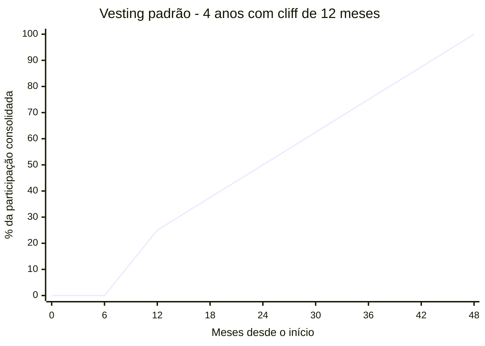
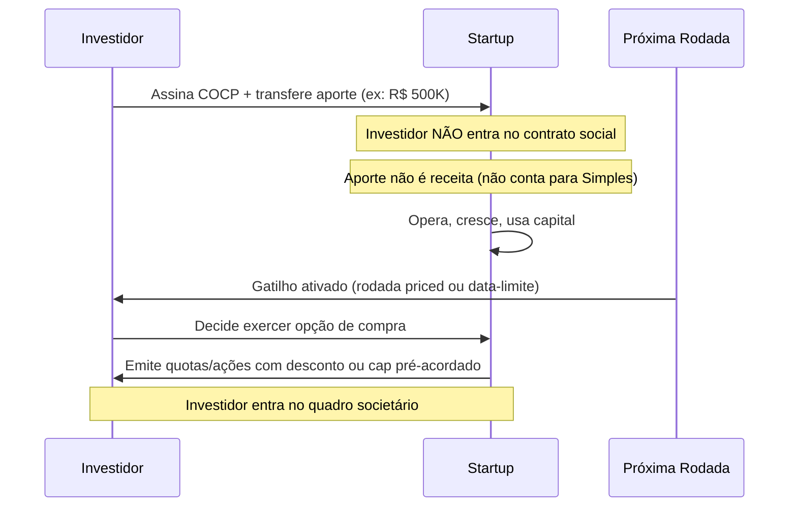
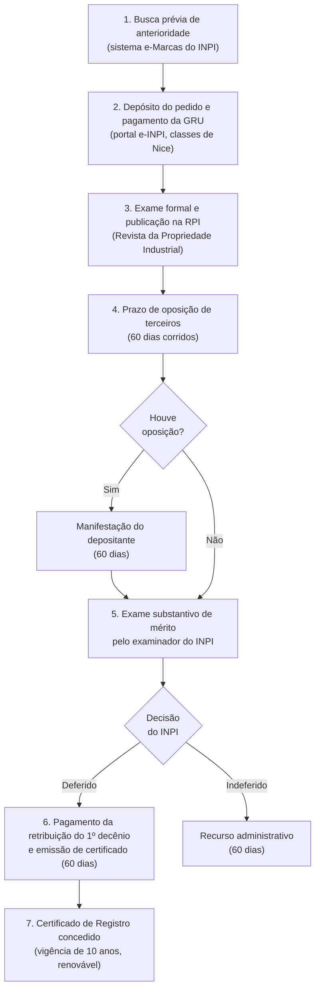

# IGNIÇÃO — Volume 8: Blindagem Jurídica, Societária, LGPD e Segurança

**Estruturação Societária, Contratos, Trabalhista, Propriedade Intelectual, Compliance e Cibersegurança (Fase 18 e Capítulos 1 a 13)**

*João Prado · 2026 · Edição Narrativa Enxuta (v5.2)*

---

## Sobre este Volume

Este é o **Volume 8 (Blindagem Jurídica, Societária, LGPD e Segurança)** da coleção **IGNIÇÃO: O manual operacional do empreendedor brasileiro** (10 volumes).

O manual jurídico, societário, regulatório e de segurança da informação para fundadores, executivos e advogados de startups no Brasil. Abre com a Fase 18 (Estruturação Jurídica, Societária e Blindagem Operacional: os 10 passos de formalização, acordo de sócios, propriedade intelectual, contratos, LGPD e proteção patrimonial, com o caso aplicado da PadariaPro LTDA), seguida por 13 capítulos em profundidade sobre o Marco Legal das Startups (LC 182/2021), responsabilidade pessoal dos sócios e desconsideração da personalidade jurídica, registro de marcas, patentes e software no INPI, cláusulas de non-compete, contratos empresariais e operacionais, direito do trabalho para startups (CLT vs. PJ e passivos), CDC aplicado a produtos digitais, contencioso estratégico, LGPD e governança de dados, regulação de IA, compliance anticorrupção, prevenção a fraudes internas e certificações SOC 2 e ISO 27001.

---

## Mapa da Coleção IGNIÇÃO

```mermaid
graph LR
    subgraph J1["Do Zero à Validação"]
        V1["<b>Vol. 1: Ideação</b><br/>Fases 0 a 3 · Fundador e Teoria"]
        V2["<b>Vol. 2: Descoberta e Mercado</b><br/>Fases 4 a 6 · Cliente e Cunha"]
        V3["<b>Vol. 3: Hipóteses e Protótipo</b><br/>Fases 7 a 10 · Testes e Modelos"]
        V1 --> V2 --> V3
    end
    subgraph J2["Tração e Escala"]
        V4["<b>Vol. 4: Tração e PMF</b><br/>Fases 11 a 13 · MVP, GTM e Vendas"]
        V5["<b>Vol. 5: Finanças e Captação</b><br/>Fase 14 · Caixa, VC, Tributário e FP&A"]
        V6["<b>Vol. 6: Receita e Pessoas</b><br/>Fases 15 e 16 · Enterprise, Líderes e Cultura"]
        V7["<b>Vol. 7: Produto e Engenharia</b><br/>Fase 17 · Operações, IA e Arquitetura"]
        V8["<b>Vol. 8: Jurídico e Segurança</b><br/>Fase 18 · Societário, Contratos e LGPD"]
        V3 --> V4 --> V5 --> V6 --> V7 --> V8
    end
    subgraph J3["Ciclo Longo e Setores"]
        V9["<b>Vol. 9: Maturidade, Exit e Family Office</b><br/>Fases 19 e 20 · Board, Crise, M&A, IPO e Cash Cow"]
        V10["<b>Vol. 10: Economia da Inovação e 42 Verticais</b><br/>Hubs Globais, Regulação, 42 Setores e Dicionário"]
        V8 --> V9
    end
    V10 -. "Consulta Setorial e Dicionário" .-> J1
    V10 -. "Consulta Setorial e Dicionário" .-> J2
    V10 -. "Consulta Setorial e Dicionário" .-> J3
```



---

## Sumário deste Volume

### Fase da Etapa (Fase 18)
- [[#FASE 18 — ESTRUTURAÇÃO JURÍDICA, SOCIETÁRIA E BLINDAGEM OPERACIONAL|FASE 18: ESTRUTURAÇÃO JURÍDICA, SOCIETÁRIA E BLINDAGEM OPERACIONAL]]
### Sociedade, Marco Legal, Propriedade Intelectual e Proteção dos Sócios (Capítulos 1 a 4)
- [[#CAPÍTULO 1 — MARCO LEGAL DAS STARTUPS: LC 182/2021|CAPÍTULO 1: MARCO LEGAL DAS STARTUPS: LC 182/2021]]
- [[#CAPÍTULO 2 — RESPONSABILIDADE DO SÓCIO E DO ADMINISTRADOR|CAPÍTULO 2: RESPONSABILIDADE DO SÓCIO E DO ADMINISTRADOR]]
- [[#CAPÍTULO 3 — PROPRIEDADE INTELECTUAL E INPI|CAPÍTULO 3: PROPRIEDADE INTELECTUAL E INPI]]
- [[#CAPÍTULO 4 — NÃO-CONCORRÊNCIA E NÃO-SOLICITAÇÃO NO BRASIL|CAPÍTULO 4: NÃO CONCORRÊNCIA E NÃO SOLICITAÇÃO NO BRASIL]]
### Contratos Empresariais, Direito do Trabalho, CDC e Contencioso (Capítulos 5 a 8)
- [[#CAPÍTULO 5 — ARQUITETURA CONTRATUAL PARA STARTUPS: OPERAÇÃO E CONTRATOS EM PROFUNDIDADE POR TIPO|CAPÍTULO 5: ARQUITETURA CONTRATUAL PARA STARTUPS: OPERAÇÃO E CONTRATOS EM PROFUNDIDADE POR TIPO]]
- [[#CAPÍTULO 6 — DIREITO DO TRABALHO PARA STARTUPS|CAPÍTULO 6: DIREITO DO TRABALHO PARA STARTUPS]]
- [[#CAPÍTULO 7 — DIREITO DO CONSUMIDOR E CDC PARA STARTUPS|CAPÍTULO 7: DIREITO DO CONSUMIDOR E CDC PARA STARTUPS]]
- [[#CAPÍTULO 8 — CONTENCIOSO E LITÍGIO PARA STARTUPS|CAPÍTULO 8: CONTENCIOSO E LITÍGIO PARA STARTUPS]]
### LGPD, Regulação de IA, Compliance, Prevenção a Fraudes e Cibersegurança (Capítulos 9 a 13)
- [[#CAPÍTULO 9 — LGPD, COMPLIANCE E GOVERNANÇA DE DADOS|CAPÍTULO 9: LGPD, COMPLIANCE E GOVERNANÇA DE DADOS]]
- [[#CAPÍTULO 10 — REGULATÓRIO DE IA NO BRASIL|CAPÍTULO 10: REGULATÓRIO DE IA NO BRASIL]]
- [[#CAPÍTULO 11 — COMPLIANCE E ANTICORRUPÇÃO PARA STARTUPS|CAPÍTULO 11: COMPLIANCE E ANTICORRUPÇÃO PARA STARTUPS]]
- [[#CAPÍTULO 12 — FRAUDE INTERNA E CONTROLES INTERNOS|CAPÍTULO 12: FRAUDE INTERNA E CONTROLES INTERNOS]]
- [[#CAPÍTULO 13 — SEGURANÇA DA INFORMAÇÃO: DA CERTIFICAÇÃO À ENGENHARIA|CAPÍTULO 13: SEGURANÇA DA INFORMAÇÃO: DA CERTIFICAÇÃO À ENGENHARIA]]

---

# ESTRUTURAÇÃO JURÍDICA, SOCIETÁRIA E BLINDAGEM OPERACIONAL

No Brasil, um único ponto cego societário, trabalhista ou contratual pode destruir anos de criação de valor e atingir o patrimônio pessoal dos fundadores. A **[[#FASE 18 — ESTRUTURAÇÃO JURÍDICA, SOCIETÁRIA E BLINDAGEM OPERACIONAL|Fase 18]]** abre este volume com o roteiro prático de 10 passos para formalizar e blindar a companhia desde a fundação até a *due diligence* institucional.

---

## FASE 18 — ESTRUTURAÇÃO JURÍDICA, SOCIETÁRIA E BLINDAGEM OPERACIONAL

### O Esqueleto Jurídico Invisível e a Diligência que Mata a Rodada na Hora H

Dois anos antes, na preparação da Série A retratada no Volume 5, Lucas e Marina haviam passado quatro meses negociando a rodada com um fundo de Venture Capital de São Paulo. O valuation estava fechado, o comitê de investimento havia aprovado a tese comercial e o champanhe já estava na geladeira. Na terceira semana da auditoria jurídica (*legal due diligence*), o escritório de advocacia do fundo abriu a caixa-preta societária da startup e encontrou o retrato do improviso brasileiro: o primeiro desenvolvedor que escreveu o motor central do sistema nos seis meses iniciais nunca havia assinado termo de cessão de propriedade intelectual; a marca principal operava com pedido indeferido no INPI; o investidor-anjo que entrou no décimo mês com 35% do capital ainda mantinha poder de veto sobre qualquer nova rodada, e os fundadores não tinham cláusula de *reverse vesting* no acordo de sócios; e quatro vendedores estratégicos atuavam como PJs com subordinação explícita no WhatsApp. O fundo exigiu a retenção de 25% do aporte em conta vinculada (*escrow*) e condicionou o fechamento da Série A (na qual a participação dos fundadores passaria de 85% para 47%, conforme visto no Volume 5) à limpeza completa do passivo.

Ninguém abre uma empresa sonhando em ler cláusulas societárias, mas o Brasil pune a ingenuidade jurídica com confisco patrimonial. O paradoxo da blindagem operacional é que o jurídico nunca parece urgente enquanto a empresa é pequena: até o dia em que a empresa dá certo e cada atalho do passado ganha poder de veto sobre o seu futuro.

Você precisa vencer **A Fragilidade do Alicerce de Papel**: a ilusão de que ter um CNPJ aberto na Junta Comercial equivale a ter uma empresa estruturada, quando na verdade sua operação repousa sobre contratos verbais, ativos sem titularidade e bombas-relógio trabalhistas.

---

> [!note] Antes de assumir captação como rota
> Este capítulo trata estruturação para empresas que escolheram o caminho VC. A escolha fundacional entre bootstrap e venture capital é tratada em [[IGNICAO-Vol-1-Ideacao#CAPÍTULO 4 — BOOTSTRAP vs VENTURE CAPITAL: A ESCOLHA FUNDACIONAL|Capítulo 4 (Bootstrap vs Venture Capital: A Escolha Fundacional) (Vol. 1)]]. A base jurídica desta fase serve para qualquer empresa, e no caminho VC muda sobretudo a profundidade do acordo de sócios e do cap table; enquanto RD Station e Conta Azul escalaram com várias rodadas de venture capital antes de suas saídas, empresas como o Granatum cresceram no caminho bootstrap, sem VC. A escolha não é neutra.

### Por Que um Passivo Jurídico Mal Cuidado Destrói Múltiplos de Valuation e Trava Rodadas

Muitos empreendedores postergam formalização. Acham que é burocracia. Na verdade, a falta de formalização gera riscos concretos. Sem formalização, a empresa sofre autuações fiscais, fica impedida de emitir notas fiscais, perde contratos comerciais por falta de amparo jurídico, afasta talentos pela informalidade e trava qualquer captação de investimento na diligência. Bloqueio de contas bancárias. A estruturação tarda. Mas sempre tem que acontecer. E quanto antes, melhor.

### A Execução Sequencial dos 10 Passos: Tipo Societário, Acordo de Sócios, IP, Contratos e LGPD

Dez passos.

#### Passo 1: defina o tipo societário

No Brasil, as formas mais comuns para startups são quatro.

MEI (Microempreendedor Individual). É regime do empresário individual, não tipo societário: tem teto legal fixo de R$ 81 mil por ano (vigente em outubro de 2026), não admite sócio nem investidor e veda atividades de desenvolvimento de software (Anexo XI da Resolução CGSN 140/2018). Só serve para quem testa sozinho um serviço permitido antes de abrir a sociedade.

Sociedade Limitada Unipessoal (SLU). Você é o único sócio, com responsabilidade limitada ao capital social (CC, art. 1.052, § 1º). Substituiu a antiga EIRELI, que foi extinta e convertida automaticamente em SLU pelo art. 41 da Lei 14.195/2021.

LTDA. Mais de um sócio. Mais flexível. Capital social declarado.

S/A. Estrutura para captação robusta. Mais complexa. Obrigatória para IPO.

> [!important] Para a maioria das startups iniciais, LTDA é o ponto ideal
> S/A entra em cena quando há captações de venture capital significativas. Migrar de LTDA para S/A custa entre R$ 15 mil e R$ 40 mil em honorários jurídicos para conversão simples (alteração de tipo societário, sem reestruturação de cap table (tabela de capitalização: quem tem quanto da empresa)). Para migração no contexto de Série A com reestruturação societária completa (classes de ações, ESOP, drag/tag-along, holding), a faixa sobe para R$ 30 mil a R$ 100 mil: esta é a faixa documentada no [[IGNICAO-Vol-5-Financas-e-Captacao#CAPÍTULO 2 — CONTABILIDADE, REGIMES FISCAIS E TRIBUTÁRIO ESTRATÉGICO (REFORMA IBS/CBS E INCENTIVOS)|Capítulo 2 (Contabilidade, Regimes Fiscais e Tributário Estratégico (Reforma Ibs/cbs e Incentivos)) (Vol. 5)]] e reflete o escopo completo de uma rodada institucional. Ainda assim, esse desembolso representa pouco perto do cheque captado: não vale antecipar a estrutura mais pesada.

> [!tip] Capítulo 1: Marco Legal das Startups
> O [[#CAPÍTULO 1 — MARCO LEGAL DAS STARTUPS: LC 182/2021|Capítulo 1: Marco Legal das Startups]] (Lei 182/2021) trata dos mecanismos da Lei Complementar 182/2021: definição legal de startup, proteção ao investidor que não ingressa no quadro societário, sandbox regulatório (art. 11), licitação em modalidade especial para testar soluções inovadoras no setor público (CPSI, arts. 12 a 15) e simplificações para S.A. fechada de menor porte: relevante para decidir estrutura jurídica e acessar programas de fomento.

#### Passo 2, escolha o regime tributário

No Brasil, três regimes principais.

**Simples Nacional:** para receitas brutas anuais de até R$ 4,8 milhões (enquanto o Lucro Presumido atende empresas até R$ 78 milhões/ano, valores de referência em 2026). Oferece menor complexidade operacional, com alíquotas que variam por anexo e faixa de faturamento. Com a Reforma Tributária (LC 214/2025, com teste de CBS e IBS em 2026 e vigência da CBS em 2027), empresas do Simples que vendem para clientes B2B no regime regular transferem crédito tributário reduzido caso não optem pelo recolhimento de IBS e CBS por fora do documento único; avalie essa escolha com seu contador conforme detalhado no Capítulo 2 do Volume 5.

Lucro Presumido. Para receitas até outro patamar acima do Simples. Bom para algumas atividades com margem alta.

Lucro Real. Obrigatório para receitas acima do limite do Lucro Presumido, e para certas atividades específicas. Mais complexo.

> [!warning] Consulte o seu contador antes de decidir
> A escolha errada pode custar cinco a dez por cento de margem sem necessidade. Os limites e alíquotas dos regimes mudam periodicamente: esse manual aponta a estrutura, não os números do ano corrente.

> [!note] Tributário estratégico para startups
> O [[IGNICAO-Vol-5-Financas-e-Captacao#CAPÍTULO 2 — CONTABILIDADE, REGIMES FISCAIS E TRIBUTÁRIO ESTRATÉGICO (REFORMA IBS/CBS E INCENTIVOS)|Capítulo 2: Tributário Estratégico (Vol. 5)]] cobre o Fator R do Simples Nacional (como a folha afeta o anexo de enquadramento), a Lei do Bem para P&D, e quando a estrutura de holding passa a fazer sentido: decisões com impacto direto na margem líquida dos próximos anos.

#### Passo 3, registre marca e domínio

Três providências.

Registro da marca no INPI (Brasil) para proteger nome e logo. O exame pelo INPI leva em média de 12 a 18 meses até a decisão final. O protocolo do pedido garante o direito de prioridade sobre depósitos posteriores na mesma classe, mas o direito exclusivo de uso em todo o território nacional só nasce com a concessão do registro.

Registro de domínio. .com.br, .com, e outros relevantes para o negócio.

Se operar internacionalmente, pesquise proteção internacional. Países onde a empresa terá presença, ou onde competidores podem registrar a marca antes.

#### Passo 4, estruture contratos formais

Quatro tipos de contrato.

##### Acordo de sócios, se houver sócios

Indispensável desde o primeiro dia entre cofundadores. Na LTDA, como as quotas são subscritas na abertura, o vesting opera por cláusula de opção de recompra das quotas não consolidadas por valor simbólico (*reverse vesting*) no acordo de sócios, com atenção para evitar risco de requalificação trabalhista se o sócio também for empregado. Inclua sete itens essenciais: divisão de participação e vesting de participação societária: ninguém vira sócio pleno no dia zero, a participação se consolida ao longo de anos. Regras de saída voluntária, involuntária, e morte. Direitos de veto em decisões críticas. Mecanismos de resolução de conflito. Não compete, e confidencialidade. Cláusula de tag-along, e drag-along, para rodadas futuras.



> [!note] Como funciona o vesting com cliff
> Nos primeiros 12 meses, o período de carência (*cliff*), nenhuma participação se consolida. No mês 13, 25% consolida de uma vez. Dos meses 13 a 48, o restante vesta mensalmente (~2,08% ao mês). Se o fundador sai antes de completar os 12 meses de carência, não consolida participação alguma. Se sai no mês 30, consolida 62,5% da participação acordada (30 de 48 meses; sem cláusula de recompra no acordo de sócios, ele sairia mantendo 100% das quotas subscritas no contrato social). Isso protege a empresa de cofundadores que saem cedo mas mantêm participação grande.

> [!tip] Canvases Visuais: Capital Stack / Waterfall (Fase 14)
> Cap table com vesting é o tema central desta fase. O [[IGNICAO-Vol-5-Financas-e-Captacao#Canvas: Capital Stack / Waterfall Canvas|Canvas: Capital Stack / Waterfall Canvas (Vol. 5)]] é o mapa visual da estrutura de capital, Common (fundadores), Preferred (investidores com seniority), pool de ESOP, dívida, e do waterfall em cenário de exit (preferences, participation, conversion). Use desde a primeira rodada para que decisões de term sheet (1x participating, anti-dilution full ratchet vs weighted average, ESOP top-up) tenham impacto visualmente claro no que cada parte recebe em diferentes valuations de saída.

> [!warning] Conflitos entre cofundadores estão entre as causas mais citadas de mortalidade precoce de startups (Noam Wasserman, *The Founder's Dilemmas*): casal sem pacto antenupcial divide bens no litígio; sócios sem acordo dividem a empresa no tribunal
> Não pule o acordo. Casais que se separam sem contrato pré-nupcial passam por divórcio. Sócios que se separam sem acordo passam por anos de litígio. O [[IGNICAO-Vol-9-Maturidade-e-Exit#CAPÍTULO 3 — DISPUTA SOCIETÁRIA E SAÍDA DE SÓCIO|Capítulo 3 (Disputa Societária e Saída de Sócio) (Vol. 9)]] cobre prevenção (cláusulas que evitam o conflito), mediação (quando o conflito chega) e mecânica jurídica de saída forçada.

###### Formalização jurídica do equity acordado

A discussão substantiva sobre divisão de equity entre fundadores: quatro fatores (ideia, comprometimento, habilidades, capital), método Slicing Pie de Mike Moyer (2012), processo estruturado de negociação em três passos, e quando 50/50 vs 60/40 vs 70/30 vs solo com pool faz sentido: está na [[IGNICAO-Vol-1-Ideacao#FASE 0 — PREPARAÇÃO DO EMPREENDEDOR|Fase 0 (Vol. 1)]] (Sócios, a decisão mais irreversível). Aqui o foco é a formalização jurídica do que foi acordado, em quatro proteções inegociáveis no acordo de sócios:

- **Vesting de 4 anos com cliff de 12 meses para todos os fundadores.** Padrão de mercado que protege a empresa de cofundador que sai antes da consolidação completa.
- **Reverse vesting**: equity não consolidado volta para o pool se o sócio sai. Sem isso, sócio que sai no mês 30 leva 50% mas a empresa fica sem o trabalho que esse equity representava.
- **Mecanismo de recompra das quotas do sócio que sai** (opção de compra com fórmula de preço, prazo de pagamento e regras de *good leaver* e *bad leaver*) e **cláusula de resolução de impasse societário** (*shotgun* ou *buy-or-sell*, em que um sócio propõe preço por quota e o outro escolhe comprar ou vender pelo mesmo valor).
- **Critério explícito de casting vote em impasse**. Em divisão 50/50, um sócio precisa ter voto de minerva em categoria específica de decisão (técnica, comercial, etc.): sem isso, impasse trava operação.

> [!tip] Não negocie equity em jantar
> A conversa de divisão de equity deve acontecer em ambiente estruturado, com documentação. Acordos verbais em jantar geram memórias diferentes seis meses depois. Use um template de acordo ou leve para advogado desde o primeiro rascunho.

> [!tip] Capítulo 12 (Vol. 6): Stock Options para Startups Brasileiras
> O [[IGNICAO-Vol-6-Receita-e-Pessoas#CAPÍTULO 12 — STOCK OPTIONS E ESOP NO BRASIL|Capítulo 12: Stock Options (Vol. 6)]] cobre a estrutura jurídica e fiscal das opções no Brasil: phantom shares versus opções reais, tratamento tributário no exercício, modelos de plano ESOP e como redigir a carta de oferta de equity para os primeiros funcionários: sem criar passivo fiscal inadvertido.

##### Contrato com clientes

Termos de uso. Contratos de prestação de serviço. SLAs. Revisados por advogado.

> [!note] Contratos em profundidade: MSA, NDA, DPA e IP assignment
> O [[#CAPÍTULO 5 — ARQUITETURA CONTRATUAL PARA STARTUPS: OPERAÇÃO E CONTRATOS EM PROFUNDIDADE POR TIPO|Capítulo 5: Contratos em Profundidade]] cobre a anatomia de cada contrato essencial para startups, MSA (Master Service Agreement), NDA, DPA (Data Processing Agreement), LOI e acordo de advisor, com as cláusulas críticas, os erros comuns, e o que negociar antes de assinar.

##### Contrato com colaboradores

CLT, PJ, autônomo, estagiário. Cada modalidade tem regras. Informalidade aqui gera passivo trabalhista. O maior risco jurídico de empresas pequenas.

> [!note] Direito do trabalho para startups: CLT vs PJ, eSocial e rescisão
> O [[#CAPÍTULO 6 — DIREITO DO TRABALHO PARA STARTUPS|Capítulo 6: Direito do Trabalho para Startups]] detalha os critérios de vínculo empregatício que transformam PJ em CLT na Justiça do Trabalho, as obrigações do eSocial desde o primeiro funcionário, o tratamento do sobreaviso em times de produto, e o custo real de cada modalidade de rescisão.

> [!note] Como estruturar a compensação dos primeiros funcionários
> O [[IGNICAO-Vol-6-Receita-e-Pessoas#CAPÍTULO 11 — COMPENSAÇÃO E BENEFÍCIOS NO BRASIL|Capítulo 11: Compensação e Benefícios no Brasil (Vol. 6)]] explica o multiplicador real do salário CLT (1,66x sobre o bruto), como estruturar PLR e equity para os primeiros funcionários, e quais benefícios fazem sentido em cada estágio da empresa.

##### NDAs com terceiros críticos

Parceiros, fornecedores, e potenciais investidores quando apropriado.

> [!tip] Capítulo 5: Contratos Operacionais
> O [[#CAPÍTULO 5 — ARQUITETURA CONTRATUAL PARA STARTUPS: OPERAÇÃO E CONTRATOS EM PROFUNDIDADE POR TIPO|Capítulo 5: Contratos Operacionais]] cobre os contratos de back-office que ficam fora dos contratos com clientes e colaboradores: fornecedores de tecnologia, acordos de parceria, contratos de coworking, SLAs internos e os itens de due diligence que investidores verificam em Série A: quando contratos mal-redigidos viram obstáculo ao fechamento da rodada.

#### Passo 5, adeque-se à LGPD (se trata dados pessoais)

Cinco providências. Mapeie os tratamentos e defina a base legal de cada um dentre as dez do art. 7º da LGPD (consentimento é apenas uma delas, ao lado de execução de contrato e legítimo interesse). Publique aviso de privacidade transparente. Nomeie encarregado (DPO) ou, se for agente de pequeno porte dispensado pela Resolução CD/ANPD 2/2022, mantenha canal de comunicação com o titular e a ANPD. Mantenha registro de tratamento de dados (ROPA). Tenha processo de resposta a solicitações do titular.

> [!note] Compliance mínimo viável além da LGPD
> O [[#CAPÍTULO 11 — COMPLIANCE E ANTICORRUPÇÃO PARA STARTUPS|Capítulo 11: Compliance e Anticorrupção]] cobre as obrigações da Lei Anticorrupção (Lei 12.846/2013) aplicáveis a startups, prevenção à lavagem de dinheiro (PLD/CFT) para fintechs (enquanto a nomeação do Encarregado/DPO e a governança de privacidade estão no Capítulo 10), e como montar um programa de compliance enxuto: o mínimo exigido por investidores institucionais e clientes enterprise.

#### Passo 6, instale contabilidade em dia

Quatro providências. Contador mensal. Emissão de notas fiscais corretas. Registros contábeis conforme regime. Obrigações acessórias conforme o regime (em outubro de 2026: PGDAS-D e DEFIS no Simples Nacional; DCTFWeb com MIT, eSocial, EFD-Reinf, ECD e ECF nos demais regimes, já que a DIRF e a DCTF tradicional foram extintas para fatos geradores a partir de 2025).

> [!tip] Capítulo 2 (Vol. 5): Contabilidade para Startups
> O [[IGNICAO-Vol-5-Financas-e-Captacao#CAPÍTULO 2 — CONTABILIDADE, REGIMES FISCAIS E TRIBUTÁRIO ESTRATÉGICO (REFORMA IBS/CBS E INCENTIVOS)|Capítulo 2: Contabilidade, Tributário e Regimes Fiscais (Vol. 5)]] cobre a diferença entre contabilidade gerencial e fiscal, como escolher entre Contabilizei, escritório especializado e controller interno por estágio, e o checklist de obrigações acessórias mensais que o fundador precisa acompanhar: mesmo sem entender contabilidade profundamente.

#### Passo 7, separe finanças pessoais e empresariais

Mantenha conta bancária exclusivamente da pessoa jurídica, cartão corporativo separado, pró-labore mensal formalizado e distribuição de lucros amparada em balancete contábil. Desde janeiro de 2026 (Lei 15.270/2025), a distribuição de lucros e dividendos a pessoa física acima de R$ 50 mil por mês por empresa sofre retenção de 10% de IRRF na fonte e compõe a apuração do imposto mínimo anual, exigindo calibrar a relação entre pró-labore e dividendos com o contador (ver Capítulo 2 do Volume 5).

> [!warning] Misturar CPF e CNPJ é caminho para desorganização e risco fiscal
> Empréstimos do sócio para a empresa, ou da empresa para o sócio, sem contrato formal, podem ser autuados como distribuição disfarçada de lucros, atraem incidência de IOF no mútuo e servem de prova de confusão patrimonial em pedido judicial de desconsideração da personalidade jurídica (art. 50 do Código Civil). Toda movimentação entre as duas pessoas (física e jurídica) precisa de contrato escrito.

> [!note] Responsabilidade do sócio e do administrador
> O [[#CAPÍTULO 2 — RESPONSABILIDADE DO SÓCIO E DO ADMINISTRADOR|Capítulo 2: Responsabilidade do Sócio e Administrador]] explica quando a desconsideração da personalidade jurídica se aplica, o que configura confusão patrimonial, e as obrigações legais do administrador que justificam a separação rigorosa de contas.

#### Passo 8, estabeleça processos operacionais documentados

Mantenha cinco documentos operacionais vivos: roteiro de integração (*onboarding*) de novo cliente, integração de novo colaborador, processo de suporte, processo de vendas e políticas internas de gastos, viagens e reembolsos.

> [!tip] Documente o necessário, não o exaustivo
> Não precisa ser cinquenta páginas. Precisa ser claro e usado. Documento que ninguém lê é teatro de processo. Uma página por processo, em linguagem direta, vale mais do que manual elaborado que ninguém abre.

#### Passo 9, defina estrutura financeira mínima

Quatro itens. Fluxo de caixa mensal projetado para os próximos doze meses. Controle de inadimplência. Reconciliação bancária semanal. Relatório mensal de resultado.

> [!note] Capital de giro ao estruturar e captar a primeira rodada
> O [[IGNICAO-Vol-5-Financas-e-Captacao#CAPÍTULO 5 — CAPITAL DE GIRO, RECEBÍVEIS E GESTÃO DE CAIXA EM PROFUNDIDADE|Capítulo 5: Capital de Giro e Recebíveis (Vol. 5)]] cobre o Ciclo de Conversão de Caixa, as modalidades de antecipação de recebíveis disponíveis no Brasil, e como o FIDC se encaixa em fintechs e marketplaces: ferramentas para não ficar com caixa represado enquanto o negócio cresce.

#### Passo 10, revise seguros

Quatro modalidades, dependendo do negócio.

Responsabilidade civil. Cobre danos causados a terceiros pela operação.

Seguro de cibersegurança, se trata dados. Cobre custos de incidentes, vazamentos, e respostas regulatórias.

Seguro de erros e omissões (E&O), se oferece serviço profissional. Cobre falhas técnicas que causem prejuízo ao cliente.

Seguro de vida para sócios-chave (key person). Em sociedades pequenas, a perda repentina de um sócio operacional pode quebrar o negócio. O seguro mitiga esse risco para os sócios remanescentes.

> [!note] Coberturas essenciais para startups: D&O, E&O, cyber e Key Man
> O [[IGNICAO-Vol-5-Financas-e-Captacao#CAPÍTULO 8 — GESTÃO DE RISCO E SEGUROS PARA STARTUPS|Capítulo 8: Gestão de Risco e Seguros (Vol. 5)]] detalha quando contratar cada cobertura, o que cada apólice efetivamente protege, e os gatilhos que tornam D&O e Key Man obrigatórios: especialmente após a entrada de investidores no board.

### Caso Aplicado de Trincheira: A Blindagem Passo a Passo da PadariaPro LTDA

Na scaleup de Lucas e Marina da abertura desta fase, o saneamento das quatro bombas-relógio apontadas na auditoria do fundo levou seis semanas e consumiu R$ 68 mil em honorários, taxas e acordos: (1) os 14 desenvolvedores PJ assinaram termos retroativos de confirmação e cessão integral de propriedade intelectual sobre o repositório mediante quitação de bônus de retenção; (2) a marca indeferida no INPI foi substituída em acordo de coexistência e compra do registro anterior por R$ 45 mil; (3) o ex-sócio inativo assinou escritura de recompra e quitação das 15% de quotas com desconto à vista; e (4) os cinco engenheiros com subordinação direta e rotina fixa foram migrados para CLT antes do fechamento da rodada, reduzindo a retenção em conta garantida (*escrow*) de R$ 2,7 milhões para R$ 400 mil liberados após doze meses sem reclamações. Veja agora como estruturar essa blindagem desde o dia zero no exemplo completo da PadariaPro LTDA:

A pessoa jurídica. O formato escolhido foi LTDA (Sociedade Limitada). Adequado até Série A. Migração para S.A. planejada se a rodada superar R$ 5 milhões. CNAE principal: 62.02-3-00 (Desenvolvimento e licenciamento de programas de computador customizáveis). Capital social: R$ 100 mil, com R$ 20 mil integralizados no ato e R$ 80 mil a integralizar em vinte e quatro meses (atenção ao art. 1.052 do Código Civil: enquanto restarem R$ 80 mil não integralizados, todos os sócios respondem solidariamente por esse saldo perante credores; capital subscrito alto e não integralizado gera exposição patrimonial, não proteção).

O cap table inicial.

| Sócio | Percentual | Tipo de entrada | Vesting |
|---|---|---|---|
| Joana (founder, CEO) | 55% | Tempo integral desde dia um | 48 meses, cliff 12m |
| Bruno (cofounder, CTO) | 35% | Tempo integral desde mês três | 48 meses, cliff 12m |
| Pedro (advisor e investidor-anjo) | Fora do QSA (0% até conversão) | R$ 200 mil em mútuo conversível (LC 182/2021, art. 5º), estimativa de ~5% pós-conversão na próxima rodada |: |
| ESOP (pool de equity) | 5% | Reservado para futuras contratações-chave | Por grant |

O contador. Terceirizado. Escritório especializado em startups, R$ 1.200 por mês. Fechamento mensal: DRE, e balanço gerencial. Responsável por obrigações fiscais, folha (via ferramenta integrada), e relatório gerencial.

Os contratos. Contratação CLT para os colaboradores com rotina fixa, subordinação e dedicação contínua, reservando contrato PJ exclusivamente para prestadores eventuais com autonomia real e cláusula expressa de cessão de propriedade intelectual e sigilo (evitando o passivo trabalhista que derruba o valuation na diligência da Série A). Termo de uso, mais política de privacidade, publicados no site. DPA assinado com AWS, Z-API (WhatsApp), Asaas (pagamentos), e Mailgun (e-mail transacional).

A LGPD ([[#CAPÍTULO 9 — LGPD, COMPLIANCE E GOVERNANÇA DE DADOS|Capítulo 9 (LGPD, Compliance e Governança de Dados)]]). DPO terceirizado (DPO-as-a-Service, R$ 800 por mês). Canal `privacidade@padariapro.com.br` ativo. Mapeamento de tratamentos: catorze operações documentadas, com base legal.

O registro de marca. Pedido no INPI no dia 15 de fevereiro do ano. Protocolo em andamento. Revisão prevista em doze a dezoito meses. "PadariaPro" mais logo, em classe 9 (software) e classe 42 (serviços tecnológicos).

A contingência. Reserva líquida: R$ 150 mil (cerca de três meses de despesas fixas). Plano de contingência de quatro páginas documentado ([[IGNICAO-Vol-9-Maturidade-e-Exit#CAPÍTULO 9 — GESTÃO DE CRISE, CONTINUIDADE OPERACIONAL E COMUNICAÇÃO CRÍTICA|Capítulo 9 (Gestão de Crise, Continuidade Operacional e Comunicação Crítica) (Vol. 9)]]), para quatro cenários: caixa crítico, churn explosivo, perda de sócio, e regulatório.

A separação financeira. Conta PJ no Nubank Empresa. Pró-labore dos fundadores definido em R$ 7.500 por mês (alinhado ao planejamento financeiro pessoal visto no Capítulo 1 e na [[IGNICAO-Vol-1-Ideacao#FASE 0 — PREPARAÇÃO DO EMPREENDEDOR|Fase 0 (Vol. 1)]]). Nada de "empréstimos entre sócios e empresa" sem contrato formal.

### Os Entregáveis Concretos da Empresa Blindada e Pronta Para Escalar

Você concluiu a Fase 18 quando todos os critérios abaixo estão cumpridos.

- [ ] Pessoa jurídica constituída em formato adequado ao estágio (LTDA ou S.A.), com regime tributário adequado e contrato social revisado por advogado especializado em startups.
- [ ] Cap table documentado com equity split e vesting de quatro anos com cliff de doze meses. Acordo de sócios assinado, com cláusulas de saída, tag-along, drag-along e resolução de conflito.
- [ ] Marca e domínio protegidos. Registro no INPI iniciado ou concluído.
- [ ] Contratos com clientes (termos de uso, SLA, política de privacidade), colaboradores (CLT ou PJ padronizados) e terceiros críticos (NDAs, fornecedores) em vigor.
- [ ] Programa LGPD básico ativo: DPO, bases legais, DPAs com operadores principais, política de privacidade, ROPA.
- [ ] Sistema contábil ativo (interno ou terceirizado) com fechamento mensal em até 10 dias do mês fechado, DRE e balanço, zero atrasos em obrigações acessórias (DCTF, DEFIS, SPED) nos últimos 6 meses, certidões negativas federais/estaduais/municipais válidas.
- [ ] Finanças pessoais e empresariais totalmente separadas (conta PJ, cartão corporativo, pró-labore definido, dividendos formalizados).
- [ ] Processos operacionais-chave documentados (onboarding cliente, onboarding funcionário, suporte, venda, políticas internas).
- [ ] Plano de contingência financeira e operacional documentado ([[IGNICAO-Vol-9-Maturidade-e-Exit#CAPÍTULO 9 — GESTÃO DE CRISE, CONTINUIDADE OPERACIONAL E COMUNICAÇÃO CRÍTICA|Capítulo 9 (Gestão de Crise, Continuidade Operacional e Comunicação Crítica) (Vol. 9)]]).
- [ ] Cobertura de seguros adequada ao estágio: responsabilidade civil cobrindo pelo menos 5x o faturamento mensal, cyber se trata dados, D&O após Série A ou quando houver investidores no board, Key Man se sócios são single-point-of-failure.

> [!warning] Critério de saída
> Postergar formalização não é "ganhar tempo". É acumular dívida fiscal, trabalhista e jurídica que cresce mês a mês com juros e multas. Custa semanas no começo. Custa meses ou milhões depois.

**Primeiros passos práticos.**

1. Contrate advogado especializado em startups (não generalista) para revisar o contrato social e o cap table. Investimento de R$ 3 mil a R$ 10 mil justificável.
2. Formalize o cap table em planilha detalhada, mais o vesting dos sócios (quatro anos com cliff de doze meses é padrão).
3. Contrate contador especializado em startup, ou serviços como Contabilizei, ou Omie mais contador, para começar fechamento mensal.
4. Inicie o registro de marca no INPI. Pode levar oito a dezoito meses. Comece cedo.
5. Redija a política de privacidade, os termos de uso e o mapeamento básico de dados pessoais (LGPD).

### Os Erros Jurídicos que Custam Parte do Cap Table ou o Patrimônio da Família

Três falhas concentram as maiores perdas patrimoniais em diligências de Série A e litígios societários: (1) deixar de colher termo de cessão de propriedade intelectual dos primeiros desenvolvedores, o que permite que um ex-prestador bloqueie a rodada ou exija participação para liberar o código; (2) admitir cofundador no contrato social sem acordo de sócios com opção de recompra (*reverse vesting*), permitindo que quem abandona a operação no primeiro ano leve 20% ou 30% da empresa; e (3) misturar contas pessoais e societárias, caracterizando confusão patrimonial que autoriza a desconsideração da personalidade jurídica (art. 50 do CC). Na esfera de dados pessoais, operar sem base legal ou controles de segurança expõe a empresa às sanções da LGPD, cuja multa administrativa chega a até 2% do faturamento no Brasil, limitada a R$ 50 milhões por infração (art. 52, II).

"Depois eu resolvo". Dívida fiscal e trabalhista compõe. Deixar para depois quase sempre é mais caro do que lidar agora.

Contador barato demais. Contador ruim custa mais do que contador caro. Escolha bem.

Acordo de sócios "no aperto de mão". Relações ótimas hoje viram disputas tóxicas no momento de dinheiro, ou crise. Formalize.

Ignorar LGPD. As multas vão até dois por cento do faturamento. E a exposição reputacional é pior.

Documentar demais, executar de menos. Processos escritos que ninguém segue são burocracia. Mantenha-os vivos.


---

### O Espelho da Due Diligence: Se um Comprador Auditar Sua Empresa Amanhã às 8h, o Que Ele Vai Encontrar?

**Governança prática em ESTRUTURAÇÃO JURÍDICA, SOCIETÁRIA E BLINDAGEM OPERACIONAL:** Ao documentarem os padrões de *O Espelho da Due Diligence: Se um Comprador...* na operação de São Paulo e Florianópolis, **Lucas e Marina** criaram uma trava clara contra desvios de escopo e queima ineficiente de capital.

Abra a pasta societária e contratual da sua empresa agora e responda sem desculpas:

1. **O Teste da Propriedade do Código e da Marca:** Cada linha de código, algoritmo, domínio e marca que gera receita para sua empresa hoje pertence formalmente ao CNPJ por contratos assinados e registros no INPI, ou está no CPF de sócios e ex-prestadores?
2. **O Teste do Sócio Fantasma:** Seu Acordo de Sócios possui cláusulas claras de *vesting*, *cliff*, *good leaver / bad leaver* e *shotgun*, ou um cofundador que abandonar o barco amanhã leva metade das quotas para casa de graça?
3. **A Segregação Patrimonial:** Existe alguma despesa pessoal de sócio sendo paga pela conta bancária da empresa hoje que serviria de munição imediata para um juiz decretar confusão patrimonial?

**Regra de Sobrevivência:** O advogado mais caro do mundo é o advogado barato ou o modelo copiado da internet que você usa para economizar R$ 5 mil no ano um e que custa R$ 2 milhões na Série A.

**O Ritual de Segunda-Feira às 9h:** Monte o Data Room permanente da sua empresa em uma pasta organizada na nuvem com 6 subpastas (Societário, Propriedade Intelectual, Contratos Comerciais, Trabalhista/Pessoas, Tributário/Contábil e LGPD/Segurança) e reserve 20 minutos toda segunda-feira para a rotina de manutenção: arquivar os contratos assinados na semana anterior, conferir se cada novo colaborador ou prestador assinou termo de cessão de PI e NDA antes do acesso aos sistemas e renovar as certidões negativas que vencem nos próximos 30 dias.

---

### MÉTRICAS E BENCHMARKS DESTA FASE (FASE 18)

| Métrica | O que medir | Referência saudável |
|---|---|---|
| Conformidade de PI e Contratos | % de colaboradores e PJs com cessão de PI e NDA assinados e certidões negativas válidas no data room | 100% dos ativos críticos, contratos e registros no INPI regularizados antes da diligência |
| Crescimento MoM | Crescimento mês a mês | ≥ 10-15% ao mês |
| Runway | Meses de caixa disponível | ≥ 18 meses pós-rodada |
| Cap table limpa | Sem problemas de governança ou direitos conflitantes | Sim |
| Compliance básico | LGPD, trabalhista, tributário em dia | Sim |
| Acordo de sócios | Vesting, drag-along, tag-along definidos | Sim |
| Data room Série A | Documentos para due diligence organizados | ≥ 80% completo |

---

### LEITURAS E RECURSOS RECOMENDADOS DESTA FASE

#### Profissionais que você vai precisar

Contrate quatro perfis especializados conforme a etapa: (1) contador com prática em startups, apuração de créditos na transição IBS/CBS e folha de tecnologia (mensalidade típica de R$ 800 a R$ 3.500 no estágio inicial); (2) advogado societário e contratual habituado ao Marco Legal das Startups (LC 182/2021), acordos de quotistas com *reverse vesting* e contratos B2B; (3) encarregado de dados (DPO as a Service ou interno) com domínio das resoluções da ANPD; e (4) agente de propriedade industrial para buscas de anterioridade e depósitos no INPI. Leituras de cabeceira para o fundador: Lei Complementar 182/2021, Código Civil (arts. 1.052 a 1.087), guias orientativos da ANPD e *Venture Deals* (Brad Feld e Jason Mendelson).

#### Tipos de comunidades e recursos online para empreendedores

Comunidades de founders locais via associações, eventos e encontros. Programas de aceleração: estude com rigor antes de entrar. Muitos são mais ruins do que bons. Mentoria estruturada com gente que já construiu, não só investiu ou escreveu. Cursos de Y Combinator Startup School, gratuitos.

#### Artigos práticos abertos ao público

Spina, C., Camuffo, A., e Gambardella, A. (2020). *Founders, apply the scientific method to your startup*. Harvard Business Review. Blank, S. (2013). *Why the Lean Start-Up Changes Everything*. Harvard Business Review. Kozyrkov, C. (2019). *The first thing great decision makers do*. Harvard Business Review. Sobre a importância crítica de definir thresholds ex-ante.

---

### Fechamento da Fase 18: o que muda na sua cabeça e na sua empresa a partir de agora

Nessa fase você formalizou o tipo societário (LTDA ou S/A), o regime tributário, o cap table com vesting, o acordo de sócios, os contratos com clientes e colaboradores, o programa LGPD e a contabilidade mensal. A diferença entre quem faz certo e quem falha está em tratar formalização como infraestrutura, não como obstáculo. Escolha de regime tributário tem efeito multimilionário em três a cinco anos. Cap table mal-feita é dor de cabeça em qualquer captação séria. Compliance LGPD é pré-requisito para vender enterprise ou captar Série A institucional.

Com a empresa blindada, a Fase 19 (no Volume 9) trata da segunda curva de expansão e governança, garantindo que a estrutura construída desde a [[IGNICAO-Vol-6-Receita-e-Pessoas#FASE 16 — TIME, LIDERANÇA EXECUTIVA E CULTURA EM ESCALA|Fase 16 (Vol. 6)]] pode ser executada: construir time, operação e máquina de crescimento sem o risco jurídico e tributário de uma empresa ainda informal.

---

# SOCIEDADE, MARCO LEGAL, PROPRIEDADE INTELECTUAL E PROTEÇÃO DOS SÓCIOS (CAPÍTULOS 1 A 4)

A primeira muralha jurídica protege quem é dono da empresa, até onde vai o risco do CPF dos sócios e quem detém a tecnologia e a marca: o uso estratégico do Marco Legal das Startups (LC 182/2021), a defesa contra a desconsideração da personalidade jurídica, o registro de Propriedade Intelectual no INPI e a validade real de cláusulas de *non-compete* e segredo de negócio.

---

## CAPÍTULO 1 — MARCO LEGAL DAS STARTUPS: LC 182/2021

### O Escudo do Investidor-Anjo e as Engrenagens Reais do Marco Legal das Startups

Em Belo Horizonte, um médico cirurgião amigo da Dra. Camila queria investir R$ 400 mil na nova rodada de expansão da rede de clínicas odontológicas e tecnologia dela. Na véspera de assinar a transferência, o contador tradicional do médico travou o negócio com um alerta apocalíptico: "Não coloque seu CPF nem como minoritário nessa LTDA! Meu cunhado entrou com 5% no restaurante de um amigo há seis anos, o restaurante quebrou e a Justiça do Trabalho bloqueou a conta pessoal dele semana passada para pagar dívida de ex-funcionário". Antes de 2017, o contador teria razão caso o aporte entrasse como quota comum de LTDA; desde a LC 155/2016 (em vigor em 2017 para ME e EPP) e com a ampliação da Lei Complementar 182/2021 para mútuo conversível e outros instrumentos em qualquer startup, a lei blindou o investidor passivo. Camila e seu advogado societário mostraram ao cirurgião que a lei havia mudado estruturalmente o jogo: mesmo que a holding de clínicas operasse como sociedade limitada, o aporte de R$ 400 mil podia ser estruturado via mútuo conversível (art. 5º da LC 182/2021) ou contrato de participação de investidor-anjo (art. 61-A da LC 123/2006, aplicável a ME e EPP independentemente de enquadramento como startup), mantendo o médico fora do quadro societário e blindado contra dívidas trabalhistas.

A verdade dura do ecossistema brasileiro é que a maioria dos empreendedores e contadores generalistas nunca leu as ferramentas práticas da LC 182/2021: e continua assinando contratos sociais amadores que expõem o patrimônio do investidor ou usam veículos errados para contratar com o Estado.

Você precisa dominar **A Assimetria Regulatória do Marco Legal**: saber exatamente onde a Lei Complementar 182/2021 blinda o investidor contra desconsideração da personalidade jurídica e abre portas de licitação especial (CPSI), e onde ela não passa de letra bonita se você ignorar o regime tributário e o direito trabalhista.

---

> [!note] Nota de validade
> A Lei Complementar 182/2021 foi promulgada em junho de 2021. O teto de receita bruta de R$ 16 milhões e os limites do CPSI estão fixados na própria LC 182/2021 e só se alteram por lei complementar; já os limites gerais da Lei 14.133/2021 são corrigidos anualmente por decreto federal e as regras de cada sandbox regulatório são definidas por resolução do respectivo regulador setorial. Este capítulo reflete o cenário de outubro de 2026. Revisar anualmente com advogado especializado em direito empresarial e startups.

A [[#FASE 18 — ESTRUTURAÇÃO JURÍDICA, SOCIETÁRIA E BLINDAGEM OPERACIONAL|Fase 18]] cobre constituição, cap table (quadro societário) e vesting (período de aquisição progressiva da participação). O [[#CAPÍTULO 5 — ARQUITETURA CONTRATUAL PARA STARTUPS: OPERAÇÃO E CONTRATOS EM PROFUNDIDADE POR TIPO|Capítulo 5 (Arquitetura Contratual para Startups: Operação e Contratos em Profundidade por Tipo)]] cobre contratos operacionais (enquanto o Capítulo 3 trata de propriedade intelectual e registro no INPI). O [[IGNICAO-Vol-5-Financas-e-Captacao#CAPÍTULO 2 — CONTABILIDADE, REGIMES FISCAIS E TRIBUTÁRIO ESTRATÉGICO (REFORMA IBS/CBS E INCENTIVOS)|Capítulo 2 (Contabilidade, Regimes Fiscais e Tributário Estratégico (Reforma Ibs/cbs e Incentivos)) (Vol. 5)]] cobre tributário. O [[IGNICAO-Vol-5-Financas-e-Captacao#CAPÍTULO 9 — CAPTAÇÃO DE EQUITY: PLANEJAMENTO DE RODADA, PITCH E RELACIONAMENTO COM INVESTIDORES|Capítulo 9 (Captação de Equity: Planejamento de Rodada, Pitch e Relacionamento com Investidores) (Vol. 5)]] cobre captação. Este capítulo cobre a Lei Complementar 182/2021, o marco legal das startups, com foco nos instrumentos que ela criou e em como usá-los na prática.

### Por Que Entender o Marco Legal Destrava Cheques de Anjos que Têm Medo da Justiça Brasileira

Antes da LC 182/2021, o fundador brasileiro usava instrumentos improvisados para captação pré-seed e seed (rodadas iniciais). Mútuo conversível com cláusulas customizadas. SAFE adaptado para o direito brasileiro sem base legal clara. Investidor-anjo sem proteção contra responsabilidade societária.

A lei criou instrumentos nativos. Adotar o COCP previsto na lei brasileira, em vez de traduzir um SAFE estrangeiro sem respaldo local, traz segurança jurídica direta para ambas as partes: menos risco em due diligence (auditoria prévia à transação) e menos argumento para desconto de valuation (avaliação da empresa).

Para govtechs, a LC 182/2021 criou a licitação em modalidade especial e o Contrato Público para Solução Inovadora (CPSI, arts. 12 a 15), aberto a qualquer pessoa física ou jurídica, com teto de R$ 1,6 milhão por contrato de teste e possibilidade de contrato de fornecimento posterior sem nova licitação até cinco vezes esse valor (R$ 8 milhões).

O ARE é subutilizado, mas resolve o problema que mata fintech, healthtech, e edtech antes de começar: como testar produto regulado sem licença completa.

### Os Critérios Objetivos de Enquadramento: Receita, Tempo de CNPJ e Declaração de Inovação

O art. 4º da LC 182/2021 enquadra como startup a organização empresarial ou societária (com cláusula expressa no contrato social ou adesão ao Inova Simples, nos termos do § 1º) que possua **até dez anos de inscrição no CNPJ** e **receita bruta de até R$ 16 milhões no ano-calendário anterior** (ou limite proporcional de R$ 1.333.334 por mês de atividade no primeiro ano), que declare utilizar modelos de negócios inovadores para a geração de produtos ou serviços, ou que desenvolva produto ou serviço com potencial de ruptura em segmento existente ou novo.

> [!warning] O critério de inovação é autodeclaratório
> A lei não exige certificação externa para qualificar como startup inovadora. A empresa declara. Mas em caso de autuação ou disputa contratual, a autodeclaração precisa ter substância. Manter documentação que comprove o caráter inovador: roadmap de produto, registros de pesquisa e desenvolvimento, propriedade intelectual depositada, ou literatura técnica de suporte.

**Formas jurídicas elegíveis.** Empresário individual, sociedades empresárias limitadas (LTDA, inclusive a Sociedade Limitada Unipessoal, SLU, na qual todas as antigas EIRELIs foram convertidas pelo art. 41 da Lei 14.195/2021), sociedades anônimas (S.A.), sociedades simples e sociedades cooperativas (art. 4º, § 1º, da LC 182/2021).

**O que não conta para o limite de receita.** Receita de subsidiárias ou coligadas pode ser consolidada, dependendo da estrutura. Consultar contador antes de assumir elegibilidade.

**O limite de dez anos.** Conta da data de constituição, não da data de operação. Uma empresa constituída em 2015 e operando desde 2020 tem menos anos elegíveis do que parece.

---

### Opções (COCP) e Mútuo Conversível: Como o Investidor Entra Sem Ser Sócio

#### O que é

O COCP é um contrato pelo qual o investidor faz um aporte financeiro na startup sem se tornar sócio imediatamente. Em troca, recebe o **direito de opção** de comprar participação societária no futuro, em condições pré-definidas no contrato.

O SAFE americano (Simple Agreement for Future Equity) é o equivalente funcional. A diferença técnica: o SAFE padrão converte automaticamente na próxima rodada precificada (*priced round*) ou em evento de liquidez, sem data de vencimento. O COCP é uma opção: o investidor **decide se exerce ou não** no momento da conversão.

#### Como funciona na prática



**Elementos obrigatórios do COCP.**

| Cláusula | O que define |
|---|---|
| Valor do aporte | Capital transferido imediatamente |
| Prazo da opção | Período máximo para exercício definido livremente em contrato (o limite legal de 7 anos na LC 123, art. 61-A, § 1º e § 4º, III, aplica-se apenas à vigência e remuneração do contrato de participação de investidor-anjo, cujo resgate exige no mínimo 2 anos) |
| Gatilho de conversão | Próxima rodada priced, data fixa, ou evento específico |
| Cap de valuation | Valuation máximo para cálculo da participação |
| Desconto | % de desconto sobre o preço da próxima rodada |
| Condições de exercício | Quóruns, documentação, notificação |
| Direitos do optante | Informativos (sim), votos (não, antes do exercício) |

#### Comparativo: COCP vs. SAFE vs. Mútuo Conversível

| Critério | COCP | SAFE (adaptado) | Mútuo Conversível |
|---|---|---|---|
| Base legal brasileira | ✅ LC 182/2021 | ❌ Adaptação contratual | ✅ Código Civil |
| Natureza | Opção de equity | Futuro equity | Dívida conversível |
| Investidor é sócio? | Não, até exercício | Não, até conversão | Não (é credor) |
| Gera IOF? | Não | Não (estrutura de opção) | Sim se o mutuante for PJ; em regra isento se investidor PF |
| Conta para limite Simples? | Não | Depende da estrutura | Não (empréstimo) |
| Responsabilidade do investidor | Limitada ao aporte | Limitada | Limitada |
| Risco de requalificação tributária | Baixo | Médio (sem lei) | Médio (juros e IOF) |
| Conforto em DD | Alto (base legal clara) | Médio | Alto |

> [!tip] Quando usar COCP vs. mútuo conversível
> COCP é preferível quando o investidor está confortável com equity puro e não quer retorno de dívida. Mútuo conversível é útil quando o investidor quer proteção adicional como credor (prioridade em liquidação), ou quando há dúvida sobre o enquadramento na definição de startup da lei.

#### Exemplo brasileiro preenchido

**Empresa**: Plantio.AI, startup de agritech com dois anos de constituição.
**Investidor**: Angel brasileiro com perfil de ex-fundador.
**Situação**: Rodada pré-seed de R$ 400 mil, antes de produto em produção.

Cláusulas do COCP:
- Aporte: R$ 400.000 (transferência imediata, sem emissão de quotas)
- Cap de valuation: R$ 6 milhões (pré-money da próxima rodada)
- Desconto: 20% sobre o preço da próxima rodada priced
- Gatilho: próxima rodada ≥ R$ 1 milhão, ou 36 meses da data de assinatura
- Prazo máximo: 5 anos
- Direitos informativos: acesso mensal a MRR, burn, e headcount

Na próxima rodada (18 meses depois), a startup levanta Série Seed de R$ 2 milhões com valuation pré-money de R$ 8 milhões. O investidor exerce a opção. Calcula-se a participação com base no menor entre: (a) cap de R$ 6M, ou (b) 80% do valuation da rodada (R$ 6,4M). Usa-se o cap (R$ 6M). Na conversão pelo teto pré-money, os R$ 400K equivalem inicialmente a 6,25% antes do cheque novo e, após a diluição de 20% pelos novos investidores da rodada, resultam em cerca de 5,0% do quadro societário final (chegando a R$ 400K ÷ R$ 6M = 6,67% apenas se o contrato estipular percentual fixo pós-rodada, distinção que evita a surpresa vista no Volume 5).

#### Armadilhas do COCP

**Cap mal calibrado.** Cap muito alto faz o investidor receber participação menor que o esperado (como se não houvesse cap). Cap muito baixo gera diluição excessiva para o fundador em rodadas futuras.

**Sem data-limite.** COCP sem gatilho temporal cria incerteza estrutural. O investidor tem opção aberta indefinidamente. Sempre incluir prazo máximo.

**Ignorar o impacto em rodadas futuras.** COCP no cap table cria "shadow dilution". VCs em seed e Série A calculam participação fully-diluted, incluindo COCPs não convertidos. Modelar o impacto antes de emitir.

**Investidor exercendo fora do momento certo.** COCP dá ao investidor a escolha de exercer. Se a empresa performar bem e o investidor segurar a opção, pode haver tensão no momento de uma rodada que requer cap table limpo.

---

### O Escudo Patrimonial do Investidor: Como Funciona a Proteção Contra Passivos da Empresa

A LC 182/2021 manteve e expandiu a figura do investidor-anjo, originalmente regulada pela LC 155/2016 para empresas do Simples Nacional.

#### Proteções legais

O investidor-anjo **não é sócio**. Não consta no contrato social. Não tem direito a voto em assembleia. Não responde por dívidas, obrigações tributárias, trabalhistas ou de qualquer natureza da empresa (salvo em caso de dolo, fraude ou simulação com envolvimento do próprio anjo, nos termos do art. 8º, II, da LC 182/2021, desde que mantenha atuação estritamente consultiva e sem poder de gerência): mesmo em falência ou desconsideração da personalidade jurídica.

Em troca, pode:
- Receber remuneração de até **50% dos lucros** da empresa, proporcional ao aporte, por até 5 anos.
- Participar de reuniões de diretoria como observador.
- Ter acesso a informações financeiras.
- Alienar o aporte para terceiros (com direito de preferência dos sócios).

**Prazo máximo**: 7 anos para resgate do aporte.

> [!important] Diferença entre investidor-anjo e COCP
> Investidor-anjo, nos termos da LC 182, é um instrumento de participação nos lucros sem entrada societária: é mais parecido com um contrato de mútuo com upside em lucros do que com equity. O COCP é explicitamente um instrumento de equity futuro. Para quem quer participação no cap table, o COCP é o instrumento certo. Para quem quer retorno em lucros sem entrar na sociedade, o formato de investidor-anjo se aplica melhor.

---

### FIPs (Art. 9º da LC 182/2021): Quando o Cheque Vem de um Fundo Regulado pela CVM

Pelo Anexo Normativo IV da Resolução CVM 175/2022, os Fundos de Investimento em Participações (FIPs) dividem-se em categorias conforme o porte da empresa investida: o **FIP Capital Semente** investe em companhias ou limitadas com receita bruta anual de até R$ 16 milhões (alinhado ao teto do Marco Legal das Startups); o **FIP Empresas Emergentes** atende empresas com receita bruta anual de até R$ 300 milhões; além das categorias Multiestratégia, Infraestrutura (FIP-IE) e Produção Econômica Intensiva em Pesquisa, Desenvolvimento e Inovação (FIP-PD&I).

#### O que e

O FIP é um fundo fechado de investimento regulado pela CVM, hoje regido pela Resolução CVM 175/2022 (que substituiu a Instrução CVM 578/2016). Ele adquire participação societária ou títulos conversíveis em empresas brasileiras, geralmente ações preferenciais com direitos políticos negociados em acordo de acionistas, e é o veículo majoritário pelo qual investidores institucionais brasileiros (fundos de pensão, *family offices* e gestoras locais) alocam capital em Venture Capital e Private Equity no país.

Para o fundador, importa entender que quando uma gestora brasileira propõe entrar no cap table, o cheque quase sempre vem de um FIP, não da pessoa jurídica da gestora. Isso condiciona governança, liquidez e estrutura da rodada.

#### Três tipos relevantes

**FIP-EE (Empresas Emergentes)**. Voltado para empresas com receita bruta anual até o limite definido pela regulamentação (atualizado periodicamente, na faixa de centenas de milhões de reais). É o veículo natural para investimento em startups em estágio early e growth.

**FIP-IE (Infraestrutura)**. Para empresas com projetos em setores de infraestrutura (energia, saneamento, logística, telecom). Tem incentivo fiscal específico, além do benefício padrão de FIP.

**FIP-Multiestratégia (sob Anexo IV da Res. CVM 175/2022)**. Versão mais ampla, sem restrição de tamanho da investida. Usado por gestoras de private equity tradicional. Alguns fundos de growth tardio em tech também operam via Multiestratégia.

#### Implicacoes práticas

**Laudo de avaliação**. FIP exige laudo de avaliação independente para entrada (precificação do aporte) e para saída (precificação da venda). Isso afeta o calendário da rodada brasileira. O fundador deve antecipar prazo adicional de três a seis semanas para o laudo de entrada, e contratar avaliador qualificado. Para detalhes do processo de valuation, ver [[IGNICAO-Vol-5-Financas-e-Captacao#CAPÍTULO 10 — VALUATION METHODS: COMO INVESTIDORES CALCULAM E COMO VOCÊ CALCULA PARA NEGOCIAR|Capítulo 10 (Valuation Methods: Como Investidores Calculam e como Você Calcula para Negociar) (Vol. 5)]].

**Governança e comitê de investimento**. Muitos FIPs preveem em seu regulamento um comitê de investimento que aprova cada aporte e cada desinvestimento, além das regras de governança e de avaliação do valor justo dos ativos previstas no Anexo Normativo IV da Resolução CVM 175/2022. Na prática, o fundador sente isso em duas frentes: as decisões da gestora podem exigir aprovação formal do comitê, e as cláusulas de matérias sujeitas a veto (*protective provisions*) no acordo de acionistas tendem a ser detalhadas para refletir o dever fiduciário do gestor perante os cotistas.

**Tributação para a pessoa física investidora**. Desde a Lei 14.754/2023, o FIP enquadrado como entidade de investimento (com gestão profissional discricionária) mantém a alíquota de 15% de IR sobre os rendimentos na distribuição ou no resgate/alienação das cotas (sem come-cotas semestral, ao contrário dos fundos patrimoniais que não cumpram os requisitos de entidade de investimento). Já o FIP-IE (Infraestrutura) e o FIP-PD&I, sob a Lei 11.478/2007, oferecem isenção de IR sobre ganhos para a pessoa física residente, razão pela qual o gestor preserva rigorosamente o enquadramento regulatório do fundo.

#### Diferença prática em relação a fundo offshore

Fundo offshore típico (Cayman master-feeder, LLC americana investindo direto em Cayman holding da startup brasileira) opera com governança mais flexivel. Sem comitê obrigatório. Sem laudo de entrada (acorda valuation por negociação direta). Sem regra de diversificação impondo limite por investida. O term sheet brasileiro de FIP costuma ser mais longo. As negociações mais lentas. E a capacidade do gestor de aceitar termos atípicos (por exemplo, side letter exclusiva ou estrutura de earnout no aporte) é mais limitada.

Referência complementar: para term sheet detalhado, ver [[IGNICAO-Vol-5-Financas-e-Captacao#CAPÍTULO 9 — CAPTAÇÃO DE EQUITY: PLANEJAMENTO DE RODADA, PITCH E RELACIONAMENTO COM INVESTIDORES|Capítulo 9 (Captação de Equity: Planejamento de Rodada, Pitch e Relacionamento com Investidores) (Vol. 5)]]. Para métodos de valuation que sustentam o laudo, ver [[IGNICAO-Vol-5-Financas-e-Captacao#CAPÍTULO 10 — VALUATION METHODS: COMO INVESTIDORES CALCULAM E COMO VOCÊ CALCULA PARA NEGOCIAR|Capítulo 10 (Valuation Methods: Como Investidores Calculam e como Você Calcula para Negociar) (Vol. 5)]].

> [!note] FIP profissional brasileiro tem dinâmica diferente
> FIP profissional brasileiro tem dinâmica diferente de fundo offshore e merece atencao no planejamento de rodada brasileira.

---

### Sandbox Regulatório (ARE): Testando Modelos Inovadores Sob Supervisão de BCB, CVM e SUSEP

#### O que é

O ambiente regulatório experimental (sandbox regulatório, previsto no art. 11 da LC 182/2021, que possui ao todo 19 artigos) cria a base legal para que **reguladores setoriais autorizem startups a testar produtos inovadores em ambiente controlado**, por tempo determinado, sem precisar cumprir todos os requisitos regulatórios normais.

É o sandbox regulatório formalizado na lei federal. Antes da LC 182, alguns reguladores já tinham sandbox próprio (BCB, CVM). A lei deu cobertura legal uniforme e criou incentivo para que outros reguladores adotem o modelo.

#### Como funciona


**Reguladores que implementaram ARE até 2026.**

| Regulador | Setor | Status |
|---|---|---|
| BCB | Fintech, pagamentos, crédito | Ativo (SFN e SPB) |
| CVM | Securities, tokens, crowdfunding | Ativo (Res. CVM 29/2021 e posteriores) |
| ANATEL | Telecom, conectividade | Em implementação |
| ANS | Planos de saúde, healthtech | Discussão regulatória |
| ANVISA | Dispositivos médicos, softwares de saúde (SaMD) | Sem sandbox permanente (software médico é regido pela norma geral da RDC 657/2022; em proteção de dados houve o sandbox de IA da ANPD e, em seguros, a SUSEP opera via Resolução CNSP 381/2020) |
| SUSEP | Insurtech, seguro digital | Ativo (Res. CNSP 407/2021) |

> [!warning] ARE não é dispensa automática de licença
> Participar de um ARE não significa operar livremente. O regulador define escopo restrito: número máximo de clientes, volume máximo de transações, prazo determinado, obrigações de reporte. Operação fora dessas condições pode gerar autuação mesmo dentro do ARE.

#### Quando faz sentido buscar o ARE

- Produto que requer licença para operar em escala, mas que ainda não está maduro o suficiente para o processo completo de licenciamento.
- Validação técnica com usuários reais antes de investir no processo regulatório pleno.
- Mercados onde o licenciamento pleno leva 18 a 36 meses (fintech, healthtech, seguro).

**Quando não faz sentido.** Se o produto pode ser testado sem regulação (B2B puro, software de gestão interna, marketplace sem intermediação financeira), o ARE é complexidade desnecessária.

---

### Vendendo Para o Governo via CPSI: Do Edital de Inovação ao Contrato de Fornecimento

#### O que é

Os arts. 12 a 15 da LC 182/2021 autorizam órgãos e entidades da administração pública a realizar **licitação em modalidade especial** (aberta a qualquer pessoa física ou jurídica, isoladamente ou em consórcio) para celebrar o Contrato Público para Solução Inovadora (CPSI), com vigência de até 12 meses prorrogável por mais 12, para o desenvolvimento ou a execução experimental de soluções inovadoras.

Combinado com a Lei 14.133/2021 (Nova Lei de Licitações), abre um caminho estruturado para govtech que não existia antes de 2021.

#### Como funciona na prática

O poder público não compra produto pronto. Ele contrata o **desenvolvimento ou teste de solução inovadora**. O processo é:

1. Órgão público pública **chamada pública** com o problema a ser resolvido.
2. Startups apresentam propostas técnicas e comerciais.
3. Comissão técnica avalia e seleciona (até três startups, em geral, para teste paralelo).
4. Após o julgamento pela comissão especial na licitação de modalidade especial (art. 13), o vencedor assina o CPSI (teto de R$ 1,6 milhão por contrato, art. 14, § 2º) e, se o teste atingir as metas, o órgão pode firmar contrato de fornecimento posterior sem nova licitação por até 24 meses, prorrogáveis por mais 24, até cinco vezes o limite do CPSI (art. 15).
5. Após validação, pode seguir para contratação plena (que aí pode ou não exigir licitação dependendo do valor).

**Limites de valor.** A lei remete aos limites da Lei 14.133/2021, que são atualizados por decreto. Verificar o valor vigente de dispensa de licitação para inovação no momento da contratação. Como referência: o CPSI possui teto próprio fixado na LC 182/2021 de **R$ 1,6 milhão por contrato de teste** (art. 14, § 2º) e de **até cinco vezes esse montante (R$ 8 milhões)** no fornecimento posterior sem nova licitação (art. 15), corrigidos pelo IPCA, não se confundindo com a dispensa geral por valor da Nova Lei de Licitações (que em 2026 é de R$ 65.492,11 para compras e serviços comuns, art. 75, II, e R$ 130.984,20 para obras e serviços de engenharia, art. 75, I), mas para contratação de soluções inovadoras via startup há previsão de valores maiores nas regulamentações específicas dos órgãos.

> [!tip] Govtech como canal de aquisição subestimado
> Prefeituras, estados, autarquias, e fundações públicas têm orçamentos dedicados a inovação. Muitos estão ativamente buscando startups para resolver problemas de gestão, saúde pública, mobilidade, e educação. Embora não haja comissão de intermediários, o custo de aquisição no setor público é elevado: exige acompanhar editais, preparar documentação técnica, custear meses de operação assistida e suportar um ciclo de vendas de 12 a 24 meses (planeje caixa para ao menos um ano antes do primeiro recebimento). O risco é o ciclo longo, e a dependência de um único cliente grande. Ver [[IGNICAO-Vol-4-Tracao-e-PMF#CAPÍTULO 5 — SALES: MOTION COMPLETA, DO OUTBOUND AO RENEWAL|Capítulo 5 (Sales: Motion Completa, do Outbound ao Renewal) (Vol. 4)]] para gestão de concentração de receita.

#### Caso Prático Ilustrativo: Henrique e o CPSI em Prefeitura do Interior do Paraná

Depois de perder uma licitação tradicional da Lei 8.666 nos primeiros anos por exigências de atestado que favoreciam sistemas legados, Henrique utilizou o CPSI (art. 12 da LC 182/2021) para disputar um edital de desafio aberto por uma prefeitura de médio porte no interior do Paraná voltado à redução de perdas na manutenção da frota e de equipamentos públicos. A comissão especial avaliou o potencial de resolução do problema, o grau de desenvolvimento da solução e a viabilidade econômica, contratando o teste prático por 12 meses no valor de R$ 480 mil; cumpridas as metas auditáveis de disponibilidade e economia, o município assinou na sequência o Contrato de Fornecimento por dispensa de licitação (art. 15 da LC 182/2021).

**Resumo dos parâmetros legais do caso (arts. 12 a 15 da LC 182/2021):**
- **Modalidade de entrada:** Licitação em modalidade especial (art. 13), com edital focado no problema público e comissão julgadora de três especialistas (dispensada habilitação complexa além da regularidade fiscal e trabalhista, art. 13, § 4º).
- **Instrumento de teste remunerado:** CPSI (art. 14) com vigência de até 12 meses (prorrogável por mais 12) e teto legal de **R$ 1,6 milhão por contrato** (atualizado pelo IPCA).
- **Escala pós-validação:** Cumpridas as metas técnicas do CPSI, o mesmo órgão pode celebrar diretamente o **Contrato de Fornecimento** (art. 15) sem nova licitação, por até 24 meses (prorrogável por mais 24), até o limite de **R$ 8 milhões** (5x o teto do CPSI).

---

### As Fronteiras da Lei: O Que o Marco Legal NÃO Resolve para o Sócio Administrador

**Tributação de stock options**. A LC 182/2021 não alterou o tratamento tributário de opções de compra para colaboradores. Em setembro de 2024, o STJ pacificou a tese vinculante no Tema 1.226 (recursos repetitivos): planos de opção de compra de ações com voluntariedade, onerosidade e risco de mercado têm natureza estritamente mercantil, não incidindo IRPF na outorga nem no exercício, mas apenas ganho de capital (15% a 22,5%) na alienação futura das ações com lucro. Ver [[IGNICAO-Vol-6-Receita-e-Pessoas#CAPÍTULO 12 — STOCK OPTIONS E ESOP NO BRASIL|Capítulo 12 (Stock Options e ESOP no Brasil) (Vol. 6)]].

**Propriedade intelectual**. A lei não cria regras de IP para startups. Patentes, marcas, e cessão de código seguem legislação própria. Ver [[#CAPÍTULO 3 — PROPRIEDADE INTELECTUAL E INPI|Capítulo 3 (Propriedade Intelectual e INPI)]].

**Due diligence do COCP**. Usar COCP não elimina obrigações de disclosure. Investidor ainda pode questionar informações prestadas no momento da assinatura. Prepare data room mesmo para rodadas pré-seed.

**Governança interna**. A lei não resolve disputas entre cofundadores. Acordo de sócios robusto continua sendo necessário. Ver [[#FASE 18 — ESTRUTURAÇÃO JURÍDICA, SOCIETÁRIA E BLINDAGEM OPERACIONAL|Fase 18]].

**Acesso automático ao Simples Nacional**. Enquadrar-se como startup pela LC 182 não garante elegibilidade ao Simples. Os critérios do Simples (receita, atividade, vedações) são independentes. Ver [[IGNICAO-Vol-5-Financas-e-Captacao#CAPÍTULO 2 — CONTABILIDADE, REGIMES FISCAIS E TRIBUTÁRIO ESTRATÉGICO (REFORMA IBS/CBS E INCENTIVOS)|Capítulo 2 (Contabilidade, Regimes Fiscais e Tributário Estratégico (Reforma Ibs/cbs e Incentivos)) (Vol. 5)]].

---

### As Ilusões Perigosas Sobre o Inova Simples e a Falsa Imunidade do Administrador

**Confundir aporte privado bilateral com oferta pública de valores mobiliários**. Um contrato de mútuo conversível ou COCP negociado de forma privada e individual com um investidor-anjo não exige registro na CVM. Porém, se a startup captar junto ao público em geral com esforço amplo de venda, precisará utilizar plataforma eletrônica de investimento participativo (*crowdfunding*) regulada pela **Resolução CVM 88/2022** ou observar as hipóteses de dispensa de registro de oferta pública da **Resolução CVM 160/2022**.

**COCP sem advogado**. A lei criou o instrumento, mas a minuta precisa ser feita por especialista. Cláusulas de anti-diluição, drag-along parcial para o optante, e proteção em down round não estão automaticamente incluídas na lei: são negociadas contratualmente.

**Confundir ARE com licença provisória**. Startup em ARE não pode fazer publicidade como se fosse empresa licenciada. Violação das condições do ARE pode resultar em encerramento imediato e bloqueio de futura solicitação de licença.

**Govtech sem gestão de concentração**. Contrato público é receita recorrente frágil. Troca de gestão municipal cancela projetos. Nunca depender de um único contrato público para mais de 40% da receita total na fase inicial.

**Ignorar o prazo dos dez anos**. Empresa que constituiu como startup em 2018 e cresceu bem pode perder elegibilidade à LC 182 em 2028. Planejar transição antes: especialmente se houver ARE vigente ou contratos de dispensa em andamento.

> [!info] Fases relacionadas

---

### Leitura adicional

- **LC 182/2021**: texto integral no site do Planalto. Leitura direta obrigatória antes de usar qualquer instrumento.
- **Regulamentação ARE por regulador**: cada regulador pública edital próprio. Monitorar BCB, CVM, SUSEP, e ANS.
- **JOBS Act (Jumpstart Our Business Startups Act, EUA, 2012)**: legislação norte-americana que flexibilizou ofertas públicas, *crowdfunding* de investimento e abertura de capital (IPO) para empresas emergentes, útil como referência comparativa para a Resolução CVM 88/2022.
- **Deloitte / PwC / KPMG**: relatórios anuais sobre ecossistema de inovação e regulação no Brasil.
- **ABStartups**: pública atualizações sobre impacto da lei no ecossistema nacional.

---

### O Espelho da LC 182/2021: Você Está Usando os Instrumentos da Lei ou Captando no Improviso?

**Resultado na trincheira (MARCO LEGAL DAS STARTUPS: LC 182/2021):** A disciplina descrita em *O Espelho da LC 182/2021: Você Está Usando os...* permitiu que a **Dra. Camila**, a partir de Belo Horizonte, blindasse a margem operacional e reduzisse o retrabalho da equipe.

Revise os instrumentos jurídicos da sua última (ou próxima) captação e responda:

1. **O Escudo do Investidor:** Seus contratos de investimento utilizam expressamente os instrumentos previstos no Art. 5º da LC 182/2021 (como mútuo conversível ou opção de compra) sem conceder poder gerencial ao anjo, garantindo a ele a blindagem patrimonial do Art. 8º?
2. **A Elegibilidade Formal:** Seu contrato social ou estatuto contém a declaração expressa de utilização de modelos de negócios inovadores exigida pela lei para fins de comprovação perante terceiros e editais públicos?
3. **A Realidade do Administrador:** Você compreende claramente que o escudo de proteção do Marco Legal protege o investidor que não gere o negócio, mas jamais isenta você, sócio administrador, em caso de fraude, confusão patrimonial ou desconsideração trabalhista?

**Regra de Sobrevivência:** Nunca coloque um investidor-anjo diretamente no quadro societário (QSA) de uma LTDA no estágio inicial: utilize mútuo conversível (padrão mais ágil de mercado), contrato de opção de subscrição (COCP) ou contrato de participação (art. 61-A da LC 123/2006 para ME e EPP), preservando a blindagem patrimonial da LC 182/2021.

**O Ritual de Segunda-Feira às 9h:** Verifique com seu jurídico se o contrato social e os contratos de mútuo/opção vigentes da sua empresa citam expressamente os dispositivos da Lei Complementar 182/2021 e, toda segunda-feira, confira se algum investidor-anjo praticou ato de gestão, assinou como procurador ou assumiu poder de veto operacional na semana anterior, corrigindo imediatamente com o jurídico para não descaracterizar a blindagem legal (art. 8º da LC 182/2021).


---

## CAPÍTULO 2 — RESPONSABILIDADE DO SÓCIO E DO ADMINISTRADOR

### O Dia em que o Véu Societário Cai e o Juiz Bloqueia o CPF do Fundador às 7h da Manhã

Rafael acordou às 7h10 de uma quarta-feira em Recife e tentou passar o cartão de débito pessoal na padaria da esquina para comprar pão para os filhos. Transação negada. Tentou fazer um Pix pelo aplicativo do banco da sua conta física: saldo bloqueado judicialmente via SISBAJUD até o limite de R$ 310 mil. Uma ex-coordenadora de logística demitida dois anos antes por uma transportadora terceirizada que prestava serviços quase exclusivos à operação de Rafael havia ganhado uma reclamação trabalhista à revelia da terceirizada falida, incluído a startup no polo passivo desde a petição inicial como tomadora subsidiária (Súmula 331, IV, do TST) e, diante de uma conta empresarial sem saldo no dia da penhora, o juiz do trabalho instaurou o incidente processual do art. 855-A da CLT (IDPJ) com bloqueio cautelar (§ 2º) e aplicou a Teoria Menor da desconsideração da personalidade jurídica e bloqueou diretamente as contas pessoais dos dois sócios no contrato social.

Nenhum livro americano do Vale do Silício prepara você para esta verdade dura do ambiente de negócios brasileiro: no Brasil, a sigla "LTDA" no final do nome da sua empresa não é uma muralha de titânio; na Justiça do Trabalho (art. 855-A da CLT) e nas relações de consumo (art. 28, § 5º, do CDC), aplica-se a Teoria Menor da desconsideração, pela qual basta a empresa não ter bens suficientes para que a execução alcance os sócios; já nos contratos civis e empresariais (art. 50 do Código Civil, Teoria Maior), é justamente a governança patrimonial rigorosa que impede a caracterização de desvio de finalidade ou confusão patrimonial, enquanto no fisco (art. 135, III, do CTN) o risco pessoal recai sobre o sócio-administrador que prática infração à lei ou dissolve irregularmente a sociedade.

Você precisa encarar **A Assimetria da Desconsideração da Personalidade Jurídica no Brasil**: a distância abissal entre a proteção teórica do Artigo 50 do Código Civil (Teoria Maior) e o bloqueio automático de contas pessoais que ocorre nas varas trabalhistas e fiscais quando você mistura CPF e CNPJ.

---

> [!important] Para quem é este capítulo
> Este capítulo é para fundadores que já constituíram ou estão prestes a constituir uma pessoa jurídica e precisam entender exatamente onde a proteção societária começa e onde ela termina. Não substitui assessoria jurídica especializada, mas fornece o mapa conceitual sem o qual qualquer conversa com advogado fica vaga e cara.

O princípio da separação patrimonial é um dos pilares do direito empresarial moderno: a empresa e o sócio têm patrimônios distintos, de modo que os credores societários não podem, em regra, avançar sobre os bens pessoais do fundador. Mas o bloqueio judicial na conta física de Rafael mostra onde essa armadura racha na prática brasileira: como veremos na Seção 2.4, a startup dele respondeu subsidiariamente pelas verbas da transportadora falida (Súmula 331, IV, do TST) porque não exigia comprovantes mensais de FGTS e INSS para liberar as faturas, e a execução trabalhista redirecionou a cobrança via Teoria Menor (art. 28, § 5º, do CDC e art. 855-A da CLT) quando a conta da pessoa jurídica estava zerada; já na Seção 2.8, veremos as travas de conformidade e segregação patrimonial que Rafael deveria ter instalado anos antes do processo nascer.

O problema é que esse princípio tem exceções, e as exceções, no direito brasileiro, são mais amplas do que a maioria dos fundadores imagina.

---

### 2.1: LTDA vs. S.A. Fechada: Por Que a Sociedade Anônima Protege Melhor o Acionista do Que a Limitada

Na **Sociedade Limitada (LTDA)**, a obrigação de cada quotista é restrita ao valor de suas cotas, mas todos respondem solidariamente pela integralização total do capital subscrito enquanto restar parcela em aberto (art. 1.052 do Código Civil); já na S.A., cada acionista responde unicamente pelo preço de emissão das ações que subscreveu. Uma vez que o capital social está totalmente integralizado, a responsabilidade do sócio pelo passivo da empresa é, em regra, zero. Os credores só podem executar o patrimônio da pessoa jurídica.

Na **Sociedade Anônima (SA)**, o acionista responde apenas pelo preço de emissão das ações que subscreveu. Após a integralização, a separação é ainda mais rígida do que na LTDA.

O que a blindagem societária protege na prática:

- Dívidas comerciais com fornecedores
- Contratos inadimplidos com clientes
- Financiamentos bancários tomados pela empresa
- Aluguel de imóvel comercial locado pela PJ
- Indenizações contratuais em geral

O que a blindagem societária não protege automaticamente:

- Dívidas tributárias quando há infração à lei ou dissolução irregular pelo administrador (ver seção 2.3; para trabalhista, ver 2.2; para atos de gestão, ver 2.4)
- Dívidas trabalhistas em execução (ver EP.4)
- Qualquer situação em que haja confusão patrimonial ou desvio de finalidade (ver EP.2)
- Atos praticados com dolo, fraude ou abuso de poder
- Obrigações assumidas pessoalmente pelo sócio como avalista ou fiador

> [!warning] A integralização do capital importa
> Se o capital social ainda não foi totalmente integralizado e a empresa não consegue pagar seus credores, os sócios respondem solidariamente pela diferença não integralizada. Fundadores que constituem LTDA com capital de R$ 10.000 e declaram que está integralizado sem efetivamente depositar os recursos cometem irregularidade que elimina parte da proteção.

---

### 2.2: A Teoria Maior (Art. 50 do Código Civil e Lei da Liberdade Econômica): Desvio de Finalidade e Confusão Patrimonial

O Art. 50 do Código Civil brasileiro, com a redação dada pela Lei 13.874/2019 (Lei da Liberdade Econômica), estabelece dois e apenas dois gatilhos para a desconsideração da personalidade jurídica no regime geral do Código Civil:

**Gatilho 1: Desvio de finalidade**

Pelo art. 50, § 1º, do Código Civil (incluído pela Lei da Liberdade Econômica, Lei 13.874/2019), desvio de finalidade é a utilização da pessoa jurídica com o propósito de lesar credores e para a prática de atos ilícitos de qualquer natureza; a mera expansão ou a alteração da finalidade original da atividade econômica específica da empresa não constitui desvio de finalidade (§ 5º).

Exemplos práticos de desvio de finalidade:

- Empresa constituída como holding de participações que passa a praticar atos fraudulentos para ocultar bens do controlador
- Transferência de contratos e receitas da empresa devedora para empresa nova, mantendo a devedora vazia para execução
- Uso da pessoa jurídica para simular negócios jurídicos inexistentes com finalidade de evasão fiscal

**Gatilho 2: Confusão patrimonial**

Ocorre quando há mistura entre o patrimônio da pessoa física do sócio e o patrimônio da pessoa jurídica, demonstrada por atos concretos.

Exemplos práticos de confusão patrimonial:

- Pagamento de despesas pessoais do sócio (supermercado, combustível do carro particular, viagens de lazer) com cartão corporativo ou conta da empresa
- Recebimento de receitas da empresa diretamente em conta pessoal do sócio
- Sócio que usa o CNPJ para emitir notas mas deposita o pagamento em sua conta CPF
- Compra de imóvel ou veículo no nome do sócio com dinheiro da empresa sem a devida formalização (pró-labore, dividendo ou mútuo documentado)
- Empresa que paga aluguel de imóvel residencial do sócio sem caracterizar benefício formalizado em folha

> [!note] O que a Lei da Liberdade Econômica mudou
> Antes de 2019, a jurisprudência admitia desconsideração baseada em mero encerramento irregular da empresa ou insolvência. A Lei 13.874/2019 restringiu o Art. 50: agora é necessário provar especificamente o desvio de finalidade ou a confusão patrimonial, não bastando o mero inadimplemento. Isso foi um avanço para o empreendedor: mas o artigo ainda tem dentes reais quando os gatilhos estão presentes.

A desconsideração pode ser direta (alcança os sócios a partir da empresa) ou inversa (alcança a empresa a partir dos bens do sócio). A desconsideração inversa é comum em execuções de alimentos e partilha de bens em divórcio, quando o cônjuge tenta demonstrar que bens declarados como da empresa são, na realidade, patrimônio pessoal do sócio.

**O incidente de desconsideração da personalidade jurídica (IDPJ)**

O Código de Processo Civil de 2015 criou o IDPJ (Arts. 133 a 137) para dar ao sócio o direito de contraditório antes de ter seus bens atingidos. O IDPJ deve ser instaurado a requerimento da parte ou do Ministério Público, suspende o processo principal, e o sócio tem 15 dias para apresentar defesa e produzir provas.

O IDPJ é obrigatório no processo cível (arts. 133 a 137 do CPC) e no processo do trabalho (art. 855-A da CLT). Na execução fiscal (Lei 6.830/1980), porém, a jurisprudência do STJ dispensa a instauração do IDPJ quando a Fazenda Pública pede o redirecionamento direto com base no art. 135 do CTN (por dissolução irregular ou infração à lei, conforme REsp 1.786.311/PR, mantendo a exigência ou discussão de incidente apenas quando o pedido fiscal se apoia no art. 50 do Código Civil, matéria sob uniformização no Tema 1.209 do STJ). Por isso, no cível e no trabalhista o IDPJ garante contraditório prévio antes do bloqueio de bens, enquanto no tributário a defesa muitas vezes só ocorre após a citação ou garantia do juízo.

---

### 2.3: O Risco Fiscal (Art. 135 do CTN): Dissolução Irregular e Inadimplemento vs. Fraude Tributária

Comece pela regra que alivia o fundador honesto em crise de caixa: **o simples inadimplemento de tributo não gera, por si só, responsabilidade solidária ou pessoal do sócio-administrador** (**Súmula 430 do STJ**). Deixar de pagar um DARF porque faltou dinheiro na conta é dívida da pessoa jurídica, não infração à lei do art. 135 do CTN. O que leva a execução fiscal ao CPF do fundador é fechar as portas de fato sem dar baixa formal nos órgãos públicos (**Súmula 435 do STJ**: dissolução irregular) ou praticar fraude e sonegação dolosa.

O Código Tributário Nacional trata a responsabilidade tributária de forma distinta do Código Civil. O Art. 135 do CTN estabelece que são pessoalmente responsáveis pelos créditos tributários os diretores, gerentes ou representantes de pessoas jurídicas de direito privado quando resultantes de atos praticados com excesso de poderes ou infração de lei, contrato social ou estatutos.

Isso significa que o sócio-gerente da LTDA ou o diretor da SA pode ser responsabilizado pessoalmente por dívidas tributárias da empresa quando:

1. Houve dissolução irregular da empresa (encerramento de fato sem baixa regular nos órgãos competentes)
2. Houve sonegação fiscal dolosa
3. Houve prática de crimes contra a ordem tributária (Lei 8.137/1990)

**O redirecionamento fiscal**

O mecanismo prático de cobrança é o redirecionamento da execução fiscal. A Fazenda Pública (federal, estadual ou municipal) ajuíza execução contra a empresa. Se a empresa não tem bens suficientes, o Fisco pede ao juiz que redirecione a execução para o sócio-gerente, incluindo seu CPF no polo passivo.

O redirecionamento por dissolução irregular é o mais comum e o mais perigoso para o fundador. Basta que a empresa tenha encerrado suas atividades sem realizar a baixa formal (Receita Federal, Junta Comercial, prefeitura) para que a Fazenda argua dissolução irregular e peça o redirecionamento.

> [!warning] O sócio que saiu antes da dívida pode ser responsabilizado mesmo assim
> O Superior Tribunal de Justiça consolidou entendimento de que o sócio-administrador que se retirou regularmente da empresa antes da dissolução irregular e não praticou infração à lei não responde pela execução fiscal (Tema 962/STJ), mas definiu no Tema 981/STJ que o redirecionamento alcança quem detinha poderes de administração na data em que a dissolução irregular se configurou, mesmo que ele já não fosse mais sócio na data do ajuizamento da execução. Isso significa que vender sua participação e sair não apaga automaticamente a responsabilidade por dívidas tributárias de gestão anteriores.

Como evitar a responsabilidade tributária pessoal:

- Manter a escrituração fiscal em dia e não acumular obrigações acessórias sem entrega
- Ao encerrar empresa, realizar a baixa formal completa: CNPJ, inscrição estadual, alvará municipal, Junta Comercial
- Ao sair da sociedade, verificar se há parcelamentos tributários em curso e garantir que estão sendo honrados
- Nunca assinar como responsável técnico ou contador de empresa que não administra de fato
- Ao assumir a gestão de empresa com histórico, solicitar certidões negativas antes de aceitar o cargo: pelo Tema 981 do STJ, se você assumir a administração e a empresa vier a ser dissolvida irregularmente na sua gestão, o redirecionamento fiscal alcança inclusive tributos com fato gerador anterior à sua posse; exija certidões negativas, auditoria fiscal e nunca figure no contrato social como administrador de empresa que não administra de fato

**O CARF e a responsabilidade nos autos de infração**

Quando a Receita Federal lavra auto de infração por sonegação ou por planejamento tributário considerado abusivo, o auditor frequentemente inclui o sócio-administrador no polo passivo como responsável solidário. A discussão no CARF (Conselho Administrativo de Recursos Fiscais) pode levar anos. Durante esse período, o CPF do sócio pode aparecer nas pesquisas de passivo: o que é distinto de uma condenação definitiva, mas é visível em due diligence e pode afetar captação.

---

### 2.4: O Campo Minado Trabalhista (Teoria Menor): Por Que o Juiz do Trabalho Atinge o CPF do Sócio de LTDA

A Consolidação das Leis do Trabalho e a jurisprudência trabalhista tratam a responsabilidade do sócio de forma muito mais severa do que o Código Civil.

Na Justiça do Trabalho, a desconsideração da personalidade jurídica para alcançar bens de sócios não requer a prova de desvio de finalidade ou confusão patrimonial exigida pelo Art. 50 do CC. Com base no art. 28, § 5º, do CDC (aplicado por analogia via art. 8º da CLT) e no rito do IDPJ do art. 855-A da CLT (ao passo que para empresas do mesmo grupo econômico que não participaram da fase de conhecimento o STF vedou o redirecionamento direto no Tema 1.232, em outubro de 2025), não encontrados bens da devedora suficientes para satisfazer a execução, o juiz pode, e ordinariamente determina, a inclusão dos sócios na execução.

A **Reforma Trabalhista de 2017 (Lei 13.467)** inseriu o Art. 855-A na CLT, que exige o incidente de desconsideração da personalidade jurídica (IDPJ) com contraditório antes de atingir o patrimônio dos sócios. Isso representou alguma proteção, mas na prática o IDPJ trabalhista é célere e o ônus do sócio de demonstrar que não houve confusão patrimonial ou dissolução irregular costuma ser alto.

> [!note] Execução trabalhista contra sócios minoritários
> A Justiça do Trabalho, ao incluir sócios na execução, não distingue automaticamente entre sócio-gerente e sócio minoritário passivo. O sócio que tinha 5% das quotas mas não participava da gestão pode ser incluído na execução e precisar apresentar sua defesa via IDPJ. Se não o fizer no prazo, a penhora pode se concretizar. Sócios minoritários que não participam da administração devem monitorar processos trabalhistas da empresa para proteger seus interesses.

**Responsabilidade subsidiária na terceirização (Lei 6.019/1974, art. 5º-A, § 5º, e Súmula 331, IV, do TST): fiscalize mensalmente os recolhimentos de FGTS e INSS da prestadora e preveja retenção contratual**

Empresa tomadora de serviços responde subsidiariamente por créditos trabalhistas dos empregados da prestadora de serviços que não forem pagos. Se o tomador for empresa do mesmo grupo econômico que a prestadora, a responsabilidade pode ser solidária, não apenas subsidiária.

> [!important] O sócio retirante no prazo de dois anos
> O Art. 1.032 do Código Civil estabelece que o sócio que se retira da sociedade ainda responde pelas obrigações sociais anteriores à averbação da alteração do contrato social por dois anos. No direito do trabalho, o art. 10-A da CLT (incluído pela Lei 13.467/2017) dispõe que o quotista retirante responde apenas de forma subsidiária, depois de exauridos os bens da empresa devedora e dos sócios atuais (salvo fraude societária, hipótese de responsabilidade solidária), e somente em reclamações ajuizadas dentro do biênio posterior ao registro de sua saída na Junta Comercial, em execuções relativas a contratos de trabalho vigentes durante sua participação societária.

---

### 2.5: O Risco do Executivo C-Level Estatutário: Carta de Indenidade e Seguro D&O

Para atrair e proteger diretores estatutários e conselheiros diante do risco de bloqueio pessoal em redirecionamentos fiscais e trabalhistas, as startups a partir da Série A combinam dois instrumentos: o **Seguro D&O (*Directors and Officers*)** e o **Contrato (ou Carta) de Indenidade**. O seguro D&O no mercado brasileiro reembolsa ou adianta custos de defesa judicial, honorários periciais, depósitos recursais para destravar penhora online e indenizações ou acordos decorrentes de atos regulares de gestão, com sublimites específicos para contingências trabalhistas e tributárias e exclusão expressa para atos dolosos, fraude comprovada ou vantagem pessoal ilícita. Já o Contrato de Indenidade (cujas balizas de governança e prevenção de conflito de interesses são detalhadas no **Parecer de Orientação CVM 38/2018**) é o compromisso contratual pelo qual a própria companhia se obriga a manter o executivo indene e cobrir despesas de defesa ou bloqueios em processos ligados ao exercício regular do cargo onde a apólice de D&O não alcance ou enquanto a seguradora analisa o sinistro, vedada qualquer cobertura para atos de má-fé, dolo ou desvio de finalidade.

Startups em crescimento frequentemente contratam administradores que não são sócios: CFO, COO, Diretor Comercial, Diretor de Operações. Essas pessoas assumem responsabilidades jurídicas específicas que precisam ser explicitadas.

**Deveres fiduciários no direito brasileiro**

A Lei das SA (Lei 6.404/1976) estabelece deveres fiduciários claros para administradores: dever de diligência (Art. 153), dever de lealdade (Art. 155) e dever de informar (Art. 157). Para LTDAs, esses deveres derivam do Código Civil e do contrato social.

O dever de diligência exige que o administrador atue com o cuidado e diligência que todo homem ativo e probo costuma empregar na administração de seus próprios negócios. Não é exigência de resultado, mas de processo decisório adequado.

O dever de lealdade proíbe o administrador de usar, em benefício próprio ou de terceiro, com ou sem prejuízo para a companhia, as oportunidades comerciais de que tenha conhecimento em razão do exercício de seu cargo.

**Atos de gestão vs. atos ultra vires**

Atos de gestão são aqueles que o administrador prática dentro de suas atribuições estatutárias ou contratuais. Por eles, responde a empresa, não o administrador pessoalmente.

Atos ultra vires são aqueles que excedem os poderes do administrador conforme definidos no contrato social, estatuto ou procuração. Com a revogação do parágrafo único do art. 1.015 do Código Civil pela Lei 14.195/2021, a sociedade em regra vincula-se perante terceiros de boa-fé e tem ação regressiva contra o administrador que extrapolou seus poderes; além disso, os administradores respondem solidariamente perante a sociedade e os terceiros prejudicados por culpa no desempenho de suas funções (art. 1.016 do CC e art. 158 da Lei 6.404/1976).

> [!note] O problema do administrador de fato
> Se uma pessoa exerce funções de administração sem ter sido formalmente nomeada, o chamado "administrador de fato", ela pode ser responsabilizada pelos atos praticados como se fosse administrador de direito. Isso é relevante para fundadores que permanecem influenciando decisões após saírem formalmente dos cargos de gestão, situação comum em startups que recebem investimento e passam a ter CEO diferente dos fundadores.

**Quando o diretor responde pessoalmente**

O administrador não sócio responde pessoalmente quando:

- Pratica ato com culpa ou dolo em detrimento da companhia ou de terceiros (Art. 158 LSA)
- Viola a lei, o estatuto ou o contrato social
- Age em conflito de interesses sem a devida aprovação dos sócios ou do conselho
- Celebra contratos com partes relacionadas sem observar procedimentos de alçada

A responsabilidade do administrador é subjetiva, exige prova de culpa ou dolo, e não solidária automaticamente. O credor precisa provar o ato específico que gerou o dano.

---

### 2.6: O Perigo do Grupo Econômico de Fato: Como uma Empresa Quebrada Contamina Outras Empresas do Mesmo Sócio

Quando duas ou mais empresas possuem direção, controle ou administração comum, ou atuam com confusão operacional, a Justiça do Trabalho e a Receita Federal podem reconhecê-las como grupo econômico para fins de responsabilidade solidária. A principal linha de defesa do fundador está na própria lei: tanto na esfera trabalhista (**art. 2º, § 3º, da CLT**, incluído pela Lei 13.467/2017) quanto na esfera cível (**art. 50, § 4º, do Código Civil**), a **mera identidade de sócios não caracteriza grupo econômico**, sendo indispensáveis a demonstração de interesse integrado, a efetiva comunhão de interesses e a atuação conjunta das empresas (além da exigência fixada pelo STF no **Tema 1.232** de que empresa do grupo não pode ser incluída diretamente na execução trabalhista sem ter participado da fase de conhecimento ou de incidente próprio com contraditório).

**Grupo econômico trabalhista (Art. 2º da CLT)**

Constitui grupo econômico, para efeitos trabalhistas, quando uma ou mais empresas estiverem sob a direção, controle ou administração de outra. A responsabilidade das empresas do grupo é solidária.

Na prática, isso significa que créditos trabalhistas não pagos pela empresa operacional podem ser executados contra a holding, a empresa coirmã ou qualquer outra empresa do grupo que tenha vínculo comprovado.

**Grupo econômico tributário**

O Fisco pode aplicar a responsabilidade solidária tributária entre empresas do mesmo grupo econômico de fato quando verificar:

- Administração comum (mesmos sócios ou diretores controlando as empresas)
- Endereço comum sem justificativa operacional
- Transferência de patrimônio entre empresas sem contrapartida adequada
- Compartilhamento de funcionários, equipamentos e marca sem contrato de prestação de serviços formalizado

> [!warning] Holding + operacional mal estruturadas
> A estrutura holding + empresa operacional é legítima e amplamente utilizada para planejamento patrimonial e tributário. O problema surge quando a holding não tem substância econômica própria, as empresas compartilham recursos sem documentação, e há transferências de recursos entre elas sem formalização. Nesse cenário, o Fisco tende a desconsiderar a separação e exigir que a holding responda solidariamente pelas dívidas tributárias da operacional: e vice-versa.

**Sinais de risco no portfólio de startup**

Fundadores que criam empresas paralelas, uma para captar investimento (HoldCo), uma para operar (OpCo), uma para software (TechCo), precisam garantir que cada entidade tenha: (1) contratos intercompany formalizados por escrito com preços de mercado; (2) contas bancárias separadas sem transferências sem registro; (3) funcionários com vínculo claro em uma entidade; (4) ativos claramente alocados com os respectivos contratos de uso ou licença.

```text
ESTRUTURA SEGURA vs. ESTRUTURA DE RISCO

SEGURA                              DE RISCO
--------------------------------------------------------------------
HoldCo com contrato de licença      HoldCo que usa marca da OpCo
de marca para a OpCo                sem contrato escrito

OpCo com funcionários com           Funcionários da OpCo que
CTPS assinada pela OpCo             trabalham para a HoldCo sem
                                    vínculo formal documentado

Transferências via mútuo            Transferências sem descrição,
ou dividendo documentado            classificadas como "adiantamento"

Preços intercompany com             Serviços intercompany prestados
laudo ou comparativo de mercado     "a custo" sem documentação
```

---

### 2.7: O Impacto na Captação: Por Que Fundos Exigem Transformação em S.A. ou Holding Estruturada

Quando sua startup avança para rodadas institucionais com Fundos de Investimento em Participações (FIPs, regulados pela **Resolução CVM 175/2022**), os investidores exigem a transformação da LTDA em Sociedade Anônima (S.A.) de capital fechado ou a criação de uma *holding* estruturada por dois motivos diretos: primeiro, porque a S.A. isola os acionistas investidores do risco de responsabilidade solidária por capital não integralizado (art. 1.052 do CC na LTDA) e dificulta o atingimento de investidores minoritários sem poder de gestão em execuções trabalhistas; segundo, porque as regras da CVM para FIPs exigem governança formal (conselho de administração ou práticas equivalentes, emissão de ações preferenciais com direitos políticos e econômicos diferenciados e demonstrações financeiras auditadas por auditor independente registrado na CVM). Além de blindar o veículo societário, o fundo audita profundamente o CPF dos fundadores:

Investidores profissionais, fundos de venture capital, angels com experiência e family offices, realizam due diligence sobre os fundadores, não apenas sobre a empresa. A responsabilidade pessoal é item explícito nesse processo.

**O que o due diligence verifica nos fundadores**

- Existência de execuções fiscais redirecionadas para o CPF do fundador
- Protesto de títulos em nome do CPF
- Participação em empresas encerradas irregularmente
- Ações trabalhistas em que o fundador figure como pessoa física
- Alienações patrimoniais suspeitas nos 24 meses anteriores
- Avais e fianças prestados em contratos pessoais

Fundadores com passivo pessoal relevante podem ter a rodada bloqueada ou condicionada à resolução das pendências. Alguns investidores exigem declaração de responsabilidade (rep and warranty) em que o fundador afirma não ter ações pessoais relevantes não divulgadas.

**O problema da penhora surpresa durante a rodada**

Execuções fiscais e trabalhistas antigas podem resultar em penhora de ativos durante o processo de fechamento de rodada. A penhora de quotas do fundador em uma empresa é item de busca automática nos sistemas dos cartórios, e aparece nos resultados de due diligence. Quando isso ocorre durante uma rodada, o investidor pode:

- Exigir que o fundador regularize a situação antes do closing
- Reduzir o valuation por risco de instabilidade no cap table
- Exigir escrow de parte do investimento até a resolução
- Desistir da rodada

> [!tip] Faça sua própria due diligence antes do investidor
> Antes de iniciar qualquer processo de captação, o fundador deve contratar um advogado para realizar uma busca completa de ações judiciais (PJe federal, TRT, TJ, CARF), certidões fiscais e trabalhistas (Certidão Conjunta de Débitos Federais e Previdenciários da RFB/PGFN, certidões estadual e municipal, CNDT do TST e, para a pessoa jurídica, CRF do FGTS), além de distribuidores cíveis, trabalhistas e federais e pesquisa de protestos em seu CPF. O custo dessa diligência prévia é uma fração do custo de descobrir o problema durante a rodada.

---

### 2.8: Blindagem Patrimonial Lícita vs. Fraude à Execução: O Que Só Funciona Quando Feito no Tempo de Paz

Proteger patrimônio pessoal não é crime. Planejamento patrimonial preventivo é prática jurídica legítima e recomendada. O que é ilícito é fazer essa proteção após já existir a dívida, com o propósito específico de fraudar credores: hipótese tipificada como fraude contra credores (Art. 158 a 165 do CC) ou fraude à execução (Art. 792 do CPC).

**Bem de família**

O imóvel residencial do devedor está protegido contra penhora pela Lei 8.009/1990. A proteção é automática, não requer nenhum ato do proprietário, e vale mesmo que o imóvel esteja registrado no nome do cônjuge ou de entidade familiar.

Exceções relevantes para o fundador: o bem de família perde a impenhorabilidade na fiança concedida em contrato de locação residencial ou comercial da própria startup (art. 3º, VII, da Lei 8.009/1990 e Tema 1.127 do STF), além de financiamento ou hipoteca do próprio imóvel e tributos incidentes sobre o próprio bem (como IPTU e condomínio; a antiga exceção para dívidas com empregado doméstico foi revogada pela LC 150/2015).

**Regime de bens no casamento**

No regime de comunhão parcial de bens (regime padrão no Brasil), bens adquiridos durante o casamento com recursos comuns pertencem ao casal. Quotas societárias adquiridas durante o casamento são bens comuns, e dívidas contraídas no exercício da atividade empresarial podem, em determinadas circunstâncias, alcançar bens comuns do casal.

A separação total de bens, quando estabelecida antes do casamento (pacto antenupcial), protege os bens do cônjuge não devedor de forma mais robusta. Mas não é escudo absoluto: se o cônjuge participou dos benefícios da atividade empresarial ou se as dívidas são anteriores ao pacto, a proteção pode ser contestada.

**Pessoa física sem patrimônio exposto**

Manter bens imóveis em nome de holding patrimonial familiar, com o sócio pessoa física sem patrimônio significativo no CPF, é estrutura legítima: desde que a holding tenha substância, os aportes sejam documentados, e a estrutura não tenha sido criada após o surgimento das dívidas que se pretende proteger.

> [!warning] O timing da proteção é tudo
> Alienar imóvel, constituir holding ou transferir ativos quando já existe processo judicial em andamento ou quando a dívida já é conhecida configura fraude à execução (se há processo) ou fraude contra credores (se ainda não há processo mas a insolvência era previsível). Tribunais anulam essas transferências retroativamente. A proteção patrimonial precisa ser constituída em momento de saúde financeira, não às vésperas de crise.

**O que é planejamento legítimo e o que pode ser anulado**

```text
PLANEJAMENTO PATRIMONIAL: MAPA DE LEGITIMIDADE

MOMENTO              INSTRUMENTO              AVALIAÇÃO
-------------------------------------------------------------------
Antes de qualquer    Holding patrimonial      Legítimo
dívida conhecida     com substância           desde que documentado

Antes de qualquer    Pacto antenupcial        Legítimo
dívida conhecida     separação total de bens  desde que registrado

Antes de qualquer    Bem de família único     Proteção automática
dívida conhecida     imóvel residencial       sem ato necessário

Após dívida          Doação de bens para      Potencialmente anulável
existente            filhos ou cônjuge        (fraude contra credores)

Após citação         Qualquer alienação       Fraude à execução
em processo          de bens relevantes       (anulável + crime)

Após penhora         Qualquer transferência   Ilícito penal
de bem               desse bem               (desobediência + estelionato)
```

**Conclusão prática sobre proteção patrimonial**

A separação entre patrimônio pessoal e empresarial não é automática nem permanente. É resultado de comportamentos contínuos: não misturar caixas, não usar a empresa para despesas pessoais, manter escrituração em dia, encerrar empresas formalmente, documentar todas as transferências intercompany. A blindagem societária é menos um escudo e mais um comportamento.

> [!tip] O planejamento patrimonial começa antes do problema
> Fundadores que procuram advogado apenas quando já estão sendo executados têm opções muito mais limitadas do que aqueles que estruturam seu patrimônio durante a fase de crescimento. O momento ideal para conversar sobre holding patrimonial familiar, regime de bens e alocação de ativos é quando o negócio está indo bem: e não quando o CNPJ está com dívida e o Fisco está batendo à porta.

---

### Mapa de Guerra por Esfera Judicial: Onde o Véu Societário Resiste e Onde Ele Cai

Além das esferas cível, trabalhista e tributária, fundadores de negócios B2C e industriais precisam monitorar duas frentes de **Teoria Menor**: nas **relações de consumo (art. 28, § 5º, do CDC)**, o juiz pode desconsiderar a personalidade jurídica sempre que ela for obstáculo ao ressarcimento de prejuízos causados aos consumidores (bastando a insolvência da empresa para atingir os sócios); e na **esfera ambiental (art. 4º da Lei 9.605/1998)**, a desconsideração também opera pela mera insuficiência patrimonial para reparação do dano. Já quando o fundador assina como **fiador ou avalista** em contratos bancários ou de locação, não há desconsideração, mas obrigação contratual direta de natureza civil ou cambiária assumida no próprio CPF.

```text
SITUAÇÃO                         FUNDAMENTO LEGAL      QUEM RESPONDE
----------------------------------------------------------------------
Confusão patrimonial PF/PJ       Art. 50 CC            Sócios envolvidos

Desvio de finalidade             Art. 50 CC            Sócios/administradores
                                                        beneficiados

Dissolução irregular             CTN Art. 135 +        Sócio-gerente na época
+ dívida tributária              jurisprudência STJ    da dissolução

Dívida trabalhista sem           CLT + IDPJ            Sócios em geral
bens da empresa                                        (com contraditório)

Ato do administrador             Art. 158 LSA          Administrador
com dolo ou culpa                                      pessoalmente

Grupo econômico                  CLT Art. 2º           Todas as empresas
trabalhista                                            do grupo solidariamente

Aval/fiança pessoal              Direito cambiário     O próprio avalista/
do sócio                                              fiador
```


---

### O Espelho do Artigo 50: Seu CPF Está Blindado pela Lei ou Exposto Pelo Seu Próprio Desleixo Contábil?

**Fechamento operacional (RESPONSABILIDADE DO SÓCIO E DO ADMINISTRADOR):** Em Recife e Goiânia, a aplicação rigorosa do roteiro de *O Espelho do Artigo 50: Seu CPF Está Blindado...* por **Rafael e Bia** converteu incerteza estratégica em cadência mensurável de entrega.

Olhe para o extrato bancário da sua empresa e para a estrutura do seu patrimônio familiar hoje:

1. **A Prova da Confusão Patrimonial:** Nos últimos doze meses, houve sequer um único pagamento de conta pessoal (escola, condomínio, cartão pessoal, viagem particular) saindo direto da conta corrente da pessoa jurídica fora da rubrica formal de pró-labore ou distribuição de lucros contabilizada?
2. **A Vulnerabilidade da LTDA:** Se a sua operação já possui dezenas de funcionários e passivos operacionais relevantes, você ainda opera como sócio pessoa física direto em uma LTDA ou já avaliou a transformação em S.A. fechada e a contratação de um seguro D&O robusto?
3. **O Risco de Grupo Econômico:** Você compartilha funcionários, endereço comercial, conta bancária ou comando operacional direto entre dois CNPJs diferentes sem contratos formais a preço de mercado, criando um grupo econômico solidário perante a Justiça do Trabalho?

**Regra de Sobrevivência:** Proteção patrimonial feita depois que a dívida já nasceu configura fraude contra credores (anulável por ação pauliana, arts. 158 a 165 do CC); se feita depois de instaurado o processo com citação válida, configura fraude à execução (o juiz declara a alienação ineficaz perante o credor por simples decisão nos próprios autos, conforme art. 792 do CPC, além de configurar crime de fraude à execução previsto no art. 179 do Código Penal).

**O Ritual de Segunda-Feira às 9h:** Audite todas as movimentações entre empresa e sócios do último trimestre com seu contador, elimine 100% de despesas mistas e peça cotação de Seguro de Responsabilidade Civil de Administradores (D&O) com cobertura trabalhista e tributária para os diretores.


---

## CAPÍTULO 3 — PROPRIEDADE INTELECTUAL E INPI

### O Sequestro da Marca na Hora da Escala e a Ilusão de Que Domínio na Internet É Propriedade

Em Curitiba, Henrique batizou o módulo principal de inteligência de dados da sua empresa com uma sigla forte, registrou o domínio `.com.br` por R$ 40 ao ano, criou o perfil nas redes sociais e investiu três anos e R$ 1,2 milhão em feiras agrícolas, patrocínios e vendas B2B sob aquele nome. Na semana em que anunciou na imprensa uma nova rodada de expansão para cinco estados, um oficial de justiça bateu à porta da sede com uma liminar de busca, apreensão e abstenção de uso de marca em 72 horas, sob multa diária de R$ 20 mil. Uma empresa de software do interior de São Paulo já havia depositado aquele nome na classe 42 do INPI antes de Henrique iniciar o uso comercial, obteve a concessão do registro sem que a startup acompanhasse a Revista da Propriedade Industrial (RPI) para apresentar oposição ou pleitear precedência (art. 129, § 1º, da LPI) e passou a deter a propriedade exclusiva da marca. Henrique teve duas escolhas humilhantes: pagar R$ 650 mil de resgate pela compra da marca ou trocar o nome da empresa inteira no meio do maior trimestre comercial da sua história.

A verdade dura sobre propriedade intelectual no Brasil é que registrar um nome na Junta Comercial ou comprar um domínio no Registro.br não garante a você absolutamente nenhum direito de exclusividade sobre a marca: no direito brasileiro, é dono quem deposita primeiro nas classes corretas do INPI.

Você precisa evitar **A Expropriação por Negligência de Registro**: construir anos de reputação comercial, código-fonte e algoritmos proprietários sobre terreno invadido porque você economizou três horas e uma taxa federal de depósito no dia um.

---

> [!note] Nota de validade
> Taxas do INPI, prazos processuais, e decisões sobre patenteabilidade de software mudam por resolução administrativa. Este capítulo reflete o cenário de outubro de 2026. Verificar tabela de retribuições vigente no site do INPI antes de qualquer depósito. A interpretação sobre software patents no Brasil continua evoluindo: acompanhar as Diretrizes de Exame de Patentes do INPI.

O [[#CAPÍTULO 5 — ARQUITETURA CONTRATUAL PARA STARTUPS: OPERAÇÃO E CONTRATOS EM PROFUNDIDADE POR TIPO|Capítulo 5 (Arquitetura Contratual para Startups: Operação e Contratos em Profundidade por Tipo)]] cobre as cláusulas de cessão de propriedade intelectual (PI) nos contratos operacionais. O [[IGNICAO-Vol-3-Experimentos-e-Prototipagem#CAPÍTULO 6 — OPEN SOURCE COMO ESTRATÉGIA|Capítulo 6 (Open Source como Estratégia) (Vol. 3)]] cobre open source (código aberto) como modelo de negócio. O [[IGNICAO-Vol-10-Playbooks-Setoriais-e-Glossario#CAPÍTULO 21 — HARDWARE E DEEP TECH: CONSTRUIR NEGÓCIO COM FABRICAÇÃO, IP E HORIZONTES LONGOS|Capítulo 21 (Hardware e Deep Tech: Construir Negócio com Fabricação, Ip e Horizontes Longos) (Vol. 10)]] cobre patentes em deep tech e hardware. Este capítulo cobre a disciplina completa de propriedade intelectual: o que registrar, quando, como, a que custo, e o que acontece quando você não registra e deveria ter registrado.

### Por Que Uma Startup de Tecnologia Sem Titularidade Limpa de IP Vale Zero no M&A

PI mal estruturado mata exits (eventos de liquidez para os sócios). A due diligence de M&A (fusão ou aquisição) descobre três categorias de problema que fazem acquirers (compradores) pedirem desconto ou saírem do deal: passivo trabalhista, dívida fiscal, e PI sem ownership (titularidade) claro.

Uma startup que construiu produto por quatro anos com freelancers sem cláusula de cessão de direitos pode perder a titularidade do próprio código. Uma startup que não registrou a marca pode ser forçada a rebrandear na hora de expandir para outro estado, porque alguém registrou o nome antes. Uma startup de deep tech que não depositou patente antes de publicar artigo acadêmico perdeu o direito de prioridade.

PI não é só proteção ofensiva. É higiene operacional básica.

### Qual Arma Usar Para Cada Ativo: Marca, Direito Autoral de Software, Patente ou Segredo de Negócio


---

### Blindagem de Marca no INPI: Busca de Colidência, Classes de Nice (9, 35 e 42) e Oposição

#### Por que registrar primeiro

Marca é o ativo de PI mais relevante para a maioria das startups de software. Não porque protege tecnologia: mas porque protege o relacionamento com o mercado. Nome, logo, e tagline são o ponto de contato. Perder o direito a eles depois de construir audiência é devastador.

O sistema brasileiro de marcas é **atributivo** (art. 129 da LPI): a propriedade nasce do registro e a prioridade, em regra, é de quem deposita primeiro no INPI, ressalvado o direito de precedência de quem já usava a marca de boa-fé no país há pelo menos seis meses antes do depósito de terceiro (art. 129, § 1º, da LPI) e o reivindica tempestivamente. Uma empresa pode usar um nome por dois anos sem registro, e perder para um concorrente que registrou depois mas antes do pedido da startup.

#### Classes: o que registrar

O INPI usa a Classificação de Nice (45 classes para produtos e serviços). Startups de tech tipicamente precisam de:

| Classe | Descrição resumida | Relevante para |
|---|---|---|
| 9 | Software, apps, hardware eletrônico | Todo produto tech |
| 42 | Serviços de TI, SaaS, cloud, design | Todo serviço tech |
| 35 | Publicidade, gestão empresarial, e-commerce | Marketplaces, B2B SaaS |
| 36 | Serviços financeiros, fintech | Fintech, insurtech |
| 38 | Telecomunicações, mensageria | Comunicação, telecom |
| 44 | Serviços médicos, healthtech | Healthtech |
| 41 | Educação, entretenimento | Edtech, jogos |

**Quanto custa**. Pela tabela do INPI vigente em outubro de 2026 (Portaria INPI 10/2025, em vigor desde agosto de 2025), o pedido de registro de marca com especificação pré-aprovada (cód. 389) custa R$ 360 na taxa cheia e R$ 180 para ME, EPP, MEI, startups Inova Simples e pessoas físicas (50% de desconto), além da taxa de concessão do primeiro decênio e emissão de certificado (cód. 372), que é de R$ 750 (ou R$ 375 com desconto) por classe. Uma startup que registra nas classes 9 e 42 paga ~R$ 710 no depósito.

#### O processo passo a passo



**Tempo total**: 12 a 36 meses. Pode ser mais longo se houver oposição ou exigências.

**Prioridade de depósito**: do dia do depósito em diante, a startup tem prioridade sobre qualquer pedido posterior para marca idêntica ou similar na mesma classe. Não precisa esperar o registro para ter prioridade.

> [!tip] Registrar o nome antes de lançar publicamente
> O ideal é depositar o pedido de marca antes do lançamento do produto, ou simultaneamente. O custo (~R$ 700–1.400 para duas classes) é mínimo comparado ao rebranding forçado depois de tração.

#### Busca prévia

Antes de depositar, buscar no portal oficial do INPI ([busca.inpi.gov.br](https://busca.inpi.gov.br), sistema pePI, pesquisando tanto pelo nome exato quanto pelo radical na classe de Nice correspondente) se há marca idêntica ou similar registrada na mesma classe. Busca gratuita.

Também verificar: domínios (.com.br, .com), redes sociais, e registro de CNPJ com nome idêntico na Junta Comercial.

#### Expansão internacional

**Madrid Protocol** (Protocolo de Madri): sistema centralizado da WIPO para registrar marcas em múltiplos países com uma única solicitação. Brasil é membro desde 2019.

Como funciona: depositar no INPI a marca base brasileira → solicitar extensão internacional via Madrid → escolher países designados → cada país examina de forma independente.

Custo: taxa básica da WIPO (~CHF 653 + taxas por país designado). Mais barato do que depositar individualmente em cada país.

**Quando usar**: aproveite a janela da **prioridade unionista da Convenção de Paris (art. 4º)**, que garante **6 meses** a partir da data do depósito da marca no INPI para estender o pedido ao exterior via Protocolo de Madri conservando a data original de prioridade brasileira. Antes mesmo de gastar com taxas de depósito internacional em mercados ainda incertos, faça obrigatoriamente a **busca prévia de anterioridade e colidência** nas bases dos EUA (USPTO) e da União Europeia (EUIPO) no dia zero da escolha do nome, e protocole o pedido via Madri assim que confirmar a expansão comercial ou dentro dos 6 meses de prioridade se a marca for o ativo central de internacionalização.

---

### Patentes de Invenção, Modelos de Utilidade e o Exame Prioritário para Startups no INPI

Para não aguardar de 4 a 8 anos na fila ordinária, startups enquadradas na LC 182/2021, microempresas (ME), empresas de pequeno porte (EPP) e Instituições Científicas, Tecnológicas e de Inovação (ICTs) têm direito ao **trâmite prioritário gratuito de patentes no INPI** (Portaria INPI/PR nº 79/2022 e normas atualizadas de exame prioritário): basta comprovar o enquadramento societário ou o uso da tecnologia no mercado para reduzir o tempo médio de decisão técnica para cerca de 12 a 18 meses após o requerimento.

#### Quando patentear

Patente protege **invenção técnica**: um novo processo, produto, ou método com aplicação industrial. No Brasil, a Lei 9.279/1996 (LPI) define os requisitos: novidade, atividade inventiva, e aplicação industrial.

**Startup de software puro**: barra de patenteabilidade alta. O INPI não concede patente para software como tal (algoritmo, método matemático, ou regra de negócio puras). Mas concede para **invenção implementada por computador** com efeito técnico identificável: ou seja, o software que controla uma máquina, otimiza um processo físico, ou produz efeito técnico além do computacional.

| Tipo de startup | Relevância de patente |
|---|---|
| SaaS puro (CRM, ERP, analytics) | Baixa: software como tal não é patenteável |
| Fintech com algoritmo de decisão | Média: se houver efeito técnico demonstrável |
| Healthtech com diagnóstico por IA | Média: o método de diagnóstico aplicado ao corpo humano não é considerado invenção patenteável no Brasil (art. 10, VIII, da LPI), mas o dispositivo médico ou o processo técnico de processamento de sinais/imagens pode ser |
| Hardware + software (IoT, dispositivo médico) | Alta: invenção híbrida |
| Deep tech, biotech, agritech | Alta: invenção técnica clara |
| Marketplace, plataforma digital | Baixa: modelo de negócio não é patenteável |

#### Modelo de utilidade

Proteção para **melhoria funcional de objeto** de uso prático (não para processo ou método). Mais rápido e mais barato que patente de invenção. Relevante para hardware com forma física nova. Não se aplica a software.

#### O processo de patente

**Depósito**: protocolar no INPI via e-INPI com relatório descritivo, reivindicações, resumo, e desenhos (se aplicável).

**Exame**: após o depósito, o pedido fica em sigilo por 18 meses, depois é publicado. O examinador pode fazer exigências (office actions). O depositante responde. Processo de exame pode levar 4 a 10 anos no INPI (backlog histórico).

**Custos aproximados (2026)**:
- Depósito de patente de invenção (ME/EPP): ~R$ 255
- Pedido de exame: ~R$ 640
- Anuidades (por ano, a partir do 3º ano): R$ 120 a R$ 2.000 dependendo do ano
- Total até concessão (sem advogado): R$ 2.000 a R$ 5.000
- Com escritório de PI especializado: R$ 15.000 a R$ 50.000+ dependendo da complexidade

> [!important] O depósito cria a data de prioridade: não espere o exame
> A proteção conta da data do depósito, não da concessão. Depositar cedo estabelece a prioridade. Mesmo que o exame demore anos, a data do depósito é o marco legal de anterioridade.

#### PCT: Patente Internacional

O Patent Cooperation Treaty permite um único depósito que vale como pedido em até 153 países membros. O depositante tem 30 meses (a partir da data de prioridade nacional) para entrar nas fases nacionais dos países escolhidos.

**Quando usar**: quando há real intenção de operar ou licenciar em múltiplos mercados. Uma patente concedida no Brasil tem valor limitado se o produto for vendido globalmente. PCT é o passo para proteção real nos EUA (USPTO), Europa (EPO), China (CNIPA), e outros.

**Custo do PCT**: USD 1.500 a USD 3.000 (taxa da WIPO + taxas de busca). Mais fases nacionais (USD 3.000–10.000 por país, com advogado local).

---

### Segredo Industrial e de Negócio: Quando Não Patentear e Como Proteger Algoritmos e Pesos de Modelos

No Brasil, a tutela jurídica do segredo de negócio apoia-se no **crime de concorrência desleal** (Lei 9.279/1996, art. 195, incisos XI e XII, que pune quem divulga, explora ou utiliza sem autorização conhecimentos, informações ou dados confidenciais obtidos em relação contratual ou empregatícia, mesmo após o desligamento) e na demissão por **justa causa por violação de segredo da empresa** (art. 482, alínea *g*, da CLT). Para proteger pesos de modelos de IA (*model weights*), *prompts* proprietários e bases de treinamento, combine cláusula contratual específica de segredo industrial com controles técnicos auditáveis: repositório isolado, chaves de acesso restritas por função (RBAC), bloqueio de download local e registro imutável (*logs*) de quem acessou os artefatos.

#### Quando é melhor do que patentear

A patente revela a invenção ao público (requisito de disclosure). Em troca de proteção temporária (20 anos), a empresa pública o método completo. Após 20 anos, qualquer um pode usar livremente.

O segredo industrial não tem prazo: dura enquanto o segredo for mantido. E não revela nada ao concorrente. O trade-off:

| Critério | Patente | Segredo industrial |
|---|---|---|
| Prazo de proteção | 20 anos | Ilimitado (enquanto secreto) |
| Disclosure | Obrigatório | Zero |
| Proteção contra reverse engineering | Sim (uso ilegal) | Não (se descoberto independentemente) |
| Proteção contra vazamento interno | Não (qualquer um pode usar após vencer) | Sim (via NDA e controles) |
| Custo de manutenção | Anuidades anuais | Controles internos + NDAs |

**Casos onde segredo supera patente**: algoritmos que não podem ser reverse-engineered facilmente (fórmula Coca-Cola, algoritmos de ranking do Google, modelos de ML proprietários). Processos que evoluem rapidamente e estariam obsoletos antes da concessão da patente. Situações onde revelar o método ensinaria ao concorrente mais do que a proteção vale.

#### Como proteger o segredo industrial

1. **NDA (Non-Disclosure Agreement)** com todos os colaboradores, fornecedores, e parceiros que têm acesso.
2. **Controle de acesso** granular: só quem precisa sabe o que precisa saber.
3. **Documentação de segredo**: registrar internamente quais informações são consideradas segredo industrial, com data e descrição. Cria evidência de que o segredo existia e era tratado como tal.
4. **Cláusula de devolução**: ao sair, colaborador devolve ou destrói todos os materiais com informação confidencial.
5. **Auditoria de acesso**: log de quem acessou o quê e quando.

---

### Registro de Programa de Computador (Lei 9.609/1998): Hash Criptográfico e Prova de Autoria para Licitações e M&A

No registro eletrônico de software pelo sistema e-Software do INPI, a empresa **não entrega o código-fonte aberto ao órgão**: ela gera localmente um resumo criptográfico (*hash* SHA-512) a partir do código-fonte encriptado e envia apenas esse *hash* na declaração, mantendo o arquivo original sob sua guarda sigilosa. O certificado sai em poucos dias (taxa federal em torno de R$ 185) e cumpre dois papéis práticos: comprova a titularidade anterior em disputas judiciais ou em *due diligence* de M&A e é requisito formal para participar de licitações públicas, obter financiamentos de inovação (Finep/BNDES) e habilitar benefícios fiscais de P&D.

#### Proteção automática

Código-fonte é protegido automaticamente pela Lei 9.609/1998 (Lei do Software) desde o momento da criação: sem necessidade de registro. O autor (ou a empresa, se criado por colaborador em contrato de trabalho) tem direitos exclusivos de reprodução, distribuição e modificação.

**Registro voluntário no INPI**: existe, mas não é obrigatório. Cria evidência de anterioridade em disputas futuras. Custo baixo (~R$ 80). Vale em situações de litígio onde a data de criação é disputada.

#### Obra de colaborador CLT

O art. 4º da Lei 9.609/1998 estabelece: o software criado por empregado durante a vigência do contrato de trabalho, utilizando recursos da empresa, pertence ao empregador: independente de cláusula contratual específica.

Mas a proteção automática tem limites. Só vale para o que foi criado **nos limites do contrato de trabalho**. Software criado em tempo pessoal, com recursos pessoais, e sem relação com o objeto da empresa, pertence ao colaborador.

**Boa prática**: cláusula explícita de IP assignment no contrato CLT que esclareça o escopo, especialmente em empresas de tecnologia onde a linha entre "trabalho" e "projeto pessoal" é frequentemente disputada.

#### Obra de PJ e freelancer

Aqui não há proteção automática. O contrato precisa ter **cessão explícita de direitos patrimoniais**. Para código-fonte previsto no objeto do contrato de prestação de serviços, o art. 4º da Lei do Software (Lei 9.609/1998) atribui os direitos ao contratante salvo estipulação em contrário, mas o que ficar fora do escopo descritivo ou envolver obras regidas pela Lei de Direitos Autorais (Lei 9.610/1998, como design de interface, ilustrações e textos) continua pertencendo ao prestador se não houver cláusula expressa de cessão patrimonial.

**Cláusula mínima necessária**:

> *"O PRESTADOR cede e transfere à CONTRATANTE, em caráter definitivo, irrevogável, irretratável e exclusivo, em todo o território nacional e internacional, pelo prazo integral de proteção legal e para todas as modalidades de utilização econômica (observado o limite legal de 5 anos do art. 51 da Lei 9.610/1998 para eventual encomenda de obras futuras e ressalvados os direitos morais inalienáveis do autor), a totalidade dos direitos patrimoniais de propriedade intelectual e de software (art. 4º da Lei 9.609/1998) sobre as obras e códigos criados no âmbito deste contrato, estando o preço da cessão integralmente contemplado na remuneração ajustada, incluindo código-fonte, documentação, e materiais derivados, para a CONTRATANTE, que poderá utilizá-los, reproduzi-los, modificá-los, e sublicenciá-los sem qualquer restrição."*

> [!warning] Código de freelancer sem cessão é PI de risco
> Em due diligence de M&A ou Série A, o acquirer ou investidor vai perguntar sobre chain of title de todo o código-fonte. Se partes foram escritas por freelancers sem cessão, isso cria risco legal que pode travar o deal ou gerar desconto. Retroativamente regularizar é possível, mas requer localizar e convencer cada freelancer a assinar: o que nem sempre é viável.

#### Código open source: risco de contaminação

O uso de bibliotecas open source com licenças **copyleft** (GPL, LGPL, AGPL) pode contaminar o código proprietário. A GPL exige a abertura do código derivado quando há distribuição do binário ao usuário (como em aplicativos móveis, SDKs ou software instalado no cliente); já em plataformas SaaS que rodam exclusivamente em nuvem sem distribuição do código, o risco crítico de contaminação vem da licença **AGPL** (Affero GPL), que é acionada pelo simples acesso via rede (enquanto a **LGPL** é um *copyleft* fraco que permite ligação dinâmica com código proprietário, e mesmo licenças permissivas como MIT e Apache 2.0 exigem preservar os avisos de autoria e licença): ou seja, o código da startup se tornaria obrigatoriamente open source.

**Licenças "permissivas"** (MIT, Apache 2.0, BSD) não têm esse problema. Podem ser usadas em software proprietário sem restrição.

**Inventário de open source**: em pré-Série A, fazer um FOSS (Free and Open Source Software) audit, listar todas as bibliotecas usadas, verificar as licenças, e identificar riscos de copyleft. Ferramentas: FOSSA, Black Duck, ou análise manual com `license-checker`.

---

### Cessão de Propriedade Intelectual (IP Assignment): Fechando a Brecha de Cofundadores, Devs CLT e PJs

O IP assignment é a cláusula que garante que tudo criado por colaboradores pertence à empresa. Sem ela, o IP pode estar espalhado entre ex-funcionários, freelancers, e cofundadores que saíram.

#### Checklist de IP assignment por tipo de colaborador

| Tipo | Documento | Cláusula obrigatória |
|---|---|---|
| Fundador | Acordo de fundadores (Founder Agreement) | IP assignment + non-compete + non-solicit |
| CLT | Contrato de trabalho | IP assignment explícito (reforça lei, clarifica escopo) |
| Estagiário | Termo de estágio | IP assignment explícito (lei de estágio não garante automaticamente) |
| PJ / Freelancer | Contrato de prestação de serviços | Cessão explícita de direitos patrimoniais |
| Advisor | Contrato de advisory | IP assignment para qualquer material criado |
| Pesquisador de universidade/ICT | Acordo de parceria com a universidade via NIT (Lei 10.973/2004) | Cotitularidade ou licença exclusiva negociada com a instituição e regra de publicação acadêmica |

#### Regularização retroativa

Se a empresa tem código antigo com IP assignment ausente, é possível regularizar:
1. Identificar todos os colaboradores que criaram IP sem cessão.
2. Para CLT ativos: assinar adendo ao contrato com cessão retroativa.
3. Para ex-CLT e ex-PJ: contatar e solicitar assinatura de cessão autônoma.
4. Documentar todas as tentativas (mesmo as malsucedidas) para evidenciar due diligence.

---

### O Que o Auditor de M&A e Venture Capital Procura no Seu Portfólio de IP (Incluindo Licenças GPL Contaminantes)

O que qualquer investidor ou acquirer vai examinar:

**1. Ownership do código-fonte (chain of title)**. Todo colaborador que escreveu código assinou IP assignment? Há freelancers sem cessão? Founders que saíram cederam o IP deles?

**2. Registro de marca**. A marca está registrada? Há conflitos com marcas similares registradas por terceiros? A marca está registrada nas classes corretas?

**3. Patentes e pedidos pendentes**. Há pedidos de patente? Estão em ordem? Há anuidades em atraso (que causariam o arquivamento do pedido)?

**4. Open source compliance**. O software usa bibliotecas GPL ou AGPL em produtos proprietários? Há conflito de licença?

**5. Litigância de PI**. Há ações judiciais ou administrativas envolvendo PI da empresa? Há cartas de C&D (cease and desist) recebidas?

**6. NDAs assinados**. Há NDAs com todos os parceiros, fornecedores, e colaboradores com acesso a informação confidencial?

> [!important] PI como valor em M&A
> Em aquisições de tech, o IP é frequentemente o principal ativo. Um acquirer comprando uma startup de R$ 50M pode estar pagando R$ 40M pelo código, marca, e patentes: e R$ 10M pelo time e receita. Problema de ownership no IP pode reduzir o valor percebido em 30–70%.

---

### Roteiro Prático de Propriedade Intelectual: Do Pré-Seed ao IPO

| Estágio | Prioridade de PI | Ação concreta |
|---|---|---|
| Pré-seed (ideia, nome) | Baixa-Média | Busca prévia de marca. Depositar pedido quando tiver CNPJ. |
| Seed (produto em construção) | Média | Registrar marca. IP assignment em todos os contratos. FOSS audit. |
| Série A (PMF, escala inicial) | Alta | Inventário completo de PI. Regularizar retroativo. Avaliar patente se relevante. |
| Série B+ (crescimento) | Alta | Madrid Protocol se internacionalizando. Estratégia defensiva de patentes (deep tech). |
| Pré-exit (M&A ou IPO) | Crítica | PI data room completo. Resolver todo conflito de ownership antes de entrar em processo de venda. |

---

### Os Seis Erros que Forçam um Rebranding Humilhante ou Travam a Venda da Empresa

**Registrar a marca só no Brasil e não internacionalizar.** Empresa cresce, decide entrar nos EUA, e descobre que outra empresa já registrou o mesmo nome para a mesma classe. Rebranding forçado em mercado estrangeiro custa muito mais do que o Madrid Protocol teria custado antes.

**Publicar artigo científico antes de depositar patente.** A publicação coloca a invenção em domínio público. O direito de prioridade exige que o depósito preceda qualquer divulgação pública. Ordem correta: depositar → depois publicar.

**Usar nome no mercado sem registrar.** A startup cresceu, a marca tem valor, e aí um concorrente registra. O concorrente tem prioridade. A startup precisa provar uso anterior (não há proteção automática por uso no Brasil: o sistema é de registro).

**Não incluir IP assignment em contratos de estagiários.** A Lei de Estágio não tem disposição automática de ownership de IP como a CLT tem. Estagiário sem cláusula pode reivindicar direitos sobre código que escreveu.

**Acumular anuidades em atraso em patente.** Patente com pedido em andamento requer pagamento de anuidades a partir do 3º ano. Falta de pagamento causa arquivamento do pedido. Há possibilidade de restauração, mas com custo adicional e risco. Monitorar datas de anuidade com calendar automatizado.

**Confundir registro de software no INPI com patente.** Registro de software cria prova de anterioridade, mas não protege a funcionalidade ou o algoritmo: apenas a expressão específica do código. Não impede que alguém crie software diferente com função idêntica.

---

### Leitura adicional

- **Lei 9.279/1996 (LPI)**: Lei de Propriedade Industrial: marcas, patentes, desenhos industriais, e segredo industrial.
- **Lei 9.609/1998**: Lei do Software: direito autoral aplicado a programas de computador.
- **Diretrizes de Exame de Patentes do INPI**: documento que define como o INPI examina pedidos de patente de software (atualizado periodicamente, buscar versão mais recente).
- **Portal e-INPI**: para depósito de marcas, patentes, e consulta de status.
- **WIPO Madrid Monitor**: para acompanhar pedidos internacionais via Madrid Protocol.
- **"Patentes de Software no Brasil", ABPI**, análise setorial sobre estado atual da jurisprudência.

---

### O Espelho do INPI: Você É Realmente Dono do Nome e do Código da Sua Empresa?

**Virada de chave em PROPRIEDADE INTELECTUAL E INPI:** Foi aplicando o checklist de *O Espelho do INPI: Você É Realmente Dono do Nome...* no dia a dia em Curitiba que **Henrique** destravou o próximo degrau de escala sustentável do negócio.

Verifique agora mesmo os três pontos onde 80% das startups brasileiras reprovam em auditorias de propriedade intelectual:

1. **A Busca no INPI:** O nome da sua empresa e dos seus produtos principais já está depositado ou concedido no INPI em todas as classes de Nice relevantes para o seu negócio (incluindo a classe 42 para SaaS/tecnologia e a classe 9 para apps), ou você só registrou o domínio `.com.br`?
2. **A Cadeia de Cessão de Código (IP Assignment):** Você tem o termo formal de cessão patrimonial de propriedade intelectual assinado por 100% das pessoas que já escreveram código para a empresa: incluindo os próprios cofundadores antes da abertura do CNPJ e aquele freelancer do primeiro MVP?
3. **A Contaminação Open Source:** Seu time de engenharia audita as dependências do código para impedir que alguém incorpore uma biblioteca com licença viral restritiva (como AGPL ou GPLv3) no núcleo proprietário do seu produto?

**Regra de Sobrevivência:** Nunca lance uma marca ao público nem imprima uma única embalagem antes de protocolar o pedido de registro no INPI após busca profissional de anterioridade.

**O Ritual de Segunda-Feira às 9h:** Acesse a busca pública do INPI para verificar a situação de todas as marcas da empresa e colete a assinatura digital de termos retroativos de cessão de propriedade intelectual de qualquer sócio, funcionário ou PJ que ainda não tenha o documento arquivado no Data Room.


---

## CAPÍTULO 4 — NÃO-CONCORRÊNCIA E NÃO-SOLICITAÇÃO NO BRASIL

### O Mito da Cláusula de Não-Concorrência Gratuita e o Roubo Legalizado de Clientes e Talentos

Quando o diretor comercial de Lucas e Marina pediu demissão após dois anos na empresa, Lucas respirou aliviado lembrando que o contrato padrão assinado na entrada continha uma cláusula imponente em letras maiúsculas: "O contratado fica proibido de atuar em qualquer empresa concorrente em todo o território nacional pelo prazo de 24 meses após o desligamento, sob multa de R$ 500 mil". A cláusula não previa um único centavo de remuneração compensatória durante o período de quarentena. Três semanas depois, o ex-diretor assumiu como VP de Vendas do maior concorrente direto da startup em São Paulo, abordou doze clientes estratégicos da carteira e levou três executivos de contas juniores com ele. Quando Lucas ordenou que seus advogados executassem a multa de meio milhão, ouviu o choque de realidade: "Lucas, cláusula de não concorrência pós-contratual sem indenização financeira mensal e sem limitação geográfica e setorial estrita é papel higiênico na Justiça brasileira: se ajuizarmos isso, além de perder, você vai pagar sucumbência". A lição matemática que Lucas aprendeu naquele dia guia todo este capítulo: se a startup tivesse combinado uma cláusula autônoma de não aliciamento de clientes e equipe (*non-solicitation*, que independe de quarentena remunerada) com um NDA específico sobre a base comercial, ele poderia cobrar judicialmente a multa pelo desvio dos 12 clientes e dos 3 executivos; e, se quisesse de fato impedir o diretor (cujo salário era de R$ 30 mil/mês) de trabalhar nos três concorrentes diretos por 12 meses, precisaria ter orçado uma quarentena remunerada de pelo menos 50% a 100% da remuneração (R$ 180 mil a R$ 360 mil no ano, com opção contratual de renúncia pela empresa no ato da saída).

O grande paradoxo das cláusulas restritivas no Brasil é que quanto mais draconiana, genérica e gratuita for a sua cláusula de *non-compete*, mais nula ela será perante o juiz, porque esbarra no direito constitucional ao trabalho.

Você precisa substituir **O Blefe da Cláusula Leonina Inexequível** pela engenharia cirúrgica das travas que realmente param em pé nos tribunais brasileiros: **Não Solicitação de Clientes e Equipe (*Non-Solicitation*)**, **Sigilo Qualificado** e **Quarentena Remunerada (*Garden Leave*)** para posições estratégicas.

---

> [!note] Aviso legal
> Este capítulo é material educacional. A validade de cláusulas de não concorrência no Brasil é questão jurídica ativa, com jurisprudência divergente. Consulte advogado trabalhista com experiência em tecnologia e startups antes de assinar ou incluir essas cláusulas.

> [!note] Posição no livro
> Relevante para [[#FASE 18 — ESTRUTURAÇÃO JURÍDICA, SOCIETÁRIA E BLINDAGEM OPERACIONAL|Fase 18: Estruturação]], [[#CAPÍTULO 5 — ARQUITETURA CONTRATUAL PARA STARTUPS: OPERAÇÃO E CONTRATOS EM PROFUNDIDADE POR TIPO|Capítulo 5: Contratos e Aspectos Legais]], [[IGNICAO-Vol-7-Produto-Engenharia-e-Operacoes#CAPÍTULO 3 — RECRUTAMENTO TÉCNICO EM PROFUNDIDADE|Capítulo 3: Recrutamento Técnico (Vol. 7)]] e [[IGNICAO-Vol-9-Maturidade-e-Exit#FASE 20 — ESTRATÉGIA DE SAÍDA (EXIT STRATEGY)|Fase 20: Exit (Vol. 9)]] (onde o adquirente frequentemente exige não concorrência do fundador).

---

### Os Requisitos dos Tribunais Brasileiros Sem os Quais Seu Non-Compete É Nulo

Na jurisprudência consolidada do Tribunal Superior do Trabalho (TST, aplicando por analogia o art. 444 da CLT e os princípios de proporcionalidade sobre a liberdade de trabalho do art. 5º, XIII, da Constituição), a validade da cláusula de não concorrência pós-contratual exige a presença cumulativa de **quatro requisitos objetivos** apoiados em um interesse legítimo da empresa: (1) limitação temporal (prazo determinado, usualmente de 6 a 24 meses), (2) limitação geográfica ou de mercado real de atuação, (3) limitação material às atividades efetivamente concorrentes e (4) compensação financeira mensal proporcional à restrição imposta.

Diferente dos EUA (onde estados como a Califórnia vedam cláusulas de não concorrência pós-emprego) ou de países europeus com legislação trabalhista específica sobre quarentena, o Brasil não possui artigo na CLT que regule expressamente a obrigação de não concorrência após o término do contrato de trabalho (que não se confunde com o *garden leave*, o afastamento remunerado durante o curso do aviso prévio, quando o vínculo ainda está ativo). Na ausência de lei específica, a jurisprudência do TST construiu um equilíbrio rigoroso entre:

- **Art. 5º, XIII da Constituição Federal:** livre exercício de trabalho, ofício ou profissão
- **Art. 421 do Código Civil:** liberdade contratual limitada pela boa-fé e função social
- **Art. 482 da CLT (implicitamente):** concorrência desleal como falta grave

O resultado é que tribunais brasileiros tratam não concorrência de forma ambígua. Algumas decisões consideram válida a cláusula; outras consideram nula por ofensa à liberdade de trabalho. O que determina o resultado é a forma como a cláusula é escrita.

---

### A Diferença Vital Entre Proibir de Trabalhar (Non-Compete) e Proibir de Aliciar (Non-Solicit)

#### 1. Não-concorrência (non-compete)

Proíbe o ex-funcionário de trabalhar para concorrentes ou criar empresa concorrente por período determinado após o desligamento.

**Validade jurídica no Brasil:**

O TST (Tribunal Superior do Trabalho) tem decidido que a cláusula de não concorrência pós-emprego é válida **se cumulativamente:**

- Tiver prazo determinado (máximo entendido pela maioria da doutrina: 1–2 anos)
- Tiver âmbito geográfico e setorial delimitado (não pode ser "qualquer empresa em qualquer lugar")
- Tiver **contraprestação econômica** ao ex-funcionário pelo período de restrição

A ausência de contraprestação é o principal motivo de nulidade. Cláusula que diz "você não pode trabalhar para concorrentes por 2 anos após a saída" sem pagamento pelo período é, na maioria das decisões recentes, nula.

> [!warning] Sem contraprestação = sem validade
> Se a empresa não está pagando pelo período de não concorrência, dificilmente conseguirá executar a cláusula na Justiça do Trabalho. A maioria dos juízes entende que impedir trabalho sem pagamento viola a dignidade da pessoa humana e a liberdade de trabalho constitucionalmente garantida.

**Contraprestação mínima sugerida pela prática:**

Não há valor legal fixo. A doutrina e jurisprudência mais recentes indicam que o valor deve ser proporcional ao período e à perda efetiva de renda. Referências informais:

- 50–100% do salário mensal para cada mês de restrição é o patamar mais citado
- Para cargos de R$ 15K/mês com non-compete de 12 meses: R$ 90K–180K de contraprestação

**Como estruturar a contraprestação:**

- Paga mensalmente durante o período de restrição (melhor para o funcionário, pior para o fluxo de caixa da empresa)
- Paga em parcela única na rescisão (preferida pelo ex-colaborador, mas desfavorável para a empresa por exigir caixa imediato e dificultar a retenção caso haja violação posterior, exigindo cláusula expressa de restituição com multa; para a startup, o pagamento mensal durante a quarentena é superior porque preserva o caixa e permite suspender o desembolso se houver quebra da obrigação)
- Incorporada ao salário durante o emprego (prática comum mas juridicamente questionável: o TST tem criticado)

#### 2. Não-solicitação de clientes (non-solicit clients)

Proíbe o ex-funcionário de abordar clientes da empresa anterior por período determinado.

**Validade:** Mais aceita pelos tribunais do que o non-compete puro, especialmente quando focada em clientes com os quais o funcionário teve contato direto. Exige a mesma estrutura: prazo, delimitação e (para ser robusta) contraprestação.

#### 3. Não-solicitação de funcionários (non-solicit employees)

Proíbe o ex-funcionário de recrutar colegas para outra empresa.

**Validade:** Geralmente mais aceita do que non-compete geral, pois restringe comportamento ativo (recrutar), não a mera existência de emprego paralelo.

#### 4. Confidencialidade (NDA)

Tecnicamente não é non-compete: é proteção de informação confidencial. A obrigação de não divulgar segredos industriais, dados de clientes e informações estratégicas pode ter prazo indefinido e é mais robusta juridicamente do que o non-compete.

> [!tip] NDA é mais executável do que non-compete
> Se o objetivo da empresa é proteger informação estratégica e relacionamentos com clientes, um NDA bem redigido combinado com não solicitação tem mais chance de ser executado do que um non-compete genérico. Foque na proteção de informação, não no impedimento de trabalho.

---

### O Non-Compete na Venda da Empresa (M&A): Por Que Aqui os Tribunais São Rigorosos a Favor do Comprador

O contexto jurídico mais sólido para a cláusula de não concorrência no Brasil ocorre nas operações societárias de M&A e alienação de estabelecimento empresarial, nas quais o fundador (como pessoa física alienante das quotas/ações ou por meio de sua *holding*) se compromete a não concorrer com o comprador. A base legal expressa está no **art. 1.147 do Código Civil**, que proíbe o alienante do estabelecimento de fazer concorrência ao adquirente nos **cinco anos** subsequentes à transferência, salvo autorização expressa; em paralelo, a jurisprudência consolidada do **CADE** considera lícitas as cláusulas de não concorrência em M&A pelo prazo de **até 5 anos** (ou pelo tempo de vigência da relação societária em *joint ventures*), desde que estritamente circunscritas ao mercado material e geográfico do negócio vendido.

**Por que é diferente:**

- O fundador assina como sócio (PJ) vendendo participação, não como empregado
- O Código Civil admite restrições comerciais entre partes iguais com maior amplitude
- A liberdade de trabalho constitucionalmente protegida é do trabalhador; o empresário tem autonomia de vontade mais ampla
- Tribunais civis (não trabalhistas) aplicam regras diferentes

**Estrutura típica em M&A:**

```
Não-concorrência: 3–5 anos após o closing
Âmbito: produtos/serviços similares aos da empresa vendida
Geografia: Brasil + países onde a empresa opera
Contrapartida: parte do preço de venda é alocada à não-concorrência
```

**O que não se pode incluir nem em M&A:**

- Restrição vitalícia (viola liberdade de trabalho mesmo em contexto comercial, segundo doutrina dominante)
- Âmbito absolutamente genérico ("qualquer atividade empresarial") sem delimitação de setor
- Multa desproporcionalmente alta sem base econômica (pode ser reduzida pelo juiz)

---

### Blindando o Acordo de Sócios: Como Impedir Que um Cofundador Saia e Monte um Clone na Rua de Baixo

Acordos de sócios frequentemente incluem cláusula de não concorrência para o sócio que sai. Contexto societário é diferente do trabalhista:

- Não há relação de subordinação: é acordo entre empresários
- Código Civil admite restrições desde que não sejam abusivas
- A cláusula deve ter prazo, âmbito e (para ser robusta) contraprestação

No acordo de sócios de uma limitada, a eficácia da não concorrência depende da modalidade de saída: (1) na **retirada voluntária**, o sócio que vende suas quotas ou pede apuração de haveres submete-se plenamente ao prazo de não concorrência pactuado (além da regra supletiva de 5 anos no trespasse empresarial do art. 1.147 do Código Civil); (2) na **exclusão extrajudicial ou judicial por falta grave** (art. 1.085 do CC, que exige justa causa por atos de inegável gravidade e previsão no contrato social), a obrigação de não concorrer permanece exigível justamente para impedir que o sócio infrator desvie a clientela; e (3) na **saída como *bad leaver* durante o vesting**, o acordo de sócios deve vincular a opção de recompra das quotas não consolidadas à manutenção do dever de não concorrência e não aliciamento pelo prazo ajustado.

---

### Delaware, Califórnia, Cayman e Brasil: Como Funcionam as Restrições em Estruturas Internacionais

| Jurisdição | Regime | Observação |
|---|---|---|
| **Califórnia (EUA)** | Non-compete proibido | Exceto em contexto de venda de empresa |
| **Delaware (EUA)** | Non-compete válido com limitações razoáveis | Padrão para acordos de M&A americanos |
| **Reino Unido** | Válido se razoável (prazo, âmbito, proteção de interesse legítimo) | Garden leave comum para executivos |
| **Portugal** | Código do Trabalho (art. 136.º): válido até 2 anos (3 anos em funções de especial confiança) com compensação equitativa, sem percentual mínimo fixo em lei (ao contrário do piso de 50% da Alemanha); para quem trabalha no Brasil, prevalece a lei trabalhista brasileira | Similar ao Brasil |
| **Brasil** | Sem lei específica; validade dependente de jurisprudência e estrutura | Este capítulo |

---

### O Outro Lado da Mesa: O Que Você (Fundador) Jamais Deve Assinar Sem Ler em um Term Sheet ou M&A

**Como empregador (inserindo cláusula nos contratos do time):**

- [ ] A cláusula tem prazo determinado (máximo 24 meses para empregado)?
- [ ] Há delimitação geográfica e setorial (não pode ser "qualquer concorrente no mundo")?
- [ ] Há contraprestação explícita e proporcional ao período de restrição?
- [ ] A cláusula é de confidencialidade + não solicitação (mais executável) ou non-compete puro (mais contestável)?
- [ ] A cláusula foi revisada por advogado trabalhista?

**Como fundador (assinando em contrato de M&A):**

- [ ] Qual o prazo? 3 anos é razoável; 5 anos é prazo que começa a ser questionado
- [ ] Qual o âmbito? "Produtos similares aos da empresa" é razoável; "qualquer negócio digital" é excessivo
- [ ] Qual a contraprestação alocada especificamente à non-compete (separada do goodwill)?
- [ ] Qual a multa por violação? Proporcional à contraprestação recebida?
- [ ] O que acontece se o adquirente me demitir antes do prazo: a non-compete persiste?
- [ ] Há exceções (ex: posso ser advisor de empresa não concorrente)?

> [!info] Fases relacionadas

---

### As Armadilhas Clássicas: A Obrigação Automática de Pagar Quarentena a Quem Você Não Quer Bloquear

- **Cláusula de quarentena automática sem janela de dispensa prévia:** se o contrato prevê que o *non-compete* entra em vigor automaticamente no desligamento sem regular como a empresa exerce a opção de ativá-lo, o ex-executivo que sai para mudar de setor ou que já não detém segredo relevante pode cobrar judicialmente toda a indenização da quarentena. Para mitigar o risco de a renúncia na rescisão ser questionada como condição puramente potestativa (art. 122 do CC), estruture a cláusula como opção da empresa exercível mediante notificação formal com prazo e regras de ativação definidos com advogado trabalhista.

1. **Non-compete sem contraprestação para empregados.** Juridicamente frágil; gera ônus de prova invertido para a empresa na Justiça do Trabalho.
2. **Âmbito genérico demais.** "Não pode trabalhar em tecnologia" não é executável. "Não pode trabalhar em SaaS de gestão para padarias no Brasil por 12 meses" é.
3. **Non-compete para cargos com pouco acesso a informação sensível.** Quanto menor o acesso a segredos industriais, menor a justificativa: e menor a chance de execução.
4. **Confundir NDA com non-compete.** São instrumentos diferentes para fins diferentes. NDA protege informação; non-compete protege mercado.
5. **Ignorar a non-compete do adquirente no M&A.** Assinar sem ler ou sem negociar âmbito e exceções pode prender o fundador por 5 anos.
6. **Non-compete excessivamente longa em M&A com earnout.** Se o adquirente tem meios de demitir o fundador antes do earnout terminar, a non-compete que persiste é instrumento de pressão desproporcional.

**Ver também:** [[#CAPÍTULO 5 — ARQUITETURA CONTRATUAL PARA STARTUPS: OPERAÇÃO E CONTRATOS EM PROFUNDIDADE POR TIPO|Capítulo 5: Contratos]], [[#CAPÍTULO 3 — PROPRIEDADE INTELECTUAL E INPI|Capítulo 3: Propriedade Intelectual]], [[IGNICAO-Vol-9-Maturidade-e-Exit#FASE 20 — ESTRATÉGIA DE SAÍDA (EXIT STRATEGY)|Fase 20: Exit (Vol. 9)]], [[IGNICAO-Vol-9-Maturidade-e-Exit#CAPÍTULO 12 — M&A ATIVO E ROLL-UPS: FUNDADOR COMO COMPRADOR|Capítulo 12: M&A (Vol. 9)]]

---

### O Espelho da Quarentena: Suas Cláusulas de Proteção Parariam em Pé Diante de um Juiz Amanhã?

**Da teoria à rotina operacional (NÃO-CONCORRÊNCIA E NÃO-SOLICITAÇÃO NO BRASIL):** Na revisão mensal em São Paulo e Florianópolis, **Lucas e Marina** transformaram o protocolo de *O Espelho da Quarentena: Suas Cláusulas de...* em critério obrigatório antes de liberar novos recursos do orçamento.

Pegue o modelo de contrato de trabalho, prestação de serviços e Acordo de Sócios da sua empresa e verifique:

1. **O Teste da Validade Judicial:** Sua cláusula de não concorrência para executivos CLT prevê os quatro requisitos cumulativos exigidos pelo TST (prazo máximo razoável, escopo restrito da atividade concorrente, delimitação geográfica coerente e indenização mensal proporcional ao salário), ou é uma cláusula genérica gratuita que qualquer juiz anulará na primeira audiência?
2. **A Cláusula de Opção de Ativação (Waiver):** Seu contrato dá à empresa a prerrogativa de escolher, no ato da demissão, se deseja ativar e pagar a quarentena ou liberar o profissional sem custo: evitando que um ex-funcionário mediano exija judicialmente receber um ano de indenização porque "cumpriu o non-compete"?
3. **A Força do Non-Solicitation:** Mesmo onde o *non-compete* não vale a pena pelo custo, seus contratos contêm cláusulas autônomas e pesadas de não aliciamento de clientes (*non-solicitation of customers*) e de colaboradores (*non-poaching*), que independem de compensação mensal?

**Regra de Sobrevivência:** Para 95% da equipe, não use *non-compete* pós-contratual; use cláusulas implacáveis de confidencialidade, propriedade intelectual e não aliciamento de clientes e funcionários.

**O Ritual de Segunda-Feira às 9h:** Revise com seu advogado trabalhista/societário os contratos dos seus diretores e cofundadores para separar as cláusulas de *Non-Solicitation* (não aliciamento de clientes e colaboradores, com prazo de 12 a 24 meses e escopo delimitado, aceitas pelos tribunais sem indenização mensal por não impedirem o exercício da profissão) das cláusulas de *Non-Compete* (restritas à alta cúpula e com direito de dispensa unilateral pela empresa no desligamento).


---

# CONTRATOS EMPRESARIAIS, DIREITO DO TRABALHO, CDC E CONTENCIOSO (CAPÍTULOS 5 A 8)

A segunda muralha regula os contratos e as relações diárias da empresa com clientes, fornecedores, colaboradores e o Judiciário: arquitetura contratual completa e *due diligence* reversa, estruturação trabalhista segura (CLT vs. PJ e prevenção de passivos), Código de Defesa do Consumidor aplicado a negócios digitais e gestão estratégica de contencioso.

---

## CAPÍTULO 5 — ARQUITETURA CONTRATUAL PARA STARTUPS: OPERAÇÃO E CONTRATOS EM PROFUNDIDADE POR TIPO

### A Anatomia Cirúrgica de Cada Contrato: Onde Moram os Demônios do MSA, do SLA e do DPA

Na expansão da rede de saúde da Dra. Camila em Belo Horizonte, ela fechou uma parceria estratégica com uma grande operadora de benefícios corporativos para atender trinta mil vidas. O documento parecia simples: um contrato guarda-chuva (*Master Services Agreement, MSA*) acompanhado de três anexos técnicos. O problema morava nas letras miúdas da interação entre os documentos: o Anexo de Nível de Serviço (*SLA*) prometia agendamento garantido em até 48 horas para qualquer especialidade sem teto de volume mensal, enquanto o Anexo de Proteção de Dados (*DPA*) transferia para a rede de clínicas 100% da responsabilidade solidária e regressiva por qualquer incidente de dados no portal da própria operadora, e a cláusula de rescisão permitia que a operadora encerrasse o contrato sem aviso prévio e sem reembolsar os equipamentos comprados exclusivamente para o projeto. O advogado especialista de Camila interceptou a minuta antes da assinatura e reescreveu a arquitetura dos quatro instrumentos, salvando a operação de uma armadilha financeira de R$ 2,1 milhões.

O erro de quem trata todos os contratos como iguais é não entender que cada instrumento jurídico tem uma mecânica de falha própria: o veneno de um NDA é diferente do veneno de um SLA de software ou de uma Carta de Intenções (LOI).

Você precisa dominar **A Engenharia Modular de Contratos por Tipo**: separar os termos jurídicos estáveis no contrato-mestre (MSA) das variáveis comerciais na Ordem de Serviço (SOW/Order Form) e blindar os anexos críticos de SLA e tratamento de dados (DPA).

---

> [!important] Relação com o Capítulo 5 (Arquitetura Contratual para Startups: Operação e Contratos em Profundidade por Tipo)
> Este capítulo é a referência por tipo de contrato. Para o panorama operacional (quando chamar advogado, fluxo de aprovação, governança contratual no dia a dia), ver primeiro Capítulo 5 (Arquitetura Contratual para Startups: Operação e Contratos em Profundidade por Tipo).

> [!note] Aviso legal
> Este capítulo é material educacional. Contratos têm efeitos jurídicos vinculantes e suas consequências dependem do contexto específico de cada negociação. As descrições aqui apresentadas refletem práticas de mercado e legislação brasileira vigente em outubro de 2026. Consulte advogado especializado antes de assinar ou redigir contratos relevantes para a operação da empresa.

> [!note] Posição no livro
> Relevante para Capítulo 5: Contratos e Aspectos Legais, [[#CAPÍTULO 9 — LGPD, COMPLIANCE E GOVERNANÇA DE DADOS|Capítulo 9: LGPD]], [[#CAPÍTULO 4 — NÃO-CONCORRÊNCIA E NÃO-SOLICITAÇÃO NO BRASIL|Capítulo 4: Não concorrência]], [[#CAPÍTULO 3 — PROPRIEDADE INTELECTUAL E INPI|Capítulo 3: Propriedade Intelectual]] e [[#FASE 18 — ESTRUTURAÇÃO JURÍDICA, SOCIETÁRIA E BLINDAGEM OPERACIONAL|Fase 18: Estruturação]].

---

### Por Que Delegar 100% da Leitura Contratual ao Jurídico Externo Cega o Fundador Para Riscos de Negócio

Mesmo depois que seu advogado barrou a cláusula de multa ilimitada na minuta da operadora de saúde, a Dra. Camila percebeu que não podia terceirizar a leitura comercial dos contratos da sua rede de clínicas odontológicas. Quando o fundador assina sem dominar a arquitetura básica de um MSA, de um acordo de tratamento de dados (DPA) e das regras de rescisão, ele só descobre o passivo quando o contrato trava uma renovação ou expõe o caixa da operação.

Os três erros mais caros que fundadores cometem em contratos:

**1. Assinar MSA (Master Services Agreement, contrato guarda-chuva entre empresas) com IP assignment (cessão de propriedade intelectual) irrestrito sem ler.**

Um grande cliente envia um MSA padrão. A equipe jurídica interna do cliente é bem treinada. A cláusula de propriedade intelectual diz que tudo que a startup desenvolver durante o contrato pertence ao cliente. O fundador assina sem ler. Dois anos depois, a startup percebe que funcionalidades desenvolvidas para esse cliente, e depois incorporadas ao produto base, pertencem juridicamente ao cliente. A due diligence (auditoria pré-investimento) de Série A revela o problema.

**2. Renovação automática de contrato de SaaS ou serviço com lock-in (período mínimo obrigatório) de 2 anos.**

Contrato com fornecedor crítico renova automaticamente por igual período se não houver notificação 90 dias antes. A startup não monitora o prazo. Renova por mais 2 anos um contrato que não quer mais. A rescisão antecipada tem multa de 12 meses.

**3. NDA (Non-Disclosure Agreement, acordo de confidencialidade) que não protege nada porque o confidencial não foi definido.**

A empresa assina um NDA bilateral com potencial parceiro. O contrato diz que "informações confidenciais são as assim marcadas por escrito". A startup compartilha verbalmente estratégia de produto e base de clientes em reunião, sem marcar como "confidencial". O parceiro usa a informação. A startup não tem proteção contratual porque não cumpriu os formalismos do próprio NDA.

Este capítulo desmonta os principais tipos de contrato que uma startup usa e explica o que está em jogo em cada um.

---

### A Regra da Modularidade Contratual: Separando MSA, Order Form, SLA e DPA Para Fechar Vendas Sem Retrabalho

A arquitetura contratual B2B moderna separa os termos em quatro peças independentes para destravar vendas: (1) o **MSA (*Master Services Agreement*)** concentra as cláusulas jurídicas estáveis (limitação de responsabilidade, propriedade intelectual, confidencialidade, indenização e foro), sendo negociado uma única vez com o jurídico do cliente; (2) o **Order Form (Proposta Comercial)** tem uma página com escopo, volume de licenças, preço, reajuste e vigência, permitindo fechar renovações e *upsells* em minutos sem reabrir o MSA; (3) o **SLA (*Service Level Agreement*)** entra como anexo técnico de disponibilidade, suporte e créditos; e (4) o **DPA (*Data Processing Agreement*)** regula como anexo as obrigações de operador e controlador sob a LGPD.

#### Contrato é lei entre as partes

O art. 421 do Código Civil brasileiro estabelece a liberdade de contratar: e com ela, a responsabilidade pelo que foi acordado. Não existe proteção automática para a parte que leu mal o contrato. A ignorância do conteúdo não invalida as obrigações assumidas.

Isso tem uma implicação direta: toda cláusula que o fundador não entende deve ser explicada por alguém que entende, antes da assinatura: não depois.

#### Cláusulas abusivas vs. cláusulas incomuns

Nem toda cláusula dura é inválida. A nulidade por abusividade no direito civil brasileiro (diferente do CDC, que protege consumidores) é mais restrita. Entre empresas, presume-se negociação paritária. Uma cláusula draconiana que o fundador assinou porque não leu é, em geral, vinculante.

O que pode ser nulo entre empresas:

- Cláusula que viola norma de ordem pública (ex: contrato que exige descumprimento de lei).
- Negócio celebrado sob lesão (art. 157 do CC: prestação manifestamente desproporcional por premente necessidade ou inexperiência), dolo ou coação, hipóteses que tornam o contrato **anulável** no prazo decadencial de quatro anos (arts. 171 e 178 do CC), enquanto nos contratos empresariais paritários prevalece a alocação de riscos definida pelas partes (art. 421-A do CC) e, nos contratos de adesão impostos por grandes clientes, são **nulas** as cláusulas que estipulem renúncia antecipada do aderente a direito resultante da natureza do negócio (art. 424 do CC).
- Cláusula inserida mediante dolo ou coação comprovada.

O que não invalida: cláusula que favorece muito o outro lado, se foi negociada livremente (mesmo que você não tenha lido com atenção).

#### Limitação de responsabilidade

Toda empresa de software deve incluir cláusula de limitação de responsabilidade nos seus contratos. Sem ela, a empresa fica exposta a pedidos de indenização irrestrita por danos consequenciais: que podem ser ordens de magnitude maiores do que o valor do contrato.

Estrutura padrão de limitação:

```text
A responsabilidade máxima da [EMPRESA] sob ou relacionada a este contrato
não excederá o valor total pago pelo CLIENTE nos 12 (doze) meses anteriores
ao evento que originou a responsabilidade.

Ressalvadas as hipóteses de dolo, culpa grave, violação de confidencialidade ou obrigações perante titulares de dados sob a LGPD (e observado que esta limitação aplica-se exclusivamente a contratos empresariais B2B, sendo nula em relações de consumo pelo art. 51, I, do CDC), em nenhuma hipótese a [EMPRESA] será responsável por lucros cessantes ou danos indiretos,
consequenciais, incidentais, punitivos ou danos por lucros cessantes,
mesmo que tenha sido avisada da possibilidade de tais danos.
```

Alguns clientes corporativos resistem a limitações de responsabilidade. A negociação é possível: mas o floor da limitação deve ser o valor do contrato, não responsabilidade ilimitada.

#### Foro e arbitragem

**Foro:** define qual comarca julgará disputas. Para empresas brasileiras, na ausência de escolha prevalece o foro do domicílio do réu ou do local de cumprimento da obrigação; já a cláusula de eleição de foro (art. 63, § 1º, do CPC, com a redação da Lei 14.879/2024) só produz efeito quando guarda pertinência com o domicílio ou a residência de uma das partes ou com o local da obrigação, sob pena de ser considerada prática abusiva e declinada de ofício pelo juiz. Vantagem de escolher o foro: previsibilidade sobre onde a disputa ocorrerá.

**Arbitragem:** método alternativo de resolução de disputas, um árbitro privado (ou painel) julga em vez do Judiciário. Vantagens: mais rápido (6–18 meses vs. 3–7 anos no Judiciário), mais especializado (árbitros são técnicos no tema), sigiloso. Desvantagem: custo inicial mais alto (taxas administrativas da câmara + honorários dos árbitros).

Para contratos B2B acima de R$ 500K de valor anual ou alta complexidade técnica, arbitragem faz sentido. Para contratos menores, o custo da arbitragem pode ser desproporcional à disputa.

**Câmaras de arbitragem relevantes no Brasil:**

- CAM-CCBC (Centro de Arbitragem e Mediação da Câmara de Comércio Brasil-Canadá): referência em São Paulo.
- CAMARB: câmara com atuação nacional e custos moderados.
- FGV Câmara: especialização em disputas empresariais.

#### Legislação aplicável em contratos com empresas estrangeiras

Quando a startup brasileira contrata com empresa estrangeira (cliente, fornecedor, investidor), há escolha de lei aplicável. O Brasil adota a **Lei de Introdução às Normas do Direito Brasileiro (LINDB)**, cujo art. 9º determina como regra a lei do país em que a obrigação se constituir, tornando controvertida no Judiciário brasileiro a simples cláusula de escolha de lei estrangeira; por isso, em contratos internacionais, o caminho juridicamente seguro para escolher lei estrangeira é combiná-la com cláusula compromissória de arbitragem (art. 2º, § 1º, da Lei 9.307/1996), desde que não viole a ordem pública brasileira.

Na prática: contratos com VCs americanos ou clientes americanos frequentemente escolhem lei de Nova York ou Delaware. Contratos com empresas europeias frequentemente escolhem lei inglesa ou de algum estado-membro da UE. Para o fundador brasileiro, isso significa que disputas nesses contratos são regidas por regras que ele provavelmente não conhece: mais uma razão para assessoria jurídica especializada antes de assinar.

---

### MSA (Master Services Agreement): As Cláusulas que Definem Quem Paga a Conta Quando Tudo Dá Errado

Além de objeto, preço, vigência, limitação de responsabilidade e rescisão, dois blocos decidem quem absorve o prejuízo em crises: **Declarações e Garantias (*Representations & Warranties*)**, em que a startup garante deter a titularidade do software e cumprir a legislação aplicável (sem prometer ausência absoluta de falhas), e **Indenização (*Indemnification*)**, que define a obrigação de defender e ressarcir a outra parte caso um terceiro processe o cliente por violação de propriedade intelectual do software fornecido ou por vazamento de dados causado por falha comprovada da contratada.

O MSA é o contrato base que rege toda a relação comercial com um cliente corporativo. Uma vez assinado, as transações específicas são formalizadas por Ordens de Serviço (SoW) que referenciam o MSA.

#### Estrutura do MSA

```text
MSA (Master Services Agreement)
├── Definições e interpretação
├── Escopo geral dos serviços
├── Propriedade intelectual
├── Confidencialidade
├── Representações e garantias
├── Limitação de responsabilidade
├── Indenização (indemnification)
├── Vigência e rescisão
├── Lei aplicável e foro/arbitragem
└── Anexos: SoW #1, SoW #2, DPA

SoW (Statement of Work) - por projeto/módulo
├── Descrição dos serviços específicos
├── Entregáveis e critérios de aceite
├── Cronograma
├── Valor e forma de pagamento
└── Responsabilidades de cada parte
```

#### O que deve estar no MSA: ponto por ponto

**Definições.** Criar glossário explícito das expressões usadas no contrato. Ambiguidade em definições é a origem de 80% das disputas contratuais. O que é "entregável"? O que é "defeito"? O que conta como "hora de suporte"?

**Propriedade intelectual.** Cláusula mais crítica para empresas de software. Há três abordagens possíveis:

- *IP fica com a startup (licença para o cliente):* a startup mantém a propriedade de tudo, o cliente recebe licença de uso. Ideal para produto SaaS ou desenvolvimento sobre plataforma própria.
- *IP fica com o cliente (work-for-hire):* tudo desenvolvido para o cliente pertence ao cliente. Cuidado extremo, se a startup desenvolver funcionalidade genérica que vai para o produto base, está cedendo seu próprio produto.
- *IP dividido:* a startup mantém o que é genérico (background IP), o cliente recebe o que é específico (foreground IP). É o modelo mais equilibrado para desenvolvimento customizado.

> [!warning] IP assignment irrestrito pode destruir o cap table
> Se um MSA cede ao cliente "todos os direitos sobre software desenvolvido durante o contrato", e a startup desenvolve funcionalidades para esse cliente que depois incorpora ao produto base, o cliente tem argumento jurídico sobre o produto. Isso aparece em due diligence e pode bloquear rodadas de investimento ou M&A.

**SLA e penalidades.** Define disponibilidade mínima do sistema (ex: 99,5% uptime) e as consequências do descumprimento (crédito de serviço, desconto em fatura). Negociar SLA realista: prometer 99,9% quando a infraestrutura não suporta cria passivo automático.

**Confidencialidade.** No MSA, confidencialidade recíproca com definição clara de o que é confidencial, como deve ser tratado, e prazo de vigência após o término do contrato.

**Vigência e rescisão.** Definir: prazo de vigência (se determinado ou indeterminado), condições de rescisão por justa causa (breach material não curado em X dias), rescisão imotivada com aviso prévio (tipicamente 30–90 dias), e o que acontece com SoWs em andamento na rescisão do MSA.

#### O que deve estar na SoW

A SoW é onde vive o escopo. Um MSA bem redigido com SoW mal escrita ainda causa problemas. O que uma SoW precisa definir:

- **Escopo exato dos serviços:** o que está incluído e, explicitamente, o que não está.
- **Entregáveis com critérios de aceite:** não "sistema funcionando", "sistema que realiza as funções X, Y e Z conforme especificação em Anexo A, aprovada pelo cliente em até 5 dias úteis após entrega".
- **Cronograma com marcos:** datas específicas, não "aproximadamente".
- **Valor e forma de pagamento:** valor total, parcelamento, condição de reajuste.
- **Gestão de mudanças (change order):** o que acontece quando o cliente pede algo fora do escopo, não pode virar desconto no preço original.

**Armadilha do escopo aberto.** SoW que diz "desenvolver o sistema de gestão de estoque conforme necessidades do cliente" sem especificar funcionalidades cria escopo ilimitado. O cliente pode pedir qualquer coisa e argumentar que está no escopo. Cada funcionalidade deve ser listada explicitamente. O que não está na lista não está no escopo.

---

### DPA (Data Processing Agreement): Delimitando Controlador vs. Operador e Prazos de Notificação de Incidente

O DPA formaliza a relação de tratamento de dados pessoais entre controlador (quem decide o que fazer com os dados) e operador (quem processa os dados a serviço do controlador).

#### Quando é obrigatório

O art. 39 da LGPD (Lei 13.709/2018) determina que o operador realize o tratamento segundo as instruções fornecidas pelo controlador, a quem cabe verificar sua observância; embora a lei brasileira não traga a exigência literal do art. 28 do GDPR de contrato escrito obrigatório, o Guia Orientativo de Agentes de Tratamento da ANPD recomenda o contrato de processamento de dados (DPA) como instrumento essencial para comprovar instruções, limites e responsabilidades. Na prática, toda relação SaaS ou de serviço gerenciado onde há tratamento de dados pessoais de terceiros exige DPA.

Exemplos que exigem DPA:

- Plataforma de RH que acessa dados de colaboradores do cliente.
- Software de CRM que armazena dados de leads e clientes do usuário.
- Serviço de analytics que processa dados comportamentais de usuários.
- Agência de marketing que acessa base de e-mails do cliente.

#### O que o DPA deve conter

```text
1. Identificação das partes (controlador / operador)
2. Finalidade do tratamento
3. Categorias de dados pessoais tratados
4. Categorias de titulares
5. Operações de tratamento realizadas
6. Instruções do controlador ao operador
7. Uso de suboperadores (subprocessadores)
8. Medidas técnicas e organizacionais de segurança
9. Notificação de incidentes de segurança (prazo e procedimento)
10. Cooperação com a ANPD
11. Retenção e exclusão de dados ao término do contrato
12. Auditoria e evidências de conformidade
13. Transferência internacional de dados (se aplicável)
```

**Medidas técnicas e organizacionais.** O DPA deve especificar (ou referenciar política separada) as salvaguardas aplicadas: criptografia em trânsito e em repouso, controle de acesso, logs de auditoria, política de senhas, backup, gestão de vulnerabilidades. Cláusula genérica "adotará medidas razoáveis de segurança" não é suficiente para demonstrar conformidade em uma auditoria.

**Suboperadores.** Se a startup usa AWS, Google Cloud, Twilio, SendGrid ou qualquer outro fornecedor que processa dados dos usuários do cliente, esses são suboperadores. O DPA deve listar os suboperadores aprovados ou exigir aprovação prévia do controlador para novos suboperadores.

**Notificação de incidentes.** A Resolução CD/ANPD nº 15/2024 regulamentou a LGPD e determinou que o controlador comunique incidentes de segurança relevantes à ANPD (art. 6º) e aos titulares afetados (art. 9º) em **três dias úteis** contados da ciência de afetação de dados pessoais (em dobro para agentes de pequeno porte), razão pela qual convém estipular em contrato que o operador avise o controlador em 24 a 48 horas. O DPA deve definir o prazo de notificação do operador ao controlador: na prática do mercado, 72 horas após descoberta do incidente é o padrão (alinhado ao GDPR europeu).

#### DPA BR vs. DPA EU

Se a startup opera com clientes europeus ou trata dados de residentes europeus, precisa de DPA conforme o GDPR: que tem requisitos mais detalhados que a LGPD.

| Aspecto | LGPD (Brasil) | GDPR (UE) |
|---|---|---|
| Prazo de notificação de incidente | "Prazo razoável" (ANPD orientou 72h para incidentes graves) | 72 horas para autoridade; sem demora injustificada para titulares |
| Suboperadores | Deve haver previsão contratual | Aprovação prévia específica ou geral com direito a objeção |
| Cláusulas contratuais padrão | Cláusulas-padrão contratuais da ANPD (Resolução CD/ANPD 19/2024, de adoção obrigatória até agosto de 2025 nos contratos que usam esse mecanismo) | SCCs (Standard Contractual Clauses) da Comissão Europeia para transferência internacional |
| Transferência internacional | Autorização da ANPD ou salvaguardas específicas | Adequacy decisions, SCCs, ou BCRs |
| DPO obrigatório | Encarregado obrigatório para controladores (sem limiar claro) | DPO obrigatório acima de certos volumes ou categorias sensíveis |

Se a startup serve clientes nos dois mercados, o DPA pode ser estruturado para satisfazer ambos os regimes simultaneamente: incorporando as SCCs europeias como anexo quando aplicável.

---

### NDA (Non-Disclosure Agreement): Quando Assinar, Quando Recusar (VCs) e Como Evitar Contaminação de Roadmap

#### NDA unilateral vs. bilateral

**Unilateral:** apenas uma parte divulga informação confidencial à outra, que assume obrigações de sigilo. Usado quando a relação é assimétrica, como ao abrir documentação técnica proprietária para um fornecedor de manufatura ou parceiro comercial. **Regra de ouro com investidores (VCs):** nunca peça assinatura de NDA para apresentar o *pitch deck* inicial a um fundo de Venture Capital; fundos avaliam centenas de teses concorrentes e recusam NDAs na primeira reunião (pedir um sinaliza amadorismo). No *pitch*, mostre o problema, a tração e a arquitetura em alto nível, guardando o código-fonte, os pesos de modelos e os contratos estratégicos para o *data room* da *due diligence* pós-*Term Sheet* (quando o NDA entra no pacote formal). Já ao negociar NDAs com grandes corporações ou braços de *Corporate Venture Capital* (CVC) que tenham times internos construindo produtos adjacentes, recuse cláusulas de **conhecimento residual (*residual knowledge*)**, que autorizam os executivos da corporação a usar livremente qualquer informação "retida na memória sem consulta a documentos", o que na prática contamina seu *roadmap* e esvazia a proteção do sigilo.

**Bilateral (mutual):** ambas as partes divulgam informação confidencial entre si. Usado quando há troca recíproca de informações: ex: negociação de parceria, due diligence mútua, exploração conjunta de oportunidade.

Na dúvida, negociar bilateral: é mais equilibrado e não é mais difícil de redigir.

#### O que deve ser definido como confidencial

A definição de "informação confidencial" é a cláusula mais importante do NDA e a mais frequentemente mal redigida.

**Definição ruim:**

```text
"Qualquer informação trocada entre as partes."
```

Essa cláusula é tão ampla que é praticamente inaplicável: e pode incluir informações que uma das partes não considerou confidenciais.

**Definição ruim do outro lado:**

```text
"Apenas informações marcadas como CONFIDENCIAL por escrito no momento da divulgação."
```

Essa cláusula exige formalismo que ninguém cumpre em reuniões e e-mails. Informação estratégica compartilhada verbalmente fica desprotegida.

**Definição equilibrada:**

```text
"Informação confidencial inclui: (a) informações marcadas como confidenciais; (b)
informações divulgadas verbalmente e identificadas como confidenciais no ato
da divulgação; e (c) informações que, pela sua natureza, uma pessoa razoável
reconheceria como confidenciais, incluindo, sem limitação, tecnologia, dados de
clientes, estratégia de negócio, dados financeiros e pessoal."
```

#### Exceções à confidencialidade

Todo NDA bem redigido lista informações que não são confidenciais, mesmo que divulgadas pela outra parte:

- Informação que já era de domínio público antes da divulgação.
- Informação que se tornou pública sem culpa do receptor.
- Informação que o receptor já possuía antes da divulgação.
- Informação que o receptor recebeu legitimamente de terceiro sem obrigação de sigilo.
- Informação que o receptor desenvolveu independentemente (sem usar a informação divulgada).
- Divulgação exigida por lei ou ordem judicial (com notificação prévia à parte divulgante, se possível).

#### Prazo

Em NDAs comerciais e técnicos, convém separar duas camadas de prazo: para informações comerciais e operacionais gerais, adota-se prazo determinado de 2 a 5 anos após o término da relação; já para segredos industriais e algoritmos proprietários expressamente identificados, a obrigação de sigilo deve perdurar enquanto a informação mantiver natureza secreta (amparada também pelo art. 195, XI, da LPI): podem ser considerados excessivos pela doutrina e jurisprudência. O prazo razoável de mercado:

- **2 a 3 anos** após a divulgação ou término do relacionamento: padrão para informações comerciais.
- **5 anos** para informações técnicas sensíveis ou segredos industriais: justificável para tecnologia de produto.
- **Indefinido para segredos de negócio** (trade secrets): informações que não têm prazo de expiração econômico, ex: algoritmo proprietário, base de dados única, podem ter obrigação de sigilo indefinida, mas isso deve ser tratado por cláusula específica e separada do NDA geral.

#### NDA com colaboradores internos vs. externos

**Colaboradores CLT:** o dever de lealdade e confidencialidade já existe implicitamente na relação de emprego (art. 482, "g" e "h" da CLT). O NDA formaliza o dever e torna as obrigações mais claras: mas a inexistência de NDA assinado não elimina a obrigação de confidencialidade do empregado.

**Prestadores PJ:** não têm relação de emprego. Embora a divulgação de segredo obtido em relação contratual já configure crime de concorrência desleal mesmo após o término do contrato (art. 195, XI, da Lei 9.279/1996, assim como a violação de segredo pelo empregado CLT gera justa causa pelo art. 482, alínea *g*, da CLT), o NDA escrito continua indispensável para delimitar exatamente o que é confidencial e fixar multa contratual líquida.

**Advisors, investidores e parceiros:** não têm relação com a empresa além do contrato específico. NDA é obrigatório antes de qualquer divulgação de informação sensível.

#### NDAs que não protegem nada

- NDA assinado depois que a informação foi compartilhada.
- NDA com definição tão vaga que qualquer coisa é confidencial e nada é confidencial.
- NDA que não específica consequências do descumprimento (ausência de multa contratual dificulta a quantificação de danos).
- NDA assinado por quem não tem poderes de representação da empresa (colaborador sem poderes de assinatura).
- NDA que exige marca "CONFIDENCIAL" por escrito, mas as partes nunca marcam nada.

> [!tip] Incluir cláusula penal no NDA
> Sem multa contratual, o descumprimento do NDA gera direito à indenização por danos: o que exige provar o dano e seu valor, o que é difícil. Com cláusula penal calibrada ao risco real do negócio (ex.: R$ 100.000 a R$ 500.000 por violação comprovada), a empresa cobra o valor prefixado sem precisar provar a extensão do prejuízo (art. 416 do Código Civil), mas deve observar duas regras do Código Civil: o juiz reduz equitativamente a penalidade se o montante for manifestamente excessivo (art. 413), e o contrato deve prever expressamente que a multa vale como mínimo indenizatório sem prejuízo de indenização suplementar (art. 416, parágrafo único), para que a multa não funcione como teto caso o dano real seja maior. Incluir cláusula penal razoável e proporcional.

---

### LOI e MOU: Como Garantir Que Uma Carta de Intenções Não Vire Obrigação Vinculante Acidental

#### A confusão sobre binding vs. non-binding

LOI (Letter of Intent) e MOU (Memorandum of Understanding) são documentos que formalizam o entendimento preliminar entre as partes sobre uma transação ou parceria. A natureza jurídica depende da linguagem: não do nome do documento.

Um documento chamado "MOU" pode ser completamente vinculante. Um documento chamado "LOI" pode ser completamente não vinculante. O que determina é o que está escrito.

**Non-binding:** as partes expressam intenção de negociar, mas sem obrigação de chegar a acordo. Em regra, a não conclusão do negócio não obriga a assinar o contrato definitivo, mas a ruptura abrupta e imotivada das tratativas após criar expectativa legítima e induzir a outra parte a despesas pode gerar dever de indenizar por quebra da boa-fé objetiva (art. 422 do CC e jurisprudência do STJ sobre responsabilidade pré-contratual), e uma LOI com todos os elementos essenciais sem ressalva de não vinculação pode ser exigida como contrato preliminar (arts. 462 e 463 do CC).

**Binding:** as partes assumem obrigação contratual sobre aquelas cláusulas específicas. O descumprimento gera responsabilidade.

Na prática, LOIs e MOUs têm um híbrido: a maioria das cláusulas é non-binding (o acordo em si é apenas intenção), mas algumas cláusulas são binding (exclusividade, confidencialidade, custos da transação).

#### O que costuma ser binding em LOI "non-binding"

Mesmo quando o LOI diz "este documento não é vinculante", as seguintes cláusulas costumam ser tratadas como vinculantes pelo mercado e pela jurisprudência:

- **Exclusividade (no-shop):** a parte que recebeu o LOI se compromete a não negociar com terceiros por determinado período. Binding quase universalmente.
- **Confidencialidade:** as informações trocadas durante a due diligence são confidenciais. Binding quase universalmente.
- **Custos da transação:** cada parte arca com seus próprios custos (advisors, advogados) durante a negociação.
- **Cláusula de good faith negotiation:** a obrigação de negociar de boa fé pode ser executável mesmo que o contrato definitivo não se concretize.

#### LOI em M&A

No contexto de aquisição de startup, o LOI define os termos indicativos da transação:

```text
Elementos típicos de um LOI de M&A:
- Valuation indicativo (ou range)
- Estrutura: compra de participação? Compra de ativos? Fusão?
- Condições para o closing (due diligence, aprovações regulatórias)
- Forma de pagamento (cash, ações do adquirente, earnout)
- Período exclusivo de due diligence (tipicamente 30–60 dias)
- Confidencialidade durante o processo
- Quais partes assumem custos da transação
- Prazo para assinar contrato definitivo após LOI
```

O LOI de M&A deve ser non-binding na maioria das cláusulas financeiras: o adquirente precisa de due diligence para confirmar o valuation. Mas a exclusividade deve ser binding, para dar ao adquirente segurança de que não está competindo enquanto faz a due diligence.

> [!warning] LOI sem prazo de exclusividade favorece o adquirente
> Se o LOI dá exclusividade ao adquirente por 60 dias sem limitação de escopo para a due diligence, a startup fica presa. Use prazo razoável (30–45 dias) com possibilidade de extensão bilateral.

#### LOI em parceria comercial

Em parceria entre startups ou entre startup e empresa, o LOI define os termos da colaboração antes do contrato definitivo. Risco principal: o LOI dá credibilidade à parceria (usada em pitch, press release, relação com investidores), mas sem contrato definitivo, não existe obrigação real.

Estrutura recomendada:

- Descrever o que cada parte fará (non-binding, mas claro).
- Estabelecer prazo para assinar contrato definitivo (binding).
- Estabelecer confidencialidade sobre a existência das negociações (binding).
- Não fazer anúncios públicos sem ambas as assinaturas no contrato definitivo.

#### Como redigir a cláusula de não-vinculatividade de forma robusta

```text
"Exceto pelas cláusulas [X, Y, Z] (exclusividade, confidencialidade e custos), este
instrumento tem caráter não vinculante e não cria obrigação para nenhuma das partes
de celebrar o Contrato Definitivo. Qualquer das partes poderá encerrar as negociações
a qualquer tempo, sem responsabilidade, mediante notificação escrita à outra parte."
```

Listar explicitamente quais cláusulas são vinculantes: não apenas dizer que "este instrumento não é vinculante".

---

### Contrato de Advisor (Padrão FAST): Entregáveis de Disponibilidade, Vesting Mensal e Zero Poder de Veto

No modelo *Founder/Advisor Standard Template* (FAST, criado pelo Founder Institute), a participação do conselheiro consultivo varia conforme o estágio da startup (Idéia/Pré-Seed, Seed ou Crescimento) e o nível de dedicação (Standard, Strategic ou Expert, indo tipicamente de 0,15% a 1,0% em opções, com *vesting* mensal ao longo de 12 a 24 meses e *cliff* de 3 meses). O contrato deve especificar os entregáveis objetivos de disponibilidade (número de reuniões mensais, abertura de portas comerciais ou revisão técnica), prever cessão integral de PI e declarar expressamente que o *advisor* atua em caráter estritamente consultivo, sem assento deliberativo, direito de voto ou poder de veto societário.

#### Escopo de trabalho

O advisor fornece orientação estratégica, conexões e experiência: não executa trabalho operacional. O contrato deve refletir isso:

- O advisor não tem responsabilidade fiduciária (não é sócio, não é diretor).
- O advisor não tem metas de resultado: tem disponibilidade de tempo (ex: 2 horas por mês, reunião mensal).
- O advisor pode trabalhar simultaneamente com empresas concorrentes, a menos que haja restrição explícita e negociada.
- O advisor não recebe salário: recebe equity.

#### Equity de advisor

O mercado brasileiro (influenciado pelo padrão americano, especialmente o FAST Agreement) usa:

| Nível de advisor | Comprometimento mensal | Equity típico | Vesting |
|---|---|---|---|
| Standard | 1–2 horas/mês | 0,1% a 0,25% | 1–2 anos, cliff de 6 meses |
| Strategic | 2–5 horas/mês | 0,25% a 0,5% | 2 anos, cliff de 6 meses |
| Expert | 5+ horas/mês ou board observer | 0,5% a 1% | 2 anos, cliff de 6 meses |

Phantom shares ou opções são os instrumentos mais comuns para advisors (não quotas diretas). Ver [[IGNICAO-Vol-6-Receita-e-Pessoas#CAPÍTULO 12 — STOCK OPTIONS E ESOP NO BRASIL|Capítulo 12: Stock Options e ESOP (Vol. 6)]] para estruturação.

#### O que não incluir

- **Exclusividade:** advisors trabalham com múltiplas empresas. Pedir exclusividade setorial para um advisor que investe parte do valor no seu equity é irreal e afasta bons advisors.
- **Responsabilidade por resultados:** o advisor opina, não executa. Vincular o vesting ao atingimento de metas da empresa cria incentivo perverso e estrutura que se parece com relação de emprego.
- **Cargo executivo:** advisor com título de "Chief Advisor" ou "VP of Strategy" pode gerar questionamentos sobre relação de emprego e responsabilidade societária. Usar simplesmente "Advisor" ou "Conselheiro".

#### Cláusula de non-solicit

O contrato de advisor deve incluir cláusula de não solicitação de colaboradores (non-solicit) pelo prazo de 12–24 meses após o encerramento. Advisor com acesso à equipe não pode sair e recrutar o time para outra empresa.

Não incluir non-compete (proibir o advisor de trabalhar em concorrentes): viola a premissa de que o advisor tem portfolio diversificado.

#### Como encerrar um contrato de advisor que não está funcionando

O contrato deve ter cláusula de rescisão imotivada com aviso prévio de 30 dias. O que acontece com o equity depende do estágio de vesting:

- Opções vested até a data de rescisão: o advisor pode exercer dentro do prazo pós-saída (definido no contrato, tipicamente 90–180 dias).
- Opções não vested: canceladas automaticamente.

Se não houver cláusula de rescisão explícita, a saída do advisor pode ser juridicamente mais complexa: especialmente se ele tiver equity real (não opções). Incluir sempre a cláusula de rescisão.

---

### Termos de Uso e Clickwrap: A Validade Jurídica do Aceite Digital e os Logs Auditáveis

#### Clickwrap vs. browsewrap

**Browsewrap:** o usuário "concorda" com os termos simplesmente usando o site ou produto. Validade jurídica baixa: tribunais brasileiros e americanos têm rejeitado browsewrap em disputas, especialmente quando os termos não eram claramente visíveis.

**Clickwrap:** o usuário marca ativamente uma caixa ("Li e aceito os Termos de Uso") ou clica em botão que claramente indica aceitação antes de concluir o cadastro. Validade jurídica muito maior: há ato afirmativo de aceitação.

Recomendação: usar clickwrap para cadastro e para atualizações materiais nos termos. Guardar logs de quando cada usuário aceitou quais versões dos termos: essa evidência é crítica em disputas.

#### O que os Termos de Uso devem cobrir

- **Escopo e descrição do serviço:** o que a plataforma faz e o que não faz.
- **Elegibilidade:** quem pode usar (idade mínima, restrições geográficas, tipos de usuário).
- **Obrigações do usuário:** o que o usuário pode e não pode fazer.
- **Proibições:** uso para fins ilegais, spam, scraping, engenharia reversa.
- **Conteúdo gerado pelo usuário:** quem é dono do conteúdo, que licença o usuário concede à plataforma para exibir/distribuir.
- **Limitação de responsabilidade (exclusiva para B2B):** em contratos empresariais B2B, a plataforma delimita que não garante disponibilidade ininterrupta ou resultados comerciais específicos; porém, em produtos voltados ao consumidor final (B2C), cláusulas que impossibilitem, exonerem ou atenuem a responsabilidade por vícios, imponham arbitragem compulsória ou afastem o foro do domicílio do consumidor são nulas de pleno direito (arts. 51, I e VII, e 101, I, do CDC; ver Capítulo 8).
- **Rescisão de conta:** quando e como a empresa pode suspender ou encerrar conta.
- **Foro e resolução de disputas.**

#### Política de Privacidade como contrato

A Política (ou Aviso) de Privacidade é um instrumento unilateral de transparência (art. 9º da LGPD), não um contrato nem uma coleta genérica de consentimento (já que autorizações genéricas são nulas pelo art. 8º, § 4º, e a maioria dos tratamentos em startups apoia-se em execução de contrato, obrigação legal ou legítimo interesse; quando o consentimento for a base legal de uma finalidade específica, deve ser colhido de forma destacada e separada). Deve incluir:

- Quais dados são coletados (listagem específica, não "outros dados pertinentes").
- Como são coletados (formulário, cookies, SDK, terceiros).
- Para que são usados (cada finalidade deve ser listada explicitamente).
- Bases legais para cada tratamento (consentimento, legítimo interesse, execução de contrato, etc.).
- Com quem são compartilhados (parceiros, anunciantes, suboperadores).
- Por quanto tempo são retidos.
- Direitos do titular (acesso, correção, exclusão, portabilidade, revogação do consentimento).
- Como exercer os direitos (canal de contato).
- Contato do encarregado de dados (DPO/Encarregado).

#### Atualizações: como fazer de forma legalmente válida

Atualizar os termos sem notificar usuários e esperar que aceitem passivamente é juridicamente frágil. Prática robusta:

- Notificar usuários com antecedência mínima de 30 dias antes de mudanças materiais (que afetem direitos ou forma de tratamento de dados).
- Enviar e-mail com resumo das mudanças e link para versão completa.
- Exigir novo clickwrap no próximo login após a data de vigência.
- Manter histórico de versões anteriores dos termos acessível publicamente.

---

### Contratos de Fornecedor Crítico e SLAs de Disponibilidade: Créditos de Serviço Como Único Remédio

#### O que negociar com fornecedores críticos

Fornecedores críticos são aqueles cuja interrupção paralisa a operação: provedores de cloud, gateways de pagamento, provedores de e-mail transacional, plataformas de CDN. Para esses, o contrato padrão do fornecedor não é suficiente.

O que negociar:

- **SLA com créditos:** o fornecedor deve compensar financeiramente por downtime acima do threshold definido. Nos grandes provedores de infraestrutura de nuvem (AWS, GCP, Azure), o padrão praticado é o desconto em créditos de serviço equivalentes a faixas de 10% a 100% da fatura mensal conforme o tempo de queda; como compradora, a startup deve negociar em fornecedores críticos (gateways de pagamento, mensageria, APIs) o direito de rescisão sem multa caso a indisponibilidade se repita, evitando aceitar créditos de serviço como único remédio contratual.
- **Prazo de notificação de incidente:** o fornecedor deve notificar dentro de X horas após descoberta de incidente de segurança.
- **Plano de continuidade:** o que o fornecedor faz em caso de desastre ou falha sistêmica.
- **Portabilidade de dados:** garantia de exportação dos dados em formato padrão (não proprietário) antes do término do contrato.
- **Prazo de saída e regras do Banco Central para fintechs:** o contrato deve permitir transição em 30 a 90 dias com exportação garantida dos dados; se a startup operar como instituição financeira, Sociedade de Crédito Direto (SCD) ou instituição de pagamento autorizada pelo Banco Central (como no braço de *Embedded Finance* de Lucas e Marina), o contrato de processamento ou armazenamento em nuvem precisa conter obrigatoriamente as cláusulas de acesso da auditoria e do regulador, continuidade de negócios e localização de dados exigidas pela **Resolução CMN 4.893/2021** e pela **Resolução BCB 85/2021**.
- **Auditoria:** para fornecedores que tratam dados sensíveis, direito de auditar conformidade com LGPD/GDPR.

#### Cláusulas de exclusividade com fornecedores

Fornecedores tentam incluir exclusividade (a startup não pode contratar concorrentes do fornecedor). Aceitar exclusividade:

- Elimina o poder de negociação em renovações.
- Cria lock-in que pode ser difícil de dissolver.
- Pode ser problemático em due diligence (investidor pergunta por que a empresa não tem alternativa).

Recusar ou limitar exclusividade a segmentos muito específicos é o padrão de boas práticas.

#### Renovação automática: como rastrear

Contratos com renovação automática (auto-renewal) são a principal fonte de gastos indesejados em startups. O padrão: contrato de 1 ano renova automaticamente por igual período se não houver notificação 30–90 dias antes do vencimento.

Sistema mínimo de controle:

```text
Spreadsheet ou ferramenta de gestão de contratos com:
- Fornecedor
- Valor anual
- Data de vencimento
- Prazo de notificação para não-renovação
- Data limite para notificação (= data de vencimento - prazo de aviso)
- Responsável interno pelo contrato
- Alertas automáticos: 90 dias antes + 30 dias antes da data limite
```

#### Contrato com agências (marketing, desenvolvimento)

Contratos com agências merecem atenção especial porque frequentemente são redigidos pela agência: e favorecem a agência.

O que revisar:

- **IP:** quem é dono das peças criativas, código, lista de leads? Para criações sob encomenda, o IP deve pertencer à empresa contratante: mas isso precisa estar explícito. A Lei de Direitos Autorais presume que o autor é o criador, salvo cessão contratual.
- **Confidencialidade:** acesso a dados de clientes, estratégia, e marca exige NDA.
- **Critérios de entrega e aceite:** o que define que o trabalho está concluído?
- **Cláusula de saída:** com quanto de aviso a empresa pode encerrar? 30 dias é razoável.
- **Subcontratação:** a agência pode subcontratar sem autorização? Subcontratados têm acesso a dados da empresa?

---

### Due Diligence Reversa: O Que o Investidor e o Comprador Auditam na Pasta Contratual

Due diligence reversa (DD reversa) é o exercício de antecipar, do lado do fundador, o pacote de documentos e respostas que o investidor vai exigir na rodada. Em vez de reagir sob pressão na due diligence formal, o fundador organiza o data room legal antes de sair captar. Quando o investidor entra, o material esta pronto, e a velocidade de fechamento dobra.

A auditoria jurídica (*due diligence*) padrão em Série A, Série B e M&A cobre sete blocos: estrutura societária e acordo de sócios, plano de opções (ESOP) e atas de reunião do conselho, certidões fiscais e trabalhistas, litígios em curso, titularidade de código e propriedade intelectual, contratos comerciais com cessão de direitos e conformidade com LGPD.

1. Estrutura societária. Contrato social ou estatuto atualizado, cap table fully diluted (incluindo opções outorgadas e não outorgadas, vesting em curso, SAFEs e notas conversíveis), acordo de sócios vigente, atas de reunião de sócios e de board dos últimos vinte e quatro meses.
2. Contratos materiais. Top dez contratos com clientes por receita, contratos com fornecedores criticos (cloud, gateway de pagamento, integradores), MSAs e SOWs ativos, contratos de licenciamento de tecnologia recebida ou cedida.
3. Compliance trabalhista. Registros de CLT por colaborador, contratos de PJ com analise de risco de pejotizacao (ver [[#CAPÍTULO 6 — DIREITO DO TRABALHO PARA STARTUPS|Capítulo 6 (Direito do Trabalho para Startups)]]), processos trabalhistas em curso com classificacao de risco (provável, possivel, remoto), acordos coletivos aplicaveis.
4. Compliance fiscal. Certidões negativas federal, estadual e municipal, parcelamentos ativos (Refis, Pert, Litígio Zero), autuações em curso e histórico de três exercícios. Esse bloco sai em quinze a trinta dias se não foi mantido.
5. Compliance LGPD e dados. ROPA (Registro das Atividades de Tratamento, art. 37 da LGPD, em paralelo ao Records of Processing Activities do GDPR art. 30), DPO designado e publicado, log de incidentes de segurança dos últimos vinte e quatro meses, contratos com operadores incluindo DPA. Ver [[#CAPÍTULO 9 — LGPD, COMPLIANCE E GOVERNANÇA DE DADOS|Capítulo 9 (LGPD, Compliance e Governança de Dados)]].
6. Propriedade intelectual. Registros INPI de marca depositados ou concedidos, registro de software (opcional mas defensável), patentes em curso, domínios renovados em nome da pessoa jurídica, contratos de cessão de PI assinados por todo colaborador e prestador que tocou código. Ver [[#CAPÍTULO 3 — PROPRIEDADE INTELECTUAL E INPI|Capítulo 3 (Propriedade Intelectual e INPI)]].
7. Litigios. Mapeamento de processos ativos (judiciais e administrativos) com número, vara, valor, fase processual e probabilidade de perda calculada por advogado externo. Esse cálculo vira a provisao contabil que aparece no balanco que o investidor le.

Sinal de pre-operacional bem-feito. Data room legal pronto antes de sair captar, organizado em pastas correspondentes aos sete blocos, com indice e versionamento. O investidor entra, baixa o pacote, e em quarenta e oito horas devolve a primeira lista de pendencias. Sem data room, a primeira lista chega em duas semanas e cada item adiciona dias de atraso.

A DD reversa também ajuda contratos com clientes enterprise (que pedem o mesmo pacote em vendor onboarding) e M&A (que pede o pacote ampliado). Ver Capítulo 5 (Arquitetura Contratual para Startups: Operação e Contratos em Profundidade por Tipo) para cláusulas-padrão por tipo de contrato, [[#CAPÍTULO 11 — COMPLIANCE E ANTICORRUPÇÃO PARA STARTUPS|Capítulo 11 (Compliance e Anticorrupção para Startups)]] para programa de integridade, [[#CAPÍTULO 2 — RESPONSABILIDADE DO SÓCIO E DO ADMINISTRADOR|Capítulo 2 (Responsabilidade do Sócio e do Administrador)]] para limites pessoais e [[IGNICAO-Vol-5-Financas-e-Captacao#CAPÍTULO 9 — CAPTAÇÃO DE EQUITY: PLANEJAMENTO DE RODADA, PITCH E RELACIONAMENTO COM INVESTIDORES|Capítulo 9 (Captação de Equity: Planejamento de Rodada, Pitch e Relacionamento com Investidores) (Vol. 5)]] para fluxo de captação.

---

### Checklist de Revisão Rápida por Tipo de Contrato

O que verificar em qualquer contrato antes de assinar:

- [ ] Quais são as obrigações da minha empresa? Consigo cumprir todas?
- [ ] Qual é a limitação de responsabilidade? Está do meu lado ou do outro?
- [ ] Quem é dono da propriedade intelectual gerada durante o contrato?
- [ ] Qual é o prazo de vigência? Há renovação automática?
- [ ] Como o contrato pode ser rescindido? Qual o aviso prévio?
- [ ] O que acontece se o outro lado não cumprir? Qual é a multa?
- [ ] Há cláusula de confidencialidade? Ela cobre o que precisa cobrir?
- [ ] Qual é o foro? Arbitragem ou Judiciário?
- [ ] Qual lei aplica?
- [ ] Há exclusividade? Por quê? Por quanto tempo?
- [ ] O DPA está incluído (se houver tratamento de dados pessoais)?
- [ ] Há cláusulas que limitam a capacidade de fazer negócios com terceiros?
- [ ] Um advogado leu este contrato?

---

**Ver também:** Capítulo 5: Contratos e Aspectos Legais, [[#CAPÍTULO 9 — LGPD, COMPLIANCE E GOVERNANÇA DE DADOS|Capítulo 9: LGPD]], [[#CAPÍTULO 4 — NÃO-CONCORRÊNCIA E NÃO-SOLICITAÇÃO NO BRASIL|Capítulo 4: Não concorrência]], [[#CAPÍTULO 3 — PROPRIEDADE INTELECTUAL E INPI|Capítulo 3: Propriedade Intelectual]], [[#CAPÍTULO 6 — DIREITO DO TRABALHO PARA STARTUPS|Capítulo 6: Direito do Trabalho]]

---

### O Espelho da Arquitetura Contratual: Seus Contratos Aceleram o Fechamento ou Criam Guerra de Advogados?

**Governança prática em ARQUITETURA CONTRATUAL PARA STARTUPS: OPERAÇÃO E...:** Ao documentar os padrões de *O Espelho da Arquitetura Contratual: Seus...* na operação de Belo Horizonte, a **Dra. Camila** criou uma trava clara contra desvios de escopo e queima ineficiente de capital.

Passe seus contratos atuais por este filtro de três perguntas práticas:

1. **O Teste do SLA Realista:** No seu anexo de SLA, os créditos por indisponibilidade são definidos expressamente como o "único e exclusivo remédio" do cliente para quedas de sistema (limitados a uma fração da mensalidade), e excluem quedas causadas pela AWS, internet do cliente ou janelas de manutenção programada?
2. **A Blindagem da LOI:** Nas suas Cartas de Intenção (LOIs) e Memorandos de Entendimento (MOUs), está escrito em negrito que o documento é **não vinculante** (*non-binding*), exceto especificamente pelas cláusulas de confidencialidade, exclusividade temporária e foro?
3. **A Prova do Clickwrap:** Para clientes que contratam seu produto via autoatendimento na web, você armazena no banco de dados o log imutável com timestamp, endereço IP, ID do usuário e hash da versão exata dos Termos de Uso aceitos no clique?

**Regra de Sobrevivência:** Se a sua minuta padrão de venda B2B é tão leonina e unilateral que 100% dos jurídicos dos clientes devolvem com 80 marcações em vermelho, sua minuta não está protegendo você: está atrasando seu fluxo de caixa em 60 dias.

**O Ritual de Segunda-Feira às 9h:** Pegue o último contrato B2B fechado na semana, separe com marca-texto os termos puramente comerciais (preço, quantidade de licenças, prazo e índice de reajuste) das cláusulas jurídicas gerais e envie ao seu advogado para extrair um Order Form comercial de 1 página para que renovações e upsells exijam apenas a assinatura de um novo Order Form em 5 minutos.


---

## CAPÍTULO 6 — DIREITO DO TRABALHO PARA STARTUPS

### A Bomba-Relógio do Passivo Trabalhista Oculto e a Ilusão do "PJ com Crachá e Horário"

Quando Rafael e Bia começaram a escalar a operação de comércio e logística no Nordeste, seguiram o conselho de corredor mais repetido em grupos de fundadores brasileiros: "Contrata todo mundo como MEI ou PJ que você economiza 70% de encargos e ninguém processa startup moderna". Enquanto a matriz administrativa já contava com equipe registrada na CLT (auditada por Bia no Volume 6), na frente de expansão logística dezenove analistas de rota e tecnologia atuavam como PJs: batiam ponto disfarçado em planilha de controle, tinham e-mail corporativo, respondiam a um chefe direto que negava folgas no WhatsApp, recebiam décimo terceiro chamado de "bônus natalino" e eram proibidos de atender outras empresas. No dia em que precisaram desligar seis analistas por baixa performance, o primeiro procurou um advogado trabalhista com trezentos prints de WhatsApp em que o gestor cobrava horário fixo de entrada e saída. O acordo judicial custou R$ 145 mil para um único ex-prestador (logo após o bloqueio via Sisbajud visto no Capítulo 2) e desencadeou mais sete reclamações em quatro meses, drenando R$ 920 mil do caixa da operação.

No Direito do Trabalho brasileiro vigora de forma absoluta o **Princípio da Primazia da Realidade sobre a Forma** (Art. 9º da CLT): não importa o quão bonito seja o contrato de prestação de serviços assinado; se na vida real houver pessoalidade, habitualidade, onerosidade e **subordinação**, você não tem um prestador PJ: você tem um empregado CLT sem FGTS depositado e um passivo trabalhista corrigido pelo IPCA com juros de mora pela taxa legal (Selic deduzida do IPCA, conforme ADC 58 do STF e Lei 14.905/2024), além de multas e encargos previdenciários.

O erro de Rafael e Bia mostra como **A Bomba-Relógio do Passivo Trabalhista Oculto** nasce no WhatsApp da operação diária e precisa ser desarmada na admissão, no controle de jornada e na transição contratual antes que inviabilize o caixa ou uma rodada de investimento.

---

> [!note] Aviso legal
> Este capítulo é material educacional. A legislação trabalhista brasileira é complexa, com jurisprudência em evolução constante. As regras aqui descritas refletem a CLT, a Reforma Trabalhista (Lei 13.467/2017) e o entendimento do TST vigente em outubro de 2026. Consulte advogado trabalhista especializado em startups antes de tomar qualquer decisão sobre contratação, rescisão ou estruturação de benefícios.

> [!note] Posição no livro
> Relevante para [[#FASE 18 — ESTRUTURAÇÃO JURÍDICA, SOCIETÁRIA E BLINDAGEM OPERACIONAL|Fase 18: Estruturação]], [[IGNICAO-Vol-6-Receita-e-Pessoas#CAPÍTULO 11 — COMPENSAÇÃO E BENEFÍCIOS NO BRASIL|Capítulo 11: Compensação e Benefícios (Vol. 6)]], [[IGNICAO-Vol-9-Maturidade-e-Exit#CAPÍTULO 10 — LAYOFFS E DOWNSIZING: COMO DEMITIR EM ESCALA SEM DESTRUIR A EMPRESA|Capítulo 10: Layoffs (Vol. 9)]], [[#CAPÍTULO 4 — NÃO-CONCORRÊNCIA E NÃO-SOLICITAÇÃO NO BRASIL|Capítulo 4: Não concorrência]] e [[#CAPÍTULO 2 — RESPONSABILIDADE DO SÓCIO E DO ADMINISTRADOR|Capítulo 2: Responsabilidade do Administrador]].

---

### Por Que o Passivo Trabalhista Corrói o Caixa e o Valuation no Brasil

A maioria dos fundadores descobre o direito do trabalho brasileiro da pior forma possível: recebendo uma notificação de ação trabalhista de ex-colaborador. Nesse momento, o passivo já existe, o prazo de contestação começa a correr e o custo financeiro e de tempo já é irreversível.

Esse passivo raramente nasce de má-fé deliberada, mas do desconhecimento técnico das regras trabalhistas. Fundadores com formação em tecnologia, produto ou finanças raramente estudam a legislação trabalhista e assumem que basta assinar um contrato de prestação de serviços. A suposição tácita é que "contratar PJ (pessoa jurídica) resolve" ou que "startups são diferentes". Não são.

Segundo os relatórios anuais *Justiça em Números* (CNJ) e da Justiça do Trabalho (TST), o país registra milhões de novas reclamações trabalhistas por ano, com alto índice de acordos e condenações parciais quando a empresa não possui prova documental de jornada ou autonomia. O prazo prescricional para propor ação é de 2 anos após o desligamento, com retroatividade de até 5 anos de parcelas devidas.

Na prática, uma startup que manteve prestadores PJ subordinados entre 2022 e 2025 e os desligou no final de 2025 pode ser acionada até o final de 2027 (prescrição bienal pós-desligamento), cobrando as verbas dos cinco anos anteriores ao ajuizamento da ação (art. 7º, XXIX, da CF). Enquanto a relação irregular permanece ativa, o passivo continua se acumulando mês a mês.

Três contextos onde o fundador aprende isso da forma errada:

1. Primeiro desenvolvedor contratado como PJ exclusivo, 8h por dia, 5 dias por semana, durante 3 anos. Na saída, ele ajuíza ação pedindo reconhecimento de vínculo empregatício. A empresa perde na primeira instância.

2. Time de engenharia sem controle formal de jornada. Após demissão coletiva, ex-engenheiros ajuízam cobrando horas extras dos últimos 5 anos. A empresa não tem documentação para se defender.

3. Fundador demite com "justa causa" um colaborador problemático sem documentação de faltas. O processo é revertido em juízo. A empresa paga tudo que devia na dispensa sem justa causa, mais indenização por dano moral.

Este capítulo é o mapa do que você precisa saber antes de crescer o time.

---

### CLT vs. PJ na Prática: Os 5 Elementos de Vínculo (Arts. 2º e 3º da CLT) e o Entendimento do STF sobre Pejotização (ADPF 324, Tema 725 e Tema 1.389)

A análise do risco de contratação PJ no Brasil exige compreender a tensão entre a Justiça do Trabalho e o Supremo Tribunal Federal: enquanto as Varas do Trabalho e o TST aplicam rigorosamente os **cinco elementos fáticos do vínculo empregatício** (trabalho prestado por pessoa física, pessoalidade, não eventualidade, onerosidade e subordinação jurídica, conforme arts. 2º e 3º da CLT), o **STF** firmou na ADPF 324 e no Tema 725 da repercussão geral a licitude da terceirização de atividade-fim e de formas alternativas de contratação civil/comercial, cassando por meio de Reclamações Constitucionais diversas decisões trabalhistas envolvendo executivos, médicos, representantes e profissionais intelectuais hipersuficientes, além de ter reconhecido a repercussão geral do **Tema 1.389** (com suspensão nacional de processos em 2025 para uniformizar a validade de contratos civis/PJ, a competência e o ônus da prova). Ainda assim, para a operação da startup, manter colaboradores subordinados com rotina fixa e chefia direta como PJ continua gerando contingência imediata em fiscalizações e diligências de M&A.

#### Os cinco elementos da relação de emprego

A CLT (art. 3º) define empregado pela presença simultânea de cinco elementos. Se todos estiverem presentes, a relação é de emprego independente do contrato assinado: a realidade prevalece sobre o papel.

**1. Pessoalidade.** O serviço é prestado pela pessoa contratada, não por um preposto. Se o "PJ" não pode mandar outro no lugar dele, é pessoal.

**2. Não eventualidade (habitualidade).** O trabalho ocorre de forma contínua e regular, não episódica. Se o "PJ" trabalha todos os dias úteis, é habitual.

**3. Onerosidade.** Há pagamento pelo trabalho. Todo prestador de serviço recebe: isso sempre está presente.

**4. Subordinação.** A empresa determina o que fazer, como fazer e quando fazer. Se a empresa define horário, ferramentas, metodologia e prioridades, há subordinação.

**5. Trabalho prestado por pessoa física (com alteridade do empregador no art. 2º da CLT).** Pelo art. 3º da CLT, empregado é sempre **pessoa física**: a criação formal de um CNPJ ("pejotização") é afastada pelo princípio da primazia da realidade quando o serviço é prestado de modo inseparável pela pessoa natural com pessoalidade, habitualidade, onerosidade e subordinação. Já a **alteridade** (assunção dos riscos da atividade econômica pelo empregador, prevista no art. 2º da CLT) e a **exclusividade** (o prestador atender a um único tomador) não são requisitos formais do art. 3º, mas funcionam na perícia judicial como indícios probatórios de dependência econômica e ausência de autonomia empresarial real.

> [!warning] Contrato não define a relação: a realidade define
> Assinar um contrato de prestação de serviços PJ não afasta o reconhecimento de vínculo empregatício se os cinco elementos estiverem presentes na prática. Perante a Justiça do Trabalho e nas auditorias de M&A, e-mails diários de cobrança de horário, controle de folgas e subordinação direta prevalecem sobre qualquer cláusula formal de autonomia escrita no contrato.

#### O que a Reforma Trabalhista (Lei 13.467/2017) mudou

A Reforma de 2017 foi a maior mudança na CLT desde 1943. O que efetivamente mudou:

- **Trabalho intermitente:** nova modalidade contratual, o empregado é chamado quando necessário, recebendo por hora ou dia trabalhado (nunca inferior ao valor-hora do salário mínimo vigente ou ao salário devido aos demais empregados na mesma função, conforme art. 452-A da CLT; já no teletrabalho, desde a Lei 14.442/2022, a dispensa de controle de jornada do art. 62, III, da CLT restringe-se a quem contrata por produção ou tarefa, de modo que desenvolvedor remoto contratado por jornada tem direito a controle de ponto e horas extras). Pouco usado na prática porque cria vínculos empregatícios com obrigações parciais.
- **Trabalho remoto (teletrabalho):** foi regulamentado (art. 75-A a 75-E da CLT). Exige contrato escrito, cláusula sobre responsabilidade por equipamentos e infraestrutura, e registro na CTPS.
- **Banco de horas:** passou a poder ser acordado individualmente (antes exigia ACT/CCT) com prazo de compensação de 6 meses.
- **Prevalência do negociado sobre o legislado:** em alguns temas, convenção ou acordo coletivo pode derrogar a CLT. Isso ampliou o espaço para negociação com sindicatos.

O que não mudou com a Reforma:

- Os cinco elementos da relação de emprego.
- O reconhecimento de vínculo quando há subordinação e habitualidade.
- As verbas rescisórias devidas na dispensa sem justa causa.
- A proteção contra discriminação e assédio.
- O prazo prescricional de 2 anos com retroatividade de 5 anos.

#### PJ para tech: quando é juridicamente sólido

Contratar PJ é legal e válido quando a relação tem as características de prestação de serviço autônoma:

- O profissional tem **múltiplos clientes simultâneos** (não exclusividade).
- O trabalho tem **escopo e prazo definidos**: um projeto, não uma função contínua.
- O profissional **determina como e quando** entrega: sem controle de jornada ou metodologia.
- A remuneração é por **resultado ou projeto**, não por hora trabalhada.
- O profissional **assume riscos** do negócio (se o projeto falhar, não recebe).

Exemplos que tendem a ser juridicamente sólidos:

- Freelancer de design contratado para criar o brand visual da empresa (projeto único, prazo definido).
- Advogado tributarista contratado para estruturar um planejamento fiscal (escopo específico).
- Consultor de marketing contratado por 3 meses para estruturar o funil (projeto, não função).

Exemplos que tendem a ser recaracterizados como CLT:

- Desenvolvedor backend que trabalha das 9h às 18h, usa Slack da empresa, atende ao CTO, e não tem outros clientes.
- Designer de produto "PJ" que participa de daily, tem metas de sprint e está no organograma.
- Analista de dados que recebe planilha de horas, cujo acesso ao sistema é bloqueado fora do horário comercial.

#### Risco de passivo trabalhista retroativo

O cálculo do passivo em caso de reconhecimento de vínculo é brutal. Para um desenvolvedor "PJ" com NF de R$ 15.000/mês durante 3 anos:

```text
Salário reconhecido (estimado):                  R$ 15.000/mês
Período retroativo (5 anos máx.):                36 meses (3 anos)

Verbas devidas (estimativa):
- 13º salário (3 anos):                          R$ 45.000
- Férias + 1/3 (3 anos):                         R$ 60.000
- FGTS não depositado (8% x 36 meses):           R$ 43.200
- Multa FGTS (40%):                              R$ 17.280
- Aviso prévio indenizado e multa do art. 477 da CLT (Súmula 462 do TST), além do risco fiscal de autuação pela Receita Federal sobre o INSS patronal (~20%, não executado de ofício pela Justiça do Trabalho sobre parcelas declaratórias por força da Súmula Vinculante 53 do STF): R$ 108.000
- Horas extras (se configuradas):                variável
- Indenização por danos morais:                  variável (R$ 5K–50K)

Total estimado:                                  R$ 273.480+
```

Esse número é para um colaborador. Se a startup tem 5 desenvolvedores PJ na mesma situação, o risco consolidado passa de R$ 1 milhão.

---

### Admissão Blindada no eSocial: CBO Correto, Acordo de Teletrabalho, Cessão de PI e Políticas Internas

Na admissão no eSocial, escolha o código da **Classificação Brasileira de Ocupações (CBO)** estritamente aderente às atividades reais do cargo (pois o CBO define o enquadramento sindical, o piso da categoria e a exposição a normas regulamentadoras) e jamais utilize **pagamento por fora (salário extrafolha)**, que integra a remuneração para todos os reflexos trabalhistas e configura sonegação previdenciária sujeita a autuação da Receita Federal e do FGTS.

#### O que deve existir antes do primeiro dia

Contrato de trabalho por escrito não é obrigatório pela CLT (o vínculo pode ser verbal), mas é indispensável como prova em eventuais litígios. O contrato deve especificar:

- Nome completo e CPF/CNPJ do empregado e do empregador.
- Cargo e descrição de funções.
- Salário base e periodicidade de pagamento.
- Jornada de trabalho (dias, horários, intervalo).
- Local de trabalho (presencial, remoto, híbrido).
- Data de início e, se houver, período de experiência.
- Referência ao regime de home office, se aplicável (obrigatório por lei desde a Reforma).

Além do contrato, documentar antes do início:

- Ficha de registro do empregado (modelo no eSocial).
- Termo de responsabilidade por equipamentos fornecidos.
- Política de segurança da informação assinada.
- Termo de confidencialidade (NDA).
- Cláusula de IP assignment (ver [[#CAPÍTULO 3 — PROPRIEDADE INTELECTUAL E INPI|Capítulo 3: Propriedade Intelectual]]).

#### Período de experiência

O contrato de experiência tem prazo máximo de 90 dias. Pode ser prorrogado uma única vez, desde que o prazo total não ultrapasse 90 dias. Exemplos válidos:

- 45 dias + prorrogação de 45 dias = 90 dias total.
- 30 dias + prorrogação de 60 dias = 90 dias total.
- 60 dias + prorrogação de 30 dias = 90 dias total.

O que não é válido: dois contratos de 60 dias = 120 dias (ilegal) ou três contratos de 30 dias (apenas uma renovação é permitida).

Na rescisão durante o período de experiência, as verbas são reduzidas. Se a empresa rescindir sem justa causa antes do término, deve pagar indenização equivalente à metade dos dias restantes do contrato.

#### Registro na CTPS e eSocial

A CTPS (Carteira de Trabalho e Previdência Social) é hoje digital, gerenciada pelo Gov.br. O empregador não retém mais a carteira física. O registro é feito diretamente no eSocial.

**eSocial: prazos obrigatórios:**

- Admissão: deve ser informada ao eSocial **antes do início das atividades** do empregado. Não no dia: antes.
- Folha de pagamento (eventos periódicos S-1200 e S-1299): até o dia 15 do mês seguinte (Manual de Orientação do eSocial S-1.3; já o desligamento, S-2299, deve ser enviado em até 10 dias corridos a contar da data da rescisão).
- Desligamento: até o 10º dia do mês seguinte ao desligamento.
- Afastamento (férias, licença): antes do início do afastamento.

**Penalidades por atraso no eSocial:**

- Empregado sem registro (admissão não informada até a véspera do início): multa de R$ 3.000,00 por empregado não registrado, reduzida para R$ 800,00 para microempresa ou empresa de pequeno porte, acrescida de igual valor em cada reincidência (art. 47 da CLT), e de R$ 600,00 por empregado quando faltarem dados obrigatórios do registro (art. 47-A da CLT).
- Folha fora do prazo: multa de R$ 1.812,87 ou mais, dependendo do porte da empresa.
- Reincidência: dobro das multas.

> [!warning] Admitir sem registrar no eSocial antes do início é crime
> Além da multa administrativa por empregado sem registro no eSocial (art. 47 da CLT), a omissão dolosa de anotação na CTPS ou nos documentos trabalhistas pode configurar crime de falsidade ideológica (art. 297, § 4º, do Código Penal) e sonegação de contribuição previdenciária (art. 337-A do CP). Em fiscalização do Ministério do Trabalho, cada empregado não registrado pode gerar autuação individual. Não existe "vou registrar amanhã": o registro precede o primeiro dia de trabalho.

---

### Controle de Jornada (Acima de 20 Empregados), Banco de Horas e os Requisitos Reais do Cargo de Confiança (Art. 62, II)

Para estabelecimentos com **mais de 20 empregados**, o art. 74, § 2º, da CLT torna obrigatória a anotação da hora de entrada e de saída em registro manual, mecânico ou eletrônico (REP-P), admitindo-se o registro de ponto por exceção mediante acordo individual escrito, convenção ou acordo coletivo (art. 74, § 4º). Já a dispensa de controle de ponto por **cargo de confiança (art. 62, II, e parágrafo único, da CLT)** exige cumulativamente dois requisitos: poderes reais de gestão e representação (admitir, demitir, aplicar punições ou gerir orçamento) e remuneração do cargo de confiança (salário somado à gratificação de função, se houver) superior em no mínimo **40% ao salário efetivo do próprio cargo**.

#### Jornada padrão

A CLT estabelece jornada máxima de 8 horas diárias e 44 horas semanais (art. 58). O excedente é hora extra.

Regimes de jornada reduzida (6 horas, turno noturno) existem para categorias específicas e precisam constar em contrato ou convenção coletiva.

#### Horas extras

- Limite legal: 2 horas extras por dia (art. 59 da CLT).
- Adicional mínimo: 50% sobre a hora normal em dias úteis.
- Adicional em domingos e feriados: 100%.
- Hora noturna (22h às 5h): adicional de 20% sobre a hora diurna + cômputo reduzido (52 minutos e 30 segundos = 1 hora noturna).

Horas extras prestadas com habitualidade integram a remuneração para cálculo de férias, 13º salário, aviso prévio, FGTS e descanso semanal remunerado (Súmulas 45, 172 e 347 do TST); além disso, se forem prestadas com habitualidade durante pelo menos 1 ano e suprimidas pelo empregador, geram direito a indenização compensatória (Súmula 291 do TST), enquanto no regime de plantão o uso de celular corporativo por si só não caracteriza sobreaviso, mas sim a permanência em regime de plantão ou escala aguardando chamado a distância (Súmula 428, I e II, do TST). Isso cria passivo silencioso em times que trabalham "um pouco a mais" de forma sistemática sem controle formal.

#### Banco de horas

Com a Reforma de 2017, banco de horas pode ser acordado individualmente por escrito (não precisa mais de ACT/CCT). Regras:

- Excedentes de jornada são compensados com folgas equivalentes.
- Prazo máximo para compensação: 6 meses (banco individual).
- Saldo positivo não compensado no prazo vira hora extra paga na folha.
- Se o colaborador for demitido com saldo positivo no banco, as horas são pagas como extras.

#### Sobreaviso e prontidão em tecnologia

Este é um ponto pouco conhecido e com alto risco para startups de tech.

**Sobreaviso** (art. 244, §2º da CLT): período em que o empregado permanece em casa aguardando ser chamado. Gera adicional de 1/3 da hora normal, mesmo que não haja chamada efetiva.

O TST entende (Súmula 428) que o uso de **celular ou aplicativos de mensagem fora do horário de trabalho configura sobreaviso** se o empregado fica à disposição aguardando chamados. Isso inclui:

- Estar no grupo de WhatsApp da empresa e ser esperado para responder.
- Receber alertas de monitoramento de produção e ser responsável por agir.
- Ter plantão informal via Slack sem formalização.

Para afastar o sobreaviso, a empresa precisa:

- Não criar expectativa de resposta fora do horário.
- Ter comunicação explícita de que mensagens fora do horário não precisam de resposta imediata.
- Formalizar plantões técnicos com escala, adicional específico e revezamento.

> [!tip] Formalizar plantão de engenharia protege a empresa
> Se há necessidade de plantão de infraestrutura ou suporte técnico fora do horário, criar uma escala formal com adicional de sobreaviso explicitamente pago é mais barato do que perder uma ação trabalhista onde o juiz reconhece sobreaviso informal de 3 anos para toda a equipe de engenharia.

#### Home office

Desde a Reforma de 2017, o trabalho remoto é modalidade contratual regulamentada. Exige:

- Cláusula explícita no contrato de trabalho.
- Definição de quem arca com custos de infraestrutura (internet, equipamentos, energia elétrica).
- Registro no eSocial como "teletrabalho".

A empresa pode optar por fornecer equipamentos ou pagar auxílio home office. O auxílio home office, quando pago a título de ressarcimento de despesas (não como salário), tem tratamento tributário favorável: não incide INSS nem IR até certo limite (ver [[IGNICAO-Vol-6-Receita-e-Pessoas#CAPÍTULO 11 — COMPENSAÇÃO E BENEFÍCIOS NO BRASIL|Capítulo 11: Compensação e Benefícios (Vol. 6)]]).

#### Salário vs. pró-labore

O sócio que trabalha ativamente na empresa recebe **pró-labore**, não salário CLT. Diferenças práticas:

- Pró-labore: não gera FGTS, não tem 13º, não tem férias obrigatórias, não tem aviso prévio. Incide INSS (11% do sócio + 20% da empresa sobre o pró-labore) e IR.
- Salário CLT: todos os encargos e benefícios aplicáveis.

Sócio com contrato de trabalho assinado (sócio-empregado) é possível mas gera camadas de complexidade tributária e trabalhista. Em geral, sócios fundadores não assinam CLT com a própria empresa.

---

### Estratégia de Remuneração Variável (PLR e Prêmios) e Encargos Obrigatórios da Folha CLT

Para alinhar incentivos sem inflar os encargos fixos da folha, a legislação trabalhista oferece duas vias sem natureza salarial: a **Participação nos Lucros ou Resultados (PLR, Lei 10.101/2000)**, negociada por comissão paritária com participação sindical ou por acordo coletivo (isenta de encargos trabalhistas e previdenciários e paga em no máximo duas vezes ao ano, conforme detalhado no Capítulo 15 do Volume 6), e os **prêmios por desempenho superior ao ordinariamente esperado (art. 457, §§ 2º e 4º, da CLT)**, concedidos por liberalidade do empregador em razão de performance extraordinária comprovada, que não se incorporam ao contrato de trabalho nem sofrem incidência de INSS e FGTS.

#### Vale-Transporte

Obrigatório por lei (Lei 7.418/1985). A empresa custeia o valor integral do deslocamento casa-trabalho-casa, podendo descontar do empregado até **6% do salário bruto mensal**. O excedente é custo da empresa.

Empregado em home office integral pode não ter direito ao VT (sem deslocamento, sem necessidade). Híbrido: proporcional aos dias presenciais.

#### Vale-Refeição e Vale-Alimentação

Não são obrigatórios por lei geral: dependem de convenção ou acordo coletivo do setor. Na prática, são universais no mercado de tecnologia e startups. A ausência cria desvantagem competitiva imediata.

VR e VA pagos dentro do Programa de Alimentação do Trabalhador (PAT) têm isenção de INSS para o empregado e dedução adicional no IRPJ para empresas no Lucro Real. Vale estruturar via PAT.

#### FGTS

Obrigatório. Alíquota de **8% do salário bruto mensal** (incluindo horas extras e adicionais habituais), recolhido via Pix pelo FGTS Digital até o **dia 20 do mês seguinte** ao da competência (art. 15 da Lei 8.036/1990, com a redação da Lei 14.438/2022, em vigor desde março de 2024). Depósito fora do prazo gera multa de 5% sobre o valor + juros de mora.

#### 13º Salário

Obrigatório. Equivalente a 1/12 do salário por mês trabalhado (fração de 15 dias ou mais conta como mês cheio). Pago em duas parcelas:

- 1ª parcela: até 30 de novembro (entre 50% e 100% do valor bruto, sem desconto de INSS).
- 2ª parcela: até 20 de dezembro (restante, com desconto de INSS e IR).

Empregado demitido sem justa causa tem direito ao 13º proporcional.

#### Férias

30 dias corridos por ano de trabalho. Adicional constitucional de 1/3 sobre o valor das férias. Podem ser parceladas em até 3 períodos (com acordo do empregado), sendo que um dos períodos não pode ser inferior a 14 dias corridos e os demais não podem ser inferiores a 5 dias corridos cada (art. 134, § 1º, da CLT).

Férias não concedidas no período concessivo (até 12 meses após o período aquisitivo) viram **férias em dobro**: o custo duplica por inação da empresa.

#### Custo total de um funcionário CLT

O custo real de um empregado CLT é significativamente superior ao salário bruto. Fator multiplicador típico:

| Componente | Percentual sobre salário bruto |
|---|---|
| Salário bruto | 100% |
| FGTS | +8% |
| INSS patronal (Lucro Presumido/Real: +20% sobre a folha, observada para empresas de TI na CPRB a reoneração gradual da Lei 14.973/2024 entre 2025 e 2027 e a não incidência sobre vale-alimentação/refeição em cartão pelo art. 457, § 2º, da CLT) | +20% |
| RAT (Risco de Acidente de Trabalho) | +1% a 3% (média: 2%) |
| Contribuições a terceiros (Salário Educação, SESI/SENAI, etc.) | +5,8% |
| 13º salário | +8,33% |
| Férias + 1/3 | +11,11% |
| **Subtotal encargos** | **+55,2%** |
| Benefícios (VT + VR/VA estimado) | +R$ 800–1.500/mês |
| **Fator multiplicador (sem benefícios)** | **~1,55x** |
| **Fator multiplicador (com benefícios médios)** | **~1,7x a 2,0x** |

Para empresa no Simples Nacional, o INSS patronal é substituído pela alíquota do Simples: o custo pode ser menor dependendo do anexo e faixa de faturamento.

> [!important] Orçar headcount com fator 1,7x
> Ao planejar contratação, nunca orçar pelo salário bruto. Um engenheiro com salário de R$ 15.000 custa efetivamente R$ 25.000–28.000/mês para a empresa quando somados todos os encargos e benefícios. Ignorar isso compromete o runway.

---

### Desligamento Seguro e Humanizado: Evitando Reversão de Justa Causa e Passivos de Dano Moral

#### Tipos de rescisão e o que cada um paga

| Tipo | Aviso Prévio | FGTS | Multa FGTS (40%) | 13º Prop. | Férias Prop. + 1/3 | Saque FGTS |
|---|---|---|---|---|---|---|
| Pedido de demissão | Deve cumprir ou indenizar | Depositar saldo | Não | Sim | Sim | Não (só aposentadoria) |
| Dispensa sem justa causa | Empresa paga ou trabalha | Depositar saldo | **Sim** | Sim | Sim | **Sim** |
| Dispensa com justa causa | Não | Depositar saldo | Não | Não | Apenas vencidas | Não |
| Acordo (art. 484-A) | 50% do aviso | Depositar saldo | **20%** (metade) | Sim | Sim | **Sim (80% do saldo)** |
| Contrato de experiência (término no prazo vs. rescisão antecipada pelo empregador) | Sem aviso no prazo; na rescisão antecipada, metade dos dias restantes (art. 479 da CLT) | Depositar saldo | Proporcional | Proporcional | 0% no prazo; 40% na rescisão antecipada | Sim (no prazo ou antecipada pelo empregador; no pedido de demissão, não, salvo hipóteses legais) |

#### Aviso prévio na dispensa sem justa causa

O aviso prévio é de **30 dias** para até 1 ano de trabalho, acrescido de **3 dias por ano trabalhado**, limitado a **90 dias** no total (art. 7º, XXI da CF + Lei 12.506/2011).

Exemplos:

- 6 meses trabalhados: 30 dias de aviso.
- Contagem por ano completo (Lei 12.506/2011 e Nota Técnica MTE 184/2012): até 1 ano incompleto = 30 dias; 1 ano completo = 33 dias; 2 anos completos = 36 dias; 10 anos = 60 dias; 20 anos ou mais = 90 dias (teto).
- 10 anos trabalhados: 30 + 27 = 57 dias de aviso.
- 20 anos trabalhados: limitado a 90 dias (teto).

A empresa pode optar por **aviso prévio indenizado**: paga os dias sem exigir que o colaborador trabalhe. O período de aviso conta para todos os fins trabalhistas (FGTS, férias, 13º).

#### Dispensa com justa causa

A justa causa (art. 482 da CLT) permite dispensar sem pagar a maioria das verbas rescisórias, mas exige prova robusta da falta.

Causas legais incluem: ato de improbidade, incontinência de conduta ou mau procedimento, negociação habitual por conta própria sem autorização, condenação criminal, desídia no desempenho das funções, embriaguez habitual ou em serviço, violação de segredo da empresa, ato de indisciplina ou insubordinação, abandono de emprego (30 dias sem comunicação), ato lesivo à honra ou à boa fama, agressão física, prática constante de jogos de azar.

**O que a empresa precisa para aplicar justa causa com segurança:**

- Documentação da falta (e-mail, registro formal, testemunhas).
- Aplicação do princípio da imediatidade (a punição deve ocorrer logo após a falta: punição meses depois enfraquece a tese).
- Proporcionalidade (não aplicar justa causa por primeiro episódio leve sem advertências prévias).
- Gradação: advertência escrita → suspensão → justa causa (em casos de indisciplina; em casos graves como improbidade, pode ser direta).

> [!warning] Justa causa revertida custa mais do que a dispensa sem justa causa
> Quando o juiz reverte a justa causa para dispensa imotivada, a empresa é condenada a pagar todas as verbas da dispensa sem justa causa e, se a dispensa tiver se baseado em acusação grave não comprovada (como ato de improbidade, em que a SDI-1 do TST presume o dano) ou tiver exposto o trabalhador a situação vexatória, também indenização por dano moral. A taxa de reversão no TST é alta para empresas sem documentação sólida. Use justa causa apenas com assessoria jurídica e prova robusta.

#### Acordo rescisório (art. 484-A da CLT)

Introduzido pela Reforma de 2017, o acordo permite que empregador e empregado encerrem o contrato de comum acordo com ônus reduzido para a empresa:

- Aviso prévio: 50% do que seria devido.
- Multa do FGTS: 20% (metade dos 40% normais).
- O empregado pode sacar 80% do saldo do FGTS.
- O empregado **não tem acesso ao seguro-desemprego**.

Quando usar: exclusivamente quando há vontade real de ambas as partes em encerrar o contrato e o empregado prefere sacar 80% do FGTS a pedir demissão (nunca como artifício para baratear uma dispensa decidida unilateralmente pela empresa, sob pena de nulidade pelo art. 9º da CLT), ou quando há interesse mútuo em encerrar com fluxo reduzido de saída.

Quando não usar: se o colaborador precisar do seguro-desemprego (para ele, pode ser melhor a sem justa causa).

#### Homologação da rescisão

Desde a Reforma Trabalhista de 2017 (que revogou o § 1º do art. 477 da CLT), a rescisão não exige homologação obrigatória no sindicato, mesmo para contratos com mais de 1 ano, salvo se houver exigência expressa na convenção coletiva da categoria. O prazo legal inegociável é de **10 dias corridos** a contar do término do contrato para o pagamento das verbas rescisórias e a entrega dos documentos da extinção contratual, sob pena de multa a favor do empregado no valor equivalente a um salário seu (art. 477, §§ 6º e 8º, da CLT).

Recomendação: para rescisões de colaboradores com mais de 1 ano, contratar contador ou advogado trabalhista para conferir o Termo de Rescisão antes de assinar. O custo é muito menor do que uma ação posterior.

---

### Prevenção e Apuração Rigorosa de Assédio: Canal de Denúncias e Proteção da Cultura

#### O que configura assédio moral

Assédio moral é a exposição do trabalhador a situações humilhantes, constrangedoras e repetitivas, que ocorrem durante a jornada e em razão do exercício das funções, com o objetivo de desestabilizar emocionalmente a vítima.

Exemplos que configuram:

- Cobrar metas impossíveis de forma pública e sistemática.
- Ignorar deliberadamente o colaborador em reuniões ou comunicações de equipe.
- Ameaçar demissão de forma constante sem fundamento objetivo.
- Ridicularizar erros de forma pública (reunião all-hands, Slack público).
- Isolar o colaborador de projetos ou informações relevantes ao seu cargo.
- Atribuir tarefas deliberadamente abaixo da qualificação para humilhar.

O que não configura assédio moral (embora seja má gestão):

- Feedback duro sobre performance, desde que dado em privado e com base objetiva.
- Demissão, desde que feita de forma digna.
- Exigência de resultados dentro de metas razoáveis.

#### O que configura assédio sexual

Conduta de natureza sexual não consentida que constranja, ofenda ou crie ambiente hostil. O Código Penal (art. 216-A) tipifica como crime o assédio sexual praticado com prevalecimento de condição de superior hierárquico ou ascendência no emprego, enquanto a Lei 9.029/1995 veda práticas discriminatórias e, na esfera cível e trabalhista, a empresa responde objetivamente pelos atos de seus empregados e prepostos no exercício do trabalho (Código Civil, arts. 932, III, e 933), independentemente de culpa ou ciência prévia da diretoria, protegendo trabalhadores contra:

- Propostas sexuais com promessa de benefício ou ameaça de prejuízo.
- Comentários, gestos ou contato físico não desejados de natureza sexual.
- Exposição a material sexual no ambiente de trabalho.

Assédio sexual entre pares (horizontal, sem relação de hierarquia) também é responsabilidade da empresa se ela souber e não agir.

#### Responsabilidade da empresa

A empresa responde por assédio praticado por seus funcionários, inclusive entre pares, se:

- Tinha conhecimento da situação e não tomou providências.
- Não tinha canais de denúncia nem política de prevenção.
- O assédio ocorreu no ambiente de trabalho ou em contexto de trabalho (inclusive eventos da empresa, comunicação profissional digital).

Consequências: indenização por danos morais (R$ 10.000–200.000+, dependendo da gravidade e do salário da vítima), indenização por danos materiais (tratamento psicológico, afastamento), e responsabilidade criminal individual do assediador.

#### Como estruturar prevenção

Elementos mínimos:

- Política de conduta e anti-assédio por escrito, assinada por todos os colaboradores.
- Canal de denúncias anônimo (pode ser e-mail dedicado, formulário, ou terceiro).
- Protocolo de investigação com prazo definido.
- Cumprimento das obrigações legais de prevenção: regras de conduta, canal de denúncias e capacitação anual obrigatória sobre violência e assédio para empresas com CIPA (Lei 14.457/2022, art. 23, Programa Emprega + Mulheres) e inclusão obrigatória dos fatores de riscos psicossociais relacionados ao trabalho no Gerenciamento de Riscos Ocupacionais (GRO/PGR) da NR-1 (Portaria MTE 1.419/2024).
- Consequências claras, aplicadas de forma consistente.

> [!important] Tamanho não exime responsabilidade
> Startups de 5 pessoas cometem assédio. O porte da empresa não reduz a responsabilidade jurídica: reduz apenas a probabilidade estatística de ocorrência. Uma empresa sem política de prevenção que é acionada por assédio tem pouquíssima defesa.

---

### Enquadramento Sindical Correto e Convenções Coletivas (CCT) na Tecnologia e Serviços

#### ACT vs. CCT

**CCT (Convenção Coletiva de Trabalho):** negociação entre o sindicato dos trabalhadores e o sindicato patronal de toda uma categoria. Aplica-se a todas as empresas do setor, independente de participação ativa.

**ACT (Acordo Coletivo de Trabalho):** negociação direta entre a empresa específica e o sindicato dos trabalhadores daquela empresa. Aplica-se apenas àquela empresa.

Para startups, a CCT do setor de tecnologia é a mais relevante: define pisos salariais, reajustes anuais, benefícios mínimos e condições de trabalho.

#### Sindicatos que representam startups de tech

A representação sindical patronal varia por estado e por atividade econômica principal (CNAE). Principais entidades:

- **SEPROSP** (Sindicato das Empresas de Processamento de Dados e Serviços de Informática do Estado de São Paulo, sindicato patronal que negocia a convenção coletiva paulista com o sindicato laboral dos trabalhadores, **SINDPD-SP**; já o **SEPROSC** atua em Santa Catarina; lembre-se de que o enquadramento sindical segue a atividade preponderante da empresa pelo art. 581 da CLT, servindo o CNAE apenas como indício).
- **SINDIGITAL** (Sindicato das Empresas de Tecnologia, Informação e Comunicação): foco em empresas de tecnologia.
- **Sindicatos estaduais de TI/informática:** cada estado tem entidades próprias (ex: SEPROSC-SP, SINDPD-SP, SETI-MG).

A identificação do sindicato patronal correto depende do CNAE principal da empresa. Contratar sem saber o sindicato equivalente é risco de não aplicar a CCT vigente: o que vira passivo quando a categoria audita.

#### O que pode ser negociado coletivamente pós-Reforma

A Reforma ampliou o princípio do "negociado sobre o legislado" em temas específicos (art. 611-A da CLT). Convenção ou acordo coletivo pode estabelecer:

- Jornada de trabalho diferente (respeitando 10h diárias máximas e 44h semanais).
- Banco de horas com prazo de até 1 ano.
- Teletrabalho e condições de home office.
- Remuneração por produtividade.
- Plano de cargos e salários.
- Regulamento empresarial.

O que **não pode** ser negociado coletivamente (art. 611-B):

- Salário mínimo.
- Normas de saúde e segurança do trabalho.
- Proibições de discriminação.
- Licença maternidade/paternidade.
- 13º salário e FGTS.

#### Data-base

Cada categoria tem uma data-base: o mês em que o sindicato negocia o reajuste anual. Consulte sempre a data-base fixada na convenção coletiva vigente do seu sindicato (em TI no estado de São Paulo, na convenção SINDPD-SP/SEPROSP, a data-base tradicional é 1º de janeiro). A empresa deve aplicar o reajuste negociado a partir daquele mês, retroativamente se necessário.

Não aplicar o reajuste da data-base é passivo automático: e o colaborador pode cobrar retroativamente dentro do prazo prescricional.

---

### As Armadilhas Fatais: Cobrar Horário de PJ no WhatsApp, Falso Cargo de Confiança e Pagamento por Fora

**1. PJ para desenvolvedor com exclusividade e subordinação.**

O erro mais comum. Desenvolvedor que trabalha exclusivamente para a startup, 8 horas por dia, segue metodologia definida pelo CTO, está no daily scrum, e não tem outros clientes. Isso é CLT: independente do contrato assinado. O risco existe a cada mês que passa.

**2. Não pagar horas extras de engenheiros por entender que são "cargos de confiança".**

A exceção de jornada para "cargo de confiança" (art. 62 da CLT) se aplica a gerentes com poder de mando e representação, com poder real de gestão e padrão salarial (incluída a gratificação de função, se houver) ao menos 40% acima do salário efetivo do próprio empregado (art. 62, II e parágrafo único). Desenvolvedor sênior, líder técnico, ou head de produto **não se enquadram automaticamente**. O TST rejeita aplicação extensiva desse artigo para cargos técnicos. Se esses profissionais trabalham horas extras sistematicamente sem controle formal, o risco existe.

**3. Demitir com justa causa sem documentação.**

Já descrito acima: reversão frequente, custo mais alto do que a sem justa causa.

**4. Não registrar no eSocial em dia.**

Quem admite o colaborador no dia 1 e só registra no eSocial no dia 5 fica sujeito a multa administrativa por empregado (art. 47 da CLT). Se o atraso vira rotina operacional, uma fiscalização do Ministério do Trabalho multiplica a autuação pelo time inteiro, gerando um custo desproporcional para um erro fácil de evitar.

**5. Promessas verbais de bônus ou promoção.**

Fundador diz em reunião 1-1 "você vai ter um bônus de R$ 30k no final do ano". Não está documentado. A empresa não atinge a meta, não paga. O colaborador sai e ajuíza ação cobrando o bônus prometido. Sem documento que defina critérios, a promessa pode ser reconhecida como parcela remuneratória.

**6. Benefícios informais que viram direito adquirido.**

Pagamentos habituais em dinheiro disfarçados de gratificação fixa todo mês de dezembro, sem regras de desempenho, geram risco de cobrança como parcela salarial; já prêmios por desempenho extraordinário e abonos eventuais não integram a remuneração desde a Reforma de 2017 (art. 457, § 2º, da CLT), e na mudança do teletrabalho para o presencial o empregador pode determiná-la unilateralmente desde que formalize aditivo contratual e respeite o prazo mínimo de transição de 15 dias (art. 75-C, § 2º, da CLT).

**7. Home office sem contrato escrito.**

Empregado trabalha em casa há 2 anos. Nunca foi formalizado por escrito. A empresa decide retornar ao escritório. O colaborador argumenta que o modelo remoto era condição do contrato. Sem registro formal, a empresa tem posição frágil: o empregado pode se recusar a retornar presencialmente e ter razão.

---

### Checklist do Empregador: Auditoria Preventiva Contra Passivo Trabalhista

O que ter em ordem antes de crescer o time além dos primeiros 5 colaboradores:

- [ ] Todos os empregados CLT registrados no eSocial antes do primeiro dia.
- [ ] Contratos de trabalho por escrito, assinados, com cargo, jornada, salário e local definidos.
- [ ] Colaboradores PJ com escopo limitado, múltiplos clientes documentáveis, e sem subordinação diária.
- [ ] Controle de jornada implementado (sistema, planilha, ou ponto eletrônico) para todos os CLT.
- [ ] Banco de horas com acordo individual escrito, se utilizado.
- [ ] Contratos de home office formalizados e registrados no eSocial.
- [ ] Plantões técnicos com escala formal e adicional de sobreaviso.
- [ ] FGTS depositado mensalmente até o dia 7.
- [ ] Vale-Transporte ativo e desconto dentro do limite de 6%.
- [ ] Sindicato patronal identificado e CCT do setor monitorada.
- [ ] Data-base registrada e reajuste anual aplicado.
- [ ] Política de conduta e anti-assédio assinada por todos.
- [ ] Canal de denúncias implementado (mesmo que simples).
- [ ] Processo de offboarding com cálculo rescisório conferido antes da assinatura.
- [ ] Advogado trabalhista de confiança com experiência em tech.

---

**Ver também:** [[IGNICAO-Vol-6-Receita-e-Pessoas#CAPÍTULO 11 — COMPENSAÇÃO E BENEFÍCIOS NO BRASIL|Capítulo 11: Compensação e Benefícios (Vol. 6)]], [[IGNICAO-Vol-9-Maturidade-e-Exit#CAPÍTULO 10 — LAYOFFS E DOWNSIZING: COMO DEMITIR EM ESCALA SEM DESTRUIR A EMPRESA|Capítulo 10: Layoffs (Vol. 9)]], [[#CAPÍTULO 4 — NÃO-CONCORRÊNCIA E NÃO-SOLICITAÇÃO NO BRASIL|Capítulo 4: Não concorrência]], [[#CAPÍTULO 2 — RESPONSABILIDADE DO SÓCIO E DO ADMINISTRADOR|Capítulo 2: Responsabilidade do Administrador]], [[IGNICAO-Vol-6-Receita-e-Pessoas#CAPÍTULO 12 — STOCK OPTIONS E ESOP NO BRASIL|Capítulo 12: Stock Options e ESOP (Vol. 6)]]

---

### O Espelho da Vara do Trabalho: Se um Juiz Ler o WhatsApp dos Seus Gestores Hoje, Quantos Vínculos Ele Reconhece?

**Síntese prática em DIREITO DO TRABALHO PARA STARTUPS:** Ao incorporarem as balizas de *O Espelho da Vara do Trabalho: Se um Juiz Ler o...* na operação em Recife e Goiânia, **Rafael e Bia** substituíram decisões reativas por indicadores auditáveis de execução semanal.

Faça uma auditoria fria na relação com sua equipe hoje, antes que um auditor de M&A ou um juiz faça por você:

1. **O Teste do WhatsApp nos PJs:** Se você tem prestadores de serviço PJ hoje, eles possuem autonomia real de agenda e entregam por escopo/resultado, ou algum gestor da sua empresa manda mensagens cobrando horário de entrada, exigindo atestado médico para faltar e aplicando advertências disciplinares?
2. **A Farsa do Cargo de Confiança:** Você classificou analistas plenos ou coordenadores sem poder real de mando/demissão e sem gratificação mínima de 40% como "cargo de confiança" (Art. 62, II da CLT) apenas para não controlar ponto nem pagar hora extra?
3. **O Gatilho dos 20 Empregados:** Se o seu CNPJ ultrapassou 20 funcionários CLT, você já implantou controle formal de ponto (ou ponto por exceção acordado) e aditivos de teletrabalho claros?

**Regra de Sobrevivência:** Se você quer exigir horário fixo, exclusividade, pessoalidade e subordinação diária de alguém, contrate como CLT; se contratar profissional autônomo ou PJ (ou empregado hipersuficiente na CLT, que pelo art. 444, parágrafo único, exige diploma de nível superior e salário mensal igual ou superior a duas vezes o limite máximo dos benefícios do RGPS/INSS), preserve autonomia real orientada a entregas; e, ao migrar PJs de risco para CLT, conduza a transição com advogado trabalhista para estruturar a quitação e não produzir prova automática de vínculo retroativo.

**O Ritual de Segunda-Feira às 9h:** Liste todos os prestadores PJ ativos da empresa, classifique-os por grau de risco de subordinação (Alto, Médio, Baixo) e inicie um plano de transição ou readequação real de escopo para eliminar 100% dos casos de alto risco neste trimestre.


---

## CAPÍTULO 7 — DIREITO DO CONSUMIDOR E CDC PARA STARTUPS

### O Tribunal Instantâneo do Reclame Aqui e a Assimetria Implacável do CDC no Brasil

Na segunda-feira seguinte à maior Black Friday do marketplace de Rafael e Bia em Recife, um atraso de integração com uma transportadora terceirizada travou a atualização do código de rastreio de 1.400 pedidos pagos no Pix. Para piorar, o fluxo de cancelamento no aplicativo exigia que o cliente ligasse para um telefone comercial em horário útil, enquanto a compra havia sido feita com um único clique no domingo à noite. Em duas semanas de reclamações avaliadas sem solução, a nota da empresa no Reclame Aqui caiu de 8,9 para 6,1, o PROCON estadual enviou notificação de abertura de processo administrativo por descumprimento do direito de arrependimento (Art. 49 do CDC) e setenta e oito clientes ingressaram diretamente nos Juizados Especiais Cíveis pedindo devolução em dobro e dano moral por desvio produtivo do consumidor. O lucro líquido da campanha inteira evaporou em custas de correspondentes jurídicos e estornos.

O erro de muitas startups de tecnologia, inclusive B2B que vendem para microempreendedores, é achar que o Código de Defesa do Consumidor (Lei 8.078/90) só vale para varejistas de shopping center. Pela Teoria Finalista Mitigada do STJ, sempre que o seu cliente (mesmo um CNPJ pequeno) tiver vulnerabilidade técnica, jurídica ou econômica diante da sua plataforma, o juiz aplicará o CDC com **responsabilidade objetiva** e **inversão do ônus da prova**.

Você precisa dominar **A Engenharia de Defesa Consumerista e Reputacional**: transformar o atendimento de primeira linha e a transparência contratual na sua principal barreira contra a judicialização em massa.

---

> [!abstract] Posição no livro
> [!note] Posição no livro
> O CDC é a moldura que rege a relação com o consumidor final, pessoa física ou pequena empresa em situação de vulnerabilidade técnica, jurídica ou econômica (teoria finalista mitigada). Capítulos vizinhos: contratos de adesão e cláusulas nulas dialogam com o Capítulo 6, e a responsabilidade solidária na cadeia de fornecimento conecta-se ao Capítulo 9.
> - [[#CAPÍTULO 9 — LGPD, COMPLIANCE E GOVERNANÇA DE DADOS|Capítulo 9 (LGPD, Compliance e Governança de Dados)]], dado pessoal do consumidor, base legal e direitos
> - [[#CAPÍTULO 5 — ARQUITETURA CONTRATUAL PARA STARTUPS: OPERAÇÃO E CONTRATOS EM PROFUNDIDADE POR TIPO|Capítulo 5 (Arquitetura Contratual para Startups: Operação e Contratos em Profundidade por Tipo)]], termos de uso, contratos de adesão e cláusulas abusivas
> - [[#CAPÍTULO 8 — CONTENCIOSO E LITÍGIO PARA STARTUPS|Capítulo 8 (Contencioso e Litígio para Startups)]], reclamacoes consumeristas, juizado especial e provisao de passivo
> - [[IGNICAO-Vol-3-Experimentos-e-Prototipagem#CAPÍTULO 4 — MARKETPLACES, PLATAFORMAS E EFEITOS DE REDE: LIQUIDEZ, OVO-E-GALINHA E RISCO DE PLATAFORMA|Capítulo 4 (Marketplaces, Plataformas e Efeitos de Rede: Liquidez, Ovo-e-Galinha e Risco de Plataforma) (Vol. 3)]], responsabilidade solidaria do marketplace pelo lojista terceiro

Quem vende produtos ou serviços digitais ao usuário final opera sob as regras imperativas do Código de Defesa do Consumidor desde a primeira oferta pública.

Para startups que vendem diretamente ao público ou participam da cadeia de fornecimento ao usuário final, o Código de Defesa do Consumidor (Lei 8.078/1990) incide sobre toda a jornada digital: da promessa no anúncio ao botão de cancelamento.

---

### 1. A Surpresa do B2B e do Marketplace: Como a Teoria Finalista Mitigada do STJ Aplica o CDC Mesmo Entre CNPJs

O CDC define **consumidor** como "toda pessoa física ou jurídica que adquire ou utiliza produto ou serviço como destinatário final" (Art. 2º). A palavra-chave é "destinatário final": quem usa o produto ou serviço para consumo próprio, sem repassar a terceiros nem incorporar em cadeia produtiva.

**Fornecedor** é qualquer pessoa física ou jurídica que desenvolva atividade de produção, montagem, criação, construção, transformação, importação, exportação, distribuição ou comercialização de produtos ou prestação de serviços (Art. 3º). Se sua startup oferece produto ou serviço no mercado de consumo, mesmo gratuito para o usuário e remunerado indiretamente por publicidade ou tratamento de dados pessoais (remuneração indireta reconhecida pelo STJ), você é fornecedor sob o CDC (podendo o juiz inverter o ônus da prova a favor do consumidor, conforme art. 6º, VIII, e respondendo o marketplace quando integra a cadeia de consumo ou falha no dever de segurança e informação).

**A linha tênue no B2B2C**

O modelo B2B2C cria ambiguidade relevante: sua startup vende para uma empresa (B2B), mas o produto chega a usuários finais (C). Neste caso, o CDC se aplica à relação entre a empresa-cliente e o consumidor final. Você pode estar indiretamente obrigado por contrato com seu parceiro B2B a cumprir exigências derivadas do CDC: e pode ser solidariamente responsável por vícios que causem dano ao consumidor final.

> [!important]
> Pessoa jurídica também pode ser consumidora. O STJ consolidou que pequenas empresas que adquirem produto ou serviço fora de sua área de expertise, em posição de vulnerabilidade técnica ou econômica, são tratadas como consumidoras. Marketplace que vende software de gestão para MEI: o MEI é consumidor.

**Situações práticas de aplicação do CDC:**

- Plataforma SaaS vendida a pessoa física: sempre CDC
- Plataforma SaaS vendida a empresa de médio porte para uso interno: depende da vulnerabilidade e da especialidade do contratante
- Fintech que concede crédito a pessoa física: sempre CDC, com legislação adicional do Banco Central
- Marketplace: fornecedor direto ao consumidor final, mesmo que o produto venha de terceiro lojista
- Aplicativo de delivery com restaurantes parceiros: a relação com o usuário final é regida pelo CDC

---

### 2. Os Direitos Inegociáveis: Arrependimento em 7 Dias (Art. 49), Responsabilidade Objetiva e Inversão do Ônus da Prova

**Direito de arrependimento: Art. 49 do CDC**

O consumidor que contrata fora do estabelecimento comercial, o que inclui toda venda por internet, telefone ou domicílio, tem direito de desistir do contrato em até **7 dias corridos** a partir da assinatura ou do recebimento do produto. Sem necessidade de justificativa. Sem custo ao consumidor. Sem retenção de valores.

Pontos operacionais críticos:

- Para produtos físicos, o prazo de 7 dias começa a contar do recebimento efetivo do produto; para serviços contratados a distância, conta-se da assinatura ou do início da disponibilização (art. 49 do CDC)
- Para assinaturas SaaS, o prazo começa na data da adesão
- A devolução de valores deve ser integral, incluindo frete
- Nos serviços já iniciados (streaming, acesso imediato a software), o STJ tem decidido caso a caso: políticas claras no Termo de Uso ajudam, mas não eliminam o risco
- O fornecedor deve informar o direito de arrependimento de forma ostensiva

> [!warning]
> Cobrar taxa de cancelamento dentro do período de 7 dias, reter valores parciais ou dificultar o exercício do direito de arrependimento configura prática abusiva (art. 39 do CDC) e, quando prevista nos termos de uso, cláusula nula de pleno direito (art. 51, I e IV, do CDC, assim como a imposição de arbitragem compulsória ao consumidor é nula pelo art. 51, VII) e pode gerar autuação pelo PROCON e ação individual ou coletiva.

**Vício do produto ou serviço**

O consumidor pode reclamar de vício (defeito) do produto ou serviço nos seguintes prazos (Art. 26):

- **30 dias** para produtos e serviços não duráveis
- **90 dias** para produtos e serviços duráveis

Plataformas SaaS e aplicativos tendem a ser enquadrados pela doutrina e pelos tribunais como serviços duráveis, sujeitos ao prazo decadencial de 90 dias para reclamar de vícios (art. 26, II, do CDC), embora o STJ analise cada caso concreto. No **vício aparente** ou de fácil constatação, o prazo conta da entrega efetiva do produto ou do término da execução do serviço (art. 26, § 1º); já no **vício oculto**, conta-se do momento em que o defeito ficar evidenciado (art. 26, § 3º). Além disso, na prestação de serviços com vício de qualidade (art. 20 do CDC), o consumidor pode exigir de imediato a reexecução, a restituição da quantia paga ou o abatimento proporcional do preço, sem depender do prazo de 30 dias previsto no art. 18 para produtos.

Quando o consumidor reclama de vício, o fornecedor tem **30 dias** para sanar o problema. Se não sanar, o consumidor pode exigir substituição do produto, restituição do valor pago ou abatimento proporcional (Art. 18).

Para serviços, o prazo para reexecução, restituição ou abatimento é imediato após a reclamação não atendida.

**Publicidade enganosa e abusiva**

O CDC proíbe duas modalidades distintas (Arts. 37 e 38):

- **Enganosa:** qualquer publicidade que contenha informação falsa ou que, mesmo verdadeira, seja capaz de induzir o consumidor ao erro: incluindo omissões relevantes. A responsabilidade é objetiva: não importa se foi intencional.
- **Abusiva:** publicidade discriminatória, que incite violência, explore o medo ou superstição, abuse da falta de julgamento de crianças, ou desrespeite valores ambientais.

O ônus da prova da veracidade da publicidade é do anunciante (Art. 38). Guarde evidências de tudo que você anuncia.

> [!note]
> Dark patterns: como urgência falsa ("apenas 3 vagas restam" quando há dezenas), contagem regressiva reiniciando, ou botão de cancelamento propositalmente difícil de encontrar: configuram publicidade enganosa por omissão e prática abusiva. A SENACON tem autuado por essas práticas com frequência crescente desde 2022.

---

### 3. Cláusulas Abusivas Nulas (Art. 51) e Vinculação da Oferta (Arts. 30 e 35): Por Que Termos Traduzidos Caem no Juizado

Copiar os *Terms of Service* de uma startup norte-americana e apenas traduzi-los fracassa no Brasil porque as cláusulas centrais do modelo anglo-saxão (isenção de garantias *as is*, teto de responsabilidade de US$ 100, renúncia a ações coletivas e arbitragem obrigatória) são nulas de pleno direito perante o consumidor brasileiro (art. 51, I e VII, do CDC), mantendo-se o restante do contrato válido (art. 51, § 2º). Some-se a isso o **princípio da vinculação da oferta (arts. 30 e 35 do CDC)**: toda informação ou publicidade suficientemente precisa veiculada em anúncio, *landing page* ou mensagem de WhatsApp obriga o fornecedor e integra o contrato, permitindo ao consumidor exigir o cumprimento forçado da oferta (afastado pela jurisprudência apenas quando há erro grosseiro evidente de preço, perceptível de imediato pelo homem médio).

Termos de Uso e Políticas de Privacidade são contratos de adesão: o consumidor não negocia as cláusulas. O CDC estabelece regras específicas para contratos de adesão e lista cláusulas que são **nulas de pleno direito** independentemente de assinatura ou aceite (Art. 51).

**Cláusulas que o CDC invalida automaticamente:**

- Renúncia a direitos garantidos pelo CDC (ex.: "ao aceitar estes termos, o usuário renuncia ao direito de arrependimento")
- Foro de eleição que dificulte o acesso do consumidor à Justiça: foro em outra cidade do consumidor, por exemplo, é abusivo quando não há justificativa razoável
- Limitação desproporcional de responsabilidade por danos causados ao consumidor
- Cláusula que permita alteração unilateral do preço ou das condições sem consentimento do consumidor
- Imposição de representante sem liberdade de escolha
- Cláusula que obrigue o consumidor a recorrer apenas a arbitragem para todos os conflitos, quando isso dificulta o acesso à Justiça

> [!important]
> O fato de a cláusula ser nula não invalida o contrato inteiro: apenas a cláusula é desconsiderada. O contrato segue vigente sem ela. Isso significa que sua startup pode ser obrigada a honrar obrigações que seu Termo de Uso tentou excluir.

**Boas práticas para Termos de Uso CDC-compatíveis:**

- Linguagem clara e acessível: a interpretação de cláusula ambígua é sempre feita a favor do consumidor (Art. 47)
- Seção explícita sobre direito de arrependimento com instruções claras de como exercê-lo
- Política de cancelamento transparente, sem burocracia desproporcional
- Informação sobre canais de atendimento com prazos de resposta definidos
- Revisão jurídica específica para CDC, não apenas para proteção da empresa

**Política de Privacidade e LGPD**

A Política de Privacidade é complementar ao Termo de Uso e tem superposição com a LGPD (ver [[#CAPÍTULO 9 — LGPD, COMPLIANCE E GOVERNANÇA DE DADOS|Capítulo 9: LGPD, Compliance e Governança de Dados]]). O CDC exige transparência sobre coleta e uso de dados: qualquer uso de dados pessoais para fins que o consumidor não esperaria ao contratar configura prática abusiva.

---

### 4. Sobrevivendo ao PROCON e ao Consumidor.gov.br: Prazos, Resposta Técnica e Prevenção de Multas Administrativas

O PROCON (Programa de Proteção e Defesa do Consumidor) é o órgão estadual ou municipal de fiscalização do CDC. Cada estado tem o seu, com autonomia para autuações e multas dentro de seu território.

**Como funciona uma notificação do PROCON**

Quando um consumidor registra reclamação no PROCON, o processo segue este fluxo:

```text
CONSUMIDOR registra reclamação
        |
PROCON analisa admissibilidade
        |
NOTIFICAÇÃO ao fornecedor (prazo: 10 dias corridos para resposta)
        |
FORNECEDOR responde com defesa e documentos
        |
PROCON tenta conciliação em audiência
        |
Se não resolvido: processo administrativo com possibilidade de multa
        |
Decisão administrativa (recurso possível internamente)
        |
Se necessário: encaminhamento ao MP ou ação civil pública
```

**Prazo de resposta: 10 dias**

O prazo padrão é de 10 dias corridos a partir do recebimento da notificação. Algumas notificações concedem prazo diferente: sempre leia o documento com atenção. Solicitar prorrogação é possível em casos complexos, mas deve ser feito formalmente antes do vencimento.

> [!warning]
> Ignorar uma notificação do PROCON transforma uma disputa individual simples em processo administrativo sancionador. Pelo **art. 57 do CDC**, as multas administrativas aplicadas pelos órgãos de defesa do consumidor para infrações às normas de proteção ao consumidor são graduadas entre **200 e 3 milhões de vezes o valor da UFIR** (ou índice estadual substitutivo), de acordo com a gravidade da infração, a vantagem auferida e a condição econômica do fornecedor: no PROCON-SP (Portaria Normativa atualizada anualmente pela UFESP), esse piso e teto legais equivalem na prática a faixas que partem de cerca de R$ 900 e podem superar R$ 13 milhões para empresas de grande porte.

**O que acontece se ignorar**

- Multa por não resposta ao PROCON
- Presunção relativa de veracidade dos fatos alegados pelo consumidor
- Agravante em eventual condenação
- Inscrição no cadastro de fornecedores com histórico negativo
- Em casos graves, possibilidade de ação civil pública pelo PROCON ou pelo MP

**Como montar a defesa administrativa**

Uma boa defesa ao PROCON deve conter:

- Identificação completa da empresa e do representante legal
- Narrativa dos fatos do ponto de vista da empresa, com linha do tempo
- Documentação de suporte: contrato assinado, histórico de atendimento, registros de entrega, protocolos de suporte
- Tese jurídica, se aplicável (ex.: produto entregue conforme especificado, prazo de garantia já expirado, direito de arrependimento exercido fora do prazo legal)
- Proposta de solução, quando cabível: o PROCON valoriza fornecedores que chegam à audiência com proposta concreta

> [!tip]
> Em startups de até 3 anos, o custo de contratar um advogado especializado em defesa do consumidor para lidar com as primeiras notificações do PROCON compensa amplamente. A defesa bem feita nos primeiros casos cria precedentes internos e reduz o risco em casos futuros.

---

### 5. O Reclame Aqui Como Página de Conversão: Como Transformar Reclamações Públicas em Prova de Confiança (Selo RA1000)

O Reclame Aqui não tem poder legal, mas tem poder econômico. No comércio eletrônico e em assinaturas digitais, grande parte dos consumidores brasileiros consulta a nota e o histórico de respostas da empresa na plataforma antes de concluir a compra, sobretudo em marcas que ainda não conhece. Uma nota baixa no Reclame Aqui pode reduzir significativamente a taxa de conversão.

**Métricas que importam na plataforma**

```text
ÍNDICE RA 1000 (metodologia pública do Reclame Aqui baseada em quatro indicadores: Índice de Resposta ≥ 90%, Índice de Solução ≥ 90%, Média das Avaliações dos consumidores ≥ 7,0 e Índice de Novos Negócios / voltaria a fazer negócio ≥ 70%, além de volume mínimo de avaliações)
├── % de reclamações respondidas (peso alto)
├── Nota média de satisfação pós-resposta (peso alto)
├── % de reclamações com status "Resolvido" (peso médio)
├── Tempo médio de resposta (peso médio)
└── % de reclamações voltando após resposta (peso negativo)
```

**Como responder publicamente com eficácia**

A resposta pública no Reclame Aqui é lida por todos os consumidores que pesquisam sua empresa: não apenas pelo reclamante. Ela é, na prática, material de marketing.

Estrutura de resposta eficaz:

- Agradecimento objetivo pela manifestação (sem bajulação)
- Reconhecimento do problema ou da percepção do consumidor, sem admitir culpa precipitada
- Explicação clara do que aconteceu, quando aplicável
- Ação tomada ou proposta de resolução com prazo definido
- Canal para contato direto (e-mail, telefone, chat): mover para canal privado para dados sensíveis
- Tom humano, sem juridiquês e sem linguagem de call center

> [!warning]
> O que nunca fazer numa resposta pública no Reclame Aqui:
> - Questionar a veracidade do relato do consumidor publicamente
> - Usar linguagem técnica ou jurídica agressiva
> - Copiar e colar respostas genéricas: consumidores percebem e avaliam negativamente
> - Pedir dados pessoais na resposta pública
> - Ignorar o problema e apenas convidar para "entrar em contato"
> - Culpar o consumidor pelo problema

**Política de "Resolvido" vs. "Avaliado"**

No Reclame Aqui, "Resolvido" significa que o consumidor marcou o problema como solucionado. "Avaliado" significa que o consumidor deu uma nota, mas pode não ter marcado como resolvido. Para o índice RA 1000, resolução importa mais que avaliação. Meta operacional razoável: 75% de taxa de resolução ou mais.

---

### 6. O Risco Existencial: Ministério Público, Ações Civis Públicas e Dano Moral Coletivo por Falha Sistêmica

Quando um problema afeta um grupo de consumidores com características similares, o PROCON, o Ministério Público ou associações de defesa do consumidor podem mover **ação civil pública** em nome do grupo: sem que cada consumidor precise entrar individualmente com sua ação.

**Quem pode mover ação coletiva**

- Ministério Público (MP): principal ator em casos de grande repercussão
- PROCON estadual ou municipal
- Defensoria Pública
- Associações de defesa do consumidor com mais de um ano de constituição
- A própria União, estados ou municípios

**O que determina o valor da indenização coletiva**

A indenização por dano moral coletivo não é a soma de danos individuais. Os tribunais consideram:

- Extensão do dano (quantos consumidores afetados)
- Gravidade da conduta do fornecedor
- Caráter pedagógico da condenação: a indenização deve desestimular a repetição
- Porte econômico do fornecedor
- Duração do comportamento lesivo

Para fintechs e e-commerces, condenações em ação coletiva têm variado de R$ 500 mil a dezenas de milhões, dependendo do porte da empresa e da extensão do dano.

**Casos relevantes no segmento de fintechs e e-commerces**

- **Situações típicas que geram ações civis públicas e autuações coletivas:** fintechs de crédito acionadas por Ministérios Públicos estaduais por cobrança de tarifas não destacadas no Custo Efetivo Total (CET) e plataformas de e-commerce autuadas pela Senacon em operações de Black Friday, com condenações por dano moral coletivo revertidas aos fundos estaduais ou federal de defesa dos direitos difusos (art. 13 da Lei 7.347/1985)
- Plataformas de e-commerce que cancelaram pedidos unilateralmente durante picos de demanda (como Black Friday) após confirmar o pagamento foram autuadas pelo SENACON e enfrentaram ações coletivas estaduais
- Empresas SaaS B2C que alteraram planos de assinatura sem aviso adequado enfrentaram ações coletivas baseadas no Art. 6º, III (direito à informação adequada e clara)

> [!note]
> O valor da condenação em dano moral coletivo não vai para os consumidores individualmente: vai para o Fundo de Defesa dos Direitos Difusos (FDD), gerido pelo Ministério da Justiça. Os consumidores individuais precisam entrar com ações próprias para receber indenização pessoal.

---

### 7. Marketing Sem Armadilhas: Oferta Vinculante (Art. 30), Influenciadores, CONAR e Proibição de Dark Patterns

**Regras do CONAR para influenciadores**

O CONAR (Conselho Nacional de Autorregulamentação Publicitária) emitiu o Código Brasileiro de Autorregulamentação Publicitária com regras específicas para publicidade digital por influenciadores. As exigências principais:

- Uso de marcação explícita de conteúdo pago: #publi, #publicidade, #ad, ou equivalente em posição visível
- A marcação deve aparecer antes de qualquer "saiba mais" ou corte no texto
- Em vídeos, a identificação visual deve aparecer no início e durar tempo suficiente para ser lida
- A marca anunciante é corresponsável pela publicidade do influenciador: se o conteúdo for enganoso, a empresa também responde

O SENACON tem colaborado com o CONAR e tem poder legal de autuar empresas (não apenas influenciadores) por publicidade enganosa veiculada por terceiros a seu mando.

**Dark patterns e publicidade enganosa digital**

A Senacon (Secretaria Nacional do Consumidor), os Procons e a ANPD intensificaram a fiscalização contra padrões de interface enganosos (*dark patterns*) em plataformas digitais, enquanto na publicidade com criadores de conteúdo aplica-se o *Guia de Publicidade por Influenciadores Digitais* do CONAR. As práticas de design enganoso que mais geram autuações no Brasil são:

```text
DARK PATTERN                        ENQUADRAMENTO CDC
─────────────────────────────────────────────────────
Urgência falsa (timer reiniciante)  Art. 37, §1º - publicidade enganosa
Escassez falsa ("só 2 restam")     Art. 37, §1º - publicidade enganosa
Cancelamento proposit. difícil      Art. 51, IV - prática abusiva
Pré-seleção de cobranças extras     Art. 39, III - prática abusiva
Confirmshaming (opt-out pejorativo) Art. 37, §2º - publicidade abusiva
Roach motel (fácil entrar, difícil sair) Art. 51 - cláusula abusiva
```

> [!important]
> A proibição de dark patterns não é apenas ética: é legal. O CDC, combinado com o Marco Civil da Internet e a LGPD, cria base legal suficiente para autuação e condenação de plataformas que usem técnicas de manipulação na interface. A ANPD também tem investigado dark patterns no contexto de consentimento para coleta de dados.

**Regras para publicidade de crédito**

Para fintechs que anunciam crédito ao consumidor, o Banco Central exige que toda publicidade informe o CET (Custo Efetivo Total) de forma clara, incluindo:

- Taxa de juros mensal e anual
- Todas as tarifas aplicáveis
- IOF e outros tributos
- Prazo total da operação

Omitir qualquer desses elementos em publicidade configura infração ao CDC e às regulações do Banco Central simultaneamente.

---

### 8. Matriz de Conformidade Consumerista por Modelo: SaaS, E-Commerce, Fintech, Edtech e Healthtech

**E-commerce (venda direta ao consumidor final)**

- [ ] Informar direito de arrependimento de 7 dias de forma ostensiva na página de checkout
- [ ] Canal de atendimento eletrônico eficaz com confirmação imediata de recebimento e resposta às demandas do consumidor em até 5 dias (obrigação legal do Decreto 7.962/2013, art. 4º, parágrafo único, além do cadastro recomendável no Consumidor.gov.br)
- [ ] Política de devolução e reembolso clara, sem taxa de cancelamento dentro do prazo de arrependimento
- [ ] Prazo de entrega informado antes da conclusão da compra
- [ ] NF-e emitida e enviada ao consumidor
- [ ] Termo de Uso sem cláusulas nulas pelo Art. 51
- [ ] Publicidade com preços corretos e sem urgência falsa
- [ ] CNPJ, endereço e telefone visíveis no site (Lei do E-commerce, Decreto 7.962/2013)
- [ ] Registro ativo no PROCON do estado de operação (recomendado)

**SaaS B2C (software como serviço para pessoa física)**

- [ ] Direito de arrependimento de 7 dias com cancelamento em um clique ou processo simples
- [ ] Política de cancelamento sem fidelização mínima abusiva ou multa desproporcional
- [ ] Notificação prévia de 30 dias para alterações de preço ou plano
- [ ] Suporte responsivo com SLA público
- [ ] Termo de Uso sem renúncia de direitos do CDC
- [ ] Política de Privacidade em conformidade com LGPD e CDC
- [ ] Reembolso proporcional em caso de downtime significativo (definir threshold no Termo de Uso)
- [ ] Ausência de dark patterns no fluxo de cadastro, upgrade e cancelamento

**Marketplace (plataforma que conecta vendedores e compradores)**

- [ ] Responsabilidade solidária do marketplace com lojistas por vícios e danos ao consumidor (Art. 7º, parágrafo único do CDC)
- [ ] Mecanismo de mediação de conflitos entre consumidor e lojista
- [ ] Canal de atendimento do marketplace como ponto de contato do consumidor
- [ ] Critérios de curadoria de lojistas que incluam exigências de compliance com CDC
- [ ] Política clara sobre quem responde pelo direito de arrependimento (lojista, marketplace ou ambos)
- [ ] Avaliações de produto sem manipulação ou supressão de avaliações negativas

**Fintech de crédito ao consumidor**

- [ ] CET informado de forma clara antes da contratação e na publicidade
- [ ] Direito de arrependimento de 7 dias para crédito contratado online
- [ ] Vedação de cumular comissão de permanência com juros remuneratórios, correção monetária ou multa moratória (Súmula 472 do STJ e normas do CMN), garantia de liquidação antecipada do débito com redução proporcional dos juros (art. 52, § 2º, do CDC) e observância das regras de prevenção e tratamento do superendividamento e preservação do mínimo existencial (Lei 14.181/2021)
- [ ] Informação clara sobre todas as tarifas antes da assinatura do contrato
- [ ] Limite de multa de mora de no máximo 2% sobre o valor da prestação (art. 52, § 1º, do CDC), acrescida de juros de mora legais ou contratuais sem abusividade
- [ ] Cláusula de liquidação antecipada com redução proporcional de juros (Lei 10.931/2004)
- [ ] Vedação à negativação do consumidor sem notificação prévia
- [ ] Atendimento humano disponível para reclamações: não apenas bot
- [ ] Conformidade com as resoluções do Banco Central sobre transparência de preços de serviços bancários

> [!tip]
> Para startups em fase inicial, o investimento mínimo em compliance CDC é: (1) revisar Termo de Uso e Política de Privacidade com advogado especializado; (2) implementar fluxo de cancelamento simples; (3) criar protocolo de resposta a notificações do PROCON com SLA interno de 3 dias úteis para triagem. Esse conjunto cobre os riscos de maior probabilidade e maior impacto financeiro.

---

### Referências Normativas

```text
NORMA                              CONTEÚDO RELEVANTE
──────────────────────────────────────────────────────────────────
CDC - Lei 8.078/1990               Base de todo o sistema
Decreto 7.962/2013                 Lei do E-commerce
Lei 12.965/2014 (Marco Civil)      Responsabilidade de plataformas
Lei 13.709/2018 (LGPD)             Dados pessoais - interseção com CDC
Res. BCB 6/2021                    Tarifas e CET em crédito digital
Nota Técnica SENACON 2023          Dark patterns - enquadramento legal
Código CONAR - Anexo P             Publicidade digital e influenciadores
```

---

**Ver também:**

- [[#CAPÍTULO 9 — LGPD, COMPLIANCE E GOVERNANÇA DE DADOS|Capítulo 9: LGPD, Compliance e Governança de Dados]] – proteção de dados pessoais e interface direta com o CDC
- [[#CAPÍTULO 5 — CONTRATOS EMPRESARIAIS E OPERACIONAIS PARA STARTUPS|Capítulo 5: Contratos Empresariais e Operacionais para Startups]] – Termos de Uso, SLA, assinatura eletrônica e validade probatória
- [[#CAPÍTULO 3 — PROPRIEDADE INTELECTUAL PRÁTICA: INPI, MARCAS, PATENTES E SOFTWARE|Capítulo 3: Propriedade Intelectual Prática (INPI, Marcas, Patentes e Software)]] – proteção de marca, domínio e código-fonte
- [[IGNICAO-Vol-4-Tracao-e-PMF#FASE 11 — MVP E EXPERIMENTOS DE MERCADO|Fase 11: MVP e Experimentos de Mercado (Vol. 4)]] – momento em que a oferta comercial ao consumidor entra em produção
- [[IGNICAO-Vol-7-Produto-Engenharia-e-Operacoes#FASE 17 — OPERAÇÕES, PROCESSOS E GESTÃO EM ESCALA|Fase 17: Operações, Processos e Gestão em Escala (Vol. 7)]] – implementação de compliance operacional no produto

---

### O Espelho do Artigo 49: É Tão Fácil Cancelar e Pedir Reembolso no Seu Produto Quanto Foi Comprar?

**Impacto direto no caixa e na execução (DIREITO DO CONSUMIDOR E CDC PARA STARTUPS):** Com o filtro de *O Espelho do Artigo 49: É Tão Fácil Cancelar e...* implantado em Recife e Goiânia, **Rafael e Bia** eliminaram o improviso comercial e encurtaram o ciclo de decisão.

Teste o seu próprio produto hoje como se você fosse um cliente insatisfeito querendo seu dinheiro de volta:

1. **A Simetria de Cancelamento:** Se o cliente assina seu serviço com dois cliques no cartão ou Pix, ele consegue cancelar a renovação e exercer o direito de arrependimento de 7 dias com os mesmos dois cliques, ou você escondeu o botão atrás de um labirinto de atendimento que fabrica processos no Juizado Especial?
2. **O Espelho Público do Reclame Aqui:** Quando um potencial comprador digita o nome da sua empresa seguido de "é confiável" no Google hoje, ele encontra uma página do Reclame Aqui com 100% das queixas respondidas e resolvidas com elegância ou clientes furiosos sem resposta?
3. **A Vinculação da Oferta (Art. 30):** Tudo o que seus anúncios de mídia paga e vendedores prometem sobre prazos, resultados e funcionalidades corresponde exatamente ao que o produto entrega no dia seguinte?

**Regra de Sobrevivência:** No Brasil, um estorno imediato de R$ 200 concedido sem burocracia para um cliente irritado economiza R$ 5.000 de condenação por dano moral e honorários no Juizado Especial Cível.

**O Ritual de Segunda-Feira às 9h:** Cadastre sua empresa no Consumidor.gov.br e no Reclame Aqui com alerta em tempo real no Slack da liderança, garanta primeira resposta em até 24 horas e solução definitiva em até 5 dias úteis para qualquer queixa pública (usando a plataforma oficial da Senacon para desarmar litígios antes do Procon ou do Juizado) e audite o fluxo de cancelamento em 1 clique do seu produto.


---

## CAPÍTULO 8 — CONTENCIOSO E LITÍGIO PARA STARTUPS

### A Matemática Fria do Litígio vs. A Falência Lenta de Brigar por Ego na Justiça

Em Curitiba, Henrique sofreu um calote contratual de R$ 420 mil de um distribuidor regional que alegou defeito inexistente nos equipamentos para não pagar a última parcela. Ferido no orgulho, Henrique rejeitou uma proposta de acordo à vista de R$ 280 mil na mediação prévia, batendo na mesa: "Com bandido eu não faço acordo; vou até o fim na Justiça para receber cada centavo com juros e correção!". Quatro anos e meio depois, a ação cível ainda aguardava perícia técnica em primeira instância, Henrique já havia desembolsado R$ 95 mil entre custas processuais, adiantamento de honorários e laudos de assistente técnico, o distribuidor havia esvaziado o patrimônio e a expectativa real de recuperação líquida caiu para zero. Se Henrique tivesse aplicado naquele dia a **Regra do Valor Esperado** que veremos na síntese deste capítulo (multiplicando 70% de chance de êxito no mérito por R$ 420 mil e por 50% de probabilidade de solvência do devedor ao final de 5 anos = R$ 147 mil esperados no futuro, que trazidos a valor presente à taxa de custo de capital de 15% ao ano valem R$ 73 mil hoje, menos R$ 95 mil de custos de litígio = **valor presente líquido negativo de R$ 22 mil**), teria visto em dois minutos que o acordo à vista de R$ 280 mil gerava R$ 302 mil a mais de caixa real do que o processo movido a orgulho. Se Henrique tivesse aplicado naquele dia a **Regra do Valor Esperado** que veremos na síntese deste capítulo (multiplicando 70% de chance de êxito no mérito por R$ 420 mil e por 50% de probabilidade de solvência do devedor ao final de 5 anos = R$ 147 mil esperados no futuro, que trazidos a valor presente à taxa de custo de capital de 15% ao ano valem R$ 73 mil hoje, menos R$ 95 mil de custos de litígio = **valor presente líquido negativo de R$ 22 mil**), teria visto em dois minutos que o acordo à vista de R$ 280 mil gerava R$ 302 mil a mais de caixa real do que o processo movido a orgulho.

A lição mais dura da gestão de contencioso é que o Poder Judiciário não existe para vingar a honra ferida do fundador: processo judicial é exclusivamente um ativo ou passivo financeiro governado por Valor Presente Líquido (VPL), probabilidade estatística de êxito, custo de oportunidade da atenção executiva e solvência da outra parte.

Você precisa substituir **O Litígio Emocional por Ego** pela disciplina da **Matemática Fria do Contencioso Estratégico**: saber quando encerrar uma disputa ruim em 48 horas por acordo descontado, quando usar arbitragem empresarial para conflitos societários/M&A e quando jamais assinar cláusula arbitral em contratos pequenos.

---

> [!abstract] Posição no livro
> Gestao do passivo contingente e do litigio em curso, trabalhista, civel, tributário e consumerista. Vizinhos relevantes,
> - [[IGNICAO-Vol-9-Maturidade-e-Exit#CAPÍTULO 3 — DISPUTA SOCIETÁRIA E SAÍDA DE SÓCIO|Capítulo 3 (Disputa Societária e Saída de Sócio) (Vol. 9)]], conflito societário como vertente específica de litigio
> - [[#CAPÍTULO 2 — RESPONSABILIDADE DO SÓCIO E DO ADMINISTRADOR|Capítulo 2 (Responsabilidade do Sócio e do Administrador)]], limites pessoais quando a personalidade jurídica é desconsiderada
> - [[#CAPÍTULO 5 — ARQUITETURA CONTRATUAL PARA STARTUPS: OPERAÇÃO E CONTRATOS EM PROFUNDIDADE POR TIPO|Capítulo 5 (Arquitetura Contratual para Startups: Operação e Contratos em Profundidade por Tipo)]], cláusulas que evitam ou determinam disputa, foro e arbitragem
> - [[#CAPÍTULO 5 — ARQUITETURA CONTRATUAL PARA STARTUPS: OPERAÇÃO E CONTRATOS EM PROFUNDIDADE POR TIPO|Capítulo 5 (Arquitetura Contratual para Startups: Operação e Contratos em Profundidade por Tipo)]], panorama operacional, prevenção no dia a dia

**Como Lidar com Processos sem Paralisar**

---

### 1. O Litígio Como Custo Operacional Estatístico: Saindo da Negação Para a Gestão de Risco

Contencioso (área que cuida dos processos judiciais e administrativos da empresa) é parte da operação de qualquer startup que cresce. Toda startup que escala enfrenta processos. Não existe empresa com cinco ou mais anos de operação, folha de pagamento relevante e base de clientes significativa sem ao menos um processo trabalhista em andamento. Ações consumeristas, autos de infração tributária e disputas com fornecedores chegam depois. É só questão de tempo e escala.

O objetivo não é zero litígios. Esse alvo é inatingível e economicamente irracional. Tentar eliminar qualquer risco de processo significa contratos tão defensivos que afastam parceiros, ou compliance (conformidade regulatória) tão caro que inviabiliza o crescimento. O objetivo correto é gerir o risco jurídico de forma inteligente: identificar as exposições mais prováveis, quantificá-las, provisioná-las adequadamente e ter processos que reduzam a frequência e a severidade dos sinistros jurídicos.

> [!important]
> Litígio não gerenciado mata startup. Não pelo custo da condenação em si, que muitas vezes é suportável, mas pelo desvio de atenção dos fundadores, pelo impacto em rodadas de captação e pela paralisação operacional que ações cautelares podem causar.

Este capítulo cobre os quatro grandes vetores de contencioso que afetam startups brasileiras (trabalhista, cível, tributário e consumerista), como gerir o passivo contingente (dívida potencial dependente de evento futuro) no balanço e como escolher o advogado certo para cada tipo de batalha.

---

### 1. Arbitragem vs. Poder Judiciário: Por Que uma Cláusula Arbitral Mal Colocada Pode Custar Mais de R$ 100 Mil de Entrada

Colocar cláusula compromissória de arbitragem por inércia em contratos comerciais de médio porte cria uma armadilha financeira: entre taxa de registro, taxa de administração da câmara e adiantamento de honorários de três árbitros, o custo inicial para instaurar ou responder a um procedimento em câmara de primeira linha facilmente supera R$ 100 mil a R$ 150 mil antes mesmo da primeira audiência.

Antes de mergulhar na mecanica judicial por vetor, vale entender duas vias paralelas que retiram disputa do Judiciário e geralmente entregam resultado melhor para a startup quando o ticket e relevante.

**Arbitragem (Lei 9.307/1996, atualizada pela Lei 13.129/2015).** Jurisdição privada com força de coisa julgada. O pré-requisito é cláusula compromissória assinada em contrato (ou compromisso arbitral firmado após o surgimento da disputa). As partes escolhem a câmara arbitral, os árbitros, a sede e o regulamento aplicável. A sentença arbitral é título executivo judicial (art. 515, VII, do CPC) e contra ela não cabe recurso de mérito ao Poder Judiciário.

Vantagens. Sigilo (processo não público, relevante em disputa societária ou de PI). Especialização (árbitros escolhidos pelas partes, tipicamente com expertise no tema). Velocidade (12 a 18 meses, contra cinco a dez anos do Judiciário brasileiro em primeira instância mais recurso). Executoriedade internacional via Convenção de Nova York (1958), reconhecida em mais de 170 países, útil para contratos cross-border.

**Custos reais nas câmaras brasileiras.** Nas principais câmaras do país (como CAM-CCBC, CIESP/FIESP, CAMARB, Amcham e FGV), as despesas dividem-se entre taxa de administração e honorários dos árbitros conforme tabelas públicas progressivas: em uma disputa de R$ 1 milhão a R$ 2 milhões com três árbitros, a soma de taxas administrativas e honorários arbitrais costuma variar entre R$ 120 mil e R$ 280 mil ao longo do procedimento (podendo ser reduzida pelo uso de árbitro único ou rito de arbitragem expedita para causas menores).

**Quando compensa usar arbitragem.** A via arbitral justifica o custo em disputas societárias entre sócios ou com fundos investidores, contratos de M&A com *earnout* ou ajuste de preço em discussão, contratos estratégicos de infraestrutura de alto valor (acima de R$ 2 milhões), *joint ventures* e operações com contraparte estrangeira.

Quando não vale. Causa abaixo de R$ 500 mil (custo desproporcional ao valor em disputa). Conflito de baixa especificidade tecnica em que o Judiciário decide rapido. Disputa trabalhista (Justica do Trabalho tem jurisdicao especializada e arbitragem trabalhista e restrita).

**Mediação (Lei 13.140/2015).** Processo voluntário com mediador neutro que ajuda as partes a construir acordo. Sem decisão imposta. Sem força de coisa julgada se não houver homologacao judicial ou registro em câmara. Custo baixo (mediador cobra hora, R$ 500 a R$ 2 mil), prazo curto (60 a 120 dias). Câmaras como CNDM relatam taxa de sucesso de 60 a 70 por cento em disputas contratuais.

Recomendação prática. Contratos com ticket acima de R$ 500 mil e disputa potencial complexa devem ter cláusula escalonada. Negociação direta de 30 dias, mediação de 60 dias, arbitragem em caso de impasse. Essa estrutura resolve a maior parte das disputas antes de chegar ao painel arbitral. Consulte também: [[#CAPÍTULO 5 — ARQUITETURA CONTRATUAL PARA STARTUPS: OPERAÇÃO E CONTRATOS EM PROFUNDIDADE POR TIPO|Capítulo 5 (Arquitetura Contratual para Startups: Operação e Contratos em Profundidade por Tipo)]] (contratos), [[IGNICAO-Vol-9-Maturidade-e-Exit#CAPÍTULO 3 — DISPUTA SOCIETÁRIA E SAÍDA DE SÓCIO|Capítulo 3 (Disputa Societária e Saída de Sócio) (Vol. 9)]] (disputa societária), Capítulo 5 (Arquitetura Contratual para Startups: Operação e Contratos em Profundidade por Tipo) (cláusulas standard) e [[#CAPÍTULO 2 — RESPONSABILIDADE DO SÓCIO E DO ADMINISTRADOR|Capítulo 2 (Responsabilidade do Sócio e do Administrador)]] (responsabilidade).

---

### 2. Contencioso Trabalhista: Acordo Rápido na Audiência Inicial vs. Defesa Técnica Até o TST

A área trabalhista concentra o maior passivo contingente em startups operacionais. Três razões explicam:

- O modelo de contratação de startups frequentemente usa PJ, MEI ou prestadores autônomos onde a realidade fática pode caracterizar vínculo empregatício
- A rotatividade de pessoal em fases de crescimento acelerado aumenta o volume de ex-colaboradores com potencial reclamatório
- O prazo prescricional é de dois anos após a extinção do contrato, mas o período que pode ser cobrado retroativamente é de cinco anos: gerando passivo potencial muito superior ao que os fundadores imaginam

**Como funciona o reconhecimento de vínculo**

A Justiça do Trabalho analisa os cinco elementos fáticos dos artigos 2º e 3º da CLT: trabalho por pessoa física, pessoalidade, não eventualidade, onerosidade e subordinação. Contratos PJ operacionais que apresentem subordinação direta e controle de rotina sofrem alto índice de reconhecimento de vínculo nas Varas do Trabalho e nos TRTs, embora no caso de executivos e profissionais intelectuais hipersuficientes o STF venha cassando decisões trabalhistas por meio de Reclamações Constitucionais (ADPF 324 e Tema 725) e tenha determinado no Tema 1.389 a suspensão nacional dos processos sobre validade de contratos civis/PJ para uniformizar a matéria (conforme detalhado no Capítulo 7). Além disso, caso a empresa não pague a execução trabalhista, o sócio não é devedor solidário automático na largada, mas pode ter seu patrimônio atingido após a instauração do Incidente de Desconsideração da Personalidade Jurídica (art. 855-A da CLT).

O risco do fundador como devedor solidário é frequentemente subestimado. Em empresas de pequeno porte, o juiz pode desconsiderar a personalidade jurídica e redirecionar a execução aos sócios-administradores, especialmente quando a empresa está sem ativos. Fundadores que distribuíram dividendos ou retiraram pró-labore enquanto deixaram passivos trabalhistas acumulados estão particularmente expostos.

**Cálculo do passivo potencial**

Para provisionar corretamente, calcule por cabeça:

```text
CÁLCULO SIMPLIFICADO DE PASSIVO TRABALHISTA POR PRESTADOR PJ

Remuneração mensal média (R$):          __________
x 5 anos retroativos:                   x 60 meses
= Base de cálculo bruta:                __________

Verbas adicionais estimadas:
  13º salário (8,33% ao ano):           __________
  Férias + 1/3 (11,11% ao ano):         __________
  FGTS 8% sobre tudo:                   __________
  Multa 40% FGTS em rescisão:           __________
  Horas extras estimadas (20%):         __________

Total estimado por colaborador:         __________
x Número de prestadores PJ:             __________
= Passivo trabalhista potencial total:  __________
```

Aplique um fator de probabilidade baseado nos elementos de subordinação presentes. Se o prestador tinha exclusividade e cumpria jornada, use probabilidade alta (acima de 70%). Se era genuinamente autônomo com múltiplos clientes, use probabilidade baixa (abaixo de 30%).

**Provisão no balanço**

O CPC 25 classifica o risco trabalhista em três categorias:

- Provável (pelo pronunciamento contábil **CPC 25 / IAS 37**, quando é "mais provável que sim do que não", o que a convenção de mercado traduz em probabilidade acima de 50%): deve ser reconhecido como **provisão no passivo do balanço** (que por definição da norma é um passivo de prazo ou valor incerto, e não um passivo líquido e certo; já o risco **possível** é apenas divulgado em nota explicativa e o risco **remoto** não exige provisão nem divulgação)
- Possível: probabilidade entre 10% e 50%, divulgado em nota explicativa sem provisão
- Remoto: probabilidade abaixo de 10%, apenas mencionado se material

> [!warning]
> Auditores de rodadas Series A em diante pedem lista completa de processos com classificação de risco e montante provisionado. Startups que chegam a due diligence com passivo trabalhista não provisionado perdem valuation e às vezes perdem a rodada.

---

### 3. Disputas Cíveis e Comerciais: Cobrança de Inadimplentes, Execução de Título Extrajudicial e Tutelas de Urgência

Quando um cliente B2B atrasa faturas relevantes, como ocorreu na operação de Henrique, a recuperação de crédito segue uma escada de pressão crescente: (1) **notificação extrajudicial** formal com prazo de 5 dias para purgar a mora; (2) **protesto em cartório** da nota fiscal acompanhada do comprovante de entrega/prestação do serviço (duplicata mercantil ou de serviço) e **negativação nos birôs de crédito (Serasa/SPC)**, medida rápida que costuma destravar o pagamento sem processo; (3) **ação de execução de título executivo extrajudicial** (art. 784, III e § 4º, do CPC, para contratos assinados eletronicamente), na qual o devedor é citado para pagar em 3 dias sob pena de bloqueio imediato de contas via **Sisbajud**, ou **ação monitória** (art. 700 do CPC) quando houver prova escrita sem eficácia de título executivo; e (4) acordo com deságio calculado quando o custo e o tempo da execução superarem o valor presente do recebível.

Disputas contratuais com clientes, fornecedores e parceiros chegam mais cedo do que os fundadores esperam. Um contrato de SaaS mal redigido, um SLA descumprido, um fornecedor que entregou produto defeituoso: qualquer um desses eventos pode gerar ação judicial.

**Foro de eleição e sua eficácia**

Todo contrato B2B deve conter cláusula de foro de eleição. A finalidade é concentrar eventuais litígios na comarca onde a startup tem sua sede: reduzindo o custo logístico de se defender em cidades remotas onde o cliente está localizado. Nos contratos B2C (consumidor final), a cláusula que afasta o foro do domicílio do consumidor é nula; já nos contratos B2B, o foro eleito é válido desde que guarde pertinência com o domicílio ou a residência de uma das partes ou com o local da obrigação (art. 63, § 1º, do CPC, na redação da Lei 14.879/2024), requisito plenamente atendido quando a startup elege a comarca de sua própria sede.

**Mediação e arbitragem como alternativas**

Para contratos estratégicos de alto valor (tipicamente acima de R$ 2 milhões em disputa, acordos de sócios ou operações de M&A), a arbitragem costuma ser mais eficiente que a Justiça comum:

```text
COMPARATIVO: ARBITRAGEM vs. JUSTIÇA COMUM

                          ARBITRAGEM    JUSTIÇA COMUM
Tempo médio até decisão:  6-18 meses    3-7 anos (1a instância)
Custo total estimado:     3-8% do valor Variável, frequentemente
  (taxa + honorários)     em disputa    maior em termos de tempo
Confidencialidade:        Sim           Não (processo público)
Executividade:            Título        Requer transitar em
                          executivo     julgado
Especialização do árbitro: Alta         Variável
```

A câmara arbitral mais adequada para startups em disputas de menor valor é o CAM-CCBC, CAMARB ou câmaras estaduais: com custos menores que as câmaras internacionais. Para disputas acima de R$ 500 mil com componente societário ou contratual complexo, considere câmaras como CIESP/FIESP ou CAMARB.

A mediação é ainda mais barata e deve ser o primeiro recurso antes de qualquer arbitragem ou processo judicial. Câmaras empresariais reconhecidas e associadas ao CONIMA (Conselho Nacional das Instituições de Mediação e Arbitragem), como CAM-CCBC, CAMARB, CIESP/FIESP e CBMA, oferecem regulamentos de mediação empresarial com custo e prazo muito inferiores aos de uma arbitragem ou ação judicial.

> [!tip]
> Inclua cláusula escalonada (*med-arb*) nos contratos societários e enterprise acima do piso de arbitragem: primeiro etapa de negociação direta entre executivos (15 a 30 dias), seguida de mediação (30 a 60 dias, Lei 13.140/2015) e, apenas se persistir o impasse, instauração da arbitragem ou ação judicial. Essa cláusula elimina a maioria das disputas antes de chegarem ao árbitro.

**Ações cautelares e tutelas de urgência**

O risco cível mais agudo para startups é uma liminar que paralisa operações. Concorrentes mal intencionados, parceiros insatisfeitos ou clientes que não tiveram demanda atendida podem buscar tutelas de urgência alegando risco de dano irreparável. Ter advogado contencioso de confiança em stand-by para responder a uma liminar em 24 a 48 horas é essencial: o prazo para o contraditório em tutela de urgência é curto e a inércia pode significar decisão desfavorável mantida por meses.

---

### 4. Contencioso Tributário (CARF e Judicial): Quando Discutir Tese e Quando Parcelar

O contencioso tributário tem uma característica que o distingue de outros: existe toda uma esfera administrativa antes da judicialização, e aproveitá-la corretamente reduz custo e aumenta chance de êxito.

**Os três níveis de fiscalização**

- Federal (Receita Federal do Brasil): autuações por IRPJ, CSLL, PIS/COFINS, contribuições previdenciárias. Valores costumam ser expressivos: multa de ofício de 75% ou multa qualificada de 100% em caso de sonegação, fraude ou conluio (elevada a 150% apenas na reincidência, conforme Lei 14.689/2023), acrescida de juros pela taxa Selic (sendo possível negociar descontos exclusivamente sobre multas, juros e encargos, nunca sobre o tributo principal, via transação tributária da Lei 13.988/2020 na PGFN/RFB)
- Estadual (SEFAZ): autuações por ICMS, DIFAL, SPED inconsistente. Startups de e-commerce e com operações multiestado são alvos frequentes
- Municipal (Prefeitura): autuações por ISS, especialmente em modelos onde o enquadramento do serviço é disputado

**Defesa administrativa: o primeiro campo de batalha**

Recebido o auto de infração, o contribuinte pode optar por discutir a cobrança na via administrativa (que suspende a exigibilidade do crédito sem exigir depósito ou fiança, pelo art. 151, III, do CTN, com julgamento em instância única na DRJ para causas de pequeno valor de até 60 salários mínimos) ou ingressar diretamente no Poder Judiciário (o que importa renúncia ao recurso administrativo, conforme art. 38, parágrafo único, da Lei 6.830/1980):

```text
RITO ADMINISTRATIVO FEDERAL (CARF)

Auto de Infração (Receita)
       |
       v
Impugnação administrativa (30 dias)
       |
       v
Delegacia da Receita - 1a instância
       |
       v
CARF - 2a instância administrativa
  (Câmaras e Turmas especializadas)
       |
       v
CSRF - Câmara Superior (casos relevantes)
       |
       v
Judicial (se esgotado administrativo)
```

A defesa administrativa no CARF tem taxa de êxito historicamente entre 30% e 50% dependendo da matéria. O investimento em advogado tributarista para a fase administrativa é muito menor que para a judicial, e uma decisão favorável administrativa encerra o caso definitivamente.

> [!note]
> Parcelamentos especiais (REFIS federal, Pert e programas estaduais equivalentes) reabrem periodicamente. Monitorar essas janelas com seu advogado tributário pode reduzir multas e juros em 50% a 100% sobre o valor principal. A adesão, porém, implica confissão de dívida: avalie o mérito da tese antes de aderir.

**Riscos específicos de startups**

Startups que cresceram e saíram do Simples Nacional sem planejamento adequado frequentemente enfrentam autuações por diferenças de apuração na transição, e empresas que distribuíram lucros sem balanço contábil positivo sofrem risco de cobrança previdenciária sobre valores requalificados como pró-labore. Além disso, a partir de 2026 e 2027, o contencioso tributário passa a incorporar duas novas frentes (detalhadas no Capítulo 2 do Volume 5): as autuações sobre a retenção de 10% de IRRF em dividendos mensais acima de R$ 50 mil por sócio pessoa física (Lei 15.270/2025) e o novo contencioso administrativo da CBS (na Receita Federal) e do IBS (no Comitê Gestor do IBS, conforme LC 214/2025).

---

### 5. Contencioso de Volume (Juizados Especiais): Eliminando a Causa Raiz no Produto Para Estancar a Entrada de Ações

O Código de Defesa do Consumidor cria responsabilidade objetiva por defeito do produto ou serviço: não é necessário provar culpa da empresa para que ela seja condenada. Para startups B2C, esse é um vetor de litígio subestimado.

**Os três canais de demanda consumerista**

- PROCON: instância administrativa. Notificação do PROCON deve ser respondida no prazo fixado no documento (em geral 10 dias, contados em dias corridos ou úteis conforme a norma de cada PROCON estadual ou municipal) ou a empresa leva multa administrativa. A ausência de resposta é frequentemente tratada como confissão de infração
- Juizado Especial Cível (JEC, Lei 9.099/1995): julga causas cíveis de menor complexidade de até 40 salários mínimos, com isenção total de custas processuais e honorários de sucumbência no 1º grau de jurisdição (arts. 54 e 55). Nas causas de até 20 salários mínimos, as partes podem comparecer sem advogado (acima de 20 e até 40 salários mínimos, a assistência por advogado é obrigatória pelo art. 9º), mas na prática a startup ré deve sempre constituir advogado especialista para estruturar a contestação técnica e evitar revelia.
- Ação Civil Pública / Ação Coletiva: movida pelo Ministério Público, Defensorias ou associações de consumidores. Diferentemente das ações individuais, a condenação aqui vale para toda a coletividade afetada: o passivo pode ser ordens de grandeza maior

> [!warning]
> Uma ação coletiva bem sucedida pode condenar a empresa a indenizar todos os consumidores afetados por determinada prática, retroativamente. Startups de fintech, edutech e healthtech com base de usuários grande devem monitorar de perto a jurisprudência sobre suas práticas contratuais e de pricing.

**Estratégia de resposta por canal**

```text
CANAL           PRAZO TÍPICO   RESPOSTA PRIORITÁRIA

PROCON          10 dias úteis  Designar responsável interno,
                               responder sempre por escrito,
                               propor acordo quando possível

JEC individual  Audiência em   Advogado presente, levar
                30-60 dias     documentação completa,
                               avaliar acordo antes da audiência

Ação coletiva   Citação        Advogado especialista em
                               ações civis públicas e coletivas imediatamente,
                               mapear escopo do dano potencial
```

Para startups com volume alto de reclamações no JEC, vale analisar o perfil das ações: se mais de 70% das condenações são sobre o mesmo tema (cancelamento, cobrança indevida, prazo de entrega), o problema é operacional, não jurídico. Resolver a causa raiz é mais barato que continuar pagando condenações em série.

---

### 6. Provisão Contábil (CPC 25): Classificando Risco Provável, Possível e Remoto Para Auditoria e M&A

O passivo contingente é o conjunto de obrigações potenciais que podem ou não se materializar dependendo de eventos futuros: uma decisão judicial desfavorável, a confirmação de uma autuação fiscal, o reconhecimento de um vínculo trabalhista.

**Classificação conforme CPC 25 / IAS 37**

```text
CLASSIFICAÇÃO DE RISCO CONTINGENTE

CLASSIFICAÇÃO  PROBABILIDADE  TRATAMENTO CONTÁBIL

Provável       > 50%          Provisionar no passivo
                              (reduz resultado)

Possível       10% a 50%      Divulgar em nota explicativa
                              sem provisão no balanço

Remoto         < 10%          Apenas menção se o valor
                              for materialmente relevante
```

A classificação deve ser feita pelo advogado responsável pelo processo com base no mérito jurídico, e revisada a cada demonstração financeira. Advogados que classificam tudo como "possível" para não criar provisão estão prestando um desserviço à empresa: e ao fundador que vai usar essas demonstrações para captar.

**O que auditor e investidor perguntam sobre litígios**

Em due diligence de rodada, o investidor (ou seu advogado) vai pedir:

- Lista completa de processos com número, vara, assunto e valor da causa
- Classificação de risco (provável, possível, remoto) por processo
- Montante provisionado no balanço por categoria
- Processos com tutela de urgência ativa
- Processos administrativos fiscais em andamento (CARF, SEFAZ)
- Se há pessoal em regime PJ com características de vínculo

> [!important]
> Omitir ou minimizar passivos contingentes em due diligence é quebra de representação e pode anular o investimento ou gerar responsabilidade pessoal do fundador. Seja transparente e apresente o passivo com o plano de mitigação: investidores entendem risco, mas não toleram surpresa.

**Índice de cobertura do passivo**

Não confunda **provisão contábil** com **reserva financeira de caixa**: pelo pronunciamento contábil **CPC 25**, toda contingência classificada como de perda **provável** deve ser integralmente reconhecida no passivo do balanço pela melhor estimativa de desembolso (100% do valor estimado da saída provável). Provisionar é um lançamento contábil de competência (débito em despesa no resultado e crédito em provisão para contingências no passivo) e não consome caixa no momento do registro. Subprovisionar passivos prováveis sob o pretexto de "falta de caixa" viola a norma contábil, distorce o balanço e é imediatamente penalizado pelos auditores em *due diligence* com ajuste direto no preço da empresa; se faltar liquidez para honrar acordos ou condenações futuras, o problema é de tesouraria e deve ser endereçado no plano de fluxo de caixa, jamais omitindo o passivo no balanço.

---

### 7. A Engenharia das Provas Pré-Constituídas: Logs, Notificações e Dossiês que Ganham Processos Antes de Começar

O custo de um advogado preventivo é uma fração do custo de um advogado contencioso. A afirmação é óbvia mas frequentemente ignorada por startups que otimizam custo de curto prazo.

**Os 5 documentos que mais pesam na defesa trabalhista da startup**

A maioria das reclamatórias trabalhistas prospera por ausência de documentação que comprove o cumprimento de obrigações. Esses cinco documentos, quando bem mantidos, eliminam a maior parte do risco:

1. Contrato de trabalho ou contrato de prestação de serviços com descrição clara das condições: data de admissão, remuneração, jornada, cargo
2. Registro de ponto eletrônico com backup: para empresas com mais de 20 empregados por estabelecimento, a não apresentação injustificada dos controles de frequência gera presunção relativa de veracidade da jornada de trabalho alegada na petição inicial pelo reclamante, a qual pode ser elidida por prova em contrário (Súmula 338, I, do TST)
3. Comprovantes de pagamento de verbas rescisórias assinados pelo colaborador: quitação expressa de cada rubrica
4. Comprovantes de homologação de rescisão (quando aplicável) ou recibo de entrega de TRCT
5. Política de remuneração variável documentada e assinada: ausência de clareza sobre metas e comissões é a segunda maior fonte de reclamatória depois de horas extras

> [!tip]
> Se a empresa contratar prestadores PJ em funções sem subordinação, arquive também as evidências de que a autonomia contratual corresponde à rotina real: emissão de notas para outros clientes, ausência de exclusividade, liberdade de agenda e entrega por escopo fechado. Lembre-se do Capítulo 7: documento formal sem autonomia na prática não afasta o vínculo empregatício (art. 9º da CLT).

**O checklist contratual que evita litígio com clientes**

Um contrato B2B bem redigido deve conter, no mínimo:

- Descrição objetiva do escopo entregável com critérios de aceite mensuráveis
- SLA com tolerâncias explícitas e consequências por descumprimento (penalidade limitada ao valor pago, não ao dano futuro do cliente)
- Cláusula de limitação de responsabilidade (cap de indenização igual ao valor total pago nos últimos 12 meses)
- Exclusão de danos indiretos, lucros cessantes e perda de oportunidade
- Procedimento de resolução de disputas escalonado (negociação, mediação, arbitragem ou foro)
- Cláusula de confidencialidade com prazo e definição de informação confidencial
- Condições de rescisão com aviso prévio e consequências financeiras claras

> [!note]
> Para contratos com grandes empresas, o cliente frequentemente impõe seu próprio contrato. Identifique as cláusulas de risco (indenização ilimitada, foro do cliente, penalidades sem cap) e negocie explicitamente cada uma antes de assinar: em vez de aceitar as condições padrão por conveniência comercial.

---

### 8. Como Contratar e Remunerar Escritórios de Contencioso (Partido Mensal vs. Hora vs. Taxa de Êxito)

O advogado contencioso é diferente do advogado preventivo. Contencioso exige habilidade técnica específica em cada área (trabalhista, cível, tributário), conhecimento da vara e dos juízes, e disposição para litigar: que não é uma habilidade universal entre advogados.

**Contingência vs. hora**

A remuneração por contingência (percentual sobre o resultado favorável) é comum em trabalhista e cível. O honorário variável tipicamente fica entre 20% e 35% do valor da condenação evitada ou obtida, dependendo da complexidade e do risco.

```text
QUANDO USAR CADA MODELO

MODELO          QUANDO FAZ SENTIDO

Contingência    Processos com valor definido e alto risco
                de condenação. Alinha incentivo do advogado
                com o resultado da empresa.

Hora            Litígios tributários (valor incerto),
                due diligence, contratos complexos. Mais
                previsível para planejamento de caixa.

Fee mensal      Para empresas com volume alto de processos
(retainer) - contrata capacidade, não processo isolado.
                Funciona bem a partir de 20-30 processos
                ativos simultâneos.
```

**Escritório especializado vs. generalista**

Para passivo trabalhista relevante (acima de 50 processos simultâneos ou valor consolidado acima de R$ 500 mil), contrate escritório especializado em trabalhista. A especialização vale o custo adicional: um especialista conhece a jurisprudência das varas locais, o perfil dos juízes e os argumentos que funcionam em cada câmara.

Para tributário federal, especialmente CARF, o escritório precisa ter advogados que já tenham atuado no próprio CARF: ex-conselheiros são especialmente valiosos porque conhecem a dinâmica interna de votação das câmaras.

Para ações consumeristas individuais no JEC, um escritório generalista ou uma operação de correspondentes locais é mais eficiente que um especialista caro: o valor de cada causa não comporta honorário elevado.

> [!warning]
> O custo de trocar advogado no meio de um processo é alto. Além dos honorários do advogado sainte (que frequentemente tem direito a honorários sobre eventual êxito mesmo após a substituição, pelo artigo 24 do EOAB), o novo advogado demora de 30 a 90 dias para absorver o processo e pode cometer erros em prazos processuais durante a transição. Só troque quando o problema for estrutural: ausência de comunicação, perda de prazos ou conflito de interesse.

**Sinais de que o advogado não está entregando**

- Nenhuma atualização espontânea por mais de 60 dias em processo ativo
- Impossibilidade de explicar a estratégia de defesa em linguagem que o fundador entenda
- Classificação sistemática de todos os processos como "possível": ausência de opinião técnica real
- Ausência de planilha consolidada de passivo contingente com atualização trimestral
- Nunca recomendar acordo quando o cálculo econômico claramente favorece a transação

> [!tip]
> Peça relatório trimestral de todos os processos ativos com: estado atual, próxima movimentação esperada, prazo, risco atualizado e valor provisionado. Se o advogado recusar ou não conseguir entregar, é um sinal relevante sobre a qualidade da gestão.

---

### Síntese Executiva: A Regra do Valor Esperado na Mesa de Acordo

```text
MAPA DE RISCOS JURÍDICOS PARA STARTUPS

VETOR         PROBABILIDADE   IMPACTO      AÇÃO PRIORITÁRIA
              (startup típica)

Trabalhista   Alta            Alto         Documentar tudo,
                                           provisionar PJ,
                                           contratar especialista

Cível/        Média           Médio-Alto   Contratos com cap,
Contratual                                 cláusula arbitral,
                                           mediação prévia

Tributário    Média           Alto         Defesa administrativa
                                           antes de judicializar,
                                           monitorar janelas REFIS

Consumerista  Alta (B2C)      Médio        Responder PROCON sempre,
              Baixa (B2B)                  monitorar JEC por tema,
                                           vigilância ação coletiva
```

Este capítulo cobre os quatro vetores de contencioso (trabalhista, cível, tributário e consumerista), a gestão contábil do passivo contingente (CPC 25) e os critérios para escolha de advogado. Ele se conecta à Fase 5 (estrutura jurídica), ao Capítulo 4 (Vol. 5) (Planejamento Financeiro (FP&A), Orçamento e Revenue Forecasting) (compliance trabalhista) e ao Capítulo 11 (Vol. 6) (Compensação e Benefícios no Brasil) (planejamento tributário), onde a prevenção começa antes de qualquer processo ser aberto.

---

**Ver também:**

- [[#CAPÍTULO 5 — CONTRATOS EMPRESARIAIS E OPERACIONAIS PARA STARTUPS|Capítulo 5: Contratos Empresariais e Operacionais para Startups]] – modelos e cláusulas contratuais que reduzem litígios na origem
- [[#CAPÍTULO 6 — DIREITO DO TRABALHO PARA STARTUPS: CLT, PJ, PEJOTIZAÇÃO E PASSIVOS|Capítulo 6: Direito do Trabalho para Startups (CLT, PJ e Passivos)]] – prevenção de passivo trabalhista na contratação
- [[IGNICAO-Vol-5-Financas-e-Captacao#CAPÍTULO 2 — CONTABILIDADE, REGIMES FISCAIS E TRIBUTÁRIO ESTRATÉGICO (REFORMA IBS/CBS E INCENTIVOS)|Capítulo 2: Contabilidade, Regimes Fiscais e Tributário Estratégico (Vol. 5)]] – escolha de regime e gestão do contencioso fiscal
- [[#CAPÍTULO 9 — LGPD, COMPLIANCE E GOVERNANÇA DE DADOS|Capítulo 9: LGPD, Compliance e Governança de Dados]] – prevenção a incidentes regulatórios e responsabilidade civil por dados
- [[#FASE 18 — ESTRUTURAÇÃO JURÍDICA, SOCIETÁRIA E BLINDAGEM OPERACIONAL|Fase 18: Estruturação Jurídica, Societária e Blindagem Operacional]] – fundamentos da estruturação legal da empresa
- [[IGNICAO-Vol-1-Ideacao#CANVASES VISUAIS DESTA FASE (COM EXEMPLOS BRASILEIROS PREENCHIDOS)|Canvases e Mapas Visuais (Vol. 1)]] – ferramentas de diagnóstico para mapeamento de risco operacional

---

### O Espelho do Contencioso: Você Trata Processo Judicial Com Matemática de CFO ou Com Orgulho Ferido?

**Governança prática em CONTENCIOSO E LITÍGIO PARA STARTUPS:** Ao documentar os padrões de *O Espelho do Contencioso: Você Trata Processo...* na operação de Curitiba, **Henrique** criou uma trava clara contra desvios de escopo e queima ineficiente de capital.

Revise o relatório de processos ativos e as cláusulas de resolução de disputas da sua empresa hoje:

1. **A Armadilha da Arbitragem Barata:** Você copiou cláusula de câmara de arbitragem para contratos operacionais menores que R$ 2 milhões sem perceber que apenas as taxas iniciais e honorários de três árbitros custam entre R$ 150 mil e R$ 400 mil, inviabilizando qualquer cobrança judicial rápida?
2. **O Risco de Revelia:** O endereço oficial da sua empresa no CNPJ, na Junta Comercial e no Domicílio Judicial Eletrônico do CNJ (plataforma obrigatória para empresas na qual quem deixa de confirmar citação eletrônica em até 3 dias úteis se expõe à citação por oficial e a multa de até 5% do valor da causa por ato atentatório à dignidade da justiça, conforme art. 246, § 1º-C, do CPC) está monitorado diariamente, ou uma citação judicial em papel pode ser recebida por uma recepcionista de coworking e esquecida na gaveta até você perder o processo por revelia?
3. **O Cálculo do Valor Esperado:** Para cada disputa ativa da sua empresa, você calculou o custo total de continuar litigando (honorários + perícia + horas da diretoria + retenção em escrow no M&A) comparado ao valor de quitar o problema hoje com desconto?

**Regra de Sobrevivência:** Reserve cláusula compromissória de arbitragem exclusivamente para o Acordo de Sócios/Acionistas, contratos de M&A e contratos enterprise multimilionários; para todo o resto, use o foro judicial da sua sede e formalize o contrato em plataforma de assinatura eletrônica qualificada ou avançada validada por provedor, o que já confere eficácia de título executivo extrajudicial mesmo sem assinatura de duas testemunhas (art. 784, § 4º, do CPC, incluído pela Lei 14.620/2023).

**O Ritual de Segunda-Feira às 9h:** Exija do seu jurídico um mapa único mensal de contingências classificando cada processo em Provável, Possível ou Remoto (padrão CPC 25) com teto autorizado de acordo imediato para limpar a fila de causas pequenas.


---

# LGPD, REGULAÇÃO DE IA, COMPLIANCE, PREVENÇÃO A FRAUDES E CIBERSEGURANÇA (CAPÍTULOS 9 A 13)

Para vender a grandes corporações, operar em setores regulados ou passar pelo crivo de fundos globais e compradores de M&A, sua empresa precisa comprovar maturidade em privacidade de dados (LGPD), governança de Inteligência Artificial, *compliance* anticorrupção, controles internos contra fraude e segurança da informação (SOC 2 e ISO 27001).

---

## CAPÍTULO 9 — LGPD, COMPLIANCE E GOVERNANÇA DE DADOS

### O Banner de Cookies e a Auditoria de LGPD que Trava o Contrato

Em Belo Horizonte, a rede de clínicas odontológicas da Dra. Camila chegou à fase final de contratação para operar o plano odontológico corporativo e a teleodontologia dos doze mil colaboradores de uma gigante mineradora. O contrato somava R$ 2,4 milhões por ano. Quando o time de privacidade e cibersegurança da mineradora pediu as evidências de conformidade com a Lei Geral de Proteção de Dados (Lei 13.709/2018), o diretor de TI de Camila respondeu orgulhoso: "Temos total conformidade: colocamos o aviso de cookies no site e copiamos uma Política de Privacidade completa no rodapé!". Quarenta e oito horas depois, os auditores da mineradora reprovaram a homologação com um relatório devastador: a empresa tratava dados pessoais sensíveis de saúde (Art. 11 da LGPD) sem inventário de processos (ROPA), usava "consentimento genérico" onde a base legal correta era tutela da saúde ou obrigação legal, mantinha radiografias panorâmicas e prontuários odontológicos em pastas abertas no Google Drive compartilhadas por link público e não possuía plano de resposta a incidentes nem encarregado de dados (DPO) publicado. O projeto de guerra de 45 dias que Camila executou para salvar o contrato de R$ 2,4 milhões é a espinha dorsal prática deste capítulo: na Semana 1, o mapeamento do ROPA e a revogação imediata dos links públicos do Google Drive (migrados para armazenamento criptografado com controle de acesso por função); na Semana 2, a retificação das bases legais de prontuários para tutela da saúde (art. 11, II, 'f') e obrigação legal regulatória do CFO/ANS (art. 11, II, 'a'); na Semana 3, a nomeação pública do DPO (Resolução CD/ANPD 18/2024) e a assinatura dos DPAs com operadores; e na Semana 4, o plano de resposta a incidentes alinhado ao prazo de 3 dias úteis da Resolução CD/ANPD 15/2024, culminando na aprovação final da auditoria da mineradora no 42º dia.

A mentira mais perigosa sobre a LGPD no Brasil é acreditar que ela se resume a um texto jurídico no site e um botão irritante de "Aceitar Cookies".

Você precisa abandonar **O Teatro do Banner de Cookies** e construir **A Governança Real de Dados por Design**: mapear onde cada dado pessoal entra, por qual base legal ele é processado, quem tem permissão mínima para vê-lo e como ele é descartado quando a finalidade termina.

---

> [!abstract] Mapa da Fatia 5: Legal, Ops e Regulatorio
> Os capítulos de governança jurídica, proteção de dados, compliance e cibersegurança deste volume conectam-se diretamente às exigências de auditoria de clientes enterprise e fundos institucionais.
>
> **Governança de dados** (Capítulo 9 (LGPD, Compliance e Governança de Dados) entrada, [[#CAPÍTULO 13 — SEGURANÇA DA INFORMAÇÃO: DA CERTIFICAÇÃO À ENGENHARIA|Capítulo 13 (Segurança da Informação: Da Certificação à Engenharia)]] engenharia, [[#CAPÍTULO 11 — COMPLIANCE E ANTICORRUPÇÃO PARA STARTUPS|Capítulo 11 (Compliance e Anticorrupção para Startups)]] integridade)
>
> **Contratos e PI** ([[#CAPÍTULO 5 — ARQUITETURA CONTRATUAL PARA STARTUPS: OPERAÇÃO E CONTRATOS EM PROFUNDIDADE POR TIPO|Capítulo 5 (Arquitetura Contratual para Startups: Operação e Contratos em Profundidade por Tipo)]] panorama e profundidade por tipo, [[#CAPÍTULO 4 — NÃO-CONCORRÊNCIA E NÃO-SOLICITAÇÃO NO BRASIL|Capítulo 4 (Não Concorrência e Não Solicitação no Brasil)]] retenção, [[#CAPÍTULO 3 — PROPRIEDADE INTELECTUAL E INPI|Capítulo 3 (Propriedade Intelectual e INPI)]] PI)
>
> **Governança societária** ([[IGNICAO-Vol-9-Maturidade-e-Exit#CAPÍTULO 1 — BOARD E GOVERNANCE|Capítulo 1 (Board e Governance) (Vol. 9)]] entrada, [[IGNICAO-Vol-9-Maturidade-e-Exit#CAPÍTULO 2 — EMPRESA FAMILIAR E SUCESSÃO: GOVERNANÇA, DINÂMICA E PSICOLOGIA|Capítulo 2 (Empresa Familiar e Sucessão: Governança, Dinâmica e Psicologia) (Vol. 9)]] família, [[IGNICAO-Vol-9-Maturidade-e-Exit#CAPÍTULO 3 — DISPUTA SOCIETÁRIA E SAÍDA DE SÓCIO|Capítulo 3 (Disputa Societária e Saída de Sócio) (Vol. 9)]] disputa, [[#CAPÍTULO 2 — RESPONSABILIDADE DO SÓCIO E DO ADMINISTRADOR|Capítulo 2 (Responsabilidade do Sócio e do Administrador)]] limites, [[#CAPÍTULO 1 — MARCO LEGAL DAS STARTUPS: LC 182/2021|Capítulo 1 (Marco Legal das Startups: Lc 182/2021)]] marco legal)
>
> **Ciclo de crise** ([[#CAPÍTULO 12 — FRAUDE INTERNA E CONTROLES INTERNOS|Capítulo 12 (Fraude Interna e Controles Internos)]] preparação, [[IGNICAO-Vol-9-Maturidade-e-Exit#CAPÍTULO 9 — GESTÃO DE CRISE, CONTINUIDADE OPERACIONAL E COMUNICAÇÃO CRÍTICA|Capítulo 9 (Gestão de Crise, Continuidade Operacional e Comunicação Crítica) (Vol. 9)]] resposta e comunicação, [[IGNICAO-Vol-9-Maturidade-e-Exit#CAPÍTULO 11 — RECUPERAÇÃO JUDICIAL E WIND-DOWN — QUANDO A STARTUP NÃO CONSEGUE CONTINUAR|Capítulo 11 (Recuperação Judicial e Wind-Down: Quando a Startup Não Consegue Continuar) (Vol. 9)]] encerramento, [[IGNICAO-Vol-5-Financas-e-Captacao#CAPÍTULO 8 — GESTÃO DE RISCO E SEGUROS PARA STARTUPS|Capítulo 8 (Gestão de Risco e Seguros para Startups) (Vol. 5)]] seguros)
>
> **Regulatorio** ([[IGNICAO-Vol-10-Playbooks-Setoriais-e-Glossario#CAPÍTULO 4 — REGULATÓRIO SETORIAL BRASILEIRO|Capítulo 4 (Regulatório Setorial Brasileiro) (Vol. 10)]] indice, [[#CAPÍTULO 10 — REGULATÓRIO DE IA NO BRASIL|Capítulo 10 (Regulatório de IA no Brasil)]] IA, [[IGNICAO-Vol-10-Playbooks-Setoriais-e-Glossario#CAPÍTULO 5 — CADE E ANTITRUSTE — QUANDO O CRESCIMENTO ATRAI O REGULADOR|Capítulo 5 (CADE e Antitruste: Quando o Crescimento Atrai o Regulador) (Vol. 10)]] antitrust, [[IGNICAO-Vol-10-Playbooks-Setoriais-e-Glossario#CAPÍTULO 6 — POLÍTICA PÚBLICA COMO ESTRATÉGIA|Capítulo 6 (Política Pública como Estratégia) (Vol. 10)]] politica pública, [[#CAPÍTULO 7 — DIREITO DO CONSUMIDOR E CDC PARA STARTUPS|Capítulo 7 (Direito do Consumidor e CDC para Startups)]] CDC)
>
> **Verticais regulados** ([[IGNICAO-Vol-10-Playbooks-Setoriais-e-Glossario#CAPÍTULO 29 — BIOTECH E HEALTHTECH: PLAYBOOK DE REGULAÇÃO, ENSAIOS E CAPITAL|Capítulo 29 (Biotech e Healthtech: Playbook de Regulação, Ensaios e Capital) (Vol. 10)]], [[IGNICAO-Vol-10-Playbooks-Setoriais-e-Glossario#CAPÍTULO 21 — HARDWARE E DEEP TECH: CONSTRUIR NEGÓCIO COM FABRICAÇÃO, IP E HORIZONTES LONGOS|Capítulo 21 (Hardware e Deep Tech: Construir Negócio com Fabricação, Ip e Horizontes Longos) (Vol. 10)]], [[IGNICAO-Vol-10-Playbooks-Setoriais-e-Glossario#CAPÍTULO 32 — GOVTECH: STARTUP VENDENDO PARA GOVERNO|Capítulo 32 (Govtech: Startup Vendendo para Governo) (Vol. 10)]], [[IGNICAO-Vol-10-Playbooks-Setoriais-e-Glossario#CAPÍTULO 11 — AGRITECH: PLAYBOOK PARA O CAMPO BRASILEIRO|Capítulo 11 (Agritech: Playbook para o Campo Brasileiro) (Vol. 10)]], [[IGNICAO-Vol-10-Playbooks-Setoriais-e-Glossario#CAPÍTULO 31 — EDTECH: PLAYBOOK PARA TECNOLOGIA DE EDUCAÇÃO NO BRASIL|Capítulo 31 (Edtech: Playbook para Tecnologia de Educação no Brasil) (Vol. 10)]], [[IGNICAO-Vol-10-Playbooks-Setoriais-e-Glossario#CAPÍTULO 17 — CLEANTECH E ESG: STARTUPS DE IMPACTO AMBIENTAL NO BRASIL|Capítulo 17 (Cleantech e Esg: Startups de Impacto Ambiental no Brasil) (Vol. 10)]], [[IGNICAO-Vol-10-Playbooks-Setoriais-e-Glossario#CAPÍTULO 25 — PROPTECH: TECNOLOGIA NO MERCADO IMOBILIÁRIO BRASILEIRO|Capítulo 25 (Proptech: Tecnologia no Mercado Imobiliário Brasileiro) (Vol. 10)]], [[IGNICAO-Vol-10-Playbooks-Setoriais-e-Glossario#CAPÍTULO 33 — LEGALTECH: TECNOLOGIA JURÍDICA NO BRASIL|Capítulo 33 (Legaltech: Tecnologia Jurídica no Brasil) (Vol. 10)]], [[IGNICAO-Vol-10-Playbooks-Setoriais-e-Glossario#CAPÍTULO 22 — LOGTECH: TECNOLOGIA EM LOGÍSTICA E SUPPLY CHAIN NO BRASIL|Capítulo 22 (Logtech: Tecnologia em Logística e Supply Chain no Brasil) (Vol. 10)]])
>
> **Modelos de negocio especiais** ([[IGNICAO-Vol-3-Experimentos-e-Prototipagem#CAPÍTULO 4 — MARKETPLACES, PLATAFORMAS E EFEITOS DE REDE: LIQUIDEZ, OVO-E-GALINHA E RISCO DE PLATAFORMA|Capítulo 4 (Marketplaces, Plataformas e Efeitos de Rede: Liquidez, Ovo-e-Galinha e Risco de Plataforma) (Vol. 3)]], Capítulo 4 (Marketplaces, Plataformas e Efeitos de Rede: Liquidez, Ovo-e-Galinha e Risco de Plataforma) (Vol. 3), [[IGNICAO-Vol-3-Experimentos-e-Prototipagem#CAPÍTULO 5 — B2B2C: QUANDO SUA EMPRESA VENDE PARA OUTRA EMPRESA QUE VENDE PARA CONSUMIDOR|Capítulo 5 (B2B2C: Quando Sua Empresa Vende para Outra Empresa Que Vende para Consumidor) (Vol. 3)]], [[IGNICAO-Vol-6-Receita-e-Pessoas#CAPÍTULO 5 — CANAIS INDIRETOS E PARCERIAS: PARCERIAS, FRANQUIAS, CHANNEL|Capítulo 5 (Canais Indiretos e Parcerias: Parcerias, Franquias, Channel) (Vol. 6)]], [[IGNICAO-Vol-3-Experimentos-e-Prototipagem#CAPÍTULO 6 — OPEN SOURCE COMO ESTRATÉGIA|Capítulo 6 (Open Source como Estratégia) (Vol. 3)]], [[IGNICAO-Vol-6-Receita-e-Pessoas#CAPÍTULO 4 — BUSINESS DEVELOPMENT E PARCERIAS COM GRANDES CORPORAÇÕES BRASILEIRAS|Capítulo 4 (Business Development e Parcerias com Grandes Corporações Brasileiras) (Vol. 6)]])
>
> **Direito do dia a dia** ([[#CAPÍTULO 6 — DIREITO DO TRABALHO PARA STARTUPS|Capítulo 6 (Direito do Trabalho para Startups)]] trabalhista, [[IGNICAO-Vol-5-Financas-e-Captacao#CAPÍTULO 2 — CONTABILIDADE, REGIMES FISCAIS E TRIBUTÁRIO ESTRATÉGICO (REFORMA IBS/CBS E INCENTIVOS)|Capítulo 2 (Contabilidade, Regimes Fiscais e Tributário Estratégico (Reforma Ibs/cbs e Incentivos)) (Vol. 5)]] tributário, [[#CAPÍTULO 8 — CONTENCIOSO E LITÍGIO PARA STARTUPS|Capítulo 8 (Contencioso e Litígio para Startups)]] contencioso, [[IGNICAO-Vol-9-Maturidade-e-Exit#CAPÍTULO 5 — INTERNACIONALIZAÇÃO: ESTRUTURA E PRODUTO PARA MÚLTIPLOS MERCADOS|Capítulo 5 (Internacionalização: Estrutura e Produto para Múltiplos Mercados) (Vol. 9)]] internacional, [[IGNICAO-Vol-9-Maturidade-e-Exit#CAPÍTULO 6 — VISTO E IMIGRAÇÃO PARA FUNDADOR BRASILEIRO|Capítulo 6 (Visto e Imigração para Fundador Brasileiro) (Vol. 9)]] visto, [[IGNICAO-Vol-9-Maturidade-e-Exit#CAPÍTULO 4 — ESG, IMPACT E GOVERNANÇA PARA STARTUP|Capítulo 4 (Esg, Impact e Governança para Startup) (Vol. 9)]] ESG, [[IGNICAO-Vol-4-Tracao-e-PMF#CAPÍTULO 7 — NEGOCIAÇÃO COMO DISCIPLINA|Capítulo 7 (Negociação como Disciplina) (Vol. 4)]] negociação, [[IGNICAO-Vol-7-Produto-Engenharia-e-Operacoes#CAPÍTULO 10 — OPERAÇÕES EM ESCALA|Capítulo 10 (Operações em Escala) (Vol. 7)]] operação)

> [!note] Nota de validade
> Este capítulo reflete o estado da regulação de dados pessoais brasileira e as práticas de mercado em outubro de 2026. LGPD, regulamentações da ANPD, decisões judiciais e regulações setoriais (BCB, ANS) evoluem ano a ano. Revisar anualmente, com atenção a novas resoluções da ANPD, mudanças setoriais aplicáveis ao seu negócio e jurisprudência relevante sobre multas e responsabilidade. Quando houver divergência entre este capítulo e a regulação atual, a regulação atual prevalece.

A [[#FASE 18 — ESTRUTURAÇÃO JURÍDICA, SOCIETÁRIA E BLINDAGEM OPERACIONAL|Fase 18]] (Estruturação Jurídica, Financeira e Operacional) cobre o essencial de formalização da empresa. Este capítulo expande o tratamento de dados pessoais e compliance, tema que deixa de ser "papel do jurídico" quando a startup passa a operar com volumes relevantes de dados pessoais (tipicamente a partir da [[IGNICAO-Vol-4-Tracao-e-PMF#FASE 12 — VALIDAÇÃO DO MODELO DE NEGÓCIO|Fase 12 (Vol. 4)]]) e vira risco existencial se mal conduzido.

A LGPD (Lei Geral de Proteção de Dados, Lei 13.709/2018) entrou em vigor em 2020 e as sanções em 2021. Para a maioria das startups brasileiras pós-PMF, LGPD não é opcional nem "avaliar depois". É infraestrutura. As multas podem chegar a dois por cento do faturamento da pessoa jurídica, limitado a R$ 50 milhões por infração.

> [!warning] A multa é o menor dos problemas
> O risco maior é vazamento de dados, com exposição pública, que destrói reputação em semanas.

### Por Que Falhar em Privacidade Bloqueia Vendas Enterprise e Rodadas de Investimento Antes Mesmo da Multa da ANPD

Risco financeiro. Multas de até dois por cento do faturamento, mais reparação civil por vazamentos. Tanto ANPD (Autoridade Nacional de Proteção de Dados), quanto ações civis individuais, e coletivas, são realidades.

Risco reputacional. Vazamento público destrói marca. Bases de clientes podem cair vinte a quarenta por cento em noventa dias, pós-incidente mal-gerido.

Risco comercial. Clientes enterprise fazem due diligence de privacidade, como pré-requisito de contrato. Sem compliance demonstrável, você não vende.

Risco em M&A. Due diligence de adquirente identifica passivo de privacidade, como motivo de ajuste de preço, ou quebra de deal.

> [!warning] Custo de pular
> Startups que ignoram LGPD até "ter tempo" costumam ter dois despertares. Um cliente enterprise pede SOC 2 e LGPD como pré-requisito. Ou ocorre incidente de segurança. Em ambos, reagir sob pressão custa cinco a dez vezes mais que implementar preventivamente.

### Mapeamento ROPA, Escolha das 10 Bases Legais, Direitos do Titular, DPAs e Notificação à ANPD em 3 Dias Úteis

#### 1. Bases legais, o núcleo conceitual

Toda operação com dados pessoais precisa estar em uma das dez bases legais do Art. 7º (dados pessoais), ou Art. 11 (dados sensíveis). As mais usadas em startup.

Consentimento. Explícito, específico, e revogável. Não é base padrão. É base de último recurso. Porque pode ser revogado.

Execução de contrato. Dados necessários para executar o contrato com o titular. Cobre a maior parte de operação SaaS.

Legítimo interesse. Tratamento necessário para interesse legítimo do controlador. Desde que não sobreponha direitos do titular. Exige análise, e documentação.

Cumprimento de obrigação legal. Dados obrigatórios por lei (fiscal, e trabalhista).

Exercício regular de direitos em processo. Em litígio.

> [!warning] Erro comum sobre consentimento
> Startups adotam "consentimento" como base universal. Errado. Se você coleta dado para executar contrato (por exemplo, nome, e endereço, para entregar produto), a base é "execução de contrato". Não consentimento. E o titular não pode simplesmente "revogar consentimento", para deixar de receber o produto.

#### 2. Os direitos dos titulares, operacionalizados

O titular (pessoa física cujos dados são tratados) tem direitos que a empresa obrigatoriamente precisa atender. Não basta ter política linkada no rodapé do site. Tem que ter processo.

Confirmação, e acesso. O titular pede "quais dados vocês têm sobre mim?". A empresa responde em até quinze dias.

Correção. O titular aponta dado errado. A empresa corrige.

Anonimização, bloqueio, ou eliminação, de dados desnecessários, ou tratados em desconformidade.

Portabilidade. O titular pede dados, para levar a outro serviço.

Eliminação de dados tratados com base em consentimento.

Informação sobre compartilhamento com terceiros.

Revogação de consentimento.

Entregável prático. Canal de atendimento a titulares (email dedicado, tipo `privacidade@empresa.com.br`). Fluxo documentado internamente. Prazo de quinze dias respeitado. Log de todas as solicitações.

#### 3. O papel do DPO (Encarregado)

Pessoa indicada pelo controlador e operador para atuar como canal de comunicação entre o controlador, os titulares dos dados e a ANPD (art. 41 da LGPD e Resolução CD/ANPD nº 18/2024), com identidade e contato divulgados publicamente no site, sendo responsável por receber reclamações e solicitações de titulares, atender comunicações da autoridade nacional, orientar colaboradores sobre práticas de proteção de dados e executar as demais atribuições regulamentares.

Pode ser interno, ou externo (DPO as a Service). Em startups até cerca de trinta pessoas, DPO externo, com contato regular, é padrão viável. Acima disso, interno faz mais sentido.

> [!important] Contato do DPO público
> O contato do DPO precisa estar público (site, e política de privacidade). Não basta ter. Precisa estar acessível.

#### 4. Medidas técnicas, o que a área de engenharia precisa garantir

Criptografia em trânsito, e em repouso. TLS obrigatório em APIs. Criptografia em banco de dados, para campos sensíveis (CPF, cartão, e saúde).

Controle de acesso por princípio de menor privilégio. Cada funcionário acessa só o que precisa. Auditoria periódica.

Logs de auditoria. Quem acessou o quê, e quando. Retenção mínima de seis meses.

Backup, e recuperação testados. Não basta ter. Tem que funcionar (teste de restore trimestral).

Segregação de ambientes. Dados reais não vão para dev, ou homologação, sem anonimização.

Resposta a incidentes documentada. Runbook claro. Quem aciona quem, em que prazo.

Em B2B enterprise, isso evolui para certificações formais (SOC 2 Tipo II, e ISO 27001). Que viram pré-requisito comercial em clientes grandes.

#### 5. Contratos com operadores (terceiros)

Qualquer fornecedor que trata dados pessoais em nome da empresa, é um operador na terminologia LGPD. E precisa de contrato com cláusulas específicas. Objeto, e finalidade, do tratamento definidos. Obrigação de seguir instruções do controlador. Confidencialidade, e medidas de segurança. Devolução, ou eliminação, de dados ao fim do contrato. Direito do controlador auditar. Subcontratação condicionada a autorização. Responsabilidade por incidentes.

Operadores típicos em uma startup incluem provedores de nuvem (AWS, GCP, Azure), plataformas de e-mail marketing, CRMs, sistemas de atendimento, processadoras de pagamento, softwares de RH e ferramentas de *analytics*. Como grande parte desses fornecedores armazena ou processa dados em servidores no exterior, a contratação configura **transferência internacional de dados pessoais** (arts. 33 a 36 da LGPD), exigindo amparo em mecanismo válido, como a incorporação das **Cláusulas-Padrão Contratuais (CPCs)** aprovadas pelo Regulamento de Transferência Internacional de Dados da ANPD (**Resolução CD/ANPD nº 19/2024**, cuja adequação contratual tornou-se exigível em agosto de 2025).

Os contratos padrão desses provedores (DPA, Data Processing Agreement) cobrem maior parte. Revisar, e assinar DPA, de cada fornecedor principal, é trabalho inicial típico de DPO.

#### 6. Resposta a incidente de segurança

Incidente que cause risco, ou dano relevante, a titulares, exige comunicação à ANPD, e aos titulares afetados, em 3 dias úteis (6 dias para agente de pequeno porte) conforme Resolução CD/ANPD 15/2024 (RCIS). Se a empresa nunca pensou sobre incidentes antes do primeiro, vai responder mal.

**Runbook mínimo.**

1. Detecção, e contenção técnica (engineering). Parar o vazamento. Preservar evidências.
2. Avaliação de impacto (DPO, mais jurídico). Quantos titulares afetados, que dados, e risco.
3. Comunicação à ANPD, se aplicável.
4. Comunicação aos titulares, se risco relevante.
5. Revisão pós-incidente. O que falhou. Como evitar recorrência.

> [!tip] Simulação pré-incidente
> Pré-incidente. Rodar simulação de incidente, pelo menos uma vez por ano (tabletop exercise). O time fica destravado quando acontece de verdade.

#### 7. Compliance setorial específico

A LGPD é base. Mas não basta para setores regulados.

Financeiro. BCB (resoluções sobre cibersegurança, e Open Finance). CVM para corretoras, ou fintechs de investimento.

Saúde. LGPD, mais resoluções CFM, ou ANS, mais Lei 13.787/2018 (prontuário eletrônico). Dados de saúde são sensíveis. Regime mais rigoroso.

**Crianças e adolescentes (Menores):** regidos pelo art. 14 da LGPD (melhor interesse do menor e consentimento específico e em destaque de ao menos um dos país ou responsável legal para crianças), pelo Estatuto da Criança e do Adolescente (ECA) e pelo **ECA Digital (Lei 15.211/2025)**, que impõe a plataformas e aplicações digitais mecanismos aferíveis de verificação de idade (vedada a simples autodeclaração), configurações de máxima proteção e privacidade por padrão (*privacy by design*), ferramentas de supervisão parental e proibição de perfilamento comportamental para publicidade direcionada a menores, sob fiscalização da ANPD.

Educação. LGPD, mais LDB, mais portarias setoriais.

Marketing, ou telemarketing. LGPD, mais Código de Defesa do Consumidor, mais regras do Procon.

Startup em setor regulado precisa mapear regime completo (não só LGPD) na [[#FASE 18 — ESTRUTURAÇÃO JURÍDICA, SOCIETÁRIA E BLINDAGEM OPERACIONAL|Fase 18]]. Idealmente com especialista do setor.

### SLA de Atendimento aos Direitos do Titular (Até 15 Dias), Cobertura de ROPA e % de Suboperadores Auditados

Percentual de operações de tratamento mapeadas, e com base legal definida. Alvo igual ou maior que noventa e cinco por cento.

Tempo médio de resposta a solicitações de titulares. Alvo igual ou menor que dez dias (o prazo legal é quinze).

Percentual de operadores principais com DPA assinado. Alvo cem por cento, em seis meses.

Incidentes detectados, divididos por estimados. Em empresa com bom monitoramento, razão próxima a um. Em empresa imatura, só os catastróficos chegam ao radar.

Tempo entre detecção, e contenção técnica. Alvo menor que quatro horas, para incidentes severos.

### A Armadilha de Usar Consentimento Para Tudo e o Erro de Copiar Políticas de Privacidade de Outra Empresa

Tratar LGPD como "compliance paper". Política de privacidade linda no site. Nada acontece internamente. No primeiro pedido de titular, ou incidente, desmorona.

Consentimento como base universal. Base errada para a maior parte das operações. Exporta ao titular o direito de travar a operação contratual.

DPO sem autonomia, ou sem contato público. Nomeação formal sem poder efetivo. Não atende requisito legal na prática.

Ignorar operadores. Usar Mailchimp, HubSpot, ou AWS, sem DPA assinado, é exposição direta. O fornecedor responde no contrato dele. Mas se você não tem contrato, você responde sozinho.

> [!warning] SaaS famoso não é automaticamente compliant
> Mesmo Google, AWS, e Microsoft, operam sob modelos de responsabilidade compartilhada. Configuração insegura do cliente (bucket público, ou permissão ampla) é responsabilidade do cliente.

Retenção eterna de dados. "Guardamos para análise futura", sem prazo definido, é não conformidade. A política de retenção precisa ser específica por tipo de dado.

Treino de equipe negligenciado. O time de atendimento não reconhece solicitação de titular. Perde prazo. O titular denuncia à ANPD. A empresa é autuada.

Marketing inconsciente da LGPD. Envio de email marketing para base coletada, sem base legal adequada. Uso de cookies de tracking, sem banner adequado. Multa via Procon é corriqueira.

Vazamento tratado como problema só técnico. A engenharia contém. Mas ninguém comunica à ANPD, nem aos titulares. Autuação por falta de comunicação é padrão.

### Além da LGPD: Marco Civil da Internet (Guarda de Logs por 6 Meses e Art. 19) e Responsabilidade de Plataformas

A LGPD não cobre tudo: ela regula especificamente o tratamento de dados pessoais. Mas a operação digital de uma startup gera outros deveres jurídicos previstos no Marco Civil da Internet e nas normas de cibersegurança; ignorar esse perímetro é ficar exposto em frentes que o programa de privacidade sozinho não alcança.

**Marco Civil da Internet (Lei 12.965/2014).** Estabelece princípios de neutralidade de rede, privacidade e proteção de dados na camada de conexão, e regula retenção de logs. Provedor de conexão guarda log por um ano. Provedor de aplicação guarda log de acesso por seis meses. Esses logs viram prova em processo civil e penal, e podem ser requisitados por ordem judicial. O Marco Civil também define o regime de responsabilidade do provedor de aplicação por conteúdo de terceiro, que é o coração do contencioso de plataforma no Brasil.

**STF Temas 533 e 987 (julgados pelo Plenário em junho de 2025 sobre o art. 19 do Marco Civil da Internet).** O Supremo Tribunal Federal declarou a inconstitucionalidade parcial do art. 19 da Lei 12.965/2014 (que antes exigia ordem judicial específica como regra geral para responsabilizar aplicações de internet por conteúdo de terceiros): a partir da tese fixada pelo STF, plataformas digitais passam a responder civilmente por danos decorrentes de conteúdos ilícitos de terceiros caso deixem de removê-los após **notificação extrajudicial** (aplicando-se a sistemática do art. 21), mantendo-se a exigência de ordem judicial prévia para crimes contra a honra (sem prejuízo da remoção por notificação em casos de replicação de conteúdo já reconhecido judicialmente como ofensivo) e impondo-se dever de cuidado ativo e remoção imediata para rol de ilícitos gravíssimos (como atos antidemocráticos, terrorismo, crimes contra crianças e adolescentes e violência contra a mulher) e para conteúdos impulsionados ou anúncios pagos.

**Impacto operacional da tese do STF para plataformas e marketplaces.** Com a superação da regra geral de exigência exclusiva de ordem judicial do art. 19 original, toda startup que hospeda conteúdo gerado por usuários (avaliações, anúncios, comentários, vídeos ou lojas em marketplace) precisa manter canal estruturado de denúncia e *notice and takedown* extrajudicial com registro de protocolo, análise ágil de URLs notificadas e remoção preventiva de anúncios fraudulentos ou conteúdos graves.

**CDC digital (Lei 8.078/1990).** Responsabilidade objetiva por defeito do servico, aplicavel a marketplace e plataforma onde o consumidor identifica a startup como prestadora ou cadeia de fornecimento. Mesmo que o vendedor seja terceiro, o marketplace pode responder solidariamente se aparece como fornecedor para o consumidor medio. Ver [[#CAPÍTULO 7 — DIREITO DO CONSUMIDOR E CDC PARA STARTUPS|Capítulo 7 (Direito do Consumidor e CDC para Startups)]] e [[IGNICAO-Vol-3-Experimentos-e-Prototipagem#CAPÍTULO 4 — MARKETPLACES, PLATAFORMAS E EFEITOS DE REDE: LIQUIDEZ, OVO-E-GALINHA E RISCO DE PLATAFORMA|Capítulo 4 (Marketplaces, Plataformas e Efeitos de Rede: Liquidez, Ovo-e-Galinha e Risco de Plataforma) (Vol. 3)]].

**Decreto 11.856/2023 (Política Nacional de Cibersegurança - PNCiber) e fortalecimento institucional da ANPD.** O Decreto 11.856/2023 instituiu a Política Nacional de Cibersegurança, elevando o padrão de controles de segurança na cadeia de fornecedores de serviços digitais ao setor público e a grandes empresas. Em paralelo, a ANPD, que havia sido transformada em autarquia de natureza especial pela Lei 14.460/2022, foi estruturada como **Agência Nacional de Proteção de Dados** (MP 1.317/2025 / legislação subsequente), consolidando poder regulatório e fiscalizatório pleno de agência reguladora.

Recomendação prática para o fundador. Quatro entregaveis fora do escopo clássico de LGPD. Termos de uso solidos com regime de moderação explícito (o que pode, o que não pode, prazo para ação após notificação). Política de moderação pública com canal de notificação acessivel. Log de notificações recebidas, ações tomadas e prazo de resposta, auditavel. Processo de takedown integrado ao jurídico, com SLA interno claro (24 a 72 horas para conteúdo ilícito notificado, prazo legal específico para ordem judicial). Consulte também: [[IGNICAO-Vol-3-Experimentos-e-Prototipagem#CAPÍTULO 4 — MARKETPLACES, PLATAFORMAS E EFEITOS DE REDE: LIQUIDEZ, OVO-E-GALINHA E RISCO DE PLATAFORMA|Capítulo 4 (Marketplaces, Plataformas e Efeitos de Rede: Liquidez, Ovo-e-Galinha e Risco de Plataforma) (Vol. 3)]] (marketplace), [[#CAPÍTULO 7 — DIREITO DO CONSUMIDOR E CDC PARA STARTUPS|Capítulo 7 (Direito do Consumidor e CDC para Startups)]] (CDC), [[#CAPÍTULO 13 — SEGURANÇA DA INFORMAÇÃO: DA CERTIFICAÇÃO À ENGENHARIA|Capítulo 13 (Segurança da Informação: Da Certificação à Engenharia)]] (segurança da informação) e [[#CAPÍTULO 8 — CONTENCIOSO E LITÍGIO PARA STARTUPS|Capítulo 8 (Contencioso e Litígio para Startups)]] (contencioso).

### Checklist Operacional de Adequação à LGPD e Regulação da ANPD

Para validar programa de LGPD, e governança.

- [ ] Mapeamento de tratamentos, com base legal para cada operação?
- [ ] DPO formalmente nomeado, com contato público no site?
- [ ] Canal de atendimento a titulares, com SLA interno?
- [ ] DPAs com todos os operadores principais?
- [ ] Política de retenção por tipo de dado, com automação de eliminação?
- [ ] Criptografia em trânsito, e em repouso, para dados sensíveis?
- [ ] Controle de acesso por menor privilégio, mais auditoria periódica?
- [ ] Runbook de incidente, com responsáveis nomeados, testado no último ano?
- [ ] Treinamento anual obrigatório do time, sobre LGPD?
- [ ] Se setor regulado. Regime específico mapeado, além da LGPD?

> [!important] Frágil ou não
> Se há três ou mais "não", o programa está frágil. Priorizar nos próximos noventa dias.


---

### O Espelho da ANPD: Você Sabe Exatamente Onde Estão os Dados dos Seus Clientes Agora?

**Síntese prática em LGPD, COMPLIANCE E GOVERNANÇA DE DADOS:** Ao incorporar as balizas de *O Espelho da ANPD: Você Sabe Exatamente Onde...* na operação em Belo Horizonte, a **Dra. Camila** substituiu decisões reativas por indicadores auditáveis de execução semanal.

Desafie seu CTO e seu jurídico com estas três perguntas práticas sobre os dados que sua empresa armazena hoje:

1. **O Teste da Exclusão e do Inventário (ROPA):** Se um usuário exigir hoje a relação completa e a exclusão dos seus dados pessoais, você sabe exatamente em quais bancos de dados, planilhas de marketing, CRMs e backups esses dados estão: e qual base legal do Art. 7º ou 11º autoriza a retenção do que não pode ser apagado?
2. **A Proibição de Dados de Produção em Homologação:** Seus desenvolvedores testam código novo usando cópias reais do banco de dados de produção cheio de CPFs, telefones e dados financeiros de clientes reais em máquinas locais desprotegidas?
3. **O Relógio de 3 Dias Úteis da ANPD:** Se ocorrer um vazamento relevante de dados hoje às 18h, você possui um Plano de Resposta a Incidentes testado para conter a brecha, preservar evidências forenses e comunicar à ANPD e aos titulares dentro do prazo regulamentar de três dias úteis?

**Regra de Sobrevivência:** Nunca colete um dado pessoal (especialmente CPF, data de nascimento ou dado sensível) que você não precise estritamente para executar o produto hoje: dado que você não armazena é dado que nunca pode vazar.

**O Ritual de Segunda-Feira às 9h:** Reserve 15 minutos toda segunda-feira para revisar a fila de solicitações de titulares de dados (garantindo atendimento dentro do prazo legal da LGPD) e conferir se algum novo fornecedor de software ou IA foi contratado na semana sem DPA e cláusulas-padrão de transferência internacional (deixando a substituição de dados reais por sintéticos em ambientes de teste/staging no plano de 90 dias) (substituindo por dados sintéticos ou mascarados) e publique o canal oficial do Encarregado de Dados (DPO) no site.

### LEITURAS E REFERÊNCIAS COMPLEMENTARES

Manual de LGPD da ANPD (Autoridade Nacional de Proteção de Dados). *Privacy Law Fundamentals*, de Daniel Solove e Paul Schwartz (referência acadêmica internacional). Material operacional de plataformas como IAPP (International Association of Privacy Professionals).

---

## CAPÍTULO 10 — REGULATÓRIO DE IA NO BRASIL

### A Caixa-Preta Algorítmica Indefensável e a Nova Fronteira Regulatória da Inteligência Artificial

Em São Paulo, a plataforma B2B de Lucas e Marina lançou um agente autônomo de triagem de crédito e prevenção a fraude que analisava dezenas de variáveis comportamentais para aprovar ou reprovar limites financeiros de pequenas empresas em segundos. O modelo aumentou a velocidade de análise em dez vezes, até que um grupo de lojistas de uma mesma região geográfica percebeu que suas solicitações estavam sendo sistematicamente negadas sem justificativa clara. Quando um grande banco parceiro auditou o motor antes de expandir o contrato, fez duas perguntas simples que deixaram a sala em silêncio: "Qual é o peso de cada variável na negativa automatizada para cumprirmos o direito de explicação e revisão do Artigo 20 da LGPD, e qual teste estatístico vocês rodaram para provar que o modelo não tem viés discriminatório indireto?". O time de ciência de dados não tinha logs de versão do prompt nem trilha de explicabilidade da decisão. O banco suspendeu a integração no mesmo dia até que Lucas e Marina implementassem uma camada completa de governança algorítmica capaz de explicar o peso das variáveis nas negativas (seção 3), auditar o viés regional de CEP que penalizava os lojistas (seção 5) e manter inventário e rastreabilidade de versão de cada modelo em produção.

O grande engano dos fundadores que constroem produtos com Inteligência Artificial hoje é achar que "o LLM decidiu assim" é uma defesa jurídica válida perante um regulador, um juiz ou um cliente corporativo.

Para destravar contratos com instituições financeiras e grandes empresas, sua operação precisa registrar **a trilha da decisão algorítmica**: classificar o grau de risco de cada caso de uso, versionar modelo e *prompt*, testar viés estatístico em variáveis sensíveis ou *proxies* e garantir canal de explicação e revisão nas decisões automatizadas que afetam crédito ou direitos fundamentais.

---

> [!note] Escopo deste capítulo
> Este capítulo trata do ambiente regulatório de inteligência artificial relevante para startups e empresas brasileiras em 2025-2026. Cobre o cenário global (EU AI Act, OCDE), o projeto de lei brasileiro em tramitação, a interface com a LGPD, regras setoriais (Banco Central, SUSEP, ANPD), riscos de viés algorítmico, propriedade intelectual gerada por IA e o que analisar em contratos com fornecedores de modelos. Termina com um checklist de AI governance que permite crescer sem surpresa regulatória.

Regulatório (conjunto de leis e normas que governam um setor) de IA (inteligência artificial) é o tema que mais fundadores deixam para depois. E que costuma voltar como problema no pior momento, quando o produto já está em produção, o dado de cliente já circula e o contrato com o fornecedor do modelo já foi assinado sem leitura.

O ambiente regulatório de IA está em formação. Não está finalizado. Esse é o motivo pelo qual agir agora custa menos. As obrigações de compliance (conformidade regulatória) são mais simples antes de você ter escala, antes de o regulador ter dentes e antes de um incidente público criar pressão sobre o setor inteiro.

---

### 1. A Convergência Regulatória Global: Como a Pirâmide de Risco Europeia (EU AI Act) Moldou o Modelo Brasileiro

O mapa regulatório global tem três camadas relevantes para uma empresa brasileira.

**EU AI Act: em vigor a partir de 2024-2025**

O EU AI Act é a primeira regulação abrangente de IA no mundo. Publicada como Regulamento (UE) 2024/1689, entrou em vigor em agosto de 2024, com implementação faseada até agosto de 2026. A lógica central é baseada em risco: quanto maior o risco de dano ao ser humano, maior a obrigação do sistema de IA.

A relevância para uma empresa brasileira não é óbvia à primeira vista. Mas é real. Qualquer empresa que:

- vende um produto com IA para usuários ou empresas na União Europeia
- usa IA em decisões que afetam cidadãos europeus
- tem parceiro ou investidor europeu que exige adequação

...está sujeita ao EU AI Act, independentemente de onde está incorporada. O princípio é o mesmo do GDPR: a lei segue o dado e o titular, não a sede da empresa.

As categorias do EU AI Act são:

```text
CATEGORIA          EXEMPLOS                          OBRIGAÇÃO
-----------------------------------------------------------------------
Proibida           Sistemas de crédito social,       Não pode existir
                   manipulação subliminar
Alto risco         Recrutamento, crédito,            Conformidade completa:
                   infraestrutura crítica,           avaliação de risco,
                   decisões de migração              documentação, supervisão
                                                     humana, registro na EU
Risco limitado     Chatbots, deepfakes               Transparência ao usuário
                   (conteúdo gerado por IA)          (aviso que é IA)
Risco mínimo       Filtros de spam,                  Nenhuma (conduta
                   recomendações de conteúdo         voluntária)
```

Para sistemas de alto risco, as obrigações incluem: avaliação de conformidade antes do lançamento, documentação técnica detalhada, registro em banco de dados europeu, supervisão humana obrigatória, monitoramento pós-mercado, e relatório de incidentes graves.

As multas chegam a 35 milhões de euros ou 7% do faturamento global anual para sistemas proibidos, e 15 milhões ou 3% para outros sistemas de alto risco.

**Princípios da OCDE sobre IA**

Os Princípios da OCDE sobre IA (2019, atualizados 2024) não são regulação vinculante, mas funcionam como referência global de soft law adotada por mais de 40 países. O Brasil é signatário. Os princípios cobrem: IA inclusiva e sustentável, valores centrados no ser humano, transparência e explicabilidade, robustez e segurança, e responsabilização. Qualquer empresa que vende para grandes corporações ou governo brasileiro já encontra esses princípios refletidos em editais, RFPs, e avaliações de due diligence de fornecedores.

**PL 2338/2023: o projeto de lei brasileiro**

No Brasil, o marco regulatório geral de Inteligência Artificial avança a partir do **PL 2338/2023**, que foi **aprovado pelo Plenário do Senado Federal em dezembro de 2024** e remetido à Câmara dos Deputados (onde tramita em comissão especial desde 2025; caso a Câmara altere o mérito do substitutivo, o texto retorna ao Senado antes da sanção presidencial e do período de *vacatio legis* escalonado).

> [!warning] PL 2338/2023 ainda não é lei
> O conteúdo descrito neste capítulo reflete o texto do substitutivo aprovado em comissão em 2024. O texto final pode mudar na votação em plenário ou na sanção presidencial. Consulte a versão mais recente disponível no site do Senado Federal antes de tomar qualquer decisão de compliance baseada neste capítulo.

---

### 2. Por Dentro do Marco Legal da IA no Brasil (PL 2338/2023): Risco Excessivo (Proibido), Alto Risco e Direitos dos Afetados

O PL 2338/2023 adota a mesma abordagem baseada em risco do EU AI Act, com adaptações ao contexto brasileiro. A lógica central: sistemas de IA que podem causar dano significativo a pessoas têm obrigações mais pesadas.

**Classificação de risco no texto aprovado pelo Senado (PL 2338/2023): Risco Excessivo (vedado, como técnicas subliminares, exploração de vulnerabilidades de crianças/idosos e sistemas de pontuação social pelo poder público) e Alto Risco (sujeito a avaliação de impacto algorítmico e governança reforçada)**

```text
NÍVEL DE RISCO    DEFINIÇÃO                            CONSEQUÊNCIA
----------------------------------------------------------------------
Alto risco        Pode afetar direitos fundamentais,   Obrigações de
                  saúde, segurança, subsistência       compliance completas
                  ou acesso a serviços essenciais

Risco limitado    Interação com humano sem             Transparência
                  decisão significativa sobre           obrigatória ao usuário
                  direitos ou acesso

Risco mínimo      Demais sistemas                      Código de conduta
                                                       voluntário
```

**Sistemas de alto risco no contexto brasileiro**

O PL lista explicitamente sistemas de IA de alto risco. Os mais relevantes para startups:

- Avaliação de capacidade de endividamento, *scoring* ou concessão de crédito (cujo enquadramento como alto risco foi objeto de intensos debates e ajustes entre o substitutivo aprovado no Senado e a tramitação na Câmara, mas que já se submete hoje às regras de explicação e revisão do art. 20 da LGPD, ao Cadastro Positivo da Lei 12.414/2011 e à governança de modelos do Banco Central)
- Contratação, seleção, avaliação de desempenho e demissão de trabalhadores
- Triagem, diagnóstico e tratamento em saúde
- Educação: admissão, avaliação, certificação, personalização de trilhas
- Segurança pública: identificação biométrica, avaliação de risco criminal, monitoramento
- Benefícios sociais: elegibilidade a programas governamentais

Para uma fintech de crédito, um RH-tech com triagem automatizada de candidatos, uma healthtech com triagem de sintomas, ou uma edtech com avaliação automatizada de aprendizado: o produto principal é quase certamente de alto risco segundo o PL.

**Obrigações dos desenvolvedores vs. implantadores**

O PL distingue dois papéis com obrigações diferentes.

O desenvolvedor (quem cria o modelo ou sistema) é responsável por: documentação técnica do modelo, avaliação de conformidade, monitoramento de desempenho pós-lançamento, e informar implantadores sobre limitações e riscos.

O implantador (quem usa o modelo ou sistema em contexto real) é responsável por: avaliar a adequação do sistema ao uso específico, garantir supervisão humana, manter registros de uso, comunicar incidentes, e assegurar que os usuários finais saibam que interagem com IA.

> [!important] Quem usa API de IA de terceiro é implantador
> Se sua startup consome modelos de terceiros via API (como modelos da OpenAI, Anthropic ou Google) para tomar ou recomendar decisões sobre usuários, pelo desenho aprovado no Senado para o PL 2338/2023 a cadeia divide-se entre **desenvolvedor**, **distribuidor** e **aplicador** (não 'implantador'): o desenvolvedor mantém deveres sobre o modelo de base, mas a sua startup, como **aplicadora** que integra o sistema ao caso de uso final, responde diretamente pela avaliação de impacto algorítmico, transparência e supervisão perante o usuário e os reguladores brasileiros.

**Sanções previstas**

As sanções do PL são graduadas:

- Advertência com prazo para correção
- Multa de até 2% do faturamento bruto do grupo econômico no Brasil no último exercício, limitada a R$ 50 milhões por infração
- Suspensão temporária da atividade de IA que causou o dano
- Proibição de atividade de IA em casos graves e reincidentes

> [!note] Comparação com LGPD
> A estrutura sancionatória do PL 2338/2023 espelha a da LGPD, com multa de até 2% do faturamento. A ANPD (Autoridade Nacional de Proteção de Dados) foi designada no texto aprovado pelo Senado como autoridade central e coordenadora do **Sistema Nacional de Regulação e Governança de Inteligência Artificial (SIA)**, atuando em articulação com os reguladores setoriais (como Banco Central, Anvisa, Susep e CVM).

---

### 3. A Regra Que Já Está Valendo Hoje: Artigo 20 da LGPD (Direito à Explicação e Revisão de Decisões Automatizadas)

Mesmo sem o PL aprovado, a LGPD já cria obrigações relevantes para sistemas de IA. O artigo 20 é o mais importante.

**Art. 20 da LGPD: Decisões automatizadas**

O Art. 20 da LGPD estabelece que o titular de dados tem direito de "solicitar a revisão de decisões tomadas unicamente com base em tratamento automatizado de dados pessoais que afetem seus interesses, incluídas as decisões destinadas a definir o seu perfil pessoal, profissional, de consumo e de crédito ou os aspectos de sua personalidade."

Três pontos práticos sobre o Art. 20:

Primeiro, o art. 20 da LGPD garante ao titular o direito de solicitar a **revisão de decisões tomadas unicamente com base em tratamento automatizado** e de obter informações claras sobre os critérios e procedimentos utilizados, mas **não exige que a revisão seja feita necessariamente por pessoa natural** (a exigência de revisão humana na LGPD foi vetada na Lei 13.853/2019 e o veto foi mantido pelo Congresso). Na prática, porém, manter supervisão e revisão humana para casos críticos é boa prática essencial de governança e consta tanto do PL 2338/2023 quanto de exigências contratuais de bancos e clientes enterprise.

Segundo, a LGPD exige que, quando solicitado, a empresa informe "os critérios e os procedimentos utilizados para a decisão automatizada". Na prática, isso significa que você precisa ser capaz de explicar a lógica do modelo ao titular. Não é necessário revelar o modelo inteiro, mas é obrigatório explicar quais fatores influenciaram a decisão específica.

Terceiro, o que "lógica utilizada" significa na prática:

```text
EXIGÊNCIA LEGAL     O QUE SIGNIFICA NA PRÁTICA
----------------------------------------------------------------
"Critérios          Quais variáveis o modelo considerou
utilizados"         (ex.: histórico de pagamento, renda, região)

"Procedimentos      Qual foi o processo de decisão - modelo de
utilizados"         crédito, algoritmo de scoring, política de
                    corte, supervisão humana envolvida

"Revisão humana"    Ter alguém capaz de analisar o caso
                    específico e tomar decisão diferente da
                    automática se pertinente
```

**Quando o Art. 20 é ativado**

O Art. 20 se aplica quando a decisão:

- é tomada unicamente com base em tratamento automatizado (sem intervenção humana real)
- usa dados pessoais do titular
- afeta interesses do titular de forma relevante

Isso inclui: recusa de crédito automatizada, rejeição de candidatura por triagem algorítmica, precificação diferenciada por perfil, e personalização que resulta em exclusão de oferta.

> [!tip] Documente a "lógica" antes de precisar explicar
> A maioria das startups não sabe exatamente o que o modelo usa para tomar uma decisão: especialmente se o modelo foi treinado por terceiro ou mudou desde o lançamento. Antes de escalar um sistema de decisão automatizada, documente: quais features entram no modelo, como o score é calculado, qual o threshold de corte, e quem pode fazer override. Essa documentação serve ao Art. 20, ao PL 2338/2023 e a qualquer due diligence de investidor.

---

### 4. Regras Setoriais de IA: Banco Central (Crédito), Susep (Seguros), CFM/Anvisa (Saúde) e ANPD

Na área da **saúde** (terreno de healthtechs e redes clínicas como a da Dra. Camila), softwares que utilizam algoritmos ou modelos de aprendizado de máquina para prevenção, diagnóstico, monitoramento ou apoio terapêutico enquadram-se como **Software como Dispositivo Médico (*Software as a Medical Device* - SaMD)**, regulados pela **RDC Anvisa nº 657/2022**, exigindo regularização sanitária, validação clínica e rastreabilidade de versão junto à Anvisa, além da observância das normas do Conselho Federal de Medicina (CFM) e do CFO sobre responsabilidade profissional no uso de telemedicina, teleodontologia e sistemas de suporte à decisão clínica.

Além do framework geral, três reguladores setoriais já publicaram orientações específicas sobre IA.

**Banco Central: Resolução CMN 4.557**

A Resolução CMN 4.557/2017 (Estrutura de Gerenciamento de Riscos e Capital) exige que instituições financeiras reguladas pelo Banco Central, fintechs com licença bancária, IPs, SCDs, SEPs, mantenham estrutura de gerenciamento de risco que inclui modelos usados em decisões de crédito e operação.

No Sistema Financeiro Nacional, a governança de modelos estatísticos e algorítmicos decorre das estruturas de gerenciamento integrado de riscos exigidas pelo Conselho Monetário Nacional e pelo Banco Central (Resolução CMN 4.557/2017 para instituições dos segmentos S1 a S4, Resolução CMN 4.606/2017 para o segmento S5, em que costumam operar SCDs e SEPs, e normas específicas do BCB para Instituições de Pagamento, além da Resolução BCB 85/2021 para segurança cibernética e da Circular BCB 3.978/2020 para prevenção à lavagem de dinheiro), impondo às instituições parceiras:

- Governança do ciclo de vida do modelo: desenvolvimento, validação, aprovação, monitoramento e descontinuação
- Validação independente: quem valida o modelo não pode ser quem o desenvolveu
- Backtesting: comparação periódica entre previsões do modelo e resultados reais
- Plano de contingência para falha de modelo crítico

Para fintechs que usam scoring de crédito com ML: a validação independente de modelo não é opcional, é obrigação regulatória do BCB. E o regulador tem pedido explicações sobre modelos de crédito em exames temáticos.

**SUSEP: seguradoras usando IA para precificação**

No mercado segurador, embora a Circular Susep 638/2021 trate especificamente de requisitos de segurança cibernética (e não de modelagem de precificação), o uso de algoritmos em subscrição e tarifação de apólices submete-se aos deveres de informação clara do CDC, ao art. 20 da LGPD (direito de explicação e revisão de perfilamento automatizado) e à vedação constitucional e legal de discriminação ilícita (observado que variáveis atuariais tradicionais, como faixa etária e perfil de risco no seguro auto, permanecem praticadas desde que fundamentadas tecnicamente). Boas práticas exigidas em auditorias de insurtechs incluem:

- O modelo precificador precisa ser explicável ao regulador
- Variáveis proxies de raça, gênero ou origem regional que não sejam atuarialmente justificadas são vedadas
- Backtesting obrigatório com frequência definida pela própria seguradora e reportada à SUSEP
- Seguradoras devem conseguir explicar, por escrito, por que uma apólice foi recusada ou precificada de determinada forma

Para insurtechs: o produto de IA que você chama de "modelo proprietário de risco" provavelmente já está no radar da SUSEP. Prepare-se para explicá-lo.

**ANPD: orientação sobre tratamento de dados em IA**

A ANPD consolidou sua atuação sobre Inteligência Artificial por meio de seus estudos técnicos de Radar Tecnológico sobre IA Generativa, do programa de Sandbox Regulatório de IA e Proteção de Dados, da tomada de subsídios sobre decisões automatizadas e de medidas preventivas de grande repercussão (como a atuação de 2024 envolvendo o treinamento de modelos de IA da Meta com dados pessoais de brasileiros e a fiscalização de biometria por íris em 2025). Os pontos práticos exigidos pela autoridade incluem:

- Toda atividade de treinamento de modelo com dados pessoais exige base legal na LGPD (consentimento, legítimo interesse, ou obrigação legal)
- Dados usados para treinar modelos são "tratamento de dados" para fins da LGPD: mesmo que o modelo final não exponha os dados individualmente
- Transfer learning com modelos pré-treinados em dados de terceiros cria risco de vazamento de dados pessoais via "ataques de extração de membros"
- A ANPD considera que dados biométricos usados em IA (reconhecimento facial, de voz) são dados sensíveis e exigem consentimento explícito

> [!warning] Retreinamento com dados de usuário
> Se a sua empresa usa dados de usuários para retreinar ou ajustar o modelo de IA, essa atividade precisa de base legal LGPD e precisa estar descrita na política de privacidade. A maioria das startups não faz isso. A ANPD tem priorizado esse tema em sua agenda de fiscalização para 2025-2026.

---

### 5. Viés Algorítmico e Discriminação Indireta: Como Auditar Seus Modelos Antes Que Eles Virem Ação Civil Pública

Viés algorítmico é um problema técnico. Mas já é também um problema jurídico. E vai se tornar mais explicitamente um problema jurídico à medida que o PL 2338/2023 for aprovado.

**O que é viés algorítmico relevante do ponto de vista jurídico**

Viés jurídico relevante é quando um sistema de IA produz resultados sistematicamente desfavoráveis para grupos protegidos por lei, sem justificativa objetiva. O problema não é ter um modelo imperfeito. O problema é ter um modelo que discrimina de forma sistemática e injustificada.

**Crédito**

Um modelo de crédito que usa CEP como variável pode estar usando um proxy de raça e renda sem intenção. No Brasil, o CEP 08000 (Zona Leste de São Paulo) concentra população negra e de baixa renda de forma muito mais pronunciada que o CEP 01310. Um modelo que nega crédito mais frequentemente para CEP 08000 que para CEP 01310, com mesma faixa de renda e histórico, pode estar discriminando por raça indiretamente.

A discriminação algorítmica indireta por raça, gênero ou origem já é juridicamente vedada no Brasil: a **Convenção Interamericana contra o Racismo** (promulgada com status de emenda constitucional pelo **Decreto 10.932/2022**, art. 1º, 2) proíbe expressamente a discriminação indireta (práticas aparentemente neutras que produzam impacto desproporcional sobre grupos protegidos), a **LGPD** consagra o princípio da **não discriminação** como limite obrigatório de qualquer tratamento de dados (**art. 6º, IX**, somado ao direito de revisão de decisões automatizadas do **art. 20**) e o Código de Defesa do Consumidor veda práticas abusivas na oferta de crédito e serviços. O que ainda está em formação nos tribunais brasileiros é a jurisprudência pericial sobre auditoria de modelos estatísticos, e não a proibição legal em si.

**Seguros**

O mesmo raciocínio aplica-se a modelos de precificação de seguros que usam variáveis de localização, comportamento de navegação, ou histórico de consumo como proxies. A SUSEP já sinalizou que variáveis não atuarialmente justificadas são vedadas. Isso é, na prática, uma vedação a proxies discriminatórios.

**Contratação**

Sistemas de triagem de candidatos com IA são os mais expostos no Brasil. A Lei 9.029/1995 proíbe práticas discriminatórias em contratação por motivo de sexo, origem, raça, cor, estado civil, situação familiar, deficiência, reabilitação profissional, idade ou gravidez. Um sistema que treina com histórico de contratações passadas da empresa pode perpetuar vieses históricos de quem foi contratado.

A CF Art. 5, I (igualdade perante a lei) e Art. 7º, XXX (proibição de diferença de salários, de exercício de funções e de critério de admissão por motivo de sexo, idade, cor ou estado civil, além da Lei 9.029/1995) criam base constitucional para contestar discriminação algorítmica.

**Casos internacionais como sinal**

- Amazon descontinuou em 2018 um sistema de triagem de CVs com IA que penalizava CVs com a palavra "feminino" e candidatas de faculdades femininas
- O caso COMPAS nos EUA (algoritmo de reincidência criminal) gerou decisões judiciais questionando o uso de IA em sentenças por viés racial documentado
- A Holanda teve sistema governamental de IA de benefícios sociais (SyRI) declarado ilegal por tribunal em 2020 por violar direitos humanos

O Brasil não tem jurisprudência consolidada sobre discriminação algorítmica. Mas a ausência de jurisprudência não é ausência de risco. É apenas ausência de precedente: que será criado quando o primeiro caso chegar ao Judiciário.

> [!important] Auditoria de viés é proteção, não compliance
> Auditar o modelo para viés não é só evitar multa. É evitar que o produto cause dano real a pessoas reais. E é evitar o risco reputacional de um jornalismo investigativo revelar que a sua fintech nega crédito para negros com o mesmo perfil financeiro de brancos. Esse risco reputacional mata empresas.

---

### 6. Direitos Autorais, Dados de Treinamento e Titularidade de Código/Conteúdo Gerado por IA

**Quem é autor do conteúdo gerado por IA no Brasil**

A Lei 9.610/1998 (Lei de Direitos Autorais) exige que o autor de obra protegida seja pessoa natural. Isso é: um ser humano, não uma máquina. Em 2025, o Brasil não tem lei que atribua autoria a conteúdo gerado por IA. O que isso significa na prática:

- Texto, imagem, código, música ou outro conteúdo gerado inteiramente por IA não tem proteção autoral no Brasil
- Sem intervenção criativa humana determinante, o resultado bruto gerado por IA não goza de proteção de direito autoral próprio (Lei 9.610/1998, art. 11), mas isso **não significa uso livre irrestrito**: continuam plenamente exigíveis a proteção contratual, o segredo de negócio e a repressão à concorrência desleal (Lei 9.279/1996, art. 195), além do risco de o resultado reproduzir obra protegida ou marca de terceiro
- Se você vende um produto cujo diferencial é conteúdo gerado por IA, esse conteúdo não está protegido

A exceção relevante: se um ser humano fez escolhas criativas relevantes na produção do resultado (seleção, curadoria, edição substancial, combinação com elementos originais humanos), a obra resultante pode ter proteção parcial pela contribuição humana. Mas a parte gerada por IA em si não está protegida.

> [!warning] Estratégia de IP que depende de conteúdo gerado por IA
> Se o seu moat competitivo é "a IA gera conteúdo único que a concorrência não tem", esse moat não existe do ponto de vista jurídico. A concorrência pode copiar todo o conteúdo gerado. A proteção real nesse cenário vem de: velocidade de geração, qualidade da curadoria humana, relacionamento com usuário, e rede de distribuição: não de IP formal.

**IP de modelos proprietários vs. open source**

Modelos de ML têm duas camadas de IP relevantes: a arquitetura (código) e os pesos (parâmetros treinados).

A arquitetura pode ser protegida como software: sujeita à Lei 9.609/1998 (Software) e à proteção de segredo industrial se não for publicada.

Os pesos treinados são a camada mais valiosa e a mais ambígua. O investimento em computação e dados para treinar o modelo é economicamente relevante, mas a proteção jurídica é incerta. Modelos open source (LLaMA, Mistral, Qwen) têm licenças específicas que variam de totalmente livres a restrições de uso comercial ou derivação. Ler as licenças antes de usar é obrigação, não opcional.

```text
LICENÇA             USO COMERCIAL     DERIVAÇÃO     REDISTRIBUIÇÃO
-------------------------------------------------------------------
MIT / Apache 2.0    Permitido         Permitida     Permitida
CC BY-SA            Permitido         SA obrigatório Permitida
Llama 3 Community   Permitido*        Permitida     Permitida*
  (* exceto empresas com >700M MAU)
OpenRAIL            Permitido         Permitida     Com restrições
                    (com restrições   (com cláusulas de uso)
                    de uso)
Proprietária        Depende do        Geralmente    Geralmente não
(OpenAI, Anthropic) contrato          não           permitida
```

**O risco de treinar com dados de terceiros**

Treinar um modelo com dados que você não tem direito de usar é um risco crescente. As ações judiciais no exterior:

- Getty Images vs. Stability AI: alegação de uso de imagens sem licença para treinar Stable Diffusion
- New York Times vs. OpenAI: alegação de uso de artigos para treinar GPT
- Grupo de autores vs. OpenAI e Meta: uso de livros para treinar LLMs

No Brasil, a Lei de Direitos Autorais não tem exceção explícita para treinamento de IA. Isso significa que treinar com conteúdo protegido sem licença pode ser infração autoral. E mesmo que a lei ainda não tenha jurisprudência consolidada nesse sentido, o risco em due diligence de aquisição ou investimento é real: um investidor sério vai perguntar sobre a origem dos dados de treinamento.

> [!tip] Documente a origem dos dados de treinamento
> Para cada conjunto de dados usado no treinamento, documente: fonte, licença, base legal para uso, e qualquer anonimização ou transformação aplicada. Essa documentação tem duas utilidades: responder ao regulador (ANPD, Art. 20 LGPD) e responder ao investidor em due diligence.

---

### 7. Cláusulas Obrigatórias em Contratos de IA: Zero Data Retention, Alocação de Responsabilidade por Alucinação e SLA

Escolher a API da OpenAI, da Anthropic ou do Google define não apenas a arquitetura técnica, mas também o regime contratual de retenção de dados, confidencialidade e transferência internacional da sua startup. Os Termos de Uso desses fornecedores têm cláusulas que afetam sua posição perante usuários, reguladores e a própria LGPD.

**Uso de prompts para retreinamento**

A OpenAI, historicamente, usou dados de conversas para melhorar seus modelos. A API (uso comercial) tem política diferente do produto consumer: dados enviados via API não são usados para treinamento por padrão desde 2023. Mas essa política pode mudar. E a versão gratuita de qualquer produto consumer tem regras distintas da API.

A Anthropic tem política similar: dados da API não são usados para treinamento por padrão, com possibilidade de opt-in. O Google tem variações dependendo do produto (Gemini API via Google AI Studio vs. Vertex AI têm políticas diferentes de retenção e uso).

O que verificar nos Termos de Uso de qualquer fornecedor de modelo de IA:

```text
CLÁUSULA A VERIFICAR         PERGUNTA RELEVANTE
--------------------------------------------------------------
Uso de dados para            Meus prompts e outputs podem
retreinamento                ser usados para treinar o modelo?
                             É opt-in ou opt-out?

Retenção de dados            Por quanto tempo o fornecedor
                             retém os dados enviados na API?

Propriedade do output        Quem é dono do conteúdo gerado?
                             O fornecedor tem alguma licença
                             sobre os outputs?

Subprocessadores             O fornecedor usa terceiros para
                             processar os dados? Quem são?

DPA (Data Processing         Existe acordo de processamento
Agreement)                   de dados compatível com LGPD?

Lei aplicável e foro         Em caso de disputa, qual lei
                             aplica? Qual o foro?

Limitação de                 Qual o cap de responsabilidade
responsabilidade             do fornecedor em caso de falha
                             ou vazamento?
```

**DPA para LGPD**

Pelo art. 39 da LGPD, o operador deve realizar o tratamento segundo as instruções fornecidas pelo controlador, cabendo a este comprovar a adoção de medidas eficazes de governança (art. 50). Na prática de mercado, essa instrução vinculante e a alocação de responsabilidades são formalizadas no **DPA (*Data Processing Agreement*, ou Acordo de Processamento de Dados)**, que deve ser complementado pelas Cláusulas-Padrão Contratuais da ANPD (Resolução CD/ANPD nº 19/2024) sempre que o provedor de IA processar dados fora do território brasileiro.

OpenAI, Anthropic e Google oferecem DPAs para clientes enterprise. Para clientes de planos básicos de API, a cobertura contratual é menor. Se sua startup processa dados pessoais de usuários brasileiros via API de IA, você precisa de um DPA compatível com a LGPD com o fornecedor. Sem isso, você está operando sem a formalização exigida por lei.

> [!important] Versão enterprise vs. versão básica de API
> A diferença entre o plano básico de API do OpenAI e o ChatGPT Enterprise, do ponto de vista regulatório, é substancial. O Enterprise inclui: dados não usados para treinamento, retenção configurável, DPA disponível, acordo de confidencialidade, e suporte para compliance. Para qualquer produto que processe dados pessoais relevantes (saúde, financeiro, crédito), usar a versão enterprise, ou equivalente em outro fornecedor, não é luxo, é necessidade de compliance.

---

### 8. O Protocolo Prático de AI Governance: Model Cards, Logs de Inferência e Avaliação de Impacto Algorítmico

AI governance soa como burocracia corporativa. Na prática, é a diferença entre crescer com controle e ter que parar para apagar incêndio regulatório no momento em que você menos quer distrações: geralmente numa rodada de captação ou numa expansão internacional.

O checklist a seguir é calibrado para startups em estágio inicial e crescimento. Não para grandes corporações. O nível de formalidade e documentação deve ser proporcional ao estágio da empresa.

**Passo 1: Inventário de sistemas de IA**

Antes de qualquer análise de risco, faça um inventário. Para cada sistema de IA em uso (modelos próprios, APIs de terceiros, ferramentas SaaS com IA embutida):

```text
CAMPO DO INVENTÁRIO          EXEMPLO
--------------------------------------------------------------
Nome/Identificação           "Modelo de scoring de crédito v3"

Função no produto            Recomendar limite de crédito para
                             novos usuários

Tipo de dado processado      CPF, histórico de pagamento,
                             renda declarada, CEP

Desenvolvedor                Interno (squad de dados)

Fornecedores externos        AWS SageMaker (infraestrutura),
                             bureau de crédito X (dados)

Usuários afetados            Todos os usuários que solicitam
                             crédito - atualmente 12 mil/mês

Data da última atualização   Outubro 2024

Responsável interno          Head de dados
```

**Passo 2: Avaliação de risco por sistema**

Com o inventário em mãos, classifique cada sistema:

```text
PERGUNTA DE RISCO                          SIM / NÃO / PARCIAL
--------------------------------------------------------------
O sistema toma ou recomenda decisões
que afetam direitos de pessoas?

A decisão pode negar acesso a crédito,
trabalho, saúde ou serviço essencial?

O sistema usa dados pessoais de usuários?

A decisão é tomada "unicamente" por
algoritmo, sem revisão humana real?

O sistema opera em setor regulado
(financeiro, saúde, seguros, educação)?

Os dados de treinamento incluem grupos
sub-representados (risco de viés)?

O produto atende usuários europeus
(risco EU AI Act)?
```

Cada "sim" sobe o nível de risco. Sistemas com três ou mais "sim" em perguntas críticas requerem documentação de modelo, avaliação de viés e mecanismo de revisão humana antes de escalar.

**Passo 3: Documentação de modelo**

Para cada sistema de alto risco, crie e mantenha um Model Card: documento de uma a três páginas que descreve:

- Propósito e escopo de uso
- Dados de treinamento: fonte, período, processo de limpeza
- Features de entrada: quais variáveis o modelo usa
- Métrica de desempenho: como o modelo é avaliado e qual o benchmark atual
- Limites conhecidos: o que o modelo não faz bem, onde falha mais
- Viés documentado: grupos onde a taxa de erro é diferente da média
- Versão e histórico de mudanças

Esse documento serve a três fins: onboarding de novos engenheiros, due diligence de investidor, e resposta ao Art. 20 da LGPD.

**Passo 4: Mecanismo de revisão humana**

Para sistemas de alto risco, o mecanismo de revisão humana precisa ser real, não cosmético. Isso significa:

- Existe um canal claro pelo qual o usuário pode solicitar revisão da decisão
- Existe uma pessoa ou equipe capaz de fazer a revisão
- Essa pessoa tem autoridade para mudar a decisão do algoritmo
- O tempo de resposta é razoável (dias, não semanas)
- O resultado da revisão é registrado

Revisão humana cosmética, onde um humano "aprova" a decisão do algoritmo sem análise real, não atende o Art. 20 da LGPD nem o PL 2338/2023. O regulador vai perguntar quantas revisões foram feitas, em quanto tempo, e qual a taxa de reversão.

**Passo 5: Monitoramento de desempenho e viés pós-lançamento**

Modelo que vai bem no dia do lançamento pode degradar com o tempo. Dados de produção mudam. Comportamento do usuário muda. A distribuição de entrada pode sair do domínio de treinamento. Para cada sistema crítico:

- Defina as métricas que você vai monitorar (acurácia, precisão, recall, taxa de falso positivo por grupo demográfico)
- Estabeleça limites de alerta (se a métrica cai abaixo de X, aciona revisão)
- Faça backtesting periódico (compare previsões do modelo com resultados reais observados)
- Registre os resultados e as ações tomadas

**Passo 6: Gestão de fornecedores de IA**

Para cada API de IA ou fornecedor de modelo:

- Verifique e arquive o DPA atual (atualize quando o fornecedor revisar os termos)
- Confirme a política de uso de dados para retreinamento
- Avalie se a versão em uso (consumer vs. enterprise) é adequada para o dado processado
- Verifique a licença do modelo se for open source
- Documente a origem dos dados de treinamento se o modelo for próprio

**Passo 7: Política interna de uso de IA**

Se a sua equipe usa IA generativa no trabalho (e usa), defina uma política interna que cubra:

- Quais dados podem ser enviados a ferramentas de IA externas (e quais não podem)
- Quais ferramentas são permitidas (e quais são vedadas por falta de DPA)
- Como atribuir conteúdo gerado por IA (quando e como divulgar ao cliente)
- Como revisar outputs antes de usar em produto, comunicação ou decisão

Não precisa ser longa. Uma página é suficiente para empresa de até 50 pessoas. O objetivo é que todos saibam o que é permitido sem precisar perguntar toda vez.

**Passo 8: Responsável por AI governance**

Alguém precisa ser o dono desse processo. Em empresas pequenas, pode ser o CTO ou o Head de Dados. Em empresas maiores, pode ser um AI Governance Lead dedicado ou um comitê. O importante é que exista uma pessoa identificada que:

- Mantém o inventário atualizado
- Monitora novidades regulatórias (PL 2338/2023, ANPD, BCB, SUSEP)
- Conduz as avaliações de risco de novos sistemas antes do lançamento
- Responde a pedidos de revisão humana (Art. 20 LGPD)
- É o ponto de contato em caso de incidente

> [!tip] Não espere o regulador bater na porta
> O custo de implementar AI governance desde o início é baixo. O custo de retroativamente documentar, corrigir e explicar um sistema que já está em produção e já causou dano é alto: tanto em tempo quanto em reputação. A janela de menor custo é agora, quando o sistema é novo, a equipe é pequena, e o regulador ainda está formulando as regras.

---

### Bússola de Vigência: O Que Já É Lei Exigível Hoje vs. O Que Entra em Vigor na Transição

```text
DATA                MARCO
--------------------------------------------------------------
Ago 2024            EU AI Act em vigor (início implementação
                    faseada)

Ago 2025            EU AI Act: obrigações de sistemas de alto
                    risco para novos lançamentos

Ago 2026            EU AI Act: plena implementação (todos os
                    sistemas existentes)

Dez/2024 e 2025–2026 PL 2338/2023 aprovado no Plenário do Senado (dez/2024) e em análise na Câmara; no AI Act europeu: proibições (fev/2025), modelos GPAI (ago/2025) e alto risco Anexo III (ago/2026) e Anexo I (ago/2027)

2026-2027           PL 2338/2023: possível vacatio legis
(estimado)          (18-24 meses após promulgação)

2027-2028           Primeiras obrigações do PL 2338/2023
(estimado)          plenamente em vigor no Brasil

Contínuo            LGPD Art. 20: já em vigor, sem data futura
                    a aguardar - aplica-se hoje
```

> [!note] Data de referência deste capítulo
> Este capítulo reflete o cenário regulatório de 2026 (com o PL 2338/2023 aprovado pelo Senado em dezembro de 2024 e em tramitação na Câmara dos Deputados, o cronograma de aplicação escalonada do AI Act europeu entre 2025 e 2027 e as resoluções vigentes da ANPD e do Banco Central). Como a regulação de IA evolui rapidamente, confira sempre o texto legal atualizado antes de decisões críticas de conformidade.

---

**Ver também:**

- [[IGNICAO-Vol-1-Ideacao#CAPÍTULO 10 — IA GENERATIVA E AGENTES COMO COPILOTO E ACELERADOR DO FUNDADOR (2026)|Capítulo 10: IA como Copiloto do Fundador (2026 (Vol. 1)]] – uso prático de IA no dia a dia do fundador
- [[#CAPÍTULO 13 — SEGURANÇA DA INFORMAÇÃO: DA CERTIFICAÇÃO À ENGENHARIA|Capítulo 13: Compliance e Regulatório para Startups]] – framework geral de compliance, não específico de IA
- [[IGNICAO-Vol-1-Ideacao#CANVASES VISUAIS DESTA FASE (COM EXEMPLOS BRASILEIROS PREENCHIDOS)|Canvases e Mapas Visuais de Modelo (Vol. 1)]] – ferramentas visuais de análise, incluindo Risk Canvas
- [[IGNICAO-Vol-4-Tracao-e-PMF#CAPÍTULO 10 — PRODUTO AI-NATIVE: ARQUITETURA, DEFENSABILIDADE, CUSTOS DE INFERÊNCIA E UX PROBABILÍSTICA|Capítulo 10: Produto AI-Native (Vol. 4)]] – decisões de arquitetura, provedores de modelos e governança de IA desde o desenho do produto
- [[IGNICAO-Vol-4-Tracao-e-PMF#FASE 12 — VALIDAÇÃO DO MODELO DE NEGÓCIO|Fase 12: Validação do Modelo de Negócio (Vol. 4)]] – onde modelos de crédito e precificação com IA aparecem com maior frequência

---

### O Espelho do Artigo 20: Se um Juiz ou Cliente Exigir Hoje a Explicação de uma Decisão da Sua IA, Você Consegue Provar?

**Fechamento operacional (REGULATÓRIO DE IA NO BRASIL):** Em São Paulo e Florianópolis, a aplicação rigorosa do roteiro de *O Espelho do Artigo 20: Se um Juiz ou Cliente...* por **Lucas e Marina** converteu incerteza estratégica em cadência mensurável de entrega.

Submeta todos os recursos de Inteligência Artificial do seu produto a este interrogatório de três pontos:

1. **A Rastreabilidade da Decisão:** Para cada decisão relevante tomada por um modelo de IA ou agente no seu produto hoje, você grava em log imutável qual versão do modelo, qual prompt de sistema, quais documentos recuperados (RAG) e quais parâmetros geraram aquela resposta?
2. **A Classificação de Alto Risco:** Seu sistema de IA toma decisões sobre concessão de crédito, triagem médica, seleção de candidatos de emprego ou avaliação educacional? Se sim, você já implementou o fluxo de explicação clara dos critérios e revisão humana exigido pela regulação?
3. **O Isolamento de Treinamento:** Você garante contratualmente e tecnicamente que os dados confidenciais do Cliente A jamais vazam no contexto de resposta ou no ajuste fino (*fine-tuning*) visível para o Cliente B?

**Regra de Sobrevivência:** Em decisões de alto impacto jurídico ou financeiro sobre a vida de uma pessoa, a IA deve operar como copiloto que recomenda e fundamenta, mantendo a trava final auditável.

**O Ritual de Segunda-Feira às 9h:** Crie o Inventário de Modelos e Agentes de IA da sua empresa (documentando finalidade, provedor, dados de entrada, nível de risco e guardrails de saída) e reserve 20 minutos toda segunda-feira para auditar uma amostra de 10 decisões ou negativas automatizadas da semana anterior conferindo a versão do modelo, o *prompt* utilizado e a ausência de dados pessoais desnecessários nos *logs* (implantando no plano do trimestre o mascaramento de CPF e o prazo de retenção dos registros de LLM em conformidade com o princípio da minimização da LGPD).


---

## CAPÍTULO 11 — COMPLIANCE E ANTICORRUPÇÃO PARA STARTUPS

### A Responsabilidade Objetiva da Lei 12.846/2013 e o Representante Comercial Sem Controle

Em Curitiba, a empresa de tecnologia industrial e gestão pública de Henrique disputava uma licitação limpa e competitiva de R$ 3,8 milhões em um município de médio porte do interior. Sem que Henrique ou qualquer diretor soubesse, um representante comercial autônomo recém-contratado para abrir aquela região prometeu pagar por fora uma "consultoria" de 8% a um assessor da comissão local para acelerar o ateste técnico da prova de conceito. A operação policial que investigava a prefeitura interceptou as mensagens no celular do assessor. Na manhã seguinte, Henrique descobriu da forma mais violenta possível o artigo 2º da Lei Anticorrupção Brasileira (Lei 12.846/2013): a responsabilidade civil e administrativa da pessoa jurídica por atos lesivos à administração pública é **objetiva**, sujeitando a empresa à multa administrativa de 0,1% a 20% do faturamento bruto (art. 6º, I) e, de forma cumulada pela Nova Lei de Licitações (Lei 14.133/2021, arts. 155 e 156, que inclusive exige a implantação de Programa de Integridade em contratações de grande vulto, conforme art. 25, § 4º), às sanções de impedimento de licitar ou declaração de inidoneidade, mesmo sem ciência do CEO. Ao longo deste capítulo, veremos os três pilares do caso de Henrique na prática: na Seção 3, o código de conduta e a cláusula resolutiva anticorrupção que permitiram rescindir o contrato do representante no mesmo dia e colaborar no Processo Administrativo de Responsabilização (PAR) segundo os critérios do Decreto 11.129/2022; no checklist de terceiros, o questionário de *due diligence* de integridade (DDQ) que havia barrado o pagamento de comissão sem nota fiscal detalhada; e, no Espelho do capítulo, o protocolo obrigatório de registro em ata e participação mínima de dois colaboradores em qualquer reunião com agentes públicos.

Ninguém conta aos fundadores que basta um único despachante aduaneiro, representante comercial ou consultor de licitação oferecer uma vantagem indevida em nome da sua marca para colocar uma bomba nuclear no seu CNPJ.

Você precisa construir **O Escudo de Integridade Contra a Responsabilidade Objetiva**: blindar a fronteira entre sua empresa, seus representantes terceiros e agentes públicos ou privados antes que o primeiro contrato grande seja assinado.

---

Compliance (conformidade regulatória) é a categoria que todo fundador sabe que existe, acha que é coisa de banco ou empresa listada e descobre que importa na pior hora possível. O momento da descoberta pode ser um due diligence (auditoria pré-investimento) travado, um processo administrativo, um investidor americano pedindo políticas que não existem, ou um incidente de dados que a empresa não sabe nem como notificar. Este capítulo trata compliance como disciplina operacional para startups: o que você precisa, quando precisa e como construir sem travar a operação.

O argumento central é simples. A não conformidade é cara, não só por multa, mas por oportunidade perdida. O custo de não manter um programa de integridade aparece no desconto de preço em uma aquisição (M&A), na auditoria da Série A, na negociação com cliente enterprise, no onboarding (integração inicial) de parceiro multinacional. Compliance não é obstáculo à velocidade. É infraestrutura de crescimento.

---

### 1. O Fim do Mito de Que Compliance É Coisa de Multinacional: Como Uma Única Propina de Terceiro Mata um M&A

A premissa de que compliance é coisa de empresa grande está errada em pelo menos três dimensões: legal, comercial e reputacional.

#### A dimensão legal: responsabilidade objetiva

A Lei 12.846/2013 (Lei Anticorrupção) é o texto mais importante que a maioria dos fundadores brasileiros nunca leu. Ela introduziu no direito brasileiro a responsabilidade objetiva da pessoa jurídica por atos lesivos à administração pública. Isso significa que a empresa responde independentemente de culpa ou dolo. Não importa se o fundador não sabia. Não importa se um vendedor de campo sem supervisão direta cometeu o ato. A empresa é responsável.

As sanções chegam a vinte por cento do faturamento bruto do último exercício anterior à instauração do processo administrativo. Quando não for possível usar a base de faturamento, o teto vai a sessenta milhões de reais. Além da multa, a lei prevê publicação extraordinária da decisão condenatória, proibição de receber incentivos, subsídios, subvenções, doações ou empréstimos de órgãos e entidades públicas: o que inclui FINEP, BNDES, Embrapii e editais de inovação dos quais startups dependem.

> [!warning]
> A multa de vinte por cento do faturamento se aplica ao faturamento bruto, não ao lucro. Para uma startup em crescimento com faturamento de R$ 10 milhões e margem negativa, a multa pode ser de R$ 2 milhões: uma quantia capaz de encerrar a operação antes do próximo aporte.

#### A dimensão comercial: due diligence de M&A e IPO

Quando um acquirer estratégico ou um fundo de private equity faz due diligence, o trabalho de compliance não é formalidade. É verificação de passivo oculto. Uma empresa sem programa de integridade documentado é tratada como uma empresa de risco desconhecido: e risco desconhecido entra no preço. Desconto de valuation entre cinco e quinze por cento por ausência de controles de compliance é documentado em transações brasileiras.

Para IPO, a situação é ainda mais explícita. A CVM exige, para companhias abertas, divulgação de práticas de governança e gestão de riscos incluindo anticorrupção. Empresas que chegam ao processo de abertura sem histórico de conformidade precisam fazer remediação onerosa: ou atrasar a operação.

O mesmo vale para o investidor americano. Fundos com LP americano operam sob FCPA (Foreign Corrupt Practices Act) e têm obrigação própria de diligência sobre práticas anticorrupção das empresas investidas. Um fundo americano que investe em startup brasileira sem política anticorrupção está assumindo risco que precisa reportar. Isso trava o fechamento.

#### A dimensão reputacional

Escândalos de compliance destroem mais do que multa. Destroem pipeline, parceria e talento. A Odebrecht, a JBS e dezenas de empresas de médio porte que foram investigadas a partir da Operação Lava Jato perderam contratos, acesso a crédito e capacidade de contratar antes de qualquer condenação definitiva. O anúncio de investigação foi suficiente para travar operações.

Para startup, a escala é menor mas o efeito é proporcionalmente mais grave. Uma rodada em andamento trava. Um cliente enterprise pausa a negociação. O head de engenharia que estava em oferta retira o interesse.

---

### 2. A Regra da Responsabilidade Objetiva na Lei 12.846/2013: Multas de Até 20% do Faturamento Bruto e Cadastro CEIS/CNEP

#### O que é ato lesivo à administração pública

A Lei 12.846/2013 tipifica os atos lesivos à administração pública nacional ou estrangeira em seu **artigo 5º**, cujo núcleo se divide em cinco categorias:

- Prometer, oferecer ou dar vantagem indevida a agente público, nacional ou estrangeiro
- Financiar, custear, patrocinar ou de qualquer forma subvencionar a prática dos atos ilícitos da lei
- Utilizar-se de interposta pessoa física ou jurídica para ocultar ou dissimular seus reais interesses ou a identidade dos beneficiários dos atos praticados
- Atuar de forma lesiva nas licitações e nos contratos administrativos (fraude, conluio, manipulação)
- Dificultar atividade de investigação ou fiscalização de órgãos, entidades ou agentes públicos

> [!note]
> "Agente público" na lei inclui qualquer pessoa que, mesmo que transitoriamente ou sem remuneração, exerça cargo, emprego ou função em entidade de direito público: o que abrange conselheiros de agências reguladoras, membros de comitês técnicos de editais, servidores de universidades públicas, e qualquer funcionário de empresa estatal mesmo que de capital misto.

A lei também se aplica a atos praticados contra administração pública estrangeira. Uma startup brasileira que suborna um funcionário público em Portugal, nos Estados Unidos ou no México está sob o alcance da Lei 12.846/2013: além de possivelmente estar sob o alcance do FCPA e do UK Bribery Act, conforme discutido na seção 4.

#### Responsabilidade objetiva da pessoa jurídica

O artigo segundo da lei é explícito: as pessoas jurídicas serão responsabilizadas objetivamente, nos âmbitos administrativo e civil, pelos atos lesivos previstos nesta Lei praticados em seu interesse ou benefício, exclusivo ou não. A expressão-chave é "em seu interesse ou benefício". A empresa responde se o ato beneficiou a empresa: mesmo que o agente tenha agido por conta própria, mesmo que a empresa não tenha ordenado, mesmo que a empresa nem soubesse.

A única defesa disponível não é a de ausência de culpa: é a de que o programa de integridade é suficientemente robusto para ter sido capaz de prevenir o ato. E mesmo isso não isenta a empresa: o artigo sétimo permite que o programa de integridade seja considerado como atenuante nas sanções, não como excludente de responsabilidade.

#### O programa de integridade como atenuante

O **Decreto 11.129/2022** (que regulamentou a Lei 12.846/2013 e revogou o antigo Decreto 8.420/2015) estabelece nos arts. 56 e 57 os parâmetros oficiais da **Controladoria-Geral da União (CGU, atual denominação do órgão supervisor)** para avaliação do programa de integridade. O Ministério da Transparência pública notas metodológicas que detalham o que é considerado adequado. Na dosimetria das sanções administrativas (art. 23, V, do decreto), um programa efetivo reduz a alíquota da multa em até 5 pontos percentuais, enquanto a redução de até dois terços do valor aplicável depende da celebração de **acordo de leniência** (art. 16, § 2º, da Lei Anticorrupção).

Os parâmetros do decreto cobrem:

- Comprometimento da alta direção
- Padrões de conduta e código de ética
- Treinamento periódico
- Canais de denúncia
- Due diligence de terceiros e fornecedores
- Controles internos e registros contábeis precisos
- Auditoria e monitoramento
- Processo disciplinar
- Mecanismos de remediação

A CGU (Controladoria-Geral da União), em parceria com o Instituto Ethos, mantém a iniciativa **Empresa Pró-Ética**, um reconhecimento público voluntário (e não uma certificação obrigatória) concedido a empresas com programas de integridade maduros. Nas contratações públicas regidas pela **Lei 14.133/2021**, o programa de integridade deixou de ser apenas diferencial reputacional: ele é **obrigatório** nas contratações de grande vulto (art. 25, § 4º, devendo ser implantado pelo licitante vencedor no prazo de 6 meses da celebração do contrato), funciona como **critério legal de desempate** entre propostas iguais (art. 60, IV) e é requisito obrigatório para a **reabilitação** de empresa punida com impedimento ou declaração de inidoneidade nas hipóteses de atos lesivos (art. 163, parágrafo único).

---

### 3. O Programa de Integridade Mínimo Viável (Decreto 11.129/2022): Código de Conduta, Canal de Denúncias e Due Diligence de Terceiros

O erro frequente é tentar replicar o programa de uma empresa grande numa startup. Programa burocrático demais não é adotado, não é cumprido, e não protege. O objetivo do MVP de compliance é cobrir os vetores de risco reais da empresa no estágio atual, com controles que funcionam na prática.

#### Código de conduta: o que precisa ter

O código de conduta não é o documento que a empresa exibe no site. É o documento que o time lê, entende, e sabe aplicar em situações concretas. Um código eficaz para startup tem menos de dez páginas, usa linguagem direta, e cobre situações reais que o time vai encontrar.

O conteúdo mínimo obrigatório inclui:

- Definição de "agente público" e restrições a pagamentos, presentes e hospitalidade
- Política de brindes e hospitalidade: valores máximos aceitáveis, proibições absolutas
- Conflito de interesses: definição e processo de declaração
- Uso de ativos e informações da empresa
- Relação com fornecedores e parceiros: restrição a relações pessoais com poder de decisão
- Política de contribuições políticas (a lei veda diretamente, mas a empresa precisa declarar explicitamente)
- Canal de denúncias: como usar, proteção ao denunciante
- Consequências por descumprimento

> [!tip]
> A CGU disponibiliza um guia para elaboração de código de ética e conduta empresarial (disponível em cgu.gov.br) com templates adaptáveis. Para startups em estágio inicial, é possível adaptar o template da CGU em dois dias de trabalho de um advogado com experiência em compliance.

#### Canal de denúncias: requisitos legais e práticos

No setor privado, o canal de denúncias deixou de ser apenas uma recomendação de governança: para toda empresa obrigada a constituir CIPA (Comissão Interna de Prevenção de Acidentes e de Assédio), a **Lei 14.457/2022 (art. 23)** torna **obrigatória** a manutenção de procedimentos para recebimento e acompanhamento de denúncias de assédio sexual e de outras violências no trabalho, garantindo o anonimato da pessoa denunciante, apuração com prazo e capacitação anual dos colaboradores. Além disso, para fins de atenuação de multa na Lei Anticorrupção, o **Decreto 11.129/2022** (que revogou e substituiu o antigo Decreto 8.420/2015) avalia no art. 57, X, a existência de canais de denúncia abertos e divulgados a funcionários e terceiros, somados a mecanismos efetivos de proteção a denunciantes de boa-fé.

Os requisitos práticos para um canal eficaz são:

- Anonimato: o denunciante precisa poder relatar sem se identificar
- Acessibilidade: não pode depender de aprovação de um superior para ser acionado
- Independência: a pessoa que recebe a denúncia não pode ser o alvo potencial da denúncia
- Rastreabilidade interna: a empresa precisa demonstrar que investigou e deu retorno
- Proteção ao denunciante: represália documentada contra quem denunciou de boa-fé deve ter consequência disciplinar

Para startups, a solução prática inicial é um email dedicado (compliance@empresa.com.br) gerenciado por pessoa que não seja o CEO ou o sócio com maior poder operacional: idealmente um conselheiro independente ou advogado externo. Ao crescer além de cinquenta funcionários, plataformas como EthicsPoint, NAVEX ou soluções brasileiras como a GRC da Totvs oferecem canais com anonimato técnico garantido.

> [!important]
> Canal de denúncias sem protocolo de investigação é teatro de compliance. O que protege a empresa é a cadeia: denúncia recebida, avaliada, investigada com prazo definido, com conclusão documentada, e com retorno ao denunciante (ainda que anonimizado). A ausência de protocolo de investigação é o item mais frequentemente apontado pela CGU como deficiência em avaliações de programas.

#### Due diligence de fornecedores e parceiros: terceiros como vetor de corrupção

Terceiros são o vetor mais comum de corrupção em empresas privadas. O caso Odebrecht mostrou isso em escala macro: intermediários e agentes comerciais foram os canais principais. Para startups, os vetores típicos são outros: representantes comerciais para venda a governo, lobistas de regulamentação, consultores de acesso a editais públicos, e parceiros locais em expansão regional.

O processo básico de due diligence de terceiros cobre:

```text
CHECKLIST DE DDQ (DUE DILIGENCE QUESTIONNAIRE) BÁSICO

Identificação e estrutura
[ ] Razão social, CNPJ, sócios identificados (não há PEP ou lista restritiva?)
[ ] Histórico de processos administrativos ou judiciais (CEIS, CNEP, SICAF)
[ ] Beneficiários finais declarados (CVM, Receita Federal, BCB)

Reputação e antecedentes
[ ] Consulta ao CEIS (Cadastro de Empresas Inidôneas e Suspensas - CGU)
[ ] Consulta ao CNEP (Cadastro Nacional de Empresas Punidas - CGU)
[ ] Pesquisa em mídia estruturada (últimos 5 anos, palavras: fraude, lavagem, corrupção)
[ ] Listas de sanções internacionais (OFAC, UN, EU) se houver exposição estrangeira

Capacidade e proporcionalidade
[ ] O parceiro tem estrutura operacional compatível com o serviço prestado?
[ ] A remuneração é compatível com o serviço técnico efetivamente comprovado? Em vendas ao setor público, qualquer comissão de êxito exige justificativa escrita, parecer de *due diligence* prévia e aprovação da diretoria ou do conselho, independentemente de o percentual ser de 5%, 8% ou 15% em contratos
    públicos são sinal de alerta
[ ] Há justificativa documentada para a escolha deste parceiro específico?

Comprometimento com compliance
[ ] O contrato contém cláusula anticorrupção (representação e compliance)
[ ] O parceiro tem código de conduta ou política anticorrupção própria?
[ ] Há previsão contratual de auditoria e rescisão por violação?
```

A frequência de due diligence deve ser proporcional ao risco: parceiros com acesso a contratos públicos ou com poder de representação perante reguladores merecem revisão anual; fornecedores de insumos padrão de mercado podem ter revisão bienal ou por renovação contratual.

---

### 4. Alcance Extraterritorial do FCPA e UK Bribery Act: Por Que Receber Cheque de Fundo Americano Muda Suas Regras no Brasil

#### Quando o FCPA se aplica

O *Foreign Corrupt Practices Act* (FCPA) norte-americano de 1977 (com as emendas de 1988 e 1998) possui alcance extraterritorial explícito. Embora em fevereiro de 2025 uma Ordem Executiva da Casa Branca tenha determinado pausa temporária de 180 dias em novas investigações e o Departamento de Justiça (DOJ) tenha publicado em junho de 2025 novas diretrizes focando a persecução em casos que afetem diretamente interesses estratégicos ou a competitividade de empresas norte-americanas, o estatuto permanece em pleno vigor, os prazos prescricionais de violações corporativas atravessam mandatos presidenciais e fundos de VC dos EUA continuam exigindo conformidade estrita com o FCPA em suas cláusulas de investimento. Ele se aplica a:

- Issuers: empresas com valores mobiliários listados em bolsas americanas ou registradas na SEC
- Domestic concerns: qualquer empresa ou cidadão americano
- Qualquer empresa ou pessoa que use o sistema financeiro americano ou pratique ato em território americano enquanto comete o suborno

Para a startup brasileira, os gatilhos práticos são:

- Fundo americano no cap table: o fundo opera como US domestic concern e precisa garantir que as investidas não pratiquem atos que criem liability para o fundo. O LP agreement tipicamente inclui representações de compliance e direito de auditoria.
- Transação em dólar que passa pelo sistema bancário americano: pagamentos em USD entre partes não americanas frequentemente passam por correspondent banks nos EUA, criando jurisdição.
- Operação ou filial nos Estados Unidos: qualquer atividade física ou jurídica em território americano ativa jurisdição direta.
- Funcionário americano que toma decisão: se um diretor americano da empresa toma decisão relacionada ao ato corrupto, o FCPA alcança a empresa.

O DOJ (Department of Justice) americano e a SEC têm histórico de processar empresas não americanas. A Embraer celebrou acordo de USD 205 milhões em outubro de 2016 com o DOJ, a SEC e autoridades brasileiras para encerrar investigações de FCPA envolvendo pagamentos e registros contábeis ligados a contratos na República Dominicana, Arábia Saudita, Moçambique e Índia. Braskem pagou USD 957 milhões em 2016 em resolução conjunta com autoridades americanas, brasileiras e suíças.

> [!warning]
> Pensar que "somos uma startup brasileira, o FCPA não nos pega" é o erro de avaliação mais comum. O gatilho não é o tamanho: é o nexo com o sistema financeiro americano ou com pessoas sujeitas à jurisdição americana. Qualquer rodada com fundo americano cria nexo suficiente para que o fundo exija representações de compliance compatíveis com FCPA.

#### UK Bribery Act

O UK Bribery Act de 2010 é mais amplo que o FCPA em dois aspectos: proíbe suborno tanto de agentes públicos quanto de agentes privados, e cria responsabilidade penal estrita para a empresa por falha em prevenir suborno praticado por pessoa associada (**Section 7** do UK Bribery Act, enquanto a Section 6 trata do suborno de funcionário público estrangeiro; além disso, desde setembro de 2025, o Reino Unido passou a aplicar também o crime corporativo de falha em prevenir fraude previsto no *Economic Crime and Corporate Transparency Act 2023*) com uma defesa específica de "adequate procedures": análoga ao programa de integridade brasileiro.

A jurisdição se aplica quando há nexo com o Reino Unido: empresa com sede ou operação britânica, cidadão ou residente britânico envolvido, transação que passa pelo sistema financeiro britânico, ou cliente no Reino Unido.

Para startup brasileira, os gatilhos são similares ao FCPA: fundo britânico no cap table, cliente enterprise britânico, parceiro de distribuição no Reino Unido.

#### O que fazer na prática

Quando a startup recebe investimento de fundo americano ou britânico, o processo típico inclui:

- Assinatura de representações anticorrupção no contrato de investimento
- Entrega de código de conduta ou política anticorrupção
- Compromisso de notificação de investigações governamentais
- Direito de auditoria do fundo em caso de suspeita

Um programa de integridade minimamente viável nos termos da seção 3 deste capítulo é suficiente para satisfazer a maioria das exigências de due diligence de fundos americanos em early stage. A partir do Series B, fundos esperam políticas mais elaboradas, treinamento documentado, e evidência de que o programa está operando, não apenas existindo no papel.

---

### 5. A Ponte Operacional Entre Compliance Anticorrupção, Governança de Dados (Capítulo 10) e Segurança

Para evitar duplicidade de estruturas, startups em estágio de crescimento integram o calendário do programa de integridade (Lei 12.846/2013) à governança de privacidade detalhada no Capítulo 10, unificando a matriz de riscos de fornecedores, o canal de denúncias e os prazos regulatórios da ANPD.

A Lei Geral de Proteção de Dados Pessoais (Lei 13.709/2018) entrou em vigor em setembro de 2020. As sanções administrativas, incluindo a multa de dois por cento da receita com teto de cinquenta milhões por infração, estão vigentes desde agosto de 2021. A ANPD (Autoridade Nacional de Proteção de Dados) escalou suas atividades de fiscalização e começou a publicar decisões de relevância a partir de 2023.

#### O que o DPO precisa fazer nos primeiros 90 dias

O Data Protection Officer (DPO), ou Encarregado de Proteção de Dados no vocabulário da LGPD, é a figura que a lei prevê como ponto de contato entre a empresa, os titulares de dados e a ANPD. Para startups, o DPO pode ser um funcionário interno (não precisa ser advogado, mas precisa ter conhecimento da lei) ou um serviço externo (DPO as-a-Service).

```text
PLANO DE 90 DIAS DO DPO

Dias 1-30: Mapeamento
- Inventário de dados pessoais tratados (quais dados, de quem, para qual finalidade)
- Mapeamento de fluxo de dados (onde são coletados, onde ficam, com quem são compartilhados)
- Identificação de bases legais para cada tratamento (consentimento, legítimo interesse,
  contrato, obrigação legal, etc.)
- Levantamento de contratos com fornecedores que acessam dados pessoais (DPAs pendentes)

Dias 31-60: Documentação e políticas
- Política de privacidade pública (site, app) - linguagem clara, bases legais declaradas
- Política interna de proteção de dados (acesso, retenção, descarte)
- Contratos de DPA (Data Processing Agreement) com fornecedores críticos
- Aviso de privacidade para colaboradores
- Formulário de resposta a solicitações de titulares (acesso, correção, exclusão, portabilidade)

Dias 61-90: Controles e resposta a incidentes
- Processo de resposta a solicitações de titulares (prazo legal: 15 dias)
- Plano de resposta a incidentes de dados
- Treinamento básico do time (o que é dado pessoal, o que não fazer)
- Definição de processo para RIPD quando aplicável
- Divulgação pública da identidade e das informações de contato do Encarregado (DPO) de forma clara e objetiva no site da empresa (art. 41, § 1º, da LGPD e Resolução CD/ANPD nº 18/2024, mantendo o ato formal de designação arquivado para apresentação à ANPD quando solicitado)
```

#### RIPD: quando é exigido

O Relatório de Impacto à Proteção de Dados Pessoais (RIPD) está previsto nos arts. 5º, XVII, e 38 da LGPD, podendo ser requisitado pela ANPD especialmente quando o tratamento tiver como fundamento o legítimo interesse (art. 10, § 3º) ou envolver dados sensíveis e operações de alto risco. Para identificar quando um tratamento configura **alto risco**, servem de parâmetro objetivo os critérios do art. 4º da **Resolução CD/ANPD nº 02/2022** (que conjuga critérios gerais, como tratamento em larga escala ou impacto significativo sobre titulares, com critérios específicos, como uso de tecnologias emergentes/IA, vigilância ou decisões automatizadas).

Os casos que tipicamente afetam startups:

- Tratamento de dados pessoais sensíveis em larga escala (art. 5º, II, da LGPD: origem racial ou étnica, convicção religiosa, opinião política, filiação a sindicato, dados referentes à saúde ou à vida sexual, dado genético ou biométrico), além de operações massivas com dados financeiros e de *scoring* de crédito (que, embora não sejam classificados como dados sensíveis pelo art. 5º, II, elevam substancialmente o risco de dano aos titulares)
- Perfilamento de usuários para decisões automatizadas com impacto significativo
- Tratamento de dados de crianças e adolescentes
- Vigilância sistemática (geolocalização contínua, monitoramento de comportamento)
- Tecnologias emergentes com impacto ainda não totalmente avaliado (IA generativa sobre dados pessoais, por exemplo)

O RIPD documenta: natureza do tratamento, necessidade e proporcionalidade, riscos identificados, medidas de mitigação adotadas. Não é público (exceto quando a ANPD requisita), mas precisa estar disponível para apresentação à autoridade.

#### Incidente de dados: notificação obrigatória em 72 horas

Pelo Regulamento de Comunicação de Incidente de Segurança (**Resolução CD/ANPD nº 15/2024**; enquanto a Resolução CD/ANPD nº 04/2023 rege a dosimetria das sanções administrativas), os incidentes de segurança que possam acarretar risco ou dano relevante aos titulares devem ser comunicados à ANPD e aos titulares afetados no prazo de **3 dias úteis** contados da ciência do evento pelo controlador (prazo contado em dobro, de **6 dias úteis**, para agentes de tratamento de pequeno porte, nos termos da Resolução CD/ANPD nº 02/2022).

```text
PROTOCOLO DE RESPOSTA A INCIDENTE DE DADOS

Hora 0: Detecção
- Confirmar que é um incidente de segurança com dados pessoais
- Acionar o DPO e o responsável de segurança
- Isolar o vetor (desligar sistema comprometido, revogar credencial, etc.)
- Iniciar log de linha do tempo do incidente

Horas 0-24: Contenção e avaliação inicial
- Determinar: quais dados foram afetados? De quantos titulares? Que tipo de dado?
- Determinar: há risco de dano relevante aos titulares? (fraude, discriminação, dano físico?)
- Se sim → acionar protocolo de notificação à ANPD
- Preservar evidências (logs, snapshots) - não destruir antes de documentar

Horas 24-72: Notificação à ANPD
- Preencher formulário de notificação preliminar no sistema SIGEN da ANPD
- Conteúdo mínimo: data/hora do incidente, natureza dos dados, número aproximado de titulares,
  medidas adotadas, contato do DPO
- Nota: notificação é preliminar - ANPD aceita atualização posterior com informações completas

Após 72 horas: Notificação aos titulares
- Decidir se há obrigação ou conveniência de notificar os titulares afetados
- Se sim: notificação direta (email, push), linguagem clara, o que aconteceu, o que a empresa fez,
  o que o titular pode fazer
- Documentar todo o processo para eventual auditoria

Semanas 1-4: Remediação e relatório final
- Relatório interno documentando causa raiz, impacto, medidas corretivas
- Atualização de processos e controles para prevenir recorrência
- Complemento da notificação à ANPD com informações definitivas
```

> [!important]
> O prazo de 72 horas é contado a partir do momento em que a empresa tem conhecimento do incidente. "Não tínhamos certeza de que era um incidente" não é defesa sólida se houver evidência de que os sistemas de alerta sinalizaram algo e a empresa não investigou com diligência. A ANPD pode, e tem, responsabilizado empresas não só pelo incidente mas pela demora na notificação.

---

### 6. PLD/FTP e KYC Para Fintechs, Marketplaces e Plataformas de Pagamento (Regras do BCB e COAF)

#### Quais startups têm obrigação regulatória

A Lei 9.613/1998 (Lei de Lavagem de Dinheiro), com emendas relevantes pela Lei 12.683/2012, e as regulamentações setoriais do COAF (Conselho de Controle de Atividades Financeiras) definem quais pessoas jurídicas são obrigadas a implementar programas de PLD/CFT e reportar operações suspeitas.

Para startups, os setores obrigados mais relevantes são:

- Fintechs com autorização do BCB (IPs, SEPs, SCD, SCFI): regulamentadas pela Circular BCB 3.978/2020 e Resolução BCB 44/2021
- Prestadoras de Serviços de Ativos Virtuais (PSAVs / *exchanges* de criptoativos): sujeitas à Lei 14.478/2022 (Marco Legal dos Criptoativos, com competência atribuída ao Banco Central pelo Decreto 11.563/2023) e às **Resoluções BCB nº 519, 520 e 521, de novembro de 2025** (em vigor desde fevereiro de 2026), que exigem autorização formal do BCB para funcionar, capital mínimo, segregação patrimonial e governança completa de PLD/FTP
- Corretoras de seguros e plataformas de distribuição de seguros: regulamentadas pela SUSEP
- Plataformas de crédito (gestoras, SCDs): Resolução CMN 4.557/2017 e normas BCB
- Startups de mercado imobiliário (proptech com intermediação): COAF Resolução 36/2021
- Joalherias e negócios de alto valor (acima de R$ 10.000 em transação): COAF
- Factoring e securitizadoras
- Consultorias especializadas em gestão patrimonial

> [!note]
> A dúvida sobre obrigatoriedade de registro no COAF é mais comum do que deveria ser. A regra prática é: se sua startup movimenta dinheiro de terceiros, intermedia transações financeiras, ou opera em setor listado na Lei 9.613/1998, consulte um advogado especializado antes de lançar. Operar sem registro quando obrigado é infração administrativa com multa e pode caracterizar o próprio crime de lavagem por omissão.

#### Cadastro no COAF

As instituições e pessoas obrigadas pelo art. 9º da Lei 9.613/1998 devem manter cadastro atualizado no órgão regulador ou no **Siscoaf** e enviar, no prazo de 24 horas da conclusão da análise que caracterize atipicidade, as **Comunicações de Operações Suspeitas (COS)** e as **Comunicações de Operações em Espécie (COE)** (cabendo ao próprio COAF produzir, a partir dessas comunicações, os Relatórios de Inteligência Financeira - RIF encaminhados ao Ministério Público e à Polícia), além de apresentar anualmente a comunicação de não ocorrência (declaração negativa) quando exigida pelo regulador setorial. O COAF disponibiliza o Manual do Usuário do SISCOAF com instruções de cadastro e operação.

O cadastro envolve: registro da empresa, indicação do responsável pela comunicação ao COAF, e configuração para envio de comunicações periódicas (operações em espécie acima de limites legais) e comunicações de operações suspeitas.

#### Programa PLD básico

Um programa PLD mínimo viável para startup financeiramente regulada inclui:

```text
COMPONENTES DO PROGRAMA PLD BÁSICO

1. Política de PLD/CFT
   - Aprovada pela alta direção
   - Define abordagem baseada em risco
   - Cobre clientes, produtos, canais e geografias

2. KYC (Know Your Customer)
   - Identificação e verificação de identidade (CPF/CNPJ, documento, biometria)
   - Qualificação (renda, patrimônio, atividade econômica declarada)
   - Atualização cadastral periódica (mínimo anual para clientes de risco alto)
   - Consulta a listas restritivas (PEPs, OFAC, ONU, listas de terrorismo)

3. KYB (Know Your Business) para PJs
   - Identificação de beneficiários finais (acima de 25% de participação)
   - Consulta ao Cadastro de Beneficiários Finais do BCB (quando disponível)
   - Due diligence aprimorada para estruturas complexas

4. Monitoramento de transações
   - Regras de alerta para transações fora do perfil
   - Monitoramento de operações fracionadas (evasão de limite)
   - Revisão de alertas com prazo definido

5. Comunicações ao COAF
   - Operações em espécie acima de R$ 50.000 (obrigatório, prazo 24h)
   - Operações suspeitas (prazo: até 24h após tomada de decisão de comunicar)

6. Treinamento
   - Integração: todo colaborador que lida com clientes ou transações
   - Atualização anual
   - Registro de conclusão
```

---

### 7. Controles Internos Pré-IPO e SOX-Lite: Preparando a Casa Para Auditoria Big Four

#### O que é SOX e por que não se aplica diretamente

A Sarbanes-Oxley Act de 2002 se aplica a empresas com valores mobiliários registrados na SEC. Uma startup brasileira em Série A ou Série B não está obrigada legalmente à SOX. Mas os fundos americanos que investem nela aplicam princípios análogos como condição de investimento: não por exigência legal, mas por gestão de risco própria.

O que VCs americanos chamam de "SOX-like controls" ou "investor-grade financials" é um conjunto de controles internos financeiros que permitem ao fundo:

- Verificar que os números reportados são confiáveis
- Identificar erros e fraudes antes que se acumulem
- Preparar a empresa para auditoria de crescimento acelerado
- Reduzir o risco de restatement (revisão dos números) que destrói credibilidade

#### Controles que VCs americanos esperam ver antes do Series A/B

```text
CONTROLES INTERNOS FINANCEIROS - CHECKLIST SÉRIE A/B

Segregação de funções
[ ] A pessoa que aprova pagamentos não é a mesma que os executa
[ ] A pessoa que registra transações no sistema não tem acesso ao banco
[ ] Reconciliações bancárias são feitas por pessoa diferente de quem faz os pagamentos
[ ] Aprovação dupla para pagamentos acima de limite definido (ex: R$ 10.000)

Contabilidade e fechamento
[ ] Fechamento mensal dentro de 10 dias úteis após o mês
[ ] Reconciliação de contas a receber, contas a pagar, caixa e aplicações mensalmente
[ ] Demonstrações financeiras em IFRS ou BR-GAAP consistentemente aplicados
[ ] Controle de estoque ou ativos intangíveis (SaaS: MRR, ARR, churn documentados)

Auditoria externa
[ ] Auditoria anual por firma de auditoria independente (não precisa ser Big Four para Series A)
[ ] Carta de representação da administração
[ ] Ausência de ressalvas materiais ou, se houver, plano de remediação documentado

Despesas e reembolsos
[ ] Política de despesas escrita com limites por categoria
[ ] Aprovação de despesas com hierarquia definida
[ ] Notas fiscais ou recibos para toda despesa reembolsável
[ ] Cartão corporativo com fatura revisada mensalmente

Acesso a sistemas financeiros
[ ] MFA em todos os sistemas financeiros (banco, ERP, folha)
[ ] Revisão de acessos a sistemas financeiros semestralmente
[ ] Acesso de ex-funcionários revogado no dia do desligamento
[ ] Log de acessos e transações preservado por mínimo 5 anos

Transações com partes relacionadas
[ ] Registro e divulgação de todas as transações entre a empresa e seus sócios/diretores
[ ] Aprovação do conselho ou board para transações com partes relacionadas
[ ] Preços de mercado documentados para serviços prestados por partes relacionadas
```

> [!tip]
> A maioria dos controles acima não requer sistema caro. Requer processo documentado, aprovação dupla e segregação real de funções. Uma startup de dez pessoas consegue implementar todos os controles da lista com planilhas auditáveis e dupla alçada configurada diretamente no *internet banking* corporativo (proibindo autorização de pagamentos apenas por mensagem de WhatsApp ou e-mail sem confirmação por chamada de voz para número previamente cadastrado, o que bloqueia o golpe do falso executivo): o que importa é o processo consistente, não a ferramenta.

#### O que não é SOX mas parece SOX

Fundos americanos frequentemente usam linguagem como "precisamos de SOX-compliant controls" ou "nosso LP exige controles SOX-like". Isso não significa literalmente Sarbanes-Oxley: significa os princípios de controle interno que a SOX codificou para empresas públicas, aplicados com proporcionalidade ao estágio da empresa. O framework COSO (Committee of Sponsoring Organizations) é a referência técnica por trás da SOX e está disponível publicamente. Para a maioria das startups em Series A, o checklist acima cobre o essencial.

---

### 8. Tone at the Top: Como o Comportamento do Fundador Define se o Código de Conduta É Lei ou Teatro

#### O papel do fundador como "tone from the top"

Programas de compliance falham quando existem no papel mas não na prática. A causa mais frequente de falha é liderança que trata compliance como custo de conformidade: algo que se assina, se arquiva, e se esquece até o próximo due diligence. Nenhum código de conduta muda comportamento se o fundador fecha o olho para o parceiro que tem "jeito" de resolver licitações, ou se o COO paga "taxa de agilização" para destravar uma licença municipal.

O conceito de "tone from the top" é simples: o que a liderança faz define o que a empresa considera aceitável, independentemente do que o código diz. Um fundador que diz não para um contrato com cheiro de corrupção, explica o motivo para o time, e sustenta a posição mesmo perdendo receita: esse ato único de liderança vale mais do que dois dias de treinamento.

Os comportamentos concretos que definem o tom:

- O fundador ou CEO assina o código de conduta como primeiro signatário, antes do resto do time
- Decisões de negócio com implicação ética são discutidas em reuniões de liderança, não apenas resolvidas individualmente
- Quando alguém denuncia um problema pelo canal de denúncias, há resposta visível: não necessariamente pública, mas o denunciante sabe que foi ouvido
- Desligamentos por violação de ética são comunicados ao time (sem detalhes, mas com clareza de que houve violação e houve consequência)

#### Como treinamento de compliance não é workshop de 1 hora por ano

Treinamento de compliance de uma hora por ano, seguido de clique em "concluir" numa plataforma LMS, não muda comportamento. É teatro regulatório que protege a empresa em auditoria mas não previne violações.

Treinamento eficaz de compliance é:

- Frequente e curto: microlearning de cinco a dez minutos mensalmente supera um workshop anual de oito horas em retenção e mudança de comportamento
- Situacional: dilemas reais ("o fornecedor ofereceu um jantar caro antes da renovação do contrato: o que você faz?") são mais eficazes do que definições legais
- Aplicado ao papel: o vendedor precisa saber o que fazer quando o prospect é um agente público; o time financeiro precisa saber como documentar despesas de relacionamento; o recrutador precisa saber como triar parceiros de seleção
- Com consequência visível: treinamento que nunca resulta em ação disciplinar quando violado ensina que não há consequência

Uma startup de vinte pessoas não precisa de plataforma sofisticada. Precisa de trinta minutos por mês em reunião de all-hands discutindo um dilema ético real, com o fundador dando sua perspectiva e ouvindo o time.

#### Métricas de maturidade de compliance por estágio

```text
MATURIDADE DE COMPLIANCE POR ESTÁGIO

PRÉ-SEED / SEED (1-10 pessoas)
Nível esperado: Fundação básica
- Código de conduta assinado por todos os sócios e primeiros colaboradores
- Política de conflito de interesses dos fundadores documentada
- Política de privacidade pública no site/app (LGPD)
- Aviso de privacidade para colaboradores
- Encarregado pelo tratamento de dados (DPO) formalmente designado com canal público no site (agentes de pequeno porte podem ser dispensados da indicação formal mantendo canal de atendimento pela Resolução CD/ANPD nº 02/2022; nas demais empresas, se a função for acumulada internamente, a Resolução CD/ANPD nº 18/2024 exige declarar a ausência de conflito de interesses com chefias que decidem finalidades e meios de tratamento de dados)
- Sem necessidade de canal de denúncias formal neste estágio

SÉRIE A (10-50 pessoas)
Nível esperado: Controles operacionais
- Todos os itens do estágio anterior
- Canal de denúncias com anonimato (email externo ou plataforma simples)
- Due diligence documentada de parceiros e fornecedores com acesso a governo
- Controles internos financeiros básicos (checklist da seção 7)
- Auditoria externa anual
- Treinamento de compliance documentado (mesmo que informal)
- DPO com dedicação parcial definida

SÉRIE B (50-200 pessoas)
Nível esperado: Programa estruturado
- Todos os itens do estágio anterior
- Programa de integridade nos termos do Decreto 8.420/2015
- Política anticorrupção endereçando FCPA/UK Bribery Act se aplicável
- Canal de denúncias com plataforma dedicada e protocolo de investigação
- DDQ padronizado para terceiros com processo de aprovação
- Compliance Officer ou Comitê de Compliance com reuniões documentadas
- Treinamento periódico com registro de conclusão
- RIPD para tratamentos de alto risco
- Revisão de acessos a sistemas (trimestral)

GROWTH / PRÉ-IPO (200+ pessoas)
Nível esperado: Programa auditável
- Todos os itens do estágio anterior
- Auditoria de compliance por firma independente
- Comitê de Auditoria com independente no conselho
- Certificação ou participação em programas como PRO-ÉTICA (CGU)
- Integração de compliance com avaliação de risco ESG
- Divulgação de práticas de integridade no relatório anual
- Programa PLD/CFT completo se em setor regulado
- Compliance data: métricas de denúncias, investigações, treinamentos no dashboard do board
```

> [!note]
> A coluna "nível esperado" não é o mínimo legal: é o que investidores, acquirers e parceiros estratégicos esperam de uma empresa no estágio correspondente. Empresas que chegam ao Series B com programa de compliance de Seed-stage encontram isso como ponto de negociação (no melhor caso) ou como bloqueio de deal (no pior caso).

#### O argumento econômico final

Construir um programa de compliance custa. Para a maioria das startups em estágio inicial, o custo anual de um programa básico, advogado externo de compliance em regime de consultoria, plataforma de canal de denúncias simples, DPO as-a-service, fica entre R$ 30.000 e R$ 80.000 por ano.

Pelo art. 6º, I, da Lei 12.846/2013, a multa administrativa por ato lesivo à administração pública varia de **0,1% a 20% do faturamento bruto** do último exercício anterior ao processo administrativo (excluídos os tributos), nunca sendo inferior à vantagem auferida, aplicando-se a faixa alternativa de R$ 6.000 a R$ 60 milhões exclusivamente quando não for possível utilizar o critério do faturamento bruto. Na esfera de proteção de dados, a ausência de controles básicos e de cooperação em incidente de segurança eleva a dosimetria da sanção pecuniária calculada pela ANPD sob a Resolução CD/ANPD nº 04/2023.

A conta não fecha a favor de ignorar compliance. Fecha a favor de construir cedo, com proporcionalidade ao estágio, e crescer o programa conforme o risco cresce.

---

**Ver também:**

- [[#CAPÍTULO 13 — SEGURANÇA DA INFORMAÇÃO: DA CERTIFICAÇÃO À ENGENHARIA|Capítulo 13: Segurança da Informação: Da Certificação à Engenharia]] – complementa a LGPD com a dimensão técnica de proteção de dados
- [[IGNICAO-Vol-3-Experimentos-e-Prototipagem#CAPÍTULO 5 — B2B2C: QUANDO SUA EMPRESA VENDE PARA OUTRA EMPRESA QUE VENDE PARA CONSUMIDOR|Capítulo 5: Governança Corporativa (Vol. 3)]] – conselhos, conselheiros independentes e o papel do board em compliance
- [[IGNICAO-Vol-1-Ideacao#CAPÍTULO 5 — DIVERSIDADE DE JORNADAS: CASOS ALÉM DO CÂNONE|Capítulo 5: Estrutura Jurídica e Societária (Vol. 1)]] – CNPJ, escolha de tipo societário e implicações para responsabilidade
- [[IGNICAO-Vol-6-Receita-e-Pessoas#FASE 16 — TIME, LIDERANÇA EXECUTIVA E CULTURA EM ESCALA|Fase 16: Time, Liderança Executiva e Cultura em Escala (Vol. 6)]] – quando compliance entra na agenda estratégica do crescimento
- [[IGNICAO-Vol-9-Maturidade-e-Exit#FASE 20 — ESTRATÉGIA DE SAÍDA (EXIT STRATEGY)|Fase 20: Estratégia de Saída (Exit Strategy) (Vol. 9)]] – due diligence de M&A e IPO onde o histórico de compliance é auditado

---

### O Espelho da Integridade: Quem Está Falando em Nome da Sua Empresa Com Agentes Públicos ou Compradores Hoje?

**Lição consolidada em COMPLIANCE E ANTICORRUPÇÃO PARA STARTUPS:** Quando **Henrique** travou as regras de *O Espelho da Integridade: Quem Está Falando em...* na rotina de Curitiba, o gargalo que drenava a agenda de liderança deu lugar a um processo previsível.

Olhe nos olhos da sua operação comercial e regulatória e responda a estas três perguntas sem desviar:

1. **O Risco do Intermediário ("Despachante" ou "Representante"):** Existe algum consultor externo, representante comercial ou despachante recebendo comissões fora do padrão de mercado ou reembolsos de despesas sem comprovante para "destravar licenças, alvarás ou licitações" em nome da sua empresa?
2. **O Canal de Denúncias Real:** Se um funcionário júnior presenciar hoje uma fraude contábil, assédio ou suborno praticado por um diretor, existe um canal de denúncias confidencial e independente (que não cai apenas no e-mail do próprio chefe infrator) com garantia real de não retaliação?
3. **A Trilha com o Poder Público:** Todas as reuniões com agentes públicos ou órgãos reguladores são realizadas por pelo menos dois representantes da empresa, com ata formal registrada e proibição absoluta de brindes, viagens ou hospitalidades fora dos limites legais?

**Regra de Sobrevivência:** Se um negócio ou licença pública exige pagamento de "taxa de urgência" por fora para sair, perca o negócio imediatamente: nenhum contrato vale uma investigação de improbidade ou FCPA que destrói a empresa inteira.

**O Ritual de Segunda-Feira às 9h:** Reserve 15 minutos toda segunda-feira para revisar os pagamentos a representantes comerciais, despachantes e consultores da semana anterior, travando qualquer repasse sem entregável documentado, e programe no trimestre o aditamento desses contratos para incluir a Cláusula Anticorrupção padrão (Lei 12.846/2013 + FCPA) com rescisão imediata e proíba qualquer pagamento de comissão sem nota fiscal detalhada e comprovação de serviço lícito.


---

## CAPÍTULO 12 — FRAUDE INTERNA E CONTROLES INTERNOS

### O Paradoxo da Confiança Cega e o Funcionário Mais Querido que Desviou R$ 480 Mil

Na rede da Dra. Camila em Belo Horizonte, o coordenador financeiro era considerado quase parte da família: estava na empresa desde o quarto mês de vida, nunca tirava férias completas, trabalhava até tarde sem reclamar e tinha a confiança absoluta de Camila e do marido. Justamente por essa confiança cega, ele concentrava na própria mesa todo o ciclo de contas a pagar: cadastrava novos fornecedores no ERP, lançava as notas fiscais, emitia os lotes bancários e tinha o token no celular para aprovar transferências Pix de até R$ 15 mil. Durante quatorze meses, pressionado por dívidas pessoais de apostas online, ele cadastrou duas empresas de fachada com nomes quase idênticos aos de fornecedores reais de insumos médicos e de insumos odontológicos e aprovou trinta e oito pagamentos fracionados de R$ 12.600 (logo abaixo do seu limite individual de alçada de R$ 15 mil no token) que somaram R$ 478.800 desviados antes que uma conciliação bancária independente descobrisse o rombo: um desvio que teria sido travado no primeiro mês se quem cadastra o fornecedor no ERP não pudesse aprovar o Pix, se houvesse dupla assinatura bancária e se as férias anuais obrigatórias tivessem transferido a operação da conta a outro analista.

Nos anos 1950, ao entrevistar condenados por desvio financeiro em *Other People's Money* (1953), o criminologista Donald Cressey identificou que a grande maioria das fraudes internas não é cometida por criminosos profissionais infiltrados, mas por funcionários de extrema confiança quando três elementos se encontram no **Triângulo da Fraude**: **Pressão financeira pessoal**, **Racionalização moral** ("eu trabalho demais e a empresa me deve isso") e **Oportunidade técnica** (falta de segregação de funções).

Você não controla as dívidas secretas nem a mente de ninguém; a única ponta do triângulo que o fundador controla 100% é eliminar **A Oportunidade Técnica pela Segregação Implacável de Funções**.

---

> [!abstract] Posição no livro
> [!note] Posição no livro
> Este capítulo trata da prevenção e da detecção de fraude interna por meio de segregação de funções, alçadas bancárias e canal de denúncia. Capítulos vizinhos: a gestão de crises agudas e a resposta institucional estão no Volume 9 (Capítulo 9).
> - [[IGNICAO-Vol-9-Maturidade-e-Exit#CAPÍTULO 9 — GESTÃO DE CRISE, CONTINUIDADE OPERACIONAL E COMUNICAÇÃO CRÍTICA|Capítulo 9 (Gestão de Crise, Continuidade Operacional e Comunicação Crítica) (Vol. 9)]], resposta operacional quando a fraude vira crise
> - [[#CAPÍTULO 11 — COMPLIANCE E ANTICORRUPÇÃO PARA STARTUPS|Capítulo 11 (Compliance e Anticorrupção para Startups)]], programa de integridade e Lei Anticorrupcao
> - [[#CAPÍTULO 13 — SEGURANÇA DA INFORMAÇÃO: DA CERTIFICAÇÃO À ENGENHARIA|Capítulo 13 (Segurança da Informação: Da Certificação à Engenharia)]], controle técnico de acesso e auditoria de logs
> - [[IGNICAO-Vol-5-Financas-e-Captacao#CAPÍTULO 8 — GESTÃO DE RISCO E SEGUROS PARA STARTUPS|Capítulo 8 (Gestão de Risco e Seguros para Startups) (Vol. 5)]], seguro D&O e cyber para transferência de risco residual

> [!warning] Tema sensível
> Fraude interna é tema que fundadores subestimam de forma quase universal. Probabilidade e impacto reais são maiores do que a intuição diz. Este capítulo é mapa preventivo, não exercício de paranoia.

[[IGNICAO-Vol-9-Maturidade-e-Exit#CAPÍTULO 9 — GESTÃO DE CRISE, CONTINUIDADE OPERACIONAL E COMUNICAÇÃO CRÍTICA|Capítulo 9 (Gestão de Crise, Continuidade Operacional e Comunicação Crítica) (Vol. 9)]] e [[IGNICAO-Vol-4-Tracao-e-PMF#CAPÍTULO 5 — SALES: MOTION COMPLETA, DO OUTBOUND AO RENEWAL|Capítulo 5 (Sales: Motion Completa, do Outbound ao Renewal) (Vol. 4)]] tocam tangencialmente em controles internos. Este capítulo trata em profundidade o que é fraude interna, como se previne, como se detecta e como se responde quando acontece. É tema que o fundador cedo resiste a tratar (alegando confiança no time) e que scale-ups (empresas em escala) descobrem, caro, que deveriam ter estruturado antes.

### A Anatomia do Desvio Interno: Apropriação de Caixa, Fornecedor Fantasma, Reembolso Falso e Kickback

Fraude interna é ato intencional de colaborador, prestador ou terceiro com acesso privilegiado que causa dano financeiro ou reputacional à empresa. As categorias principais são seis e cobrem quase todos os casos vistos.

A primeira é apropriação de ativos. Roubo de caixa ou valores. Fraude em reembolsos via notas fiscais falsas. Uso indevido de cartões corporativos. Desvio de inventário ou bens.

A segunda é corrupção. Suborno (receber ou pagar em troca de benefícios). Conflito de interesse não declarado, como fornecedor que é parente, ou negociação com empresa de sócio oculto. Kickback, que é a comissão paga a funcionário por fornecedor.

A terceira é fraude em demonstrações financeiras. Reconhecimento de receita inflado. Despesas mascaradas ou diferidas indevidamente. Ativos superavaliados. Tipicamente envolve gestão sênior e tem motivação ligada a meta, valuation, bônus.

A quarta é fraude em pagamentos. Transferências para contas pessoais disfarçadas de pagamentos a fornecedores. Fornecedor fantasma, ou seja, empresa fictícia que fatura. Payroll fantasma, ou seja, funcionário que não existe recebendo salário.

A quinta é roubo de IP ou de informação. Vazamento de código, dados de clientes, planos estratégicos. Venda ou uso para concorrente.

A sexta é cyber-fraud interno. Acesso não autorizado a sistemas. Manipulação de dados. Facilitação de ataques externos por insider.

### Por Que Startups em Crescimento Rápido São o Alvo Perfeito Para Fraudes Internas Silenciosas

Fraude é mais comum do que fundadores acreditam. Estatísticas globais da ACFE (Association of Certified Fraud Examiners) indicam que empresas típicas perdem cerca de cinco por cento de receita anual para fraude interna. Em startups em crescimento rápido com controles frágeis, a taxa pode ser maior.

A frequência aumenta em fases de crescimento acelerado. O time expande, o volume de transações cresce, e os controles não acompanham. A janela de oportunidade para fraude se abre.

O fundador é alvo específico. Atacantes externos sabem que o fundador está distraído construindo produto. Ataques de Business Email Compromise (BEC, ou comprometimento de email corporativo) exploram isso de forma sistemática. Email falso do CEO pedindo transferência urgente é vetor recorrente.

O impacto vai além de perda financeira. A confiança do time, de clientes e de investidores é abalada. O founder pode enfrentar responsabilização pessoal se os controles eram claramente inexistentes. A evidência de "due care" (cuidado devido) é requerida por investidores. Rodada Série B em diante exige controles formais. Compliance (conformidade) regulatório (PCI DSS, GDPR, LGPD, SOC 2, ISO 27001) também exige framework (estrutura de referência) de controles.

### Os Três Pilares de Defesa Operacional: Segregação de Funções, Dupla Alçada no Banco e Conciliação por Quem Não Paga

Antes de desenhar matrizes complexas (como o modelo COSO visto no Capítulo 12), toda operação brasileira fecha 90% das brechas do caso da Dra. Camila com três travas operacionais imediatas: (1) **Segregação de Funções**, impedindo que a pessoa que cadastra a chave Pix ou a conta bancária do fornecedor no ERP seja a mesma que lança a despesa ou autoriza o pagamento; (2) **Dupla Alçada no Banco**, configurando no *internet banking* a exigência de dois tokens distintos para liberar remessas e transferências acima do piso operacional; e (3) **Conciliação Bancária Independente**, garantindo que o extrato bancário diário seja conferido contra as notas fiscais por alguém que não tem permissão para emitir pagamentos.

O padrão internacional de referência é o COSO (Committee of Sponsoring Organizations), que organiza controles em cinco componentes que funcionam em conjunto.

O primeiro é o ambiente de controle. Tone at the top, com liderança demonstrando integridade. Código de ética. Políticas de RH com background checks e compliance no hiring. Estrutura organizacional com autoridades claras.

O segundo é avaliação de riscos. Identificar onde fraude pode ocorrer. Avaliar probabilidade e impacto. Priorizar áreas de maior risco.

O terceiro é atividades de controle. Segregação de funções. Aprovações com limites em camadas. Reconciliação regular de contas bancárias e caixa. Segurança física de ativos e documentos. Controles gerais de TI sobre acesso, mudança e backup.

O quarto é informação e comunicação. Reporting acurado e tempestivo. Canais de comunicação que incluem o whistleblower. Documentação de políticas.

O quinto é monitoramento. Supervisão de controles. Auditoria interna. Follow-up de exceções e violações.

### Travas Práticas em Folha de Pagamento, Cadastro de Fornecedores, Cartões Corporativos e Estornos

Os controles financeiros começam pela segregação de funções. Quem aprova não pode executar, quem executa não pode reconciliar. O funcionário que paga fornecedor não pode ser o mesmo que aprova nota fiscal. CFO não deve ter acesso a executar pagamentos e reconciliar contas simultaneamente.

Os limites de aprovação em camadas dão estrutura previsível. Até R$ 5 mil, qualquer manager aprova. De R$ 5 mil a R$ 50 mil, exige aprovação de VP ou diretor mais CFO. De R$ 50 mil a R$ 200 mil, CFO mais CEO. Acima de R$ 200 mil, CEO mais board ou mandatários. Os valores são exemplos a ajustar pelo perfil da empresa.

Dual signature em transferências acima de valor limite é controle simples e eficaz. Reconciliação bancária semanal ou mensal por pessoa independente de quem faz pagamentos é outro controle de baixo custo e alto impacto. Reviews de expense reports passam por manager mais RH ou compliance. Validação de fornecedores via KYC do fornecedor (CNPJ ativo, pessoas físicas não duplicadas com funcionários, endereço legítimo) bloqueia o vetor de fornecedor fantasma. Rotação de funções, onde possível, evita acumulação de conhecimento e acesso não auditado.

Os controles operacionais incluem inventory counts regulares quando aplicável, key controls documentados e testados em processos críticos, e canal whistleblower confidencial hospedado por terceiro.

Os controles de TI funcionam em camadas. Least privilege access, com pessoas tendo acesso apenas ao necessário. MFA obrigatório em sistemas críticos. Access reviews trimestrais. Remoção imediata de acesso ao desligamento. Logging e monitoring de atividades privilegiadas. Separação de ambientes de dev, staging e produção.

Os controles de RH exigem cautela trabalhista e de privacidade no Brasil: pela tese vinculante do TST (IRR de 2017) e pela LGPD, a exigência de certidão de antecedentes criminais na admissão só é legítima quando houver previsão legal ou justificativa estrita pela natureza do cargo e grau especial de fidúcia (devendo a empresa evitar consultas restritivas de crédito como SPC/Serasa de candidatos por risco de prática discriminatória sob a Lei 9.029/1995), combinando checagem formal de referências profissionais, reference checks obrigatórias, code of conduct assinado por todos, compliance training anual e performance management que identifica outliers.

### Onde o Dinheiro Vaza na Operação: Compras/Marketing (Kickbacks), Reembolsos, Estornos Pix e Folha Fantasma

No ambiente brasileiro de pagamentos instantâneos, quatro vetores locais exigem trava específica no financeiro: (1) **troca fraudulenta de chave Pix ou conta bancária no cadastro de fornecedores (*vendor master*)**, prevenida exigindo que a chave Pix do favorecido seja sempre o próprio CNPJ da nota fiscal e que qualquer alteração bancária exija validação cruzada por um segundo aprovador; (2) **adulteração de linha digitável de boleto**, bloqueada pela conferência automática do CNPJ do beneficiário final no DDA (*Débito Direto Autorizado*) antes da aprovação; (3) **desvio via Pix fracionado ou estorno manual para contas de laranjas**, mitigado por limites diários de transferência, alerta de favorecido pessoa física e acionamento imediato do **Mecanismo Especial de Devolução (MED)** do Banco Central em caso de fraude; e (4) **folha de pagamento fantasma**, neutralizada pelo cruzamento mensal entre a lista de ativos do RH/eSocial e o lote bancário da folha.

> [!warning] Sete focos de risco recorrentes
> **Reembolsos.** Colaborador reembolsa despesas pessoais ou fictícias. Controle: review por manager mais amostragem por compliance, corporate card com auto-reconciliação (Vexpenses, Clicko), categorização mandatória.
>
> **Fornecedores.** Fornecedor-fantasma (empresa fictícia que fatura), fornecedor real com kickback. Controle: KYC obrigatório, detecção de duplicidade por CNPJ, endereço e titular, verificação de conta bancária, auditorias aleatórias.
>
> **Payroll.** Funcionário fantasma, ajustes indevidos de salário. Controle: review mensal por manager, aprovação separada por RH e Finance, anomaly detection.
>
> **Caixa.** Pequeno caixa sem controles. Controle: reconciliação semanal, petty cash com limite pequeno, eliminar dinheiro físico onde possível.
>
> **BEC (Business Email Compromise).** Email falso do CEO pedindo transferência urgente. Controle: protocolos de verificação com call-back para números conhecidos antes de transferências grandes, training de awareness.
>
> **Acesso privilegiado em sistemas.** Admin de tech roubando dados ou manipulando. Controle: logging extenso, segregação de funções em DevOps, controles tipo SOC 2.
>
> **Vendor invoices duplicadas.** Fornecedor (ou cúmplice interno) envia nota duas vezes. Controle: AP software com detecção de duplicatas, approval workflow.

### Automatizando o Controle: ERPs com Trilha de Auditoria, Cartões com Limite por Categoria e Alertas de Anomalia

Na escolha de ferramentas (cenário de 2026), separe o que opera nativamente no Brasil do que exige entidade no exterior: em ERP e gestão financeira nacional, destacam-se **Omie**, **Conta Azul**, **Bling**, **TOTVS** e **SAP**; para gestão de despesas corporativas, cartões e reembolsos no Brasil, operam **VExpenses**, **Flash**, **Clara** e **Jeeves** (enquanto plataformas como **Ramp**, **Brex**, **Bill.com** e **Tipalti** atendem primariamente estruturas norte-americanas, e **Pleo** atende a Europa); em compras corporativas (*procurement*) enterprise, entram **Coupa** e **SAP Ariba**; em canal de ética e denúncias, **Contato Seguro**, **Canal Aberto**, **OneTrust (Convercent)** e **NAVEX (EthicsPoint)**; em gestão de identidade e acesso, **Okta**, **Microsoft Entra ID** e **Auth0**; e em monitoração de logs e SIEM, **Datadog Security**, **Splunk** e **AWS CloudWatch**.

### Sinais de Alerta Comportamentais e Contábeis: O Funcionário Que Nunca Tira Férias e Recusa Dividir Senhas

Os red flags financeiros são variações inusitadas em contas, pagamentos round-number (R$ 50.000,00 exato versus R$ 48.342,50), fornecedores novos com volume crescente rápido. Os comportamentais incluem funcionário que nunca tira férias (sinal clássico, pode estar ocultando ato contínuo), lifestyle acima do salário, fornecedor exclusivo com um funcionário como contato. Os operacionais incluem reconciliação demorada ou não feita, exceptions acumuladas, acesso fora de horário inusitado. Em métricas, outliers em expense reports, cartão corporativo usado em fins de semana em locais não relacionados a trabalho, aprovações após o expediente.

Em analytics, Lei de Benford (frequência de dígitos em dados financeiros) detecta desvios que indicam manipulação. Anomaly detection com ML. Data analytics em auditoria via ACL ou IDEA.

> [!important] Whistleblower é o canal número um de detecção
> Globalmente, cerca de quarenta por cento das fraudes grandes são descobertas via tip. Cultura de não retaliação é essencial. Sem ela, o canal fica silenciado e a detecção depende exclusivamente de auditoria, que costuma ser tarde demais.

### Protocolo de Guerra nas Primeiras 24 Horas: Bloqueio de Acessos, Preservação Forense e Demissão por Justa Causa

Quando evidência preliminar de fraude aparece, a resposta tem fases.

A contenção, nas primeiras vinte e quatro a setenta e duas horas, começa com reunião confidencial entre CEO, CFO, Legal, CHRO se envolvido, e outside counsel. Não confrontar a pessoa suspeita imediatamente. Confrontação prematura destrói evidências. Preservar evidências (emails, logs, documentos). Considerar forensic specialist para preservação. Suspender acessos do suspeito se necessário, com justificativa neutra. Comunicação zero ao time até a estratégia estar clara.

A investigação leva tipicamente uma a doze semanas. Forensic accountant mais advogado mais investigador interno ou externo. Revisão de documentos, emails, transações. Entrevistas com pessoas não suspeitas que tenham informação. Entrevista formal com suspeito (com representação legal própria, com documentação rigorosa). Quantificação da perda.

A ação depende do que a investigação confirmar. Se confirmado por sindicância interna documentada (que deve ser instaurada por escrito no mesmo dia da ciência da suspeita para preservar o requisito trabalhista da **imediatidade** e afastar alegação de perdão tácito), aplica-se a demissão por justa causa (CLT, art. 482, alínea *a*, ato de improbidade), observando-se na esfera criminal o prazo decadencial de **6 meses** contados da ciência da autoria para oferecer representação no crime de estelionato (art. 171, § 5º, do Código Penal). Ação civil para recuperar valores via processo de cobrança e penhora de bens. Possibilidade de ação criminal por estelionato, apropriação indébita ou lavagem em alguns casos. Notificação a autoridades (Polícia, Receita Federal, BCB se aplicável, CVM se empresa listada). Reporting a investidores e board. Claim em seguro se houver cobertura.

A remediação fecha o ciclo. Fortalecer os controles que falharam. Training para o time. Comunicação ao time, balanceando transparência e privacidade. Comunicação externa se necessário. Lessons learned documentadas.

> [!info] Timeline e custo
> Da detecção ao encerramento do caso, uma investigação de fraude interna costuma levar de seis a dezoito meses. Os custos de perícia forense e assessoria jurídica somam tipicamente de R$ 100 mil a R$ 500 mil, além da perda financeira direta (cuja mediana global apurada nos relatórios *Occupational Fraud* da ACFE gira em torno de US$ 145 mil a US$ 150 mil para pequenas e médias empresas) e do desgaste reputacional perante conselho e investidores.

### Evoluindo os Controles Sem Travar a Velocidade Operacional da Empresa

Em startup Série A ou B, CFO ou controller é o owner, com review anual de framework e board audit committee se o board for sofisticado.

Em escala (Série C ou pré-IPO), surgem internal audit function, audit committee formal no board, external audit anual via Big 4, SOC 2 Type II ou similar e SOX readiness se IPO se aproxima.

### Alçada Dupla Obrigatória Acima do Piso Operacional, Conciliação Bancária (D+1) e Férias Obrigatórias no Financeiro

Para manter consistência entre estágios (em linha com o Capítulo 12 e o Ritual deste capítulo), adote um padrão único de governança financeira: **dupla assinatura bancária obrigatória** em 100% dos pagamentos acima do piso operacional (R$ 1.000 no estágio inicial e R$ 10.000 na escala com orçamento departamental aprovado), **conciliação bancária diária (D+1)** nas contas operacionais com fechamento contábil mensal por profissional que não executa pagamentos e **férias obrigatórias de ao menos 10 dias consecutivos** para todo colaborador da tesouraria e do contas a pagar.

Loss por fraude detectada, em porcentagem de receita, comparada a benchmarks. Tempo médio de detecção do ato à descoberta, com target abaixo de doze meses. Porcentagem de tips investigados (todos devem ser tratados com rigor). Internal audit coverage, ou seja, porcentagem de áreas críticas auditadas anualmente. Completude de access reviews realizados no trimestre. Compliance training completion. Time-to-remediation de exceções encontradas até fechamento.

### Confundir Controle Financeiro com "Falta de Confiança" na Equipe Antiga

> [!warning] Padrões que falham com regularidade
> A síndrome do "confio no meu time" garante que controles nunca sejam estruturados. Sem controles, fraude vira questão de tempo.
>
> Founder com acesso total ironicamente é o maior risco. CEO costuma ser quem cria a maior exposição.
>
> Sem segregação de funções, mesma pessoa executa e aprova. Sistema falha por design.
>
> Approval limits muito altos fazem com que tudo passe sem review real. Limites desenhados para conveniência viram convite à fraude.
>
> Reconciliação bancária atrasada deixa manipulação sem detecção em tempo útil.
>
> Vendor master contaminado, com duplicatas e fictícios acumulados, é vetor clássico que ninguém limpa.
>
> Whistleblower canal não confidencial não é usado. Detecção fica para auditoria anual, tarde demais.
>
> Cultura de retaliação seca o pipeline de tips. Quem reportaria é punido, então ninguém reporta.
>
> Resposta desorganizada. Fraude detectada e confrontação impulsiva produz evidências destruídas.
>
> Sem forensic profissional, investigação amadora produz caso inconsistente no tribunal.
>
> Sem seguro D&O ou crime, perda não recuperada vira perda definitiva.
>
> Só tecnologia sem cultura. Sistemas sofisticados sem tone at the top falham.

### Checklist de Segregação de Funções e Prevenção a Fraudes Internas

Programa de controles funciona quando há framework documentado baseado em COSO ou similar, segregação de funções em processos críticos, limites de aprovação definidos e seguidos, reconciliações regulares feitas por pessoas independentes, access management com least privilege e reviews, canal whistleblower operacional e confidencial, compliance training anual para todos, audit trail digital para transações críticas, plano de resposta a fraude pronto antes de precisar, e incidents baixos e bem-resolvidos quando acontecem. Os itens abaixo sustentam isso.

> [!tip] Auditoria de controles internos
> **Fundação.** Código de ética escrito e assinado, framework de controles documentado, risk assessment anual, segregação de funções em processos financeiros.
>
> **Controles financeiros.** Limites de aprovação em camadas, dual signature acima de threshold, reconciliação bancária mensal por pessoa independente, review de expense reports, vendor master com KYC, validação de payroll independente.
>
> **Controles de TI.** Least privilege access, MFA obrigatório, access reviews trimestrais, remoção imediata de acesso em desligamento, logging de atividades privilegiadas.
>
> **RH.** Background checks para roles sensíveis, code of conduct assinado, compliance training anual, performance reviews com sinais de anomalia observados.
>
> **Detecção.** Whistleblower channel confidencial, analytics de red flags, auditoria interna ou outsourced, dashboard de exceções.
>
> **Resposta.** Response plan documentado, outside counsel identificado preemptivamente, forensic partner identificado, seguro D&O e crime em vigor.
>
> **Governance.** CFO ou controller responsável formal, audit committee em board (em escala), external audit anual, SOC 2 ou ISO 27001 (em escala).

---

### O Espelho de Donald Cressey: Alguém na Sua Empresa Consegue Tirar Dinheiro do Banco Sozinho Hoje?

**Síntese prática em FRAUDE INTERNA E CONTROLES INTERNOS:** Ao incorporar as balizas de *O Espelho de Donald Cressey: Alguém na Sua...* na operação em Belo Horizonte, a **Dra. Camila** substituiu decisões reativas por indicadores auditáveis de execução semanal.

Abra o gerenciador bancário e o sistema financeiro da sua empresa agora mesmo e verifique estas três travas:

1. **O Teste da Segregação (Four-Eyes):** Existe alguma pessoa na sua empresa hoje (além de você, fundador único) que consegue simultaneamente cadastrar um favorecido/fornecedor novo no sistema E aprovar sozinha a transferência bancária ou Pix na conta corrente?
2. **A Independência da Conciliação:** Quem faz a conciliação diária do extrato bancário contra as notas fiscais e contratos é uma pessoa diferente daquela que agenda e executa os pagamentos no internet banking?
3. **A Regra das Férias Obrigatórias:** Todos os colaboradores do financeiro, compras e folha de pagamento tiram pelo menos 10 a 15 dias consecutivos de férias por ano com bloqueio temporário de acesso e substituição por outro profissional: o método histórico número 1 que descobre esquemas ocultos?

**Regra de Sobrevivência:** Confiança interpessoal é um sentimento humano maravilhoso, mas nunca foi controle financeiro; desenhe seus processos assumindo que qualquer conta com alçada única será inevitavelmente tentada.

**O Ritual de Segunda-Feira às 9h:** Configure hoje mesmo no banco da empresa a obrigatoriedade de dupla aprovação (lançador + aprovador distinto) para 100% dos pagamentos acima de R$ 1.000 e trave a alteração de dados bancários de fornecedores e funcionários sem validação secundária.


---

## CAPÍTULO 13 — SEGURANÇA DA INFORMAÇÃO: DA CERTIFICAÇÃO À ENGENHARIA

### Segurança Como Desbloqueador de Receita Enterprise e o Dia em que o CISO do Banco Barra Seu Contrato

Depois de nove meses de prospecção, demonstrações técnicas e testes de valor, Lucas e Marina receberam o "sim" comercial da diretoria executiva de um grande banco na Avenida Brigadeiro Faria Lima para um contrato anual de R$ 3,6 milhões. Faltava apenas "a etapa padrão de homologação de Segurança da Informação". Na manhã seguinte, o CISO (*Chief Information Security Officer*) do banco enviou uma planilha com 310 perguntas técnicas exigindo evidências de certificação SOC 2 Tipo II ou ISO 27001, laudo de teste de intrusão (*pentest*) externo dos últimos seis meses, autenticação multifator (MFA) obrigatória por hardware, criptografia em repouso e em trânsito, segregação de ambientes, rotação automática de segredos e revogação de acesso em até uma hora após desligamentos. Quando Lucas olhou para dentro de casa, suou frio: chaves da AWS estavam coladas em canais antigos do Slack, ex-prestadores ainda tinham acesso ativo ao GitHub e não existia registro formal de gestão de mudanças. O contrato ficou congelado por cinco meses enquanto a startup corria para construir sob pressão o que deveria existir desde o primeiro cliente corporativo.

A verdade que todo fundador B2B descobre na primeira venda grande é que cibersegurança não é um centro de custo defensivo para agradar auditores chatos: no mercado Enterprise, segurança da informação é uma funcionalidade central do produto e o maior desbloqueador (ou assassino) de receita.

Você precisa abandonar **A Falácia da Segurança por Obscuridade** e construir **A Arquitetura Defensiva Auditável (SOC 2 / ISO 27001)**: higiene técnica real que protege a sobrevivência da empresa contra ransomware e abre as portas dos maiores compradores do mundo.

---

As 310 perguntas da planilha do banco que travou o contrato de Lucas e Marina por cinco meses resumem o destino de toda startup B2B que adia a engenharia de segurança. O bloqueio comercial surge no dia em que um cliente enterprise exige o seu **relatório de asseguração SOC 2** (emitido por auditor independente segundo o padrão da AICPA, dividido entre o **SOC 2 Tipo I**, que atesta o desenho dos controles em uma data específica e serve de atalho para destravar as primeiras vendas enterprise mesmo em times enxutos, e o **SOC 2 Tipo II**, que comprova a eficácia operacional dos controles ao longo de 6 a 12 meses). Até o dia em que alguém comete o primeiro incidente. Ou até o dia em que a ANPD ativa uma investigação após um vazamento. Nesse dia, a empresa costuma descobrir que segurança não era linha de despesa opcional. Era infraestrutura de sobrevivência.

Este capítulo se divide em duas partes. A Parte 1 cobre a visão geral da segurança como disciplina: o que você precisa implementar, certificações relevantes, frameworks (modelos), decisões básicas. É o que todo fundador precisa entender, mesmo que nunca contrate um security engineer (engenheiro de segurança). A Parte 2 entra em profundidade na engenharia de segurança como disciplina organizacional: como montar um programa que escala, como responder a incidentes, como pensar em arquitetura zero-trust (modelo de "confiança zero", em que nada é confiável por padrão).

---

### Parte 1: Estratégia de Certificação (SOC 2 Tipo I e II vs. ISO 27001): Como Vender Para Bancos e Multinacionais

#### Por que segurança importa cedo

Em startups, a tentação é tratar segurança como "coisa de empresa grande". Essa é uma tentação perigosa por três razões.

A primeira é regulação. A LGPD (Lei 13.709 de 2018), vigente desde 2020, atribui responsabilidades a qualquer empresa que trate dados pessoais de brasileiros. Multas podem chegar a dois por cento da receita anual, com teto de cinquenta milhões de reais por infração. A ANPD começou fiscalização ativa em 2022 e escalou desde então. Startup brasileira que trata dados de cliente brasileiro tem de cumprir.

A segunda é venda. Qualquer cliente enterprise (grande empresa) vai pedir, antes ou durante a diligência, o seu relatório de segurança. Se você não tem SOC 2 Type II ou ISO 27001, o ciclo de venda trava, e às vezes termina. Empresas que deixam a certificação para quando um cliente pede descobrem que ela leva seis a doze meses. E o cliente já fechou com o concorrente.

A terceira é risco concreto. Ataques acontecem. Ransomware (sequestro de dados por resgate) virou indústria bilionária. Empresas brasileiras são alvos conhecidos. JBS pagou onze milhões de dólares em 2021. Renner, Havan, Lojas Americanas, CVC e órgãos de governo sofreram ataques de grande escala. Startup média sem postura de segurança é alvo fácil. O incidente custa cinco a vinte vezes o que teria custado prevenção.

#### A fundação mínima que qualquer empresa precisa

Mesmo uma empresa com cinco funcionários tem obrigações de segurança que não podem ser adiadas. A base é estável e conhecida.

Controle de acesso é o primeiro item. Todos os sistemas críticos precisam de autenticação multi-fator (MFA). Email, produção, admin panels, VPN. Use authenticator app ou chave de hardware (Yubikey). SMS é fraco e deve ser evitado. Single Sign-On (SSO) via Okta, Google Workspace ou Azure AD unifica acesso a aplicativos corporativos e reduz vetor de ataque.

Gerenciamento de senhas é o segundo. Password manager corporativo (1Password, Bitwarden) é obrigatório. Senha compartilhada via Slack é erro fatal recorrente.

Princípio do menor privilégio é o terceiro. Ninguém tem mais acesso do que precisa para fazer seu trabalho. Acesso a produção é restrito a quem opera, revisado mensalmente.

Criptografia em repouso e em trânsito é o quarto. TLS em todas as conexões, discos criptografados, dados sensíveis em banco também criptografados.

Gestão de secrets é o quinto. Credenciais e chaves de API vivem em gerenciador de secrets (AWS Secrets Manager, HashiCorp Vault), nunca em código. Arquivo `.env` commitado no Git é erro infantil com consequências graves.

Logs centralizados são o sexto. CloudWatch, Datadog, Splunk, ELK. Sem registros centralizados, você não investiga incidentes nem cumpre a lei; unifique sua tabela de retenção: **6 meses** no mínimo para registros de acesso a aplicações de internet (obrigação legal do art. 15 do Marco Civil da Internet), **1 ano** para *logs* de segurança e auditoria de infraestrutura (padrão exigido em SOC 2 e ISO 27001) e **5 anos** para registros fiscais, trabalhistas e de transações financeiras (combinado à revogação de acessos em até 1 hora nos desligamentos críticos).

Backup com teste de restore é o sétimo. Backup que nunca foi restaurado é esperança, não segurança. Teste trimestralmente.

Offboarding rigoroso é o oitavo. Quando funcionário sai, acessos revogados em menos de vinte e quatro horas. Lista de sistemas para revogar documentada.

Patching automatizado é o nono. Sistemas operacionais e aplicações atualizados automaticamente. Vulnerabilidades conhecidas não remediadas são o vetor número um de ataques.

#### As certificações que importam no Brasil

Uma vez que a fundação está em pé, sua empresa eventualmente vai buscar certificação formal. As três mais relevantes no contexto brasileiro são SOC 2 Type II, ISO 27001 e PCI DSS.

SOC 2 Type II é o padrão americano da AICPA. Avalia desenho e operação efetiva de controles em cinco critérios (segurança, disponibilidade, integridade, confidencialidade, privacidade). Auditoria externa em janela de seis a doze meses. Custo típico: oitenta a trezentos mil reais por ano de auditoria, mais trinta a cem mil reais por ano de plataforma (Vanta, Drata, SecureFrame), mais tempo interno. Quando fazer: quando primeiros clientes enterprise pedem, o que em fintech e SaaS B2B acontece cedo.

A **ISO/IEC 27001:2022** é a norma internacional de referência (cuja transição da versão 2013 encerrou-se em outubro de 2025), estruturada sobre um Sistema de Gestão de Segurança da Informação (SGSI), enquanto operações que lidam com dados de cartões seguem o **PCI DSS 4.0.1** (em que o uso de *checkout* transparente e tokenização via gateway certificado não isenta a empresa do padrão, mas reduz drasticamente o escopo de conformidade ao questionário simplificado **SAQ A**). Preferida em mercados europeus e em setores regulados no Brasil. Auditoria por certificadora acreditada (BSI, BVQI, DNV, TÜV). Custo e prazo similares ao SOC 2.

PCI DSS é obrigatório para qualquer empresa que processa, armazena ou transmite dados de cartão de crédito, não apenas processadoras. Use tokenização via Stripe, Pagar.me, MercadoPago ou Cielo para reduzir o escopo e, idealmente, sair dele.

Além dessas, em contextos específicos, há HIPAA (se você atende clientes americanos na área de saúde), LGPD (obrigatória no Brasil, não é certificação mas é lei) e Marco Civil da Internet (responsabilidades de guarda de logs e notificação).

#### Maturidade média: a camada de crescimento

Quando você tem cinquenta ou mais funcionários e atende B2B com dados sensíveis, a fundação mínima não basta. Você precisa de oito coisas adicionais. Vulnerability management com scanners contínuos (Snyk, Dependabot, AWS Inspector, Qualys, Tenable) e SLA para corrigir críticos e altos. SAST, DAST, SCA, ferramentas de análise de código estático, dinâmico e de dependências no pipeline. WAF e DDoS protection (Cloudflare, AWS WAF, Akamai). Endpoint Detection and Response (EDR) em todo laptop corporativo (CrowdStrike, SentinelOne, Microsoft Defender for Endpoint). DLP (Data Loss Prevention) que controla onde dados sensíveis podem ir. Security awareness training (KnowBe4, Hoxhunt, Ninjio) com phishing simulado trimestral. Incident Response Plan escrito e testado via tabletop exercises. E on-call de segurança, alguém que atenda às três da manhã se der ataque.

---

### Parte 2: Engenharia de Segurança na Prática: IAM, Zero Trust, Pentest, Gestão de Segredos e Resposta a Incidentes

#### Segurança como disciplina organizacional

A Parte 1 deste capítulo descreveu o que. A Parte 2 trata do como. Como construir um programa de segurança que escala. Quem contratar. Em que ordem. Como responder quando algo dá errado. Essa é a visão de engenheiro de segurança, não de compliance officer (responsável por conformidade regulatória).

Security Engineering, como disciplina, tem oito sub-áreas que eventualmente viram especialidades separadas em empresas grandes. Application Security (AppSec) cuida da segurança do código que você escreve. Infrastructure Security (InfraSec ou Cloud Security) cuida da infraestrutura (AWS, GCP, Kubernetes, redes). Identity and Access Management (IAM) cuida de quem tem acesso a quê. Data Security cobre criptografia, classificação, DLP. Endpoint Security cuida de laptops e celulares de funcionários. Security Operations (SecOps, SOC) faz monitoramento, detecção, resposta. Governance, Risk and Compliance (GRC) cuida de políticas, auditoria, certificações. E Privacy Engineering cuida de LGPD, GDPR, tratamento de dados pessoais.

#### Escalonamento do time de segurança

Como em quase toda função, a pergunta certa não é "quando contratar um CISO", mas "qual é o nível de investimento em segurança para minha fase".

Em estágio early (zero a quinze funcionários), o fundador cuida. Básico: MFA, password manager, backup, revisão de código por par. Sem CISO.

Em growth (quinze a cinquenta), um engenheiro de plataforma ou DevOps acumula responsabilidade de segurança. Começa a consultar consultor externo especializado.

De cinquenta a cento e cinquenta funcionários, vem o primeiro contrato de security engineer dedicado, ou head of security part-time. Início de SOC 2 ou ISO 27001. Formalização de políticas.

De cento e cinquenta a quinhentos, time de três a oito pessoas. Normalmente um líder, um a dois AppSec, um a dois InfraSec, um GRC, um SecOps. CISO dedicado entra nesse range.

Acima de quinhentos, organização completa: AppSec, InfraSec, IAM, SecOps/SOC, GRC, Privacy, Red Team, DFIR (Digital Forensics and Incident Response). CISO reporta ao CEO, COO, ou às vezes ao Conselho diretamente.

#### Maturidade alta: os elementos de enterprise-grade

Quando sua empresa tem duzentas ou mais pessoas e vende para enterprise, a camada de maturidade alta inclui várias práticas adicionais.

Zero Trust Architecture significa que ninguém é confiável por localização, nem mesmo na rede interna. Cada acesso é autenticado, autorizado e registrado. A referência canônica é o BeyondCorp do Google.

Privileged Access Management (PAM) trata acesso a sistemas críticos como just-in-time e gravado. Ferramentas: CyberArk, BeyondTrust.

Threat intelligence monitora ameaças relevantes ao seu setor. Intel 471, Recorded Future, SOCRadar.

SIEM (Security Information and Event Management) correlaciona logs de toda a operação. Splunk, Sumo Logic, Datadog Security Monitoring, Panther.

SOC 24/7, próprio ou terceirizado (MDR, Managed Detection and Response). No Brasil: Tempest, CIPHER, NEC. Globais: CrowdStrike Falcon Complete, Arctic Wolf.

Red team e pentest recorrente. Pentest anual no mínimo. Red team interno ou contratado em empresas maiores.

Bug bounty via plataformas (HackerOne, Bugcrowd) ou programa próprio. Hackers éticos reportam falhas em troca de recompensa, tipicamente de quinhentos a cinquenta mil reais por bug, dependendo da severidade.

Supply chain security parte de uma constatação simples: você é tão seguro quanto seus fornecedores. Pedir SOC 2 ou ISO de vendors críticos, vendor risk management.

Privacy by design. DPO dedicado, LGPD compliance estruturado, DPIA (Data Protection Impact Assessment) em tratamentos de risco, registro de operações.

#### Resposta a incidentes

Mesmo em programas maduros, incidentes acontecem. A diferença entre empresas que sobrevivem e empresas que não é a qualidade da resposta.

O guia de referência é o **NIST SP 800-61 Rev. 3 (publicado em abril de 2025)**, que integrou a resposta a incidentes às seis funções do **NIST CSF 2.0** (Governar, Identificar, Proteger, Detectar, Responder e Recuperar), enquanto no dia a dia operacional as equipes continuam organizando os *runbooks* no ciclo clássico de quatro etapas consagrado pela revisão anterior: Preparação (plano, ferramentas, runbooks, contatos, feito antes). Detecção e análise (SOC recebe alerta, triage, escalação). Contenção, erradicação e recuperação (isolar, remover causa, restaurar). E pós-incidente (análise de causa raiz, lições aprendidas, atualização de controles).

> [!warning] Decisões críticas em tempo real
> Comunique cedo e claro. Ocultar resulta pior do que admitir. Pela **Resolução CD/ANPD nº 15/2024**, a comunicação de incidente de segurança que possa acarretar risco ou dano relevante deve ser feita à ANPD e aos titulares em até **3 dias úteis** contados da ciência do evento pelo controlador (ou **6 dias úteis** para agentes de pequeno porte, em linha com os Capítulos 10 e 12). O GDPR exige setenta e duas horas.
>
> Pagamento de ransomware é controverso. FBI e polícia geralmente orientam não pagar. Backup testado evita precisar. OFAC nos EUA pode penalizar pagamento a entidades sancionadas.
>
> Acionar autoridades. Polícia Federal (DCIBER), ANPD (vazamento), CVM ou BCB se aplicável ao setor.
>
> PR e comunicação. Pré-defina porta-voz e template de comunicado.
>
> Forense. Preservar evidências. Contratar DFIR (Mandiant, CrowdStrike Services, Deloitte, Big 4. Brasileiras: Apura, Tempest).
>
> Jurídico. Notificar seguradora (cyber insurance), preparar defesa contra processos.

#### Métricas de segurança

Um programa de segurança sem métricas é fé, não disciplina. As métricas que importam começam por MTTD (Mean Time To Detect), do início do ataque à detecção. Excelente é abaixo de uma hora, bom é abaixo de vinte e quatro horas, ruim é dias ou semanas. Em seguida vem MTTR (Mean Time To Respond), da detecção até contenção e recuperação. Depois, número de vulnerabilidades por severidade e tempo para remediar (SLA por severidade). Percentual de funcionários com MFA ativado. Percentual de cobertura de logs. Taxa de cliques em phishing simulado (decrescente ao longo do tempo significa awareness funcionando). Conformidade com controles SOC 2 ou ISO 27001. Risk score interno.

#### Armadilhas em segurança

> [!warning] Armadilhas recorrentes
> Security theater. Processos burocráticos sem redução real de risco. Auditoria feliz, empresa insegura.
>
> "Vamos terceirizar tudo". MSSP (provedor gerenciado) sem dono interno significa que ninguém é responsável. Você precisa de pelo menos um cérebro interno, mesmo que pequeno.
>
> CISO sem poder. Se o CISO não pode vetar lançamento ou exigir mudança de processo, é figurante.
>
> Segurança depois do crescimento. Deixar para "quando crescer". O débito fica impagável e um vazamento chega antes.
>
> Confiar apenas em firewall. Firewall é um de muitos controles, não THE control. Zero trust assume que rede interna também é hostil.
>
> Ex-funcionários com acesso. Offboarding mal feito é breach esperando acontecer.
>
> Logs sem análise. Coletar sem olhar vira espelho para auditor, não segurança real.
>
> Certificação como fim em si. Passar em SOC 2 não significa estar seguro. Significa passar em SOC 2. São coisas diferentes.

---

### O Cenário de Ameaças no Brasil: Ransomware, Engenharia Social no WhatsApp, Fraude de Pix e Exigências do BCB

Antes mesmo de ataques sofisticados de *ransomware*, três vetores tipicamente brasileiros concentram o maior volume de perdas financeiras e bloqueios comerciais em startups: (1) **Engenharia social no WhatsApp (golpe do falso executivo ou falso fornecedor)**, em que criminosos usam foto, estilo de escrita ou áudio clonado por IA do CEO/CFO para ordenar ao financeiro uma transferência urgente fora do fluxo normal (o que exige protocolo inegociável de dupla aprovação bancária e confirmação por canal secundário ou chamada de vídeo para qualquer pagamento atípico ou troca de dados bancários); (2) **Fraudes de Pix e comprometimento de credenciais de mensageria**, seja por *phishing* e *SIM swap* contra operadores financeiros, seja por ataques à cadeia de provedores de liquidação, exigindo limites transacionais noturnos/por alçada, segregação de chaves de API com *mTLS* e acionamento imediato do **Mecanismo Especial de Devolução (MED)** do Banco Central em até 80 dias da transação fraudulenta; e (3) **Cascata contratual das exigências do Banco Central (Resolução CMN 4.893/2021 e Resolução BCB 85/2021)**, pela qual bancos e instituições de pagamento são legalmente obrigados a auditar a segurança cibernética, a localização dos dados em nuvem, os planos de continuidade e os relatórios de *pentest* de qualquer startup classificada como fornecedora de serviços relevantes de processamento ou armazenamento de dados.

A fiscalização sancionadora da ANPD (detalhada no Capítulo 10) amadureceu rapidamente a partir de marcos concretos: a primeira multa administrativa aplicada em 2023 (caso Telekall), os processos sancionadores contra órgãos públicos por incidentes de vazamento, a medida preventiva de 2024 proibindo o uso de dados de brasileiros para treinamento de modelos de IA da Meta sem base legal adequada e a fiscalização de coleta biométrica da Tools for Humanity/Worldcoin em 2025.

O arcabouço regulatório brasileiro de cibersegurança combina a LGPD, o Marco Civil da Internet e normas setoriais estritas: no setor financeiro e de pagamentos, a **Resolução CMN 4.893/2021** (para instituições financeiras) e a **Resolução BCB 85/2021** (para instituições de pagamento) obrigam bancos e fintechs reguladas a auditar os controles de segurança e nuvem de seus fornecedores críticos de tecnologia (origem direta da planilha de 310 perguntas enfrentada por Lucas e Marina). O rigor do Banco Central sobre provedores de infraestrutura e mensageria do Sistema Financeiro Nacional aumentou ainda mais após graves incidentes na cadeia de mensageria do Pix (como o ataque por comprometimento de credenciais internas contra a provedora C&M Software em 2025), somando-se à Circular Susep 638/2021 em seguros e às normas da Anvisa em saúde.

Fraude e engenharia social têm incidência alta no Brasil. Pix, boleto falso, SIM swap. Fintechs precisam de time antifraude separado de cybersec clássico.

O mercado de fornecedores brasileiros inclui Tempest, Apura, Kryptus, CIPHER, Blockbit. Multinacionais bem estabelecidas: CrowdStrike, Palo Alto, Fortinet, Cisco Talos.

Cyber insurance é mercado nascente no Brasil, e cresceu pós-2020. Apólices exigem comprovação de maturidade (auditorias, controles) antes da contratação.

Para empresas privadas vítimas de invasão, extorsão por *ransomware* ou fraude eletrônica, o registro imediato do boletim de ocorrência e a preservação da cadeia de custódia devem ser feitos na **Delegacia Especializada de Repressão a Crimes Cibernéticos da Polícia Civil** do respectivo estado; já a Diretoria de Combate a Crimes Cibernéticos da **Polícia Federal (DCIBER)** atua quando há interesse direto da União ou crime com repercussão interestadual ou internacional que exija repressão uniforme (Lei 10.446/2002).

> [!tip] Checklist mínimo aplicável a qualquer empresa
>
> - MFA obrigatório em todos os sistemas críticos
> - SSO implementado
> - Password manager corporativo
> - Acesso a produção restrito e auditado
> - Backup automatizado com teste de restore periódico
> - Logs centralizados (mínimo um ano de retenção)
> - Vulnerability scanning contínuo em código e infraestrutura
> - Secrets fora do código, em vault
> - WAF e DDoS protection em apps públicas
> - EDR em laptops
> - Awareness training e phishing simulado
> - Incident Response Plan escrito e testado
> - Políticas formais (acesso, senha, incidente, BYOD)
> - LGPD compliance: DPO (se aplicável), registro de tratamento, canal titular
> - Vendor risk management para fornecedores críticos
> - Cyber insurance cotada
> - Offboarding checklist (revogação de acesso em até vinte e quatro horas)
> - Plano de continuidade em caso de ransomware

---

### O Espelho do CISO: Se Furtarem o Notebook de um Desenvolvedor Hoje, o Que o Atacante Consegue Acessar?

Antes de responder às perguntas de governança abaixo, faça o teste do equipamento perdido: se o notebook de um engenheiro for furtado agora no metrô, o disco inteiro está criptografado (FileVault/BitLocker), você consegue acionar o bloqueio e apagamento remoto via MDM e a equipe revoga todas as sessões ativas de navegador, tokens de GitHub e credenciais de nuvem (AWS/GCP) em menos de uma hora?

**Síntese prática em SEGURANÇA DA INFORMAÇÃO: DA CERTIFICAÇÃO À ENGENHARIA:** Ao incorporarem as balizas de *O Espelho do CISO: Se Furtarem o Notebook de um...* na operação em São Paulo e Florianópolis, **Lucas e Marina** substituíram decisões reativas por indicadores auditáveis de execução semanal.

Faça esta auditoria de segurança de cinco minutos junto com seu líder de tecnologia agora:

1. **O Teste do Ex-Funcionário:** Você tem 100% de certeza de que nenhum ex-funcionário, ex-estagiário ou freelancer desligado nos últimos dois anos continua hoje com token ativo no GitHub, AWS, banco de dados, CRM ou painel administrativo da empresa?
2. **O Teste do Backup Imutável Contra Ransomware:** Se um ataque de ransomware criptografar sua conta principal de nuvem hoje às 3h da madrugada, você possui backups isolados e imutáveis (*air-gapped* / *object lock*) cujo processo de restauração completa já foi testado na prática neste trimestre?
3. **Zero Segredos no Código:** Seu repositório bloqueia automaticamente qualquer tentativa de commit contendo chaves de API, senhas de banco ou tokens privados (*secret scanning*), e 100% das contas críticas exigem MFA resistente a phishing?

**Regra de Sobrevivência:** Segurança sem verificação prática é ilusão: um backup que nunca teve sua restauração testada não é um backup, é apenas uma esperança cara.

**O Ritual de Segunda-Feira às 9h:** Audite e revogue imediatamente todos os acessos órfãos de ex-colaboradores, reserve 15 minutos toda segunda-feira para cruzar a lista de colaboradores e prestadores desligados na semana anterior contra os usuários ativos no GitHub, AWS/GCP, Slack e e-mail corporativo (enquanto a ativação de MFA obrigatório em 100% das contas críticas entra imediatamente e a migração para SSO corporativo avança no plano do trimestre) e agende um teste prático de restauração de backup de banco de dados para esta semana.

